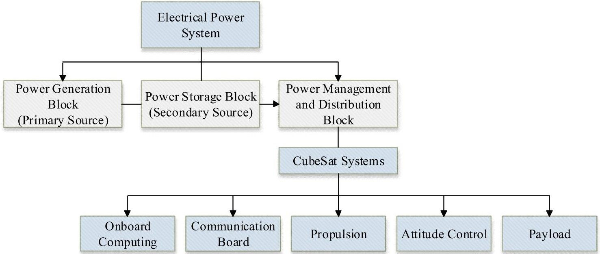
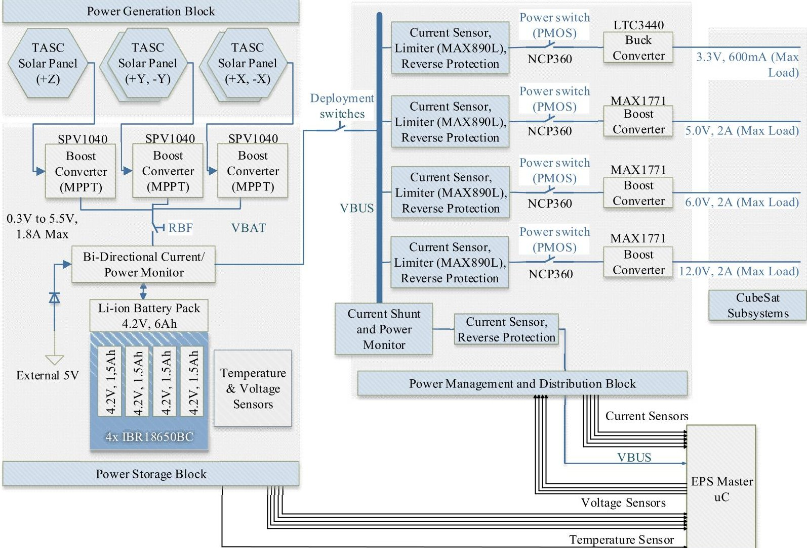

<!-- PDF_PAGE: 1 -->

# The OpenOrbiter CubeSat as a System-of-Systems (SoS) and How SoS Engineering (SoSE) Aids CubeSat Design

Sofiane Chaieb, Michael Wegerson Department of Electrical Engineering University of North Dakota Grand Forks, ND, USA sofiane.chaieb@my.und.edu; michael.wegerson@my.und.edu

Benjamin Kading Department of Mechanical Engineering University of North Dakota Grand Forks, ND, USA benjamin.kading@my.und.edu

Jeremy Straub, Ronald Marsh Department of Computer Science University of North Dakota Grand Forks, ND, USA jeremy.straub@my.und.edu; rmarsh@cs.und.edu

David Whalen

Department of Space Studies University of North Dakota Grand Forks, ND, USA whalen@space.edu

Abstract - This paper discusses the use of the system-of-systems (SoS) methodology and SoS engineering (SoSE) to the challenge of the design and operation of a CubeSatclass spacecraft. It considers this in the context of one critical component system, the electrical power system (EPS) which interacts with virtually all other systems onboard the spacecraft. The spacecraft is also considered in the context of being a system-component of a larger mission system-of-systems. The efficacy of SoSE use for this endeavor is considered and recommendations are made for the use of SoS and SoSE by other small spacecraft and, more broadly, spacecraft developers.

The OPEN framework utilizes slide-inserted panels on each of four sides of the CubeSat (along with a receiver board). Thus, there are two interfaces between the

CubeSats are generating significant interest among academic, government and industrial institutions due to their low cost, ease of launch vehicle integration and to the high quantity of documentation available. Despite their small size, CubeSats contain numerous systems and subsystems including mechanical, electrical and software components. The electrical components all require a connection to the electrical power supply (EPS) and data bus. A standard interface has been defined for both power and data interconnection, allowing boards in Open Prototype for Educational Nanosats (OPEN) spacecraft [1] to be developed as 'black boxes' and integrated into the spacecraft. This paper considers a CubeSat, based on the OPEN design, as a system-of-systems (SoS) and evaluates the efficacy of this approach to the design process.

Keywords: CubeSat, small spacecraft, system-of-systems engineering, system-of-systems.

## 1 Introduction

individual systems: a mechanical interface and an electrical interface. The electrical interface can be sub-divided into data connectivity (primarily switched Ethernet connections over general-purpose input/output (GPIO) pins) and power connectivity. The EPS, thus, is a system within the CubeSat that supports and is critical to the operation of most other systems. In this paper, a design for a CubeSat EPS - based on a SoS methodology - is presented. This hardware-software system is used to demonstrate the efficacy of the SoS approach and SoS engineering (SoSE) methodology for use in CubeSat design and development.

## 2 Background

The work presented herein benefits from prior work in multiple areas. Three are now discussed. First, an overview of the SoS concept and SoSE is presented. Then, an overview of prior work on small spacecraft and CubeSats is given. Finally, design methodologies for small spacecraft and CubeSats are considered.

## 2.1 System-of-Systems and SoS Engineering

Maier [2] defines a SoS as comprising a set of component systems that have "valid purposes in their own right" and are "managed (at least in part) for their own purposes rather than the purposes of the whole". The example of a personal computer as a SoS is provided, with components such as monitors and disk drives serving as systems within the computer's system of systems. The computer itself, of course, can serve as a component of a larger SoS, such as a wide area network; thus a SoS hierarchy exists in many cases.

Maier [2] sub-divides SoSs into three classifications based on how they are managed. Directed SoSs are centrally managed and designed to achieve a predefined

<!-- PDF_PAGE: 2 -->

purpose. The spacecraft discussed herein falls within this category. Collaborative SoSs have an agreed (albeit tacitly in many cases) goal that is achieved through voluntary participation. The Internet is suggested as a collaborative SoS. Finally, virtual SoSs lack both centralized management and purpose, but create an emergent outcome. The World Wide Web is suggested as a virtual SoS.

Chen and Clothier [3] discuss the need for and an approach to systems engineering for SoS. They suggest that as opposed to traditional systems engineering, where a lifecycle process can be used to achieve objectives defined during project initiation and agreed upon by stakeholders, a different methodology be used for SoSE. This would include a framework for SoSE activities, processes, standards, information management systems and SoSE education. Particular attention must be given to resulting behavior, configuration, security, performance, interface management, change management and testing activities.

Gorod, Sauser and Boardman [4] discuss the differences between a system of subsystems and a system of systems. They consider five aspects. With regards to autonomy, a system of subsystems is designed to produce conformance, while the SoS strives for autonomy directed at achieving the SoS purpose. In the dimension they've termed belonging, a system of subsystems utilizes centralization, while SoSs are decentralized. Systems of subsystems are also platform centric and homogeneous, as compared to the network-centric and heterogeneous connectivity and diversity, respectively, of a SoS. Finally, emergent behaviors are foreseen in systems of subsystems, while they may be indeterminable in a SoS.

## 2.2 Small Spacecraft and CubeSats

Small spacecraft are as old as humankind's entry into space, with Sputnik (humanity's first satellite) falling within many definitions of small spacecraft [5]. More recently, the miniaturization of components and a demonstration that even consumer electronics can survive and operate in low-Earth orbit [6] have driven a so-called "long-threatened flood" [7] of entrants. CubeSats, one type of small spacecraft, are based around the use of a standardized form factor and launcher (designed by Twiggs and Puig Suari [8]), enhancing their ease of integration as secondary payloads. Their comparatively low cost [9] and the availability of free-to-developer [10, 11] and prospective low-cost [12, 13] launch capabilities has driven their use for missions for educational purposes [14-16] as well as military [17, 18], industry [19] and bona fide research [20, 21] and engineering demonstration [22-24] missions.

## 2.3 Small Spacecraft Design Methodologies

A variety of design methodologies for small spacecraft have been proposed. Traditional spacecraft

systems engineering, with a top-down design and iterative refinement [25] to ensure that mission requirements and constraints are met has been utilized by numerous programs. Others have considered the use of approaches such as model-based systems engineering [26, 27] and used the SysML modeling language to describe and evaluate a CubeSat design. Lowe and Macdonald [28], in particular, discuss the utility of a model-based approach in the context of rapid design needs for the inherently interdisciplinary effort of spacecraft design.

## 3 OpenOrbiter as a System-of-Systems

The Open Orbiter CubeSat contains multiple component systems that must interoperate for successful mission execution. Electrical component systems include a primary flight computer, an attitude determination and control system (ADCS), an imaging payload and payload processing computing center, an EPS, and a data interconnection bus based on the Ethernet standard which is used to transfer commands and data between the other systems. The spacecraft also includes multiple software systems (flight control, scheduling and payload processing) and a physical structure that contains and secures all of the other components. A brief overview of each system is now provided.

A Raspberry Pi single-board computer serves as the primary flight computer. This system serves to make command decisions for the entire spacecraft, based on ground controller commands and onboard condition- response software algorithms. It interacts with the other systems, collecting and analyzing their output data and triggering responses as required. All CubeSat systems operate under a model of constrained autonomy, where they execute their day-to-day tasks without interference from the flight computer (and the overall CubeSat acts autonomously based on ground controller commands). The primary flight computer also operates the spacecraft communications hardware: it interfaces directly with the transceiver and, thus, is responsible for and performs the transmission of data to and the reception of data from the ground station.

The ADCS for the Open Orbiter project can be conceptualized as two interrelated components: the first determines the orientation of the CubeSat, while the second provides actuation capabilities to control the orientation. The ADCS is software-driven, with autonomous on-orbit machine learning capabilities [29] utilized to determine its movement model. For determination purposes, the ADCS (1) determines an initial orientation using a combination of visible light sensing and GPS (if available). It then (2) monitors a collection of sensors to update the CubeSat's orientation. These sensors include a magnetometer, an accelerometer and a gyroscope which are used to determine the orientation of the CubeSat and provide a vector-based approximation of any changes in orbital characteristics

<!-- PDF_PAGE: 3 -->

Figure 1. Representation of the EPS as a System-of-System in the CubeSat

(which can supplement the absolute positioning periodically received from a GPS unit, if available). An onboard microcontroller filters the raw data and a limited onboard computer performs limited processing of the attitude/movement determination sensor, prior to it being transmitted to the flight computer. This serves to allow rapid response to the collected data, allowing the ADCS to evaluate actual orientation changes and the resulting orientation, as compared to the desired orientation indicated by the flight computer and to make corrections as needed. The capabilities of this limited ADCS computer are augmented for initial orientation determination by computing resources on the payload or flight computer.

The control aspect of the ADCS is implemented using this microcontroller, which will receive commands from the flight computer regarding a desired orientation and required timeframe for its attainment as well as any restrictions on the techniques that can be used to reach this orientation (e.g., use only passive magnetic components, etc.). This computer / microcontroller system then commands the various actuators (e.g., reaction wheels and magnetorquers) to attain and maintain the desired orientation. Accuracy levels can be specified and will vary based on the type of task being performed.

OPEN includes a specification for a central payload area and a side board-area that is dedicated to payload purposes. The OpenOrbiter spacecraft will use this space to house a visible light imagining payload system and associated image processing hardware. This system will collect imagery and perform mosaicking, super-resolution and other image processing techniques on it, such that it is ready for transmission to the ground (and extraneous data, such as overlapping regions, is removed).

The data bus is comprised of an Ethernet switch to which the Ethernet ports on all of the board connectors

connect. This switch routes transmission between component-systems (including the flight computer).

Several software systems exist. The first is the control software on the flight computer which makes decisions as to actions to command based on ground controller instructions and the current spacecraft state. This utilizes a second software component, a scheduling program that runs at regular intervals to determine when mission and housekeeping tasks are performed. Finally, software on the payload processing center performs the aforementioned image processing work.

The structure is another critical system. Described in [30], it is utilized to hold all of the hardware components in place. It also provides a central grounding point for all electrical components. Between the side boards and the daughter boards upon which the solar panels are mounted, riser screws also serve to transfer the power from the solar cells to the side board and from there to the EPS.

## 4 Electric Power System

The EPS connects to all other spacecraft electrical subsystems, as shown in Figure 1. It is visually depicted in Figure 2 and is an assemblage of components that produces power at specified voltage and current levels, while performing battery state and system health assessment. The EPS maintains its own capabilities to serve the needs of other systems as is typical of a directed SoS.

The EPS receives the power generated by the solar panels and regulates it to provide consistent and specified levels of power to all of the systems of the spacecraft. It acts as the interface between the primary (collection) and secondary (battery) power source and all electrical systems of the CubeSat. It is also responsible for charging the batteries from the collection source and identifying low-

<!-- PDF_PAGE: 4 -->

Figure 2. Internal configuration of the Electrical Power System

power conditions to trigger power conservation activities (which are carried out by the flight computer).

To service the needs of prospective future users, requirements have been specified for the EPS. It must:

- be capable of supplying 3.3V, 5V, 9V and 12V

- be able to automatically restart in case of failure

- contain photovoltaic solar inputs

- have an onboard microprocessor, connected to the flight computer using GPIO pins which utilizes the I2C protocol

- conform to the OPEN side-board specifications

The EPS can be thought of as a system of subsystems within the spacecraft SoS. The different component systems of the EPS system of subsystems are the power generation block (PGB), the power storage block (PSB), the power management and distribution block (PMDB) and the EPS onboard microcontroller. Figure 2 represents the relation between the different constituents systems of the EPS system of subsystems.

The PGB is the primary power source of the spacecraft. It consists of arrays of photovoltaic (PV) panels that transform the solar energy into usable electrical power.

Triangular Advanced Solar Cells (TASC) from Spectrolab were selected for their relatively high efficiency (around 27%) , their low price and their CubeSat-suited form factor.

The PSB is the secondary power source of the spacecraft. It consists of Maximum Power Point Tracking (MPPT) regulators, a set of four batteries and current flow and temperature sensors. The PSB is responsible of storing the extra power generated by the PGB for use during eclipse periods and/or at times of peak power demand. lithium ion (Li-ion) based batteries have been selected due to their high energy density compared to other types of batteries such as nickel-metal hydride and lithium polymer, for example. Li-ion batteries are highly sensitive to being overcharged; consequently, overcharge must be prevented through the incorporation of protection circuitry [31].

The PMDB regulates, monitors and distributes the regulated power to the systems of the spacecraft. It includes DC-to-DC regulators, power switches, and sensors.

The EPS onboard microcontroller controls the EPS. It is responsible for collecting data from the different EPS sensors and making decisions in cases where a system fault is detected. It also makes implementation decisions for carrying out the commands sent to it by the flight computer.

<!-- PDF_PAGE: 5 -->

In order for the PMDB to ensure the spacecraft safety and operations, it interacts with multiple spacecraft systems. The interactions between the PMDB and the EPS components and non-EPS systems are now discussed.

## EPS Systems

- Measure EPS power busses current consumption

- Hardware / software current limiting

- Monitor noise on power lines

- Monitor batteries: voltage, current, temperature

## Spacecraft Systems

- Enable / disable busses as commanded

- Measure load power buses current consumption

- Monitor noise on power lines

- Flexibility in meeting mission requirements

To avoid interference with spacecraft system functionality, the current measurement system is transparent and sensor failure does not impair operation.

## 5 Qualitative Evaluation of SoS Use

The SoS approach facilitates concurrent development of systems (in a directed SoS, such as the CubeSat) making it an attractive approach. In the context of designing OPEN, where the design is supposed to be componentbased, such that others can replace, remove, add or alter components to suit their own mission needs, the SoS approach takes on an even greater level of value.

The SoS approach, in addition to facilitating design decision making, also facilitates design evaluation. Two metrics bear consideration in analyzing a CubeSat as a SoS:

- Layered architecture

The SoS approach, due to its inherent 'black box' component nature and the ability to have nested SoSs within SoSs (as shown herein with the EPS system of subsystems existing within the spacecraft SoS and the spacecraft being part of a larger mission SoS that, for a cluster mission, could contain other spacecraft in addition to ground control and communications capabilities) forces well-defined interfaces. This interface definition requirement is critical to allowing system removal / addition / replacement, as may be needed to suit the needs of multiple missions (or changing mission needs for a particular mission).

While interface definitions are undoubtedly important to architecture modularity, the SoS paradigm provides benefit beyond this. SoSE inherently involves considering latent and emergent effects of the SoS and component-system level decision making. These techniques are critical

to ensuring that the OPEN architecture will operate under a wide variety of prospective mission scenarios and suit the needs of a wide constituency of users.

Together, these two benefits of SoSE provide flexibility to respond to changes in mission requirements as well as the tools to consider the role of the spacecraft within a larger mission SoS (prospectively including a mission SoS that is a collaborative or virtual SoS). The use of spacecraft beyond their original mission timeframes and for unintended purposes (or as part of un-pre-planned collaborative groups) demonstrates the importance of being able to apply SoS/SoSE to spacecraft. Missions like QB50 [21] are poised to demonstrate the efficacy of CubeSat operations within clusters, due to their low cost and comparatively high capability levels and triggering a requirement for SoS / SoSE techniques.

## 6 Conclusions and Future Work

This paper has studied the interactions and interconnections of systems within the OPEN CubeSat framework as a SoS. The EPS, in particular, was considered as it is a system of subsystems within the spacecraft SoS and has high interconnectivity with other subsystems. Through this, the benefits of SoS-style design for CubeSats has been demonstrated.

Future work will focus on the analysis of a CubeSat SoS within a larger spacecraft cluster SoS. Analysis of other CubeSat systems in a SoS context is also planned.

## References

[1] J. Straub. An open prototype for educational NanoSats: Increasing national space engineering productivity via a low-cost platform. Presented at the 2nd National Academy of Inventors Conference. 2013.

[2] M. W. Maier. Architecting principles for systems-of-systems. Systems Engineering 1(4), pp. 267-284. 1998.

[3] P. Chen and J. Clothier. Advancing systems engineering for systems-of-systems challenges. Systems Engineering 6(3), pp. 170-183. 2003.

[4] A. Gorod, B. J. Sauser and J. T. Boardman. System-of-systems engineering management: A review of modern history and a path forward. IEEE Systems Journal 2(4), pp. 484-499. 2008.

[5] P. Dickson, Sputnik: The Shock of the Century. New York, NY: Walker Publishing Company, Inc., 2001.

[6] W. Attai, S. A. Guillen, K. Y. Oyadomari, C. Priscal, R. S. Shimmin, O. T. Gazulla and J. L. Wolfe. Phonesat inflight experience results. Presented at Symposium on Small

<!-- PDF_PAGE: 6 -->

Satellites Systems and Services-4S. 2014.

[7] M. Swartwout. The long-threatened flood of universityclass spacecraft (and CubeSats) has come: Analyzing the numbers. Presented at Proceedings of the 27th Annual AIAA/USU Conference on Small Satellites. 2013.

[8] R. A. Deepak and R. J. Twiggs. Thinking out of the box: Space science beyond the CubeSat. Journal of Small Satellites 1(1), pp. 3-7. 2012.

[9] J. Straub, "Cubesats: A low-cost, very high-return space technology," in Proceedings of the 2012 Reinventing Space Conference, Los Angeles, CA, 2012.

[10] G. Skrobot and R. Coelho. ELaNa-Educational launch of nanosatellite: Providing routine RideShare opportunities. Presented at Proc. SmallSat Conference. 2012.

[11] (13 February 2013). Call for Proposals: Fly Your Satellite!. Available: http://www.esa.int/Education/Call_for Proposals_Fly_Your_Satellite.

[12] J. Garvey and E. Besnard. Development of a dedicated launch system for nanosat-class payloads. 2004.

[13] R. Milliron, "Interorbital's NEPTUNE dedicated SmallSat launcher:2013 test milestones and launch manifest update," in 2013 Spring CubeSat Developers' Workshop, San Luis Obispo, CA, 2013.

[14] J. Straub, C. Korvald, A. Nervold, A. Mohammad, N. Root, N. Long and D. Torgerson, "OpenOrbiter: A LowCost, Educational Prototype CubeSat Mission Architecture," Machines, vol. 1, pp. 1-32, 2013.

[15] J. Straub and D. Whalen. An assessment of educational benefits from the OpenOrbiter space program. Education Sciences 3(3), pp. 259-278. 2013.

[16] E. Kroeker, A. Ghosh and V. Coverstone. Building engineers: A 13-year case study in CubeSat education. 2014.

[17] D. Weeks, A. B. Marley and J. London III. SMDC- ONE: An army nanosatellite technology demonstration. Presented at SMDC- ONE: An Army Nanosatellite Technology Demonstration. 2009.

[18] L. R. Abramowitz. US air force's SMC/XR SENSE NanoSat program.

[19] M. Taraba, C. Rayburn, A. Tsuda and C. MacGillivray. Boeing's CubeSat TestBed 1 attitude determination design and on-orbit experience. Presented at Proceedings of the AIAA/USU Conference on Small Satellites. 2009.

[20] J. Bailey, S. Tsitas, D. Bayliss and T. Bedding. A CubeSat mission for exoplanet transit detection and

astroseismology. Presented at Proceedings of the 6U CubeSat Low Cost Space Missions Workshop. 2012.

[21] J. Muylaert, R. Reinhard, C. Asma, J. Buchlin, P. Rambaud and M. Vetrano. QB50: An international network of 50 cubesats for multi-point, in-situ measurements in the lower thermosphere and for re-entry research. Presented at ESA Atmospheric Science Conference, Barcelona, Spain. 2009.

[22] J. Cardin, K. Coste, D. Williamson and P. Gloyer. A cold gas micro-propulsion system for CubeSats. 2003.

[23] E. Bashevkin, J. Kenahan, B. Manning, B. Mahlstedt and A. Kalman. A novel hemispherical anti-twist tracking system (HATTS) for CubeSats. Proceedings of the 26th AIAA/USU Conference on Small Satellites 2012.

[24] V. Chirayath and B. Mahlstedt. HiMARC 3D-highspeed, multispectral, adaptive resolution stereographic CubeSat imaging constellation. Presented at Proceedings of the AIAA/USU 2012 Small Satellite Conference. 2012.

[25] J. R. Wertz, D. F. Everett and J. J. Puschell, Space Mission Engineering: The New SMAD. Hawthorne, CA: Microcosm Press, 2011.

[26] S. C. Spangelo, D. Kaslow, C. Delp, B. Cole, L. Anderson, E. Fosse, B. S. Gilbert, L. Hartman, T. Kahn and J. Cutler. Applying model based systems engineering (mbse) to a standard cubesat. Presented at Aerospace Conference, 2012 IEEE. 2012.

[27] S. C. Spangelo, J. Cutler, L. Anderson, E. Fosse, L. Cheng, R. Yntema, M. Bajaj, C. Delp, B. Cole and G. Soremekum. Model based systems engineering (MBSE) applied to radio aurora explorer (RAX) CubeSat mission operational scenarios. Presented at Aerospace Conference, 2013 IEEE. 2013.

[28] C. J. Lowe and M. Macdonald. Rapid model-based inter-disciplinary design of a CubeSat mission. Acta Astronaut. 105(1), pp. 321-332. 2014. DOI: http://dx.doi.org/10.1016/j.actaastro.2014.10.002.

[29] J. Straub, M. Wegerson and R. Marsh, "An intelligent attitude determination and control system for a CubeSat class spacecraft," Submitted to Proceedings of the Space 2015 Forum + Exposition, Pasadena, CA.

[30] B. Kading, J. Straub and R. Marsh. OpenOrbiter mechanical design: A new approach to the design of a 1-U CubeSat. Presented at Proceedings of the AIAA SciTech Conference and Exposition. 2015.

[31] J. Bester, B. Groenewald and R. Wilkinson. Electrical power system for a 3U CubeSat nanosatellite incorporating peak power tracking with dual redundant control. Przeglqd Elektrotechniczny.Selected Full Texts 88pp. 300-304. 2012.