<!-- PDF_PAGE: 1 -->

# A CubeSat Catalog Design Tool for a Multi-Agent Architecture Development Framework

Monica Jacobs Cornell University Ithaca, NY 14853 mmj36@cornell.edu

Daniel Selva Cornell University 212 Upson Hall Ithaca, NY 14853 ds925@cornell.edu

Abstract—Space systems are undergoing an architectural paradigm change. Large space organizations around the world are now considering CubeSats and other novel elements, such as hosted payloads or commercial services, in the architecture studies for the next generations of Earth observation and communications systems. As CubeSats are included in these trade studies, it is necessary to develop design tools that are tailored to these new architectural elements. Indeed, the traditional top-down approach for designing large satellites is not appropriate for CubeSats, which have many fewer components and make heavy use of COTS. This paper presents a bottom-up, catalog design tool tailored for CubeSats. A CubeSat design is represented by a valid combination of components. Components are selected from a database (catalog) of existing components containing information about mass, power, volume, cost, and performance of the components. The tool has two functioning modes: the forward mode and the backward mode. In the forward mode, the user creates a design by selecting a combination of components from the database, and the tool computes the properties of the resulting satellite: mass, power, and volume budgets, pointing accuracy, as well as cost and other systemlevel properties such as reliability. In the backward mode, the user enters a set of requirements (payload mass, power, data rate, volume, pointing accuracy, orbit, lifetime, and others) and the tool finds all valid combinations of components that satisfy all the requirements, and suggests one. If no valid design exists, the tool provides a set of explanations to the user pointing out the unmet requirements. The tool uses a rule-based approach to solve the configuration design problem, and implements the MadKit interface to be able to communicate with other agents in a multi-agent design environment. This paper describes the tool in technical detail and illustrates with examples using Earth observation and communications payloads.

## TABLE OF CONTENTS

<table border="1"><tr><td>1</td><td>INTRODUCTION</td><td>1</td></tr><tr><td>2</td><td>APPROACH</td><td>2</td></tr><tr><td>3</td><td>RESULTS</td><td>4</td></tr><tr><td>4</td><td>CONCLUSIONS</td><td>6</td></tr><tr><td></td><td>REFERENCES</td><td>9</td></tr><tr><td></td><td>BIOGRAPHY</td><td>10</td></tr></table>

## 1. INTRODUCTION

The CubeSat standard was developed at Stanford and CalPoly in 1999 [1]. The standard imposes severe design constraints on the satellite: size of a few centimeters or tens of centimeters, mass of a few kilograms, power of a few Watts (tens of Watts for larger CubeSats with deployable solar panels) and data rates around a Mbps or lower (tens of Mbps at most). While these constraints obviously limit the

capabilities of CubeSats [2], it is fair to say that the CubeSat paradigm has enabled a relative democratization of space: organizations around the world, ranging from educational to commercial, can now afford to develop and launch their own satellites, with bus and launch costs ranging in the hundreds of thousands of dollars [3]. Furthermore, experts forecast that Cubesats will continue to grow in popularity. A recent assessment of the nanosatellite market by SEI stated that while fewer than 100 nanosatellites weighing between 1 and 3kg were launched between 2000 and 2012, an estimated 279 will be launched between 2013 and 2015, which represents an increase of about an order of magnitude in the rate of launches per year [4].

As CubeSats increase their ability to satisfy scientific and societal needs, space organizations are starting to consider them in their architectural studies. However, existing tools used for architecture studies are tailored for traditional larger satellites, and not adequate for CubeSats. For example, some of these tools may use parametric cost estimation relationships (CER) to estimate spacecraft development and fabrication cost, but these CER only apply within a certain range of spacecraft that typically does not include CubeSats [5]. Moreover, due to the numerous physical and monetary constraints, use of commercial-off-the-shelf (COTS) parts has become increasingly prevalent on CubeSats compared to developing custom-built parts.

For these reasons, this paper introduces a CubeSat design optimization tool that uses a catalog-based bottom-up approach to design CubeSats. Indeed, as CubeSat usage increases in industry, optimized design becomes increasingly important. Furthermore, since custom parts are seldom used in CubeSat missions, a CubeSat design can be created by selecting components from a database from given information about the desired orbit and payloads.

A number of satellite design support tools already exist. A team at NASA Ames Research Center developed a design tool (X-Change) for general early-phase design. Interestingly, the case study used to validate the tool was a CubeSat. X-Change allows for bottom-up or top-down design. It was created to allow for selection of the most risk-aware and robust design configurations, but these configurations must be input manually and are merely evaluated by the tool [6]. Chang et al. developed the Systems Engineering Design Tool in 2007 which is used for nanosatellites. This top-down design tool computes mass, power, and cost, and optimizes the included subsystems in a specified order. Optimization decisions are made based on a database of satellites, from which characteristic trend equations are generated [7]. Similar to both of these tools, The Aerospace Corporation developed a spreadsheet-based design tool for small satellites. Though the tool emulates the design, build, and test cycle and analyzes the design by multiple metrics, it, like the other

<!-- PDF_PAGE: 2 -->

two tools, requires manual selection of designs and thus manual optimization [8]. Satellite optimization tools are in use, however. Badsi et. al. worked on a plug-and-play CubeSat design where the design is self-reconfigurable [9]. There are of course many other optimization tools applied to other tasks different than design, such as the work by Torgerson et al. who optimized the schedule of on-board tasks using heuristic optimization [10]. However, to the best of our knowledge, there is currently no published work on a catalog-based design optimization tool tailored for CubeSats.

The tool discussed in this paper features two modes - forward and backward. In the forward mode, the user inputs one particular design, i.e. a set of database components, as well as a set of requirements including the payload and orbit. Then the tool computes its cost as well as a number of performance parameters, and checks those against user requirements. Requirements are specified on parameters such as spatial resolution, pointing accuracy, or data rate. Each requirement may consist of a threshold value, and a target value. A design that does not meet or exceed all threshold values is considered invalid.

In the backward mode, the tool only takes in a the set of requirements including the payload and an orbit, finds all the compatible designs, and returns the design with the lowest cost which meets all critical requirements, if one exists. A design tradespace chart is also produced that shows a cost estimate and a performance metric for all designs, including those that do not satisfy all requirements. The performance metric essentially counts the number of requirements that are partially (threshold) or fully (target) satisfied by the design, thus giving some ability to distinguish between valid designs. This chart facilitates understanding trade-offs between requirement satisfaction and cost.

The rest of the paper is organized as follows: Section 2 describes the tool structure and behavior; Section 3 illustrates the tool with a simple case study. Finally, Section 4 discusses the limitations of the tool and discusses the current and future work.

## 2. APPROACH

## Overview

The design methodology used in our tool is based on the typical systems engineering approach of starting with a set of critical requirements which must be met by the design, and looking at affordable ways of meeting such requirements, but it emphasizes the tradeable nature of these requirements. In the forward mode, the design given as an input is simply assessed based on these requirements and cost. In the backward mode, the designs are filtered based on a set of critical requirements, and optimized based on a piece-wise continuous function derived from a secondary (non-critical) set of requirements. The set of critical requirements is intended to filter out any designs that will clearly fail (e.g., designs with infeasible mass for a specific launch service, or incompatible communication systems). A flowchart of the full system is shown in Figure 1.

Generating a large number of CubeSat designs at once allows for easy comparison between the designs for a given orbit and set of payloads. This allows one to visualize the tradespace and identify scenarios in which particular components are advantageous or disadvantageous. Plotting the design cost and performance data also displays the Pareto frontier and allows

non-dominated component combinations to be identified for particular orbits and payloads.

## Inputs

There are a few inputs which must be provided by the user in order to use the tool. The first input is the mode forward or backward. If this input is missing or incorrectly formatted, an error message is displayed and the tool does not proceed. If the backward tool is selected, the second input required is orbit information, including the orbit type (GEO, LEO, SSO), altitude in km (400, 600, 800), inclination (equatorial, polar, SSO), and the right ascension or local time of the ascending node (AM/PM/dawndusk for SSO orbits, or NA for all others). Different orbits are encoded in the tool as follows: <orbit type>-<altitude>-<inclination>-<RAAN>. Eccentricity is not required because circular orbits are assumed, and mean anomaly is not required because it doesn't affect any parameter used in the tool.

Payloads, represented as strings referencing a parts database, are also passed into the tool as arguments. They are separated into two types for computation purposes: cameras and other payloads. There can be any number of either type of payload including none. The forward mode also requires the name of each of the component in the selected design - or null if a specific component is not included (such as a propulsion system). Both modes also require the input of target and threshold values to measure performance in a number of areas. The threshold values represent the critical requirements for a feasible CubeSat design.

For both modes, this tool links to two databases: a component database and a mission analysis database. The component database includes information on specific hardware as well as general information on other types of components (such as batteries and solar arrays). This was aggregated from several online suppliers of CubeSat components, and can be expanded in the future. The small sample database used for this study consisted of ten attitude control systems, three types of solar panels, two types of batteries, one on-board computer, two transceivers, three antennas, eleven propulsion systems, three cameras, and three other possible payloads. A valid CubeSat design consists of one attitude control system, one solar panel, one structure, one set of batteries, one onboard computer, one transceiver, one antenna, and may also contain a propulsion system and any number of cameras or other payloads. The relatively small size of this database is satisfactory for validating the component selection strategy, but can easily be expanded for more design possibilities. Due to the inconsistent nature of online specifications, reasonable values were substituted into the database where necessary. The mission analysis database includes information obtained from ad-hoc orbital analysis and simulations, specifically fraction of sunlight, orbital period, worst sun angle, and the maximum eclipse time. These databases provide all of the information with which the tool computes design characteristics.

## Rule-Based System

In rule-based systems, the knowledge about how to solve a problem is encoded in the form of logical rules, whereas the inputs are stored in data facts, simple data structures usually implemented as lists of pairs attribute-value. Rulebased systems use advanced pattern matching algorithms to solve the problem by matching rules with facts, without the need to give the computer a specific procedure to solve the

<!-- PDF_PAGE: 3 -->

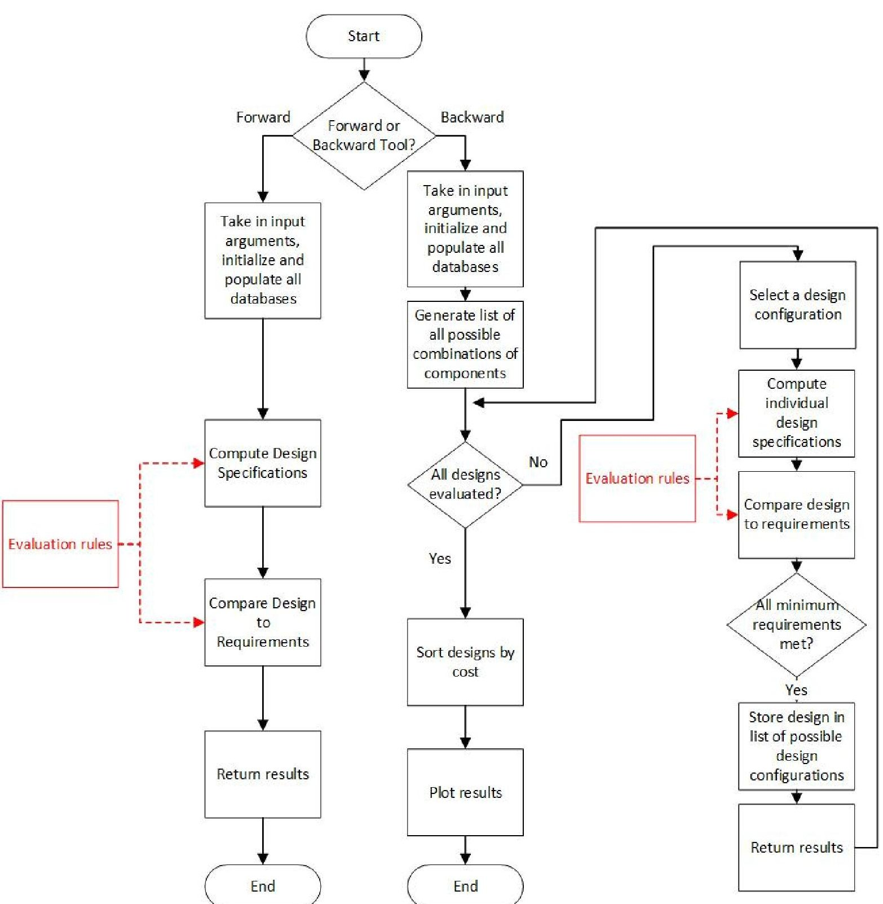

Figure 1. Information Flow through Catalog Design Tool

problem. Rule-based approaches have been found effective for configuration design problems [11], [12].

JESS, the Java Expert System Shell, was selected as the language for this tool [13]. The JESS usage was spread across three files, each utilized by both modes. The forward mode runs an initialization script to pass system variables, such as orbit information, to JESS as well as to assert the selected design. The selected design is asserted and each of the components of the design are asserted to fill relevant slots in the design template (e.g., the selected antenna is asserted as the antenna to be evaluated). With the design passed in, a set of JESS rules containing the requirements for every CubeSat design are checked, and the matches are stored in boolean variables. These rules use functions from a third file that compute the required performance metrics either using simple equations (such as for spatial resolution)

or more sophisticated iterative algorithms (such as for the design of the power subsystem, based on variable battery and solar array size). The functions also calculate cost and performance, which are also returned once everything is calculated in JESS.

The backward mode enumerates all valid combinations of components and then runs the same process as the forward mode for every design. Designs that do not meet all the critical requirements are immediately identified and can be filtered out based on the boolean variables. In the current design iteration, the backward mode takes a brute-force approach to optimization and generates all possible combinations of components from the database. At this time, the database is fairly limited. However, as it grows, moving away from brute-force will become increasingly necessary.

<!-- PDF_PAGE: 4 -->

## Evaluation of Individual Designs

The primary metric used to evaluate a design is cost. Cost is naturally a determining factor for the majority of satellite launches, and is likely more important in designing a CubeSat mission since CubeSats are frequently considered the lowcost option for a satellite launch. However, cost is meaningless if information about performance is not also provided. For this reason, we developed a simple performance function based on target and threshold values of requirements for several of the design parameters including spatial resolution, image size, pointing accuracy, downlink data rate, and reliability. The performance is computed separately for each of the five design parameters, based on each parameter's threshold and target values. For a design to be considered viable, it must meet all threshold values for all of the critical requirements. The function for performance in one of the categories returns a value from zero to one. The function returns 1 if the target value is met or exceeded. The portion of the function between the target and threshold values is linear between 0.5 and 1. For values worse than the threshold value, satisfaction decreases exponentially from 0.5 with the distance to the threshold. There are two versions of this function: a small-is-good version for spatial resolution and pointing accuracy, and a large-is-good version for image size, downlink data rate, and reliability. General forms of both functions are pictorially illustrated in Figure 2. The outputs from these performance functions for all requirements are summed and then normalized, yielding a maximum performance score of one and a minimum performance score of zero.

## 3. RESULTS

## Verification

Initial tool verification was performed on the forward tool, since the backward tool reuses many of the same functions. The forward mode takes in strings representing database items to be included in the proposed architecture, in addition to orbit information. The tool takes in an attitude control system, solar panel type, on-board computer, structure, propulsion system, antenna, transceiver, and battery type in addition to camera and non-camera payloads. Some of these parameters, such as the propulsion system or payloads, may be null. The tool outputs a list of design parameters which must be met, and whether each of them are fully or partially met. Additionally, cost and performance scores are also output. An example is shown in Tables 1 and 2, with Table 1 showing sample inputs to the forward tool and Table 2 showing the corresponding outputs. In this example, the proposed architecture meets all requirements except volume, since the structure is too small to accommodate all of the input components.

In order to validate the functionality of the backward tool, the backward tool was run with several payloads and orbits and the results compared. The primary result from each data set is the viable design with the lowest cost, independent of performance score. The first payload is the UI-1641LE camera, from IDS, as the only payload. This is a small payload and thus, the cheapest design is also expected to be small. The second payload is the NanoCam C1U, which is a slightly larger camera. The third payload is both the NanoCam C1U and a hyperspectral millimeter-wave atmospheric sounder, such as that of the MicroMAS mission [14]. Furthermore, each of these payloads were input to the tool at two different orbits: LEO-400-polar-NA and LEO-600-polar-

<table border="1"><tr><td>Category</td><td>Input</td></tr><tr><td>Payload</td><td>NanoCam CU1</td></tr><tr><td>Orbit</td><td>LEO-400-polar-NA</td></tr><tr><td>Attitude Control</td><td>XACT</td></tr><tr><td>Solar Panel Type</td><td>Deployable Triple Junction</td></tr><tr><td>Onboard Computer</td><td>ISIS On-Board Computer</td></tr><tr><td>Structure Size</td><td>1U</td></tr><tr><td>Propulsion System</td><td>none</td></tr><tr><td>Antenna</td><td>ANT430</td></tr><tr><td>Transceiver</td><td>CS-VUTRX</td></tr><tr><td>Battery Type</td><td>Li-Ion</td></tr></table>

Table 1. Forward Tool Sample Inputs

<table border="1"><tr><td>Cost</td><td>$49208.15</td></tr><tr><td>Performance</td><td>0.71</td></tr><tr><td>Volume</td><td>False</td></tr><tr><td>Mass</td><td>True</td></tr><tr><td>Frequency</td><td>True</td></tr><tr><td>Swath</td><td>True</td></tr><tr><td>Reliability</td><td>True</td></tr><tr><td>Spatial Resolution</td><td>True</td></tr><tr><td>Pointing Accuracy</td><td>True</td></tr><tr><td>Data Rate</td><td>True</td></tr><tr><td>Deorbiting Time</td><td>True</td></tr></table>

Table 2. Forward Tool Sample Outputs

NA. Comparing designs with the same payloads but designed for different orbits allows resulting cheapest designs to be checked for accommodating the different altitude. Plots of performance vs. cost for each of the sizes are shown in Figure 3. The selected components for the cheapest viable designs are shown in Tables 3 and 4.

The designs detailed in Tables 3 and 4 show some trends across all six design outcomes. The same attitude controller, on-board computer, antenna, and transceiver are utilized in all six designs. This indicates that, at least for LEO orbits, there are components which consistently meet the critical design requirements and are the lowest cost. As these components are evaluated fairly independently (e.g. in our current model, though the antenna and transceiver selection impacts the selection of other components, their selection requirements are primarily only impacted by the other, not by other components in the satellite), the minimum cost set will consistently be in the cheapest design. Likewise, all six output designs do not include propulsion systems, since it is an unnecessary expense for both of these orbits (in our current model, 600km is the threshold for requiring a propulsion system—the tool is operating under the assumption that operating at 600km without a propulsion system is a close call but can meet deorbiting requirements by passive means). Performance

<!-- PDF_PAGE: 5 -->

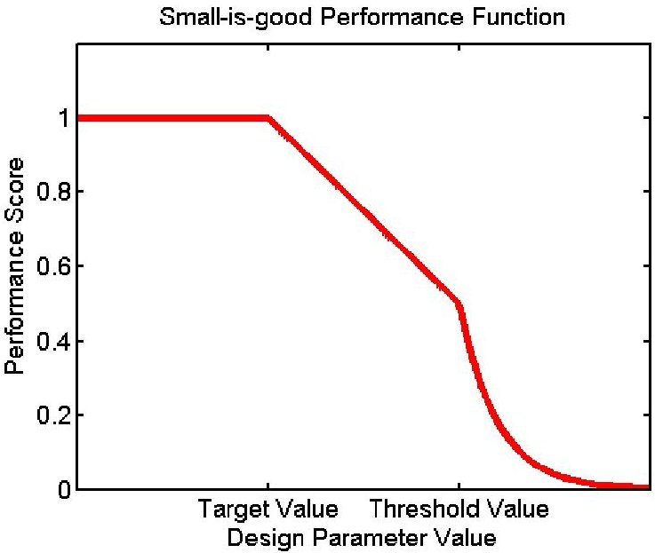

(a) Small-is-good Performance

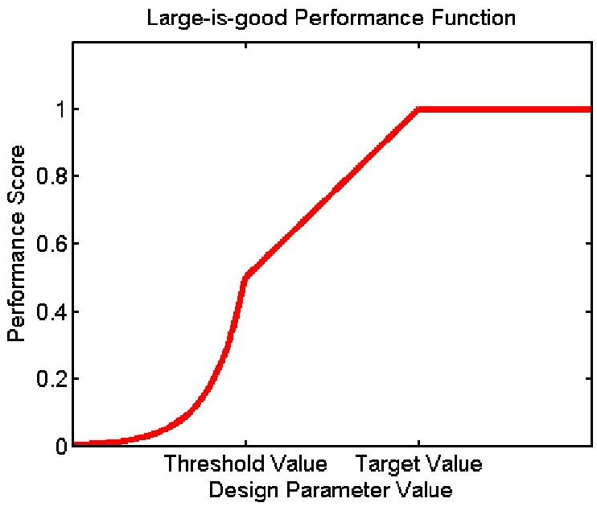

(b) Large-is-good Performance

Figure 2. The two versions of the performance function- the appropriate performance function is applied to each evaluation criteria and the results are averaged

<table border="1"><tr><td>Payload</td><td>UI-1641LE</td><td>NanoCam C1U</td><td>NanoCam C1U&amp;MicroMAS Payload</td></tr><tr><td>Cost</td><td>$25870.35</td><td>$40391.49</td><td>$56752.57</td></tr><tr><td>Performance Score</td><td>0.59</td><td>0.62</td><td>0.62</td></tr><tr><td>Attitude Control</td><td>CubeTorquer</td><td>CubeTorquer</td><td>CubeTorquer</td></tr><tr><td>Solar Panel Type</td><td>Fixed Si</td><td>Fixed Si</td><td>Deployable Triple Junction</td></tr><tr><td>Onboard Computer</td><td>ISIS On-Board Computer</td><td>ISIS On-Board Computer</td><td>ISIS On-Board Computer</td></tr><tr><td>Structure Size</td><td>1U</td><td>2U</td><td>3U</td></tr><tr><td>Propulsion System</td><td>none</td><td>none</td><td>none</td></tr><tr><td>Antenna</td><td>ANT430</td><td>ANT430</td><td>ANT430</td></tr><tr><td>Transceiver</td><td>CS-VUTRX</td><td>CS-VUTRX</td><td>CS-VUTRX</td></tr><tr><td>Battery Type</td><td>Ni-Cd</td><td>Ni-Cd</td><td>Li-Ion</td></tr></table>

Table 3. LEO-400-polar-NA Tool Output Designs for Given Payloads

<table border="1"><tr><td>Payload</td><td>UI-1641LE</td><td>NanoCam C1U</td><td>NanoCam C1U&amp;MicroMAS Payload</td></tr><tr><td>Cost</td><td>$25854.73</td><td>$41330.95</td><td>$56661.52</td></tr><tr><td>Performance Score</td><td>0.58</td><td>0.57</td><td>0.57</td></tr><tr><td>Attitude Control</td><td>CubeTorquer</td><td>CubeTorquer</td><td>CubeTorquer</td></tr><tr><td>Solar Panel Type</td><td>Fixed Triple Junction</td><td>Deployable Triple Junction</td><td>Deployable Triple Junction</td></tr><tr><td>Onboard Computer</td><td>ISIS On-Board Computer</td><td>ISIS On-Board Computer</td><td>ISIS On-Board Computer</td></tr><tr><td>Structure Size</td><td>1U</td><td>3U</td><td>3U</td></tr><tr><td>Propulsion System</td><td>none</td><td>none</td><td>none</td></tr><tr><td>Antenna</td><td>ANT430</td><td>ANT430</td><td>ANT430</td></tr><tr><td>Transceiver</td><td>CS-VUTRX</td><td>CS-VUTRX</td><td>CS-VUTRX</td></tr><tr><td>Battery Type</td><td>Ni-Cd</td><td>Ni-Cd</td><td>Li-Ion</td></tr></table>

Table 4. LEO-600-polar-NA Tool Output Designs for Given Payloads (changes w.r.t. Table 3 in bold)

<!-- PDF_PAGE: 6 -->

values for all six designs are generally low, as the value is not accounted for in the generation of these designs (with the exception of checking to ensure that all critical requirements are met).

As would be expected by its size, the UI-1641LE payload only requires a 1U satellite for either orbit. Structures scale with price, so the smallest usable structure size will be included in the cheapest usable design. The NanoCam C1U is larger than the UI-1641LE and thus requires a larger 2U or 3U structure. The MicroMAS payload is 1U in size, so it is reasonable for the generated design for the NanoCam C1U and MicroMAS payload to be 1U larger than the the design with only the NanoCam C1U. The actual MicroMAS1 CubeSat is 3U in size (although it doesn't have the camera).

When increasing orbit altitude, the types of solar panels and batteries change in some of the cases. This is to be expected. The way the catalog design tool is currently structured, types of solar panels and batteries are selected instead of precreated commercially available components. This is because there are many versions of these components available, and it is generally not difficult to find either a solar array or battery meeting the necessary specifications or to obtain a custommanufactured component. The electrical power system is designed using a number of orbit-specific parameters, namely orbital period, fraction of sunlight, and worst sun angle. These are all impacted by altitude, inclination, and right ascension of the ascending node, and thus vary across orbits. Solar array design and battery design are heavily dependent upon each other and thus one or both may change when re-optimizing the electrical power system. As a result of a growing power system to accommodate the NanoCam C1U for the LEO-600-polar-NA orbit, a 3U structure is necessary. In fact, the only thing to change for this orbit when the MicroMAS payload is added is the battery. Price increased because of the different battery choice, but by selecting a more space-efficient battery, all components continued to fit in a 3U structure.

The plots in Figure 3 show cost versus performance for all aggregated CubeSat designs given each orbit and payload. The valid designs i.e. those that meet all the critical requirements are shown in blue, and the invalid designs are shown in red. With the current requirements and the current component catalog, there are many more invalid designs than viable designs. Thus, the usable tradespace for all of the demonstrated cases is limited. There are no designs yielding performance scores of zero or one, given the current database and performance function though they are theoretically attainable. The sets of viable designs for each payload are very similar across orbits in these examples, as the only orbit parameter changing is altitude. The performance values in all of the plots are generally grouped, as there are design components without a direct impact on performance, so multiple similar design configurations may have the same performance but varying costs.

Comparing plots from the same orbit, it appears that the quantity of viable designs decreases as the payload increases in size. This makes sense, as any otherwise viable configuration can be eliminated if it is paired with a structure which is too small to contain the payload. Furthermore, there is much overlap between sets of viable design configurations for the same orbit. For instance, there appears to only be two more viable data points in Figure 3(b) than Figure 3(d). Likewise, there is much similarity in acceptable designs with the same payload at different orbits. This can be seen when comparing

Figure 3(a) and Figure 3(b), which have nearly identical sets of viable data. Since the data sets for each payload are similar, the Pareto Frontiers are also similar.

The plots in Figure 3 are interactive, so a user can select a point on the plot and view cost and performance data, as well as a list of components existing in the design. From there, more specific pass/failure criteria can be returned by using the forward mode.

## Pareto Front Analysis

After confirming that valid minimum-cost designs are being returned, it is worth exploring other, more expensive designs with optimal cost-performance trade-offs. Comparing designs along the Pareto front demonstrates how selected components change as the performance score increases. Output designs for a SSO-600-SSO-AM orbit with both a UI 1641LE camera and MicroMAS payload are shown in Table 5, with the plot of the data shown in Figure 4. Due to a limited number of viable design configurations, there are only two points clearly on the Pareto front. The first column of data represents the minimum-cost viable design and the second column of data represents a higher-performing higher-cost alternative. There are three component differences between the two designs: the attitude control system changes, the type of solar array changes, and the battery type changes. The attitude control system changed from the cheapest passable option (CubeTorquer) to a higher-performing higher-cost option (XACT), as expected. To account for potentially better design components and potentially greater mass, the electrical power system has re-optimized itself and switched type of solar array and battery.

Perhaps a better illustration of this can be found when observing the Pareto front for a LEO-600-equatorial orbit with the UI-1641LE camera as its sole payload, the data for which is shown in Table 6. There are three clearly defined designs on the Pareto front, as shown in Figure 5. Comparing across all three designs, the following values change: attitude control system, type of solar array, battery type, and structure size. Furthermore, in the third column (representing the highestcost/highest-performance design configuration), a propulsion system has been introduced to the design. The changes to attitude control are the same as in the SSO-600-SSO-AM example and occur for the same reason. The same applies for the changes in the power system. The structure size changes to accommodate the changing on-board components. A larger structure can accommodate larger, and potentially better-performing, components.. The introduction of the propulsion system would never occur in a minimum-cost design at 600km altitude since designs exist which do not require a propulsion system to deorbit in twenty-five years (as per NASA's recommendations).

## 4. CONCLUSIONS

This paper has presented a CubeSat catalog design tool which contains two modes. The forward mode computes design performance based on input design components and evaluates whether the design meets critical requirements. The backward mode evaluates many designs and maps out a tradespace of viable design configurations based on cost and a performance score. This tool is dependent upon a database of commercially available satellite components, since CubeSats are frequently made with preexisting components. The tool generates a series of designs, and thus, allows for design selection to be performed methodically and efficiently based

<!-- PDF_PAGE: 7 -->

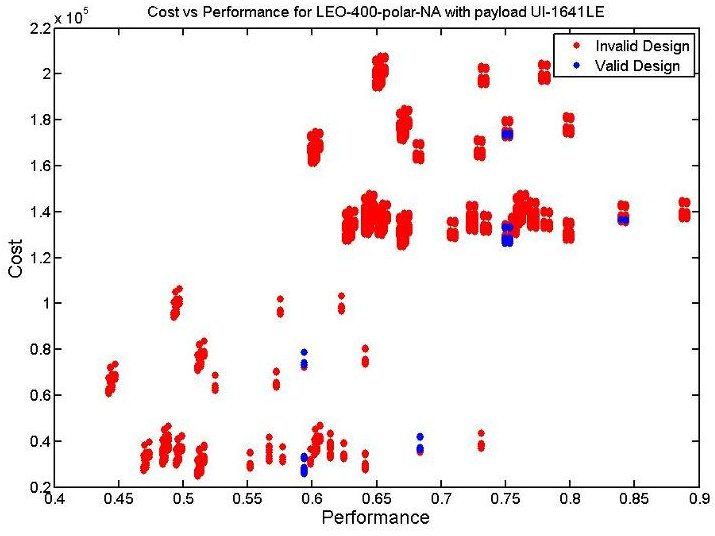

(a) LEO-400-polar-NA orbit with UI-1641LE payload

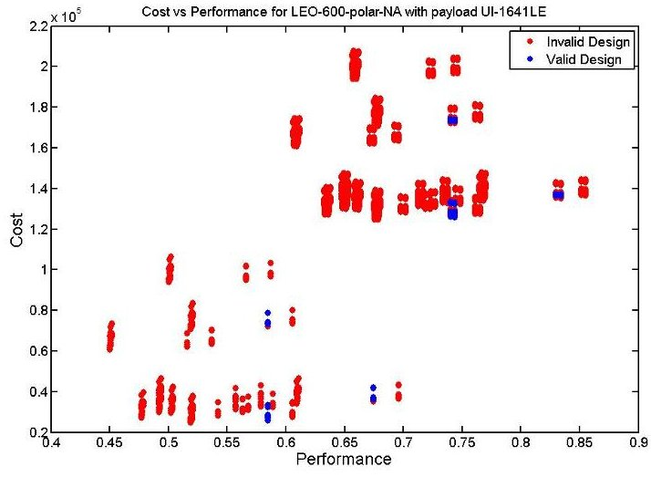

$ \times10^{5} $ Cost vs Performance for LEO-400-polar-NA with payload NanoCam C1U

(b) LEO-600-polar-NA orbit with UI-1641LE payload

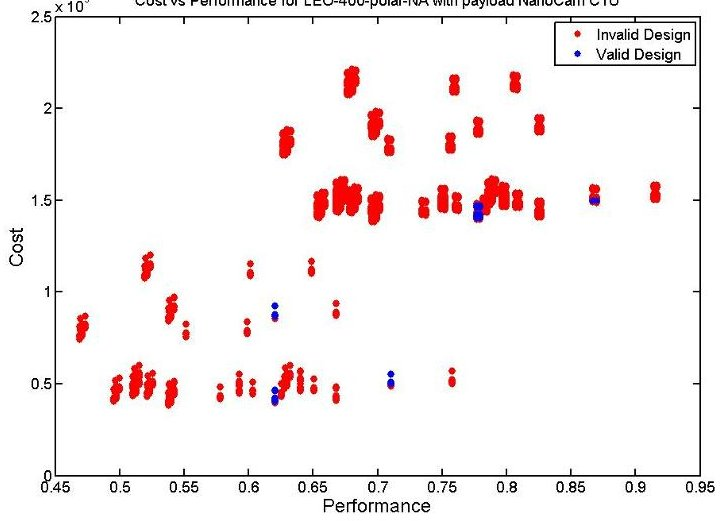

(c) LEO-400-polar-NA orbit with NanoCam C1U payload

x $ 1 0^{5} $ Cost vs Performance for LEO-600-polar-NA with payload NanoCam C1U

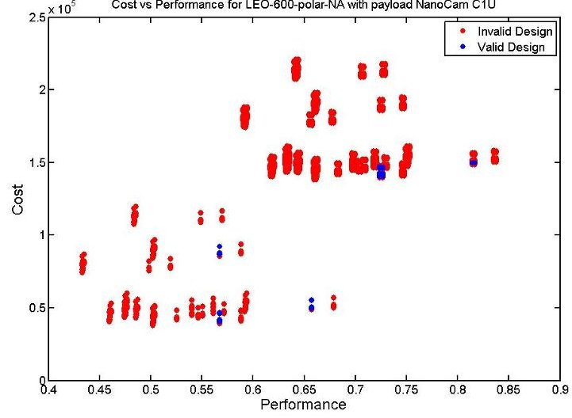

(d) LEO-600-polar-NA orbit with NanoCam C1U payload

x 102Cost vs Performance for LEO-400-polar-NA with payloads NanoCam C1U & MicroMAS

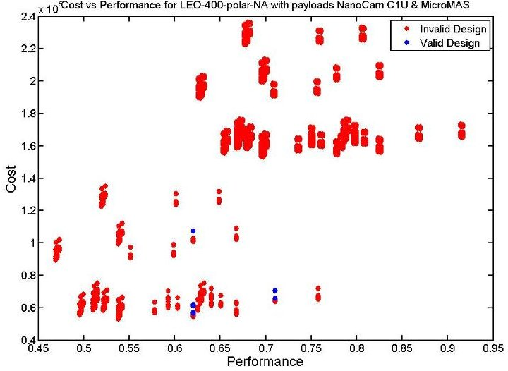

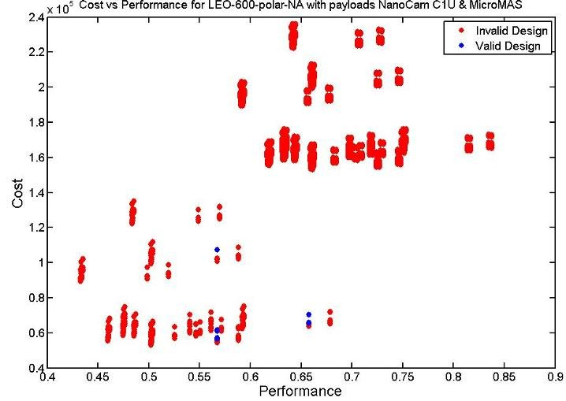

(e) LEO-400-polar-NA orbit with NanoCam C1U and MicroMAS payloads (f) LEO-600-polar-NA orbit with NanoCam C1U and MicroMAS payloads

Figure 3. Cost vs. Performance Plots for different payloads and orbits

<!-- PDF_PAGE: 8 -->

<table border="1"><tr><td>Payload</td><td>UI-1641LE and MicroMAS</td><td>UI-1641LE and MicroMAS</td></tr><tr><td>Cost</td><td>$43361.48</td><td>$52212.47</td></tr><tr><td>Performance Score</td><td>0.58</td><td>0.67</td></tr><tr><td>Attitude Control</td><td>CubeTorquer</td><td>XACT</td></tr><tr><td>Solar Panel Type</td><td>Deployable Triple Junction</td><td>Fixed Triple Junction</td></tr><tr><td>Onboard Computer</td><td>ISIS On-Board Computer</td><td>ISIS On-Board Computer</td></tr><tr><td>Structure Size</td><td>3U</td><td>3U</td></tr><tr><td>Propulsion System</td><td>none</td><td>none</td></tr><tr><td>Antenna</td><td>ANT430</td><td>ANT430</td></tr><tr><td>Transceiver</td><td>CS-VUTRX</td><td>CS-VUTRX</td></tr><tr><td>Battery Type</td><td>Li-Ion</td><td>Ni-Cd</td></tr></table>

Table 5. SSO-600-SSO-AM Output Designs on the Pareto Front with UI-1641LE and MicroMAS payload

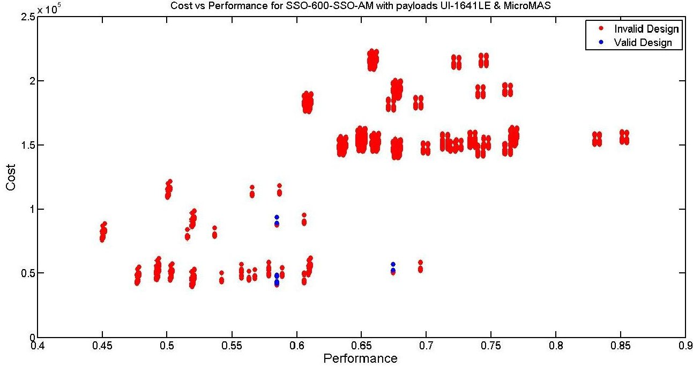

Figure 4. Cost vs. Performance Plot for UI-1641LE and MicroMAS payload on SSO-600-SSO-AM orbit

<table border="1"><tr><td>Payload</td><td>UI-1641LE</td><td>UI-1641LE</td><td>UI-1641LE</td></tr><tr><td>Cost</td><td>$25889.45</td><td>$37460.18</td><td>$137520.67</td></tr><tr><td>Performance Score</td><td>0.58</td><td>0.67</td><td>0.83</td></tr><tr><td>Attitude Control</td><td>CubeTorquer</td><td>XACT</td><td>XACT</td></tr><tr><td>Solar Panel Type</td><td>Fixed Triple Junction</td><td>Fixed Si</td><td>Fixed Triple Junction</td></tr><tr><td>Onboard Computer</td><td>ISIS On-Board Computer</td><td>ISIS On-Board Computer</td><td>ISIS On-Board Computer</td></tr><tr><td>Structure Size</td><td>1U</td><td>3U</td><td>3U</td></tr><tr><td>Propulsion System</td><td>none</td><td>none</td><td>mu-pulse Plasma Thruster</td></tr><tr><td>Antenna</td><td>ANT430</td><td>ANT430</td><td>ANT430</td></tr><tr><td>Transceiver</td><td>CS-VUTRX</td><td>CS-VUTRX</td><td>CS-VUTRX</td></tr><tr><td>Battery Type</td><td>Ni-Cd</td><td>Li-Ion</td><td>Li-Ion</td></tr></table>

Table 6. LEO-600-Equatorial-NA Output Designs on the Pareto Front with UI-1641LE payload

<!-- PDF_PAGE: 9 -->

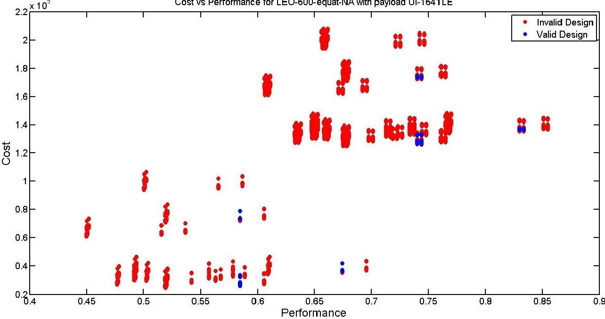

Figure 5. Cost vs. Performance Plot for UI-1641LE on LEO-600-equatorial-NA orbit

on what is available in the marketplace.

The catalog design tool in its current form has several key limitations, however. Designs can only be analyzed using the components in the database, so any existing components not in the database are not included in any designs. Furthermore, components without enough readily available information must either be excluded from the design survey or have parameters estimated. Additionally, there are currently a number of assumptions built into the model, such as the size of the ground station antenna. In future versions of this tool, this and other assumed values can be input parameters. The current tool is also limited to use on the set of orbits for which information is available in the mission analysis database. The tool can be greatly improved by expanding this database to include more orbits.

With the future expansion of the components contained in the database, an increasingly large number of possible design configurations will exist. In the current iteration of this tool, all possible design configurations are generated and evaluated. As the database grows, this will become infeasible and it will be necessary to implement a more advanced heuristic to explore the tradespace. Backward chaining will be implemented through JESS in the next version of this tool, for the backward mode. Furthermore, integration with our multi-agent architecture tradespace exploration framework is still in progress.

## REFERENCES

[1] J. Puig-Suari et. al. "CubeSat: The Development and Launch Support Infrastructure for Eighteent Different Satellite Customers on One Launch", AIAA Small Satellite Conference. 2001.

[2] D. Selva and D. Krejci, "A survey and assessment of the capabilities of Cubesats for Earth observation" in Acta Astronautica, vol. 74. May-June 2012, pp. 50-68

[3] Lan et. al. "CubeSat Development in Education and into Industry" in Proceedings of the AIAA Space Conference and Exposition, 19-21 Sept 2006.

[4] D. DePasquale, J. Bradford. "Nano/Microsatellite Market Assessment", SpaceWorks Enterprises Inc. February 2013.

[5] Apgar et al. "Cost Modeling" in Space Mission Analysis and Design, Microcosm Press. 1999.

[6] A. F. Mehr et. al. "An Information-Exchange Tool for Capturing and Communicating Decisions During Early-Phase Design and Concept Evaluation" in ASME 2005 International Mechanical Engineering Congress and Exposition. Nov. 2005.

[7] Y. Chang et. al. "SEDT (System Engineering Design Tool) development and its application to small satellite conceptual design" in Acta Astronautica, vol. 61, Issues 7-8, Oct 2007, pp. 676-690

[8] A. McInnes et. al. "A Systems Engineering Tool for Small Satellite Design" in 15th Annual AIAA/USU Conference on Small Satellites, 2001.

[9] R. Badsi et. al. "Operations of a Self-Reconfigurable CubeSat" in Proceedings of the AIAA Space Conference and Exposition

[10] D. Torgerson et. al. "An open-source scheduler for small satellites" in Unmanned Systems Technology. Baltimore: Apr 2013.

[11] Jorge Canizales Diaz, "Automatic Design of the Gravity-Reducing Propulsion System of the TALARIS Hopper Testbed", MS Thesis, Massachusetts Institute of Technology, 2012.

[12] Selva, D. (2012). Rule-based system architecting of Earth observation satellite systems (PhD dissertation, Massachusetts Institute of Technology). ProQuest/UMI, Ann Arbor.

[13] Friedman-Hill, E. J. "Jess, The Java Expert System Shell". Livermore, CA. 2000.

[14] Blackwell, W. J. et al. "Nanosatellites for earth environmental monitoring: The MicroMAS project." In 2012 12th Specialist Meeting on Microwave Radiometry and Remote Sensing of the Environment (MicroRad) (pp. 14). IEEE. 2012.

<!-- PDF_PAGE: 10 -->

## BIOGRAPHY

Monica Jacobs is currently a Masters of Engineering student at Cornell University in the Department of Systems Engineering. In 2014, she obtained a Bachelors of Science in Mechanical Engineering from Cornell University. Her research interests focus on mechatronic systems.

Dr. Daniel Selva received a PhD in Space Systems from MIT in 2012, and he is Assistant Professor at the Sibley School of Mechanical and Aerospace Engineering at Cornell University, where he directs the Systems Engineering, Architecture, and Knowledge (SEAK) Lab. His research interests focus on the application of knowledge engineering, global optimization and machine learning techniques to space systems engineering and architecture, with a strong focus on space systems. Prior to MIT, Daniel worked for four years in Kourou (French Guiana) as a member of the Ariane 5 Launch team. Daniel has a dual background in electrical engineering and aeronautical engineering, with degrees from Universitat Politecnica de Catalunya in Barcelona, Spain, and Supaero in Toulouse, France. He is also a Faculty Fellow at the Mario Einaudi Center for International Studies.