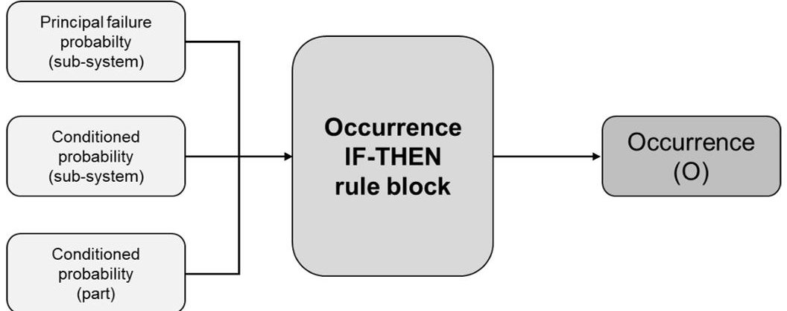
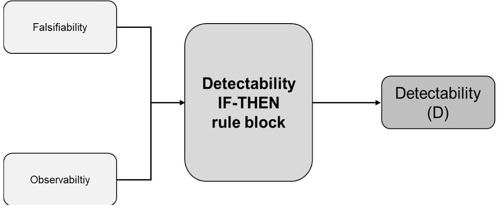
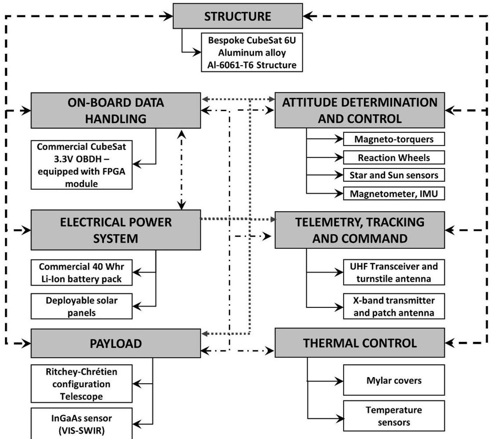
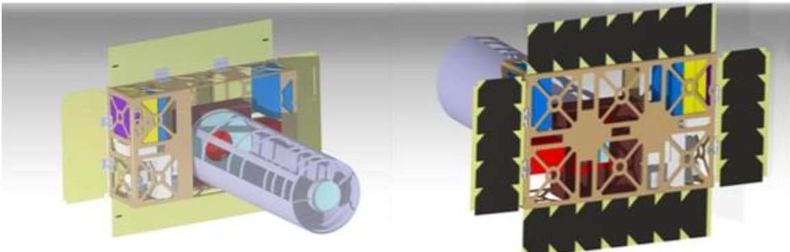
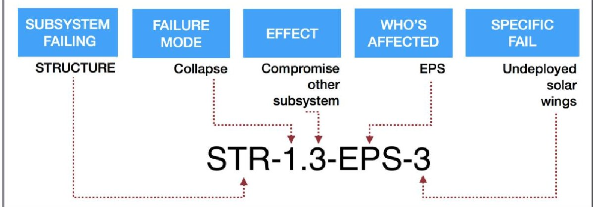
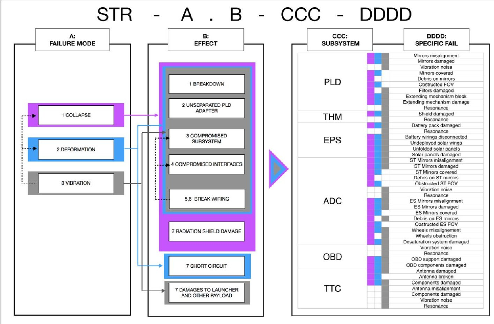
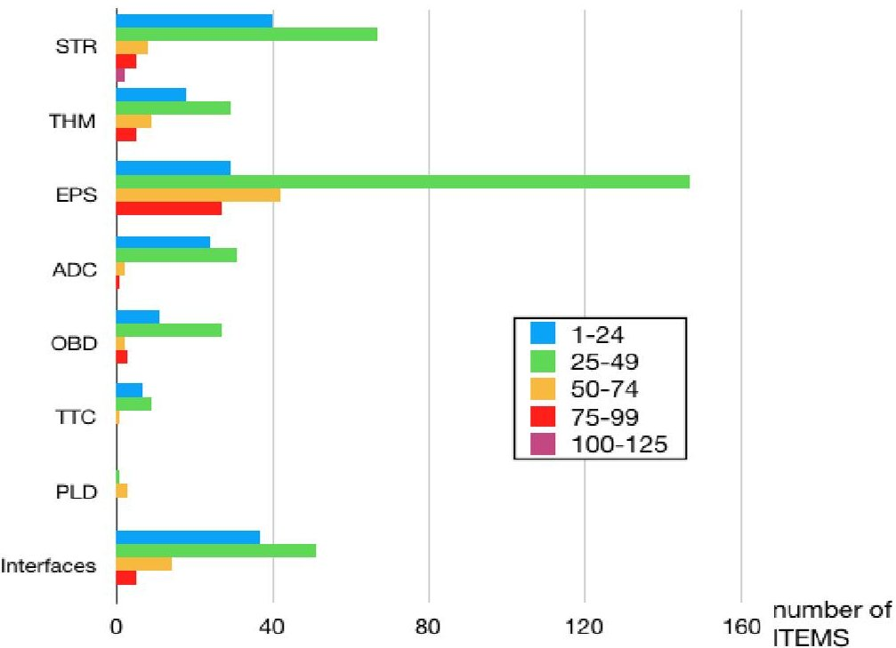

<!-- PDF_PAGE: 1 -->

Article

# A Reliability Engineering Approach for Managing Risks in CubeSats

Alessandro Menchinelli, Francesca Ingiosi, Ludovico Pamphili, Paolo Marzioli, Riccardo Patriarca $ ^{*} $ , Francesco Costantino and Fabrizio Piergentili

Department of Mechanical and Aerospace Engineering, Sapienza University of Rome, Via Eudossiana, 18-00184 Rome, Italy; alessandro.menchinelli.space@gmail.com (A.M.); francescaingiosi@gmail.com (F.I.); ludovico.pamphili@gmail.com (L.P.); paolo.marzioli@uniroma1.it (P.M.); francesco.costantino@uniroma1.it (F.C.); fabrizio.piergentili@uniroma1.it (F.P.)

* Correspondence: riccardo.patriarca@uniroma1.it; Tel.: +39-0644585252

Received: 13 September 2018; Accepted: 13 November 2018; Published: 15 November 2018

Abstract: Besides large-scale space missions, the spread of CubeSats for a variety of applications is increasingly requiring the development of systematic approaches for risk management. Being these applications are based on components with low TRL (Technology Readiness Level) or with limited performance data, it is required to define approaches which ensure a systematic perspective. This paper aims to present a reliability engineering approach based on FMECA (Failure Mode, Effects, and Criticality Analysis) to manage CubeSat reliability data and prioritize criticalities early in the design phase. The approach firstly proposes an alpha-numeric coding system to support the identification and labeling of failure modes for typical CubeSats' items. Subsequently, each FMECA coefficient (i.e., Severity, Occurrence, Detectability) has been linked to the CubeSat's structural properties, reducing subjectivity by means of techno-centric proxy indicators. The approach has been validated in the design phases of a 6-Units university CubeSat for the observation of M-Dwarf stars and binary systems. The performed analysis supported the design process and allowed to identify the major criticalities of the CubeSat design, as demonstrated in the extended case study included in the paper. The formalized method could be applied to design procedures for nano-satellites, as well as being expanded for research and development in a variety of space missions.

Keywords: FMECA; satellite reliability; reliability engineering; cubesat; space operations; space mission analysis; space reliability

## 1. Introduction

Recent developments in microelectronics and additive manufacturing have enabled miniaturization of systems and the implementation of distributed architecture, thus leading to the development of constellation and mega-constellation of mini and nanosatellites [1]. These new concepts imply the utilization of a standard, low cost satellite bus and the reduced reliability and decreased lifetime become acceptable considering that the huge number of orbiting satellites can overcome problems due to single satellite failure. This new paradigm in conceiving space missions sees a growing role for the reliability analysis in spacecraft design. Besides traditional design sciences, risk management and reliability engineering are becoming increasingly more relevant in the space domain. As for aviation, the future of space safety presents even a greater challenge about providing models and methods for supporting decision-making, to free decisions from hidden goals, biases, and subjective emotions [2].

This paper discusses the development and the application of a technique for the analyses of failure modes in a nano-satellite environment. More specifically, the paper provides an approach based

<!-- PDF_PAGE: 2 -->

on the well-established Failure Modes, Effects and Criticality Analysis (FMECA), for determining a three-dimensional risk indicator. The paper presents a structured coding system for labeling failure modes and associating them with the CubeSat's items. An extended case study is presented to clarify the application of the proposed method, showing the benefits and lessons learnt, and specifying how the method affects the design phases in real case scenarios.

The remainder of the paper is organized as follows. Section 2 provides an overview of the development and application of FMECA in space operations, detailing the current state of research and industrial practice, with particular reference to CubeSat architectures. Section 3 details the proposed method, clarifying the definition of specific FMECA coefficients valuable for the case under analysis. Section 4 presents an extended case study related to the application of the proposed risk management process for the purpose of managing risks of a university CubeSat. Finally, the conclusions summarize the contributions of the paper, providing potential paths for future research.

## 2. Literature Review

The diagnosis of faults is of paramount importance for determining the success of a mission. In the CubeSat domain, formal analyses become necessary, especially because CubeSat design approaches have been mostly ad hoc, with severe implications for their reliability [3].

In the reliability engineering context, the FMEA (Failure Mode and Effects Analysis), which dates back to 1950s military applications, nowadays represents a well-established method for reliability and risk analysis in a number of domains [4]. The FMEA is a method for supporting RAMS (Reliability, Availability, Maintainability, Safety) engineers at understanding the desired functional product performance through systematic and documented analyses [5]. As such, the FMEA often represents the first approach to system reliability studies, since it supports the identification of potential failure modes and the need for risk mitigation strategies. The FMEA is often extended in a FMECA, which can be considered as the combination of the traditional FMEA and a criticality analysis (CA). A CA is used normally to chart the probability of failure modes against the severity of their consequences. Therefore, the FMECA allows identifying the modes of failure within a system design, by proposing approaches to prioritize the most critical ones at earlier design stages. This approach allows to eliminate or minimize the main criticalities through simple design changes. As such, the FMECA can give an important contribution to systems well-functioning, at least if the analysis is not approached as simply a box checking exercise [6]. The general principle of the FMECA consists of analyzing the behavior of the system parts, concurrently with components failure, mainly aiming at verifying the design. In space engineering, this general principle has been pursued in the Apollo program in the mid-1960s [7] and, later on, in a wide number of satellite applications (see, e.g., [8-17], detailed in the following paragraphs).

Such space-oriented interest has been also confirmed by a NASA (National Aeronautics and Space Administration) bibliography that reviewed the published contributions about FMEA and FMECA, categorizing them in 10 major subjects (aeronautics, astronautics, chemistry and materials, engineering, geosciences, life sciences, mathematical and computer sciences, physics, social and information sciences, space sciences, and general) and 76 sub-categories, based on the NASA Scope and Subject Category Guide [8].

Traditionally, the available literature on FMECA reveals a hardware-oriented perspective. See (e.g.,) the risk analysis performed for lithium-ion battery design of a hybrid satellite in geostationary orbit developed in Korea based on the EUROSTAR 3000 platform [9], the analysis of key components of circular truss antenna, mainly detailing the criticality related to the hinge mechanism [10], or the reliability study of the power distribution module UYGAR [11]. The FMECA can be interfaced advantageously with other reliability and quality analyses by adopting a Total Quality Management (TQM) perspective, as acknowledged by the Department of Defense [12]. In this context, the FMECA has been used as a preliminary method for developing a qualitative Fault Tree Analysis (FTA) of a solar array deployment mechanism, in order to identify the most critical items for the mission [13]. It has

<!-- PDF_PAGE: 3 -->

also been recognized as an effective approach to generate both design and manufacturing requirements, in terms of failure mechanism caused by contaminants like particulates (dirt, sand, industrial fumes, hair, dead human cells, fibers from clothes, etc.) [14].

Acknowledging the impossibility to eliminate each single point of failure in a satellite Electrical Power Subsystem (EPS), the FMECA has been used to compare different EPS schemes suitable for power supply, i.e., the Peak Power Tracking (PPT) and the Direct Energy Transfer (DET), revealing that the DET fully regulated bus are generally preferable in terms of reliability [15]. Similarly, the FMECA has been used in the design phase for exploring different failure conditions and a fault tolerant design of an active spherical phased array antenna for the transmission of satellite imagery data at high bit rates, by providing operational insights for its realization [16]. In the same phase, the FMECA has been used as a preliminary tool for exploring and comparing the reliability of different satellite architectures, i.e., CubeSat, classical satellite, and k-out of-n CubeSat swarm-like constellations [17]. Still in the CubeSat domain, a FMECA in combination with an FTA has been developed for the analysis of SwampSat, the first satellite developed at the University of Florida, to validate in flight a compact three-axis attitude control system using miniature control moment gyroscopes [18].

More formally, at the Goddard Space Flight Centre, the FMECA has been used for correlating mission parameters to risk management consequence definitions, by providing tools for their assessment and communication to decision-makers [19]. Furthermore, a FMECA-based approach prioritized items based on their criticality number, calculated by multiplying the scores assigned to severity and occurrence likelihood, under the assumption of exponentially distributed reliability [20], even with a specific interest in a typical satellite payload [21].

The prioritization of items becomes fundamental for satellite missions, even in terms of satellite management after the launch. More formally, an orbiting satellite is expected to communicate with its control center via the telemetry flow to ground, and to receive telecommands from ground. Telemetry supports the monitoring of the satellite itself and thus the identification of potential anomalies. In particular, once an anomaly has been detected through monitoring services of housekeeping data, it becomes crucial to quickly locate the origin of the anomaly, and to identify the most suitable actions for ensuring a safe continuation of the mission, under nominal conditions [22]. In this context, the Galileo project provides an example of how the FMEA can be used to develop the theoretical foundation for an automatic fault management and self-healing process, i.e., the FDIR (Fault Detection Isolation and Recovery). Similarly, an FMECA-based automatic design concept has been used for supporting the adjustment of in-formation flight, (e.g.,) to allow interferometric-based repositioning, and to reduce operational costs by limiting the radio communication link usage [23]. Therefore, an important feature of the FMECA, when performed during the design phase of a satellite, relates to the satellite capability of isolating the fault modes while the satellite is in operation [24]. This feature, often referred to as detectability, has been widely discussed in traditional industrial domains, (e.g., [25-27]), with limited systematic aspects in space domain [19].

Based on these observations, and by considering the heritage of the FMECA both in space operations and in other industrial domains, this paper proposes a semi-quantitative approach for developing a space-based FMECA to be used in the preliminary design of a CubeSat. Besides the two widely used indicators for assessing satellite's risks, i.e., severity and occurrence likelihood, the proposed approach presents hereby a third indicator, i.e., detectability. The latter aims to address the difficulty for isolating failure modes in the design phase. Furthermore, the occurrence indicator has been extended, by explicitly considering the causal chain of events. The proposed three-dimensional risk indicator supports the identification of critical failure modes, thus easing design decisions about redundancy or components' comparison. Considering its simple formulation, the method is aligned with the needs of a relatively low-cost CubeSat project, as a means to improve the obtained design in a reliability-oriented perspective.

<!-- PDF_PAGE: 4 -->

## 3. Materials and Methods

The first step of an FMECA consists in structuring the problem, which means to build a model for representing the system at hand. Traditionally, these models rely on a number of assumptions, including the calculation of parameters whose numerical values are assumed to be known. Dealing with the FMECA, the evaluation of a quantitative analysis requires basic failure rate data. However, in case of a university CubeSat, it appears difficult to obtain these estimations, due to the very limited, even null, knowledge of the flight configuration items reliability parameters. Therefore, when the components features are not commercially available on a detailed technical datasheet, the estimation has to rely on similar items, or on experts' judgments. The proposed method integrates the traditional FMECA formulation [28] and available standards (GPR 7120.4A; MIL-STD-1629), by suggesting a 5-steps procedure, detailed in the following paragraphs (Sections 3.1-3.5).

As a preliminary step, it is necessary to determine the functional level breakdown structure for the analysis. In particular, this preliminary phase is necessary to locate the reliability study in a specific design phase.

Based on the benefits of performing an FMECA early in the design phase, this paper shows the application of a so-called functional FMECA [29]: an FMECA performed and documented for proposals and trade studies, aimed at evaluating and providing support for the design architecture, in line with a Preliminary Design Review (PDR, [30]).

Starting from the outcomes of the functional FMECA, the method is identically applicable as an interface FMECA [29], in order to extend the analysis at the piece-part level, as the detailed design unfolds during further stages of the PDR and, possibly, even during the Critical Design Review (CDR) timeframe. Since design solutions are based upon flight heritage, detailed design data during the PDR timeframe shall be made available to complete the FMECA analysis for evaluating the most suitable design candidates during trade studies. Note that the proposed approach has to be conceived as an iterative process, in order to allow a back and forth analysis (from part to system levels, and vice versa) which also ensures that the detailed design still maintains the intended system architecture, in line with both design and reliability requirements.

## 3.1. Step 1. Construct the Functional Block Diagrams

The first step of the proposed approach consists of building diagrams and documents, which illustrate interrelationships and interdependencies of functional entities and support an effective mission design [31]. This step is necessary to understand system's architecture, providing answers to questions such as: which equipment provides what function; when the equipment fails what function is affected; how the system can be controlled before and after a failure; how backups and redundancies have to be managed to guarantee usability and accessibility in case of failure; etc.

## 3.2. Step 2. Identify the Failure Modes

For each considered item—and its interfaces—it is necessary to identify the potential failure modes that can affect system performance, also considering their effects on systems. This step relies on the capability of the analysts to explore potential combinations of failure modes. Naturally, this capability does not reside in a single individual, thus implying the need to involve both fresh-eyes and experienced researchers in order to gather meaningful insights from collective collaborative knowledge and experiences. This step needs both teamwork and timely information exchange in order to ensure that the knowledge about the system is embedded in the reliability analyses. In case of systems made up of many different parts, it is necessary to develop a consistent coding system that uniquely identifies parts and related failures, in order to increase the comprehensibility of the analyses.

In this context, considering the current lack in literature of a standard labeling system, this paper presents a coding system specifically developed to deal with the need of a CubeSat environment. The system has been developed to ease the exchange of information between different researchers

<!-- PDF_PAGE: 5 -->

and provide a formal and unequivocal representation of the knowledge relevant for the analysis. The coding system is developed through a 5-parts alphanumeric code, which synthetically relates the failure modes to system components, as follows:

$$
\mathrm {X X - A . B - C C C} \# \mathrm {D D D D}
$$

where:

XXX—represents the sub-system being analyzed (coded in a three-letters acronym)

A—represents the failure mode of the sub-system (coded in a numeric scale)

B—represents the effect on the system (coded in a numeric scale)

CCC—represents the propagation of the failure mode in the system (coded in a three-letters acronym)

#—“-” if CCC affects a subsystem, " | " if CCC affects a mechanical interface, " / " if CCC affects an electrical/data interface:

DDDD—represents the specific fail, with respect to the part level (coded in an alphanumeric acronym).

## 3.3. Step 3. Perform the Criticality Analysis

This step allows for a structured systematic analysis of failure modes, based on three semi-quantitative indexes. In this sense, the proposed approach starts from ESA (European Space Agency) guideline (ECSS-Q-ST-30-02C), which takes into account severity, ranging from 1 (negligible damage) to 4 (catastrophic damage), and occurrence, ranging from 1 (probable, probability greater than 1E-1) to 4 (extremely remote, probability minor than 1E-5). These two terms are multiplied to obtain the Criticality Number (CN), which is used to filter the failures modes: the critical failure modes are the ones that are catastrophic (severity score equals to 4), and the ones whose CN is greater or equal to 6. On the contrary, the US standards for FMECA (SAE ARP5580) at a component level calculates an RPN (Risk Priority Number) defined as the product of severity (in a 1-10 range), occurrence (in a 1-10 range) and likelihood of mitigation—if the design can be revised, or detectability—if the design cannot be revised (both in a 1-10 range). Note that similar concepts are present in ESA guidelines for FMECA at process level. Therefore, the approach used in this study, extends ESA guidelines for functional FMECA, following the influence of the US satellite standard for FMECA—also documented in a recent FMECA space-based application [19]—in order to produce a three-dimensional risk index. This latter will include three indicators, each one rated in a 1-5 scale. The odd number of slots allows assigning intermediate values to variables, in order to support the analysts in avoiding overestimation or underestimation of factors, as emerged from initial categorizations performed in a real case scenario. The indexes are occurrence, severity, and detectability.

## 3.3.1. Defining the Occurrence Index

Starting from the outcomes of Step 2, each identified failure mode has to be analyzed in terms of its possibility to happen, following the scale presented in Table 1, which adapts ESA guidelines (ECSS-Q-ST-30-02C) in the range 1-5.

Table 1. Occurrence index.

<table border="1"><tr><td>Score</td><td>OCCURRENCE: Potential Failure Rate</td></tr><tr><td>1</td><td>Extremely remote(P≤1E-7)</td></tr><tr><td>2</td><td>Remote(1E-7<P≤1E-5)</td></tr><tr><td>3</td><td>Occasional(1E-5<P≤1E-3)</td></tr><tr><td>4</td><td>Probable(1E-3<P≤1E-1)</td></tr><tr><td>5</td><td>Extremely probable(P&gt;1E-1)</td></tr></table>

Even if for CubeSats it is nowadays possible to retrieve some publicly available data about mission status, type, orbit status, builder type, spacecraft class, and specific failure rate data remain

<!-- PDF_PAGE: 6 -->

generally unavailable for university CubeSat components [32,33]. With the purpose of increasing a systematic assessment of the occurrence index, failure mode probabilities of occurrence can be grouped in qualitative levels, based on engineering judgments or other reliability analysis performed for similar missions (see Table 2).

Table 2. Failure probability coefficients.

<table border="1"><tr><td>Score</td><td>FAILURE PROBABILITY: Likelihood of a System Failure Mode</td></tr><tr><td>1</td><td>The likelihood of the failure mode is estimated as extremely low,or it has never been experienced in similar missions.</td></tr><tr><td>2</td><td>The likelihood of the failure mode is estimated as low,or it has been experienced once in similar missions.</td></tr><tr><td>3</td><td>The likelihood of the failure mode is estimated as moderate,or the failure mode has been experienced twice in similar missions.</td></tr><tr><td>4</td><td>The likelihood of the failure mode is estimated as high,or the failure mode has been experienced several times in similar missions.</td></tr><tr><td>5</td><td>The likelihood of the failure mode is estimated as extremely high,or the failure mode has been experienced in almost every similar mission.</td></tr></table>

Since these data usually refer to generic failure modes, following the functional breakdown of the system (developed in Step 2), the probability of failure mode at system level has been further explored, considering the failure propagation, i.e., the occurrence of mode of failures in other sub-systems, hypothesizing the principal failure mode already verified. This top-down perspective is implemented through the adoption of a variable represented by the conditioned probability coefficient, in order to integrate data of a generic failure mode, both at sub-system level (occurrence of a sub-system failure mode) and part level (occurrence of a specific fail at a part level). Table 3 presents the conditioned probability coefficients (in the range 1-5).

At this step, specific inference rules have to be adopted for combining the three coefficients (system failure mode, sub-system failure mode, part failure mode), using specific IF-THEN criterion, created by the support of a fuzzy-based expert system [34].

Table 3. Conditioned probability coefficients (both at subsystem and part level).

<table border="1"><tr><td>Score</td><td>CONDITIONED PROBABILITY:Relative Frequency or Likelihood of Occurrence of a Failure Mode at Sub-System or Part Level</td></tr><tr><td>1</td><td>There is no direct connection between Failure Mode and Effect (or between effect and Specific Fail)</td></tr><tr><td>2</td><td>There are direct and non-direct connections between Failure Mode and Effect (or between Effect and Specific Fail),but they are not probable.</td></tr><tr><td>3</td><td>The Effect is one of the probable consequences of the Failure Mode under exam,even as secondary effect (the same correlation is implied for Effect and Specific Fail).</td></tr><tr><td>4</td><td>The Effect is the most probable consequence of Failure Mode under exam (the same correlation is implied for Effect and Specific Fail).</td></tr><tr><td>5</td><td>The Effect is a direct (proven) consequence of the Failure Mode under exam (the same correlation is implied for Effect and Specific Fail).</td></tr></table>

In particular, the inference rule block adopted in the analysis follows the principle of Fuzzy Associative Map inference (FAM) able to guarantee different degrees of support for the relative importance of probabilities in the rule development. The rule-block aggregation overcomes the limitations of a simple mathematical product, supporting an in-depth analysis of failure propagation, still following a systematic perspective. The obtained index, i.e., Occurrence (O), represents one of the three coefficients of the FMECA (see Figure 1), and follows the qualitative scale already presented in

<!-- PDF_PAGE: 7 -->

Table 1. Therefore, the qualitative parameters in Table 1 remain always valid, and Table 1 even allows associating specific failure rate (if any) with the same scores.

Figure 1. Logical scheme if inference rules for the FMECA index Occurrence (O).

## 3.3.2. Defining the Severity Index

A Severity (S) index has to be assigned to each specific fail (failure mode at part level) to identify its impact on the mission. The severity ranges in a scale of 1 to 5, where 1 represents a failure mode with minimum effects on the mission, and 5 is a catastrophic failure mode in terms of mission operations (see Table 4).

Table 4. Severity index.

<table border="1"><tr><td>Score</td><td>SEVERITY: Impact on the System of the Potential Failure Cause</td></tr><tr><td>1</td><td>No vital subsystem is affected by any failure.</td></tr><tr><td>2</td><td>One (or more) component(s) are affected by any failure, but the system can overcome the failure through redundancies or other subsystems.</td></tr><tr><td>3</td><td>One subsystem is completely inefficient, but mission is still active by means of other subsystems, eventually cutting off operations not vital for mission purposes.</td></tr><tr><td>4</td><td>One (or more) subsystem(s) are affected and mission is partially compromised in terms of efficiency, limited operations or lifetime.</td></tr><tr><td>5</td><td>Mission is totally compromised.</td></tr></table>

## 3.3.3. Defining the Detectability Index

Detectability (D) represents the capability of identifying a failure mode. In a CubeSat, this capability acquires a crucial role to manage the possibility of detecting and then recovering from failure modes. The index ranges in a scale from 1 (easy detection of the failure mode) to 5 (impossibility to detect the failure mode), as shown in Table 5.

Table 5. Detectability index.

<table border="1"><tr><td>Score</td><td>DETECTABILITY: Capability to Understand the Subsystem/Component/Unit/Operation Affected by the Failure</td></tr><tr><td>1</td><td>Just one source of failure in one subsystem might produce this effect; the cause of the failure is detectable.</td></tr><tr><td>2</td><td>Subsystems affected by failure are less than 2 different, independent ones</td></tr><tr><td>3</td><td>Subsystems affected by failure are less than 3 different, independent ones</td></tr><tr><td>4</td><td>Sources of the failure or subsystem affected might be more than 3 different, independent ones</td></tr><tr><td>5</td><td>No chances to understand either the source of the failure and the subsystem affected as well</td></tr></table>

<!-- PDF_PAGE: 8 -->

Rather than relying on qualitative judgments, detectability has to be calculated combining two different indexes, i.e., the falsifiability and the observability. This choice confirms the purpose of generating systematic assessments for the indexes included in the FMECA calculations.

The falsifiability refers to the possibility of testing or observing how one or more sub-systems may lead to the same effect. More specifically, falsifiability aims to identify how many components may fail in different ways or for different causes, but anyway, producing the same observable effects. The falsifiability also includes an assessment of how many components, operations or units may generate useful information to discriminate failures, and then identify them properly (see Table 6).

Table 6. Falsifiability coefficients.

<table border="1"><tr><td>Score</td><td>FALSIFIABILITY: Independent Subsystem/Interface/Unit/Component That is Affected by Any Failure Producing a Specific Observable Effect</td></tr><tr><td>1</td><td>One subsystem only, affected by any failure, shows a specific observable effect.</td></tr><tr><td>2</td><td>Two independent subsystems/components/interfaces affected by any failure might show the same effect, data from the subsystem itself (by analyzing its activity or changing its mode of use) or others (more than two) are useful to distinguish the event.</td></tr><tr><td>3</td><td>More than two independent subsystems/components/interfaces affect by a failure might show the same effects on the entire system, data from the subsystem itself (by analyzing its activity or changing its mode of use) or others (more than one) are useful to distinguish the event.</td></tr><tr><td>4</td><td>Two or more independent subsystems/components/interfaces affect by a failure show the same effects on the entire system; data from other subsystems may be useful to distinguish the event.</td></tr><tr><td>5</td><td>More than 2 independent subsystems/components/interfaces might affect by a failure might show the same effects on the entire system.</td></tr></table>

In addition, another variable, i.e., observability, has to be considered to take into account the number of independent ways to observe the failure mode through specific data. The assessment of the observability follows the scale presented in Table 7.

Table 7. Observability coefficients.

<table border="1"><tr><td>Score</td><td>OBSERVABILITY: Independent Ways of Getting Data About the Failure or the Activity/Operation/Functionality of the Subsystem that Fails</td></tr><tr><td>5</td><td>The only source of data about the failure is the subsystem failing.</td></tr><tr><td>4</td><td>There is at least another source of data about the failing under exam, apart from the subsystem failing.</td></tr><tr><td>3</td><td>There are at least two independent sources of data about the failure under exam, apart from the subsystem failing.</td></tr><tr><td>2</td><td>There are at least three independent sources of data about the failure under exam, apart from the subsystem failing.</td></tr><tr><td>1</td><td>There are more than three independent sources of data about the failure under exam apart from the subsystem failing.</td></tr></table>

At this step, as for the occurrence index, specific IF-THEN FAM inference rules have to be adopted to integrate the two coefficients (falsifiability and observability) and gather a systematic assessment of the detectability index (see Figure 2).

<!-- PDF_PAGE: 9 -->

Figure 2. Logical scheme of inference rules for the Failure Mode, Effects, and Criticality Analysis (FMECA) index Detectability (D).

## 3.4. Step 4. Rank the Failure Modes

Following the assessment conducted in Step 3, it is now possible to calculate an aggregated index, which takes into account occurrence, severity and detectability. This index, i.e., RPN (Risk Priority Number) aims at prioritizing the need for updated design requirements necessary to reduce risks and increase system's reliability. Depending on the values, the failure modes can be thus interpreted as negligible (low RPN), to be investigated (moderate RPN), or to be necessary managed (high RPN). The RPN is calculated as the product of the indexes and the relative thresholds are defined in Table 8.

Table 8. RPN index.

<table border="1"><tr><td>Score</td><td>RPN: Impact of the Failure on the System</td></tr><tr><td>1-24</td><td>Failure has potentially no impact on the mission.</td></tr><tr><td>25-49</td><td>Failure may have not relevant impact on the mission; minor effects are the most likely consequences.</td></tr><tr><td>50-74</td><td>Failure will produce effects on the mission, which may be subjected to limitations.</td></tr><tr><td>75-99</td><td>Failure will produce major effects on the system, that probably will not be able to perform correctly, or it will drastically reduce the expected operativeness of the system.</td></tr><tr><td>100-125</td><td>Failure is catastrophic for the mission.</td></tr></table>

$$
\mathrm {R P N} = \mathrm {O} ^ {*} \mathrm {S} ^ {*} \mathrm {D}.
$$

## 3.5. Step 5. Identify Mitigation Strategies

The risk classification conducted at Step 4 defines the risk acceptance levels for the missions and has to be intended as a guideline to identify requirements and initiate discussions for design revisions. Alternatively, it is necessary to provide document analysis for those failures that cannot be corrected at the current stage of the satellite development. Note that the FMECA has to be continuously revised, following the choices made during the design phase, using it as a dynamic decision support tool.

## 4. Results

## 4.1. Step 1: SPEC CubeSat Design and Functional Block Diagram

In order to provide a practical application of the proposed analysis method, the SPEC (Stellar Population Evolution on CubeSats) is presented as a case study. The spacecraft was designed during the 2017 Spacecraft Design course at Sapienza University of Rome, given to the second-year students in the Space and Astronautical Engineering MSc. While the main objective of the course is to follow the preliminary design (Phase 0-Phase A [30]) of a CubeSat, the mission aim was presented to the students as input. The SPEC mission is aimed at observing M-Dwarf stars properties, by acquiring and processing the observational data according to the Daemgen method [35]. The designed 6-Units

<!-- PDF_PAGE: 10 -->

(6U, approximately $ 2 0 \times1 0 \times3 0 $ cm, [36]) CubeSat is equipped with a reflecting telescope in Ritchey Chrétien configuration. Part of the designed provisions on the bus components are heritage of former and current CubeSat development and operations projects managed by Sapienza University of Rome [37-39]), whose involvement into the spacecraft development field of research usually brings to the launch of a new CubeSat every few years [33]. The CubeSat has been designed according to a set of preliminary mission requirements, generated by the observables binary systems magnitude, distance and latitude (with respect to the galactic plane). During the design phase, a risk analysis has been performed in order to prioritize the areas of concerns of the system at hand. The analysis results supported the selection of the final layout of the system in terms of choices, strategies, writing or changing of the requirements, developments of figures of merits and mitigation strategies. Following Step 1 of the proposed approach (cf. Section 3.1), the SPEC sub-systems block diagram is presented in Figure 3. The on-board software will be organized as a state machine, with different operative modes to manage the spacecraft tasks and operations. The SPEC Launch and Early Operations will be managed by specific "Commissioning" tasks, such as the deployment of several components or the satellite de-tumbling.

Figure 3. CubeSat sub-systems block diagram (dotted lines represent power lines, dashed-dotted lines represent data lines, bold dashed lines represent mechanical interfaces). UHF: Ultra-High Frequency; IMU: Inertial Measurement Unit.

The main payload operations consider a precise telescope pointing towards the observable binary system, managed by the Attitude Determination and Control Subsystem (ADCS), the Indium-Gallium-Arsenide (InGaAs) sensors data acquisition, facilitated by the native connectivity with the Low Voltage Differential Signaling ports of the On-Board Computer Field Programmable Gate Array, and gathered data down link through the uni-directional X-band communication link. Indeed, the communication system will consist of an X-band uni-directional link, to be used for the

<!-- PDF_PAGE: 11 -->

telescope images down-link, and of a UHF (Ultra-High Frequency) bi-directional link for telemetry and tele-commands. The spacecraft will transmit the images to an available ground station in Malindi (Kenya), through a patch antenna, while the UHF communications will be managed through a deployable $ \lambda/4 $ monopole antenna, with two ground stations in Rome (Italy) and Nairobi (Kenya). As reported before, the achievement of the mission objectives depends on the well-functioning of the ADCS. On this purpose, the ADCS operations will be coordinated by a dedicated computer. While magnetorquers and reaction wheels will be used as attitude actuators, fine Sun sensors, star trackers, magnetometers and gyroscope will monitor the angular position and velocity of the spacecraft. The structure, compliant with the 6U CubeSat standard and the strictest regulations on CubeSat launch and deployment [36,40], will be manufactured from a single aluminum 6061-T6 alloy shell. The structure will also include dedicated room for the deployable components, such as the telescope, the monopole antenna and the four solar panel wings. These will contain 40 solar cells, assuring a maximum power generation of 31.3 W. The power generation maximization is needed to decrease as much as possible the depth of discharge of the on-board batteries, whose total stored energy will amount to 40 Whr. Moreover, Mylar covers will allow the temperature stabilization of the telescope sensor, by assuring the quality of the acquired images. The satellite End-of-Life operations will be managed by a dedicated de-commissioning mode, in order to ease the satellite disposal and to comply with the current space debris mitigation regulations [41]. The CAD model of the spacecraft is depicted in Figure 4.

Figure 4. Spacecraft CAD model.

In terms of risk management, all the components have been selected in order to relay on space-qualified items. In particular, EPS, and OBDH (On-Board Data Handling) units have already been used together in spaceflight of CubeSats. ADCS uses a single block of integrated sensors, actuators with a dedicated computer (even guaranteed to work properly as OBDH), TT&C (Telemetry, Tracking and Command) has flight proven radio modules and the active thermal protection of the InGaAs sensor is autonomous and included in the payload sensor. These design choices reduce risks in terms of integration of subsystems and components within a specific subsystem.

## 4.2. Step 2: Traceability and Identification of the Failure Modes

As a preliminary phase to the application of Step 2, the strategy was focused on targeting and univocally identifying each failure mode or effect, with an expressive code (as reported in Section 3.2). Tables 9-12 sketch the alpha-numeric codes used for traceability of damages.

<!-- PDF_PAGE: 12 -->

Table 9. Subsystem codification.

<table border="1"><tr><td>Subsystem</td><td>Series</td><td>Subsystem</td><td>Series</td></tr><tr><td>System</td><td>SYS</td><td>Electrical Power</td><td>EPS</td></tr><tr><td>Payload</td><td>PLD</td><td>On-Board Data</td><td>OBD</td></tr><tr><td>Mission</td><td>MIS</td><td>Telemetry, Tracking and Command</td><td>TT&amp;C</td></tr><tr><td>Structures</td><td>STR</td><td>Thermal Control</td><td>THM</td></tr><tr><td>Attitude Determination and Control</td><td>ADC</td><td>Risks&amp;Costs</td><td>RKC</td></tr></table>

Table 10. Subsystem Units Codification.

<table border="1"><tr><td>Subsystem Units</td><td>Definition</td><td>Subsystem</td></tr><tr><td>ST</td><td>Star Tracker</td><td>ADC</td></tr><tr><td>hw</td><td>Hardware</td><td>OBD</td></tr><tr><td>sw</td><td>Software</td><td>OBD</td></tr><tr><td>ES</td><td>Earth Sensor</td><td>ADC</td></tr></table>

Table 11. Operations Codification.

<table border="1"><tr><td>Operation</td><td>OPS</td></tr><tr><td>Data Acquisition</td><td>OPS1</td></tr><tr><td>Alignment</td><td>OPS2</td></tr><tr><td>Calibration</td><td>OPS3</td></tr><tr><td>Deploy/Extension</td><td>OPS4</td></tr></table>

Table 12. TT&C Operations Codification.

<table border="1"><tr><td>Communication</td><td>Code</td></tr><tr><td>Tele-commands(uplink)</td><td>Tc</td></tr><tr><td>Telemetry(downlink)</td><td>Tm</td></tr></table>

Once formally defined the subsystems, interfaces and operations, the developed coding system supports a systematic identification and representation of the failure modes (as for Section 3.2). More specifically, the following paragraphs describe the relevant failure modes for each subsystem.

The STR subsystem includes three failure modes. The collapse indicates the fragmentation of structural components. When not considering the breakage of the spacecraft structure, deformation indicating an unwanted plasticized strain on mechanical parts, or vibration, pointing out a vibrational motion of the structural parts, are taken into account for the analysis. For what concerns the passive thermal control provisions, the Mylar cover may be ripped or punctured (as for the laceration failure mode), as well as being detached from the spacecraft assembly. Both these failure modes may leave uncovered parts of the spacecraft, forcing the internal components to potentially unaffordable thermal cycles, or increasing the risk of damage from external sources, such as micro-meteoroids. As last failure mode considered, the cover degradation mode indicates an excessive exploitation of the insulating material, which leads to a decrease of the insulation performance.

Six failure modes have been identified for the EPS. The no power mode indicates a permanent absence of electrical power delivery to the components. The blackout mode considers sudden power losses that have finite time duration. Non-continuous power leads to temporary unavailability, while the low power mode is originated by limitations on the maximum available power. Finally, the last two modes are considering major failures of the battery pack and of the relative safety equipment: the outgassing mode has been identified for considering gas leakage from the battery pack, while the explosion of the batteries may be caused by a failure of the provided safety provisions, leading to the catastrophic failure of the EPS and, with high likeliness, of the entire mission.

As for the EPS, the TT&C subsystem considers multiple failure modes, consisting in the no communication mode, indicating a permanent absence of signal from the spacecraft, in the

<!-- PDF_PAGE: 13 -->

communication breakdown mode, related to a sudden loss of contact, in the non-continuous communication, when experiencing more frequent discontinuities in the establishment of the communication with the satellite. The TT&C can also experience noise (with unexpected noise levels over the communication link, that may indicate malfunctioning of the radio-frequency equipment on-board the CubeSat), short circuit (with a complete failure of the TT&C electronics), pointing loss (related to the main antenna beam pointing direction, which could be misaligned from the optimal pointing), self-lock, data loss, and emphdata corruption, that are more related to failures and lock-ups on the software routines that allow the communications with ground.

The ADCS can experience the same failure modes of the STR sub-system, consisting in collapse, deformation or vibration. Additionally, these active electronics can suffer from no power and no data modes indicating absence of electrical power to the sensors and actuators, or absence of data transmission between the sensors and the controllers.

The OBDH takes into account similar failure modes to EPS and TT&C, such as no power, blackout, non-continuous power, low power, and short circuit. The same descriptions provided before are applicable to the listed OBDH failure modes. In addition to these failures, other possible modes are related to the on-board software malfunctioning and failures, such as software lock-up, Single Event Unit (SEU), data loss, data corruption, radiation, buffer overflow, overrun. Further more specific on-board software failures have not been considered since the level of detail achieved in the design process did not consider actual software routines coded and tested.

For sake of simplicity, the main failure mode considered for the PLD sub-system is a no power mode that represents the most limiting, worst case condition. Moreover, the possible failures on the optical tube extending mechanism during the spacecraft early operations are considered with the no extension and incorrect extension modes, indicating the complete or partial failure of the optical tube unfolding, namely. In later mission stages, the optical tube can also be strained, considered with the deformation failure mode.

Both the mechanical and electrical interfaces between subsystems have been taken into account in the analysis, leading to consider the following failure modes, collapse, vibration, deformation, (with similar effects, as the ones already discussed for STR and ADCS) and short circuit (in agreement with the failure modes discussed for OBDH and EPS). Break wirings is a peculiar failure mode that may affect only interfaces or even create critical effects on the interconnected subsystems.

Following the system decomposition in subsystems, units and components, and the identification of the possible failures and their effects (cf. Tables 9-12), traceability is guaranteed by the generation of a code for each specific fail (as depicted in Figure 5). Few examples are provided in Table 13 (i.e., STR-1.1 representing an edge case where the STR collapse mode implies an immediate mission failure, with no need for subsequent analyses; ADC-1.1-ADC.5 represents a complete code for a failure mode of the ADC that does not propagate in other subsystems).

Figure 5. Example of the code used to identify the failures.

<!-- PDF_PAGE: 14 -->

Table 13. Traceability of Failures in FMECA Analysis.

<table border="1"><tr><td>CODE</td><td>STR-1.1</td></tr><tr><td>“SUBSYSTEM FAILING”</td><td>STR</td></tr><tr><td>“FAILURE MODE”</td><td>1</td></tr><tr><td>EFFECT</td><td>1</td></tr><tr><td>AFFECTED Subsystem</td><td>SYS</td></tr></table>

The first effect of the first failure mode of the structural subsystem (affects the entire system).

<table border="1"><tr><td colspan="2">Specific Fail: the entire system fails due structure collapse.</td></tr><tr><td>CODE</td><td>ADC-1.1-ADC.5</td></tr><tr><td>“SUBSYSTEM FAILING”</td><td>ADC</td></tr><tr><td>“FAILURE MODE”</td><td>1</td></tr><tr><td>EFFECT</td><td>1</td></tr><tr><td>AFFECTED Subsystem</td><td>ADC</td></tr><tr><td>AFFECTED Unit</td><td>5</td></tr><tr><td colspan="2">The fifth unit of the ADC subsystem is affected by the first effect caused by the first failure mode of the ADC subsystem itself.</td></tr><tr><td colspan="2">Specific Fail: ST mirror misalignment</td></tr></table>

## 4.3. Step 3: Criticality Analysis on SPEC (Example for STR)

Detailed examples of how the criticality analysis has been conducted during the SPEC preliminary design phase is now provided in order to clarify the applicability of Step 3 (cf. Section 3.3). Considering the STR subsystem, a logical loop is presented in Figure 6, in order to briefly show all the analyzed items: purple, grey and light-blue colors enlighten the causal relationships among failure modes, effects, subsystems and specific fails. By means of colored areas, it is possible to track back and relate a fail in any subsystem to all the possible effects of one or more failure modes. For example, if the payload extending mechanism results to be blocked, its cause may be correlated to any of the 1 to 5 effects of each failure mode of the STR subsystem. It implies (e.g.,) that a structural deformation may have compromised a mechanical interface of the payload subsystem, or vibrations may have caused a break-up in the wirings as well (notice that they are not the only possible causes). By means of other information, it would be possible to distinguish which is the actual cause of the specific fail. In case of the wirings, either power source or data lines of the payload might be compromised. Notice that, in Figure 6, the number identifying the effect (B) follows a numerical order referred to each failure mode (A), so that different items may have the same number (i.e., 7, radiation shield damage, short circuit, damage to launcher and other payload). When the same item has more than one number (break wiring), it means that in the complete list it is referred to two different cases (i.e., 5, break wirings and compromising interfaces and 6, break wirings and compromising subsystems).

<!-- PDF_PAGE: 15 -->

Figure 6. FMECA logical loop for STR.

Vibration is considered as the failure mode to provide pragmatical example for the evaluation of the criticality indexes (i.e., O, S, D). Three examples have been considered as possible effects of vibration: one refers to an unseparated payload adapter case (i.e., STR-3.2), and two of them concern a compromised subsystem effect (i.e., "Shield damaged"STR-3.3-THM-1, and extending mechanism block STR-3.3-PLD-6). Starting from the calculation of O, a failure probability (cf. Table 2) and a conditioned probability index (cf. Table 3) have to be assigned. In case STR is undergoing vibrations, the failure mode probability is set to the maximum level 5/5 in all the three cases (cf. Table 2, "the likelihood of the failure mode is estimated as extremely high"). Still for the O index, the conditioned probability shall be assigned at both subsystem level (dealing with the likelihood of the effect on the subsystem to arise by means of the undergoing failure mode) and part level (dealing with the likelihood of the specific fail to arise by means of the undergoing effect). According to Table 3, each case requires a conditioned probability equal to 4/5, i.e., "the effect is the most probable consequence of failure mode under exam". Similarly, following Table 3 applied in case of conditioned probability analysis at part level, for STR-3.2 the assigned value is 3/5; for STR-3.3-THM-1 is 2/5, and for STR-3.3-PLD-6 is 3/5.

Finally the O index is obtained applying dedicated IF-THEN rules (for the sake of simplicity an extract of the relevant combinations for the proposed example is reported in Table 14, out of total 150 IF-THEN combinations).

Table 14. Excerpt of IF-THEN rules for the Occurrence (O) index.

<table border="1"><tr><td>Failure Probability</td><td>Condition Probability(Sub-System)</td><td>Condition Probability(Part)</td><td>Occurrence(O)</td></tr><tr><td>5</td><td>4</td><td>2</td><td>4</td></tr><tr><td>5</td><td>4</td><td>3</td><td>4</td></tr></table>

For S index, the assigned score is equal to 5/5 for all cases, which have the potential to compromise the entire mission (cf. Table 4, "mission is totally compromised").

<!-- PDF_PAGE: 16 -->

For the D index, it has been necessary to preliminarily assign falsifiability and observability coefficients. Following respectively Tables 6 and 7, for STR-3.2 the assigned value are respectively 2/5 (because both, independently, STR subsystem and mechanical interface between the launcher payload adapter and CubeSat may produce this observable effect), and 5/5 (because the only source of information about this failure is the interface itself, being the satellite turned off during the launch phase). For STR-3.3-THM-1, the falsifiability coefficient is equal to 2/5 (because both, independently, the STR subsystem, or PLD extension mechanism may produce damages to the radiation shield if compromised under vibration); and the observability coefficient is 4/5 (in this case, if the radiation shield is damaged, several other subsystems may experience consequential effects, but only one at a time can confirm the specific fail, i.e., overheating in the EPS, SEU on the OBD, noise in the CCD of the PLD). For STR-3.3-PLD-6, the falsifiability coefficient is 2/5 (either in this case two independent subsystem might produce the same observable effect: because if the PLD extending mechanism results blocked, the concrete result would be the almost total impossibility in gathering images from the telescope, and that might the same effect of a failure in the EPS subsystem, other subsystems data may help in the traceability of the source); and the Observability coefficient is 4/5 (apart from the subsystem failing, the ADC shall provide data of the variations in attitude during the extension of the telescope, if these values are different from the expected ones, then the source of the failure is find). Consequently, following the IF-THEN rules conceptually introduced in Section 3.3.3, the respective D indexes are 5/5 4/5 4/5 (with a similar process as the one illustrated in Table 14).

Table 15 summarises the results of the analysis for the exemplar cases, providing a summary of indexes and coefficients.

Table 15. Examples of criticality analysis for STR "Vibration" failure mode STR-3.B-CCC-DDDD.

<table border="1"><tr><td>Failure Mode</td><td></td><td colspan="2">Vibration</td></tr><tr><td>CODE
Failure Probability</td><td></td><td colspan="2">STR-3
5</td></tr><tr><td>EFFECT</td><td>Unseparated PLD adapter</td><td>Compromised subsystems</td><td>Compromised subsystems</td></tr><tr><td>CODE
Conditioned Probability
(subsystem)</td><td>STR-3.2</td><td>STR-3.3</td><td>STR-3.3</td></tr><tr><td></td><td>4</td><td>4</td><td>4</td></tr><tr><td>AFFECTED ITEM</td><td>SYS</td><td>THM</td><td>PLD</td></tr><tr><td>CODE
Conditioned Probability
(part)</td><td>STR-3.2</td><td>STR-3.3-THM</td><td>STR-1.3-PLD</td></tr><tr><td></td><td>3</td><td>2</td><td>3</td></tr><tr><td>Falsifiability</td><td>2</td><td>2</td><td>2</td></tr><tr><td>Observability</td><td>5</td><td>3</td><td>3</td></tr><tr><td>SPECIFIC FAIL</td><td>Unseparated PLD adapter</td><td>Shield Damaged</td><td>Extending mechanism block</td></tr><tr><td>CODE</td><td>STR-3.2</td><td>STR-3.3-THM-1</td><td>STR-3.3-PLD-6</td></tr><tr><td>O</td><td>4</td><td>4</td><td>4</td></tr><tr><td>S</td><td>5</td><td>5</td><td>5</td></tr><tr><td>D</td><td>5</td><td>4</td><td>4</td></tr></table>

## 4.4. Step 4: Overall Risk Analyses

The RPN has been obtained following the indexes (S, O, D) calculated in the Step 3 in order to enlighten the riskiest areas, guiding the team to establish guidelines or procedures, reformulating requirements, adopting strategies in order to strengthen the project features (cf. Section 3.4). Table 16 summarizes the obtained RPN, following the process described in Section 4.3 for the STR-3.B-CCC-DDDD (vibration failure mode).

<!-- PDF_PAGE: 17 -->

Table 16. Risk Priority Number (RPN) list for STR "Vibration" failure mode STR-3.B-CCC-DDDD.

<table border="1"><tr><td>Effect</td><td>Affected</td><td>Code</td><td>Specific Fail</td><td>RPN</td></tr><tr><td>Breakdown</td><td>SYS</td><td>STR-3.1</td><td>Mission failure</td><td>20</td></tr><tr><td>Unseparated PLD adapter</td><td>SYS</td><td>STR-3.2</td><td>Mission failure</td><td>100</td></tr><tr><td>Compromise subsystems</td><td>PLD</td><td>STR-3.3-PLD-1</td><td>Mirrors misalignment</td><td>80</td></tr><tr><td rowspan="26"></td><td rowspan="7"></td><td>STR-3.3-PLD-2</td><td>Mirrors damaged</td><td>60</td></tr><tr><td>STR-3.3-PLD-3</td><td>Vibration noise</td><td>64</td></tr><tr><td>STR-3.3-PLD-4</td><td>Resonance</td><td>40</td></tr><tr><td>STR-3.3-PLD-5</td><td>Filters damaged</td><td>100</td></tr><tr><td>STR-3.3-PLD-6</td><td>Extending mechanism block</td><td>80</td></tr><tr><td>STR-3.3-PLD-7</td><td>Extending mechanism damage</td><td>80</td></tr><tr><td rowspan="2">THM</td><td>STR-3.3-THM-1</td><td>Shield damaged</td><td>80</td></tr><tr><td>STR-3.3-THM-2</td><td>Resonance</td><td>40</td></tr><tr><td rowspan="6">EPS</td><td>STR-3.3-EPS-1</td><td>Battery pack damaged</td><td>36</td></tr><tr><td>STR-3.3-EPS-2</td><td>Resonance</td><td>40</td></tr><tr><td>STR-3.3-EPS-3</td><td>Battery wirings disconnected</td><td>16</td></tr><tr><td>STR-3.3-EPS-4</td><td>Undeployed solar wings</td><td>40</td></tr><tr><td>STR-3.3-EPS-5</td><td>Unfolded solar panels</td><td>40</td></tr><tr><td>STR-3.3-EPS-6</td><td>Solar panels damaged</td><td>24</td></tr><tr><td rowspan="10">ADC</td><td>STR-3.3-ADC-1</td><td>ST Mirrors misalignment</td><td>64</td></tr><tr><td>STR-3.3-ADC-2</td><td>Vibration noise</td><td>48</td></tr><tr><td>STR-3.3-ADC-3</td><td>Resonance</td><td>40</td></tr><tr><td>STR-3.3-ADC-4</td><td>ST Mirrors damaged</td><td>64</td></tr><tr><td>STR-3.3-ADC-5</td><td>ES Mirrors misalignment</td><td>48</td></tr><tr><td>STR-3.3-ADC-6</td><td>ES Mirrors damaged</td><td>48</td></tr><tr><td>STR-3.3-ADC-7</td><td>Debris on ES mirrors</td><td>48</td></tr><tr><td>STR-3.3-ADC-8</td><td>Wheels misalignment</td><td>48</td></tr><tr><td>STR-3.3-ADC-9</td><td>Wheels block</td><td>48</td></tr><tr><td>STR-3.3-ADC-10</td><td>Desaturation system malfunction</td><td>36</td></tr><tr><td rowspan="4">OBD</td><td>STR-3.3-OBD-1</td><td>OBD support damaged</td><td>80</td></tr><tr><td>STR-3.3-OBD-2</td><td>OBD components damaged</td><td>40</td></tr><tr><td>STR-3.3-OBD-3</td><td>Vibration noise</td><td>48</td></tr><tr><td>STR-3.3-OBD-4</td><td>Resonance</td><td>40</td></tr><tr><td rowspan="5">TT&amp;C</td><td>STR-3.3-TT&amp;C-1</td><td>Antenna damaged</td><td>32</td></tr><tr><td>STR-3.3-TT&amp;C-2</td><td>Antenna misalignment</td><td>32</td></tr><tr><td>STR-3.3-TT&amp;C-3</td><td>Components damaged</td><td>32</td></tr><tr><td>STR-3.3-TT&amp;C-4</td><td>Vibration noise</td><td>48</td></tr><tr><td>STR-3.3-TT&amp;C-5</td><td>Resonance</td><td>40</td></tr><tr><td>Compromising interfaces</td><td colspan="2">STR-3.4</td><td>$\cdot$</td></tr><tr><td>Break wirings (&amp;compromising subsystems)</td><td>PLD</td><td>STR-3.5-PLD</td><td></td><td>40</td></tr><tr><td rowspan="5"></td><td>THM</td><td>STR-3.5-THM</td><td></td><td>48</td></tr><tr><td>EPS</td><td>STR-3.5-EPS</td><td></td><td>40</td></tr><tr><td>ADC</td><td>STR-3.5-ADC</td><td></td><td>32</td></tr><tr><td>OBD</td><td>STR-3.5-OBD</td><td></td><td>40</td></tr><tr><td>TT&amp;C</td><td>STR-3.5-TT&amp;C</td><td></td><td>40</td></tr><tr><td>Break wirings(compromising interfaces)</td><td colspan="2">STR-3.6</td><td>$\cdot$</td></tr><tr><td>Launcher or other PLDs damages</td><td colspan="2">STR-3.7</td><td></td><td>20</td></tr><tr><td>Deformation</td><td colspan="2">STR-3.8</td><td></td><td>18</td></tr><tr><td>Collapse</td><td colspan="2">STR-3.9</td><td></td><td>24</td></tr><tr><td colspan="6">$\cdot$ studied in individual sections</td></tr></table>

<!-- PDF_PAGE: 18 -->

In this case study, some areas are vulnerable due to the low TRL (Technology Readiness Level) of some of the components (mainly payload), for the lack of redundancies and for the low-cost sub-units. Almost all the interfaces, considered with no redundancies in previous analyses, showed—as expected—higher scores for RPN than when introducing redundant and different components. The obtained highlighted the expected features and put into consideration other aspects. The study showed RPN below 80 for each item, except for structure, whose top value reaches 100. However, the structural subsystem is the area that may be better tested, allowing mitigation actions to reduce the related risks. The maximum value of the RPN values for each subsystem are summarized in Table 17.

Table 17. Maximum RPN of each subsystem.

<table border="1"><tr><td>Score</td><td>MAX Risk Priority Number</td></tr><tr><td>1-24</td><td>none</td></tr><tr><td>25-49</td><td>none</td></tr><tr><td>50-74</td><td>TT&amp;C=50
PLD=60</td></tr><tr><td>75-99</td><td>THM=75
EPS=75
OBH=75
ADC=80
Interfaces=80</td></tr><tr><td>100-125</td><td>STR=100</td></tr></table>

More details about the distribution of the RPN scores are summarized in Figure 7, which confirms that the majority of the items belongs to the 25-49 area. The method showed interesting results from a design point of view. Areas remarked by higher RPN include the ones that were already thought to be the weaker part of the design phase (i.e., considerations about the design of the payload, that is the item with the lowest TRL, with a configuration never used and not built before). Several other items have emerged as more critical than what supposed. STR-3.4-PLD | THM (damage to the mechanical interface between payload and thermal subsystem due to the structure vibration) reaches RPN = 80, and STR-3.3-PLD-5 (when the vibration of the structure implies damage to the payload, in particular, damaging the filters), whose RPN reaches 100, resulted more critical than expected. On the contrary, the large number of items in the EPS RPN 1-24 slot provides an example of a subsystem initially conceived as more critical than as emerged from a systematic analysis: (e.g.,) EPS-3.2-ADC-1 (lost in space for the ADC damaged by the EPS non continuous power failure mode) has RPN = 15.

Generally, highest RPN values relate to non-redundant items, whose failure jeopardize the mission's success, i.e., single point of failures. Consequently, the outcomes of the analysis led to revising the SPEC design, in order to introduce redundancies, where possible, or to adopt fault tolerant strategies. Nevertheless, the results are based on modeling assumptions and numerical coefficients which pragmatically compensate the lack of precise statistical data, in order to generate systematic assessments, mainly for the purpose of layout-rather than component-selection.

<!-- PDF_PAGE: 19 -->

Figure 7. Distribution of RPN scores for each subsystem.

## 4.5. Step 5: Mitigating Strategies

After acquiring the knowledge of the riskiest areas, the method provides the chance to design mitigation actions in order to reduce, avoid or decrease the impact of the probable failures on the system. This methodology led to draw up mitigation actions that could even be seen as:

- procedures to adopt during the MAIT (Manufacturing Assembly Integration and Test) phase, i.e.,:

1. cables of data lines and power lines shall allow tolerances and they shall be free, in order not to be stressed and strained by vibrations;

2. sources of external electromagnetic fields (mobiles, electronic devices, smartwatches, laboratory instruments, etc.) shall be far from subsystems during ground processing and integration;

3. the cables and wirings well-functioning shall be thoroughly tested in order to avoid signal or power loss;

4. SD integration shall be tested against vibration, fixed and blocked during MAIT;

5. the on-board instrumentation shall be calibrated prior to satellite delivery and launch;

6. the spacecraft components or assembly storage and transport shall be managed in order to avoid oxidation, condense or dust deposit. Moreover, inspections shall confirm, before and after each transport or storage period, the absence of scratches on optical components (such as lenses);

7. sources of charged particles must be avoided while building, integrating and testing all units or subsystems (either the mechanical ones). Anti-static devices shall be used during each integration or ground processing phase to protect the spacecraft micro-electronics;

- procedures to adopt during the design phase, i.e.,:

8. the payload extension mechanism must not be influenced by maneuvers of the spacecraft;

9. the spacecraft orbit shall allow the payload operations, while permitting acceptable performances of the EPS;

10. the identified orbit shall take into account critical environmental factors, such as radiations;

11. SW must consider corrupted signal;

<!-- PDF_PAGE: 20 -->

12. OPS must be designed to minimize the batteries depth of discharge and to maximize the operative lifetime of the EPS;

13. coherent conventions must be considered in design phase (International System of Units);

14. IMU and ADC sensors might be used to detect vibrations level during each mission phase in order to prevent the system overcoming structural limits, to reveal ADCS or extendable mechanisms OPS malfunctions, or debris impacts;

15. dampers might be taken into account;

16. the system sensors shall be in-depth tested. The verification of their saturation level shall be provided and taken into account in SW design;

17. EPS solar panels extensions (or partial extensions in case of failure) shall be taken into account for orbit asset computation;

- new requirements, i.e.,:

18. thermal coatings shall be attached to the extendible mechanism of payload;

19. the identified orbit shall take into account the up-to-date space debris mitigation guidelines.

In particular, it must be remarked that a risk analysis performed during the design phase offers the opportunity to implement corrections and suggestions at little to no cost. The new requirement cited (point 18) is an example on how different sub-system design teams specialized in different fields (payload and thermal in this case) may omit common items, when focusing only on their own area of interest. The risk analysis during the definition of all the possible failures of each subsystem has been able to enlighten this critical aspect. Point 19 considers debris mitigation regulations that implied a change in terms of mission analysis, leading to a limitation set to 650 km of orbit height. This implies an additional effort in terms of preliminary design, because more possible orbits—including some possible orbital planes above the fixed limit height—needed to be analyzed, in order not to stop the design process of all the subsystems. However, the risk of introducing a design non-compliant with the regulations would have implied worse consequences in terms of costs and time. It is important to enlighten that, even though the case study is an experimental low-cost mission, strategies to be adopted during the design phase must not neglect current missions and past experience (point 16 is inspired from the Schiaparelli experience [42]).

## 5. Conclusions

The proposed approach details a method for performing reliability analysis during the preliminary design of a CubeSat. The approach aims at developing a systematic formulation for the FMECA coefficients in order to generate indexes capable of prioritizing failure modes, attempting to fill some open gaps in current FMECA-based literature. As confirmed by a recent literature review in the field, there are currently four classes of open issues about FMECA, confirmed as well in the space domain:

- applicability, mainly in terms of excessive subjectivity of the approach, difficulty for information management; and ineffective timeliness of the application itself;

- cause-effect, in terms of cause-effect chains identification and level of details for the description of failure modes;

- risk analysis, in terms of lack of specific criteria for quantifying risks and ambiguous definitions leading again to potential subjectivity in the assessment;

- problem solving, in terms of lack of specific guidelines for defining the most suitable mitigating solutions.

The proposed method offers some operational improvements both for the applicability and the risk analysis class. In particular, the suggested coding system to explore different functional levels of the system plays a contribution to the information exchange, maintaining a user-friendly systematic

<!-- PDF_PAGE: 21 -->

perspective. The development of indicators based on CubeSat-related evidences (where possible) allows for exploring risks more properly, contributing to manage problems related to the risk analysis class. Consequently, the approach has further additional indirect effects on all the classes, in terms of subjectivity reduction. Nevertheless, it is important to note the potential criticalities due to subjectivity, even if reduced, remain an open issue in the formulation of the FMECA, especially in the estimation of severity. Based on this observation, it is important to highlight that each model of the world relies on a number of assumptions, whose validity conditions the results of the application of model itself. The assumptions discussed in the paper and the respective numerical values represent deterministic model abstractions, i.e., implying static values for the coefficients, based on deterministic variables (such as for detectability) or estimated parameters (severity, occurrence). All these parameters are themselves imprecisely known, and thus inherently uncertain, implying the need to evaluate how precise our state of knowledge is about the model and its parameters, paving the way to the notion of epistemic uncertainty. Even if this paper proposes a high-level approach with a pragmatical perspective, there are several possible extensions and formalizations. Further research should thus focus on epistemic uncertainty of the proposed coefficients, e.g., relying on the Bayesian theory of probability, or Petri nets [43]. However, as recently proved by a wide literature on the usability of the FMECA, it is important to note that these kinds of advanced mathematical methods are almost exclusively used in academia, while they are practically ignored by industry. The challenge in this sense consists thus of developing user-friendly tools to support more advanced analyses [42], even in combination with other reliability engineering methods, such as Fault Tree Analysis (FTA) or Event Tree Analysis (ETA) to further explore the failure modes and find respectively the minimal cut sets, or the critical chains of failures.

Furthermore, future research should follow recent trends already discussed in other high-risk domains, (e.g.,) aviation, healthcare, nuclear power plants. On this path, it appears necessary to focus not only on a techno-centric perspective for analyzing system reliability, but also on a socio-technical analysis of system resilience, intended as the ability to bounce back to normal operation following a disruption. Such socio-technical perspective could be particularly relevant for other project fields such as mission analysis and project management, that are not object-oriented. Both these areas may introduce bias on the project or induce failures, (e.g.,): a wrong budget cost estimation may imply a change in the used material, with effect on the mass budget or component properties; or discrepancies in the documentation may generate delays, pushing for excessive workload and production pressure in the operators, with potential critical consequence on the manufacturing process [44]. Following recent trends in the development of the theory of Resilience Engineering, and more generally, systemic risk and safety approaches, it would be possible to accounts for the dynamics of the system response, from a disruption to the after-shock scenario [45]. These methods will allow for interpreting the complexity of a system, overcoming the shortcomings arising from the reductionist approaches focused on decomposition and linear thinking.

Author Contributions: Conceptualization, F.C., R.P. and F.P.; Data curation, F.I., A.M. and L.P.; Formal analysis, F.I., A.M. and L.P.; Investigation, P.M.; Methodology, R.P.; Project administration, F.P.; Resources, P.M. and F.P.; Supervision, F.C. and F.P.; Validation, P.M. and R.P.; Visualization, A.M.; Writing—original draft, A.M., F.I., L.P. and R.P.; Writing—review & editing, F.C., P.M., R.P. and F.P.

Funding: This research received no external funding.

Acknowledgments: The presented risk analysis methodology has been applied to the IKUNS (Italian-Kenyan University NanoSatellites) project for the preliminary design of University nano-satellites at Sapienza—University of Rome. The IKUNS project is managed by the Italian Space Agency (ASI), which the authors gratefully acknowledge.

Conflicts of Interest: The authors declare no conflicts of interest.

<!-- PDF_PAGE: 22 -->

## Acronyms and Abbreviations

ADCS Attitude Determination and Control Subsystem

CDR Critical Design Review

CN Criticality Number

D Detectability index

DET Direct Energy Transfer

EPS Electrical Power System

ESA European Space Agency

FAM Fuzzy Associative Map

FDIR Fault Detection, Isolation and Recovery

FMEA Failure Modes and Effects Analysis

FMECA Failure Modes, Effects and Criticality Analysis

FTA Fault Tree Analysis

IMU Inertial Measurement Unit

InGaAs Indium-Gallium-Arsenide

NASA National Aeronautics and Space Administration

O Occurrence index

OBDH On-Board Data Handling

PDR Preliminary Design Review

PPT Peak Power Tracking

RAMS Reliability, Availability, Maintainability, Safety

RPN Risk Priority Number

S Severity index

SEU Single Event Unit

SPEC Stellar Population Evolution with CubeSats

TQM Total Quality Management

TRL Technology Readiness Level

TT&C Telemetry, Tracking and Command

UHF Ultra-High Frequency

## References

1. Oneweb. Oneweb Satellite. 2018. Available online: http://www.oneweb.world/ (accessed on 28 February 2018).

2. Murata, A.; Nakamura, T.; Karwowski, W. Influence of Cognitive Biases in Distorting Decision Making and Leading to Critical Unfavorable Incidents. Safety 2015, 1, 44-58. [CrossRef]

3. Asundi, S.A.; Fitz-Coy, N.G. CubeSat mission design based on a systems engineering approach. In Proceedings of the 2013 IEEE Aerospace Conference, Big Sky, MT, USA, 2-9 March 2013; pp. 1-9. [CrossRef]

4. Chen, Y.; Ye, C.; Liu, B.; Kang, R. Status of FMECA Research and Engineering Application. In Proceedings of the IEEE 2012 Prognostics and System Health Management Conference, Beijing, China, 23-25 May 2012.

5. Culjkovic, M.; von Guérard, B. Choice of RAMS analyses to increase the cost efficiency of risk management process. In Proceedings of the Product Assurance Symposium and Software Product Assurance Workshop, Noordwijk, The Netherlands, 19-21 March 1996; pp. 71-75.

6. McKinney, B.T. FMECA, The Right Way. In Proceedings of the Annual Reliability and Maintainability Symposium, Orlando, FL, USA, 29-31 January 1991; pp. 253-259.

7. Wilson, J. Apollo Program, NASA. 2013. Available online: http://www.nasa.gov/mission_pages/apollo missions/index.html#.Up_UUsRDt4c (accessed on 5 November 2018).

8. NASA. NASA/SP—2000-6110: Failure Modes and Effects Analysis (FMEA)—A Bibliography; NASA: Washington, DC, USA, 2000. [CrossRef]

9. Koo, J.C.; Lee, S.K.; Ra, S.W. Lithium-ion battery design for the hybrid satellite in the geostationary orbit. In Proceedings of the INTELEC 2009—31st International Telecommunications Energy Conference, Incheon, Korea, 18-22 October 2009. [CrossRef]

<!-- PDF_PAGE: 23 -->

10. Cai, W.; Zhang, L.; Zhang, Z.; Li, Y.; Yang, Y. FMECA of Key Components of Circular Truss Antenna. In Proceedings of the 2013 International Conference on Quality, Reliability, Risk, Maintenance, and Safety Engineering (QR2MSE), Chengdu, China, 15-18 July 2013; pp. 337-341.

11. Harmandali, M.; Karagöz, F.E.; Özkaya, H.; Baylajoglus, I.; Akkus, E. Application of Reliability Engineering Methodology in Next Generation Satellite Power System Design, Manufacturing, and Testing. In Proceedings of the 2013 6th International Conference on Recent Advances in Space Technologies (RAST), Istanbul, Turkey, 12-14 June 2013; pp. 693-697.

12. Luthra, P. FMECA: An Integrated Approach. In Proceedings of the Annual Reliability and Maintainability Symposium, Orlando, FL, USA, 29-31 January 1991; pp. 235-241.

13. Yang, Y.; Xie, L.; Yan, S.; Wu, J. Failure analysis of deployment mechanism of a satellite solar array. In Proceedings of the ICRMS 2011 9th International Conference on Reliability, Maintainability and Safety, Guiyang, China, 12-15 June 2011; pp. 931-937. [CrossRef]

14. Baylakoğlu, I.; Çal, B.; Harmandali, M.; Köksal, E.; Gün, V. Reliability Practices for Satellite Design and Assembly Focusing on FMECA, Cleanliness and X-ray Inspection. In Proceedings of the 5th International Conference on Recent Advances in Space Technologies—RAST2011, Instanbal, Turkey, 9-11 June 2011; pp. 962-967. [CrossRef]

15. Farahani, G.; Taherbaneh, M.; Gholamreza, F.; Taherbaneh, M. Extracting best reliable scheme for Electrical Power Subsystem (EPS) of satellite. In Proceedings of the 5th International Conference on Recent Advances in Space Technologies—RAST2011, Instanbal, Turkey, 9-11 June 2011; pp. 532-537. [CrossRef]

16. Kumar, B.P.; Kumar, C.; Kumar, V.S.; Srinivasan, V.V. Reliability Considerations of Spherical Phased Array Antenna for Satellites. IEEE Trans. Aerosp. Electron. Syst. 2017, 1-10. [CrossRef]

17. Rabasa, G.O. Methods for dependability analysis of small-satellite missions. Politecnico di Torino 2015. [CrossRef]

18. Bungo, S. Reliability Analysis of SWAMPSAT. Master's Thesis, University of Florida, Gainesville, FL, USA, 2011; pp. 1-157.

19. Lindsey, N.J. An innovative Goddard Space Flight Center methodology for using FMECA as a risk assessment and communication tool. In Proceedings of the 2016 Annual Reliability and Maintainability Symposium (RAMS), Tucson, AZ, USA, 25-28 January 2016; pp. 1-9. [CrossRef]

20. Durmaz, B.; Demirkaya, B.O. Reliability considerations for design of space systems. In Proceedings of the 5th International Conference on Recent Advances in Space Technologies—RAST2011, Istanbul, Turkey, 9-11 June 2011; pp. 424-429. [CrossRef]

21. Mozaffari, F.; Eidi, A.; Mohammadi, L.; Alavi, Z. Implementation of FMEA to improve the reliability of GEO satellite payload. In Proceedings of the 2013 Annual Reliability and Maintainability Symposium (RAMS), Orlando, FL, USA, 28-31 January 2013; pp. 2-7. [CrossRef]

22. Cayrac, D.; Dubois, D.; Prade, H. Handling Uncertainty with Possibility Theory and Fuzzy Sets in a Satellite Fault Diagnosis Application. IEEE Trans. Fuzzy Syst. 1996, 4, 251-269. [CrossRef]

23. Zeuner, M.; Gogl, H.; Herpel, H.J.; Willich, G.; Wendland, M.F. Testing satellite on-board software-A model based approach. IFAC Proc. Vol. 2013, 46, 167-171. [CrossRef]

24. Cayrac, D.; Dubois, D.; Haziza, M.; Prade, H.; Cayrac, D.; Dubois, D.; Haziza, M.; Prade, H. Possibility theory in "fault mode effect analyses"—A satellite fault diagnosis application. In Proceedings of the 1994 IEEE 3rd International Fuzzy Systems Conference, Orlando, FL, USA, 26-29 June 1994; pp. 1176-1181.

25. Carmignani, G. An integrated structural framework to cost-based FMECA: The priority-cost FMECA. Reliab. Eng. Syst. Saf. 2009, 94, 861-871. [CrossRef]

26. Lee, W.-K. Risk assessment modeling in aviation safety management. J. Air Transp. Manag. 2006, 12, 267-273. [CrossRef]

27. Bowles, J.B.; Peláez, C.E. Fuzzy logic prioritization of failures in a system failure mode, effects and criticality analysis. Reliab. Eng. Syst. Saf. 1995, 50, 203-213. [CrossRef]

28. Wei, B.C. A Unified Approach to Failure Mode, Effects and Criticality Analysis (FMECA). In Proceedings of the Annual Reliability and Maintainability Symposium, Orlando, FL, USA, 29-31 January 1991; pp. 260-272.

29. Duphily, R.J. Space Vehicle Failure Modes, Effects, and Criticality Analysis (FMECA) Guide; Aerospace Report No. TOR-2009(8591)-13, El Segundo, CA, Aerospace Assuring Space Mission Success; The Aerospace Corporation: El Segundo, CA, USA, 2009.

<!-- PDF_PAGE: 24 -->

30. European Cooperation for Space Standardization (ECSS). ECSS-M-ST-10C Rev.1-Space Project Management: Project Planning and Implementation; ECSS: Noordwijk, The Netherlands, 2009.

31. Asundi, S.A.; Fitz-Coy, N.G. Design of command, data and telemetry handling system for a distributed computing architecture CubeSat. In Proceedings of the 2013 IEEE Aerospace Conference, Big Sky, MT, USA, 2-9 March 2013; pp. 1-14. [CrossRef]

32. Swartwout, M. You say "Picosat", I say "CubeSat": Developing a better taxonomy for secondary spacecraft. In Proceedings of the 2018 IEEE Aerospace Conference, Big Sky, MT, USA, 3-10 March 2018; pp. 1-17. [CrossRef]

33. Swartwout, M. Reliving 24 Years in the Next 12 Minutes: A Statistical and Personal History of University-Class Satellites. In Proceedings of the 32nd AIAA/USU Conference on Small Satellites, Paper code SSC18-WKVIII-03. Available online: https://digitalcommons.usu.edu/cgi/viewcontent.cgi?article= 4277&context=smallsat (accessed on 14 October 2018).

34. Buckley, J.J.; Siler, W.; Tucker, D. A fuzzy expert system. Fuzzy Sets Syst. 1986, 20, 1-16. [CrossRef]

35. Daemgen, S.; Siegler, N.; Reid, I.N.; Close, L.M. Discovery of Nine New Companions to Nearby Young M Stars with the Altair AO System. ApJ 2007, 654, 558-659. [CrossRef]

36. The CubeSat Program, 6U CubeSat Design Specification, Rev 1.0, Reference 6P-6UCDS-1.0; California Polytechnic State University: San Luis Obispo, CA, USA, 2018.

37. Marzioli, P.; Delfini, A.; Gugliermetti, L.; Santoni, F.; Bisegna, F.; Nardi, L.; Benvenuto, E.; Massa, S.; Bennici, E. Cubesat-life ground test facility: Ground facility to simulate a CubeSat environment for the cultivation of ideotype tomato plants. In Proceedings of the 2018 5th International Workshop on Metrology for Aerospace, Rome, Italy, 20-22 June 2018. [CrossRef]

38. Pellegrino, A.; Seitzer, P.; Piergentili, F.; Santoni, F.; Cutler, J.; Washabaugh, P.; Cardona, T.; Mazioli, P.; Cialone, G.; Lee, C.H.; et al. LEDSAT: In-orbit demonstration mission for LED-based cluster launch early identification and improved LEO surveillance. In Proceedings of the 68th International Astronautical Congress (IAC), Guadalajara, Mexico, 25-29 September 2017; Volume 6, pp. 4077-4091.

39. Piergentili, F.; Arena, L.; Cardona, T.; Sciré, G.; Angeletti, F.; Curianò, F.; De Zanet, G.; Gaeta, N.; Lamarca, V.; Panicucci, P.; et al. Design, Manufacturing and Test of the CubeSat URSA MAIOR. In Proceedings of the 66th International Astronautical Congress (IAC), Jerusalem, Israel, 12-16 October 2015; Volume 6, pp. 4324-4329.

40. NanoRacks, NanoRacks CubeSat Deployer (NRCSD) Interface Definition Document (IDD). 2018. Available online: http://nanoracks.com/wp-content/uploads/NanoRacks-CubeSat-Deployer-NRCSD-Interface Definition-Document.pdf (accessed on 5 November 2018).

41. Inter-Agency Space Debris Committee (IADC). Space Debris Mitigation Guidelines (ref IADC-02-01IADC); Inter-Agency Space Debris Committee (IADC): Wien, Austria, 2007.

42. Spreafico, C.; Russo, D.; Rizzi, C. A state-of-the-art review of FMEA/FMECA including patents. Comput. Sci. Rev. 2017, 25, 19-28. [CrossRef]

43. Certa, A.; Hopps, F.; Inghilleri, R.; la Fata, C.M. A Dempster-Shafer Theory-based approach to the Failure Mode, Effects and Criticality Analysis (FMECA) under epistemic uncertainty: Application to the propulsion system of a fishing vessel. Reliab. Eng. Syst. Saf. 2017, 159, 69-79. [CrossRef]

44. Vaughan, D. The Challenger Launch Decision: Risk Technology, Culture and Deviance at NASA; University of Chicago Press: Chicago, IL, USA, 1996; ISBN 0226851761.

45. Patriarca, R.; Bergström, J.; di Gravio, G.; Costantino, F. Resilience engineering: Current status of the research and future challenges. Saf. Sci. 2018, 102, 79-100. [CrossRef]

$ \textcircled{2} $ 2018 by the authors. Licensee MDPI, Basel, Switzerland. This article is an open access article distributed under the terms and conditions of the Creative Commons Attribution (CC BY) license (http://creativecommons.org/licenses/by/4.0/).