<!-- PDF_PAGE: 1 -->

Article

# The AlfaCrux CubeSat Mission Description and Early Results

Renato Alves Borges $ ^{1,*} $ , Andrea Cristina dos Santos $ ^{1} $ , William Reis Silva $ ^{2} $ , Leonardo Aguayo $ ^{1} $ Geovany Araújo Borges $ ^{1} $ , Marcelo Monte Karam $ ^{1} $ , Rogério Baptista de Sousa $ ^{1} $ Bibiano Fernández-Arruti García $ ^{3} $ , Vitor Manuel de Sousa Botelho $ ^{3} $ , José Manuel Fernández-Carrillo $ ^{3} $ José Miguel Lago Agra $ ^{3} $ , Fernando Aguado Agelet $ ^{4} $ , João Vítor Quintiliano Silvério Borges $ ^{1} $ Alexandre Crepory Abbott de Oliveira $ ^{1} $ , Bruno Tunes de Mello $ ^{1} $ , Yasmin da Costa Ferreira Avelino $ ^{1} $ Vinícius Fraga Modesto $ ^{1} $ and Emanuel Couto Brenag $ ^{1} $

$ ^{1} $ Faculty of Technology, Campus Universitário Darcy Ribeiro, University of Brasília, Brasília 70910-900, DF, Brazil

$ ^{2} $ Faculty of Gama, Campus Gama, University of Brasília, Brasília 72444-240, DF, Brazil

$ ^{3} $ Alén Space, Edificio Tecnológico Aeroespacial, Rúa das Pontes 6, Suite 2.03, 36350 Nigrán, Pontevedra, Spain

3 Alén Space, Edificio Tecnológico Aeroespacial, Rúa das Pontes 6, Suite 2.03, 36350 Nigrán, Pontevedra, Spain

4 atlanTTic, Escola de Enxeñaría de Telecomunicación, Universidade de Vigo, 36310 Vigo, Pontevedra, Spain

* Correspondence: raborges@ene.unb.br; Tel.: +55-31-3107-5556

Copyright: 2022 by the authors. Licensee MDPI, Basel, Switzerland. This article is an open access article distributed under the terms and conditions of the Creative Commons Attribution (CC BY) license (https:// creativecommons.org/licenses/by/ 4.0/).

Citation: Borges, R.A.; dos Santos, A.C.; Silva, W.R.; Aguayo, L.; Borges, G.A.; Karam, M.M.; de Sousa, R.B.; García, B.F.A.; Botelho, V.M.D.S.; Fernández-Carrillo, J.M.; et al. The AlfaCrux CubeSat Mission Description and Early Results. Appl. Sci. 2022, 12, 9764. https://doi.org/ 10.3390/app12199764

Academic Editor: Cristian De Santis

Received: 28 July 2022

Accepted: 21 September 2022

Published: 28 September 2022

Publisher's Note: MDPI stays neutral with regard to jurisdictional claims in published maps and institutional affiliations.

Abstract: On 1 April 2022, the AlfaCrux CubeSat was launched by the Falcon 9 Transporter-4 mission, the fourth SpaceX dedicated smallsat rideshare program mission, from Space Launch Complex 40 at Cape Canaveral Space Force Station in Florida into a Sun-synchronous orbit at 500 km. AlfaCrux is an amateur radio and educational mission to provide learning and scientific benefits in the context of small satellite missions. It is an opportunity for theoretical and practical learning about the technical management, systems design, communication, orbital mechanics, development, integration, and operation of small satellites. The AlfaCrux payload, a software-defined radio hardware, is responsible for two main services, which are a digital packet repeater and a store-and-forward system. In the ground segment, a cloud-computing-based command and control station has been developed, together with an open access online platform to access and visualize the main information of the AlfaCrux telemetry and user data and experiments. It also becomes an in-orbit database reference to be used for different studies concerned with, for instance, radio propagation, attitude reconstruction, data-driven calibration algorithms for satellite sensors, among others. In this context, this paper describes the AlfaCrux mission, its main subsystems, and the achievements obtained in the early orbit phase. Scientific and engineering assessments conducted with the spacecraft operations to tackle unexpected behaviors in the ground station and also to better understand the space environment are also presented and discussed.

Keywords: AlfaCrux LEOP; CubeSat; educational mission; amateur radio

## 1. Introduction

The last two decades have seen an enormous rise in the number of launched small satellite missions [1-3]. The growth of launch opportunities, the technological advances, and the creation of standards such as the CubeSats for subsystems and devices has allowed passing from exclusively academic-based projects to missions that involve research centers, private companies, and public institutions [4]. Small satellites have been shown to share many characteristics of disruptive innovations and can be employed in a range of different missions, such as scientific and educational missions, remote sensing, and communications [5-7]. In this context, the need for capacity building and allocation of human resources toward better management and technological innovation for the space field is critical in countries where space activities are not sufficiently established yet, and the CubeSat represents a great platform for education and research [8,9]. Moreover, CubeSats have reduced entry-level costs for space missions, and due to the fact that innovative miniaturized

<!-- PDF_PAGE: 2 -->

hardware is being developed for deep-space missions, opportunities for lunar orbit and interplanetary space are already becoming available [10-12]. Consequently, educational training is a very important and strategic step in order to further increase the expertise of the scientific community, for instance in Brazil, with the goal of mastering the operation and development of critical and restricted-access technologies in satellite missions.

Elaborated missions are able to address different needs of our society, which imposes strict requirements on the execution of the mission phases. For instance, the need for improving the terrestrial communication coverage providing massive connectivity to underserved areas is driving communication satellites development to a new era of data-based services and applications [13,14]. If one considers the development and operation of reliable data and voice communication systems in remote areas, or those with difficult access, it still represents a challenge in the modern world that affects not only civil society but also a country's defense. In the civil area, it can be said that a few decades ago there were no online applications to improve agriculture and its accuracy, for direct communication between devices, or even interaction and data exchange in order to elevate data connectivity to a more comprehensive level. In the defense field, remote regions with poor infrastructure lack vital communication capabilities beyond line-of-sight to serve tactical land users. When operating over long distances, over rough terrain, or in a jungle environment, tactical users cannot maintain radio line-of-sight. This creates gaps in situational awareness, increasing the possibility that criminal threats or activities go unnoticed, not monitored, not reported, and reactions by local authorities are not triggered.

The AlfaCrux mission is the first space mission financed by the Federal District Government, via the Federal District Research Support Foundation, with institutional support from the Brazilian Space Agency, and under the coordination of the University of Brasilia, the owner and operator of AlfaCrux. It is an amateur radio and educational mission with in-orbit technological demonstration and high-level tasks such as management, planning, and risk analysis along the typical life cycle of a space mission. It aims to provide its participants with an excellent technical and intercultural experience and to become a network of students, professors, researchers, radio amateurs, and other partners for the technological advancement of space. The AlfaCrux system is a satellite communication solution with practical and research implications for general society, allowing the responsible team to obtain knowledge about aerospace technology, with innovative experiences and skills, when working on the development of a satellite from the initial phase to its operation. Research and development involving typical satellite and payload architectures will provide experience with respect to the use and applications of nanosatellite technology.

Within this context, this paper provides an overview of the AlfaCrux mission and early achievements obtained so far by the satellite operation. It is intended to describe the methods and materials used to achieve the mission goals, that is, an educational platform for science, technology, engineering, and mathematics (STEM) training and learning within the aerospace field, exploring active methodologies with early in-orbit experiences. It also describes the framework built to explore its scientific capabilities gathered around the topic of digital twin (DT) modeling, which includes, for instance, on-board data handling, data processing and visualization, attitude determination and reconstruction, environment modeling, orbit dynamics, and space weather impact in the communication system. The scientific and engineering assessments conducted during the early orbit phase with the AlfaCrux operations were important not only to check and validate the health of the satellite, but also its functional characteristics for the proposed digital twin architecture. Digital twin for CubeSat applications is still an incipient topic that is driving the development and application of different methods to improve our knowledge based on digital models. A simple example of a first result is provided, but due to the initial stage of operation, detailed comparisons and performance analyses are still to come. The first step was to build, integrate, and run a pilot digital twin architecture for the AlfaCrux kinematics reconstruction, described in the paper, and as the knowledge database increases, successive

<!-- PDF_PAGE: 3 -->

refinements and performance improvements are implemented, increasing the quality of the proposed model.

## Educational Mission

Many engineering programs have used CubeSat development projects as mechanisms for hands-on experience [9]. The benefits of small spacecraft projects in engineering education using the Project-Based Learning (PBL) methodology to engage students in the learning process have been shown by several authors [9,15-17]. PBL is a model that organizes learning around complex tasks based on challenging questions or problems that involve students in design, problem-solving, decision-making, or investigative activities [18]. Compared to traditional forms of instruction, PBL enhances students' ability to transfer knowledge to new problems and to achieve more coherent understanding [9,15-17]. Moreover, the use of Systems Engineering (SE) approach may help to minimize the risks, especially in highly complex projects such as a CubeSat mission development. The importance of SE involves a paradigm shift from an emphasis on designing functional technical systems (electrical systems, control systems, and others) to an emphasis on meeting technical, economic, learning, and management requirements.

For the AlfaCrux mission, the documentation was prepared based on the standards provided by the ECSS [19] and NASA [20], and the spiral model was chosen in the development due to its recursive nature. This model defines a sequence of steps to achieve a viable product taking into account its whole life. Even though the project is currently in Phase E, i.e., in operation, the project team had to go through each phase in the early development process. This is important for a comprehensive definition of the scope of the mission and its requirements. As the project evolves, more knowledge is gathered, and the product quality increases. Figure 1 illustrates the proposed approach, in which the phases are defined as bellow:

- Phase 0—Mission analysis and needs identification: definition of the user needs and requirements, identification of systems concepts;

- Phase A—Feasibility: validation of the stakeholders requirements, identification of solutions that meet the requirements, definition of the mission architecture;

- Phase B—Preliminary design: definition of preliminary system design, validation solutions based on mission requirements;

- Phase C—Final design and Fabrication: definition of final system design (ground and space segments), system breakdown into subsystems;

- Phase D—Integration, Tests, and Launch: integration, tests and launch of the system;

- Phase E—Operations: operation and maintenance of the system to conduct the mission;

- Phase F—Disposal: planning of decommissioning and disposal.

- The AlfaCrux mission involved multiple agents and actors. The team members had the opportunity to learn from activities and experiences during different stages of the mission design life cycle. For instance, graduate students were challenged beyond technical development, they were part of the project management team. Undergraduate students were involved in specific problems under the supervision of one of the guiding professors. During the project development, the involvement of graduate students took place outside a formal context of the discipline, through engagement and participation. On the other hand, the involvement of undergraduate students took place within the context of final graduation projects. At the current stage, a formal learning analysis and comparison with other methods was not yet conducted. However, on 6 June 2022, the AlfaCrux operation, command, and control activities entered the syllabus of the course named Engineering Topics, offered by the Electrical Engineering Department of the University of Brasilia. In this course, engineering students had the opportunity to learn in a hands-on approach about the daily activities of operating a CubeSat. Results are yet to come, but so far, it is possible to observe the motivation of the students when facing new challenges concerned with, for instance:

- The mission life cycle;

<!-- PDF_PAGE: 4 -->

- The functional requirements and physical architecture of the system;

- The assembly and integration of the systems components;

- The verification and validation process throughout the system development;

- Orbital dynamics, attitude determination and control;

- Elementary concepts of systems engineering.

Finally, concerning the AlfaCrux operational life cycle, it is expected at least 3 years of nominal activities, being possibly extended up to 10 years (depending on the Solar cycle activities impact, the regulation of spectrum use, among others). During the 3 years of operation, the first one is dedicated to the commissioning of the space and ground segments, hardware and software improvements, training, data management system validation, and estimation of the AlfaCrux DT maturity and quality during the early acquisition phase. Consistent and large in-orbit open access database to support a better analysis of the technical maturity of the proposed DT architecture is expected during the second year. Moreover, improvements in the telemetry viewer and mission planner considering the AlfaCrux main services are also a desired outcome at this stage. Finally, the third year should be dedicated to high-quality operation and data analysis in full compliance with the user segment, based on lessons learned from the first two years. It is important to emphasize that during the whole life cycle, the daily activities and operation of the AlfaCrux CubeSat may be covered, or at least motivated, in the syllabus of different courses offered at the University of Brasilia.

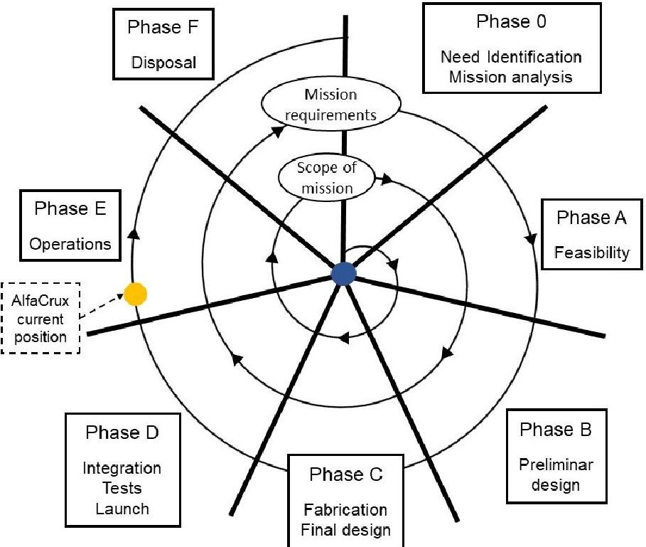

Figure 1. AlfaCrux mission life cycle in the development process.

## 2. Methods and Materials

2. 1. Mission Description

## 2.1.1. User Needs

The main motivation for carrying out the AlfaCrux mission is to provide an opportunity for space educational training and scientific benefits in the context of small communication satellite missions. The AlfaCrux project fosters the educational collaboration and technical investigations carried out by researchers, professors, students, and radio amateurs, with the sole purpose of self-training in topics such as radio communications, technical management, system-level design, and the development, integration, and operation of small satellites. The need for training and allocation of human resources for better management and technological innovation in the space sector is a critical need in our

<!-- PDF_PAGE: 5 -->

country. Space activities need to be established in a sustainable model in which constant training plays a fundamental role.

The specific context of the AlfaCrux mission also arises from another critical need in our society, which is to provide reliable narrow-band communication coverage. For instance, narrow-band communication via satellite can meet the needs of data collection systems in places without terrestrial infrastructure, such as underdeveloped areas, uninhabited areas, and areas that have been devastated by a natural disaster as well as provide tactical communication links. Several applications can be constructed based on a system that provides low data rate communication services.

To achieve this goal, the following set of objectives are proposed:

- Launch, operate, command, and control an amateur radio satellite.

- Provide a communication application to interact with the amateur radio community (demonstration of digital data repeater system).

- Provide communication between users and a set of generic data platforms (demonstration of data store-and-forward system).

- Implement and run an online open access database of in-orbit data for general investigations.

- Analyze narrow-band signal attenuation due to the effect of ionospheric scintillation (critical in low latitude regions, as in the case of Brazil).

- Analyze the satellite dynamic based on computer simulations and in-orbit data for studies and validation of Attitude Determination and Control System (ADCS) solutions and applications.

- Analyze and investigate digital twin modeling for aerospace applications.

## 2.1.2. Mission Concept

AlfaCrux is an amateur radio and educational mission to provide a hands-on experience with technological demonstration in orbit. The main purpose is the operation, command, and control of a satellite-based system for providing communication applications. Digital twin modeling, scientific experiments related to the impact of space weather in the communication channel, as well as the dynamic analysis for ADCS applications, are also part of the mission objectives.

The AlfaCrux payload implements a low-rate, bidirectional, short-message-based store-and-forward communication system between terrestrial and satellite terminals. This system allows, among many other applications, communication with weather stations in remote areas, environmental sensors, communications in areas affected by disasters, etc. For retrieving data from the satellites, the ground station will be the core component of the data distribution system. The system end users can access, through an internet connection, the data collected by these sensors and send the desired information. Cooperation in the ground segment will be established among the AlfaCrux collaborators.

In addition to the communication service itself, the system demonstrates:

- Digipeater for amateurs radio data transfer;

- User-developed scientific applications based on GNU Radio libraries for communication channel characterization;

- Data relay for real-time communication between terminals in the same area.

- The operational scenario schematic can be seen in Figure 2, and it is described as follows:

- The satellite transmits beacons while orbiting the Earth, sending telemetry information.

- When the satellite passes through the ground station, the operation team verifies and set the proper operational mode, as well as schedules the next services to be available for the users. This information is available online in the AlfaCrux mission planner.

- When the store-and-forward service is available, a user terminal receives the beacon and sends the available information to the satellite. The satellite, in turn, will transmit the stored information to it.

<!-- PDF_PAGE: 6 -->

- The satellite can send the received information in real time to another user terminal or ground station that is in the same area.

- When the satellite passes through a ground station, it exchanges messages from the collected user terminals and those that the system has for the terminals.

- The users will be able to interact with the system through the online official web page, receiving messages from their terminals or delivering the data they wish.

- When the digipeater service is available, the users can exchange digital data when they are in the footprint of the satellite. The current service available is the Automatic Packet Reporting System (http://www.aprs.org, accessed on 20 September 2022), an amateur radio-based system for real time digital communications of information of immediate value in the local area.

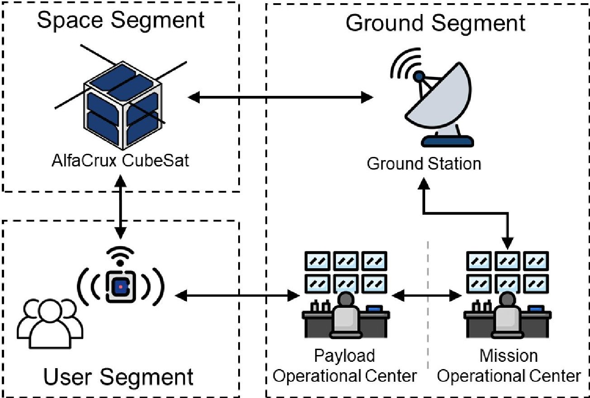

Figure 2. AlfaCrux operational concept.

## 2.2. Alfacrux Spacecraft

The AlfaCrux is a standard 1U CubeSat with dimensions of 10 by 10 by 10 cm. The final configuration can be seen in the CAD rendering shown in Figure 3 and the mass properties in Table 1. The summary of AlfaCrux orbit and designator is as follows:

- Satellite name: AlfaCrux;

- NORAD ID: 52160;

- International Designator (INTLDES): 2022-033D;

- Country: BRAZ;

- Launch: 1 April 2022;

- Site: Air Force Eastern Test Range;

- Radar cross-section (RCS): Small;

- Period: 94.64 min;

- Inclination: $ 9 7. 3 9^{\circ} $;

- Apogee: 508 km;

- Perigee: 494 km.

<!-- PDF_PAGE: 7 -->

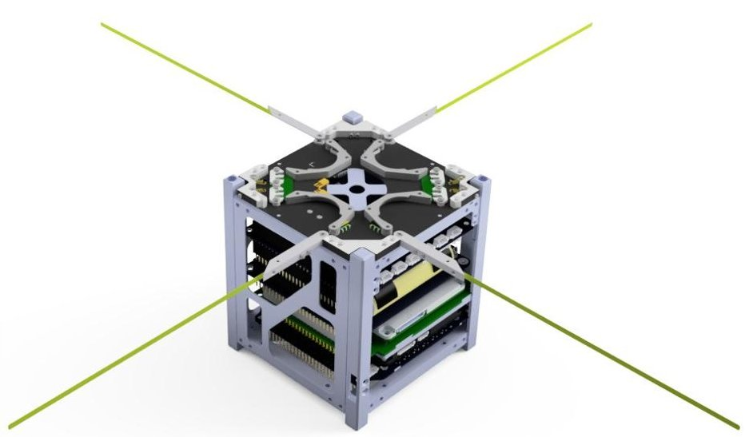

Figure 3. AlfaCrux CAD isometric view.

Table 1. AlfaCrux mass properties.

<table border="1"><tr><td>Parameter</td><td>Value</td><td>Tolerance</td><td>Unit</td></tr><tr><td>Mass</td><td>1.0650</td><td>+/-5g</td><td>kg</td></tr><tr><td>Center of gravity</td><td>xCG=52.27,yCG=50.81,zCG=61.81</td><td>+/-10%</td><td>mm</td></tr><tr><td>Moment of Inertia</td><td>Ixx=0.00183508557,Iyy=0.00185284505,Izz=0.00184586679</td><td>+/-10%</td><td>kg·m2</td></tr><tr><td>Product of Inertia</td><td>Ixy=-0.00000456992,Iyz=0.00000153435,Izx=0.00000877987</td><td>+/-10%</td><td>kg·m2</td></tr></table>

## 2.2.1. Alfacrux Subsystems

A short description of the components can be seen in Table 2. The AlfaCrux subsystem configuration can be seen in Figure 4.

Table 2. AlfaCrux subsystems.

<table border="1"><tr><td>Subsystem</td><td>Description</td></tr><tr><td>Electric Power System(EPS)</td><td>3V3,5V,andVBATrails.Sixswitchable power outputs.Latch-up and over-current protection.Watchdog for monitoringGScontact.</td></tr><tr><td>Battery</td><td>4×Li-Ioncells(40Wh).Integratedheaters.</td></tr><tr><td>Payload</td><td>AlénSpaceTOTEM-SDRwithUHF437MHzfront-end.</td></tr><tr><td>OnboardComputer(OBC)</td><td>AVR32MCU;128MBFlash;RTC;I2C,CANandUART.Three-axisgyroscope.Three-axis magnetometer.</td></tr><tr><td>Telemetry,Tracking,andControl(TTC)</td><td>UHF435-438MHz;Forwarderrorcorrection,30dBmoutput,4.8/9.6kbps.</td></tr></table>

<!-- PDF_PAGE: 8 -->

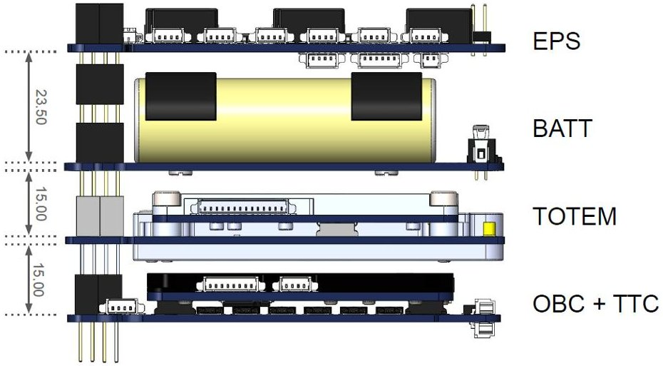

Figure 4. AlfaCrux configuration.

## 2.2.2. Operational Modes

The AlfaCrux operational modes schematic can be seen in Figure 5. A short description of each mode is as follows.

- Boot-up: During the first boot up of the system, the software shall execute a sequence of first tests and actions, including health check and memories and file system initialization. These actions shall be executed only once. After the completion of the boot up actions, the satellite shall enter Init mode and continue.

- Init: In this mode, the software checks if the antenna was deployed. If not, it shall immediately enter Startup mode; further health checks will be executed once the antenna is deployed.

- Startup: The main objective of this mode is to deploy the antenna and to move to Survival mode once the antenna deployment sequence finalizes. This mode will also collect telemetry from the first minutes of the mission. The antennas shall be autonomously deployed by the onboard software 30 min after ejection. At the end of the antenna deployment sequence, the TTC is configured to allow transmissions. The file system will not be enabled in Startup to avoid errors that could avoid the completion of the Startup sequence. It will be enabled after the completion of Startup, just before the change to Survival mode.

- Survival: This mode is intended to be the fallback mode in case of critical problems. This mode shall have a positive power budget and shall guarantee the possibility to access the satellite from ground. Payloads and non-critical subsystems are turned off in this mode. A beacon with basic health information is transmitted periodically to ease the location of the satellite and to provide a first assessment of its status. TTC is configured with its default configuration. The only way to exit Survival mode is to set a mode change by telecommand (TM) and reboot the software.

- Nominal: The main tasks for the mission execution are performed in Nominal mode. Payloads are allowed to operate in this mode, providing a digital data repeater at 437.225 MHz based on AX.25 protocol, and also a store-and-forward service at 437.125 MHz using Gaussian Minimum Shift Keying modulation. The main scheduler will be in charge of the execution of the different tasks. Health checks are executed periodically. If a critical problem is found, the software will change to Survival mode autonomously.

<!-- PDF_PAGE: 9 -->

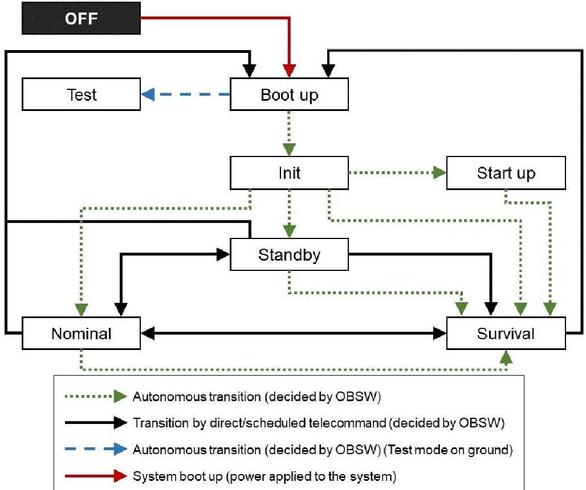

Figure 5. AlfaCrux operational modes schematic.

## 2.2.3. User Interface with OSI Layers

A general overview of the user interface with the AlfaCrux satellite open systems interconnection (OSI) layers is presented, specifically for the telemetry downlink. It is worth mentioning that the AlfaCrux downlink signal is not encrypted, in accordance with the amateur satellite service regulation, specifically article 25.2A 1A of the International Telecommunication Union (ITU) radio regulation RR25-1.

The TTC physical layer is as follows. TTC frequency of 437.100 MHz, effective isotropic radiated power of 30 dBm, Turnstile antenna, and mixed circular polarization (right and left hand).

The data link layer is summarized in Table 3. The use of Gaussian Minimum Shift Keying (GMSK) modulation provides a good compromise between speed and bandwidth. This type of modulation has no phase discontinuities thus the side lobes of the signal spectrum are reduced. Apart from minimizing channel interference, it provides efficient use of spectrum and enables high efficiency.

Table 3. AlfaCrux data link layer.

<table border="1"><tr><td>Parameter</td><td>Description</td></tr><tr><td>Modulation</td><td>Gaussian Minimum Shift Keying</td></tr><tr><td>Bitrate</td><td>4800/9600bps</td></tr><tr><td>Sync word</td><td>0x930B51DE</td></tr><tr><td>Frame format</td><td>ASM+Golay(AX100 mode5)</td></tr><tr><td>Bit encoding</td><td>NRZ,most significant bit first</td></tr><tr><td>Data randomization</td><td>Consultative Committee for Space Data Systems(CCSDS)randomization</td></tr><tr><td>Error-correcting code</td><td>Reed-Solomon(255,223)</td></tr></table>

All the packets transmitted by the AlfaCrux use the Cubesat Space Protocol (CSP) (https://github.com/libcsp/libcsp, accessed on 20 September 2022). Inside the CSP data field, telecommand transfer frames are used to encapsulate upper layer data. The TM

<!-- PDF_PAGE: 10 -->

transfer frames are an adaptation of CCSDS TM transfer standards. When the satellite is in communication with the ground station, a reliable channel is established between the station and the satellite using CSP Reliable Data Protocol.

The TM transfer frames transport standard CCSDS Space Packets implementing ECSS Packet Utilization Standard (PUS) services. A detailed description of PUS packets can be found in the ECSS, Telemetry and telecommand packet utilization, ECSS-E-ST-70-41C of 15 April 2016.

The satellite transmits a set of 5 packets every 30 s. Each packet contains a TM frame with a single space packet inside. Standard PUS service 3 (Housekeeping) is used to format these space packets. Five different beacons are transmitted, each one with a different ID, as follows:

- B1-OBC: telemetry from the main on-board computer;

- B2-EPS: telemetry from the electric power subsystem;

- B3-TTC: telemetry from the telemetry and telecommand subsystem;

- B4-UHF: telemetry from the antenna deployment subsystem;

- B5-Temps: temperature telemetry of different subsystems of the satellite.

Apart from the beacons, the satellite can generate other telemetry packets, the majority of them only under specific telecommand from the ground station, that is related with command and control of the satellite, with some packets out of the PUS standard. More information can be found at the official website of the mission at https://lodestar.aerospace. unb.br/projects/alfacrux (accessed on 20 September 2022).

## 2.3. Alfacrux Ground Segment

## 2.3.1. Ground Station Architecture

The ground station information technology (IT) architecture is composed of physical and logical components, shown in Figure 6. The physical components aim to provide the computational power and make the internal and external interconnection with the Internet, namely:

- Two desktop computers, with I5 CPU, 8 GB of RAM, and 500 GB SATA Hard Disk;

- One Dell server with Intel(R) Xeon(R) E-2224 CPU @ 3.40GHz, 8 GB of RAM, and 1 TB SATA Hard Disk;

- One load balancer, which allows balancing the links to the Internet;

- CAT 6 A cabling, used to interconnect computers, servers, and load balancer;

- Scripts for automation;

- One uninterruptible power source (UPS), which allows system autonomy for about 35 min without power from the electrical grid.

- The logical components are formed by operating systems, firmware, software, applications, and virtual machines, as follows:

- Computers or operating stations: its purpose is to operate and control the software-defined-radio and antenna rotors using an orbit propagator and Doppler shift calculator along with the mission control software (MCS). The VirtualBox was installed for extra functions such as virtual private network (VPN) and monitoring with Zabbix. Some examples of monitored parameters are processing load, RAM memory consumption, and SWAP memory consumption, among others.

- Server dedicated to the subsystems necessary for antenna control and Doppler correction. It aims to provide the necessary hardware resources for Rotcld, a Hamlib rotator control daemon, and MCS applications.

- General-purpose scripts to automate internal operation tasks.

The AlfaCrux team implemented an architecture for the ground station that allowed remote and secure operation. The computers were configured not to be a single point of failure, having replicated the virtual machines and applications, allowing them to be switched quickly, in a matter of minutes. To monitor the IT architecture and its components

<!-- PDF_PAGE: 11 -->

in order to identify possible points of attention, such as overloads, unavailability, and loss of performance, the Zabbix monitoring solution was implemented.

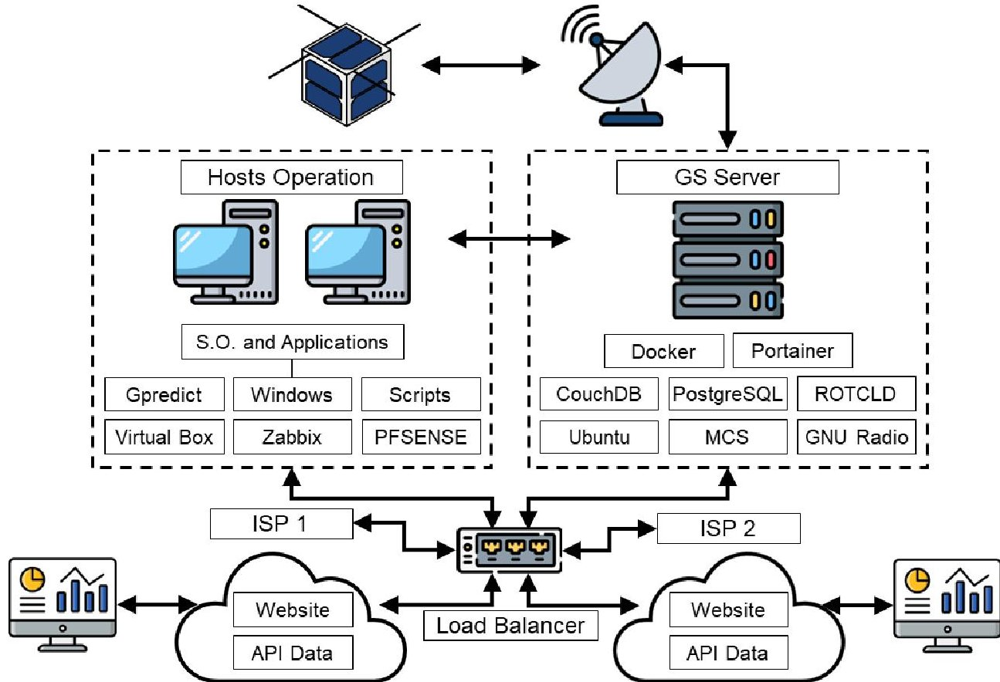

Figure 6. Ground station architecture.

The Zabbix is an open-source and free solution with several applications in different contexts including, for instance, the aerospace field. The basic resources of the server and computers are monitored, such as CPU, RAM, and SWAP memories, disk writing and reading latency, bandwidth consumption, status of processes and containers. For the administration and remote operation of the ground station, an open-source VPN solution, the OpenVPN, was implemented, embedded in the pfSense Linux distribution. The encryption used is based on public and private keys, with each user having their unique access key. pfSense integrated solutions with the OpenVPN and the key export package were chosen for their ease in generating and managing keys, being considered mature and a reliable security solution used by several companies in the world.

In order to mitigate the impact of power outage in the operation, a UPS capable of supporting the entire environment was implemented, being able to maintain the operation with the AlfaCrux and data management system for 30 min when the main power fails. Another important point to be highlighted is the need to configure the power schemes of the computers and the server. Specifically, the following characteristics were activated in the basic input-output system: power on after power outage, scheduled power on, and wake on local area network (LAN).

To increase efficiency and reliability in the operation tasks, some scripts were created, and additional configurations were set up on the server as well as the desktop computers. On the client side, a batch script was developed with an interactive menu for connectivity testing, activation, deactivation, restart, and collection of information from the rotors and the software-defined radio (SDR), as well as a bash script to control and manage containers. Time update enforcement twice a day has been added to the task schedulers. This procedure was implemented after observing the impact caused by the delay or advance of a few minutes during the operation with AlfaCrux. Moreover, it guarantees a reliable and satisfactory satellite clock synchronization.

The satellite clock synchronization is performed by the operator through specific telecommands, and it is regulated from the main server at the ground station. In this

<!-- PDF_PAGE: 12 -->

framework, the precision of the satellite clock is given by the precision of the ground station's main server and computers. The clock synchronization between the server and computer systems is achieved using the Network Time Protocol (NTP), specifically a server provided by the https://ntp.br/ (accessed on 20 September 2022). The maximum error of a clock set through an NTP client varies from fractions of milliseconds to a few tens of milliseconds, depending on the quality of the network. Asymmetric routes and network congestion can cause errors of 100 ms or more. Quantitatively speaking, for the proposed solution, values less than 100 ms were noticed, which should provide an idea of the precision magnitude.

The impact of these delays is twofold: orbit propagation for the tracking system and data analysis and use for different applications. In the first case, considering the pointing tolerance of 5 degrees and the precision of the tracking system, it was noticed that a mismatch of less than 30 s is affordable. In the case of data use and analysis, a regularization procedure is executed at least once per day. The regularization of the satellite's current time is progressively performed in order to avoid jumps in time. Consequently, the time is not changed immediately. The duration of the regularization must be longer than the time span to be advanced or delayed. For example, if the on-board time is 20:30 and we want to set it to 20:15, the duration of the regularization should be set to greater than 900,000 ms. Moreover, in case higher precision is needed for data use, time corrections can also be applied in the mission control software.

Another innovation in the architecture of the ground station was the use of containers allowing for greater compartmentalization and isolation of solutions. To facilitate the container management, the free graphical manager Portainer was installed. In all, 5 containers are configured, namely, CouchDB for the MCS database, PostgreSQL for the MCS database, MCS server, Rotctld rotator control daemon, and an SDR container.

Data registration is performed in an encrypted form in a CouchDB database and in a PostgreSQL database exclusive to the application. To comply with the need for data study and analysis, the MCS software has an API that allows access to data through web services. For this reason, a Python 3.6 program was developed with the objective of performing three operations during its execution: (i) update all existing parameter tables; (ii) update all executed remote controls; (iii) update all telemetry received. The result of this operation, in a way, is a backup of the data while creating a security layer for data access since, after updating, the data are provided through another API, developed by the AlfaCrux team to be accessed by students, researchers, and the amateur radio community.

In addition to this API, the AlfaCrux team also developed an interface that allows the collaborative collection of telemetry from anyone that have received packages from the AlfaCrux satellite, recorded the telemetry and generated a KISS frame file. This interface, an online form, allows recording latitude, longitude, email, name, call sign, and KISS frame file. Finally, data duplication analysis mechanisms will be necessary and even, without prejudice to data quality, the creation of a composite primary key that allows differentiating the data source, which may lead to the possibility of telemetry duplication.

## 2.3.2. User Segment

Currently, the AlfaCrux team is developing and providing the online telemetry viewer (https://lodestar.aerospace.unb.br/projects/alfacrux/radio#telemetry-viewer, accessed on 20 September 2022), a web platform that selects the main parameters of the satellite beacons to the user. The data provided by the collaborators will also be made available, and a main time series of the parameters will be implemented after checking and validating the received package. All frames available online are properly associated with the responsible call sign in such a way that the amateur radio can search in our database for its specific contribution in the AlfaCrux mission.

<!-- PDF_PAGE: 13 -->

## 2.4. Alfacrux Digital Twin Architecture

One of the main innovative contributions of the AlfaCrux mission is concerned with the development of a digital twin model, see Figure 7. The DT can be defined as a highfidelity and up-to-date digital representation of an physical counterpart. This representation is achieved by combining different models (physics-based and data-driven models), simulations, sensor updates and historical data [21]. Although this topic has been studied in the aerospace field [22], the use and applications of digital twin in the context of small satellites are still incipient, with very few examples and systems implemented so far [23,24].

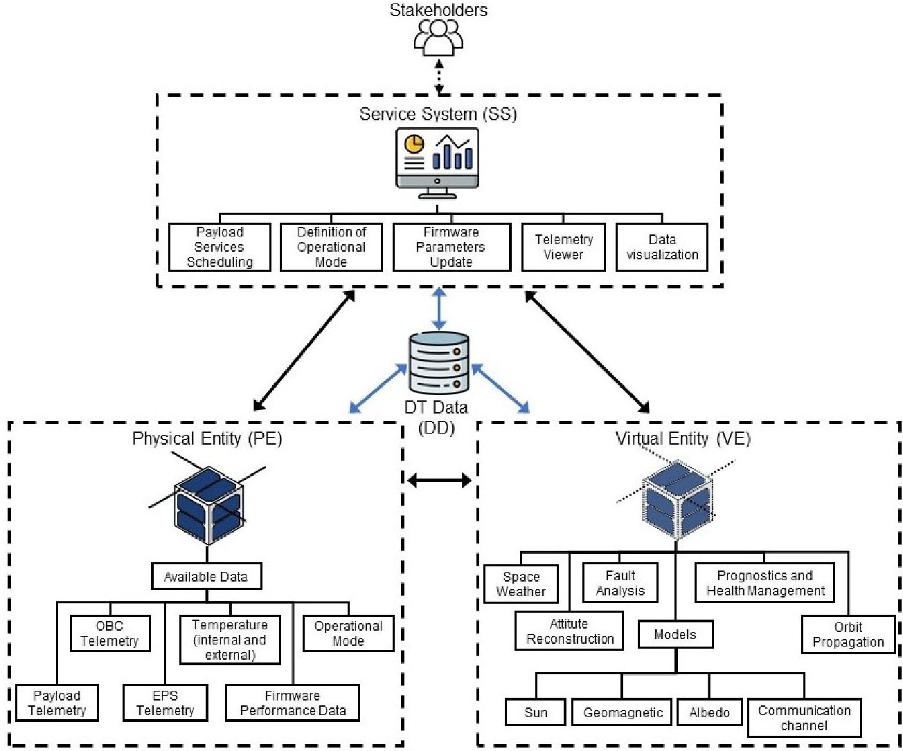

Figure 7. Five-dimensional architecture for the CubeSat digital twin framework.

In this first approach, the goal is to set the start point and the guidelines to establish the concept and a methodology to build a reliable framework for the operation and main services of nanosatellites, in a first moment CubeSat standard, fulfilling the necessary space standards (such as health checks, dynamic characteristics, and safety mechanisms, among others) and conforming to the necessary payload requirements.

By innovative framework, we mean a new architecture in which the development of a digital model of the nanosatellite is considered. In this innovative approach, the digital model is constantly under improvements based on the data collection system (laboratory tests, computer simulations, and in-orbit data), and more than that, the digital model can improve and update the physical entity, i.e., the satellite in orbit). In other words, we are proposing a digital twin framework for nanosatellite mission applications.

The digital twin can be modeled in a five-dimensional architecture composed of the physical entity (PE), the virtual entity (VE), the DT data (DD), the system services provided (SS) and the connections between the parts (CN) [25]. Figure 7 provides a conceptual model of the DT specifically for the AlfaCrux. The sensors in the PE gather data that will be used as input for the analysis, models, and simulations of the VE. In this way, the VE can mirror the physical geometry, physical properties, behaviors, and rules of the PE. The SS consists

<!-- PDF_PAGE: 14 -->

of the services for the physical and virtual entities, and for the project stakeholders. These services include the scheduling of the payload services, the change in operational mode, the telemetry viewer, and firmware updates. The DD is composed of data collected from the PE, VE, and SS through the connections. The connections are also used to link the PE, VE, and SS among themselves [25].

In the center of the five-dimensional architecture is the digital twin data, due to their critical role in the DT as the knowledge representation [26]. The process of creating the knowledge involves, among other things, the data collection and pre-processing of different sources. These sources can be divided into three main categories: synthetic data (computer simulation), experimental data (laboratory tests and validation), and in-operation data (satellite telemetry) [22]. Specifically, the synthetic data are generated by simulations in the virtual world, the experimental data are gathered through experiments conducted in the physical entity, and the last category, the in-operation data, are collected during regular operation of the physical entity, in our case the AlfaCrux CubeSat.

The first part of the DT that has been developed is dedicated to kinematic reconstruction, as seen in Figure 8. The models were initially validated with simulated and real telemetry data. This pilot DT is explained below, considering the five dimensions shown in Figure 7.

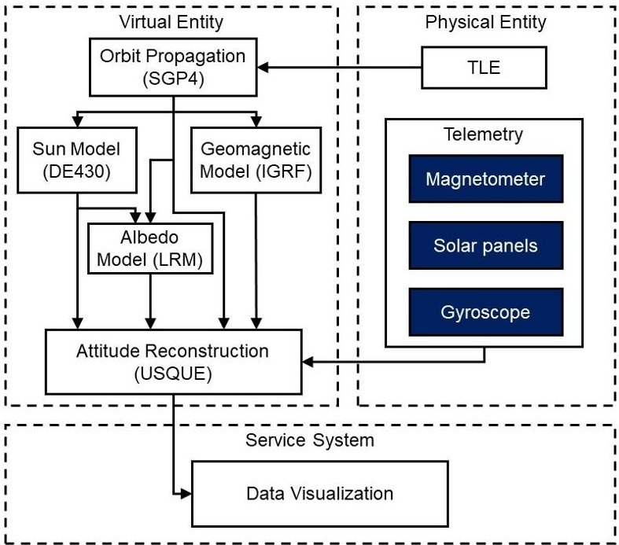

Figure 8. AlfaCrux kinematic reconstruction DT.

1. Physical entity: acquires measurements of the magnetometer, solar panels, and gyroscope, and the two-line elements (TLE);

2. Virtual entity: uses the Sun, Geomagnetic, and Albedo models; the orbit propagation; and the telemetry data to reconstruct the satellite attitude;

3. Connection: responsible for the data collection and management system;

4. Service system: responsible for the attitude visualization.

## 3. Results and Discussions

The preliminary orbital data (injection) given by the launch provider team were used to propagate the orbit (Simplified General Perturbations-4 (SGP4)) and predict the first passages over the command and control station. The first access report provided the estimates presented in Table 4.

<!-- PDF_PAGE: 15 -->

Table 4. Ground station to AlfaCrux first access report.

<table border="1"><tr><td>Access</td><td>Start Time(UTC)</td><td>Stop Time(UTC)</td><td>Duration(s)</td></tr><tr><td>1</td><td>2 April 202201:14:35.727</td><td>2 April 202201:19:56.946</td><td>321.218</td></tr><tr><td>2</td><td>2 April 202202:46:49.656</td><td>2 April 202202:55:04.360</td><td>494.704</td></tr><tr><td>3</td><td>2 April 202213:12:37.268</td><td>2 April 202213:19:58.469</td><td>441.201</td></tr><tr><td>4</td><td>2 April 202214:46:26.445</td><td>2 April 202214:53:21.925</td><td>415.480</td></tr><tr><td>5</td><td>3 April 202202:28:02.961</td><td>3 April 202202:37:04.707</td><td>541.746</td></tr><tr><td>6</td><td>3 April 202212:55:30.532</td><td>3 April 202213:00:24.969</td><td>294.438</td></tr><tr><td>7</td><td>3 April 202214:27:14.360</td><td>3 April 202214:35:37.980</td><td>503.620</td></tr><tr><td>8</td><td>4 April 202202:09:32.490</td><td>4 April 202202:18:45.596</td><td>553.106</td></tr><tr><td>9</td><td>4 April 202214:08:27.400</td><td>4 April 202214:17:31.124</td><td>543.724</td></tr></table>

As a pre-launch setup, the ground station equipment, configuration, and procedures were verified. The mission control software was updated, and the control sequences loaded. The pass procedure for the first days based on the access report was revised and ready to be executed.

In the first passage over the command and control ground station, we were able to receive beacons from the AlfaCrux, in a first moment not able to demodulate, but as soon as the orbit position became more precise, the quality of the tracking, and consequently of the operation, were improving. During the first days, the operation team was focused on the correct identification of the AlfaCrux spacecraft in cooperation with the 18th Space Control Squadron of the United States Space Force. As an operator organization, the AlfaCrux team started using the TLEs from the Space-Track [https://www.space-track.org/], accessed on 20 September 2022) platform, exchanging information about the AlfaCrux operation, checking, and analyzing safety information provided by the conjunction data message, and after some days, the AlfaCrux was properly identified with the international designator 2022-033D.

## 3.1. Satellite and Ground Station Commissioning

During the AlfaCrux satellite and ground station commissioning, the SDR start/stop procedures were constantly tested and verified before the passage, leading to new scripts to improve the efficiency of the operation. The elevation and azimuth rotors' start/stop procedures and the remote control interface were also tested and checked constantly, leading to adjustments in the antenna mounting, pointing calibration, soft start/stop ramp, and creation of preventive maintenance routines.

For the first contact, the main actions were to receive beacons; verify communications (Ping command to the satellite); check preliminary TLE by taking notes of time/frequency of Doppler shifts, especially at the moment in which the Doppler shift equals 0 Hz; and check the overall health of the satellite. The critical housekeeping information for those days were battery level, solar panels' voltages and currents, battery charge current, EPS output currents, and internal and external temperatures.

For the next contacts, the procedure includes receiving beacons, verifying communications (Ping/Pong), checking if operational mode was set to Survival, establishing a reliable

<!-- PDF_PAGE: 16 -->

communications channel, obtaining telemetry errors (if any), and obtaining telemetry since the first hours, storing it, and analyzing the critical parameters.

Recently, the clock was synchronized with the ground station, and a new procedure was included in the daily passage, that is, a time reference update. As of 27 July 2022, 01:56 UTC, the AlfaCrux changes to Nominal mode.

## 3.2. Alfacrux Digital Twin Pilot

The first elements of the proposed digital twin, shown in Figure 7, were developed and tested in the current phase with synthetic and preliminary telemetry data, specifically the attitude reconstruction, environment, and communication channel models; the telemetry viewer; and risk analysis.

## 3.2.1. Attitude Reconstruction and Dynamic Analysis

The attitude reconstruction system is responsible for the spacecraft pose determination using the in-orbit data stored in the DT database, generating an offline time-series of the attitude parameters. This feature allows the assessment of onboard sensors performance and their characterization; the analysis of filtering methods, such as Kalman filter and its derivations; the study of environment models; and the estimation of perturbations. For the reconstruction, not only the attitude sensors, for instance gyroscopes, magnetometers, and Sun sensors, can be considered but also other onboard data that may be affected by the satellite orientation, such as solar panels, optical payloads, or even the antenna signal power received by the ground station.

For the AlfaCrux attitude estimation, the onboard sensors available are one gyroscope and one magnetometer, both with tree-axis measurements. In order to improve the filter performance, the solar-panel-related data are also considered so that the Sun line-of-sight can be estimated as a Sun sensor. Specifically, the AlfaCrux CubeSat has a total of six solar panels, each one mounted on one spacecraft face. Solar panels from opposite sides are connected in parallel and the onboard system collects one current and voltage measurements from each pair along with individual temperature measurements. As shown in [27], the Sun vector can be estimated through computations with individual current measurements. However, in the AlfaCrux case, the power is considered instead of the current, and the highest temperature of one solar panel pair indicates which one is generating such power.

Once the measurements are available, an initial attitude determination method is executed in order to compute the full attitude profile. The simplest one is the Triaxial Attitude Determination (TRIAD), which is based on finding an attitude matrix that rotates an orthonormal base in the inertial frame to the base expressed in the spacecraft body frame from two not aligned vector measurements, such as, for instance, the Sun position and the Geomagnetic field [27]. After the definition of the initial attitude, stochastic filtering techniques provide the solution for the attitude propagation over time through the dynamical model and sensor data. Such a filtering problem consists of a sub-optimal estimation of the attitude state along with related parameters, such as sensor biases, misalignment, and orthogonality. In this context, the state vector and sensor observations are defined as random variables, so that their statistics represent the confidence degree in both estimated and measured quantities in the form of error covariance.

The filter structure for AlfaCrux attitude estimation is formulated in [28], called Unscented Quaternion Estimator (USQUE), which is based on the Unscented Kalman Filter, a nonlinear filter that uses selected samples from the state probability density function instead of computing a first-order linear approximation using the Jacobian matrix, as in the Extended Kalman Filter. The USQUE algorithm considers the multiplicative quaternion approach, where a global attitude state is the spacecraft estimated pose, and a local attitude state represents the error to be computed in the filtering process. After an iteration, the global attitude is updated with the estimated error from the filter.

<!-- PDF_PAGE: 17 -->

The system is modeled by the following equations:

$$
\begin{array}{l} \mathbf {x} _ {k} = \mathbf {f} \left(\mathbf {x} _ {k - 1}\right) + G _ {k} \mathbf {w} _ {k}, \\ \mathbf {y} _ {k} = \mathbf {h} \left(\mathbf {x} _ {k}\right) + \mathbf {v} _ {k}, \\ \end{array}
$$

where x is the $ 6 \times1 $ state vector; y is the $ 6 \times1 $ output vector; $ \mathbf{f}(\cdot) $ is the attitude kinematic equation; $ \mathbf{h}(\cdot) $ is the measurement model equation; w and v are the process and observation errors, both modeled as uncorrelated Gaussian random variables with zero mean; and Q and R are covariance matrices, respectively.

The state vector is composed of attitude-error angles parameterized using the Generalized Rodrigues Parameters (GRP) and the gyroscope bias, as follows: $ \mathbf{x}\equiv[\delta\mathbf{p}^{T}\beta^{T}]^{T}. $ The GRP represents the local attitude-error that will be incorporated in the global representation, once $ \parallel \varrho\mathbf{p}\parallel $ is equal to the rotation angle, $ \vartheta $ , for small errors. The sigma-points, $ \chi(i) $ for $ i=0,1,\cdots,12 $ , are generated according to the following equations:

$$
\sigma_ {i} \leftarrow \mathrm {i - t h c o l u m n o f} \pm \sqrt {(n + \lambda) \left(P _ {k - 1} ^ {+} + \bar {Q} _ {k - 1}\right)},
$$

$$
\begin{array}{l} \chi (0) = \hat {\mathbf {x}} ^ {+}, \\ \chi (i) = \sigma_ {i} + \hat {\mathbf {x}} ^ {+}, \\ \end{array}
$$

where $ P_{k-1}^{+} $ is the state error covariance, $ \bar{Q}_{k-1} $ is the process error covariance, and $ \lambda $ is a scalar chosen arbitrarily.

For the prediction step where the state vector is propagated from time instant $ k-1 $ to $ k $ , the attitude kinematic equation is considered. The GRP vector of each sigma-point is converted to an error-quaternion, $ \delta\mathbf{q}(i) $ , and incorporated to the full attitude representation, $ \hat{\mathbf{q}} $ , through a quaternion multiplication operation. Then, the attitude kinematic for the sigma-points quaternions, $ \mathbf{q}(i) $ , is executed using the gyroscope angular velocities measurements for propagation in time.

After the prediction, the sigma-points in GRP representation are retrieved from the propagated quaternions. The mean predicted state vector is computed along with the predicted state error covariance matrix:

$$
\hat {\mathbf {x}} _ {k} ^ {-} = \frac {1}{n + \lambda} \left\{\lambda \chi_ {k} (0) + \frac {1}{2} \sum_ {i = 1} ^ {2 n} \chi_ {k} (i) \right\},
$$

$$
P _ {k} ^ {-} = \frac {1}{n + \lambda} \left\{\lambda \left[ \chi_ {k} (0) - \hat {\mathbf {x}} _ {k} ^ {-} \right] \left[ \chi_ {k} (0) - \hat {\mathbf {x}} _ {k} ^ {-} \right] ^ {T} + \frac {1}{2} \sum_ {i = 1} ^ {2 n} \left[ \chi_ {k} (i) - \hat {\mathbf {x}} _ {k} ^ {-} \right] \left[ \chi_ {k} (i) - \hat {\mathbf {x}} _ {k} ^ {-} \right] ^ {T} \right\} + \bar {Q} _ {k}.
$$

The correction step is performed once the mean state vector and covariance are available. This procedure considers the observation model, where reference vectors (such as Sun line-of-sight and geomagnetic field) in the inertial frame are transformed to the spacecraft body frame and compared with the magnetometer and solar panels data observations in order to compute the innovation vector, v. Such measurement model is given by

$$
\tilde {\mathbf {y}} _ {k} = \left[ A (\mathbf {q}) \mathbf {r} _ {1} A (\mathbf {q}) \mathbf {r} _ {2} \dots A (\mathbf {q}) \mathbf {r} _ {n} \right] ^ {T} + \left[ \nu_ {1} \nu_ {2} \dots \nu_ {n} \right] ^ {T},
$$

where $ A ( \mathbf{q} ) $ is the attitude matrix built with the quaternion obtained from the GRP, $ \mathbf{r}_{j} $ is a reference vector observation provided by a environment model, and $ \nu_{j} $ is the respective measurement error.

With the obtained quaternions, the mean observation vector can be computed as well as the measurement vector, innovation covariance matrices and the cross-correlation matrix:

$$
\hat {\mathbf {y}} _ {k} ^ {-} = \frac {1}{n + \lambda} \left\{\lambda \gamma_ {k} (0) + \frac {1}{2} \sum_ {i = 1} ^ {2 n} \gamma_ {k} (i) \right\},
$$

<!-- PDF_PAGE: 18 -->

where $ \gamma_{k}(i)=\mathbf{h}[\chi_{k}(i),k] $

$$
P _ {k} ^ {y y} = \frac {1}{n + \lambda} \left\{\lambda \left[ \gamma_ {k} (0) - \hat {\mathbf {y}} _ {k} \right] \left[ \gamma_ {k} (0) - \hat {\mathbf {y}} _ {k} \right] ^ {T} + \frac {1}{2} \sum_ {i = 1} ^ {2 n} \left[ \gamma_ {k} (i) - \hat {\mathbf {y}} _ {k} \right] \left[ \gamma_ {k} (i) - \hat {\mathbf {y}} _ {k} \right] ^ {T} \right\},
$$

$$
P _ {k} ^ {v v} = P _ {k} ^ {y y} + R,
$$

$$
P _ {k} ^ {x y} = \frac {1}{n + \lambda} \left\{\lambda \left[ \chi_ {k} (0) - \hat {\mathbf {x}} _ {k} ^ {-} \right] \left[ \gamma_ {k} (0) - \hat {\mathbf {y}} _ {k} \right] ^ {T} + \frac {1}{2} \sum_ {i = 1} ^ {2 n} \left[ \chi_ {k} (i) - \hat {\mathbf {x}} _ {k} ^ {-} \right] \left[ \gamma_ {k} (i) - \hat {\mathbf {y}} _ {k} \right] ^ {T} \right\}.
$$

The innovation is computed as the difference between the sensor observations and the predicted output:

$$
\boldsymbol {v} _ {k} \equiv \tilde {\mathbf {y}} _ {k} - \hat {\mathbf {y}} _ {k} ^ {-} = \tilde {\mathbf {y}} _ {k} - \mathbf {h} \left(\hat {\mathbf {x}} ^ {-}, k\right).
$$

The state vector and error covariance matrix are updated following the equations:

$$
\hat {\mathbf {x}} _ {k} ^ {+} = \hat {\mathbf {x}} _ {k} ^ {-} + K _ {k} v _ {k},
$$

$$
P _ {k} ^ {+} = P _ {k} ^ {-} - K _ {k} P _ {k} ^ {\nu \upsilon} K _ {k} ^ {T}.
$$

The attitude-error from $ \hat{\mathbf{x}}_{k}^{+} $ is transformed into a quaternion, and it is used to update the global attitude representation, which is the new attitude estimate. Later, the attitude error in the state vector is set to zero before the beginning of the next iteration.

Finally, the in-orbit data will be used as input information for the small satellite simulator available at the Laboratory of Simulation and Control of Aerospace Systems (LODESTAR) [29-31]. Moreover, a new air-bearing based simulator dedicated to the CubeSat standard was built, and it is already operational to be used for the reconstruction of dynamics characteristics of the AlfaCrux. The CAD view is shown in Figure 9. The results of the experiments in the simulator are stored in the DT database and can be used in future simulations.

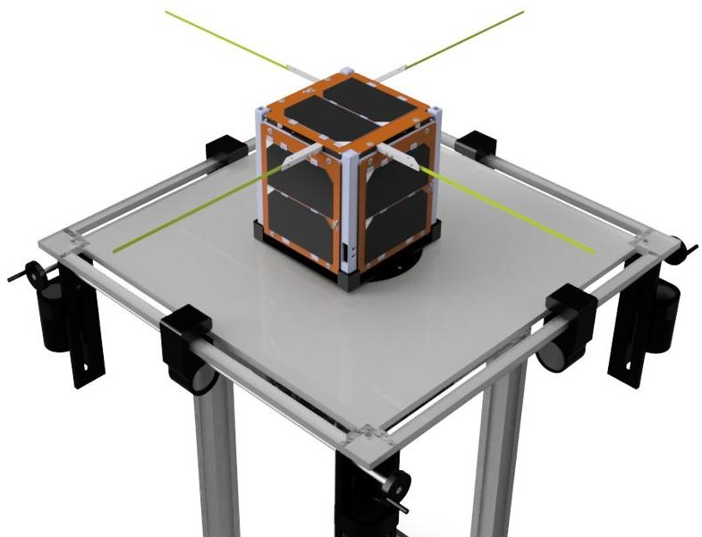

Figure 9. CubeSat air-bearing simulator CAD view with the AlfaCrux.

## 3.2.2. Environment Models

For the proposed DT model, the spacecraft motion is a major concern. The formulation considered in this work uses the SGP4 model for orbit propagation, uses the TLE file as the only orbital data source, and provides a prediction for the satellite position and velocity over time. The SGP4 considers perturbations such as the Earth's ellipsoidal shape effect over the gravitational field, third-body influence (Sun and Moon) and the atmospheric drag.

As described in [32], the Earth Magnetic Field is modeled as the gradient of the magnetic potential, which is approximated by a spherical harmonic series expansion. One

<!-- PDF_PAGE: 19 -->

of the standard models is the International Geomagnetic Reference Field (IGRF), and it consists of the mathematical description along with the coefficient values for the series expansion. The model allows the computation of the geomagnetic field at any point in space given its spherical coordinates. Furthermore, it allows not only computer simulations but also serves as input data for laboratory experiments in Helmholtz cages.

The Sun position is another important model, once it is the primary power source for most of the spacecrafts. According to [32], a more precise approach to determine the position is through the data set DE430, a set of celestial bodies' ephemerides provided by the Jet Propulsion Laboratory and generated by laser observations and the numerical integration of a dynamic system. However, this model requires access to the data and numerical methods. A simpler and less precise model is based on analytical equations that may be considered in simulations and is also useful for implementing in the onboard software. This model considers the Sun elliptic motion, containing polynomials and trigonometric terms only.

With respect to the problem of attitude determination, the Earth albedo model may be considered if the spacecraft has Sun sensors onboard, once the solar radiation reflected by the Earth surface can introduce errors in the Sun position vector computing. Albedo is measured as the reflectivity index, which varies according to the cloud coverage, geographic location, season of the year, and type of surface. In [33], the reflectivity index is provided by the NASA Total Ozone Mapping Spectrometer (TOMS) satellite, which records the measurements observations constituting a grid of data points. The total energy reflected to the satellite is formulated as the sum of each data point contribution, that is, illuminated by the Sun and visible by the satellite. The model presented depends on the reflectivity index, the angle of incidence, satellite altitude, and the angle of reflection to the spacecraft.

For the results obtained so far in the early stage, the Sun position and Geomagnetic field described in the inertial frame are provided by the software System Tool Kit (STK) from Ansys Inc, along with the AlfaCrux orbit propagation with the TLE. The Earth albedo model was implemented based on the Lambertian reflectance model (LRM), which finally guarantees the attitude reconstruction process.

## 3.2.3. A Preliminary Outcome Example

As a simple example to illustrate the AlfaCrux DT model outcome, a first analysis of the attitude reconstruction by means of stored telemetry data is shown in Figure 10, where the Euler angles are parameterized in the 3-1-3 rotation sequence. Currently, the AlfaCrux ground station is undergoing technical adjustments and hardware upgrade in order to improve the signal downlink. Moreover, for the early orbit phase and commissioning performed in these first months of operation, the in-orbit data are gathered into parameter report structures using a low data sampling rate. Both scenarios lead to missing information in the sensors; time series, impacting the quality of the attitude reconstruction. In this case, to evaluate the DT kinematic pilot model, preliminary studies were carried out considering telemetry data sampled within short time intervals. In order to illustrate the first results, consider the AlfaCrux data from the 4 June 2022 within a time interval of 180 s, where the telemetry is uniformly sampled at each 30 s during a passage over the command and control station. A quadratic interpolation was performed in order to generate new points at each 5 s time interval providing a smooth and more appropriate time series for attitude reconstruction. For future analysis, the AlfaCrux sampling rate will be properly adjusted, increasing the knowledge database, and consequently improving the quality of the estimation.

<!-- PDF_PAGE: 20 -->

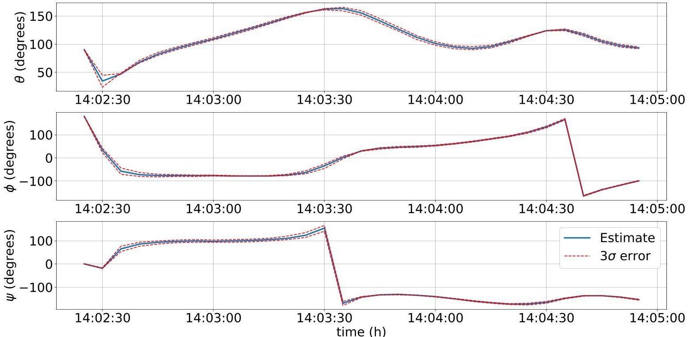

Figure 10. Euler angles from attitude reconstruction.

Since the AlfaCrux satellite does not have an attitude control subsystem, the only torques acting on the CubeSat are the disturbance ones, such as those due to the gravitygradient and residual magnetic dipole. For these first analyses, the influence of a possible residual magnetic dipole was not considered. This will be estimated later along with the magnetometer data analysis and calibration. By using the least squares method, it was possible to estimate an initial magnetometer bias with an order of magnitude of $ 1 0^{4} $ nT. With respect to the solar panels, since they do not have available information about sensor characterization, the uncertainties must be estimated. As regular coarse sensors are inaccurate in the order of degrees, the same order of magnitude is expected for the estimation of the Sun vector direction based on the power and thermal analysis. Finally, the evolution of the state error standard deviations can be calculated, providing the results shown in Figure 11.

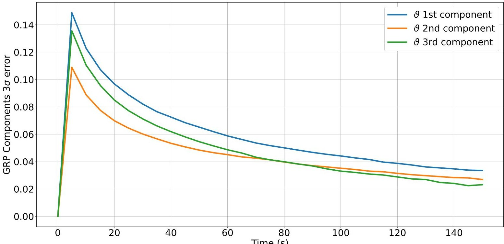

Figure 11. Estimated state vector error for the angles parameters.

<!-- PDF_PAGE: 21 -->

## 3.2.4. Data Management and Telemetry Viewer

The ground station information technology team is responsible for keeping the data management system and online open access database. Currently, the data are updated after a set of operations, and they are included as a procedure to be executed after a passage. The current architecture can be seen in Figure 12.

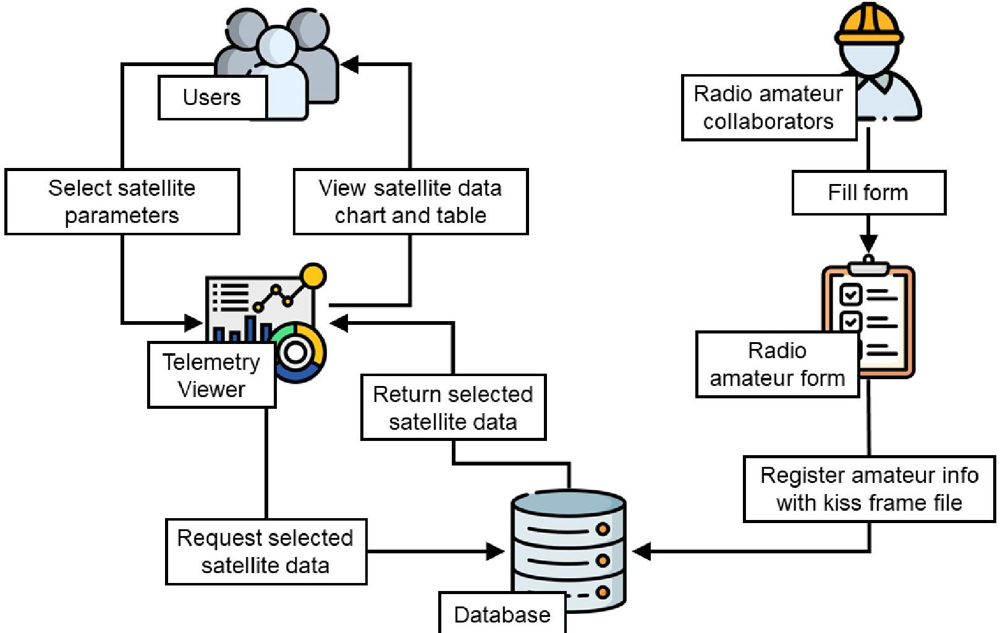

Figure 12. User segment architecture: data management and viewer.

## 3.2.5. Communication Channel Modeling and Risk Analysis

The elaboration of a detailed model for the communication link in both directions (uplink and downlink) is relevant to simulating adverse situations, which helps the planning and assessment of mission risks. Within the AlfaCrux scope, the joint use of a communication simulator and the digital twin framework allows the elaboration of worst-case scenarios and the testing of new features that can be added in future missions. The measurement and modeling of scintillation are particularly relevant for sub-GHz frequencies when ground stations are positioned at low latitudes. The effects of space weather in the planning of the AlfaCrux ultra-high frequency (UHF) communication system was previously analyzed, see [34] for more details, and should be further investigated considering now the in-orbit data and radio frequency signals received at the ground station.

Currently, the simulation framework is the GNU Radio platform, where two diagram blocks implement distinct aspects of the link modeling. The first block focuses on the dynamic channel model, considering the satellite passage above the ground station. Within the visibility window, the simulator provides fundamental channel aspects for different orbit altitudes and frequencies, such as free space attenuation and Doppler frequency deviation. Following the ITU-Regulations (ITU-R) recommendations, the insertion of channel impairments from the troposphere (such as attenuation from gases, rain, and clouds) and ionosphere (such as scintillation, Faraday rotation, and propagation delay) is currently under development. At the transmitting and receiving nodes, we also consider local parameters such as antenna gain-to-noise-temperature （G/T），transmitted power, Effective

<!-- PDF_PAGE: 22 -->

Isotropic Radiated Power (EIRP), and equivalent noise temperature of the receiver. In this block, the simulator updates the satellite position (and its effects on the channel) once a second.

The second block diagram simulates the GMSK digital transmission in baseband under controlled conditions of signal-to-noise ratio. The simulation rate is milliseconds, and dynamical channel effects are considered here under the assumption of slow changes in the channel. With this module, it is possible to apply different techniques in the receiver chain, such as carrier/symbol synchronization, robust error-correcting codes, and advanced digital signal processing methods. This module also allows future prototyping by embedding the algorithms in a parallel software-defined radio platform.

## 4. Conclusions

This paper presents the AlfaCrux space mission and the main results obtained so far. AlfaCrux was launched on April 1,2022,and it entered its nominal mode on 27 July 2022, 01:56 UTC. Fundamental aspects of the early orbit phase operation and the development of a digital twin model are discussed, and the lessons learned are presented. A project-based learning methodology has been adopted for developing students professional knowledge and transferable skills. In these first 5 months of operation, and from the engineering point of view, the AlfaCrux satellite is perfectly healthy with a high performance level, and the mission is considered a complete success.

Author Contributions: Conceptualization, R.A.B., A.C.d.S., B.F.-A.G., V.M.d.S.B., J.M.L.A., F.A.A., J.V.Q.S.B., Y.d.C.F.A., A.C.A.d.O., B.T.d.M. and V.F.M.; data curation, M.M.K. and R.B.d.S.; formal analysis, R.A.B., W.R.S., L.A., G.A.B., B.F.-A.G., J.M.F-C., J.M.L.A., F.A.A., A.C.A.d.O., B.T.d.M. Y.d.C.F.A. and E.C.B.; funding acquisition, R.A.B.; investigation, R.A.B., A.C.d.S., W.R.S., L.A., G.A.B., M.M.K., R.B.d.S., J.V.Q.S.B., A.C.A.d.O., B.T.d.M., Y.d.C.F.A. and E.C.B.; methodology, R.A.B., A.C.d.S. V.M.d.S.B., J.M.F.-C. and A.C.A.d.O.; project administration, R.A.B., A.C.d.S., B.F-A.G., V.M.d.S.B. and F.A.A.; resources, R.A.B., A.C.d.S., M.M.K., R.B.d.S. and V.F.M.; software, R.A.B., L.A., M.M.K., R.B.d.S., J.M.F.-C., J.M.L.A., B.T.d.M., E.C.B. and V.F.M.; supervision, R.A.B., A.C.d.S. and V.M.d.S.B.; validation, R.A.B., W.R.S., G.A.B., B.F-A.G., V.M.d.S.B., J.V.Q.S.B. and B.T.d.M.; writing—original draft, R.A.B. and A.C.A.d.O.; writing—review and editing, R.A.B., A.C.d.S., W.R.S., L.A., G.A.B., M.M.K., R.B.d.S., J.V.Q.S.B., A.C.A.d.O., B.T.d.M. and V.F.M. All authors have read and agreed to the published version of the manuscript.

Funding: The AlfaCrux space mission was funded by the Brazilian agency Fundação de Apoio à Pesquisa do Distrito Federal (FAPDF).

Data Availability Statement: The AlfaCrux Telemetry Viewer can be accessed at https://lodestar. aerospace.unb.br/projects/alfacrux/radio (accessed on 20 September 2022).

Acknowledgments: The authors would like to thank the Brazilian agencies Higher Education Personnel Improvement Coordination (CAPES), National Council for Scientific and Technological Development (CNPq), and the Federal District Research Support Foundation (FAPDF) that supported this work, and also the Brazilian Space Agency (AEB) and the Brazilian National Telecommunications Agency (ANATEL) for technical support. They would also like to thank the International Amateur Radio Union (IARU) for the frequency coordination of the AlfaCrux satellite.

Conflicts of Interest: The authors declare no conflict of interest.

## References

1. Suhadis, N.M. Statistical overview of CubeSat mission. In Proceedings of the International Conference of Aerospace and Mechanical Engineering 2019, Penang, Malaysia, 20-21 November 2019 ; Springer: Berlin/Heidelberg, Germany, 2020; pp. 563-573.

2. Kopacz, J.R.; Herschitz, R.; Roney, J. Small satellites an overview and assessment. Acta Astronaut. 2020, 170, 93-105. [CrossRef]

3. Villela, T.; Costa, C.A.; Brandao, A.M.; Bueno, F.T.; Leonardi, R. Towards the Thousandth CubeSat: A Statistical Overview. Int. J. Aerosp. Eng. 2019, 2019, 5063145. [CrossRef]

4. National Academies of Sciences, Engineering, and Medicine. In Achieving Science with CubeSats: Thinking Inside the Box; The National Academies Press: Washington, DC, USA, 2016.

<!-- PDF_PAGE: 23 -->

5. Cappelletti, C.; Battistini, S.; Malphrus, B.K. CubeSat Handbook—From Mission Design to Operations; Elsevier: Amsterdam, The Netherlands, 2020.

6. Pelton, J.N.; Madry, S. Handbook of Small Satellites—Technology, Design, Manufacture, Applications, Economics and Regulation; Springer: Berlin/Heidelberg, Germany, 2020.

7. Pelton, J.N.; Madry, S.; Lara, S.C. Handbook of Satellite Applications, 2nd ed.; Springer: Berlin/Heidelberg, Germany, 2017.

8. Chin, A.; Coelho, R.; Nugent, R.; Munakata, R.; Suari, J.P. CubeSat: The Pico-Satellite Standard for Research and Education. In Proceedings of the AIAA Space 2008 Conference and Exhibition, San Diego, CA, USA, 9-11 September; American Institute of Aeronautics and Astronautics: Reston, VA, 2008.

9. Kang, J.; Gregory, J.; Temkin, S.; Sanders, M.; King, J. Creating future space technology workforce utilizing CubeSat platforms: Challenges, good practices, and lessons learned. In Proceedings of the AIAA Scitech 2021 Forum, Online, 11-15 January 2021; American Institute of Aeronautics and Astronautics: Reston, VA, 2021.

10. Cervone, A.; Topputo, F.; Speretta, S.; Menicucci, A.; Turan, E.; Di Lizia, P.; Massari, M.; Franzese, V.; Giordano, C.; Merisio, G.; et al. LUMIO: A CubeSat for observing and characterizing micro-meteoroid impacts on the Lunar far side. Acta Astronaut. 2022, 195, 309-317. [CrossRef]

11. Baker, J.; Colley, C.N.; Essmiller, J.C.; Klesh, A.T.; Krajewski, J.A.; Sternberg, D.C. MarCO: The First Interplanetary CubeSats. In Proceedings of the EPSC-DPS Joint Meeting 2019, Geneva, Switzerland, 15-20 September 2019; Volume 13; Abstract Number #EPSC-DPS2019-2009.

12. Walker, R.; Binns, D.; Bramanti, C.; Casasco, M.; Concari, P.; Izzo, D.; Feili, D.; Fernandez, P.; Fernandez, J.G.; Hager, P.; et al. Deep-space CubeSats: Thinking inside the box. Astron. Geophys. 2018, 59, 5.24-5.30. [CrossRef]

13. Kodheli, O.; Lagunas, E.; Maturo, N.; Sharma, S.K.; Shankar, B.; Montoya, J.F.M.; Duncan, J.C.M.; Spano, D.; Chatzinotas, S.; Kisseleff, S.; et al. Satellite Communications in the New Space Era: A Survey and Future Challenges. IEEE Commun. Surv. Tutorials 2021, 23, 70-109. [CrossRef]

14. Saeed, N.; Elzanaty, A.; Almorad, H.; Dahrouj, H.; Al-Naffouri, T.Y.; Alouini, M.S. CubeSat communications: Recent advances and future challenges. IEEE Commun. Surv. Tutorials 2020, 22, 1839-1862. [CrossRef]

15. Straub, J.; Marsh, R.A.; Whalen, D.J. Small Spacecraft Development Project-Based Learning, 1st ed.; Springer International Publishing: Basel, Switzerland, 2017.

16. Castaldi, P.; Mimmo, N. An experience of project based learning in aerospace engineering. IFAC-PapersOnLine 2019, 52, 484-489. [CrossRef]

17. Honore-Livermore, E.; Birkeland, R. Managing product development and integration of a university CubeSat in a locked down world. In Proceedings of the 2021 IEEE Aerospace Conference (50100), Big Sky, MT, USA, 6-13 March 2021.

18. Thomas, J.W. A Review of Research on Project-Based Learning 2000; The Autodesk Foundation: San Rafael, CA, USA, 2010.

19. ECSS-EST-10C Rev.1; Space Engineering-System Engineering General Requirements. ESA Requirements and Standards Division: Noordwijk, The Netherlands, 2017.

20. Hirshorn, S.R.; Voss, L.D.; Bromley, L.K. Nasa Systems Engineering Handbook; Technical Report; NASA: Washington, DC, USA, 2017.

21. Glaessgen, E.H.; Stargel, D.S. The digital twin paradigm for future NASA and U.S. Air force vehicles. In Proceedings of the Collection of Technical Papers—AIAA/ASME/ASCE/AHS/ASC Structures, Structural Dynamics and Materials Conference, Honolulu, HI, USA, 23-26 April 2012; pp. 1-14. [CrossRef]

22. Li, L.; Aslam, S.; Wileman, A.; Perinpanayagam, S. Digital Twin in Aerospace Industry: A Gentle Introduction. IEEE Access 2022, 10, 9543-9562. [CrossRef]

23. Kontaxoglou, A.; Tsutsumi, S.; Khan, S.; Nakasuka, S. Towards a Digital Twin Enabled Multifidelity Framework for Small Satellites. In Proceedings of the PHM Society European Conference, Jeju, Korea, 8-10 September 2021; Volume 6, p. 10.

24. Capon, C.; Lorrain, P.; Smith, B.; Brown, M.; Kurtz, J.; Boyce, R. Numerical Predictions for On-Orbit Ionospheric Aerodynamics Torque Experiment. In Proceedings of the 2020 IEEE Aerospace Conference, Big Sky, MT, USA, 7-14 March 2020; pp. 1-12.

25. Tao, F.; Zhang, M.; Liu, Y.; Nee, A. Digital twin driven prognostics and health management for complex equipment. CIRP Ann. 2018, 67, 169-172. [CrossRef]

26. Tao, F.; Zhang, H.; Liu, A.; Nee, A.Y.C. Digital Twin in Industry: State-of-the-Art. IEEE Trans. Ind. Inform. 2019, 15, 2405-2415. [CrossRef]

27. Markley, F.; Crassidis, J. Fundamentals of Spacecraft Attitude Determination and Control; Space Technology Library; Springer: New York, NY, USA, 2014.

28. Crassidis, J.L.; Markley, F.L. Unscented Filtering for Spacecraft Attitude Estimation. J. Guid. Control. Dyn. 2003, 26, 536-542. [CrossRef]

29. da Silva, R.C.; Ishioka, I.S.; Cappelletti, C.; Battistini, S.; Borges, R.A. Helmholtz cage design and validation for nanosatellites HWIL testing. IEEE Trans. Aerosp. Electron. Syst. 2019, 55, 3050-3061. [CrossRef]

30. da Silva, R.C.; Guimarães, F.C.; Loiola, J.V.L.; Borges, R.A.; Battistini, S.; Cappelletti, C. Tabletop testbed for attitude determination and control of nanosatellites. J. Aerosp. Eng. 2019, 32, 04018122. [CrossRef]

31. da Silva, R.C.; Borges, R.A.; Battistini, S.; Cappelletti, C. A review of balancing methods for satellite simulators. Acta Astronautica 2021, 187, 537-545. [CrossRef]

<!-- PDF_PAGE: 24 -->

32. Vallado, D.A. Fundamentals of Astrodynamics and Applications, 4th ed.; Space technology Library, Microcosm Press: Hawthorne, CA, USA, 2013.

33. Bhanderi, D.; Bak, T. Modeling Earth Albedo for Satellites in Earth Orbit. In Proceedings of the AIAA Guidance, Navigation, and Control Conference and Exhibit, San Francisco, CA, USA, 15-18 August 2005. [CrossRef]

34. Ferreira, A.A.; Borges, R.A.; Reis, L.R.; Borries, C.; Vasylyev, D. Investigation of Ionospheric Effects in the Planning of the AlfaCrux UHF Satellite Communication System. IEEE Access. 2022, 10, 65744-65759. [CrossRef]