<!-- PDF_PAGE: 1 -->

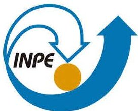

MINISTÉRIO DA CIÊNCIA, TECNOLOGIA, INOVAÇÕES E COMUNICAÇÕES

INSTITUTO NACIONAL DE PESQUISAS ESPACIAIS

sid.inpe.br/mtc-m21c/2018/10.18.19.41-TDI

# A CONCEPTUAL MBSE FRAMEWORK FOR SATELLITE AIT PLANNING

Eduardo Escobar Bürger

Doctorate Thesis of the Graduate Course in Space Engineering and Technology/Space Systems Engineering and Management, guided by Dr. Geilson Loureiro, approved in November 01, 2018.

URL of the original document:

<http://urlib.net/8JMKD3MGP3W34R/3S3JPME>

INPE

São José dos Campos

2019

<!-- PDF_PAGE: 2 -->

## PUBLISHED BY:

Instituto Nacional de Pesquisas Espaciais - INPE

Gabinete do Diretor (GBDIR)

Serviço de Informação e Documentação (SESID)

CEP 12.227-010

São José dos Campos - SP - Brasil

Tel.:(012) 3208-6923/7348

E-mail: pubtc@inpe.br

OF INPE INTELLECTUAL PRODUCTION (DE/DIR-544):

Chairperson:

Dr. Marley Cavalcante de Lima Moscati - Centro de Previsão de Tempo e Estudos Climáticos (CGCPT)

Members:

Dra. Carina Barros Mello - Coordenação de Laboratórios Associados (COCTE)

Dr. Alisson Dal Lago - Coordenação-Geral de Ciências Espaciais e Atmosféricas (CGCEA)

Dr. Evandro Albiach Branco - Centro de Ciência do Sistema Terrestre (COCST)

Dr. Evandro Marconi Rocco - Coordenação-Geral de Engenharia e Tecnologia Espacial (CGETE)

Dr. Hermann Johann Heinrich Kux - Coordenação-Geral de Observação da Terra (CGOBT)

Dra. Ieda Del Arco Sanches - Conselho de Pós-Graduação - (CPG)

Silvia Castro Marcelino - Serviço de Informação e Documentação (SESID)

DIGITAL LIBRARY:

Dr. Gerald Jean Francis Banon

Clayton Martins Pereira - Serviço de Informação e Documentação (SESID)

DOCUMENT REVIEW:

Simone Angélica Del Ducca Barbedo - Serviço de Informação e Documentação (SESID)

André Luis Dias Fernandes - Serviço de Informação e Documentação (SESID)

ELECTRONIC EDITING:

Ivone Martins - Serviço de Informação e Documentação (SESID)

Murilo Luiz Silva Gino - Serviço de Informação e Documentação (SESID)

<!-- PDF_PAGE: 3 -->

MINISTÉRIO DA CIÊNCIA, TECNOLOGIA, INOVAÇÕES E COMUNICAÇÕES

INSTITUTO NACIONAL DE PESQUISAS ESPACIAIS

sid.inpe.br/mtc-m21c/2018/10.18.19.41-TDI

# A CONCEPTUAL MBSE FRAMEWORK FOR SATELLITE AIT PLANNING

Eduardo Escobar Bürger

Doctorate Thesis of the Graduate Course in Space Engineering and Technology/Space Systems Engineering and Management, guided by Dr. Geilson Loureiro, approved in November 01, 2018.

URL of the original document:

<http://urlib.net/8JMKD3MGP3W34R/3S3JPME>

INPE

São José dos Campos

2019

<!-- PDF_PAGE: 4 -->

Bürger, Eduardo Escobar.

A conceptual MBSE framework for satellite AIT planning / Eduardo Escobar Bürger. - São José dos Campos : INPE, 2019.

xxvi + 195 p. ; (sid.inpe.br/mtc-m21c/2018/10.18.19.41-TDI)

Thesis (Doctorate in Space Engineering and Technology/Space Systems Engineering and Management) - Instituto Nacional de Pesquisas Espaciais, São José dos Campos, 2018. Guiding : Dr. Geilson Loureiro.

1. Satellite assembly. 2. Integration and tests. 3. MBSE. 4. AIT planning. I.Title.

CDU 629.7.018:629.783

Esta obra foi licenciada sob uma Licença Creative Commons Atribuição-NãoComercial 3.0 Não Adaptada.

This work is licensed under a Creative Commons Attribution-NonCommercial 3.0 Unported License.

<!-- PDF_PAGE: 5 -->

## Aluno (a): Eduardo Escobar Bürger

Título: "A CONCEPTUAL MBSE FRAMEWORK FOR SATELLITE AIT PLANNING"

Aprovado (a) pela Banca Examinadora em cumprimento ao requisito exigido para obtenção do Título de Doutor(a) em

Engenharia e Tecnologia Espaciais/Eng.

Gerenc. de Sistemas Espaciais

Dr. Walter Abrahão dos Santos

Presidente / INPE / São José dos Campos - SP

( ) Participação por Video - Conferência

(✓) Aprovado ( ) Reprovado

Dr. Gellson Loureiro

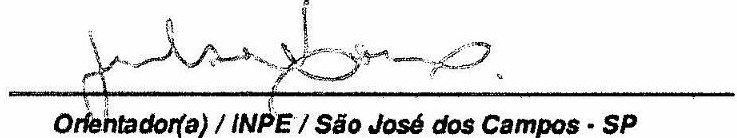

Dr. Adalberto Coelho

( ) Participação por Video - Conferência

Dr. Christopher Shneider Cerqueira

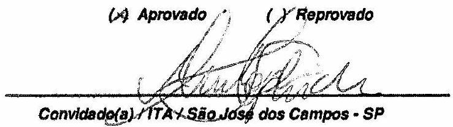

Dr. Luis Eduardo Vergueiro Loures da Costa

Convidado(a) / ITA / São José dos Campos - SP

( ) Participação por Video - Conferência

Este trabalho fol aprovado por:

( ) maloria simples

unanimidade

<!-- PDF_PAGE: 6 -->

<!-- PDF_PAGE: 7 -->

"Todo efeito tem uma causa. Todo efeito inteligente tem uma causa inteligente.

O poder da causa inteligente está na razão da grandeza do efeito. "

Alan Kardec

<!-- PDF_PAGE: 8 -->

<!-- PDF_PAGE: 9 -->

A minha família, meu bem maior.

<!-- PDF_PAGE: 10 -->

<!-- PDF_PAGE: 11 -->

## AGRADECIMENTOS

Agradeço a Deus pela oportunidade desta vida com saúde, alegria e muitas amizades.

Ao meu amigo protetor, que sempre está comigo.

A toda a minha família, que amo muito, pelo incentivo e carinho. Principalmente aos meus pais, Luis Fernando e Marilise, que além de serem o meu exemplo, nunca mediram esforços para me ajudar em tudo o que precisei, material e emocionalmente. E as minhas melhores amigas, minhas irmãs Juliana, Rafaela, meu irmão Adriano, e meu afilhado João Vitor.

Aos irmãos que pude escolher: Felippe, Guilherme, Mateus e Victor.

Aos amigos do Sopão Amigos da Rua, além de grandes amizades, com eles aprendi a satisfação que é poder ajudar a quem mais precisa.

A todos os amigos do Centro Espírita Seara de Luz, local de muito aprendizado onde fui acolhido com muito carinho.

A todos os amigos da Obra Social Célio Lemos, que com muito trabalho e dedicação, sempre animaram meus domingos com os almoços e pizzas beneficentes.

Ao meu orientador, Dr. Geilson Loureiro pela orientação neste trabalho. Pelas diversas dúvidas esclarecidas e ensinamentos. Mesmo ocupando um cargo que demanda muita dedicação, sempre me atendeu prontamente e me deu todo o suporte que precisei.

A todos os professores do curso CSE/ETE, principalmente a Dr $ ^{a} $ Maria do Carmo, Dr. Walter Abrahão, Dr $ ^{a} $ Ana Maria Ambrosio e Dr. Adalberto Coelho da Silva; com os quais além de receber grandes ensinamentos através das disciplinas e projetos, sempre contei com todo o apoio durante o curso.

Ao amigo Dr. Christopher, muita gratidão pela ajuda em várias fases críticas do Doutorado.

<!-- PDF_PAGE: 12 -->

Aos amigos do Projeto ITASAT, principalmente Prof. Loures que me recebeu no projeto.

A todos os colegas do CTEE/PG-ETE e CubeDesign.

Ao SPG e a secretaria do curso CSE, principalmente a Edleusa Aparecida Ferreira, que sempre disposta a ajudar, me deu muito apoio durante todo o curso.

A todos os funcionários da Biblioteca do INPE, principalmente a Laís, Simone e André.

Aos amigos do LIT, tecnologistas, funcionários e secretárias.

Ao Lino, por sempre manter as portas abertas do LSIS/LIT, laboratório que muito me fez crescer profissionalmente.

Aos colegas do laboratório LSIS/LIT Renato, Roy, Brenda e Priscila.

Aos amigos do projeto AESP-14 Cleber e Mateus.

A todos os amigos de São José dos Campos e amigos gaúchos residentes nesta cidade.

A CAPES e CNPq pela bolsa de estudos.

Ao INPE, que me proporcionou toda a infraestrutura necessária para o desenvolvimento do trabalho.

<!-- PDF_PAGE: 13 -->

## ABSTRACT

This work is about satellite assembly, integration and testing. The main purpose of this work is to present a conceptual framework that provides product related inputs for satellites AIT planning using MBSE during system design. After in-orbit insertion satellites are, in most cases, not repairable. Coupled with the high systems complexity, high costs, and severity of the launch and space environments, satellites need to be rigorously assembled, integrated and tested (AIT) in order to guarantee their functions and performance in space. The main AIT objective is to obtain a high reliability level system to fulfill the specified performance parameters. The AIT process involves huge team effort, and represents one of the major parts of the cost and schedule of space programs. The current AIT literature is focused on the activities efficiency (using less resources), as well as in the use of Concurrent Engineering to anticipate requirements to the initial phases of the project. Model Based Systems Engineering (MBSE) is used to deal with complex systems such as spacecraft. The models permit a singular understanding of a matter, contrasting to the traditional written language and document-centric systems engineering, which often leads to ambiguous or diverse interpretation depending on the viewer perspective. Far beyond the communication benefits, several researches indicate that MBSE may also improve quality, productivity and reduce risks. This work introduces MBSE to address satellite AIT challenges. The work brings a conceptual framework that considers the use of MBSE products to provide early inputs for satellite AIT planning. The framework application is demonstrated in the AIT of a university small satellite. The proposed framework showed that it promotes the contribution of the AIT team to product design, while captures in models approximately 91% of product related inputs that form the basis of AIT planning.

Keywords: Satellite assembly, integration and tests. MBSE. AIT planning.

<!-- PDF_PAGE: 14 -->

<!-- PDF_PAGE: 15 -->

# UM FRAMEWORK CONCEITUAL DE MBSE PARA O PLANEJAMENTO DO AIT DE SATÉLITES

## RESUMO

Este trabalho trata sobre montagem, integração e testes de satélites. O principal objetivo do trabalho é apresentar um framework conceitual que forneça entradas relacionadas ao produto para o planejamento de AIT de satélites durante as fases iniciais de projeto do sistema. Após a inserção em órbita os satélites, na maioria dos casos, não são reparáveis. Juntamente com a alta complexidade dos sistemas, os altos custos e a severidade dos ambientes de lançamento e espacial, os satélites precisam ser rigorosamente montados, integrados e testados (AIT) para garantir suas funções e desempenho no espaço. O principal objetivo do AIT é obter um sistema de alto nível de confiabilidade para atender aos parâmetros de desempenho específicos. O processo de AIT envolve um grande esforço de equipe e representa uma das principais partes do custo e do cronograma de programas espaciais. As atuais pesquisas em AIT de satélites focam na eficiência das atividades (usando menos recursos), bem como no uso de engenharia simultânea para antecipar os requisitos às fases iniciais do projeto. A engenharia de sistemas baseada em modelos (MBSE) é usada para lidar com sistemas complexos como os satélites. Os modelos permitem uma compreensão singular de um assunto, contrastando com a linguagem escrita tradicional centrada em documentos, a qual muitas vezes leva a uma interpretação ambígua, dependendo da perspectiva do espectador. Muito além dos benefícios de comunicação, várias pesquisas indicam que o MBSE também pode melhorar a qualidade, a produtividade e reduzir os riscos dos projetos. Este trabalho introduz o MBSE para abordar os desafios do AIT de satélites. O trabalho apresenta um framework conceitual que considera o uso do MBSE para fornecer entradas para o planejamento do AIT de satélites. A aplicação do framework é demonstrada no AIT de um pequeno satélite universitário. O framework proposto mostrou que fomenta a contribuição do time de AIT com o projeto do produto, enquanto captura em modelos aproximadamente 91% das entradas relacionadas ao produto que formam a base do planejamento do AIT.

Palavras-chave: Montagem, integração e testes de satélites. MBSE. Planejamento de AIT.

<!-- PDF_PAGE: 16 -->

<!-- PDF_PAGE: 17 -->

## LIST OF FIGURES

Figure 1.1 - Cartoon showing the problems of multiple interpretations in written language. ... 2

Figure 2.1 - “V” model representation. ... 8

Figure 2.2 – AIT composition. ... 9

Figure 2.3 - General AIT sequence. ... 11

Figure 2.4 - MBSE information model. ... 15

Figure 3.1 - Bibliometry with the gathered search data. ... 20

Figure 4.1 - AIT engineer desktop documents and their relations. ... 30

Figure 4.2 - AIT general requirements input documents and their specific input information. ... 36

Figure 4.3 - AIT quality assurance plan input documents and their specific input information. ... 37

Figure 4.4 - AIT master plan input documents and their specific input information... 38

Figure 4.6 - Electrical test plan input documents and their specific input information. 40

Figure 4.7 - AIT technical flowcharts input documents and their specific input information. ... 41

Figure 4.8 - Flow of information between AIT documents and other project documents. ... 42

Figure 5.1 - Relationship between the conceptual framework, traditional AIT, system development and MBSE. ... 49

Figure 5.2 - BPMN macro flowchart of the proposed conceptual framework. ... 50

Figure 5.3 - IDEF-0 showing the framework steps objectives’ stereotype. ... 52

Figure 5.4 - Integration framework. ... 55

Figure 5.5 - Meta-model to identify integration stages’ verification content and external main functions. ... 69

Figure 5.6 - Meta-model showing how to use product integration stages model views. ... 74

<!-- PDF_PAGE: 18 -->

Figure 5.7 - Environmental framework. ... 76

Figure 5.8 - Illustration of step 2.1 objectives. ... 77

Figure 6.1 - AESP-14 Nanosatellite. ... 82

Figure 6.2 - AESP-14 Electrical architecture diagram. ... 83

Figure 6.3 - AESP-14 CubeSat vibration tests at LIT/INPE. ... 84

Figure 6.4 - AESP-14 AIT documentation structure. ... 85

Figure 6.5 - AESP-14 being ejected from ISS’s Kibo Module. ... 87

Figure 6.6 - Operational capability blank ... 89

Figure 6.7 - Operational activity model view. ... 89

Figure 6.8 - Operational entity scenario. ... 90

Figure 6.9 - System architecture. ... 91

Figure 6.10 - System functional breakdown. ... 92

Figure 6.11 – System exchange scenario. ... 93

Figure 6.12 - Logical architecture blank with filters to ease the identification of subsystems and interfaces. ... 95

Figure 6.13 - Logical architecture, showing the subsystems, functions, functional chains (blue and red paths), and interfaces (functional and physical). ... 96

Figure 6.14 - Satellite logical function breakdown. ... 98

Figure 6.15 - Logical exchange scenario ... 99

Figure 6.16 - Representation of the logical architecture model view with the previously defined high-level functional integration sequence. ... 101

Figure 6.17 - Physical component breakdown model view. ... 105

Figure 6.18 - Physical entity scenario. ... 106

Figure 6.19 - Physical architecture model view. ... 108

Figure 6.20 - Stage 1 physical architecture integration model view. ... 110

Figure 6.21 - Window showing the features of the selected interface #1 Bus. ... 111

Figure 6.22 - Relationship between external systems functions and satellite (1). ... 113

Figure 6.23 - Relationship between external systems functions and satellite (2). ... 114

Figure 6.24 - Stage 2 physical architecture integration model view. ... 116

<!-- PDF_PAGE: 19 -->

Figure 6.25 - Filtered view of the stage 2 physical architecture. ... 117

Figure 6.26 - Filtered view of the stage 3 physical architecture. ... 119

Figure 6.27 - Physical architecture model view representing the integration scenario.

... 122

Figure 6.28 - Physical architecture model view representing the integration scenario

external systems... 123

Figure 6.29 - Stage 1 model view (EPS + TT&C) (filtered view 1). ... 125

Figure 6.30 - Stage 1 model view (EPS + TT&C) (filtered view 2). ... 126

Figure 6.31 - Electrical test #1 verification path... 131

Figure 6.32 - Physical architecture model view of AESP-14 in thermal-vacuum scenario.

... 133

Figure 6.33 - Physical architecture model view of AESP-14 in vibration scenario... 133

Figure 6.34 - Satellite and external systems physical on vibration scenario. ... 135

Figure 6.35 - Satellite and external systems physical on thermal-vacuum scenario... 137

Figure A.1 – Capella datasheet (1)... 163

Figure A.2 – Capella datasheet (2)... 164

Figure A.3 – Capella datasheet (3)... 165

Figure A.4 – Capella datasheet (4)... 166

<!-- PDF_PAGE: 20 -->

<!-- PDF_PAGE: 21 -->

## LIST OF TABLES

Table 2-1 - Main objectives of main AIT documents... 13

Table 3-1 - Summary of literature review main contributions... 25

Table 5-1 - Step 1.1 main objectives, inputs, outputs and analysis criteria... 57

Table 5-2 - Step 1.1 MBSE views and associated information ... 58

Table 5-3 - Step 1.2 main objectives, inputs outputs and analysis criteria... 61

Table 5-4 - Step 1.2 MBSE views and associated information ... 62

Table 5-5 - Step 1.3 main objectives, inputs, outputs and analysis criteria... 65

Table 5-6 - Step 1.3 MBSE views and associated information ... 66

Table 5-7 - Step 1.4 main objectives, inputs, outputs and analysis criteria... 71

Table 5-8 - Step 1.4 MBSE main views and associated information... 72

Table 5-9 - Step 2.1 main objectives, inputs and outputs... 77

Table 5-10 - Step 2.2 main objectives, inputs and outputs... 78

Table 6-1 - AESP-14 documents... 86

Table 6-2 - Step 1.1 objectives, predefined questions and outputs ... 88

Table 6-3 - Step 1.2 objectives, predefined questions and outputs... 94

Table 6-4 - Step 1.3 objectives, predefined questions and outputs... 103

Table 6-5 - Step 1.4 objectives, predefined questions and outputs... 121

Table 6-6 - Step 2.1 objectives and outputs... 132

Table 6-7 - Step 2.2 objectives and outputs... 134

Table 7-1 - Comparisons between traditional AIT and the proposed framework... 146

<!-- PDF_PAGE: 22 -->

<!-- PDF_PAGE: 23 -->

AIT Assembly, integration and testing

AIV Assembly Integration and Verification

ANT Antennas

ARCML ARCADIA Modeling Language

CAD Computer Aided Design

CAN Controller Area Network

CBERS China-Brazil Earth-Resources Satellite

COM Communication Subsystem

DSML Domain Specific Modeling Language

ECSS European Cooperation For Space Standardization

EGSE Electrical Ground Support Equipment

EMC Electro-magnetic Compatibility

EMI Electro-Magnetic Interference

EPS Electric Power Subsystem

ESA European Space Agency

ESD Electro-Static Discharge

GS Ground Station

GSE Ground Support Equipment

IAC International Astronautical Congress

IAF International Astronautical Federation

INPE Instituto Nacional de Pesquisas Espaciais

ISS International Space Station

ITA Instituto Tecnológico da Aeronáutica

JAXA Japan Aerospace Exploration Agency

JEM Japanese Experiment Module

J-SSOD JEM Small Satellite Orbital Deployer

JTag Joint Test Action Group

LAB Logical Architecture Blank

LES Logical Entity Scenario

LFBD Logical Functional Breakdown

LIT Laboratório de integração e Testes

<!-- PDF_PAGE: 24 -->

MATES Model and Test Effectiveness Study

MBSE Model-Based Systems Engineering

MBSE Model-Based System Integration

MBV&V Model-Based Verification and Validation

MGSE Mechanical Ground Support Equipment

N/A Not Applicable

OAB Operational Activity Blank

OBDH On-Board Data Handling Subsystem

OCB Operational Capability Blank

OCOE Overall Check-Out Equipment

OES Operational Entity Scenario

PAB Physical Architecture Blank

PC Personal Computer

PCBD Physical Component Breakdown

PES Physical Entity Scenario

POD Picosatellite Orbital Deployer

QA Quality Assurance

RF Radio Frequency

SAB System Architecture Blank

SAG Sola Array Generator

SCOE Special Check-Out Equipment

SE Systems Engineering

SES System Exchange Scenario

SFBD System Function Breakdown

SSVT Space Systems Visualization Tool

STR Structure Subsystem

SysML Systems Modeling Language

TT&C Telemetry, Tracking and Command Sybsystem

TVAC Thermal Vacuum Test

USB Universal Serial Bus

V&V Verification and Validation

VSD Virtual Spacecraft Design

<!-- PDF_PAGE: 25 -->

## SUMMARY

1 INTRODUCTION ... 1

1.1. Motivation ... 1

1.2. General Objectives ... 3

1.3. Specific Objectives ... 4

1.4. Methodology ... 5

1.5. Thesis outline ... 5

2 THEORETICAL FOUNDATION ... 7

2.1. Fundamentals of satellite assembly, integration and tests ... 7

2.1.1. AIT in the systems engineering context ... 7

2.1.2. Assembly, integration and tests ... 9

2.1.3. AIT standards ... 10

2.1.4. AIT sequence ... 11

2.1.5. AIT documentation ... 12

2.1.6. Infrastructure ... 13

2.1.7. Ground support equipment ... 14

2.2. Model-Based Systems Engineering ... 15

2.2.1. Why modelling? ... 16

2.2.2. Pillars of systems modelling ... 16

3 LITERATURE REVIEW ... 19

3.1. Research gap ... 26

4 THE INPUTS FOR SPACE PRODUCTS AIT ... 29

4.1. AIT documentation ... 29

4.2. AIT information within documents ... 30

4.2.1. AIT general requirements ... 31

4.2.2. AIT quality assurance plan ... 33

4.2.3. AIT master plan ... 33

4.2.4. AIT master flowchart ... 33

<!-- PDF_PAGE: 26 -->

4.2.5. Electrical tests plan... 34

4.3. AIT planning source of inputs... 34

5 AIT PLANNING CONCEPTUAL FRAMEWORK ... 45

5.1. Introduction... 45

5.2. Assumptions and considerations ... 45

5.3. Conceptual framework description... 48

5.4. Part I: Integration planning ... 52

5.4.1. Step 1.1... 56

5.4.2. Step 1.2... 60

5.4.3. Step 1.3... 64

5.4.4. Step 1.4... 70

5.5. Part II: Environmental testing planning ... 75

5.5.1. Step 2.1... 76

5.5.2. Step 2.2... 78

6 FRAMEWORK USE CASE APPLICATION... 81

6.1. The AESP-14 Project... 81

6.2. Modeling AESP-14 ... 88

6.3. Framework application ... 88

6.3.1. Part I – Integration modeling ... 88

6.3.1.1. Step 1.1... 88

6.3.1.2. Step 1.2... 94

6.3.1.3. Step 1.3... 103

6.3.1.4. Step 1.4... 120

6.3.2. Part II – Environmental tests modeling... 132

6.3.2.1. Step 2.1... 132

6.3.2.2. Step 2.2... 134

7 DISCUSSION ... 141

7.1. Framework vs. theoretical foundation... 141

7.2. Framework vs. literature review... 147

<!-- PDF_PAGE: 27 -->

7.3. Framework vs. use case ... 148

8 CONCLUSION ... 151

8.1. Objectives attainment ... 151

8.2. Contributions ... 152

8.3. Future works ... 153

REFERENCES ... 155

ANNEX A - ARCADIA DATASHEET ... 163

APPENDIX A - AESP-14 MODELING ... 167

<!-- PDF_PAGE: 28 -->

<!-- PDF_PAGE: 29 -->

## 1 INTRODUCTION

## 1.1. Motivation

Theoretical foundation and literature review on satellite assembly, integration and tests-AIT show the theme is very little explored, but of great value for development of space products. Detailed information about foreign space programs AIT is most often restricted due to industrial confidentiality issues or government policies. Systems engineering researches (main area in which AIT is inserted) generally describe procedures or guides for systems development but rarely address AIT activities (SILVA, 2011). Even major references on space systems engineering, such as books and standards, approach the subject superficially (FTI, 2015). Although it is not well explored, its importance is legitimated by the high values involved in this phase. AIT consumes approximately 35% of recurrent costs (WEIGEL, 2000) and on average uses 23% of the development lifecycle schedule (ANDERSON, 2005). Consequently, most of the published studies in this topic focus on the investigation and characterization of variables that influence such values, or methods to reduce them (BAGHAL, 2010; YEE, 2005; WEIGEL, 2000; WEIGEL, 2001; SILVA, 2011; ANDERSON, 2005).

The AIT process is also very important for small satellites. Space products are becoming more complex and smaller with the increasing adoption of small satellites since 2000s. AIT plays an essential role for small satellite projects since the extensive use of Comercial Off-The-Shelf - COTS (non spacequalified components) and low budget may affect their reliability in space, requiring a stringent product verification.

Due to the amount of problems found during AIT, this process ends up redesigning some parts of the satellite and fixing problems from early phases, what leads to higher costs and schedule. AIT engineers often inherit a finalized design, being required to deal during AIT with problems that could have been avoided had their perspective been included in the design process. This

<!-- PDF_PAGE: 30 -->

indicates the need to promote the AIT engineers to be involved in the early phases of project design, and start AIT planning right from the beginning of project lifecycle.

The AIT process is traditionally document-centric, and involves a large amount of documents. The AIT of a single satellite may reach hundreds of documents that shall be kept updated so everyone have the same information. This takes a huge team effort, and often leads to problems across different disciplines and phases due to communication gaps and misunderstandings. Figure 1.1 shows a cartoon that exemplifies the problems involved in written language. Sometimes different documents carry the same information, and sometimes both information do not match, which may cause unexpected outcomes.

Figure 1.1 - Cartoon showing the problems of multiple interpretations in written language.

Model-based systems engineering - MBSE has the potential to solve these problems by changing the current situation of document-centric to a modelcentric approach. This change provides a shared system model across all disciplines, unifying the system understandment. Far beyond the

<!-- PDF_PAGE: 31 -->

communication benefits, several researches indicates that MBSE may also improve quality, productivity and reduce risks. MBSE is being well adopted within space products development, however, it is generally a product-focused approach, and devotes little efforts to the development of other lifecycle processes such as AIT.

The motives described above provided opportunity for this research. This work is based on satellite AIT planning inputs, and proposes a conceptual framework to early involve AIT engineers and achieve part of these inputs on early project phases through MBSE.

## 1.2. General Objectives

The main objective of this work is to present a conceptual framework for satellite AIT based on model-based systems engineering.

Traditional MBSE is focused on product (system-of-interest) and does not include other system lifecycle phases such as AIT. Traditional AIT planning is based on several documents as inputs of information. Then, the framework herein proposed targets to adapt the traditional MBSE approach so that, from early phases, the AIT is planned simultaneously to the product design. Therefore, the core question that drives this study is:

"How can we use MBSE to help us support Satellite AIT, organize AIT work and improve the AIT process?"

That above driven question leads to other two questions for previous analysis, which are:

- Question 1: "What do AIT engineers need to know in terms of information, usually expressed in documents, to perform satellite AIT planning?"

- Question 2: "What are the sources of information that build the AIT planning documents?"

<!-- PDF_PAGE: 32 -->

This study proposes to advance the frontier of knowledge in the satellite AIT area, becoming the first step towards the change of approach from a documentcentric to a model-centric satellite AIT process.

## 1.3. Specific Objectives

The specific objectives of the work are:

- Identify the main inputs to perform a satellite AIT, which are usually expressed in documents;

- Identify the traditional sources of information that build these inputs;

- Develop a conceptual framework based on MBSE products that provide inputs to plan a satellite AIT process and organization. MBSE products refer to all diagrams (model views) generated during the traditional MBSE process, which is traditionally product-focused, and does not approach all system lifecycle phases;

- Apply the framework to a case study for illustrating how the framework should be used, providing data so it can be evaluated against its outcomes, worthiness and relevance of its application;

- Assess the framework and the use case study for concluding about the appropriateness of the framework, situating the findings in reference to theoretical foundation and literature review.

<!-- PDF_PAGE: 33 -->

## 1.4. Methodology

The nature of this thesis is applied research (SILVA and MENEZES, 2001), and it covers the proposed objectives in an exploratory way (GIL, 2002), approaching the problem in a qualitative way (MARTINS, 2000).

The methodology used in this study is as follows:

1. Theoretical basis focused on space products AIT and MBSE;

2. Investigation of existing processes and methods by means of a literature research based on journals, books, manuals, standards and INPE projects documentation;

3. Identification of space products AIT planning documentations and their inputs;

4. Development of a conceptual framework that capture these inputs for AIT planning while product models are being developed;

5. Applying the framework in a use case of a small satellite project that was part of the author's master thesis;

6. Comparing the framework with traditional AIT, findings of literature research and use case.

## 1.5. Thesis outline

Chapter 2 provides a theoretical foundation to situate the reader on basic concepts of AIT and MBSE used throughout this thesis.

Chapter 3 develops a literature review on recent researches with a similar objective than this work.

Chapter 4 focuses on identifying the required inputs to plan space products AIT. Chapter 5 presents a detailed description of the proposed framework, core of this thesis.

Chapter 6 contains an application of the framework in a real space product.

Chapter 7 demonstrates the contribution of the framework by means of comparisons with previous Chapters findings.

<!-- PDF_PAGE: 34 -->

Chapter 8 concludes this work, providing a brief description of objectives attainment, contributions, limitations and future works.

ANNEX I presents a datasheet with a brief description of ARCADIA principles, the chosen method of modeling.

APPENDIX I presents the modeling of AESP-14, a university small satellite used herein as a use case application project.

<!-- PDF_PAGE: 35 -->

## 2 THEORETICAL FOUNDATION

This chapter builds the foundations of major concepts used to develop this work. The first section addresses satellite assembly, integration and tests-AIT. The second section addresses model-based systems engineering-MBSE.

## 2.1. Fundamentals of satellite assembly, integration and tests

As part of literature (NASA, 2007; PISACANE, 2005; SILVA, 2011a; BAGHAL, 2010), this work uses the expression 'assembly, integration and tests - AIT' for the acceptance phase performed in satellite flight models.

## 2.1.1. AIT in the systems engineering context

Systems engineering is a multidisciplinary approach of engineering, with the objective of obtaining a balanced solution to the problem presented by the stakeholders. It transforms requirements into a system solution. (ECSS, 2012; LOUREIRO, 1999). The AIT is an important part within systems engineering.

According to Silva (2011a), in the development of complex systems, especially related to the aerospace area, there is a gradual increase in the importance of AIT engineering as part of systems engineering.

For Mercer (2000), the development of complex systems, especially in aerospace industry, is leading to a large increase in the importance of testing as part of the systems engineering process.

Systems engineering processes in the space area are generally represented by the "V" model (Figure 2.1). This approach is based on requirements, and is characterized by having a correlation between left and right "V" activities at each level (FORSBERG, 1998).

<!-- PDF_PAGE: 36 -->

Figure 2.1 - "V" model representation.

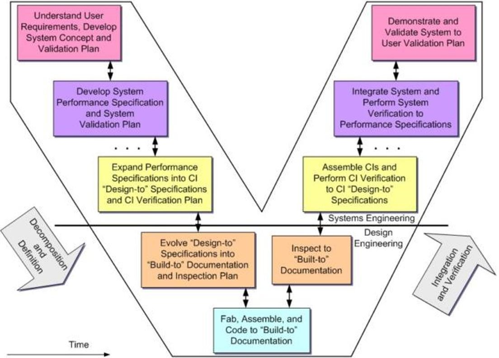

Source: Estefan (2008)

These correlations constitute the product verification activity. Verification is a fundamental part of the systems engineering process. Verification provides confirmation at all levels of assembly (part, equipment, subsystem and system) that product is being constructed correctly (AEROSPACE CORPORATION, 2006).

Verification can be performed through methods such as analysis, test, project review, inspection (ECSS, 2012; NASA, 2007), similarity (AEROSPACE CORPORATION, 2006), demonstration and process control (SMC, 2005).

The set of requirements verification activities by mean of testing method, together with the assembly and integration, form the AIT process (Figure 2.2).

<!-- PDF_PAGE: 37 -->

Figure 2.2-AIT composition.

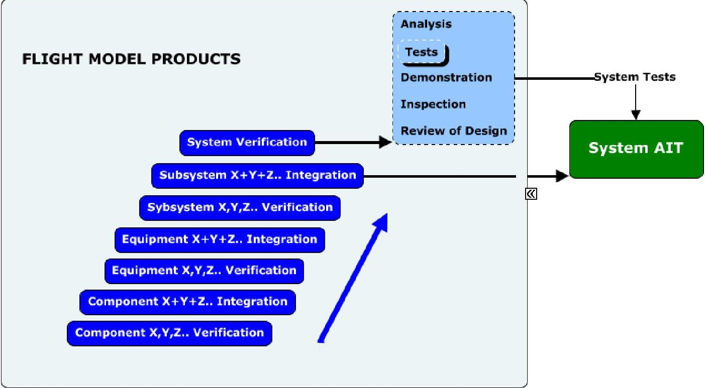

Source: by the author

The process of assembling, integrating and testing the flight model occurs repeatedly in phase D of space projects (ECSS, 2012; NASA, 2007), from the lowest assembly levels to the formation of a complete system. Therefore, AIT is part of the scope of the System Engineering effort.

## 2.1.2. Assembly, integration and tests

In most cases, after orbit insertion satellites cannot be repaired. Coupled with the high systems complexity and rigorous environments in which satellites are exposed, they need to be rigorously verified during AIT. This tends to avoid premature failures, or "infant mortality."

The main objective of satellites AIT is to obtain a high level of system reliability to meet the specified performance parameters (SILVA, 2009a). Considering that the satellite already had the project verified in the qualification phase, AIT

<!-- PDF_PAGE: 38 -->

(acceptance) identifies essentially labor faults or latent defects of materials and components.

Assembly is a mechanical operation, comprising the positioning, fixing and interconnection of each of the satellite parts (SILVA, 2011). Assembly may also be known as mechanical integration.

Integration are assembly operations and confirmation that parts properly work when interconnected (PISACANE, 2005).

Environmental tests determine characteristics that are verified through requirements related to system performance or functions during or after exposure to simulated environmental loads, whether dynamics, electromagnetic or thermal-vacuum. In the case of the flight element, Pisacane (2005) points out the necessary care with system environmental tests, since they should not overstress it, while at the same time ensuring that the simulated environment is sufficient to notice nonconformities.

Functional tests are electrical or mechanical tests performed to evaluate functions or system performance, and together with interfaces connections verification it forms the electrical integration.

## 2.1.3. AIT standards

There are several standards applicable to satellite AIT development. All of them follow the same basic philosophies, however they differ in terms of sequence of specific tests, levels and duration of environmental exposure and documentation (WEIGEL, 2001).

The requirements of the adopted standard should be adapted (to more or less) according to a programmatic analysis of implications of each requirement. This analysis includes not only programmatic constraints, costs, and benefits, but

<!-- PDF_PAGE: 39 -->

also the risks and costs associated with non-use of certain requirements (DEPARTMENT OF DEFENSE, 1999).

The main standards applied to AIT satellites are:

- MIL-STD-1540C - Product Verification Requirements for Launch, Upper-Stage, and Space Vehicles;

- NASA Systems Engineering Handbook;

- ECSS-E-ST-10-02C and 03C;

- ISO 15864: 2004 Space systems - General test methods for spacecraft, subsystems and units.

## 2.1.4. AIT sequence

The general canonical sequence of satellites AIT is illustrated in Figure 2.3:

Figure 2.3 - General AIT sequence

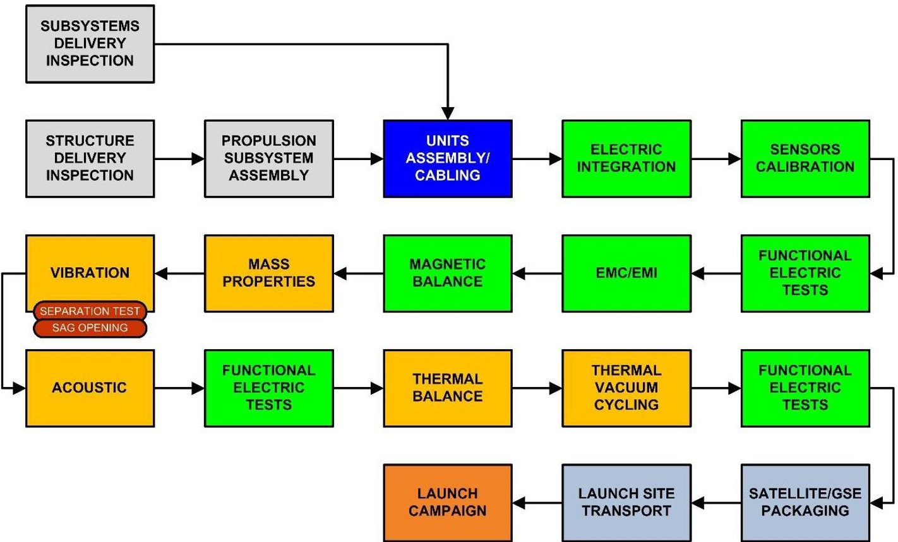

Source: Adapted from Silva (2011a)

<!-- PDF_PAGE: 40 -->

The order of AIT realization is usually defined by two rules: keeping the same order of environments that satellite will pass, and detecting nonconformities as early as possible (ECSS, 2012).

The cost of testing is also a relevant factor that must be taken into account when selecting a sequence. Thermal-Vacuum tests, for example, due to the high associated costs, tend to be carried out last in the sequence of environmental tests.

An additional benefit associated with the sequence of Figure 2.3 is the aid in detecting problems caused by dynamic tests, which sometimes only manifest themselves in identifiable form after stresses of thermal-vacuum tests (PISACANE, 2005).

## 2.1.5. AIT documentation

A brief description of the main AIT documents objectives is showed in Table 2.1.

<!-- PDF_PAGE: 41 -->

Table 2-1 - Main objectives of main AIT documents.

<table border="1"><tr><td>Document</td><td>Objective</td></tr><tr><td>Test specification</td><td>Details test requirements. It shall contain items such as test objectives, required support equipment, conditions, sequence of activities, success criteria, organization and responsibilities, relationship to product assurance activities and timeline (BRANCO, 2014).</td></tr><tr><td>AIT requirements</td><td>Discriminates AIT requirements for each activity to be developed during satellite AIT (SILVA, 2011a).</td></tr><tr><td>AIT Plan</td><td>Organizes AIT activities in the most efficient way in terms of schedule and budget. Evaluates whether the system/subsystem meets all functional and performance requirements. Certifies that all mandatory environmental tests for system acceptance are performed (SILVA, 2011a).</td></tr><tr><td>AIT Quality Assurance Plan</td><td>Organizes and controls AIT activities, provides support for project reviews, activities related to satellite testing, test enabling systems and activities during launch campaign (SILVA, 2009a).</td></tr><tr><td>Procedures</td><td>Procedures describe step-by-step instructions for each test activity (derived from test specifications) (BRANCO, 2014).</td></tr><tr><td>Reports</td><td>Reports contains information about test results, emphasizing compliance with the corresponding requirements for closing them in verification control board (VCB) (BRANCO, 2014).</td></tr></table>

Source: by the author

## 2.1.6. Infrastructure

The facility's capability and test equipment to perform the various functions (in terms of performance and calibration) should be verified as part of the overall AIT process (ECSS, 2009).

Specific requirements and "good practices" on AIT infrastructure are found in ECSS-Q-ST-20-07C - Quality and safety assurance for space test centers (ECSS, 2013), and in PISACANE (2005).

<!-- PDF_PAGE: 42 -->

## 2.1.7. Ground support equipment

Ground Support Equipment (GSE) is used to test, operate or simulate conditions during assembly, integration, testing, and launching base operations (adapted from PISACANE, 2005).

GSEs can be complex systems of hardware and software. In some programs, many resources are directed to the development or acquisition of such equipment.

The MATES study (Model and Test Effectiveness Study) investigates the AIV process (assembly, integration and verification) of the satellites of the European Space Agency (ESA), identifying its main cost factors. It has been found that within the scope of AIV costs (assembly, integration and verification), the GSEs have a substantial percentage of the total value (RAIMONDO, 2001).

These equipment are classified in Mechanical Ground Support Equipment (MGSE) and Electrical (Electrical Ground Support Equipment (EGSE) (PISACANE, 2005).

MGSE has the functions of supporting satellite mechanical operations, satellite mechanical tests, and satisfying handling, storage and transport requirements. MGSE has four subdivisions: handling equipment, transport and storage, integration and test equipment (SILVA, 2011a).

EGSE has functions of supporting subsystems electrical integration, systemic functional tests, satellite control and monitoring during environmental tests and interface tests between satellite and launcher. EGSE has two subdivisions (SILVA, 2011a):

- OCOE (Overall Checkout Equipment): A system that has functions such as preparation for testing, test process management, data processing and monitoring, data archiving and reproduction, real-time test driving and graphical parameters display (WANG, 2011).

<!-- PDF_PAGE: 43 -->

- SCOE (Special Checkout Equipment): A system that essentially simulates satellite parts (subsystems) during AIT activities (CONRATH, 2012).

## 2.2. Model-Based Systems Engineering

Since the decade of 2000, systems engineering is experiencing a big and fast change of paradigm with the use of models specific to such discipline, being called as model-based systems engineering.

MBSE formalizes the practice of systems engineering using models, including various modeling domains, resulting in quality and productivity improvements and lower risks (HART, 2015).

A model is an abstract view of reality, in which important properties are captured, and others are removed, depending on the importance for the problem at hand. The Figure 2.4 shows an information model of MBSE.

Figure 2.4 - MBSE information model.

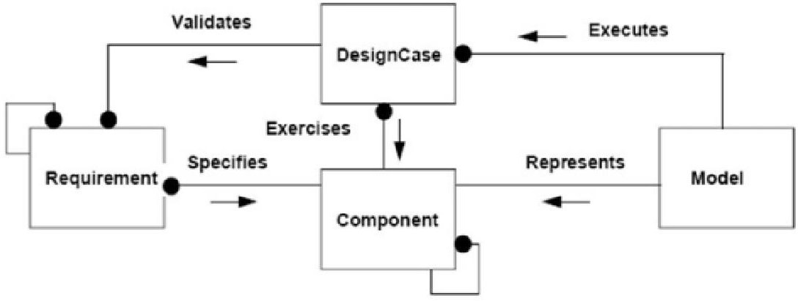

Source: Estefan (2008)

According to INCOSE (2007), MBSE is defined as:

"[...] the formalized application of modeling to support system requirements, design, analysis, verification and validation activities

<!-- PDF_PAGE: 44 -->

beginning in the conceptual design phase and continuing throughout development and later life cycle phases".

MBSE changes a rooted paradigm of document-centric to a model-centric approach. This shifting allows different engineering teams to rapidly understand design change impacts, to better communicate between teams with different backgrounds and to perform an early assessment on system design.

## 2.2.1. Why modelling?

Models can perform different things. Models can be analyzed, they can help in understanding a problem, they can form the basis for building a system, for testing it, and for diagnosing it, and for simulating in the case they are expressed in an executable language. Models can represent physical elements such as systems and subsystems but also it can represent processes, such as the integration and test process. Models can be made a priori to guide and analyze design, or a posteriori to analyze, test, or diagnose an existing system. Different models can be made representing the same system, each one with a different viewpoint that focuses on a different kind of properties, e.g., a functional model, a cost model, or a reliability model (TRETMANS, 2007)

## 2.2.2. Pillars of systems modelling

The implementation of MBSE depends on a basic tripod, composed by modeling language, modeling tool, and modeling methodology (DELLIGATTI, 2014).

A MBSE language is a set of rules that standardizes the concepts of graphical notations, syntax and semantics. Using these rules the models can have an unique interpretation of their meaning of components and structure. Therefore, the use of a standardized modeling notation is helpful in avoiding ambiguity.

<!-- PDF_PAGE: 45 -->

More detailed information regarding modeling languages are found in Reichwein (2001).

A MBSE tool is generally a software that permits the representation of models in a determined modeling language.

A MBSE methodology can be characterized as the collection of related processes, methods, and tools used to support the discipline of systems engineering in a "model- based" or "model-driven" context. A complete survey of MBSE methodologies can be found in Estefan's work (ESTEFAN, 2008)

<!-- PDF_PAGE: 46 -->

<!-- PDF_PAGE: 47 -->

## 3 LITERATURE REVIEW

The chapter describes a literature review of space products AIT methods, analyses, processes and frameworks that focus on the effort to improve this phase somehow, either by reducing costs, time, or by improving its efficiency. The chapter also provides a review on works that specifically related AIT with MBSE efforts.

The research was performed in Web of Science, Google Scholar, and Scopus scientific citation services, which include several important engineering databases, journals and proceedings. The most recent International Astronautical Congresses (IAC/IAF) proceedings were also reviewed. The following searching keywords were used in this investigation: 'AIT'; 'AI&T'; 'spacecraft AIT'; 'assembly, integration and tests'; 'V&V' and 'AIV'. Figure 3.1 shows a bibliometry with the gathered search data (Scopus database) considering the last 10 years and ordered by country of origin.

The bibliometry results show an increasing number of publications involving AIT since past ten years. This growth is associated with the current increase of small satellite projects (which have shown low reliability), consequently a lot more researchers and engineers are concerned with AIT because this phase is directly related to satellite failures. Figure 3.1 also shows the reduced number of Brazilian publications regarding AIT scope, comparing to other countries. This reinforces the importance and the scientific community interest on this important subject to space products development, as well the need to promote this field of knowledge in Brazil.

<!-- PDF_PAGE: 48 -->

Figure 3.1 - Bibliometry with the gathered search data.

<table border="1"><tr><td>Year</td><td>Documents</td></tr><tr><td>2018</td><td>6</td></tr><tr><td>2017</td><td>81</td></tr><tr><td>2016</td><td>109</td></tr><tr><td>2015</td><td>76</td></tr><tr><td>2014</td><td>63</td></tr><tr><td>2013</td><td>68</td></tr><tr><td>2012</td><td>65</td></tr><tr><td>2011</td><td>29</td></tr><tr><td>2010</td><td>23</td></tr><tr><td>2009</td><td>16</td></tr><tr><td>2008</td><td>9</td></tr></table>

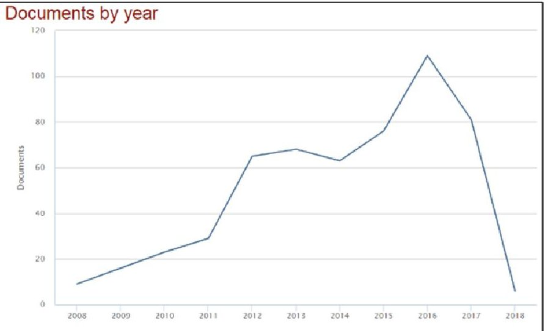

<table border="1"><tr><td>Country/Territory</td><td>Documents</td></tr><tr><td>United States</td><td>217</td></tr><tr><td>Germany</td><td>77</td></tr><tr><td>France</td><td>61</td></tr><tr><td>Italy</td><td>35</td></tr><tr><td>United Kingdom</td><td>32</td></tr><tr><td>Undefined</td><td>25</td></tr><tr><td>China</td><td>22</td></tr><tr><td>Israel</td><td>17</td></tr><tr><td>Japan</td><td>14</td></tr><tr><td>Netherlands</td><td>14</td></tr><tr><td>Spain</td><td>14</td></tr><tr><td>Sweden</td><td>14</td></tr><tr><td>Austria</td><td>12</td></tr><tr><td>Australia</td><td>11</td></tr><tr><td>Canada</td><td>7</td></tr><tr><td>Saudi Arabia</td><td>7</td></tr></table>

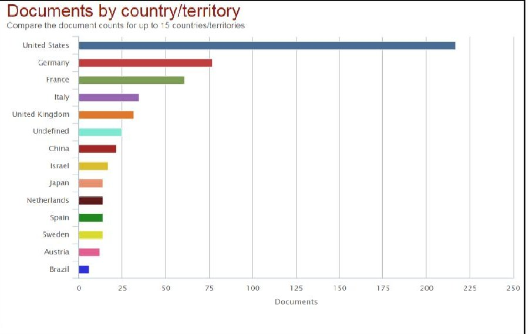

Source: Scopus (2018)

Combined with the above-mentioned keywords (related to AIT), a second bibliometry was performed using the following keywords related to MBSE: 'model based systems engineering'; 'MBSE'; 'MBE' and 'spacecraft MBSE'. The second bibliometry results showed very few studies with both subjects correlated (AIT and MBSE), with an average of 5 papers published per year (in the past 10 years), and most of them are specifically related to V&V of nonspace subjects. This indicates the potential of this work to fill the research gap, which involves space products AIT and model-based systems engineering.

<!-- PDF_PAGE: 49 -->

Berner (2004) and Weigel (2001) showed the need of satellite assembly and integration improvements.

Berner (2004) used information from MAT€D database (ESA, Alenia Spazio and Astrium) to perform a categorization of discrepancies (or nonconformities) found in each AIT discipline of scientific satellites. The study results indicate that most nonconformities occur during mechanical and electrical integration activities. Despite this, the author did not specified the causes of such failures in his research, preventing the root understanding of the identified problems.

Weigel (2001) used a database of more than 23,000 discrepancies of approximately 200 satellites to conclude that on average more than 60% of the discrepancies found in satellite systemic AIT are in the "environment" category, which covers all activities in which there is no environmental simulation (electrical tests, assembly and integration). The highest percentages of the causes associated with these discrepancies are 27% for human errors (workmanship) and 25% for design errors.

One of the current trends in the context of AIT is to find ways to a drastic schedule reduction.

In the study by Baghal (2010), the factors influencing the total AIT schedule time were investigated. Another objective was to verify the efficacy of the "Rapid AIT" method to detect nonconformities. The study concluded that the assembly phase is the major influence on the total AIT period. This impact is the result of variables such as training of personnel, composition of specialties in the assembly group and efficiency in the assembly procedure. Another result was the practical demonstration of the efficiency of the proposed method, based on the reduction of tests through qualification by similarity and analysis.

<!-- PDF_PAGE: 50 -->

In Yee's (2005) article, the author uses a microsatellite project that (during the study) should be developed in just 14 months to identify fundamental elements of a rapid integration and testing process. One of the most important tools to achieve the research objective was the extensive use of test scripts among the various organizations and areas of knowledge. This made it common to the entire program, knowledge that once belonged only to the test drivers. This allowed more flexibility in the schedule. Another important success factor discovered at Yee's research is the adaptation of test documentation to program requirements and the "optimization" of such documentation to keep the least effort to maintain it and use it.

In a different perspective of AIT, Tosney (2001) suggests that current trends in reducing the number of satellite tests will result in a high rate of orbit failure. The research investigates the development and testing phase influence on satellite mission success. The study considers the complexity of system design, sequence of production, and a measure referring to the philosophy of environmental testing as parameters of influence in mission success. Results showed that the environmental testing program is one of the factors that most influences the satellites failure rate.

Another very evident theme in the current satellite AIT literature is the use of virtual reality artifacts in the process.

Cadete (2009) demonstrates the advantages of iMoted virtual reality tool for planning, analysis and training of satellite assembly activities. The study analyzes the use of interactive virtual hands for 3D manipulation of objects, and mannequins to analyze accessibility in assembly activities. Methods such as assembly by proximity and disassembly method were also approached using iMoted.

<!-- PDF_PAGE: 51 -->

With the approach of AIT as a scope of the systems engineering effort, Mercer (2000) analyzed the importance of satellite testing for systems engineering. The study examined the implications of developing test requirements in parallel with the development of system design and performance requirements.

In Brazil the following studies were performed within the AIT field.

The doctoral thesis of Silva (2011a), a new model of satellite development was proposed to anticipate AIT requirements to the early phases of satellite design. Silva (2009a) also presented the process of quality assurance management in INPE's AIT activities. The lessons learned and the quality assurance process of the AIT activities at INPE were also addressed in (SILVA, 2009b). In Silva (2011b), the problems encountered during the system integration phase of satellites were analyzed. Solutions to minimize potential problems were also discussed, based on INPE's AIT activities lessons learned.

Bürger (2014) proposed a method to perform AIT adapted for pico and nanosatellite projects. He also presented a practical application of the proposed method to AESP-14 CubeSat project of the Technological Institute of Aeronautics (ITA).

The master thesis of Venticinque (2015) proposes a ground support equipment (GSE) development guide for space products. The proposed guide presents a synthesis of the directives found in the space products standards and manuals on the development of enabling products, and proposes a process that integrates these directives, simultaneously and collaboratively correlating the development of the GSE to the development of the space product and its AIT process.

When the subject of modeling is involved within the AIT research field, the following studies were found.

<!-- PDF_PAGE: 52 -->

A European Space Agency (ESA) initiative called Virtual Spacecraft Design (VSD) aims to demonstrate the feasibility of using model-based systems engineering (MBSE) for European space programs. The application scope of this methodology is very wide, and comprises several stages of space products life cycle, including AIT. Through one of the VSD tools, Space Systems Visualization Tool (SSVT), it is possible to obtain an immersive and interactive 3D environment to virtually perform the AIT activities. The main objective of the SSVT is to support the satellites' concurrent design process. In terms of AIT, the authors expect to improve both planning and execution of activities using VSD (EISENMANN, 2010; FUCHS, 2012).

Khan (2012) developed an approach called Model Based Verification and Validation (MBV&V). Khan uses SysML to perform early design verification and validation (through software) in spacecraft avionics, well before the actual hardware exists. The main purpose of this study is to reduce verification and validation by simulating real tests using models. The study simulations focused on subsystem and equipment level, but authors suggest that systemic application of the approach is promising.

Williamson (2012) succinctly analyzes challenges and opportunities of using MBSE to the integration and test scenario.

Montgomery (2013) discusses a Model Based System Integration (MBSI) approach that applies MBSE methods and tools specifically for system integration. The method exercises the early involvement of system integrators so they can recognize, through the analysis of specific diagrams - functional flow block diagram, diagram N2, IDEF-0 and sequence diagram - potential integration risks.

Using a limited MBSE implementation (without imposing the MBSE approach on the entire project), Anderson (2016) evaluated MBSE to the ISS SAFER project,

<!-- PDF_PAGE: 53 -->

a self-rescue device for spacewalking astronauts from International Space Station. His approach used MBSE to model system verification and validation activities with the purpose of requirements validation and managing test plans. Within test plan management, the study only shows its results, and does not explains in depth the MBSE approach that generated the engineering unit and qualification test plans.

The paper of Nastov (2017) presents a tool-equipped method called xviCore to combine and implement four different verification and validation strategies based on models. The objective of the method is to demonstrate, during the system design stage and based on models, that a system meets requirements defined by stakeholders and that it fulfills its intended purpose.

Table 3.1 shows a summary of the main contributions of all studies of this literature review in order to evidence the research gap and opportunity of this thesis. Table 3.1 also provides a reference to situate the contributions of this work, showed in chapter 8.

Table 3-1 - Summary of literature review main contributions.

<table border="1"><tr><td>Author</td><td>Main Contribution</td></tr><tr><td>Berner(2004)</td><td>Categorized AIT discrepancies from ESA’s database.</td></tr><tr><td>Weigel(2001)</td><td>Categorized AIT discrepancies and analyzed their causes.</td></tr><tr><td>Baghal(2010)</td><td>Identified the factors that influence spacecraft AIT schedule.</td></tr><tr><td>Yee(2005)</td><td>Identified elements of a rapid spacecraft AIT process and use of testing scripts.</td></tr><tr><td>Tosney(2001)</td><td>Investigated the development and testing phase influence on the success of satellite missions.</td></tr><tr><td>Cadete(2009)</td><td>Demonstrated the advantages of a virtual reality tool for planning, analysis and training of satellite assembly activities.</td></tr></table>

continue

<!-- PDF_PAGE: 54 -->

Table 3-1 - Conclusion

<table border="1"><tr><td>Mercer(2000)</td><td>Analyzed the importance of satellite testing for the systems engineering discipline,and analyzed the implications of early development of test requirements.</td></tr><tr><td>Silva(2011a)</td><td>Proposed a new model of satellite development to anticipate AIT requirements to the early phases of satellite design.</td></tr><tr><td>Silva(2009a)</td><td>Described the process of quality assurance management of INPE AIT activities.</td></tr><tr><td>Silva(2009b)</td><td>Showed lessons learned and quality assurance process of INPE AIT activities.</td></tr><tr><td>Silva(2001b)</td><td>Analyzed problems found during satellite system integration and investigated solutions to minimize potential problems.</td></tr><tr><td>Bürger(2014)</td><td>Proposed a method to perform pico and nanosatellite AIT.</td></tr><tr><td>Venticinque(2015)</td><td>Proposed a ground support equipment development guide for space products.</td></tr><tr><td>Eisenmann(2010)和Fuchs(2012)</td><td>Demonstrated the feasibility of ESA&#x27;s Virtual Spacecraft Design,an initiative to use MBSE for European space programs.The virtual reality software Space Systems Vizualization tool was also shown to virtually perform spacecraft AIT activities.</td></tr><tr><td>Khan(2012)</td><td>Presented MBV&amp;V,an approach that uses SysML to perform early system design verification and validation in spacecraft avionics.</td></tr><tr><td>Williamson(2012)</td><td>Analyzed the challenges and opportunities of using MBSE to the integration and test scenario.</td></tr><tr><td>Montgomery(2013)</td><td>Discussed an approach that uses MBSE methods and tools for system integration,analyzing specific diagrams to early recognize potential integration risks.</td></tr><tr><td>Anderson(2016)</td><td>Evaluated MBSE to the ISS SAFER project with the modeling of verification and validation activities to validate requirements and manage test plans.</td></tr><tr><td>Nastov(2017)</td><td>Presented the method xviCore to combine and implement four different V&amp;V strategies based on models.</td></tr></table>

Source: by the author

## 3.1. Research gap

The literature review of this work has delimited the boundaries of knowledge within the scope of space products AIT and MBSE. It clearly suggests the potential of MBSE within space AIT scope.

<!-- PDF_PAGE: 55 -->

The performed literature review did not show any research for satellite AIT, considering the use of MBSE products as inputs, in a way that while the product is developed through models, the same models are used to provide information to support AIT planning and organization.

In order to conceive the whole of AIT planning, the next chapter provides a review on what is necessary to plan an AIT process in terms of documents, their information and the sources of this information. The chapter will be the key to understand the contribution of the proposed framework regarding AIT planning inputs.

<!-- PDF_PAGE: 56 -->

<!-- PDF_PAGE: 57 -->

## 4 THE INPUTS FOR SPACE PRODUCTS AIT

This chapter focuses on answering Question 1 and Question 2 of the general objective of this thesis, presented in the introduction of this work, which are:

- Question 1: "What do AIT engineers need to know in terms of information, usually expressed in documents, to perform satellite AIT planning?"

- Question 2: "What are the sources of information that build the AIT planning documents?"

Across all the bibliographic research consulted in scientific citation services and databases, as well as books and standards associated to the space products AIT subject, very little and scattered information was found related to the inputs for a satellite AIT planning. Therefore, the results described herein were captured in a wide variety of standards (ECSS, 2009; 2012; NASA, 2007; ISO, 2011), real projects documentations (2004a-b; 2005a-c; 2006a; 2008a-b; 2009a-b; 2010a; 2011a-e; 2014a; 2015a-b) and specialists (from LIT/INPE) interviews.

## 4.1. AIT documentation

The AIT planning is traditionally based on documents. These documents are also developed using several project documents as inputs of information. The author's research found that in practice the documents used as inputs to plan AIT:

- may carry the same information in different documents, which is a source of errors;

- are used and built by several people, bringing the difficulty of configuration control, such as the control of versions.

The main AIT documentation is listed below. The description of each document is showed in Table 2.1.

<!-- PDF_PAGE: 58 -->

- AIT general requirements;

- AIT quality assurance plan;

- AIT master plan;

- AIT master flowchart;

- Electrical tests plan;

- AIT specifications, procedures and reports

Figure 4.1 depicts the AIT engineers' desktop documents and their information relations. The colored boxes represent AIT documents and arrows represent exchange of information between them. The colors are different just for visualization purposes.

Figure 4.1 - AIT engineer desktop documents and their relations.

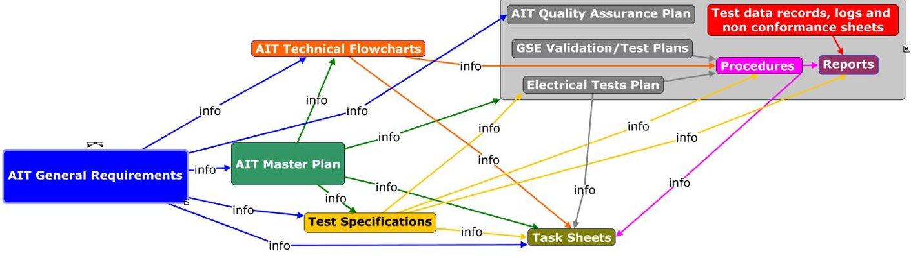

Source: by the author

## 4.2. AIT information within documents

This section depicts the information contained in each of the AIT main documents. The main source used to identify the documents information was CBERS AIT documentation and ECSS (ESA) standards. The author decided not to include in this description the AIT specifications, procedures and reports because they open a wide variety of branches (e.g. several different test specifications). Their description would be impractical for the purpose of this thesis.

<!-- PDF_PAGE: 59 -->

## 4.2.1. AIT general requirements

- AIT Management and organization Requirements

Organization (hierarchy) and manager Responsibilities

Planning and Documentation of AIT activities

Workshare

AIT Management and Control of activities

List of equipment for AIT

General Requirements for delivery of subsystems

Subsystem acceptance tests and incoming acceptance tests

- GSE requirements

MGSE

- MGSE equipment groups (handling, transport, etc.)

- MGSE general requirements

EGSE

- EGSE equipment groups (OCOE/SCOE)

- EGSE General requirements

- Satellite Assembly and mechanical integration

Mechanical assembly activities (activities list only)

Assembly and mechanical integration general requirements

- Material requirements

- Hardware requirements

- Design and construction requirements

- Product Assurance requirements

- Electromagnetic Compatibility requirements

- Environmental Condition and Test Requirements

Assembly and mechanical Integration tasks objectives

Assembly and mechanical integration tasks descriptions

- Electrical testing general requirements

Electrical test plan objectives

O Electrical integration and functional test general requirements

- General requirements

<!-- PDF_PAGE: 60 -->

- Satellite Subsystems and associate general electrical requirement to verify during test

- Electrical integration and functional test tasks scope and descriptions

Scope and description of each tasks

- Environmental testing

General requirements

Environmental Test Plan objectives

Environmental testing tasks scope and descriptions

- AIT quality assurance

General requirements (simplified version)

- training and qualification of personnel

- cleanliness and contamination control

- Handling, storage, conservation, labeling, and packing

QA general requirements for assembly and integration

- Process control

- Workmanship requirements

- Inspection

- Non Destructive Tests

- Control of installations and temporary removals

QA general requirements for tests

- Test performance

- Test equipment

- Test Documentation

- Test Reviews (needs)

- Security and safety requirements

Access control

Surveillance requirements

Safety requirements

- AIT logistics General Requirements

Facilities

Storage areas

Office room for team

<!-- PDF_PAGE: 61 -->

Supplies and services

Transportation

- AIT task sheets general requirements(itens only)

## 4.2.2. AIT quality assurance plan

- AIT QA responsibilities

- General AIT QA Tasks

- Program Reviews support AIT QA

- Logbooks and records AIT QA

- Satellite testing AIT QA tasks

- Launch operations AIT QA tasks

- Ground support equipment AIT QA tasks

- AIT QA Documentation

## 4.2.3. AIT master plan

- AIT documentation tree

- Satellite AIT activities and general sequence

- Assembly and integration operations general objectives

- Electrical testing operations general objectives

- Environmental testing operations

- AIT master flowchart (definition)

- Test implementation Tools

- AIT facilities

- AIT logistics

## 4.2.4. AIT master flowchart

- All AIT tasks and procedures

- Sequence of AIT tasks and procedures

<!-- PDF_PAGE: 62 -->

- Detailed description of each task and procedure (objective, facility, GSE configuration, satellite configuration, task description, test procedures and documents used, schedule, responsible)

## 4.2.5. Electrical tests plan

- Satellite States of assembly

- States test objectives / general conditions

- Modes of each state

- Subsystems tested in each mode (subsystems tested, on/off)

- Description of modes

- Tests of each subsystem in each mode

- Segment interface functional tests

control segment test objectives, general conditions and matrix

- application segment test objectives, general conditions and matrix

- payload calibration test objectives, general conditions and matrix

- Satellite functional tests during environmental testing

environmental tests types

- functional test objective and general conditions (satellite configuration, tanks, SAG, sun sensors, EGSE distance and interface)

- satellite testing modes during environmental tests (state, mode, subsystems tested, powered on/off)

satellite functional test sequence (during environmental tests)

## 4.3. AIT planning source of inputs

Figures 4.2 to 4.7 illustrate the sources of information that build each AIT planning document (central red boxes). These sources can be roughly divided in the areas of systems engineering and management (grey boxes), product development (green boxes and focus of this thesis), product assurance (yellow boxes), AIT (blue boxes) and other references (orange boxes). The Figures also

<!-- PDF_PAGE: 63 -->

show the specific information captured from these project documents (on the arrows) to build the AIT planning documents.

<!-- PDF_PAGE: 64 -->

Figure 4.2 - AIT general requirements input documents and their specific input information.

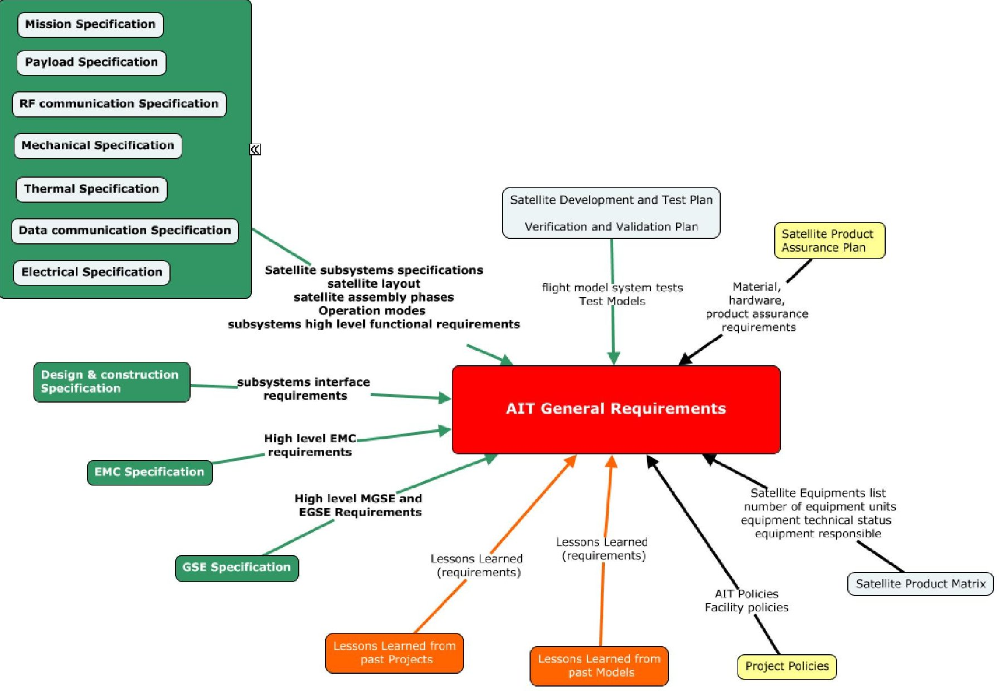

Source: by the author

<!-- PDF_PAGE: 65 -->

Figure 4.3 - AIT quality assurance plan input documents and their specific input information.

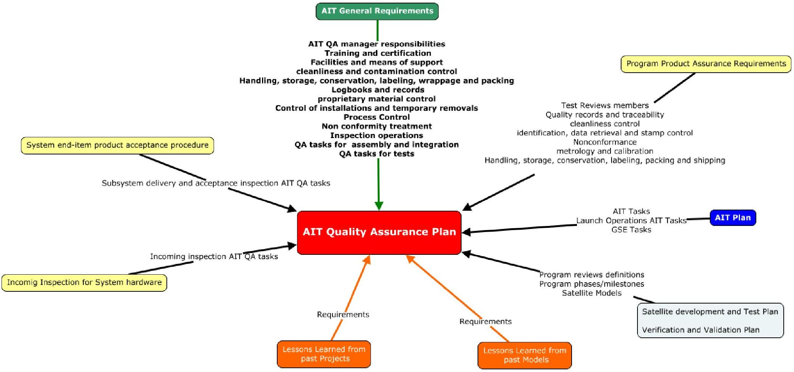

Source: by the author

<!-- PDF_PAGE: 66 -->

Figure 4.4 - AIT master plan input documents and their specific input information.

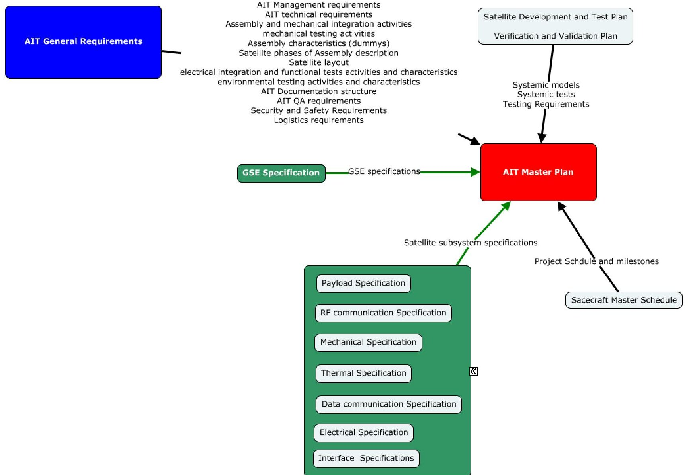

Source: by the author

<!-- PDF_PAGE: 67 -->

Figure 4.5 - AIT task sheets input documents and their specific input information.

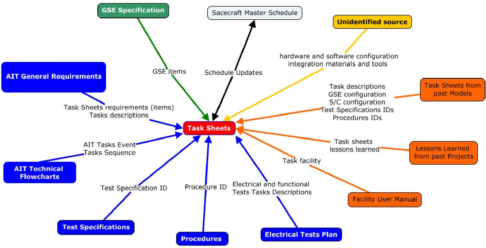

Source: by the author

<!-- PDF_PAGE: 68 -->

Figure 4.6 - Electrical test plan input documents and their specific input information.

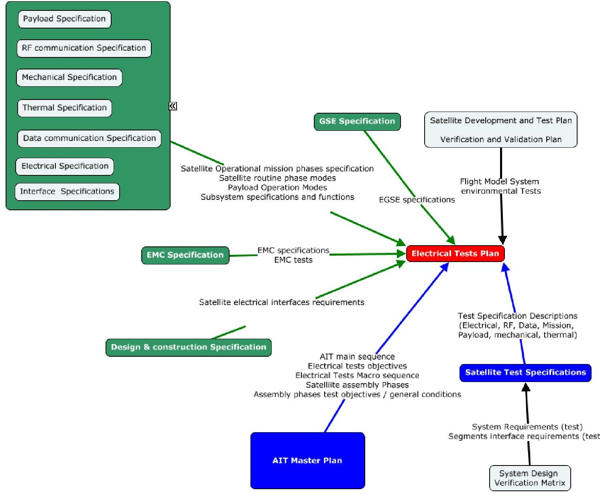

Source: by the author.

<!-- PDF_PAGE: 69 -->

Figure 4.7 - AIT technical flowcharts input documents and their specific input information.

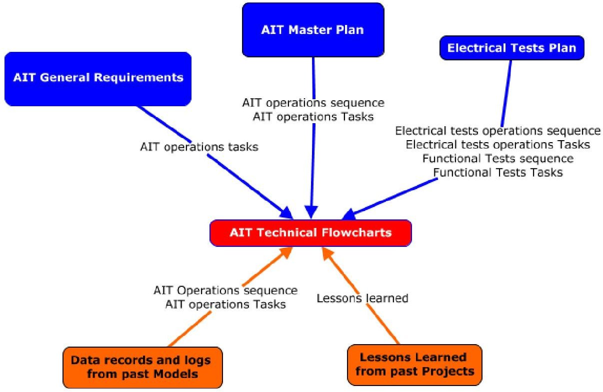

Source: by the author

Figure 4.8 shows the complex flow of information between AIT documents and other project documents. It shows that any change in source documents will affect something else, making it difficult to trace changes.

<!-- PDF_PAGE: 70 -->

Figure 4.8 - Flow of information between AIT documents and other project documents.

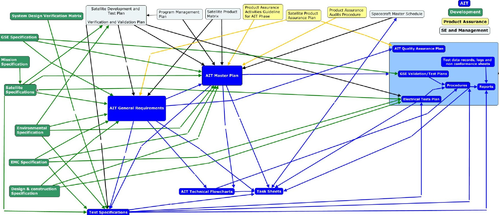

Source: by the author

<!-- PDF_PAGE: 71 -->

The analysis of the above inputs for space products AIT planning formed the foundation of this thesis framework, which will be presented in detail in the next chapter. This chapter provided answers to both questions exposed in chapter 1, and enabled to identify:

- the expected contributions that MBSE can bring to AIT process and organization;

- what kinds of information are worth to be modeled;

- what kinds of information are feasible to be modeled in project phases 0, A and B;

- what information is already present in MBSE diagrams.

<!-- PDF_PAGE: 72 -->

<!-- PDF_PAGE: 73 -->

This chapter aims to:

- propose a conceptual framework for integrated development, that integrates product and AIT development through MBSE;

- describe the elements of the framework.

## 5.1. Introduction

This chapter presents the answer of the main question of this work, presented in Chapter 1:

'How does the end product modeling may assist the development of AIT process and organization?'

This chapter aims to present a conceptual framework to include the development of AIT process and organization within the MBSE development of satellites (end product). In another perspective, this framework will promote and assist the integration of the AIT planning effort within the system design effort.

## 5.2. Assumptions and considerations

The conceptual framework should provide a general recipe that will be handed to other practitioners to define AIT for their satellite systems. The challenge here is to provide guidelines sufficiently flexible that it applies to a range of satellite systems (small and medium sizes) and modeling methods, yet not so broad that it becomes impractical.

The purpose of a conceptual framework is to form the foundation, the basic structure for other projects to be able to implement their specific application. This framework guides satellites developing organizations that are also involved in the AIT of such product, however it may also be used by organizations that intend to outsource AIT, providing inputs for AIT planning.

<!-- PDF_PAGE: 74 -->

The proposed framework takes into consideration that project phasing is according to the European standards (ECSS, 2009b):

- Phase 0 - Mission analysis/needs identification

- Phase A - Feasibility

- Phase B - Preliminary Definition

- Phase C - Detailed Definition

- Phase D - Qualification and Production

- Phase E -Utilization

- Phase F- Disposal

It was chosen because it is a widely adopted model for space products.

The author emphasize that it would be difficult to use this proposed framework without organization adherence in using MBSE for product development since early phases.

End product models and this framework should be developed in parallel because they will complete and influence each other during the lifecycle, even though it is possible to use the framework for specific tasks after the product model is already completed and fully verified.

Another important consideration is that product model continuously evolves over time. For the use of this framework it is implied that the used model is already verified and validated, that is, is assumed that it follows modeling best practices, there are no major inconsistencies and it represents requirements in a satisfactorily way. Although, for minor corrections the use of this framework also brings the benefit of a second model verification performed by a different group of modeling experts (AIT modelers).

The choice of a MBSE tool plays an important role in the whole process. The author of this work underline the belief that software capacity to integrate all

<!-- PDF_PAGE: 75 -->

model views (diagrams) together is essential. That is, the information contained in model views are interrelated; the change in one view automatically influences the others. Otherwise, the MBSE team would have to deal with a different effort to maintain all model views (depending on the project it may have several) coherent with each other, putting at risk the iterative and recursive potentials of such practice.

The choice of Capella was based on an analysis of the pros and cons of the modeling tool. The benefits of Capella are resumed in the following bullets:

- It unites in the same tool the three pillars of modeling: tool, language and method;

- Capella is an open-source project, therefore it is free and there is the possibility of developing personalized add-ons;

- the tool was developed and validated by a space industry big player.

- the tool and language (ARCML) are very intuitive and the learning curve is short.

The choice of Arcadia domain-specific modeling language (ARCML, also referred as to the general term DSML) was a consequence of the decision of using Capella because both tool and method are integrated. It was also author's perception that some stakeholders and domain engineers are usually not familiar with generic languages such as SysML. According to Roques (2016), internal experiments at Thales Alenia Space (big player in the space products market) showed that system engineers with backgrounds different than software were not comfortable with the object-oriented concepts from UML (and subsequently by SysML). Roques also states that in comparison, the vocabulary of the DSML has proven to be easily understood by systems engineers. The author's opinion, given the knowledge in both languages SysML and ARCML (and a background different than software), reinforces such comfort with the latter.

ARCADIA was the chosen modeling method to build this framework, however, the activities of each level in ARCADIA are conveniently generic, following systems engineering concepts of top-down, separating problem and solution

<!-- PDF_PAGE: 76 -->

domains. Therefore, the proposed framework may be used with other modeling methods with minor adaptations. The choice of this modeling method implies that the framework description uses the same nomenclature of ARCADIA, which is very intuitive. The Arcadia Domain-Specific Modeling Language was also followed. Thus, this framework adopts all nomenclature of its diagrams, model elements, modeling levels (phases). The work of Bonnet (2017) presents the equivalences and main differences between the ARCML and SysML.

An ARCADIA datasheet that helps to understand its basic principles is presented in ANNEX I of this work.

## 5.3. Conceptual framework description

The proposed framework correlates three different aspects, namely: traditional AIT, system development, and MBSE (which is traditionally product focused).

Figure 5.1 shows this relationship in a summarized way. The requirements expressed in documents are modeled within MBSE. This means that each model element (function, component, interface, etc.) refers to a requirement. The model has a variety of model views, which are different perspectives showed through specific diagrams. The model views joined with other specific AIT model views provide to the modeler a set of information that, by using the framework, is transformed into outputs that are in fact inputs for AIT planning. This means that the MBSE (of the product) and AIT planning may be performed simultaneously using the framework. The traditional AIT and the proposed framework are considered as complementary, being mutually beneficial when combined for reaching the overall AIT planning.

<!-- PDF_PAGE: 77 -->

Figure 5.1 - Relationship between the conceptual framework, traditional AIT, system development and MBSE.

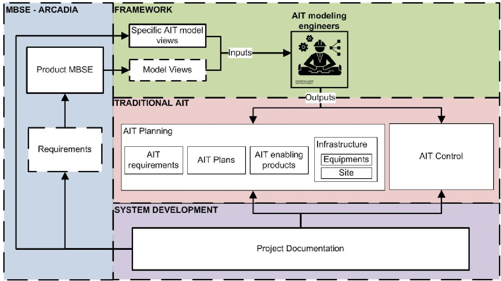

Source: by the author

The macro flowchart shown in Figure 5.2 depicts through Business Process Model and Notation - BPMN the correlation above-mentioned in depth, distinguishing the MBSE method and the proposed framework (integration and environmental tests) in separated horizontal lanes.

<!-- PDF_PAGE: 78 -->

Figure 5.2 - BPMN macro flowchart of the proposed conceptual framework.

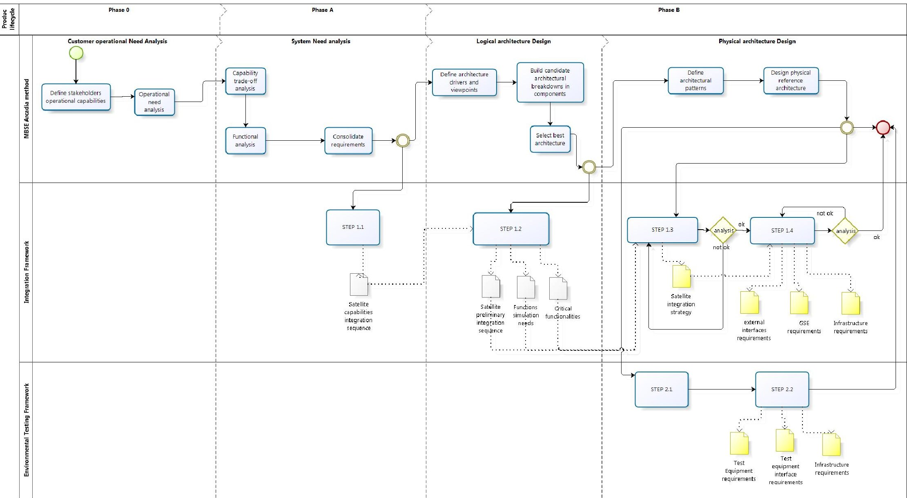

Source: by the author

<!-- PDF_PAGE: 79 -->

The AIT framework, heart of this work, in its turn, is divided into two parts: integration and environmental tests. This chapter provides an expanded and detailed view of each one of these parts.

The conceptual framework is structured as follows:

1. Step objectives, predefined questions and the desired outputs will be presented;

2. model views and the associated information will be presented;

3. step outputs will be presented.

Step objectives show the modeler what to do in order to achieve the outputs.

One of the main objectives of modeling is to deliver reasonable answers to predefined questions (ROQUES, 2017). Therefore, the questions are used herein as criteria for evaluation of the model views, acting as a control for completeness.

The outputs represent the desired step information.

The IDEF-0 diagram illustrated in Figure 5.3 shows the framework steps objectives' stereotype, indicating controls and mechanisms (or resources) used to perform step objectives.

<!-- PDF_PAGE: 80 -->

Figure 5.3 - IDEF-0 showing the framework steps objectives' stereotype.

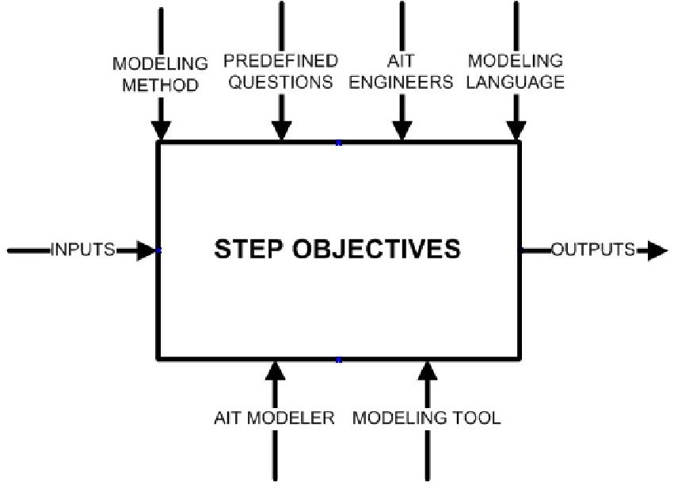

## 5.4. Part I: Integration planning

As previously defined in the Chapter 2, integration is a successive and iterative activity to combine and verify the assembly, until forming a functioning whole (the system). Therefore, integration and verification activities are very related to each other.

The main goal of integration is to achieve a complete system with the lower risk of being late or creating an ill performing system (MULLER, 2011).

Integration design is the key activity of an integrator that can begin early when project activities are defined. Then, it follows the subsystems design during system and subsystem architecture.

According to Coelho (2011a), integration planning has the following boundary conditions:

- System requirements;

- Internal system interfaces;

<!-- PDF_PAGE: 81 -->

- The external interfaces with other systems and the implementation strategy.

These boundary conditions are usually expressed in documents.

The integration framework proposes to provide inputs to integration planning, but using models instead of documents as toolset.

The framework presented in Figure 5.4 shows a step-by-step that supports system integration planning by means of MBSE products and specific AIT model views. The specific objectives of the framework represented by this flowchart are threefold:

1. To support integration process and organization planning This objective encompasses the following items:

- Define an integration strategy;

- provide inputs to define electrical integration tests and system functional electric tests;

- provide inputs for integration enabling products design;

- provide a different perspective for AIT engineers with the aim of providing a different source of information to build AIT documents;

The use of this framework have the potential to provide valuable information to build the first versions of the most important AIT Plans (draft versions).

## 2. To give feedback to design

Another important contribution of this process is to emphasize the feedback given by integration specialists to design engineers in the early phases of the project lifecycle, where the impact of changes is relatively low. Often the satellite architecture design is not evaluated from an integration perspective, leading to problems, incompatibilities and other difficulties (and eventually

<!-- PDF_PAGE: 82 -->

redesign) to the integration hall. The framework fastens the participation of system integrators in early project design using modeling in a way to ensure that:

a) requirements are achievable and sufficiently complete to be verified during integration;

b) functional architecture leads to a system that can be integrated;

c) functions and physical elements are interfaced with minimum complexity and high modularity to minimize integration risks;

d) Interfaces between satellite and external systems (such as EGSEs) are well designed and the system can be tested with these systems.

## 3. To verify product model

The intense use of product models by AIT modeling specialists and system integrators highlights model and product inconstancies brought-up by a different group of experts (with a different perspective).

<!-- PDF_PAGE: 83 -->

Figure 5.4 - Integration framework.

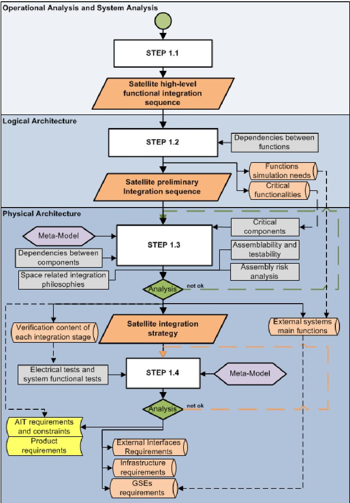

Source: by the author

The White boxes characterize the main steps, orange elements are output information (not necessarily represent documents), grey boxes are secondary activities and major inputs to accomplish the step, purple elements represent a meta-model used to achieve step objectives, green diamonds represent "if" analysis, and yellow forms represent other work products.

<!-- PDF_PAGE: 84 -->

## 5.4.1. Step 1.1

Step 1.1 is very important for the integration process as it will be the first reference to guide all the following steps. The information here gathered by the AIT modeler will situate the AIT team about the system of interest, and will provide the basis to define system functional tests and integration tests.

The step relies on Phase 0 (or Pre-A) MBSE products, which comprehends the operational analysis and system need analysis modeling phases of the modeling method. At these phases, the model views effort is mostly focused on problem domain, describing stakeholders' needs, identifying system boundary and its primary functions. In modeling, this is achieved by using elements that represent operational capabilities, operational activities and main system functions.

The capability is something the user shall be able to do (by using the system) in order to achieve the mission objectives. Capabilities are composed of several operational activities, which are, in turn, decomposed into interrelated functions that later on are allocated to physical elements that will form the satellite.

The system capabilities form the basis to define system level validation tests. Even though it is beyond the scope of this work, the author of this work highlight that the operational and system layers' models views support the definition of validation tests, specifically by using functional chains and operational scenarios.

The system operational activities and main system functions will form the basis to define system level functional tests (verification).

<!-- PDF_PAGE: 85 -->

The sequence of integration of main system functions will be the first step towards integration planning, herein stated as integration strategy. The modeler shall find a suitable, logical and coherent sequence of basic system functions integration, properly balanced regarding functions hierarchy (dependencies between functions).

Table 5.1 represents the four main objectives of step 1.1, its inputs, outputs and analysis criteria.

Table 5-1 - Step 1.1 main objectives, inputs, outputs and analysis criteria.

<table border="1"><tr><td>Objectives</td><td colspan="2">1. To understand the capabilities required by stakeholders;
2. To understand the system operational activities;
3. To understand system boundary;
4. To understand the high-level system functions.</td></tr><tr><td colspan="2">Inputs
• Operational Capability Blank (OCB)
• Operational Activity Blank (OAB)
• Operational Entity Scenario (OES)
• System Architecture Blank (SAB)
• System Function Breakdown (SFBD)
• System Exchange Scenario (SES)</td><td>Outputs
1. Satellite high-level functions integration sequence.</td></tr><tr><td colspan="3">Analysis
What the system shall be able to do?
What is part of the system, and what is not (system boundary)?
What are the basic system functions?
How to order the sequence of integration of the basic system functions?</td></tr></table>

Source: by the author

<!-- PDF_PAGE: 86 -->

## Inputs

Table 5.2 presents the required MBSE views and the associated information to be extracted from each one to accomplish the above objectives and generate the output:

Table 5-2 - Step 1.1 MBSE views and associated information

<table border="1"><tr><td>Product Model Views</td><td>Information</td></tr><tr><td>Operational Capability Blank
Operational Activity Blank</td><td>System capabilities;
System operational activities;
Operational chains (validation path).</td></tr><tr><td>Operational Entity Scenario</td><td>Chronological aspect of operational activities.</td></tr><tr><td>System Architecture Blank</td><td>System boundary;
System high level-functions;
System high-level functional relationship;
Functional chains (verification path);
System main external interfaces.</td></tr><tr><td>System Function Breakdown</td><td>High level functions hierarchy.</td></tr><tr><td>System Exchange Scenario</td><td>High-level functions chronological aspect.</td></tr></table>

Source: by the author

This step does not require any particular model view for AIT planning.

Right below, the author of this work describe how each model view contributes to attain the output.

The OCB situates the modeler to the operational capabilities that the stakeholders want to have. Even though this view is much more suitable for validation purposes, it will guide all the chronological views (scenarios) from the

<!-- PDF_PAGE: 87 -->

lower levels. A "scenario view" is always associated with (describes) a capability.

OAB represents the operational chains (blue frames), that represents an important validation path in the global data flow. This view expands the capabilities into operational activities. It also defines which operational activities shall be provided by the system-of-interest (in this case, the space segment).

The OES is always linked to a specific capability. This view associates the operational activities of each stakeholder with the chronological aspect of the modeling. This view will give the modeler a time perspective that will highlight the dependencies between activities.

At a lower abstraction level, the SAB provides the most comprehensive model view of this modeling phase (system analysis). It provides AIT engineers with several information that builds the basis of AIT development: system boundaries, the high-level system functions and their relationship (through functional exchanges), the functional chains (important verification paths that will be propagated to lower levels and shall be verified during AIT) and the main external interfaces of the system.

The SFBD will assist engineers with the task of identifying the functions hierarchy for the sequencing.

The SES introduces a chronological aspect for the functions together with the associated modes of operation, easing the task of finding dependencies between high-level functions.

<!-- PDF_PAGE: 88 -->

## Analysis

The criteria used to evaluate model views are stated as questions. If the model views provide all satisfactory and complete answers, they are considered sufficient. AIT team members shall evaluate the generated outputs and decide whether to move on to next step or to start it over.

## 5.4.2. Step 1.2

Step 1.2 relies on Phase A MBSE products, which comprehends the logical architecture modeling phase of the modeling method. At this phase, the product model views effort is focused on the solution domain, seeing the system as a "white box".

This step goes down one more level of abstraction dealing with system functions and the main subsystems.

The AIT modeler shall use the available information to order properly the preliminary integration sequence. During this task, it may appear some functions that cannot be early integrated, or functions that are not part of the system of interest, indicating they shall be simulated during integration, forming the functions simulation needs.

Table 5.3 represents the main objectives, inputs, outputs and analysis criteria of step 1.2.

<!-- PDF_PAGE: 89 -->

Table 5-3 - Step 1.2 main objectives, inputs outputs and analysis criteria.

<table border="1"><tr><td>Objectives</td><td colspan="2">1. Understand satellite subsystems and their functions;
2. Identify the dependencies between functions;
3. Identify critical functions of the functional chains;
4. Identify external functions to be provided for the system.</td></tr><tr><td colspan="2">Inputs
· Satellite high-level functions integration sequence
· Logical Architecture Blank (LAB)
· Logical Function Breakdown Diagram (LFBD)
· Logical Exchange Scenario (LES)</td><td>Outputs
1. Satellite preliminary integration sequence;
2. Preliminary external functions simulation needs;
3. Critical functionalities.</td></tr><tr><td colspan="3">Analysis
What are the subsystems of the system?
What are the subsystems main functions?
What are the operation external systems and their functions?
How to order the system functional integration sequence?
What functions in the boundary of the system do we need to simulate?
What are the most critical functionalities of the system?</td></tr></table>

Source: by the author

## Inputs

This activity relies on the settled system elements and functions brought up by the product model and on high-level functions integration sequence from previous step.

The required inputs to run this step are model views very much richer in details. The complexity increases the AIT modelers' job in extracting useful information from product model diagrams, filtering and creating special views to keep only important/useful data for AIT. An example of filtering complex model views is to

<!-- PDF_PAGE: 90 -->

filter all functions of a Logical architecture model view to ease the identification of satellite subsystems and their interfaces. Part of this task depends on modeling tool capabilities, what evidences the importance of adopting a modeling software carefully.

Table 5.4 presents the required MBSE views and the associated information to be extracted from each one to achieve the objectives and obtain the desired outputs. AIT engineers receive the information extracted from the model views and elaborate the outputs (AIT data).

Table 5-4 - Step 1.2 MBSE views and associated information

<table border="1"><tr><td>Product Model Views</td><td>Information</td></tr><tr><td>Logical Architecture Blank</td><td>Satellite subsystems and their main functions Relationship between functions External systems and their functions verification paths (functional chains)</td></tr><tr><td>Logical Function Breakdown Diagram</td><td>System functional hierarchy</td></tr><tr><td>Logical Exchange Scenario</td><td>Functions Chronological dependencies Functional loops</td></tr></table>

Source: by the author

Right below, the author of this work describe how the model views (inputs) contribute to attain the activity outputs.

The Logical architecture provides the most comprehensive model view of this modeling phase (logical architecture). It provides to AIT modeler several important information for AIT development:

a) satellite subsystems and their main functions $ ^{1} $ that shall be verified during integration;

b) it evidences the system functional complexity;

c) it evidences interfaces complexity;

<!-- PDF_PAGE: 91 -->

d) it evidences functional cohesion and coupling;

e) it permits the evaluation of functional inconsistences;

f) it permits an integration feasibility analysis;

g) it permits a verification feasibility analysis;

h) it allows a previous assessment on integration efforts;

i) the relationship between functions with verification paths, indicating a path for systemic functional tests;

j) it highlights critical functionalities by exposing the number of interfaces (functional) and their relation with verification chains;

k) it shows external systems functions (in a operation scenario) and their relations with the satellite. These functions shall be simulated by external (enabling) systems during systemic functional tests. Therefore, the information indicates part of enabling systems (e.g. EGSEs) functions and their preliminary requirements.

The logical function breakdown assists engineers with the task of identifying the functions hierarchy and system functional complexity.

The Logical exchange scenario gives the chronological aspect for the functions together with the associated modes of operation. This model view supports the AIT modeler in the following: to find dependencies between functions, to identify functions iterations inconsistences, functional loops and external system functional dependencies.

## Analysis

The criteria used to evaluate model views are here stated as questions. If the model views do provide all satisfactory and complete answers, they are considered sufficient. AIT team members shall evaluate the generated outputs and decide whether to move on to the next step or to start it over.

<!-- PDF_PAGE: 92 -->

## 5.4.3. Step 1.3

Step 1.3 relies on Phase B MBSE products, and relates to physical architecture modeling phase of the modeling method. At this phase, the product model views effort is to demonstrate how the system will be developed and built, with allocated software and hardware components and interfaces specifications, resulted from several trade-off analyses.

Step 1.3 requires very detailed model views as inputs. Therefore, it allows the AIT team to understand the satellite with greater level of detail in terms of model elements. Here, again, the use of filters and simplifications in model views to keep only the necessary information is extremely advised according to author's experience. One of the main purposes of modelling is the communication. A polluted model view does not meet this purpose.

The main objective of Step 1.3 is to articulate the previous preliminary integration sequence with the lower abstraction elements from physical architecture, making it possible to define a satellite integration strategy. The integration strategy is then evaluated (and rearranged) against several factors from AIT engineering, for example: non-functional requirements (testability, assemblability), space related integration philosophies and risk analysis.

Another important objective of this step is to identify the verification content of each integration stage of the chosen integration strategy. The content will be later used to verify that each stage have the expected behavior (functional) and their interfaces conform to their requirements.

Beyond that, this step also brings the potential to provide (and confirm correctness) AIT requirements and constraints, and eventually, new product requirements that influence AIT.

Table 5.5 represents the main objectives, inputs, outputs and analysis criteria of step 1.3.

<!-- PDF_PAGE: 93 -->

Table 5-5 - Step 1.3 main objectives, inputs, outputs and analysis criteria.

<table border="1"><tr><td>Objectives</td><td>1. To identify components dependencies;
2. To identify critical components;
3. To build a first integration strategy;
4. To use the meta-model to build specific model views;
5. To identify and characterize the internal interfaces to verify at each integration stage;
6. To define verification content (functional) of each integration stage;
7. Identify the external main functions to support stages verification;
8. To gather constraints, analysis and philosophies from AIT engineering;
9. To evaluate and rearrange (if needed) the integration strategy based on objective eight.</td></tr><tr><td>Inputs</td><td>1. Preliminary Integration sequence;
2. Critical functionalities;
3. Functional simulation needs;
4. Physical Architecture Blank (PAB)
5. Physical component breakdown (PCBD)
6. Physical Entity Scenario (PES)</td><td>Outputs
1. Satellite integration strategy;
2. Integration stages internal interfaces for verification;
3. Integration stages functional content for verification;
4. External systems main functions to perform tests.</td></tr><tr><td colspan="3">Analysis
Is the generated integration strategy feasible and efficient?
What are the verification content of the each integration stage?
What are the external system main functions to support the integration stages verification content?</td></tr></table>

Source: by the author

<!-- PDF_PAGE: 94 -->

## Inputs

The step starts with the outputs of step 1.2: the preliminary integration sequence, critical functionalities data and functional simulation needs. The first will be used to build the first integration strategy, the second to identify critical components, and the third to elaborate external systems main functions.

Table 5.6 presents the required MBSE views and the associated information to be extracted from each one:

Table 5-6 - Step 1.3 MBSE views and associated information

<table border="1"><tr><td>Product Model Views</td><td>Information</td></tr><tr><td>Physical Architecture Blank</td><td>Satellite complete layoutComponents dependenciesVerification paths (functional chainsInternal interfaces (functional and physical)Functional content of stages</td></tr><tr><td>Physical component breakdown</td><td>Components hierarchyComponents dependencies</td></tr><tr><td>Physical entity Scenario</td><td>Components dependencies</td></tr></table>

Source: by the author

The PAB provides the most comprehensive model view of this modeling phase (physical architecture). It provides to AIT modeler several important information for AIT development:

a) It evidences components functional and components dependencies;

b) It evidences functional and physical cohesion and coupling;

c) It evidences the system complexity;

d) It permits to evaluate the interference between functions and components;

<!-- PDF_PAGE: 95 -->

e) It permits to assess the functional and physical architecture modularity; f) it permits to identify the verification content of each stage. This is made by observing the verification paths to understand what behavior and functions are provided by the integration stage;

g) it permits an integration and verification feasibility analysis;

h) it highlights the identification of integration critical components and functions by exposing their complexity (number of functional and physical interfaces) and their relation with verification chains. This task is also supported by Step 1.2 critical functionalities data;

i) it shows internal functional and physical interfaces complexity. The interfaces also have the flow characterization (material, energy or information types);

j) it permits an assessment of the integration effort.

The physical component breakdown shows all physical elements of the satellite indicating the components hierarchy.

The physical entity scenario shows all the flux of data, material or energy between all satellite physical elements.

Both model views above contribute to the task of identifying component dependencies. The latter also allows the identification of flows inconsistencies (e.g. lack of triggers), critical functions and permits to assess functions simultaneity and its consequences on system behavior.

In this modeling phase, critical functionalities from previous step 1.2 (output 3) were decomposed in lower level functions, and these functions were allocated to physical elements. Using the traceability features, the modeler can trackdown the indications of critical components. The use of physical architecture verification chains is also an interesting source of information to attain this objective.

<!-- PDF_PAGE: 96 -->

Figure 5.5 shows a meta-model that illustrates how modelers shall use the physical architecture model view to generate specific AIT model views to identify the verification content of each stage, which includes internal interfaces and behavior (functions).

The main external functions are also part of the information captured from these models, which will be transformed (in the next step) as inputs for the external systems requirements (e.g. EGSEs), anticipating their design. The first source of information are functions simulation needs from previous step (step 1.2, output 2). The second source is to analyze how to perform the verification of the above-mentioned verification content of each stage. This way the modeler will identify, in the physical architecture model view, the main external functions that allow the functional flow of these verifications.

The number of model views will be the same as the number of integration stages. The AIT modeler will use the collected information to assist the AIT team in planning electrical integration tests and system functional electric tests, which verify if the system was build (and is functioning) according to specifications.

Figure 5.5 contains a generalization, showing the system integration being performed in pairs of several subsystems (1,2,3, n...) composing three different stages (stage 1, stage 2 and system). It is wise to highlight that the satellite system integration is not always composed by several integration stages (as shown in Figure 5.5). The division in stages will depend on the number of subsystems and integration strategy. Some satellites may have (in some cases) only one system integration stage composed by two modules: payload module and service module (platform bus); others may have a system integration performed by integrating several subsystems.

<!-- PDF_PAGE: 97 -->

Figure 5.5 - Meta-model to identify integration stages' verification content and external main functions.

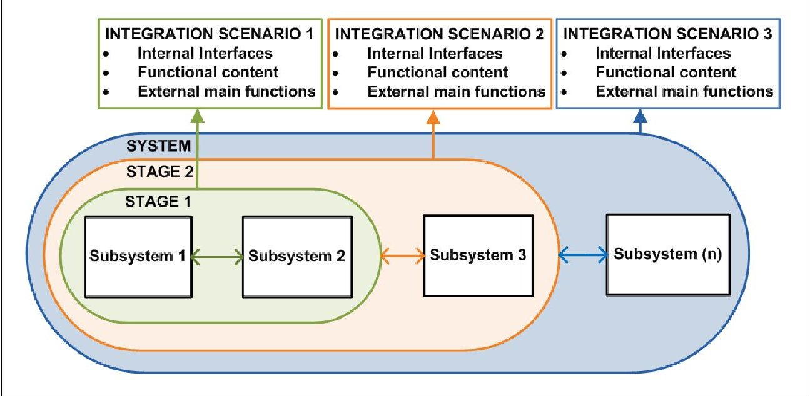

Source: by the author

## Analysis

Two types of analysis are performed here. The first evaluates the model views, the other evaluates outputs.

The criteria used to evaluate model views are here stated as questions. If the model views do provide all satisfactory and complete answers, they are considered sufficient.

The outputs analysis includes the objectives eight and nine. They represent an activity performed by all AIT team members to evaluate the generated outputs and decide whether to move on to the next step or to start it over. Part of the analysis parameters are beyond the scope of modeling, and may include software simulations, CAD simulations, rapid prototyping models, non-functional requirements (e.g. testability and assemblability), assembly and integration constraints, integration risk analysis, space products integration philosophies (e.g. bottom-up and inside-out) and other available resources.

<!-- PDF_PAGE: 98 -->

## Outputs

From Step 1.3, AIT engineers shall use the output 3, 'Integration stages functional content for verification', and other information from traditional AIT to plan electrical integration tests and system functional electric tests. Therefore, the specific definition of these tests are not part of this framework because it involves several different areas, specialties and non-functional requirements (not modeled). These tests will be an external input of the next step.

## 5.4.4. Step 1.4

Step 1.4 relies on Phase B MBSE products, which comprehends to the physical architecture modeling phase of the modeling method (same as step 1.3).

This step remains in the same level of abstraction, but it focuses on defining external systems and environment of the integration stages. This means that it explores and provides inputs for AIT organization, defining enabling systems (GSEs) and infrastructure requirements.

Beyond that, this step also brings the potential to provide (and confirm correctness) AIT requirements and constraints, and eventually, new product requirements that influence AIT.

Table 5.7 represents the main objectives, inputs, outputs and analysis criteria of step 1.4 in the order that they shall be realized.

<!-- PDF_PAGE: 99 -->

Table 5-7 - Step 1.4 main objectives, inputs, outputs and analysis criteria.

<table border="1"><tr><td rowspan="6">Objectives</td><td>1. Create a physical architecture model view representing the integration scenario with possible external systems elements(e.g. enabling systems and infrastructure);</td></tr><tr><td>2. Define external systems elements by allocating external systems main functions(from step1.3output4)to them;</td></tr><tr><td>3. Derive and complete the allocation until to obtain a desirable systems functions level, obtaining the external systems model view;</td></tr><tr><td>4. Merge the product integration stages model views(obtained in step1.3)with the obtained external systems model view and perform the necessary corrections;</td></tr><tr><td>5. Generate requirements(product/GSE)through the identification of external interfaces for each connection between integration stage and external elements;</td></tr><tr><td>6. Trace the verification paths associated to electrical tests(between satellite integration stages and external systems)in the model views.</td></tr><tr><td colspan="2">Inputs
·Step1.3Outputs
·Physical Architecture Blank(PAB)</td><td>Outputs
1. Ground support equipment requirements;
2. Infrastructure requirements;
3. Product external interface requirements;
4. Electrical tests verification paths.</td></tr><tr><td colspan="3">Analysis
What are the system functions of the external systems?
What are the external system elements?
What are the product external interfaces during integration?</td></tr></table>

Source: by the author

<!-- PDF_PAGE: 100 -->

## Inputs

Step 1.4 inputs are step 1.3 outputs. They will be used to define external systems at the boundaries of the satellite, required to perform electrical integration tests and system functional electric tests of each integration stage. Table 5.8 presents the required MBSE view and the associated information to be extracted:

Table 5-8 - Step 1.4 MBSE main views and associated information.

<table border="1"><tr><td>产品模型 views</td><td>信息</td></tr><tr><td>Physical Architecture(PAB)</td><td>External interfaces
Verification paths</td></tr></table>

Source: by the author

The PAB provides to AIT modeler the following information:

a) The external interfaces of each integration stage, that is, interface requirements between external systems and integration stages;

b) The verification path of each previously defined electrical integration tests and system functional electric tests, which includes the enabling systems;

c) It permits to evaluate integration stages functional interoperability with external systems.

Figure 5.6 shows a meta-model showing how modelers shall use product integration stages model views to generate specific AIT model views to define external interfaces and verification paths.

The modeler shall create a physical architecture model view representing the satellite during integration (context diagram of integration scenario) with possible external system elements (e.g. enabling systems and infrastructure). Then, the modeler shall allocate to them the corresponding external main

<!-- PDF_PAGE: 101 -->

functions (output 4) from step 1.3. After that, the modeler shall perform the appropriate physical and functional decompositions on external elements. When they are sufficiently decomposed until reaching the level of system functions (which provide system requirements), this model view shall be merged with the integration stages model views (from previous step). After the merging, the modeler shall correct the model view as necessary. The resulting model view will support the definition of external interfaces, defining GSE requirements and product requirements.

The reader shall remember that in modeling everything traces back to requirements, whether an interface, function, or other element created/excluded in a diagram, it will always lead to: (1) a new requirement, (2) a correction in an existing requirement, (2) the verification of a requirement correctness or (4) the exclusion of a requirement.

It shall be noticed that this part of modeling highly relates to the AIT modeler creativity and AIT needs. The 'external system' referred in the meta-model may be several different systems, for example, the system of AIT engineers operating the EGSE. This way, the function of each person may be decomposed as required, until obtaining a test procedure, or even to derive the required skills for the job. Another example of a possible external system to include in the model view generated using the meta-model is a security system. This would force modeler to add other related systems and functions.

The verification path of all electrical tests (previously defined) shall be allocated to each of the generated model views. This representation has two objectives:

- it allows to see the tests as a whole in order to analyze the test effectiveness and efficiency;

- to trace requirements verification. To confirm all requirements that are being verified during each test, identifying possible inconsistencies in verification;

- to support AIT control during integration execution. When a test discrepancy occurs, the model view gives a wide view for impact

<!-- PDF_PAGE: 102 -->

analysis. It allows to identify the failure behavior consequences components affected, requirements that were not met, supporting the decision after discrepancy takes place.

Figure 5.6 - Meta-model showing how to use product integration stages model views.

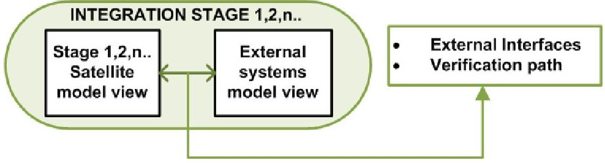

Source: by the author

## Analysis

Two types of analysis are performed here. The first evaluates the model views, the other evaluates outputs.

The criteria used to evaluate model views are here stated as questions. If the model views do provide all satisfactory and complete answers, they are considered sufficient.

The outputs analysis represents an activity performed by all AIT team members to evaluate outcomes and decide whether to move on to finish Framework Part I, or to start it over from the beginning of step 1.4.

## Outputs

The author of this work highlight that outputs 1 and 3 will guide the development (or acquisition) of GSEs. From this point onwards, the modeling may continue to individually support their own development. Instead of a satellite product modeling, it would be the GSEs modeling, respecting the settled interface requirements.

<!-- PDF_PAGE: 103 -->

## 5.5. Part II: Environmental testing planning

Environmental test activities have the objective to expose the system and its subsystems and units to the same environmental conditions that they withstand from launch to the end of life (NASA, 2007).

The framework presented in Figure 5.7 shows a step-by-step that supports system environmental tests planning by means of MBSE products and specific AIT model views. It shall be noted that this framework does not cover the sequencing of environmental testing because it is outside the scope of this work.

The information gathered by the use of this framework provide inputs (other than documents) to build the AIT organization, contributing to the first versions of the most important AIT documentation: AIT Plan and AIT requirements (draft versions). Even though it is not the main purpose, this framework also brings information to build test specifications. The specific objectives of the framework represented by this flowchart are twofold:

## 1. To support environmental tests planning

This objective encompasses the support on defining the following items:

a) provides inputs to define environmental testing test equipment;

b) provides inputs to define the interface between satellite and test equipment.

2. To influence design

Another important contribution of this framework is to bring the feedback given by testing specialists to design engineers in the early phases of the project lifecycle, where the impact of changes is relatively low. This different perspective of design can anticipate and prevent problems that would occur in the testing hall.

<!-- PDF_PAGE: 104 -->

Figure 5.7 - Environmental framework.

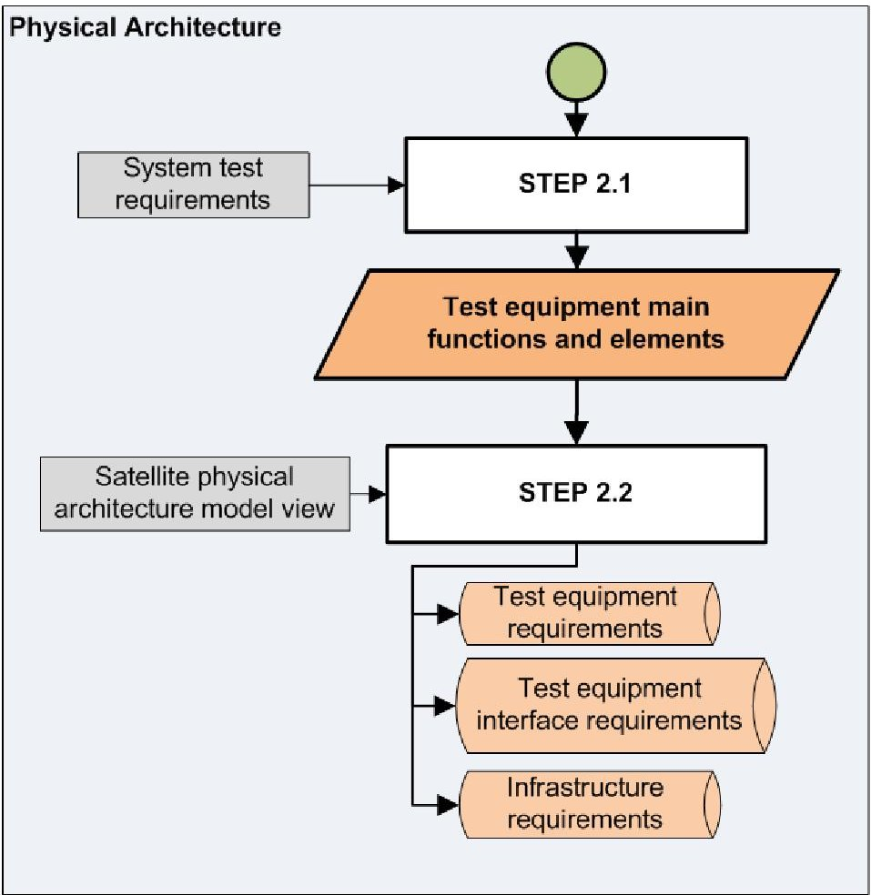

## 5.5.1. Step 2.1

Step 2.1 main objective is to define the test equipment of each environmental test with sufficiently decomposed functional and physical elements to allow the definition of test equipment interfaces with satellite system.

Table 5.9 represents the four main objectives, inputs and outputs of step 2.1. These objectives are illustrated in Figure 5.8.

<!-- PDF_PAGE: 105 -->

Table 5-9 - Step 2.1 main objectives, inputs and outputs.

<table border="1"><tr><td>Objectives</td><td colspan="2">1. To identify test scenarios;
2. To develop a physical architecture model view for each scenario (similar to a context diagram) and populate them with test equipment and infrastructure elements;
3. Identify their main functions and elements.</td></tr><tr><td colspan="2">Inputs
·System test requirements</td><td>Outputs
1. Environmental tests scenarios;
2. Test equipment, their main elements and functions.</td></tr></table>

Source: by the author

Figure 5.8 - Illustration of step 2.1 objectives.

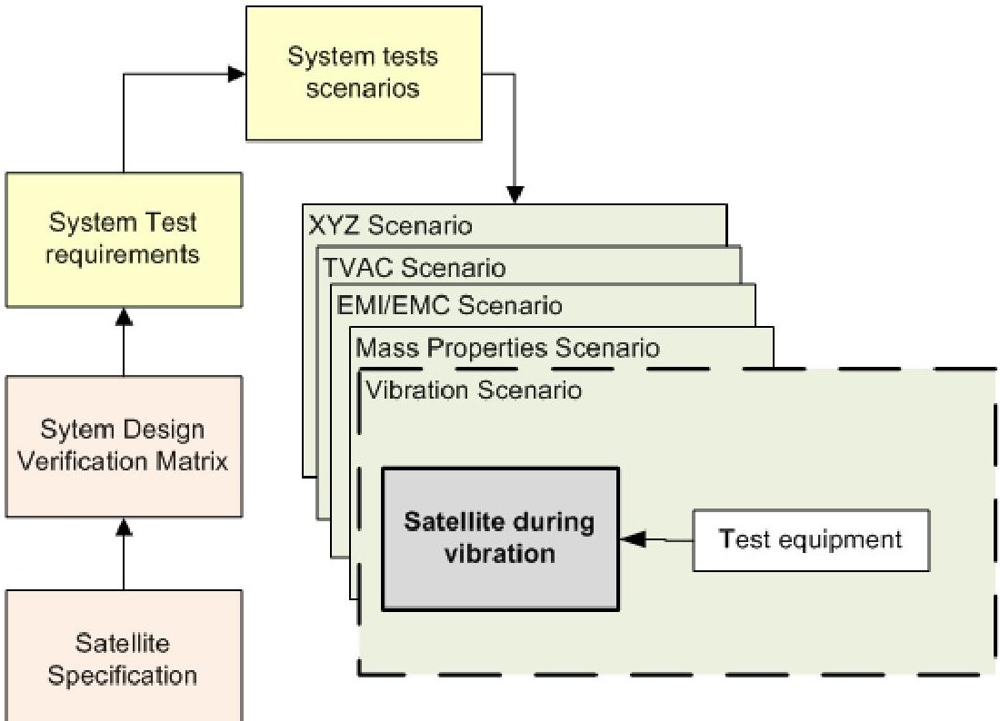

Source: by the author

<!-- PDF_PAGE: 106 -->

## Inputs

Inputs of Step 2.1 are system test requirements from system design verification matrix. These requirements will indicate the environmental tests scenarios.

The objectives cited above require the support of an environmental test specialist to perform the identification of other environmental test scenarios and the creation of test equipment elements and their functions.

## 5.5.2. Step 2.2

Step 2.2 main objective is to define the test equipment and test equipment interfaces with the system.

Table 5.10 represents the four main objectives, inputs and outputs of step 2.2.

Table 5-10 - Step 2.2 main objectives, inputs and outputs.

<table border="1"><tr><td>Objectives</td><td colspan="2">1. Merge the model views from step 2.1 with a simplified (filtered) satellite physical architecture model view;
2. Decompose external functions and physical elements as needed;
3. Identify and define the interfaces between satellite and external systems</td></tr><tr><td colspan="2">Inputs
Step 2.1 outputs</td><td>Outputs
1. Test equipment;
2. Test equipment interface requirements.</td></tr></table>

Source: by the author

<!-- PDF_PAGE: 107 -->

## Outputs

The outputs analysis from both steps represents an activity performed by all AIT team members to evaluate the outcomes and decide whether to finish Framework - Part II, or to start it over.

This chapter described the conceptual framework to simultaneously develop system design and AIT planning by means of MBSE. The next chapter will show the implementation of this framework applied to a real space project.

<!-- PDF_PAGE: 108 -->

<!-- PDF_PAGE: 109 -->

## 6 FRAMEWORK USE CASE APPLICATION

The objective of this chapter is to apply the proposed framework described in Chapter 6 in a real small satellite project. The application uses the concept of the framework and emphasizes the thesis objectives and limitations.

The purpose of this use case is far short of providing an ideal case study in terms of its implementation, but rather to evidence that the proposed framework is applicable.

Another important thing to note is the relative simplicity of the chosen system of interest (a university nanosatellite), which by far does not fully exercises the framework application in its depth, but it provides a broad view of such use and shows its applicability. The use case of a larger and complex system would be very useful but also exhausting to the reader. This study case was performed with a 1U CubeSat (CubeSat unit size), but the framework is in the same way applicable to other kinds of missions (educational, scientific, technological, etc.) and satellite sizes (small and medium sizes). This generalization is possible due to the broad and flexible characteristics of the framework (see Figure 5.2), allowing its easy tailoring for different system missions, complexity, modeling methods and tools. All steps mentioned in chapter 5 (from 1.1 to 2.2) are based on well-known systems engineering activities present in most modeling methods (e.g. operational analysis and functional analysis), this way being also present in most projects.

## 6.1. The AESP-14 Project

AESP-14 (Figure 6.1) was the first Brazilian CubeSat class university satellite completely developed by ITA graduate and undergraduate students and INPE graduate students. The project was conceived in late 2010 but only started at early 2012, included in the proposal "Relatório da AEB/MCT/CNPq $ n^{0} $

<!-- PDF_PAGE: 110 -->

033/2010", approved in November 2011 under coordination of Dr. Geilson Loureiro (Senior Technologist III of INPE and Professor of ITA).

Figure 6.1 - AESP-14 Nanosatellite.

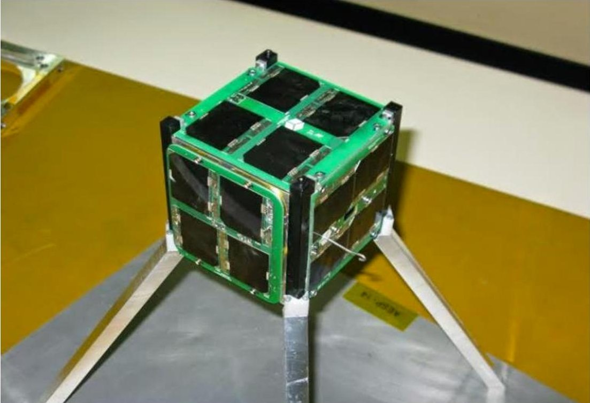

Source: by the author

The Brazilian nanosatellite was composed of a technological and educational mission. The technological mission was the validation of a national multimission CubeSat platform. The educational mission was the technological training of the group, which involved students and professors of ITA's Aerospace Engineering course and graduate students of INPE and ITA and undergraduate students from ITA's 2014 Aerospace Engineering Class.

The nanosatellite was composed of structure, electric power subsystem, onboard data handling subsystem and communications subsystem. Figure 6.2 shows AESP-14 electrical architecture diagram.

<!-- PDF_PAGE: 111 -->

Figure 6.2 - AESP-14 Electrical architecture diagram.

Satellite AESP-14 Architecture Diagram

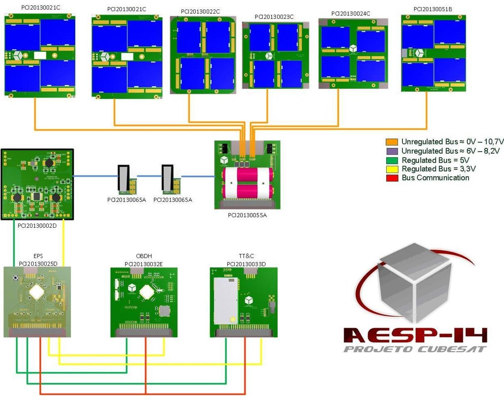

Source: INPE/LIT (2013)

AESP-14 AIT program was performed at the Integration and Testing Laboratory - LIT/INPE. Figure 6.3 show the CubeSat being tested at LIT's vibration shaker. AESP14 was the first satellite developed by the team, therefore it was decided to make the maximum environmental testing that the budget permitted. Another motivation for this approach is because AESP14 platform had no redundancy, which makes the system single point failure, greatly reducing its reliability. The project had three models: mock-up, engineering/qualification model and flight model. AESP14 was the project that held the largest number of environmental tests and with the higher levels of all nanosatellites tested at LIT/INPE (BURGER, 2016).

<!-- PDF_PAGE: 112 -->

Figure 6.3 - AESP-14 CubeSat vibration tests at LIT/INPE.

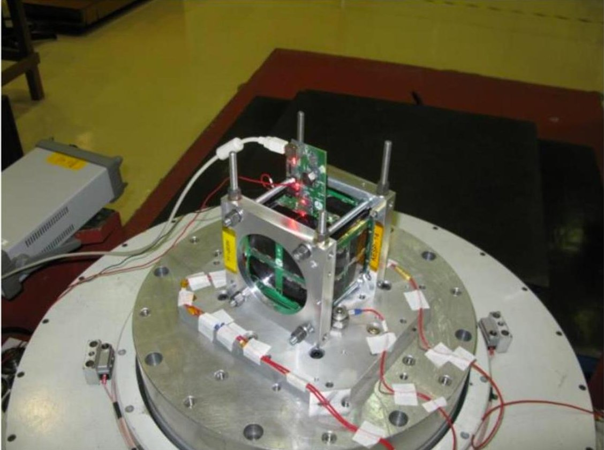

Source: Bürger (2016)

The flight model was tested with specific Space-X Falcon-9 launch requirements. All environmental testing was successfully completed, including the associated functional tests.

An INPE's master thesis entitled "Reference method to AIT pico and nanosatellites" (BURGER, 2014) was used to perform AESP-14 AIT. The method resulted on the following AIT documentation structure (Figure 6.4).

<!-- PDF_PAGE: 113 -->

## Figure 6.4 - AESP-14 AIT documentation structure.

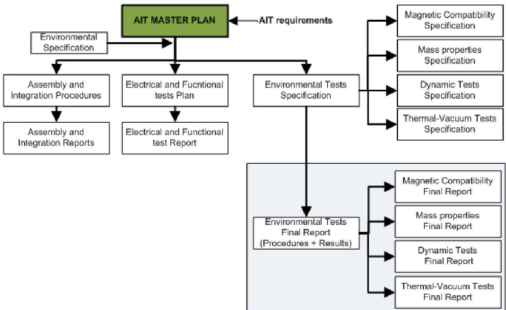

Source: Bürger (2014)

All AIT documents were built using as inputs a set of systems engineering and design documents listed in Table 6.1.

<!-- PDF_PAGE: 114 -->

Table 6-1 - AESP-14 documents.

<table border="1"><tr><td>Document type</td><td>Title</td></tr><tr><td rowspan="13">Systems Engineering</td><td>Stakeholder Analysis</td></tr><tr><td>Mission Requirements</td></tr><tr><td>Mission Analysis</td></tr><tr><td>Mission Operational Architecture description</td></tr><tr><td>System Requirements</td></tr><tr><td>Subsystem Requirements</td></tr><tr><td>Systems Engineering Plan</td></tr><tr><td>Project Management Plan</td></tr><tr><td>Manufacturing Plan</td></tr><tr><td>Product Assurance Plan</td></tr><tr><td>Software implementation Plan</td></tr><tr><td>Operations Plan</td></tr><tr><td rowspan="2">Technical Specifications</td><td>Subsystems Specifications</td></tr><tr><td>Ground Support Equipment Specifications</td></tr><tr><td rowspan="3">Procedures</td><td>AESP-14 Launch Campaign</td></tr><tr><td>Frequency allocation documents</td></tr><tr><td>AESP-14 orbital decay analysis</td></tr></table>

Source: by the author

AESP-14 was launched on January $ 1 2 ^{th} $ by Space-X Falcon-9 launcher, an ISS (International Space Station) cargo launch. On February $ 5 ^{th} $ , the satellite was deployed from ISS (Figure 6.5) using the Japanese Experiment Module (JEM) Small Satellite Orbital Deployer (J-SSOD), by the command issued from the JAXA Flight Control Team.

<!-- PDF_PAGE: 115 -->

Figure 6.5 - AESP-14 being ejected from ISS's Kibo Module.

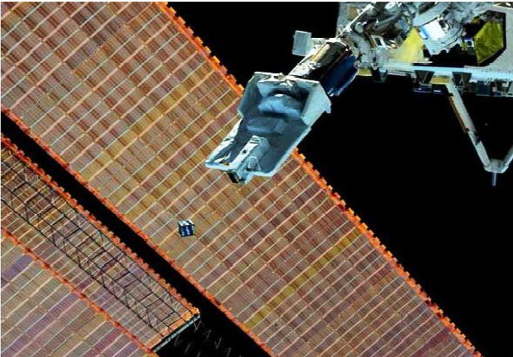

Source: AMSAT-UK (2015)

No signal was received from CubeSat since its ejection. AESP team specialists believe the antenna deployment system malfunctioning is the most probable cause of AESP14 failure in space. Despite this fact, the educational objective was successfully accomplished.

The author's choice of AESP-14 to be used as a use-case of the proposed framework was based on the amount of project's available data and documents. The availability of this information is due to the fact that AESP-14 was an inhouse development project, completely developed by Brazilian students.

<!-- PDF_PAGE: 116 -->

## 6.2. Modeling AESP-14

The AESP-14 modeling is systematically described in APPENDIX A. The author considers this CubeSat modeling itself one of the contributions of this work, and thinks it can be used as a reference model for similar projects.

## 6.3. Framework application

6. 3.1. Part I - Integration modeling

6. 3.1.1. Step 1.1

Step 1.1 objectives, predefined questions and outputs, are resumed in Table 6.2.

Table 6-2 - Step 1.1 objectives, predefined questions and outputs

<table border="1"><tr><td>Objectives</td><td>1. To understand the system capabilities;
2. To understand the system operational activities;
3. To understand system boundary;
4. To order the integration of high-level system functions.</td></tr><tr><td>Predefined Questions</td><td>What the system shall be able to do?
What is part of the system, and what is not (system boundary)?
What are the basic system functions?</td></tr><tr><td>Outputs</td><td>1. Satellite high-level functions integration sequence.</td></tr></table>

Source: by the author

Step 1.1 model views and the related information taken from each of these models are presented below.

Operational Capability blank

Figure 6.6 shows the Operational capability model view.

<!-- PDF_PAGE: 117 -->

Figure 6.6 - Operational capability blank

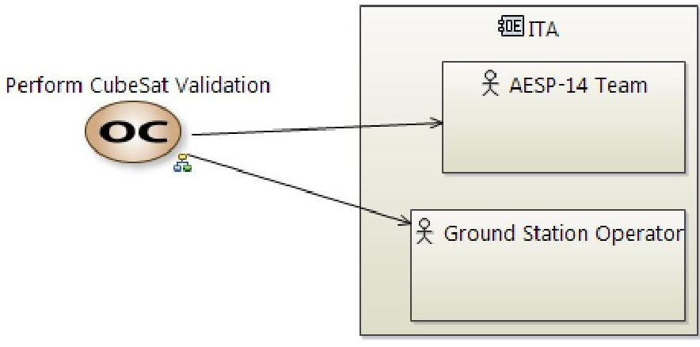

Source: by the author

The System capability Perform CubeSat Validation is identified. The Objective 1 is met.

Operational Activity blank

Figure 6.7 shows the Operational activity model view.

Figure 6.7 - Operational activity model view.

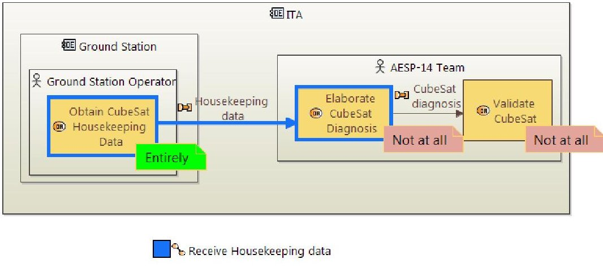

Source: by the author

The green mark indicates the operational activity that shall be performed by the CubeSat, which is Obtain CubeSat Housekeeping Data.

<!-- PDF_PAGE: 118 -->

The operational chain, which is the validation path, is highlighted in the blue path.

## Operational Entity Scenario

Figure 6.8 shows the chronological aspect of AESP-14 operational activity which is to Obtain CubeSat Housekeeping Data.

Figure 6.8 - Operational entity scenario.

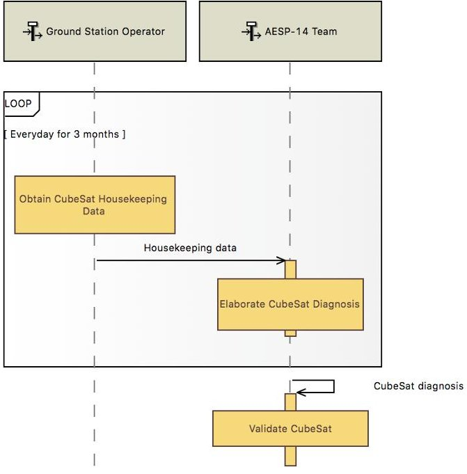

Source: by the author

With the information gathered from the previous two model views, the objective 2 is met.

## System Architecture Blank

Figure 6.9 represents the system architecture.

<!-- PDF_PAGE: 119 -->

Figure 6.9 - System architecture.

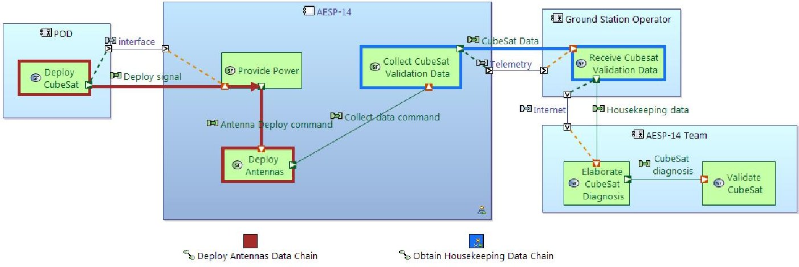

Source: by the author

The dark blue square represents the system boundary, clearly distinguishing what is the system and what is not, in terms of functions. With this, the objective 3 is met.

The green elements represent the high level functions.

The interfaces between functions represent their functional relationship.

The three light blue elements represent the external systems.

The red path represents the verification path (functional chain) of deploy antennas.

The blue path represents the verification path of Obtain housekeeping data chain.

System Functional Breakdown

Figure 6.10 shows the system functional breakdown model view.

<!-- PDF_PAGE: 120 -->

Figure 6.10 - System functional breakdown.

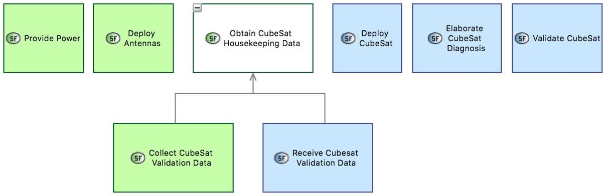

Source: by the author

The tree represents functions hierarchy. The green elements are system functions, white elements are function compositions, and blue elements are external system functions.

System Exchange Scenario

Figure 6.11 shows the system exchange scenario model view.

<!-- PDF_PAGE: 121 -->

Figure 6.11 - System exchange scenario.

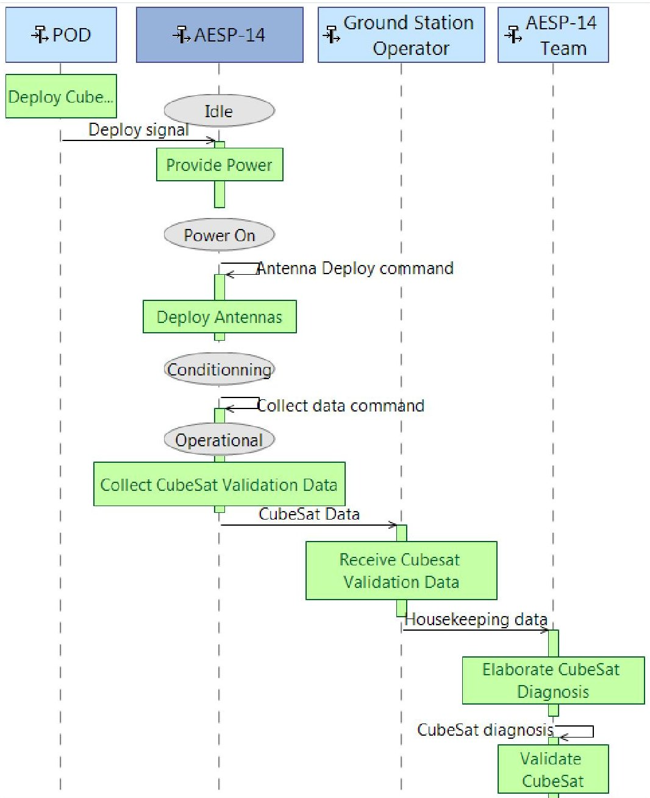

Source: by the author

The Figure informs the chronological aspect of system functions. The last two model views provide sufficient information to achieve the fourth objective.

## Outputs

Right below, step output 1, satellite high-level functions integration sequence, is showed:

<!-- PDF_PAGE: 122 -->

I. Provide Power

II. Deploy antennas

III. Collect CubeSat Validation Data

All predefined questions were satisfactorily answered with the gathered information.

## 6.3.1.2. Step 1.2

Step 1.2 objectives, predefined questions and outputs, are resumed in Table 6.3.

Table 6-3 - Step 1.2 objectives, predefined questions and outputs.

<table border="1"><tr><td>Objectives</td><td>3. Understand satellite subsystems and their functions;
4. Identify the dependencies between functions;
5. Identify critical functions of the functional chains;
6. Identify operation external functions to be provided for the system.</td></tr><tr><td>Predefined Questions</td><td>What are the subsystems of the system?
What are the subsystems main functions?
What are the operation external systems and their functions?
How to order the system functional integration sequence?
What functions in the boundary of the system do we need to simulate?
What are the most critical functionalities of the system?</td></tr><tr><td>Outputs</td><td>1. Satellite preliminary integration sequence;
2. Preliminary external functions simulation needs;
3. Critical functionalities.</td></tr></table>

Source: by the author

<!-- PDF_PAGE: 123 -->

Step 1.2 model views and the related information taken from each of these models are presented below.

## Logical Architecture

Figure 6.12 shows the filtered logical architecture model view, evidencing the satellite subsystems.

Figure 6.12 - Logical architecture blank with filters to ease the identification of subsystems and interfaces.

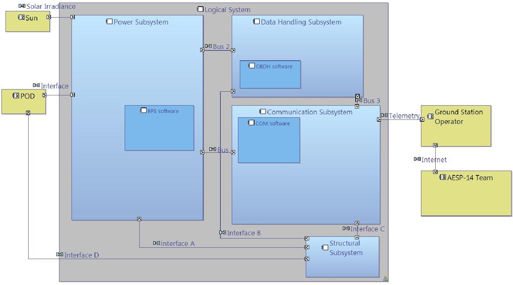

Source: by the author

The satellite main subsystems are structure, power subsystem, on-board data handling subsystem and communications subsystem.

The power subsystem has five physical exchanges. Each of them implements and gathers several functional exchanges. The number of interfaces indicates that EPS is a critical system, and should be integrated first.

Figure 6.13 shows the Logical Architecture model view.

<!-- PDF_PAGE: 124 -->

Figure 6.13 - Logical architecture, showing the subsystems, functions, functional chains (blue and red paths), and interfaces (functional and physical).

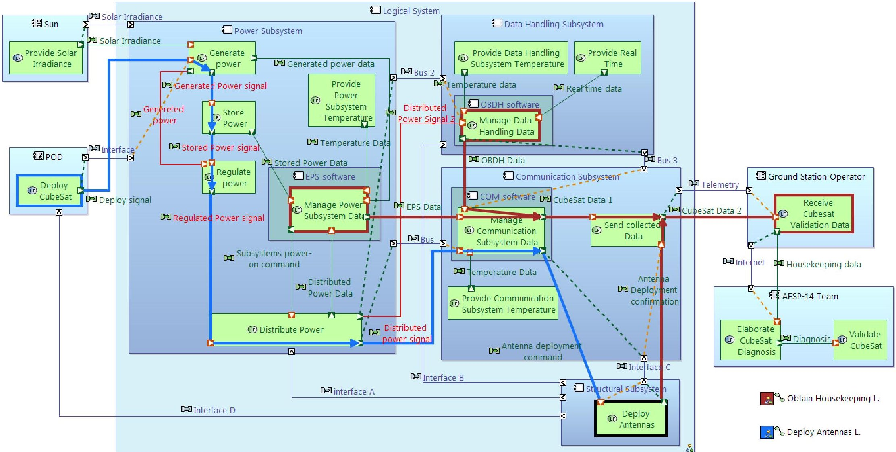

Source: by the author

<!-- PDF_PAGE: 125 -->

The functions of each subsystem are represented in green boxes. The objective one is met.

The flux of information between functions and the associated function ports assist in obtaining part of the objective two.

The blue and red paths represent the verification paths. They describe a subset of the model view representing functional dependencies to obtain a desired capability. These paths crosses through critical functions and components.

As we can see as a black box, the function deploy antennas is the most critical because it participates of the two most important functional verification chains. The functions: manage power subsystem data, manage communication subsystem data and distribute power, have the highest number of ports in the model view (green and red small squares), suggesting they may be allocated to critical components. This information achieves the objective three.

The operation external systems are represented by light-blue external boxes. Their green boxes are their functions. The external systems and their functions are the sun providing solar irradiance, the POD launch interface deploying the CubeSat, and the ground station receiving the CubeSat data. These elements indicate part of the functions that provide/receive material, energy or information from/to the system during operation scenario. These functions shall be addressed to a ground support equipment so they are simulated during AIT. This information completes the objective four.

<!-- PDF_PAGE: 126 -->

Logical function breakdown

Figure 6.14 shows the logical function breakdown model view, evidencing the satellite functional hierarchy.

Figure 6.14 - Satellite logical function breakdown.

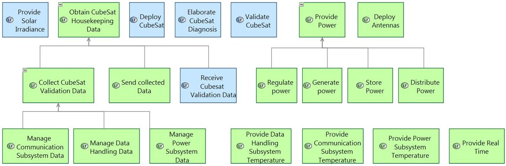

Source: by the author

Figure 6.15 shows the logical exchange scenario, giving the chronological aspect of functional dependencies.

<!-- PDF_PAGE: 127 -->

Figure 6.15 - Logical exchange scenario

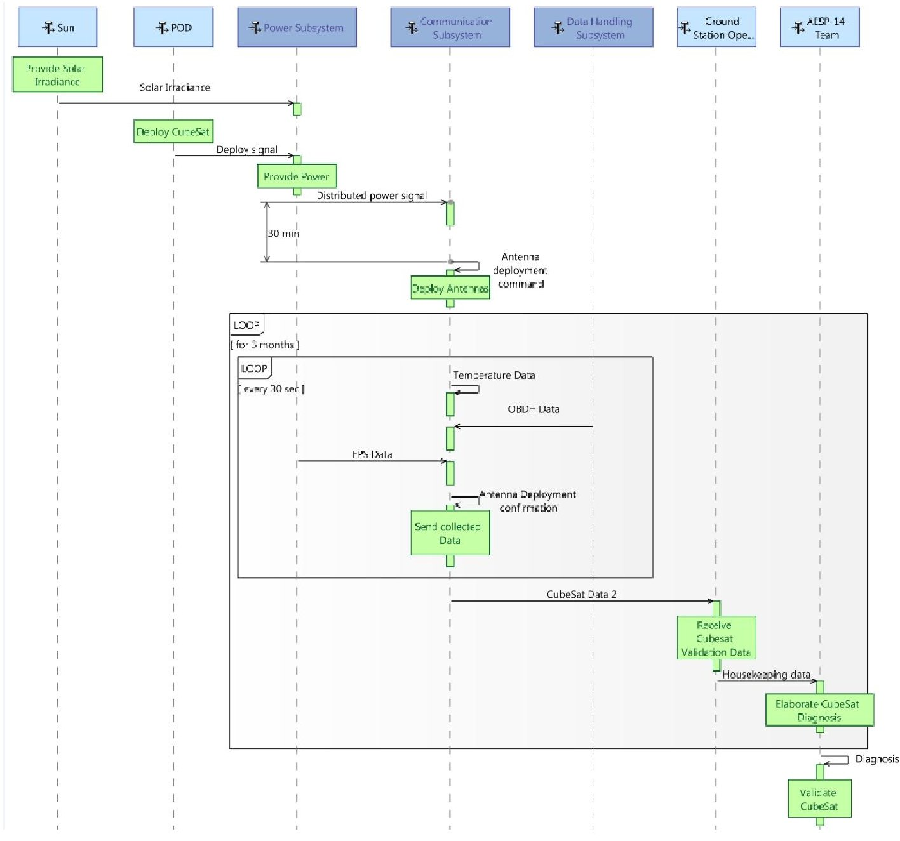

Source: by the author

The functions dependencies showed in this model view, together with the logical function breakdown and logical architecture model views completes the objective two.

<!-- PDF_PAGE: 128 -->

## Outputs

All predefined questions were properly answered with the gathered information from the model views. Right below, the step outputs are showed:

## 1. Satellite preliminary integration sequence

Departing from the previously defined high-level functions integration sequence (output from Step 1.1) and a reorganized logical architecture model view, the following diagram is generated (figure 6.16).

The preliminary integration sequence is as follows:

- Integrate EPS and COM (TT&C);

- Integrate Structure;

- Integrate OBDH.

<!-- PDF_PAGE: 129 -->

Figure 6.16 - Representation of the logical architecture model view with the previously defined high-level functional integration sequence.

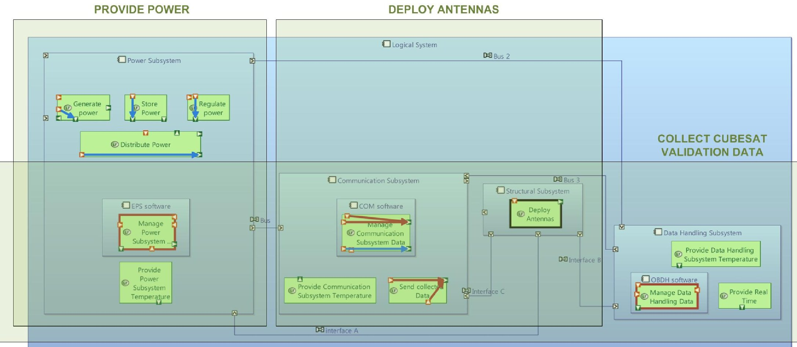

Source: by the author

<!-- PDF_PAGE: 130 -->

## 2. Preliminary external functions simulation needs

The operation external functions that need to be simulated, resulted from the analysis of the model views that represent the CubeSat operation life-cycle scenario are described below.

- Provide solar irradiance: during the operational scenario, this function is performed by the sun. During integration scenario, this function shall be simulated with a sun simulator or it shall be simulated through cables with an external power supply.

- Deploy CubeSat: during the operational scenario, this function is performed by the POD interface, which is attached to the launch vehicle's payload fairing. During the integration scenario, this function shall be simulated with a mechanical ground support equipment, which simulates the POD points of contact.

- Receive CubeSat Validation Data: during the operational scenario, this function is performed by the ground station(s). During the integration scenario, this function shall be performed through cabling by an electrical ground support equipment, and by means of a portable ground station to perform a wireless communication.

This output provides high-level requirements for external systems such as GSEs. It shall be reminded that models are built on requirements. Each model view element, such as external functions, represents a requirement that will be further decomposed and allocated to external systems components, supporting the external system design process while maintaining traceability.

3. Critical functionalities

- Deploy antennas;

- Manage power subsystem data;

- Manage communication subsystem data;

- Distribute power.

<!-- PDF_PAGE: 131 -->

All predefined questions were satisfactorily answered with the gathered information.

## 6.3.1.3. Step 1.3

Step 1.3 objectives, predefined questions and outputs, are summarized in Table 6.4.

Table 6-4 - Step 1.3 objectives, predefined questions and outputs.

<table border="1"><tr><td>Objectives</td><td>1. To identify components dependencies;
2. To identify critical components;
3. To build a first integration strategy;
4. To identify and characterize the internal interfaces to verify at each integration stage;
5. To define verification content (functional) of each integration stage;
6. To identify the external main functions to verify the stages;
7. To gather information from AIT engineering regarding: assembly and integration constraints, integration risk analysis and space products integration philosophies;
8. To evaluate and rearrange (if needed) the integration strategy;</td></tr><tr><td>Predefined Questions</td><td>Is the generated integration strategy feasible and efficient?
What are the verification content of the each integration stage?
What are the external system main functions to support the integration stages verification content?</td></tr><tr><td>Outputs</td><td>1. Satellite integration strategy;
2. Integration stages internal interfaces for verification;
3. Integration stages functional content for verification;
4. External main functions to perform tests.</td></tr></table>

<!-- PDF_PAGE: 132 -->

Step 1.3 model views and the related information taken from each of these models are presented below.

Figure 6.17 shows the physical component breakdown model view, evidencing the satellite components hierarchy. Figure 6.18 illustrates the physical entity scenario, showing the flow between system elements in a chronological perspective during its operation in space. Both model views assist in the first objective to identify components dependencies. The analysis of such model views explicit the dependence of all subsystems by the EPS, suggesting it should be the first to be integrated. Another relevant dependency are the software that shall be embedded on each micro-controller subsystem before the integration. It shall be noted that the high modularity and simplicity of the CubeSat prevents the integration from several component dependencies, which does not occur with larger satellites.

<!-- PDF_PAGE: 133 -->

Figure 6.17 - Physical component breakdown model view.

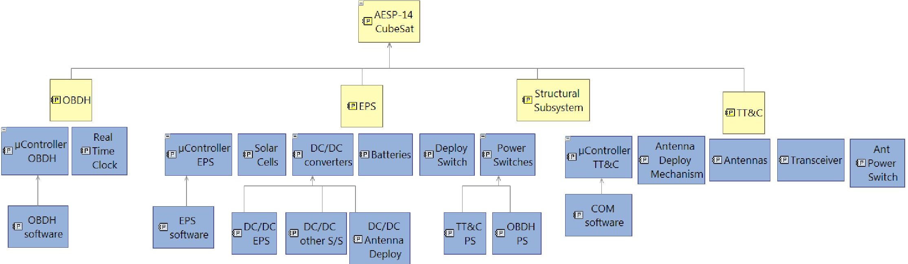

Source: by the author

<!-- PDF_PAGE: 134 -->

Figure 6.18 - Physical entity scenario.

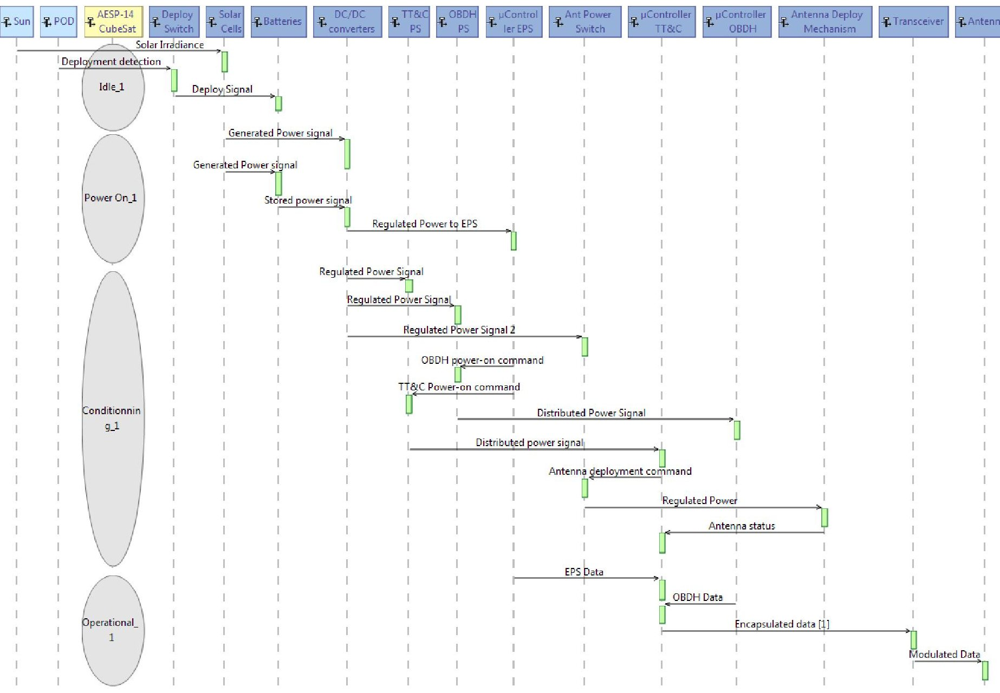

Source: by the author

<!-- PDF_PAGE: 135 -->

The critical components derived from Step 1.2 (output 3) together with an analysis of verification chains components, are cited below. This information completes the second objective. Given the embedded software criticality, during the integration stages it always shall be able to be updated. This creates an external function of update software, which (in next step) will lead to an interface requirement between the external system and the subsystems to allow this update procedure.

- Antenna deploy mechanism from structural subsystem;

- EPS software from EPS;

- COM software from COM subsystem;

- EPS subsystem.

Figure 6.19 shows the physical architecture (PAB) model view, giving a complete understanding of the satellite layout in the lowest abstraction level within modeling. The PAB view together with the previously defined preliminary integration sequence, allowed to conceive the first integration strategy, which is showed below.

- Stage 1: EPS + TT&C

- Stage 2: [EPS+TT&C] + Structure

- Stage 3 (systemic): [EPS + TT&C + Structure] + OBDH

The sequence stays the same from the preliminary one. This is because the simplicity and high modularity of the satellite with just four subsystems. This information completes the third objective.

<!-- PDF_PAGE: 136 -->

Figure 6.19 - Physical architecture model view.

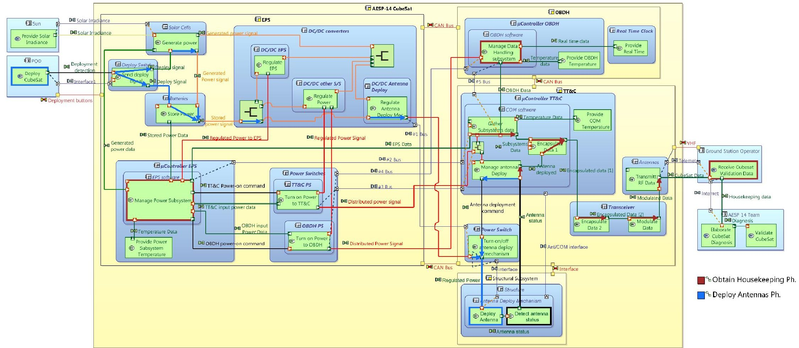

Source: by the author

<!-- PDF_PAGE: 137 -->

Using the metal-model illustrated in figure 5.5, from Chapter 5, the specific model views are generated according to Output 1.

Stage 1: Electric power system + Communication Subsystem Figure 6.20 shows the physical architecture model view of the first integration stage.

<!-- PDF_PAGE: 138 -->

Figure 6.20 - Stage 1 physical architecture integration model view.

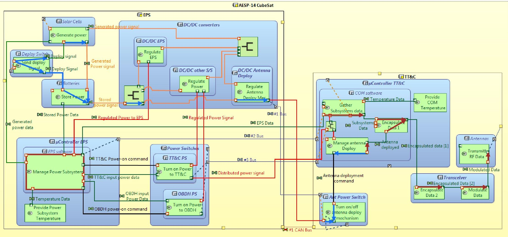

Source: by the author

<!-- PDF_PAGE: 139 -->

Internal interfaces

Figure 6.21 exemplifies how to obtain interface features.

## #1 Bus interface

Location: between DC/DC antenna deploy (EPS) and Power Switch (TT&C).

Function: Provide Regulated power.

Characteristics: Voltage and Current

Figure 6.21 - Window showing the features of the selected interface #1 Bus.

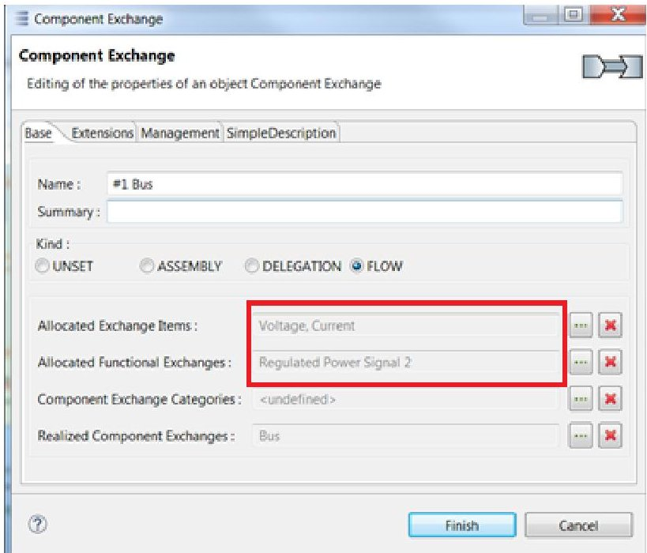

Source: by the author

- #2 Bus interface

Location: between $ \mu $Controller (EPS) and $ \mu $Controller (TT&C).

Function: Provide EPS data to TT&C.

Characteristics: Voltage, Current and Temperature data.

- #3 Bus interface

Location: between Power switches (EPS) and $ \mu $Controller (TT&C).

<!-- PDF_PAGE: 140 -->

Function: Provide Regulated power to TT&C.

Characteristics: Voltage and Current.

- #1 CAN Bus

Location: between EPS and TT&C.

Function: Provide power and data interface between subsystems.

Functional content for verification:

The main function performed by the integrated parts are cited below:

- Provide EPS and TT&C Data (via cable)

External Systems Functions:

Analyzing how to perform the verification of the interfaces and functional content defined above, the modeler found the need of the following external functions:

- Simulate deploy switch deactivation

- Simulate batteries

- Simulate antenna deployed signal

- Read Integration data

- Receive data via RF

- Show Integration data

- Upload subsystems software

These functions were allocated at the integration stage model view, with their respective functional interactions with the satellite showed in Figure 6.22 and 6.23. The model view was separated in two figures for visualization purposes only.

<!-- PDF_PAGE: 141 -->

Figure 6.22 - Relationship between external systems functions and satellite (1).

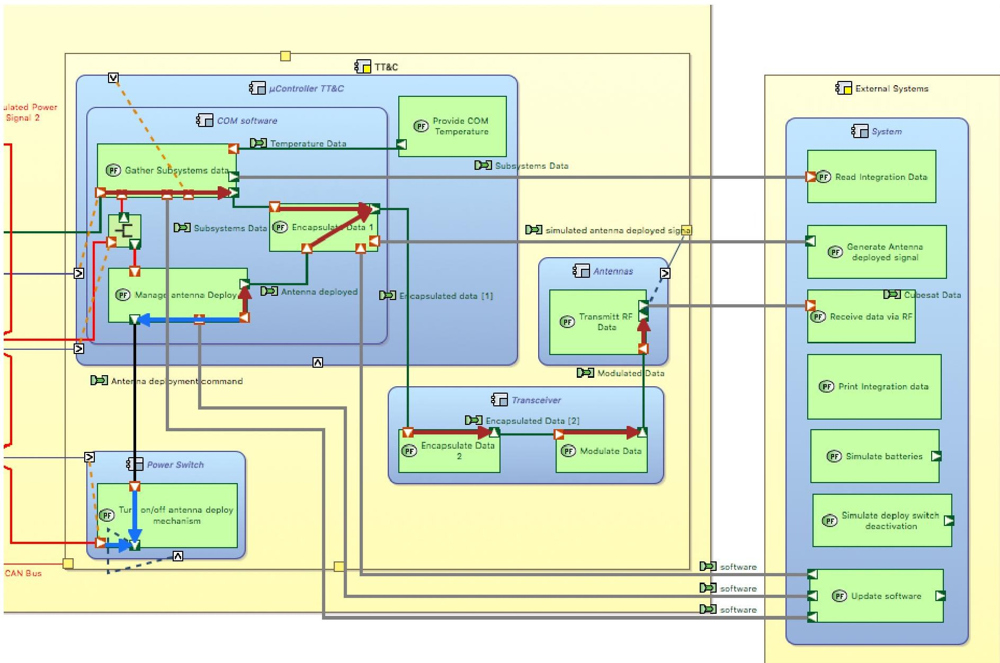

Source: by the author

<!-- PDF_PAGE: 142 -->

Figure 6.23 - Relationship between external systems functions and satellite (2).

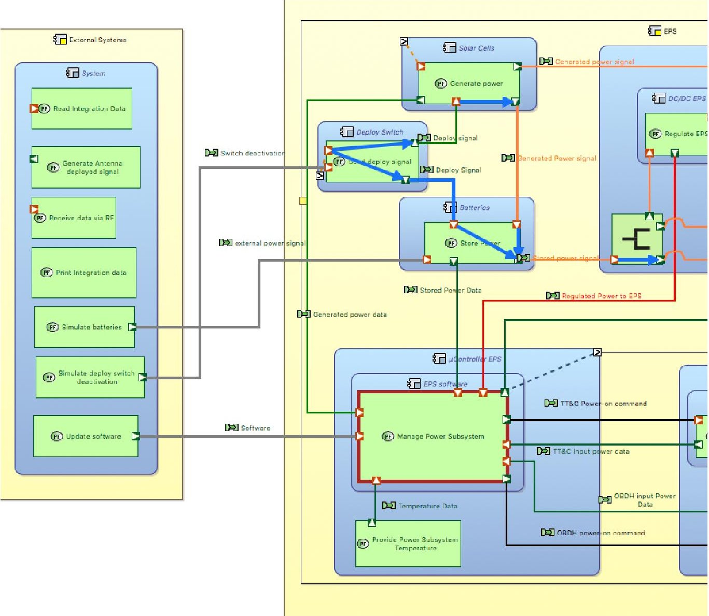

Source: by the author

<!-- PDF_PAGE: 143 -->

Stage 2: [Stage 1 + Structure]

Figure 6.24 shows the physical architecture model view of the second integration stage.

<!-- PDF_PAGE: 144 -->

Figure 6.24 - Stage 2 physical architecture integration model view.

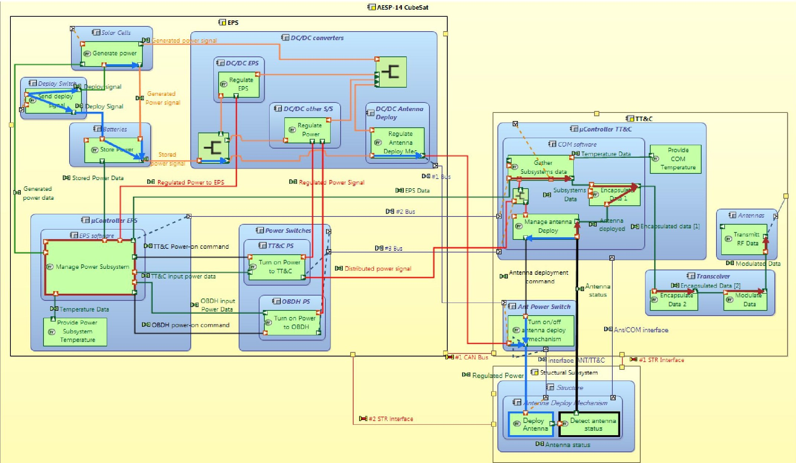

Source: by the author

<!-- PDF_PAGE: 145 -->

## Internal interfaces

A filtered view of the stage 2 physical architecture (Figure 6.25) facilitates the identification of internal interfaces between subsystems.

Figure 6.25 - Filtered view of the stage 2 physical architecture.

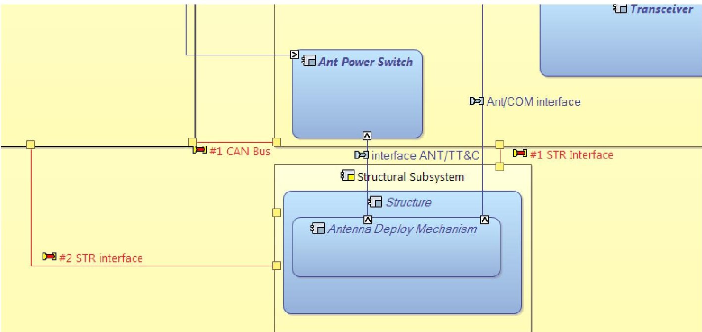

Source: by the author

- #1 STR interface

Location: between structural subsystem and TT&C.

Function: Provide Physical support.

Characteristics: N/A.

- #2 STR interface

Location: between structural subsystem and EPS.

Function: Provide Physical support.

Characteristics: N/A.

- Interface ANT/TT&C

Location: between antenna deploy mechanism (structural subsystem) and antenna power switch (TT&C).

<!-- PDF_PAGE: 146 -->

Function: Provide regulated power to antenna deploy mechanism.

## Stage 2 Functional content for verification:

The main function performed by the integrated parts are cited below:

- Deploy antenna;

- Provide antenna status;

- Provide EPS and TT&C data (via cable / via RF).

## External Systems Functions:

Analyzing how to perform the verification of the interfaces and functional content defined above, the modeler found that no additional external functions are required. The only difference in this case will be the absence of the external function simulate antenna deployed signal.

## Stage 3: [Stage 2 + OBDH]

The stage 3 completes the system integration, making it a complete functioning satellite. The model view that represents the system was showed above in Figure 6.19.

## Internal interfaces

A filtered view of the stage 3 physical architecture (Figure 6.26) facilitates the identification of internal interfaces between subsystems.

<!-- PDF_PAGE: 147 -->

Figure 6.26 - Filtered view of the stage 3 physical architecture.

Source: by the author

- #3 STR interface

Location: between structural subsystem and OBDH.

Function: Provide Physical support.

Characteristics: N/A.

- #2 CAN Bus

Location: between OBDH and EPS

Function: Provide power interface between subsystems

Characteristics: voltage and current.

<!-- PDF_PAGE: 148 -->

## #4 Bus interface

Location: between power switches (EPS) and $ \mu $Controller (OBDH).

Function: Provide regulated power to OBDH.

Characteristics: Voltage, current and temperature data.

## #3 CAN Bus

Location: between OBDH and TT&C

Function: Provide data interface between subsystems.

Characteristics: temperature and data clock data.

## Stage 3 Functional content for verification:

The main function performed by the integrated parts are the main system functions , which are traced to the system operational activities cited below:

- Deploy antenna;

- Provide EPS, TT&C and OBDH data (cable / via RF).

## External Systems Functions:

Analyzing how to perform the verification of the interfaces and functional content defined above, the modeler found that no additional external functions are required.

## 6.3.1.4. Step 1.4

Step 1.4 objectives, predefined questions and outputs, are resumed in Table 6.5.

<!-- PDF_PAGE: 149 -->

Table 6-5 - Step 1.4 objectives, predefined questions and outputs.

<table border="1"><tr><td>Objectives</td><td>1. Create a physical architecture model view representing the integration scenario with possible external systems elements (e.g. enabling systems and infrastructure);
2. Define external systems elements by allocating external systems main functions (from step 1.3 output 4) to them;
3. Derive and complete the allocation until to obtain a desirable functions level, obtaining the external systems model view;
4. Merge the product integration stages model views (obtained in step 1.3) with the obtained external systems model view and perform the necessary corrections;
5. Generate requirements (product/GSE) through the identification of external interfaces for each connection between integration stage and external elements;
6. Trace the verification paths associated to functional tests (between stage and external systems) in the model views.</td></tr><tr><td>Predefined Questions</td><td>What are the system functions of the external systems?
What are the external system elements?
What are the product external interfaces during integration?</td></tr><tr><td>Outputs</td><td>1. Ground support equipment requirements;
2. infrastructure requirements;
3. product external interface requirements;
4. electrical tests verification paths.</td></tr></table>

Source: by the author

Step 1.4 model views and the related information taken from each of these models are presented below.

Figure 6.27 show the physical architecture model view representing the system during integration. The objective of this model view is similar to a context

<!-- PDF_PAGE: 150 -->

diagram, but without the relations between elements. The objective one is complete.

Figure 6.27 - Physical architecture model view representing the integration scenario.

Source: by the author

The result of objectives two and three is showed in Figure 6.28 below.

<!-- PDF_PAGE: 151 -->

Figure 6.28 - Physical architecture model view representing the integration scenario external systems.

Source: by the author

Objectives four, five and six shall be performed to each one of the three integration stages. However, the identification of all interfaces and representation of all verification paths associated to each electrical tests would

<!-- PDF_PAGE: 152 -->

be too extensive for this work. Therefore, only the first integration stage (EPC + TT&C) will be showed in this case study, which is sufficient to understand the framework application.

## Stage 1

Figure 6.29 represents the stage 1 model view (EPS + TT&C) with all enabling systems, showing only functional interfaces (filtered view).

Figure 6.30 represents the stage 1 model view (EPS + TT&C) with all enabling systems, showing only physical interfaces (filtered view).

Objective four is complete.

<!-- PDF_PAGE: 153 -->

Figure 6.29 - Stage 1 model view (EPS + TT&C) (filtered view 1).

Source: by the author

<!-- PDF_PAGE: 154 -->

Figure 6.30 - Stage 1 model view (EPS + TT&C) (filtered view 2).

Source: by the author

<!-- PDF_PAGE: 155 -->

The Stage 1 interfaces are identified below.

## MGSE

## MGSE Stage 1

Location: between MGSE and stage 1 assembly

GSE Requirements: The MGSE shall Provide Physical support for the stage 1 integration stage. The MGSE shall permit the manual simulation of deploy switch deactivation. The MGSE shall be grounded to provide ESD protection to the satellite.

## Power Supply

## C6 interface

Location: between power supply and batteries

GSE requirement: The power supply shall provide power signal directly to the satellite, bypassing batteries.

Product Requirements: The satellite shall have a circuit to ease the installation of a power supply to simulate batteries.

## C5 interface

## Portable GS

Location: between portable GS and antennas

GSE Requirements: The portable ground station shall receive RF data from the satellite.

## USB

Location: between portable GS and PC

GSE Requirements: The portable ground station shall send the received data to computer via USB interface.

<!-- PDF_PAGE: 156 -->

## JTag Interface1

Location: between JTag and TT&C subsystem

Product Requirements: The TT&C shall have an interface port with the JTag for uploading software on micro-controller. The port shall be accessible during all stages of integration. The TT&C circuit shall connect the JTag to the TT&C micro-controller.

## JTag Interface2

Location: between JTag and EPS subsystem

Product Requirements: The EPS shall have an interface port with the JTag for uploading software on micro-controller. The port shall be accessible during all stages of integration. The EPS circuit shall connect the JTag to the EPS microcontroller.

- USB

Location: between JTag and PC

GSE Requirements: The JTag shall receive the software from a computer via USB port.

## PC

- Interaction

Location: between PC and AIT engineer.

GSE requirements: The PC shall receive the following commands from the AIT engineer (user): print data; send compiled software; generate antenna deploy signal. The PC shall print the received data to the user.

- USB

Location: between PC and EGSE

<!-- PDF_PAGE: 157 -->

GSE requirements: The PC shall send a command to EGSE to generate antenna deploy signal. The PC shall receive CubeSat data from EGSE via USB port.

## USB

Location: between JTag and PC

GSE Requirements: The PC shall send the software to JTag via USB port.

## EGSE

- USB

Location: between EGSE and PC

GSE Requirements: The EGSE shall receive the command generate antenna deploy signal from PC via USB port. The EGSE shall send Cubesat data to PC via USB port.

- EGSE interface

Location: between EGSE and TT&C

GSE Requirements: The EGSE shall send the command generate antenna deploy signal to TT&C.

Product Requirements: The TT&C shall have an interface to connect the EGSE. The connection port shall be accessible during all integration stages. The TT&C circuit shall connect the EGSE to the TT&C micro-controller. The TT&C micro controller shall receive the command simulated antenna deployed signal. The TT&C micro controller shall send CubeSat subsystems data to the EGSE.

This completes the objective five.

<!-- PDF_PAGE: 158 -->

The outputs 4 and 5 from step 1.3 indicate the minimum verification content of the integration stage 1, in terms of internal interfaces and functions. This means that the electrical tests performed should at least cover this verification content. For the purpose of this application example, the following electrical test will be modeled: "Electrical test #1: Provide EPS and TT&C Data via cable".

The test consist on simulating the batteries with the power supply. This power input turns-on the EPS and following the TT&C. The gathered data travels through EGSE and comes to the computer. After the AIT engineer command, the received data is printed on computer and then analyzed by the engineer.

Figure 6.31 shows the verification path (functional) of the above electrical test, depicted with a thick yellow line. The model view indicates to the modeler the following information:

- Internal interfaces verified;

- Expected characteristics of every interface (voltage, temperature data, etc.)

- Functions verified;

- Physical elements verified;

- All elements that were not verified;

- Requirements verified by the test. This feature is possible when all model elements are traced to requirements.

- Impact analysis in a case of testing discrepancy.

Objective six was completed, and PART I - Integration modeling was also accomplished.

<!-- PDF_PAGE: 159 -->

Figure 6.31 - Electrical test #1 verification path.

Source: by the author

<!-- PDF_PAGE: 160 -->

## 6.3.2. Part II-Environmental tests modeling

6. 3.2.1. Step 2.1

Step 2.1 objectives and outputs are resumed in Table 6.6.

Table 6-6 - Step 2.1 objectives and outputs.

<table border="1"><tr><td>Objectives</td><td>1. To identify test scenarios;
2. To develop a physical architecture model view for each scenario (similar to a context diagram) and populate them with test equipment;
3. Identify their main functions and elements.</td></tr><tr><td>Outputs</td><td>1. Environmental tests scenarios;
2. Test equipment, their main elements and functions.</td></tr></table>

Source: by the author

Step 2.1 model views and the related information taken from each of these models are presented below.

The first objective comes from the analysis of the System design verification matrix, where the system requirements verified by test (test requirements) shall indicate the environmental test scenarios. For the application example used herein, the same environmental tests of AESP-14 were modeled. Figure 6.32 and Figure 6.33 illustrate step outputs.

<!-- PDF_PAGE: 161 -->

Figure 6.32 - Physical architecture model view of AESP-14 in thermal-vacuum scenario.

Source: by the author

Figure 6.33 - Physical architecture model view of AESP-14 in vibration scenario.

Source: by the author

<!-- PDF_PAGE: 162 -->

Step 2.2 objectives and outputs are resumed in Table 6.7.

Table 6-7 - Step 2.2 objectives and outputs.

<table border="1"><tr><td>Objectives</td><td>1. Merge the model views from step1 with a simplified (filtered) satellite physical architecture model view;
2. Decompose external functions and physical elements as needed;
3. Identify and define the interfaces between satellite and external systems.</td></tr><tr><td>Outputs</td><td>1. Test equipment;
2. test equipment interface requirements.</td></tr><tr><td colspan="2">Source: by the author</td></tr></table>

Step 2.2 model views and the related information taken from each of these models are presented below in Figure 6.34 and Figure 6.35.

<!-- PDF_PAGE: 163 -->

Figure 6.34 - Satellite and external systems physical on vibration scenario.

Source: by the author

From the figure above, the following information can be extracted.

Test equipment is composed by a control system, shaker system, measurement system and an acquisition system.

The external interfaces are described below.

## Mechanical interface

Location: Between shaker system and satellite structure.

Test equipment interface requirements: A mechanical interface shall be used between the satellite and shaker during vibration tests. The mechanical interface shall be compatible with the satellite structure. The mechanical interface shall be compatible with the shaker slip table.

<!-- PDF_PAGE: 164 -->

## Accelerometers

Location: Between measurement system and satellite structure.

Test equipment interface requirements: The accelerometers shall be fixed to the satellite structure at the verification points settled by the mechanical engineering team.

<!-- PDF_PAGE: 165 -->

Figure 6.35 - Satellite and external systems physical on thermal-vacuum scenario.

Source: by the author

<!-- PDF_PAGE: 166 -->

From the figure above, the following information can be extracted.

Test equipment is composed by a thermal-vacuum chamber system, a measurement system, an acquisition system, an EGSE and a power supply.

The external interfaces are described below.

## Mechanical interface

Location: Between thermal-vacuum chamber system and satellite structure.

Test equipment interface requirements: The satellite shall be hanged with wires on the inside of thermal-vacuum chamber during all thermal-vacuum tests. The wires shall be of a non-conductive material.

## Thermo-couples

Location: Between measurement system and satellite structure.

Test equipment interface requirements: The thermos-couples shall be fixed to the satellite structure at the verification points settled by the thermal engineering team.

## Power cabling interface

Location: Between power supply and batteries.

Test equipment interface requirements: The power cabling interface shall be adapted to the available thermal-vacuum chamber external interface. The power cabling interface shall have the length to permit to connect a computer from 2 meters to the chamber external interface. The power cabling interface shall access the circuit that bypasses batteries with all satellite faces mounted.

## EGSE cabling interface

Location: Between EGSE#1 and TT&C.

<!-- PDF_PAGE: 167 -->

Test equipment interface requirements: The EGSE cabling interface shall be adapted to the available thermal-vacuum chamber external interface. The EGSE cabling interface shall have the length to permit to connect a computer from 2 meters to the chamber external interface.

Step 2.2 was completed, and the PART II - environmental tests modeling was also accomplished.

<!-- PDF_PAGE: 168 -->

<!-- PDF_PAGE: 169 -->

## 7 DISCUSSION

This chapter presents an assessment of the proposed framework.

The assessment highlights the work contributions through comparisons between the proposed framework in Chapter 5, theoretical foundation in Chapter 2, literature review of Chapter 3, inputs for space products AIT in Chapter 4 and the use case application exposed in Chapter 6.

## 7.1. Framework vs. theoretical foundation

This section describes the assessment of the proposed framework with respect to the fundamentals of traditional satellite AIT.

In Traditional AIT, the AIT specialists are usually late involved in the project phases, and often inherit a complete design, having to deal with problems that could have been avoided with their early involvement (MONTGOMERY, 2013). This distance sometimes is so prominent that part of system design continues during AIT in the testing hall, given the number of problems encountered. This setback negatively influences project resources as the cost of change highly increases over time (UNITED STATES DOD, 1996), and schedule is often tight due to launch window constraints. The impact is more significant for small satellite projects, in which late design takes place very frequently. Coupled with that, small satellites are usually developed with few resources, therefore using few satellite development models such as electrical model, structural model, and thermal model to assess design (BURGER, 2014). This fact further increases the amount of problems and rework efforts during AIT.

The framework promotes AIT team to participate in the design process. The framework proposed herein bonds AIT planning to system design modeling since early phases. This connection is achieved because product related inputs used for AIT planning come from product models. The interaction between

<!-- PDF_PAGE: 170 -->

design team and AIT team is then increased, both teams in this case will be working in the same model.

The optimization of products AIT process may involve product design adjustments in order to make it more suitable for stimulating, detecting and examining parameters (VOIRIN, 2017) or even to isolate certain functions while integrating or testing system for example. It may also be necessary to add exclusive system functionalities and special interfaces for integration and tests that cope with enabling systems (VENTICINQUE, 2017). This feedback shall be given as early as possible to product design (SILVA, 2011a). To anticipate these adjustments, AIT engineers shall have a wide understating of system, its subsystems, interfaces, functions, external systems and their functions, external interfaces and several other factors. This framework provides knowledge of the whole system in different perspectives, whether functional or physical, through ordered steps that follows product design evolution. Different than documents, the conceptual framework allows AIT engineers to work with dynamic and customized views that ease to observe the above-mentioned insights. Mostly with physical architecture model, different analyses can be performed providing multiple viewpoints that support the complex tasks of developing integration strategies, evaluate integration feasibility, risks, efficiency, electrical tests, identifying enabling systems, their functions, interfaces and interactions with system, and other tasks detailed from Step 1.1 to Step 2.2 in Chapter 5. The model views, product of this framework, give AIT specialist a supplementary reference to evaluate non-functional requirements related to AIT such as testability and assemblability. In other words, the framework contributes for 'design to be tested'. Besides that, models bring the possibility of simulation.

The AIT is essentially a document-centric process. The AIT efforts involve the production of a number of documents (SILVA, 2011a). As previously demonstrated in Chapter 4, each of these documents fundamentally use several other project documents as primary source of information, which come

<!-- PDF_PAGE: 171 -->

from different areas such as management, product development, and product assurance. The amount of documents dependencies creates a very complex net (see Figure 4.8) that brings configuration controls difficulties and other inconveniences such as traceability. This framework focuses in the AIT planning inputs specific from product development. It allies modeling as additional source of information. This means that this work does not intend to solve all AIT planning through modeling, neither in transforming all AIT in a model-centric process. However, the author of this work think that this thesis contributes to the first step towards 'satellite model-based AIT'.

The emphasis of this work are AIT planning activities, but its outputs also aid the AIT control phase.

During daily AIT activities, engineers guide their effort into task sheets procedures and detailed activities flowcharts (SILVA, 2011a). According to Silva (2011a), task sheets are important components of the AIT Plan that summarize several characteristics of each AIT activity. These documents are expressed, for the most part, in textual language, also by means of figures and diagrams (electrical, mechanical and functional). The physical architecture model of the proposed framework (obtained in Step 1.4 and 2.2) provides views of the system under AIT integrated with their enabling systems and electrical tests. These views provide a complement support during daily AIT activities. When a test discrepancy or late delivery takes place, the model views permit to perform an impact analysis tailored to the specific occurrence. It allows to identify failure behavior consequences, functions and components affected, and product requirements not verified. Besides that, the use of models in AIT (during planning and control phases) promotes a better reuse of information for future projects (capture lessons learned). This is possible because the models features of being easily shared, modified, easy to control versions and to capture multiple levels of information abstraction (granularity).

<!-- PDF_PAGE: 172 -->

The review performed in Chapter 2 suggests that AIT literature is very limited.

Even in space related books and standards the subject, which is complex and relevant, is superficially approached (FTI, 2015). Silva (2011a) states that most of systems engineering researches marginally involve AIT. In a similar way, Venticinque (2015) affirms that even though systems engineering standards consider the lifecycle processes as system elements to be developed, there are few directives for the application of the systems engineering process to these lifecycle processes, including AIT. This lack of references is even worse in small satellite area. The framework presented in this study fosters research in the large area of space products AIT, and its contributions are addressed to small and medium size satellites.

Following the theoretical foundation in Chapter 2, AIT is traditionally divided into three main disciplines: mechanical integration, electrical integration, and environmental tests (SILVA, 2011a). Electrical integration, in its turn, may be broken down into two subdivisions: interfaces and functional tests. The proposed conceptual framework bonds mechanical and electrical integration. This approach was chosen by its simplicity and because this work focuses on small and medium satellites, which are, in the vast majority, systems with high modularity (NASA, 2015) and fewer mechanical integration steps, when comparing to larger systems. This explains why Part I - Integration framework is more extensive than Part II - Environmental tests framework. This agglutination of mechanical and electrical integration would not be the case when dealing with larger satellites, which involve several mechanical parts and complex mechanical integration steps.

Regarding scope, the framework is restricted to small and medium size satellites. Its application on larger and more complex satellites would imply the following transitions.

<!-- PDF_PAGE: 173 -->

In terms of pre-requisite, the application of this framework involves the use of MBSE for product development. Therefore, the first difficulty is for larger organizations (with larger systems) that still not have transitioned from document-centric to a model-centric approach. This transition involves a substantial organization effort, cost and time. According to SEBoK (2018), the adoption of MBSE requires a skilled workforce. This requires organizations to provide an infrastructure that includes MBSE methods, tools, training, and a managerial commitment to deploy such approach to their programs. Besides that, MBSE has grown in popularity as a way to deal with the limitations of document-based approaches, but it is still in an early stage of maturity (SEBOK, 2018), what may hold back some organizations. However, after overcoming the initial inertia of modeling a large system, independently from modeling method, language or tool, its results can be used as a reference for next projects that will be dealing with the smaller effort of tailoring and customization instead of modeling all from scratch.

In terms of model complexity, larger satellites may involve diagrams that are much more complex, with several elements. A single subsystem may have several functions even in high levels of abstraction (INPE, 2005c). The proposed framework is based on the identification of certain system features when visualizing diagrams (e.g. to identify functional integration complexity in a logical architecture diagram); this characteristic may be compromised depending on model complexity, requiring new subdivisions in framework steps and/or different model views to deal with complexity.

In terms of organization complexity, larger systems' AIT involve several engineers (INPE, 2010a). This would also be the case for modeling. This framework considers its use by a small number of AIT modeler experts (up to three modelers), which is consistent with small and medium satellite projects. Larger organizations would require the framework revision to cope with organization modeling guidelines, rules, standards, and organization configuration control and data management rules.

<!-- PDF_PAGE: 174 -->

This framework brings the potential of generating different type of requirements, whether interface, infrastructure, GSE, test equipment, AIT, or product requirements. When dealing with larger satellites, the amount of requirements data would require a way to manage those requirements. A solution would be to integrate in the framework (and within the modeling tool) a requirement management tool, such as IBM Rational DOORS.

Table 7.1 shows a synthesis of all differences mentioned above between the traditional AIT process and the framework proposed in this work.

Table 7-1 - Comparisons between traditional AIT and the proposed framework.

<table border="1"><tr><td>Traditional AIT</td><td>Framework</td></tr><tr><td>AIT specialists late involved in design</td><td>AIT specialists early involved in design</td></tr><tr><td>Low interaction between AIT team and design team</td><td>High interaction between AIT team and design team</td></tr><tr><td>The beginning of AIT planning is delayed in relation to system design</td><td>AIT planned simultaneously with system design modeling</td></tr><tr><td>Limited and static perspectives of the system</td><td>Multiple, dynamic and customized AIT perspectives of the system (enables simulations)</td></tr><tr><td>Communication gaps due to textual language (misunderstandings, ambiguity, problems of projects between different countries, etc.)</td><td>Shared unique vision</td></tr><tr><td>Process-oriented</td><td>Product-oriented</td></tr><tr><td>Limited reference to evaluate non-functional AIT requirements</td><td>Customized model views to evaluate non-functional AIT requirements</td></tr><tr><td>AIT planning with several documents (document-centric)</td><td>AIT planning with a single model (model-centric) with the potential to generate documents</td></tr><tr><td>AIT task sheets (documents) for AIT control</td><td>Provide model views to support AIT control</td></tr><tr><td>Well-known and well-established AIT process</td><td>Needs a cultural change (document-centric to model-centric)</td></tr><tr><td>Documents are difficult to reuse the information</td><td>Models are easily to reuse for different projects</td></tr></table>

Source: by the author

<!-- PDF_PAGE: 175 -->

Through comparisons between the theoretical foundation and the proposed framework, this section assessment indicates the relevance of this work.

## 7.2. Framework vs. literature review

This section provides an assessment of the proposed framework regarding the other works analyzed in Chapter 3.

A summary of the main contributions provided by all references analyzed in literature review (chapter 3) was shown in Table 3.1.

The majority of current researches aim at increasing the AIT activities efficiency (in less time and with less resources), and at the use of concurrent engineering, where AIT requirements (or test and enabling systems requirements) are anticipated to the early project phases (BAGHAL, 2010; YEE, 2005; MERCER, 2000; SILVA, 2011a; VENTICINQUE, 2015). Some studies develop specific analysis for assembly or tests phases, such as the distribution of nonconformities and influence of tests on mission success (BERNER, 2004; WEIGEL, 2001; TOSNEY, 2001; SILVA, 2011b). Recent researches also show a commitment to the use of virtual reality tools in AIT processes (CADETE, 2009; EISENMANN, 2010; FUCHS, 2012).

Regarding the use of MBSE within AIT, the studies focus on reducing verification and validation activities by simulating tests using models (KHAN, 2012); promoting early system verification and validation (during system design) (NASTOV, 2017; KHAN, 2012); analyzing challenges and opportunities of using MBSE in AIT (WILLIANSON, 2012); using MBSE for requirements validation and managing test plans within the space AIT scope (ANDERSON, 2016); and involving system integrators within MBSE to early recognize potential integration risks (MONTGOMERY, 2013).

<!-- PDF_PAGE: 176 -->

The literature review has not shown any research that integrates traditional MBSE (product focused) to satellite AIT to provide AIT planning inputs simultaneously during system design. AIT inputs are several types of information used to build AIT planning. The review also did not indicate methodologies or frameworks that promotes the systematic and early involvement of AIT engineers in system design, providing insights (different perspectives) to anticipate AIT problems and, this way, contributing to system design. The research also did not find an approach that focuses on what information are present in the end-product model that are sources to AIT documentation and organization development, showing how to capture them, specifying what model views (diagrams) to use, what information they provide, and when these model views shall be developed. Thus, the contribution of this work presented in chapter 7 is strengthened.

Through comparisons between the literature review and the proposed framework, this section assessment indicates the originality of this work.

## 7.3. Framework vs. use case

This section provides an assessment on the application of the proposed framework. The framework was applied to the project AESP-14 CubeSat, a small satellite university project that was launched in early 2015.

The framework application was shown in a simple and functional way through several figures that represent model views. The application provided different perspectives on product verification, supporting product and enabling systems design and AIT decisions.

The specific contributions of this work regarding the inputs for each AIT document (exposed in Chapter 4 section 4.3) were evidenced through the

<!-- PDF_PAGE: 177 -->

framework application in Chapter 6. This framework scope is to provide AIT inputs related to product development. The total amount of inputs coming from product development documents (represented in section 4.3 figures' arrows) is 33. The application showed the potential to contribute with at least 30 inputs, that is, 91% from all product development inputs. Considering that the purpose of these early provided inputs is to support the draft versions (and not final) of AIT planning documentation, the author of this work believe the main objective of this study was met. The inputs that were not covered by the framework application are essentially non-functional requirements. A possible way to improve this rate is to include in the framework a method to model thesetype of requirements.

During the implementation of this framework, other benefit of using modeling at satellite AIT planning has appeared. The author of this work used a software feature that automatically generates documents from models. The Capella M2Doc allows that an editable Microsoft Word template to capture the desired information from product model. However, this result will not be further detailed here because it is outside the scope of this thesis.

Through comparisons between the use case of Chapter 6 and the proposed framework of Chapter 5, this section assessment indicates the applicability and comprehensiveness of this work.

According to INPE's rules of graduate courses (INPE, 2018), the article number 36 states that all Ph.D thesis shall be original works, and that they shall contribute to the field of knowledge.

This chapter proved that this work attends to these attributes of originality and relevance. It also proved its applicability in a real space project.

<!-- PDF_PAGE: 178 -->

<!-- PDF_PAGE: 179 -->

## 8.1. Objectives attainment

Regarding the general objective (section 1.2 from Chapter 1):

The general objective of this thesis is to find reasonable answers to the following question:

"How can we use MBSE to help us support Satellite AIT, organize AIT work and improve the AIT process?"

The proposed conceptual framework showed that since early lifecycle stages the AIT team can participate and contribute with product design while capturing inputs that forms the foundation of AIT planning. This is achieved with use of MBSE products. The framework helps to identify and to generate specific AIT models that support AIT processes and organization planning.

Regarding the attainment of specific objective (section 1.3 from Chapter 1)

- The identification of the main inputs to perform a satellite AIT were showed in Chapter 4;

- The identification of traditional sources of information that build the most important AIT documents were showed in Chapter 4;

- The proposition of a conceptual framework based on MBSE products that provide inputs to plan a satellite AIT process and organization was presented in Chapter 5.

- The use of the proposed framework to a case study for evaluating its application was performed in Chapter 6;

- The assessment of the framework regarding the theoretical foundation, literature review and use case application were presented in Chapter 7.

<!-- PDF_PAGE: 180 -->

## 8.2. Contributions

This work has provided the following contributions:

- Identified the major elements (inputs) that compose an AIT planning;

- Introduced models to the AIT planning phase, providing the first step towards a complete model-based AIT;

- Identified the means that models may support to increase the contributions of the AIT team with product design;

- Proposed the coupling of early lifecycle models with activities of the end of the development cycle, promoting a systemic integration of the organization, which may increase the sense of collaboration within an organization;

- Proposed a conceptual framework that uses models as source to capture inputs for AIT planning (the framework provided 91% of all product related AIT inputs in the study case), what brings the potential for product improvements;

- Provided a model-based way of obtaining satellite integration sequence;

- Provided a way of models verification with the perspective of different specialists than design (AIT specialists);

- Provided an use case application with a state-of-the-art tool, which was quoted to replace SysML as a systems engineering language (ROQUES, 2016);

- Provided a small satellite MBSE reference, so other initiatives may reuse the diagrams as an example;

- Proposed a supplementary reference to evaluate non-functional requirements related to AIT such as testability and assemblability.

<!-- PDF_PAGE: 181 -->

## 8.3. Future works

This thesis has demonstrated a vast space for modeling within satellite AIT. Several different areas arise within this correlation. In the paragraphs below, the author introduces potential future studies that are derived from this work.

- The thesis focused on product related inputs to plan AIT. A complete model-based AIT would bring several improvements for the area, not only for planning phase, but also to AIT execution and control. One of the great difficulties of this idea is to find a proper way to model non-functional requirements along the process. Another room for improvements within the same idea is the automatic generation of documents from models. As a great AIT team effort is to produce and maintain several documents, it would be valuable to incorporate in the model-based AIT a way of automatically obtain and maintain planning and execution documents.

- Another spin-off work that arises from this thesis is the adaptation and improvement of this conceptual framework for larger satellites. This subject has the potential to open several other works, given the higher complexity of larger systems. To reach this objective, it is necessary to change the (larger satellites) current approach of document-centric to model-centric. The objective of this work is to define a framework that provides AIT inputs from models, while aligned with the several organization, technical and complexity peculiarities that involve large systems development.

- The proposed framework is focused on satellite AIT. A very large field that have potential for several other studies is to expand the scope to AIV&V-Assembly, Integration, Verification and Validation.

- A promising subject for future studies is to use the proposed framework to analyze the impact of reducing the amount of tests. The literature review in Chapter 3 showed the high interest in this topic. The analysis shall evaluate the use of the framework considering two main AIT

<!-- PDF_PAGE: 182 -->

parameters: schedule reduction and missing coverage (the impact of not testing).

- Another subject that is on the rise within AIT scope, also showed in Chapter 3, is the use of virtual reality and augmented reality. One of the major problems of generating a virtual environment is the difficulty of modeling context information. Knowing that, a research field opens with this thesis to evaluate how this framework could contribute with virtual AIT providing inputs (context information) through models, and how to integrate these models into these virtual tools.

- Given the open-source characteristic of Capella tool (the main tool used to implement the framework), this work opens a field of research and development of add-ons (software complements) specific for satellite AIT demands, allowing to extend and modify Capella functionalities in a way to improve AIT planning and control activities.

<!-- PDF_PAGE: 183 -->

## REFERENCES

AEROSPACE CORPORATION. TOR-2006(8506)-4732: space system verification program and management process. Los Angeles, 2006. 76p.

AMSAT-UK. Video of AESP-14 CubeSat deployment from ISS. Disponível em: <https://amsat-uk.org/2015/03/30/video-of-aesp-14-cubesat-deployment-fromiss/>. Access in: 13 dez. 2015.

ANDERSON, H. A.; WILLIAMS, A.; PIERCE, G. Integrating MBSE into Ongoing Projects: Requirements Validation and Test Planning for the ISS SAFER. In: AIAA SPACE FORUM, 3., 2016, Long Beach. Proceedings... 2016. Available from: <https://doi.org/10.2514/6.2016-5313>. Access in: 17 apr. 2016.

ANDERSON, N.; ROBINSON, G.G.; NEWMAN, D.R. Standardization to optimize integration and testing. In: AIAA RESPONSIVE SPACE CONFERENCE, 3., 2005, Los Angeles. Proceedings... 2005. AIAA RS3-2005- 4005.

BAGHAL, L. A. Assembly, integration, and test methods for operationally responsive space satellites. 2010. 142 f. Dissertação (Mestrado em Engenharia Aeroenáutica) - Air Force Institute of Technology, Ohio, 2010.

BERNER, C. et al. The Rosetta Spacecraft: verification approach, testing and related analysis with MATED tool. In: INTERNATIONAL SYSMPOSIUM ON ENVIRONMENTAL TESTING FOR SPACE PROGRAMS, 5., 2004, Noordwijk. Proceedings... 2004. p.113-125.

BONNET, S. Equivalences and differences between SysML and Arcadia/Capella. Webinar, 2017. Thales Group Open. Available from: <http://www.thalesgroup.com>.

BRANCO, M. S. A. V&V de sistemas espaciais. São José dos Campos: Instituto Nacional de Pesquisas Espaciais, mar./jun. 2014. Notas de Aula.

BURGER, E. E. Proposta de método para AIT de pico e nanossatélites. 2014. 306 p. (sid.inpe.br/mtc-m21b/2014/02.13.16.21-TDI). Dissertação (Mestrado em Engenharia e Gerenciamento de Sistemas Espaciais) - Instituto Nacional de Pesquisas Espaciais (INPE), São José dos Campos, 2014. Available from: <http://urlib.net/8JMKD3MGP5W34M/3FNSPK2>. Access in: 2 may 2015.

BURGER, E. E.; LOUREIRO, G.; LACAVA, P. T.; HOFFMANN, C. T.; PEREIRA, M. O. Lessons Learned from the first Brazilian CubeSat platform. In: II LATIN AMERICAN IAA CUBESAT WORKSHOP, 2016, Florianópolis. Proceedings... 2016. Disponível em: <http://cubesat2016.ufsc.br/>. Acesso em: 06 nov. 2017.

<!-- PDF_PAGE: 184 -->

CADETE, R. et al. iMoted - 3D Virtual Reality Solution for Assembly, Integration and Test of the Space Segment. In: SESP 2010 - INTERNATIONAL WORKSHOP ON SIMULATION FOR EUROPEAN SPACE PROGRAMMES, 11., 2010, Noordwijk. Proceedings... Noordwijk: ESA - European Space Agency, 2010. p. 28-30.

CONRATH, P.; ABEL, C. SCOE simulation. In: SIMULATION AND EGSE FACILITIES FOR SPACE PROGRAMMES, 12., 2012, Noordwijk. Proceedings... 2012. Disponível em: <http://old.esaconferencebureau.com/docs/12c09_docs/s3_1530_abel.pdf?sfvr sn=2 >. Acesso em: 28 jun. 2015.

DELLIGATTI, L. SysML Distilled: A Brief Guide to the Systems Modeling Language. Upper Saddle River, New Jersey, USA: Pearson Education, 2014. 301 p. ISBN: 978-0-321-92786-6.

UNITED STATES OF AMERICA DEPARTMENT OF DEFENSE. MIL-STD 1540D: Product Verification Requirements for Launch, Upper-Stage, and Space Vehicles. El Segundo,1999. 28p.

EISENMANN, H., et al. ESA virtual spacecraft design. ESA/ESTEC. SECESA, 2010. Available from: <http://cms.dynaweb3.nl/users/esa//docs/10C08_SECESA_2010/s6_1310_eise nmann.pdf>. Accesso in: 2 may 2015.

ESTEFAN J. A. INCOSE MBSE initiative: Survey of Model-Based Systems Engineering (MBSE) Methodologies. 2008. Available from: <http://www.omgsysml.org/MBSE_Methodology_Survey_RevB.pdf>. Access in: 13 aug. 2016.

EUROPEAN COOPERATION FOR SPACE STANDARDIZATION. ECSS-E-1002C: Space engineering - verification. Noordwijk, 2009a. 45 p.

EUROPEAN COOPERATION FOR SPACE STANDARDIZATION. ECSS-Q-ST 20-07C: Space product assurance - Quality and safety assurance for space test centres. Noordwijk, 2013. 42 p.

EUROPEAN COOPERATION FOR SPACE STANDARDIZATION. ECSS-MST-10C: Project planning and implementation. Noordwijk, 2009b. 50 p.

EUROPEAN COOPERATION FOR SPACE STANDARDIZATION. ECSS-E-ST 10-03C: Space engineering testing. Noordwijk, 2012. 128 p.

FORSBERG, K.; MOOZ, H. System engineering for faster, cheaper, better. San Jose: Center for Systems Management. 1998. Available from: <http://masterofit2009.googlecode.com/svn/trunk/syseng_hwco/syseng/material /Forsberg%20- %20System%20Engineering%20for%20Faster,%20Cheaper,%20Better.pdf>. Access in: 16 apr. 2015.

<!-- PDF_PAGE: 185 -->

FTI WEBSITE. Improvements in spacecraft assembly, integration and test. Available from: < http://www.fti- net.com/cm/News_&_Events/FTI_in_the_News/Improvements%20in%20Space craft%20Assembly%20Integration%20and%20Test.html>. Access in: 2 May 2015.

GIL, A. C. Como elaborar projetos de pesquisa. 4. ed. São Paulo: Atlas, 2002.

HART, L. E. Introduction to Model-Based System Engineering (MBSE) and SysML. In: DELAWARE VALLEY INCOSE CHAPTER MEETING, 1., 2015, Delaware. Proceedings... 2017. Available from: <https://www.incose.org/docs/default-source/delaware-valley/mbse-overviewincose-30-july-2015.pdf>. Access in: 26 sept. 2017.

INCOSE. INCOSE-TP-2004: Systems Engineering Vision 2020. San Diego, 2007. 32 p.

INPE. CBERS 04A Satellite Design Verification Matrix. São José dos Campos: National Institute for Space Research, 2015a. (RB-DVM- 0001/00(04A).

INPE. CBERS 3&4 AIT plan. São José dos Campos: National Institute for Space Research, 2010a. (RB-AIT-0001).

INPE. CBERS 3&4 AIT plan. São José dos Campos: National Institute for Space Research, 2011a. (RB-AIT-0002/01).

INPE. CBERS 3&4 and 2B Satellites Master Schedule. São José dos Campos: National Institute for Space Research, 2015b. (RB-MNG-0009/00).

INPE. CBERS 3&4 Design and Construction Specification. São José dos Campos: National Institute for Space Research, 2009a. (RB-DCS-0001/04).

INPE. CBERS 3&4 Design and Construction Specification. São José dos Campos: National Institute for Space Research, 2009b. (RB-DCS-0001/04).

INPE. CBERS 3&4 Electrical Ground Support Equipment Specification. São José dos Campos: National Institute for Space Research, 2004a. (RBTHDS-0022/01).

INTITUTO NACIONAL DE PESQUISAS ESPACIAIS - INPE. CBERS 3&4 Electrical test plan. São José dos Campos: INPE, 2011b. (RB-AIT-00011/00).

INTITUTO NACIONAL DE PESQUISAS ESPACIAIS - INPE. CBERS 3&4 EMI/EMC Specification. São José dos Campos: INPE, 2008a. (RB-EMS-0001 / 04).

INTITUTO NACIONAL DE PESQUISAS ESPACIAIS - INPE. CBERS 3&4 End Item Product Acceptance Procedure. São José dos Campos: INPE, 2005a. (RB-PAD-0004 / 00).

<!-- PDF_PAGE: 186 -->

INTITUTO NACIONAL DE PESQUISAS ESPACIAIS - INPE. CBERS 3&4 FM AIT Technical Flowcharts. São José dos Campos: INPE, 2014a. (RB-AIT- 0055(F4)/00).

INTITUTO NACIONAL DE PESQUISAS ESPACIAIS - INPE. CBERS 3&4 General requirements. São José dos Campos: INPE, 2011c. (RB-AIT- 0001/01).

INTITUTO NACIONAL DE PESQUISAS ESPACIAIS - INPE. CBERS 3&4 MGSE Specification. São José dos Campos: INPE, 2004b. (RBU-HDS-0024 / 01).

INTITUTO NACIONAL DE PESQUISAS ESPACIAIS - INPE. CBERS 3&4 Product Assurance Requirements. São José dos Campos: INPE, 2005b. (RB-PAD-0002 / 0203).

INTITUTO NACIONAL DE PESQUISAS ESPACIAIS - INPE. CBERS 3&4 Satellite Development and Test Plan. São José dos Campos: INPE, 2006a. (RB-MNG-0002 / 03).

INTITUTO NACIONAL DE PESQUISAS ESPACIAIS - INPE. CBERS 3&4 Satellite Product Matrix. São José dos Campos: INPE, 2008b. (RB-MNG-0010 / 04).

INTITUTO NACIONAL DE PESQUISAS ESPACIAIS - INPE. CBERS 3&4 Satellite Specification. São José dos Campos: INPE, 2005c. (RB-HDS-0023 / 01).

INTITUTO NACIONAL DE PESQUISAS ESPACIAIS - INPE. CBERS FM 3&4 AIT Quality Assurance Plan. São José dos Campos: INPE, 2011d. (RB-PAD 0009/00).

INTITUTO NACIONAL DE PESQUISAS ESPACIAIS - INPE. CBERS FM-3 AIT Work share and responsibilities. São José dos Campos: INPE, 2011e. (RB-AIT-0032)/00).

INTITUTO NACIONAL DE PESQUISAS ESPACIAIS - INPE. Regimento dos

cursos de pós-graduação do INPE. Portaria nº35/2018/SEI-INPE. 2018.

INSTITUTO NACIONAL DE PESQUISAS ESPACIAIS - INPE; LABORATÓRIO DE INTEGRAÇÃO E TESTES - LIT. Nanossatélite AESP14: arquitetura do sistema e descrição dos subsistemas. São José dos Campos: INPE, 2013. (LIT21-LIT00-ES-005).

INTERNATIONAL ORGANIZATION FOR STANDARDIZATION. ISO 17566:2011 Space systems: general test documentation. Geneve, 2011.

KHAN, M. et al. Model-based verification and validation of spacecraft avionics In: AIAA INFOTECH@AEROSPACE 2012 CONFERENCE, 2012, Garden Grove. Proceedings... 2012. Availble from: <https://doi.org/10.2514/6.2012- 2555>. Access in: 5 aug. 2017.

<!-- PDF_PAGE: 187 -->

LOUREIRO, G. A systems engineering and concurrent engineering framework for the integrated development of complex products. Thesis (PhD in Manufacturing Engineering) - Loughborough University, England, 1999.

MARTINS, G. A. Manual para elaboração de monografias e dissertações. 2. ed. São Paulo: Atlas, 2000.

MERCER, R. D.; HORST, K. A. Increasing importance of testing within systems engineering. In: EUROPEAN SYSTEMS ENGINEERING CONFERENCE - EUSEC 2000, 2., 2000, Munich. Proceedings... 2000. p. 197-204.

MONTGOMERY, P. R. Model-Based System Integration (MBSI) - key attributes of MBSE from the system integrator's perspective. Procedia Computer Science, v. 16, p. 313-322, 2013.

MULLER, G. Systems architecting: a business perspective. Boca Raton, EUA: CRC Press, 2011. 268p. ISBN 9781439847626.

NASTOV, B; CHAPURLAT, V.; PFISTER, F.; DONY, C. MBSE and V&V: a tool-equipped method for combining various V&V strategies. IFAC-PapersOnLine, v. 50, n. 1, p. 10538-10543, 2017.

NATIONAL AERONAUTICS AND SPACE ADMINISTRATION. NASA system engineering handbook. Washington, DC, 2007.

NATIONAL AERONAUTICS AND SPACE ADMINISTRATION. Small spacecraft technology state of the art. Mission Design Division. Ames Research Center, Moffet Field, California, 2015. (NASA/TP-2015- 216648/REV1).

PISACANE, V. L. Fundamentals of space systems. Oxford: University Press, 2005.

POLARSYS. ARCADIA: a tooled mehod to define, analyse. Design & Validate System, Software, Hardware Architectures. Available from: <https://www.polarsys.org/capella/arcadia.html>. Access in: 18 Feb. 2017.

RAIMONDO, G.; FERRARI, E. GSE standardization to reduce AIV program cost. In: INTERNATIONAL SYMPOSIUM ON ENVIRONMENTAL TESTING FOR SPACE PROGRAMMES, 4., 2001, Liège. Proceedings... Liège: Brigitte Schürmann, 2001. p. 461-466.

REICHWEIN, A.; PAREDIS, C. J. J. Overview of architecture frameworks and modeling languages for model-based systems engineering. In: ASME INTERNATIONAL DESIGN ENGINEERING TECHNICAL CONFERENCES & COMPUTERS AND INFORMATION IN ENGINEERING CONFERENCE, 31., 2011, Washington. Proceedings... 2011. p. 1341-1349.

ROQUES, P. MBSE with the ARCADIA method and the capella tool. In: EUROPEAN CONGRESS ON EMBEDDED REAL TIME SOFTWARE AND

<!-- PDF_PAGE: 188 -->

SYSTEMS, 8., 2016, Tolouse. Proceedings... 2016. Available from: <http://www.erts2016.org/>. Access in: 22 aug. 2016.

ROQUES, P. Systems architecture modeling with the Arcadia method: a practical guide to Capella. Amsterdam: Elsevier, 2017. 292p. ISBN 9780081017920.

SCOPUS. Available from: <https://www.scopus.com/>. Access in: 12 july. 2018.

SILVA JR, A. C.; LOUREIRO, G. System integration issues - causes consequences & mitigations. In: IEEE INTERNATIONAL CONFERENCE ON INDUSTRIAL ENGINEERING AND ENGINEERING MANAGEMENT, 2011, Singapore. Proceedings... Singapore: IEEE, 2011b. p. 1338-1342.

SILVA, A. C. Desenvolvimento integrado de sistemas espaciais – design for AIT – projeto para montagem, integração e testes de satélites - D4AIT. 2011a. 455 f. Thesis (Phd in Produção) - Instituto Tecnológico de Aeronáutica, São José dos Campos, 2011a.

SILVA, A. C; LOUREIRO, G. Gestão da garantia da qualidade a nível de sistema da montagem, integração e testes de sistemas complexos - satélites. In: ENCONTRO NACIONAL DE ENGENHARIA DE PRODUÇÃO, 29., 2009b, Salvador. Anais... Salvador: ENEGEP, 2009b. Available from: <http://plutao.sid.inpe.br/col/dpi.inpe.br/plutao@80/2009/12.22.14.15.15/doc/coelho_gestao.pdf?metadatarepository=&mirror=dpi.inpe.br/plutao@80/2008/08.19.15.01.21>. Access in: 10 may 2016.

SILVA, A. C; LOUREIRO, G. Quality assurance of complex systems: satellite AIT. In: IEEE INTERNATIONAL CONFERENCE ON INDUSTRIAL ENGINEERING AND ENGINEERING MANAGEMENT, 2009, Singapore. Proceedings... Singapore: IEEE, 2009a. p. 935-939.

SILVA, E. L.; MENEZES, E. M. Metodologia da pesquisa e elaboração de dissertação. 3. ed. Florianópolis, Brasil: Universidade Federal de Santa Catarina, 2001.

SPACE AND MISSILE SYSTEMS CENTER. SMC system engineering primer and handbook: concepts, processes, and techniques. 3.ed. Los Angeles, 2005. Available from: <http://spacese.spacegrant.org/SEModules/Reference%20Docs/SMC_SE_Primer4-05.pdf>. Access in: 28 Apr. 2015.

SYSTEMS ENGINEERING BOOK OF KNOWLEDGE (SEBOK). Transitioning systems engineering to a model-based discipline. 2017. Available from: https://www.sebokwiki.org/wiki/Transitioning_Systems_Engineering_to_a_Mode I-based_Discipline. Access in: 10 oct. 2018.

TOSNEY, W. F. et al. The influence of development and test on mission success. In: INTERNATIONAL SYMPOSIUM ON ENVIRONMENTAL TESTING FOR SPACE PROGRAMMES, 4., 2001. Liège. Proceedings... Liège: Brigitte Schürmann, 2001. p. 485-490.

<!-- PDF_PAGE: 189 -->

TRETMANS, J. Tangram: model-based integration and testing of complex high-tech systems. Netherlands: Embedded Systems Institute, 2007. 241p. ISBN: 978-90-78679-02-8.

UNITED STATES DEPARTMENT OF DEFENSE. DoD guide to integrated product and process development. Washington, DC, 1996b. 42p.

VENTICINQUE, G. Engenharia de sistemas aplicada ao desenvolvimento do equipamento de suporte em Terra - GSE. 2017. 398 p. IBI:

<8JMKD3MGP3W34P/3NDGR8B>. (sid.inpe.br/mtc-m21b/2017/02.22.14.03-

TDI). Dissertation (Master in Engenharia e Gerenciamento de Sistemas Espaciais) - Instituto Nacional de Pesquisas Espaciais (INPE), São José dos Campos, 2017. Available from: <http://urlib.net/8JMKD3MGP3W34P/3NDGR8B>. Access in: 5 nov. 2017.

VOIRIN, J. Model-based and architecture engineering with the Arcadia method. Amsterdam: Elsevier, 2017. 388p. ISBN 9780081017944.

WANG, G. et al. Design and performance test of spacecraft test and operation software. Acta Astronautica, v. 68, p. 1774-1781, 2011.

WEIGEL, A.; WARMKESSEL, J. M. Understanding the enterprise value of test: characterizing system test discrepancies in the spacecraft industry. Cambridge: Massachusetts Institute of Technology, 2001. 94p.

WEIGEL, A.; WARMKESSEL, J.M. Cross-industry characterization of spacecraft integration and test discrepancies transforming discrepancies into product development improvements. In: AIAA SPACE CONFERENCE AND EXPOSITION, 2000, Long Beach. Proceedings... 2000. Available from: <https://arc.aiaa.org/doi/abs/10.2514/6.2000-5084>. Access in: 03 sept. 2015.

WILLIAMSON, R. INCOSE (MBSE) Model Based System Engineering integration and verification scenario. In: INCOSE IW12 MBSE WORKSHOP, 12., 2012, Jacksonville. Proceedings... 2012. Available from: <http://www.omgwiki.org/MBSE/lib/exe/fetch.php?media=mbse:mbse_iw_2012- outbrief_i_v.ppt>. Access in: 8 july 2015.

YEE, T. Key elements of rapid integrations an test. In: AIAA RESPONSIVE SPACE CONFERENCE, 3., 2005, Los Angeles. Proceedings... 2005. Available from: <https://arc.aiaa.org/doi/abs/10.2514/6.2005-6830>. Access in: 07 feb. 2017.

<!-- PDF_PAGE: 190 -->

<!-- PDF_PAGE: 191 -->

Figure A.1-Capella datasheet (1).

Source: Polarsys (2017)

<!-- PDF_PAGE: 192 -->

Figure A.2-Capella datasheet (2).

<table class="table table-bordered"><thead><tr><th>METHOD STEPS</th><th>TASKS</th><th>SAMPLE MODEL</th></tr></thead><tbody><tr><td rowspan="3">NEED</td><td>Customer Operational Need Analysis What the users of the system need to accomplish</td><td>        ✓ Define operational capabilities         ✓ Perform an operational need analysis      </td></tr><tr><td>System/SW/HW Need Analysis What the system has to accomplish for the Users</td><td>        ✓ Perform a capability trade-off analysis         ✓ Perform a functional and non-functional analysis         ✓ Formalise and consolidate requirements      </td></tr><tr><td>Logical Architecture Design How the system will work so as to fulfil expectations</td><td>        ✓ Define architecture drivers and viewpoints         ✓ Build candidate architectural breakdowns in components         ✓ Select best compromise architecture      </td></tr><tr><td>SOLUTIONS</td><td>Physical Architecture Design How the system will be developed &amp; built</td><td>        ✓ Define architectural patterns         ✓ Consider reuse of existing assets design a physical         ✓ Design a physical reference architecture         ✓ Validate and check it      </td></tr><tr><td>Development Contracts</td><td>What is expected from each designer/sub-contractor</td><td>        ✓ Define a components IVVQ strategy         ✓ Define &amp; enforce a PBS and component integration contract      </td></tr></tbody></table>

Source: Polarsys (2017)

<!-- PDF_PAGE: 193 -->

Figure A.3-Capella datasheet (3)

Source: Polarsys (2017)

<!-- PDF_PAGE: 194 -->

Figure A.4-Capella datasheet (4)

Verifying & checking solution against Non-functional & Industrial Stakes

THALES

Source: Polarsys (2017)

<!-- PDF_PAGE: 195 -->

The AESP-14 modeling is described in this APPENDIX. It shall be noted that the following pages do not follow any writing or publishing rules because they are result of several author's annotations and it was chosen to maintain the original version. This modeling activity used as reference the Roques (2017) book. All figures of this appendix were generated with the Polarsys' Capella open-source MBSE tool.

<!-- PDF_PAGE: 196 -->

## AESP-14 MODELING

This document describes the MBSE of AESP-14 CubeSat with Capella modeling tool. Although it is of a relatively low complexity and may contain some inconsistencies, it becomes a reference for small satellite enthusiasts in MBSE using Capella.

The modeling process is intrinsically iterative and incremental. The different types of diagrams allow the subject to be tackled from other viewpoints: concepts discovered in one diagram allow others to be completed.

Beyond the iterative and incremental characteristics of modeling, it is also a process to be made by multiple specialists. Each one of them shall contribute to incorporate his point of view in the model in order to have it as complete, comprehensive and responsive as possible.

## 1 Operational Analysis

The first step is to define high-level objectives (Operational Capabilities, Figure 0.1). These Capabilities shall be detailed with Operational Activities that exchange Interactions. Then, the analysis will be completed with the allocation of the Operational Activities to Operational Entities (Figure 0.3).

## 1.1. Operational Capabilities and Entities

Figure 0.1

<!-- PDF_PAGE: 197 -->

## 1.2. Operational Activities and Interactions

Figure 0.2 shows the functional allocation os AESP-14 mission elements.

Figure 0.2

8. 1. Alocação Funcional dos Elementos da Missão

Figura 5: Alocação funcional

Figure 0.3

<!-- PDF_PAGE: 198 -->

## 1.3. Allocation of activities to operational entities

The model shall be then validated to find modeling inconsistencies (Figures 0.4 and 0.5). After finding and correcting problems, operational activities shall be allocated to structural elements, which in Operational Analysis are called Operational Entities or Actors.

Figure 0.4

Figure 0.5

<table border="1"><tr><td colspan="3">Properties Information Semantic Browser</td></tr><tr><td>Message</td><td>Level</td><td>Rule id</td></tr><tr><td>Capella(10 items)</td><td></td><td></td></tr><tr><td>Design(4 items)</td><td></td><td></td></tr><tr><td>Completeness(3 items)</td><td></td><td></td></tr><tr><td>The leaf&quot;Elaborate CubeSat Diagnosis&quot;(OperationalActivity) is not allocated by any Component.</td><td>Warning</td><td>DCOM_03</td></tr><tr><td>The leaf&quot;Obtain CubeSat Housekeeping Data&quot;(OperationalActivity) is not allocated by any Component.</td><td>Warning</td><td>DCOM_03</td></tr><tr><td>The leaf&quot;Validate CubeSat&quot;(OperationalActivity) is not allocated by any Component.</td><td>Warning</td><td>DCOM_03</td></tr><tr><td>Well-Formedness(1 item)</td><td></td><td></td></tr><tr><td>Use Cases(1 item)</td><td></td><td></td></tr><tr><td>Transition(6 items)</td><td></td><td></td></tr></table>

In order to allocate the Activities, we shall create the Operational Architecture Blank (OAB, Figure 0.6). All ARCADIA phases have an "Architecture blank" type diagram. It is one of the most important diagrams of each phase because it gives a very complete view, with the most variety of elements.

<!-- PDF_PAGE: 199 -->

Figure 0.6

After this step, the analysis of the resulted model together with the unallocated operational activity (Obtain cubesat housekeeping data) evidenced the lack of a new stakeholder (ground station operator), that was not identified in first place. The new actor found shows one of the objectives of building models, completeness.

Adding new elements brings the need of reviewing the other models to check for elements and relations inconsistencies. This shows the iterative characteristic of modelling.

Second validation is performed (Figure 0.7) to make sure that model validation is only issuing "transition warnings", which relates to missing realization links (traceability) with future elements of next modeling phase (system level).

<!-- PDF_PAGE: 200 -->

Figure 0.7

<table class="table table-bordered"><thead><tr><th>Message</th><th>Level</th><th>Rule id</th></tr></thead><tbody><tr><td>Capella (8 items)</td><td></td><td></td></tr><tr><td>Design (1 item)</td><td></td><td></td></tr><tr><td>Well-Formedness (1 item)</td><td></td><td></td></tr><tr><td>Use Cases (1 item)</td><td></td><td></td></tr><tr><td>Produce CubeSat Validation (OperationalCapability) is not realized by any Capability</td><td>Warning</td><td>DWF_UC_02</td></tr><tr><td>Transition (7 items)</td><td></td><td></td></tr><tr><td>Justification (7 items)</td><td></td><td></td></tr><tr><td>Generic (2 items)</td><td></td><td></td></tr><tr><td>CubeSat diagnosis (Functional Exchange) in Operational Analysis is not realized by any other Functional Exchange in System Analysis.</td><td>Warning</td><td>TJ_G_03</td></tr><tr><td>Housekeeping data (Functional Exchange) in Operational Analysis is not realized by any other Functional Exchange in System Analysis.</td><td>Warning</td><td>TJ_G_03</td></tr><tr><td>System Analysis (5 items)</td><td></td><td></td></tr><tr><td>AESP-14 Team (OperationalActor) is not realized by any System Actor.</td><td>Warning</td><td>TJ_SA_03</td></tr><tr><td>Elaborate CubeSat Diagnosis (Operational Activity) is not realized by any System Function.</td><td>Warning</td><td>TJ_SA_01</td></tr><tr><td>ITA Ground Station Operators (OperationalActor) is not realized by any System Actor.</td><td>Warning</td><td>TJ_SA_03</td></tr><tr><td>Obtain CubeSat Housekeeping Data (Operational Activity) is not realized by any System Function.</td><td>Warning</td><td>TJ_SA_01</td></tr><tr><td>Validate CubeSat (Operational Activity) is not realized by any System Function.</td><td>Warning</td><td>TJ_SA_01</td></tr></tbody></table>

## 1.4. Additional Diagrams and concepts

After building the final OAB, the operational entity breakdown (Figure 0.8) may be then automatically generated. In this case, we wanted to show that both stakeholders are part of the same organization (operational entity) called "ITA".

Figure 0.8

A scenario model may be created to put chronological aspects into modelling. The chosen scenario is called Operational entity scenario (OES, Figure 0.9), which put Operational entities or actors represented by vertical lines. This representation will show the data flow of architecture diagrams previously build, in a time perspective. When creating an OES, a specific operational capability shall be chosen to be linked with. The only operational capability available is "Produce CubeSat validation".

<!-- PDF_PAGE: 201 -->

Figure 0.9

After this work, all previous models shall be reviewed and updated, for example, the OCB, that was automatically updated (Figure 0.10).

Figure 0.10

## 2 - System Analysis

The first step is to define system capabilities (high level objectives). These capabilities shall be expanded using functional data flow diagrams. The next

<!-- PDF_PAGE: 202 -->

step is to develop the architecture diagram, which allocates functions to the system or to the surrounding actors. The last step is dedicated to describe scenarios, states and modes, and data.

## 2.1. Moving from operational level to system level

System Analysis level identifies what the system shall do and what are the system's external interfaces.

The modeler shall identify if each operational activity from previous phase will be performed by the system to be developed or not (Figure 0.11). When it does, operational activity becomes a function of the same name allocated to the system. When it is not performed by the system, it becomes a function allocated to an (external) entity or actor.

If the operational activity is to be performed by the system, but not in its entirety, it shall be broken down to lower level functions until to be able to be allocated.

Figure 0.11

## 2.2. System Capabilities

The next step is to create new system capability from operational capability (Figure 0.12).

<!-- PDF_PAGE: 203 -->

Operational Analysis

Operational Activities

Operational Capabilities

Produce CubeSat platform validation

Figure 0.12

System Analysis

System Functions

Capabilities

Produce CubeSat platform validation data

## 2.3. Functional analysis at the system level

The next step is to create a system data flow diagram (SDFB). Capella can automatically create the first version of the SDFB by inserting in the properties of the diagram (Figure 0.13), the central function of such capability (collect CubeSat housekeeping data) as a contextual element of the diagram.

Figure 0.13

The result is as follows (Figure 0.14):

Figure 0.14

Now the main system function shall be decomposed to properly allocate the ports(Figure 0.15).

<!-- PDF_PAGE: 204 -->

Figure 0.15

The model shall be validated to expose modeling inconsistencies (Figure 0.16).

Figure 0.16

The port indicated in the warning above shall be properly allocated in order to solve the error (Figure 0.17). This error occurred because only "child" functions can have ports.

Figure 0.17

<!-- PDF_PAGE: 205 -->

## 2.4. functional chains

A Functional Chain is an important feature that guides future verification and validation tasks (Figure 0.18). It may be seen as a kind of verification path in the global data flow. It describes an expected behavior of the system in a given context or non-functional constraints in functional paths, such as latency and redundancy.

Figure 0.18

Obtain Housekeeping Data Chain

## 2.5. Allocation of functions to the system or to actors

The next step is to create system actors from operational entities/actors. We must select just the entities/actors that directly interact with the system. This will maintain the same allocations of operational activities (and now functions) to entities from the previous phase (operational), however we now have a system representation, thus the functions previously decided to be performed by the system (Figure 0.11) shall be unallocated from the actor/entity to be allocated to the system. To do so, it shall be made a System architecture blank (SAB, Figure 0.19).

The next step is to add all the involved actors and allocate all functions to their corresponding actors.

<!-- PDF_PAGE: 206 -->

Figure 0.19

The functional exchanges (green links) also need to be allocated to component exchanges (grey links).

Figure 0.20

These diagrams, depending on system complexity, may become very polluted. It is the modelers' job to use features such as cloning or filtering to provide for each reader the relevant and required level of information. Figure 0.21 shows a filtered view of System architecture (SAB), showing just physical components and component exchanges.

<!-- PDF_PAGE: 207 -->

Figure 0.21

The next step is to generate a tree view of functional breakdown at System level (Functional Breakdown diagram - SFBD, Figure 0.22).

Figure 0.22

Then a Functional Scenario (Figure 0.23) and an exchange scenario (Figure 0.24) are created.

<!-- PDF_PAGE: 208 -->

Figure 0.23

Figure 0.24

The next step performed is to create states of the system (Figure 0.25).

<!-- PDF_PAGE: 209 -->

Figure 0.25

After some iterations, in order to complete the state diagram, an actor (POD), more functions and a functional exchange were added to the System Architecture, resulting in the following Figure 0.26.

Figure 0.26

The resulted state model showed below in Figure 0.27.

<!-- PDF_PAGE: 210 -->

Figure 0.27

After such modification, all the previous diagrams of this phase shall be revisited and updated accordingly (for example Figure 0.28).

Figure 0.28

<!-- PDF_PAGE: 211 -->

In order to define all exchanges of the system, it is created a class diagram. After that, each functional exchange and its ports shall have at least one exchange item defined in this diagram (e.g. current, temperature or voltage).

Figure 0.29

## 3 Logical Architecture

The logical architecture starts with the creation of logical components, and allocate to them the logical level functions, that may need to be broken down functions from system level (system functions).

The functions are broken down using a "logical function breakdown diagram" (LFBD, Figure 0.30).

<!-- PDF_PAGE: 212 -->

Figure 0.30

Then, all these functions are allocated to logical system components, and all functional exchanges, component exchanges and ports are set (Figure 0.31).

Figure 0.31

As the final LAB diagram becomes very complex, and depending on the audience, may be difficult to read, it may be used filters to show specific parts of the diagram. The logical actors, components and component exchanges are showed below (Figure 0.32), as an example of the use of filters.

<!-- PDF_PAGE: 213 -->

Figure 0.32

The next diagram is the Logical exchange scenario (Figure 0.35).

<!-- PDF_PAGE: 214 -->

Figure 0.33

## 4 Physical Architecture

The physical architecture layer of arcadia considers the creation of physical components within the system, thus such step involves the realization of several technological choices. The work here is to break down logical level functions or even to modify them to a lower level of abstraction. Through this functional analysis, the modeler is forced to complete the physical design by adding new behavior physical components and physical nodes to properly allocate the lower level functions.

<!-- PDF_PAGE: 215 -->

The first step is to perform the transition of logical functions and actors to the lower level of physical functions and actors. During the actors transition, it was chosen not to transform the logical components directly into behavior components because, in this case, they will be transformed into nodes instead.

Right below the following figures show the decomposition of the logical functions "manage communication subsystem" and "send collected data" (Figure 0.34), "regulate power" and "distribute power" (Figure 0.35) into physical functions. This decomposition in lower level functions will allow the proper allocation into physical behavior components (blue rectangles in PAB diagram). This step is achieved using Physical data flow blank (PDFB) diagrams and Physical function breakdown diagram (PFBD, Figure 0.36).

Figure 0.34

<!-- PDF_PAGE: 216 -->

Figure 0.35

<!-- PDF_PAGE: 217 -->

Figure 0.36

<!-- PDF_PAGE: 218 -->

The Physical Architecture blank (PAB) is the chosen diagram to allocate functions to components. The allocation below (Figure 0.37) shows the "manage communication subsystem" in a dashed border line, indicating that there are lower level functions to allocate the corresponding ports (Capella rule).

Figure 0.37

After the diagram is completed, a physical architecture validation (Figure 0.38) is performed to correct possible inconsistencies.

<!-- PDF_PAGE: 219 -->

Figure 0.38

With the help of different diagrams and viewpoints, the system is evaluated from different perspectives, rising up to better solutions, potential failure points, inconsistencies, impossible loops, and several other modifications. The iterative nature of the modelling process allows such corrections. In a case of a modification, every higher layer level of abstraction shall be revised to update such modification (top to bottom).

The Figure 0.39 shows the example of an inconsistency found during physical components allocation, but the correction is made since logical layer (logical architecture blank). The deploy signal, which turns-on the satellite was mistakenly linked to "store power", making the system to generate power and to be turned-on unintentionally with any kind of light source (CubeSats have a very strict requirement to turn-on only after a specific time from deployment).

<!-- PDF_PAGE: 220 -->

Figure 0.39

The final PAB is showed in Figure 0.40. It is usual that it becomes a very complicated and polluted diagram due to the amount of information gathered in one perspective. It is the modelers' job to be sensitive about the audience need and knowledge, and work with the several filters to precisely adequate the information (fit to purpose).

<!-- PDF_PAGE: 221 -->

Figure 0.40

<!-- PDF_PAGE: 222 -->

The Figure 0.41 illustrates an example of a viewpoint of the same diagram, showing just physical node components (yellow rectangles), behavior components (blue rectangles) and their interfaces (physical links between nodes and component exchanges between behavior components).

Figure 0.41

Figures 0.42 and 0.43 show the final functional constitution of Deploy Antennas and Obtain housekeeping verification chains, respectively.

Figure 0.42

<!-- PDF_PAGE: 223 -->

Figure 0.43

