<!-- PDF_PAGE: 1 -->

POLITECNICO

MILANO 1863

DIPARTIMENTO DI

SCIENZE E TECNOLOGIE

AEROSPAZIALI

## Enhancing CubeSat design through ARCADIA and Capella: a concrete application

Presenter: Mr. Paolo Minacapilli

Authors: Mr. Paolo Minacapilli Prof. Michèle Lavagna

November 17,2021

<!-- PDF_PAGE: 2 -->

## Overview of the presentation

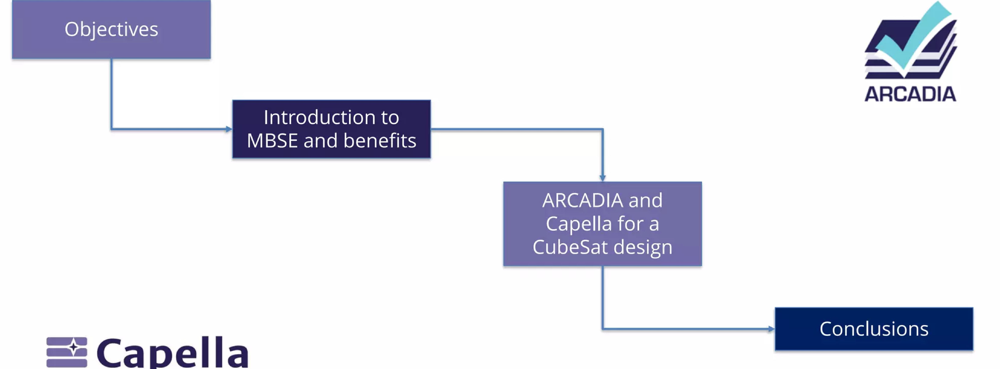

<!-- PDF_PAGE: 3 -->

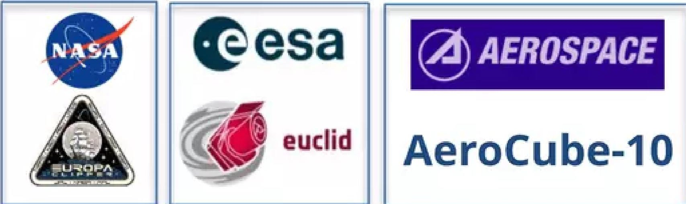

Assessed benefits of MBSE

Repulsion by engineers who feel comfortable with text-based procedures

## NEED OF IMPROVING MODEL-BASED SYSTEMS ENGINEERING (MBSE) MATURITY THROUGH PRACTICAL APPLICATIONS, TO BETTER RIDE THE NEW SPACE ECONOMY WAVE

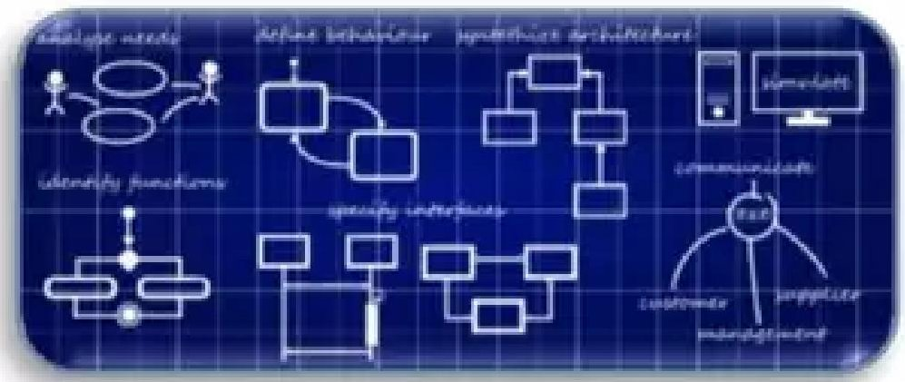

Low maturity of MBSE in the context of small satellites design

INCOSE MBSE Roadmap $ ^{[1]} $

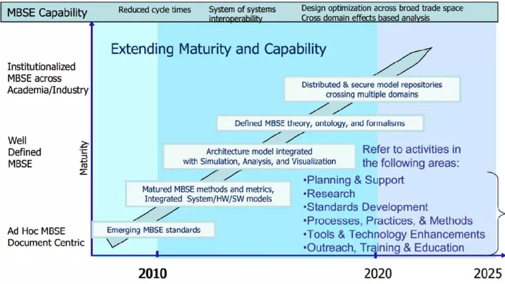

<!-- PDF_PAGE: 4 -->

## Introduction: Space Systems Engineering practices

## SPACE SYSTEMS ENGINEERING

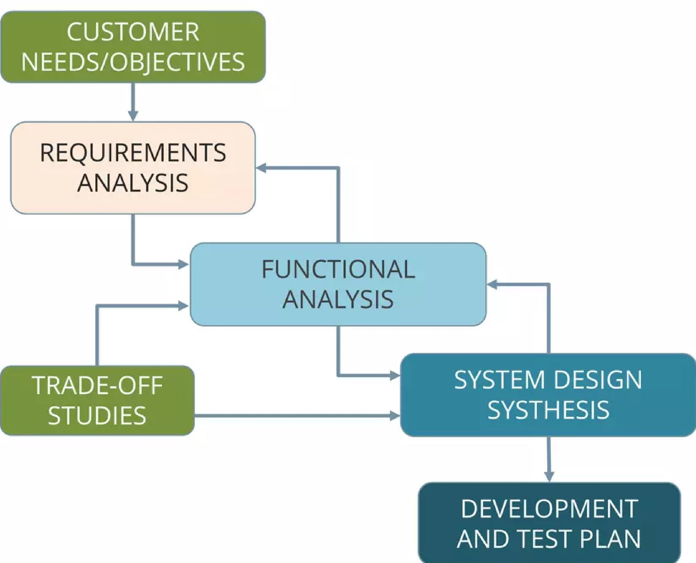

## MBSE

Increased awareness of MBSE potential in the last years

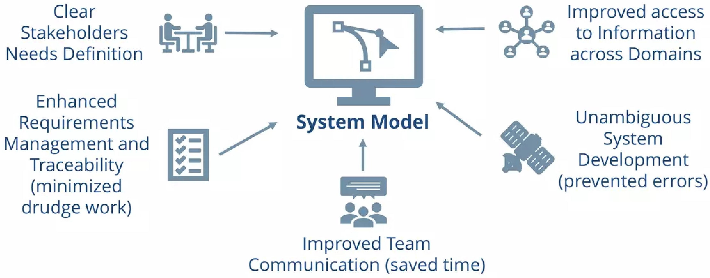

## METHODOLOGY

Logical sequence of tasks defining "what" is to be done and "how".

Object Oriented Systems Engineering (OOSEM)

TOOL Instrument that facilitates the accomplishment of tasks.

LANGUAGE Communication rules with precise syntax and semantics.

OMG

SYSTEMS

MODELING

LANGUAGE

OPL

<!-- PDF_PAGE: 5 -->

## Why ARCADIA and Capella

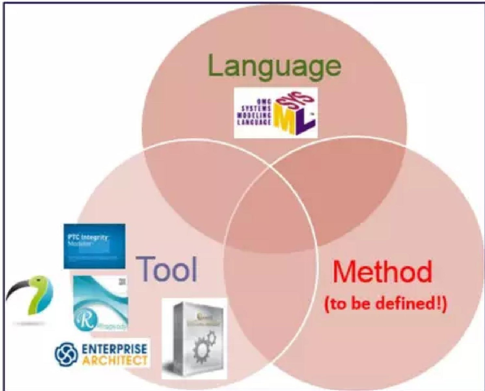

## "Classic" MBSE with SysML

SysML is just a language Needs a tool and a methodology that implement it

Object-oriented nature

No distinction between functions and components

Difficult to understand by non-software background engineers

Semantically confusing

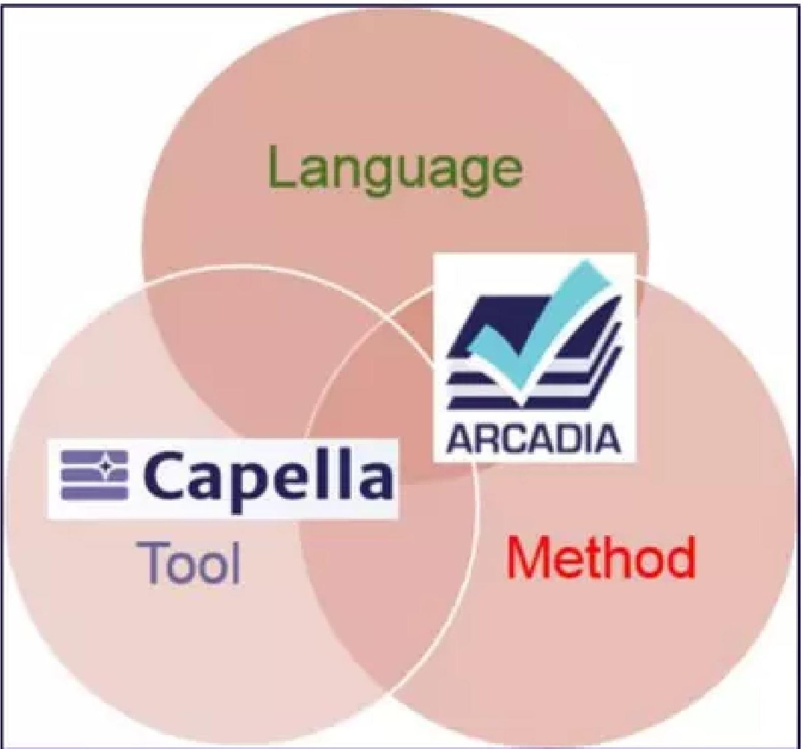

## ARCADIA (ARChitecture Analysis & Design Integrated Approach)

- Embeds methodology and language

- DomainSpecific Modeling Language (DSML)

- Does not requires modelling experts

- Less steep learning curve

Perfectly integrated by the tool

- Open-source

- Intuitive

- Customizable

<!-- PDF_PAGE: 6 -->

## Space projects lifecycle: ESA standards ECSS-E-ST-10C Rev.1

<table border="1"><tr><td rowspan="2">Activities</td><td colspan="7">Phases</td></tr><tr><td>Phase 0</td><td>Phase A</td><td>Phase B</td><td>Phase C</td><td>Phase D</td><td>Phase E</td><td>Phase F</td></tr><tr><td>Mission Function</td><td></td><td>MDR</td><td>PRR</td><td></td><td></td><td></td><td></td></tr><tr><td>Requirements</td><td></td><td></td><td>SRR</td><td>PDR</td><td></td><td></td><td></td></tr><tr><td>Definition</td><td></td><td></td><td></td><td>CDR</td><td></td><td></td><td></td></tr><tr><td>Verification</td><td></td><td></td><td></td><td>QR</td><td></td><td></td><td></td></tr><tr><td>Production</td><td></td><td></td><td></td><td>AR ORR FRR</td><td></td><td></td><td></td></tr><tr><td>Utilization</td><td></td><td></td><td></td><td></td><td></td><td>CRR ELR</td><td></td></tr><tr><td>Disposal</td><td></td><td></td><td></td><td></td><td></td><td></td><td>MCR</td></tr></table>

- Phase 0 - Mission analysis/needs identification: understand customer needs, propose mission/system concepts

- Phase A - Feasibility: propose system solutions to meet the customer expectations

- Phase B - Preliminary Definition: preliminary define the system solution

- Phase C - Detailed Definition: establish the system detailed definition

- Phase D - Qualification and Production: finalizes the development of the system, prepare for operations

- Phase E- Utilization: operate the system, support to anomaly investigations and resolutions

- Phase F- Disposal: safely dispose all products launched into space as well as ground segment

<!-- PDF_PAGE: 7 -->

## Getting started: CubeSat mission framework

## 12U CubeSat

High Level Mission Goal: Carry out a close-up visual inspection of a European space debris.

3) Reduce risks of future Active Debris Removal (ADR) missions

2) Validate GNC sensors to be used for a next capture of the debris

1) Understand the debris status at the time of flight

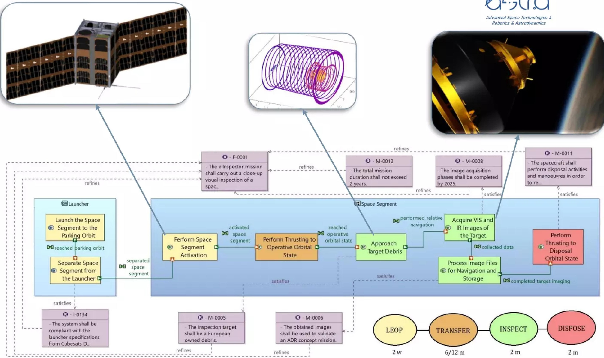

<!-- PDF_PAGE: 8 -->

## Review of ARCADIA

## METHOD-EMBEDDED DEVELOPED TASKS

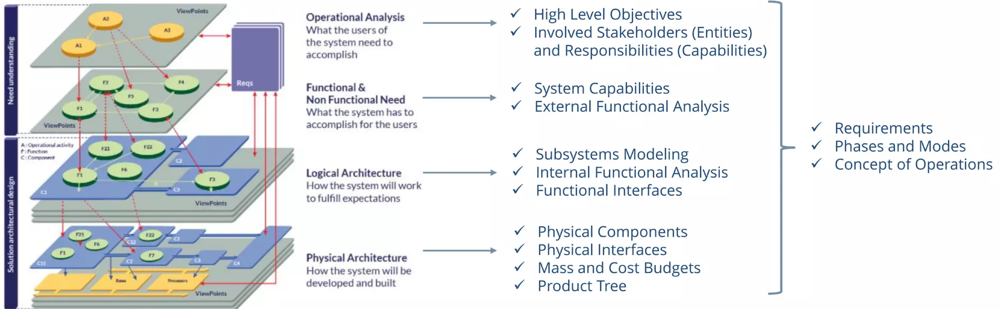

+ dedicated AIV/AIT plan development diagrams

<!-- PDF_PAGE: 9 -->

## From Functional Analysis to Requirements

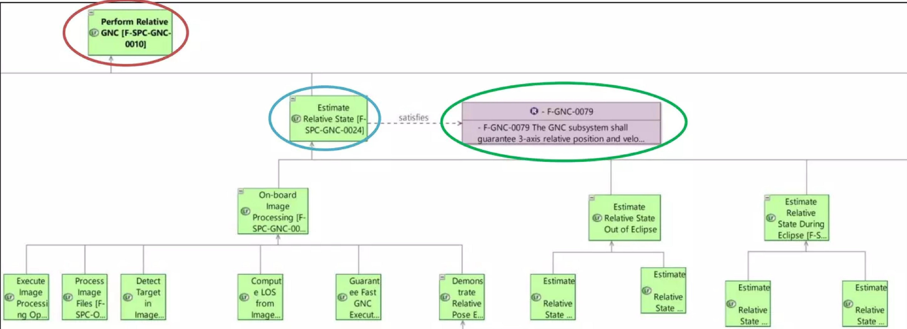

## Perform Relative GNC

- Estimate Relative State

- Execute Relative Maneuvers

- Perform Attitude Target Tracking

## Estimate Relative State

- On Board Image Processing

- Estimate Relative State Out of Eclipse

- Estimate Relative State During Eclipse

- Sensor Fusion for Enhanced Estimation

## F-GNC-0079:

The GNC subsystem shall guarantee 3-axis relative position and velocity states estimation

<!-- PDF_PAGE: 10 -->

# Traceability between requirements and model elements is managed through the Capella Requirements Viewpoint which provides a graphical output too

Importance

- Mandatory

- Nice to Have

Progress Status

- Rework Necessary

- To Be Reviewed

- To Be Discussed

- Reviewed OK

- Draft

- Under Rework

Verification Method 1

- Test

- Analysis

- Review of Design

- Inspection

Verification Method 3

## [Capella Types Folder]

GLOBAL MISSION

> F-0001 The e.Inspector mission shall carry out a close-up visual inspection of a...

M-0005 The inspection target shall be a European owned debris.

M-0006 The obtained images shall be used to validate an ADR concept mission.

M-0007 The total mission cost shall not exceed 5 MEuro, excluding margins.

M-0008 The image acquisition phases shall be completed by 2025.

[refines] F-0001 The e.Inspector mission shall carry out a close-up visual inspe

> M-0012 The total mission duration shall not exceed 2 years.

> F-0122 A radio-frequency communication shall be established between the space

> I-0134 The system shall be compliant with the launcher specifications from Cube

> M-0135 The reliability of the subsystems participating to disposal manoeuvres s

> F-0136 The system shall be capable of surviving space exposure for the duration

M-0297 The spacecraft shall be safely passivated after the disposal manoeuvres.

> F-0306 The system shall be able to acquire data that are useful for a future act...

## EPS

> D-EPS-0013 The EPS shall be sized to meet all requirements at the EoL.

D-EPS-0014 The solar arrays shall be sized at the EoL

D-EPS-0015 The solar arrays shall be sized considering a 0.26 degraded cell effi.

D-EPS-0016 The batteries shall be sized at the EoL.

> D-EPS-0017 The batteries shall be sized for a $ \SI{30}{\percent} $ maximum Depth

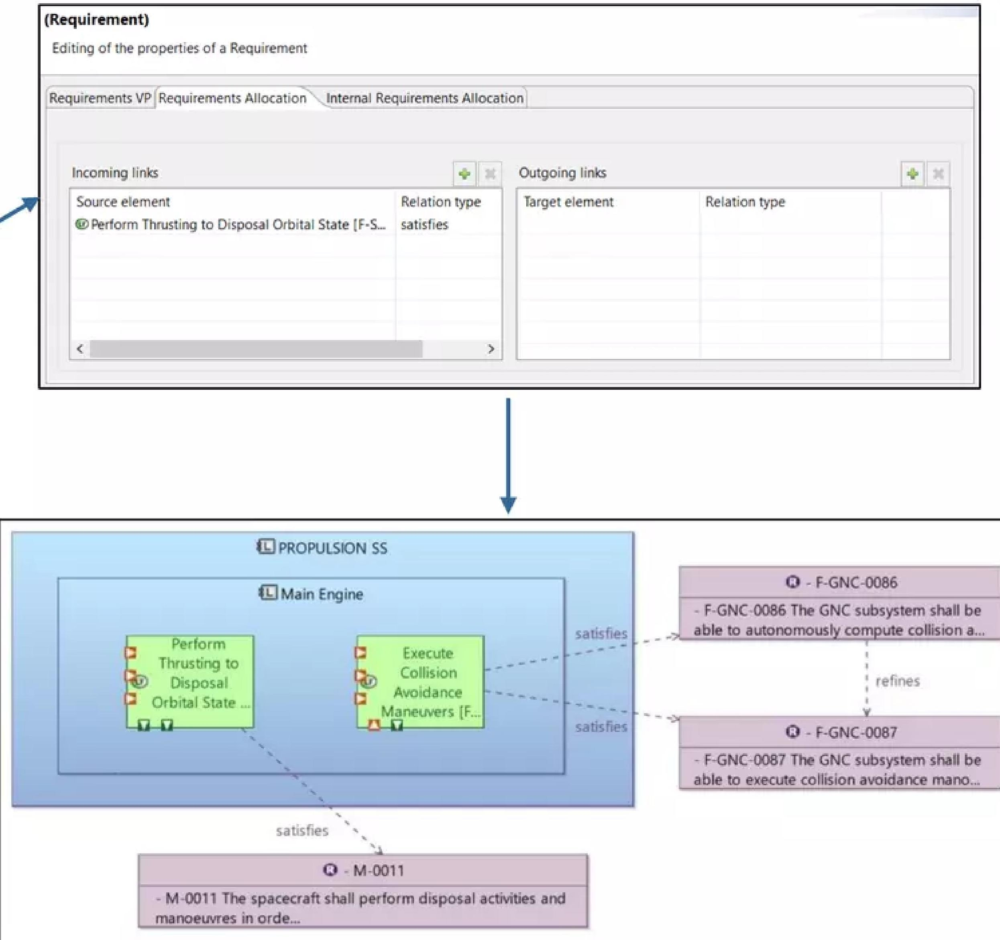

<!-- PDF_PAGE: 11 -->

Requirements trees are generated once internal relations are defined

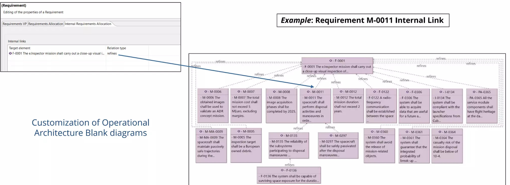

<!-- PDF_PAGE: 12 -->

## Operational Analysis

Outputs: High Level Objectives, Involved Stakeholders and Responsibilities

Example: Operational Architecture Blank diagram @Operational Analysis

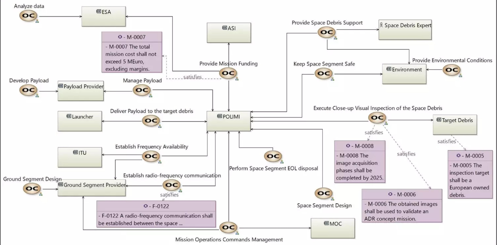

<!-- PDF_PAGE: 13 -->

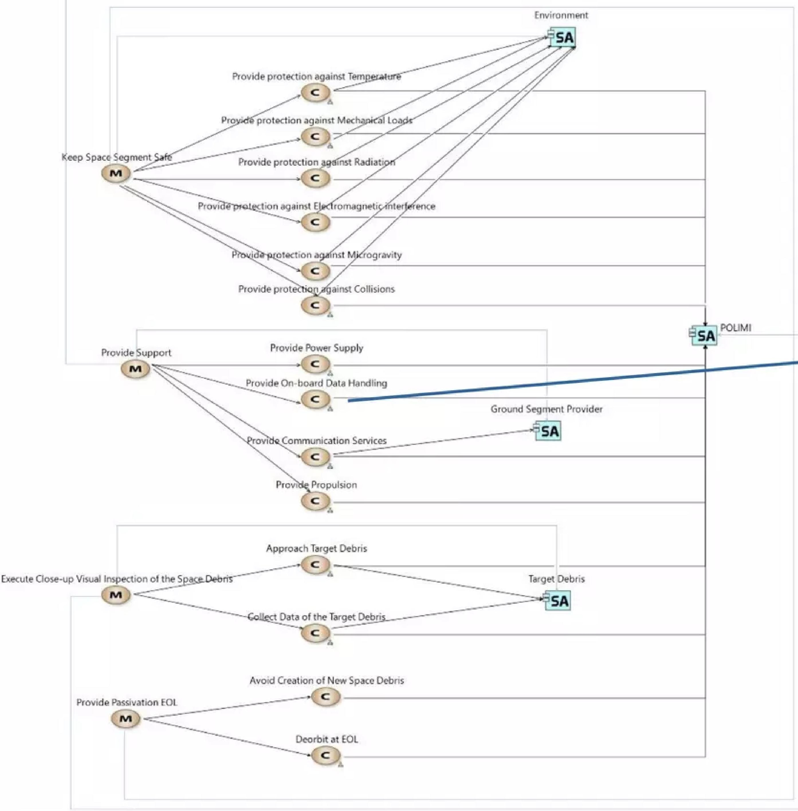

## Outputs: System Capabilities, External Functional Analysis

Example:

L: Mission Capabilities Blank diagram

R: OBDH Data Flow Diagram @System Analysis

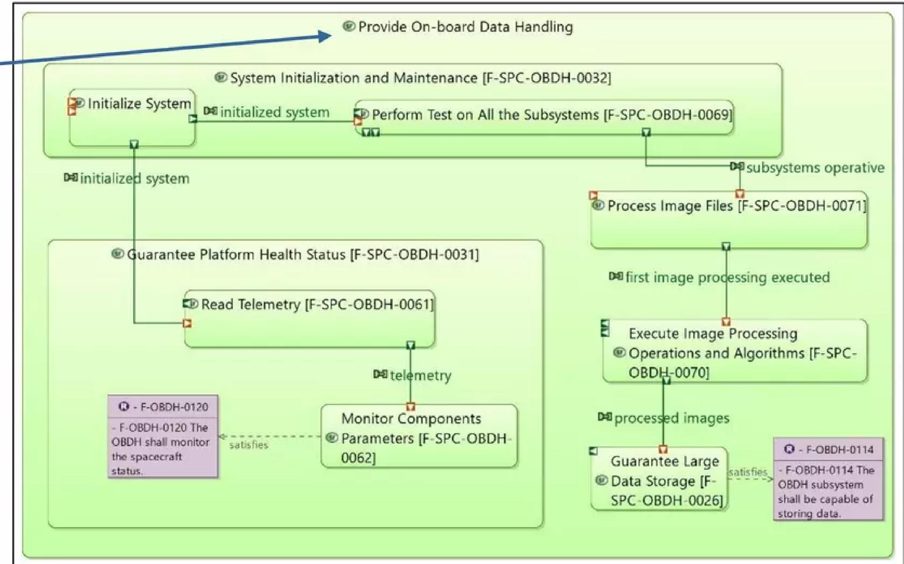

<!-- PDF_PAGE: 14 -->

## Outputs: Subsystems Modeling, Internal Functional Analysis, Functional Interfaces

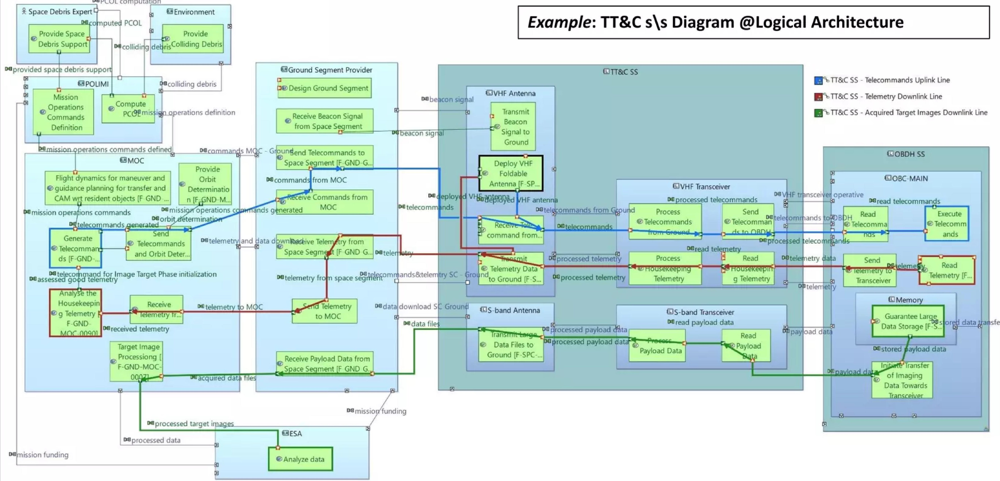

<!-- PDF_PAGE: 15 -->

Outputs: Physical Components, Physical Interfaces, Mass and Cost Budgets, Product Tree

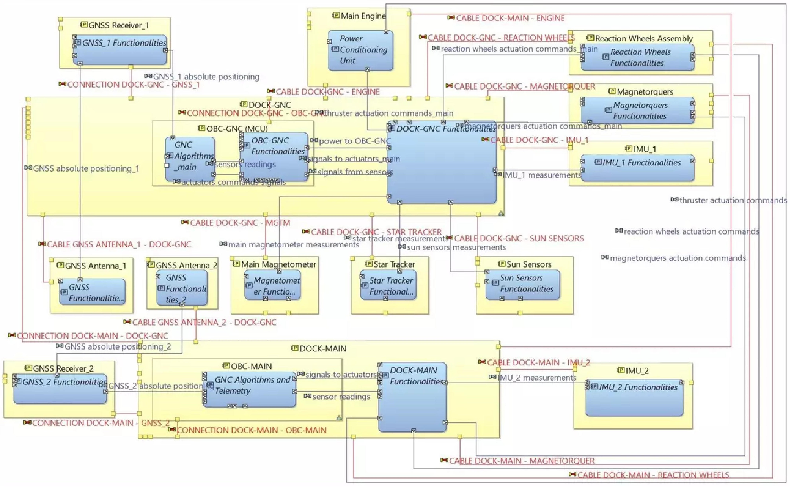

Example: OBDH - GNC interfaces

<!-- PDF_PAGE: 16 -->

## Modes modeling

## Modes are characterized by several functions already modeled in the previous analysis.

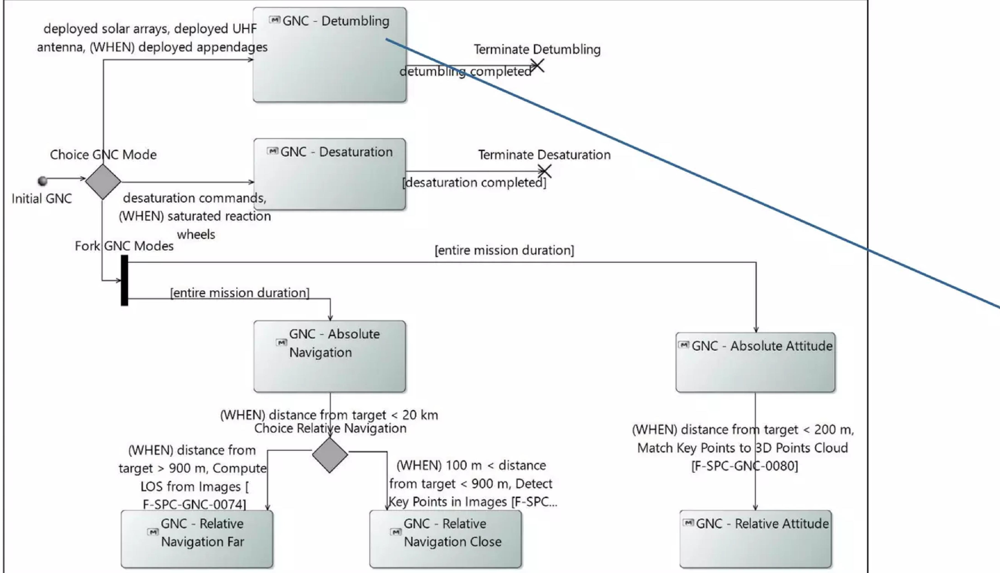

## Example: GNC Subsystem Modes

## GNC - Detumbling

GNC - Detumbling

do / Measure Angular Velocity Related Quantity IMU_1 [F-SPC-GNC-0067]

do / Measure Angular Velocity Related Quantity IMU_2 [F-SPC-GNC-0067]_2

do / Gather Angular Velocities Readings

do / Dissipate Angular Velocity [F-SPC-GNC-0066]

do / Execute 3-Axis Attitude Control [F-SPC-GNC-0048]

do / Monitor GNC Components Parameters [

F-SPC-OBDH-0036]

do / Magnetometers Data Acquisition

do / select magnetorquers functionality

do / Route Sensor Readings to OBC-GNC

do / Route Sensor Readings to OBC-MAIN

do / Route Commands from OBC-GNC to Actuators

do / Route Commands from OBC-Main to Actuators

do / Split Actuators Commands

do / Activate Magnetometer

do / Activate Magnetorquers

do / Provide Magnetic Field Components_IMU_MGTM

do / Provide Magnetic Field Components_IMU_MGTM_2

do / Provide Magnetic Field Components_MGTM

do / Generate Magnetorquers Commands

[region]

<!-- PDF_PAGE: 17 -->

## Modes modeling

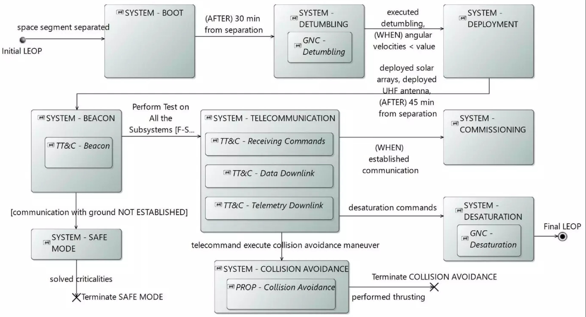

Example: LEOP Phase- System Modes

Subsystems Modes are exploited to easily define System ones

Saved time in developing State Machine Diagrams

<!-- PDF_PAGE: 18 -->

## Concept of Operations

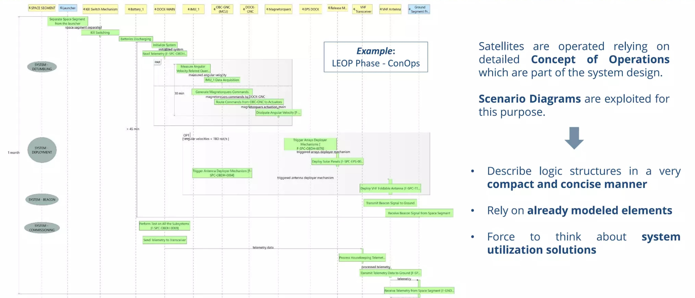

<!-- PDF_PAGE: 19 -->

## Assembly, Integration, Verification and Testing (AIV/AIT) plan

AIV/AIT plan definition is at a different level of modeling with respect to the system design. However, it is inherently connected with system functioning and architecture.

Example: EPS testing activities

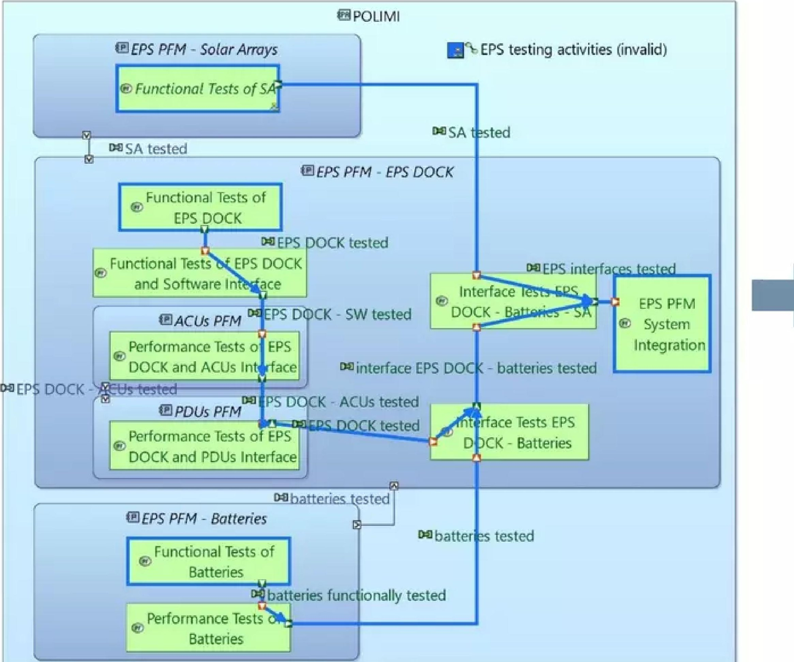

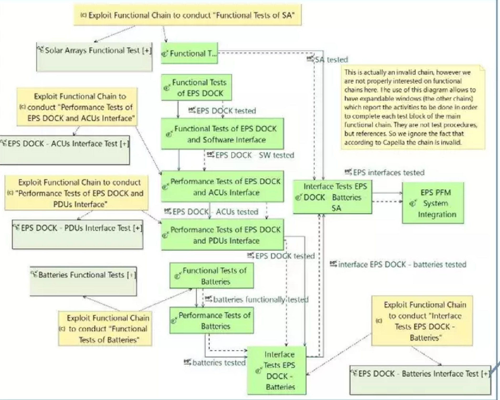

- Ad-hoc functionalities define AIV/AIT activities

- Bridge with model elements which provide guidance to the plan development

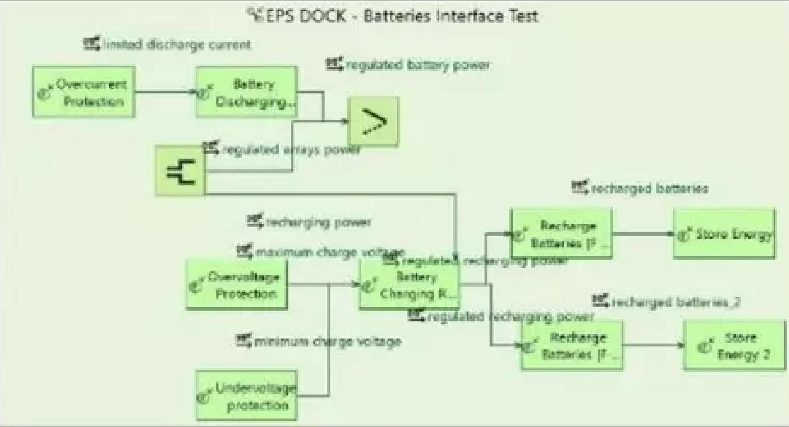

<!-- PDF_PAGE: 20 -->

## AIV/AIT procedures

Each activity is further described by a set of procedures which can be assigned to team members, monitoring the progress status.

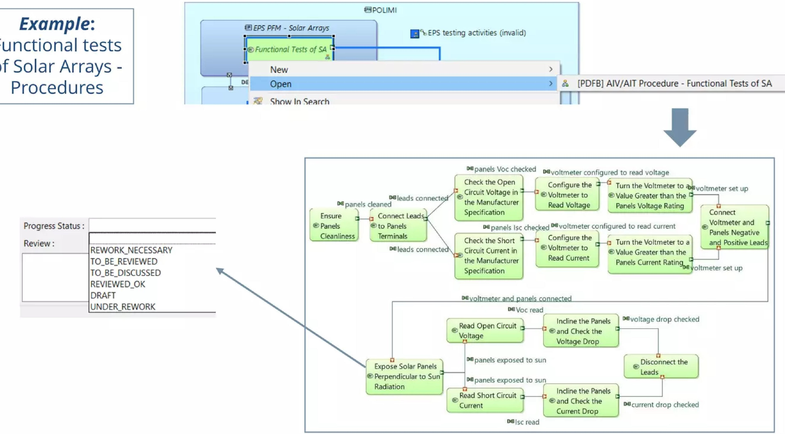

- Logical and temporal sequence of procedures can be used in the operational context

- Design changes are easily traced and related AIV/AIT activities and procedures promptly updated

- Improved standardization of AIV/AIT concepts

- Some ARCADIA rules have been violated, need of a formalization of the approach and its integration with Capella

<!-- PDF_PAGE: 21 -->

IS MBSE WORTH IT FOR SMALL SATELLITES?

MODELS EASE SYS. ENG. PRACTICES W.R.T. TEXT-BASED APPROACHES

## FUTURE STEPS

- Risk analysis

- Class diagrams

- System lifecycle further enhanced by dedicated AIV/AIT plan modeling

- Solid, Effective and Efficient approach to manage satellites complexity

- Formalization of AIV/AIT syntax and semantics

- Overall model refinement toward Phase B design

Open Source MBSE Solution

<!-- PDF_PAGE: 22 -->

## THALES

## Thank you for the attention!

Advanced Space Technologies 4 Robotics & Astrodynamics

## Questions?

linkedin.com/in/paolo-minacapilli/

paolo.minacapilli@yahoo.com

November 17,2021