<!-- PDF_PAGE: 1 -->

Delft University of Technology

# A New Approach on the Physical Architecture of CubeSats & PocketQubes

Bouwmeester, Jasper; Gill, Eberhard; Speretta, Stefano; Uludag, Sevket

Publication date 2017

Document Version

Final published version

## Published in

Proceedings of the 15th Reinventing Space Conference, 2017, Glasgow

## Citation (APA)

Bouwmeester, J., Gill, E., Speretta, S., & Uludag, S. (2017). A New Approach on the Physical Architecture of CubeSats & PocketQubes. In Proceedings of the 15th Reinventing Space Conference, 2017, Glasgow Article BIS-RS-2017-45 British Interplanetary Society.

## Important note

To cite this publication, please use the final published version (if applicable). Please check the document version above.

## Copyright

Other than for strictly personal use, it is not permitted to download, forward or distribute the text or part of it, without the consent of the author(s) and/or copyright holder(s), unless the work is under an open content license such as Creative Commons.

## Takedown policy

Please contact us and provide details if you believe this document breaches copyrights. We will remove access to the work immediately and investigate your claim.

<!-- PDF_PAGE: 2 -->

# A New Approach on the Physical Architecture of CubeSats & PocketQubes

J. Bouwmeester Delft University of Technology Kluyverweg 1,2629HS Delft, The Netherlands; +31-152784615 Jasper.bouwmeester@tudelft.nl

E.K.A. Gill Delft University of Technology e.k.a.gill@tudelft.nl

S. Speretta Delft University of Technology

M.S. Uludağ Delft University of Technology

## ABSTRACT

The dominant architectural approach in CubeSats and PocketQubes is the use of modular physical units, each hosting (part of the) components of classical (virtual) subsystems. Many of these small satellites, however, also host subsystems or experiments with slightly alternative approach, e.g. with cellularization of components or the integration of functions from different virtual subsystems into a single physical unit. These concepts also have been investigated and proposed by some studies on a much more rigorous implementation. Cellularization of complete satellite segments, the implementation of artificial stem cells, a satellite which comprises only of outer panels and plug-and-play technology are examples of these advanced concepts. While they offer promising advantages when implemented smartly as part of a new architecture, their disadvantages become dominant when such a concept is implemented in a too rigorous and dogmatic manner. A smartly chosen hybrid of several concepts is investigated. An advanced outer but flat panel mixes the cellularized concept and integrates many components which interact with the outside world. Internally, modular systems are still used, but some classical core subsystems can be integrated towards a single core unit. A lean approach on redundancy and electrical interfaces saves volume (for more payload volume or smaller satellites) and reduces overall systems complexity. The overall impact on reliability is expected to be positive when taking development and testing time into account, but this requires more in-depth study to be validated.

## KEYWORDS: CubeSat, PocketQube, Architecture, Cellularization, Integration, Miniaturization

## 1. INTRODUCTION

The physical architecture of a satellite is the foundation on which all its functions and performance is built upon. It determines the breakdown of a satellite in physical subsystems and components, the physical location of these units and the structural and electrical interfaces between them.

CubeSats, satellites with a volume of one or more cubic units of 10 cm, have been introduced in 2001 and grown in popularity since. This platform was disruptive as it provided the ability to new players, such as universities and small companies, to launch their own satellite. At present, there are hundreds of CubeSats launched per year. PocketQubes, with a volume of one or more cubic units of 5 cm, have been introduced since a few years and. In terms of technology, the use of commercial-off-

the-shelf electronics differentiates how these very small satellites are developed compared to larger satellites. These satellites are developed in a modular fashion using standard interfaces and a physical breakdown along the traditional breakdown of (virtual) subsystems also used in larger satellites.

In the chapter 2, a few CubeSats and PocketQubes are investigated on their physical architecture to provide an overview of common practices and small experiments. In chapter 3, an overview and reflection is provided on advanced architectural concepts. In chapter 4, several of these concepts are worked out with examples for practical insight. In chapter 5, a study case is presented using a subset of advanced ideas to show the impact on design, complexity and payload volume. Finally, conclusions and discussion are provided in chapter 6.

<!-- PDF_PAGE: 3 -->

## 2. SURVEY OF CUBESAT AND POCKETQUBE ARCHITECTURES

In this chapter, examples from literature are provided of a few CubeSats and PocketQubes. The aim is to identify the common practices as well as highlighting a few remarkable aspects related to their physical architecture.

ArduSat-1 and ArduSat-X are open-source single unit (1U) CubeSats comprising an optical spectrometer and camera and several other sensors 1, which were the first satellites launched by the company Spire (formerly known as NanoSatisfy). The physical architecture uses a stacked approach with PC/104 compatible units for the flight computer, electrical power system, a radio transceiver and an antenna board. The most remarkable item is a Payload processor module which holds an ATmega2561 supervisor processor and 16 ATmega328 processor nodes on a single board, all of them Arduino compatible. Arduino is an open source simplified high level programming language using a standard set of microcontrollers and has a wide community support. This approach allows for distributing experiments to student teams and is a compromise between modularity on one hand and volume optimization on the other hand. The relative payload volume is about half of the satellite according to figure 2 in the reference paper 1.

BeEagleSat is a 2U CubeSat developed the Istanbul Technical University in the framework of the QB50 project 2. Its payloads are the QB50 'multi needle Langmuir probe and thermistors' suite and an X-ray detector. It comprises several physical subsystems from different manufacturers for power, attitude control and high speed radio communication. The main interface is based on the PC/104 connector. In terms of physical architecture, the most remarkable is the OBCOMS which a single board comprising both an onboard computer and a beacon radio. This is a small step towards integration of core functionalities on a single board. The relative payload volume is about one-third of the satellite, according to figure 1 in the paper 2.

ESTCube-2 is a 3U CubeSat for the demonstration of Coulomb drag propulsion, a multispectral imager and advanced communication payloads 3. Noteworthy in the physical architecture is that the outer structural panels of the satellite comprise both solar cells as well as the maximum power point tracking circuitry and a sun sensor by using aluminum printed circuit boards as substrate. Also, there is tight integration of core bus subsystems where several virtual subsystems are sharing a few onboard microcontrollers. This integrated bus consumes 0.5U of space.

Galassia is a 2U CubeSat with a Total Electron Count payload and a quantum entangling demonstration

payload. It has a standard modular physical architecture, comprising of PC/104 based PCBs for OBC, EPS passive attitude control, radio transceiver and the payloads 4. The relatively simple bus subsystems consume about 1U, half of the satellite, in total.

The GOMX-4 platform from GomSpace is a standard satellite platform for 6U CubeSats 5. Its physical architecture is exemplary for the modular approach in which many CubeSats are developed. This approach means that each virtual subsystem typically has one or more physically distinct units which are connected through a standard electrical interface (in this case a PC/104 connector). The most remarkable part of this architecture is the Software Defined Radio (SDR) which is used for the Inter Satellite Link (ISL), high speed transmission to ground and the reception of Automatic Dependent Surveillance-Broadcast (ADS-B) signals from airplanes. This shows an integrated platform used for advanced bus functionality as well as payload functionality. The fact that a large part of the functionality resides in software, means that a standard unit can be (re-)configured and aggregated for different communication functionalities.

The successful Delfi-C $ ^{3} $ 6 and Delfi-n3Xt 7 3U CubeSats from Delft University of Technology (TU Delft) have been launched in 2008 and 2013 respectively. In terms of architecture, both follow a modular subsystem approach similar to GOMX-4. However, both satellites attempted to provide a single-point-of-failure-free design. On Delfi-C $ ^{3} $ , a backup mode was created with analogue measurements of the thin film solar cell technology demonstration payload. In lack of time, priority was given to the nominal mode and the backup mode was not properly tested and the ground segment not yet completed. In its almost ten years of operation, the backup mode was never needed to continue critical operation but was activated a few times, most likely due to a false trigger.

Delfi-n3Xt (shown in Figure 1) used a more classical redundancy concept, in which critical systems were duplicated. However, on the data bus interface singlepoint-of-failures could not completely be mitigated and after three months of operations, having completed the primary mission objective, the satellite became silent after attempting to switch on a radio transponder. This transponder was not part of the main mission objectives, and it was decided to limit the amount of testing to give priority to the mission critical subsystems and payloads. The main hypothesis is that an $ \mathrm{I}^{2} \mathrm{C} $ data bus buffer has shorted the internal communication path.

<!-- PDF_PAGE: 4 -->

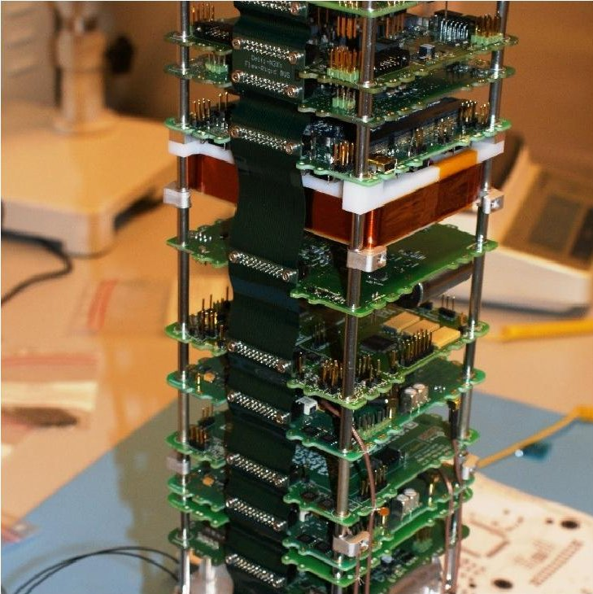

Figure 1. Delfi-n3Xt Internal Stack

To date, only four PocketQubes have been launched and only about a dozen are in development, so information on their architectures is scarce. A website on the 1p WREN PocketQube 8 reveals that the outer structure, typically aluminum plated box on CubeSats, has been completely removed. The small size of the satellite makes it possible that launch loads are completely handled by internal rods and/or by Printed Circuit Board (PCB) used as outer panels. WREN and the UoMBSat1 PocketQube of the University of Malta 9, reveals that still a modular stack of PCBs is used to host the subsystems.

Beside the scientific references, a survey of websites, pictures and hardware displayed on conferences reveals that a vast majority CubeSats and PocketQubes are internally built on a modular stack of printed circuit boards. Typically, each of the functional subsystems is represented by one or more physical PCBs. While payload volume differs significantly between the satellites, a stack of PCBs takes significant volume and the height of the connector and amount of subsystems drives total volume consumption of the spacecraft bus. The dominant architectural approach of mapping functional (virtual) subsystems (such as the electrical power subsystem, the command and data handling subsystems, etcetera) to one or more distinct physical units which are placed in an internal stack, may be challenged by some innovative concepts.

## 3. SURVEY OF INNOVATIVE ARCHITECTURAL CONCEPTS

Next to literature survey on CubeSat and PocketQube missions, several papers have been found which address innovative architectural concepts specifically. A summary of these papers is provided followed by a qualitative analysis on its main advantages and disadvantages.

## 3.1 Cellular Concept

Cellularized satellites have been proposed to "achieve cost savings, flexibility and reliability while maintaining the overall mission performance" by the introduction of "satlets" 10. A distinction is made between single-function satlets and system satlets. The single-function satlets comprises standard modular pieces which can be combined to meet the mission specific requirements. A given example is the use of spatially distributed reaction wheel assemblies, which together provide the total torque and momentum storage. System satlets can be regarded as a module which integrates several subsystem functions such that it can operate as an independent system. An example of a physical breakdown is shown in Figure 2, which comprises a modular connectable nanosatellite-scale package which integrates core satellite functions such as electrical power acquisition and storage, attitude determination and control and computational processing.

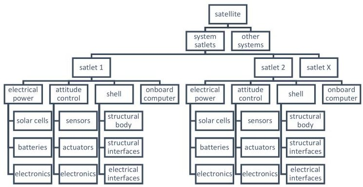

Figure 2. Example physical breakdown of a cellularized satellite using 'system satlets'

The resources can be shared with the rest of the satellite in a building-block fashion. The benefits mentioned are thought to be acquired with the aid of mass production and integration in many satellites of these standard building blocks. A demonstration of this concept is planned for launch by the end of 2017 on the eXCITe mission which comprises 14 of the HISat blocks together with several payloads, deployable solar array and high data rate communication radios.

<!-- PDF_PAGE: 5 -->

The satlet concept is relatively simple to comprehend and implement. Its advantages are the ability to scale up the technical capacity of the satellite with mission demands and increase potential reliability by introducing graceful degradation opportunities. It disadvantage is that one loses system efficiencies and optimizations which come with larger systems or components. The single-function cellular concept will be investigated further in next chapter. The system level satlets combines integration of several satellite core functionalities subsystems with cellularization. An additional disadvantage here is that this concept is severely restricts physical configuration options and fixes the ratio of the technical specifications. For example, if a mission requires the equivalent computational power of ten satlets, the satellite would also receive ten times the satlet data storage, ten similar attitude sensors and actuators, ten times the solar cells, while it is not sure if this is truly needed. Also one can question the added benefit of a satlet with solar cells, if one still adds a non cellular deployable solar array like in the eXCITe mission example. However, aspects of the system satles concept may still be attractive to investigate, such as the integration of satellite core functions into a single physical unit. CubeSats and PocketQubes always have six sides of the body. This fact can be used to investigate system satlets which integrates components and satellite functions which are typically residing on each side, such as sun sensors. But also potentially omnidirectional radio communication could be attractive to investigate. Finally, an attractive option could be to use PocketQube sized components and systems as cells for CubeSats.

In another recent study 11 it was found that a physical architecture based on an OBC with a single-master data communication bus exhibits a relative high amount of failures (~40% were never head) , followed by an OBC connecting to separate buses to subsystems. The best statistics were provided by CubeSats based on a distributed design using a multi-master bus, for which 80% of the CubeSats fulfilled (part of) its objectives and all were heard of. The same study also investigates correlation between mission success and the amount of redundant subsystems (up to three) which are regarded as critical (OBC, EPS, COMMS). Only a weak correlation is found, since with two redundant subsystems the reliability seems to increase w.r.t. a singular system, but a slight decrease is seen with three w.r.t. two redundant subsystems. This correlation is used as on of key arguments to propose a cellular architectural concept which is different from the other satlet concept. In this study, the use of Artificial Stem Cells (ASCs) is proposed based on the anology of biological cells 11.The ASC comprises non-volatile memory (DNA), a central microcontroller (macromollecular machinery) and

several microcontrollers with generic input and outputs (proteins) to perform tasks and connect to the outside world.

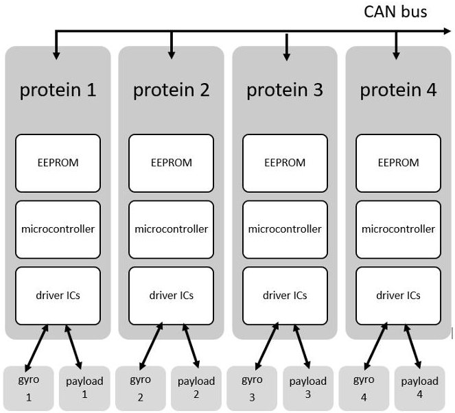

Figure 3. Sketch of a four protein ASC configuration The practical application is demonstrated on SME-SAT by a four protein cell (see Figure 3), each of the proteins used to drive a identical Control Moment Gyro (CMG) and a different small technology demonstration payload. This is just a very simple demonstration, since the intended architecture would consists of multiple cells, with proteins of different cells being cross-strapped with devices (such as gyros) using multiple different communication busses.

The concept and technology demonstration described in the paper 11 advocates and clearly explains the use of cellularization for graceful degeneration. However, the paper also states that reconfiguration of the ASC function, the communication paths and potential crossstrapping payloads between the ASCs has been considered but not implemented as it "was deemed unnessessarily complicated" for the SME-SAT mission. The paper fails to describe how higher level satellite functions could be implemented as ASCs in a reliable and practical manner, which gives rise to the question if the biological anology can really be followed. The complexity of DNA and cells in biology is tremendous and not yet fully understood. Also, in biology there is a physical mobility of cells which is very difficult to mimic with its technical counterpart. The benefits of mixing attitude control actuators and payloads to a single ASC in the example seems arbitrary and is not explained. The paper continuous with a benchtop demonstration of a complete ASC based attitude control subsystem. The complexity of the design prohibits a full summary of the design, but the main conclusions from the paper are that a reliability increase of the system can be

<!-- PDF_PAGE: 6 -->

expected mainly due to potential reconfiguration of the software tasks of proteins and the graceful degeneration features of the concept. It however comes at the expense of significanlty higher power consumption (+77%) and higher complexity compared to a traditional design. While the concept of ASCs is theoretically interesting, it is too far fetched to implement in the near to mid-term future and it is not yet clear if the benefits on the long term will outweigh its costs.

## 3.2 Panel Concept

A 'nano-modular format' (NMF) has been proposed for CubeSats which focusses on a different structural integration concept 12. The six faces of a CubeSat form the basis which comprises a structural outer panel with hinges towards the other faces and holds part of all internal equipment which can be placed in a pyramid-shaped envelope. A 1U CubeSat thus always consists of six physical distinct units, while for the larger CubeSats the configuration it can be extended by using 1U units placed side-by-side or using a larger base panel. The hinges and electrical connections between the panels are supposed to quickly integrate panels towards a complete satellite. An artist impression of the envelope of a 1U NMF panel is provided in Figure 4.

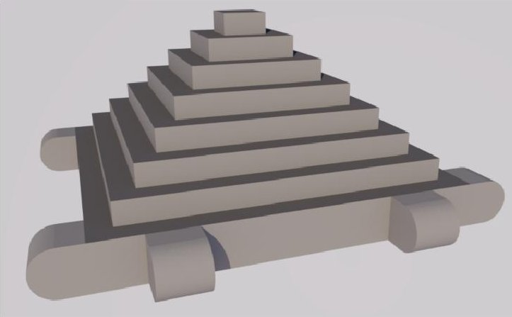

Figure 4. Artist impression of 1U NMF envelope

The concept is limiting the amount of distinct physical units to a fixed number or range (6 for 1U, 6-10 for 2U), while each unit takes a fixed envelop of space. The pyramid shaped envelop is considered to be impractical, for example for housing a propellant tank. An interesting part of this concept is however the ability to quickly integrate the satellite with a limited amount of steps. Especially the severe reduction of manual integration steps for wiring externally located components (solar cells, sun sensors, antenna, etcetera) to internal units as compared to a standard modular stack approach is an idea which can be taken to a new architectural concept.

## 3.3 Plug-and-Play Concept

The same paper which shows a panel concept 12 also introduces the concept of Space Plug-and-Play Avionics (SPA) for CubeSats. SPA is a data driven architecture, in which modular equipment can be added to the satellite and the electronic and software interfacing would follow automatically using standard command and data handling approaches and embedded electronic datasheets. It can best be understood by the way how (peripheral) equipment of computers using a USB interface can be used almost directly after connection without the need of manual installation of software drivers. It is implemented on several CubeSats and mentioned in several papers, which are amongst others the Trailblazer 13 and TechEdsat 14 CubeSats. The electrical interfaces of SPA come in incremental steps/ The SPA-1 interface is specifically designed around the $ \mathrm{I}^{2} \mathrm{C} $ data standard and comprises a four-pin wiring harness with just $ \mathrm{I}^{2} \mathrm{C} $ and 5V power. It is a minimalist SPA interface for the very small satellites such as CubeSats 15. Higher performance SPA interfaces are SPA-U (based on USB), SPA-S (based on SpaceWire) and SPA-O (optical). The general SPA physical architecture relies on central hub/routers to connect all equipment and local Remote Terminal Units (RTU) or Appliqué Sensor Interface Module (ASIM) to interface and describe the software specification and behavior.

When reading papers on implementations of SPA, a lot of different terminology and the concepts seems to have evolved over time and branched off into a Swedish and US based version. This results in confusion, e.g. between RTUs and ASIMs. The key philosophy behind the software architecture fills a gap in terms of interface standardization. The lean electrical interface for components is also considered to be an advantage. However, many other aspects are considered to complicate the development of subsystems and components even if the final integration would be fluent. The use of RTUs/ASIMs may simplify this the development, but may also add volume and power consuming electronics for the very small satellite components typically found in PocketQubes and CubeSats. A reflection of 10 years of Plug-and-Play (PnP) development provides insights in the evolution, successes and critics of the standard 16. It states that "To the critics of SPA, however ASIMs were viewed as adding complexity and overhead, when in fact the intent was the opposite." This means that there is an acceptation problem of PnP outside its developers community on aspects of the standard. Also it becomes clear in the reflective paper that the standard has not yet fully matured and that many goals of PnP have not yet been met. It would be good to specify one or a few lean electrical interface standards for PocketQubes and Cubes. Seperately, a command and data handling

<!-- PDF_PAGE: 7 -->

standard can be developed in line with the PnP philosophy, in which the housekeeping data, the commanding and the specification of components is completely and uniformely described in a hardware abstraction and service layer code, such that it can be handled by application layer software in an autonomous and transparent manner. The parallel development of an public electrical interface standard and a open source software PnP standard will facilitate maturation of the standards on their own pace and provides a higher chance for acceptance than a single combined solution which requires a too disruptive transition and a vendor lockin.

## 3.4 Lean Electrical Interfaces

Electrical interfaces are a dominant aspect of modularization and can have a significant impact in the available volume. The connectors used consume an amount of Printed Circuit Board (PCB) area and define the minimum distance between PCBs. In a very recent study (currently under review for journal publication), it has been found that a very versatile standard in not only consuming a lot of volume due to the connector size, but it also leads to (potential) incompatibility between physical subsystems of different vendors. For this reason, a very lean electrical interface standard for PocketQubes and CubeSats has been investigated and proposed. These are respectively a 9-pin and 14-pin electrical interface using a 2 mm pitched stackable connector. The pin definition is shown in Figure 5. The chosen data bus is RS-485, which is a linear differential bus (low noise sensitivity) running at 500 kbit/s and 1 Mbit/s respectively. The four and respectively eight power distribution lines are providing a switchable protected unregulated voltage to minimize the amount of conversion steps and associated power losses.

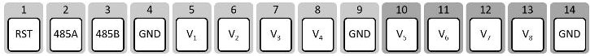

Figure 5. Proposed PQ9 and CS14 electrical interface standards.

One step further from a lean electrical interface, would be devices which are self-powered and have a wireless interface. They don't have wiring harness, which saves volume and potentially also reduces integration complexity.

On the Delfi- $ C^{3} $ satellite, a sun sensor from TNO is demonstrated which acquires its power with a local solar cell and transmits its data over a wireless radio link 17 (shown in Figure 6). In a recent study 18, a proof-of-concept temperature sensor is developed which can power itself by using a thermal electric cell with only 2.3 K of temperature difference between both sides of the sensor. Communication of this sensor is via a

Bluetooth data link. This type of self-powering sensors exhibits even larger freedom in placement. Magnetometers would also be an interesting type of sensor as they could be placed away from power electronics or a few can be spread over the satellite to filter out local noise.

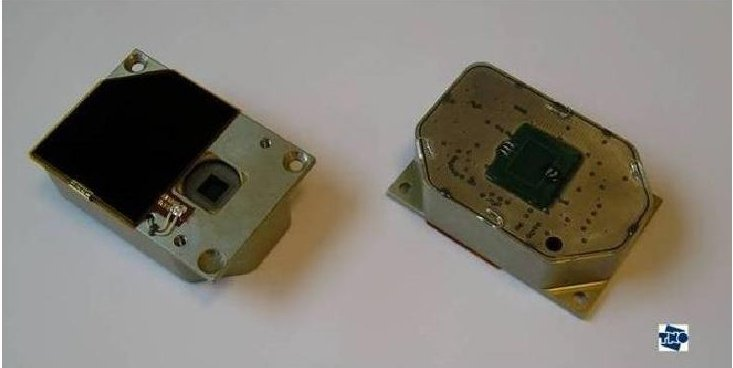

Figure 6. Delfi-C3 Autonomous Wireless Sun Sensor (TNO).

The advantages increase on larger satellites than CubeSats and PocketQubes as wiring harness increases. Also, the volume available on large satellite would enable a larger power acquisition unit which can be used for more demanding sensors and actuators. Disadvantages of self-powered wireless sensors are that they may cause radio interference to other radio based systems or to each other, they are dependent on a conditional power source (sunlight or thermal gradient) and they are larger and more complex than integrated sensors onboard existing subsystems or panels. Within the scope of this study, focusing on very small satellites, only low power sensors with specific placement requirements for which the integration of the wiring harness is relatively complex would be good candidates to consider for this concept.

## 4. CONCEPT ANALYSIS

In this chapter, some of the concepts presented in previous chapter are investigated with the aid of a few examples.

## 4.1 Cellular Reaction Wheels

At TU Delft, a reaction wheel has been designed for the 3U CubeSat Delfi-n3Xt 19 and for the 3p PocketQube Delfi-PQ 20 as can be seen in Figure 7. Both are highly optimized designs in terms of volume and power consumption, while they provide torque and momentum storage required for their respective size in Low Earth Orbit.

<!-- PDF_PAGE: 8 -->

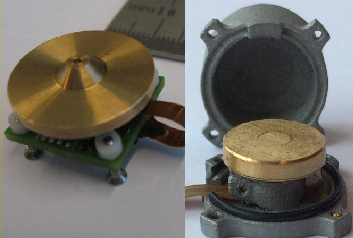

Figure 7. Delfi-n3Xt (left) and Delfi-PQ (right) reaction wheels.

To match the momentum storage of a single CubeSat reaction wheel, in total 15 PocketQube reactions wheels are needed for a cellular configuration. The comparison is provided in Table 1.

Table 1. Specification of Reaction Wheels

<table border="1"><tr><td></td><td>1 CS RW</td><td>1 PQ RW</td><td>15 PQ RW</td></tr><tr><td>torque(full range)</td><td>5.5×10-6Nm</td><td>3.10-7Nm</td><td>4.5×10-6Nm</td></tr><tr><td>momentum storage(one-way)</td><td>1.6×10-3Nms</td><td>1.1×10-4Nms</td><td>1.6×10-3Nms</td></tr><tr><td>volume</td><td>11cm3</td><td>4cm3</td><td>58cm3</td></tr><tr><td>power(min-max)</td><td>177mW-237mW</td><td>4mW-25mW</td><td>60mW-375mW</td></tr></table>

The total volume is about five times higher for the cellular approach. The reason in this case is simple: the mass moment of inertia of a flywheel scales quadratic with its diameter, while a cellular approach scales linear. An orthogonal set of cellular reaction wheels (so 45 in total) would consume a minimum of 17% of a single unit CubeSat, not including interspacing and mounting losses. This does not render the concept infeasible. The full range torque of the cellular approach is slightly lower than for the single CubeSat reaction wheel. However, this only applies in the region near the maximum momentum storage, which for the cellular approach means that all reaction wheels are almost saturated. The chance that a maximum torque is needed in that region is fairly small and can be neglected.

Regarding the power consumption, it seems that the minimum power (the power at a low nominal rotation speed) is better for the cellular approach, while the single reaction wheel is better at the maximum momentum storage. However, in a cellular approach it would be possible not to turn on all the reaction wheels at a time, which may yield a significant lower average power consumption. Also the disruptive torque at zero speed crossing (due to static friction), may be compensated in the cellular approach with a proper combined acceleration of a few other reaction wheels. Finally, the cellular approach provides a more fine torque control. Overall, it can be concluded that the cellular approach is costly in terms of volume and also potentially in terms of finance. On other technical aspects it is however an interesting concept which introduces opportunities for increased reliability by graceful degradation, more accurate control and average power optimization.

## 4.2 Cellular magnetorquers

There are two types of magnetorquers which are typically found in small satellites: those with a permeable core and those without. A permeable core strengthens the creation of a dipole moment by aligning the magnetic field lines. The 'air-coils' have no such medium. The magnetic dipole moment m relates to the amount of windings n, electrical current I, the enclosed area A and the core gain factor k and with the following simplified equation:

$$
m = k _ {l} \cdot n \cdot I \cdot A
$$

The gain factor k for a coreless magnetorquers is set to 1 and for a permeable core it is, within the boundaries of a small satellite, positively related to the length of the core. With coreless magnetorquers, typically the enclosed volume is maximized to make it most efficient in terms of copper volume and power. For magnetorquers with core, typically the length of the rod in increased to make it more volume and power efficient.

In case of a cellular approach, there would be no difference in volume and power efficiency when the coreless magnetorquers would be of equal enclosed area or if the core rods would be aligned. The advantage here would be the option of graceful degradation if one of the drive electronics would fail. The disadvantage is that more drive electronics is needed which increases the volume and complexity on a higher system level.

If more freedom is desired in configuration, smaller and or non-aligned magnetorquers are required. For a cellularized square coreless magnetorquer to four of half the diameter, using the same amount and thickness of wiring, the total power consumption for equal dipole moment will double. For a torque rod, cellularization by simply 'cutting' it in smaller pieces along the rod axis will also negatively impact the total power consumption.

<!-- PDF_PAGE: 9 -->

## 4.3 Solar Power Acquisition Units

In many CubeSats, solar cells are mounted on a panel and connected to an internal Electrical Power Subsystem (EPS) unit which hosts a Maximum Power Point Trackers (MPPT) or circuitry using other power conversion methods. The MPPT circuits on the EPS unit are limiting the amount and/or combination of solar arrays which can be connected. An alternative idea is to integrate the solar cells on a PCB and host the MPPT circuitry on the backside of this PCB. With protective diodes, these 'solar power acquisition units' can be connected to a main distribution bus in a safe manner. Next to this, the unit can host a monitoring circuit to determine the local voltage, current and temperature. This would require an additional connection to a (linear) data bus to the internal OBC or EPS. This concept is similar to the circuit on a typical EPS unit, but the main difference is the physical location. It allows a cellular approach in which the total solar array can be scaled up and assembled out of standard units according the mission needs and the preferred configuration. Potential advantages are the use of standardized (mass produced) units, the option for graceful degradation, less susceptibility to local shadowing and less limitations on the potential combinations and configurations of solar panels. The (potential) disadvantages are an increase in the total amount of circuitry, the need for a data bus connection to the outer panel and the need for holes in the outer structure (if present) at the location of the circuitry.

For Delfi-PQ, units with two 80 mm x 40 mm triple junction solar cells of 30% efficiency are currently being developed which can be compared to a theoretical eightcell panel for a CubeSat connected to a standard EPS unit. The ST SPV1040 integrated circuit is chosen which does MPPT and provides a single cell Li-ion battery output voltage, with an efficiency between 93% (at 2.5 W input power) and 97 % (at 0.25W input power) when using two cells in parallel. In fact, one can even use this device for a single solar cell with 94% at 1.2 W input power. These efficiency ranges are very similar to those of a CubeSat EPS unit with MPPTs on an internal stack board. For instance the GOMSpace NanoPower P31 has a power efficiency between 93% (at 9.5 W input power) and 96% (at 1 W input power) 21. Replacing a body mounted CubeSat solar panel with four solar power acquisition is thus possible without a penalty in power efficiency.

## 4.4 Cellular Flat Radios

For Delfi-n3Xt, a 2.4 GHz radio was developed which contained the patch antenna and the electronic circuit on the same PCB 7. This directional radio transmitter system (STX) was supposed to be used for relatively

high data rate transmission (up to 1 Mbit/s). It has a total height of about 5 mm except for the connector. It was mounted on top of the structural outer panel and did not consume useful volume within the satellite. However, an interface board (of 14 mm CubeSat stack height) in the internal stack was required to connect the standard interface of the internal stack to the STX. Delfi-n3Xt also has redundant radio transceivers acting on a downlink at 145 MHz and an uplink at 435 MHz. The CubeSat stack height of each PCB is 20 mm. These are connected to a shared antenna system comprising of four deployable antenna of about 0.5 m in canted turnstile configuration with a near omni-directional radiation pattern. This antenna and deployment board consumes 41 mm of total stack height. The purpose of this redundant radio transceiver system is to provide reliably transmission and reception of telemetry and telecommands under all circumstances, including a tumbling attitude. This redundant system consumes about 0.8U of a CubeSat and the total communication subsystem almost 1.0U when the STC interface board is included. It would therefore be interesting to find a concept which integrates takes the advantage of a directional patch antenna with back side electronics, while still being able to provide near omni-directional communication for the tumbling and safe modes of the satellite. One idea is to have a directional flat transceiver on each side of the satellite, similar to the STX, but with a higher degree of software configurability. In the safe mode, all radios will transmit the same telemetry simultaneously (e.g. in "beacon mode") either in a side-by-side band operation or in a spread spectrum configuration. With six orthogonal patch radios, the minimum gain would be achieved at $ 5 5^{\circ} $ from its normal. The example radiation pattern of the STX provided in Figure 8 would yield a minimum gain of +2 dB at $ 55^{\circ} $ . Because the electrical input power is divided over 6 radios, the radio frequency output will 8 dB less (assuming that almost all electrical power goes towards the radio amplifier and its efficiency is fixed) than its singular counterpart. Compared to a singular perfectly omnidirectional (isotropic) transceiver, his would yield -6 dB worst case output. This is comparable with the worst case output of a canted turnstile configuration on the 435 MHz band on Delfi-n3xt which was designed for omni-directionality.

When ground station pointing is achieved, the communication will switch to a single patch for transmission which can occupy a wider bandwidth and/or more transmission power at a higher data rate. In the STX example, this would yield a gain of +9 dB.

<!-- PDF_PAGE: 10 -->

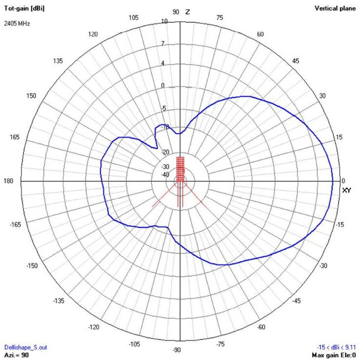

Figure 8. Radiation pattern STX

For this concept, a high degree of software configurability is required including change of frequency, modulation and data rate. Also the transmission power should be able to change with equal power added efficiency. Furthermore, for the omni-directional mode, a very good channel separation is essential to avoid that they mutually increase each other's noise floor. If the interface towards the rest of the satellite could be lean (so no complete interface board required), the whole communication system in this concept would not consume considerable internal volume, would not require complex deployment systems and would potentially increase reliability by providing the option for graceful degradation. The concept could in the future even be further developed with phased array antennas, for which the potential directional gain can be further increased and even be made independent of attitude orientation.

## 4.5 Advanced Integrated Outer Panel

While the solar power acquisition units presented in section 4.3 are a relatively small step from the traditional approach, the concept can act as baseline for a more advanced outer panel approach. Solar cells, MPPTs, a cellular flat radio, a GPS receiver (with flat antenna) and attitude sensors are adequate components to be integrated on such a panel. This concept is a hybrid of cellular, panel and integration concepts. An example is sketched in Figure 9. To differentiate from the nanomodular format as described in section 3.2, this concept sill assumes a standard internal envelope for payloads and internal stack units as it only focusses on those components which are typically already exposed to the outer environment. When the electrical interfacing with

the internal stack can be performed without loose wires, e.g. by the use of spring-loaded connectors, this concept allows a very easy and quick integration. Using as much as possible standard commercial off the shelf electrical and mechanical components may introduce further economic advantages when production of these advanced panels can be fully automated similar to the production of consumer equipment.

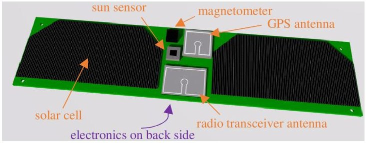

Figure 9. Artist impression of an advanced outer panel, suitable for a 3p PocketQube.

Such an advanced integrated outer panel would be most beneficial for very small satellites such as PocketQubes and 1U-2U CubeSats, which would directly benefit from the easy assemble while the dimensions and tolerances are small enough to sustain the structural loads and making spring loaded connectors to the internal stack possible. On larger satellites, already with CubeSats beyond 2U, these panels require additional structural support and potentially flexible wiring harness to the inside. However, one could also consider to make such a panel a self-powered wireless unit for larger satellites.

## 4.6 Core Integrated Stack Unit

Integration of functions of a satellite on a single printed circuit board is a simple but effective means to reduce volume. However, it should be technically feasible and the reduced modularity provides less versatility to adopt the entire satellite system to mission specific needs Therefore, it would make most sense to integrate subsystem functions which are almost always present on a satellite, which can be made very small and do not scale too much with missions specific needs and/or satellite configuration. Especially functions which can reside on integrated circuits are good candidates, while mechanical systems such as attitude actuators and propulsion are less suitable. Also components which are very configuration dependent (such as attitude sensors or solar cells) would not be the best candidates for system integration. A first step would be to integrate the central OBC with the main power conversion, monitoring and distribution on a single PCB. A battery system would still be separate as this one highly scales in volume with the required capacity. Also MPPT circuitry can consume a considerable amount of board space, but integration

<!-- PDF_PAGE: 11 -->

should be feasible on the same CubeSat board while for PocketQubes they need to be integrated with the solar panels themselves (see concept in section 4.3). As a next step, the microcontroller used for the OBC could in principle also be used to run the attitude algorithms. Or, if this is undesired, one could opt for a second microcontroller or the same board. A MEMS internal measurement unit and magnetometer could further complement the core integrated stack unit. However, as stated before, some sensors are better not integrated on this unit to avoid potential configuration conflicts. Attitude actuators are highly scalable with the satellite size, configuration and mission requirements and should therefore preferably be on different (modular/cellular) systems.

The concept of a core integrated stack unit clearly reconfigures the physical subsystem boundaries and integrates several functions on a single board while splitting several virtual subsystems of different units which nowadays typically are integrated on a single PCB or integrated unit (like EPS & ADCS). It is expected that this concept could save the equivalent of at least one standard printed circuit board with standard electrical interface connector, so about 0.1U of a CubeSat or 0.2p of a PocketQube.

Another approach to reduce volume on CubeSats is to have several (internal) PocketQube units mounted on a CubeSat main board. This could especially be useful for systems which can benefit from further miniaturization of electrical circuits, for example by the use of system-on-chips for radio frequency technology, computation and sensor systems, as these systems have no strong relation to the scaling of the satellite or its mission resource requirements. For scalable components, such as amongst others batteries systems, boards with attitude actuators and a propulsion unit, this will not be very beneficial. In case of cellularization of these type of PocketQube components for CubeSats, a direct mounting of these components on a CubeSat board is likely more volume efficient than when using PocketQube boards as interface in between.

## 5. DELFI-N3XT CASE STUDY

From the advanced architectural concepts stated in the previous section, there is clear winner nor is it possible to formulate an ideal hybrid architecture which suits all types of mission. Some of the stated concepts are not completely compatible with each other and each concept has advantages and disadvantages. There is a high degree of subjectivity when trading concepts and the weight of criteria may be different for various missions. For example, for vast distributed networks of identical

satellites, the time of integration of the satellite is more important than for a single satellite mission. To provide some perspective, an attempt is made to apply a variety of these new concepts on the Delfi-n3Xt satellite as a case study. The aim which is taken is to increase the amount of payload volume and decrease the complexity of integration.

The reliability philosophy can be a dominant factor in the system complexity and the volume taken by bus subsystems. In a single ended system, simple physical failure detection, solation and recovery (FDIR) mechanisms are very useful as they can prevent damage at latch-ups or recover from undefined or stuck states of the satellite (subsystems). Redundancy can be implemented by multiplication or by alternative backup systems (of a different design). This requires more volume and more complex FDIR, since arbitration should be added while limiting the risk for false triggers and avoiding that the FDIR circuitry itself becomes a single point of failure. In chapter 2, it was already explained that making a single-point of failure free design by either multiplicative redundancy or alternative backup systems was very complex and time consuming for previous Delfi satellites. Cellularization is a third way of increasing reliability, which can be considered if its net effect yields the same or less volume while not increasing system complexity too much.

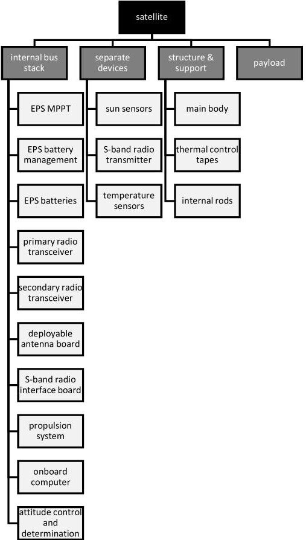

Figure 10. Delfi-n3Xt launch configuration physical breakdown

<!-- PDF_PAGE: 12 -->

The original launch configuration of Delfi-n3Xt has a modular subsystem approach. The physical breakdown is shown in Figure 10. Deployable antennae are mounted on a board which are attached via coax cables to the primary and secondary transceivers. The battery system requires a separate battery management system as the distribution voltage bus of the EPS is different from the battery voltage level. Some of the subsystems are demonstration payloads: the S-band transceiver (see first chapter), the propulsion system and the ADCS. However, these systems can also be regarded as (future) critical subsystems. Only the solar cell experiment is truly a standalone payload. This one has a height of 27 mm.

In the lean configuration variant, all redundant systems are removed. The patch S-band transceiver (not shown in the stack as it is integrated in the outer panel) uses the OBC for wiring interface instead of a dedicated board. All spacing in between the units have been removed because of the use of the stackable CS14 connector, which also results in reduction of height of the OBC and EPS boards.

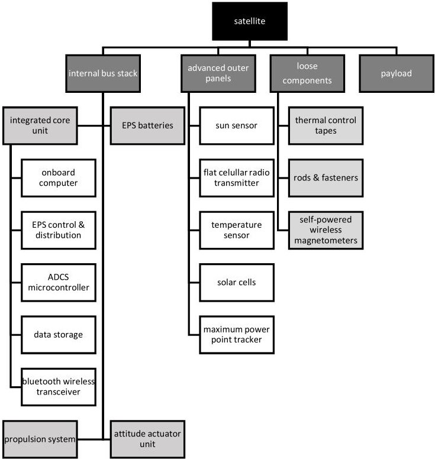

Figure 11. Delfi-n3Xt advanced concept physical breakdown

In the advanced configuration, as shown in Figure 11 (where white boxes represented integrated components), an integrated core unit combines the EPS control and distribution, the OBC and the ADCS microcontroller. There is a separate attitude actuator board, which is slightly smaller than the full ADCS system. Battery system and propulsion system remain unchanged. MPPT, sun sensors and flat cellular radios are integrated

together with the solar cells on an advanced outer panel. Magnetometers are distributed over the satellite as selfpowered wireless sensor.

The volume budgets of the internal stack are compared in Figure 12. The effective payload volume for all configurations is based on an internal volume of 90 mm x 90 mm square, with a stack height of 27 mm in the launch configuration, 165 mm in the lean configuration and 260 mm for the advanced configuration. This proves that significant improvement can be made in payload volume with a lean approach and a dramatic improvement with an advanced architecture.

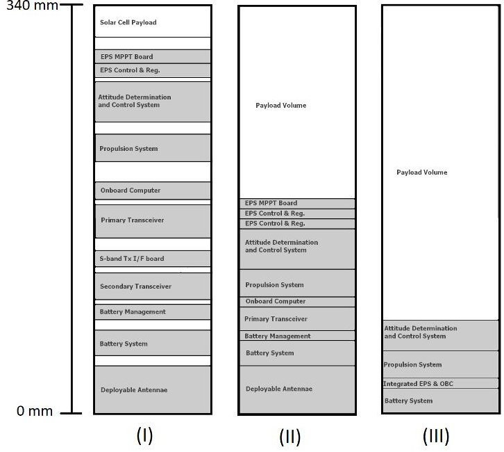

Figure 12. Delfi-n3Xt volume budget with launch (I), lean (II) and advanced (III) configuration.

## 6. CONCLUSIONS & DISCUSSION

In this paper, several traditional and advanced approaches with respect to the physical architecture of PocketQubes and CubeSats have been presented and analyzed theoretically. Cellularization of components, integration of core subsystem functionality into a single physical unit, an advanced outer panel and self-powered wireless sensors are all advanced and promising concepts. Besides advantages, each of them also have disadvantages compared to a typical modular approach found in CubeSats. Moreover, the advanced concepts typically become impractical when implemented as a dogmatic solution for the whole satellite and as such a smart pragmatic approach is recommended. A hybrid approach, using a mix of the traditional approach with advanced concepts can be very useful, but it should be noted that some concepts are not fully compatible with each other. Plug-and-play is an interesting but not yet mature concept. A lean electrical interface standard can

<!-- PDF_PAGE: 13 -->

be defined and implemented independently on the short term, while the development of plug-and-play can focus purely on the software implementation.

With respect to reliability, it is argued that a dogmatic redundancy approach is counter-effective within the very resource limited environment (both technical as well as organizational) of CubeSats and PocketQubes. Satellite developers are recommended to start first with a singular satellite and making this as reliable as possible before adding additional reliability features such as redundancy. Overall, a more pragmatic approach would be advised in which only components which are wearing out mechanically (e.g. reaction wheels) or due to cycling (e.g. battery cells) should be addressed by (overdimensioned) cellularization and/or multiplicative redundancy. However, it should be noted that this recommended approach is in contrast with the conclusion in the paper on the artificial stem cells 11 (see section 3.1).

When a lean electrical interface standard is implemented and full system redundancy is omitted, significant payload volume can be achieved. With a Delfi-n3Xt case study, it is shown that such a simple step would increase the payload volume to about nearly half of the internal 3U CubeSat volume. When using an advanced approach by integrating some core satellite functions on a single internal PCB and re-allocation some circuits and components to advanced outer panels, one can even increase this to $ \frac{3}{4} $ of the internal volume while gaining reliability through cellularization.

A follow up of this study is to perform laboratory and inorbit demonstration and testing of several concepts. Reliability of the concepts should be investigated further to validate that full system redundancy has a limited impact on overall system reliability. Likewise, this analysis is needed in order to compare the advanced concepts to a traditional modular approach. If the reliability does not become a major issue, the advanced architectural concepts presented have potential to become the new norm for very small satellites.

## REFERENCES

2. Aslan, A.; Bas, M.; Uludag, S.; Turkoglu, S.; et.al. The Integration and Testing of BeEagleSat. The 30th International Symposium on Space Technology and Science (ISTS), the 34th International Electric Propulsion Conference (IEPC) & the 6th Nano-Satellite Symposium (NSAT), Kobe, 2015.

3. Ehrpais, H.; Sünter, I.; al., e. ESTCube-2 Mission and Satellite Design. The 4S Symposium, Il-Furjana, 2016.

4. Luo, S.; Mouthaan, K.; Seng, S. W.; Hiang, G. C.; Jin, A. L. E. Galassia System and Mission. 28th Annual AIAA/USU Conference on Small Satellites, Utah, 2014.

5. Alminde, L.; Busgaard, M. l. P. I.; Smith, D.; Perez, L. GOMX-4: Demonstrating the Building Blocks of Constellations. 31st Annual AIAA/USU Conference on Small Satellites, Logan, 2016.

6. Bouwmeester, J.; Aalbers, G.; Ubbels, W. Preliminary Mission Results and Project Evaluation of the Delfi-C3 Nano-Satellite. The 4S Symposium, Rhodes, 2008.

7. Bouwmeester, J.; Rotthier, L.; Schuurbiers, C.; Wieling, W.; van der Horn, G.; Stelwagen, F.; Timmer, E.; Tijssen, M. Preliminary Results of the Delfi-n3Xt Mission. The 4S Symposium, Porto Petro, 2014.

8. WREN: A HAM radio SSTV PocketQube https://amsat-uk.org/2013/10/24/wren-a-ham radio-sstv-pocketqube/ (accessed September 2017).

9. Cachia, D.; Camilleri, J.; Azzopardi, M.; Angling, M.; Sammut, A. Feasibility Study of a PocketQube Platform to Host an Ionospheric Impedance Probe. The 4S Symposium, Valetta, 2016.

10. Jaeger, T.; Mirczak, W.; Crandall, B. Cellularized Satellites - A Small Satellite Instantiation that Provides Mission and Space Access Adaptability. SmallSat Conference, Logan, 2016.

11. Erlank, A.; Bridges, C. Satellite Stem Cells: The Benefits & Overheads of Reliable Multicellular

<!-- PDF_PAGE: 14 -->

Architectures. IEEE Aerospace Conference, Big Sky, 2017.

12. McNutt, C.; Vick, R.; Whiting, H.; Lyke, J. Modular Nanosatellites - Plug-and-Play (PnP) CubeSat. 7th Responsive Space Conference, Los Angeles, 2009.

13. Kief, C.; Zufels, K.; Christensen, J.; Mee, J. Trailblazer- Proof of Concept CubeSat Mission for SPA-1. AIAA Infotech, St. Louis, 2011.

14. Bruhn, F.; Schulte, J. S. P.; Freyer, J. Njord: A Plugand-Play Based Fault Tolerant CubeSat Architecture. The 4S Symposium, Portoroz, 2012.

15. Lyke, J.; Mee, J.; Bruhn, F.; Chosson, G.; Lindegren, R.; Lofgren, H.; Schulte, J.; Cannon, S.; Christensen, J.; Hansen, B.; Vick, R.; Calixte-Rosengren, J. A Plug-and-play Approach Based on the I2C Standard. 24th Annual AIAA/USU Conference on Small Satellites, Logan, 2010.

16. Lyke, J.; Young, Q.; Christensen, J.; Anderson, D. Lessons Learned: Our Decade in Plug-and-play for Spacecraft. 28th Annual AIAA/USU Conference on Small Satellites, Logan, 2014.

17. Boom, C. W. d.; Heiden, N. v. d.; Sandhu, J.; Hakkesteegt, H. C.; Leijtens, J. L.; Nicolelet, L.; Bouwmeester, J.; Craen, G. v.; Santandrea, S.; Hannoteau, F. In-orbit Experience of TNO Sun Sensors. 8th International ESA Conference on Guidance, Navigation & Control Systems, Karlovy Vary, 2011.

18. Llanos, J.; Bouwmeester, J. Thermoelectric Harvesting for an Autonomous Self-Powered Temperature Sensor in Small Satellites. 68th International Astronautical Congress , Adelaide, 2017.

19. Bouwmeester, J.; Reijneveld, J.; Hoevenaars, T.; Choukroun, D. Design and Verification of a Very Compact and Versatile Attitude Determination and Control System for the Delfi-n3Xt Nanosatellite. The 4S Symposium, Portoroz, 2012.

20. Vergoossens, T.; Guo, J.; Bouwmeester, J.; Groen, W. Design, Integration and Testing of World's

Smalles Satellite Reaction Wheel. International Astronautical Congress, Adelaide, 2017.

21. NanoPower P31 (rev. 2.20); Datasheet; GOMSpace, 2017.

22. Alminde, L.; Bisgaard, M.; Vinther, D.; Viscor, T.; Ostergard, K. Educational Value and Lessons Learned from the AAU-CubeSat Project. Proceedings of the International Conference on Recent Advances in Space Technologies, Turkey, 2003; pp 57-62.