<!-- PDF_PAGE: 1 -->

ABSTRACTING CUBESAT OPERATIONS: A PATH TO REAL CUBESAT

INTEROPERABILITY

## VIDUSHI JAIN

## A THESIS SUBMITTED TO THE FACULTY OF GRADUATE STUDIES IN PARTIAL FULFILLMENT OF THE REQUIREMENTS FOR THE DEGREE OF

## MASTER OF SCIENCE

JULY 2019

$ \textcircled{c} $VIDUSHI JAIN, 2019

<!-- PDF_PAGE: 2 -->

## Abstract

Introduction of the CubeSat form factor brought a paradigm shift in the industry. With the size becoming a standard, cost and development time were able to be reduced significantly. However, the industry has not yet fully realized the potential of this new paradigm. Many other simplifications or standardizations can be made, whilst still meeting CubeSat mission requirements.

One area that can be addressed without significant change is CubeSat mission operations. Many operations activities for CubeSat busses are common, or the differences between missions are close enough to benefit from common streamlining.

This thesis proposes abstracted operations sequence for CubeSats. The sequence is demonstrated by applying it to an upcoming CubeSat mission - DESCENT. Simplifications made as a result of this abstraction are demonstrated. The thesis also points to some of the other improvements that could be made longer-term for CubeSat mission designers and operators through further industry standardization.

<!-- PDF_PAGE: 3 -->

# Acknowledgements

First and Foremost, I will like to thank my supervisor, Dr. Franz T. Newland, without whom this thesis would not have been possible. Professor Newland helped me see vision for research, and it was because of his constant motivation I was able to contribute to the CubeSat community. He provided me with various opportunities to be involved within the space community from which I have benefited immensely.

I would also like to thank each individual person involved on the DESCENT CubeSat mission. Thank you for providing a listening ear and constant words of encouragement.

I would also like to thank the Canadian Space Agency (CSA), for providing York University with the FAST grant, and allowing our team to build a CubeSat. DESCENT helped me set the foundation for this thesis and this would not be possible without the CSA's support.

My greatest thanks to my family and friends for trusting me and supporting me with my decisions. A special thanks to Mom, Dad, Bhaiya and Ayushi; your love and confidence in me helped me accomplish this thesis today.

After 100 some pages of writing this was the hardest page to write.

<!-- PDF_PAGE: 4 -->

## Table of Contents

Abstract...ii

Acknowledgements...iii

Table of Contents...iv

Table of tables...vii

Table of Figures...ix

Acronyms...x

Chapter 1. Introduction...1

Chapter 2. Background...3

2.1 What is a CubeSat?...3

2.2 Introduction to Space Standards...5

2.3 How existing standards can help us in CubeSat development...8

2.4 CubeSat Standards...10

2.4.1 System Engineering Standards for CubeSats...10

2.4.2 Frequency Coordination Requests...11

2.4.3 Design requirements...12

2.4.4 Design, systems and testing documentation guidelines...14

2.4.5 Operation procedures for satellites...14

Chapter 3. Rationale for focussing on CubeSat Operations standardization...17

3.1 Abstracting CubeSat operations and operating modes based in CubeSat design...18

3.2 Abstracting CubeSat failure and recovery operations...18

3.3 Proposing a spacecraft testing plan and tool for functional testing...18

3.4 Outcome of study...19

Chapter 4. Abstracting Operations for A CubeSat...20

4.1 Operations sequences from existing CubeSat missions...21

<!-- PDF_PAGE: 5 -->

4.2 Mission mode specific operations ... 28

4.2.1 Attitude determination and control ... 29

4.2.2 Separation ... 31

4.2.3 Solar panel and battery ... 31

4.2.4 Antenna Deployment Functionality ... 32

4.2.5 Communications ... 32

4.2.6 First Contact (Ground Pass) ... 33

4.3 Tools used for CubeSat operations ... 34

Chapter 5. Abstracting CubeSat operations ... 47

5.1 Abstracting overview ... 48

5.1.1 Time in Space before First Contact ... 54

5.1.2 Deployment ... 58

5.1.3 Communication ... 64

5.1.4 Attitude control ... 72

5.1.5 Payload ... 78

5.1.6 De-orbit ... 84

5.2 Operations abstraction summary ... 87

Chapter 6. Applying the operations abstraction to DESCENT CubeSat mission ... 89

6.1 DESCENT mission overview ... 89

6.2 DESCENT operations ... 90

6.2.1 Time before first contact ... 92

6.2.2 Deployment ... 93

6.2.3 Communications ... 93

6.2.4 Attitude Control ... 94

6.2.5 Payload ... 95

<!-- PDF_PAGE: 6 -->

6.2.6 De-orbit ... 96

Chapter 7. AIT and operations preparation support using the abstracted operations for the

DESCENT CubeSat mission... 98

7.1 Development of an operations analysis tool for the AIT campaign... 102

Chapter 8. Discussion... 110

8.1 Limitations... 114

Chapter 9. Future Work... 115

Chapter 10. Conclusion... 119

References... 121

<!-- PDF_PAGE: 7 -->

## Table of tables

Table 1: Small satellite class vs. mass [10]... 3

Table 2: NEAR mission operations functions [45]... 16

Table 3: Standard services specified by ECSS PUS [65] ... 49

Table 4: Service definition – Service 1 ECSS PUS [65] ... 52

Table 5: Major mission modes that may be relevant for any mission ... 53

Table 6: Mission operations abstraction mode presentation... 54

Table 7: Minimum capabilities for 30 minute timer elapse... 56

Table 8: Minimum and additional capabilities for power on upon separation ... 56

Table 9: Minimum and additional capabilities for safe-hold upon separation ... 57

Table 10: Mode - time in space before first contact minimum capabilities... 57

Table 11: Mode - time in space before first contact additional capabilities... 57

Table 12: Minimum and additional capabilities for passive solar panel deployment... 60

Table 13: Minimum and additional capabilities for active solar panel deployment... 61

Table 14: Minimum and additional capabilities for active antenna deployment... 62

Table 15: Minimum and additional capabilities for active magnetometer deployment ... 62

Table 16: Mode – Deployment additional capabilities... 63

Table 17: Mode-Deployment failure operations... 64

Table 18: Beacon capabilities for communications... 66

Table 19: Minimum and additional capabilities for communications using a transceiver ... 67

Table 20: Capabilities for time routine operations ... 68

Table 21: Capabilities for memory routine operations ... 68

Table 22: Capabilities for health routine operations... 69

Table 23: Capabilities for stored telemetry routine operations... 69

Table 24: Capabilities for mission mode change routine operations... 69

Table 25: Minimum capabilities for mission mode communications... 70

Table 26: Minimum capability of health parameters downlinked during communications ... 70

Table 27: Additional capabilities for mission mode communications... 71

Table 28: Additional capability of health parameters downlinked during communications ... 71

Table 29: Minimum and additional capabilities – attitude determination ... 74

<!-- PDF_PAGE: 8 -->

Table 30: Additional and minimum capabilities – control mode ... 75

Table 31: Attitude control additional capabilities ... 75

Table 32: Mode attitude control – optional telemetry checks ... 76

Table 33: Failure operations for ADCS mode ... 77

Table 34: Mode payload – minimum health checks ... 80

Table 35: Capabilities for payload tasking ... 80

Table 36: Capabilities Data downlink ... 81

Table 37: Capabilities data processing ... 82

Table 38: Capabilities data collection ... 82

Table 39: Minimum capabilities payload operations ... 82

Table 40: Mode payload – additional capabilities ... 83

Table 41: Failure operations for mode payload ... 83

Table 42: Additional capabilities for deorbit mechanism ... 85

Table 43: Additional capabilities for reaction wheels ... 85

Table 44: Additional capabilities for on-board pressure vehicles ... 85

Table 45: Minimum capabilities for transmitter ... 86

Table 46: Mode de-orbit minimum capabilities ... 86

Table 47: Mode de-orbit additional capabilities ... 86

Table 48: Service summary form mission modes ... 88

Table 49: Mission modes for DESCENT mission ... 92

Table 50: DESCENT housekeeping telemetry ... 103

Table 51: A sample aggregator definition file from DESCENT mission ... 104

Table 52: Additional and minimum capability sets applied to DESCENT for pre-contact

node ... 112

Table 53: Overlapping DESCENT parameters with abstracted sequence – Mode: pre contact

... 113

<!-- PDF_PAGE: 9 -->

Figure 1: ECSS standards tree [30]... 7

Figure 2: Operational images programed into flight software... 22

Figure 3: PROBA – V system modes [53]... 26

Figure 4: Operational modes under the nominal mission mode image ... 29

Figure 5: Screen view illustrating the GUI employed on the ground PC [50] ... 35

Figure 6: OpenOrbiter configuration [60]... 37

Figure 7: Software operations [60] ... 38

Figure 8: Ground station tasking flow chart [60]... 39

Figure 9: Ground station communications flow [60]... 40

Figure 10: COSMOS functional architecture [61]... 42

Figure 11: MOST overview display for 3U CubeSat [62]... 43

Figure 12: OTB architecture [62] ... 44

Figure 13: Mockup CEO display [61] ... 45

Figure 14: E-70-41A Service 1 – Logic Diagram [65]... 51

Figure 15: Sample mission life cycle for the abstracted operations ... 53

Figure 16: Mission mode sequence for time in space before first contact... 55

Figure 17: Mission mode deployment diagram ... 59

Figure 18: Mission mode communications sequence diagram ... 65

Figure 19: Mission mode attitude control sequence diagram ... 73

Figure 20: Mission mode payload sequence diagram... 79

Figure 21: Mission mode de-orbit sequence diagram... 84

Figure 22: DESCENT operations sequence... 91

Figure 23: DESCENT ground segment – test architecture... 99

Figure 24: DESCENT FlatSat and CubeSat frame ... 100

Figure 25: DESCENT systems test timeline compared to planned operations ... 100

Figure 26: Real time housekeeping display ... 107

Figure 27: Error log as a part of DESCENT delayed telemetry ... 108

Figure 28: Tool architecture... 109

Figure 29: Applying Mode:1 abstraction to DESCENT... 112

<!-- PDF_PAGE: 10 -->

ADCS Attitude Determination and Control System

ADS Attitude Determination System

AIAA American Institute of Aeronautics and Astronautics

AIT Assembly, Integration and Testing

API Advance Publication of Information

ARC NASA Ames Research Center

ASTERIA Arcsecond Space Telescope Enabling Research in Astrophysics

CanX-7 Canadian Advanced Nanospace Experiments 7

C&DH command and Data Handling

CCP Canada CubeSat Project

CCSDS Consultative Committee for Space Data Systems

CEO COSMOS Executive Operator

CMG Control Moment Gyro

COSMOS Comprehensive Open-architecture Space Mission Operations System

COTS Commercial-off-the Shelf

COVE CubeSat On-board Processing Validation Experiment

CPOD CubeSat Proximity Operations Demonstration

DESCENT De-orbit Spacecraft using Electro-Dynamic Tether

DICE Dynamic ionosphere CubeSat Experiment

ECSS European Cooperation for Space Standardization

EPS Electrical Power Supply

ESA European Space Agency

ESA PSS ESA Procedures, Specifications and Standards

FET Field effect Transistor

FFT Fast Fourier Transform

GPS Global Positioning System

GUI Graphical User Interface

HSFL Hawaii Space Flight Laboratory

IADC Inter-Agency Space Debris Coordination Committee

IMU Inertial Measurement Unit

ISL Inter-Satellite Link

ISO International Organization for Standardization

ISS International Space Station

ITU International Telecommunication Union

LIS Lost in Space

MarCO Mars Cube One

M-Cubed Michigan Multipurpose Minisatellite

MCS Mission Control Software

MIST Miniature Student Satellite

MOST Mission Operation System Tool

MSX Midcourse Space Experiment

NASA National Aeronautics and Space Administration

NEAR Near Earth Asteroid Rendezvous

<!-- PDF_PAGE: 11 -->

OBC On-board Computer

OSI Open Systems Interconnections

OTB Opearations Test Bed

P-POD Poly Picosatellite Orbital Deployer

PUS Packet Utilixation Standard

SLS Space Launch System

RBLE Radiation Belt Loss Experiment

<!-- PDF_PAGE: 12 -->

## Chapter 1. Introduction

The first CubeSat launch in 2003 [1], promised some big shifts, some of which have been realised, but many which still remain to be realized. In 2000, CubeSats were publicly proposed. However, initially the idea of CubeSats for operational use was dismissed since the satellites were too small to have any significant capability [2]. It has since been demonstrated that the capabilities and functionality of CubeSats are in fact sufficient for a wide range of operational missions. The low cost and the short development and manufacturing time a CubeSat requires compared to large conventional satellites makes them more attractive, and also allows them to meet near-term mission needs better, than traditional development can support [3]. They have proven to be a more efficient solution to a number of space satellite development problems.

The most significant shift created by CubeSats to date has been the standardization resulting from constraining their size to multiples of 10x10x10 cm [4]. Reducing and standardizing the size has facilitated low cost and time in development [5]. Today, the CubeSat market is still an emerging field of technological development. CubeSats continue to make space more accessible to developers and researchers. The biggest innovation from the standardized size and shape of the satellites with their constraints on component form factors is the potential for significant simplifications for structural analysis etc. Introducing further standards for on orbit capabilities such as power can further reduce cost and development time in the near future.

In general, standards impose consistency, compatibility and safety [6]. However, most existing space standards are designed for the more traditional "big space" domain of spacecraft. A framework of standards focusing on CubeSats, that goes beyond shape constraints alone, is missing. Reducing complexity in the CubeSat development process further could have as much impact on this emerging domain as the original impact the CubeSat form factor standards have had. Introducing more standards for CubeSat development, design, test, and operations will equally promote broader usability of this platform in the space industry. Following standards during design increases reliability, reduces risk and therefore increases safety [6]. Having a set of standards specifically for CubeSat applications will enable developers to further exploit the new potential offered by the CubeSat market.

<!-- PDF_PAGE: 13 -->

Chapter two of this thesis reviews the background of traditional space standards and identifies the potential of a new CubeSat-focussed standards framework which could simplify CubeSat development significantly. It then goes on to identify some of the steps required for implementing such a standard and highlights the potential for space mission operations standardization as early low-hanging fruit for the next steps in standardization, requiring little or no co-operation from traditional CubeSat component manufacturers to create some of the next gains in this field. Chapter three then introduces the research and the outcomes of the study performed. It elaborates the research methods and the tests which have been performed to validate the principal proposed. Chapter four details the rationale for the research by studying operations in existing CubeSat missions. The abstracted CubeSat operations defined in this thesis are presented in chapter five. The proposed abstraction is then applied to the DESCENT CubeSat mission, currently under development at York University and due for launch in Q4 of 2019. Chapter seven then elaborates on the DESCENT test campaign and the development of a tool for its operations. Chapter 8 discusses the challenges of applying the abstraction to the DESCENT CubeSat mission, and quantifies how the abstraction is adaptable to other various missions. Chapters nine and ten conclude the thesis by presenting future work and justification to the hypothesis initially presented.

<!-- PDF_PAGE: 14 -->

## Chapter 2. Background

## 2.1 What is a CubeSat?

The evolution of space technologies has supported development of smaller electrical components without compromising the capability of the products, providing the same functionality as their larger counterparts. This size reduction allowed the concept of small satellites to emerge in the 1990s [7]. In 1999, California Polytechnic State University and Stanford University developed the CubeSat standard, which defined a standard launch pod for small spacecraft, expected to be used for space access for universities [8][9]. Another classification of small spacecraft came into existence at about the same time, consisting of small, micro-, nano-, pico- and eventually femtosatellites, as captured in Table 1 [10]. CubeSats are often characterized as Nano satellites (they often come in multiples of 1 Kg), although, the Cal Poly CubeSat standard classifies the CubeSat as a Pico satellite, based on their mass and shape definitions [11].

Table 1: Small satellite class vs. mass [10]

<table border="1"><tr><td>Satellite Class</td><td>Wet Mass Range</td></tr><tr><td>Femto</td><td>10-100g</td></tr><tr><td>Pico</td><td>0.1-1kg</td></tr><tr><td>Nano</td><td>1-10kg</td></tr><tr><td>Micro</td><td>10-100kg</td></tr><tr><td>Small</td><td>100-500kg</td></tr></table>

The most apparent advantage of small satellites is the frequent mission opportunities and reduced cost and developmental time [12]. However, there are threshold points as the performance for small satellites may not be equivalent to larger missions.

The demand and the need for smaller spacecraft has increased in the recent decade. The concept of having smaller spacecraft, or CubeSats, is becoming a common practice in space. A 1U CubeSat is typically 10cmX10cmX10cm in dimension and weighs around 1 Kg [3]. They are launched as a secondary payload which lowers the launch cost [13]. CubeSats have served as a research platform for bigger space missions and also as platforms for universities to enter the

<!-- PDF_PAGE: 15 -->

space market [14]. More recently however, CubeSats have had much greater contributions to the space industry. ZACUBE2-5 is an example of an industry CubeSat launched in Q4 of 2018 [15]. The cost of CubeSat missions has radically reduced space mission development costs. Further cost and schedule reductions are possible if CubeSat development can introduce new protocols and best practices based on commercialization in standards of non-space components.

With a handful of exceptions, CubeSats have not yet been used as broadly as they could to meet traditional space mission needs. CubeSats have traditionally been launched as secondary payloads with bigger missions [13]. Therefore, launch opportunities have been limited and are not generally defined by the CubeSat developers and operators. In order to maximize the benefit of the CubeSat community, infrastructure needs to be developed to overcome constraints for small satellites. A network of ground stations and standards for spacecraft and launch vehicle interfaces will help the small satellite community [13]. This has led to companies like NanoRacks which coordinate launch and help with finding deployment opportunities [16]. One example of this technology enabler is the Planet Labs Flock 1, often also referred to as Doves, which were launched from a NanoRack deployer. Flock 1 is a fleet of 28 commercial satellites, which image the entire Earth once a day. These images are universally accessible and can be used for humanitarian, environmental and commercial applications [17]. Taking a step further in CubeSat advancement, the CubeSat launch standards can be advanced to provide larger launch platforms consisting of 6U to 27U CubeSats [18].

Over the last decade with the increase of interest in the small satellite community, there has been advancement in commercial-off-the-shelf (COTS) components for space missions [19]. Many CubeSats are built from miniaturized technologies provided by CubeSat component manufacturers [19]. Their primary objectives have been distributed into six divisions:

- Earth Science and Spaceborne Applications such as M-Cubed/COVE-2 [20]

- Deep Space Exploration such as MarCo [21]

- Heliophysics: Space Weather missions such as Dellingr (RBLE) [22]

- Astrophysics missions, e.g. ASTERIA [23]

- Space borne in situ Laboratories such as GeneSat-1 [24]

- Technology Demonstrations such as CanX-7 [25]

<!-- PDF_PAGE: 16 -->

CubeSats have also recently been introduced as a solution to increase space resiliency[5][26]. Instead of launching heavy, expensive satellites, companies are now looking to launch constellations of satellites which will collectively perform the same tasks. They will be less heavy and a cost-effective solution. As part of the space resiliency program, CubeSats can also be treated as responsive satellites. Due to their low cost and development time CubeSats can be used as quick responsive satellites, launched to deal with emerging situations in space [7].

## 2.2 Introduction to Space Standards

In space mission engineering, safety is an ongoing concern. Safety factors were the primary driver for the introduction of space standards. In this chapter the rise of space standards and their origin is introduced. Furthermore, currently practiced space standards and their sources will be highlighted in this thesis.

Safety is an important issue in all disciplines of technological development, and traditionally drives standardization. Safety procedures in technology advancement prioritize the safety of people, but also limit damage to public and private property as well as damage to the environment [6]. Safety standards similarly form the core of standard procedures in the space industry. Space safety standards typically cover three domains: product assurance, technical and quality management and dependability [6]. When the concepts of safety standards were first introduced, national space agencies developed standards, often in isolation, and sometimes on a project-by-project basis. Overlaps in standards developed the need for co-ordination and resulted in development of a set of commonly used space standards. The European space agencies implemented this through ESA Procedures, specifications and standards (ESA PSS). The PSS document had 10 sub categories [6]:

1. Product Assurance

2. Safety

3. Electrical

4. Mechanical

5. Space Data Communications

6. Software

7. Operations Management

<!-- PDF_PAGE: 17 -->

8. Natural and Induced Environment

9. Control Systems

10. Ground Communications and Computer Networks

ESA PSS was further sectioned into ESA Approved Standards. ESA Approved Standards had two sections; "Applicable Standards" as well as the "Reference Documents". The applicable standards were made compulsory to be used in every mission and the reference standards served as discretionary. These standards were issued to the community and modified based on the feedback collected. As a part of the International Space Safety standards [27], similar Europe-wide standards were being developed in parallel covering product assurance, human flight safety and topics such as the European Aviation Safety Assurance.

However, in 1993, the European Co-operation for Space Standardization (ECSS) standards replaced ESA PSS as the standard for all European space activities. ECSS was extended to include project management, product assurance and space engineering standards. Figure 1 displays the basic architecture of the ECSS standards, which themselves were made in compliance with the Consultative Committee for Space Data System (CCSDS) standards, [28] used widely in the US and other countries in the Americas. These space standards also served as an initial draft for the development of International Standards Organization (ISO) documents [6]. Furthermore, these standards highlighted novel issues related to safety such as risk management, debris mitigation and space situational awareness. The space sustainability branch was not always a part of the ESA standards tree. It was added later after the emerging problem of space debris as a threat to exiting satellites was identified [29].

<!-- PDF_PAGE: 18 -->

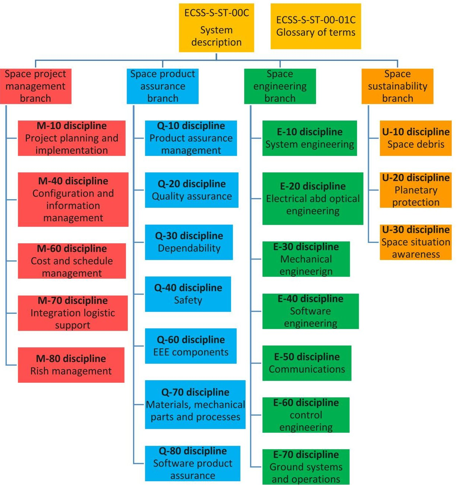

Figure 1: ECSS standards tree [30]

The ECSS, NASA Handbook and CCSDS standards focus on large space missions [31]. They have had great success, considering the space industry covers a vast domain and wide variety of missions. The range of missions and payloads supported by these standards throughout their design, development test and operations phases, is testimony to the success of such standardization.

<!-- PDF_PAGE: 19 -->

## 2.3 How existing standards can help us in CubeSat development

In commercial consumer products, standards are used extensively to the point where it is simple to add new functionality to consumer products. Over time standards have helped reduce complexity and increase efficiency in consumer technology. A few decades ago, computers weighed much more than they currently do and were much larger [32]. Today, computer standards support development of much simpler and smaller computer architectures. Standards also support production of more devices with more functionality. Refrigerators, electrical cooktops, lawn mowers and cell phones are just some of the devices that often now have features integrated in them that would have been inconceivable a few years ago. Software advancement has allowed complexity of function integration to be reduced by abstracting the underlying software architecture. It has made equipment user-friendly. In contrast, spacecraft designs are still often generally very heavily optimized for what needs to be done - extraneous functions and systems are removed, because of cost, mass impact, schedule, risk etc.

Standards can therefore reduce complexity in technologies and make them more user-friendly

Taking constraint-driven space functional needs with the simplicity of standards used to add functionality to consumer products at low cost could result in a new paradigm shift in CubeSats similar to the one first created with the CubeSat standard itself. Introducing size constraint standards, weight standards, communication standards etc. will make the development of CubeSats easier. Section 2.4 defines areas where there is potential for significant further improvement in CubeSats.

Although ECSS and other space standards define best approaches for big space missions, the space community itself does not provide a simple approach for spacecraft development. Spacecraft are complex systems to design - components of spacecraft are generally not designed to be generically compatible with each other. Each component which builds up a satellite has independent requirements for hardware and software. All components of a spacecraft need to be programmed to talk to each other and work together. Functions and coding language for each unit have to be defined. Sometimes different components have different programming language or architecture requirements which makes it harder for developers to have a common view of, or control over, the entire code base for a spacecraft. Each component of spacecraft has its own

<!-- PDF_PAGE: 20 -->

hardware interfaces, which make the hardware connections more complex. One simple example is connector types for each component of a spacecraft. Many companies in the market design off the-shelf components for a spacecraft onboard computer, transceiver, antenna, Global Positioning system (GPS), and other devices. Many of these components have different interconnects which need to be accommodated for in the design or be manufactured specifically. Even a standard such as the eponymous PC104 interface for CubeSat boards does not have a common pin standard for different manufacturers [33]. This increases cost, time and complexity of manufacturing a spacecraft.

## Simple pre-defined hardware design standards within CubeSats can help reduce manufacturing and developmental time

Cell phones and modern computers use a great number of hardware and software components. Despite such complexity, these technologies are user-friendly and follow common standards across the domain. For example, most android cell phones use a micro USB charger. Therefore, each manufacturer does not have to manufacture different charging cables for each owner of a device. This also makes it easy for users to have a charging cable readily available for their need. When we download a new application on our cell phone, we do not have to follow a unique installation or driver setup process for it. This is because an application is made compatible with iOS or Android app standards before being available in the market. After a few standard interactions to address certain privacy permissions in a cell phone or a computer, the application can be installed. The post-processing, data reading and storage, and other feature functionality is performed internally in the background.

## We can use technological examples from other industries to make CubeSat technology more user-friendly

Having a similar framework and a well-defined set of standards in the CubeSat industry will have a significant impact on the small satellite community, and could equally impact the more traditional space development industry, where the constraints of standardization are more acceptable if the resulting cost and complexity of development are significantly reduced.

<!-- PDF_PAGE: 21 -->

The small satellite community usually consists of groups trying to develop simpler spacecraft, where traditional space standards have historically not helped. Having a pre-defined set of interfaces, configurations and libraries for each space component will allow these groups to spend more time on the payload than on the technical aspect of the bus. It is possible to envision a time when buying CubeSat parts online could also build the relevant bus flight software (much like the simplicity of plug-and-play devices terrestrially), compile the appropriate bus-related engineering budgets (mass, power, thermal and even link and data budgets), and essentially allow spacecraft development to be narrowed down to payload development, similar in many ways to configuring and building computers on many computer manufacturer sites. Allowing users to focus on the productive tasks they want to achieve with small spacecraft, rather than focussing much of their effort on making the hardware and software support each other, changes the potential for CubeSats. As an example, Bright Ascension is a company which provides software for CubeSat On-board computers (OBCs). This software is compatible with many COTS components available for CubeSats, however, it is not compatible with all components, and requires the end user to tailor and compile the code for their platform component(s) of choice. Using a similar framework but using greater standardization to produce software which will work for all COTS components will reduce development time for CubeSats significantly.

The next section discusses areas within CubeSat development where standards-based simplifications can be applied. Considering the current standards framework and outlining the standards applicable to CubeSats will allow us to develop a framework for a CubeSat standard.

## 2.4 CubeSat Standards

## 2.4.1 System Engineering Standards for CubeSats

System engineering standards are common amongst all space standards. They focus on an overall architecture for all components of the spacecraft. This includes how each component will coordinate and collaborate with all onboard equipment. System engineering also focuses on tests, which will be performed to check each component functionality as well as component

<!-- PDF_PAGE: 22 -->

integration within the system. System engineering standards in traditional space focus on design and development processes. For CubeSat development, such standards could define standard implementation practices rather than design/development processes, limiting choice but simplifying development.

Having well-defined system engineering implementation standards for CubeSats will allow developers to easily identify limitations and conflicts in the design, collapsing much of the traditional design and development timeline. It will make documentation and reporting for different systems needs, such as power or link budgets, easier. Furthermore, different operating modes, commands and other component parts of the mission planning process can be developed. A well-defined system engineering approach in satellite development can play an important role in mission operations planning as well. For example, introducing the N by N matrix defined in the NASA handbook for the system planning in the design process will help visualize potential errors and fix them early in the project. The use of N by N matrix is also defined in section 2.4.3 below [34]. Once we have a set of components all interconnected to each other or interfaces which are compatible to each other, a pre-defined N X N matrix can be produced based on the components a developer decides to implement. This can then help in visualizing errors and dealing with them in early phase of mission lifecycle. These pre-defined N X N matrixes can then be modified by the developers based on specific payload requirements.

## 2.4.2 Frequency Coordination Requests

Satellites use pre-defined frequency bands for ground to space communications. To avoid overlap of signals, each satellite has to file a frequency coordination request. Frequency coordination provides the operator a licence to use a specific frequency band which other operators are not allowed to use [35]. This avoids overlap and potential interference of signals during operations. Often big space missions have encrypted data and control access to their command and telemetry definitions. Therefore, it is necessary to obtain a radio communication licence for the satellite.

However, small satellites often operate on experimental, scientific or amateur frequency bands [36]. Considering the argument that the majority of CubeSats operate on similar bands and

<!-- PDF_PAGE: 23 -->

are not subjected to coordination, the licensing procedure for many CubeSats could be almost eliminated, from the operators' point of view. The licensing procedure for the small satellite community differs based on the region and country. Satellite communication component providers could provide templates for obtaining licences, to be filled upon purchase [37]. A template where an individual would fill out the required credential and specifications of a transceiver would make frequency coordination paperwork easier. Having a framework where transceivers are already compatible with certain licensed frequencies would significantly benefit the small satellite community. Alternatively, standards could be developed for CubeSats where individual developers do not license their spacecraft, but the license accompanies the communication products purchased. Commercial terrestrial RF electronics such as cell phones do not require each end user to obtain a communication licence - the licence accompanies the devices. Traditional industry practices, where a cell phone comes with all the necessary licensing requirements can be replicated in the CubeSat industry [38].

## 2.4.3 Design requirements

We have discussed how the CubeSat size standard has created a large shift in the space industry, however it is worth exploring what the CubeSat standard is exactly. The standard is not exactly a satellite standard but a launch container standard, within which satellite shape variations do exist [4]. Introducing other design standards involving hardware components of the CubeSat could be more beneficial to CubeSat development. The design subset can include all the components of the ECSS tree which deal with structural, mechanical, and electrical design for a spacecraft [39]. Even implementing CubeSat deployer design specifications within CubeSat standards, to address design issues related to separation springs, switches, standoffs and other components, can make CubeSat designs even simpler.

Currently, there is little or no consistency even between CubeSat deployer specifications for size and space constraints. For example, the stand-off clearance for CubeSats in NanoRacks standard is 6.5mm [40], whereas for Cal-poly the clearance for the four sides is 8.5mm [41] [42]. The rail width for Cal-poly is required to be 8.5 mm and according to the NanoRacks interface document each rail shall have a contact surface area of 4mm by 4mm [9][40]. Having ambiguity

<!-- PDF_PAGE: 24 -->

in specification forces CubeSat developers to make satellites specific to a certain deployer's requirements.

Having CubeSat design standards will allow manufacturing of common off-the-shelf components available to be used by any CubeSat. Furthermore, this will make power, structure, software, communication and other interfaces easier to design. Having a common set of design constraints will allow a developer to deploy their spacecraft with any launch provider. This will increase launch windows and opportunities in the industry.

The design requirements can group together several sections from the ECSS tree. These sections are:

- Structural - having consistency in design specifications and structure requirements as mentioned above will allow developers to have a common design architecture. CubeSats will be compatible with all deployers.

- Mechanical - using the N by N matrix defined in NASA systems handbook will help visualize connectors and wiring for the CubeSat. Having templates for the planning phase will allow developers to realize potential errors and take precautions for them early in the project [34].

- Electrical - similarly, using the N by N matrix will allow visualization of switchable and non-switchable lines [34]. Developers will be able to allocate power based on priority analysis to spacecraft components.

In addition, having an appropriate design architecture for a CubeSat will allow an increase in compatible spacecraft components. Spacecraft consist of components manufactured by different companies which have to undergo system-level design integration before being installed with other components. Currently most spacecraft components are not generically compatible with each other. Upon integration, command and telemetry parameter definition, information storage and operability etc. have to be defined for each component at the hardware and software level. Components are not accompanied by a software template or code blocks, making it challenging to develop interfacing code. A user-defined set of components with pre-built software, or standard mounting structures and mechanical interfaces, will enable developers to focus more time on the payload than satellite structural and architectural development and integration.

<!-- PDF_PAGE: 25 -->

## 2.4.4 Design, systems and testing documentation guidelines

Traditionally, spacecraft require years of development time. Individuals working on satellites may change projects or jobs, leaving the project in new hands each time. Hence, there is a need for well-defined project management and documentation for each stage of the project. There are no defined standards or templates to follow for writing well-defined CubeSat mission documents. A change of management leaves the satellite development up to the discretion of its new engineers and developers.

Having a set of template documents will make communication within the industry easier to interpret and understand. Documentation will not take as much time to be created or understood. Moreover, documentation templates for test procedures will make testing processes more efficient. Having template documents for power, electrical and data links will reduce the processing time documentation takes. If the documentation is electronic, it could be used to auto-generate designs and engineering budgets, saving time and decreasing the risks of human error in information translation. Evaluation of satellite structures, design and architecture at mission gate reviews will also become significantly easier. In addition, standardized templates to automate traditional space documentation will eliminate the need for a number of analyses that would not be required for previously analyzed components [43]. The automated documentation will prove compliance for specific requirements.

## 2.4.5 Operation procedures for satellites

Early traditional spacecraft operations consisted of a simple spacecraft which was primarily human-controlled from ground through a single ground station. The risk for launch or operations failure was very high. A number of paradigm shifts later, space flight software is now often complex and increasingly automated and requires limited human ground operations. The number of people involved with space mission operations has reduced by at least an order of magnitude in many cases as a result [44].

<!-- PDF_PAGE: 26 -->

One other change in the space operations branch has been the involvement of the operations engineers during the design phase of the mission. Defining the design of the spacecraft in order to provide maximum operability results in cost optimization for the overall program. In order to develop greater levels of spacecraft autonomy, both spacecraft and ground system standards are required [44]. CCSDS standardizes data interfaces, however further development on space and ground systems operations can define multisession operating environments. The greater the mission autonomy, the less the operational challenges and errors, and the less the work force required for satellite operations long-term. The Midcourse Space Experiment (MSX) and Near Earth Asteroid Rendezvous (NEAR) mission are a couple of example missions which have implemented onboard autonomy and resulted in a much smaller mission operations team [44].

Mission operations typically focus on three main aspects: Mission planning, control and assessment. Typically, operators define mission modes in great detail, with exact mission housekeeping telemetry, mission functionality, sequences of activities, mission database content, mission data budget definition etc. They also define different testing environments, as well as operating languages. In contrast to large space missions, CubeSats are usually built by small teams, where associating a person to each of the mission operations tasks can be challenging. This can lead to additional operational challenges during flight, in addition to the money and time spent on space operations, where each team member may have unique knowledge of certain systems or functions, and team member handoff can be more challenging. By way of illustration, the NEAR satellite mission highlighted the following operational challenges they encountered during flight [45]:

- Error free execution of the mission critical and instrument activities

- Balancing science and housekeeping activities with competing spacecraft resource utilization.

- Spacecraft and ground system complexity

<!-- PDF_PAGE: 27 -->

Table 2: NEAR mission operations functions [45]

<table border="1"><tr><td>Real-time operations</td><td>Off-line mission analysis functions</td></tr><tr><td>Real-time mission simulation participation</td><td>Mission simulation planning</td></tr><tr><td>Flight software loading</td><td>Flight software load preparation and testing</td></tr><tr><td>Spacecraft commanding</td><td>Spacecraft command sequence creation and validation, data management, spacecraft timekeeping, maneuver planning</td></tr><tr><td>Software requirements definition and real-time system testing</td><td>Software requirements definition and off-line systems testing</td></tr></table>

Looking at the operations functions of the NEAR mission in table 2, it is clear that mission planning and operations has a number of risks. Practicing a standard operational sequence for missions reduces operational errors during flight and reduces mission planning time and cost. Having a standard set of commands and telemetry will allow all satellite operators to train with anomalies. Even a small group of operators will be more trained in predicting the expected outcomes of sent commands, thus increasing spacecraft reliability and enabling operators to perform demo operations on the satellite for each operating mode [46].

<!-- PDF_PAGE: 28 -->

## Chapter 3. Rationale for focussing on CubeSat Operations standardization

Standardization can help achieve the full potential of CubeSats. However, the standards already existing in the space community can be challenging to implement. Many are not aimed at low-cost, rapid development missions. Others require broad implementation by manufacturers to provide the intended benefits. One area where CubeSat standards can be addressed without significant change in the CubeSat ecosystem is mission operations. Amongst various research being performed around minimalizing CubeSat cost, operations are a sub-section which has not been extensively studied. Many operating commands or activities directed for CubeSat busses are common, or the differences between missions are not significant. Therefore, missions can benefit from a set of common operations abstractions because they perform similar activities. This thesis defines a common abstraction for CubeSat operations, as it is one part of the CubeSat system which will not require any systematic change to benefit from this standardization.

The proposed operations abstraction for CubeSat addresses the majority of bus activities and is supported and demonstrated by a generic software tool. The tool performs generic CubeSat telemetry analysis based on the defined command sequence and the elaborated list of telemetry. The abstracted CubeSat operations are designed to be implemented with any command and telemetry tool available for small satellite usage, however this work included development of a generic tool as most existing widely available generic monitoring and control tools are more complex than required for typical CubeSat operations.

Abstraction of operations activities does not only affect development of operations tasks and testing. Satellite operator training is able to become much more intuitive across missions, and routine and anomaly handling standardization can reduce errors in operations. Common ways for real-time review of telemetry and command actions will allow operators to deal with in-flight issues faster and more efficiently. Each operation sequence and ground pass can be refined and optimized, benefitting from a much larger pool of lessons learned. Michael Swartwout states that between 2000-2015 the reason for CubeSat mission failures because of inability of the ground operators to communicate with the satellite was approximately 25%. [47] Often, teams are not able to move past communication activities in satellite operations, into the core mission

<!-- PDF_PAGE: 29 -->

objectives. The reason for failure also underlies the inability to identify the operational problem and implement the solution in real-time on the spacecraft. Having an abstracted operations sequence helps in highlighting persistent failure cases across missions and can lead to development of strategies to mitigate them. The contributions of abstracting CubeSat operations include:

- Common CubeSat operations and operating modes based on CubeSat design

- Common CubeSat operations telemetry parameters and failure handling

- Proposing a spacecraft testing plan and tool for functional testing

## 3.1 Abstracting CubeSat operations and operating modes based in CubeSat design

In order to simplify spacecraft design processes related to operations, this thesis defines a list of parameters needed from each subsystem for common, standard operations. Developing the CubeSat operations alongside the design process makes the operations less time consuming and closely adaptable to mission hardware. The design for a given CubeSat can be developed based on the mission requirements, and thus operations and operational modes can be developed for each mission subsystem. An abstracted set of telemetry for each operating mode is proposed in this thesis.

## 3.2 Abstracting CubeSat failure and recovery operations

In order to verify optimal operations a list of potential outcomes shall be documented for the generated telecommand sequence. The satellite should also be sent some incorrectly formatted or bit-flipped commands to test the satellite in anomalies as well as in its full operating conditions. This will allow testing the satellite in different operating modes that the satellite may encounter during flight. The operations sequence proposed in this thesis highlights verification of the operating sequence by including potential failures and upsets in orbit.

## 3.3 Proposing a spacecraft testing plan and tool for functional testing

To ensure a spacecraft is ready to support operations before it is launched, a full functional test is usually conducted on the ground. Often referred to as test-as-you-fly, a functional test

<!-- PDF_PAGE: 30 -->

comprises of the entire operation sequence of the satellite squeezed into a testable time frame. A part of the test includes testing the satellite communications in a satellite operations setup. Having a standard functional test reduces the amount of time required to develop a mission specific test for each mission. This thesis proposes a functional test of CubeSats using the DESCENT satellite mission as a baseline, in addition to a tool which can be used to study performance of the spacecraft throughout the test campaign.

## 3.4 Outcome of study

This study provides a set of standard operations sequences developed for CubeSat operations. The presented abstracted sequences are the result of a thorough understanding of mission operations on past CubeSat missions. The template of sequence is intended to be usable by future CubeSat missions for operations planning with little modification. CubeSat software development can be better defined using the list of parameters the sequence suggests for each operating mode of the spacecraft. This thesis also identifies a list of common anomalies for each sequence, which allows satellites to be tested in possible failure scenarios they may encounter in flight. Finally, this thesis also presents an example of a visualization tool as an effective way for displaying downlinked telemetry. Having an effective display of the telemetry allows visualizing errors in satellite real time and helps reduce post processing time for data analysis. The thesis concludes by highlighting the simplifications that can be made as a result of this abstraction, to serve CubeSat missions in the near-term. Adopting the abstracted CubeSat operations proposed in this thesis will help future missions by reducing development time. Planning and developing operations may take up to 18 months [77]. Using a set of pre defined operations can help reduce the developmental timeline of the mission. The sequence can also be used to train satellite operators and develop a functional test plan for the AIT campaign. The thesis also points to some of the other improvements that can be made longer-term for CubeSat mission designers and operators through further industry standards implementation.

<!-- PDF_PAGE: 31 -->

## Chapter 4. Abstracting Operations for A CubeSat

Many commercially available technologies have common implementations of certain operations, regardless of the make of equipment: For example, all televisions have a power button, channel button and volume buttons, and a user will follow the same steps to operate most kinds of television. Likewise, CubeSat operations can be remarkably similar. This thesis contains an operator manual to standardize those common CubeSat operations. Studying various CubeSat operations, this chapter highlights common mission modes, operations tools and specific operational activities performed on CubeSats.

Spacecraft operations can be distributed into key modes, and the modes may be used across multiple missions with little modification. For example, many spacecraft have two sets of flight software (images) running on their OBC, a so-called nominal image and a safe mode image. The nominal mode typically runs all the functions the spacecraft wishes to perform in its lifespan. On the other hand, the safe hold mode acts as a mission recovery image. The safe hold mode control includes two major functions. One is to ensure the spacecraft stays power-positive and other is to maintain a communication link to ground. Nominal modes can be distributed into further mission-specific modes [48]. These modes are

- Launch vehicle separation: If CubeSats are launched from the International Space Station (ISS), then the launch providers have strict rules about spacecraft operations to avoid interference with the ISS operations. Therefore, CubeSat developers have to account for this in their software and hardware design. Alternatively, if the launch is not from the ISS and there are no constraints to operations, spacecraft can often start onboard operations immediately after deployment.

- Power-on and antenna deployment: After successfully deploying and escaping the ISS communication window (if applicable), spacecraft attempt antenna deployment for ground communications. At this point many spacecraft systems are also turned on and operations on the spacecraft commence.

- First contact: This mission mode involves establishing contact with the ground station and sending the first set of telemetry.

<!-- PDF_PAGE: 32 -->

- Attitude control: Depending on the operations sequence, attitude determination, and then control, are achieved on the spacecraft.

- Payload: The next stage involves the CubeSat running all mission specific payload tasks. This may involve gathering data, taking pictures, performing an experiment etc. Some spacecraft may also have multiple payloads. All payload essential tasks are performed in this mode and the information is communicated to ground.

- End of life: Lastly, the spacecraft is de-energized, disabled and left to fall into Earth's atmosphere to burn up.

Most spacecraft operate in a majority of these modes and collect similar telemetry from all the components. Teams traditionally decide on a unique operations sequence which requires time and can result in operations not accommodating for certain failure scenarios. Many CubeSat developers have the same functionality but define it in their own unique modes. There are a number of activities which are common across all CubeSats but are still performed differently. Most of the individual activities can be grouped within the modes defined in this section. The next section showcases different CubeSats and how they adapt similar operations in a unique manner.

## 4.1 Operations sequences from existing CubeSat missions

This section studies operations of different missions and highlights different operating modes CubeSats have used. The common denominators in all the approaches to operations modes are highlighted in the red box in figure 2. Missions may choose to call the modes by other names, but the functionality is common. This section explores the different mode names and functions past missions have used and maps them to these three common modes. Safe-Hold operations are operations performed when the satellite first boots up, communication and minimum bus is active during this mode. Alternatively, if the satellite is low in power then safe-hold operations can also be recovery operations where satellite has minimal functionality to stay power positive. Nominal operations are mission operations the satellite performs. Nominal operations include all payload operations as well as bus essential functionality. Lastly, failure operations are operations performed as contingencies. If a particular component of satellite is failing, then the operators will deviate from the planned operations to perform a software patch.

<!-- PDF_PAGE: 33 -->

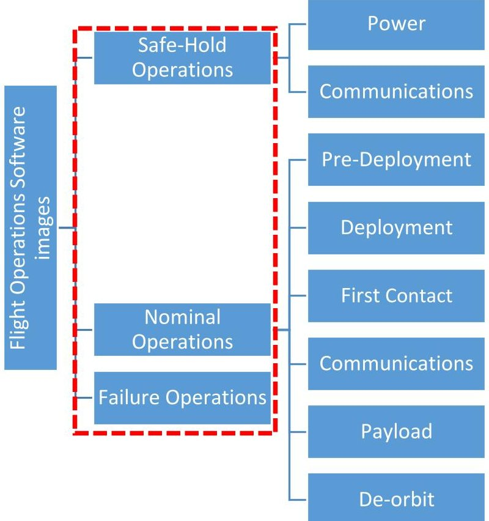

Figure 2: Operational images programed into flight software

University of Arizona's first two CubeSat were launched from Kazakhstan in November 2006 [49]. The primary objective of the first mission was to formulate a bus for future space experiments. The second satellite was intended to collect information to analyze the performance of developmental semiconductor devices in Low Earth orbit (LEO) [50]. The spacecraft operations sequence for these missions consisted of deploying a beacon 45 minutes after separation from the ISS. Immediately after deployment the satellite enters its default mode of operations, which can be modified upon commands received from the ground [50]. The University of Arizona's spacecraft had three modes of operations:

- Realtime Mode: The real-time mode is when the satellite has active communication with the ground. The satellite operations sequence is such that the satellite transmits 24 sensor readings in half of a second and then sleeps for half second. During the latter period, the satellite looks for any command reception. If the orbital pass time is 15 minutes, then the satellite will repeat the above defined transmit-receive process for 15 minutes unless interrupted by reception of a command. Upon completion of the orbital pass time, the

<!-- PDF_PAGE: 34 -->

satellite switches to the next mode which is the whole-orbit mode [50]. The realtime mode from this mission overlaps with the nominal operations of this thesis.

- Whole-Orbit Mode: During the whole-orbit mode, the spacecraft stores delayed telemetry. The sensor read table is checked every second. If there is data due to be read, the operating system reads it and stores it in FRAM. Data collection is done based on a pre-determined schedule. This schedule allows storage of two orbits data for later transmission [50]. The whole-orbit mode is considered a delayed data dump for this thesis and is also a part of the nominal mission operations.

- Default Mode: The default mode is instigated at the time of deployment and after any hardware resets. The operating status of the satellite along with sensor data over a two orbit period is relayed during this mode [50]. The default mode overlaps with the safehold operations of this thesis.

To summarize, during the real-time mode, data is collected and transmitted real-time to ground. Otherwise, two orbit data is collected during whole-orbit mode and transmitted during default mode. Meanwhile the satellite also alternates between transmit and receive to accommodate for command reception. The satellite sleeps for one full orbit after transmission, in order to allow for battery recharge.

Similarly, the Cal Poly CP2 CubeSat project outlines their operations sequence. The majority of the operating modes are implemented as a part of the software design of the spacecraft. A key mode CP2 includes is the contingency mode. This mode maintains a minimum operations level and takes priority during main processor or bus failure [51]. The three modes of operations described below are pre-ops, normal ops and contingency ops.

- Pre-ops: Morse code and AX.25 beacons are transmitted at 2 minutes' intervals, while waiting for an uplink command. Upon reception of an uplink command the satellite switches to normal ops [51]. The pre-ops mode overlaps with the safe-hold operations of this thesis.

- Normal Ops: The key functionality of the normal operation is that uplink commands are received and decoded while the beacons and payload data are transmitted to Earth ground station. During a failure the contingency mode is activated which maintains minimum

<!-- PDF_PAGE: 35 -->

communication while isolating the communications sub-system from the bus [51]. Normal ops for this mission overlaps with the nominal mission mode of this thesis.

- Contingency Mode: This mode of operations is the fail-safe mode. The communications controller takes control of the payloads to complete the mission. The main controller sends $ \mathrm{I}^{2} \mathrm{C} $ transactions to the bus. With each reception a timer is updated. If the timer expires without the reception of a command, the bus switches into fail-safe mode of operations. If the main bus or processor ever returns to operating mode, then the spacecraft is switched to normal operations mode [51]. The contingency mode of the CP2 mission overlaps the failure mode of figure 2.

Normal operations as well as a contingency mode are common modes between different satellites. However, the way they are initialized in each satellite operation can differ significantly. Pre-ops definition for the CP2 project chooses to continuously transmit a signal to ground. This may differ from other CubeSat approaches. The benefits of using such an architecture is highlighted in the communications abstraction layer of this thesis (section 5.1.3.3).

The Aalto-2 mission is a 2U CubeSat designed for the QB50 constellation. The lifetime of the mission is estimated to be 3 months and it will be launched from the International Space Station. Aalto-2 uses the services and sub services structure defined within the ECSS and CCSDS frame and packet levels, giving some standard sets of application layer functionality [52]. Similar to the previous two missions, Aalto's mission concept of operations is divided into three phases.

- First phase: The first mode involves turning on all systems and ensuring they are all in working condition. A key objective of the first phase also involves deploying antennas and probes [52]. The first phase overlaps with the safe-hold operations of this thesis.

- Nominal phase: This phase essentially includes all mission specific tasks and lasts until the end of life of the mission. 2 MB of science data associated with the payload operations will be downloaded every day [52]. All mission components are operational during this phase. Nominal phase for this mission overlaps with the nominal mission mode of this thesis.

<!-- PDF_PAGE: 36 -->

- Contingency phase: This phase is activated if certain pre-conditions are met. This includes situations like the battery level falling below 60% of its capacity. During this mode, only the necessary systems are operational. These include the UHF communications and the beacon signal. Other systems, such as the attitude determination and control, on-board computer and payload, are turned off [52]. The contingency phase of the Aalto-2 mission overlaps the failure mode of figure 2.

It is so far evident that many missions have similar structures of operations, however the way each phase is defined may differ slightly across various missions. Antenna deployment (if applicable) and first contact are important mission modes for success. Therefore, they define the basis for mission operations.

PROBA- V is not a CubeSat mission, but is of interest because of its similar mission modes and its operations autonomy. It is an Earth observation satellite mission and has a vegetation instrument on board. The main objective of the mission is data acquisition of the vegetation instrument (VI). The operational modes of the mission are described within the system mode manager in the system software [53]. These modes have a defined entry condition and configuration. The different modes are described below:

- Safe mode: The safe mode is the default mode at the time of boot and is also activated if the spacecraft experiences any serious anomaly. In order to maintain thermal stability of the satellite and the instrument, a B-dot algorithm is included in this mode [53]. Safe-hold mode of this thesis maps to the safe mode of the PROBA-V mission.

- Nominal observation mode: This mode is the mission main mode. Instruments perform according to automated code based of different operational scenarios [53]. Nominal operations mode is common between this mission and the thesis.

- Calibration mode: This mode is a special mode and goes hand-in-hand with the nominal mode. If the nominal operations need to be interrupted for a calibration activity, the spacecraft switches into calibration mode [53]. The calibration mode interrupts the nominal operations in order to deal with errors on the spacecraft. Hence, the failure mode of this thesis maps with this mode.

<!-- PDF_PAGE: 37 -->

- Manual mode: The manual mode allows the operator to be completely independent. The operator can control the attitude as well as all instruments [53]. The manual mode is closely related to the nominal mode of this thesis as an operator can perform all mission tasks.

PROBA - V demonstrates autonomous operations, where mode transitions are pre programmed with certain switching conditions. This may not be a common practice in many small satellites, however even in the absence of on-board autonomy, ground automation could provide similar mission-level autonomy, which may be relevant in a multi-satellite mission or missions with series of satellites with similar operations, like the case of PROBA series. Figure 3 highlights PROBA-V mission modes.

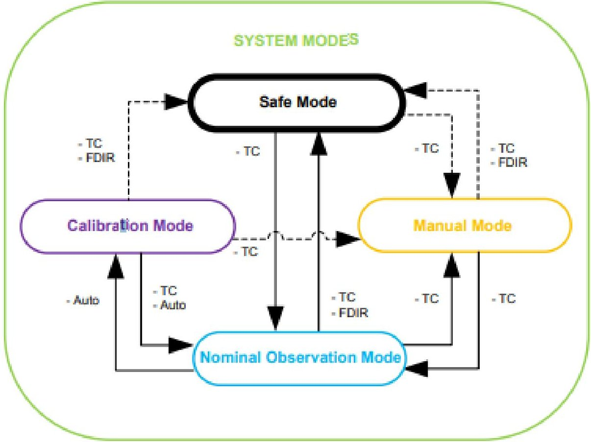

Figure 3: PROBA - V system modes [53]

The Dynamic Ionosphere CubeSat Experiment (DICE) mission measures plasma densities, electric fields and magnetic fields. The satellite performs ionosphere diagnostics from space. The mission also demonstrates high-speed downlink communications. The command and data handling sub-system ensures that the spacecraft is performing nominally and is responding

<!-- PDF_PAGE: 38 -->

to warnings and errors, and it organizes housekeeping data, and delayed data for the payload instruments [54]. The flight software describes the different operating modes of the spacecraft:

- Safe mode: The satellite boots into the safe mode upon software resets and system power cycles. Antennas are deployed during this mode, Attitude Determination and Control System (ADCS) system and housekeeping telemetry is also collected during this mode. Sub-systems not important for spacecraft survival are powered down. Ground commands to transition to other modes are also accepted [54]. The safe-hold mode of this thesis overlaps with this safe mode.

- Standby Mode: All ADCS, system and housekeeping telemetry is collected during the standby mode. Sub-systems including GPS and magnetorquer coils are operating. In the case of a health error the spacecraft switches to safe mode and upon reception of a command from the ground the space satellite may transition to operational mode [54].The standby mode also performs nominal operations but is restricted to some payload operations of the mission. Therefore, it still overlaps with the nominal mode of this thesis.

- Operational Mode: All science, ADCS, system and housekeeping telemetry is collected during this mode. Power to payload and sub-systems is active. During an error the satellites switches to safe mode and the satellite may transition to another mode upon command from ground [54]. The operational mode overlaps with the mission nominal mode of this thesis.

Between each of these missions, there exists an overlap amongst different modes of these spacecraft and it is evident how each operator performs different tasks in different modes. Each mission often ends up reinventing the wheel for its modes of operation, despite having operating modes defined by many other missions. Less than 30% of software projects deliver functionality within +/-10% of planned cost and schedule, using previously proven flight software or concepts is recognized as a best practice for driving down flight software development risk [55]. Having a common definition of the modes and their task definition itself would have reduced the development time for CubeSat software and simplified operator training.

<!-- PDF_PAGE: 39 -->

## 4.2 Mission mode specific operations

Different missions tackle each operations scenario differently with a unique set of operational commands. The nominal mode of operations consists of mission-specific operations and other mode-specific operations. This section highlights some common phases across multiple CubeSats and explains the concept of operations detailed for each phase by different missions to achieve their objective.

In addition to the mission phases for nominal or safe-hold operations, a CubeSat may use several modes within the nominal mode. This section highlights the different modes and compares them to operations of other satellites. The modes highlighted in the green box in figure 4, are presented in this section. Often satellite developers formulate an operations sequence for their CubeSat. Software definitions are then written in alignment with the operating modes of the satellite. The operating modes are defined primarily based on the mission objectives as well as the capabilities of the satellite sub-systems, low power tasks such as housekeeping data collection and power intensive task like payload ops. Common mission modes like detumble, antenna deployment, CubeSat separation from the deployer, solar panel and battery, communication and first contact are some activities this section compares across various CubeSat missions.

<!-- PDF_PAGE: 40 -->

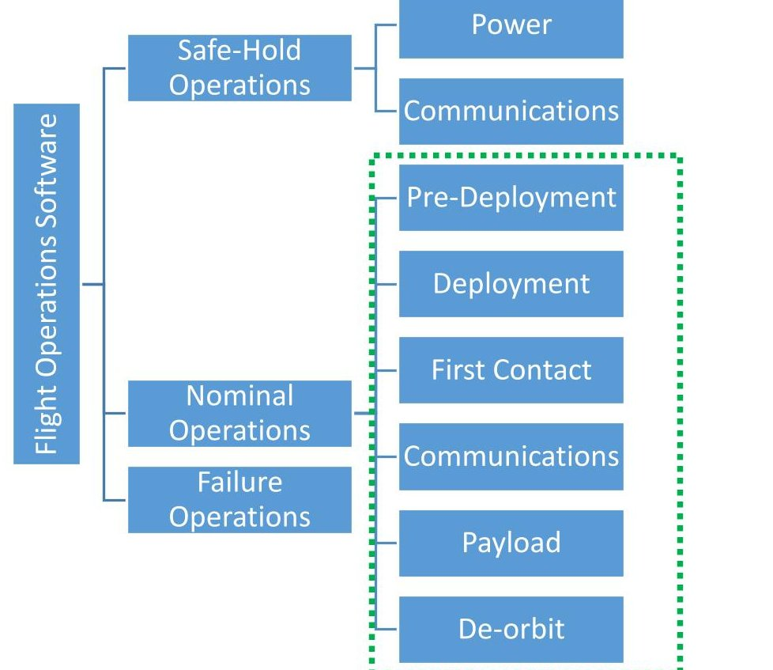

Figure 4: Operational modes under the nominal mission mode image

## 4.2.1 Attitude determination and control

The SwampSat mission differentiates de-tumble from three-axis stabilization for satellite attitude control. De-tumble mode is a timed operation and the detumble loop time and period are set using ground commands as a part of the uplink before the mode activation. During this mode the satellite queries the IMU rates and compares them to pre-defined threshold values [48]. Since the detumble mode is a power heavy mode, the spacecraft first performs a battery level check. Based on predetermined threshold values for angular rates of the satellite, the detumble mode is executed. Detumble operations can be terminated using ground commands, successful stabilization or if the angular rates fall below the threshold values [56]. The ground makes a decision based on the satellite health data transmitted to ground at specific intervals during communications. In addition to the spacecraft health (solar cell voltage, current and temperature), angular rates from the IMU are also downlinked as part of telemetry. Ground operators then decide if the satellite's magnetic coils have the capability to execute the operations successfully. The ground is also capable of resetting the battery threshold if it wishes

<!-- PDF_PAGE: 41 -->

to. Success of the detumble mode raises a flag which can later be communicated to the ground along with other spacecraft telemetry.

In addition to the detumble mode, the SwampSat mission also has an ADS mode. The ADS mode takes measurements of the attitude sensor, sun sensor, magnetometers and IMU, and fuses them together to estimate the attitude [34]. The attitude and angular rate data are stored on board. This data is later used to stabilize the spacecraft.

The attitude control unit on the CubeSat Proximity Operations Demonstration (CPOD) consists of an ADCS processor, two-star trackers, inertial measurement unit (IMU), three reaction wheels, GPS receiver, sun sensors, magnetometers, and three torque coils. Initial attitude knowledge is provided by the IRM unit consisting of an IMU and the two star sensors [57]. The two-star sensors have two operating modes: The Lost in Space (LIS) - a mission mode which independently computes vehicle attitude, and the Recursive mode - which uses prior attitude data and increases confidence in the data collected. Three reaction wheels help in slewing and pointing control of the spacecraft [57]. Moreover, the torque coils are used for wheel desaturation and DE tumbling.

The BioSentinal mission distributed its attitude control into two different modes: the nominal mode and safe mode. The main function of the ADCS operations modes was to use the sun tracker with 3 axis attitude control to point the spacecraft antenna to Earth and point the solar panel to the sun within $ 5^{\circ} $ of accuracy [58]. The ADCS also used the onboard thruster to keep body rates below the threshold body rates. The CubeSat entered the nominal mode upon separation from the Space Launch System (SLS). The ADCS system has to keep the angular velocity below a predetermined threshold during the nominal operations for the ADCS [58]. On the other hand, during the safe hold mode for ADCS the main goal of the CubeSat is to remain power positive, ensure communication with ground and prevent momentum accumulation.

The ITASAT mission uses a 3 axis gyroscope, an accelerometer, 3 axis magnetorquer, an IMU, 4 infrared horizon sensors, and 6 coarse sun sensors for attitude control and estimation [59]. The ITASAT mission's operating mode for attitude control performs stabilization and estimation, although attitude estimation is running in other operating modes as well. The three modes the spacecraft divides attitude control within are safe mode, where ground commands are

<!-- PDF_PAGE: 42 -->

received and on board telemetry is downlinked (sensors and actuators are turned off at this point), attitude stabilization mode where attitude determination and estimation are performed and lastly Earth pointing mode where the satellite points to the Earth and angular rates are kept below a specific predetermined threshold [59].

The ADCS operations for the DICE mission are distributed into two modes. The detumble mode is the mode that the spacecraft boots into upon deployment. In this mode the spacecraft slows the X and Y axis motion and spins the Z axis to obtain the desired spin rate and alignment [54]. The other mode within the DICE mission's ADCS is the controller state. In the controller state the spin rate of the satellite is maintained and the spacecraft rotation can be modified by ground commands.

## 4.2.2 Separation

The CPOD mission runs a few on-board tests upon separation from the deployer. The initial checkout includes verifying proper communications, power generation and storage, attitude determination and control functionality and communication between applications [57]. In addition, one solar panel array on each vehicle is deployed to maintain a positive energy balance.

These are some tests that should be practiced by most missions upon separation. Most of the other missions observed in this chapter boot into safe hold mode upon separation.

## 4.2.3 Solar panel and battery

University of Arizona's CubeSat had on board four solar panels working together to recharge the batteries. Developers of the satellite had set the power-down threshold to be at 4.0 V. If the voltage drops below 4.0V, the satellite temporarily powers down to allow the solar panels to charge the battery and resume normal operations [50].

The CPOD mission hosts deployable solar panels on each of its vehicles. Upon checkout from the deployer, one solar panel array on each vehicle is deployed in order to maintain a positive balance during the initial checkout mission phase [57]. Following the initial checkout, all the solar panels on the spacecraft are deployed before progressing into any other mission mode.

<!-- PDF_PAGE: 43 -->

## 4.2.4 Antenna Deployment Functionality

The unique design of the University of Arizona's CubeSat involves access to a Field Effect Transistor (FET) switch control from the beacon and the controller. The possibility of antenna fuse component is eliminated with this design. The CubeSat attempts to deploy their antennas until successful communication is achieved. Successful communication is documented on the spacecraft after a valid flag is raised [50]. They assume that if communication is not achieved then the satellite has not successfully deployed its antenna. The main controller attempts to deploy the antenna at 5 minutes after separation and the beacon attempts to deploy the antenna at 45 minutes after separation from the CubeSat deployer [50]. It should be noted that to conduct this task in the beginning of the mission cycle might be very power heavy.

Secondly, in the SwampSat mission after separation from the deployer the CubeSat enters the deployment and power up mode. Since, most CubeSats are launched as secondary payloads, abiding by the deployer requirements the CubeSat incorporates a halt to avoid interference with the primary payload operations [48]. SwampSat deploys its antenna prior to mission operations and tracks it with a launch flag. The CubeSat examines the change in angular rates and acceleration after antenna deployment in order to depict the success rate of antenna deployment. Upon first contact the ground can also make provisions to re-deploy the antenna by setting the launch flag to 0 [48].

## 4.2.5 Communications

University of Arizona's CubeSat has on board a transceiver and a beacon for space to ground communications. The CubeSat supports data rate of 100 Kbps and 7-bit addressing. The beacon can operate autonomously independent of other spacecraft electronics except for power and sensor electronics [50]. The CubeSat has 15 minutes of ground communications time per orbit. In this 15 minutes the satellite transmits 24 sensor data values for half a second and then sleeps for half a second to allow for command reception [50]. The process is repeated until there is a command reception from ground, in which case command reception takes priority.

For the SwampSat mission, mission specific validation data is transmitted to the ground during the communications mode. This includes stored data from detumble, ADS and CMG

<!-- PDF_PAGE: 44 -->

(mission ops) a mission specific mode. The communications mode is a sub-routine to the main program and allows downlinking of data to ground [48]. Depending on the mission mode the data may be stored in different locations on board. Since this is a power heavy mode, a power check is performed prior to execution. Based on the available power, data from a specific operating mode is transmitted to ground along with real time data for ground decision making. On-board data is stored as pages where each page is 4096 bytes [3]. When requesting data, the ground specifies the page numbers it wants to access data from. The ground can also request data from a specific mode. All the desired data may not be downlinked in one pass; therefore, retransmission can also be accommodated using uplink commands.

Likewise, the command and data handling (C&DH) unit of the CPOD is capable of addressing a wide range of computational performances. The C&DH unit enables low-power idle modes as low as 20 mW and high-performance modes within 200 mW [57]. For communications the CPOD uses a UHF radio for the majority of its mission communications. However, for high speed and data intensive telemetry the mission uses a S-Band downlink [57]. The mission also incorporates an inter-satellite link (ISL) for communication between the 2-3U CubeSats. The ISL can operate over multiple kilometres and utilizes the 2.4 GHz band.

For the BioSentinal mission, the communications to ground last for up to 4 hours. Therefore, the spacecraft have to ensure that the solar arrays point directly at the sun for the time the satellite is under any communication operations [58].

The command and data handling unit on the DICE mission in general deals with nominal operations, responding to warnings or errors, and organization and acquisition of housekeeping (HK) [54]. The spacecraft uses CCSDS packets for ground communications. The CubeSat also used a CadetU radio for ground communications. It supports 9600 Kbits/sec data rate and operates in the 460-470 MHz range [54].

## 4.2.6 First Contact (Ground Pass)

For the SwampSat mission, the satellite enters safe-hold operations after antenna deployment. During this mode the CubeSat communicates real time telemetry to ground, where the ground makes a decision on spacecraft communications health. The satellite can switch to

<!-- PDF_PAGE: 45 -->

four other operating modes from this mode. Only 15% of the power generated by the solar panels is consumed during this mode [34]. The remaining power is stored on-board for further operations.

Based on the telemetry downlinked the ground makes a decision for switching into other operating modes. The beacon transmits ground data and the ground can query the beacon in different intervals depending on the power status of the satellite [48]. This ensures minimum power consumption.

## 4.3 Tools used for CubeSat operations

The lack of standards for CubeSat operations results in different CubeSat developers generally requiring bespoke software for their ground and space operations. Some software elements need to be mission specific, but most could be written to support multiple satellites. A clear definition of key requirements to be performed by each operating mode is missing and the need for consistent mission operations is evident. CubeSat operating modes are driven by the requirements of their payloads, power and communications. Various developers are now developing tools to make operations easier, and this section discusses some such tools. This thesis further identify a path to making a common tool to fit most CubeSat operations [58].

Cal Poly CP2 project has taken the AIAA operator training approach [51] and has developed a reliability test checklist. This checklist helps operators and developers of the spacecraft assure spacecraft reliability in different real-world scenarios. It includes testing the spacecraft in contingency mode, transmission of corrupted and healthy packets, command decoding, oversized packet transmission and switching between different operating modes. The checklist for training operators is a paper tool to assure that all spacecraft operations can be performed as expected, or a procedure can be developed to overcome anomalies. However, the tools listed in this section are software tools developed to aid in satellite operations.

The University of Arizona CubeSat team acquire their data by performing ten Fast Fourier Transforms (FFTs) per second on the raw stream and then demodulating the received signal using the Midas2K software [50]. The ground station software then performs three major functions:

<!-- PDF_PAGE: 46 -->

- It acquires incoming telemetry packets from a serial port

- It processes, displays and stores incoming data as appropriate

- It allows the operator to compose and send command packets

All the above tasks were programed into a JAVA-based software tool and are displayed in a Graphical User Interface (GUI). The program GUI is displayed in the figure 5 below:

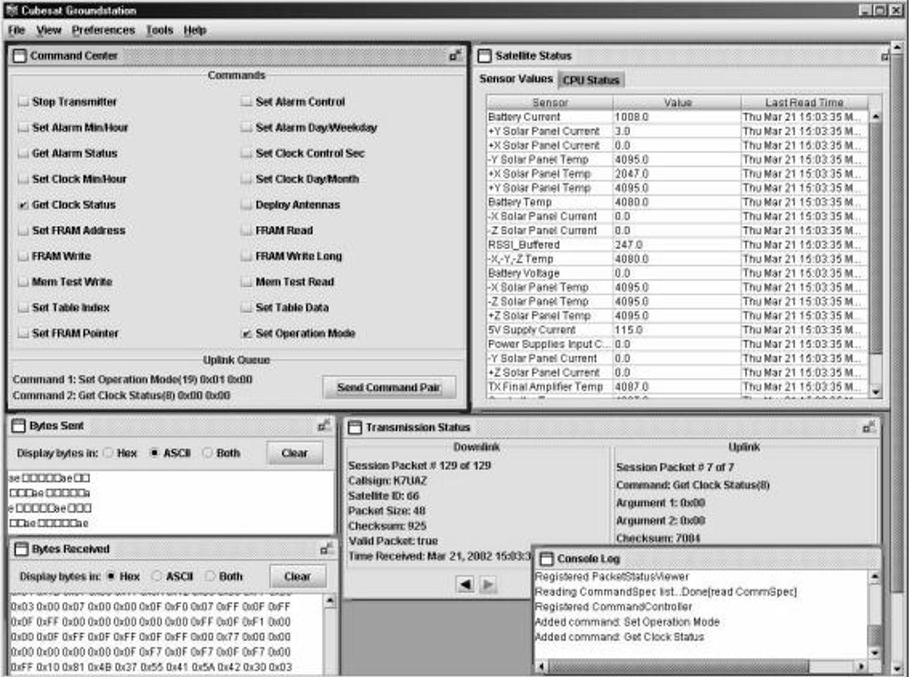

Figure 5: Screen view illustrating the GUI employed on the ground PC [50]

## OpenOrbiter

Open Prototype for Educational Nanosats (OPEN), or Open Orbiter is a tool designed to allow educational CubeSat missions develop their mission design specifications. It provides open-source CubeSat design, implementation and test documents for a typical 1-U CubeSat with a parts budget of $5000 [60]. University of North Dakota (UND) is involved in many CubeSat missions and their aim for OpenOrbiter is to develop an open framework tool which will help

<!-- PDF_PAGE: 47 -->

them design future missions at the university as well as other university mission teams [60]. This will help teams in the following categories:

1. Lower the cost of satellite manufacturing, considering a lot of design detail will be described.

2. Lower operational cost of the satellite.

3. Allow students to focus on scientific aspect of the project.

4. Allow developers to have an initial framework of software.

In addition to the above listed benefits, other benefits provided to a developer because of a pre defined structure are:

1. Space-validation

2. Refined and best practice test plans

3. A validated and complete design, implementation and testing document.

OpenOrbiter has developed a CubeSat design which accommodates the mission payload in the centre and other essential bus components around it. In addition, they discuss different volume budgets, mass, and power budget requirements for a CubeSat. These budgets help system engineers on a project set the framework for engineering budgets of their CubeSat [60]. Figure 6, displays OPEN's CAD design, which implements mission buses as well as its payloads.

<!-- PDF_PAGE: 48 -->

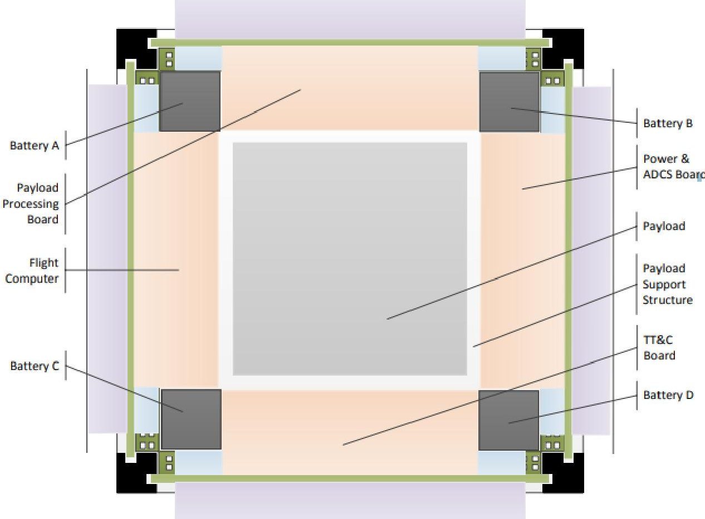

Figure 6: OpenOrbiter configuration [60]

Focusing more towards the software component, OpenOrbiter details the communication link between the ground, OBC and payload. It details how commands from the ground should be carried to the payload and how data shall be communicated back [60]. Figure 7 displays how commands from the ground are sent to OBC and directed to payloads. The payload then performs the specified task and relays the information back to ground using the same route.

<!-- PDF_PAGE: 49 -->

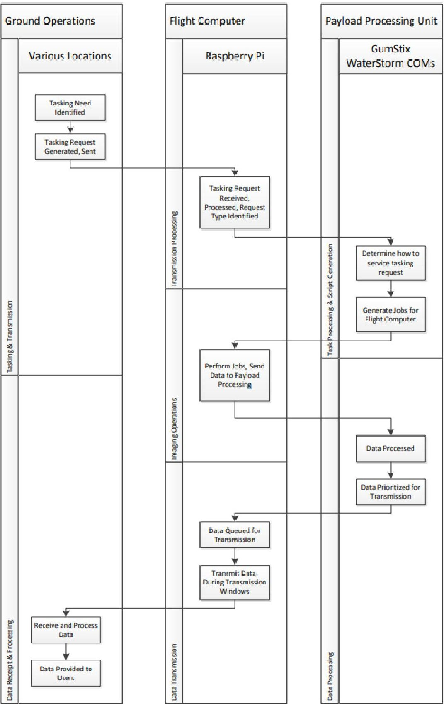

Figure 7: Software operations [60]

As a part of developing the framework defined in the figure 7 above, OpenOrbiter has produced a flow chart to display communication of an image to ground via a space transceiver [60]. A similar framework can be followed for all payload specific or mission specific tasks with minor alteration. Figure 8 shows image processing operations on a spacecraft.

<!-- PDF_PAGE: 50 -->

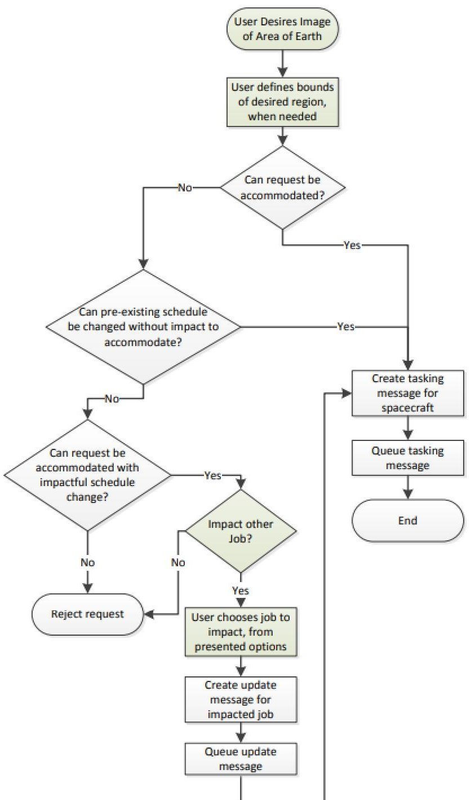

Figure 8: Ground station tasking flow chart [60]

Finally, OpenOrbiter has also developed a well defined ground communication flow, which takes into consideration the majority of communications scenarios [60]. Figure 9 displays how data between ground and space are communicated. Data are queued and transmitted to ground while commands from ground are also processed within a pass [60]. OpenOrbiter displays how to handle sub-communication tasks efficiently.

<!-- PDF_PAGE: 51 -->

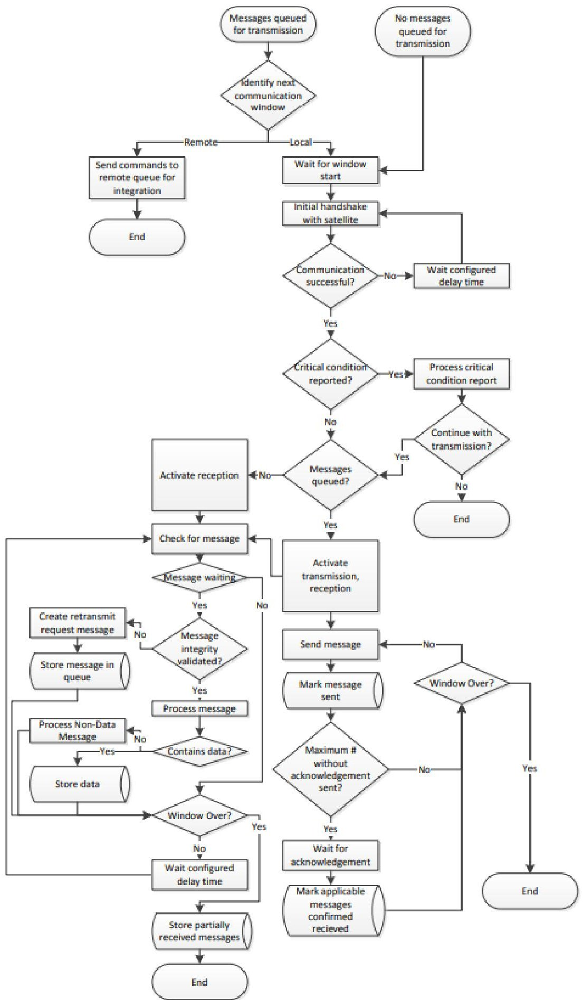

Figure 9: Ground station communications flow [60]

OpenOrbiter details out a payload communication structure, which essentially prompts the OpenOrbiter cube to take images and perform certain analysis on it [60]. Furthermore, it sends

<!-- PDF_PAGE: 52 -->

the image to the OBC for data transmission. The payload software begins with a call from the operating software. Although OpenOrbiter lists out important information and decreases the developmental time university students with no previous experience spend on CubeSats, it still does not outline operations of a CubeSat, focusing instead on a software architecture at a different level of abstraction from operations[60]. Having a framework similar to figure 9 but for operations activities for each mission mode would allow operations to be software-agnostic but defined commonly in the small space community.

## Comprehensive Open-architecture Space Mission Operations System

As with space segment standardization, a similar approach is required to make the ground aspect of CubeSat missions easier. Therefore, a tool which will support the operations of more than one specific mission is required.

University of Hawaii at Manoa's, Hawaii Space Flight Laboratory (HSFL) and the NASA Ames Research Center (ARC) collaboratively developed the Comprehensive Open-architecture Space Mission Operations System (COSMOS) [61]. COSMOS is well aligned for use by multi CubeSat satellite missions. The system supports the development and operations of one or more satellites and is targeted for university missions.

COSMOS performs all tasks involved with CubeSat development and implementations. It provides mission operational functions for spacecraft interface, ground control and payload. COSMOS is an open software tool which addresses all phases of a mission lifecycle; design,

<!-- PDF_PAGE: 53 -->

development, integrations and operations for missions with low budgets [61].

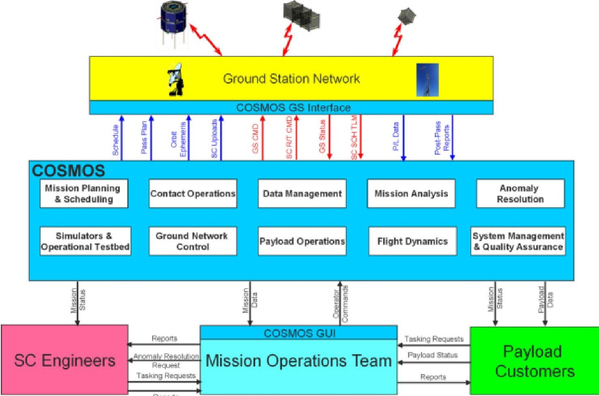

Figure 10: COSMOS functional architecture [61]

Figure 10 above displays the functionality of the COSMOS tool provides. The tool is a mission planning software which allows the user to interact with different systems and teams. COSMOS uses the Mission Operation System Tool (MOST) setup for a 3-U CubeSat [61]. This tool allows visualization of the position and attitude of the CubeSat relative to an object it is orbiting. It displays telemetry data, has a command line to take commands, and operational data.

<!-- PDF_PAGE: 54 -->

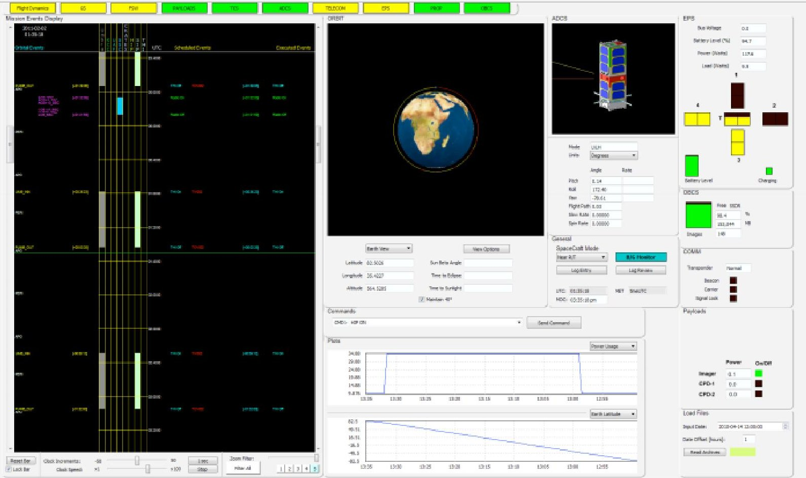

Figure 11: MOST overview display for 3U CubeSat [62]

The MOST tool has been used with multiple real-world mission examples and modifications have been made to provide better functionality based on user needs [62]. MOST acts as a COSMOS Executive Operator (CEO) for the COSMOS operating tool.

COSMOS also has an operation test bed (OTB). OTB has an open-source system architecture implementing hardware and software components to operate at the FlatSat level. This feature allows mission script testing, anomalies detection, personnel training and mission rehearsal [62]. All components of the test bed are low cost, using easily available instruments. The OTB also has a MOC block in the system. MOC is a system simulator which allows for testing of satellites in a near real-time spacecraft system. Figure 12 displays a functional diagram for COSMOS' OTB.

<!-- PDF_PAGE: 55 -->

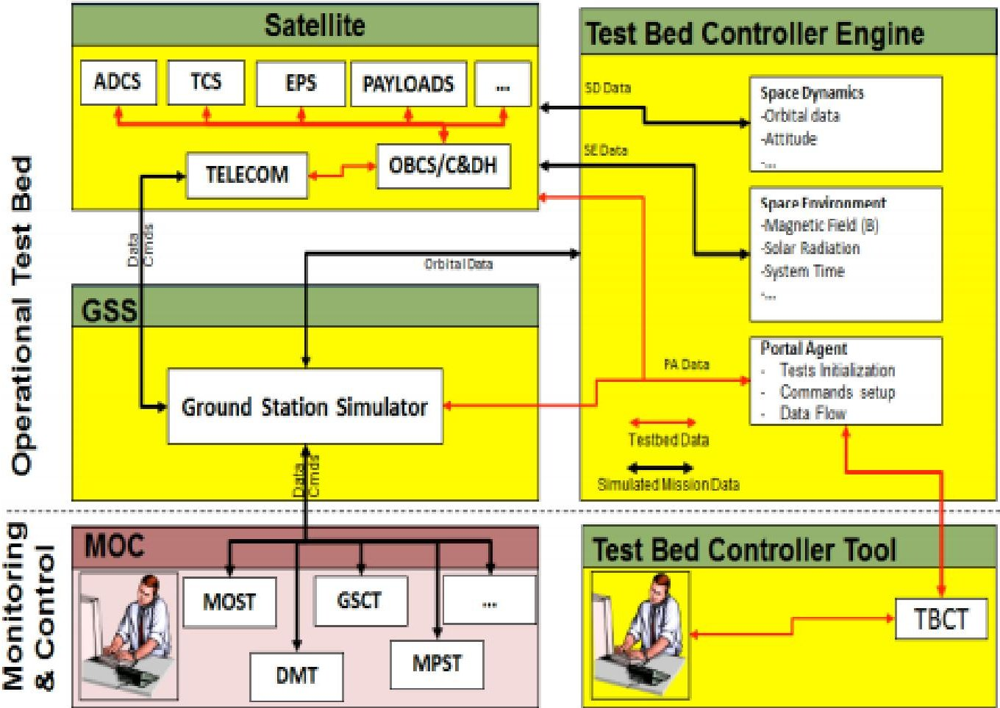

Figure 12: OTB architecture [62]

The final version of COSMOS displays multiple satellites' status simultaneously. Each satellite is operated independently, and each satellite is on an independent console. Figure 13 shows the COSMOS mock up which displays 20 satellites [62]. This tool is available commercially by the open COSMOS company in UK.

<!-- PDF_PAGE: 56 -->

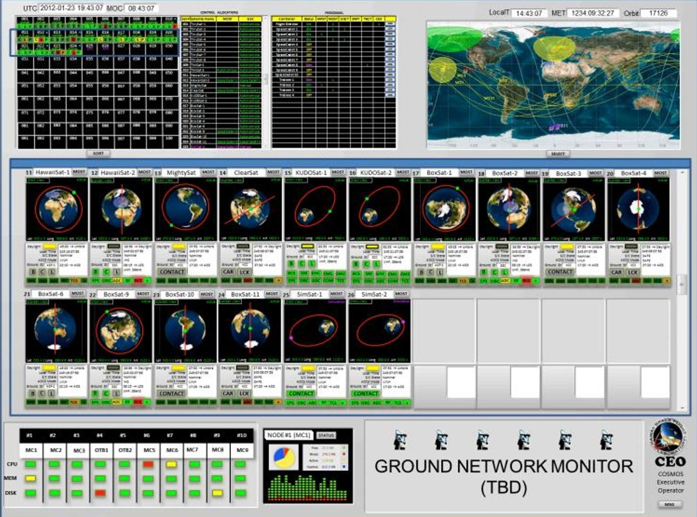

Figure 13: Mockup CEO display [61]

Another simulator replicating the functions of an on-board system and simulating environmental factors, is called Mission Control Software (MCS). MCS is used by a university CubeSat mission called Miniature Student Satellite (MIST) [63]. Its main features include sending telecommands and retrieving telemetry. However, MCS is an operating tool and does not describe the operations sequence of a CubeSat.

Most mission operational tools for CubeSats support large data transfers, transmit inhibits, ADCS commanding and observation, data storage management on board, housekeeping telemetry consisting of solar panel and batter voltage, current and temperatures, etc. Based on the definition of individual satellite needs and the components used, on-board developers nonetheless often resort to developing a bespoke operations tool. Considering the fact that there

<!-- PDF_PAGE: 57 -->

exist so many areas of overlap across all mission operations, the reason for such bespoke tools come down to complexity of the tools, or often mapping of the tool terminology and concepts to the specific mission's operation concepts. Having a common operation sequence can therefore support greater use of standard operating tools, or at least a standard structure to any operating tool. All CubeSats could be operated using the same interface and using the same tools across all satellites, which would result in much simplified cross-training for satellite operations.

Globally, there have been approximately 800 CubeSats built by university student team projects, of which a large number are subject to failure because of poor development or lack of operational knowledge and resources. 50% of all the university CubeSats built have not yet been launched [64]. Introducing an abstracted layer of CubeSat operations and a standard mapping to standard operations tools will introduce an operational "form factor" within the CubeSat industry and make operations for a CubeSat for university students as well as industry less complex and less time-consuming. An abstracted operational sequence will allow the satellite to be tested in unexpected situations the spacecraft may encounter while providing students and untrained personnel training to operate satellites. Operators using the tool extensively throughout various missions will also support iterations of the software and be more adaptive to multiple CubeSat needs.

<!-- PDF_PAGE: 58 -->

## Chapter 5. Abstracting CubeSat operations

The European Space Agency outlines a set of operations standards more applicable for missions over 10 kg. Although many can still be useful for small satellite applications, they do not cover some simplifications appropriate for CubeSats. An abstracted operations sequence can, for example, define a standard operations schedule that could work for many CubeSat missions. A detailed operations sequence will include a list of timely commands and allow users to test common anomalies in advance. Moreover, common sets of predefined parameters by common sets of operations mode will simplify development of telecommand and telemetry engineering budgets. The systems engineering teams will already know ADCS mode transition telemetry to monitor and commands to send, or related commands and telemetry for other modes of the mission. Working with a long list of possible parameters available for flight hardware and deciding on which parameters constitute mission critical telemetry can be time consuming ad error-prone. If a standard defines all the parameters required to be accessed for a pre-set ops sequence, it will save a lot of time. Furthermore, many CubeSat COTS component developers can baseline their software based on the parameters required in each operating mode. Off-the shelf component developers will be able use common terminology and labels for common functionality, making CubeSats simpler to design, develop and test. COTS components can be pre-programed to interface with other components and communicate reliable information to them. Mission operators, system engineers and developers would of course still be able to modify the operations as per their specific mission objectives and payload. However, a standard operations sequence baseline can work well with the majority of spacecraft buses and the majority of operations tasks.

This chapter has shown how many past CubeSat operations can be broken down into mission operating modes. Nominal mission mode further includes different modes which define actual operations of the CubeSat. For example, attitude determination mode, payload mode, first contact etc. On the other hand, operating modes define safe-hold mode, failure mode and nominal mode. An operations sequence will determine the instances when a spacecraft may switch between modes. This may be a pre determined activity within CubeSat operations or may be activated upon a ground command.

<!-- PDF_PAGE: 59 -->

## 5.1 Abstracting overview

To begin the development of the operations abstraction, other communication standards in the space industry were studied. Ground Systems and operations - Telemetry and Telecommand Packet Utilization (ECSS-E-70-41A) was used as a guideline to help define the structure for the sequence presented in this thesis [65]. ECSS PUS defines a list of services and sub-services which can be implemented on spacecraft as a part of a mission operations concept. ECSS PUS operates at the highest layer of the Open Systems Interconnections (OSI) stack, the application layer. The OSI stack model addresses all levels of communication protocol between space and ground for space missions [66]. Each satellite defines their RF and modulation systems within the physical layer of the stack.

As an aside, for all satellites including CubeSats to communicate from space they need to obtain clearance from their national and international telecommunication bodies. Satellite operators perform frequency coordination, so that they do not interfere with operations of other spacecraft. Depending on the services the satellite associates itself with, it may operate with unique frequencies identified for the mission. The unique configuration of most layers of the spacecraft's OSI stack, from frequencies, modulation scheme, Advance Publication of Information (API), call signs etc. are captured in the licensing activities for spacecraft. As stated above, services and subservices used by a spacecraft tie into the highest, application layer of the stack and can be independent of the mission configurations. These are typically not required to be detailed for licensing, but detail functionality supported by the mission. Operations sequences are at a layer above services and subservices. This thesis therefore effectively provides the next layer of abstraction above the PUS application layer. Because of this similarity to the application layer, however, a framework similar to PUS services/subservices was used for detailing the operations abstraction layer.

Before detailing the proposed operations abstractions, it is worth understanding the ECSS PUS architecture and how it has been used as a source of inspiration for this thesis. ECSS PUS defines a list of services which can be implemented on spacecraft for ground-to-space communications. Each service identifies the scope, service concept, service requests and reports, and finally its capability sets [65]. Table 3 below lists all the services offered by ECSS PUS.

<!-- PDF_PAGE: 60 -->

Table 3: Standard services specified by ECSS PUS [65]

<table border="1"><tr><td>Service Type</td><td>Service Name</td><td>Service Scope</td></tr><tr><td>1</td><td>Telecommand verification service</td><td>Provides the capability for explicit verification of each stage of execution of a telecommand packet, from on-board acceptance through to completion of execution.</td></tr><tr><td>2</td><td>Device command distribution service</td><td>Provides the capability for the distribution of on-off and register load commands; command pulse distribution unit commands for the re-configuration of vital spacecraft functions.</td></tr><tr><td>3</td><td>Housekeeping &amp; diagnostic data reporting service</td><td>Provides the capability of housekeeping data reporting and diagnostic data reporting. In includes parameter statistics reporting and event reporting.</td></tr><tr><td>4</td><td>Parameter statistics reporting service</td><td>Provides the capability of reporting max, min, mean and standard deviation values of on-board parameters during a time interval.</td></tr><tr><td>5</td><td>Event reporting service</td><td>This service reports operational information like failure or anomalies detected on-board; autonomous on-board actions and normal operational activities progress.</td></tr><tr><td>6</td><td>Memory management service</td><td>Manages various memory areas which exist on-board the satellite. Provides the capability for loading, dumping and checking the content of contiguous memory area.</td></tr><tr><td>7</td><td>Not used</td><td></td></tr><tr><td>8</td><td>Function management service</td><td>Supports software functions not implemented as mission-specific service; whose execution may be controlled from ground.</td></tr><tr><td>9</td><td>Time management service</td><td>Provides the capability of rate control and time reporting. It is used when a mission has varying requirements for time correlation accuracy.</td></tr><tr><td>10</td><td>Not used</td><td></td></tr><tr><td>11</td><td>On-board operations scheduling service</td><td>Provides the capability to command on-board application processes using telecommands pre-loaded on-board the satellite and released at their due-time.</td></tr><tr><td>12</td><td>On-board monitoring service</td><td>Provides the capability to monitor on-board parameters with respect to checks defined by ground system and reports any check transitions to the service user.</td></tr><tr><td>13</td><td>Large data transfer service</td><td>Used by ground or other services to transfer large service data units in a controlled manner. Ex. A very large area of on-board memory.</td></tr><tr><td>14</td><td>Packet forwarding control service</td><td>Provides the capability to control the forwarding to the ground of telemetry source packets issued by on-board services.</td></tr><tr><td>15</td><td>On-board storage and retrieval service</td><td>Enables the ground system to have the capability to request the retrieval and downlink of the selectively stored data.</td></tr><tr><td>16</td><td>Not used</td><td></td></tr><tr><td>17</td><td>Test service</td><td>Provides the capability to activate test functions implemented on-board and to report the results of such tests.</td></tr><tr><td>18</td><td>On-board operations procedure service</td><td>The ground can define a set of operations procedures that can be loaded on an application process, it then manages the storage and execution of these processes.</td></tr></table>

<!-- PDF_PAGE: 61 -->

<table border="1"><tr><td>19</td><td>Event-action service</td><td>Provides the capability to define an action that is executed autonomously on-board when a given event is detected.</td></tr></table>

The telecommand verification service is the first service in the table above. For this service, the ECSS PUS standard defines the scope and concept of the service. A set of service requests and reports which the service is capable of is then provided, as presented in figure 14. This includes all service functionality and expected sets of telemetry. Figure 14 displays the definition of service 1 from E-70-41A. Finally, minimum and additional capability sets for each service are presented. Table 4 displays a summary of services for service one and its response sets. The shaded area in the table indicated minimum capability for the mode.

<!-- PDF_PAGE: 62 -->

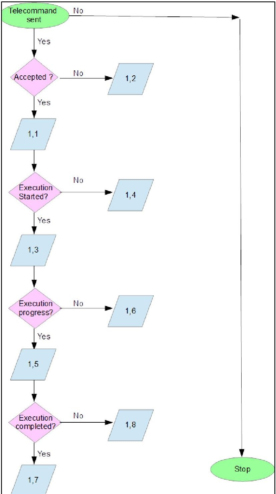

Figure 14: E-70-41A Service 1 - Logic Diagram [65]

<!-- PDF_PAGE: 63 -->

Table 4: Service definition - Service 1 ECSS PUS $ [65]^{1} $

<table border="1"><tr><td>Service Request</td><td>ST</td><td>Service reports</td></tr><tr><td colspan="3">Telecommand verification service 1</td></tr><tr><td></td><td>1</td><td>Telecommand Acceptance Report Success</td></tr><tr><td></td><td>2</td><td>Telecommand Acceptance Report Failure</td></tr><tr><td></td><td>3</td><td>Telecommand Execution Started Report - Success</td></tr><tr><td></td><td>4</td><td>Telecommand Execution Started Report - Failure</td></tr><tr><td></td><td>5</td><td>Telecommand Execution Progress Report - Success</td></tr><tr><td></td><td>6</td><td>Telecommand Execution Progress Report - Failure</td></tr><tr><td></td><td>7</td><td>Telecommand Execution Completed Report - Success</td></tr><tr><td></td><td>8</td><td>Telecommand Execution Completed Report - Failure</td></tr></table>

The operations equivalent of services and subservices is mission modes. Defining the mission modes needed for a given mission operations concept is the responsibility of the satellite developers and operators. Similar to E-70 section 5, table 5 presents the different mission modes for operations [65]. The sequence of the modes may vary between missions; however, the objectives within the modes remain the same. Figure 15 shows the mission life-cycle used to present the operations abstraction.

<!-- PDF_PAGE: 64 -->

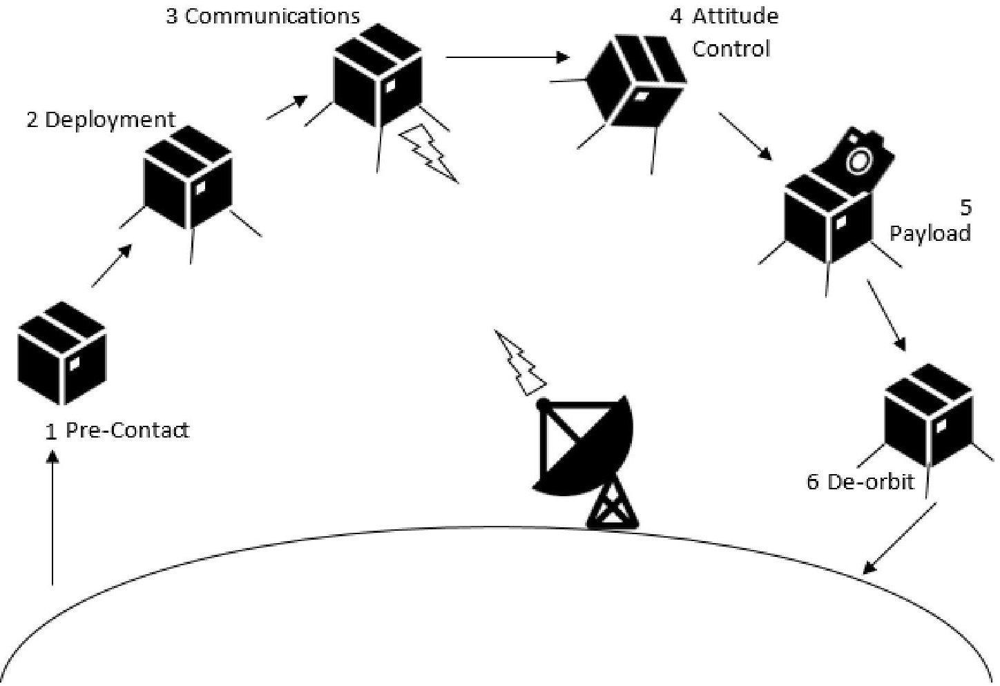

Figure 15: Sample mission life cycle for the abstracted operations

Table 5: Major mission modes that may be relevant for any mission

<table border="1"><tr><td>Mode number(arbitrary)</td><td>Mission Mode Name</td></tr><tr><td>1</td><td>Time in space before first contact</td></tr><tr><td>2</td><td>Deployment</td></tr><tr><td>3</td><td>Communications</td></tr><tr><td>4</td><td>Attitude determination and de-tumble</td></tr><tr><td>5</td><td>Payload</td></tr><tr><td>6</td><td>De-orbit</td></tr></table>

Mission modes identified in table 5 have been used as the baseline modes identified in this chapter. Details provided in this chapter for each operating activity are broken down in a similar manner to how ECSS PUS service/subservice functionality is broken down as presented in table 3. Building upon the format presented in table 3, table 6 displays the format for each section of the operations abstractions in this chapter. Each mission mode starts with a definition of the scope followed by the mission mode concept. The section then highlights the suggested sequence

<!-- PDF_PAGE: 65 -->

for that mode using the framework from ECSS E-70 as a guiding template. Finally, each mode then states its minimum and additional capabilities and failure operations. Furthermore, each mode also states why the abstraction sequence presented is an optimal solution for mission operations, based on lessons learned from past missions.

Table 6: Mission operations abstraction mode presentation

<table border="1"><tr><td colspan="2">Mission mode presentation</td></tr><tr><td>Mode Category</td><td>Content</td></tr><tr><td>Scope</td><td>Mode description and functionality</td></tr><tr><td>Mission Mode Concept</td><td>Mode concept stating stages of operations within the mode</td></tr><tr><td>Suggested mission sequence</td><td>A diagram suggesting different operations approaches</td></tr><tr><td>Capability</td><td>Minimum and additional set of capability required in for execution of the mode</td></tr><tr><td>Failure operations</td><td>List of failure operations for the mode and anomalies that can be addressed using stated practices</td></tr><tr><td>Mode rationale</td><td>Explanation on the useful correlation on the mode</td></tr></table>

## 5.1.1 Time in Space before First Contact

## 5.1.1.1 Scope

The time in space before first contact mode considers the operations and the functionality of the spacecraft before a communications link has been established with the ground. It defines CubeSat operations from the time the satellite exits the dispenser and begins orbiting its target object.

This mode serves as the base mode for any mission type and therefore has mission mode type 1.

## 5.1.1.2 Mission mode concept

The following stages of operations occur during this mode

- The spacecraft would deploy from spacecraft deployer and be launched into orbit (usually Low Earth Orbit)

- The spacecraft will enter safe-hold operating mode

<!-- PDF_PAGE: 66 -->

- After successful completion of the mode, the satellite will move into deployment mode if required.

## 5.1.1.3 Mission Mode Sequence

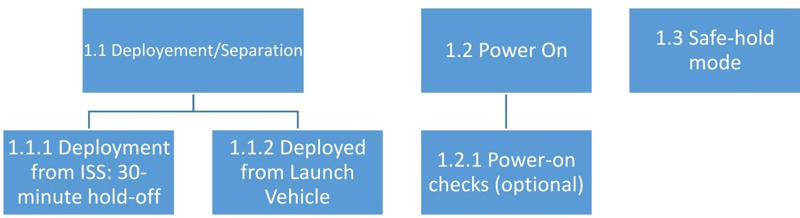

Figure 16: Mission mode sequence for time in space before first contact

## 5.1.1.4 Mode Execution

## CubeSat on Launch Vehicle

The CubeSat is placed (usually as a secondary payload) on a launch vehicle and is ready for launch. It is generally powered off, held off by deployment switches.

## 1.1 Deployment from ISS

CubeSats launched from the International Space Station must restrict any operation during the first 30 to 45 minutes $ ^{2} $ after deployment, to avoid interference with international Space station operations.

<!-- PDF_PAGE: 67 -->

## 1.1.1 30-minute delay

30-minute timer activated after deployment. Flag raised on completion, power-up of equipment can start.

Table 7: Minimum capabilities for 30-minute timer elapse

<table border="1"><tr><td colspan="2">Minimum capabilities</td></tr><tr><td>Activity</td><td>Description</td></tr><tr><td>Raise Flag</td><td>30-minute timer elapsed</td></tr></table>

## 1.1.2 Deployed from Launch Vehicle

The spacecraft does not need additional capabilities if it is deployed directly from a launch vehicle. It may start operation after separation from the POD.

## 1.2 Power On

After the flag is raised for the 30-minute timer (1.1.1), the satellite can be powered on. CubeSats which do not deploy from the space station do not typically interfere with operations of other spacecraft and can start operations immediately after deployment.

## 1.2.1 Power health checks

Satellite operators may choose to perform autonomous checks to ensure major bus equipment has been powered on after separation from dispenser.

Table 8: Minimum and additional capabilities for power on upon separation

<table border="1"><tr><td colspan="2">Minimum capabilities</td></tr><tr><td>Activity</td><td>Description</td></tr><tr><td>Battery</td><td>Check Voltage and current for 3.3V,5V and unregulated lines Temperature</td></tr><tr><td>Bus(OBC)</td><td>Current Temperature Switch states</td></tr></table>

<!-- PDF_PAGE: 68 -->

Additional capabilities

<table border="1"><tr><td>Activity</td><td>Description</td></tr><tr><td>Transceiver</td><td>Temperatures and power levels</td></tr><tr><td>Spacecraft boot count</td><td>Eps and OBC boot counters</td></tr><tr><td>Memory status</td><td>On board storage of data</td></tr><tr><td>Resets</td><td>Number of OBC resets</td></tr><tr><td>Time</td><td>Boot time and spacecraft time</td></tr></table>

## 1.3 Safe-hold operating mode

Spacecraft boot into safe mode upon deployment from the deployer.

Table 9: Minimum and additional capabilities for safe-hold upon separation

<table border="1"><tr><td colspan="2">Minimum capabilities</td></tr><tr><td>Activity</td><td>Description</td></tr><tr><td>Image</td><td>Spacecraft boots into safe-hold image</td></tr></table>

5. 1.1.5 Minimum Capabilities

The following table lists the minimum capabilities of this mode:

Table 10: Mode - time in space before first contact minimum capabilities

<table border="1"><tr><td colspan="2">Ops Activity</td></tr><tr><td>Activity</td><td>Description</td></tr><tr><td>1.1.1 or 1.1.2</td><td>Spacecraft deploys from dispenser on launch vehicle or ISS</td></tr><tr><td>1.2</td><td>Critical components power on and perform minimum health checks</td></tr><tr><td>1.3</td><td>Boots into safe-hold image</td></tr></table>

## 5.1.1.6 Additional capability

The following table lists the additional capabilities of this mode:

Table 11: Mode - time in space before first contact additional capabilities

<table border="1"><tr><td colspan="2">Ops Activity(Additional)</td></tr><tr><td>Activity</td><td>Description</td></tr><tr><td>1.2.1</td><td>Perform additional health checks upon boot</td></tr></table>

<!-- PDF_PAGE: 69 -->

## 5.1.1.7 Failure Operations

None for mode 1.

## 5.1.1.8 Reason for abstraction approach

Time before first contact is the time the satellite spends in an orbit around its target object before it establishes valid communication to a ground station. Since CubeSats are most commonly secondary payloads, they do not have much control over injection orbit and launch state or orientation. The time they are placed in orbit is defined by launch providers and the spacecraft are often required to be powered off for weeks or months before launch, until injection. If the CubeSat is launched from the International Space Station, it has to hold off any operations that may interfere with ISS for the first 30 to 45 minutes in orbit. Therefore, the abstraction for operations for time before launch is distributed in two options: One when the satellite is launched from ISS and one when it is not.

## 5.1.2 Deployment

## 5.1.2.1 Scope

Once the CubeSat is deployed and its system has assured that the timer has expired, the spacecraft switches into deployment mode. During the deployment mode, the spacecraft deploys all deployable (antennas and/or solar panels, for example, but potentially also magnetometers or other bus equipment) to ensure healthy communication with ground.

Deployment of on-board devices is essential to begin communications with ground therefore; this is mission mode type: 2

## 5.1.2.2 Mission mode concept

The following stages of operations occur during this mode

- If the spacecraft has deployable solar panels, they are deployed first to allow charging of batteries.

<!-- PDF_PAGE: 70 -->

- If the spacecraft has deployable antennas, they are deployed next to allow healthy communication with ground.

- If the spacecraft has deployable magnetometers, they are deployed next to measure magnetic forces.

- After successfully deploying all component and keeping spacecraft power positive the satellite switches to communication mission mode.

## 5.1.2.3 Mission Mode Sequence

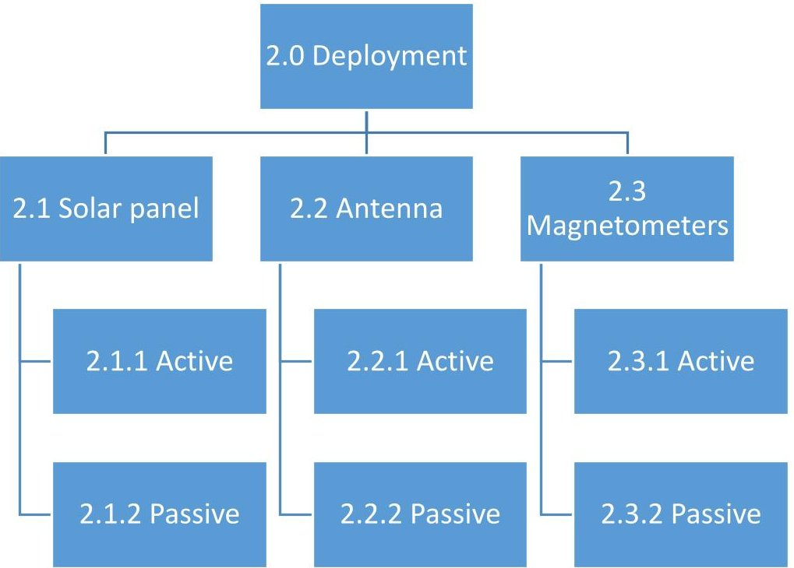

Figure 17: Mission mode deployment diagram

## 5.1.2.4 Mode Execution

## 2.0 Deployment

CubeSat enters deployment mission mode, to begin deployment of on-board components. \

<!-- PDF_PAGE: 71 -->

## 2.1 Solar panel

## 2.1.1 Passive

Triggered by an external event or a sequence of another event on the spacecraft. On the other hand, CubeSat's may have solar panels implemented into their side walls and not require deployment at all.

Table 12: Minimum and additional capabilities for passive solar panel deployment

<table border="1"><tr><td colspan="2">Minimum capabilities</td></tr><tr><td>Activity</td><td>Description</td></tr><tr><td>Solar panel</td><td>Check solar panel current</td></tr><tr><td>Locking</td><td>Check if solar panels were able to lock in position after deployment</td></tr></table>

<table border="1"><tr><td colspan="2">Additional capabilities</td></tr><tr><td>Activity</td><td>Description</td></tr><tr><td>Spacecraft</td><td>Change in angular rate</td></tr></table>

## 2.1.2 Active

Depending on the spacecraft design the spacecraft may have multiple deployable solar panels. If the spacecraft has more than one solar panel to be deployed, it is beneficial to deploy one solar panel after check out from the deployer. This allows the vehicle to maintain a power positive balance during the initial phase. All solar panels can then be deployed before switching into any operational mode of the mission.

Angular rate check: System test results can provide a dataset of expected values when one, or all solar panel have been deployed. Comparing the angular rates post deployment will allow the CubeSat to judge the success of the deployment

<!-- PDF_PAGE: 72 -->

Table 13: Minimum and additional capabilities for active solar panel deployment

<table border="1"><tr><td colspan="2">Minimum capabilities</td></tr><tr><td>Activity</td><td>Description</td></tr><tr><td>Flag</td><td>Raise flag upon successful completion of the task</td></tr><tr><td>Burning Wire</td><td>Check if enough current was supplied to the burning wire and the wires were burnt</td></tr><tr><td>Solar panel</td><td>Check solar panel current</td></tr><tr><td>Locking</td><td>Check if solar panels were able to lock in position after deployment</td></tr></table>

<table border="1"><tr><td colspan="2">Additional capabilities</td></tr><tr><td>Activity</td><td>Description</td></tr><tr><td>Spacecraft</td><td>Change in angular rate</td></tr><tr><td>Health</td><td>Check before deployment of each solar panel(Refer to Table 8)</td></tr><tr><td>Software</td><td>Arm and activate commands to ensure that the panel do not accidentally deploy during launch because of software bit flips</td></tr></table>

## 2.2 Antenna

## 2.2.1 Passive

Triggered by an external event or a sequence of another event on the spacecraft. Missions may use patch antennas which do no require deployment.

## 2.2.2 Active

Deploy the antenna prior to communication link. Missions may choose to deploy their antennas until a communication link has been established. However, this may result is intense power draw from the battery. The optimal way to approach this problem will be to deploy the antenna and monitor the change in angular rates upon deployment.

Angular rate check: System test results from ground can provide a dataset of expected values when one, or all antennas has been deployed. Comparing the angular rates post deployment will allow the CubeSat to judge the success of the deployment.

<!-- PDF_PAGE: 73 -->

Table 14: Minimum and additional capabilities for active antenna deployment

<table border="1"><tr><td colspan="2">Minimum capabilities</td></tr><tr><td>Activity</td><td>Description</td></tr><tr><td>Flag</td><td>Raise flag upon successful completion of the task</td></tr><tr><td>Burning Wire</td><td>Check if enough current was supplied to the burning wire and the wires were burnt</td></tr><tr><td>Locking</td><td>Check if antennas were able to lock in position after deployment</td></tr></table>

<table border="1"><tr><td colspan="2">Additional capabilities</td></tr><tr><td>Activity</td><td>Description</td></tr><tr><td>Spacecraft</td><td>Change in angular rate</td></tr><tr><td>Health</td><td>Check before deployment of antennas(Refer to Table 8)</td></tr><tr><td>Software</td><td>Arm and activate commands to ensure that the antenna do not accidentally deploy during launch because of software bit flips.</td></tr><tr><td>Antenna</td><td>Receive signal strength</td></tr></table>

## 2.3 Magnetometers

## 2.3.1 Passive

Triggered by an external event or a sequence of another event on the spacecraft.

## 2.3.2 Active

Deploy magnetometers manually or autonomously.

Table 15: Minimum and additional capabilities for active magnetometer deployment

<table border="1"><tr><td colspan="2">Minimum capabilities</td></tr><tr><td>Activity</td><td>Description</td></tr><tr><td>Flag</td><td>Raise flag upon successful completion of the task</td></tr><tr><td>Burning Wire</td><td>Check if enough current was supplied to the burning wire and the wires were burnt</td></tr><tr><td>Magnetometers</td><td>Magnetic field measurement</td></tr></table>

<!-- PDF_PAGE: 74 -->

Additional capabilities

<table border="1"><tr><td>Activity</td><td>Description</td></tr><tr><td>Spacecraft</td><td>Change in angular rate</td></tr><tr><td>Health</td><td>Check before deployment of magnetometers(Refer to Table 8)</td></tr><tr><td>Software</td><td>Arm and activate commands to ensure that the magnetometers do not accidentally deploy during launch because of software bit flips.</td></tr></table>

## 5.1.2.5 Minimum capability

Spacecraft may not have all or one of these deployable on board. Therefore, the minimum capability for mode 2 is none.

## 5.1.2.6 Additional capability

Deployments can occur in any order however; magnetometers are often deployed last. The deployment can also occur before or after first contact with ground.

Table 16: Mode - Deployment additional capabilities

<table border="1"><tr><td colspan="2">Ops Activity</td></tr><tr><td>Activity</td><td>Description</td></tr><tr><td>2.1(2.1.1 or 2.1.2)</td><td>Satellite may have active or passive solar panel deployment</td></tr><tr><td>2.2(2.2.1 or 2.2.2)</td><td>Satellite may have active or passive antenna deployment</td></tr><tr><td>2.3(2.3.1 or 2.3.2)</td><td>Satellite may have active or passive magnetometer deployment</td></tr></table>

## 5.1.2.7 Failure operations

Re-attempt deployment: After successfully completing first contact and when satellite is power positive. Ground commands shall attempt to deploy the components again. This provides a second attempt at deployment in case of any unexpected failures.

<!-- PDF_PAGE: 75 -->

Table 17: Mode-Deployment failure operations

<table border="1"><tr><td>Problem Area</td><td>All deployable</td><td>All deployable</td><td>All deployable</td></tr><tr><td>Detection</td><td>Flag not raised</td><td>No change in body rates</td><td>Burn wires not burnt</td></tr><tr><td>Isolation</td><td>Check power, burn wire current and timer status</td><td>Check power, burn wire current and timer status</td><td>Check power, burn wire current and timer status</td></tr><tr><td>Recovery</td><td>Re-command the deployment when the satellite is power positive and raise flag</td><td>Re-command the deployment when the satellite is power positive and raise flag</td><td>Re-command the current on burn wires when the satellite is power positive and raise flag</td></tr></table>

## 5.1.2.8 Reason for abstraction approach

Satellites may have an antenna, solar panels and magnetometers which require deployment once the spacecraft boots up. Studying different mission operations in chapter four, SwampSat approach to antenna deployment included monitoring the satellites angular rates and acceleration to ensure antenna deployment. Continuous attempts to deployment may not be healthy for the spacecraft battery. Therefore, change in angular rates can indicate success of deployment. Once satellite has communication with ground, another attempt for deployment can be performed to ensure all antennas deploy. The CPOD mission deployed one solar panel upon checkout and monitored spacecraft power. Deploying all solar panels together can be a power heavy task and result in failure of the battery. Therefore, to deploy panels one at a time and keeping a check on battery power is good practice. Learning from operations for other CubeSat an abstracted operation sequence can be implemented.

## 5.1.3 Communication

## 5.1.3.1 Scope

Communication or first contact mode occurs after deployment of on-board components. At this stage, all mission busses have been powered and the spacecraft tries to establish a link with ground. First set of telemetry is sent to ground and first commands are processed on board.

<!-- PDF_PAGE: 76 -->

Establishing a healthy ground link is essential for mission success and therefore, this is mission mode type: 3

## 5.1.3.2 Mission mode concept

The following stages of operations occur during this mode

- The beacon and transmitter try to receive ground signal in safe-hold mode

- Spacecraft send a "I am alive" signal back to ground

- Ground request for delayed and housekeeping telemetry

- Ground sends command for switching mission mode to attitude control and detumble

## 5.1.3.3 Mission Mode Sequence

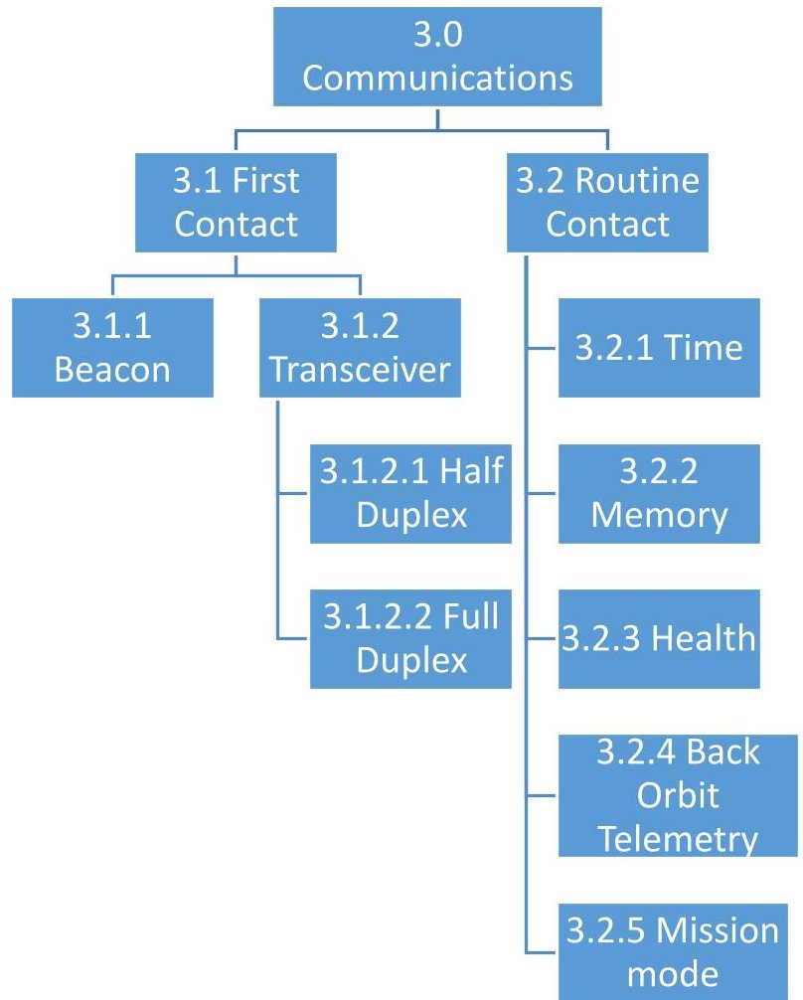

Figure 18: Mission mode communications sequence diagram

<!-- PDF_PAGE: 77 -->

## 5.1.3.4 Mode Execution

## 3.0 Communications

CubeSat tries to establish a communication link with the ground. Depending on the components, a satellite may have a beacon and a transmitter on board. First set of communication occurs during safe-hold mode.

## 3.1 First contact

The satellite will boot into communications mode and establish first link with ground

## 3.1.1 Beacon

In the case, where there is a beacon on board, the beacon tries to send commands to Earth. The beacon operates independently of all electronics except for power and sensor. The beacon does not check uplink and can only be used for downlink

Table 18: Beacon capabilities for communications

<table border="1"><tr><td colspan="2">Additional capabilities</td></tr><tr><td>Activity</td><td>Description</td></tr><tr><td>Spacecraft Telemetry</td><td>Beacon send spacecraft telemetry packets to ground</td></tr></table>

## 3.1.2 Transmitter

## 3.1.2.1 Half duplex

Satellites with half-duplex operations have timed communications where they transmit for a few seconds during a pass and receive for the rest. The operator defines the time it wants the satellite to transmit and receive based on the amount of data required to be transmitted and received. Please refer to section 3.2.2.2 for details on the functions during a pass with a half duplex transmitter.

<!-- PDF_PAGE: 78 -->

## 3.2.2.2 Full duplex

The satellite can transmit and receive at the same time. The ground station will send commands to the satellite and the satellite replies to ground on a pre-set reply. The satellite then performs the following functions:

- Prior to commencing communication with the ground, satellite health parameters are checked to ensure the satellite will be able to perform ground communications. If the satellite power level is low, then the satellite would perform load shed. During a load shed, the satellite only keeps all essential components on and recharges the batteries.

- Satellite establishes a link with ground.

- The flight software will have defined a set of critical telemetry to be downlinked upon first contact. Satellite will transmit critical telemetry.

- Ground may also request for stored telemetry and event buffers. (In order to optimize data budget, monitoring the values and raising flags when an error occurs saves the amount of downlinked telemetry. These flags can be transmitted to ground upon first contact and if a system failure has occurred, delayed telemetry saved on storage can be requested down.)

- The ground will attempt to fix errors and inquire other parameters

Table 19: Minimum and additional capabilities for communications using a transceiver

<table border="1"><tr><td colspan="2">Minimum capabilities</td></tr><tr><td>Activity</td><td>Description</td></tr><tr><td>Health Check</td><td>Prior to communication to ground the satellite will perform health checks (refer to Table 8)</td></tr><tr><td>Telemetry</td><td>Satellite transmit mission critical telemetry and delayed to ground, along with event buffers (refer to Table 26 and Table 28).</td></tr><tr><td>Telecommand</td><td>Ground will send commands to the spacecraft</td></tr><tr><td>Queue</td><td>Satellite will queue commands it cannot transmit in a particular pass</td></tr></table>

<!-- PDF_PAGE: 79 -->

Additional capabilities

<table border="1"><tr><td>Activity</td><td>Description</td></tr><tr><td>Load shed</td><td>Satellite will monitor spacecraft health and turn off non-mission essential components to save power.Satellite will allow charging of battery before commencing further operations.</td></tr><tr><td>Flags</td><td>Satellite will transmit all flags raised during real-time and delayed operations</td></tr></table>

## 3.2 Routine contact

Routine operations include communications that satellite will perform with ground other than first contact. This may include operations in between passes and other data management processes.

## 3.2.1 Time

Ground will check on-board time and attempt to sync it with spacecraft time.

Table 20: Capabilities for time routine operations

<table border="1"><tr><td colspan="2">Additional capabilities</td></tr><tr><td>Activity</td><td>Description</td></tr><tr><td>Time</td><td>Ground will attempt to sync spacecraft time with ground clock.
Ground will also try to execute timed operations on the spacecraft. (Time-tag commands)</td></tr></table>

## 3.2.2 Memory

Ground will manage memory on board and erase data not required periodically

Table 21: Capabilities for memory routine operations

<table border="1"><tr><td colspan="2">Additional capabilities</td></tr><tr><td>Activity</td><td>Description</td></tr><tr><td>Memory</td><td>Ground will perform memory management and storage on-board</td></tr></table>

## 3.2.3 Health

Ground will perform periodic health checks to ensure the health of the spacecraft.

<!-- PDF_PAGE: 80 -->

Table 22: Capabilities for health routine operations

<table border="1"><tr><td colspan="2">Additional capabilities</td></tr><tr><td>Activity</td><td>Description</td></tr><tr><td>Health</td><td>Ground will perform health check on the spacecraft based on the parameters listed in Table 26 and Table 28 The satellite may also chose to perform load shed to decrease power consumption</td></tr></table>

## 3.2.4 Back orbit telemetry

The spacecraft will store data it cannot transmit in a ground pass. The communications mode will also attempt to downlink the stored telemetry.

Table 23: Capabilities for stored telemetry routine operations

<table border="1"><tr><td colspan="2">Minimum capabilities</td></tr><tr><td>Activity</td><td>Description</td></tr><tr><td>Back orbit telemetry</td><td>If the communication link is lost during transmission,the data will be queued to be transmitted in another pass.</td></tr></table>

## 3.2.5 Mission mode

Ground will command the spacecraft to switch between different mission modes

Table 24: Capabilities for mission mode change routine operations

<table border="1"><tr><td colspan="2">Minimum capabilities</td></tr><tr><td>Activity</td><td>Description</td></tr><tr><td>Mission modes</td><td>After successfully transmitting all essential data for a specific mode, the ground will command the spacecraft to switch between different operating modes.
Check mission mode (current boot image)</td></tr></table>

<!-- PDF_PAGE: 81 -->

## 5.1.3.5 Minimum capabilities

The following table list the minimum capabilities of this mode:

Table 25: Minimum capabilities for mission mode communications

<table border="1"><tr><td colspan="2">Ops Activity</td></tr><tr><td>Activity</td><td>Description</td></tr><tr><td>3.1.2(3.1.2.1or3.1.2.2)</td><td>Satellite may have half duplex or full duplex communications with ground</td></tr><tr><td>3.2.4</td><td>Satellite will have stored telemetry on-board it may choose to transmit to ground</td></tr><tr><td>3.2.5</td><td>Satellite will perform mode changes and boot into new images</td></tr></table>

Table 26: Minimum capability of health parameters downlinked during communications

Minimum capabilities - Telemetry

<table border="1"><tr><td>Activity</td><td>Description</td></tr><tr><td>Battery</td><td>Check Voltage and current for 3.3V,5V and unregulated lines
Temperature</td></tr><tr><td>Bus(OBC)</td><td>Current
Temperature
Switch states</td></tr><tr><td>Transceiver</td><td>Temperature
Power levels</td></tr><tr><td>Other</td><td>Mission critical data</td></tr></table>

<!-- PDF_PAGE: 82 -->

Table 27: Additional capabilities for mission mode communications

<table border="1"><tr><td colspan="2">Ops Activity</td></tr><tr><td>Activity</td><td>Description</td></tr><tr><td>3.1.1</td><td>Satellite may have a beacon as a form of secondary communications</td></tr><tr><td>3.2.1</td><td>Satellite may choose to sync ground and space time</td></tr><tr><td>3.2.2</td><td>Satellite may perform memory management on-board</td></tr><tr><td>3.2.3</td><td>Satellite may perform load shed based on health data</td></tr></table>

Table 28: Additional capability of health parameters downlinked during communications

<table border="1"><tr><td colspan="2">Additional capabilities</td></tr><tr><td>Activity</td><td>Description</td></tr><tr><td>Spacecraft boot count</td><td>Eps and OBC boot counters</td></tr><tr><td>Memory</td><td>On board storage of data</td></tr><tr><td>Resets</td><td>Number of OBC resets</td></tr><tr><td>Time</td><td>Boot time and spacecraft time</td></tr><tr><td>Angular rates</td><td>Spacecraft angular rates</td></tr><tr><td>Solar panel</td><td>Solar panel sensor reading and telemetry</td></tr><tr><td>Buffer</td><td>Buffer state if full</td></tr><tr><td>Run time</td><td>OBC runtime</td></tr></table>

## 5.1.3.7 Failure mode

None for communications.

## 5.1.3.8 Reason for abstraction approach

As described in chapter 4, most CubeSat boot into safe-hold mode. Safe-hold mode comprises of only essential busses being powered. Once the satellite assures battery health, the satellite can power other subsystems on. This thesis studied that university of Arizona's CubeSat mission supported half duplex communication and they opted for transmit and receive with a small implemented delay. The SwampSat mission and the Arizona CubeSat also had on board a

<!-- PDF_PAGE: 83 -->

beacon. Beacon operates independent of the satellite communication system and supports minimum power consumption. It is efficient to communicate with the beacon initially to preserve power of the spacecraft. OpenOrbiter also demonstrates an optimal telemetry sequence. If the pass ends without all the data being transmitted, then the data can be queued. Therefore, the abstracted operations sequence has taken best practices from various CubeSat missions and presented an optimal solution for CubeSat communications mode.

## 5.1.4 Attitude control

## 5.1.4.1 Scope

Attitude control mode deals with attitude determination, stabilization and DE-tumble. Spacecraft may choose to enter attitude control during multiple modes depending on the mission of the satellite. Attitude control can be activated during nominal operations and safe - hold mode. Since it is a power intensive operation, running the ADCS operations during the safe-hold mode ensure that the spacecraft remains power positive. The most important task of the ADCS is to point the spacecraft and orient it in desired manner. If the spacecraft has a camera on board, then the satellite developers would want the ADCS system to point the camera towards the object or area of interest. Alternatively, ADCS points the solar panels to the sun, such that they can charge efficiently. During long communication passes, the spacecraft may choose to constantly point towards the sun.

Although attitude control may happen at various times within the operations sequence, this operation sequence performs it after a healthy communication link is established. Hence, this is mission mode type: 4

## 5.1.4.2 Mission mode concept

The following stages of operations occur during this mode:

- The spacecraft may not have an attitude control system or not require one in its operations at all.

- The satellite will only determine the attitude of the spacecraft

<!-- PDF_PAGE: 84 -->

- The satellite will perform attitude control based on the reference frame and in order to accomplish operational task of the mission.

- The satellite will DE-tumble the satellite

## 5.1.4.3 Mission mode sequence

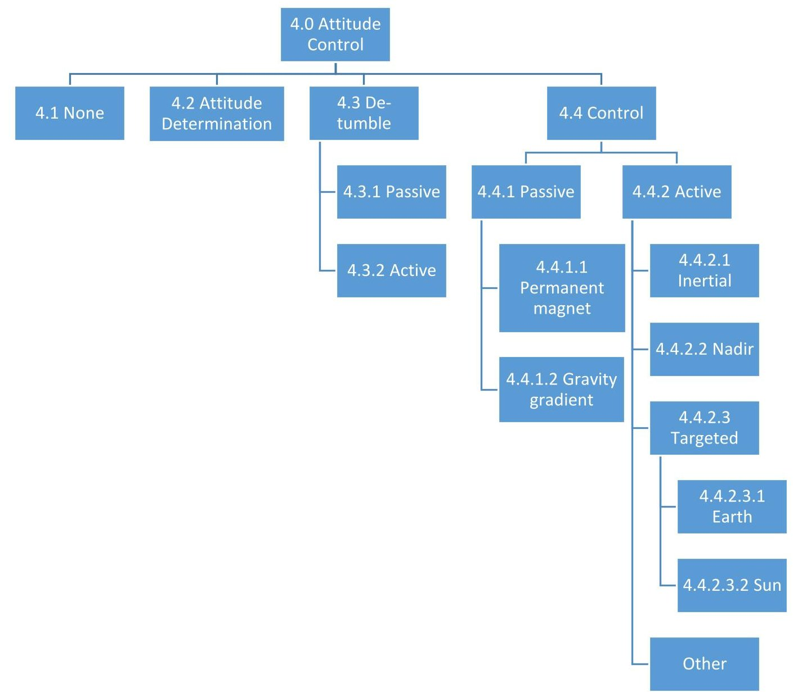

Figure 19: Mission mode attitude control sequence diagram

## 5.1.4.4 Mode execution

The most optimal practice for the ADCS mode is to communicate the attitude of the spacecraft to the ground. Different CubeSat have different components on board which may aid in computing the attitude of the spacecraft. Processing the attitude sensor data on board and only communicating the IMU rate to ground prevents exhausting the satellites data budget. Once the

<!-- PDF_PAGE: 85 -->

operations are complete and the desired orientation is achieved the satellite raises a flag. Attitude control on board can be timed, autonomous or non-existence. Figure 19 displays effective operational activities based on different satellite configurations.

The ground has full command of the satellite and can change threshold values, send period and time for timed operation execution, request telemetry and terminate operations.

## 4.1 None

The spacecraft does not have an attitude control system and does not perform any attitude control on board

## 4.2 Attitude determination

The set of sensors and actuators can be different mission to mission. The abstraction presented in this thesis is relevant for any actuator and sensor

Table 29: Minimum and additional capabilities - attitude determination

<table border="1"><tr><td colspan="2">Minimum capabilities</td></tr><tr><td>Activity</td><td>Description</td></tr><tr><td>Attitude determination</td><td>Perform attitude determination based on sensor and actuator readings</td></tr></table>

<table border="1"><tr><td colspan="2">Additional capabilities</td></tr><tr><td>Activity</td><td>Description</td></tr><tr><td>Sensor</td><td>Downlink sensor telemetry</td></tr><tr><td>Health</td><td>Ground will perform health check on the spacecraft based on the parameters listed in table 32</td></tr><tr><td>Algorithm</td><td>Execute a convergence algorithm</td></tr></table>

## 4.3 De-tumble

Spacecraft may have passive or active de-tumble.

<!-- PDF_PAGE: 86 -->

## 4.4 Control mode

Control mode is when the spacecraft may passively or actively control attitude. An example of passive attitude control may be permanent magnets and/or gravity gradient. During active control the spacecraft may constitute of inertial, nadir or targeted.

Table 30: Additional and minimum capabilities-control mode

<table border="1"><tr><td colspan="2">Minimum capabilities</td></tr><tr><td>Activity</td><td>Description</td></tr><tr><td>Health</td><td>Ground will perform health check on the spacecraft based on the parameters listed in Table 32</td></tr></table>

<table border="1"><tr><td colspan="2">Minimum capabilities</td></tr><tr><td>Activity</td><td>Description</td></tr><tr><td>Telecommands</td><td>Commanding actuators or sensors</td></tr><tr><td>Turning</td><td>Actuator turning</td></tr><tr><td>State</td><td>Check ADCS machine state</td></tr></table>

## 5.1.4.5 Minimum capabilities

None

## 5.1.4.6 Additional capabilities

Table 31: Attitude control additional capabilities

<table border="1"><tr><td colspan="2">Ops Activity</td></tr><tr><td>Activity</td><td>Description</td></tr><tr><td>4.2</td><td>Satellite may have attitude determination</td></tr><tr><td>4.3</td><td>Satellite may De-tumble</td></tr><tr><td>4.4</td><td>Satellite may perform control</td></tr></table>

<!-- PDF_PAGE: 87 -->

Table 32: Mode attitude control - optional telemetry checks

<table border="1"><tr><td colspan="2">Health check telemetry</td></tr><tr><td>Activity</td><td>Description</td></tr><tr><td>Battery</td><td>Check Voltage and current for 3.3V,5V and unregulated lines
Temperature
Threshold</td></tr><tr><td>Bus(OBC)</td><td>Current
Temperature
Switch states</td></tr><tr><td>Transceiver</td><td>Temperature
Power levels</td></tr><tr><td>Other</td><td>Mission critical data</td></tr><tr><td>Spacecraft boot count</td><td>Eps and OBC boot counters</td></tr><tr><td>Memory</td><td>On board storage of data</td></tr><tr><td>Resets</td><td>Number of OBC resets</td></tr><tr><td>Time</td><td>Boot time and spacecraft time</td></tr><tr><td>Angular rates</td><td>Spacecraft angular rates
Angular velocity
Spin rate</td></tr><tr><td>Solar panel</td><td>Solar panel sensor reading and telemetry</td></tr><tr><td>Buffer</td><td>Buffer state if full
Any flags raised</td></tr><tr><td>Run time</td><td>OBC runtime
Time and period for detumble(Uplink)</td></tr><tr><td>Sensor and actuator data</td><td>IMU rates
Magnetometer readings
Sun sensor reading
Attitude sensor reading</td></tr></table>

<!-- PDF_PAGE: 88 -->

Table 33: Failure operations for ADCS mode

<table border="1"><tr><td>Problem Area</td><td>Attitude control</td><td>Pointing error</td><td>System reset</td></tr><tr><td>Detection</td><td>Failure of attitude control</td><td>Loss of pointing mode</td><td>Attitude control system resets</td></tr><tr><td>Isolation</td><td>Isolate the bad sensor or actuators in the system</td><td>Heavy actuation operation or sun pointing failure</td><td>Numerically or other unexpected anomaly</td></tr><tr><td>Recovery</td><td>Perform attitude control without the bad sensor or actuator.</td><td>Check power levels, perform power system load sheds, switch on attitude control and resume operations</td><td>Recover from anomaly and perform attitude control</td></tr></table>

A good practice to prevent operative upsets during the ADCS mode is to query satellite sensors and actuators estimate the change in attitude. Based on pre determined threshold values, ground can perform health check to ensure the spacecraft will be able to sustain attitude control mode. The satellite can then de-tumble. In order to keep spacecraft healthy, constant monitoring of angular rate and ensuring that they are under the pre-determined threshold will keep the satellite power positive at all times.

## 5.1.4.8 Reason for abstraction approach

ITASAT, BioSentinal and SwampSat missions query the attitude sensor data and compare them to pre-determined threshold values. If satellite housekeeping data relay that the satellite will be able to perform attitude stabilization, then the ground commands the satellite to maneuver. Performing ground health checks and computing the sensor data on board saves downlink data budget and battery capacity on-board. Allowing ground to keep command during the ADCS mode is also a good practice demonstrated by DICE mission. Ground operators are able to judge the performance of the spacecraft and send appropriate command for attitude stabilization.

<!-- PDF_PAGE: 89 -->

## 5.1.5 Payload

## 5.1.5.1 Scope

Payload is a mission specific mode and involves on board operations for mission tasks. All on-board equipment not a part of the mission bus is payload. It may include boards, sensors, camera, and any additional PCBs manufactured in correlation to mission objective. Payloads are the primary drivers for mission objectives. This section will break down common payloads found on CubeSat's and provides an optimal operations sequence for them.

Payload operations may occur through out the mission depending on the mission objective. After success of all parameters from mission buses, payload data may be downlinked just before the spacecraft de-orbits. Hence, this is mission mode type: 5

## 5.1.5.2 Mission mode concept

The following operations occur during this mode:

- Performing payload task associated with the mission.

- Collecting payload telemetry

- Transmitting all the collected telemetry in processed or raw form to a ground station

- Upon successfully downlinking all desired telemetry, the spacecraft may switch to de-orbit mode.

<!-- PDF_PAGE: 90 -->

## 5.1.5.3 Mission mode sequence

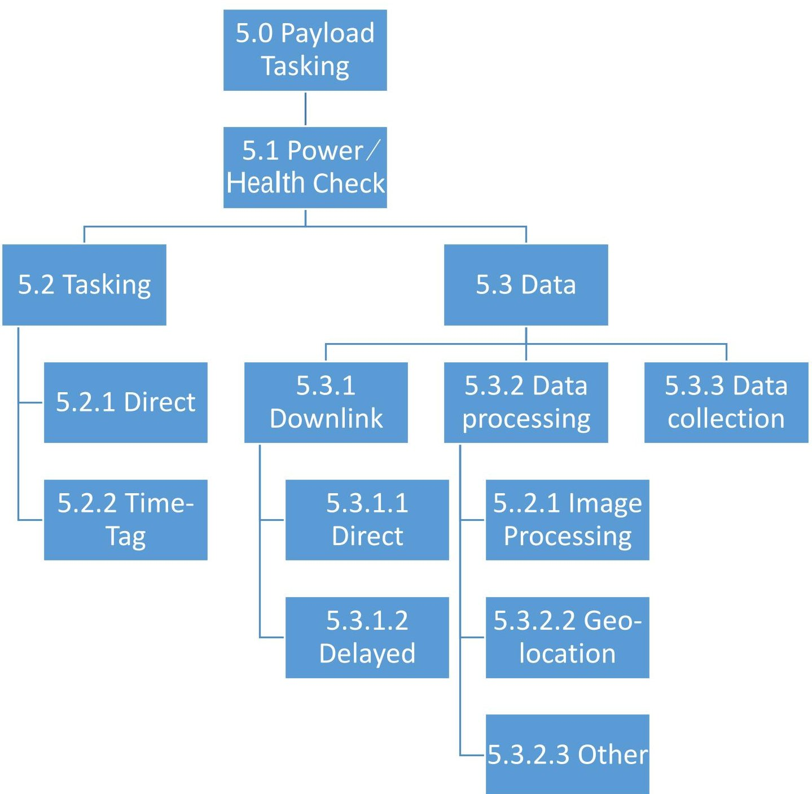

Figure 20: Mission mode payload sequence diagram

## 5.1.5.4 Mode Execution

## 5.1 Power/Health check

It is important to perform routine power and health checks before the implementation of any command or payload operations. Data transmission from all secondary and tertiary payload

<!-- PDF_PAGE: 91 -->

along with their task will be communicated during this mode of the mission. Therefore, it is important to check the spacecraft will be able to sustain operations.

Table 34: Mode payload - minimum health checks

<table border="1"><tr><td colspan="2">Minimum capabilities-Telemetry</td></tr><tr><td>Activity</td><td>Description</td></tr><tr><td>Battery</td><td>Check Voltage and current for3.3V,5Vand unregulated lines
Temperature</td></tr><tr><td>Bus(OBC)</td><td>Current
Temperature
Switch states</td></tr><tr><td>Transceiver</td><td>Temperature
Power levels</td></tr><tr><td>Other</td><td>Mission critical data</td></tr></table>

## 5.2 Tasking

Tasking can be direct (during a pass) or time-tagged. Time tag commands can be implemented just before a ground pass, if the functionality and correct implementation of the command needs to be examined. If there are tasks which need to be performed when the spacecraft is not in the field of view of Earth, then the time-tagged command functionality is used.

Table 35: Capabilities for payload tasking

<table border="1"><tr><td colspan="2">Minimum capabilities</td></tr><tr><td>Activity</td><td>Description</td></tr><tr><td>Telecommand</td><td>Sending operational commands to spacecraft</td></tr></table>

<table border="1"><tr><td colspan="2">Additional capabilities</td></tr><tr><td>Activity</td><td>Description</td></tr><tr><td>Time tag command</td><td>Sending time tagged commands or functional commands</td></tr></table>

<!-- PDF_PAGE: 92 -->

## 5.3 Data

## 5.3.1 Downlink

Operators and satellite developers may choose to downlink processed or raw data. After ensuring the satellite has a healthy communications links for data downlink, onboard processed data or raw data can be transmitted to ground. Data may be downlinked as a part of the real-time housekeeping or delayed on board stored data.

Table 36: Capabilities Data downlink

<table border="1"><tr><td colspan="2">Minimum capabilities</td></tr><tr><td>Activity</td><td>Description</td></tr><tr><td>Telemetry</td><td>Downlink delayed and/or real time data</td></tr></table>

## 5.3.2 Data processing

Depending on the satellite design, satellites may have a camera on board. Camera images may be of high resolution and thus exhaust the data budget. The following commands enables the operator to decide if the camera and the satellite is healthy to execute camera operations.

- Operator operate the camera by sending time tag commands to the spacecraft.

- Operator takes pictures just before a ground pass in order to ensure the desired functionality of the camera. Moreover, time-tag commands are required to allow the camera to take pictures in a specific place and orientation in orbit. The mission may want images of a particular area on Earth.

- Furthermore, to prevent heavy data downlink from the spacecraft; low resolution images can be downlinked.

- Ensure spacecraft is capable of transmitting a full resolution image.

- The low-resolution images can be judged on there usefulness and full resolution images can then be requested for downlink.

Similar to a camera a GPS may be an optional unit on board. When the GPS is activated, GPS telemetry may be added to housekeeping telemetry for that operating mode or it may be a transmitted to ground upon request. Frequency of data acquisition from the GPS, will depend

<!-- PDF_PAGE: 93 -->

upon the use of GPS data in the mission. GPS data may be processed on board to commute the satellite location or raw GPS values may be transmitted, to be processed on ground.

Table 37: Capabilities data processing

<table border="1"><tr><td colspan="2">Additional capabilities</td></tr><tr><td>Activity</td><td>Description</td></tr><tr><td>Images</td><td>Low resolution downlink</td></tr><tr><td>Data processing</td><td>Perform data processing on board such that minimum telemetry is downlinked</td></tr></table>

## 5.3.3 Data collection

An important part of data on board is the data collection. For most scientific equipment and non scientific equipment on board, operators will collect data. This data may be processed (5.3.2), and downlinked (5.3.1) in a desired way.

Table 38: Capabilities data collection

<table border="1"><tr><td colspan="2">Additional capabilities</td></tr><tr><td>Activity</td><td>Description</td></tr><tr><td>Data collection</td><td>Data collection of payload and bus components</td></tr></table>

## 5.1.5.5 Minimum capabilities

Following table displays minimum capabilities required from payload operations in a CubeSat.

Table 39: Minimum capabilities payload operations

<table border="1"><tr><td colspan="2">Ops Activity</td></tr><tr><td>Activity</td><td>Description</td></tr><tr><td>5.1</td><td>Health and power checks</td></tr><tr><td>5.2.1</td><td>Direct tasking</td></tr><tr><td>5.3.1</td><td>Data downlink</td></tr></table>

<!-- PDF_PAGE: 94 -->

## 5.1.5.6 Additional capabilities

Table 40: Mode payload - additional capabilities

<table border="1"><tr><td colspan="2">Ops Activity</td></tr><tr><td>Activity</td><td>Description</td></tr><tr><td>5.3.2</td><td>Data processing</td></tr><tr><td>5.3.3</td><td>Data collection</td></tr><tr><td>5.2.2</td><td>Time tag commands</td></tr></table>

## 5.1.5.7 Failure operations

Table 41: Failure operations for mode payload

<table border="1"><tr><td>Problem Area</td><td>Battery</td><td>Software</td><td>Memory</td></tr><tr><td>Detection</td><td>Battery level low</td><td>Software failure</td><td>Memory overload</td></tr><tr><td>Isolation</td><td>Load shed non critical components</td><td>Flight Software patching</td><td>Memory space limited</td></tr><tr><td>Recovery</td><td>The satellite shall be able to turn off non critical components to save battery in a given scenario</td><td>Operators shall be able to upload new image on the OBC</td><td>Memory dump in case of memory overload</td></tr></table>

Satellites may have mission critical payload data. In case, the satellite cannot downlink critical data it will have to recover from the failure. The payload may fail to perform, and information may not be downlinked. Performing power and health check between data downlinks will help manage data budget and communication link of the spacecraft.

## 5.1.5.8 Reason for abstraction approach

Considering all missions perform health check before executing power heavy commands, it is beneficial to perform health check on the satellite before payload command execution. Payload data may be sensor data or images clicked by a camera. The data may be heavy and may exhaust the satellite data budget. Therefore, it is important to find a way to compress the data, process it on board before downlinking it. In the occurrence where payload data includes images, it is good

<!-- PDF_PAGE: 95 -->

practice to download low resolution images to judge the usefulness of the image before downlinking full resolution images.

## 5.1.6 De-orbit

## 5.1.6.1 Scope

De-orbit occurs at the end of life of the mission. The spacecraft is presumed to have completed all its tasks and desired data is transmitted to ground.

Since, de-orbit is the last stage in the CubeSat life cycle, it is mission mode type: 6

## 5.1.6.2 Mission mode concept

The following operations occur during this mode:

- De-orbit the spacecraft within the IADC (Inter-Agency Space Debris Coordination Committee) guideline of 25 years [67].

- Ensure, the spacecraft will not generate space debris

- Deactivate any propulsive equipment on board.

## 5.1.6.3 Mission sequence

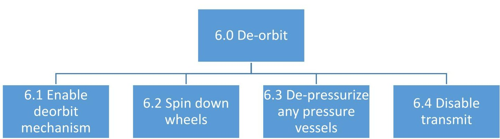

Figure 21: Mission mode de-orbit sequence diagram

<!-- PDF_PAGE: 96 -->

## 5.1.6.4 Mode execution

## 6.1 Enable deorbit mechanism

If the spacecraft has a deorbit device independent of the bus devices, it will be activated first or last depending on its operations.

Table 42: Additional capabilities for deorbit mechanism

<table border="1"><tr><td colspan="2">Additional capabilities</td></tr><tr><td>Activity</td><td>Description</td></tr><tr><td>Deorbit mechanism</td><td>Autonomous or timed activation of deorbiting devices (example a tether)</td></tr></table>

## 6.2 Spin down wheels

Reaction wheels help in attitude control for the satellite. In the event of de-orbiting, the satellite shall spin down any wheels before breaking off communications with the ground.

Table 43: Additional capabilities for reaction wheels

<table border="1"><tr><td colspan="2">Additional capabilities</td></tr><tr><td>Activity</td><td>Description</td></tr><tr><td>Wheels</td><td>Spin down reaction wheels</td></tr></table>

## 6.3 De-pressurize any pressure vessels

Spacecraft may have pressure vessels for attitude control, and they shall be de-pressurised before letting the satellite de-orbit.

Table 44: Additional capabilities for on-board pressure vehicles

<table border="1"><tr><td colspan="2">Additional capabilities</td></tr><tr><td>Activity</td><td>Description</td></tr><tr><td>Pressure vehicles</td><td>De-pressurise pressure vehicles</td></tr></table>

<!-- PDF_PAGE: 97 -->

## 6.4 Disable transmit

The last step before de-commissioning is to turn off all transmitters such that the spacecraft does not interfere with other satellites.

Table 45: Minimum capabilities for transmitter

<table border="1"><tr><td colspan="2">Minimum capabilities</td></tr><tr><td>Activity</td><td>Description</td></tr><tr><td>Transmitter</td><td>Disable transmit</td></tr></table>

## 5.1.6.5 Minimum capabilities

Table 46: Mode de-orbit minimum capabilities

<table border="1"><tr><td colspan="2">Ops Activity</td></tr><tr><td>Activity</td><td>Description</td></tr><tr><td>6.4</td><td>Disable transmit</td></tr></table>

## 5.1.6.6 Additional capabilities

Table 47: Mode de-orbit additional capabilities

<table border="1"><tr><td colspan="2">Ops Activity</td></tr><tr><td>Activity</td><td>Description</td></tr><tr><td>6.1</td><td>Enable deorbit mechanism</td></tr><tr><td>6.2</td><td>Spin down wheels</td></tr><tr><td>6.3</td><td>De-pressurize any pressure vessels</td></tr></table>

## 5.1.6.7 Failure operations

None

## 5.1.6.8 Reason for abstraction approach

The procedure for de-orbiting satellites comes from the Inter-Agency Space Debris Coordination Committee (IADC). It is important for all LEO satellites to de-orbit within 25 years

<!-- PDF_PAGE: 98 -->

of the end of their operations lifetime [67]. If the spacecraft is being launched into a lower altitude Low Earth Orbit (example an ISS deployment at 400 km), then it will naturally fall out of orbit in the 25 years' lifespan. However, if the spacecraft is on a launch vehicle and is placed in a higher LEO orbit, above 650km for example, then CubeSat developers need to add mechanisms such that the spacecraft can be deorbited within the IADC guideline of 25 years. All CubeSats shall also turn intentional transmitters off at the end of life, such that they do not interfere with operations of other satellites using the same bands. All pressure vessels and reaction wheels shall be placed in a low energy state (emptied or spun down) and disabled before the satellite makes it way to burn up in the Earth atmosphere. However, the majority of CubeSats are launched into low-altitude Low Earth Orbits and do not therefore need to have mechanisms to de-orbit.

## 5.2 Operations abstraction summary

The table bellow summarizes all mission mode and the available services across them. The cells marked in grey identify minimum capability sets from each mission mode.

<!-- PDF_PAGE: 99 -->

Table 48: Service summary form mission modes

<table border="1"><tr><td>Service Request</td><td></td><td>Services Available</td></tr><tr><td colspan="3">Pre-Contact</td></tr><tr><td>1.1 Spacecraft on launch vehicle</td><td>1.1.1</td><td>Deployment from ISS-30-minute hold-off</td></tr><tr><td></td><td>1.1.2</td><td>Deployment from launch vehicle</td></tr><tr><td>1.2 Power on</td><td>1.2.1</td><td>Power on check</td></tr><tr><td>1.3 Safe-hold mode</td><td></td><td></td></tr><tr><td colspan="3">Deployment</td></tr><tr><td>2.1 Solar panel</td><td>2.1.1</td><td>Active deployment</td></tr><tr><td></td><td>2.1.2</td><td>Passive deployment</td></tr><tr><td>2.2 Antenna</td><td>2.2.1</td><td>Active deployment</td></tr><tr><td></td><td>2.2.2</td><td>Passive deployment</td></tr><tr><td>2.3 Magnetometer</td><td>2.3.1</td><td>Active deployment</td></tr><tr><td></td><td>2.3.2</td><td>Passive deployment</td></tr><tr><td colspan="3">Communications</td></tr><tr><td>3.1 First contact</td><td>3.1.1</td><td>Beacon</td></tr><tr><td></td><td>3.1.2</td><td>Transceiver</td></tr><tr><td>3.2 Routine contact</td><td>3.2.1</td><td>Time</td></tr><tr><td></td><td>3.2.2</td><td>Memory</td></tr><tr><td></td><td>3.2.3</td><td>Health</td></tr><tr><td></td><td>3.2.4</td><td>Back orbit telemetry</td></tr><tr><td></td><td>3.2.5</td><td>Mission mode</td></tr><tr><td colspan="3">Attitude control</td></tr><tr><td>4.1 None</td><td></td><td></td></tr><tr><td>4.2 Attitude determination</td><td></td><td></td></tr><tr><td>4.3 De-tumble</td><td>4.3.1</td><td>Passive</td></tr><tr><td></td><td>4.3.2</td><td>Active</td></tr><tr><td>4.4 Control</td><td>4.4.1</td><td>Passive</td></tr><tr><td></td><td>4.4.2</td><td>Active</td></tr><tr><td colspan="3">Payload</td></tr><tr><td>5.1 Power check</td><td></td><td></td></tr><tr><td>5.2 Tasking</td><td>5.2.1</td><td>Direct</td></tr><tr><td></td><td>5.2.2</td><td>Time-tag</td></tr><tr><td>5.3 Data</td><td>5.3.1</td><td>Downlink</td></tr><tr><td></td><td>5.3.2</td><td>Data processing</td></tr><tr><td></td><td>5.3.3</td><td>Data collection</td></tr><tr><td colspan="3">De-orbit</td></tr><tr><td>6.1 Enable deorbit</td><td></td><td></td></tr><tr><td>6.2 Spin down wheels</td><td></td><td></td></tr><tr><td>6.3 De-pressurize vessels</td><td></td><td></td></tr><tr><td>6.4 Disable transmit</td><td></td><td></td></tr></table>

<!-- PDF_PAGE: 100 -->

## Chapter 6. Applying the operations abstraction to DESCENT CubeSat mission

In order to test the abstraction's usefulness to CubeSat missions, it was applied on the ongoing DESCENT CubeSat mission. The application was able to demonstrate the operation sequence adaptability to a real-life space mission. Testing the abstraction with the DESCENT mission also resulted in highlighting areas within the operations sequence which may need adjustment to be implemented to other CubeSats. This chapter presents the abstraction applied to DESCENT along with the parameters required to be downlinked for each mission mode.

## 6.1 DESCENT mission overview

Deorbiting spacecraft using electrodynamic tethers (DESCENT) is a CubeSat mission which showcases electrodynamic tether technology. DESCENT's mission objective is to use tethers and demonstrate its technology for deorbiting satellites from Low Earth Orbit. The mission is funded by the Canadian Space Agency (CSA) through the Flight for Advancement of Science and Technology (FAST) program, with in kind support from Honeywell [68]. DESCENT comprises of two 1U CubeSats which are connected by a 100m long tether. As the tether moves along the Earth's magnetic filed, a charge is collected in the tether. This charge is then expelled through a Spindt array, creating a Lorentz force [69] in the same direction as atmospheric drag. Doing this increases orbital decay bringing the satellite down to burn up in the Earth's atmosphere [70].

DESCENT's bus is a combined effort of graduate researchers from York and Ryerson Universities located in Toronto, Canada. The mission supports four experiments - the primary payload from York is the electrodynamic tether and its deployment system [68]. Secondary payloads come from the University of Sydney, Australia, looking at radiation dosage in Low Earth Orbit, and from another group within York looking at solar cells with an innovative coating that can potentially increase panel efficiency significantly. Finally, the mission is expected to provide a platform for University of Calgary to probe the coherent backscatter of radio waves by the F-region ionosphere at high latitudes with the orbiting tether using ground radars [68].

<!-- PDF_PAGE: 101 -->

For ease of communication between group members the two-1U CubeSat are referred to as "Mother" CubeSat and "Daughter" CubeSat. The daughter cube is the primary driver of the mission and all mission essential components are located on the daughter satellite. The mother satellite on the other hand acts as platform to prove space heritage for commercially available components. The electrodynamic tether is connected to both cubes but stored on the daughter cube pre-deployment, and the two are held together using burn wires. Upon stabilization of orbit, a command will be sent to burn the wire, and a compressed spring will provide the force to separate the cubes [71]. The daughter cube holds a GomSpace UHF transceiver for ground communications and houses a ClydeSpace On Board Computer (OBC). A communication link between the two CubeSats will be established using a pair of Xbee transceivers which will be used both before and after the separation, although a hard-wired connection is available before separation as the primary inter-satellite link. The mother cube uses two raspberry Pi in cold redundancy for on board computing [72]. It also has a PCB from the University of Sydney used for looking at radiation dosage in LEO. Both cubes will use a Clyde Space EPS and 20Wh battery along with Clyde Space solar panels pre-integrated with sun sensors and magnetorquers mounted on the side walls of each CubeSat [71].

## 6.2 DESCENT operations

The need for developing operations alongside the design phase of a mission was presented earlier in this thesis. DESCENT operations were not formulated in detail during the mission design cycle and this has proven to be a challenge to develop in the later phases of the mission. The DESCENT development team have had a number of challenges to complete the DESCENT software development and check operations activities. DESCENT was able to define the modes required for operations, but it took many months to define the functionality of each mode and the sequence of activities within each mode. Since DESCENT has progressed beyond the mission planning phase, the operations abstraction developed in the last chapter has been applied to it retroactively. If this optimal operation sequence had been available as the beginning of the DESCENT mission, it could have been used to decrease the mission planning and software and operations development time on the satellite.

<!-- PDF_PAGE: 102 -->

Using the SwampSat mission operations template, DESCENT developed its initial operations sequence [70][48]. Much of this sequence overlaps with the abstracted operation sequence, as shown in Figure 22 and Table 49, which has grouped DESCENT operations activities into the modes presented in chapter 5.

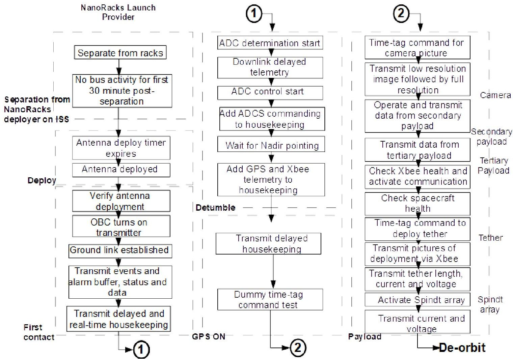

Figure 22: DESCENT operations sequence

<!-- PDF_PAGE: 103 -->

Table 49: Mission modes for DESCENT mission

<table border="1"><tr><td>Mission Mode Type</td><td>Mission Mode Name</td><td>DESCENT operations</td></tr><tr><td>1</td><td>Time in space before first contact</td><td>Separation from NanoRacks deployer on ISS</td></tr><tr><td>2</td><td>Deployment</td><td>Antenna deployment</td></tr><tr><td>3</td><td>Communications</td><td>First contact</td></tr><tr><td>4</td><td>Attitude determination and detumble</td><td>Detumble</td></tr><tr><td>5</td><td>Payload</td><td>Camera, secondary payload, tertiary payload, tether and Spindt array</td></tr><tr><td>6</td><td>De-orbit</td><td>De-orbit</td></tr></table>

## 6.2.1 Time before first contact

## 6.2.1.1 Operational Tasks

The following tasks will be performed for the DESCENT mission during this mode:

- The satellite will be transported to the International Space Station and launched from the station by the NanoRack deployer

- The spacecraft will not perform any operations for the first 30 minutes after deployment, to avoid interference with ISS.

- The PDM will however be turned on in both mother and daughter cubes at separation, along with mother and daughter cube OBC and GomSpace receiver.

- The OBC will perform health checks on the spacecraft and store a set of housekeeping telemetry

- The transceiver receiver will remain on - powered on a fixed (non-switchable) line.

## 6.2.1.2 Overlap with the generic sequence

The sequence presented in chapter 5, accommodated launch from the ISS or other CubeSat deploying platforms. The sequence was easily adapted to the DESCENT mission mode - time before first contact. Table 8 further showcases the expected delayed and live housekeeping which will be gathered by the satellite during this phase.

<!-- PDF_PAGE: 104 -->

## 6.2.2.1 Operational Tasks

- The satellite will check for expiry of the 30-minute timer

- Upon expiry of the timer, the satellite will activate the deployment of UHF antenna

- A telemetry flag will be raised when the deployment is complete

- The antenna deployment circuit will be disabled

- The ground will reactivate the antenna deployment circuit upon first establishing a communication link with ground, as a fail-safe mechanism.

## 6.2.2.2 Overlap with the generic sequence

The generic operations sequence suggests raising a telemetry flag once the 30-minute timer expires and once antennas or other deployable have been actively deployed. The sequence also suggests resetting the flag and attempt to deploy them again on first communication. The DESCENT operation sequence does not compare the angular rates to justify the success of antenna deployment. We can conclude that not all satellites will have run enough ground tests to determine the expected change in angular rate upon antenna deployment. Many spacecrafts may not be downlinking angular rate data in this mode of the mission. Therefore, a few additional capability components of the generic sequence do not comply to the DESCENT CubeSat mission but are good practice to be implemented in other missions.

## 6.2.3 Communications

## 6.2.3.1 Operational Tasks

Following are a list of tasks that will be performed for the DESCENT mission during this mode:

- Ground will send idle patterns to spacecraft

- The satellite will look for a receiver lock. Upon contact, the OBC will send a command to the transceiver to remove transmit inhibit

- The OBC will communicate telemetry to the ground (half-duplex)

<!-- PDF_PAGE: 105 -->

- The event buffer will be downlinked and cleared by ground command

- The OBC will be commanded to send all stored telemetry to the ground

- The ground and on-board times will be synchronized

- The mission mode will be switched from safe-hold to nominal mode upon ground command

## 6.2.3.2 Overlap with the generic sequence

As suggested by the generic sequence the spacecraft will first boot into safe-hold mode. This will minimize power usage, before the ground determines it is okay to switch to nominal mode of operations. Since DESCENT CubeSat does not have a beacon onboard, it will establish ground commands using half-duplex transmission. The software has programmed delay before it transmits data after reception of a command. Having this functionality reduces power consumption (enabling transmission only on seeing an uplink) and all telemetry can be downlinked using the ground network. As suggested in chapter 5, the ground will also downlink a dedicated buffer containing any asynchronous telemetry (events) and will diagnose, isolate and recover from any onboard error. It will then sync ground and space time and finally command the satellite to switch mission mode to nominal. It is evident that the abstracted sequence has been effectively mapped to the DESCENT operations so far.

## 6.2.4 Attitude Control

## 6.2.4.1 Operational Tasks

Following are a list of tasks that will be performed for the DESCENT mission during this mode:

- Spacecraft attitude determination sensors are enabled, and the attitude control system will be transitioned to attitude determination mode

- The ground will query the attitude sensors of the spacecraft and compare with the onboard calculated attitude

- Once the ground has confirmed the spacecraft body rates are low enough, it will transition the attitude control to an active control mode, which will cause the ADC to

<!-- PDF_PAGE: 106 -->

generate magnetorquer commands, which will drive the torquers through the PWM control boards

- The ground will collect and download attitude telemetry from sensors directly and from the attitude control system to calibrate the control system

## 6.2.4.2 Overlap with the generic sequence

As suggested by the abstracted sequence the spacecraft will first query the sensors to check the attitude of the spacecraft. Then depending on which orientation, the attitude needs to be adjusted, on board sensor will process attitude calibration. The attitude of the spacecraft will be adjusted to achieve desired levels. In order to save downlink data budget, all processing will be done on-board and only spacecraft position will be communicated based on TLE. DESCENT ADCS system takes suggestions from the abstracted sequence and performs calibration functions on board.

## 6.2.5 Payload

## 6.2.5.1 Operational Tasks

Following are a list of tasks that will be performed for the DESCENT mission during this mode:

- Spacecraft will perform power and health checks before executing any payload task on board

- The satellite will collect an image and downlink it, pre-separation, this allows to judge the usability of the image from DESCENT Enable the SUGAR dosimeter, and collect telemetry from it when it is generated $ ^{3} $

<!-- PDF_PAGE: 107 -->

- Collect telemetry from the sun sensor payload for a few orbits, during a stable attitude profile

- The satellite will then try time-tagged commands, and time-tag collection of a sequence of images during the CubeSats separation phase

- DESCENT will deploy the tether, just before a communication phase, such that the deployment of tether can be monitored during a ground pass.

- Downlink tether voltage and current measurements

- Transmit images from CubeSat separation

- Low-resolution images will be examined on ground before downlinking high-resolution images

## 6.2.5.2 Overlap with the generic sequence

The generic operations sequence easily maps onto DESCENT operations sequence. DESCENT has a camera on board and, as suggested, thumbnail images will be first transmitted to Earth. If the images have substantial data, full resolution images will then be downlinked. Payload data processing will be done onboard and only current and voltage will be downlinked when required.

## 6.2.6 De-orbit

## 6.2.6.1 Operational Tasks

Following are a list of tasks that will be performed for the DESCENT mission during this mode:

- The Spindt array will be activated

- Last set of commands will be transmitted

- Attitude control will be inhibited, and the transmitter will be de-activated

- The CubeSat will de-orbit in 2 weeks to 4 years depending of success of tether deployment

<!-- PDF_PAGE: 108 -->

## 6.2.6.2 Overlap with the generic sequence

De-orbit is a fairly simple mode and can be accommodated on all CubeSats easily. For the case of DESCENT, the Spindt array will nominally drive the Lorentz force generation which allows the spacecraft to de-orbit. However, the deployed tether will itself increase the CubeSat's drag to a point where it will re-enter within 2 weeks to 4 years. Therefore, after its activation and receiving the last set of data from the satellite, transmission will be terminated, and the CubeSat will orbit the Earth until it slows down and burns in the Earth's atmosphere. The IADC guideline states, "Removing spacecraft and orbital stages that have reached the end of their mission operations from the useful densely populated regions. [73]” Hence, following the guidelines, DESCENT de-orbits at the end of life and eliminated contribution to existing debris.

<!-- PDF_PAGE: 109 -->

## Chapter 7. AIT and operations preparation support using the abstracted operations for the DESCENT CubeSat mission

The AIAA guide to operator training [74] explains the importance of testing an operations sequence with the operators of the space mission before launch. A fully exhausted operations sequence, which has been tested on the operating software multiple times, allows the operators to prepare for contingencies well in advance. The operators can practice the commands needed during operations as well as learn how to deal with unexpected circumstances or upsets. This section discusses the development of the DESCENT functional test in line with the abstracted operations sequence. The functional test was used to test flight hardware along with training operators. A functional test can be run in between various stages of the assembly, integration and testing (AIT) for the CubeSat. Monitoring the performance of the CubeSat through the AIT campaign allows the operators to ensure that the spacecraft can perform within its operational envelop. It also makes analyzing performance shifts easier, for quicker diagnosis of failures or system degradation.

In order to simulate the space environment testing, a functional test case for DESCENT was broken into nominal and off-nominal testing. DESCENT functional tests were squeezed to fit within an 8-hour test timeline. The off-nominal tests included testing the mother OBC redundancy, RF level test and load sheds. The functional test was developed to be used before, during and after each of the major system tests including thermal-vacuum testing at each plateau, after each of the thermal cycles, and after each vibration test, to ensure performance does not shift during the test campaign. It also allows the operators to observe the satellite can operate within its operational envelope. The test is split into operational sequences, with activities combined into "ground pass" tasks which will use the spacecraft transponder, nominally spaced at flight intervals, and inter-ground-pass tasks which will use a direct connection to the spacecraft computers [70]. Figure 23 displays the connection architecture for the functional test. The passes are tested using an RF connection and the inter-pass are tested using a serial connection between the ground software and the on-board computer.

<!-- PDF_PAGE: 110 -->

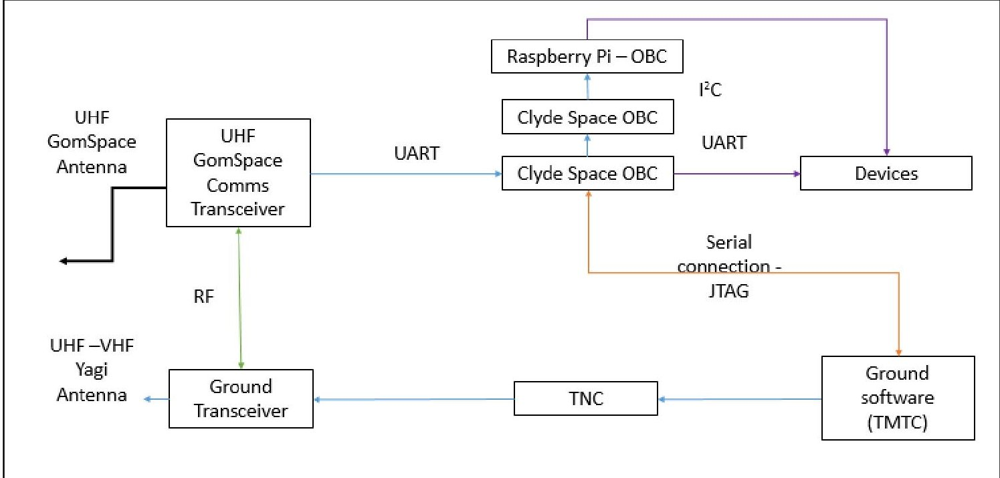

Figure 23: DESCENT ground segment - test architecture

The flight test is broken down into three different tests. The first test is the FlatSat level test where all the components are laid out on a table and commands are transmitted between the ground computer and the on-board computer. The next test is the systems test where the assembled spacecraft is tested, and the ground and space transceiver communicate using a hardwired connection. Lastly an end-to-end test includes testing spacecraft communication using the space and ground antennas. For the end-to-end test DESCENT's GomSpace antenna will communicate with a Yagi antenna mounted at York university. DESCENT communication uses UHF bands and communicates between 435 and 438 MHz Figure 24 displays the FlatSat test setup and the architecture for the test for the DESCENT mission.

<!-- PDF_PAGE: 111 -->

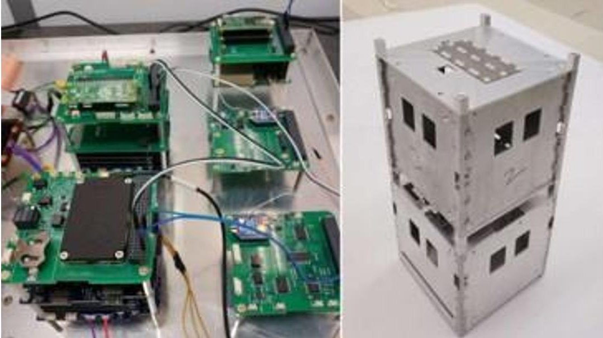

Figure 24: DESCENT FlatSat and CubeSat frame

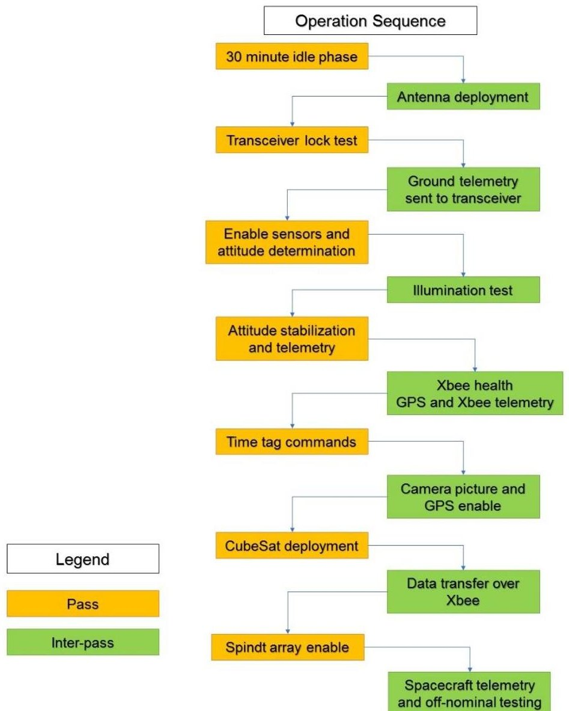

<table border="1"><tr><td>Operation Timeline</td><td>System Test Timeline</td></tr><tr><td>30 minutes</td><td>30 minutes</td></tr><tr><td>1 day</td><td>15 minutes</td></tr><tr><td>5 days</td><td>30 minutes</td></tr><tr><td>1 day</td><td>30 minutes</td></tr><tr><td>5 days</td><td>15 minutes</td></tr><tr><td>N/A</td><td>1 hour</td></tr><tr><td>2 weeks</td><td>15 minutes</td></tr><tr><td>6 days</td><td>1 hour</td></tr><tr><td>5 days</td><td>15 minutes</td></tr><tr><td>3 weeks</td><td>1 hour</td></tr><tr><td>5 days</td><td>15 minutes</td></tr><tr><td>3 weeks</td><td>1 hour</td></tr><tr><td>2 days</td><td>15 minutes</td></tr><tr><td>2 days</td><td>1 hour</td></tr></table>

Figure 25: DESCENT systems test timeline compared to planned operations

<!-- PDF_PAGE: 112 -->

Figure 25 shows the operation timeline compared to the functional test timelines [70]. It is evident that some off-nominal testing will be performed during the systems test timeline. For example, a solar panel illumination test will be a part of the functional test but not a part of the operations of the spacecraft (where the panels will be illuminated by the sun directly). It is important to test all spacecraft functionality on ground to understand how the spacecraft will react in orbit. Performing the solar panel illumination test allow the operators to understand the expected sun sensor data, solar panel voltage, current and temperature shifts. Other off-nominal testing will include a modified antenna deployment test: Once the antenna is assembled in the structure it will be difficult to test antenna deployment as a part of the functional test, as this will require re-threading the burn wire and ensuring clearance for deploying the antenna in its test configuration. The functional test will still test the antenna deployment circuit to check if enough voltage can be generated for the wires to burn. The Mother OBC will be tested in cold redundancy as a part of the off-nominal testing to check both the Pi are functional [72]. To ensure that the spacecraft can recover from power resets, EPS resets will be tested. A minimum transmit power test will be performed to check spacecraft communication and lastly load sheds will be performed to check if the EPS can turn off all non-essential loads.

This operational test sequence developed for DESCENT has not currently been directly abstracted for any mission "test-as-you-fly" sequence, but since DESCENT operations map well onto the abstracted operations modes, it is proposed that the operations abstraction could be expanded to include a modularized version of the DESCENT functional test procedure, to help mission developers use the abstracted operations during their testing and to train spacecraft operators during their ground test campaigns. Test-as-you-fly test procedures are increasingly used in mission validation and are recognized as providing timely mechanisms for recognizing and addressing potential operations failures. Martin Langer from the Technical University of Munich, was involved in the Move-II CubeSat mission and studied a Test-As-you-fly configuration for CubeSat to perform ground evaluation. He developed a testing strategy to eliminate CubeSat failure leading from infant mortality or dead on arrival cases [75]. The Aerospace Company states that 73% of all failures are because of systematic faults due to design errors [76]. According to Mike Tolmasoff of the Boing Company, out of the 27 common anomalies found in missions, 19 of them can be eliminated using ground testing [47]. Hence implementing a Test-As-You-Fly campaign in the AIT campaign is important. Having an

<!-- PDF_PAGE: 113 -->

abstracted CubeSat operations sequence allows development of a functional test procedure for each mission.

## 7.1 Development of an operations analysis tool for the AIT campaign

The DESCENT CubeSat mission has still to complete its complete functional tests, due to launch schedule slips. The software definition for all the operating modes shown in section 6.2 is complete, however. In order to analyze real time and delayed data from the satellite during the functional test procedures, a software tool was developed. The existing tools discussed earlier in this thesis were considered, however their configuration complexity would have required some months to develop a fully configured ground system. To demonstrate ground processing to support generic operations, a MATLAB-based operations tool was therefore written to decode the incoming packets and make data processing easier.

To begin the development of the tool, a telemetry definition from the satellite software was obtained. A list of all parameters required to be downlinked in all mission modes was created along with their parameter IDs. For a standard operations abstraction, these would largely be able to be predefined. Starting with a table as shown below in table 50, the mission was able to finalize its data budget as well characterize its delayed and real time TM. A list of DESCENT delayed, and real time housekeeping data points is shown below. This table consists of all critical telemetry which was sectioned using different samplers and aggregators. Developing a similar table to the one shown below for all mission modes helps realise the potential of an abstracted generic CubeSat data budget and lets the operators classify critical and non-critical telemetry. A similar table was also developed for telemetry observed from ADCS and payload modes. Most other modes need for example first contact, communication and de-orbit was satisfied from parameters shown in the table.

<!-- PDF_PAGE: 114 -->

Table 50: DESCENT housekeeping telemetry

<table border="1"><tr><td>Component name</td><td>Parameter ID</td><td>Frequency(Hz)
(Sampling rates)</td></tr><tr><td>CRC</td><td>263</td><td>Once per orbit</td></tr><tr><td>Current image</td><td>259</td><td>0.0033</td></tr><tr><td>Next boot image</td><td>260</td><td>0.0033</td></tr><tr><td>Storage status</td><td>2054</td><td>0.0033</td></tr><tr><td>MRAM errors</td><td>270</td><td>0.0033</td></tr><tr><td>Battery current direction</td><td>1280</td><td>0.033</td></tr><tr><td>Battery current</td><td>1281</td><td>0.033</td></tr><tr><td>Battery voltage(3.3,5)</td><td>1282</td><td>0.0033</td></tr><tr><td>Unregulated battery voltage</td><td></td><td>0.033</td></tr><tr><td>Battery temp</td><td>1283</td><td>0.0033</td></tr><tr><td>Last error</td><td>1288</td><td>Upon request</td></tr><tr><td>Battery burnout</td><td>1292</td><td>Upon request</td></tr><tr><td>Heater status</td><td>1293</td><td>0.0033</td></tr><tr><td>EPS status</td><td>1537</td><td>0.033</td></tr><tr><td>EPS burnout</td><td>1541</td><td>Upon request</td></tr><tr><td>Auto reset</td><td>1542</td><td>Once per orbit</td></tr><tr><td>Watchdog timeout count</td><td>1543</td><td>Once per orbit</td></tr><tr><td>EPS switch currents</td><td>1546</td><td>Max/min</td></tr><tr><td>EPS expected switch state</td><td>1549</td><td>Event</td></tr><tr><td>EPS over current</td><td>1553</td><td>Event</td></tr><tr><td>EPS board telemetry</td><td>1556</td><td>0.0033</td></tr><tr><td>Solar panel currents</td><td>1559</td><td>0.033</td></tr><tr><td>Panel current to battery</td><td>1560</td><td>0.033</td></tr><tr><td>Panel voltage</td><td>1563</td><td>0.033</td></tr><tr><td>Panel temperature</td><td>1558</td><td>0.033</td></tr><tr><td>Bus current</td><td>1565</td><td></td></tr><tr><td>Sun sensors</td><td></td><td>0.033</td></tr><tr><td>Transmitter temp</td><td>4613</td><td>0.033</td></tr><tr><td>Boot count</td><td>4618</td><td>Once per orbit</td></tr><tr><td>TX power level</td><td>4623</td><td>0.0033</td></tr><tr><td>Total TX/TX packets</td><td>4611</td><td>0.0033</td></tr></table>

The DESCENT software currently supports the parameter list shown above. Different samplers and packet builders (aggregators) are defined in the software to accommodate the frequency of data acquisition. The end goal for each mission is to build aggregators and samplers

<!-- PDF_PAGE: 115 -->

for each mission mode. Different components can then be added or subtracted from the aggregators based on individual mission modes.

The incoming and outgoing packets were captured as they arrived in the ground segment packet stream over a TCP-IP connection, and they were read directly into MATLAB. Both "live" and "delayed" (back-orbit) housekeeping telemetry was decoded and the data was displayed in a GUI. DESCENT uses the ESA PUS packet structure; therefore, the housekeeping packets were decommuted based on their housekeeping structure IDs. Each flight software packet aggregator definition file was associated with its structure ID. These structure IDs were used to filter the incoming housekeeping packets, before the data was decommuted to allow individual parameter values to be displayed in the tool. Aggregator definition files with 1 s and 30 s sampling data had a live housekeeping and a delayed housekeeping structure ID. However, the aggregator files with once-per-orbit data, ADCS, payload or any large data transfer packets had structure IDs only associated with delayed downlink. Table 51 below shows a sample aggregator file with critical telemetry for the DESCENT mission. These parameters map to the packet body of a specific housekeeping packet structure ID.

Table 51: A sample aggregator definition file from DESCENT mission

<table border="1"><tr><td>Name</td><td>Row</td><td>Bits</td></tr><tr><td>core.OBT.time</td><td>0</td><td>32</td></tr><tr><td>platform.BAT.batteryCurrentDir</td><td>0</td><td>1</td></tr><tr><td>platform.BAT.batteryCurrent[0]</td><td>0</td><td>10</td></tr><tr><td>platform.BAT.batteryCurrent[1]</td><td>1</td><td>10</td></tr><tr><td>platform.BAT.batteryCurrent[2]</td><td>2</td><td>10</td></tr><tr><td>platform.BAT.batteryVoltage[0]</td><td>0</td><td>10</td></tr><tr><td>platform.BAT.batteryVoltage[1]</td><td>1</td><td>10</td></tr><tr><td>platform.BAT.batteryVoltage[2]</td><td>2</td><td>10</td></tr><tr><td>platform.BAT.batteryTemperature[0]</td><td>0</td><td>10</td></tr><tr><td>platform.BAT.batteryTemperature[1]</td><td>1</td><td>10</td></tr><tr><td>platform.BAT.status</td><td>0</td><td>16</td></tr><tr><td>platform.BAT.lastError</td><td>0</td><td>8</td></tr><tr><td>platform.BAT.brownOutResetCount</td><td>0</td><td>8</td></tr><tr><td>platform.EPS.status</td><td>0</td><td>8</td></tr><tr><td>platform.EPS.lastError</td><td>0</td><td>8</td></tr><tr><td>platform.EPS.brownOutResetCount</td><td>0</td><td>8</td></tr><tr><td>platform.EPS.autoResetCount</td><td>0</td><td>8</td></tr></table>

<!-- PDF_PAGE: 116 -->

<table border="1"><tr><td>platform.EPS.watchdogResetCount</td><td>0</td><td>8</td></tr><tr><td>platform.EPS.switchCurrents[0]</td><td>0</td><td>10</td></tr><tr><td>platform.EPS.switchCurrents[1]</td><td>1</td><td>10</td></tr><tr><td>platform.EPS.switchCurrents[2]</td><td>2</td><td>10</td></tr><tr><td>platform.EPS.switchCurrents[3]</td><td>3</td><td>10</td></tr><tr><td>platform.EPS.switchCurrents[4]</td><td>4</td><td>10</td></tr><tr><td>platform.EPS.switchCurrents[5]</td><td>5</td><td>10</td></tr><tr><td>platform.EPS.switchCurrents[6]</td><td>6</td><td>10</td></tr><tr><td>platform.EPS.switchCurrents[7]</td><td>7</td><td>10</td></tr><tr><td>platform.EPS.switchCurrents[8]</td><td>8</td><td>10</td></tr><tr><td>platform.EPS.switchCurrents[9]</td><td>9</td><td>10</td></tr><tr><td>platform.EPS.expectedSwitchStatesBitmap</td><td>0</td><td>10</td></tr><tr><td>platform.EPS.exualSwitchStatesBitmap</td><td>0</td><td>10</td></tr><tr><td>platform.EPS.boardTemperature</td><td>0</td><td>10</td></tr><tr><td>platform.EPS.solarArrayTemperatures[0]</td><td>0</td><td>10</td></tr><tr><td>platform.EPS.solarArrayTemperatures[1]</td><td>1</td><td>10</td></tr><tr><td>platform.EPS.solarArrayTemperatures[2]</td><td>2</td><td>10</td></tr><tr><td>platform.EPS.solarArrayTemperatures[3]</td><td>3</td><td>10</td></tr><tr><td>platform.EPS.solarArrayTemperatures[4]</td><td>4</td><td>10</td></tr><tr><td>platform.EPS.solarArrayTemperatures[5]</td><td>5</td><td>10</td></tr><tr><td>platform.EPS.solarArrayTemperatures[6]</td><td>6</td><td>10</td></tr><tr><td>platform.EPS.solarArrayTemperatures[7]</td><td>7</td><td>10</td></tr><tr><td>platform.EPS.solarArrayCurrents[0]</td><td>0</td><td>10</td></tr><tr><td>platform.EPS.solarArrayCurrents[1]</td><td>1</td><td>10</td></tr><tr><td>platform.EPS.solarArrayCurrents[2]</td><td>2</td><td>10</td></tr><tr><td>platform.EPS.solarArrayCurrents[3]</td><td>3</td><td>10</td></tr><tr><td>platform.EPS.solarArrayCurrents[4]</td><td>4</td><td>10</td></tr><tr><td>platform.EPS.solarArrayCurrents[5]</td><td>5</td><td>10</td></tr><tr><td>platform.EPS.solarArrayCurrents[6]</td><td>6</td><td>10</td></tr><tr><td>platform.EPS.solarArrayCurrents[7]</td><td>7</td><td>10</td></tr><tr><td>platform.EPS.solarArraysCurrentTotal</td><td>0</td><td>10</td></tr><tr><td>platform.EPS.solarArrayVoltages[0]</td><td>0</td><td>10</td></tr><tr><td>platform.EPS.solarArrayVoltages[1]</td><td>1</td><td>10</td></tr><tr><td>platform.EPS.solarArrayVoltages[2]</td><td>2</td><td>10</td></tr><tr><td>platform.EPS.solarArrayVoltages[3]</td><td>3</td><td>10</td></tr><tr><td>platform.EPS.busVoltages[0]</td><td>0</td><td>10</td></tr><tr><td>platform.EPS.busVoltages[1]</td><td>1</td><td>10</td></tr><tr><td>platform.EPS.busVoltages[2]</td><td>2</td><td>10</td></tr><tr><td>platform.EPS.busVoltages[3]</td><td>3</td><td>10</td></tr></table>

<!-- PDF_PAGE: 117 -->

As previously stated, if the data are a part of the real time or live housekeeping, they are displayed in a graphical user interface (GUI) as shown in figure 26 below. Most parameters from table 51 are displayed in the GUI below. The GUI allows an operator to analyze the data in real time and take necessary actions. For example, if the transceiver's power amplifier temperature is seen to be high during transmission testing, the transmission can be disabled.

Delayed telemetry data are decommuted separately along with the packet times. In the delayed telemetry sets, time sequence plots are generated for most parameters to show orbital or time-based parameter trends. This allows operators to understand when an error may have occurred on board whilst out of ground coverage and help them take actions to recover the spacecraft. Figure 27 displays delayed data from the daughter CubeSat on the DESCENT CubeSat mission. As an example, an error log has been shown as a part of the delayed telemetry. It is evident that as the satellite runs for a period of time the error logs increase.

<!-- PDF_PAGE: 118 -->

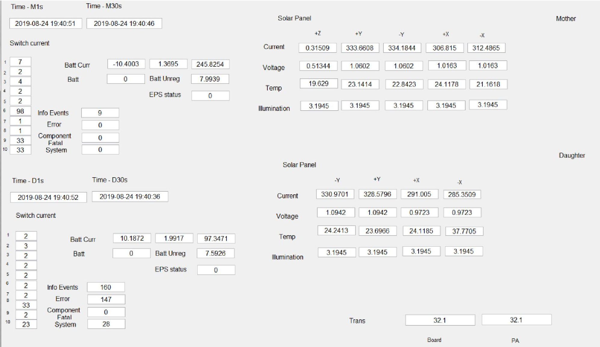

Figure 26: Real time housekeeping display

<!-- PDF_PAGE: 119 -->

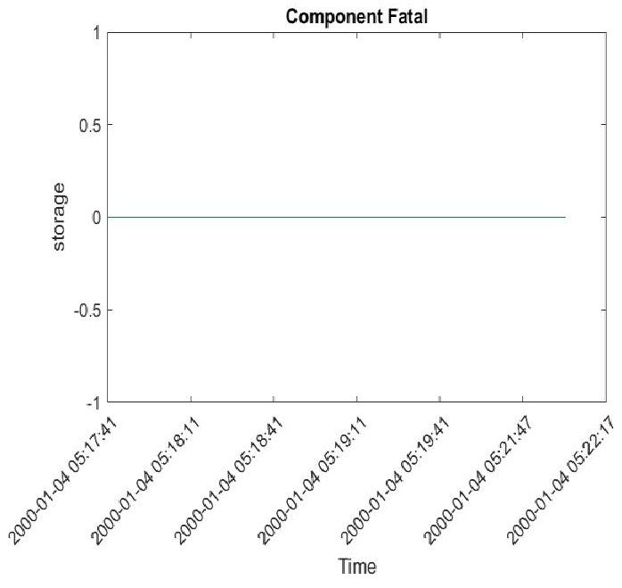

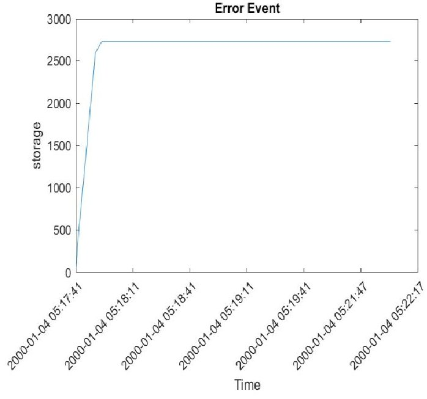

Figure 27: Error log as a part of DESCENT delayed telemetry

Running a functional test using the tool in the AIT campaign allowed operators to understand the capacity and healthy operating ranges for the standard telemetry expected from the on-board components, per the mode of operation

Functionally, the tool acts as a sequential packet decommutation engine, first filtering the TCP headers for incoming spacecraft data, then filtering space packet headers and finally filtering on ECSS PUS services, subservices before decommuting the data field parameters. Calibration functions are applied as needed to the finally decommuted parameters to turn raw values into engineering values. The architecture to obtain information from the packets received over TCP IP is shown in figure 28. The tool provides a simple development and run-time interface which allows operators to configure the tool simply and visualize information coming from the satellite. The tool will be made available on a common software website; such that other satellite developers can benefit from it. The tool can be used in conjunction with a generic or mission-specific monitoring and control tool, if desired, by echoing data from the M&C tool to a TCP IP port for this MATLAB code. For the DESCENT mission., the Bright Ascension ground software was successfully used in conjunction with this data visualization tool.

<!-- PDF_PAGE: 120 -->

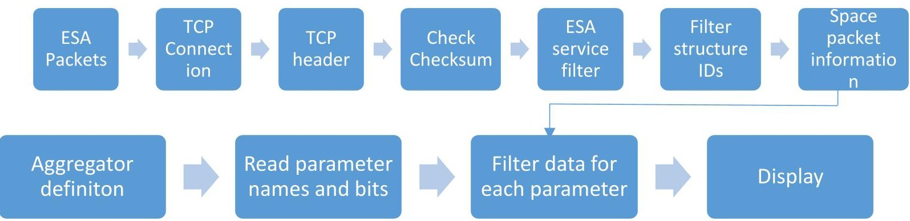

Figure 28: Tool architecture

<!-- PDF_PAGE: 121 -->

## Chapter 8. Discussion

The aim of this thesis was to introduce a standard CubeSat abstracted operations sequence which would allow CubeSat developers and operators to design, develop and test their CubeSats, and train their operators, in a standard way prior to a launch, reducing cost, schedule and mission risk. The standard operations would also provide CubeSats with a template for operations during mission execution and a minimum list of parameters required to execute a mission mode.

In identifying this goal, the thesis studied existing standards within the space industry and the lack of standards specifically for CubeSat applications. Many of the standards defined by international space agencies are more aligned for use with large spacecraft. Even at the operations standardization level, many of the standard on-board services presented in the ESA PUS service do not apply for use in the Picosat community, or are too complex to be implemented for rapid or low-cost CubeSat communications. This thesis was in part inspired by PCPARTPICKER $ ^{4} $ , a tool which allows building computers with implementation of different components, selected as pre compatible with other components. Using the tool as a guiding principal, an approach to introduce similar framework for CubeSat advancement was looked into. However, in order to achieve the bigger picture many CubeSat component manufacturers would have to produce components compatible with other component manufacturers. A great detail of standards in software and hardware for those components would not only have to be defined, but adopted by multiple manufacturers, to achieve usefulness for the industry. However, CubeSat operations is a space which depends only on the developers and the operators of the mission. Therefore, similar to the CubeSat form factor an operations abstraction for CubeSats is an area which was explored for this thesis.

Upon exploring the operations sequence for all CubeSat missions, this study concluded that similar to the CubeSat size standard introduced by Cal Poly; CubeSat operations can benefit from an abstracted approach to operations. Various CubeSat mission operations were studied and commonality across them was identified. As a result, an absolute minimum operating mode

<!-- PDF_PAGE: 122 -->

requirement for all CubeSats was defined. Most CubeSat missions do not detail their exact operating sequence in public documents. Therefore, it becomes a challenge to gather information for all mission modes from one specific mission. Usually missions may have multiple people focusing on different areas, which limits the information presented for mission modes. This thesis instead gathered information for different operating modes and CubeSat approaches to these modes. Chapter four of this thesis defines various solutions to an operating mode based on application by other CubeSat missions. A common solution was then proposed and presented as an abstracted sequence in chapter five. Defining common mission modes was straightforward because all missions analyzed had common modes focussing on communications with ground, a minimal or fail-safe mode and a nominal mode. The challenge was to define the criticality of each mission mode, such that the abstracted sequence can be diversely generic and easily adapted by each mission. The abstracted CubeSat operations highlight operations for different components based on the CubeSat design. It also provides the user with a set of possible failure operations to consider in each mode.

The abstracted CubeSat operations presented in chapter five detail common scenarios a CubeSat may implement. Applying the abstraction to the DESCENT operations demonstrated how the abstraction would be used for future missions. This is also displayed in chapter six, where most functionality performed in DESCENT operations was highlighted in the abstracted operations.

DESCENT mapping did highlight places where the abstraction does not answer all operations needs. Sometimes missions may not be able to accommodate suggestions from the abstraction because of restricted performances of its subsystems. In case of DESCENT, the mission does not have angular rate data when antennas deploy. Therefore, DESCENT will not be able to judge the success of antenna deployment in orbit using such data. Based on mission timelines and limitation of their design not all practices suggested in chapter five will be implemented into mission ops. Not all missions will have a beacon on board and support full- duplex communications.

DESCENT operations took almost a year to materialize and be documented into its software. Having the abstracted CubeSat operations in the design phase of the mission would have allowed

<!-- PDF_PAGE: 123 -->

developers to accommodate the design to fit best practices in mission operations. The activity of mapping DESCENT operations to the abstraction (a posteriori) took a few days only. Using the abstracted operations sequence for the DESCENT mission provided some evidence to support the hypothesis that introducing operations standardization for CubeSats could help save developmental time and cost on missions - It would be reasonable to assume that much of the year of developmental and framework time would have been able to be saved had the abstraction been available at the start of the program.

The operations sequence defined in this thesis is a combination of best practices used on various missions across the domain. Many missions however do not implement these practices. As we see in chapter four, most missions have similar functionality, but they use different modes, nomenclature, and different supporting operations tools, reinventing the wheel each time. Abstracting a common operations sequence will allow easier CubeSat development and save cost and time. Learning from DESCENT's example, it can also be concluded that the abstracted operations can be applied to missions quite simply.

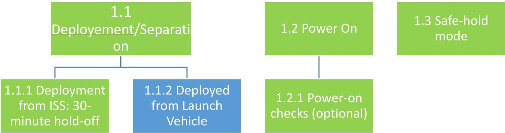

Figure 29: Applying Mode:1 abstraction to DESCENT

Table 52: Additional and minimum capability sets applied to DESCENT for pre-contact mode

<table border="1"><tr><td colspan="2">Ops Activity</td></tr><tr><td>Activity</td><td>Description</td></tr><tr><td>1.1.1 or 1.1.2</td><td>Spacecraft deploys from deployer on launch vehicle or ISS</td></tr><tr><td>1.2</td><td>Critical components power on and perform minimum health checks</td></tr><tr><td>1.2.1</td><td>Perform additional health checks upon boot</td></tr><tr><td>1.3</td><td>Boots into safe-hold image</td></tr></table>

<!-- PDF_PAGE: 124 -->

In order to examine the compatibility of the proposed abstracted sequence to DESCENT operations, the compatibility for the "time before first contact" mode from chapter 6 was used. Common functions between DESCENT operations and the operations sequence are displayed in green in figure 29. The operations abstraction was easily able to map the DESCENT operations. More consequentially, parameters displayed in Table 8 were overlapped with the abstracted operations. Table 53 below shows how the abstracted sequence was easily mapped on the DESCENT parameters for this mode.

Table 53: Overlapping DESCENT parameters with abstracted sequence Mode: pre contact

<table border="1"><tr><td colspan="3">Minimum capabilities</td></tr><tr><td>Activity</td><td>Description</td><td>DESCENT parameter</td></tr><tr><td>Battery</td><td>Check Voltage and current for 3.3V,5V and unregulated linesTemperature</td><td>Battery Voltage(3.3 and 5.0)Battery TempBattery current</td></tr><tr><td>Bus(OBC)</td><td>CurrentTemperatureSwitch states</td><td>EPS switch currentEPS board tempEPS expected switch states</td></tr></table>

<table border="1"><tr><td colspan="3">Additional capabilities</td></tr><tr><td>Activity</td><td>Description</td><td>DESCENT parameter</td></tr><tr><td>Transceiver</td><td>Temperatures and power levels</td><td>TX temp
TX power levels</td></tr><tr><td>Spacecraft boot count</td><td>Eps and OBC boot counters</td><td>Image boot- current and next image boot</td></tr><tr><td>Memory</td><td>On board storage of data</td><td>Storage full flag</td></tr><tr><td>Resets</td><td>Number of OBC resets</td><td>Auto reset count</td></tr><tr><td>Time</td><td>Boot time and spacecraft time</td><td></td></tr></table>

Mapping the abstracted sequence to DESCENT flagged that boot time is not a dedicated parameter in the DESCENT spacecraft sequence. The time parameter for DESCENT is part of the downlinked packet in the header information, therefore, it does not need to be recorded in the table above as a unique parameter (it is provided in every downlinked packet). However, this activity helps outline all the critical data that need to be downloaded from a satellite in this mode.

<!-- PDF_PAGE: 125 -->

## 8.1 Limitations

Developers with extensive prior experience in the satellite industry may have internal standards or practices that can reduce time and cost in line with the approach captured in this thesis. However, first-time CubeSat developers will have to spend the time learning concepts and implementing them. In order to have a successful mission, many concepts need to be thought about during the developmental phase of the mission. CubeSat operations is one such area which needs thorough understanding of the mission requirement and its executions. Even developers of traditional space missions have to consider many of these issues when developing their first CubeSat, due to the differences in cost, risk profile, complexity and the potential for savings with these small space platforms.

The proposed abstracted CubeSat operations will help new developers in developing their operations sequence, developing their design alongside their operations, developing a functional test procedure and conducting an AIT test campaign for successful flight execution. In a study presented by Richardson, Schmitt, Covert and rogers, only 21% of university teams developing a CubeSat can finish their mission in less than 2 years. On the other hand, 100% of repeat commercial CubeSat developers can launch their CubeSat in less than 2 years [10]. This thesis aims primarily to aid those first-time satellite developers.

Finally, although the abstraction accommodated multiple designs and hardware and software a CubeSat may carry, it is not intended to address all mission operations or payload activities and is still limited to the functionality a given spacecraft may have on board. Following the proposed operations sequence will help increase the success rate of university CubeSat missions and help teams save developmental time and cost. It is also hoped that such a standard may get adopted by component manufacturers, who will implement the recommended minimum functionality sets in their COTS components, reducing such functional limitations going forward.

<!-- PDF_PAGE: 126 -->

## Chapter 9. Future Work

This thesis studies an abstracted operations sequence which can be used for upcoming CubeSat missions. Results from this thesis and the implementation of the operations sequence to the DESCENT CubeSat mission will be presented at the International Aeronautic Congress in October 2019. This research work has been scheduled to be presented with other small satellite missions. Having a small satellite community review this research work early on will allow adapting the sequence for other missions.

One of the contributions of this thesis is the MATLAB tool, which can be modified to provide a visual for telemetry received during a pass. The first step required in order to use the tool more fully would be to modify the GUI for downlinked telemetry to better meet the needs of the operator. Depending on the complexity of the mission, operators can decide critical telemetry they want to visualize and the frequency of it. Hence, operators can develop the tool to better meet their mission needs. Eventually, mode-specific generic display templates can be developed, differentiating between graph-based data for trends, and information like power, switch states etc. displayed using status bars/colours

Future work for the tool includes providing simple supports for other ESA PUS services such as better error log visualization and large data transfer support as a part of received delayed telemetry. Large data transfer, downloading images or memory dump on a spacecraft can be different from delayed telemetry. The software configuration of these components is different and is also associated in a different service as a part of the ESA PUS. Hence, future work involves modifying the delayed telemetry code to accommodate data coming from different services. The next steps include adding these functionalities to the DESCENT mission implementation of the tool.

Exposing the new operations standards to experts in the CubeSat industry and gaining their feedback is very important to produce reliable operations for CubeSats. Therefore, a major task of future work is to introduce this sequence to other CubeSat developers and ask for feedback on its usability. In order for the proposed operations abstraction to be adopted by missions and maintain relevance with time, it needs to be able to evolve as CubeSat mission designs evolve.

<!-- PDF_PAGE: 127 -->

The Canadian Space Agency announced a grant for the Canada CubeSat Project (CCP) in 2017, where 15 teams across Canada are involved in making a CubeSat. These CubeSats are currently performing their preliminary design phase and are scheduled to be flown by 2021. As mentioned in a paper by Baer et al., it is beneficial to implement operations in the design phase of the missions [44]. The CCP teams are currently performing design iterations and thinking about operations at this stage will help them design their spacecraft around operational requirements of the missions. York being part of one of the teams from the CCP group, this sequence of abstracted operations is planned to be provided to the other teams as part of future work, and the mechanisms by which the abstractions can be modified and updated can then be explored. Experience from this broader implementation of the standard for each CubeSat in the CCP may highlight ways that the operations sequences may need adjustment. Feedback from these teams will also provide higher confidence that the operations sequences will fit many CubeSat needs, before it is released to the CubeSat community more broadly. Other developers may recommend adding operational modes which they require in their mission but are not addressed in this current abstraction. The next step will be to test this sequence with a series of CubeSat missions and see if it can be broadly accepted with little to no modifications.

Keeping in mind that most CubeSats are a result of COTS components available in the market, these components may have different software and hardware designs. Manufacturers of different components have different sets of parameters available for downlinking. The data sheets detailed for each component are significantly different. The abstraction sequence showcases potential telemetry satellites will access from each operating mode. Having a common abstraction allows development in the COTS framework, where all datasheets can include a section to discuss the downlinking of minimum required parameters.

In future the hardware and software definitions for CubeSat components can be uniform across different developers. Beyond providing generic telemetry tables for abstracted common telemetry points, having a set of common pinouts for boards would be an obvious next step for standardization. Many CubeSat developers already rely on PC 104 stack for parts compatibility. Having defined pin outs for certain power, data and other interfaces will make software design and hardware design easier. In future this will also allow other hardware developers to follow the same framework and produce compatible components. As a result, many COTS components will

<!-- PDF_PAGE: 128 -->

be compatible with each other and this will save developmental time for the developers and assemblers of the mission. More space can be saved for the payload and pre- assembled/compatible CubeSat structures can be available at an affordable price in the market.

Furthermore, CubeSats may become very similar devices to computers, where adding new components and functionality will be as easier. An example of such framework in the industry can be found for computer devices. The PCPARTPCIKER allows a user to specify off the shelf components for a computer and calculates other associated factors $ ^{5} $ . The tool allows the user to see compatibility of different components like video cards with the devices they chose to use. Moreover, it allows the user to see the cost, additional software etc. it would require. A CubeSat part builder will allow the user to see the compatibility between components, have a common resistance, modulation, framework etc. The part builder may also allow the user to generate other engineering and design documents CubeSat require. The tool can be used to easily generate a link budget, power budget, and fill in licensing documentations. CubeSat tool will also decrease the flight software developing time, because the tool will allow pre configuration amongst components. Similar to a computer, basic functionality, memory location, etc. between components will not have to be defined by the user when components are connected together. The CubeSatShop was used as an example and a sample window was built $ ^{6} $ . Figure 30 below shows a template to a CubeSatShop functionality.

<!-- PDF_PAGE: 129 -->

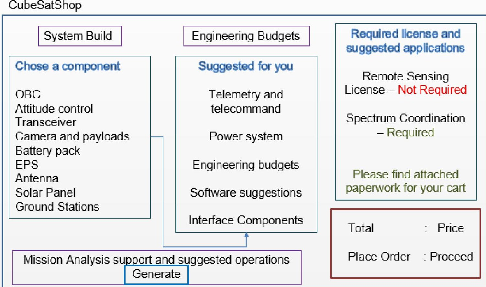

Figure 30: Suggesting future simplifications in CubeSat development

To further make CubeSat development easy, standards can be used while developing a CubeSat software design. In order to make software design, component developers can streamline a common set of telemetry each component needs to transmit in line with the operations sequence. Manufacturers can provide the data in a format, which will communicate mission essential data based on the sample capability tables shown in the abstraction sequence of this thesis. Having a list of minimum capabilities from manufacturers which overlaps with the minimum capabilities of operation sequence will help with the software definition. Mission planning and development time and cost can be significantly reduced. The current structure of COTS datasheet has telemetry data available in various places for operations offered by the particular component. This makes it challenging for operators and designers to develop the software. Having a common data set for downlink will help with mission planning and operations in general.

<!-- PDF_PAGE: 130 -->

## Chapter 10. Conclusion

CubeSat operations and mission coordination development can take up to 18 months of the CubeSat development lifecycle. [77] Chapter four of this thesis makes it evident that there is a often significant similarity between operations sequences for very different CubeSats. Therefore, having a common operation sequence for CubeSats will help save operational development time.

The novelty of this thesis is in its proposition of an abstracted CubeSat operations sequence, which will be used during CubeSat development, functional testing and in flight. The operations sequence can be used alongside the design phase of the missions to reduce the risk that mission operations requirements are met.

The thesis also contributes, by introducing an operations monitoring tool that is compatible with the operations abstraction presented. The tool helps operators visualize real-time and delayed telemetry from a spacecraft and act accordingly.

Using a common operation sequence across various CubeSat missions will help the CubeSat community train operators in a standard way, and support exchange of information to understand anomalies and deal with them. 17 % of CubeSat missions fail because of communication errors [78]. Practicing an abstracted operations sequence will reduce operational errors.

The abstracted sequence tries to generalise the key parameters a CubeSat may downlink. CubeSats can use the lists as a checklist when defining their flight software to ensure that the parameters they develop for the components provide all the functionality required in flight.

The presented sequence can also be used to accelerate design and definition of ground test procedures using test-as-you-fly principles and can consequently be tested multiple times on the ground pre-launch. Running multiple tests and recording data from each test will allow visualization of data shifting across the testing campaign.

The abstracted operations have been applied to a York university CubeSat mission called DESCENT. The results of applying this operation sequence to the DESCENT mission are presented in this thesis. The tool developed in this thesis was also used for visualization of DESCENT critical telemetry and shows how the tool can be used during functional test of

<!-- PDF_PAGE: 131 -->

spacecraft. It is important to test a full operations sequence before CubeSat assembly, so that major setbacks can be accounted for early in the mission development.

In conclusion, the thesis states that having an abstracted set of CubeSat operations will allow CubeSat developers to save time and cost. Demonstrating the overlapping parameters between DESCENT and the abstracted CubeSat sequence illustrates its usefulness for such an operation sequence. This thesis was able to adapt best practices from various CubeSat missions and present a novel operations sequence, which can be adapted by a number of missions. Years ago, the CubeSat launch form factor introduced a shift in space industry development. Introducing more standards in CubeSat components, design, functions and operations can help utilize the CubeSat potential better. Introducing more standards for CubeSat scope can further reduce the stress accompanied with spacecraft development.

<!-- PDF_PAGE: 132 -->

## References

[1] M. P. Schroer, "a Cubesat Communications System Design, Test, and Integration," Security, 2009.

[2] M. Swartwout, "The first one hundred CubeSats : A statistical look," J. Small Satell., vol. 2, no. 2, pp. 213-233, 2013.

[3] B. Shiotani, N. G. Fitz-Coy, and S. Asundi, "An End-to-End Design and Development Life-Cycle for CubeSat Class Satellites," AIAA Sp. 2014 Conf. Expo., no. August, p. 4194, 2014.

[4] J. Puig-Suari, C. Turner, and W. Ahlgren, "Development of the standard CubeSat deployer and a CubeSat class\nPicoSatellite," 2001 IEEE Aerosp. Conf. Proc. (Cat. No.01TH8542), vol. 1, pp. 347-353, 2001.

[5] A. Toorian, E. Blundell, J. Puig-Suari, and R. Twiggs, "CubeSats as Responsive Satellites," Sp. 2005, no. September, pp. 1-14, 2005.

[6] G. M. Goh, "Space Safety Standards in Europe," in Space Safety Regulations and Standards, 2010, pp. 29-48.

[7] F. Ince, "A role for cubesats in responsive space," in RAST 2005 - Proceedings of 2nd International Conference on Recent Advances in Space Technologies, 2005, vol. 2005, pp. 106-108.

[8] E. Buchen, "SpaceWorks' 2014 Nano / Microsatellite Market Assessment," AIAA/USU Conf. Small Satelll., 2014.

[9] CalPoly, "Cubesat design specification (CDS)," CubeSat Program, Calif. Polytech. State vol. 8651, no. June 2004, p. 42, 2014.

[10] G. Richardson, K. Schmitt, M. Covert, and C. Rogers, "Small Satellite Trends 2009- 2013," in Proceedings of the AIAA/29th AIAA/USU Conference on Small Satellites, 2015.

<!-- PDF_PAGE: 133 -->

[11] A. Chin, R. Coelho, R. Nugent, R. Munakata, and J. Puig-Suari, "CubeSat: The PicoSatellite Standard for Research and Education," 2012.

[12] R. Sandau, "Status and trends of small satellite missions for Earth observation," Acta Astronautica. 2010.

[13] A. Toorian, K. Diaz, and S. Lee, "The CubeSat approach to space access," in IEEE Aerospace Conference Proceedings, 2008.

[14] M. A. Viscio et al., "Interplanetary CubeSats system for space weather evaluations and technology demonstration," Acta Astronaut., vol. 104, no. 2, pp. 516-525, 2014.

[15] D. De Villiers and R. Van Zyl, "ZACube-2: The successor to Africa's first nanosatellite," Amsat SA Sp. Symp., 2015.

[16] K. Riesing, "Orbit Determination from Two Line Element Sets of ISS-Deployed CubeSats," in 29th Annual AIAA/USU Conference on Small Satellites, 2015, pp. 1-9.

[17] C. Foster et al., "Constellation phasing with differential drag on planet labs satellites," in Journal of Spacecraft and Rockets, 2018.

[18] R. Hevner, J. Puig-Suari, R. Twiggs, W. Holemans, J. Puig-Suari, and R. Twiggs, "An advanced standard for CubeSats," in 25th Annual AIAA/USU Conference on Small Satellites, 2011, p. Paper SSC11-II-3.

[19] A. Poghosyan and A. Golkar, "CubeSat evolution: Analyzing CubeSat capabilities for conducting science missions," Progress in Aerospace Sciences, vol. 88. pp. 59-83, 2017.

[20] D. L. Bekker et al., "A CubeSat design to validate the virtex-5 FPGA for spaceborne image processing," in IEEE Aerospace Conference Proceedings, 2010.

[21] A. Klesh et al., "MarCO: Early Operations of the First CubeSats to Mars," 32nd Annu. AIAA/USU Conf. Small Satell., 2018.

[22] C. Clagett et al., "Dellingr: NASA Goddard Space Flight Center's First 6U Spacecraft," 31st Annu. AIAA/USU Conf. Small Satelll., 2017.

<!-- PDF_PAGE: 134 -->

[23] C. M. Pong, "On-Orbit Performance & Operation of the Attitude & Pointing Control Subsystems on ASTERIA," AIAA/USU Conf. Small Satell., 2018.

[24] C. Kitts et al., "The GeneSat-1 Microsatellite Mission: A Challenge in Small Satellite Design," Proc. AIAA/USU Conf. Small Satelll., 2006.

[25] G. Bonin, J. Hiemstra, T. Sears, and R. E. Zee, "The CanX-7 Drag Sail Demonstration Mission : Enabling Environmental Stewardship for Nano- and Microsatellites," 27th Annu. AIAA/USU Conf. Small Satelll., 2013.

[26] U. Small and S. Working, "Resilient SmallSat," vol. 90505, no. 310, 2016.

[27] J. N. Pelton and R. S. Jakhu, Introduction to space safety regulations and standards, First Edit. Elsevier Ltd, 2010.

[28] I. A. Sanchez, G. Moury, and H. Weiss, "The CCSDS Space Data Link Security protocol," in MILITARY COMMUNICATIONS CONFERENCE, 2010 - MILCOM 2010, 2010, pp. 219-224.

[29] Inter-Agency Space Dedbris Coordination Committee, "IADC Space Debris Mitigation Guidelines," IADC Sp. Debris Mitig. Guidel., no. Revision 1, pp. 1-10, 2007.

[30] E. E. Secretariat, "Space engineering specification," Interface, 2009.

[31] J. Dryden, "Measuring Trust: Standards for Trusted Digital Repositories," J. Arch. Organ., vol. 9, no. 2, pp. 127-130, 2011.

[32] M. Weiser, "The Computer for the Twenty-First Century," Sci. Am., vol. 265, no. 3, pp. 94-104, 1991.

[33] J. Bouwmeester, M. Langer, and Eberhard Gill, "Survey on the implementation and reliability of CubeSat electrical bus interfaces," CEAS Sp. J., vol. 9, pp. 163-173, 2017.

[34] S. a Asundi and N. G. Fitz-coy, "CubeSat Mission Design Based on a Systems Engineering Approach," Aerosp. Conf. 2013 IEEE, pp. 1-9, 2013.

<!-- PDF_PAGE: 135 -->

[35] N. Spectrum and M. Program, "NASA Spectrum Management Program Spectrum Guidance for NASA Small Satellite Missions," vol. 0, no. August 2015, 2015.

[36] B. Klofas, "Upcoming Amateur Radio CubeSats: The Flood Has Arrived," 2013 AMSATNA Symp., no. September, pp. 1-6, 2013.

[37] W. Jansen and K. Scarfone, "Guidelines on Cell Phone and PDA Security Recommendations of the National Institute of Standards and Technology," NIST Spec. Publ., p. 51, 2008.

[система [38] G. Fischer, "Next-generation base station radio frequency architecture," Bell Labs Tech. J., vol. 12, no. 2, pp. 3-18, 2007.

[39] J. Westman, ESA Technology Tree, vol. 53. 2013.

[40] "NanoRacks CubeSat Deployer (NRCSD) Interface Definition Document (IDD) NRCSD List of Revisions," 2018.

[41] C. Turner, "Development of the Standard CubeSat Deployer and a CubeSat Class PicoSatellite 1."

[42] CalPoly, "Cubesat design specification," CubeSat Program, Calif. Polytech. State ..., vol. 8651, no. June 2004, p. 22, 2009.

[43] D. Tschopp, "How Corporate Social Responsibility Reporting Standards Address Stakeholder Needs in the Americas," Environ. Manag. Sustain. Dev., vol. 1, no. 2, p. 38, 2012.

[44] G. E. Baer, R. J. Harvey, M. E. Holdridge, R. K. Huebschman, and E. H. Rodberg, "Mission operations," Johns Hopkins APL Tech. Dig. (Applied Phys. Lab., 1999.

[45] M. E. Holdridge, "NEAR shoemaker spacecraft mission operations," Johns Hopkins APL Tech. Dig. (Applied Phys. Lab., 2002.

[46] M. E. Holdridge, R. J. Harvey, and K. E. Hibbard, "Standards of conduct for space mission operations," in A Collection of Technical Papers - AIAA Space 2007 Conference,

<!-- PDF_PAGE: 136 -->

2007, vol. 1, pp. 1084-1098.

[47] M. Swartwout, "University-Class Satellites : From Marginal Utility to ' Disruptive ' Research Platforms," Proc. of18TH Annu. AIAA/USU Conf. SMALL Satelll., 2004.

[48] S. A. Asundi and N. G. Fitz-Coy, "Design of command, data and telemetry handling system for a distributed computing architecture CubeSat," in IEEE Aerospace Conference Proceedings, 2013.

[49] M. Swartwout, "Reliving 24 Years in the Next 12 Minutes: A Statistical and Personal History of University-Class Satellites."

[50] A. L. Eatchel, R. Fevig, C. Cooper, J. Gruenenfelder, and J. Wallace, "Development of a Baseline Telemetry System for the CubeSat Program at the University of Arizona," in International Telemetering Conference Proceedings, 2002.

[51] C. Noe, "Design and Implementation of the Communications Subsystem for the Cal Poly CP2 Cubesat Project," Comput. Eng., 2004.

[52] M. J. Mayoral and N. Jovanovi, "Telecommand and Telemetry Implementation of Aalto-2 CubeSat Project Title: Telecommand and Telemetry Implementation of Aalto-2 CubeSat Project," Nemanja Jovanovi M.Sc. (Tech.), 2016.

[53] S. Ilsen et al., "PROBA: Through smart operations - small satellites can be great," in SpaceOps 2016 Conference, 2016.

[54] C. S. Fish et al., "Design, Development, Implementation, and On-orbit Performance of the Dynamic Ionosphere CubeSat Experiment Mission," Sp. Sci Rev, vol. 181, pp. 61-120, 2014.

[55] B. Fox, K. Brancato, and B. Alkire, Guidelines and Metrics for Assessing Space System Cost Estimates. 2008.

[56] S. A. Asundi, "Cubesat system design based on methodologies adopted for developing wireless robotic platform," 2011.

<!-- PDF_PAGE: 137 -->

[57] J. Bowen, A. Tsuda, J. Abel, and M. Villa, "CubeSat Proximity Operations Demonstration (CPOD) mission update," in IEEE Aerospace Conference Proceedings, 2015.

[58] M. Nehrenz and M. Sorgenfrei, "On the Development of Spacecraft Operating Modes for a Deep Space CubeSat," 2015.

[59] V. Carrara, R. B. Januzi, D. H. Makita, L. F. de P. Santos, and L. S. Sato, "The ITASAT CubeSat Development and Design," J. Aerosp. Technol. Manag., vol. 9, no. 2, pp. 147156, Apr. 2017.

[60] J. Straub et al., "OpenOrbiter: A Low-Cost, Educational Prototype CubeSat Mission Architecture," Machines, 2013.

[61] T. Sorensen, "A University-developed Comprehensive Open-architecture Space Mission Operations System (COSMOS) to Operate Multiple Space Vehicles," no. February 2015, 2013.

[62] T. C. Sorensen, E. J. Pilger, M. S. Wood, M. A. Nunes, and B. D. Yost, "Development of a Comprehensive Mission Operations System Designed to Operate Multiple Small Satellites," Annu. AIAA/USU Conf. Small Satelll., vol. 25, no. February 2015, pp. SC11- IX-3, 2011.

[63] M. Chen and J. Engberg, "Satellite communication simulator for Cubsats," 2017.

[64] "Nanosats Database | Constellations, companies, technologies and more." [Online]. Available: https://www.nanosats.eu/. [Accessed: 26-Aug-2019].

[65] E. Cooperation and F. O. R. S. Standardization, "Space engineering Ground systems and operations Telemetry and telecommand packet utilization ECSS Secretariat ESA- ESTEC Requirements & Standards Division Noordwijk, The Netherlands," no. January, 2003.

[66] G. Book, "Report Concerning Space Data System Standards OVERVIEW OF SPACE COMMUNICATIONS PROTOCOLS INFORMATIONAL REPORT," 2014.

<!-- PDF_PAGE: 138 -->

[67] D. L. Oltrogge and K. Leveque, "An Evaluation of CubeSat Orbital Decay," in 25th Annual AIAA/USU Conference on Small Satellites, 2011.

[68] V. Jain et al., "CubeSats can serve multiple stakeholders too: use of the DESCENT mission to develop national and international collaboration."

[69] A. K. Misra, "Dynamics and control of tethered satellite systems," Acta Astronaut., vol. 63, no. 11-12, pp. 1169-1177, 2008.

[70] V. Jain, U. Bindra, L. Murugathasan, F. T. Newland, and Z. H. Zhu, "Practical Implementation of Test-As-You-Fly for the DESCENT CubeSat Mission," in 15th International Conference on Space Operations, 2018.

[71] U. Bindra et al., "DESCENT: Mission Architecture and Design Overview," in AIAA SPACE and Astronautics Forum and Exposition, 2017.

[72] L. Murugathasan, U. Bindra, C. Du, Z. H. Zhu, and F. T. Newland, "A Software and Hardware Redundancy Architecture for Using Raspberry Pi Modules as Command &amp; Data Handling Systems for the DESCENT Mission."

[73] Inter-Agency Space Dedbris Coordination Committee, "IADC Space Debris Mitigation Guidelines," IADC Sp. Debris Mitig. Guidel., 2007.

[74] M. E. Holdridge, R. J. Harvey, and K. E. Hibbard, "Standards of conduct for space mission operations," in A Collection of Technical Papers - AIAA Space 2007 Conference, 2007, vol. 1, pp. 1084-1098.

[75] M. Langer, "Reliability Assessment and Reliability Prediction of CubeSats through System Level Testing and Reliability Growth Modelling," 2018.

[76] S. L. Hogan, "Effective Fault Management Guidelines 5," vol. 2009, no. June, 2009.

[77] NASA CubeSat Launch Initiative, "CubeSat 101: Basic Concepts and Processes for First- Time CubeSat Developers," no. October. p. 96, 2017.

<!-- PDF_PAGE: 139 -->

