<!-- PDF_PAGE: 1 -->

# A Radiation-Reliability Assurance Case using Goal Structuring Notation for a CubeSat Experiment

By

Rebekah Ann Austin

Thesis Submitted to the Faculty of the Graduate School of Vanderbilt University in partial fulfillment of the requirements for the degree of MASTER OF SCIENCE

in

Electrical Engineering

August, 2016

Nashville, Tennessee

Approved:

Brian Sierawski, Ph.D Arthur Witulski, Ph.D

<!-- PDF_PAGE: 2 -->

# ACKNOWLEDGEMENTS

I would first like to thank my advisor, Dr. Brian Sierawski, for his guidance and support in both this research and the larger CubeSat program. Thanks also to Dr. Kevin Warren, James Trippe, and AMSAT for their help and support of the CubeSat program. Thanks to Dr. Art Witulski for his help and leadership with the GSN research. Special thanks to Nag Mahadevan, Dr. Gabor Karsi, and the Institute for Software Integrated Systems for supporting the modeling environment and to Dr. Andrew Sternberg for teaching and supporting me with Mentor Graphics, circuit board design, PCB manufacturing, and learning how to troubleshoot.

Thanks to all of the professors, engineers, and students in the Radiation Effects group and the Institute for Space and Defense Electronics for their support, ideas, and encouragement. I would also like to thank Dr. Robert Weller for suggesting that I look into graduate school as a first year engineer at Vanderbilt and Dr. Robert Reed for giving me my first research opportunity a year later. Finally I would like to thank my family and friends for their support throughout this process. I would not have made it through without you.

This work was supported by the Arnold Engineering Development Complex (AEDC), the Defense Threat Reduction Agency (DTRA) Basic Research Program 6.1 and 6.2, NASA ELaNa program, and NASA Reliability and Maintainability Program and Electronics Parts and Packaging Program (NEPP) grant #NNX15AV48G.

<!-- PDF_PAGE: 3 -->

## TABLE OF CONTENTS

ACKNOWLEDGEMENTS...ii

LIST OF FIGURES...iv

Chapter

I. INTRODUCTION...1

II. OVERVIEW OF RADIATION EFFECTS...3

Space Radiation Environment...3

Total Ionizing Dose (TID)...3

Single-Event Latch-up (SEL)...4

Single-Event Upset (SEU) and Single-Event Functional Interrupt (SEFI)...5

Mitigation Strategies for COTS...5

III. OVERVIEW OF CUBESAT EXPERIMENT...7

IV. INTRODUCTION TO GOAL STRUCTURING NOTATION...11

Reliability & Maintainability Hierarchy...14

V. CONSTRUCTION OF MODEL FOR CUBESAT EXPERIMENT...17

Functional Model...19

System Model...20

Linking Functional and System Models...23

GSN Model...23

Future Work: Linking GSN Model to Other Models...34

VI. CONCLUSIONS...37

REFERENCES...39

<!-- PDF_PAGE: 4 -->

## LIST OF FIGURES

Figure Page

1: Two-transistor model for latch-up in an n-well CMOS structure [6] 4

2: Simplified Block Diagram on REM Experiment Board 10

3: Elements of GSN 11

4: M of N Options 14

5: R&M Template based on GSN notation 16

6: WebGME modeling environment 17

7: Flow chart for GSN model construction 18

8: Functional Decomposition of Mission Objective 20

9: System Model of CubeSat Experiment 22

10: Functional model with references to system model 23

11: Top-level GSN model 25

12: Parts Characterization Hierarchy 26

13: Proton SEL Tests Hierarchy 26

14: TID Tests Hierarchy 27

15: SEL Detection and Isolation Hierarchy 28

16: SEE Recovery Hierarchy 29

17: Fault Propagation Hierarchy 30

18: SEL Board Level Testing Hierarchy 31

19: SEL Recovery Hierarchy 32

20: SEFI Detection Hierarchy 33

21: SEFI Recovery Hierarchy 33

22: Linking Solutions to Library with Test Results 35

23: Linking Goals with System Model 36

<!-- PDF_PAGE: 5 -->

## CHAPTER I INTRODUCTION

CubeSats have become an attractive platform for affordable, quick-turn spaceflight in spite of the volume, mass, and power constraints imposed by the platform [1]. These constraints make the use of radiation-hardened (rad-hard) electronics in most cases prohibitive. Rad-hard electronic parts have larger footprints, are more massive, and consume more power than their commercial counterparts in return for immunity to the radiation environment of space. Using rad-hard electronics in CubeSat systems increases costs and can make meeting the volume, mass, and power constraints difficult. Using commercial off-the-shelf electronics (referred herein as COTS) increases the risk of failure for the system, but strategies like "Careful COTS" have been developed by the community to mitigate the radiation concerns [2]. This includes total ionizing dose (TID) screening of COTS and latch-up mitigation with electrical current and thermal limiting circuitry.

The evaluation of electronic piece parts performance related to the space radiation environment is Radiation Hardness Assurance (RHA) [3], [4]. RHA is the methodology for ensuring that the radiation environment does not degrade or damage the electronics to the point that the system can no longer function during the lifetime of the mission. This process includes defining system requirements, defining the radiation environment, selecting and testing COTS, and designing for radiation-tolerance. The result is a system that is reliable for a particular space environment and focuses on ensuring that the system can carry out the mission with electronics that have non-destructive failure modes and that system has mitigation or circumvention of radiation-induced errors and non-destructive radiation event failures. When reviewing the RHA process, it is important to present the methodology in a format that makes the discussion and review of the decisions made during the RHA process easy to follow. NASA's Office of Safety

<!-- PDF_PAGE: 6 -->

and Mission Assurance (OSMA) created the NASA Reliability & Maintainability (R&M) hierarchy that allows for the reliability and maintainability activities and decisions for a system to be presented in a graphical format [5]. In addition to making evaluation of the reliability of a system easier, the R&M hierarchy also moves reliability evaluation of systems into the Modelbased System Engineering (MBSE) paradigm. MBSE is the application of models to support activities related to system requirements, design, analysis, verification, and validation through the entire life-cycle of a system [6].

This thesis utilizes Goal Structuring Notation (GSN), a graphical argument notation, and the R&M hierarchy to create a model for system validation activities related to the radiation reliability of a CubeSat experiment. The argument is supported by total ionizing dose (TID) screening of COTS, system-level single-event latch-up (SEL) detection, isolation, and recovery, and single-event functional interrupt (SEFI) recovery in the microcontroller. These mitigation strategies were chosen because of the radiation environment expected for the mission and the expected rate of single-event effects (SEEs) compared to the required uptime to complete the science mission objectives of the experiment. The result is a graphical assurance case specifically for the radiation reliability of a spacecraft system that uses COTS instead of rad-hard parts.

<!-- PDF_PAGE: 7 -->

## CHAPTER II OVERVIEW OF RADIATION EFFECTS

Space Radiation Environment

The near-Earth space radiation environment can be divided into two types of particle groups: trapped and transient. The magnetosphere causes particles to become trapped in "belts" around the earth, mainly protons and electrons. The inner belt, which has trapped electrons and protons, starts at about 0.2 Earth radii which is 1,000 km. This is higher than some LEO satellites except for the dip in the belt at the South Atlantic Anomaly (SAA) where it decreases to 200 km from the surface of the earth which affects almost all LEO missions. Transient particles consist of galactic cosmic rays (GCR) and solar particle events. The hazards to circuits fall into three categories: TID, SEEs, and displacement damage (DD). There are also multiple types of events with SEEs. A more complete description of the space radiation environment can be found in [7]. Total Ionizing Dose (TID)

Total Ionizing Dose (TID) is the accumulated charge deposited in a circuit over time. This is the result of high energy electrons and protons ionizing atoms and producing charge carriers as they pass through the dielectric layers of an integrated circuit (IC). The charge accumulated in the insulating oxides of the circuits changes the energy band structure in the transistor which causes parametric changes in the circuit behavior. For example, trapped charge in the gate oxide changes the gate potential needed to turn CMOS transistors off. This may lead to an increase in supply current for the IC and eventual functional failure. Trapped charge in field and buried oxides can create parasitic leakage paths in the IC and increase the static power leakage current. TID is generally becoming less of a reliability issue for CMOS digital ICs as transistors decrease in size and the thickness of the gate oxides is reduced, meaning many COTS can survive the dose

<!-- PDF_PAGE: 8 -->

accumulated for short LEO missions, 30 krads $ \mathrm{(S i O_{2})} $ or less. More details about the mechanisms of TID can be found in [8].

## Single-Event Latch-up (SEL)

Single-Event Latch-up (SEL) is when a particle strike deposits enough charge to turn on a parasitic p-n-p-n junction (thyristor) in an IC. The parasitic thyristor structure is shown below in

Figure 1 and formed by the p+ contact to power, n-well, p-substrate, and n+ contact to ground path notated by the two bipolar transistors. The parasitic thyristor is inherent to the bulk CMOS process and is a concern for COTS which are mostly made with CMOS processes. The current needed to induce latch-up is determined by the bipolar gains and series resistances, which are determined by the geometry of the device. These factors change with the technology node, process, and specific circuit layout. The result of a latch-up is a self-sustaining electrical short between the power and ground of the circuit yielding a large current draw. In addition to disrupting the proper operation of the circuit, if power is not quickly removed, the high current event will permanently damage and destroy the circuit, introduce latent damage, or drain a battery source. If the latch-up has not damaged the circuit, power cycling the circuit will restore proper operation. More details about the mechanisms of SEL in different processes can be found in [9].

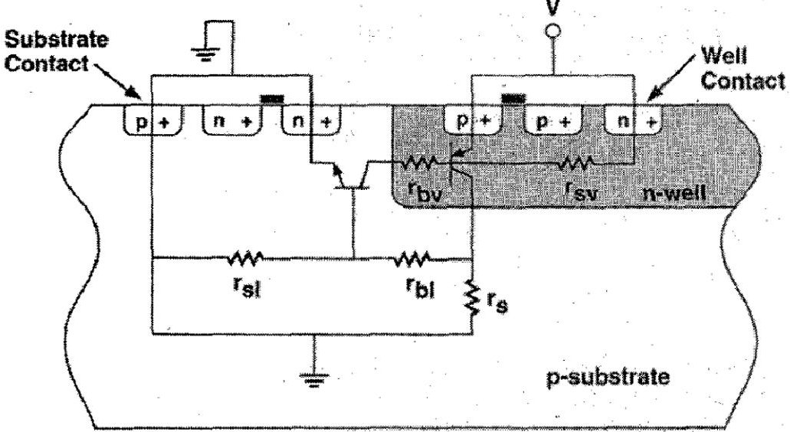

Figure 1: Two-transistor model for latch-up in an n-well CMOS structure [9]

<!-- PDF_PAGE: 9 -->

## Single-Event Upset (SEU) and Single-Event Functional Interrupt (SEFI)

A Single-Event Upset (SEU) is when a particle strike deposits enough charge into a memory element to change the state of the memory, like changing a stored 0 to a stored 1. Depending on where the SEU occurs in the memory of an IC or system determines the type of fault that is seen for a system. SEUs in an SRAM for the experiment described in this thesis are detected by writing a known pattern to the memory and then reading it back and checking for differences. An SEU in the program counter register of a microcontroller will change the next instruction executed. This type of SEU is a Single-Event Functional Interrupt (SEFI) since the SEU in the control registers or program memory causes the microcontroller to execute the incorrect program order or instruction or stops program execution all together [10]. More details about the mechanisms of SEUs can be found in [11].

## Mitigation Strategies for COTS

The use of COTS in spacecraft is not limited to CubeSats. NASA evaluates COTS for all types of missions when there are not rad-hard alternatives or cost limits the use of rad-hard electronics. In [12], the authors outline the radiation effects related issues with the use of COTS parts. In [2], the authors present a "Careful COTS" approach to using COTS in space systems. Selected strategies from [2] that are used in the CubeSat experiment design described in this thesis are described below. First, candidate COTS are screened by performing TID testing up to 30 $ \mathrm{k r a d s} \left( \mathrm{S i O}_{2} \right) $ . If the parts are still functional, they are selected for use. Other best practices include:

1. Using the lowest supply voltage to decrease the latch-up rate for parts

2. Using series resistors to limit current between pins that can be controlled by two different chips like I2C lines

3. Current and thermal limiting of power supplies

<!-- PDF_PAGE: 10 -->

In [13], the authors present system level mitigation schemes for SEEs. The ones used in the CubeSat experiment design described in this thesis are described below. To mitigate SEL at the system level, current limiting and power cycling can be implemented with load switches. Watchdog timers (WDT) can be implemented as an "I'm okay" method of SEU detection in microcontroller [13]. In this scheme, the microcontroller periodically sends a pulse to a WDT as it goes through its normal operations. The WDT expects a pulse within a certain amount of time. If an SEFI has occurred in the microcontroller that causes it to stop sending the pulse, the WDT times out and sends a reset signal to a load switch. Resetting the microcontroller causes it to reload configuration from an SEU-immune memory, like an FRAM, and should clear any errors in the configuration registers of the microcontroller.

<!-- PDF_PAGE: 11 -->

## CHAPTER IIII

## OVERVIEW OF CUBESAT EXPERIMENT

CubeSats are 10cm x 10cm x 11cm and up to 1.3 kg satellites developed at California Polytechnic State University in 1999 to make space flight achievable and affordable for universities and their students [14]. Using the Poly-Picosatellite Orbital Deployer (P-POD) to facilitate ride sharing and CubeSat deployment, 6 CubeSats were launched in 2003; in 2015, the $ 425^{\mathrm{th}} $ CubeSat was launched [15]. The platform was originally used as training projects for undergraduate students to expose them to the challenges of real-engineering practices and system design. As the CubeSat platform has matured, the mission goals for CubeSats have expanded beyond education. For example, NASA has used the CubeSat form-factor for technology demonstrations and to perform science missions. Only 19 of the 425 CubeSats launched have had science objectives as the primary mission goal but both NSF and NASA are planning more CubeSats missions with science mission objectives in the next several years [1]. Universities are also including science as their CubeSat programs mature resulting in an increasing number of peer-reviewed articles published and thesis and dissertations awarded with CubeSats in the title, e.g. [16], [17], [18], [19].

The International Council on Systems Engineering (INCOSE) Space Systems Working Group (SSWG) investigated the applicability of MBSE to CubeSats starting in 2011 with the goal of creating a CubeSat Reference Model. Their progress can be seen in [20], [21], [22], [23], [24], and [25]. In addition, NASA is applying MBSE to missions including Mars 2020, Europa Clipper, and Soil Moisture Active Passive (SMAP). Motivations for using MBSE include improving the quality of communications among development teams for systems and subsystems with the ultimate goal of reducing defects [26].

<!-- PDF_PAGE: 12 -->

As CubeSats mature and have primary mission objectives beyond educating students and as the community creates and embraces MBSE for CubeSats, demonstrations of reliability arguments for CubeSats experiments are needed.

Vanderbilt and the Institute for Space and Defense Electronics (ISDE) are interested in using CubeSats for science, specifically to evaluate radiation models used for single event rate predictions [27]. Vanderbilt designs and assembles science payloads and partners with other organizations or universities who provide the satellite structure, power, radio, and flight computer. The science objective for the experiment board described in this thesis is to count the number of upsets in a 28nm commercial SRAM on-orbit. This SRAM has been shown to be susceptible to SEU by low-energy protons [28] and electrons [29], [30] in ground tests. The on-orbit results will help evaluate if the contribution of low-energy protons and electrons to the upset rate requires changes to current rate prediction methods.

To carry out this science mission, Vanderbilt is partnering with the Radio Amateur Satellite Corporation (AMSAT) to deliver a 1U CubeSat to be launched in 400 km to 800 km polar, low earth orbit (LEO) through NASA's CubeSat Launch Initiative on ELaNa-XIV. Multiple CubeSats will be secondary payloads to JPSS-1 which will launch in early 2017. The Vanderbilt science payload, Phoenix, will include a VUC (Vanderbilt University Controller) and 3 REMs (Radiation Effects Modeling: 28nm SRAM experiment boards). The VUC acts as the interface between the AMSAT spacecraft bus and the REM experiments. The satellite is built using COTS but has been designed with radiation effects in mind.

The following requirements related to SEEs are derived both from the science mission objective and a "do no harm" to the rest of the satellite philosophy.

1. SEEs in peripheral electronics to not affect the validity of SEU data collection in the

<!-- PDF_PAGE: 13 -->

SRAM

2. SELs in the SRAM do not affect the validity of SEU data collection in the SRAM

3. SELs are mitigated by the experiment and do not adversely affect the rest of the spacecraft

In Figure 2, a simplified diagram of the REM experiment board is presented. The input power from the spacecraft is a regulated 3V rail (blue boxes in Figure 2). This 3V is divided to the different power domains by load switches to create a 3V_uC rail (green boxes in Figure 2) and 3V_switch rail (orange box in Figure 2). There are three regulators on the board to provide the three voltage domains for the SRAM: 1.8V, 0.9V, and a variable core voltage (red boxes in Figure 2). The load switches provide current limiting which protects against SELs on the board. These load switches also prevent high current conditions from propagating to the VUC or the rest of the satellite. The load switches result in 5 different power domains on the experiment board which power all of the integrated circuits (ICs) on the board. The microcontroller handles reading and writing to the SRAM, counting the number of upsets, and communicating science data and health of the board to the VUC through an I2C bus. The WDT allows the microcontroller to recover from SEFIs.

<!-- PDF_PAGE: 14 -->

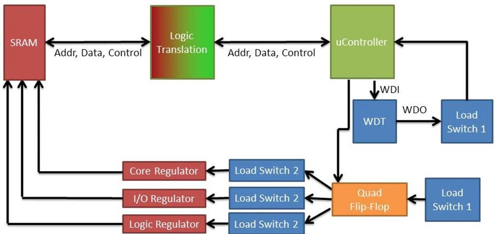

Figure 2: Simplified Block Diagram on REM Experiment Board. The red boxes represent electronics that are powered by voltages specific to the SRAM which are the 1.8V (I/O), 0.9V (Logic) and variable core power rails. Green boxes represent electronics that are powered by the 3V_uC power rail. The orange box represents the electronics powered by the 3V_switch rail. The blue boxes represent electronics that are powered by the 3V supplied by the spacecraft.

<!-- PDF_PAGE: 15 -->

## CHAPTER IV

## INTRODUCTION TO GOAL STRUCTURING NOTATION

Goal Structuring Notation (GSN) is a graphical notation standard used to explicitly document an assurance case [31]. An assurance case is a reasoned and compelling argument supported by evidence that a system will operate as intended for a given, defined environment. An argument is a connected series of claims that support an overall claim. Assurance cases, and by extension a GSN model, are only means of documenting an argument and do not establish the truth of the argument. Acceptance of the case requires the argument to be reviewed by stakeholders of the system. GSN provides a way of documenting the assurance case that allows others to discuss, challenge, and review the assurance case. GSN was created at the University of York in the 1990s and has been used in a variety of safety and security assurance cases including the Hawk Aircraft Safety Justification [32] and insulin pumps [33].

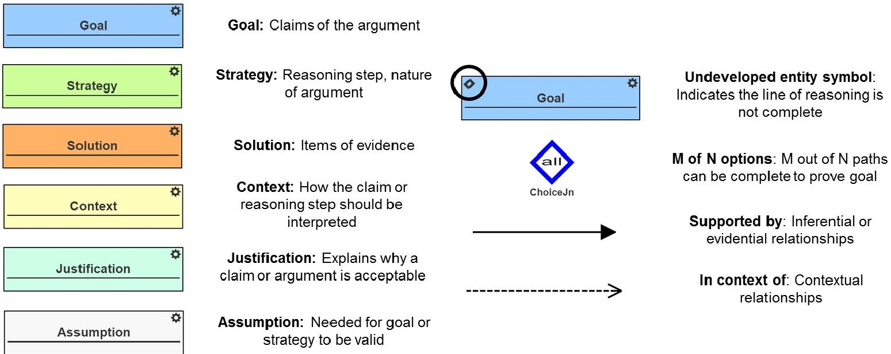

Figure 3: Elements of GSN

GSN provides a structure to indicate how claims are supported by sub-claims. These claims in GSN are represented as goals. An example goal is "COTS electronics pass mission SEL requirement: No latch-up seen up to $ 5 \times1 0^{9} $ protons/cm $ ^{2} $ ." A sub-claim, or child goal, is "FRAM

<!-- PDF_PAGE: 16 -->

passes proton SEL mission requirement." The goals for each of the electronic parts to pass the SEL requirement together support the claim that several of the parts in the system pass the SEL requirement. The assertion of evidence to support the truth of a goal is represented by a solution. An example solution is "No latch-up seen on FRAM(FM24CI6B) up to $ 6. 2 \times1 0^{9} $ protons/cm $ ^{2} $." The stakeholders reviewing the assurance case would then decide if the test result is evidence enough to support the goal of "FRAM passes proton SEL mission requirement." When documenting the reasoning between goals and child-goals, strategy elements are used. An example strategy is "Isolate and contain faults" which provides the task that specifies why the parent goal "Physical and functional pathways for fault propagation or combination are limited" is completed by the child goal "Latch-up faults are isolated and contained close to the fault source." Goals, strategies, and solutions make up the base of the GSN structure and are connected with solid arrows and indicate inferential and evidential relationships. In summary, goals and strategies are alternately refined until the goal is specific enough to be supported by a solution element which links to the results of parts tests, system tests, simulations and analysis, literature review, etc.

An assurance case is made within a certain environment. For a CubeSat experiment, the environment can include radiation, thermal profile, budget, and development time. There are several ways in GSN to show how the environment interacts with the assurance case. The first way is with a context element which provides information on how a goal or strategy should be interpreted. An example context is "Radiation environment for mission" which provides information for the goal "System remains functional for the intended radiation environment." Details about the radiation environment are needed to ensure the system functionality system will not be compromised.

<!-- PDF_PAGE: 17 -->

The second way of indicating the effect of the environment on the argument is through assumption elements. Assumptions are premises that need to be true in order for the goal or strategies to be valid. For example, the assumption "A SEFI in the microcontroller will cause it to stop sending the watchdog timer signal" is an assumption for the strategy "Implement detection and reset of a SEFI in the microcontroller using a watchdog timer." There are cases when a SEFI would not stop the watchdog timer signal and it is up to the stakeholders to determine if that assumption is an acceptable risk in the system. Assumptions are valid for all the child strategies and goals further down the evidential path from the point where the strategy or goal the assumption first appears.

The last way of indicating the effect of the environment on the argument is through a justification element. Justifications explain why a goal or strategy is acceptable. For example, the justification "Heavy-ion SEL tests were not performed because the heavy-ion environment does not significantly contribute to the radiation environment" is an explanation for the strategy "Perform proton SEL characterization tests on system parts." A reviewer might ask why heavy-ion SEL testing was not completed as it is a part of standard RHA activities and this explicitly states the reasoning for that decision. Assumptions, justifications, and context are connected to goal, strategies, and solutions with dotted arrows to indicate contextual relationships. In summary, assumptions, justifications, and context about the argument are linked to appropriate strategies or goals to further clarify the assurance case. In Figure 3, all of the elements of GSN are presented.

During the development of the model, incomplete lines of reasoning can be indicated with an undeveloped element symbol. This indicates that the goal or strategy is not fully supported. For example, if a test has not been completed for a goal, then the evidence is undeveloped. Also during development, multiple ways of making an argument can be notated by using the M of N

<!-- PDF_PAGE: 18 -->

options connector. For example, in Figure 4, a part can be considered SEL immune by either performing radiation tests to the level required by the radiation environment or by applying knowledge regarding the process technology. Either of these solutions would support the goal of a part being SEL immune. When the GSN model is reviewed, the undeveloped element symbol and the M of N options connector should not be used in the model. They are tools for the reliability team to use during development and when creating a high-level template for other designers to use.

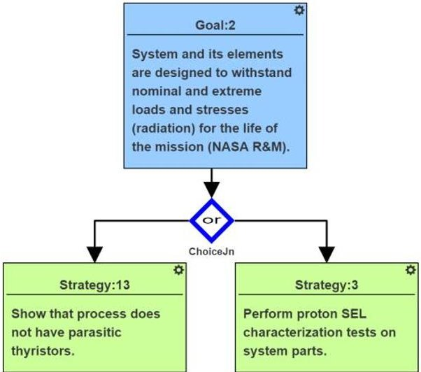

Figure 4: M of N Options

Reliability & Maintainability Hierarchy

NASA's Office of Safety and Mission Assurance (OSMA) chose the GSN standard to create the NASA Reliability & Maintainability (R&M) Hierarchy in order to move from document-based reliability requirements to an objectives-based reliability model where tests are linked with objectives specific to the mission [5]. This hierarchy was created to fit into the growing infrastructure for Model-Based Systems Engineering (MBSE) where models of the spacecraft systems and subsystems are used to define interfaces and evaluate interactions and fault propagation. The hierarchy is used to define the goals and strategies at the top-level for the GSN model presented here but has been modified to be more specific to radiation reliability concerns

<!-- PDF_PAGE: 19 -->

and to allow for higher risk mitigation schemes. Figure 5 shows the top-level of the R&M hierarchy. In this hierarchy, objectives, which are like goals in GSN, state the technical goals of the project. Objectives are defined as goals to be accomplished while goals in GSN are defined as claims of the argument. The GSN model presented in this thesis uses goals because it is applied to a specific system and not a general guideline. Strategies facilitate the accomplishment of the objective, which is a more narrow definition of strategy than in GSN but is still a way of explaining how a sub-objective is completing part of an objective. These two blocks are used in an alternating hierarchical fashion to create a template which is broad enough to apply to a wide range of projects. In this thesis, this R&M hierarchy is applied to a specific project. Because the assurance case is being made for a specific project, all of the elements in GSN are used and are not limited to goals (objectives), strategies, and context elements. Goals and strategies that come from the R&M hierarchy are denoted in the model with (NASA R&M) and annotated if they have been modified (NASA R&M mod).

<!-- PDF_PAGE: 20 -->

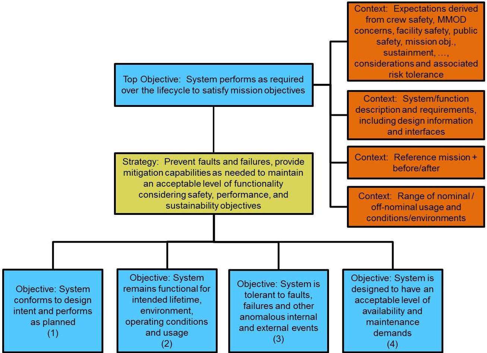

Figure 5: R&M Template based on GSN notation. Objectives take the place of goals and only objective, strategy, and context elements are used.

The radiation reliability assurance case presented in the next chapter focuses on child goals 2 and 3 in Figure 5 as related to radiation effects. A complete GSN model for the reliability and maintainability of the CubeSat experiment would include assurances cases for the system performance under nominal conditions, as seen in child goal 1, and also cases for the reliability related to other environmental factors like thermal conditions.

<!-- PDF_PAGE: 21 -->

## CHAPTER V

## CONSTRUCTION OF MODEL FOR CUBESAT EXPERIMENT

This chapter will go through the steps of constructing a GSN-based assurance case for the radiation reliability of the CubeSat experiment. The modeling of the case is done in WebGME, a web-based modeling tool that allows for the creation of domain-specific modeling languages [34]. The reliability modeling environment implemented in WebGME, as used in this thesis includes GSN, SysML, part library, fault propagation, and function modeling. The modeling environment is shown in Figure 6. The model appears in the modeling editor canvas. Modeling elements are chosen from the model parts panel, for example, GSN elements, and are modified using the attributes panel. For example, the attributes panel would be where the undeveloped symbol would be turned on. Other models can be navigated to through the model tree browser.

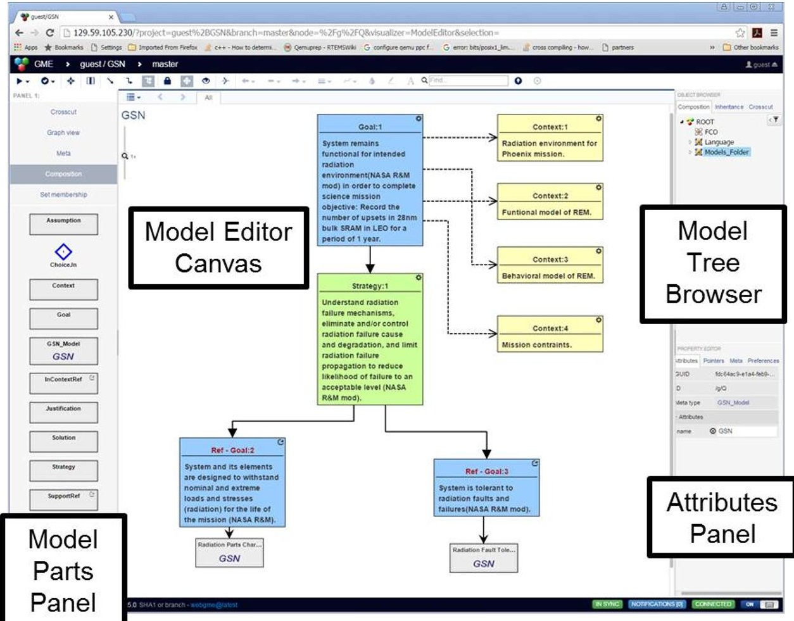

Figure 6: WebGME modeling environment

<!-- PDF_PAGE: 22 -->

Figure 7 details the method developed to create the GSN model that describe the assurance case for radiation reliability. The creation of functional and system models (Steps 2-4) help provide context for the radiation-reliability assurance case. Guidelines for linking different models together creates a starting place for integrating the GSN model of the assurance case to the larger MBSE paradigm and is an extension of the R&M Hierarchy. Steps 1-5 are described in this thesis. Steps 6-9 are outlined in future work and show how the GSN model can integrate with other models in a MBSE paradigm. Steps 10-12 were completed and the flight unit of the CubeSat experiment was delivered.

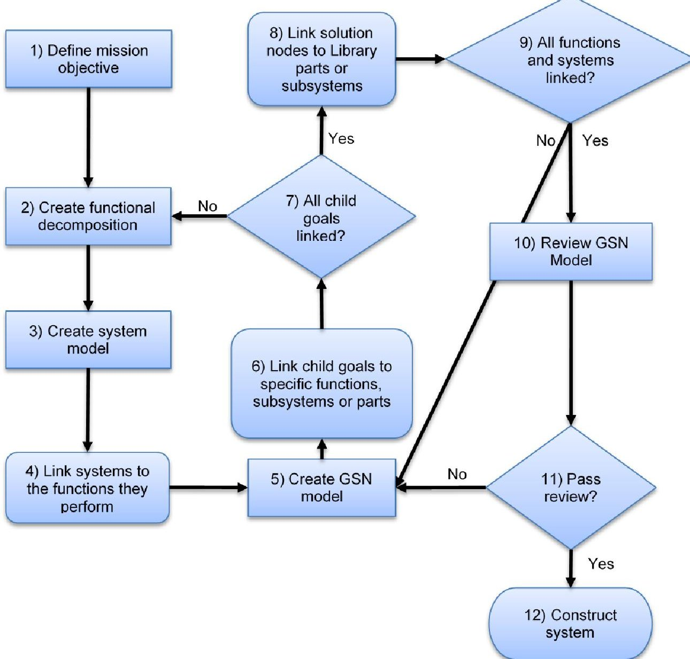

Figure 7: Flow chart for GSN model construction. Linking the different models is enabled through the creation of all the models in WebGME.

<!-- PDF_PAGE: 23 -->

## Functional Model

To define the mission objective, the first step in the method, the designers must answer: What needs to be accomplished with this system? In the case of the CubeSat experiment, the board needs to reliably count and report the number of upsets in an SRAM. This objective forms the toplevel function for the functional decomposition. The second step to creating the assurance case is to create a high level functional model of the system. The functional model is a functional decomposition of the mission objective. The functional decomposition answers the question: What does the system need to do to accomplish the mission objective?

For this CubeSat experiment, the mission objective is to reliably count and report the number of single-event upsets in the SRAM. This top-level function can be broken down into 3 main sub-functions:

- Read from and write to SRAM

- Communicate telemetry to VUC

- Recover from anomalies

In order to expose and check the SRAM, the experiment needs to power the SRAM and read and write to the SRAM. In order to reliably count and report, the system needs to recover from anomalies. This is accomplished by detecting and recovering from SELs and SEFIs. This makes up the high level decomposition of the CubeSat experiment as seen in Figure 8. These functions are specific enough so that subsystems can be designed but broad enough that the design is not dictated by the functional decomposition.

<!-- PDF_PAGE: 24 -->

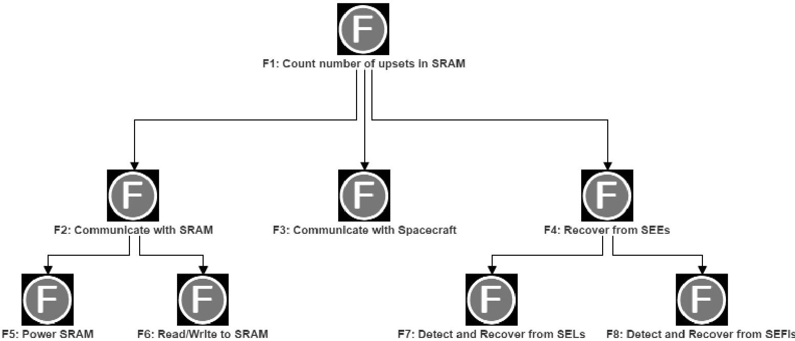

Figure 8: Functional Decomposition of Mission Objective

## System Model

The third step is to create a system model that will perform the functions in the functional model, answering the question: What is needed to implement the functions of the system? The WebGME environment includes a part library that contains the possible electronic components to be used in the system. Subsystems are built using parts in the part library. The system model is built from subsystems. Parts in the part library include parameters such as radiation test results, supply voltage, and current limits. These parameters allow for automated checks. The system model is created by connecting the subsystems and parts together in the SysML model in WebGME.

For this CubeSat experiment, the microcontroller was chosen because of past mission success and acceptable radiation testing results. It supports I2C communication, which is necessary for communicating with the spacecraft and fulfills F3: Communicate with spacecraft. This function can be seen in the connection between the VUC_Bus block and REM_Control block in Figure 9. The data bus on the microcontroller is bi-directional while the data bus on the SRAM is separated for data in and out. The microcontroller uses 3V logic while the SRAM uses 1.8V logic. In order

<!-- PDF_PAGE: 25 -->

to read and write to the SRAM, a mux/demux and logic translator are needed. These two parts make up the Logic Translation block and accomplishes function F6: Read/Write to SRAM along with the microcontroller. The spacecraft provides 3.0V, but other voltages need to be created and regulated on the experiment board. For powering the SRAM, 1.8V, 0.9V, and a variable core voltage are needed. These three regulators are in the REM_Power block of the system diagram and fulfill function F5: Power SRAM.

Also within the REM_Power block are load switches for the SRAM and for the microcontroller. These load switches provide detection of latch-up, fulfilling F7: Detect and Recover from SELs. If the current pulled through the load switch reaches the limit, the load switch turns off and circumvents the latch-up. Depending on the load switch type, either the microcontroller manually turns on the load switch or the load switch automatically turns back on after a certain amount of time.

In order to fulfill function F8: Detect and recover from SEFIs, which occur in the microcontroller, an external watchdog timer is included in the REM_Power block. The watchdog timer expects a periodic pulse from the microcontroller. If an SEFI has occurred in the microcontroller that interrupts the program flow and stops the microcontroller from sending the pulse to the watchdog timer, the watchdog timer output is pulled low. The watchdog timer output is connected to the ON signal for the load switch to the microcontroller. By pulling the ON signal low, the microcontroller is turned off and then back on. After the reset, the microcontroller reloads its configuration from an SEU-immune FRAM. This clears any bad configuration in the microcontroller from a SEFI.

<!-- PDF_PAGE: 26 -->

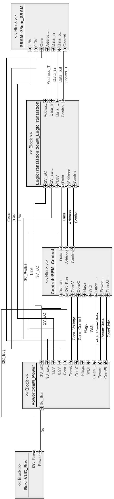

Figure 9: System Model of CubeSat Experiment

<!-- PDF_PAGE: 27 -->

## Linking Functional and System Models

Once the system model is created, the functional model should point to the parts of the system that fulfill the functions and is step 4 in the method for developing the GSN model. Figure 10 shows the functional decomposition with references to the system model. As described in the previous section, each of the functions is completed by part of the system. For example, F5: Power the SRAM is fulfilled by the regulators in the power block. Clicking on the symbol in the upper right corner of the reference takes the designer to the part being referenced in the system model within the WebGME environment.

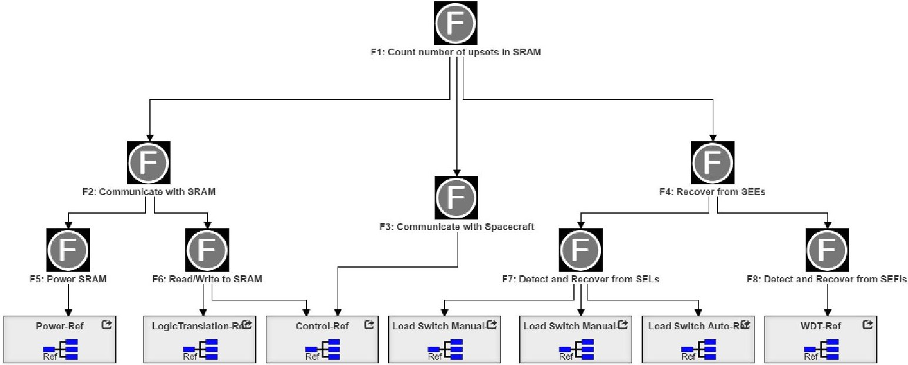

Figure 10: Functional model with references to system model

## GSN Model

The GSN model is a graphical assurance case for the radiation-reliability of the system. It presents on argument, using GSN goals and strategy elements. This argument is supported by evidence using GSN solution elements. The influence of the mission environment is shown through context, assumption, and justification elements. Other goals can be added to expand to other reliability concerns. The top-level goal is "System remains functional for intended radiation environment in order to complete science mission objective: Record the number of upsets in 28nm

<!-- PDF_PAGE: 28 -->

bulk SRAM in LEO for a period of 1 year." The first part of this goal is the same for all CubeSat experiments and is the top-level objective in the R&M hierarchy. The mission objective will change for different experiments and will change the low-level goals based on what mitigation strategies are needed to complete the science mission in the mission environment. The contexts for this goal link to the other models in the development environment as well as documents that describe the mission environment and constraints. These models and documents will change for different experiments or systems.

The overall strategy, Strategy 1, is "Understand radiation failure mechanisms, eliminate and/or control radiation failure cause and degradation, and limit radiation failure propagation to reduce likelihood of failure to an acceptable level." Through understanding radiation failure mechanisms, the radiation failure mechanisms for this system can be constrained to TID, SEL, and SEFIs. Two goals are used to mitigate these failure mechanisms. The system is "designed to withstand radiation stresses for the life of the mission" (Goal 2) and the system "is tolerant to radiation faults and failures" (Goal 3). Goal 2 presents test that show the COTS part is tolerant to the radiation environment and references the system level mitigation when the part is not tolerant or the tolerance is unknown. Goal 3 presents system-level mitigation of radiation-induced faults on COTS parts. The complete top-level hierarchy is shown in Figure 11.

<!-- PDF_PAGE: 29 -->

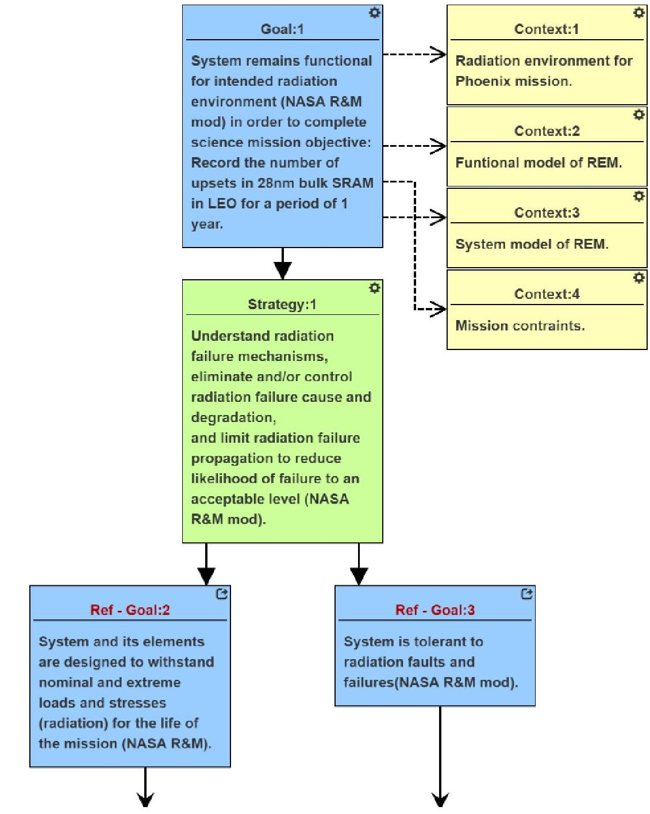

Figure 11: Top-level GSN model

In order to show that the system can withstand the radiation environment, part characterization tests are performed or SEL effects are mitigated as seen in Figure 12. Assumption 1 explicitly states the assumption that radiation test from one lot of a part will apply to a different lot. This differs from the radiation hardness assurances (RHA) best practices which recommend lot testing and introduces risk to the system. The risk from this assumption can be discussed at reviews since it is called out in the model. Justification 1 explicitly states that heavy-ion SEL tests

<!-- PDF_PAGE: 30 -->

were not performed which again deviates from standard RHA campaigns and gives a reason for that decision. The part test results are presented for proton SEL testing and TID testing in Figure 13 and Figure 14, respectively.

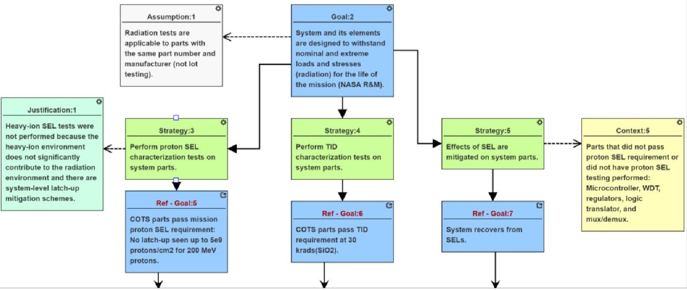

Figure 12: Parts Characterization Hierarchy

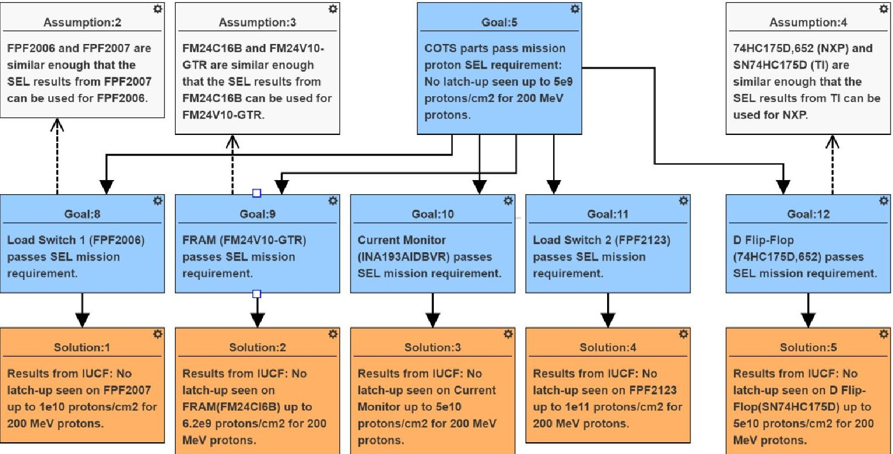

Figure 13: Proton SEL Tests Hierarchy

<!-- PDF_PAGE: 31 -->

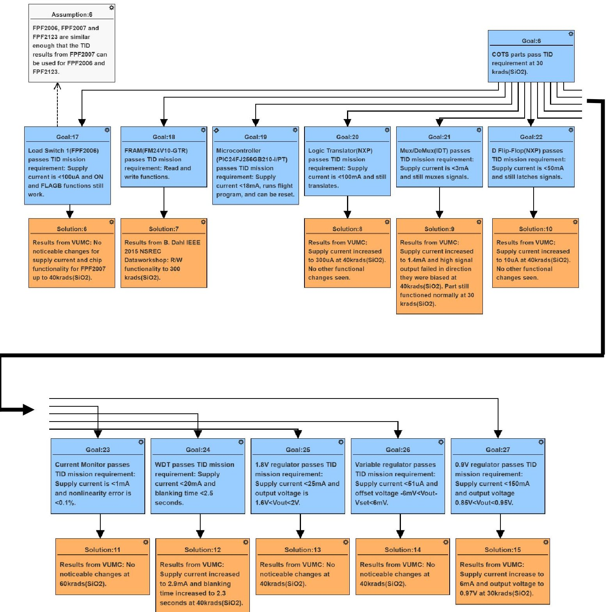

Figure 14: TID Tests Hierarchy.

Assumptions 2,3,4, and 6 in Figure 13 and Figure 14 identify when tests were performed on parts in the same family but not on the specific part number used in the system. Goal 19 is marked as undeveloped because the TID test results have not been compiled into a report. Goal 7 describes the SEL mitigation strategies for the COTS that failed proton SEL testing or were not

<!-- PDF_PAGE: 32 -->

tested and is discussed later in this section when Goal 7 is referenced again when the SEL recovery strategies are described. This completes the argument made starting at Goal 2 in Figure 11.

The argument started at Goal 3 describes the system level mitigation techniques for SEEs and is presented in Figure 15. Strategy 2 describes the approach taken to making the system tolerant to faults. The radiation-induced faults need to be detected early and stopped to minimize the effect on the system. Goal 4 covers detection and recovery from SELs and the detection and recovery of SEFIs in the microcontroller.

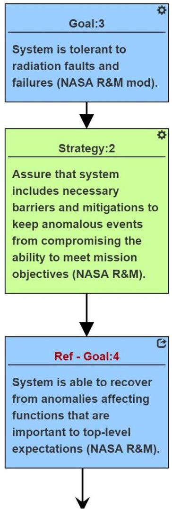

Figure 15: SEL Detection and Isolation Hierarchy

<!-- PDF_PAGE: 33 -->

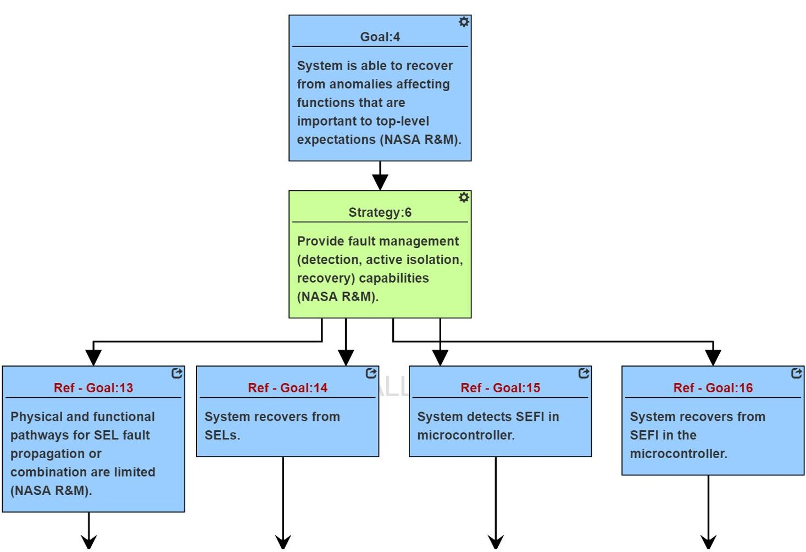

Figure 16: SEE Recovery Hierarchy

Figure 16 describes the strategies and goals for fault management and recovery. Goal 13 describes how SEL faults are stopped from propagating. Goal 14 describes how SEL faults can be detected and recovered from in a way that minimizes impact to the mission. SEL detection is the same as it was described before in Goal 6. Goal 15 and 16 describe the detection of and recovery from SEFIs in the microcontroller, respectively.

<!-- PDF_PAGE: 34 -->

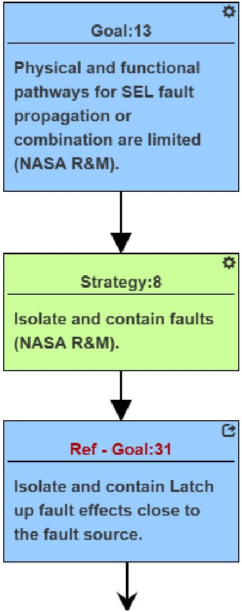

Figure 17: Fault Propagation Hierarchy

Figure 17 describes the argument for SEL isolation. This is important for the "do no harm" to the rest of the satellite requirement. Figure 18 provides the evidence for detection and isolation of latch-up. Most of the evidence is bench-top testing but some board level proton SEL testing was done on a VUC. The circuitry for the v3p3_uC bus on both boards is the same and this is noted in Assumption 7.

<!-- PDF_PAGE: 35 -->

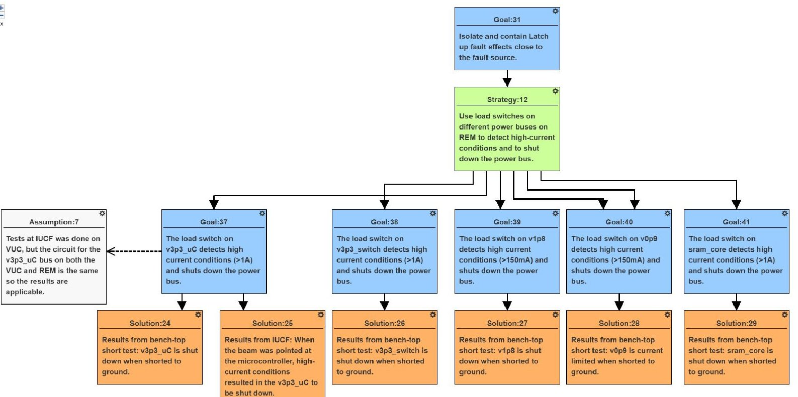

Figure 18: SEL Board Level Testing Hierarchy

<!-- PDF_PAGE: 36 -->

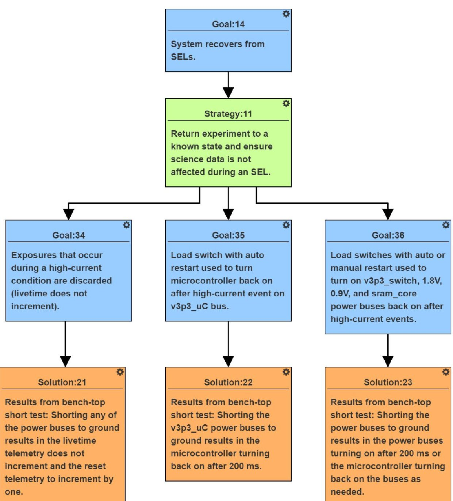

Figure 19: SEL Recovery Hierarchy

Figure 19 presents the evidence for SEL recovery. Load switches are used to bring the power buses back up after high current conditions. Goal 34 is to ensure that only upsets from particle strikes in the SRAM are counted. Latch-up could cause read or write failures that would increase the upset count or alternatively, improperly characterize the livetime if an exposure is interrupted and not terminated properly.

<!-- PDF_PAGE: 37 -->

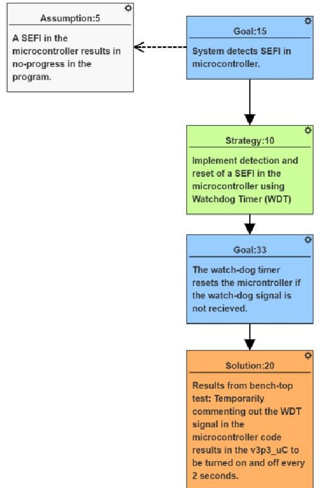

Figure 20: SEFI Detection Hierarchy

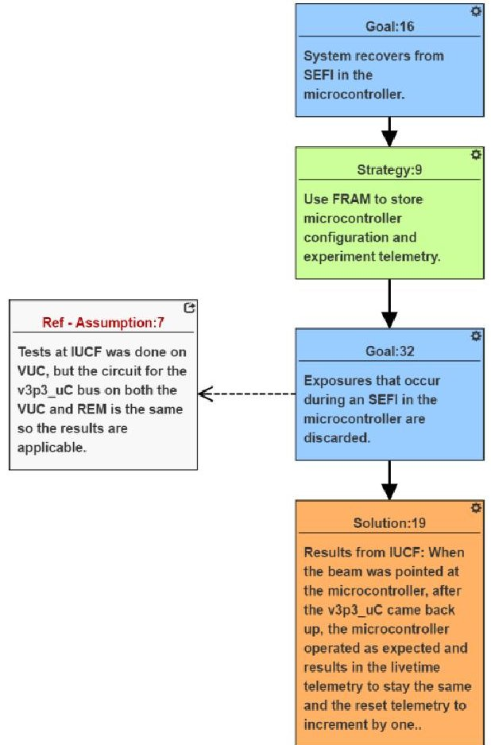

Figure 21: SEFI Recovery Hierarchy

<!-- PDF_PAGE: 38 -->

Figure 20 and Figure 21 describe the argument for SEFI detection and recovery. A watchdog timer is used to detect SEFIs in the microcontroller. As stated in Assumption 5, this will only detect SEFIs in the microcontroller that cause the microcontroller to stop sending the signal to the watchdog timer. Other SEFI and SEU detection techniques can be implemented in software if deemed necessary. Recovery from SEFI happens by using the watchdog timer to turn off and then on the load switch which resets the microcontroller.

## Future Work: Linking GSN Model to Other Models

The GSN model can be built upon in WebGME by linking to other models. This is not part of the GSN standard but is an extension that allows for GSN models to interact with other models in an MBSE paradigm. Linking GSN models with other models allows for system environment changes to propagate to the reliability argument. For example, the system model is where requirements and interface information is represented. Linking GSN elements to the system model would then allow for a requirement change in the system model to propagate to the GSN model.

The rules for linking the models provide a systematic approach to the integration of the models and makes the process less arbitrary. The rules are also designed to allow for automation of checking the rules. All of the solutions should be linked to parts and subsystems in the part library. The part library is where test data about parts is stored. All of the parent goals of the solutions should be linked to either a subsystem or part in the system model or a function in the functional model. If any of the parent goals are not linked to the system or functional model, then the functional and system models are incomplete and should be revised. Every bottom level function in the functional model and every subsystem and part in the system model should be referenced in the GSN model at least one time. If they are not, then the GSN model has not considered the entire system for radiation reliability. After these two checks are done, the model

<!-- PDF_PAGE: 39 -->

is ready for review. These checks do not guarantee a complete GSN model but they are easily automated and identify arguments overlooked in the modeling environment. The development of the radiation reliability assurance case summarized in this chapter completes the process described in Figure 7.

Figure 22 shows how links from solutions to the parts library are implemented. The solution on the left is Solution 2 in Figure 13 which is the result from proton SEL testing the FRAM. By clicking the symbol on the upper right corner of the reference, WebGME displays the FRAM model in the library. Within the FRAM model are relevant parameters about the FRAM including the proton SEL cross-section. The details of the parameter are seen in the bottom right pane. These parameters allow for automation of comparing radiation results to mission requirements for parts in the part library.

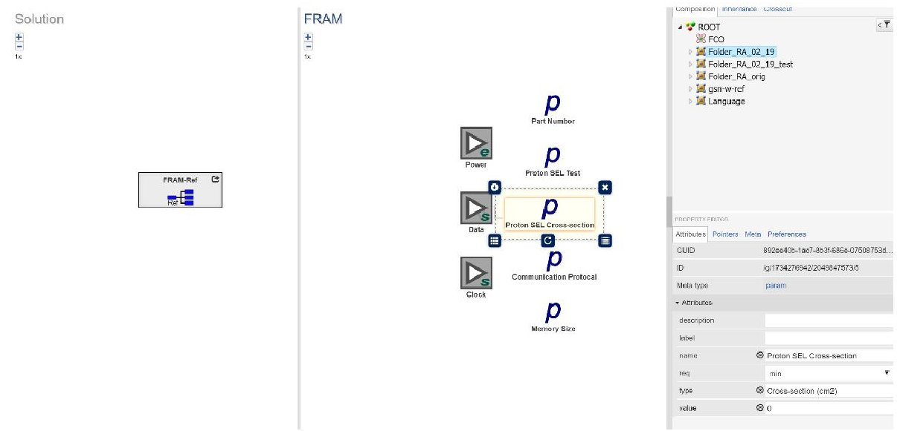

Figure 22: Linking Solutions to Library with Test Results

<!-- PDF_PAGE: 40 -->

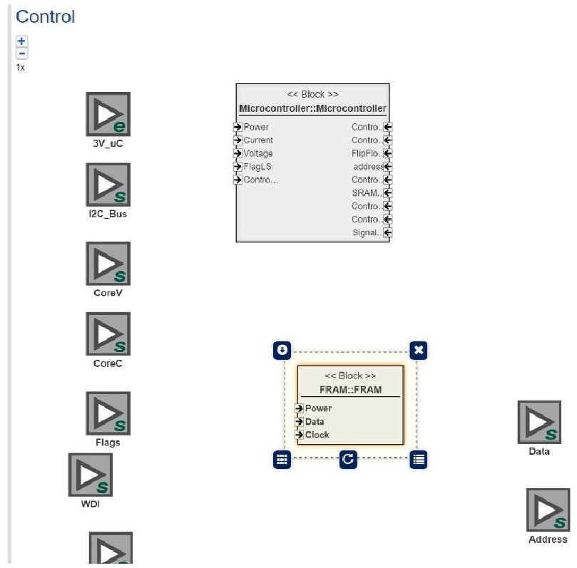

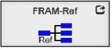

Figure 23: Linking Goals with System Model

Figure 23 shows linking parent goals of solutions to other models. The goal on the left is the parent goal of Solution 2 which is Goal 9: "FRAM (FM24V10-GTR) passes SEL mission requirement." By double-clicking on the Goal in the GSN model, WebGME shows the screen on the left which is where references and parameters related to the goal are seen "inside" the goal element. When the symbol on the top right of the reference is clicked, it displays the FRAM in the Control Block of the system model, as seen on the right. Higher level strategies, goals, and contexts can also link to other models or documents but would not be required to complete the model.

<!-- PDF_PAGE: 41 -->

## CHAPTER VI

## CONCLUSIONS

A complete assurance case for the radiation reliability of the CubeSat experiment REM is presented using GSN. The CubeSat experiment was designed to mitigate the radiation environment through COTS screening and system level mitigation schemes. The assurance case for REM modifies the R&M Template [5] created to address missions that use radiation-hardened parts, and provides a template for building the radiation-reliability assurance case for COTS-based systems. The case was created in WebGME and therefore includes support for system modeling, functional modeling, and fault propagation. The GSN model can also be traversed in software to perform automated labeling and eventually some simple quantitative analysis like issuing warnings when solutions and their parent goals are not linked to supporting models.

This assurance case included an argument for the use of COTS latch-up sensitive electronics with mitigation at the system level. This strategy was considered to present an acceptable amount of risk to the CubeSat experiment by the stakeholders for the REM system. The same strategy might not be acceptable for systems that must meet high-availability requirements and the SEL rate in the space environment is too high to accomplish the mission objective.

During the creation of the GSN radiation-reliability assurance case for the CubeSat experiment, several advantages of the GSN approach over a document-based approach were discovered. Assumptions that are hidden within text arguments surface through the assumption boxes. The structure of a GSN argument imposes rigor on the assurance case through the relationships between goals and solutions. Tests are linked with solutions in the assurance case and the goals that they support can be traced through the model. By organizing the assurance case

<!-- PDF_PAGE: 42 -->

into goals and child-goals, the logic of the argument for radiation reliability is made explicit in the graphical model. In addition, the model allows for the mission assurance objectives to fit into the larger MBSE paradigm for system design. The end result of the GSN argument construction is an easy-to-follow graphical representation of factors affecting the radiation reliability of the CubeSat experiment that makes mitigation decisions and remaining risks transparent to a reliability review team.

<!-- PDF_PAGE: 43 -->

## REFERENCES

[1] National Academies of Sciences, Engineering, and Medicine, "Achieving Science with CubeSats: Thinking Inside the Box," The National Academies Press, Washington, DC, 2016.

[2] D. Sinclair and J. Dyer, "Radiation Effects and COTS Parts in SmallSats," in Proceedings of the AIAA/USU Conference on Small Satellites, SSC13-IV-3, 2013.

[3] J. L. Barth, K. A. LaBel and C. Poivey, "Radiation assurance for the space environment," in Integrated Circuit Design and Technology, 2004. ICICDT '04. International Conference on, 2004, pp. 323-333.

[4] C. Poivey, "Radiation Hardness Assurance for Space Systems," in Notes from the 2002 IEEE Nuclear and Space Radiation Effects Short Course, Phoenix, AZ.

[5] F. J. Groen, J. W. Evans and A. J. Hall, "A vision for spaceflight reliability: NASA's objectives based strategy," in 2015 Annual Reliability and Maintainability Symposium (RAMS), Palm Harbor, FL, 2015, pp.1-6.

[6] International Council on Systems Engineering (INCOSE), "System Engineering Vision 2020," INCOSE-TP-2004-004-02, Sept. 2007.

[7] J. L. Barth, C. S. Dyer and E. G. Stassinopoulos, "Space, atmospheric, and terrestrial radiation environments," IEEE Transactions on Nuclear Science, vol. 50, no. 3, pp. 466- 482, June 2003.

[8] J. R. Schwank et al., "Radiation Effects in MOS Oxides," IEEE Transactions on Nuclear Science, vol. 55, no. 4, pp. 1833-1853, Aug. 2008.

[9] A. H. Johnston, "The influence of VLSI technology evolution on radiation-induced latchup in space systems," IEEE Transactions on Nuclear Science, vol. 43, no. 2, pp. 505-521, Apr 1996.

[10] P. V. Nekrasov, A. B. Karakozov, D. V. Bobrovskyi and V. A. Marfin, "Investigation of Single Event Functional Interrupts in Microcontroller with PIC17 Architecture," in 2015 15th European Conference on Radiation and Its Effects on Components and Systems (RADECS), Moscow, 2015, pp. 1-4.

[11] P. E. Dodd and L. W. Massengill, "Basic mechanisms and modeling of single-event upset in digital microelectronics," IEEE Transactions on Nuclear Science, vol. 50, no. 3, pp. 583- 602, June 2003.

[12] K. A. LaBel, A. H. Johnston, J. L. Barth, R. A. Reed and C. E. Barnes, "Emerging radiation hardness assurance (RHA) issues: a NASA approach for space flight programs," IEEE Transactions on Nuclear Science, vol. 45, no. 6, pp. 2727-2736, Dec 1998.

<!-- PDF_PAGE: 44 -->

[13] K. A. LaBel and M. M. Gates, "Single-event-effect mitigation from a system perspective," IEEE Transactions on Nuclear Science, vol. 43, no. 2, pp. 654-660, Apr 1996.

[14] J. Puig-Suari, C. Turner and W. Ahlgren, "Development of the standard CubeSat deployer and a CubeSat class PicoSatellite," Aerospace Conference, 2001, IEEE Proceedings, vol. 1, no. 1, pp. 1/347-1/353, 2001.

[15] M. Swartwout, "CubeSat Database," Saint Louis University, [Online]. Available: https://sites.google.com/a/slu.edu/swartwout/home/cubesat-database. [Accessed 20 June 2016].

[16] H. Bahcivan, J. W. Cutler, M. Bennett, B. Kempke, J. C. Springmann, J. Buonocore, M. Nicolls and R. Doe, "First measurements of radar coherent scatter by the Radio Aurora Explorer CubeSat," Geophys. Res. Lett., vol. 39, no. 14, p. L14101, 2012.

[17] L. W. Blum, Q. Schiller, X. Li, R. Millan, A. Halford and L. Woodger, "New conjunctive CubeSat and balloon measurements to quantify rapid energetic electron precipitation," Geophys. Res. Lett., vol. 40, pp. 5833-5837, 2013.

[18] C. S. Fish, C. M. Swenson, G. Crowley, A. Barjatya, T. Neilsen, J. Gunther, I. Azeem, M. Pilinski, R. Wilder, D. Allen, M. Anderson, B. Bingham, K. Bradford, S. Burr, R. Burt, B. Byers, J. Cook, K. Davis, C. Frazier, S. Grover, G. Hansen, S. Jensen, R. LeBaron, J. Martineau, J. Miller, J. Nelsen, W. Nelson, P. Patterson, E. Stromberg, J. Tran, S. Wassom, C. Weston, M. Whiteley, Q. Young, J. Petersen, S. Schaire, C. R. Davis, M. Bokaie, R. Fullmer, R. Baktur, J. Sojka and M. Cousins, "Design, Development, Implementation, and On-orbit Perfromance of the Dynamic Ionosphere CubeSat Experiment Mission," Space Sci. Rev., vol. 181, pp. 61-120, 2014.

[19] X. Li et al., "First results from CSSWE CubeSat: Characteristics of relativistic electrons in the near-Earth environment during the October 2012 magnetic storms," J. Geophys. Res. Space Physics, vol. 118, pp. 6489-6499, 2013.

[20] S. C. Spangelo et al., "Applying Model Based Systems Engineering (MBSE) to a standard CubeSat," in Aerospace Conference, 2012 IEEE, Big Sky, MT, 2012, pp. 1-20.

[21] S. C. Spangelo et al., "Model based systems engineering (MBSE) applied to Radio Aurora Explorer (RAX) CubeSat mission operational scenarios," in Aerospace Conference, 2013 IEEE, Big Sky, MT, 2013, pp. 1-18.

[22] L. Anderson et al., "Enterprise modeling for CubeSats," in 2014 IEEE Aerospace Conference, Big Sky, MT, 2014, pp. 1-16.

[23] D. Kaslow, G. Soremekun, H. Kim and S. Spangelo, "Integrated model-based systems engineering (MBSE) applied to the Simulation of a CubeSat mission," in 2014 IEEE Aerospace Conference, Big Sky, MT, 2014, pp. 1-14.

<!-- PDF_PAGE: 45 -->

[24] D. Kaslow et al., "Developing a CubeSat Model-Based System Engineering (MBSE) Reference Model - interim status," in 2015 IEEE Aerospace Conference, Big Sky, MT, 2015, pp. 1-16.

[25] D. Kaslow et al., "Developing a CubeSat Model-Based System Engineering (MBSE) Reference Model - Interim Status #2," in 2016 IEEE Aerospace Conference, Big Sky, MT, 2016, pp. 1-16.

[26] D. Nichols and C. Lin, Integrated Model-Centric Engineering: The Application of MBSE at JPL Through the Life Cycle, INCOSE International MBSE Workshop, 2014.

[27] M. Swartwout, S. Jayaram, R. Reed and R. Weller, "Argus: A flight campaign for modeling the effects of space radiation on modern electronics," in Aerospace Conference, 2012 IEEE, Big Sky, MT, 2012, pp. 1-11.

[28] N. A. Dodds et al., "The Contribution of Low-Energy Protons to the Total On-Orbit SEU Rate," IEEE Transactions on Nuclear Science, vol. 62, no. 6, pp. 2240-2451, Dec. 2015.

[29] M. P. King et al., "Electron-Induced Single-Event Upsets in Static Random Access Memory," IEEE Transactions on Nuclear Science, vol. 60, no. 6, pp. 4122-4129, Dec. 2013.

[30] J. M. Trippe et al., "Electron-Induced Single Event Upsets in 28 nm and 45 nm Bulk SRAMs," IEEE Transactions on Nuclear Science, vol. 62, no. 6, pp. 2709-2716, Dec. 2015.

[31] GSN Community Standard Version 1, Origin Consulting (York) Limited, 2011.

[32] R. A. Weaver and T. P. Kelly, "The Goal Structuring Notation - A Safety Argument Notation," Proceedings of the Dependable Systems and Networks 2004 Workshop on Assurance Cases, July 2004.

[33] Y. Chen, M. Lawford, H. Wang and A. Wassyng, "Insulin Pump Software Certification," in Foundations of Health Information Engineering and Systems, Springer Berlin Heidelberg, 2014, pp. 87-106.

[34] M. Maroti, T. Kecskes, R. Kereskenyi, B. Broll, P. Volgyesi, L. Juracz, T. Levendoszky and A. Ledeczi, "Next Generation (Meta)Modeling: Web- and Cloud-based Collaborative Tool Infrastructure," 2014.