<!-- PDF_PAGE: 1 -->

3-2021

# A Reference Architecture for Rapid CubeSat Development

Sean R. Kelly

<!-- PDF_PAGE: 2 -->

# A REFERENCE ARCHITECTURE FOR RAPID CUBESAT DEVELOPMENT

THESIS

Sean R. Kelly Capt, USAF

AFIT-ENV-MS-21-M-240

DEPARTMENT OF THE AIR FORCE AIR UNIVERSITY

AIR FORCE INSTITUTE OF TECHNOLOGY

Wright-Patterson Air Force Base, Ohio

DISTRIBUTION STATEMENT A APPROVED FOR PUBLIC RELEASE; DISTRIBUTION UNLIMITED.

<!-- PDF_PAGE: 3 -->

The views expressed in this document are those of the author and do not reflect the official policy or position of the United States Air Force, the United States Department of Defense or the United States Government. This material is declared a work of the U.S. Government and is not subject to copyright protection in the United States.

<!-- PDF_PAGE: 4 -->

AFIT-ENV-MS-21-M-240

# A REFERENCE ARCHITECTURE FOR RAPID CUBESAT DEVELOPMENT

THESIS

Presented to the Faculty Department of Systems Engineering and Management Graduate School of Engineering and Management Air Force Institute of Technology Air University Air Education and Training Command in Partial Fulfillment of the Requirements for the Degree of Master of Science in Systems Engineering

Sean R. Kelly Capt, USAF

March 2021

DISTRIBUTION STATEMENT A APPROVED FOR PUBLIC RELEASE; DISTRIBUTION UNLIMITED.

<!-- PDF_PAGE: 5 -->

AFIT-ENV-MS-21-M-240

# A REFERENCE ARCHITECTURE FOR RAPID CUBESAT DEVELOPMENT

# THESIS

Sean R. Kelly Capt, USAF

Committee Membership:

David R. Jacques, Ph.D. Chair

Bradley J. Ayres, Ph.D. Member

Thomas C. Ford, Ph.D. Member

<!-- PDF_PAGE: 6 -->

## Abstract

The CubeSat class of nanosatellites has lowered the barrier of entry to space and has rapidly gained popularity in recent years. The lower development cost, small form factor, and reuse of commercial off-the-shelf components makes the CubeSat form factor an ideal platform for University teams, where budget and development time are extremely limited. To successfully design a CubeSat system in a rapid cycle conducive to academic timelines, a Reference Architecture geared towards University CubeSat development would be helpful. A Reference Architecture would speed up the development process by providing a template, capturing previous work and lessons learned from subject matter experts, providing a framework to focus on the CubeSat's design rather than the fine details of modeling software. A Reference Architecture can also add functionality that student teams could use and improve over time, such as pre-built analysis functions and a library of components to choose from. This thesis presents a CubeSat Reference Architecture designed to meet these needs and explores its unique features, diagrams, and custom libraries. The CubeSat Reference Architecture was validated by relevant course instructors and is being used by a cohort of students in the Spacecraft Design Sequence at AFIT.

<!-- PDF_PAGE: 7 -->

## Acknowledgements

I would like to express my sincerest appreciation to my committee members for their guidance through this process. I'd also like to thank my colleagues who helped me test this model and gave me constructive feedback throughout.

Sean Kelly

<!-- PDF_PAGE: 8 -->

## Contents

Abstract . . . . .

<!-- PDF_PAGE: 9 -->

7. Analysis and Results ... 42

4.1 Overview ... 42

4.2 Organization ... 42

4.3 Guidance ... 46

4.4 Requirements ... 48

4.5 Structure ... 55

4.6 Behavior ... 61

4.7 Analysis ... 66

4.8 Component Library ... 74

4.9 Document Generators ... 80

4.10 Validation of Model ... 84

4.11 Summary ... 85

8. Conclusion ... 86

5.1 Overview ... 86

5.2 Significance of Research ... 86

5.3 Lessons Learned ... 88

5.4 Future Work ... 89

5.5 Final Thoughts ... 90

bibliography ... 91

<!-- PDF_PAGE: 10 -->

## List of Figures

Figure Page

1 CubeSat Launches 9

2 1U CubeSat Example 10

3 6U CubeSat Example 10

4 CubeSat Sizes 11

5 CubeSat Development by Institution 12

6 CubeSat Companies 13

7 Systems Engineering "Vee" 15

8 SysML Taxonomy 17

9 Reference Architecture Purpose 20

10 SUAS Component Library 24

11 SUAS Organization 24

12 CRM CubeSat Domain 25

13 CRM Scope 26

14 CRM Ground Segment 26

15 CRM Space Segment 27

16 CRM Stakeholders 28

17 CONOPS Document Generator 31

18 CONOPS Document Generator Output 32

19 Containment Tree 43

20 Model Organization 44

21 Index 45

22 Guidance 46

<!-- PDF_PAGE: 11 -->

Figure Page

23 Modeling Rules 47

24 Requirements Organization 49

25 Source Documentation 50

26 Design Constraints 51

27 Stakeholder Analysis 52

28 Stakeholder Matrix 53

29 Mission Requirements 54

30 Subsystem Requirements 55

31 Mission Context bdd 56

32 Mission Context ibd 57

33 Physical Decomposition 59

34 ADCS Template 60

35 ADCS tailored 60

36 State Machine 61

37 Behavior Organization 62

38 Mission Phases 64

39 Mission Phase Descriptions 65

40 Fault Management 66

41 Analysis Organization 68

42 Thermal Analysis 70

43 Thermal Analysis Instance 71

44 Thermal Analysis Run 72

45 EPS Tests 74

46 EPS Test Verification 74

<!-- PDF_PAGE: 12 -->

Figure Page

47 Component Library 76

48 Component Library - Structures 76

49 Component Library - EPS 77

50 Custom Value Type Library 79

51 Document Generators 81

52 Document Generator Title Page 82

53 Manual Table Method 83

54 Automatic Table Method 84

<!-- PDF_PAGE: 13 -->

## List of Tables

Table Page

1 Design Outputs 36

2 Typical CubeSat Development Process 37

3 AFIT CubeSat Development Process 38

<!-- PDF_PAGE: 14 -->

## List of Abbreviations

Abbreviation Page

AFIT Air Force Institute of Technology 2

MBSE Model-Based Systems Engineering 2

STK Systems Tool-Kit 4

VTL Apache’s Velocity Templating Language 6

SSDL Space and Systems Development Laboratory 8

COTS Commercial Off The Shelf 9

HET Hall Effect Thruster 11

LEO Low Earth Orbit 13

IOT Internet of Things 13

INCOSE International Council on Systems Engineering 14

SysML Systems Modeling Language 16

OOSEM Object-Oriented Systems Engineering Method 16

UML Unified Modeling Language 16

bdd Block Definition Diagram 17

ibd Internal Block Diagram 17

DoD Department of Defense 20

DoDAF Department of Defense Architecture Framework 20

SUAS Small Unmanned Aircraft System 22

CRM CubeSat Reference Model 25

OMG Object Management Group 25

INCOSE International Council on Systems Engineers 25

CONOPS Concept of Operations 28

<!-- PDF_PAGE: 15 -->

ORD Operational Requirements Document ...28

CONOPS Concept of Operations ...30

MCD Mission Capabilities Document ...34

CONOPS Concept of Operations ...34

EPS Electrical Power System ...73

<!-- PDF_PAGE: 16 -->

## I. Introduction

## 1.1 General Issue

Designing a spacecraft is a daunting and complex endeavor. Due to the nature of space launch, most spacecraft only get one chance at success, and spacecraft can take many years and millions of dollars to develop. As such, modeling, simulation, and testing are vital for a space vehicle program's success, and finding new ways to mature technologies and flight test them can improve this process. The CubeSat-class of nanosatellite can help by providing a cost-effective platform to mature technologies or even perform operational missions as part of a CubeSat constellation. This thesis attempts to assist design teams in rapidly developing and prototyping these CubeSat designs.

Dr. Will Roper, the former assistant secretary of the Air Force for acquisition, has emphasized the need for a faster acquisition cycle and for bolder ideas. During the Air Force Association's Air, Space and Cyber Conference in 2019, Dr. Roper said "To become a more competitive acquisition system, the Air Force needs to be aware of trends in technology. The world is changing. We have to change with it. The key is to decide which technology will be successful and being able to act on those trends with a system that is leaner, meaner and faster than our opponents." [1] In the space domain, CubeSats are that latest technological "leaner and meaner" trend, and the US Air Force and Space Force are embracing it. Additionally, CubeSats are

<!-- PDF_PAGE: 17 -->

becoming increasingly popular in the commercial sector around the world, with the number of CubeSat launches increasing year over year.

To support research in this CubeSat domain, the Air Force Institute of Technology (AFIT) has a space vehicle design series of courses that guides students through the Systems Engineering process using a satellite system. Starting with a set of mission objectives, the design teams perform trade studies, generate requirements, design the CubeSat system, and perform verification and validation of those requirements with physical components over the span of three courses. This process mirrors the real-world development process, but on a much faster timeline.

As design teams begin the development process of a CubeSat, there can be a steep learning curve. Many engineers are not familiar with Model-Based Systems Engineering (MBSE) tools or methodologies, and teams need to start their designs from scratch. Reference Architectures exist in other domains to capture best practices and provide a starting point for new systems, so this thesis attempts to develop and demonstrate a Reference Architecture for the CubeSat domain. By providing CubeSat designers with a template, including automatically generating tables and documentation, they can focus more on the design and less on learning how to use and organize the complicated model. Additionally, by providing a component library to use and pre-built analysis tools using those components, they can build off previous successful designs and rapidly simulate candidate solutions. Thorough documentation and guidance included in the Reference Architecture will also increase standardization amongst the team.

<!-- PDF_PAGE: 18 -->

## 1.2 Problem Statement

There is a need to capture prior knowledge and accelerate learning to allow design teams to rapidly develop, simulate, and test CubeSat designs and generate traditional documentation, all from one MBSE tool.

## 1.3 Scope

This research was primarily intended to aid student design teams in a University setting, and AFIT's space vehicle design series of courses is an appropriate test-bed for this. AFIT's first space vehicle design course teaches and implements MBSE for stakeholder analysis and requirements generation; however, the following courses do not continue the use of the model for the actual design and implementation of the CubeSat. The goal of this research is to create a useful Reference Architecture to aid students in designing the physical satellite and tracing system requirements down to the component level. This Reference Architecture should be useable even by users not so familiar with MBSE, and it should assist with the system-level review process including Critical Design Reviews, Test Readiness Reviews, etc. Even though AFIT students will be the first users of this Reference Architecture, it is generic enough to be used for any team wishing to develop a CubeSat program from the ground up. It has all the functionality needed to develop requirements, design the physical system, and perform basic simulations. It also features helpful resources like a component library to assist with the physical design and document generators to create tailored stakeholder documents from model elements. This CubeSat Reference Architecture is intended to model the CubeSat system, with only minimal modeling for external systems such as the ground stations. Ground station characteristics are necessary for some communications analysis, so some basic ground station modeling is included, but the ground station is not the system of interest. Other external systems, such as

<!-- PDF_PAGE: 19 -->

the launch vehicle, are also included just to document interactions as needed, but are not extensively modeled.

A Reference Architecture offers a baseline template for students to build from, using lessons learned from past projects and creating the framework to streamline the design process. A large effort of this research was focused on creating a generic model with default component specifications throughout. This was intended to spark ideas in the brainstorming process for students and aid in system analysis. Another component of this research was creating basic analysis capabilities within the model, allowing students to tweak component specifications to see how those changes affect overall capabilities and requirements. Additionally, the model traces the analysis to template requirements that future teams will tailor for their unique projects. This allows for rapid simulations of key performance parameters or measures of effectiveness for the system. Additional work is being done using this Reference Architecture for more in-depth state analysis and integration with Systems Tool-Kit (STK) and MATLAB, so it's critical to form a robust baseline to build off of.

In order to test the validity of the tool, examples of this Reference Architecture will first be demonstrated to the relevant course instructors to show how it could be used by students. Feedback will be incorporated into the model before being used by future classes. Additionally, a comprehensive how-to guide and modeling style guide will be provided to students to walk through the process using a generic design.

## 1.4 Research Objectives and Questions

In an effort to improve this rapid-prototyping environment, this thesis demonstrates the usage of a new Reference Architecture to guide CubeSat design teams through the whole design process, hopefully speeding up the process and improving the quality of designs in the end. The first usage of this Reference Architecture will

<!-- PDF_PAGE: 20 -->

be the AFIT space vehicle design series, but the Reference Architecture should be useful to any CubeSat design team as a starting template.

## The research objectives are:

1. Create a practical and useful Reference Architecture for rapidly-prototyping CubeSat designs.

2. Create easy-to-use document generators that use model elements to generate traditional system level review documentation.

3. Present this Reference Architecture to AFIT instructors for feedback.

4. Lay the groundwork for future analysis work with STK and MATLAB integration for more comprehensive mission analysis using model elements.

## The research questions are:

1. What are the tools necessary to perform mission modeling using model-based systems engineering?

2. What viewpoints are most useful to common stakeholders?

3. How can useable documentation be generated from only model elements, keeping the source of truth within the model?

4. What needs to be done in the model to allow for external tools (STK, MATLAB, etc.) to interact with the MBSE tool?

5. Can cloud-based collaboration improve the MBSE design process for interdisciplinary teams?

<!-- PDF_PAGE: 21 -->

## 1.5 Assumptions and Limitations

There are of course some limitations to this research. The first is limited standardization amongst the CubeSat community. This thesis is based on how AFIT teaches MBSE and how AFIT names subsystems, requirements, and documents. Other design teams may have vastly different practices and conventions, limiting how useful the Reference Architecture may be without tailoring. Second, this Reference Architecture uses Cameo Systems Modeler, a tool that might not be available or desired by users. Third, the Reference Architecture is sensitive to major organizational changes. If a user wishes to make drastic changes away from the provided structure, some analysis or document tools may need to be updated or they will not be useful. Finally, the analysis portion of this Reference Architecture is only useful for initial verification and validation of requirements, but does not replace more in-depth and robust analysis. This tool can help rapidly prototype and determine feasibility, but would not suffice for final design approval.

## 1.6 Approach

This Reference Architecture will use No Magic's Cameo Systems Modeler as the primary modeling tool. Cameo Systems Modeler was chosen as the modeling tool due to its common usage at AFIT and as it is being used more commonly in program offices in the Air Force Life Cycle Management Center. Mathworks' MATLAB will be used for analysis as it is a commonly used program in academia and throughout the Department of Defense, and it easily integrates with Cameo. Finally, Apache's Velocity Templating Language (VTL) will be used to generate documentation from the model elements. These tools will be used to develop a Reference Architecture that will be tested by students and then demonstrated to AFIT faculty for feedback.

<!-- PDF_PAGE: 22 -->

Once the Reference Architecture is accepted by the faculty, it will be used by students in the design course sequence and improved from then on.

## 1.7 Preview

The thesis follows a five-chapter format. Chapter I presented the general issue, listed the research goals, provided the scope and general approach of this research, and listed assumptions and limitations. Chapter II provides a background on the current Reference Architectures in the CubeSat domain and how other Reference Architectures are being used in other fields. Chapter III describes the methodology used to address the problem statement and complete the research objectives. Chapter IV details the resulting Reference Architecture and accompanying analytical tools. Chapter V summarizes the contributions and limitations, and describes areas of future research to further refine and evolve the Reference Architecture's usefulness.

<!-- PDF_PAGE: 23 -->

## II. Literature Review

## 2.1 Overview

The purpose of this chapter is to highlight the current state of Reference Architectures, including some recent work in the CubeSat domain. To understand the context, this chapter will start by describing the CubeSat domain and the need for a CubeSat Reference Architecture. This chapter will also define key terms and explore gaps in the existing CubeSat models. Reference Architectures in the CubeSat domain are still a relatively new endeavor, but Reference Architectures in similar domains will be discussed to learn lessons from those models as well.

## 2.2 CubeSats

As launch service providers continue to offer more ride-sharing opportunities, access to space has never been more available or affordable for small satellites. The nanosatellite size (1-10 kg) has exploded in popularity over recent years [2], and among that size class, the CubeSat has become the de facto standard, as shown in Figure 1. A CubeSat is a sizing standard defined in 1999 by California Polytechnic State University and Stanford University's Space and Systems Development Laboratory (SSDL), with a basic "1U" unit being 10 cm x 10 cm x 10 cm and a mass less than 1.33 kg [3]. A 1U CubeSat is shown in Figure 2 for reference, and CubeSats are defined by how many of these 1U cubes they contain. For example, a 3U CubeSat is three 1U cubes together, and a 6U CubeSat is six 1U cubes combined, as shown in Figure 3. Figure 4 shows the distribution of sizes, with 1U, 3U, and 6U being the most commonly launched sizes [2]. This standardized sizing framework allows for rapid prototyping with common chassis and common dispenser mechanisms, and this drives down the cost of research and development for these CubeSats. CubeSats also

<!-- PDF_PAGE: 24 -->

routinely use Commercial Off The Shelf (COTS) components to further drive down development costs. To assist design teams, California Polytechnic Institute publishes these CubeSat Design Specifications for 1U-3U CubeSats and for 6U CubeSats [3], and NASA publishes a helpful developer's guide called the "CubeSat 101" [4].

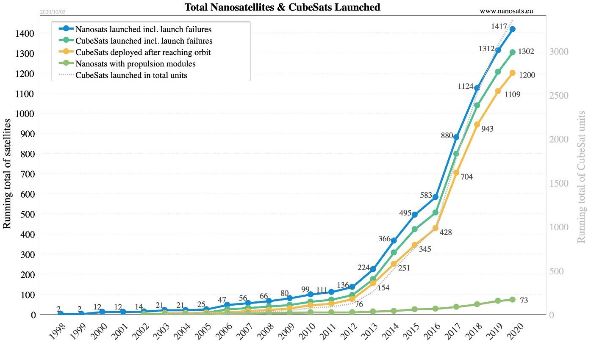

Figure 1. CubeSat Launches

<!-- PDF_PAGE: 25 -->

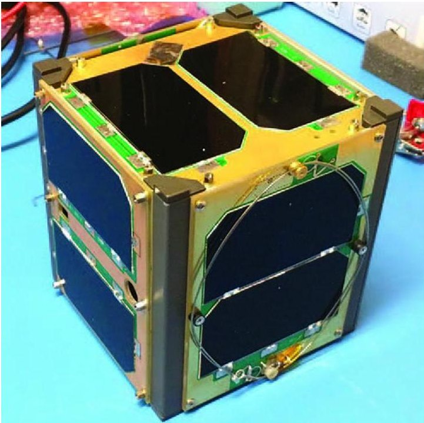

Figure 2. 1U CubeSat Example

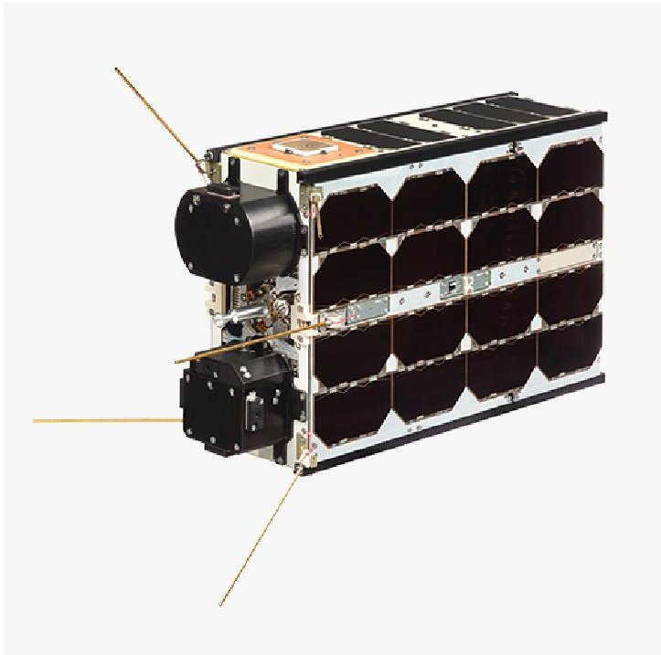

Figure 3. 6U CubeSat Example

<!-- PDF_PAGE: 26 -->

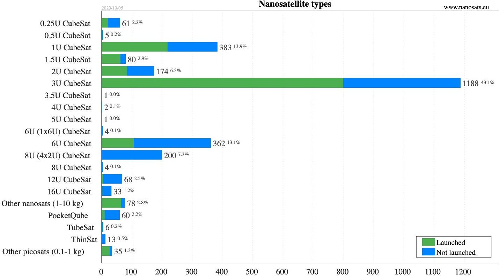

Figure 4. CubeSat Sizes

A primary benefit of the CubeSat standard is the lower cost of both the satellite hardware and launch costs. The cost of failure for a CubeSat is orders of magnitude lower than for a large, exquisite satellite, so CubeSats offer a proving ground for maturing technologies and educating engineers and scientists. A traditional satellite requires a dedicated launch vehicle, a distinct payload adapter, and millions to billions of dollars in research and development. By contrast, a CubeSat might only cost $100,000 to $500,000 in research and development costs, and the launch cost can be less than $1 Million [5]. Perhaps even more valuable than the reduced cost is the ability to flight test articles in the space environment to iterate and mature technologies. Many materials, sensors, and other components have been matured through CubeSats. For example, the Air Force Academy's FalconSat-7 was designed to record data on a polyimide photon sieve and determine its imaging performance before being used in future operational satellites [6]. Their previous mission, FalconSAT-6, was designed to improve Hall Effect Thruster (HET) technologies and low power commu-

<!-- PDF_PAGE: 27 -->

nication options [7]. CubeSats are an ideal research platform, so it makes sense that Universities launch a significant percentage of total CubeSats, as shown in Figure 5, followed by companies seeking to capitalize on this lower-cost launch capability. Figure 6 shows the drastic increase in new companies developing CubeSats, highlighting the increased relevance of this small satellite size [2].

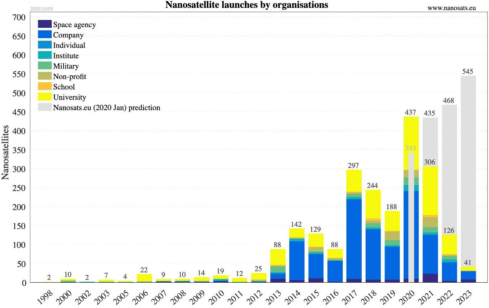

Figure 5. CubeSat Development by Institution

<!-- PDF_PAGE: 28 -->

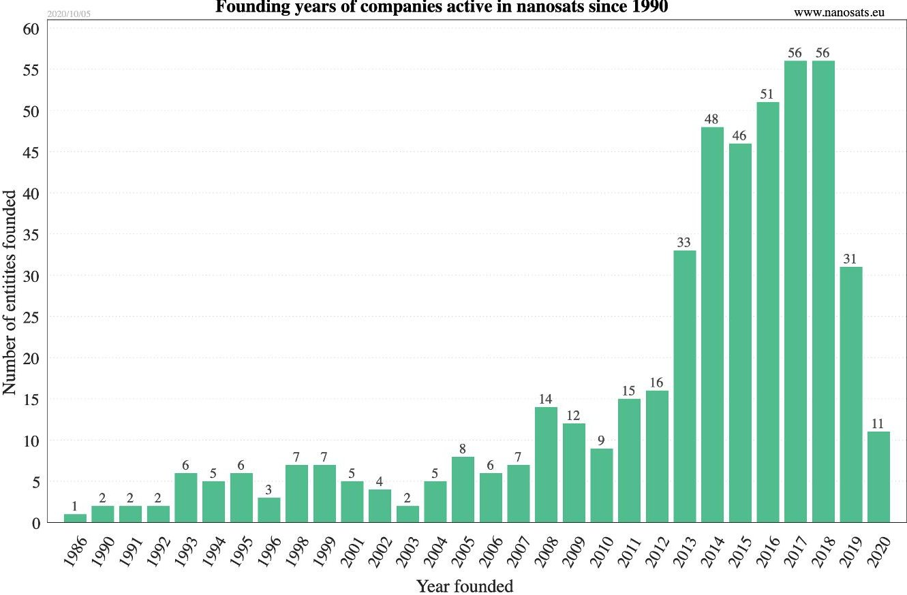

Figure 6. CubeSat Companies

Furthermore, as resiliency in space becomes more important, CubeSats offer a solution that is attracting research for military applications. As CubeSats are so small and affordable, a mission could include many individual CubeSats as a system, or "swarm," to create a large constellation that drastically increases the overall reliability and resiliency for the mission. In the private sector, a notable example is the Swarm SpaceBee, a 0.25U CubeSat that is part of a 150-CubeSat constellation in Low Earth Orbit (LEO), testing out global Internet of Things (IOT) tracking of ships, vehicles, and other remote sensors [8].

Finally, Launch Service Providers are routinely offering ride-share opportunities as secondary customers, making it much easier to launch these CubeSats in greater numbers. SpaceX launched SSO-A in 2018 which carried 15 microsatellites (10-100 kg) and 49 CubeSats, which came from universities and other research institutes from around the world including the previously mentioned FalconSat-6 [9]. This

<!-- PDF_PAGE: 29 -->

CubeSat standard and the increasing demand for small satellites in orbit has lowered the barrier to entry, allowing universities and small research teams to develop their own space programs. In fact, AFIT has its own CubeSats in development, including the "Grissom" 6U bus, which will form the foundation for several distinct CubeSat variations.

Due to the unique advantages that CubeSats offer for both the Department of Defense and for small university teams, AFIT has embraced the concept and is preparing graduate students for future jobs in satellite acquisitions using CubeSats as the primary tool. Developing a CubeSat is a challenging task, especially for students without industry experience, so the MBSE method is first taught to students before applying it to CubeSat design.

## 2.3 Model Based Systems Engineering

MBSE is increasingly used to develop CubeSats, especially among university teams such as at AFIT. MBSE is a Systems Engineering methodology that focuses on models instead of the traditional document-based design approach. This section will explore the MBSE method, language, and tools used to model CubeSats in this thesis. Before exploring the advantages of MBSE though, a brief look at Systems Engineering in general is warranted.

The International Council on Systems Engineering (INCOSE) defines Systems Engineering as "An interdisciplinary approach and means to enable the realization of successful systems [10]." An important note is that attention must be devoted to the entire life cycle of the system, or "from cradle to grave." The system, comprised of a collection of hardware, software, people, facilities, and procedures [10], begins as a theoretical concept in the eyes of users or stakeholders, and from that idea, needs are defined, a system is developed, then used operationally, and finally retired or

<!-- PDF_PAGE: 30 -->

disposed of. Systems Engineering is all about addressing this whole life cycle, and there are many strategies or techniques to accomplish this task. Figure 7 shows the traditional "Vee" model, commonly taught and used for major Department of Defense and NASA acquisitions [10]. Time proceeds from left to right when reading the Vee process and starts at the top left by defining the stakeholder's needs. From there, the design process moves to system-level requirements and further down to a detailed design with subsystem-level requirements. From there, the process begins integration and qualification activities by assembling lower level subsystem components into their parent systems and then testing these systems, otherwise known as verification. After verification, the system is validated and the original stakeholders begin to use the system.

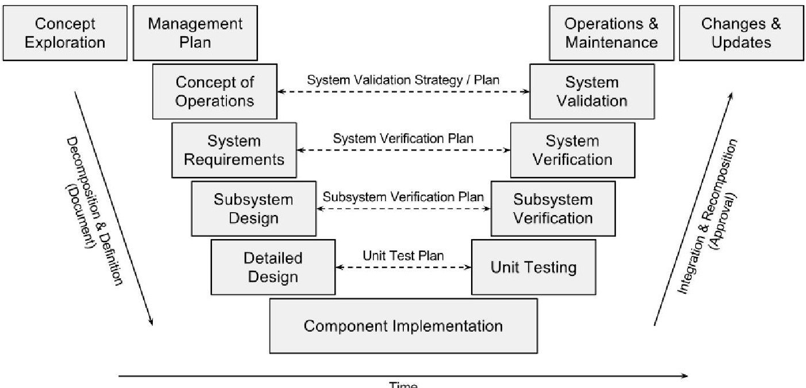

Figure 7. Systems Engineering "Vee"

Traditionally, the Systems Engineering process used a "document-based" approach, where documents are the primary artifacts available to stakeholders [11]. These documents include requirement and traceability matrices, interface documents, concept of operation documents, and other unique documents in a wide variety of for-

<!-- PDF_PAGE: 31 -->

mats, such as Microsoft Excel sheets, Adobe PDF documents, Microsoft PowerPoint presentations, and digital drawings. As systems become more complex, the traditional document-based approach becomes challenging to maintain. Each document is manually generated, so file management and version control becomes problematic. It is difficult to know for sure if something is the current version or if it has been subsequently updated but located on some other file system or storage drive. Furthermore, any changes in one document, drawing, etc., must be also made in any other document that uses that same item. This system is prone to errors, inconsistencies, and difficulties maintaining an accurate representation of the entire system. MBSE provides a solution to these increasingly relevant problems. In MBSE, a system model represents the system and any information needed for documents can be found within this model. The model also makes it much easier to maintain consistency. If the modeler updates a component or interface in one area, it will be updated throughout the system wherever it appears. Traditionally, acquisition programs reviews will still require paper documents, but the necessary information for those can still be found within the system model during the transition from documents to system models.

MBSE requires a modeling language, a modeling method, and a modeling tool [11]. In this thesis, those are respectively the Systems Modeling Language (SysML), the Object-Oriented Systems Engineering Method (OOSEM), and the Cameo Systems Modeler tool.

SysML is a standard modeling language, which added systems engineering functionality to the Unified Modeling Language (UML) that has been used extensively in Software Engineering for decades [11]. SysML provides a language, or the definitions and notations for nine different diagram types to describe a complex system, many of which will be used in this Reference Architecture. SysML is expressed graphically through those diagrams, listed in Figure 8, to show various system viewpoints. For

<!-- PDF_PAGE: 32 -->

example, a Block Definition Diagram (bdd) expresses system structure, and an Activity Diagram can show specific system activities. Within "blocks", further detail can be expressed on an Internal Block Diagram (ibd). Further explanations will accompany their respective diagrams in Chapter IV, but for now, it's important to know that SysML provides the language and is built into the modeling tool, described later in this chapter.

The modeling method is the specific methodology used to ensure important design tasks have been accomplished and provides the general guidance, processes, or steps for the system design. This paper will focus on OOSEM, but there are other popular methods, such as the Weilkiens System Modeling (SYSMOD) method [12] and the IBM Telelogic Harmony-SE method [13].

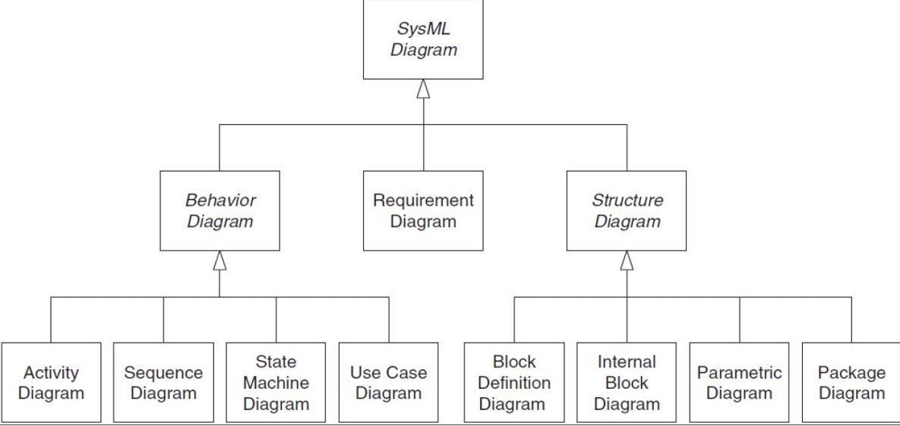

Figure 8. SysML Taxonomy

OOSEM uses SysML in a top-down, model-based approach that leverages object-oriented concepts with traditional systems engineering methods to architect more flexible and extensible systems that can evolve with technology and changing requirements [14]. OOSEM was developed in part by Lockheed Martin Corporation as a method to capture and analyze requirements of complex systems, integrate with

<!-- PDF_PAGE: 33 -->

object-oriented software and hardware, and support system-level reuse and design evolution [15].

The primary OOSEM activities are similar to those in the traditional "Systems Engineering Vee" as described previously and are accomplished in an iterative fashion [16]. Similarly to the "Vee" method, the traditional technical management processes are still applied at each iteration.

The primary OOSEM steps are as follows [14]:

1. Analyze Stakeholder Needs: Capture the "as-is" system and mission enterprise and identify gaps or issues. The "as-is" depiction helps develop the "to-be" system, and the gaps or issues can help drive mission requirements for the new system. OOSEM frequently uses measures of effectiveness for the primary mission objectives identified in this step.

2. Define System Requirements: Once the "as-is" system is defined and produces Mission Requirements, the system is modeled as a "black box" in a Mission Enterprise model. For example, instead of going deep into subsystem-level detail on a CubeSat, the entire CubeSat will be a "black box" that interacts with ground stations, other satellites, and the environment. This "black box" model allows for system-level activity diagrams and use cases to show how the "to-be" system will support the mission enterprise. This step helps derive system-level functional, performance, and interface requirements.

3. Define Logical Architecture: A "logical" architecture is created that captures key functions in logical blocks, allowing for specific components to be chosen later in place of the logical depiction.

4. Synthesize Candidate Allocated Architectures: From the logical architecture, create potential physical instantiations using value properties and selected

<!-- PDF_PAGE: 34 -->

components. Each component at this stage is then traced to system requirements in table or matrix form.

5. Optimize and Evaluate Alternatives: Trade studies or other analysis is conducted at this step among the candidate architectures. Parametric diagrams within the model or integrating other tools can simulate system performance with the chosen components so alternative solutions can be compared.

6. Validate and Verify System: Once a candidate architecture has been chosen from the alternatives, the system needs to be validated and verified to ensure the requirements are being met and that stakeholder needs are satisfied. This step uses inspection, demonstration, analysis, and test activities to validate and verify the system.

Finally, the modeling tool is how the language and method get put together. The modeling tool is a critical piece of software that builds an underlying model of the system that can be used to display many different viewpoints or diagrams, depending on what is needed. The system model in a modeling tool is comprised of model elements and relationships between those elements, and from those, diagrams can be generated. When the source element or relationship is modified or deleted, that change gets carried out throughout the entire model, in any and all diagrams those elements or relationships appeared. This effort utilized the Cameo Systems Modeler tool from No Magic Inc., but the process is tool-agnostic. Other tools are available on the market to accomplish the same goals with different user interfaces and feature sets. The Cameo Systems Modeler tool will be shown in model screenshots throughout this thesis.

<!-- PDF_PAGE: 35 -->

## 2.4 Reference Architectures

Complex systems require detailed architectural planning early on in the design process. The Department of Defense (DoD) attempted to manage the "Enterprise-level Architectures" and "Solution Architectures" throughout the department by publishing the Department of Defense Architecture Framework (DoDAF). DoDAF defined an architecture as a "fundamental organization of a system embodied in its components, their relationships to each other and to its environment, and the principles governing its design and evolution over time [17]." This concept appears reasonable, but system architects are not always available for every project that could benefit from a detailed architecture, especially in an academic environment. Reference Architectures help alleviate that problem by consolidating subject matter expertise and previous relevant architectures into digestible models that system designers can benefit from when creating a Solution Architecture [18]. The DoD saw the benefits of Reference Architectures and put out a Reference Architecture Description in 2010, describing them as "an authoritative source of information about a specific subject area that guides and constrains the instantiations of multiple architectures and solutions [19]," as shown in Figure 9.

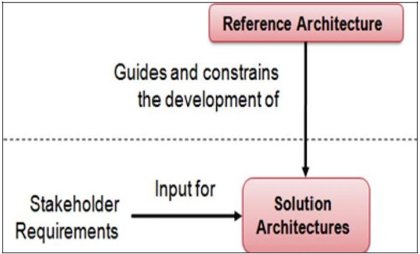

Figure 9. Reference Architecture Purpose

Robert Cloutier suggests 2 key principles for Reference Architectures [18].

<!-- PDF_PAGE: 36 -->

1. Principle 1: A Reference Architecture is an elaboration of company (enterprise) or consortium mission, vision, and strategy. . . facilitates a shared understanding about the current architecture and the vision on the future direction.

2. Principle 2: A Reference Architecture is based on concepts proven in practice. Preceding architectures can be mined for proven concepts.

Finally, Reference Architectures should have at least the following elements [18]:

1. Strategic Purpose: Goals, objectives, and a specific purpose or problem to be addressed

2. Principles: High-level foundational statements of rules, culture, and values that drive technical positions and patterns

3. Technical Positions: Technical guidance and standards that must be followed by solution architectures (maybe data vocabulary/ data model)

4. Patterns (Templates): Generalized representations (e.g., Viewpoints, Views, Diagrams, Products, Artifacts) showing relationships between elements specified in the Technical Position

5. Vocabulary: acronyms, terms, definitions

In summary, Reference Architectures can help systems engineers by providing a template, developed from years of experience, to aid in the systems engineering process. From the literature, it is clear that a Reference Architecture would be particularly useful for teams designing a CubeSat.

<!-- PDF_PAGE: 37 -->

## 2.5 Existing Work

There are many examples of Reference Architectures used in the commercial sector, but this section will focus on Reference Architectures that were clearly relevant to this effort.

First, the Small Unmanned Aircraft System (SUAS) Reference Architecture developed at AFIT will be investigated. This is a relevant example as it fulfills the same general goals as the CubeSat Reference Architecture; namely, that it is for use in a design course series and is intended for students to use as a template for their design efforts. This SUAS Reference Architecture was started before this CubeSat effort and provides a useful baseline and inspiration, even if it is for a different domain. AFIT professors Dr. Jacques and Dr. Cox developed this architecture using Cameo Systems Modeler to describe a generic SUAS, focused primarily on specific product output for the SUAS specialization track [20]. The SUAS Reference Architecture contains a Basic Ground Station Model, a Basic Multi-Rotor System Model, a Component Library, and sample build for a fixed-wing vehicle using the architecture. The SUAS Reference Architecture is designed to allow students to easily build to a design specification from COTS components in the Component Library and test those designs using built-in parametric diagrams. These concepts will be applied to the CubeSat Reference Architecture as well, adapted for use in the spacecraft design course series.

Jacques and Cox focused on the SUAS culture of rapid prototyping, and the Reference Architecture allows for designs to be developed at a much faster pace. The common template and vision provided through the model helps interdisciplinary teams design, build, and test SUAS systems with more time spent on producing a quality product, and less time spent designing the entire model from scratch [20]. Jacques and Cox captured their own extensive SUAS experience into their Reference

<!-- PDF_PAGE: 38 -->

Architecture, and the model will continue to be improved over time. Currently, it is being improved to streamline the cumbersome DoD Cybersecurity Risk Assessment process, using model elements to fill out required forms. The component library will also continually evolve as COTS components change. Figure 10 shows a small section of their Component Library, providing blocks with value properties and ports (not displayed) to start from. Figure 11 shows the SUAS Reference Architecture's top level organization, which this Reference Architecture will be modeled after for consistency. The component library, parametric diagrams, and general organization are useful in the development of the CubeSat Reference Architecture, but the spacecraft design course series has some unique differences that must be considered, such as instructor preferences and differing model scopes.

<!-- PDF_PAGE: 39 -->

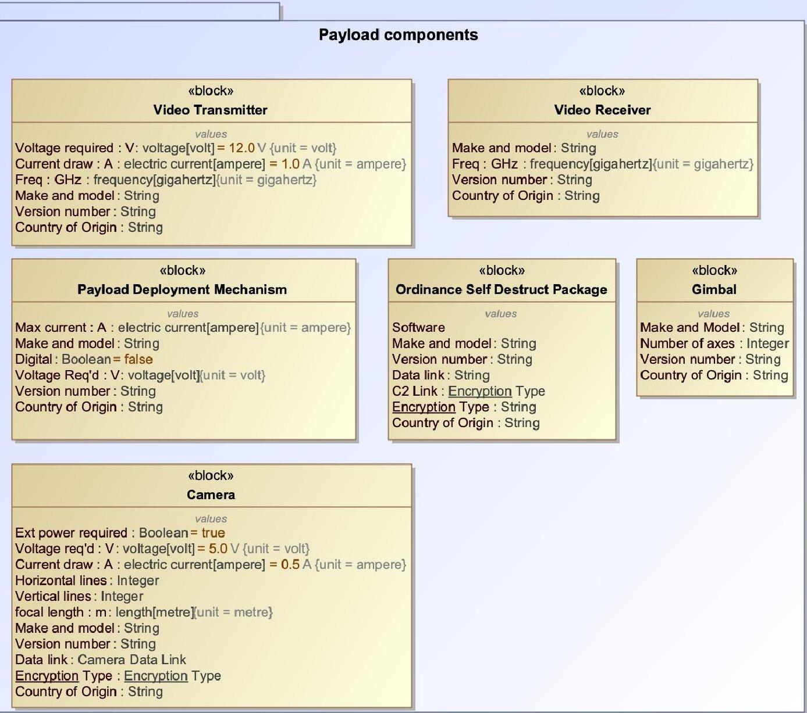

Figure 10. SUAS Component Library

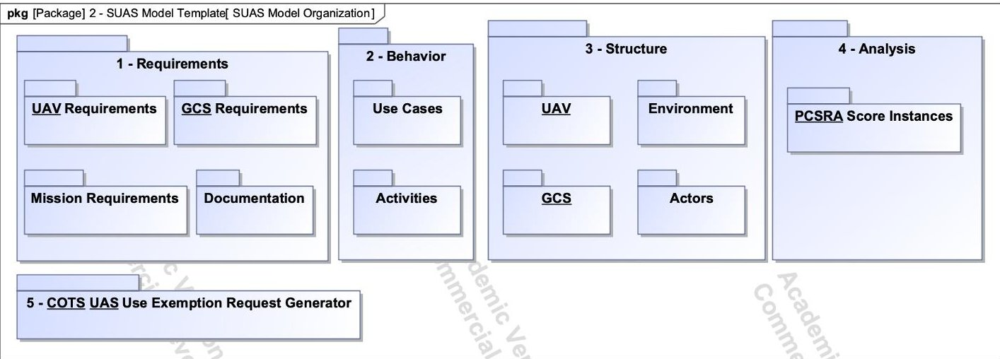

Figure 11. SUAS Organization

<!-- PDF_PAGE: 40 -->

In the CubeSat domain, Kaslow and a group of Subject Matter Experts built a CubeSat Reference Model (CRM) as part of a partnership between the Object Management Group (OMG) and the International Council on Systems Engineers (INCOSE). The CRM was intended to help CubeSat developers by providing logical, reusable architecture elements at a high level [21]. Some sample diagrams are provided in their interim status updates [21, 22, 23, 24, 25, 26], but the Cameo model itself was not available to investigate. This CRM describes three levels of architectural foundation that are necessary to capture the whole domain: the enterprise level, the space and ground segments, and the space and ground subsystems. Figure 12 indicates the structure for the CubeSat domain as described by Kaslow et al.

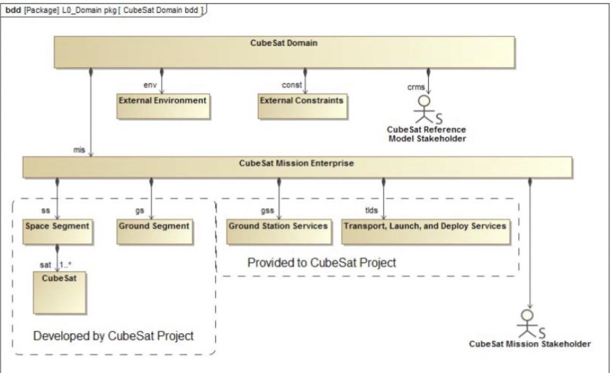

Figure 12. CRM CubeSat Domain

Kaslow et al. used a block definition diagram to demonstrate the hierarchy of elements within the domain. They depict the CubeSat Mission Enterprise as being directly composed of a Space Segment, a Ground Segment, Ground Station Services,

<!-- PDF_PAGE: 41 -->

and Transport, Launch, and Deploy Services. Furthermore, they identified what must be developed by the CubeSat Project in greater detail, as shown by Figure 13.

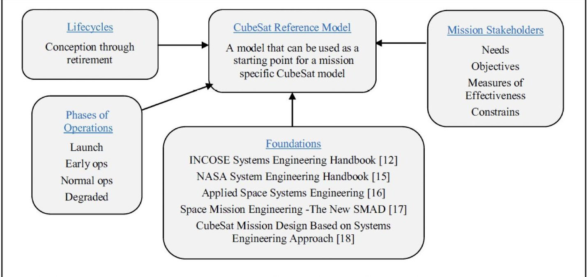

Figure 13. CRM Scope

Kaslow et al. described all of the CubeSat subsystems and provided Block Definition Diagrams for the major views of a CubeSat, including each mission segment, as shown in Figure 14 for the Ground Segment and Figure 15 for the Space Segment.

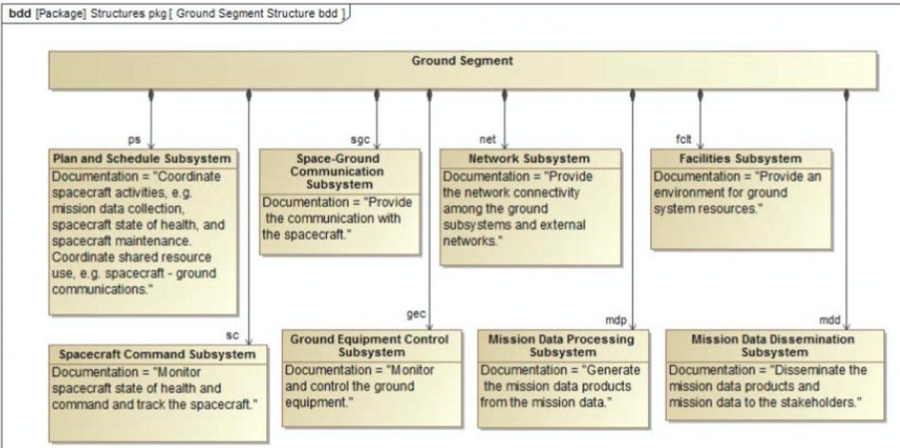

Figure 14. CRM Ground Segment

<!-- PDF_PAGE: 42 -->

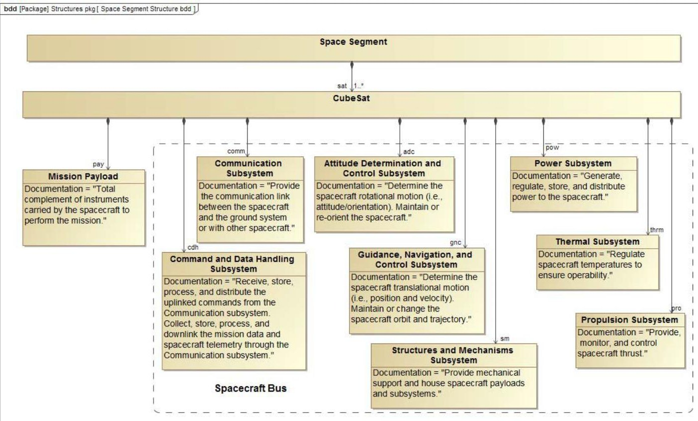

Figure 15. CRM Space Segment

Kaslow et al. determined that this logical architecture would provide guidance for CubeSat developers to begin to formulate their own mission specific architectures, knowing that their model did not have and could not have the specificity required to support every type of mission. It provided a top-level guide to how a CubeSat enterprise is organized, and some of the external stakeholders as well, as shown in Fig 16. Their model is a starting point for mission specific teams to incorporate their unique knowledge to formulate their own architectures.

<!-- PDF_PAGE: 43 -->

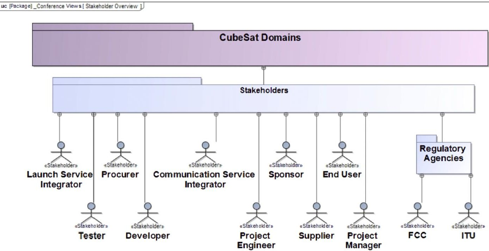

Figure 16. CRM Stakeholders

After investigating the CRM status updates, however, the CubeSat Reference Model was missing much of the subsystem-level details that was included in the SUAS Reference Architecture. A thorough reference architecture in this domain ought to include the high-level documentation and views from the CRM and the low-level component library and functionality of the SUAS reference architecture.

Several other gaps exist that will be addressed in this thesis effort. First, the CRM is not designed for outputting traditional documents for system level reviews. There is no easy way to generate a Concept of Operations (CONOPS) document or Operational Requirements Document (ORD), for example, and that is a desire for an AFIT CubeSat Reference Architecture. Second, the CRM does not appear to have a component library or a generic, intuitive system that can be easily adapted by students new to MBSE. Finally, the CRM does not appear to have sufficiently detailed value properties for the system to be useful for detailed mission analysis using MATLAB and STK. Students in the AFIT course series must design down to a lower level of detail with many value properties for each subsystem in order to

<!-- PDF_PAGE: 44 -->

perform the required analysis and calculations. The CRM is quite useful though in examining what subject matter experts deem important for a CubeSat model and for their various subsystem internal block diagrams.

Another Reference Model that was investigated was the satellite model by Sanford Friedenthal [27]. In his book, he walks through his version of a CubeSat model for the "FireSat II" mission, also using the OOSEM methodology and Cameo Systems Modeler. His book provides helpful diagrams and best practices and provided inspiration for this Reference Architecture.

## 2.6 Validation Tools

When preparing to develop the CubeSat Reference Architecture, a Digital Engineering (DE) Validation Tool from SAIC was made available [28]. This free tool was developed by SAIC and is provided free to the public as a set of validation rules and customizations for Cameo. SAIC states "Our free system model validation tool guides modeling consistency to reduce errors, aid analyses, and improve quality." This appeared to be a useful addition to this CubeSat Reference Architecture, so it was closely examined.

SysML provides a vast array of modeling options and styles, and the SAIC DE tool aims to limit the language and standardize modeling techniques. By using this tool, a team can ensure that each team member is using the same diagram types, the same flow structures, the same definitions, etc., all of which align with the goals of a Reference Architecture. However, the strict limits on SysML diagrams and modeling techniques did not match how AFIT students learn or have practiced in their preceding courses. In a commercial company with a specific modeling culture, this DE toolset would be more useful to get engineers on the same page. Their engineers may have come from different modeling backgrounds and it is important to

<!-- PDF_PAGE: 45 -->

establish a common modeling style, but for new modelers who just learned the basics of SysML, this tool was too restrictive and unnecessary in this author's view. Students using this model also all learned SysML from the same institution and already have a relatively common modeling vocabulary and level of expertise.

While the DE toolset was not fully used in this edition of the CubeSat Reference Architecture, the tool could be much more useful if AFIT develops its own style guide and best practices. If there is an agreement on SysML usage as an institution, the rule set can be modified and improved to incorporate these practices. However, the rules as presented were too restrictive for the primary audience using this CubeSat Reference Architecture.

## 2.7 Document Generators

One desired feature was the ability to automatically generate usable milestone documentation entirely from model elements. Historically, students took screenshots of diagrams and exported lists of requirements to Microsoft Excel to edit, manipulate, and format for usage in formal documents. This has proven to be a problematic process. For example, once a team member exports a subsystem requirement list to Excel, the source of truth becomes that Excel sheet, requiring the team lead to always compare the names, IDs, and details of requirements between different documents. The CubeSat model previously used in AFIT's first spacecraft design course provided a starting point to determine which model elements were important for the key documents in the early stages of a system design. This model featured package diagrams with views and viewpoints pointing to model elements, and used the "Document Preview" plugin to pull model elements into an html file. Figure 17 shows one small piece of the document generator for the Concept of Operations (CONOPS), and Figure 18 show what this plugin displayed as the output.

<!-- PDF_PAGE: 46 -->

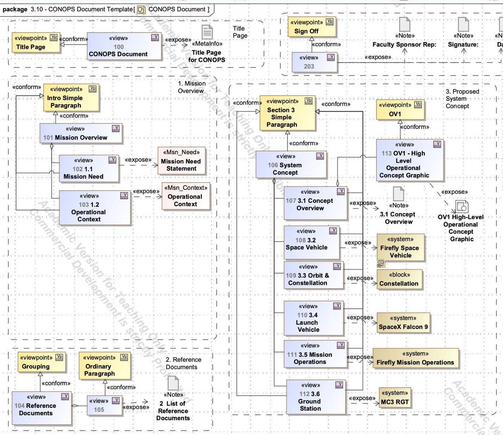

Figure 17. CONOPS Document Generator

<!-- PDF_PAGE: 47 -->

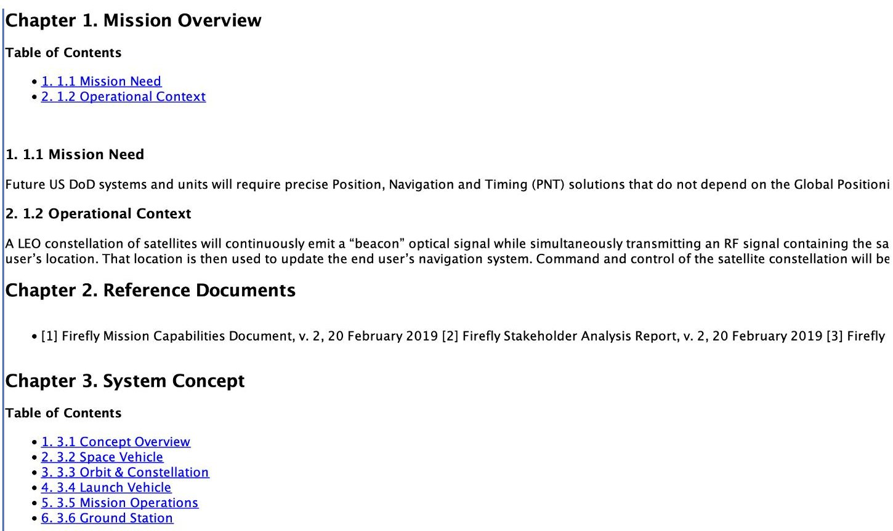

Figure 18. CONOPS Document Generator Output

This was a useful start, as it used model elements to generate documentation, but there were several issues with this method. First, this plugin has been unreliable. Most students have trouble getting it to work at all, and the pdf functionality seems to be broken in recent versions of Cameo. As shown in Figure 18, the numbering and organization was quite frustrating to deal with. The document generator was difficult to tweak, as it determined the document order based off view and viewpoint IDs, not based on the layout of the diagram or any other easy way to reorganize or add new elements. Figure 18 shows that the html file pulled text from the model, but customization and formatting was poor. In practice, users had to just copy and paste this html file into Microsoft Word and then spend a lot of time properly formatting it so that it was presentable and properly formatted and polished. Any changes to the model required all this work to be done over again unless the user wanted to individually copy and paste text from the model for the document. Finally, this is a plugin in beta, and seems to be unavailable for the latest service pack of Cameo.

<!-- PDF_PAGE: 48 -->

These were useful though to determine the content and order of each document, but this thesis will propose a different solution for generating documents.

## 2.8 Summary

This chapter discussed the CubeSat context and explained the necessary MBSE and OOSEM concepts to understand the rest of this thesis. After the MBSE language, method, and tools were explained, Reference Architectures were defined, providing a template for the modeler to start from. Current Reference Architectures were then examined, including an AFIT-developed SUAS architecture and two existing CubeSat Reference Models. Gaps in these Reference Architectures were then identified that this thesis will attempt to solve. Next, a Digital Engineering Validation Tool was explored to determine its utility in this Reference Architecture. Finally, previous document generators were discussed to highlight what this thesis aims to improve.

<!-- PDF_PAGE: 49 -->

## III. Methodology

## 3.1 Overview

Chapter III describes the methodology for answering the research questions posed in Chapter I. The status quo will be described and design decisions will be discussed for the creation of the Reference Architecture. The methodology for getting feedback and validating the model will also be described.

## 3.2 Status Quo

As discussed in Chapter I, the Reference Architecture is intended to improve CubeSat system designs by providing a starting point and a framework that guides teams through the entire systems engineering process. The tool will have AFIT students in mind with some course-specific features, but will also serve as a general CubeSat Reference Architecture outside of AFIT. To understand the organization and unique features of this Reference Architecture, it's helpful to understand the primary goals, inputs, and outputs of the course sequence.

At AFIT, the first course starts with teams given a Mission Capabilities Document (MCD) for a fictional or real mission, which outlines the "Mission Need Statement," "Operational Context," and a set of required capabilities and design constraints. From this set of inputs, students develop stakeholder concerns and needs, perform trade studies, write a Concept of Operations (CONOPS), and finally develop a set of mission requirements. These artifacts are carried into the next course, where system level requirements are defined and a physical structure is designed. Finally, in the third course, students take those system-level requirements and further define subsystem-level requirements and develop test plans to verify those requirements. These courses are intended to flow together, and this Reference Architecture will help

<!-- PDF_PAGE: 50 -->

by providing the model framework to carry between and support all three courses. Throughout the course sequence, there are also milestone reviews and stakeholder documentation requirements to fulfill.

Students in this course sequence use the textbook Space Mission Engineering: The New Space Mission Analysis and Design by Wertz, et al [5]. Wertz focuses mainly on the requirements definition and validation portion of the Systems Engineering process, so other more general Systems Engineering texts were consulted to supplement Wertz, such as those by Friedenthal [29], Buede [10], and Maier and Rechtin [30].

The Space Vehicle design sequence, as taught by AFIT, has one primary input, the MCD. From there, the following outputs are generated as part of the process. Each report, trade study, review and artifact will have a place in the Reference Architecture.

<!-- PDF_PAGE: 51 -->

<table border="1"><tr><td>Reports</td><td>Trade Studies</td></tr><tr><td>Mission Capabilities Document</td><td>Constellation Trade Study</td></tr><tr><td>Stakeholder Analysis Report</td><td>Delta V Analysis</td></tr><tr><td>Concept of Operations</td><td>Launch Vehicle Trade Study</td></tr><tr><td>Space Vehicle Requirements Document</td><td>RF Link Budget Analysis</td></tr><tr><td>Operational Requirements Document</td><td>Mass Budget</td></tr><tr><td>Subsystem Test Plans</td><td>Power Budget</td></tr><tr><td>Subsystem Test Reports</td><td>Cost Budget</td></tr><tr><td>Flight Readiness Review Report</td><td>Schedule</td></tr><tr><td>Reviews</td><td>Other Artifacts</td></tr><tr><td>Mission Concept Review</td><td>Cameo System Model</td></tr><tr><td>Preliminary Design Review</td><td>Digital Drawing</td></tr><tr><td>Critical Design Review</td><td>STK Simulation</td></tr><tr><td>Test Readiness Review</td><td>OV-1 Diagram</td></tr><tr><td>Flight Readiness Review</td><td></td></tr></table>

Table 1. Design Outputs

This list is not exhaustive, as differing missions or stakeholders may need different outputs, so the Reference Architecture is designed to be flexible enough for unforeseen variations. In addition to these formal documents and reviews, the model itself is useful for describing the physical decomposition and interfaces of the system. The model itself holds all the text, figures, tables, and trade studies that are used in the documents as well. For example, the CONOPS document goes through mission and fault phases, describing subsystem conditions, detailing activity diagrams for those phases, and writing narratives to describe activities. These are all contained in model

<!-- PDF_PAGE: 52 -->

elements, and the document just calls these elements in the appropriate format for display.

Table 2 briefly outlines what the typical CubeSat development process looks like [4], and Table 3 shows the process done in the short time frame of the design sequence at AFIT. This CubeSat design process at AFIT is coinciding with normal academic instruction and labs unrelated to the CubeSat project, so the timeframes do not cover the entire nine months.

<table border="1"><tr><td>Step</td><td>Project Phase</td><td>Typical Timeframe</td></tr><tr><td>1</td><td>Concept Development</td><td>1-6 months</td></tr><tr><td>2</td><td>Securing Funding</td><td>1-12 months</td></tr><tr><td>3</td><td>Merit and Feasibility Review</td><td>1-2 months</td></tr><tr><td>4</td><td>CubeSat Design</td><td>1-6 months</td></tr><tr><td>5</td><td>Development and Submittal of Proposal</td><td>3-4 months</td></tr><tr><td>6</td><td>Selection and Manifesting</td><td>1-36 months</td></tr><tr><td>7</td><td>Mission Coordination</td><td>9-18 months</td></tr><tr><td>8</td><td>Licensing</td><td>4-5 months</td></tr><tr><td>9</td><td>Flight Specific Documentation Development</td><td>10-12 months</td></tr><tr><td>10</td><td>Ground Station Design, Development and Test</td><td>2-12 months</td></tr><tr><td>11</td><td>CubeSat Hardware Fabrication and Testing</td><td>2-12 months</td></tr><tr><td>12</td><td>Mission Readiness Review</td><td>Half day</td></tr><tr><td>13</td><td>CubeSat to Dispenser Integration and Testing</td><td>1 day</td></tr><tr><td>14</td><td>Dispenser and Launch Vehicle Integration</td><td>1 day</td></tr><tr><td>15</td><td>Launch</td><td>1 day</td></tr><tr><td>16</td><td>Mission Operations</td><td>Variable, up to 2 years</td></tr></table>

Table 2. Typical CubeSat Development Process

<!-- PDF_PAGE: 53 -->

<table border="1"><tr><td>Step</td><td>Project Phase</td><td>Typical Timeframe</td></tr><tr><td>1</td><td>Stakeholder Analysis</td><td>2 weeks</td></tr><tr><td>2</td><td>Risk Identification</td><td>2 weeks</td></tr><tr><td>3</td><td>Trade Studies</td><td>2 weeks</td></tr><tr><td>4</td><td>Mission Phases</td><td>1 week</td></tr><tr><td>5</td><td>Fault Management</td><td>1 week</td></tr><tr><td>6</td><td>Concept of Operations</td><td>1 week</td></tr><tr><td>7</td><td>Mission Concept Review</td><td>Half day</td></tr><tr><td>8</td><td>Space Vehicle Requirements Document</td><td>2 weeks</td></tr><tr><td>9</td><td>Mass and Power Budgets</td><td>1 week</td></tr><tr><td>10</td><td>Preliminary Design Review</td><td>Half day</td></tr><tr><td>11</td><td>Physical Design</td><td>2 months</td></tr><tr><td>12</td><td>Critical Design Review</td><td>Half day</td></tr><tr><td>13</td><td>Subsystem Test Plans</td><td>3 weeks</td></tr><tr><td>14</td><td>CubeSat Hardware Fabrication and Testing</td><td>3 months</td></tr><tr><td>15</td><td>Flight Readiness Review</td><td>Half day</td></tr></table>

Table 3. AFIT CubeSat Development Process

## 3.3 Developing the Reference Architecture

As discussed in Chapter II, a similar effort has already been taking place with Small Unmanned Aerial Systems at AFIT. Those efforts created a Reference Architecture for a similar design course sequence, so the first step was to explore that Reference Architecture and get some ideas and any lessons learned from that effort. Of primary note was their component library, which allows the SUAS designer to choose from commonly available components to rapidly prototype a new system. Their organization was also well done, with top-level pages to show internal structures and a package breakdown to separate Requirements, Structure, Behavior, and Analysis. Several of these organization practices will be expanded upon in this CubeSat Reference Architecture.

While not explicitly stated as such, students going through this course sequence learned the OOSEM approach to modeling systems, so that approach should be used for this Reference Architecture as well. To bridge the gap between Wertz' Firefly

<!-- PDF_PAGE: 54 -->

model [5] and the OOSEM methodology, Friedenthal's text [27] was used as a reference, as he also uses OOSEM in his approach. Looking at these models provided a good foundation upon which to start building a Reference Architecture. Wertz had detailed subsystem breakdowns and relevant calculations, Friedenthal explained the OOSEM process and how it relates to CubeSat designs, and the SUAS model [20] helped guide the organizational structure and capabilities of a Reference Architecture.

As this tool is meant to encourage new designs and not stifle creativity, there are some architectural design considerations when building the Reference Architecture. How detailed should it be? Should internal block diagrams be filled out? Should sate machines and mission phase descriptions come fully described? These considerations are key points of discussion with the faculty that will teach these courses, and these points will be discussed later. Additionally, the Reference Architecture project used teamwork and input from faculty, lab technicians, and other students who previously went through this program.

Once completed, this Reference Architecture would be used from the very beginning of the design course sequence all the way through its conclusion. They will be given the Reference Architecture file with their mission-specific MCD and some guidance, and then they design the system from the ground up using that template.

## 3.4 Instructor Feedback

The primary users of this Reference Architecture will be students going through the design sequence, but the instructors for those courses need to accept this model and understand the basics of the Reference Architecture. They will surely be asked questions about it and they decide what deliverables should look like, so instructor feedback was crucial throughout the development of this Reference Architecture. At the very beginning, before beginning modeling work, the three instructors were con-

<!-- PDF_PAGE: 55 -->

sulted for their desires and expectations and to note any changes in the course series going forward. Furthermore, once the Reference Architecture was ready for a demonstration, they were consulted again, this time providing specific feedback on tables, traceability matrices, and document composition. This feedback was extremely useful to keep the Reference Architecture in scope and to ensure it will be useful for the intended users. The instructors do not need to be experts on the actual model, though, so guidance was provided within the model to help guide students. If students are stuck and instructors cannot help, they have free reign to tailor the model to meet the course requirements.

## 3.5 Tool Validation

Before the Reference Architecture was ready for teams to begin using, a full test was conducted to validate the tool and ensure everything worked as planned. GrissomP is a mission that students were assigned in a previous sequence, and it is also a real world AFIT mission with requirements and documentation, so it was chosen as the test bed for this Reference Architecture. It is also a unique mission, given that it has two distinct and physically separated payloads, so it tested the modularity of the Reference Architecture. Near the end of the Reference Architecture design process, Grissom P was used as an example to run through the Reference Architecture quickly to ensure each step was working properly. This highlighted several issues that needed to be fixed before the faculty demonstration, and then, once the Reference Architecture was ready, Grissom-P was fully fleshed out using the Reference Architecture. This was done by another graduate student, which helped prove that someone unfamiliar with the architecture could use and understand it.

The ultimate test will be when a new cohort of students use the tool. Lessons learned from these system designs will improve the model going forward to address

<!-- PDF_PAGE: 56 -->

any remaining gaps or adapt to changing requirements. This is the whole point of a Reference Architecture, after all.

## 3.6 Summary

Chapter III described the status quo and inspirations for the Reference Architecture. Then, the process to create it was described, as well as the process for stakeholder input and model validation.

<!-- PDF_PAGE: 57 -->

## IV. Analysis and Results

## 4.1 Overview

Chapter IV details the resulting Reference Architecture using the methodology in Chapter III. The first section will describe the overall layout and navigation of the model, and then each major section of the Reference Architecture will be explored, highlighting the most important diagrams and new features. An in-depth help guide is included in the Reference Architecture file, so this chapter will not serve as a manual for the tool.

## 4.2 Organization

The CubeSat Reference Architecture is a large model, so the organizational structure is critically important. Many users of this model will be new to MBSE or at least new to Cameo Systems Modeler, and with so many diagrams and packages, it can be easy to get lost or have trouble finding a diagram that you need. Furthermore, modelers may prefer different navigational styles. Some prefer visual diagrams, while others prefer navigating a nested folder structure, while others still may prefer to directly navigate to a desired diagram with one click from an index. To address these preferences, multiple ways to navigate the model have been provided. Each navigation style is based off the four pillars of SysML - Requirements, Structure, Behavior, and Parametrics [31]. This model uses the term analysis instead of parametrics to cover more content, but does contain the parametric diagrams to assess system performance. The extra package, called Document Generators, contains templates that pull information from each of other packages, so it is kept separate.

The standard way is to navigate using the "Containment Tree," or Cameo's File Tree, as shown in Figure 19. Notice the numbered packages for the most important

<!-- PDF_PAGE: 58 -->

packages to guide users to the appropriate section. Note that some packages, such as those inside the Generic CubeSat Model, include hyperlink icons, informing the user that those packages are also links to more detailed diagrams. A user can navigate this tree and find the appropriate diagrams in an intuitive manner. For example, if they wish to work on the CubeSat's physical decomposition, they will navigate to the Structure package and find the CubeSat package within. If they need to generate some activity diagrams for mission phases, those diagrams will be located within the Behavior section, and so on.

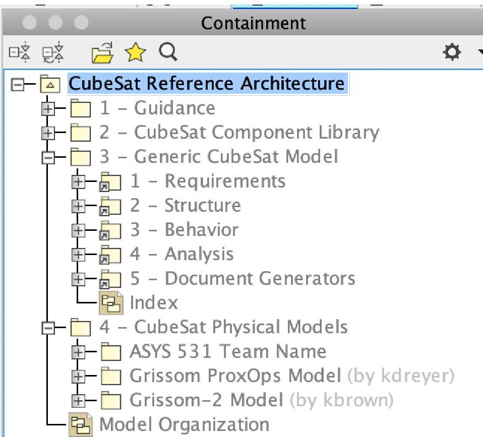

Figure 19. Containment Tree

Some users may prefer to navigate using diagrams instead. This has been built in to the Reference Architecture by creating top level "organization diagrams" for the most used sections. Figure 20 shows the first page users see when they open up the model, and each icon within that diagram is hyperlinked to another, similar diagram at the lower level. These organization diagrams will be detailed in upcoming sections.

<!-- PDF_PAGE: 59 -->

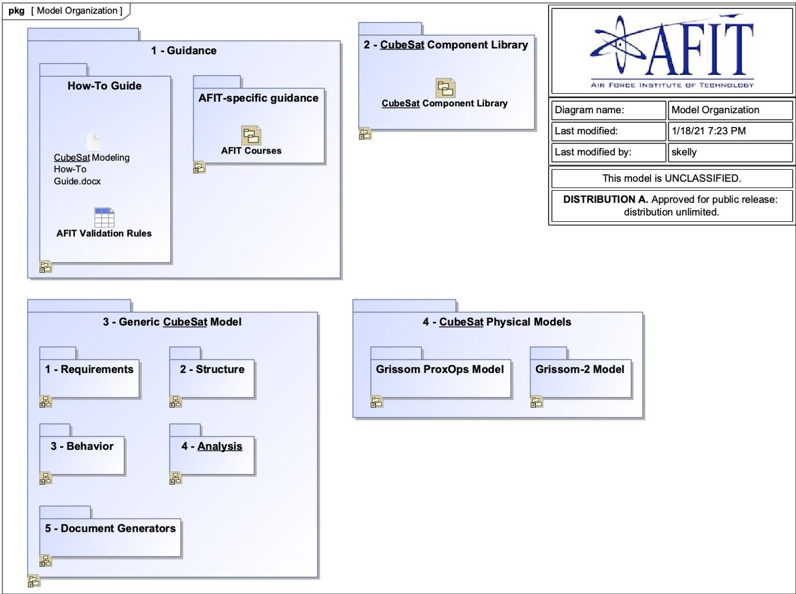

Figure 20. Model Organization

Finally, some users may wish to directly navigate to a diagram by name. The "Index" diagram shown in Figure 21 shows all of the built-in diagrams and tables that users will be expected to complete during the design sequence, organized by category. If additional diagrams are created, this index will need to be updated accordingly. This Index provides a very fast and easy way to open up one diagram in particular if the user forgot where a diagram was located, for example.

<!-- PDF_PAGE: 60 -->

<table border="1"><tr><td>Requirements
Requirements Organization</td><td>Structure
Mission Context bdd</td><td>Behavior
Behavior Organization</td><td>Analysis
Analysis Organization</td></tr><tr><td>Source Documentation:
Source Documentation Table</td><td>Mission Context
Simplified Mission Context</td><td>OV-1:
OV1 - High Level Operational Concept</td><td>Trade Studies:
Trade Studies</td></tr><tr><td>Required Capabilities and Design Constraints:
Required Capabilities Table
Design Constraints Table
Required Capabilities and Design Constraints Traceability Matrix
Mission Need Statement
Operational Context
Goals and Objectives Table</td><td>Operational Domain:
Operational Domain bdd</td><td>Mission Phases:
Mission Phases
Mission Phases</td><td>Verification Analysis (parametric diagrams):
Thermal Analysis Model
Power Analysis
Image Quality Analysis
Orbit Analysis
LMT Integration
Uplink Analysis</td></tr><tr><td>Stakeholder Analysis:
Stakeholders and Their Concerns
List of Stakeholder Needs
Stakeholder Needs to Concerns Matrix
Stakeholder Needs to MCD Matrix</td><td>CubeSat Environment bdd</td><td>Use Cases:
Operational Use Cases
Operational Use Case Descriptions</td><td>Hardware Tests:
Hardware Tests
Subsystem Requirements Verification Table</td></tr><tr><td>Mission Requirements:
Mission Requirements Table
Mission Requirements Traceability Matrix
D Mission Requirements Derivation Matrix</td><td>CubeSat:
CubeSat bdd (additional layers linked within)
CubeSat State Machine</td><td>Fault Management:
Fault Management
Fault Management</td><td></td></tr><tr><td>Key Performance Parameters:
Key Performance Parameters Table
Key Performance Traceability Matrix</td><td>Launch Vehicle:
Launch Vehicle bdd</td><td>CubeSat Activities:
CubeSat Mission Activity Decomposition</td><td></td></tr><tr><td>System Requirements:
System Requirements Table
SR to MR Traceability Matrix</td><td>Orbit:
Mission Parameters bdd</td><td></td><td></td></tr><tr><td>Subsystem Requirements:
Subsystem Requirements Table
D Subsystem Requirements Derivation Matrix</td><td></td><td></td><td></td></tr></table>

Figure 21. Index

<!-- PDF_PAGE: 61 -->

## 4.3 Guidance

To assist users who are less familiar with Cameo or MBSE, a full CubeSat Modeling How-To Guide has been included within the model. Users can double-click the document icon in Figure 22 and open up a thorough guidebook that walks through each section and each diagram that users can fill out, in addition to guidance regarding the new Document Generator feature. The Guidance package also contains a set of modeling rules and a draft "active validation" profile to help identify common errors or missing data in the model. Figure 23 shows the structure of the included modeling rules, intended to keep the model standardized and to prevent common errors. Each of these rules is included in the Rules table with text descriptions. These are not mandatory to follow and these are only draft requirements created by the author. A wider conversation is required to establish modeling standards at AFIT, so these are just ideas to explore at a later date.

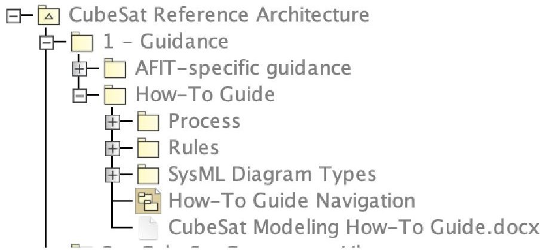

Figure 22. Guidance

<!-- PDF_PAGE: 62 -->

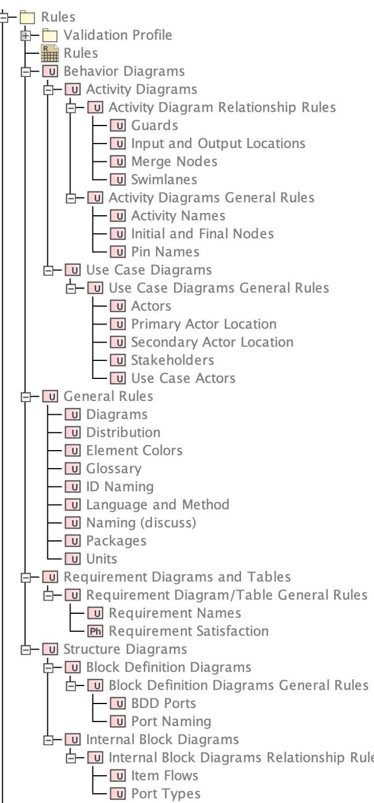

Figure 23. Modeling Rules

In addition to the modeling rules provided, a pared down version of SAIC's DE Validation Profile [28] is provided as well. As discussed in section 2.6, the Validation Profile does not meet the needs or practices of this model's intended audience, but there were several helpful active validation rules that were borrowed. A future effort may explore this concept further, but for now, roughly a third of the supplied rules were helpful for this context. Some very helpful rules include those that highlight when a requirement does not have proper traceability or is missing requirement text,

<!-- PDF_PAGE: 63 -->

rules that highlight missing elements in diagrams (such as starting and final nodes in activity diagrams), and a rule that checks to make sure each Value Property has an associated Value Type and Unit. If a modeler runs the validation profile during the design process, they may see helpful errors pointing out missing elements, so it does add some value to the Reference Architecture.

## 4.4 Requirements

Users will start their design process in the Requirements package. The Requirements Organization diagram is shown in Figure 24, which links to each applicable diagram and provides basic instructions to help users navigate. While the Requirements process is not a linear process to be accomplished at one time, it is structured in the order in which users will likely need the included diagrams.

<!-- PDF_PAGE: 64 -->

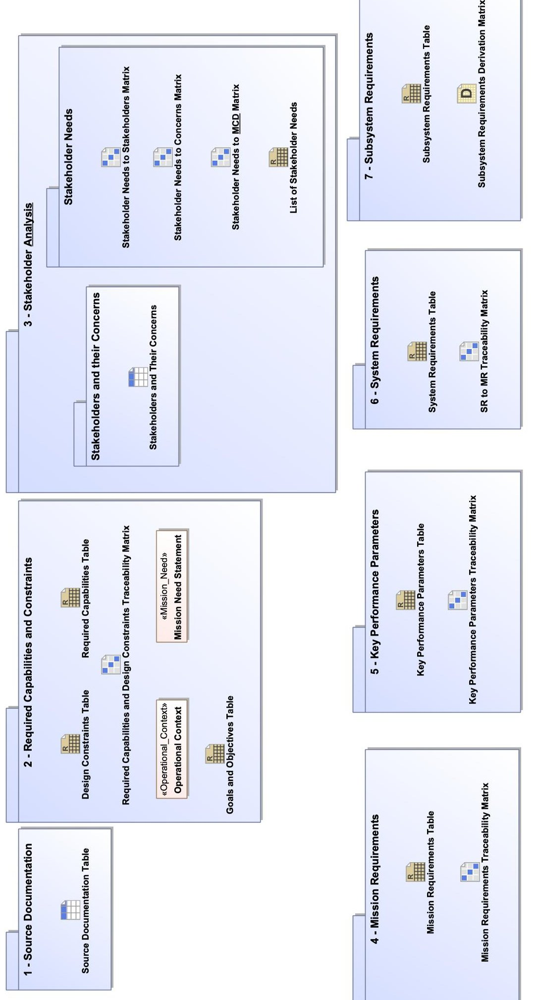

Figure 24. Requirements Organization

<!-- PDF_PAGE: 65 -->

The Requirements section begins with users creating blocks for their source material. This Source Documentation diagram will continue to grow over the course of the design sequence, but some common CubeSat references are included and attached. By attaching source material to blocks, as shown in Figure 25, requirements can be properly traced to the exact source document version. Furthermore, it makes it much easier for users to quickly see the source documentation, instead of needing to search the internet based off the source name.

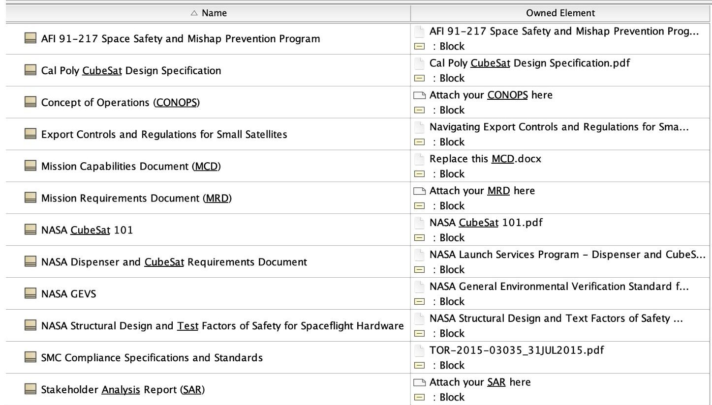

Figure 25. Source Documentation

The Reference Architecture assumes that design teams were provided with an MCD. Given that, users should parse the contents of the MCD into blocks that can be used within the model. Instructions are provided in the diagrams for how to accomplish this, but the goal is to have a set of Design Constraints and Required Capabilities, an Operational Context statement, a Mission Need statement, and a matrix that traces these new blocks to the MCD. If any changes occur after the original MCD was parsed, users can generate a new MCD based off these tables using

<!-- PDF_PAGE: 66 -->

the Document Generator tool. Note also that the tables provided include an ID naming convention that will be continued when users add additional entries into the respective tables. Additionally, each table is populated with blocks that contain the correct modeling "stereotype" so that tables can properly and automatically populate. Figure 26 shows an example of a Design Constraints table for one class project, and that pattern repeats for the Required Capabilities table. The tables as provided only include sample names, as these will need to be replaced as soon as an MCD is provided.

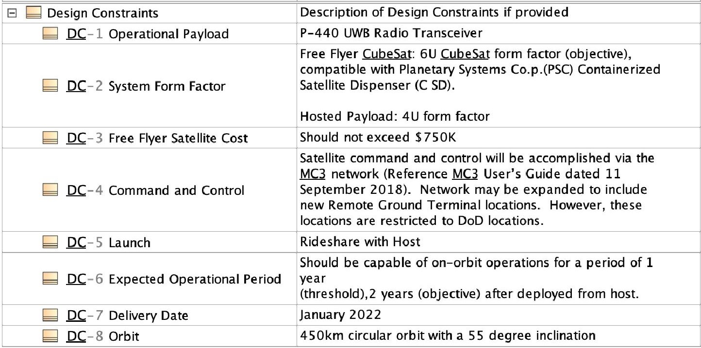

Figure 26. Design Constraints

The next major step is to perform a Stakeholder Analysis as a team. Figure 27 shows the structure of the Stakeholder Analysis package, with a package for Stakeholder Concerns and another for Stakeholder Needs. Design teams will first brainstorm a list of Stakeholders and document whatever concerns they may have in the form of "comments" in Cameo. Some generic Stakeholders are provided as well as generic "concerns" that users should edit and add to for their unique program. The issue with these Stakeholder Concern "comments" is that requirements cannot be

<!-- PDF_PAGE: 67 -->

traced directly to them. To address this limitation, Stakeholder Needs are then created as blocks that represent those previously created concerns. Several concerns may address the same topic, so one Stakeholder Need block can be created that maps to each relevant concern. Figure 28 shows a portion of the matrix that will automatically change after the previous steps. By mapping the new Need blocks to the Concern comments and to their applicable stakeholder, the user can see where each Stakeholder Need comes from. Once the team has a complete list of Stakeholder Needs with traceability back to their concerns, the Stakeholder Analysis Report can be generated. The Document Generator process will be detailed later in this chapter.

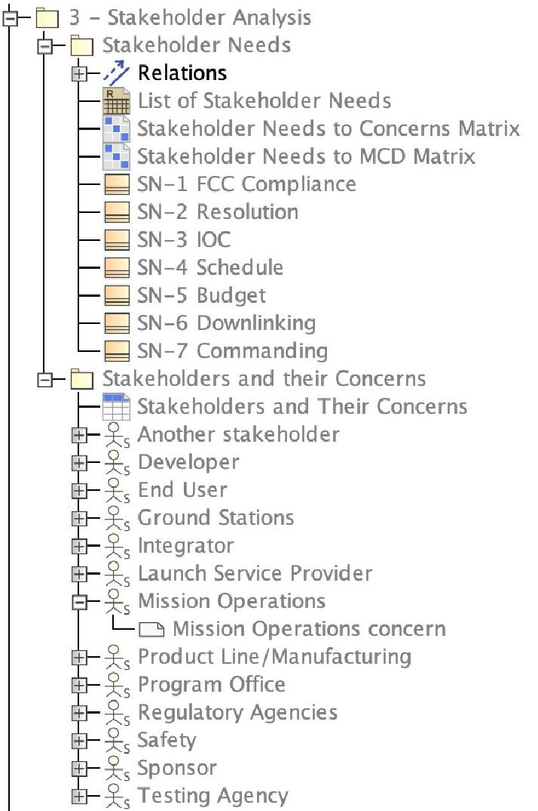

Figure 27. Stakeholder Analysis

<!-- PDF_PAGE: 68 -->

<table border="1"><tr><td>Legend
 concern
 Stakeholder</td><td colspan="7">Stakeholder Needs</td></tr><tr><td></td><td>SN-1 FCC Compliance</td><td>SN-2 Resolution</td><td>SN-3 IOC</td><td>SN-4 Schedule</td><td>SN-5 Budget</td><td>SN-6 Downlinking</td><td>SN-7 Commanding</td></tr><tr><td>Stakeholders and their Concerns</td><td>2</td><td>2</td><td>4</td><td>2</td><td>2</td><td>2</td><td>2</td></tr><tr><td>Another stakeholder
Another stakeholder concern
yet another stakeholder concern</td><td></td><td></td><td></td><td></td><td></td><td></td><td></td></tr><tr><td>Developer
Another stakeholder concern</td><td></td><td></td><td></td><td></td><td></td><td></td><td></td></tr><tr><td>End User
End user concern</td><td>2</td><td>✓</td><td>✓</td><td></td><td></td><td></td><td></td></tr><tr><td>Meet IOC date</td><td>1</td><td></td><td>✓</td><td></td><td></td><td></td><td></td></tr><tr><td>Meet needed resolution</td><td>1</td><td>✓</td><td></td><td></td><td></td><td></td><td></td></tr><tr><td>Ground Stations
Ground station concern</td><td></td><td></td><td></td><td></td><td></td><td></td><td></td></tr><tr><td>Integrator
Another stakeholder concern</td><td></td><td></td><td></td><td></td><td></td><td></td><td></td></tr><tr><td>Launch Service Provider
Launch Service Provider concern</td><td></td><td></td><td></td><td></td><td></td><td></td><td></td></tr><tr><td>Mission Operations
Mission Operations concern</td><td>2</td><td></td><td></td><td></td><td></td><td>✓</td><td>✓</td></tr><tr><td>Product Line/Manufacturing
Product Line/Manufacturing concern</td><td></td><td></td><td></td><td></td><td></td><td></td><td></td></tr><tr><td>Program Office
Program Office concern</td><td></td><td></td><td></td><td></td><td></td><td></td><td></td></tr><tr><td>Regulatory Agencies
System must comply with FCC regulations.</td><td>1</td><td>✓</td><td></td><td></td><td></td><td></td><td></td></tr><tr><td>Safety
Safety concern</td><td></td><td></td><td></td><td></td><td></td><td></td><td></td></tr><tr><td>Sponsor
Another stakeholder concern
Deliver on time
Deliver within budget
Meet IOC date</td><td>3</td><td></td><td>✓</td><td>✓</td><td>✓</td><td></td><td></td></tr><tr><td>Testing Agency
Another stakeholder concern</td><td></td><td></td><td></td><td></td><td></td><td></td><td></td></tr></table>

Figure 28. Stakeholder Matrix

The remaining sections within the Requirements package will be completed later in the design sequence. It is structured using a tiered Requirements convention, where teams start by generating a list of Mission Requirements, then a list of System or Space Vehicle Requirements, and finally a list of Subsystem Requirements for each subsystem. Each tier is organized in a similar fashion, but with different stereotypes

<!-- PDF_PAGE: 69 -->

and some different data fields. Additionally, template requirements for each tier have been provided, as well as some example entries in other data fields to show as examples, as shown in Figure 29. Each tier of requirements also comes with a traceability matrix for users to trace or derive that tier from. Note that the Subsystem Requirements table, shown in Figure 30, is further broken out into subsystem categories, with template requirements for each to get teams started on the brainstorming process.

<table border="1"><tr><td>Name</td><td>Text</td><td>Mission Requirement Notes</td><td>Derived From</td><td>Traced To</td><td>Verify Method</td></tr><tr><td>MR-1 Risk</td><td>Probability of success TBD%</td><td>insert rationale here if needed</td><td></td><td></td><td></td></tr><tr><td>MR-2LV Type</td><td>Probability of success TBD%</td><td></td><td></td><td>Launch Vehicle Trade Study</td><td></td></tr><tr><td>MR-3 Coverage</td><td>Coverage Requirement Text</td><td></td><td></td><td></td><td></td></tr><tr><td>MR-4 Schedule</td><td>Operational within TBD years</td><td></td><td></td><td></td><td></td></tr><tr><td>MR-5 Political</td><td>Applicable political requirement text</td><td></td><td></td><td></td><td></td></tr><tr><td>MR-6 Commanding</td><td>Commandable within TBD.</td><td></td><td></td><td></td><td></td></tr><tr><td>MR-7 System LIF</td><td>applicable interface requirements</td><td></td><td></td><td></td><td></td></tr><tr><td>MR-8 Timeliness</td><td>Timeliness Requirement Text</td><td></td><td></td><td></td><td></td></tr><tr><td>MR-9 Environment</td><td>any special environment text</td><td></td><td></td><td></td><td></td></tr><tr><td>MR-10 Performance</td><td></td><td></td><td></td><td></td><td></td></tr><tr><td>MR-10.1 Weather</td><td>Weather requirement text, if applicable</td><td></td><td></td><td></td><td></td></tr><tr><td>MR-10.2 Resolution</td><td>TBD resolution</td><td></td><td></td><td></td><td></td></tr><tr><td>MR-10.3 Geo-location Accuracy</td><td>TBD geolocation accuracy</td><td></td><td></td><td></td><td></td></tr><tr><td>MR-11 Regulations</td><td>Applicable regulatory requirement text</td><td></td><td></td><td></td><td></td></tr><tr><td>MR-12 Mission Cost</td><td>Non-recurring $TBD MRecurring $TBD M/year</td><td></td><td>DC-6 Launch CostDC-5 Satellite Recurri</td><td>Cost Estimate</td><td>Analysis</td></tr><tr><td>MR-13 Revisit Time</td><td>Timeliness Requirement Text</td><td></td><td></td><td></td><td></td></tr><tr><td>MR-14 Number of LVs</td><td>number of LVs requirement text</td><td></td><td></td><td>Launch Vehicle Trade Study</td><td></td></tr><tr><td>MR-15 Survivability</td><td>Survivability requirement text (radiation belts, etc.)</td><td></td><td></td><td></td><td></td></tr><tr><td>MR-16 User Equipment</td><td>user equipment description</td><td></td><td></td><td></td><td></td></tr><tr><td>MR-17 Data Distribution</td><td>Data requirement text</td><td></td><td></td><td></td><td></td></tr><tr><td>MR-18 Orbit Requirements</td><td></td><td></td><td></td><td></td><td></td></tr><tr><td>MR-18.1 De-orbit Requirement</td><td>de-orbit requirement text</td><td></td><td></td><td></td><td></td></tr><tr><td>MR-18.2 Transfer-orbit Requirement</td><td>transfer orbit requirement text</td><td></td><td></td><td></td><td></td></tr><tr><td>MR-18.3 Operational Orbit Requirement</td><td>Timeliness Requirement Text</td><td></td><td></td><td></td><td></td></tr><tr><td>MR-18.3.1 Orbit Plane</td><td>Orbit plane text</td><td></td><td></td><td>Constellation Design Trade St</td><td></td></tr><tr><td>MR-18.3.2 Orbit Altitude</td><td>TBD resolution</td><td></td><td></td><td>Constellation Design Trade StMR-3 Coverage</td><td></td></tr><tr><td>MR-19 Secondary Missions</td><td>Secondary Mission text description</td><td></td><td></td><td></td><td></td></tr><tr><td>MR-20 Mission Design Life</td><td>TBD years</td><td></td><td></td><td></td><td></td></tr><tr><td>MR-21 System Availability</td><td>TBD hours maximum downtime</td><td></td><td></td><td></td><td></td></tr><tr><td>MR-22 Number of CubeSat(s)</td><td>number of CubeSats requirement text</td><td></td><td></td><td></td><td></td></tr><tr><td>MR-23 Development Constraints</td><td>None</td><td></td><td></td><td></td><td></td></tr><tr><td>MR-24 Data Content, Form, and Format</td><td>data content, form, and format requirement text</td><td></td><td></td><td></td><td></td></tr></table>

Figure 29. Mission Requirements

<!-- PDF_PAGE: 70 -->

<table border="1"><tr><td>Name</td><td>Text</td><td>Derived From</td><td>Verify Method</td><td>Risk</td></tr><tr><td colspan="5">Bus Requirements</td></tr><tr><td colspan="5">ADCS</td></tr><tr><td>ADCS-1 Mass</td><td>Mass Requirement Text</td><td colspan="2">SR-9 Design and CTest</td><td>Medium</td></tr><tr><td>ADCS-2 Power</td><td></td><td></td><td></td><td></td></tr><tr><td>ADCS-3 Slew Rate</td><td></td><td></td><td></td><td></td></tr><tr><td>ADCS-4 Pointing Accuracy</td><td></td><td></td><td></td><td></td></tr><tr><td>ADCS-5 Pointing Knowledge</td><td></td><td></td><td></td><td></td></tr><tr><td>ADCS-6 Detumble Capability</td><td></td><td></td><td></td><td></td></tr><tr><td colspan="5">Bus Software</td></tr><tr><td>SW-1 Software Architecture</td><td></td><td></td><td></td><td></td></tr><tr><td>SW-1.1 Data Storage</td><td></td><td></td><td></td><td></td></tr><tr><td>SW-1.2 Housekeeping</td><td></td><td></td><td></td><td></td></tr><tr><td>SW-1.3 Command Sequences</td><td></td><td></td><td></td><td></td></tr><tr><td>SW-1.4 Core Flight Software</td><td></td><td></td><td></td><td></td></tr><tr><td>SW-2 Operating System</td><td></td><td></td><td></td><td></td></tr><tr><td>SW-3 System Management</td><td></td><td></td><td></td><td></td></tr><tr><td>SW-4 Fault Management / Recovery</td><td></td><td></td><td></td><td></td></tr><tr><td>SW-5 Timing</td><td></td><td></td><td></td><td></td></tr><tr><td>C&DH</td><td></td><td></td><td></td><td></td></tr><tr><td>Communication</td><td></td><td></td><td></td><td></td></tr><tr><td>EPS</td><td></td><td></td><td></td><td></td></tr><tr><td>GNSS</td><td></td><td></td><td></td><td></td></tr><tr><td>Propulsion</td><td></td><td></td><td></td><td></td></tr><tr><td>Structures</td><td></td><td></td><td></td><td></td></tr><tr><td>Thermal</td><td></td><td></td><td></td><td></td></tr><tr><td>Payload Requirements</td><td></td><td></td><td></td><td></td></tr></table>

Figure 30. Subsystem Requirements

## 4.5 Structure

After coming up with a list of requirements, teams need to decide on a physical structure that can satisfy those requirements. Instead of starting from a blank slate, this CubeSat Reference Architecture provides teams with a generic physical decomposition for a CubeSat and its various subsystems, as well as related systems, such as the Launch Vehicle and the Ground segment. Figure 31 shows a high level view of the areas that the Reference Architecture includes. Each package is hyperlinked to more detailed diagrams to fill out, and the most relevant value properties have been included for each.

<!-- PDF_PAGE: 71 -->

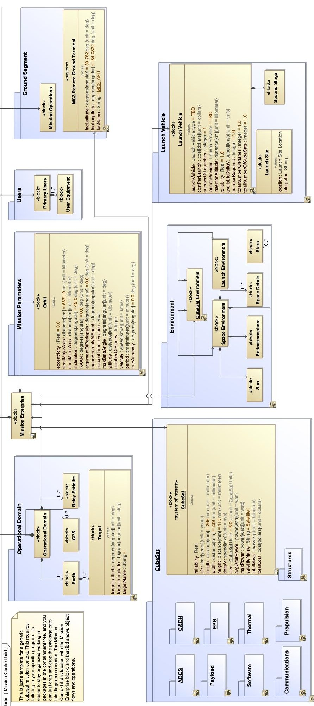

Figure 31. Mission Context bdd

<!-- PDF_PAGE: 72 -->

Figure 32 shows the same Mission Context, but in the form of an internal block diagram so that various data or signal flows can be shown, highlighting interactions between the CubeSat system of interest and relevant systems in the overall mission context. This diagram also highlights key operations and relevant value properties that add value to this view.

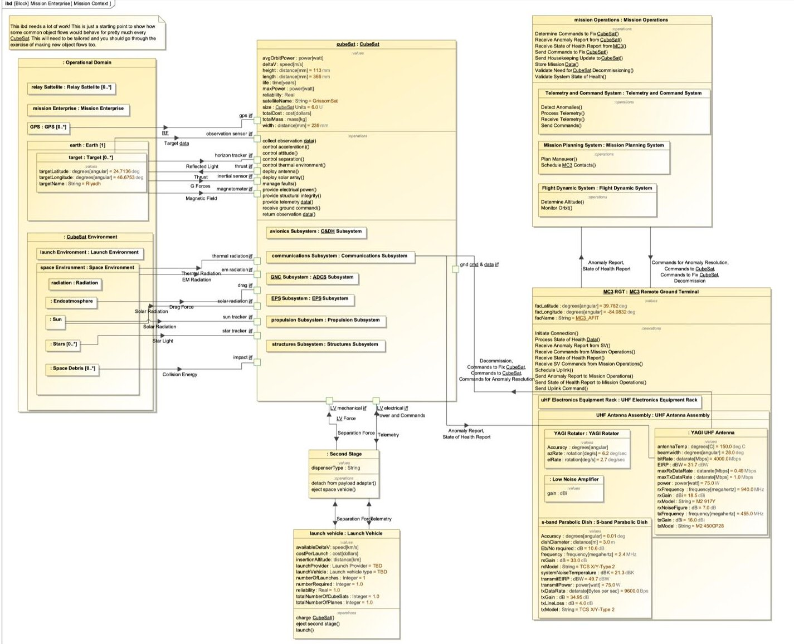

Figure 32. Mission Context ibd

A generic physical decomposition of a standard CubeSat has been included to help teams stay organized and to provide a starting point to work from. Figure 33 shows a top level view, with subsystems being rolled up into subsystem blocks. Each of those subsystem blocks contains more detailed diagrams within for individual components. Organizing it in this fashion prevents massive, unreadable diagrams

<!-- PDF_PAGE: 73 -->

from being presented to stakeholders and instead, the specific details for different components are only shown in the appropriate level diagram. The primary benefit of this provided physical decomposition is the value properties included in each block. The pre-built value properties allows for analysis tools to be included in the Reference Architecture, because the inputs are already defined. The included value properties also follow a "camel case" naming convention that reduces errors when they are used with constraint blocks. Teams can add additional value properties and use them for analysis, but the provided set is a well-rounded start.

<!-- PDF_PAGE: 74 -->

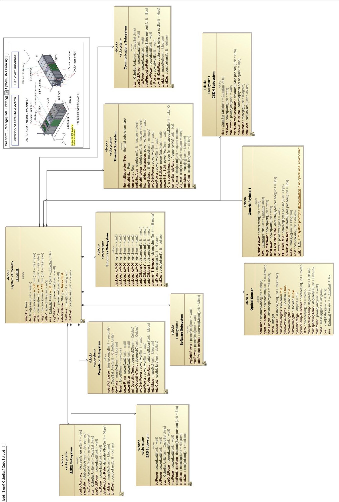

Figure 33. Physical Decomposition

<!-- PDF_PAGE: 75 -->

Figure 34 shows an example of one of those subsystem views, and Figure 35 shows how teams can tailor that generic diagram into something that meets their unique mission needs. In this example, the ADCS subsystem had unnecessary components that were removed, and values were added to each remaining block to describe the chosen components. Additional components were also added to address the needs of this particular system.

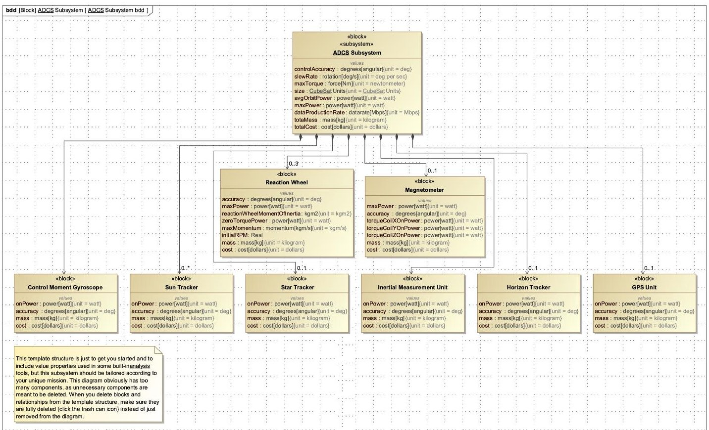

Figure 34. ADCS Template

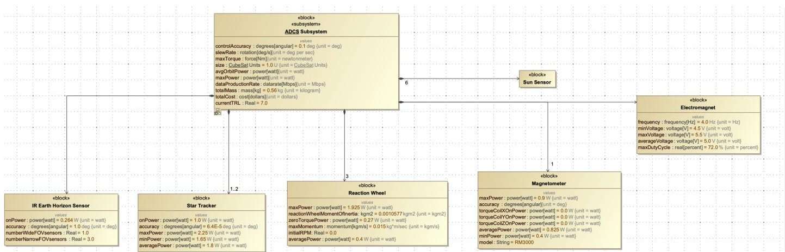

Figure 35. ADCS tailored

<!-- PDF_PAGE: 76 -->

While this CubeSat Reference Architecture is not intended to be fully simulated, a State Machine diagram is necessary to highlight the states that the CubeSat may be in. The diagram in Figure 36 serves as an example so teams know what a CubeSat state machine might look like, but teams should make their own to describe their unique mission CONOPS. By filling in this diagram, additional tables will also be pre-generated, pulling state transitions, guards, etc. from this diagram. These state transition tables and state descriptions are useful for stakeholder documentation when the CubeSat states are discussed.

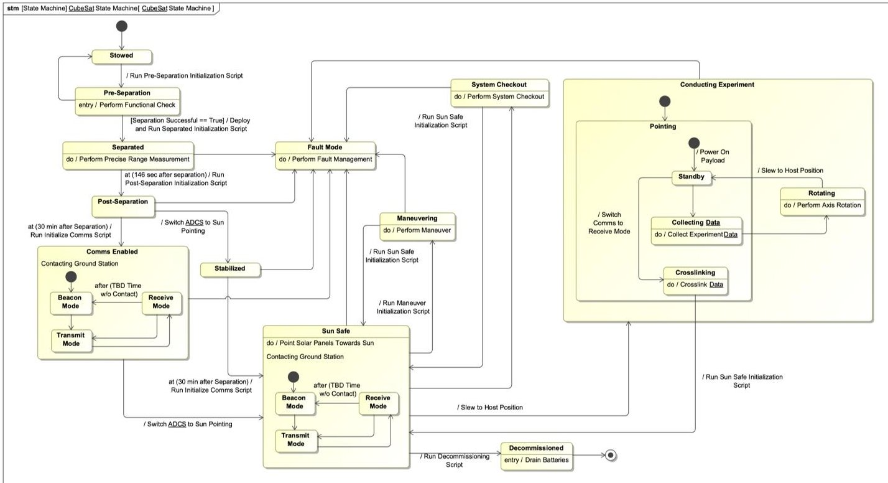

Figure 36. State Machine

## 4.6 Behavior

One of the most important documents that teams will need to create is the CONOPS, which requires most of its data from this Behavior section of the Reference Architecture. Figure 37 shows the top level organization of the Behavior package with the key diagrams that ultimately fill out the CONOPS document.

<!-- PDF_PAGE: 77 -->

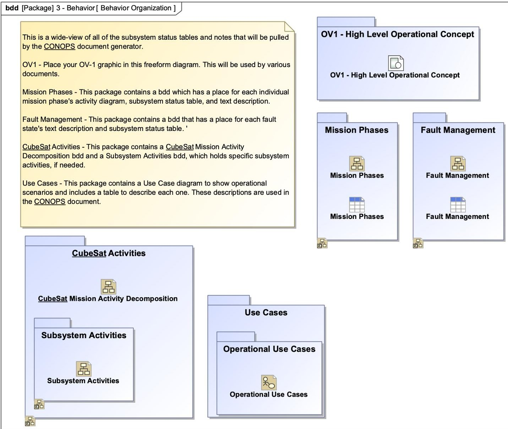

Figure 37. Behavior Organization

The note in Figure 37 describes what teams should use each included package for, and each package is hyperlinked to more detailed diagrams to fill out.

A template OV-1 has been included in a free form diagram, and teams will replace this template image with their own so that documents can include the image automatically. The OV-1 is a "High Level Operational Concept Graphic," usually a preferred view of a mission from Senior Leaders. The Department of Defense Architecture Framework describes it as "a mission, class of mission, or scenario. It shows the main operational concepts and interesting or unique aspects of operations. It describes the interactions between the subject architecture and its environment, and between the

<!-- PDF_PAGE: 78 -->

architecture and external systems. The OV-1 is the pictorial representation of the written content of the AV-1 Overview and Summary Information. Graphics alone are not sufficient for capturing the necessary architectural data. The OV-1 provides a graphical depiction of what the architecture is about and an idea of the players and operations involved. An OV-1 can be used to orient and focus detailed discussions. Its main use is to aid human communication, and it is intended for presentation to high-level decision-makers. [17]”

The Mission Phases package (Figure 38) contains a block definition diagram which has a place for each individual mission phase's activity diagram, subsystem status table, and text description. During each mission phase, the CubeSat's various subsystems will be in unique configurations, and this package includes an easy way to capture those. To capture these different configurations, tables have been created for teams to determine the various states for each subsystem for each phase. In addition to the subsystem configuration tables, teams should write textual descriptions of the applicable mission phase in the "Mission Phases" table (Figure 39) and create activity diagrams to show what happens in each phase. All of these will be used in the CONOPS document.

<!-- PDF_PAGE: 79 -->

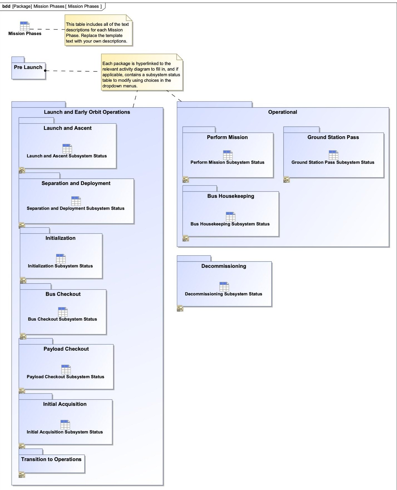

Figure 38. Mission Phases

<!-- PDF_PAGE: 80 -->

<table border="1"><tr><td>Name</td><td>Text</td></tr><tr><td>Pre Launch Phase</td><td>Activities during the Pre-Launch phase include:1) functional and environmental testing to qualify that the space vehicle&#x27;s ready for flight,2) transporting the space vehicle to the integrator&#x27;s facility,3) integrating the space vehicle with the dispenser,4) integrating the dispenser with the launch vehicle,and5) prepare for mission operations.</td></tr><tr><td>Launch&amp;Early Orbit Operations Phase</td><td>Should describe the major events that happen to the space vehicle during launch and&quot;First Day in the Life&quot; that includes being ejected from its dispenser and first contact with the Ground Station. Should include any constraints put on the space vehicle from the time it is ejected.Also what state the space vehicle subsystems are in.</td></tr><tr><td>Launch and Ascent</td><td>Describes the period from launch up to before separation. Should discuss expected impacts of launch environment driven by launch vehicle selection.</td></tr><tr><td>Separation and Deployment</td><td>Should discuss what happens immediately after separation from the launch vehicle all the way through deployment of space vehicle appendages(solar panels, antennas).</td></tr><tr><td>Initialization</td><td>Should describe the sequences that the space vehicle will go through to gradually initialize all space vehicle subsystems.This will typically be done in an autonomous manner.</td></tr><tr><td>Initial Acquisition</td><td>This should discuss the sequence of events that will occur for the first ground station contact with the space vehicle.</td></tr><tr><td>Bus Checkout</td><td>Should discuss all of the planned activities for ensuring that the bus is functioning properly to include checkout of all of the subsystems except for the payload.</td></tr><tr><td>Payload Checkout</td><td>Should discuss all of the planned activities to checkout the payload to include calibration,different states,etc.</td></tr><tr><td>Transition to Operations</td><td>Once the space vehicle is performing as expected,there will be a transition to normal operations.Discuss what that transition will consist of.</td></tr><tr><td>Operational Phase</td><td>Lead-in for what would typically be expected during normal operations.Further details will be provided in the subsections that follow.</td></tr><tr><td>Bus Housekeeping</td><td>This should describe what the space vehicle is doing between when it is collecting data and when it comes into contact with the ground station to conduct a pass.</td></tr><tr><td>Ground Station Pass</td><td>Should describe everything that happens before and after the space vehicle comes into contact with the ground station.This would include the interfaces between mission operations,the ground station,and the space vehicle.</td></tr><tr><td>Perform Mission</td><td>Describes everything associated with the space vehicle conducting its primary mission of collecting data.</td></tr><tr><td>Decommissioning Phase</td><td>Should describe what actions are taken to decommission the space vehicle.</td></tr></table>

Figure 39. Mission Phase Descriptions

The Fault Management package, shown in Figure 40, includes similar tables that will describe the various fault states in narrative form and in tables that shows each subsystem status.

<!-- PDF_PAGE: 81 -->

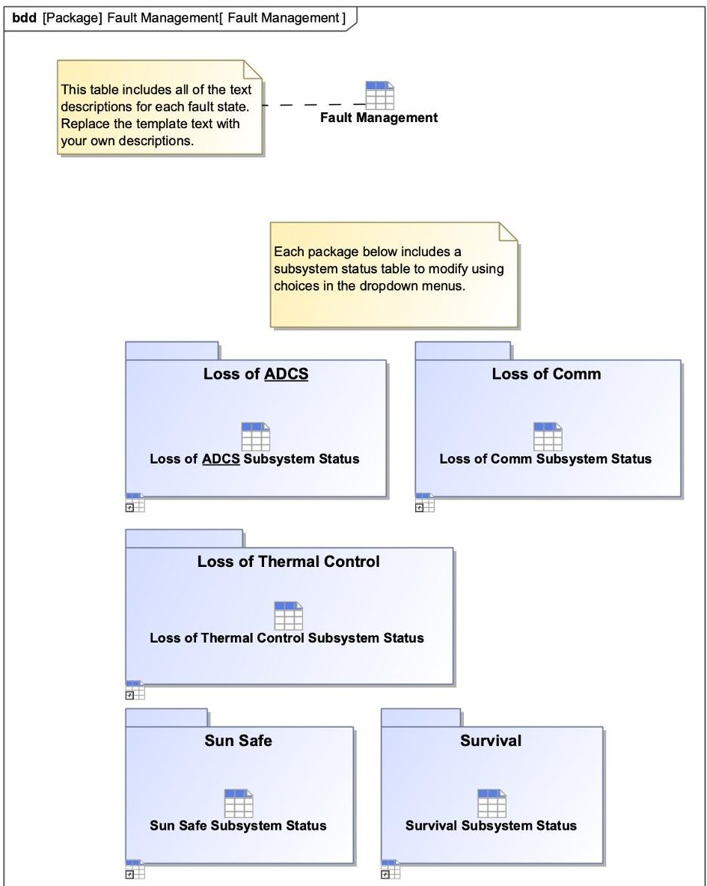

Figure 40. Fault Management

The CubeSat Activities package can hold any additional activities needed to describe the system. Activity diagrams for each critical mission phase have been created, although most only contain the starting and ending nodes. These vary substantially from mission to mission, so teams will need to populate these on their own. Finally, the Use Cases package includes a generic Use Case diagram that should be tailored.

## 4.7 Analysis

The Analysis portion is how teams show that their requirements are verified and how they track any external analysis done to generate requirements. Figure 41 shows

<!-- PDF_PAGE: 82 -->

the top level organizational structure. As is the case throughout this Reference Architecture, many of the included packages are hyperlinked to more detailed diagrams.

The Trade Studies package is a place to store any applicable trade studies in block form. This allows for requirements to be traced to any relevant analysis done in other tools. For example, if a team performed a Launch Vehicle Trade Study that ultimately impacted a requirement, that requirement could be traced to the Launch Vehicle Trade Study block, which includes the most current trade study as an attachment. This makes it very easy to know exactly where the numbers or decisions came from and stores that in the model for easy reference and modification from the team.

<!-- PDF_PAGE: 83 -->

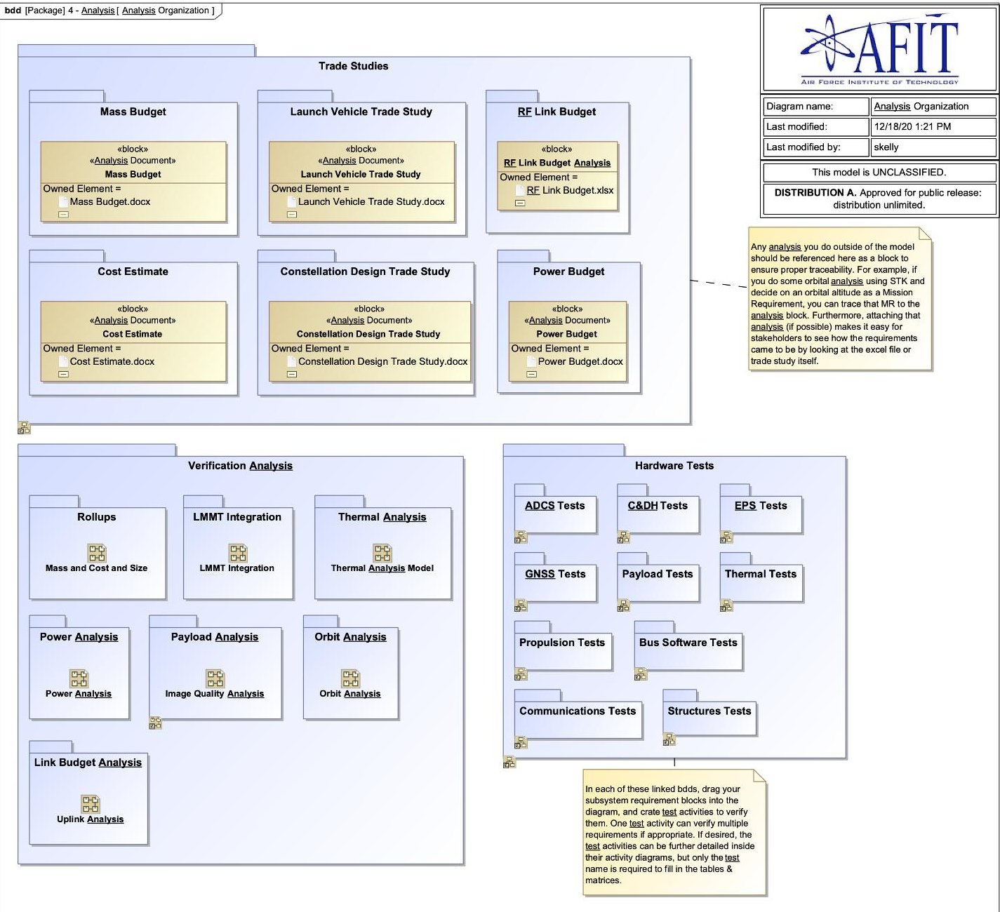

Figure 41. Analysis Organization

The Verification Analysis package contains several templates or patterns that highlight some capabilities of Cameo for requirement verification. For example, the Thermal Analysis parametric diagram in Figure 42 shows how to use a MATLAB script to perform analysis based off the values entered in the thermal subsystem, as well as any other values that affect these calculations, such as the CubeSat's mass and some orbital parameters. The code in Figure 42 is not necessary to read in this thesis, and is usually hidden from view when scripts become lengthy, but is shown here just to

<!-- PDF_PAGE: 84 -->

highlight where the code is stored. This section is intended to encourage teams to perform analysis within the model instead of in other tools. By performing analysis within the model, easy verification of candidate systems can be accomplished using Instance Tables or the default values assigned to component value properties. The CubeSat Reference Architecture purposefully does not include default values for the components' value properties, but an instance table, such as the one in Figure 43, can be simulated using the MATLAB code to compare how different candidate systems perform. This instance was simulated, and the results are shown in Figure 44. By changing one or several value properties in the relevant blocks or in the instance table, these graphs automatically update to show how the performance changes. This is extremely useful for many requirements that are affected by multiple subsystems or multiple components. A constraint block can be created that uses those value properties as inputs, and the performance outputs can be quickly assessed in multiple system configurations. The included parametric diagrams serve as patterns to replicate and modify, reducing the learning curve for teams who haven't learned these capabilities yet.

<!-- PDF_PAGE: 85 -->

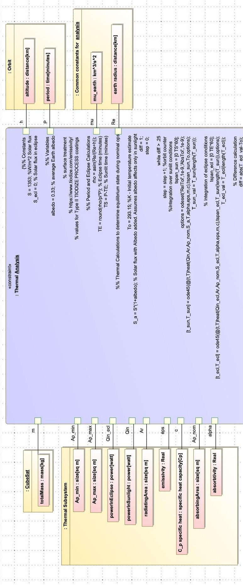

Figure 42. Thermal Analysis

<!-- PDF_PAGE: 86 -->

Thermal analysis instances (by skelly)

test run : Thermal Analysis (by skelly)

$ \textcircled{s} $ alpha = 0.82

$ \textcircled{s} $ Ap_max = 0.06 m2

$ \textcircled{s} $ Ap_min = 0.02 m2

$ \textcircled{s} $ Ap_nom = 0.036 m2

$ \textcircled{s} $ Ar = 0.22 m2

$ \textcircled{s} $ c = 460.548 J/kg*K

$ \textcircled{s} $ eps = 0.51

$ \textcircled{s} $ h = 600.0 km

$ \textcircled{s} $ m = 10.857

$ \textcircled{s} $ mu = 398600.4418

$ \textcircled{s} $ P = 93.0 minutes

$ \textcircled{s} $ Qin = 12.6

$ \textcircled{s} $ Qin_ecl = 17.2975

$ \textcircled{s} $ Re = 6378.0

Thermal Analysis (by skelly)

Figure 43. Thermal Analysis Instance

<!-- PDF_PAGE: 87 -->

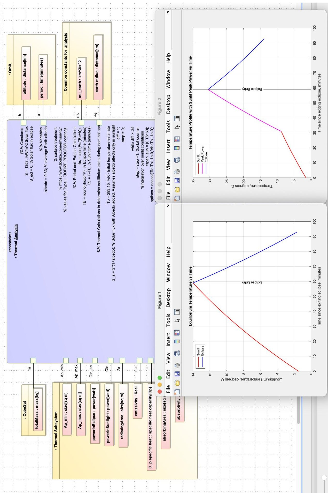

Figure 44. Thermal Analysis Run

<!-- PDF_PAGE: 88 -->

As teams progress from the design, they will test physical hardware. Before teams begin testing physical hardware though, they need to document their test plans. The Hardware Tests package includes workspaces for each subsystem that establishes consistency and makes it easier to generate the necessary tables to describe test activities. Each requirement should be tied to a test (sometimes multiple requirements can be verified by one test), and this can be done in diagram form. For example, if the Electrical Power System (EPS) lead needs to plan EPS testing activities, they can open up the EPS Tests bdd and follow the template process. If they drag and drop all of the applicable subsystem requirements onto this diagram, as shown in Figure 45, they can easily create test activities and assign a "verify" relationship between them, which automatically populates the included tables. In this example, notice the "Weigh Components" test, and that test verifies the EPS Subsystem Mass requirement. This pattern should be continued until each requirement is verified by some activity. Finally, the test activity tables provide a place to textually describe what happens in each test to verify the requirement(s). These tables are all useful for the Test Plans and Test Reports, keeping the model as the primary document instead of different files and formats for each subsystem. The subsystem requirement tables in this section also include a method for tracking testing progress while also establishing a common set of definitions. Previously, tests that were "not verified" for whatever reason were all in one category, causing confusion amongst stakeholders. Now, tests can be labeled from a drop-down menu as "not verified" for the specific reason and they are labeled in a color to bring attention to problematic tests. Figure 46 shows an example of how this could be used. The Verification Status legend is located in the Component Library and can be modified if definitions or categories change.

<!-- PDF_PAGE: 89 -->

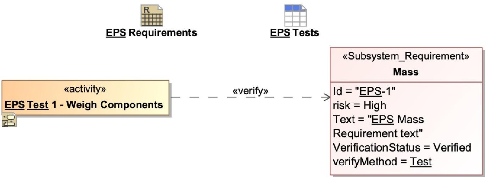

Figure 45. EPS Tests

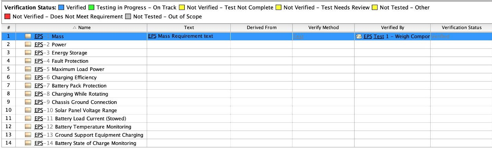

Figure 46. EPS Test Verification

## 4.8 Component Library

The Component Library is a function inspired by the SUAS Reference Architecture [20]. The goal is to have a library of components to choose from for each subsystem for rapid prototyping that improves over time. As teams create new CubeSat designs, the individual components can be stored in the Component Library for future reuse by other teams. For example, if there are multiple commercially available solar arrays that previous teams have used in their designs, those solar arrays will be available to reuse with all of their value properties already filled in. A team could swap out

<!-- PDF_PAGE: 90 -->

multiple solar arrays from the Component Library in their EPS subsystem diagram and perform analysis to quickly assess how each one performs for their system. Figure 47 shows the top level view of the Component Library, which has a separate package for each subsystem.

Figure 48 shows how it could be used in a simple example with different CubeSat bus sizes. In the Structures package, multiple chassis sizes, with their dimensions all filled out, can be quickly copied and pasted into a new model. If some value differs from the default values provided, the team would just need to make those modifications. Figure 49 shows how Enumeration lists are also stored in the component library to be used throughout the model. These enumeration lists are all consolidated in their respective subsystem packages instead of scattered across the physical model. In this example, instead of typing in a string of text to denote the battery chemistry, the user can just select from a drop-down list of the available types in the enumeration list. These are created for many subsystems, and as new choices become available, these can be updated.

<!-- PDF_PAGE: 91 -->

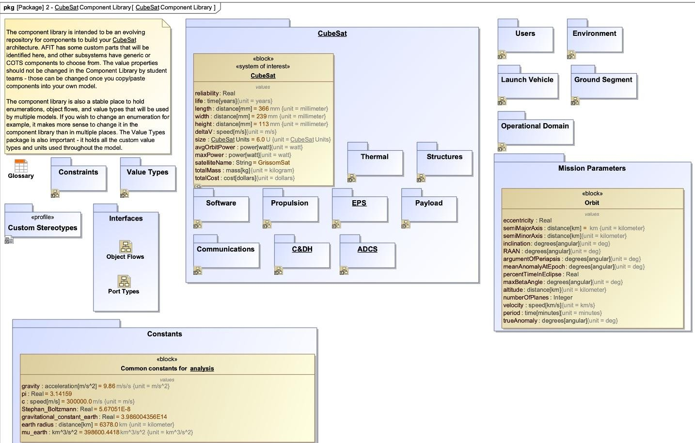

Figure 47. Component Library

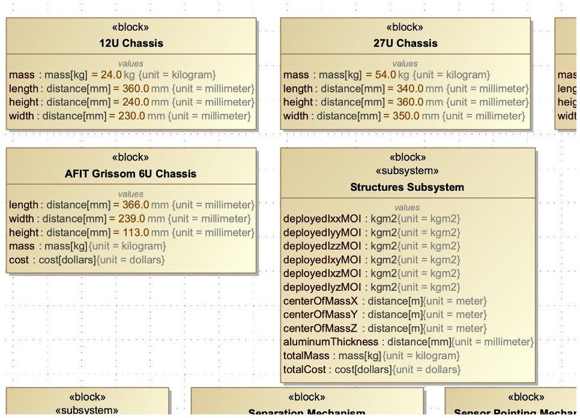

Figure 48. Component Library - Structures

<!-- PDF_PAGE: 92 -->

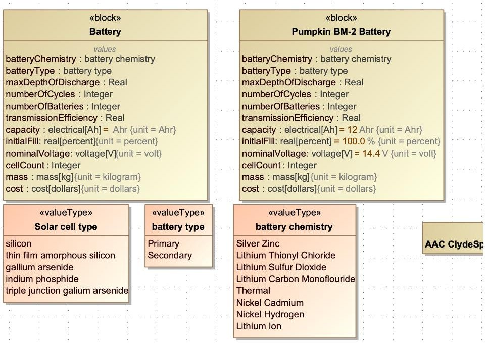

Figure 49. Component Library - EPS

Another important area of the Component Library is the custom Value Type library. Using the default ISO-8000 library seemed like the logical choice for units, but there were several issues with it that caused frustration over time. Most value types in the ISO-8000 library were never used and crowded the selection window when a user would try to find a unit, the spelling and naming conventions did not match what students were expecting or were accustomed to, and most importantly, they were not able to be modified without causing errors every time Cameo was opened. To alleviate these issues, an entire custom value type library was created to stay more organized and allow for easy modifications and customization. The Value Types, Units, and "QuantityKinds" (a SysML necessity for units to work properly in analysis) are all stored neatly in packages based off their type. When a user is going to add a new Value Property to a component block, it is now very easy to find the relevant value type to assign to it. The default practice amongst students without having this central repository is to just type in a new Value Type, and then that Value Type appears in the same location as that block. This isn't necessarily a bad thing on a small model, but a Reference Architecture is meant to be used for

<!-- PDF_PAGE: 93 -->

multiple candidate architectures and multiple projects, and referencing a new Value Type that belongs to another physical model should be avoided. For that reason, all Value Types are stored in one central place within the Component Library. This has also been done with Object Flows in the Reference Architecture. Object Flows represent the flow of objects, whether they are matter, energy, or data, primarily used in the Mission Context diagram shown earlier in Figure 32.

<!-- PDF_PAGE: 94 -->

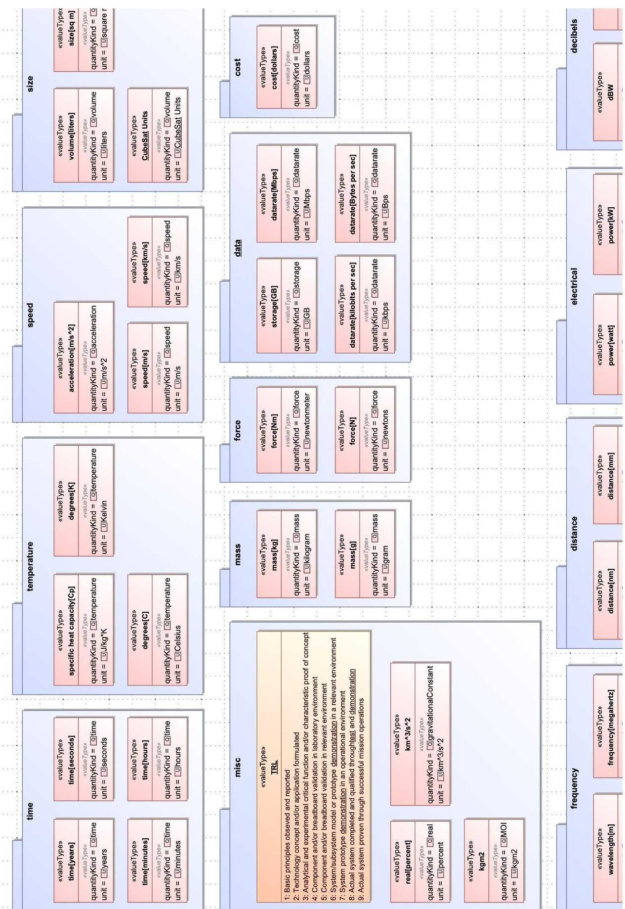

Figure 50. Custom Value Type Library

<!-- PDF_PAGE: 95 -->

## 4.9 Document Generators

While the model should be able to stand alone to represent the CubeSat system, stakeholders may prefer to view system details in document form. This could be because they don't have access to the modeling tool, or because they are more accustomed to seeing traditional reports. Whatever the reason, it would save time if those documents could be generated from model elements alone. Copying diagrams into a word processor and transcribing the requirements, etc. into tables, as is traditionally done, causes issues with version control and maintaining consistency. For example, if a team is writing a Space Vehicle Requirements Document, they could copy the requirement text from the model into a table in Microsoft Word, but if a requirement changes within the model, the team would need to catch that change and manually update any documents as a result. This CubeSat Reference Architecture proposes a new method for generating documents using Apache's Velocity Template Language. Cameo Systems Modeler is written in Java, so each model element is defined using Java code. This can be taken advantage of by populating a Microsoft Word file with code that imports those Java elements when it's run. Essentially, the Word templates tell Cameo what elements to export and in what order and in what format. This allows for fully custom, well-designed documents to be generated that require minimal formatting before delivery to stakeholders. If any model elements change, the team can just regenerate the document, and all tables, diagrams, etc. will always reflect the latest version that resides in the model.

Figure 51 shows an organizational diagram showing the pre-built generators that are used in AFIT's Spacecraft Design Sequence. Instructions are also included, and an in-depth, commented Generic Model Document is provided. This generic document is the foundation for all other templates. This generic document has code for any Reference Architecture section and guidance for how to modify it and why the code

<!-- PDF_PAGE: 96 -->

is written the way it is. If a new document is requested that does not have a template yet, a team can take portions from this master document into a new template for whatever model elements they wish to display. It also maintains a revision history that resides in the model, so when changes are made, the team can notate those and they will show up in all future documents in a table of revisions.

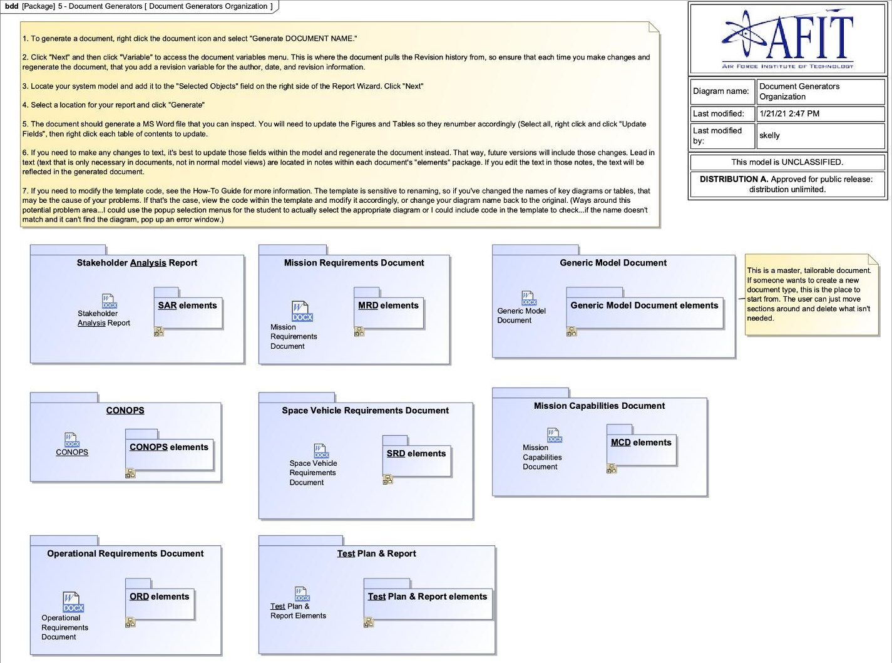

Figure 51. Document Generators

The title page of each template includes some custom functions that make the following code easier to write. Figure 52 shows several of these tools that are imported, allowing for tables to be easily exported and allowing for custom popup dialog prompts if a document generator should ask for a diagram's location. In this example, notice how a popup window asks the user to select their project's logo from among the model's free form diagrams, which is then imported by $diagram.image.

<!-- PDF_PAGE: 97 -->

Code that follows a "#" or "$" is not displayed in the resulting document once it runs. Some variables, such as $DocumentTitle, $Classification, and $Revisions are variables that are stored with the template, while others, such as $missionRequirement are pulling each model element with that stereotype assigned to it. Note that in the Reference Architecture, the "Mission_Requirement" stereotype is read by Java as the "missionRequirement" class. To prevent issues if users rename stereotypes, this practice has been minimized, opting instead to just import tables in their entirety when possible.

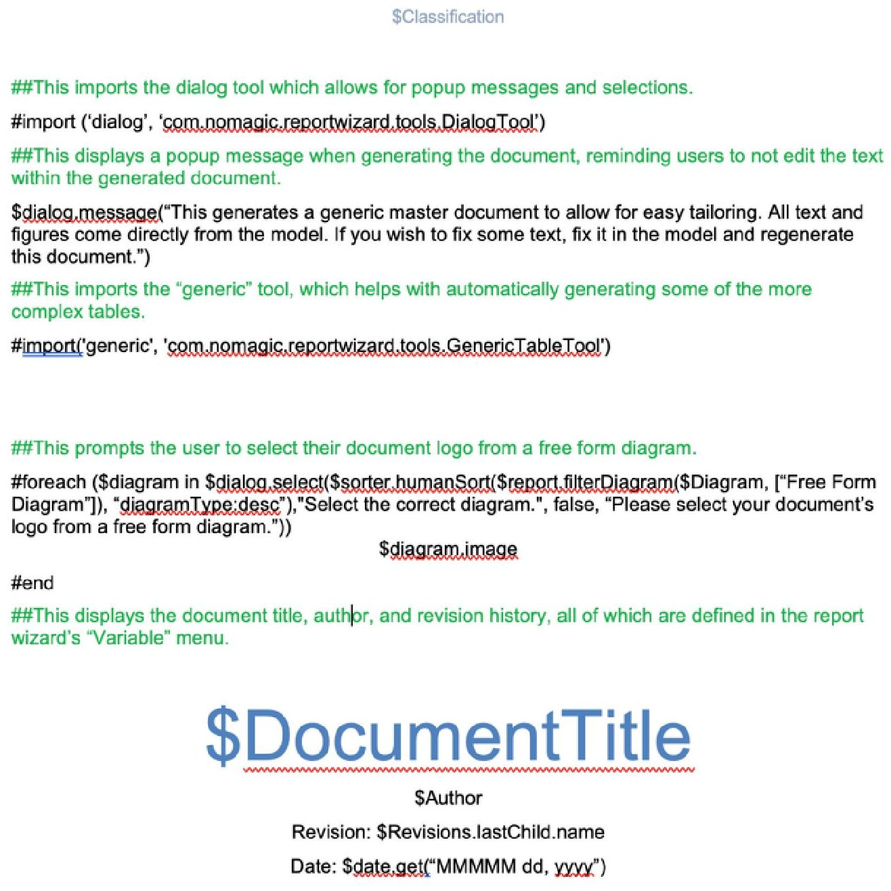

Figure 52. Document Generator Title Page

<!-- PDF_PAGE: 98 -->

One of the most common functions within these document generators is importing tables from the model and displaying it using Microsoft Word's table tool. Some tables in the model are quite large and hard to read if they are copied and pasted onto a document, so these templates call the internal elements instead and display them in a way that's very easy to customize. Figures 53 and 54 show two ways to import and display tables. Figure 53 shows a more detailed method to pull only the specific columns you want, which might be useful for very large tables. This method also allows for default column widths to reduce formatting once it is generated. This does present issues if users were to rename the "missionRequirement" class, as the code wouldn't find anything to import. The comments in the code should make it clear if someone opens the template to troubleshoot, but this is still a risk present using this method.

<table border="1"><tr><td>ID</td><td>Name</td><td>Text</td><td>Notes</td></tr><tr><td>#forrow($missionRequirementin$sorter,humanSort($MissionRequirement,&#x27;id&#x27;))$missionRequirement.id</td><td>$missionRequirement.name</td><td>$missionRequirement.text</td><td>$missionRequirement.missionRequirementNotes,#endrow</td></tr></table>

Figure 53. Manual Table Method

Figure 54 shows a more elegant solution, where the template imports a table by name and displays it exactly as it appears in the model. The downside with this method is that it requires some modifications once it is generated, as columns will all be equally sized. Furthermore, some extra columns may be shown that are not desired, but these can be easily deleted. This method is preferred throughout the included templates as it is less likely to require modifications. It also displays new

<!-- PDF_PAGE: 99 -->

columns that users may wish to add without requiring an understanding of the VTL language to import those new elements.

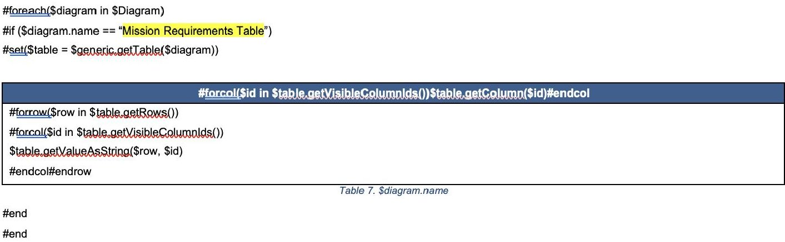

Figure 54. Automatic Table Method

## 4.10 Validation of Model

Modeling styles vary from person to person and organization to organization, so external feedback was desired for this Reference Architecture to ensure it made sense to others. To accomplish this, the model was first demonstrated to other students who previously took AFIT's Space Vehicle Design sequence, and they were asked to model a system using the tool. This peer feedback process led to many clarifications and tweaks, and their models were the impetus for many of the provided value properties. Furthermore, their common questions were addressed in the included help guide. Technicians who work on the AFIT CubeSat program were also consulted. Understanding what they look for and what they call components and subsystems motivated some design changes to remain as consistent as possible.

After getting peer feedback, the model was demonstrated to faculty members who will teach the courses in the Space Vehicle Design sequence. Of the three instructors, only one has significant modeling experience, so this model and included guidance needed to be usable by students without requiring faculty help for normal modeling questions. The primary inputs required from the faculty were the inputs to the

<!-- PDF_PAGE: 100 -->

Document Generators. Because the faculty members decide the format and objectives for each deliverable report, they were given a chance to provide comments or changes to the relevant documents that this Reference Architecture will generate for their classes. If these requirements change in the future, which is highly likely, the students have been provided guidance for how to make a new template or modify an existing template so the instructors will not have to understand the underlying template code.

Finally, the CubeSat Reference Architecture is being used by the current cohort of students in the course sequence. When the first course started, they were given a lengthy recorded demonstration of the model, with guidance for how to use the cloud environment, how to use the document generators, and how to use and tailor the template model for their unique missions. During the duration of the course, they have an avenue to ask questions and receive help with the model, which may also lead to changes or improvements in the core Reference Architecture.

## 4.11 Summary

This chapter presented the design and implementation of a CubeSat Reference Architecture geared towards a University team on a compressed schedule and with limited modeling experience. The organizational structure was discussed, and several of the most important diagrams and built-in tools were explored.

<!-- PDF_PAGE: 101 -->

## V. Conclusion

## 5.1 Overview

Chapter V provides conclusions in light of the overall research that was accomplished. The research questions presented earlier are answered based on the work performed to this point. Finally, important lessons learned throughout this research development are recorded along with future work that could be done to extend this research.

## 5.2 Significance of Research

This research was significant due to the current emphasis in the US Air Force and US Space Force on Digital Engineering [1]. By using this Reference Architecture, engineers will have more experience using a model as the "source of truth" for analysis, requirements, and as the basis for traditional documentation. Furthermore, several new concepts and functions were explored in this Reference Architecture that are now being used in other models, such as the methodology for generating custom documents, using a validation suite, and establishing a custom Value Type library instead of the provided ISO-8000 library. In addition, this model is being used as the platform for more complex integration with MATLAB and STK by other researchers at AFIT.

As stated in Chapter I, the research objectives were as follows:

1. Create a practical and useful Reference Architecture for rapidly-prototyping CubeSat designs.

2. Create easy-to-use document generators that use model elements to generate traditional system level review documentation.

<!-- PDF_PAGE: 102 -->

3. Present this Reference Architecture to AFIT instructors for feedback.

4. Lay the groundwork for future analysis work with STK and MATLAB integration for more comprehensive mission analysis using model elements.

These research objectives have all been met over the course of this project. In addition, the following research questions were considered:

1. What are the tools necessary to perform mission modeling using model-based systems engineering?

The mission modeling effort is being done using this CubeSat Reference Architecture to provide all inputs into constraint blocks that are formatted to integrate with MATLAB and STK.

## 2. What viewpoints are most useful to common stakeholders?

Most stakeholders still prefer the traditional documentation, which required narrative sections to be built into the document generators in addition to using the system model elements. Additionally, stakeholder prefer higher level viewpoints with less clutter. Detailed subsystem details have been limited to the appropriate subsystem diagrams instead of crowding the main physical decomposition. Limiting the number of blocks on diagrams led to better views for presentations, even though it was quite difficult to simplify some diagrams.

3. How can useable documentation be generated from only model elements, keeping the source of truth within the model?

Custom work using Apache's Velocity Template Language was needed to generate polished documents using model elements. The built-in tools within Cameo are not sufficient, so this was a substantial effort to code and document.

4. What needs to be done in the model to allow for external tools (STK, MATLAB, etc.) to interact with the MBSE tool?

<!-- PDF_PAGE: 103 -->

The most important thing was to establish a library of value properties that worked well with MATLAB and STK. Lessons learned with custom units and with naming conventions led to the conventions used in the Reference Architecture so that these errors are avoided.

5. Can cloud-based collaboration improve the MBSE design process for interdisciplinary teams?

The cloud-based collaboration was extremely valueable. Lessons learned for this process have been handed down to the first cohort of students to use this environment in classes. There are some inherent difficulties with storing sensitive information in the cloud, but those issues are being worked out due to the benefits of the cloud-environment.

## 5.3 Lessons Learned

Over the course of this research, there were several lessons learned that warrant discussion. First, developing a Reference Architecture should not be a solitary endeavor. The early phases of this project were done primarily alone, but the most progress was made when other opinions were taken into consideration. Additionally, the model should be geared towards the key stakeholders, not just the modeler's preferences. This was made apparent during demonstrations to faculty members, whose opinions are the most important for this effort. Some design choices made sense originally, but needed modifications after seeing the greater context of the course objectives.

Another lesson learned was to embrace the cloud environment for collaboration. By using the cloud environment, multiple people could be making edits at the same time, and changes are reflected for all users once they are committed. Its well worth the effort in setting up the cloud environment, getting each team member an account,

<!-- PDF_PAGE: 104 -->

and walking through the best practices for cloud modeling at the very start of the project.

Finally, throughout the design process, the issues caused by copying and pasting blocks within a model became apparent. If a user copies and pastes an entire model (the Generic CubeSat Model for instance), everything seems to work perfectly. However, if a user copies just one internal package over to a different model, issues start popping up where you least expect them. Making a Reference Architecture that includes multiple full models within requires careful consideration before copying elements from one model to another.

## 5.4 Future Work

One of the primary goals for this CubeSat Reference Architecture was to establish the platform for future work. Some of that work has already begun, including an Integrated Mission Modeling Tool that uses the physical structure in the Reference Architecture to create detailed MATLAB Simulink and STK simulations for mission modeling. These tools will improve the fidelity of mission simulations and provide visual views of the orbits for ground contacts, while also simulating multiple payloads at once.

The Reference Architecture is meant to be improved and adapted over time. As new teams use the model, they will be creating new physical blocks for components they chose, and they will be creating new constraint blocks for analysis. These can be saved in the component library for future reuse, so over time, the component library can grow and contain more "plug and play" blocks. Eventually, the component library should have a variety of components for each subsystem to choose from, and there should be analysis blocks to tailor depending on the mission's requirements.

<!-- PDF_PAGE: 105 -->

There are also some gaps in the Reference Architecture that can be tackled by other researchers in the future. For example, this current iteration focuses on verifying subsystem level requirements with hardware tests, but most mission level or system requirements are not properly accounted for. This was due to the specific requirements of the Spacecraft Design Sequence at AFIT, but additional functionality can be built in to verify requirements at the mission or system level for teams who have a need for that information. Furthermore, only minimal risk functionality has been provided. Currently, a user can assign a risk level to a requirement, but there is no place to describe that risk or risk mitigation steps.

## 5.5 Final Thoughts

This research used the Object Oriented Systems Engineering Method with SysML to create a CubeSat Reference Architecture. While originally intended to be used by students at AFIT in their Spacecraft Design Sequence, the model can be tailored to be used by other teams that have similar goals.

This research delivered a variety of helpful tools for teams to use that makes their modeling efforts easier. Auto-populating tables and matrices, a library of parts and value properties to choose from, analysis patterns to tailor, and document generators will save time and hopefully improve the quality of CubeSat models going forward. Reports will also be more consistent and standardized according to stakeholder preference, and the work spaces provided encourage teams to use the model for storing all relevant data and analysis. Most importantly though, this Reference Architecture is cementing MBSE practices in teams who have limited experience with modeling tools, better preparing them for the future of spacecraft design.

<!-- PDF_PAGE: 106 -->

## Bibliography

[1] U.S. Air Force. Air Force of the Future is Faster, Smarter, Bolder, 2019. URL https://www.af.mil/News/Article-Display/Article/1963733/roper- air-force-of-the-future-is-faster-smarter-bolder/.

[2] Erik Kulu. Nanosats database, 2020. URL https://www.nanosats.eu/.

[3] CubeSat Design Specification Rev. 13. California Polytechnic State University, 2014. URL http://cubesat.org.www.cubesat.org/images/developers/ cds_rev13_final2.pdf.

[4] NASA CubeSat Launch Initiative. Cubesat 101: Basic concepts and processes for first time cubesat developers, 2017. URL https://www.omgwiki.org/MBSE/ doku.php?id=mbse:incoseoosem.

[5] James R. Wertz. Space Mission Engineering: The New SMAD. Microcosm Press, Torrance, CA, 2011. ISBN 978-1881883159.

[6] eoPortal. FalconSAT-7, 2019. URL https://directory.eoportal.org/web/eoportal/satellite-missions/f/falconsat-7.

[7] Air Force Academy. FalconSAT-6, 2018. URL https://www.usafa.edu/news/ air-force-academy-satellite-to-lift-off-nov-19/.

[8] Mark Harris. Swarm Wants to Send Hundreds of Tiny CubeSats Into Orbit. IEEE Spectrum, 2019. URL https://spectrum.ieee.org/tech talk/aerospace/satellites/swarm-wants-to-fly-the-sky-with-tiny cubesats.

[9] eoPortal. SSO-A, 2018. URL https://directory.eoportal.org/web/eoportal/satellite-missions/content/-/article/sso-a.

[10] Dennis Buede and William Miller. The Engineering Design of Systems: Models and Methods. John Wiley and Sons, Hoboken, NJ, third edition edition, 2016. ISBN 978-1119027904.

[11] Lenny Delligatti. SysML Distilled. Addison-Wesley, 2014. ISBN 978-0321927866.

[12] Tim Weilkiens. SYSMOD - The Systems Modeling Toolbox. MBSE4U, second edition edition, 2016. ISBN 978-3981852981.

[13] Hans-Peter Hoffmann. Systems Engineering Best Practices with the Rational Solution for Systems and Software Engineering. IBM, deskbook release 3.1.2 edition, 2020.

<!-- PDF_PAGE: 107 -->

[14] Jeff A. Estefan. Survey of Model-Based Systems Engineering (MBSE) Methodologies rev. B. Technical report, Jet Propulsion Laboratory, 2008. URL http://www.omgsysml.org/MBSE_Methodology_Survey_RevB.pdf.

[15] David Walden, Garry Roedler, Kevin Forsberg, Douglas Hamelin, and Thomas Shortell. Systems Engineering Handbook: A Guide for System Life Cycle Processes and Activities. INCOSE, San Diego, CA, fourth edition edition, 2015. ISBN 978-1118999400.

[16] OMGWiki. INCOSE Object-Oriented Systems Engineering Method (OOSEM), 2011. URL https://www.omgwiki.org/MBSE/doku.php?id=mbse:incoseoosem.

[17] The DoDAF Architecture Framework Version 2.02. Office of the Assistant Secretary of Defense Networks and Information Integration (OASD/NII), 2010. URL https://dodcio.defense.gov/Library/DoD-Architecture-Framework/.

[18] Robert J. Cloutier, Gerrit Muller, Dinesh Verma, Roshanak Nilchiani, Eirik Hole, and Mary Bone. The Concept of a Reference Architecture. Technical report, Systems Engineering, Vol. 13, No. 1, 2010.

[19] Reference Architecture Description. Office of the Assistant Secretary of Defense Networks and Information Integration (OASD/NII), 2010.

[20] David Jacques and Amy Cox. The use of mbse and a reference architecture in a rapid prototyping environment. Technical report, Air Force Institute of Technology, 2019.

[21] David Kaslow. Developing and distributing a cubesat model-based systems engineering reference model - status. Technical report, 2016.

[22] David Kaslow and Azad Madni. Validation and Verification of MBSE-compliant CubeSat Reference Model. 2017. doi: 10.1109/OCEANS.2018.8604771.

[23] David Kaslow, Philip T. Cahill, and Bradley Ayres. Development and application of the cubesat system reference model. 2020.

[24] David Kaslow, Grant Soremekun, Hongman Kim, and Sara Spangelo. Integrated Model-Based Systems Engineering (MBSE) Applied to the Simulation of a CubeSat Mission. IEEE Aerospace Conference, pages 5015-5020, 2014. doi: 10.1109/IROS.2011.6048729.

[25] David Kaslow, Bradley Ayres, and Philip Cahill. Development and Application of the CubeSat System Reference Model. Technical report, IEEE, 2020.

[26] David Kaslow, Bradley Ayres, Philip Cahill, Laura Hart, and Rose Yntema. Developing a CubeSat Model-Based Systems Engineering (MBSE) Reference Model - Interim Status 3. Technical report, IEEE, 2017.

<!-- PDF_PAGE: 108 -->

[27] Sanford Friedenthal and Christopher Oster. Architecting Spacecraft with SysML. AIAA, 2017. ISBN 978-15442880672.

[28] SAIC. SAID Digital Engineering Validation Tool, 2020. URL https:// www.saic.com/digital-engineering-validation-tool.

[29] Sanford Friedenthal, Rick Steiner, and Alan Moore. A Practical Guide to SysML. Morgan Kaufmann OMG Press, second edition edition, 2009. ISBN 978-0123786074.

[30] Mark Maier and Eberhardt Rechtin. The Art of Systems Architecting. CRC Press, 2009. ISBN 978-1420079135.

[31] SysML.org. Four Pillars of SysML, 2020. URL https://sysml.org/sysml-faq/.

<!-- PDF_PAGE: 109 -->

<table border="1"><tr><td colspan="4">REPORT DOCUMENTATION PAGE</td><td colspan="2">Form Approved
OMB No. 0704-0188</td></tr><tr><td colspan="6">The public reporting burden for this collection of information is estimated to average 1 hour per response, including the time for reviewing instructions, searching existing data sources, gathering and maintaining the data needed, and completing and reviewing the collection of information. Send comments regarding this burden estimate or any other aspect of this collection of information, including suggestions for reducing this burden to Department of Defense, Washington Headquarters Services, Directorate for Information Operations and Reports (0704-0188), 1215 Jefferson Davis Highway, Suite 1204, Arlington, VA 22202-4302. Respondents should be aware that notwithstanding any other provision of law, no person shall be subject to any penalty for failing to comply with a collection of information if it does not display a currently valid OMB control number. PLEASE DO NOT RETURN YOUR FORM TO THE ABOVE ADDRESS.</td></tr><tr><td colspan="2">1. REPORT DATE(DD-MM-YYYY)</td><td colspan="3">2. REPORT TYPEMaster&#x27;s Thesis</td><td colspan="2">3. DATES COVERED(From-To)Sept 2019-Mar 2021</td></tr><tr><td rowspan="3" colspan="4">4. TITLE AND SUBTITLEA Reference Architecture for Rapid CubeSat Development</td><td colspan="3">5a. CONTRACT NUMBER</td></tr><tr><td colspan="3">5b. GRANT NUMBER</td></tr><tr><td colspan="3">5c. PROGRAM ELEMENT NUMBER</td></tr><tr><td rowspan="3" colspan="4">6. AUTHOR(S)Kelly, Sean R, Capt</td><td colspan="3">5d. PROJECT NUMBER</td></tr><tr><td colspan="3">5e. TASK NUMBER</td></tr><tr><td colspan="3">5f. WORK UNIT NUMBER</td></tr><tr><td colspan="4">7. PERFORMING ORGANIZATION NAME(S) AND ADDRESS(ES)Air Force Institute of TechnologyGraduate School of Engineering and Management(AFIT/EN)2950 Hobson WayWPAFB OH 45433-7765</td><td colspan="3">8. PERFORMING ORGANIZATION REPORT NUMBERAFIT-ENV-MS-21-M-240</td></tr><tr><td rowspan="2" colspan="4">9. SPONSORING / MONITORING AGENCY NAME(S) AND ADDRESS(ES)Air Force Institute of TechnologyWPAFB OH 45433DSN 785-6565, COMM 937-255-6565</td><td colspan="3">10. SPONSOR/MONITOR&#x27;S ACRONYM(S)AFIT/ENV</td></tr><tr><td colspan="3">11. SPONSOR/MONITOR&#x27;S REPORT NUMBER(S)</td></tr><tr><td colspan="8">12. DISTRIBUTION / AVAILABILITY STATEMENTDISTRIBUTION STATEMENT A:APPROVED FOR PUBLIC RELEASE; DISTRIBUTION UNLIMITED.</td></tr><tr><td colspan="8">13. SUPPLEMENTARY NOTES</td></tr><tr><td colspan="8">14. ABSTRACTThe CubeSat class of nanosatellites has lowered the barrier of entry to space and has rapidly gained popularity in recent years. To successfully design a CubeSat system in a rapid cycle conducive to academic timelines, a Reference Architecture geared towards University CubeSat development would be helpful. A Reference Architecture would speed up the development process by providing a template, capturing previous work and lessons learned from subject matter experts, providing a framework to focus on the CubeSat&#x27;s design rather than the fine details of modeling software. A Reference Architecture can also add functionality that student teams could use and improve over time, such as pre-built analysis functions and a library of components to choose from. This thesis presents a CubeSat Reference Architecture designed to meet these needs and explores its unique features, diagrams, and custom libraries. The CubeSat Reference Architecture was validated by relevant course instructors and is being used by a cohort of students in the Spacecraft Design Sequence at AFIT.</td></tr><tr><td colspan="8">15. SUBJECT TERMSReference Architecture, CubeSat, MBSE</td></tr><tr><td colspan="3">16. SECURITY CLASSIFICATION OF:a. REPORTUb. ABSTRACTc. THIS PAGE</td><td rowspan="2">17. LIMITATION OF ABSTRACTU</td><td rowspan="2">18. NUMBER OF PAGES108</td><td colspan="3">19a. NAME OF RESPONSIBLE PERSONDr. David R. Jacques, AFIT/ENV</td></tr><tr><td colspan="3">a. REPORTUb. ABSTRACTc. THIS PAGE</td><td colspan="3">19b. TELEPHONE NUMBER(include area code)(937) 255-3636, x3329; david.jacques@afit.edu</td></tr></table>

Standard Form 298 (Rev. 8/98) Prescribed by ANSI Std. Z39.18