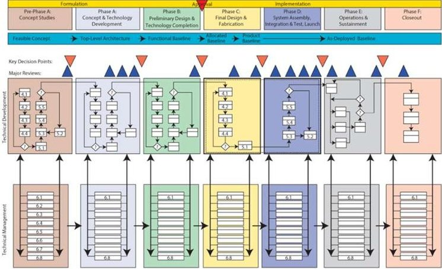
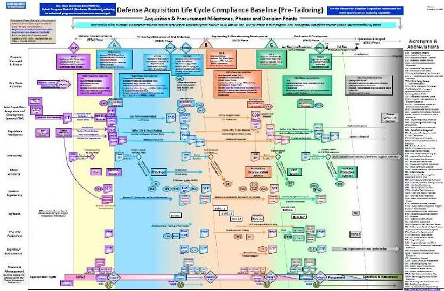
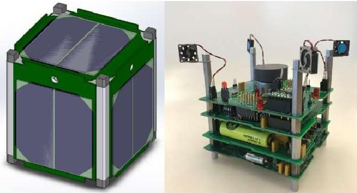
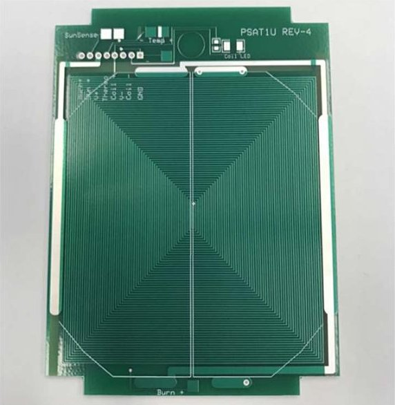
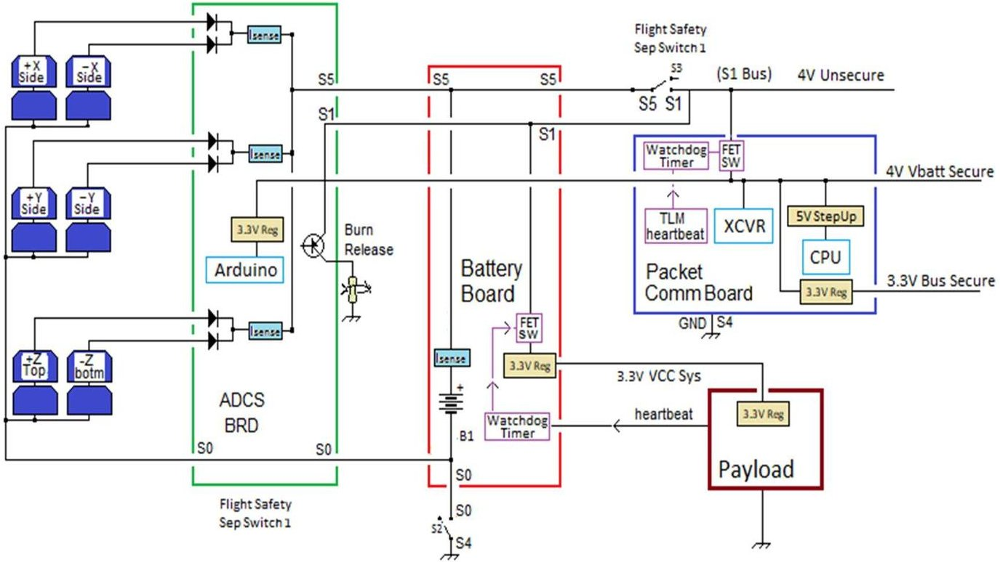
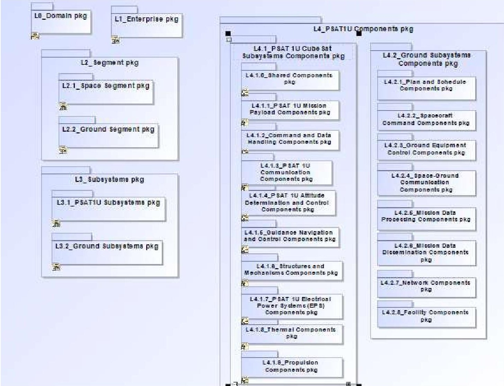
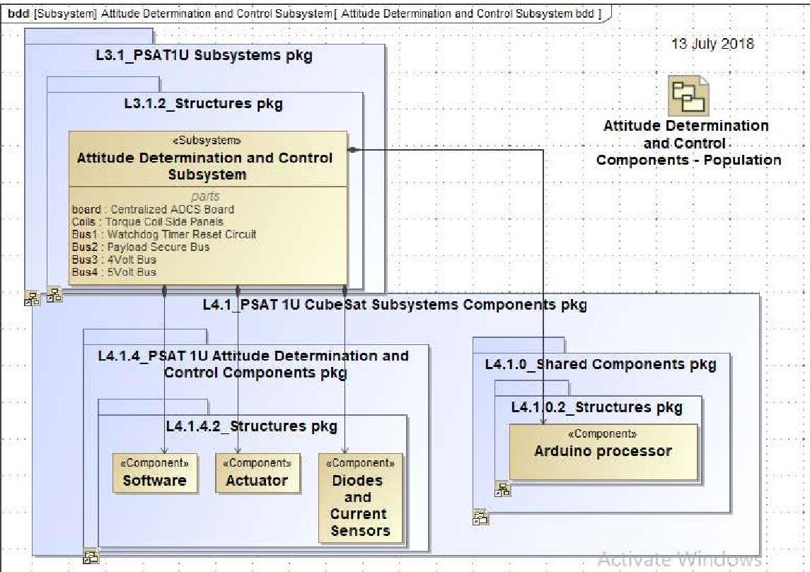
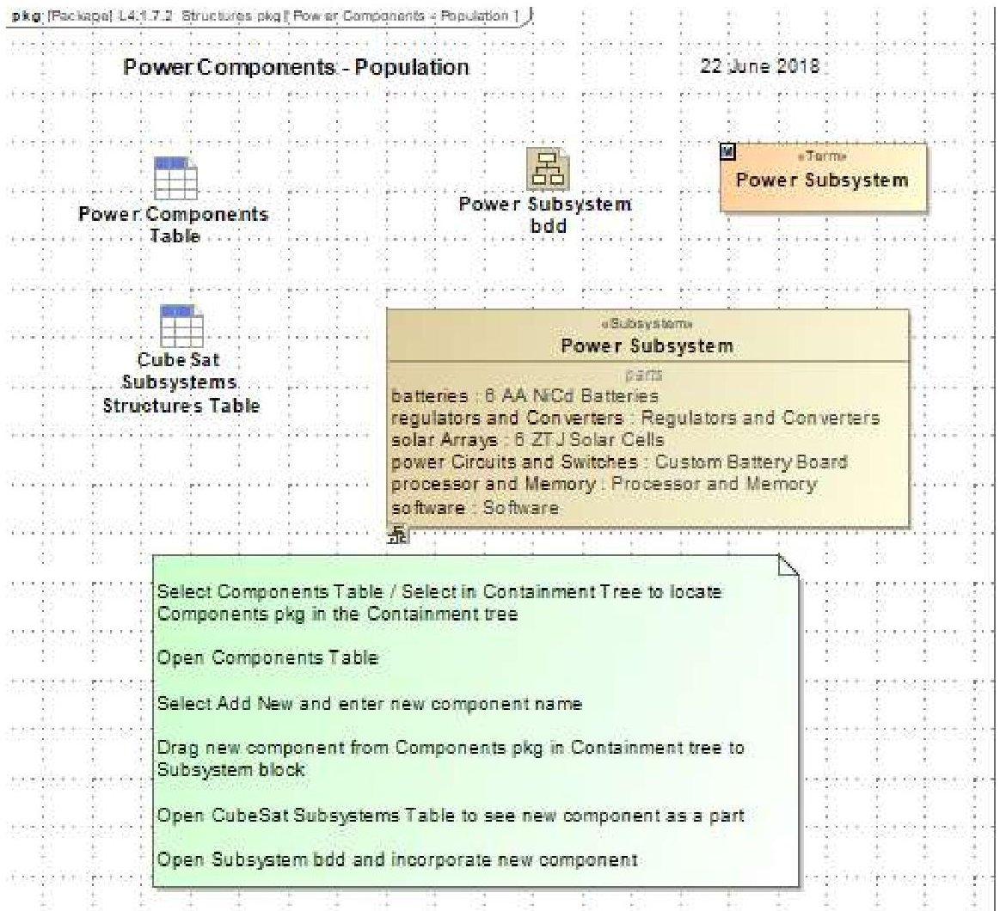
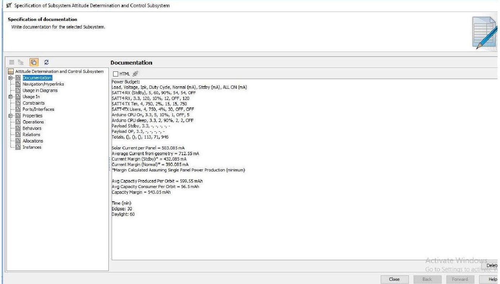

<!-- PDF_PAGE: 1 -->

# A Tailored Systems Engineering Process for the Development of CubeSat Class Satellites

John Gregory, Jin Kang, Robert Bruninga, George Downey United States Naval Academy 590 Holloway Rd., MS 11B, Annapolis, MD 21402; 410-293-6416 jgregory@usna.edu

Ronald M. Sega and John M. Borky Colorado State University 2545 Research Blvd, Fort Collins, CO 80526; 970-491-7067 Ron.sega@colostate.edu

David Kaslow DEKaslow Consulting, LLC Newtown Square; PA 19073; 610-405-6685 David.kaslow@gmail.com

## ABSTRACT

The class of small satellites known as CubeSats have grown in popularity and complexity in recent years and have been especially popular with colleges and universities interested in utilizing them both for their value as an educational tool and to conduct science missions. While there have been some tremendously successful CubeSat missions over the years, those that are launched are still more likely than not to be dead on arrival or to fail before accomplishing their objectives. Part of this low success rate, especially of student built CubeSats, may be attributed to the fact that they are often designed in an ad hoc manner, with students working on projects for only a fixed period of time and without a view of the big picture. In contrast, large space-focused organizations utilize Systems Engineering (SE) to standardize processes and improve the odds of mission success. The National Aeronautics and Space Administration (NASA) uses their own SE methodology and it is so complex that the process overview, known as the NASA Project Life Cycle Process Flow can take up an entire wall when printed in full size. While it may not be feasible to apply such a complex SE methodology to most CubeSat developments, they could be improved a great deal by utilizing a rigorous but tailored process of their own. Specifically, CubeSat developers should focus on requirements definition and flow-down, risk analysis and mitigation, cost and schedule management, and integration and interface management. These areas would be aided significantly by developing artifacts such as a Cost Analysis, Risk Analysis, Test and Evaluation Plan, Model Based Architecture, and a Concept of Operations. This paper describes work which aims to develop and implement an optimized SE process for CubeSats intended specifically for student-run projects taking place over the course of a single academic year. It will be implemented on a student CubeSat project at the United States Naval Academy (USNA) and validated by comparing key performance parameters of their project to those of other similar CubeSats developed without using this process. The result of this study will be a tailored SE process that can be applied to virtually any student CubeSat project to improve performance and importantly to increase the chances of mission success.

## INTRODUCTION

The subset of nanosatellites known as CubeSats can be optimized for use in education and research and can provide inexpensive access to space. These satellites are distinguished by their uniform structure, typically coming in multiples of 10 $ cm^{3} $ and mass no greater than 1.33 kg [1]. At the U.S. Naval Academy (USNA), the Small Satellite Program has been developing, testing and launching student-built project satellites since 2001 with the first CubeSat class satellite launched in 2012 [2].

Development of a CubeSat, especially in an undergraduate setting, is typically ad hoc in nature. Traditional Systems Engineering (SE) processes may be too cumbersome or time consuming. Additionally, teams tend to consist of only a handful of people needed to fill a multitude of roles. A recent study found that more than 40% of student-built university CubeSat projects fail without even partial mission success, with an additional 24% failing prior to full mission completion [3].

<!-- PDF_PAGE: 2 -->

According to other research, the wider Small-Satellite community has not been much more successful, with a NASA survey of launches between 2009 and 2016 showing that the failure rate for all small satellites is as low as 38.2% depending on methodology [4]. This indicates that small satellites, more generally, have a high rate of failure. Acceptable high-failure rates are a feature of the small satellite environment, but efforts can still be made to improve them. One potential impediment to the success of student-built CubeSats is that they lack discernable SE Structure.

In contrast, large space-focused organizations conduct a robust set of SE processes that are aimed to increase the likelihood of successful systems and missions. NASA's Systems Engineering Handbook [5] and its accompanying process-flow diagram describes a rigorous SE process for the development of flight and ground systems. Similarly, the Department of Defense (DOD) Acquisition Guideline [6] describes the SE procedures governing acquisition and development of US defense systems, to include space systems. Figures 1 and 2 display the NASA Project Life Cycle Process Flow and the Defense Acquisition Life Cycle, respectively.

Figure 1: The NASA Project Life Cycle Process Flow [5]

Figure 2: Defense Acquisition Life Cycle [6]

Of course, it would be difficult to implement a fullfledged SE process along the lines of NASA or DOD in an undergraduate environment due to the complex nature of these processes as well as the time constraints involved. Currently, with respect to SE processes, there is no well-understood middle ground between a fullfledged multi-year space system development and a less complex, single year CubeSat development. This research aims to find this middle ground in a systematic way.

## CURRENT CURRICULUM

Presently, a subset of senior capstone students in the Astronautics Track of the Aerospace Engineering Department at USNA have the opportunity to conduct a year-long project to design, build, test and potentially launch a CubeSat-class satellite. These teams are typically made up of 3 to 5 students and each team is given a particular design problem to solve, mainly new payload development or advancing capabilities of subsystems of an existing baseline CubeSat design. In order to tailor an SE process specifically for the development of a student-built CubeSat at USNA, the current state must be measured and understood. Currently, those projects are conducted with very cursory or no SE processes in place.

The students are expected to follow the instructions dictated in the course guide provided to them. The course guide spells out the intent of the program, the satellite development process, and a description and timeline of the deliverables and reviews. The structure of the course is similar to that of a multi-year professional satellite development. There are five defined reviews; the System Concept Review (SCR), System Requirements Review (SRR), Preliminary Design Review (PDR), Critical Design Review (CDR), and Mission Readiness Review (MRR). There are also as many as 25 deliverable documents required over the course of the academic year as described in Figure 3. The Naval Academy's academic year consists of two semesters. In the first semester, the student teams are expected to reach CDR. As a design review and validation, external experts and sponsors are invited to CDR to provide comments and advice at the end of the Fall Semester. The Spring Semester is focused on development, integration, and testing, culminating in MRR at the end of the semester.

The course guide represents a great first step at defining the activities, including SE processes, needed to successfully complete a successful design. The challenge is that there are so many requirements teams of small sizes such that students often do not have time to give the necessary attention to each aspect of the project as defined by the course guide. This is often further exacerbated by lack of design experience by the students.

<!-- PDF_PAGE: 3 -->

The year-long Capstone during their senior year is the first time the students see an open-ended design problem.

To understand the current state from the perspective of both students and subject matter experts, surveys have been distributed at various milestones throughout the capstone development cycle of the 2019-20 academic year in order to ascertain the areas of most need in improving SE processes. These data will be collected for the full academic year and then analyzed to determine the most pressing deficiencies. A sample survey is displayed in Figure 4. The processes listed in the surveys are the same SE processes described in NASA's Systems Engineering Handbook [4].

In addition, data from successful CubeSat and Small Satellite missions will be collected and combined with the local survey data to determine the processes worth focusing on. Regression analysis and sensitivity analysis will be conducted to determine which activities are within scope and which can be ignored without sacrificing project success.

<table border="1"><tr><td></td><td>SCR</td><td>SRR</td><td>PDR</td><td>CDR</td><td>MRR</td></tr><tr><td>Assembly Procedures</td><td></td><td></td><td>X</td><td>X</td><td>X</td></tr><tr><td>Block Diagrams</td><td>X</td><td>X</td><td>X</td><td>X</td><td>X</td></tr><tr><td>Board Test Results</td><td></td><td></td><td>X</td><td>X</td><td></td></tr><tr><td>Computer Aided Design</td><td></td><td></td><td>X</td><td>X</td><td>X</td></tr><tr><td>Concept of Operations</td><td></td><td></td><td>X</td><td>X</td><td>X</td></tr><tr><td>Data Budget</td><td></td><td></td><td>X</td><td>X</td><td>X</td></tr><tr><td>Experiment Plan</td><td></td><td></td><td></td><td>X</td><td>X</td></tr><tr><td>EMC/EMI mitigation plan</td><td></td><td></td><td>X</td><td>X</td><td></td></tr><tr><td>Full Functional Test</td><td></td><td></td><td></td><td></td><td>X</td></tr><tr><td>GSE Manual</td><td></td><td></td><td>X</td><td>X</td><td>X</td></tr><tr><td>Interface Control Document</td><td></td><td></td><td>X</td><td>X</td><td>X</td></tr><tr><td>Link Budget</td><td></td><td></td><td>X</td><td>X</td><td>X</td></tr><tr><td>Mass Budget</td><td></td><td></td><td>X</td><td>X</td><td>X</td></tr><tr><td>Master Equipment List</td><td></td><td></td><td>X</td><td>X</td><td>X</td></tr><tr><td>Materials List</td><td></td><td></td><td>X</td><td>X</td><td>X</td></tr><tr><td>Mission Overview</td><td>X</td><td>X</td><td>X</td><td>X</td><td>X</td></tr><tr><td>Power Budget</td><td></td><td></td><td>X</td><td>X</td><td>X</td></tr><tr><td>Quad Chart</td><td>X</td><td></td><td></td><td>X</td><td>X</td></tr><tr><td>Requirements Verification Matrix</td><td></td><td>X</td><td>X</td><td>X</td><td>X</td></tr><tr><td>Schedule</td><td>X</td><td>X</td><td>X</td><td>X</td><td>X</td></tr><tr><td>Software</td><td></td><td></td><td></td><td></td><td>X</td></tr><tr><td>Systems Engineering Questions</td><td>X</td><td></td><td>X</td><td>X</td><td></td></tr><tr><td>System Test Procedures and Results</td><td></td><td></td><td></td><td>X</td><td>X</td></tr><tr><td>Task List</td><td></td><td></td><td></td><td>X</td><td></td></tr><tr><td>Thermal Analysis</td><td></td><td></td><td>X</td><td>X</td><td></td></tr></table>

Figure 3: Required Deliverables in Current Capstone Course (Academic Year 2019-20)

FOR RESEARCH PURPOSES ONLY, NOT A COMPONENT IN STUDENT ASSESSMENT

<table class="table table-bordered"><thead><tr><th>#</th><th>Statement</th><th colspan="6">Survey Scale: 1 = Strongly Disagree 2 = Disagree 3 = Neutral 4 = Agree 5 = Strongly Agree NA = Not Applicable</th></tr></thead><tbody><tr><td>1</td><td>The team's performance up to this point meets expectations to proceed to the next project phase.</td><td></td><td>1</td><td>2</td><td>3</td><td>4</td><td>5</td><td></td></tr><tr><td>2</td><td>The team's performance up to this point exceeds expectations.</td><td></td><td>1</td><td>2</td><td>3</td><td>4</td><td>5</td><td></td></tr><tr><td>3</td><td>The team has adequately addressed the following System Design Processes up to this point:</td><td colspan="6"></td><td></td></tr><tr><td>3a</td><td>Stakeholder Expectations Definition</td><td></td><td>1</td><td>2</td><td>3</td><td>4</td><td>5</td><td>NA</td></tr><tr><td>3b</td><td>Technical Requirements Definition</td><td></td><td>1</td><td>2</td><td>3</td><td>4</td><td>5</td><td>NA</td></tr><tr><td>3c</td><td>Logical Decomposition</td><td></td><td>1</td><td>2</td><td>3</td><td>4</td><td>5</td><td>NA</td></tr><tr><td>3d</td><td>Design Solution Definition</td><td></td><td>1</td><td>2</td><td>3</td><td>4</td><td>5</td><td>NA</td></tr><tr><td>4</td><td>The team had adequately addressed the following Product Realization Processes up to this point:</td><td colspan="6"></td><td></td></tr><tr><td>4a</td><td>Product Implementation</td><td></td><td>1</td><td>2</td><td>3</td><td>4</td><td>5</td><td>NA</td></tr><tr><td>4b</td><td>Product Integration</td><td></td><td>1</td><td>2</td><td>3</td><td>4</td><td>5</td><td>NA</td></tr><tr><td>4c</td><td>Product Verification</td><td></td><td>1</td><td>2</td><td>3</td><td>4</td><td>5</td><td>NA</td></tr><tr><td>4d</td><td>Product Validation</td><td></td><td>1</td><td>2</td><td>3</td><td>4</td><td>5</td><td>NA</td></tr><tr><td>4e</td><td>Product Transition</td><td></td><td>1</td><td>2</td><td>3</td><td>4</td><td>5</td><td>NA</td></tr><tr><td>5</td><td>The team has adequately addressed the following Technical Management Processes up to this point:</td><td colspan="6"></td><td></td></tr><tr><td>5a</td><td>Technical Planning</td><td></td><td>1</td><td>2</td><td>3</td><td>4</td><td>5</td><td>NA</td></tr><tr><td>5b</td><td>Requirement Management</td><td></td><td>1</td><td>2</td><td>3</td><td>4</td><td>5</td><td>NA</td></tr><tr><td>5c</td><td>Interface Management</td><td></td><td>1</td><td>2</td><td>3</td><td>4</td><td>5</td><td>NA</td></tr><tr><td>5d</td><td>Technical Risk Management</td><td></td><td>1</td><td>2</td><td>3</td><td>4</td><td>5</td><td>NA</td></tr><tr><td>5e</td><td>Configuration Management</td><td></td><td>1</td><td>2</td><td>3</td><td>4</td><td>5</td><td>NA</td></tr><tr><td>5f</td><td>Technical Data Management</td><td></td><td>1</td><td>2</td><td>3</td><td>4</td><td>5</td><td>NA</td></tr><tr><td>5g</td><td>Technical Assessment</td><td></td><td>1</td><td>2</td><td>3</td><td>4</td><td>5</td><td>NA</td></tr><tr><td>5h</td><td>Decision Analysis</td><td></td><td>1</td><td>2</td><td>3</td><td>4</td><td>5</td><td>NA</td></tr></tbody></table>

Source: NASA Systems Engineering Handbook NASA/SP-2016-6105 REV 2

Figure 4: A Sample of the Surveys Being Distributed During AY2019-20

<!-- PDF_PAGE: 4 -->

As the need for a simple build template for CubeSats was identified at USNA, the Parkinson Sat 1U (PSAT1U) system, named for the inventor of the Global Positioning System (GPS) was developed. Its purpose is to serve as a modular architecture with easily accessible parts that enables a complete satellite bus development in three weeks. This allows students to focus on designing and implementing their preferred on-board payload and mission systems without spending undue time carrying out trade studies on well understood subsystems and components. Figure 5 displays a Computer Aided Design (CAD) render of the outer structure and a photograph of the inner components of PSAT1U. Note that the picture on the right is a complete "lab sat" version used in classrooms, and thus contain a reaction wheel and four fans simulating thrusters which obviously will not be included in space-launched versions of the satellites.

Figure 5: The PSAT1U CubeSat

The PSAT1U CubeSat includes core bus subsystems such as the Electrical Power System (EPS), Attitude Determination and Control System (ADCS), Communications System, on-board computer (OBC), and a payload compartment. The EPS design is depicted in Figure 6. The ADCS consists of a magnetometer and magnetic torquer coils that are printed onto the solar panels, providing detumbling capability. Figure 7 depicts a side panel with torque coils. The Communications System is designed with a 1.5 W Automatic Packet Reporting System (APRS) transceiver attached to the communications board.

Figure 7: PSAT 1U Side Panel with Torquer Coils

Figure 6: PSAT 1U Electrical Power System Diagram

<!-- PDF_PAGE: 5 -->

The payload compartment for the baseline design of the spacecraft is empty. It provides design space for users to apply to their particular mission set, and this is the focus of the student design teams. PSAT1U can host payloads with mass up to 567 g, volume up to 247 $ cm^{3} $ and able to operate within the available 1.92 W of average power and an operating voltage of 5 V during daylight.

## METHODS AND RESULTS

In order to enhance the capability of the PSAT1U design as both a tool for teaching undergraduate engineering students and as a capable platform for flying mission payloads, the technique of Model Based Systems Engineering (MBSE) will be utilized. MBSE is defined as "the formalized application of modeling to support system requirements, design, analysis, verification and validation activities beginning in the conceptual design phase and continuing throughout development and later life cycle phases" [7].

Specifically, the CubeSat System Reference Model (CSRM), an initiative developed by the International Council on Systems Engineering (INCOSE) Space Systems Working Group (SSWG), was chosen as a CubeSat specific template providing the "logical elements [which] can be reused as a starting point for a mission-specific CubeSat logical architecture" [8]. As such, the CSRM is itself a modular architecture enabling the design of a mission-oriented CubeSat. In combination, the PSAT1U described in MBSE terms through the lens of the CSRM will serve as a standardized template enabling development of future CubeSat class satellites at USNA.

Significant work has been conducted to represent the PSAT 1U system in an MBSE context. This baseline model is eventually intended to be used as a reference architecture for future student-built systems. The PSAT1U Baseline Model is an MBSE representation of the satellite developed using the CSRM as a starting point. The baseline model is unique in that it defines all of the important subsystems, components, and interfaces of the PSAT1U, but leaves the payload and mission specific modules undefined. This allows a user to understand the payload design space in clear terms. In this way, a practitioner can apply their mission application and the components associated with it to the baseline model to create their own mission specific model.

The model is implemented using CAMEO Systems Modeler MBSE Software V19.0. The overall architecture hierarchy of the PSAT1U model is displayed in Figure 8 and encompasses all of the subsystems, subsystem components and ground system

components along with the domain, enterprise and segment packages.

From within the architecture hierarchy, any of the subsystem structures packages can be accessed and critical information and interfaces can be reviewed and understood. Figure 9, for example, represents the ADCS Subsystem Block Definition Diagram and its relationships with other parts of the structures package and shared components. In turn, more information and relationships are contained within each instance of a subsystem or component. Figure 10 is the package diagram describing the EPS for the spacecraft. In it, each of the main component parts are described and further details and specifications of those parts are also available. Within the specification for the EPS, pertinent information such as the as-designed power budget (Figure 11) is also available.

The end of the academic year was more abrupt than anticipated, so the analysis of survey data is not complete. However, a preliminary look at the aggregate data thus far shows that subject matter experts evaluating space system capstone teams have indicated that students were best able to address Logical Decomposition at the Preliminary Design Review (PDR) gate and Product Transition at the Critical Design Review (CDR) gate. Students themselves indicated that they were best able to address Product Transition at the PDR gate and Design Solution Definition at the CDR gate. On the flip side, subject matter experts indicated that students were least able to address Technical Risk Management at both the PDR and CDR gates. Students indicated that they were least able to address Technical Risk Management at the PDR gate and Product Integration at the CDR gate.

<!-- PDF_PAGE: 6 -->

Figure 8. PSAT 1U Baseline Model Architecture Hierarchy

Figure 9. ADCS Subsystem Block Definition Diagram

<!-- PDF_PAGE: 7 -->

Figure 10. EPS Package Diagram

Figure 11. Specification for EPS including Power Budget Information

<!-- PDF_PAGE: 8 -->

## CONCLUSION AND FUTURE RESEARCH

Thus far, a methodology has been devised to develop and implement an optimized SE process for CubeSats intended specifically for student-run capstone projects taking place over the course of a single academic year at USNA. Survey data is being collected during the current 2019-20 academic year to determine the most needed SE processes to address. Additionally, the importance of utilizing MBSE has been identified, and significant progress has been made towards creating a reference model for PSAT1U CubeSat design.

Future work will include the continued collection of survey data from subject matter experts and students throughout the academic year, reduction and analysis of these data, continued development of the MBSE reference model, and ultimately the development of a written guide to be disseminated to future students. Once developed, the tailored SE guide will be implemented and project success measured against the results from previous years when the guide was not available.

## REFERENCES

1. CubeSat Design Specification, rev. 13, The CubeSat Program, Cal Poly SLO, April 2015.

2. Kang, J., Lim, T., and Bruninga, R., "U.S. Naval Academy Small Satellite Program: Leveraging Small Satellites for Engineering Education and Research," 2015 SciTech Conference, Kissimmee, FL, January 2015

3. Berthoud, L., Swartwout, M., Cutler, J., Klumpar, D., Larsen, J. A., and Nielson, J. D. 2019. "University CubeSat Project Management for Success," Proceedings of the AIAA/USU Conference on Small Satellites, Education Programs, SSC19-WKIII-07. http://digitalcommons.usu.edu/smallsat/2019/all2019/63/.

4. Jacklin, S. A. Small-Satellite Mission Failure Rates. NASA/TM-2018-220034, Ames Research Center, Moffett Field, CA. March, 2019.

5. NASA Office of Chief Engineer. NASA Systems Engineering Handbook. NASA/SP-2016-6105 Rev. 2, 2017.

6. Defense Acquisition Guidebook, Department of Defense, USD AT&L, 2017.

7. Systems Engineering Vision 2020, INCOSE TP_2004-004-02, ver. 2/03, September 2007. [Online]. Available: http://www.incose.org/ProductsPubs/pdf/SEVisio n2020_20071003_v2_03.pdf

8. D. Kaslow, B. Ayres, P. Cahill, L. Hart, R. Yntema, "Developing a CubeSat Model-Based Systems Engineering (MBSE) Reference Model - Interim Status #3," Proceedings of IEEE Aerospace Conference, Big Sky, MT, March 2017.