<!-- PDF_PAGE: 1 -->

# SYSTEMS ENGINEERING AND ASSURANCE MODELING (SEAM): A WEB-BASED SOLUTION FOR INTEGRATED MISSION ASSURANCE

Kaitlyn L. Ryder $ ^{1} $ , Ryan Alles $ ^{2} $ , Gabor Karsai $ ^{1} $ Nagabhushan Mahadevan $ ^{1} $ , John W. Evans $ ^{3} $ , Arthur F. Witulski $ ^{1} $ Michael J. Campola $ ^{4} $ , Rebekah A. Austin $ ^{4} $ , Ronald D. Schrimpf $ ^{1} $

$ ^{1} $Vanderbilt University, Department of Electrical Engineering and Computer Science Nashville, Tennessee, United States of America $ ^{2} $Aerospace Engineering, Auburn University, Auburn, Alabama, United States of America

$ ^{3} $National Aeronautics and Space Administration, Headquarters, Washington D. C., United States of America

$ ^{4} $National Aeronautics and Space Administration, Goddard Space Flight Center, Greenbelt, Maryland, United States of America

Abstract. We present an overview of the Systems Engineering and Assurance Modeling (SEAM) platform, a web-browser-based tool which is designed to help engineers evaluate the radiation vulnerabilities and develop an assurance approach for electronic parts in space systems. The SEAM framework consists of three interconnected modeling tools, a SysML compatible system description tool, a Goal Structuring Notation (GSN) visual argument tool, and Bayesian Net and Fault Tree extraction and export tools. The SysML and GSN sections also have a coverage check application that ensures that every radiation fault identified on the SysML side is also addressed in the assurance case in GSN. The SEAM platform works on space systems of any degree of radiation hardness but is especially helpful for assessing radiation performance in systems with commercial-off-the-shelf (COTS) electronic components.

Key words: SEAM, radiation assurance, COTS, radiation hardness, radiation reliability

<!-- PDF_PAGE: 2 -->

## 1. INTRODUCTION

The advent of the small spacecraft or CubeSat has enabled much greater access to space at relatively low cost. CubeSats can be rapidly assembled from a variety of available commercial off the shelf electronic (COTS) subsystems to fulfill spacecraft functions, from sensors to command and data handling. Clearly CubeSats or similar space systems with majority COTS parts require a new paradigm for mission assurance of the system that is compatible to cost, schedule, and development constraints of the "small" mission. Radiation assurance is of prime concern and depending on the mission requirements, the impact of single event effects (SEE), total ionizing dose (TID), and displacement damage dose (DDD) must be considered. While radiation testing is ever important, assurance models can be of significant value to CubeSat development in providing for mission success. In this regard, the Systems Engineering and Assurance Modeling (SEAM) platform $ ^{1} $ has been developed and deployed in a collaborative NASA -University project.

The benefits of Systems Engineering for small spacecraft, even at the fundamental level of capability, are well documented by INCOSE [1]. Systems Modeling Language (SysML) starter models for CubeSats are available and in use [2, 3]. Further, standards for these models are emerging [4]. In addition, we can see the benefits of building assurance models as SysML has continued to increasing usage [5, 6]. Assurance models focused on failure mitigation are needed to complement Systems Engineering models to improve success rates, as many CubeSat missions have failed.

An assurance platform for small missions presents several challenges unique to the modeling environment. As indicated, the platform must be able to provide rapid analysis results compatible with the CubeSat development environment and workstyle. Furthermore, the tool must have low barriers to entry, both in terms of cost and usability. Other desirable features include standard graphical representations with well-defined visual syntax, embedded guidance focused on assurance, a collaborative web-based implementation, flexibility in modeling, and interoperability with other platforms. For these reasons, WebGME $ ^{2} $ : a web--based environment for creating domain-specific modeling tools, emerged as an excellent foundation for implementing SEAM and for evaluating concepts for Model Based Assurance for small missions. However, the graphical constructs presented herein as a part of SEAM are generic and not necessarily exclusive to any implementation framework. Currently, a free version of SEAM is maintained at modelbasedassurance.org.

The modeling and analysis platform encompasses the necessary components for an easy-to-use, flexible, mission assurance tool. Models constructed using the platform represent the subject system from various aspects. Each modeling aspect is subsequently described in terms of its graphical constructs that represent concepts of a small mission assurance framework. This is followed by descriptions of the use and deployment of the platform, focusing on radiation assurance, and already successfully demonstrated capabilities of SEAM.

<!-- PDF_PAGE: 3 -->

## 2. THE GRAPHICAL CONSTRUCTS OF SEAM

SEAM has several key components built around several modeling aspects and assurance flexibility that can be linked or used independently depending on user preferences. The SEAM approach encompasses:

- SysML internal block diagrams to represent the system architecture models, extended with fault propagation, with limited SysML import capability

- Functional decomposition models that relate system functions to individual components, which allow for the generation of reliability representations of the system including Bayesian Nets (BN) and auto generated fault trees exportable to other applications

- Goal Structuring Notation (GSN) Assurance Case models that support NASA Standard 8729.1A

- Tools for exporting Bayesian net topologies and fault trees showing the probable impact of radiation on system performance in standard formats.

SEAM allows for these models to be incorporated into a single project. Fig. 1 shows the top-level view of a SEAM project that contains all the models. On the left of the Fig. are reference materials including a GSN model of NASA's R&M Objectives Hierarchy [7], templates for a requirements model, system level definitions including fault labels, links to useful external apps, and a project-specific library of components. These reference materials can make modeling in SEAM more user-friendly. In the center of Fig. 1 are the links to the different models: GSN, functional decomposition model, and SysML models. Each model exists independently of the others, though SEAM does allow for the models to be linked if desired.

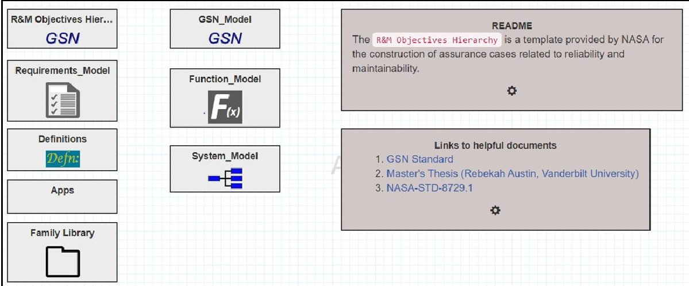

Fig.1 Top level of a project folder. Contains the NASA R&M Standards, project definitions, relevant external applications, the project family library, functional decomposition model, system model and the GSN assurance model.

<!-- PDF_PAGE: 4 -->

## SysML and Assurance Extensions for SEAM

SysML is widely used as a descriptive language for capturing the structure and dependencies of complex systems, consisting of a set of canonical diagrams that capture the system behavior. In SEAM, the SysML block diagram describes the architectural structure of a system. It focuses on the flow of power and data through a system instead of precise electrical connections. Fig. 2 shows a SysML diagram of a generic embedded system comprised of four subsystems: Power, sensor S1, microcontroller M1, and Output. Power connections are shown in black, and data connections are shown in green. The purpose of the system is to respond to an environmental stimulus and to change its state accordingly. Each block, or subsystem, can be as specific or abstract, as necessary. For example, the Power subsystem in this example is a higher level of abstraction and is comprised of a battery and three voltage regulators (shown in the lower part of Fig. 2). Sensor S1, on the other hand, is the lowest level of abstraction for that subsystem and represents a single component.

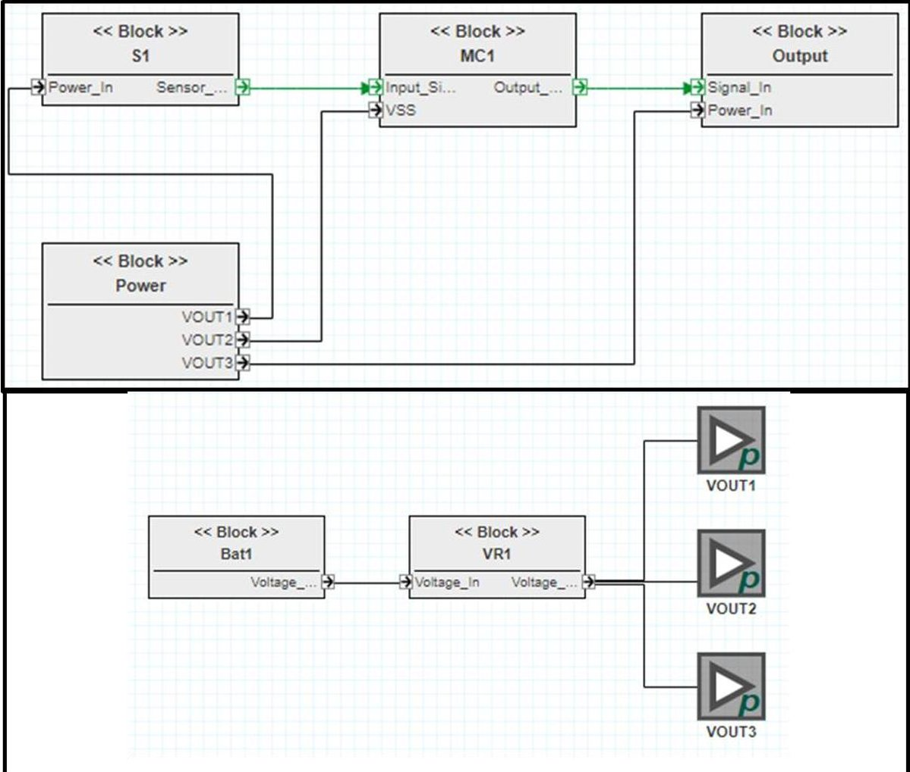

Fig. 2 (Top) SysML block diagram of a generic embedded system that uses a sensor to determine the next state of the system. Each block represents an abstraction of a subsystem: Sensor subsystem (S1), Microcontroller subsystem (MC1), Output subsystem, and Power subsystem. (Bottom) Lower level abstraction of the Power subsystem.

<!-- PDF_PAGE: 5 -->

Faults and anomalies can be modeled in lower-level subsystem abstractions. A simple fault model for the sensor is shown in Fig. 3, in which the blocks with "p" and "s" in them represent power and signal ports, respectively. The sensor takes in power through the Power In port and outputs a signal through the Sensor_Output port. Fault causes and anomalies are denoted by the "F" and "A" blocks and are used to show how faults originating in a component and the associated anomalies. For the sensor shown in Fig. 3 there are two fault causes, TID (Total Ionizing Dose) and SEE (Single Event Effect). TID leads to a Degraded Signal anomaly, while SEE leads to a Transient Incorrect Signal anomaly as well as High Current anomaly. Failures propagate out of a component and into other inter-connected components in the system. The labeled edges between the anomaly and the port show the failures propagating across component boundaries. The failure label corresponds to the propagating failure effect.

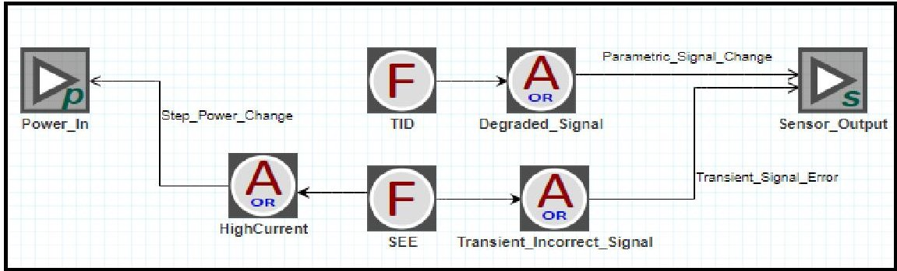

Fig. 3 Sensor fault model. The sensor in this system is only concerned with two faults, Total Ionizing Dose and Single Event Effect. These faults produce anomalies that appear on the sensor's output.

SEAM allows for the creation of project libraries for both components and failure labels. Libraries of commonly used project features reduce the overall creation time of models and make modeling easier for new users. Fig. 4 shows the component library (left) and failure label

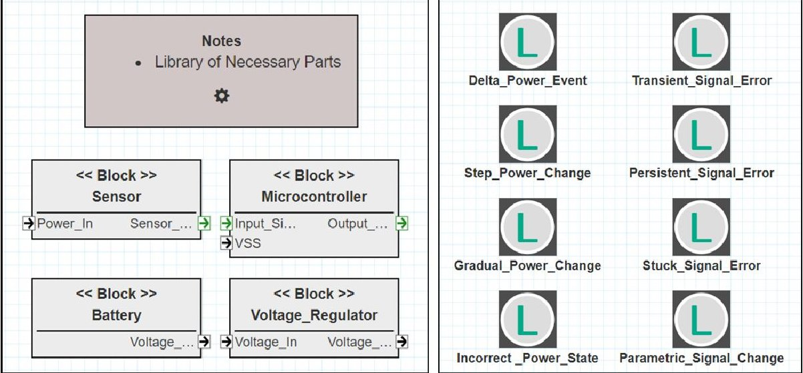

Fig.4 (Left) Parts library. Library of part models used in the system design. (Right) Failure Label Definition - List of labels for failures propagating across component boundary.

<!-- PDF_PAGE: 6 -->

definitions for this example project. Four (4) components were identified as likely to be used multiple times in this system and were created as library templates. Whenever one of these components is used in the SysML model, an instance of that template is created. If changes need to be made to all the instances of a component, the template in the library can be modified and all instances will be updated. This makes it easy to update the models as components change. Failure labels are all defined in the project definitions to be used throughout the SysML model. For this example, a small number of generic failure labels were created to standardize the language used throughout the SysML model.

## Functional Decomposition Model

Another diagram incorporated in SEAM that is not present in the standard SysML diagram set is the Functional Decomposition Model (FDM) shown in Fig. 5. A system may have many functions. Functions are specific descriptions of system capability established by requirements or specifications. The functions serve as a key abstraction level for assessing reliability, availability, and safety of a system. In the FDM, functions (upper case F) are associated with sub-functions (lower case f), which in turn are associated with specific instances of components that support the sub-function. In Fig. 5, only one component is associated with each sub-function, in practice each sub-function can be associated with many component instances. The FDM is a hierarchical assignment of responsibility for the accomplishment of a function to sub-functions and components.

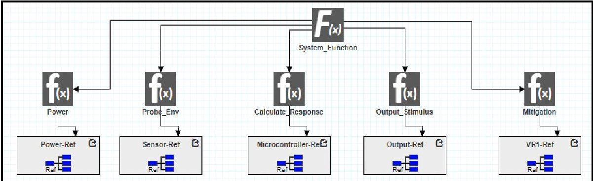

Fig. 5 Functional Decomposition Model. The top-level function is supported by five primitive functions each of which is related to a component/ subsystem that implements it.

As shown in Fig. 5 for a typical embedded system, the sub-functions nearly always involve power, probing the environment (sensing), calculating the system condition and response to the environment according to algorithms built into system software (computation), and constructing a response to the environment (actuation). Other typical embedded functions are user input and output, and remote communication, which could be added to this diagram, as necessary. In a space radiation environment, another typical subfunction would be mitigation of radiation effects, which assigns responsibility for mitigation measures to components such as voltage regulators or load switches to avoid single event latch up.

The FDM creates a network or topology of the system correlation of system functions with component-level functionality.

<!-- PDF_PAGE: 7 -->

## GSN Assurance Case

Goal Structuring Notation (GSN) assurance cases are used to document and develop assurance cases and can be developed in parallel with the SysML and Functional Decomposition models within the SEAM tool. References to the GSN Community Standard and NASA Std 8719.1A are provided within SEAM, and the NASA R&M Objectives Hierarchy (from NASA Std 8719.1A) is provided in GSN format for reference. More detail on the use of GSN are given in [8] and [9]. Fig. 6 shows the top-level view of the R&M Objectives Hierarchy, which provides a guide for developing GSN assurance cases and can be used as a starting point for users to develop their own GSN assurance cases.

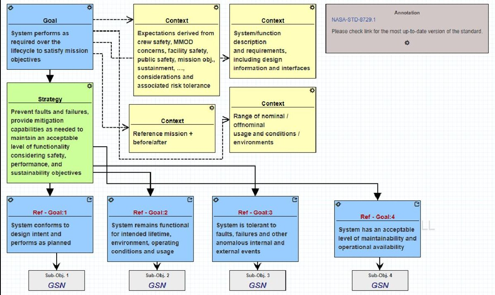

Fig. 6 A hierarchical view of the NASA R&M Objectives Hierarchy.

A simplified GSN assurance case for the generalized embedded system example is shown in Fig. 7. In this figure, The GSN nodes within red boxes come directly from the NASA R&M Hierarchy and were used as starting points for development of the more specific assurance case being made here. In this incomplete GSN assurance case, the argument for Goal 2.2 has been completed while the other subgoals are still in development. Goal 2.2 applies to the Sensor Subsystem, and requires that the subsystem be tolerant to faults, failures, and other anomalous internal and external events. The strategy for meeting this goal, from the NASA R&M Hierarchy, is to prevent faults and failures or to provide mitigation for the faults and failures. Two subgoals were identified to meet this strategy, both related to the known radiation effects possible in the sensor. The solutions (or evidence to support) Goal 2.2.1 and 2.2.2, total ionizing dose (TID) degradation and single event effects (SEE) errors, respectively, are found through radiation testing of the sensor. TID is found to not be a concern for the mission requirements in this project and SEEs are to be mitigated by the Microcontroller subsystem, which could involve another goal/strategy argument chain.

<!-- PDF_PAGE: 8 -->

Both solutions are specific to this mission and if the requirements were to change, they would need to be reevaluated.

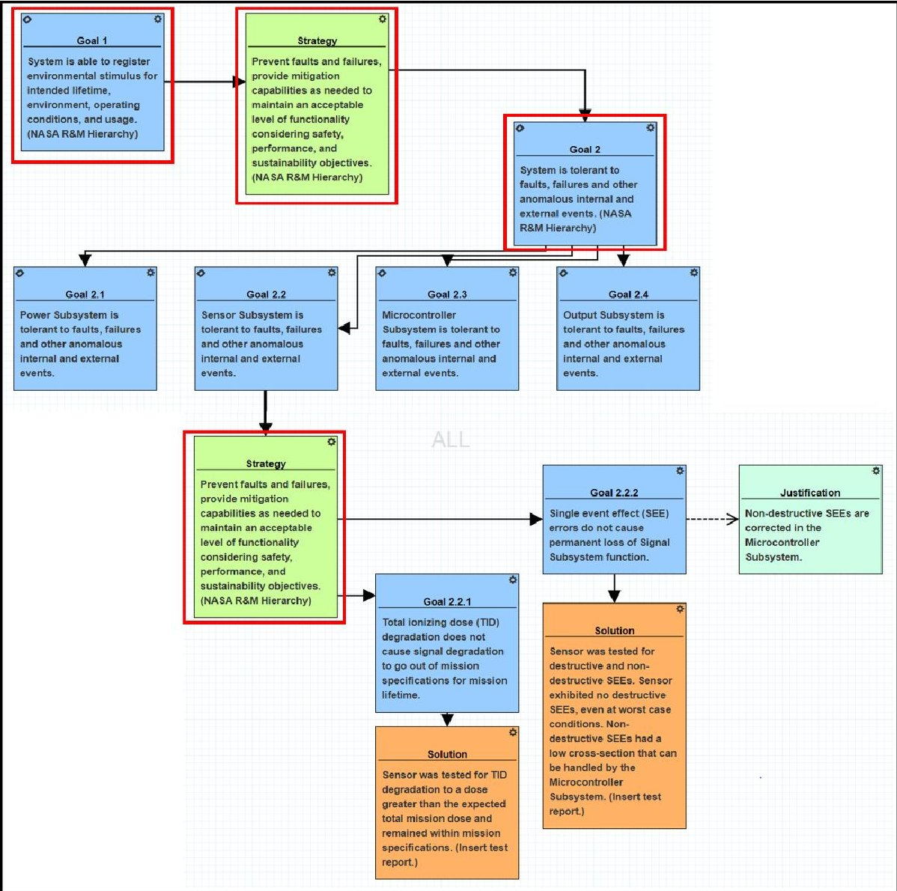

Fig. 7 GSN Assurance Model: A simplified GSN assurance argument model where the boxes in red indicate generic goals/ strategies advocated by NASA R&M standards. The other GSN nodes correspond to the specific system and its parts.

## System Reliability Models

The integrated models in SEAM - the functional decomposition model, the system architecture model, and the underlying fault propagation model - can be translated into computational models that are part of the system reliability study. Currently SEAM models have been translated into fault tree models and Bayesian network models.

<!-- PDF_PAGE: 9 -->

## Fault tree models

Fault trees [10] are graphical models that represent how low-level events, like component faults, combine and propagate to high-level events (like system-wide failures). The combination of the low-level events is expressed using an AND/OR tree-like structure. The extraction of fault trees, as well as other reliability artifacts, from SysML has been demonstrated as viable means of rapidly building reliability models [11, 12].

In this tree primary events are the leaves, intermediate nodes are either logical combinators (disjunctive or conjunctive) or intermediate (e.g. sub-system level) events, and the top (root) node of the tree is the system level event. The arrows connecting the nodes (from leaves towards the root) indicate causation or enablement. The AND/OR operators operate on probabilities of events assigned by the modeler. Fault-trees allow not only the review and logical analysis of how local faults combine and lead to system-level events, but also the calculation of the probability of those events as a function of the probabilities of the low-level events. Thus, they are very useful tools for evaluating the reliability of the system, and in design. For the latter, when the designer changes the system (e.g. by introducing redundancy), the fault tree can help the quantitative evaluation of how the reliability improves (or degrades).

## Fault Tree Generation

The SEAM tool set includes generators that convert the SEAM model into a fault tree model. Initially, the fault tree is generated from the functional decomposition model. Each function is translated into a "Lost Function" intermediate or top event in the fault tree. The AND (OR) nodes in the fault tree correspond to the OR(AND) nodes in the functional decomposition model. A basic event-Lost Component (LC)-is introduced for each component node at the bottom of the functional decomposition model. The fault tree generated from the functional decomposition model is refined based on the system model and the underlying fault propagation model. Components with failure modes are converted to intermediate events and a basic event corresponding to each failure mode is added.

The fault model is traversed starting from each of the failure modes. For each anomaly (AND/ OR) encountered in the path, a corresponding logic gate (AND/OR) is added to the fault tree. For each effect node encountered in the path, a corresponding logic relationship between the fault event and the lost function event is added to the fault tree (if it is not already present). For each response/ mitigation node encountered in the path, the fault tree is modified so that the failure mode event is blocked until the mitigation function is lost. Finally, the fault tree is simplified by eliminating logic gates that are redundant and unnecessary.

Fig. 8 shows the fault tree generated from the Functional Decomposition Model (Fig. 5), the System Model (Fig. 2) and the underlying fault propagation model [13]. The top and intermediate level nodes colored in blue represent the events corresponding to the "Lost Function" (LF). The nodes in brown represent the events that correspond to the "Lost Component" (LC). Certain LC nodes are basic event (terminated with a circle) as the component models do not include any failure modes (e.g. LC_Power, LC_Output etc.). Other LC nodes are intermediate events as they are followed by basic events corresponding to the failure modes (nodes in red).

When the fault propagation is arrested by a mitigation/ response function, the generated fault tree is modified. The failure mode events (FM_S1_SEE, FM_MC1_SEL) do not lead

<!-- PDF_PAGE: 10 -->

to higher level events in the fault tree unless the mitigation function is lost (and the node with LF_Mitigation).

The generated fault tree is output as an xml file in Open-PSA model exchange format so the fault tree can be evaluated in any FT evaluation platform. For example, the open-source SCRAM fault tree analysis engine can load the generated fault tree model to identify minimum cut sets, as well as risk analysis based on fault probabilities which could be used as evidences in the GSN assurance case models.

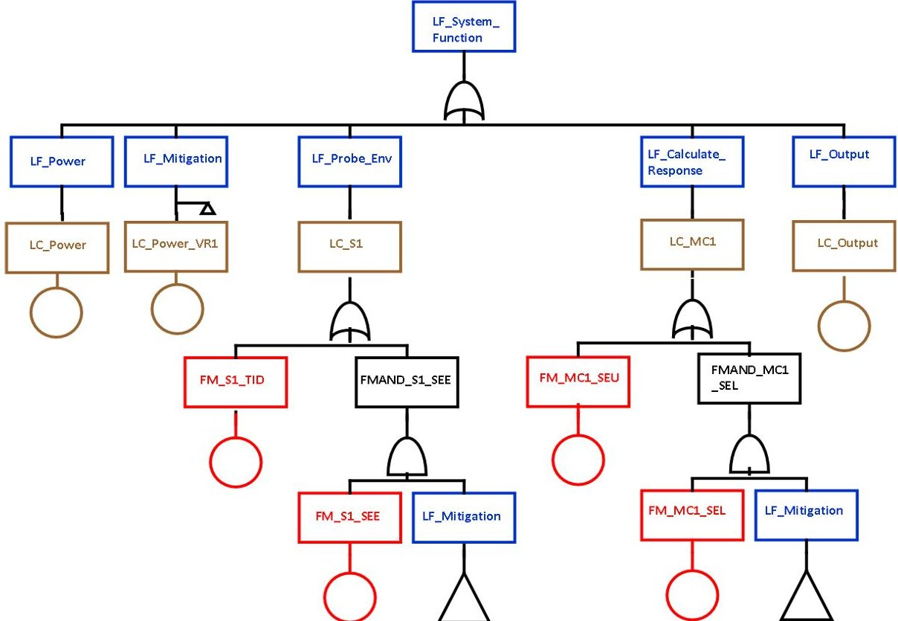

Fig. 8 Fault Tree generated by SEAM based on the functional decomposition model, system model and the underlying fault propagation model. Boxes represent top-event or intermediate event in the fault tree. Boxes with a circle below represent the basic event. Loss of Function (LF) events are in blue, Loss of component (LC) events are in brown and Failure mode events are in red. Triangle represents the loss of mitigation function.

## Bayesian Nets

Bayesian (Belief) Networks (BN) are a graphical formalism for representing and implementing probabilistic inference networks [14, 15]. Bayesian nets are directed acyclic graphs, with 3 types of nodes: nodes without inputs ('leaves'), nodes without outputs ('top'), and nodes with both inputs and outputs ('intermediate nodes'). Each node represents a random (probabilistic) variable in a system. Leaf nodes can be assigned a 'prior' probability value for each possible value of the random variable. An intermediate or 'top' node can be assigned a table of conditional probability values that determine the probability distribution for the value of that node as a function of the probability of the nodes attached to the incoming edges. The

<!-- PDF_PAGE: 11 -->

BN performs probabilistic inference: it propagates the probability values of the leaves to the intermediate and then to the 'top' node. Note that BN-s allow quite complex probabilistic relationships, more than what one can do with the AND/OR nodes of fault trees. Note also, that the nodes (i.e. variables) can take values from a discrete set or a continuous (but finite) set.

## Bayesian Net Generation

The SEAM models can be used as the basis for creating the structure of the Bayesian Network (BN) models. Fig. 9 shows the structure of the BN model corresponding to the system architecture in Fig. 2 and the functional decomposition model in Fig. 5.

The root (leaf) nodes of the Bayesian network model would correspond to the mission variables such as Mission Time and Single Event Environment in Fig. 9. These mission nodes determine the strength of environment effects. In Fig. 9, the environment effect nodes correspond to Total Ionizing Dosage (TID), Single Event Upset (SEU) and Single Event Latch up (SEL).

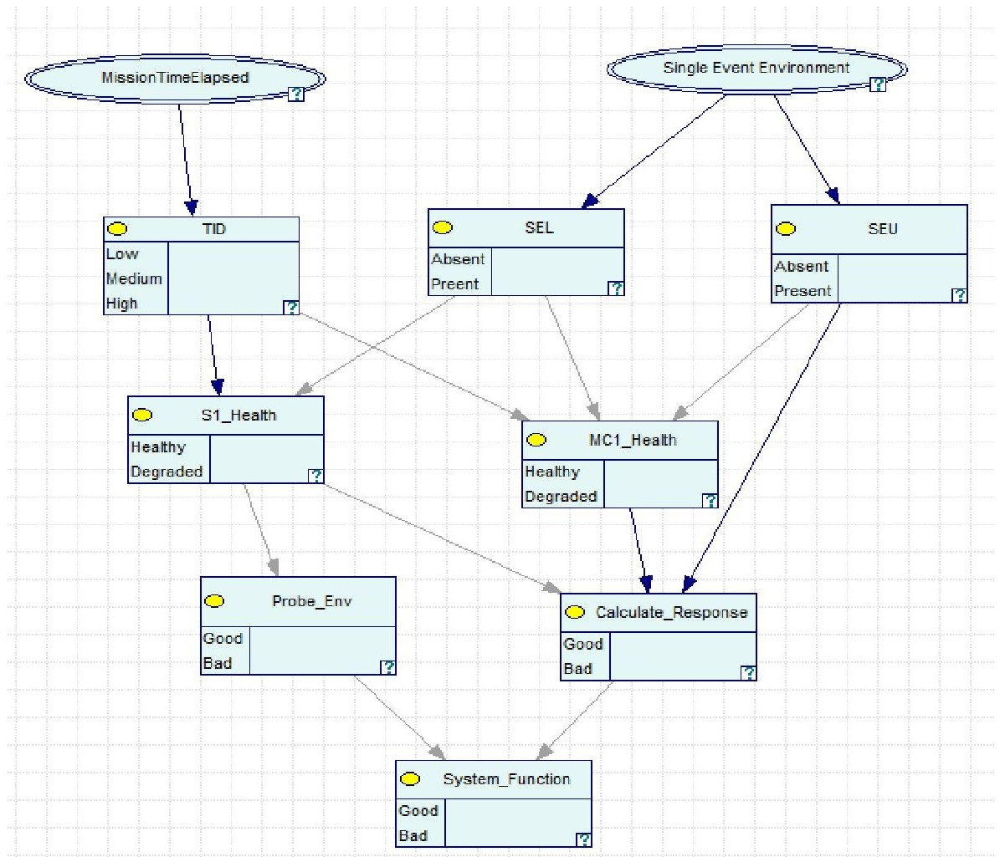

Fig. 9 Bayesian Network model based on the SEAM model for the embedded system example.

<!-- PDF_PAGE: 12 -->

The next set of nodes in the BN models correspond to the health of the components. In Fig. 9, S1_Health and MC1_Health correspond to the health of the sensor component (S1) and the microprocessor (MC1). The health of the components is affected by the environment effects.

Component health affects the performance of the components, which is indicated by the quality of the functions provided by the components. So, the next layer in the BN corresponds to the functions provided by the component. In Fig. 9, these correspond to the nodes -Probe_Env and Calculate_Response. The quality of the lower level functions affects the quality of the higher-level functions and hence the overall system performance (BN Node System_Function in Fig. 9).

Additionally, the fault propagation model introduces additional edges between the component health and the quality of the functions. This is because the quality of a function is not just governed by the health of the component responsible for delivering the function, but also the health of other inter-connected components. In the case of Fig. 9, the Calculate_Response function is not only affected by the health of the component providing the function (MC1), but also the health of component S1.

The BN model could help in understanding the reliability of the system function, given the current status of the mission variables. It could be useful to study the sensitivity of the goodness of the functions to the health of the individual components.

## 3. STRUCTURE AND COVERAGE CHECKS

The integrated modeling environment in SEAM allows cross-referencing of the elements in the

- System Architecture Model

- Functional Decomposition Model

- GSN Assurance model.

This cross referencing allows users to relate parts of the GSN assurance arguments (Goals, Strategies, and Solutions) to the relevant components in the system model, the functionality provided by the component and any radiation-induced faults associated with the component [16].

To aid in this effort, the SEAM toolset performs a coverage check which informs the user through simple spreadsheet-like tables the coverage from different perspectives. While this is useful even in the context of a simple system presented here, it is particularly useful as the system scales up and the assurance argument needs to account for the increasing number of components, their inter-dependence in terms of functionality provided and failures propagated.

The results of a coverage check are presented as a set of tables. These include:

- Parts List: This table includes hyperlinks to each of the part type models in the parts library that is associated with the current system model. The hyperlinks allow the user to navigate to the part model and its internal fault model. Fig. 10 shows the list of parts associated with the system in Fig. 2 and parts library in Fig. 4.

- Instance List: This table presents the component instances in the system architecture model. For each component instance (row), it shows the corresponding part from the part library. Fig. 11 shows the instance list as part of the coverage check. As shown

<!-- PDF_PAGE: 13 -->

in this table, it is possible that the multiple instances of the same part (Voltage Regulator) are used in the system.

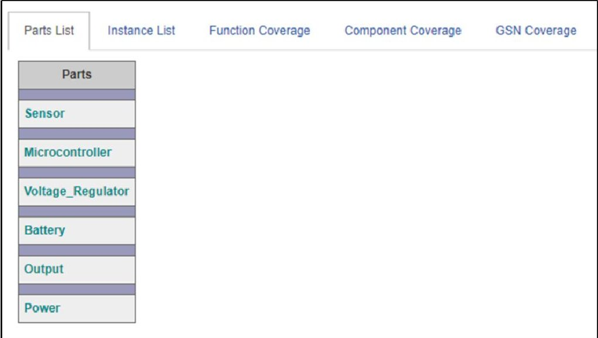

Fig. 10 Coverage check - Parts list. Each row corresponds to a part model in the parts library.

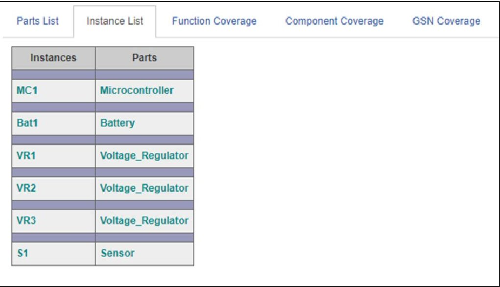

Fig. 11 Coverage check - Instance list. Each row corresponds to a component instance in the system model and its associated part in the part library.

- Function Coverage: This list presents a summary of the functional decomposition model. For each function, it lists the implementing component(s) in the system model. Functions that do not have a corresponding implementation component in the system are appropriately flagged. This informs the user that either the functionality is not implemented in the system or the relationships have not been captured in the functional decomposition model. Fig. 12 shows the function coverage table generated as part of coverage check for the function decomposition model (Fig. 5) and the system (Fig. 2)

<!-- PDF_PAGE: 14 -->

<table class="table table-bordered"><thead><tr><th>Function</th><th>Implementor Component(s)</th></tr></thead><tbody><tr><td>System_Response_to_Stimulus</td><td>Output</td></tr><tr><td>Probe_Environmental_Stimulus</td><td>S1 : Sensor</td></tr><tr><td>Power_System</td><td>Power</td></tr><tr><td>Calculate_System_Condition</td><td>MC1 : Microcontroller</td></tr></tbody></table>

Fig. 12 Coverage check - Function Coverage - Each row corresponds to a function in the function decomposition model and the component (part) in the system design that implements the function.

- Component Coverage: This table maps component instances in the system model to the appropriate function(s) in the functional decomposition model. It is likely that component instances of the same part support different functions in the system. Entries that are not related to any function are appropriately flagged.

- GSN Coverage: This table presents the coverage of the assurance argument in the GSN model relative to the components in the system. The table lists the GSN goals and solutions for the assurance argument related to each component instance in the system. It further identifies the specific GSN goals related to each of the underlying component faults, each functional degradation effect that the fault propagates to and each mitigation strategy associated with the fault propagation.

Fig. 13 shows an example GSN coverage table generated as part of the coverage check. The first column corresponds to the component instance; the next column corresponds to any fault originating from within the component; this is followed by the effect (E) and the

<table class="table table-bordered"><thead><tr><th>Component</th><th>Fault</th><th>Effect</th><th>Response</th><th>GSN Node</th><th>Tag</th><th>Status</th><th>Result</th><th>Information Source</th><th>Action</th><th>Assigned To</th><th>Comment</th></tr></thead><tbody><tr><td>MC1 : Microcontroller</td><td></td><td></td><td></td><td>Goal 2.3 :</td><td></td><td>In Development</td><td>Unknown</td><td>Instance</td><td>-</td><td>-</td><td>-</td></tr><tr><td></td><td>Single_Event_Upset</td><td></td><td></td><td>?</td><td></td><td></td><td></td><td></td><td>-</td><td></td><td></td></tr><tr><td></td><td>Single_Event_Latchup</td><td></td><td></td><td>?</td><td></td><td></td><td></td><td></td><td>-</td><td></td><td></td></tr><tr><td>Output</td><td></td><td></td><td></td><td>Goal 2.4 :</td><td></td><td>In Development</td><td>Unknown</td><td>Instance</td><td>-</td><td>-</td><td>-</td></tr><tr><td>Power</td><td></td><td></td><td></td><td>Goal 2.1 :</td><td></td><td>In Development</td><td>Unknown</td><td>Instance</td><td>-</td><td>-</td><td>-</td></tr><tr><td>Bat1 : Battery</td><td></td><td></td><td></td><td>Goal 2.1 :</td><td></td><td>In Development</td><td>Unknown</td><td>Instance</td><td>-</td><td>-</td><td>-</td></tr><tr><td>VR1 : Voltage_Regulator</td><td></td><td></td><td></td><td>Goal 2.1 :</td><td></td><td>In Development</td><td>Unknown</td><td>Instance</td><td>-</td><td>-</td><td>-</td></tr><tr><td>VR2 : Voltage_Regulator</td><td></td><td></td><td></td><td>Goal 2.1 :</td><td></td><td>In Development</td><td>Unknown</td><td>Instance</td><td>-</td><td>-</td><td>-</td></tr><tr><td>VR3 : Voltage_Regulator</td><td></td><td></td><td></td><td>Goal 2.1 :</td><td></td><td>In Development</td><td>Unknown</td><td>Instance</td><td>-</td><td>-</td><td>-</td></tr><tr><td>S1 : Sensor</td><td></td><td></td><td></td><td>Goal 2.1 :</td><td></td><td>In Development</td><td>Unknown</td><td>Instance</td><td>-</td><td>-</td><td>-</td></tr><tr><td></td><td></td><td></td><td></td><td>Goal 2.2.1 :</td><td></td><td>Developed</td><td>Yes</td><td>Instance</td><td>-</td><td>-</td><td>-</td></tr><tr><td></td><td></td><td></td><td></td><td>Goal 2.2.2 :</td><td></td><td>Developed</td><td>Yes</td><td>Instance</td><td>-</td><td>-</td><td>-</td></tr><tr><td></td><td>Total_Ionizing_Dose</td><td></td><td></td><td>Goal 2.2.1 :</td><td></td><td>Developed</td><td>Yes</td><td>Instance</td><td>-</td><td>-</td><td>-</td></tr><tr><td></td><td>Single_Event_Effect</td><td></td><td></td><td>Goal 2.2.2 :</td><td></td><td>Developed</td><td>Yes</td><td>Instance</td><td>-</td><td>-</td><td>-</td></tr></tbody></table>

Fig. 13 Coverage check - GSN Coverage: The table maps the parts in the system design and their underlying faults to the GSN arguments (goals/ solutions).

<!-- PDF_PAGE: 15 -->

mitigation response (R) related to the fault propagation. The links to the GSN arguments are listed in the next column. Entries with no associated GSN arguments are flagged with a red question mark ("?"）symbol.

The next few columns reveal the status of the specific GSN goal (Developed/ In-development), and the result of the argument based on if it meets the specifications or not (yes/ no/ partial). "Information Source" indicates if the argument pertains to the specific component instance or the part it corresponds to. Action column reveals the user decision on the completion status of the argument (completed/needs attention/ ignore). The penultimate column allows for traceability and assignment of individual arguments to persons. The comments column keeps a record of the comments related to the decisions made pertaining to the arguments.

## 4. INTEGRATING THE MODELS AND SYSTEMS ANALYSIS - STAR TRACKER EXAMPLE

Star trackers are embedded systems of a satellite that gather image data from the surrounding stars to orient the satellite by comparing the real-time image data to a stored star map. Often, a CMOS imaging sensor with a lens is used to gather the real-time data. The data is sent through a Kalman filter to help predict the satellite position. The image is filtered to reduce image noise and the star positions are determined by identifying the centroids of areas of higher light levels. In Fig. 14, the data from the star tracker is processed through the attitude determination and control systems, and then sent to the control components to reorient the satellite [17]. This satellite control system is used as a baseline to translate a real-world embedded system example into SEAM to provide a simple tangible example for the space community. As seen in the block diagram, satellite control systems can be complex, therefore the star tracker subsystem was chosen to create a simplified model.

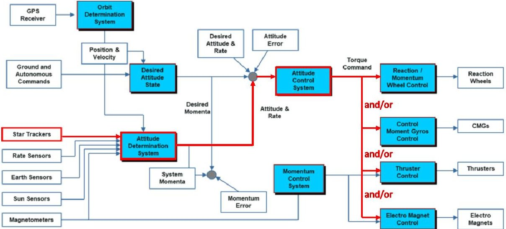

Fig. 14 Block diagram representing a satellite control system. The path highlighted in red depicts the path of interest translated into SEAM [18].

Fig. 15 represents the functional decomposition [19] of the star tracker embedded system. The overall function of the system is to orient the satellite. This is achieved by taking the raw image data from the CMOS imaging sensor block, represented by the Sensor reference block

<!-- PDF_PAGE: 16 -->

here. The data is then processed and compared to the stored star map in the Logic block. The Compare_to_Stored_Data low-level function is broken out from the Process_Image_Data function because the raw image data needs to have noise filtered out and have high light levels be identified by software processing before the data can be compared to a stored reference star map. The position and attitude data are then translated, and the data is converted to signal commands to be sent to the controls and reoriented using the thrusters and reaction devices.

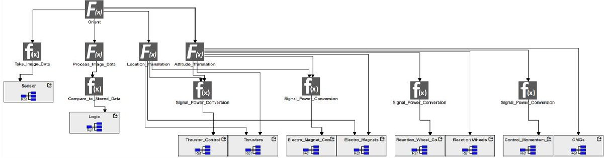

Fig.15 SEAM model view of a functional decomposition of a star tracker embedded system. The top and mid-level functions are represented by blocks with capital F(x), and the lowest-level functions are represented by the blocks with lowercase f(x). The topmost function represents the overall goal of the star tracker embedded system: to orient the satellite.

Fig. 16 shows the model view of the star tracker system, depicting a simple sensor logic reaction embedded system. The power block feeds power to each of the components using linear regulators. Power flow is represented by the black paths. The CMOS_Imaging_Sensor block represents a direct component, while the Logic, Power, and Controls_Actuators blocks represent subsystems. Data is received from the CMOS sensor, processed in the logic block, and the reactions are executed with the controls and actuators. Data flow is represented by the green paths.

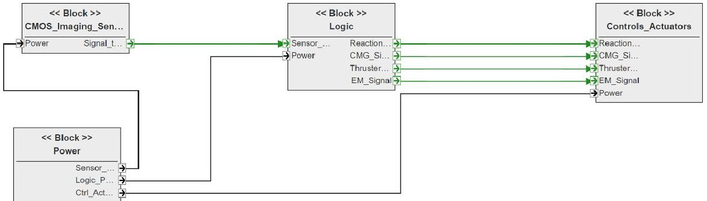

Fig.16 SEAM model view of the star tracker embedded system physical components. Green paths represent signal flow between components, while black paths represent power flow between components. Each component has embedded subsystems within its block.

A large range of faults may occur, and must be considered, when designing and working with components of a real system. These can be accounted for in the SEAM interface to determine propagation paths of the faults to consider how their effects may cause faults in other components. Many components in a system can be affected by physical fault causes.

<!-- PDF_PAGE: 17 -->

For example, in the star tracker embedded system, the focusing lens of the CMOS imager may be knocked out of place and become unfocused due to vibration effects on launch-vehicle ascent. Another physical fault that affects the imager is represented by a dirty lens, which may result in bad imaging data. Electronic components are also often affected by radiation effects such as total ionizing dose (TID). In Fig. 17, the total ionizing dose fault creates a degraded signal anomaly. The incorrect data then propagates out of the signal port to the logic block. The incorrect data enters the logic block where it then flows into the microcontroller depicted in Fig. 18 situated within the logic block.

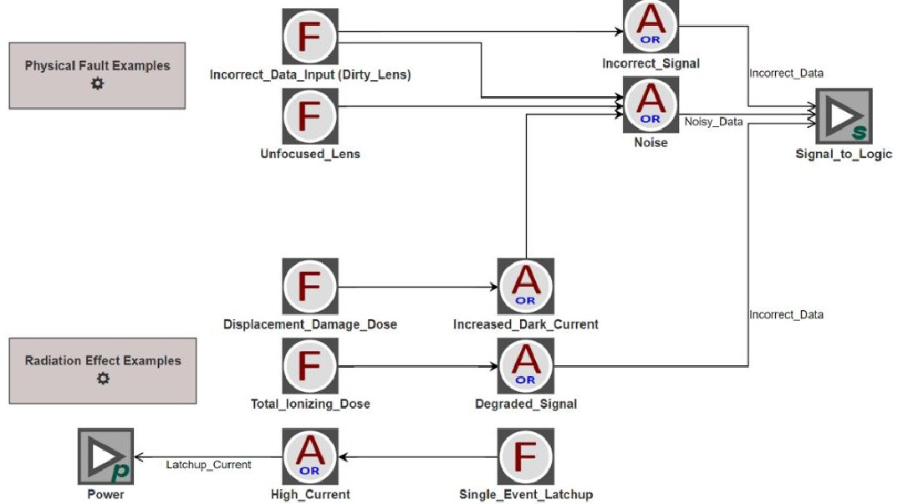

Fig. 17 SEAM model view of the CMOS Sensor block. Various physical faults and radiation effects are considered. They are modelled and anomalies caused by the faults are propagated out to power and signal ports to other system components.

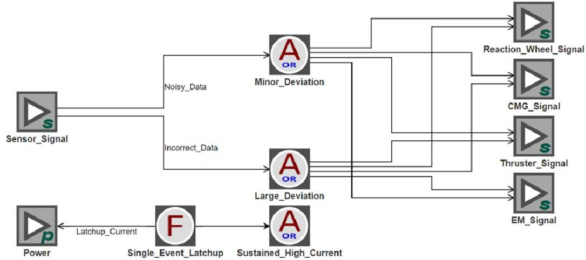

Fig.18 SEAM Model View of the microcontroller subsystem within the logic block. The radiation effect, single event latch up, is considered like the case in the CMOS sensor. Incoming faults from the CMOS image sensor signal port enter the microcontroller causing levels of data deviance anomalies, which then propagate out to each of the control systems.

<!-- PDF_PAGE: 18 -->

The incorrect data propagates into the microcontroller from the input port. This creates a large data deviation that then propagates out of the respective ports to the Controls_Actuators subsystem. The fault then enters each of the orientation controls from the respective incoming signal ports shown in Fig. 19.

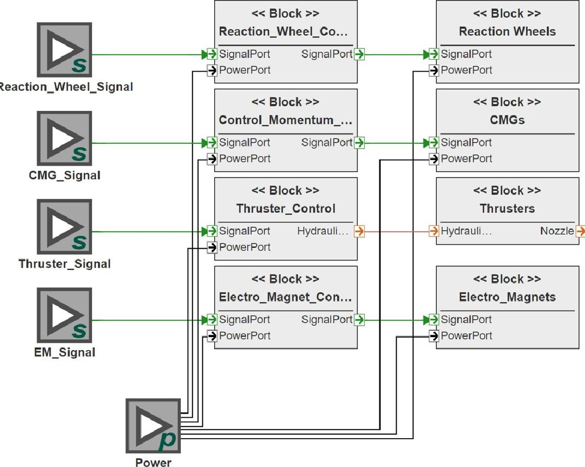

Fig.19 SEAM model view of the Controls and Actuators block. Faults enter from the incoming signal ports and effect the controls, which then cause the reaction devices to have degraded reactions. Note that the thrusters are controlled using material ports instead of signal ports, as thrusters are controlled by hydraulic valves and not electric signals.

One of the orientation control blocks is depicted in Fig. 20. The incorrect data from the total ionizing dose radiation effect is evaluated as propagating to either cause an unreadable signal resulting in no system response or create a large orientation command inaccuracy resulting in the reaction wheels further disorienting the satellite.

<!-- PDF_PAGE: 19 -->

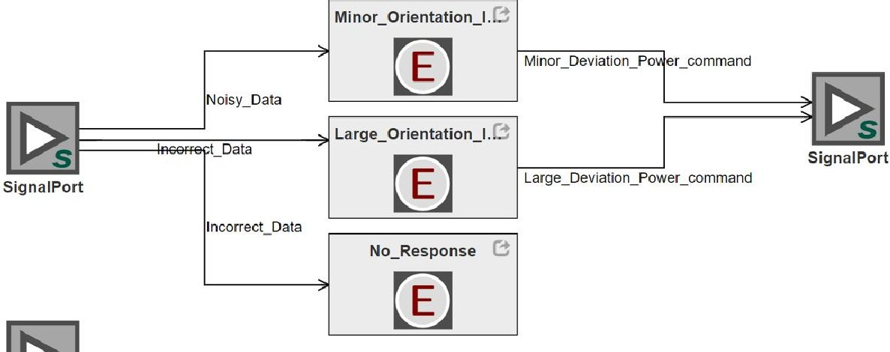

PowerPort

Fig. 20 SEAM model view of the Reaction Wheel Control block. The effects of the faults from the CMOS imager are shown creating effects of different reorientation inaccuracies, including a case where the system fails to recognize a readable star map causing an error of no system response.

## 5. CONCLUSIONS

This paper presents a web browser-based platform for radiation performance modeling and assurance of space systems called System Engineering Assurance and Modeling (SEAM), developed at Vanderbilt University with NASA support. It combines three modeling aspects together to allow radiation assessment. The first aspect is a SysML-based system description aspect that describes the system parts, their interconnection, and the origination and propagation of radiation-induced faults through the system. This system description aspect of SEAM contains two diagrams not found in the canonical SysML diagram set, which are the functional decomposition diagram (FCD) and the fault propagation diagram (FPD), which are key to capturing the introduction and propagation of faults. The second aspect of SEAM is based on Goal Structuring Notation (GSN), a visual argument language that enables the description of an assurance case, including the requirements, goals, strategies and evidence that are used to argue that the system will perform well in the space environment. The third aspect of SEAM is the generation of reliability artifacts, namely Bayesian Networks and fault trees, that are made possible by the FCD and FPD system diagrams. SEAM can extract the topologies of Bayesian nets and fault trees for radiation-induced faults from the system description and export them in standard formats to BN and FT evaluation applications.

Taken together, the SEAM capabilities allow the assessment of the radiation performance of a spacecraft without relying on intensive radiation testing campaigns, or extensive physical knowledge of the electronic components. The SEAM platform can be used to evaluate any space system but is especially useful for small satellite applications with short development timeframes and significant use of commercial-off-the shelf parts.

<!-- PDF_PAGE: 20 -->

Acknowledgement: This work is supported by the NASA Electrical Parts and Packaging Program (NEPP), contract number 80NSSC20K0424. The authors would also like to express thanks for support for SEAM development in past years by NEPP, the Jet Propulsion Laboratory and NASA Office of Safety and Mission Assurance.

## REFERENCES

[1] Introduction to Model-based System Engineering and SysML. Document available at: https://www.incose.org/docs/default-source/delaware-valley/mbse-overview-incose-30-july-2015.pdf.

[2] Architecting Spacecraft with SysML. Document available at: http://sysml-models.com/spacecraft/ models.html.

[3] CubeSat Reference Model. Document available at: https://www.omg.org/hot-topics/cube-sat.html.

[4] Object Management Group SysML website, http://www.omgsysml.org/.

[5] R. Cressant, P. David, V. Idiasiak and F. Kratz, "Increasing Reliability of Embedded Systems in a SysML Centered MBSE Process: Application to LEA Project", M-BED 2010, Dresden, Germany, 2010.

[6] F. Mhenni, J-Y. Choley, A. Riviere, N. Nguyen and H. Kadima, "SysML and safety analysis for mechatronic systems", In Proceedings of the 9th France-Japan and 7th Europe-Asia Congress on Mechatronics/13th Int'1 Workshop on on Research and Education in Mechatronics (REM), Paris, France, 2012, pp. 417-424.

[7] F. J. Groen, J. W. Evans and A. J. Hall, "A vision for spaceflight reliability: NASA's objectives-based strategy", In Proceedings of the 2015 Annual Reliability and Maintainability Symposium (RAMS), Palm Harbor, FL, 2015, pp. 1-6.

[8] R. A. Austin, N. Mahadevan, B. D. Sierawski, G. Karsai, A. F. Witulski and J. Evans, "A CubeSat-payload radiation-reliability assurance case using goal structuring notation", In Proceedings of the 2017 Annual Reliability and Maintainability Symposium (RAMS), Orlando, FL, 2017, pp. 1-8.

[9] R. Austin, "A Radiation-Reliability Assurance Case Using Goal Structuring Notation for a CubeSat Experiment", M.S. Thesis, Vanderbilt University, 2016.

[10] W. E. Vesely, F. F. Goldberg, N. H. Roberts and D. F. Haasl, Fault tree handbook. No. NUREG-0492. Nuclear Regulatory Commission, Washington DC, 1981.

[11] J. Day, K. Donahue, M. Ingham, A. Kadesch, A. Kennedy and E. Post, "Modeling Off-Nominal Behavior in SysML", In Proceedings of the AIAA Infotech, Garden Grove, CA, 2012, pp. 1-10.

[12] M. Izygon, H. Wagner, S. Okon, L. Wang, M. Sargusingh and J. Evans, "Facilitating R&M in spaceflight systems with MBSE", In Proceedings of the 2016 Annual Reliability and Maintainability Symposium (RAMS), Tucson, AZ, 2016, pp. 1-6.

[13] R.A. Austin, N. Mahadevan, G. Karsai, A. Witulski, B. Sierawski, R. Schrimpf, and R.A. Reed, "Automatic Fault Tree Generation from Radiation-Induced Fault Models", In Proceedings of the 2020 Reliability and Maintainability Symposium (RAMS), Palm Springs, California, 2020, pp. 1-7.

[14] J. Pearl, "Probabilistic reasoning in intelligent systems: networks of plausible inference", Elsevier, 2014.

[15] A. H. A. Melani, and G. F. M. de Souz, "Mapping SysML Diagrams into Bayesian Networks: A Systems Engineering Approach for Fault Diagnosis", ASME J. Risk Uncertainty Part B, vol. 6, no. 3, pp. 031003, Sep. 2020

[16] A. Witulski, B. Sierawski, R. Austin, G. Karsai, N. Mahadevan, R. Reed, R. Schrimpf, K. LaBel, J. Evans, and P. Adell, "Development of a Flight-Program-Ready Model-Based Assurance Platform", In Proceedings of the IEEE Aerospace Conference, Big Sky, Montana, 2020, pp. 1-8.

[17] M. N. Sarvi, D. Abbasi-Moghadam, M. Abolghasemi, and H. Hoseini, "Design and implementation of a star-tracker for LEO satellite", Optik, vol. 208, 164343, April 2020.

[18] Document with personal communication from K. B. Miller, August 19, 2020.

[19] A. Witulski, B. Sierawski, R. Austin, G. Karsai, N. Mahadevan, R. Reed, R. Schrimpf, K. LaBel, J. Evans, and P. Adell, "Model-Based Assurance for Satellites with Commercial Parts in Radiation Environments ", In Proceedings of AIAA Small Satellite Conference, Logan, Utah, 2018, SSC18-WKV-04.