<!-- PDF_PAGE: 1 -->

# LUMIO: A CubeSat for observing and characterizing micro-meteoroid impacts on the Lunar far side

A. Cervone $ ^{a,} $ F. Topputo $ ^{b} $ S. Speretta $ ^{a} $ A. Menicucci $ ^{a} $ E. Turan $ ^{a} $ P. Di Lizia $ ^{b} $ M. Massari $ ^{b} $ V. Franzese $ ^{b} $ C. Giordano $ ^{b} $ G. Merisio $ ^{b} $ D. Labate $ ^{c} $ G. Pilato $ ^{c} $ E. Costa $ ^{c} $ E. Bertels $ ^{d} $ A. Thorvaldsen $ ^{e} $ A. Kukharenka $ ^{e} $ J. Vennekens $ ^{f} $ R. Walker $ ^{f} $

$ ^{a} $ TU Delft, Kluyverweg 1, 2629 HS, Delft, the Netherlands

$ ^{b} $ Politecnico di Milano, Via La Masa 34, 20156, Milano, Italy

c Leonardo, Via delle Officine Galileo 1, 50013, Campi Bisenzio, Firenze, Italy

$ ^{d} $ ISIS-Innovative Solutions in Space, Motorenweg 23, 2623 CR, Delft, the Netherlands

$ ^{e} $ Science and Technology AS, Tordenskiolds Gate 2, 0160, Oslo, Norway

f ESA/ESTEC, Keplerlaan 1, 2201 AZ, Noordwijk, the Netherlands

## ARTICLE INFO

Keywords:

LUMIO

Interplanetary CubeSat missions

Meteoroid impacts

Lunar Situational Awareness

ESA SysNova challenge

## ABSTRACT

The Earth-Moon system is constantly bombarded by meteoroids of different size and impact speed. Observation of the impacts on the Moon can enable thorough characterization of the Lunar meteoroid flux, which is similar to that of the Earth. While Earth-based Lunar observations are restricted by weather, geometric and illumination conditions, a Lunar-based observation campaign can improve the detection rate and, when observing the Lunar far side, complement in both space and time the observations taken from Earth.

The Lunar Meteoroid Impact Observer (LUMIO), one of the two winning concepts of the ESA SysNova Lunar CubeSats for Exploration challenge, is a mission designed to observe, quantify, and characterize the micrometeoroid impacts on the Lunar far side. It is based on a 12U CubeSat that carries the LUMIO-Cam, a custom-designed optical instrument capable of detecting light flashes in the visible spectrum. The spacecraft is placed on a halo orbit about the Earth-Moon L2 point, where permanent full-disk observation of the Lunar far side can be performed with excellent quality, given the absence of Earth background noise. After passing Phase 0 and an independent feasibility study in the ESA Concurrent Design Facility, the mission has successfully completed its Phase A in March 2021. Although the Phase 0 design of the LUMIO spacecraft was assessed as feasible by the ESA CDF study, a number of critical issues were identified, which have been tackled by the Phase A design.

The paper presents the outcome of this Phase A design effort for the LUMIO spacecraft. Particularly relevant changes or updates in the spacecraft design include: a consolidated design of the LUMIO-Cam, with longer baffle for straylight protection; a set of ADCS sensors and actuators with increased redundancy; a combination of Direct-to-Earth communication and inter-satellite link with a mothership in Lunar orbit; use of Earth ranging to complement and validate the current innovative autonomous navigation strategy based on optical observations of the Moon by means of the LUMIO-Cam; re-assessment of the COTS components selection for the power and propulsion systems.

## 1. Introduction

LUMIO (LUnar Meteoroid Impacts Observer) is a CubeSat mission to a halo orbit at Earth-Moon $ L_{2} $ that shall observe, quantify, and characterize meteoroid impacts on the Lunar farside by detecting their flashes, complementing Earth-based observations on the Lunar nearside, to provide global information on the Lunar Meteoroid Environment and

contribute to Lunar Situational Awareness.

LUMIO was one of the proposals submitted to the SysNova LUnar CubeSats for Exploration (LUCE) call by the European Space Agency (ESA), a challenge intended to generate new and innovative concepts and to verify quickly their usefulness and feasibility via short concurrent studies [1]. After the first phase of the challenge (open call for ideas), LUMIO was one of the four proposals selected for performing a

<!-- PDF_PAGE: 2 -->

pre-Phase 0 analysis, funded by ESA. During the final review and evaluation from ESA, the mission was then awarded as one of the two ex-aequo winners of the challenge. As prize for the winners, ESA offered the opportunity to perform an independent study in its Concurrent Design Facility (CDF), to further assess the objectives, design and feasibility of the mission. The CDF study confirmed the feasibility and the scientific value of the mission [2], proposing a number of design iterations that, together with the initial design proposed by the LUMIO team in response to the SysNova challenge, contributed to form the Phase 0 study of the mission. Details on this Phase 0 study have been provided by the LUMIO team in numerous publications and presentations, see for example [3-5].

The LUMIO Phase A study, funded by ESA under the General Support Technology Programme (GSTP), through the support of the national delegations of Italy (ASI), the Netherlands (NSO) and Norway (NOSA), has been kicked off in March 2020 and has been completed in March 2021. The first results of the Phase A have been presented in a previous paper [6].

This paper, after shortly introducing the scientific relevance of LUMIO and its main mission analysis results, will discuss in detail the spacecraft design obtained at the end of Phase A, highlighting the additional steps taken after the initial Phase A activities presented in Ref. [6].

## 2. Scientific relevance

Near Earth Objects (NEO) are asteroids or comets with a perihelion of less than 1.3 AU. As of August 2021, the Minor Planet Centre database lists more than 26,300 NEO discovered so far [7]. NASA's Near-Earth Object Program database estimates that around 900 of these NEO are larger than 1 km, and more than 9,000 are larger than 140 m [8]. These bodies represent remnant debris from the formation of our Solar System and, as such, provide crucial information to understand the composition of planets and, more in general, the Solar System. Furthermore, impacts of NEO with the Earth can potentially cause catastrophic consequences, making it very important to better understand and, possibly, predict these events.

Telescopic observations from the Earth allow to detect NEO down to 1 m in size, but are less accurate in monitoring the sub-meter meteoroid population. These smaller meteoroids can have a size as small as micrometers and mass ranging from $ 1 0^{-1 5} $ to $ 1 0^{4} \mathrm{~ k g} $ [9]. They are typically Sun-orbiting fragments of asteroids and comets, formed by asteroid collisions or release of dust particles from comets. Their direct observation is normally difficult, but they can be observed indirectly from other phenomena, such as their impact on a celestial body. When dispersed along the same orbit, they form a meteoroid stream, while a cluster of meteoroids at the same orbital longitude is called a meteoroid swarm and, when colliding with a celestial body, originates a meteoroid shower. The development of meteoroid impact flux models is therefore crucial for the protection of space assets and, for smaller particles with size in the range from $ 1 0 \mu \mathrm{m} $ to 2 mm (the so-called micrometeoroids), for the study of space weather phenomena.

A large amount of meteoroids and micrometeoroids continuously enter the Earth-Moon system. Recent observations from the Lunar Reconnaissance Orbiter Camera [10] have shown how substantially their impacts can cause modifications of the Lunar surface. There are also various hypothesis and speculations on possible asymmetries in the spatial distribution of impacts across the Lunar surface [11]. It is theorized that the Lunar nearside has approximately 0.1% more impacts than the farside, due to the influence of the Earth gravity field; the equatorial flux is expected to be 10-20% larger than the polar regions, due to the higher number of large meteoroids in low orbital inclinations; and the Lunar leading side (apex) encounters between 37 and 80% more impactors than the trailing side (antapex), due to the Moon synchronous rotation. When a meteoroid impacts the Lunar surface, its kinetic energy is partitioned into: the generation of a seismic wave; the excavation of a

crater; the ejection of particles; the emission of radiation through flashes. In principle, any of these phenomena can be observed to detect Lunar meteoroid impacts; among them, detecting impact flashes has been selected as the most advantageous method for LUMIO, for various reasons: it yields an independent detection of meteoroid impacts, provides the most complete information about the impactor, and allows for the monitoring of a large Moon surface area.

Observation of light flashes on the Moon is typically performed by looking at local spikes of the luminous energy in the visible spectrum. When done by an Earth-based telescope, however, this observation is affected by background noise caused by the Earthshine (Earth reflected light on the Moon surface) and by thermal emissions of the Moon surface in the infrared spectrum. Better quality observations can be obtained by looking at the Lunar night side, as demonstrated when the first unambiguous lunar meteoroid impact flashes were observed during the Leonid meteoroid showers in 1999 [12]. Other monitoring programs that followed this initial one were conducted, for example, by the NASA Marshall Space Flight Center [13] and, under ESA funding, in the framework of the NELIOTA program [14]. However, the obvious restrictions imposed by Earth-based monitoring of impact flashes (such as attenuation caused by atmosphere and clouds, impossibility to observe the full disk at all longitudes, and additional constraints generated by the day/night cycle and the Eartshine), can only be avoided if the observation is done by space-based assets.

When the Earth intercepts a meteoroid swarm during its revolution around the Sun, impacts are generated between our planet and the meteoroids in the swarm, which burn in the Earth atmosphere and generate a meteor shower. The Moon, in its orbit around the Earth, intercepts the same meteoroid swarms at approximately the same time but, since it has no significant atmosphere, the impacts originate in this case a meteoroid shower. The well-known fact that an observer on Earth always sees the same portion of the Moon (the Lunar nearside) poses a further constraint to the observations taken from the Earth, which are intrinsically limited to just half of the Lunar surface. The illumination of the Lunar nearside from the Sun also varies with time, originating the Moon phases (Fig.1). Meteoroid impact flashes can only be observed from ground on the Lunar nightside, when the nearside is less than 50% illuminated, and during the Earth night. A similar situation applies to observations of the Lunar farside, which however can be performed at time periods complementary to those when Lunar nearside observations can be taken. This can be clearly seen in Fig.1: the dashed green line

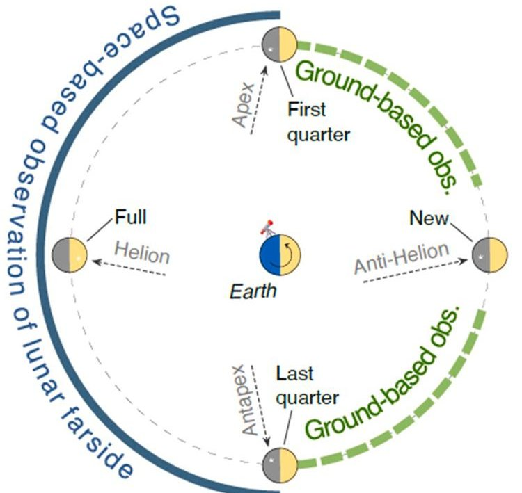

Fig. 1. Moon phases and main direction of incoming meteoroids in the Earth-Moon system.

<!-- PDF_PAGE: 3 -->

shows when and where Earth-based observations are possible, while the solid blue line shows where and when space-based observations of the farside are possible. It is therefore clear that the two types of observations are fully complementary, in both space and time. A consequent limitation, however, is that simultaneous observations taken, at the same time, by LUMIO (farside) and by an Earth-based asset (nearside) are very unlikely to be possible.

Therefore, the science question that LUMIO intends to answer is: what are the spatial and temporal characteristics of meteoroids impacting the Lunar surface? The corresponding science goal will be to advance the understanding of how meteoroids evolve in the cislunar space by observing the flashes produced by their impacts with the Lunar surface.

Already existing observation data (such as those presented in Refs. [15,16]), showing no recorded events in the equivalent kinetic energy range at the Earth $ 1 0^{-4} $ to $ 1 0^{-1} $ kton TNT and significant uncertainties in the equivalent kinetic energy range at the Earth $ 1 0^{-6} $ to $ 1 0^{-4} $ kton TNT, drive the selection of the range of interest for the impacts to be monitored by LUMIO. These are, therefore, the two energy ranges for which LUMIO shall, respectively, detect new meteoroid impacts on the Lunar Far Side and quantify their luminous energy. This will allow for clearly enhancing the current knowledge about the flux of meteoroids, including very small objects with mass smaller than 1 g, in case their impacts are caused by particles belonging to meteoroid showers characterized by high impact velocity.

In order to meet the scientific requirements of the mission, the LUMIO-Cam (as further explained in Section 4) is designed to detect flashes and retrieve their luminous energy and equivalent black body temperature, but it is not designed to resolve the ejecta materials plumes that follow an impact. However, since the mission is capable to also detect and characterize impacts caused by micrometeoroids of extremely small size, its results are expected to represent an important input to current plasma-dust cloud studies (see for example [17,18]).

## 3. Mission analysis and phases

LUMIO will make use of a 12U CubeSat equipped with the LUMIOCam, an optical instrument capable of detecting light flashes in the visible spectrum to continuously monitor and process the data. The mission implements a novel orbit design and COTS CubeSat technologies, to serve as a pioneer in demonstrating how CubeSats can become a viable tool for interplanetary science and exploration. Fig. 2 shows a simplified representation of the mission profile and phases.

The mission is divided in 5 phases:

- Earth-Moon transfer. After the launch, the LUMIO spacecraft is carried inside its mothership to a Lunar parking orbit. During the transfer the spacecraft is switched off inside its deployer and the

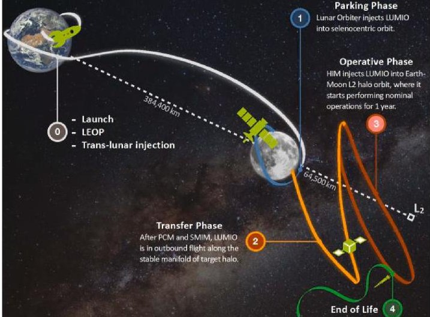

Fig. 2. LUMIO mission concept and phases.

LUMIO batteries are kept charged by a power connection with the mothership.

- Parking. The LUMIO spacecraft is released in its Lunar parking orbit by the mothership. After de-tumbling and deployment of the solar arrays, the payload and all sub-systems are commissioned. The spacecraft stays in the parking orbit and, when necessary, performs station keeping and wheel desaturation manoeuvres.

- Transfer. The LUMIO spacecraft autonomously transfers from the Lunar parking orbit to the final operative orbit. The transfer is performed by means of a Stable Manifold Injection Manoeuvre (SMIM), two TCM manoeuvres, and a Halo Injection Manoeuvre (HIM). Also in this case, during the transfer, the spacecraft performs wheel desaturation manoeuvres, if needed.

- Operative phase. In this phase, expected to have a duration of at least 1 year, the LUMIO spacecraft accomplishes its scientific objectives. The phase is divided in two sub-phases: the science cycle during which scientific data (images) are continuously acquired, processed and compressed; the navigation & engineering cycle during which orbital navigation manoeuvres are performed and, eventually, station keeping and wheel desaturation manoeuvres are conducted. With reference to Fig.1, the science cycle takes place when Moon illumination allows for scientific observations (solid blue line), while the navigation & engineering cycle takes place when scientific observations of the Lunar farside are not possible (dashed green line).

- End-of-Life. Finally, all spacecraft systems are de-commissioned, and the end-of-life manoeuvres are performed by the LUMIO spacecraft.

The trajectory proposed during Phase 0 for the transfer phase was based on an injection orbit of $ 2 0 0 \times1 5, 0 0 0 $ km around the Moon, later modified during the CDF study to a $ 6 0 0 \times2 0, 0 0 0 $ km orbit in order to reduce the magnitude of the SMIM manoeuvre. In the Phase A study, two alternative launch opportunities have been investigated: the Commercial Lunar Payload Services (CLPS) and Artemis-2, both from NASA, with the latter representing the worst-case scenario for the transfer phase and therefore being used for the determination of the Delta-V budget presented in this paper, which drove the design of the spacecraft sub-systems.

The selected LUMIO operative orbit is a quasi-periodic halo orbit around Earth-Moon $ L_{2} $ , characterised by a Jacobi constant $ Cj=3.09 $ This orbit was selected from a set of 14 candidates after a thorough trade-off analysis performed during the Phase 0 study. The trajectory of this operative orbit during the expected mission time frame is shown in Fig. 3. One important advantage offered by this orbit is the absence of any eclipse periods during the complete 1-year nominal mission lifetime.

The worst-case Delta-V budget for the LUMIO spacecraft, based on the Artemis-2 launch opportunity and an optimized transfer strategy from the corresponding release orbit, includes the set of deterministic and stochastic manoeuvres as reported in Table 1. In this case, since the LUMIO spacecraft would be released in a trans-Lunar orbit, a completely

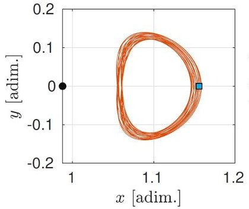

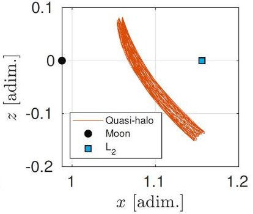

Fig. 3. Projections in the Roto-Pulsating Frame of the LUMIO operative orbit around Earth-Moon $ L_{2}. $

<!-- PDF_PAGE: 4 -->

Table 1 Current worst-case Delta-V budget for LUMIO (based on the Artemis-2 launch opportunity).

<table border="1"><tr><td>Maneuver</td><td>Deterministic $\Delta v$ [m/s]</td><td>Stochastic $\Delta v$ 3$\sigma$ [m/s]</td><td>Margin</td></tr><tr><td>$\Delta v_{0}$</td><td>8.3</td><td></td><td>5%</td></tr><tr><td>$\Delta v_{1}-\Delta v_{5}$</td><td>129.2</td><td></td><td>5%</td></tr><tr><td>TCM</td><td></td><td>18</td><td>100%</td></tr><tr><td>HIM</td><td>12.2</td><td></td><td>5%</td></tr><tr><td>1-year SK</td><td></td><td>4.3</td><td>5%</td></tr><tr><td>Disposal</td><td>2</td><td></td><td>100%</td></tr><tr><td colspan="2">Total, without margins[m/s]</td><td></td><td>174.0</td></tr><tr><td colspan="2">Total, margined[m/s]</td><td></td><td>201.8</td></tr></table>

different transfer strategy has been defined than the one used for the Phase 0 study and for the CLPS case studied during Phase A. In this case, a set of 6 impulsive manoeuvres $ (\Delta \nu_{0}-\Delta \nu_{5}) $ are performed, followed by a single TCM manoeuvre and by the HIM. The stochastic Delta-V budgets have been quantified starting from an orbit determination accuracy with 1 km error in position (all components) and 1 cm/s error in velocity (all components), based on a ground-tracking campaign carried out approximately once per week.

It shall be noted, however, that the optimized Delta-V budget estimated for the CLPS case is significantly lower (119.5 m/s margined, as opposed to the 201.8 m/s of the Artemis-2 case) mainly due to its significantly less demanding SMIM manoeuvre. In case the CLPS option is used as launch opportunity for LUMIO, a significantly larger Delta-V will be available than the amount required for accomplishing the 1-year nominal mission lifetime in the operative orbit, allowing for a longer mission or for performing eventual additional manoeuvres after the nominal mission lifetime.

It is interesting to note that the EQUULEUS mission from JAXA [19] has some common scientific objectives with LUMIO. EQUULEUS is a 6U CubeSat that will orbit about the Earth-Moon L2 point and will monitor the Lunar farside to detect, among others, meteoroid impact flashes. It will cruise a sophisticated transfer orbit after Artemis-1 launch, using a payload including two optical entries. Since LUMIO has larger size (12U as opposed to 6U), it also allows for accommodating a larger payload with improved radiometric performance and, as such, it is expected to deliver higher quality science products [20]. Moreover, as explained above, LUMIO is designed to deliver a Delta-V of more than 200 m/s based on a worst-case scenario approach, more than twice the Delta-V budget of EQUULEUS. As such, LUMIO is expected to operate for a longer lifetime in the unstable environment of Earth-Moon L2, which in turn increases the observation time and the chance of detecting more impact events and, ultimately, delivering a better scientific product not only in terms of quality but also quantity.

## 4. LUMIO spacecraft design

The Phase A study has allowed to converge towards the third design iteration of the LUMIO spacecraft, for a current configuration as shown

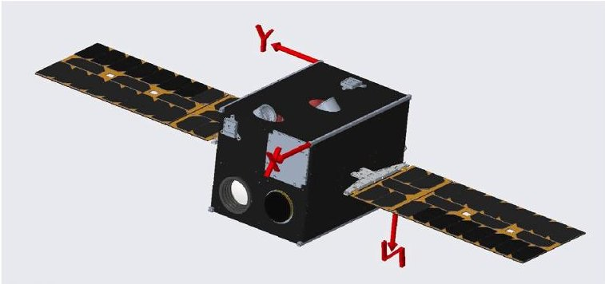

Fig. 4. Rendering of the LUMIO spacecraft configuration at the end of the Phase A study.

by the rendering provided in Fig. 4. Two internal views of the spacecraft, showing more in detail how the components and subsystems are allocated, are given in Figs. 5 and 6. The first iteration was the design proposed in response to the SysNova LUCE challenge, which was later updated in a second iteration by including a number of modifications suggested by the ESA CDF study. The margined wet spacecraft mass in the challenge study configuration was around 21 kg, later updated into 22.8 kg by the CDF study, mainly due to the introduction of a limited number of additional redundancies and to a 27% increase in the Delta-V budget.

An interesting aspect of this design iteration process is represented by the way how the trade-off criteria for selecting the spacecraft components evolved during the three iterations. While in the first iteration (SysNova LUCE challenge) performance was given a very high trade-off weight to achieve a more challenging, state-of-the-art design capable of winning the competition, in the second iteration (ESA CDF study) more importance was given to achieving a more reliable and more redundant design, following a more conservative design approach in accordance to the ESA standards. Finally, in the third iteration (Phase A study), a more intermediate approach has been taken, trying to find a better compromise between performance and reliability. At the same time, in this third iteration, since the available cost budget for the mission had become more clearly known, component and sub-system costs have become a much more relevant criterion in all trade-offs.

The following sub-sections provide an overview of the Phase A design of all spacecraft sub-systems, highlighting the evolution of their design through the three iterations. A summary of this info is given in Table 2, while the current mass budget of the spacecraft is shown in Table 3. It can be noted that the current mass budget shows a significant increase compared to the Phase 0 study of the margined spacecraft mass, which is now estimated to be 28.69 kg. The component, sub-system and system margins used in Table 3 are based on the recommendations given by the ESA standards, and are mainly driven by the maturity/TRL level of the selected components.

## 4.1. Payload (LUMIO-Cam)

The LUMIO-Cam is a custom payload developed by one of the key partners of the LUMIO team, Leonardo. In its initial configuration as proposed in the design challenge, the LUMIO-Cam employed one single CCD201 detector with $ 1 0 2 4 \times1 0 2 4 $ active pixels, associated to an optics with a Field of View of 6 deg and 127 mm focal length. The sensitivity of the chosen detector extends from visible to near-infrared spectrum, thus allowing for a wide range of exploitation of the impact radiation emissions.

The CDF study suggested some important improvements to this

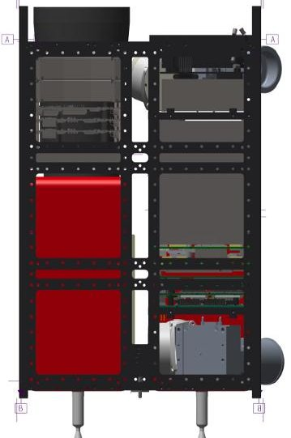

Fig. 5. Internal view of the LUMIO spacecraft as resulting from the Phase A study (-Y view).

<!-- PDF_PAGE: 5 -->

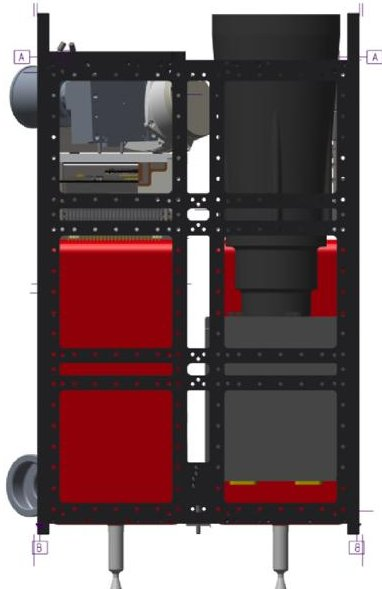

Fig. 6. Internal view of the LUMIO spacecraft as resulting from the Phase A study (+Y view).

initial design. The most important change was represented by the introduction of an additional CCD201 detector, with a beam splitter allowing for dividing the incoming signal in two channels, a visible and a near-infrared one, detected by two separate sensors. Another important change was the introduction of a longer baffle in order to reduce the straylight effects and improve the quality of the detected signal. It was suggested to use for this baffle the maximum possible length allowed by the spacecraft configuration (160 mm). The resulting margined mass budget estimated for this modified camera configuration was around 2.1 kg.

As a result of the detailed Phase A design of the instrument, the camera is now designed to operate in a bandwidth between 450 and 950 nm, implementing a double Focal Plane Assembly configuration. The optical head (Fig. 7) includes an optical barrel and a baffle. The optical barrel is a dioptric objective composed of 5 lenses, with the same focal length and field of view as in the initial design (127 mm and 6 deg). In front of the optical barrel, a baffle with an overall length of 150 mm is positioned, in order to minimize any straylight signal which would eventually come from the Sun.

Additionally, the camera design is completed by a Focal Plane Assembly including two identical $ 1 0 2 4 \times1 0 2 4 $ CCD detectors and their respective thermos-electric coolers. Finally, the Proximity Electronic embedded in the camera design manages all electrical interfaces between the payload and the spacecraft, generates the scanning and acquisition digital signals from the two detectors and manages the acquisition of the housekeeping data.

## 4.2. Attitude determination and control system (ADCS)

The ADCS design is of crucial importance for the success of the LUMIO mission, given the constraints generated by the need for accurately pointing the LUMIO-Cam towards the Moon (for good-quality science product), the antennas towards the Earth (for communications and radiometric navigation) and the solar panels towards the Sun (for maximizing power generation). Especially the last constraint is particularly challenging for LUMIO, since in the operative orbit the Sun continuously moves with respect to the body-fixed reference frame of the spacecraft. This requires simultaneous pointing of the LUMIO-Cam towards the Moon and rotation of the solar arrays in the body-fixed frame by means of a dedicated drive mechanism, as schematically shown by the pointing strategy illustrated in Fig. 8. This pointing strategy has remained unchanged from Phase 0 to the Phase A study.

In response to these needs, the initial challenge study proposed for the ADCS sensors two star trackers, two MEMS sun sensors and one IMU (Inertial Measurement Unit). The actuators were three reaction wheels,

Table 2 LUMIO spacecraft sub-systems: evolution from pre-phase 0 (SysNova challenge study) to Phase A.

<table border="1"><tr><td></td><td>SysNova Challenge Study</td><td>ESA CDF Study</td><td>Phase A</td></tr><tr><td>Payload</td><td>Custom(LUMIO-Cam)EMCCD type,visible and near infrared spectrumSingle detector,CCD201</td><td>Two CCD201 detectors,with common opticsLonger baffle(160mm)</td><td>Dioptric objective,5 lensesBeam splitter,two CCD201 detectorsOptimized baffle(150mm)Focal Length=127mmField of View=±3deg</td></tr><tr><td>ADCS</td><td>3x reaction wheels(Blue Canyon,RWP100)2x sun sensors(Solarmems,NanoSSOCD60)2x star trackers(Hyperion,ST400)1x IMU(Sensonor,STIM300)</td><td>3x reaction wheels(GomSpace,GSW600)4x sun sensors(Solarmems,NanoSSOCD60)1x star trackers(Hyperion,ST400)1x IMU(Sensonor,STIM300)</td><td>4x reaction wheels(Astrofein,RW25 SW50)6x fine sun sensors(LensR&amp;D,MAUS)2x star trackers(Sodern,Auriga)1x IMU(ISISpace,SCG)</td></tr><tr><td>Propulsion</td><td>Delta-V budget=154.4m/sVACCO Hybrid ADN MiPS(customized)Main:1×0.1N mono-propRCS:4×10mN cold gas</td><td>Delta-V budget=195.8m/s2x AerojetMPS130-2U8×0.25N mono-prop thrusters(for both main andRCS propulsion)</td><td>Delta-V budget=201.8m/sSeparate main/RCS systemsMain:NanoAvionicsECSS or Bradford-ECAPS HPGP1N(both custom tailored)RCS:GomSpace6DOF or AuroraARM(custom designed)</td></tr><tr><td>Communications</td><td>Inter-satellite link,no Direct-to-Earth2x UHF antennas,turnstile1x UHF transceiver,based onCCSDS Proximity-1</td><td>Both inter-satellite and Direct-to-Earth links4x patch antennas(X-band)1x SyrlinksEWC27-31 transceiver(customized)</td><td>Direct-to-Earth link(X-band,for payload data transmission):IMT radio+2xEnduroSat patch antennaInter-satellite link(S-band):SyrlinksECW31 radio+1xAnywaves patch antenna</td></tr><tr><td>Data Handling</td><td>Three separate OBC(main/payload/AOCS)Main:AAC Microtec SiriusPayload/AOCS:2x GomspaceZ7000</td><td>Merged AOCS/payload boardsMain:Skylabs,MicrosemiFPGA processing unitPayload andAOCS:UniBAPiX5</td><td>Three separate OBC(main/payload/AOCS)Main andAOCS:ISISpace IOBCPayload:UniBAPiX5</td></tr><tr><td>Power</td><td>2x Gomspace panels-B typeIMT SADA Assembly2x Gomspace BPX batteriesGomspace P60EPS</td><td>4x Gomspace panels-B typeIMT SADA Assembly2x Gomspace BPX batt.Gomspace P60EPS</td><td>ISISpace Modular Electric Power Subsystem(including4x battery packs)2×1.5×6U solar arraysISISpace ISADA Assembly</td></tr><tr><td>Structure</td><td></td><td></td><td></td></tr></table>

<!-- PDF_PAGE: 6 -->

Table 2 (continued)

<table border="1"><tr><td></td><td>SysNova Challenge Study</td><td>ESA CDF Study</td><td>Phase A</td></tr><tr><td>Thermal</td><td>ISIS 12U structure
Custom coating for main body and solar panels
3x thermal resistors(5W)</td><td>ISIS 12U structure
15W heating power
Secondary surface mirror, black paint, gold finishing</td><td>ISIS 12U structure(or 12U XL as backup option)
Spacecraft panels coating: anodized black aluminium
Solar array hinges: anodized aluminum</td></tr></table>

with desaturation performed by means of the propulsion system (as further explained in the following subsection).

The CDF study did not introduce significant changes to this design, limiting itself to remove the redundant star tracker, increase the redundancy on the sun sensors, and asking for a more frequent amount of wheel desaturation maneuvers (which also led to the selection of a different reaction wheel model).

The Phase A study confirmed the same type of sensors and actuators, but introduced again a significant number of redundancies. In terms of sensors, the current design includes 6 fine Sun sensors (MAUS sensor produced by Lens R&D), 2 star trackers (AURIGA, made by Sodern) and one IMU (SCG, produced by ISISpace). The actuators are 4 reaction wheels (RW25 SW50, produced by Astrofein), which are desaturated by a dedicated RCS propulsion system as better detailed in the next section. Although the Phase A study concluded that this set of sensors and actuators is acceptable within an approach that follows the CubeSat design philosophy, the ADCS design is expected to be reviewed again during Phase B, where more detailed RAMS analyses will be conducted and options for adding even more redundancy will be considered.

## 4.3. Propulsion

The initial propulsion system choice proposed in the challenge study was the VACCO Hybrid ADN MiPs system, which allowed to have in the same unit the main propulsion thruster (a 0.1 N mono-propellant) and four 10 mN cold gas thrusters in a "pyramid" configuration which, in that design, would have allowed for RCS maneuvers (de-tumbling and wheel desaturation). The available COTS options for this system were not sufficient in terms of Delta-V budget, therefore a customization of the system in terms of tank size and propellant mass was foreseen.

The CDF study proposed an alternative solution, mainly to overcome the uncertainties related to the customization of the VACCO system. In this case, the proposed propulsion design was based on two Aerojet MPS130-2U systems, mounted at two different corners of the spacecraft. This would allow for a total of eight 0.25 N mono-propellant thrusters at different locations, that can therefore be used for both main and RCS propulsion, depending on the number of activated thrusters and their activation strategy.

Based on the lessons learned from Phase 0, the first step taken in the Phase A study was to make a detailed trade-off between an "integrated" propulsion system (i.e., a system that accomplishes both main and RCS propulsion functions, similarly to the two solutions proposed during Phase 0), and an alternative solution where two fully separate systems are considered for the main and RCS propulsion. Although the trade-off did not show a fully clear winner, it indicated a defined preference for the "separate systems" option. This option allows for more flexibility, a larger number of potential COTS systems offered by the market, and the possibility of separately optimizing the performance of the two propulsion systems. For this reason, it was then decided to proceed with the separate systems option.

For the main propulsion system, two options are currently considered and will be both carried to Phase B where a final selection will be made: the EPSS system produced by NanoAvionics, and a propulsion

Table 3 LUMIO mass budget (margined) as resulting from the Phase A study.

<table border="1"><tr><td>Subsystem</td><td>Component</td><td>N. items</td><td>Margin</td><td>Mass [kg] (nominal)</td><td>Mass [kg] (margined)</td></tr><tr><td>Payload</td><td>LUMIO-Cam (incl. electronics)</td><td>1</td><td>20%</td><td>2.37</td><td>2.84</td></tr><tr><td>PDHS</td><td>Unibap SpaceCloud iX5</td><td>1</td><td>10%</td><td>0.23</td><td>0.25</td></tr><tr><td>PDT</td><td>IMT X-band transceiver</td><td>1</td><td>10%</td><td>4.6</td><td>5.06</td></tr><tr><td>PDT</td><td>EnduroSat X-band antenna</td><td>2</td><td>5%</td><td>0.002</td><td>0.005</td></tr><tr><td>EPS</td><td>DU for Payload, PDT</td><td>1</td><td>5%</td><td>0.06</td><td>0.063</td></tr><tr><td>EPS</td><td>DU for AOCS, IOBC, TTC</td><td>1</td><td>5%</td><td>0.06</td><td>0.063</td></tr><tr><td>EPS</td><td>EPS Conditioning Unit</td><td>2</td><td>5%</td><td>0.06</td><td>0.13</td></tr><tr><td>EPS</td><td>Battery Unit</td><td>1</td><td>5%</td><td>0.05</td><td>0.053</td></tr><tr><td>EPS</td><td>Battery Pack (4S2P, 16V)</td><td>2</td><td>5%</td><td>0.25</td><td>0.53</td></tr><tr><td>EPS</td><td>Tracking solar arrays (incl. SADA)</td><td>2</td><td>20%</td><td>0.81</td><td>1.94</td></tr><tr><td>CDH</td><td>IOBC (ISIS On-Board Computer)</td><td>1</td><td>5%</td><td>0.11</td><td>0.12</td></tr><tr><td>TTC</td><td>Syrlinks ECW31</td><td>1</td><td>5%</td><td>0.17</td><td>0.18</td></tr><tr><td>TTC</td><td>Anywaves S-band patch</td><td>1</td><td>5%</td><td>0.13</td><td>0.14</td></tr><tr><td>AOCS</td><td>AOCS On-Board Computer</td><td>1</td><td>5%</td><td>0.11</td><td>0.12</td></tr><tr><td>AOCS</td><td>Star Tracker Conditioning Unit</td><td>1</td><td>5%</td><td>0.11</td><td>0.12</td></tr><tr><td>AOCS</td><td>Auriga Star Tracker</td><td>2</td><td>5%</td><td>0.21</td><td>0.44</td></tr><tr><td>AOCS</td><td>Astrofein RW25 SW50</td><td>4</td><td>10%</td><td>0.2</td><td>0.88</td></tr><tr><td>AOCS</td><td>Fine Sun Sensors</td><td>6</td><td>5%</td><td>0.014</td><td>0.09</td></tr><tr><td>AOCS</td><td>Inertial Measurement Unit</td><td>1</td><td>10%</td><td>0.05</td><td>0.06</td></tr><tr><td>AOCS</td><td>RCS propulsion (dry)</td><td>1</td><td>10%</td><td>0.35</td><td>0.39</td></tr><tr><td>AOCS</td><td>Main propulsion (dry)</td><td>2</td><td>10%</td><td>1.64</td><td>3.61</td></tr><tr><td>Structure</td><td>ISIS 12U structure</td><td>1</td><td>10%</td><td>3.37</td><td>3.71</td></tr><tr><td>Other</td><td>Harness</td><td>1</td><td>10%</td><td>0.3</td><td>0.33</td></tr><tr><td colspan="2">Dry mass (subtotal)</td><td></td><td></td><td></td><td>21.12</td></tr><tr><td colspan="2">System margin</td><td></td><td></td><td>20%</td><td>4.22</td></tr><tr><td>Propellant</td><td>RCS propulsion</td><td>1</td><td>5%</td><td>0.45</td><td>0.47</td></tr><tr><td>Propellant</td><td>Main propulsion</td><td>2</td><td>5%</td><td>1.34</td><td>2.81</td></tr><tr><td colspan="2">Propellant mass (subtotal)</td><td></td><td></td><td></td><td>3.28</td></tr><tr><td colspan="2">Propellant margin</td><td></td><td></td><td>2%</td><td>0.07</td></tr><tr><td colspan="2">Total, margined</td><td></td><td></td><td></td><td>28.69</td></tr></table>

Legend: AOCS = Attitude and Orbital Control System; CDH = Command and Data Handling; DU = Distribution Unit; EPS = Electrical Power System; PDHS = Payload Data Handling System; PDT = Payload Data Transmission; RCS = Reaction Control System; TTC = Telemetry, Tracking and Control.

system produced by Bradford-ECAPS and based on their flight-proven HPGP 1 N thruster. Both systems would be slightly tailored from their COTS available version, to meet the needs of the LUMIO mission. The main propulsion system is made of two separate thrusters, each providing a thrust in the range from 100 mN (minimum allowed) to 1 N (maximum allowed), throttleable in a range of no less than $ \pm 10\% $ of its nominal value to facilitate compensation of any undesired torques (such as those caused by misalignment effects).

<!-- PDF_PAGE: 7 -->

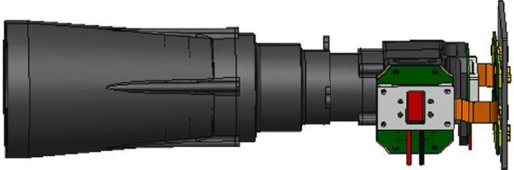

Fig. 7. CAD rendering of the current design of the LUMIO-Cam optical head.

Also for the RCS propulsion system, two options will be carried to Phase B, when a final selection among them will be performed: the 6DOF cold gas system produced by GomSpace, and a custom-designed version of the ARM water resistojet system produced by Aurora Propulsion Technologies. Each thruster in the RCS propulsion system is required to deliver a thrust in the range 1-10 mN, with a minimum of 4 thrusters allowed in the system.

## 4.4. Communications

The challenge study design of the LUMIO Telecommunications system was based on inter-satellite link with a Lunar orbiter, since Directto-Earth link was ruled out by the challenge constraints. This allowed to close the link with two UHF antennas, installed in turnstile configuration. However, the Direct-to-Earth option was put on the table again by the CDF study, which proposed a X-band design adaptable to both types of link.

The Phase A design of the Telecommunications system is based on a sophisticated architecture, involving a combination of Inter-Satellite and Direct-to-Earth link. The Inter-Satellite link has been studied in specific reference to the SSTL Lunar Pathfinder spacecraft, a commercial data relay spacecraft developed by SSTL to serve Lunar assets. Among the available frequency bands from this spacecraft, the S-band has been selected for the Telecommunications system of LUMIO. This allows for an estimated data rate in the order of 0.5-2 kbs (depending on the relative distance between the two spacecraft) at 9 dBW, therefore insufficient to transmit the payload data, which will instead be transmitted through the Direct-to-earth link. The currently selected radio for the Inter-Satellite link is the ECW31 produced by Syrlinks, which would require a slight customization to adapt it to the Proximity-1 standard adopted by the Lunar pathfinder. One S-band patch antenna produced by Anywaves will be used for this link.

For the Direct-to-Earth link, a maximum communication window of 14.75 days has been estimated over each Lunar month which, considering the telemetry, payload data generation and post-processing requirements of the spacecraft, leads to an estimated total data throughput

of 2.91 Mbytes per day. The radio selected for the Direct-to-Earth link is the C-DST produced by IMT, working in the X-band. Two X-band patch antennas produced by EnduroSat will be used for this link.

Radiometric ranging and tracking have been considered as the baseline navigation method, giving priority to the use of the Direct-to-Earth link over the Inter-Satellite ranging option.

## 4.5. Data Handling

One of the main features of the LUMIO design is the use of a dedicated On-Board Payload Data Processing unit (OBPDP), that allows to significantly reduce the amount of data to be sent to ground by limiting them to the scientifically significant data only. In order to do this, the OBPDP is designed in such a way to: (1) detect and keep only the camera images in which impact flashes are present; (2) cut from the whole image a smaller "tile", including the flash area and the information on where this area is located on the Lunar farside surface as seen by the spacecraft. This data processing strategy, schematically summarized in Fig. 9, allows for a reduction by a factor in the order of $ 1 0^{6} $ on the amount of data to be stored and sent to ground.

In the challenge study design, the proposed OBPDP computer was the GomSpace NanoMind Z7000, with SpaceWire connection to the camera. The CDF study, however, suggested to replace it with the Unibap iX5 as a more performant alternative. The use of two detectors in the camera and the consequently doubled data volume also ruled out the use of SpaceWire, characterized by a maximum data rate of 200 Mbit/s which would not be sufficient to meet the data requirements set by LUMIO. SpaceWire was therefore replaced by Camera Link, which offers up to 2.04 Gbit/s data rate.

In order to allow for more robustness and redundancy, the challenge study design proposed to equip the LUMIO spacecraft with three separate OBC boards: the main spacecraft OBC, the OBDPD, and a dedicated one for the AOCS functions. In the CDF study, however, given the relatively limited processing power required by the AOCS algorithms (around two order of magnitude smaller than the performance required by the OBPDP), it was decided to combine the OBPDP and the AOCS functions in the same unit. The Phase A study has decided to go back to the concept of three separate OBC units, mainly for redundancy reasons. For both the AOCS and the main OBC, the chosen computer was the IOBC produced by ISISpace. This design choice allows, among other things, for additional redundancy: in case one of the two computers fails or suffers for a malfunction, the other computer can take over the functions of the malfunctioning one and still allow for a fully successful mission.

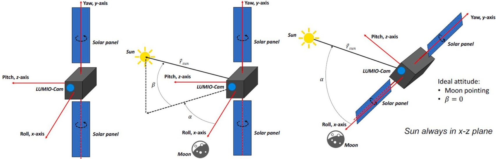

Fig. 8. LUMIO spacecraft pointing strategy.

<!-- PDF_PAGE: 8 -->

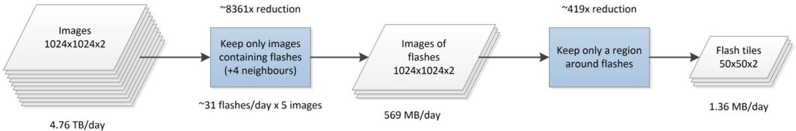

Fig. 9. LUMIO payload data processing strategy.

## 4.6. Electrical Power System

The design proposed by the challenge study was based on two solar array panels orientable by means of a SADA drive mechanism, plus two batteries for power storage. This allowed for an average power generation capability ranging from 22 W to 27 W during the various mission phases, and for a total battery storage capacity of 160 Wh.

The CDF study revised the power budget estimation made during the previous iteration, deriving an average power requirement of approximately 29 W in the LUMIO operative phase and up to 50 W in its transfer phase. As a consequence, the solar arrays were re-sized, with the addition of two more panels, in order to meet this increased power request.

The current Phase A study, as previously described, is based on a modified transfer phase strategy, as a consequence of the new launch opportunities that are being considered. This has resulted in an increased power demand for the spacecraft, reaching a maximum of 56 W during the transfer phase, 54 W during the science cycle, and up to 69 W when propulsion system heating is performed. The ISISpace Modular Electrical Power Subsystem has been selected to take the functions of Conditioning Unit, Battery Unit, Battery Pack and Distribution Unit. It includes 4 battery packs for a total capacity of 180 Wh. Each of the two solar arrays is made of 24 cells, for a total solar array area of $ 0. 1 4 4 \mathrm{~ m}^{2} $ or $ 1. 5 \times 6 \mathrm{U} $ . The selected SADA mechanism is the ISADA produced by ISISpace. A schematic of the high-level solar array and SADA architecture of the LUMIO spacecraft is shown in Fig. 10.

## 4.7. Structure

The spacecraft structure proposed by all design iterations, from the challenge study to the current Phase A design, is the 12U CubeSat structure developed by ISISpace. However, at the end of the Phase A

study, the option of using the 12U XL structure has been left open, in order to tackle possible volume challenges caused by the Lumio-Cam baffle length (as visible in Figs. 5 and 6).

The challenge study proposed the use of 1.5 mm Al panels for radiation hardening, but this analysis was considered excessively conservative by the CDF study, which recommended to revise it and eventually reduce the thickness and mass of the shielding panels. However, a more accurate radiation environment analysis performed during Phase A confirmed that 1.5 mm is an adequate thickness to ensure survival of all spacecraft components for the whole expected mission lifetime.

## 4.8. Thermal control

The LUMIO thermal control system proposed by the challenge study was based on an extremely simplified thermal analysis of the spacecraft, which led to the adoption of a mostly passive control. A combined coating was proposed for the main CubeSat body, made of gold finishing (27%) , silvered Teflon (25%) and polished Al 6061-T6 (48%). Black paint on an Al substrate was proposed for the back surfaces of the solar panels. In addition, three thermal resistors, with a power of 5 W each, were included for active local thermal control of the most critical spacecraft components.

A similar thermal design was proposed by the CDF study, with just small adjustments in terms of type and size of coatings. A more detailed thermal analysis conducted during the Phase A study allowed to conclude that it is possible to keep all spacecraft components within their allowed temperature range by using black anodized aluminium coating on all external panels, with solar array hinges made of anodized aluminum. This more relaxed design of the thermal control system has been possible since none of the selected components and sub-systems has a particularly constraining operative temperature range, with the

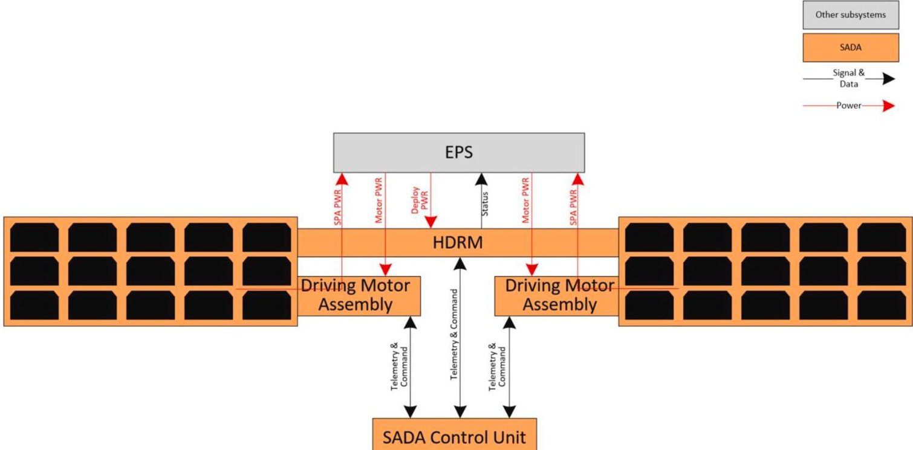

Fig. 10. LUMIO high-level solar array architecture.

<!-- PDF_PAGE: 9 -->

most challenging ones being the payload $ (-10 $ to $ +40^{\circ}\mathrm{C}) $ , the Electrical Power System (0 to $ +70^{\circ}\mathrm{C}) $ and the propulsion systems $ (+5 $ to $ +60^{\circ}\mathrm{C}) $ .

## 5. Conclusions

The LUMIO mission, one of the winners of the ESA SysNova LUCE challenge, has as primary science goal the observation and characterization of meteoroid impacts on the Lunar farside. The mission will allow to significantly improve the current meteoroid models and possibly reduce their uncertainty. LUMIO will be fully complementary, in both space and time, to Earth-based observations taken by other programs, and will therefore represent a fundamental contributor to Lunar Situational Awareness.

The LUMIO spacecraft is a 12U CubeSat equipped with the LUMIO Cam, an optical instrument capable of detecting impact flashes while continuously monitoring and processing the image data. The mission implements a sophisticated transfer phase and orbit design, and the spacecraft will be based on the most advanced COTS CubeSat technologies. In this way, LUMIO will not only have a valuable scientific impact, but will also serve as a demonstrator for the use of viable, low-cost CubeSats platforms for interplanetary missions.

In this paper, the scientific relevance of LUMIO and its peculiar mission characteristics have been presented and discussed. The LUMIO spacecraft design as resulting at the end of the Phase A study has been described in detail, highlighting its analogies and differences with the solutions proposed during Phase 0. The following phases of the LUMIO mission, starting from Phase B, are planned to begin around the end of 2021 or in the first months of 2022.

## Declaration of competing interest

The authors declare that they have no known competing financial interests or personal relationships that could have appeared to influence the work reported in this paper.

## Acknowledgements

The work described in this paper has been funded by the European Space Agency under the General Support Technology Programme (GSTP) and has received support from the national delegations of Italy (ASI), the Netherlands (NSO) and Norway (NOSA). The authors would like to particularly acknowledge the contribution of the ESA CDF team in reviewing and iterating the Phase 0 LUMIO design.

The input received from external experts throughout the LUMIO design process has been extremely valuable and their role is highly appreciated.

Finally, the authors would like to thank all the students and former members of the LUMIO team, who have given invaluable contributions to the mission design, especially in its early phases.

## References

[1] European Space Agency, SysNova: R&D Studies Competition for Innovation. AO#4: LUnar CubeSats for Exploration (LUCE), Statement of Work, 2016. Issue 1, Rev 0.TEC-SY/84/2016/SOW/RW.

[2] European Space Agency, LUMIO. Review of SysNova award LUMIO Study, 2018. CDF Study Report CDF R-36.

[3] S. Speretta, et al., LUMIO: an autonomous CubeSat for lunar exploration, in: Space Operations: Inspiring Humankind's Future, Springer nature Switzerland AG, 2019.

[4] P. Sundaramoorthy, et al., System design of LUMIO: a CubeSat at earth-moon L2 for observing lunar meteoroid impacts, in: IAF 69th International Astronautical Congress, Bremen, Germany, 2018.

[5] F. Topputo, et al., LUMIO: a CubeSat at earth-moon L2, in: The 4S Symposium, Sorrento, Italy, 2018.

[6] A. Cervone, et al., Phase A design of the LUMIO spacecraft: a CubeSat for observing and characterizing micro-meteoroid impacts on the lunar far side, in: IAF 71st International Astronautical Congress, Cyber Edition, 2020.

[7] 5/8/21, www.minorplanetcenter.net.

[8] 5/8/21, cneos.jpl.nasa.gov.

[9] Z. Ceplecha, et al., Meteor phenomena and bodies, Sp. Sci. Rev. 84 (3) (1998) 327-471.

[10] E.J. Speyerer, et al., Quantifying crater production and regolith overturn on the Moon with temporal imaging, Nature 538 (7624) (2016) 215-218.

[11] J. Oberst, et al., The present-day flux of large meteoroids on the lunar surface-A synthesis of models and observational techniques, Planet. Space Sci. 74 (1) (2012) 179-193.

[12] L.R. Bellot Rubio, et al., Luminous efficiency in hypervelocity impacts from the 1999 lunar leonids, Astrophys. J. Lett. 542 (1) (2000) L65-L68.

[13] R.M. Suggs, et al., The NASA lunar impact monitoring program, Earth Moon Planets 102 (1) (2008) 293-298.

[14] A.Z. Bonanos, et al., NELIOTA: ESA's new NEO lunar impact monitoring project with the 1.2m telescope at the National Observatory of Athens, Proc. Int. Astron. Union 10 (S318) (2015) 327-329.

[15] J.L. Ortiz, et al., Detection of sporadic impact flashes on the Moon: implications for the luminous efficiency of hypervelocity impacts and derived terrestrial impact rates, Icarus 184 (2) (2006) 319-326.

[16] R.M. Suggs, et al., The flux of kilogram-sized meteoroids from lunar impact monitoring, Icarus 238 (Supplement C) (2014) 23-36.

[17] S.I. Popel, et al., Impacts of fast meteoroids and the separation of dust particles from the surface of the Moon, JETP Lett. (Engl. Transl.) 103 (9) (2016) 563-567.

[18] S.I. Popel, et al., Impacts of fast meteoroids and a plasma-dust cloud over the lunar surface, JETP Lett. (Engl. Transl.) 105 (10) (2017) 635-640.

[19] R. Funase, et al., Mission to earth-moon Lagrange point by a 6U CubeSat: EQUULEUS, IEEE Aero. Electron. Syst. Mag. 35 (Number 3) (2020) 30-44.

[20] G. Merisio, et al., Predicting the outcome of the LUMIO lunar CubeSat, in: IAF 71st International Astronautical Congress, 2020.