<!-- PDF_PAGE: 1 -->


RESEARCH ARTICLE


<div align="center">

# An approach for system analysis with model-based systems engineering and graph data engineering

</div>

Florian Schummer $ ^{*} $ and Maximillian Hyba

Chair of Astronautics, Technical University of Munich, Boltzmannstr 15, Garching, Bavaria 85748, Germany *Corresponding author. E-mail: f.schummer@tum.de

Received: 19 January 2022; Revised: 28 August 2022; Accepted: 08 October 2022

Keywords: Anomaly resolution; graph databases; MBSE; SysML; SysML graph schema

## Abstract

Model-based systems engineering (MBSE) aims at creating a model of a system under development, covering the complete system with a level of detail that allows to define and understand its behavior and enables to define any interface and work package based on the model. Once the model is established, further benefits can be reaped, such as the analysis of complex technical correlations within the system. Various insights can be gained by displaying the model as a formal graph and querying it. To enable such queries, a graph schema is necessary, which allows to transfer the model into a graph database. In the course of this paper, we discuss the design of a graph schema and MBSE modeling approach, enabling deep going system analysis and anomaly resolution in complex embedded systems with a focus on testing and anomaly resolution. The schema and modeling approach are designed to answer questions such as What happens if there is an electrical short in a component? Which other components are now offline and which data cannot be gathered anymore? If a component becomes unresponsive, which alternative routes can be established to obtain data processed by it. We build on the use case of qualification and operations of a small spacecraft. Structural elements of the MBSE model are transferred to a graph database where analyses are conducted on the system. The schema is implemented by means of an adapter for MagicDraw to Neo4J. A selection of complex analyses is shown in the example of the MOVE-II space mission.

## Impact Statement

The proposed schema and modeling strategy to transfer SysML Models to Labelled Property Graphs open a wide range of system analyses for designers, integrators, and operators of complex embedded systems. Queries for data paths, probable causes of anomalies, or all possible routes from one state to another are enabled by the method. Analyzing against which input loss components should be resilient for robustness is among the benefits. By parameterizing graph-queries, they can be reused between systems, there by increasing the efficiency of model analysis. The requirements for the SysML model are few and do not require a holistically complete model. Therefore, the approach can also be applied to models still in the making or where parts of the system are black-boxed.


<!-- PDF_PAGE: 2 -->

## 1. Introduction

## 1.1. Model-based systems engineering with SysML - Exclusively for early project phases?

This paper proposes a new method of applying SysML-based model-based systems engineering (MBSE) to later project phases in satellite missions. Since the International Council of Systems Engineering first introduced the concept of MBSE in International Council on Systems Engineering (2007), 15 years have passed. Nowadays, MBSE is recognized as the way forward in various industries, such as aerospace, defense, and automotive (D'Ambrosio and Soremekun, 2017; Telleschi et al., 2018; Pawlikowski et al., 2019; McDermott et al., 2020). According to Pawlikowski et al. (2019), SysML is the de-facto standard for MBSE models of embedded systems during the design phase. Pawlikowski et al. (2019) and McDermott et al. (2020) report that the SysML models are mainly applied in earlier development phases while Schluse et al. (2018), Dahmen and Rossmann (2018), and Laukotka et al. (2021) show that in later phases the application of digital twins is more common. This raises the question why the SysML models are not continually used throughout the project and what would be required of a SysML model during assembly integration and testing (AIT) or the operations of a spacecraft.

The motivation for this paper comes from the authors' own experiences in the AIT of small satellites. Once the design of a spacecraft is concluded, the hardware is produced and shipped to a central entity. There the systems of the various partitioning groups (albeit internal or external) are integrated to form the final spacecraft. While in earlier phases requirements and specifications were distributed from a central entity to the implementing engineers, that is, information flowed from few people to many, during AIT the implementation of these specifications comes back to the integrators in the form of documentation and hard- and software, that is, information and implementations generated by many people come back to a few people running the integration of the spacecraft. A convergence of information has to take place that inevitably comes with deviations from the original design and discrepancies between the implementations of the various subsystems. It is the task of the integrators to

- verify and validate the implemented system against the specification created in earlier project phases,

- identify any discrepancies and anomalies,

- identify the source of the discrepancy/anomaly,

- decide whether the discrepancy/anomaly can be accepted or requires rework,

- and finally, decide which side of an interface shall be adapted to match the other.

This task requires a thorough understanding of the system, any kind of interdependencies, its interactions with the environment and the impact on the project's timeline by the decisions made. Usually, the knowledge required to assess such a situation and make a decision resides in a few key personnel, to which the majority of integrators report their findings and then await further instructions. These key-personnel are typically part of the mission from an early stage, build their knowledge of the system over time and therefore, are inherently difficult to replace. This dependency on key-personnel is the motivation to maintain a model that provides a complete overview of the system, the interactions between its subsystems and its interactions with the environment in an easy-to-understand way. The AIT of a satellite mission differs from other industries such as automotive, defense, or consumer electronics industries. The automotive, defense and consumer electronics industries usually produce a system in higher quantities, whereas satellite missions typically consist of a single-digit number of prototype units that are launched into space. The resources one can invest into enhancing the AIT scale with the quantity of produced systems. Hence, the modeling effort for a satellite mission has to be small enough to be appropriate for the integration of a single-produced system.

Ideally, such a model would be usable by any integrator in the team and decrease the dependency on key-personnel in the project. The resulting sharing of knowledge should also enable integrators to

<!-- PDF_PAGE: 3 -->

investigate anomalies more deeply on their own and thereby increase the efficiency during AIT. As the final phase before the launch of a satellite, the AIT phase typically faces an ambitious schedule, as delays accumulated over the previous phases often have to be compensated for. Making a model accessible to a large number of people requires the model to be easy to understand, and show every integrator the information they require. The learning and familiarization phase required for an integrator to apply the MBSE model to their daily tasks should hence be as short as possible.

Such a model aligns with the goals of the "Model Based for Systems Engineering" initiative by the European Space Agency (ESA): In European Space Agency (2020b), they formulate a key user need to "ensure the consistency, completeness and feasibility of requirements and design", noting that "especially the functional complexity must be kept in [sic] control" (European Space Agency, 2020b, p. 11). Another key user need they formulate is to "structure the knowledge about the system in such a way that the relations between the knowledge elements are established and traceable" (European Space Agency, 2020b, p. 11).

A static SysML model can match these requirements in theory. However, diagrams would have to be created and maintained for every view an integrator could possibly need. Since it is not possible to anticipate which views are actually needed in the end, this would result in a lot more diagrams being created and maintained than are necessary, which significantly impedes the efficiency of such an endeavor. Additionally, complex correlations that are often required to understand an anomaly cannot be shown in a single diagram as they touch on aspects covered by different types of SysML diagrams, which further increases the amount of time necessary to ingest the information.

Ideally, integrators can query the information they look for directly from the model without any assistance from outside. A system of help for self-help could be implemented that allows the integrators to draw their own conclusions and view information in the format they prefer for the respective situation, which might be simple lists, diagrams, or tables. However, current SysML modeling tools such as Enterprise Architect or MagicDraw by NoMagic require these views to be built manually and would require a prolonged training phase for the integrators.

Another approach is required that allows querying the relations between all elements in the SysML model and dynamically generate views that are specific to the encountered anomaly. A technology specifically built to query the relations within a system and generate dynamic views based on a model available in the background are graph databases. Graph databases are optimized for querying the relations between data points. These queries can become arbitrarily complex, with the length of the path in the query spanning hundreds of nodes. In other words, they are a perfect tool if one has a starting point and a specific pattern that the data must follow. Such patterns can be formed by creating a formal graph from a system-defining model, such as a SysML model. This paper shall explore the possibilities to transfer a SysML model to a formal graph and show how this enables complex analyses such as

- finding the path of a specific telemetry from its sensor on the spacecraft to the operator's screen,

- suggesting likely faults for a specific observed anomaly pattern, and

- creating fallout analyses for the case of a spontaneously broken component.

## 1.2. Scope and goals

This paper shows how the translation of a SysML model to a formal graph enables specific MBSE analyses that are cumbersome and inefficient in common modeling tools such as MagicDraw. In the course of this paper, typical analysis tasks during later phases of spacecraft development and AIT, shall be formalized as questions. Furthermore, it shall be explored how graph-technology enables such analyses. Various graph-databases are compared and reasoning to the decision for a specific database is provided in Section 2.3.1, based on the characteristics of the database software, such as the capacity of the database, ease of implementation, available tools to work with the database, and available documentation. Alternative solutions for storing the graph, such as the resource description framework (RDF) or other graph databases are seen as valid. A quantitative comparison of the advantages and

<!-- PDF_PAGE: 4 -->

disadvantages of implementing the graph schema for a variety of databases is however out of the scope for this paper.

Figure 1 shows an overview of the intended process. It depicts how the information provided by an MBSE Model can be transferred into a graph and subsequently queried traversing the graph.

A graph schema is a prerequisite for any graph-based analysis. A graph schema transforming SysML into a labeled property graph shall hence be developed and a respective software implementation, which automatically transfers standard SysML models into the graph-database shall be provided. A goal of this paper is to enable others to conduct such analyses as well. This goal forms major parts of the paper, such as the in-depth review of current obstacles in the application of MBSE, so as to avoid repeating mistakes of the past and help address obstacles presently perceived. A complementary set of modeling guidelines is required to ensure consistency between SysML model and graph queries. It is kept to a bare minimum to reach high compatibility with any prevailing modeling strategy. Customizations of the modeling guidelines shall be discussed, depending on which analyses are to be carried out. Finally, a selection of the previously defined analysis tasks shall be translated into actual queries for the graph database and performed on the example of an actual spacecraft.

## 1.3. Outline

Section 2 gives an overview of various graph databases after summarizing the current state of MBSE implementation as gathered in recent surveys. An overview of existing graph schemata for the unified modeling language (UML) is provided. Section 2 concludes with a short introduction to the use case of the MOVE-II spacecraft. Section 3 outlines typical tasks in system analysis, with a special focus on later project phases such as AIT and operations of a system. The focus is laid on these later project phases, as they provide the highest level of complexity in the model. Building on the outlined tasks, possible solutions for a graph schema are discussed and a solution suitable to the analysis tasks is selected. In Section 4, modeling guidelines for the MBSE model are presented and their effect on which analyses can be conducted is discussed. Section 5 provides a short overview of the actual code implementation, which translates MagicDraw SysML models into a labeled property graph. In sec_application the proposed


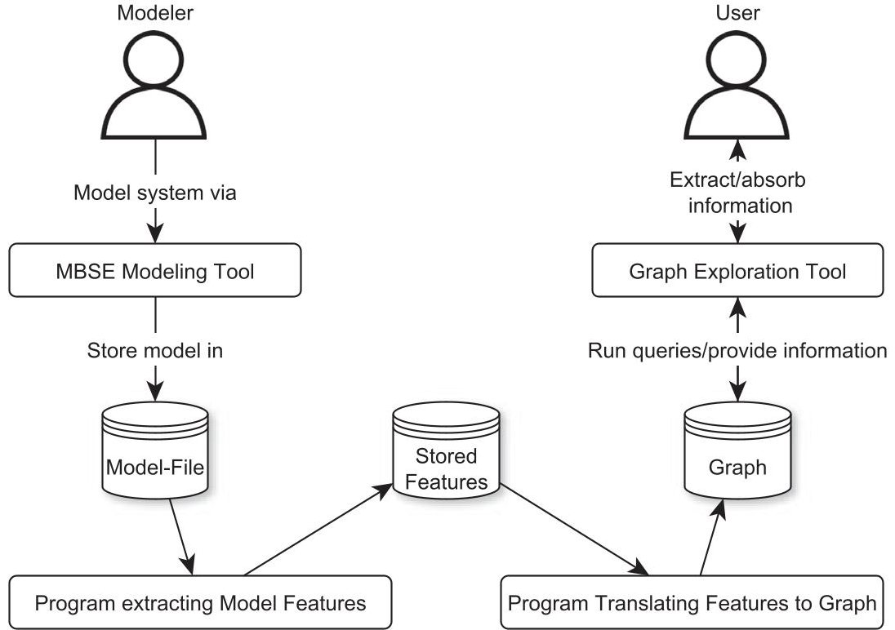


<div align="center">

Figure 1. Overview of the intended process, allowing users to extract information from the graph translation of an MBSE model.

</div>

<!-- PDF_PAGE: 5 -->

graph schema and modeling guidelines are verified against an operational space mission: The MOVE-II space mission designed and operated by the Technical University of Munich's Chair of Astronautics. The model used for the analysis covers the complete structure of the spacecraft, including hardware and software, as well as any systems and components of the ground station and operations equipment. Section 7 compares the results of the paper to the state of the art and Section 8 presents an outlook on future topics of research in the area.

## 2. Background

This section is divided into three parts: The first part covers the state of the art on the practical implementation of MBSE and the challenges thereof as perceived by the literature. No previous work that compares different studies on the implementation of MBSE could be found. The comparison is conducted here to provide a better impression on what challenges people are dealing with when implementing MBSE and to gain insight into why MBSE seems to not be applied to later life cycle phases. The second part introduces graph databases and the underlying concept of graph schemata. It also looks into existing schemata to transfer SysML or the UML to graphs. The third part gives a short introduction on the MOVE-II project used as implementation show cases.

## 2.1. Recent surveys on model-based systems engineering

Weilkiens et al. (2016) and Di Maio et al. (2021) compare different MBSE methodologies on a theoretical level, modeling a steam engine under the application of various methodologies and comparing their fit for the application. While this gives insight into the advantages and challenges for the various compared methodologies, it does not provide insights into the practical challenges of applying MBSE in actual projects such as the success-rate of MBSE applications or major problems identified by users.

Hence, the following section focuses on recent surveys with MBSE practitioners in the field. Studies lying too far in the past are seen as less relevant for this work, as the presented studies show, that the application of MBSE drastically increased in recent times and new challenges and problems arose while others become less relevant.

In 2019, the National Aeronautics and Space Administration (NASA) published a survey with 50 participants from the industry, academia, US-government agencies, and tool vendors for systems engineering tools on the topic of the current state of systems engineering at their own institution or as perceived at partnering entities (cf. Pawlikowski et al., 2019). The study identified an increased application of MBSE as the number 3 factor in improving overall performance, after improving the training of systems engineers and improving their domain-specific knowledge. Asked about the expected benefits, 63% expect a reduction of 30% to 50% regarding the development cycle time. While encouraging the use of MBSE, the study also found the majority of participants reporting less than 25% adoption of MBSE in projects at their workplace. About 33% of the participants across all disciplines see the insufficiency of MBSE tools as a key weakness in their application of systems engineering. The only factor named more often is cultural issues with 46%, which the authors describe as people being reluctant to change from document-based processes (Pawlikowski et al., 2019).

The report Benchmarking the Benefits and Current Maturity of Model-Based Systems Engineering across the Enterprise by McDermott et al. (2020) was published in March 2020. Being supported by the United States Department of Defense, the report sets out to explore the current state of adoption of MBSE, identifying challenges and enablers in the adoption and which skill sets are necessary for a successful MBSE adoption. The survey is based on data gathered from November 2019 to January 2020, with a total of 240 participants and thereby comprises not only the most recent but also the largest survey, with participants from industry, academia, and governmental institutions. While McDermott et al. (2020) and Pawlikowski et al. (2019) were the most recent surveys we could find, other publications address the same topic and should not be omitted.

<!-- PDF_PAGE: 6 -->

Chami and Bruel (2018) report on a survey conducted on MBSE adoption in the industry with 42 participants. The survey is focused on MBSE adoption challenges. In difference to Pawlikowski et al. (2019), all participants had an industrial background. The participants came from a broader field, with roughly a third working in consultancy and training, and the rest being split between aerospace, medical, railway, defense, computing and IT engineering, and automotive (ordered by decreasing participation). The main findings are consistent with Pawlikowski et al. (2019):

- "Awareness and change resistance" is the most frequently named challenge with 88% of participants either agreeing or strongly agreeing on the topic.

- "Purpose and scope definition" has the same level of total agreement (88%) but a lower percentage of strongly agreeing participants.

- The third and fourth most mentioned problems are "method definition and extension" (84%) and "tool dependency and integration" (83%).

The higher percentages in the agreement can be traced to the surveying method. While Pawlikowski et al. (2019) built upon telephone interviews with rather free questions and consolidated the responses afterward into groups, Chami and Bruel (2018) used a predefined set of perceived challenges in MBSE adoption and asked the survey participants about their agreement with each challenge. However, it should be mentioned that "method definition and extension", as well as "purpose and scope definition" came up as additional challenges that were not in the focus of Pawlikowski et al. (2019). This can either be attributed to the broader field of participants or the different surveying methods, which might bring up focus on topics that do not immediately spring to mind otherwise.

Morris et al. (2016) focused on the earlier phases of a system's lifecycle by limiting their two surveys from 2015 and 2014 to conceptual design works. What makes the survey especially worth reading is the open-minded approach to the question, whether the employment of MBSE brought benefits or exacerbated existing problems further. Interestingly, the study found "solutioneering" (which is described as stakeholders pressing for a specific solution without understanding the problem first) and "lack of Stakeholder engagement" as main topics $ ^{2} $ . Topics mentioned in Pawlikowski et al. (2019) and Chami and Bruel (2018) such as "purpose and scope definition", "method definition and extension" or "tool dependency and integration" are not present in the report of Morris et al. Likely reasons for the difference between the former two studies and Morris et al. (2016) might be the limited number of participants in any of the surveys, the 4-5 years difference between their conduction or the different methodologies and specific questions employed by the survey conductors. Table 1 gives a short overview of key numbers of all four publications.

Going on from the topic of MBSE challenges to specific lacks of functionality for MBSE tools, Hazle and Towers (2020) summarize the literature on the verification and validation of SysML models. They specifically point out reviews, analysis, and simulation as the three main techniques of verification and validation for SysML models and describe formal model checking of SysML models as rarely used and often reserved for high-risk aspects due to the significant effort attributed to it. They describe the necessity to transform the model into another formal language prior to formal analyses, such as Petri Nets or directed graphs. They further state the formal verification of models with Petri Nets or directed graphs is limited to the behavior aspects of a SysML model, omitting the structural aspects. As for the analysis of requirements and structural aspects of the model, a wide variety of publications were made on the topic of automatic analysis of requirements in SysML (see Bankauskaite and Morkevicius, 2018; Petnga, 2019; Morkevicius and Jankevicius, 2015).

What all presented publications have in common is their focus on the early project phases and formal reviews. Going back to the original definition of MBSE, later life cycle phases such as the qualification

<!-- PDF_PAGE: 7 -->

<div align="center">

Table 1. Comparison of surveys on the state of model-based systems engineering.

</div>

<table border="1"><tr><td>Year</td><td>Title</td><td>Authors</td><td>No. Part.</td><td>Method</td></tr><tr><td>2014/2015</td><td>Issues in conceptual design and MBSE successes: Insights from the model-based conceptual design surveysKey topics: Solutioneering, lack of Stakeholder engagement</td><td>Morris et al.</td><td>39/40</td><td>Open questions</td></tr><tr><td>2018</td><td>A Survey on MBSE Adoption ChallengesKey topics: Awareness and change resistance, purpose and scope definition</td><td>Chami and Bruel</td><td>42</td><td>Level of agreement to preselected statements</td></tr><tr><td>2019</td><td>Independent Assessment of Perception From External/non-NASA Systems Engineering (SE) SourcesKey topics: Change reluctance, insufficiency of tools</td><td>Pawlikowski et al.</td><td>50</td><td>Open questions</td></tr><tr><td>2020</td><td>Benchmarking the Benefits and Current Maturity of Model-Based Systems Engineering across the EnterpriseKey topics: MBSE methods and processes, organizational culture</td><td>McDermott et al.</td><td>240</td><td>Combined</td></tr></table>

and operation of a system should not be omitted but are rarely studied. We found only one publication that can be linked to MBSE employment in qualification and operation of a spacecraft. In 2020, the ESA issued an invitation to tender on reverse-engineering of the satellite OPS-SAT: The satellite is built as a generic flying laboratory, that allows new experiments to be uploaded and conducted while in orbit. The invitation to tender states the following intent: "Users could greatly benefit from understanding of the system via a formal system model also for experiment integration and feasibility analysis" (European Space Agency, 2020a, p. 6). While the aim of this activity is the employment of MBSE to assist in the operational phase, the activity is ongoing and no publications on their progress are issued yet. The lack of publications on MBSE in the operational phase and during AIT leads to the conclusion that activities in this field of application are rare. Taking a look at the current rate of MBSE employment this is no surprise. Pawlikowski et al. (2019) found 78% of interview partners reporting less than 25% of MBSE on current projects, with 42% reporting between 5% and 10% and 7% of the participants reporting 5% or less. While building a model can be as simple or difficult as one makes it, MBSE requires the acceptance of the whole team to work on the basis of the system model. Maintaining a model over a long period of time requires adoption by a larger workforce and a steady and sufficient expertise in MBSE, both of which are reported as lacking in practice (see McDermott et al. 2020). Hence, MBSE is easier to employ in earlier project phases, where the system's design still has a lower level of detail and therefore requires a lower degree of complexity from the model.

The conclusion lies near that due to the overall low level of adoption the focus lies on the earlier project phases. Additionally, it requires a detailed model of the spacecraft during AIT to reap any benefits of MBSE for AIT activities. Such a detailed model implies that the project successfully implemented MBSE throughout the project's timeline, including any subcontractors. As protection of intellectual property is a concern in spacecraft developments, subcontractors are naturally reluctant to provide a detailed model

<!-- PDF_PAGE: 8 -->

with their subsystems. For the application of MBSE in AIT as well as operations this leads to three conclusions:

1. Any modeling guidelines built here to enable analyses via graph databases should be compliant with pre-existing modeling strategies, as ideally the model is maintained since early project phases and has a pre-existing modeling strategy. Since one of the main obstacles in the application of MBSE (cf. Table 1) is methods and processes, any existing methods or processes should stay untouched by these guidelines.

2. In case no previous model exists and MBSE and graph analyses shall be employed in a later project phase, building the model should be as time efficient as possible. This results from the lack of sufficient workforce for MBSE reported by McDermott et al. (2020) as well as the overall requirement to increase efficiency.

3. Any analysis should be able to cope with black-boxed parts of the system. This is a direct result of intellectual property considerations, as vendors may choose to not provide details on their subsystems.

## 2.2. Existing graph schemata for SysML and UML

In order to analyze a system by combining SysML and graph analysis, a graph schema has to be defined, with the help of which the SysML model can be transferred from its editing tool into a labeled property graph. A graph schema explains how nodes in a graph can be labeled and which relation types can exist between specific nodes.

Petnga (2019) proposes a schema focusing on requirements analysis. The goal of the schema is to assess completeness, consistency, and correctness of requirements in a SysML model built in MagicDraw. The author provides a detailed schema for the requirements-related element blocks, test cases, and requirements. The model falls short of considering any other element of the system modeling language. Also, the questions on which the schema builds are kept quite simplistic and do not exploit the strengths of a graph database. The analyses are centered on

- What percentage of requirements are not completely defined?

- What percentage of requirements are not satisfied or not verified?

- How many elements with duplicate names exist?

None of these questions requires a graph traversal of more than one relation, that is, they could be answered just as well by reading the elements into a table-based database or by employing table methods provided by MagicDraw. Petnga (2019) further brings up the idea of applying graph algorithms to the model, which would allow finding critical elements in the system, or elements that have the largest influence on others. He consequently applies the betweenness centrality algorithm to the requirements of the system, to find out which requirements have the largest influence on others. While this yields information for the first time that could not be obtained as easily by other means, he falls short of defining what routes and elements should be selected for the algorithm, which makes a major difference in the results.

The second graph schema found in the literature is maintained by the company Intercax as part of their Syndeia software suite (see Intercax, 2021). First proposed by Bajaj et al. (2011), the idea behind Syndeia is to generate a "Total System Model", which they specify as a model that allows to link information across various information sources in a graph database. The MBSE model is one of the information sources integrated into the total system model, alongside product lifecycle management, Computer Aided Design systems, Databases such as MySQL or Neo4J, simulation tools or application lifecycle management systems such as Jira or git (Intercax, 2021). The software is commercially distributed and was for example applied on the Large Synoptic Survey Telescope for Verification and Validation purposes, compare Selvy et al. (2018). Multiple publications were made on the software, its applications, and

<!-- PDF_PAGE: 9 -->

involved challenges (see Fisher et al., 2014; Bajaj et al., 2016). However, no detailed specification of the graph model itself or data on the use case systems is provided in any of the publications, making it difficult to reproduce any of the results described in the publications. In Bajaj et al. (2017), they show detailed graph query results, but fall short of providing the schema that allows to query the system. While the lack of a detailed specification may be attributed to the commercial distribution of the software, the publications on Syndeia also lack a SysML modeling strategy to go with the graph schema. Analogous to Petnga (2019) the queries presented by Bajaj et al. (2017) on the SysML graph are of a simplistic nature and do not exploit the potential of the graph database. The queries range from which elements are connected to a specific element to which behaviors are attributed to a specific model element and which paths exist between a specific pair of elements. The last query is the only one in the paper that exploits the potential of a graph database compared to relational databases. Combining a graph schema with an appropriate modeling strategy allows for far deeper analyses and a higher quality of the information drawn from the model, as is shown in the following.

The OpenModelica software is similar to the Syndeia System maintained by Intercax. Mengist et al. (2021) propose a system to automatically trace requirements to simulation results based on RDF. Focused on the design phase of an embedded system they show how various existing models such as a thermal model and an electrical model can be connected to each other to facilitate automatic analysis of performance requirements. Compared to the works of Petnga and Bajaj et al., Mengist et al. (2021) show functionality that would be difficult to achieve with a standard SysML modeler.

A similar effort was started by the National Aeronautics and Space Administration in the form of the Caesar software (National Aeronautics and Space Administration, 2022), in which MBSE and ontological reasoning are combined to a new tool-set, which shall enable a better exchange of information across tools and disciplines. Caesar was employed on the Europa Clipper mission, which shall conduct measurements in the vicinity of the Jupiter moon Europa (Phillips and Pappalardo, 2014). Initially, the scope of MBSE encompassed modeling the architecture and requirements (Dubos et al., 2016). But after the Preliminary Design Review, it was decided to shift from MBSE back to a traditional documents-based approach (Bayer et al., 2021). While Power-, Thermal-, and Mass Budget were kept in openCaesar, architecture and requirements are since being designed in the traditional (i.e., not MBSE) way again. The reason fell as 5 years into the mission's development still only a partial implementation of the modeling tool and model existed which would not do. In a dedicated lessons-learned paper, Bayer et al. reflect on the reasons for this failed application of MBSE (Bayer et al., 2021). They come to the conclusion that workforce training, creation of tutorials, writing the software framework, and applying these measures on a running project were simply too much to maintain a working and consistent system model. Another problem identified by Bayer et al. (2021) is the inadequacy of existing tools for qualitative model analysis. The examples they provide for this statement are rather shallow, though. Checking whether any component is linked to a function that requires it, or whether a requirement also refers to a component contained by a subsystem that the requirement's higher level requirement refers to. This example also shows the weakness of elaborate ontologies: once a system reaches a certain level of complexity on-boarding new personnel in a running project becomes increasingly difficult, which is why the schema developed in this paper does not build on existing and rather complex ontologies but rather sets up a simpler schema that can be taken in quick by any new collaborator.

Daniel et al. (2016) propose a schema to transfer UML class diagrams and expressions in the Object Constraint Language (OCL) to a graph database. They show how UML and OCL elements can be transferred to a graph database and how code to check the constraints defined in OCL can automatically be generated from the graph. Musleh (2020) proposes a schema to transfer UML State Machines to graph databases for automatic test generation.

Apart from Daniel et al. (2016) and Musleh (2020), the above works do not make use of the capabilities of a graph database. Following an arbitrary amount of relations through a dataset does not really come into play, as the typical amount of relations necessary for the requirements analyses, such as Petnga (2019); Bajaj et al. (2017) is rather low. Also, none of the schemas from the literature provide a schema for the structural aspects of SysML with a sufficient level of depth to allow for complex analyses.

<!-- PDF_PAGE: 10 -->

## 2.3. Graph databases

## 2.3.1. Comparison and selection of a graph database

The following definition of Graph Databases is provided by (Robinson et al., 2015, p. 5): "A graph database management system (henceforth, a graph database) is an online database management system with Create, Read, Update, and Delete (CRUD) methods that expose a graph data model". They further specify graph data models as the underlying concept of how the relations between entities in the graph database are stored. According to Robinson et al. (2015), the property graph, the hypergraph and RDF Triples are the dominant graph data models.

Fernandes and Bernardino (2018) compared 5 different graph database implementations, which also cover the various graph data models, which are summarized in Table 2.

As Table 2 shows, graph databases are not yet in a state of development where one query language emerged as prevalent over the others.

The databases in closer consideration for this work were OrientDB, ArangoDB, TypeDB, and Neo4J, due to being the only open-source databases. Additional requirements for the choice were

- available support and examples,

- available documentation and guidebooks,

- available drivers for python,

- ease of use and ease of installation on Windows, MacOS, and Linux,

- capable graphical viewing tools, and

- ability to handle up to a few million elements efficiently.

Regarding efficiency, all of the above databases are up to the task (see Fernandes and Bernardino, 2018). Although building on RDF or the web ontology language (OWL) would enable an even broader application, in the long run, there is a profound lack of capable, open accessible graphical exploration tools for these standards. Examples and documentation are also sufficiently available for all of the above databases. As for guidebooks, Neo4J stands out with a variety of books made available for free on their website, that help beginners to get started with the database (see Van Bruggen, 2014; Needham and Hodler, 2018; Hodler and Needham, 2019; Neo4J Inc.,2019; Webber and van Bruggen, 2020). This as well as the ease of use, ease of installation, and the large number of publicly available examples built with the database were seen as especially important, since a low effort of getting started with the analysis may open the idea to a broader audience. Since there is also a variety of tools available to query and view Neo4J graphs, we decided for Neo4J, although we do not see any obstacles to trying out other graph databases for the same kind of analysis in the future.

<div align="center">

Table 2. Summary of the database comparison conducted by Fernandes and Bernardino (2018) and supplemented by information from Franz Inc. (2021), ArrangoDB Inc. (2021), and Objectivity Inc. (2021).

</div>

<table border="1"><tr><td>Database</td><td>Graph data model</td><td>Query language</td><td>Open source</td></tr><tr><td>AllegroGraph</td><td>RDF</td><td>SPARQL, Prolog</td><td>no</td></tr><tr><td>ArangoDB</td><td>Multi-model</td><td>ArangoDB Query Language</td><td>community edition</td></tr><tr><td>InfiniteGraph</td><td>Property Graph Model</td><td>“DO”</td><td>no</td></tr><tr><td>Neo4J</td><td>Property Graph Model</td><td>Cypher</td><td>community edition</td></tr><tr><td>OrientDB</td><td>Multi-model</td><td>Gremlin, SQL</td><td>yes</td></tr><tr><td>TypeDB</td><td>Hyper-graph model</td><td>TypeQL</td><td>yes</td></tr></table>

<!-- PDF_PAGE: 11 -->

## 2.3.2. The labelled property graph model

How the database stores information and makes it available to users has an influence on the specification of the graph schema. Therefore, informational constructs may require slight adaptions of the graph schema from one graph database to the other. Neo4J employs the so-called Labelled Property Graph Model, which shall briefly be described in the following(Hodler and Needham, 2019).

Like any other graph database model, the main components of the Labelled Property Graph Model are nodes and edges. Compared to other graph data models, the Labelled Property Graph Model allows to store key-value pairs as properties directly on nodes and edges, whereas other graph data models such as RDF require a separate node for every (data-)property that shall be stored and do not allow for properties of edges (Neumann and Weikum, 2011; Hodler and Needham, 2019). Similar to RDF, edges in the Labelled Property Graph Model carry a single type, describing the relation formed between the nodes. If multiple types shall be assigned to a connection between two nodes, the nodes are connected with multiple edges. The edges are directed, that is, every edge has a dedicated source node and a dedicated target node. An edge can also only ever connect exactly two nodes, which makes the largest difference to the hyper-graph model as employed by TypeDB. If more than two nodes shall be connected, a so-called hypernode can be employed, to which all nodes are connected that share the relation (Angles and Gutierrez, 2018). Apart from key-value-based properties, nodes can carry multiple labels, which define the type of a node. The application we have in mind is to investigate SysML models with the help of graph queries. The necessary semantics can be taken from the SysML and the specific model under investigation. While the semantics could be styled more elaborately in other graph models such as RDF or TypeDB, the gentle learning curve established by a simpler graph schema allows for easier understanding and thereby facilitates the application of the schema in practice. The simple graph schema of the Labelled Property Graph also allows automated conversions to RDF and vice-versa (see Neo4J, 2021).

An advantage of the Labelled Property Graph over systems allowing relations between more than two elements such as TypeDB (also called n-ary relations) is the possibility to apply graph algorithms. Graph algorithms such as the betweenness centrality algorithm can be used to identify critical nodes, similarity patterns, or very efficiently find the shortest paths between nodes (see, Hodler and Needham, 2019).

## 2.4. Introduction to the show case application

We use the Munich Orbital Verification Experiment II (MOVE-II) as a showcase application. The MOVE-II spacecraft is a $ 1 0 \times1 0 \times1 0 \mathrm{c m}^{3} $ large satellite following the CubeSat form factor (see Puig-Suari, 2014). The mission was founded in 2015 with the goal of hands-on practice for students looking for a career in the aerospace sector (Langer et al., 2015). Its payload consists of novel quatrojunction solar cell prototypes, whose degradation due to space radiation shall be measured over time (Rutzinger et al., 2016). Figure 2 shows the spacecraft in its deployed configuration, including the solar cell payload in the middle of the spacecraft and the four solar generators surrounding it.

After a successful launch in December 2018, the spacecraft has now been in orbit for over 3 years and still performs well (Rückerl et al., 2019; Roberts and Hadaller, 2019). The mission is a typical case of small spacecraft developments; parts of the system such as the Command and Data Handling software, the payload, the structure and mechanisms, or the Attitude Determination and Control System were designed and built in-house by students, while other subsystems, such as the hardware for the Command and Data Handling system or the Electrical Power System were acquired by external vendors (Langer et al., 2017). The SysML model employed for the analyses in this paper covers the structure of the whole spacecraft, including any data flows and electrical flows, any sensor measurements, and the satellite's software. It furthermore covers the structure of the mission's ground segment, that is, everything necessary to operate the satellite, such as the ground station with radio equipment and antennas or the servers and software of the operations interface and telemetry database.

<!-- PDF_PAGE: 12 -->


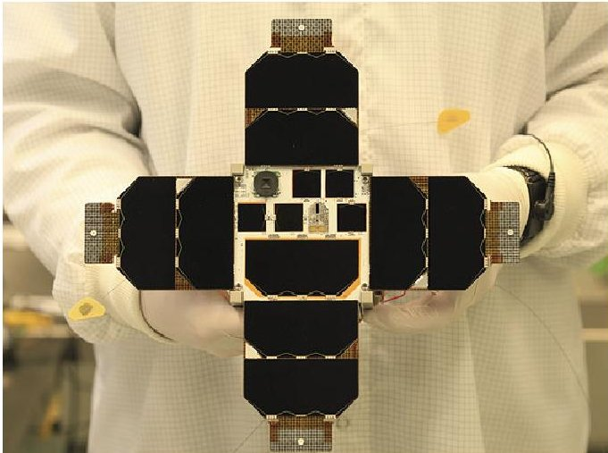


<div align="center">

Figure 2. Photo of the MOVE-II spacecraft showing the solar array with the payload solar cells in the middle.

</div>

## 3. Development of the Graph Schema

This section provides an overview of the development of the graph schema.

## 3.1. Analyses for a SysML graph schema

According to Van Bruggen (2014), the aim of a graph schema should be to enable answering all questions that can be foreseen to be put to the graph with a minimum of required syntax. Therefore, this section defines questions on specific aspects of SysML models, with a focus on structural model aspects. The questions provided in the following are the result of 5 years of personal experience in systems engineering for small spacecraft and testing and operations of small spacecraft. They cover a range from basic questions as asked by people unfamiliar with a system to more sophisticated analyses as required for planning redundancies or graceful degradation. The list is of course not exhaustive, but sufficient to help drafting the graph schema and modeling guidelines. Once the schema and modeling guidelines are defined, questions similar to those presented in the following can be answered as well.

SysML diagrams can be separated into three groups; structural diagrams, behavioral diagrams, and requirements modeling. For the sake of brevity, requirements, use cases, and behavioral aspects of SysML are not addressed in this publication. Also, as described in Section 2.2 Schemata for SysML, schemata for requirements and behavioral aspects of SysML $ ^{3} $ already exist. The following questions can be put to the structural part (i.e., Block Definition Diagrams, Internal Block Diagrams and Parametric Diagrams) of a SysML Model:

1. What is component X composed of?

2. What types of ports are used over a certain range of equipment?

3. What elements belong to a certain class?

4. What systems employ a certain type of component?

5. What component supplies system X with power?

6. How is information Y processed within a certain subsystem?

7. How is information Y processed globally?

8. Which components draw power from a certain supply component?

9. The following questions show the might of a graph analysis, as a complete fallout analysis can be performed with the same type of queries:

10. What is the source of telemetry Y and what could influence its measurement?

<!-- PDF_PAGE: 13 -->

11. Given an anomaly on a specific subset of a system's telemetry, which components are most likely to have caused it? Which components can be ruled out?

12. Given a failure of component X, are there any alternative ways of acquiring data usually processed by component X?

13. What happens if component X breaks?

(a) Which systems will not work nominally anymore as they process data coming from component X?

(b) Which components will be offline in case of an electrical short in component X?

(c) Which components will suffer from a loss of input, as they depend on data processed by any of the components offline due to the electrical short in component X?

## 3.2. Proposed graph schema

The proposed graph schema is, as the subsection before, structured according to the main aspects of SysML; structure and behavior. The design goal of the schema is to enable answering the questions defined in Section 3.1 by using Cypher queries performed on a Neo4J database.

Each paragraph describes the definition of node-labels and relation-types as well as properties stored on relations and nodes. The labels were chosen with a focus on readability. The idea behind this is to maintain a shallow learning curve and keep to Cypher's declarative nature. Representations that read like a sentence are easier to understand and remember. For example, (Mobile Charger) -[ : CLASS] - > (Power Converter) does not make it apparent yet which is the class and which is the element. (Mobile Charger) -[ : IS_OF_TYPE] - > (Power Converter) makes it clear that the Mobile Charger is an element of the class Power Converter.

In contrast to working with RDF and OWL, the Labelled Property Graph does not build on predefined schemata such as the RDF Schema for RDF and OWL (World Wide Web Consortium, 2014). The foundation of a graph schema for labeled property graphs is threefold:

1. node labels,

2. relation types, and

3. properties.

While a node may carry multiple labels, every relation carries a single type. Relation types and node labels are used to classify nodes and relations. Expressing subclasses of labels can be achieved by granting multiple labels to a node. Properties can be assigned to both nodes and relations and always follow the schema <denominator>: <value>.

Since SysML is a graphic modeling language, most concepts can be transferred straight-forwardly (compare Object Modelling Group, 2019):

- SysML Blocks become nodes with the label :BLOCK.

- SysML Ports become nodes with the label :PORT.

- Instances of Blocks become nodes with the labels :BLOCK and :INSTANCE.

- Generalizations become :IS OF TYPE relations.

- Aggregations and Compositions, that is, the associations that structure SysML Blocks hierarchically, become :IS_PART_OF relations.

Additionally, the following features must be transferred to answer the questions described in Section 3.1 which are discussed in the following:

- ports attributed to block instances,

- connectors, and

- itemflows.

<!-- PDF_PAGE: 14 -->

One of the ideas behind the graph schema for SysML is to avoid the need to know every aspect of the system that was ever modeled but to be able to retrieve any information via queries. Since aggregations and compositions are both used to structure a set of blocks hierarchically, they both get the same relation type :IS_PART_OF. Details on the relation type can be retrieved via the property type. The :IS_PART_OF relation is also used to connect ports to their respective blocks.

Instantiations in SysML are not always straight forward. While every block in the diagram becomes instantiated at the moment an internal block diagram is built, the ports connected to the blocks are not instantiated. Furthermore, the block hosting the internal block diagram, which is represented by the diagram-frame is not instantiated when an internal block diagram is built.

This becomes relevant when looking at SysML Connectors. Connectors are used to depict connections between instances of blocks, over which physical or non-physical items can be exchanged, such as electrical power, data, or physical momentum. A concept closely related to connectors is itemflows. An itemflow describes what items are transmitted via a certain connection. The transmitted items themselves are modeled as Blocks (see Object Modelling Group, 2019). To distinguish them, they get the additional label :FLOWITEM. Figure 3 shows the block definition diagram to the illustrative example of an internal block diagram with itemflows in Figure 4. The diagram depicts four block instances, of which three are connected over respective ports. The connectors both carry the flowitem X. Note that the instance "second B", which is an instance of Block B does not interface any connector.

The graph schema has to depict the information in Figures 3 and 4 unambiguously. Figure 5 shows the representation of the block definition diagram in Figure 3 in the graph. Figure 6 shows the relation


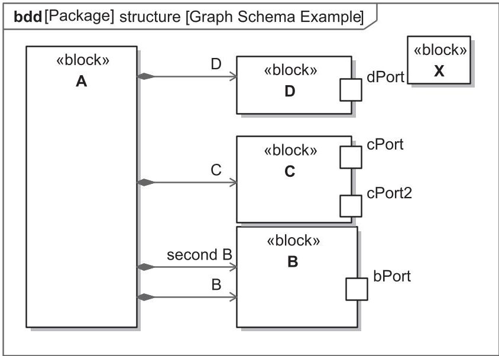


<div align="center">

Figure 3. Block definition diagram (bdd) to Figure 4.

</div>


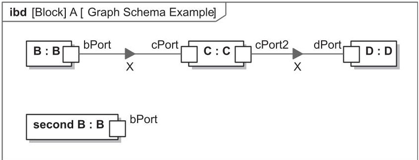


<div align="center">

Figure 4. Example of an itemflow in an internal block diagram.

</div>

<!-- PDF_PAGE: 15 -->


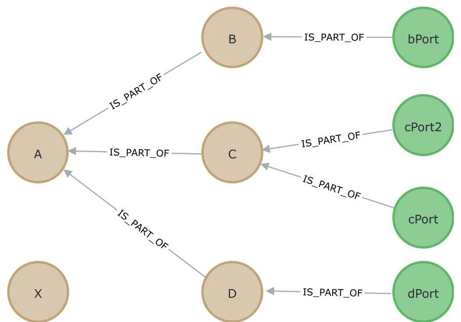


<div align="center">

Figure 5. Graph representation to Figure 3. Blocks are depicted in brown, and ports in green.

</div>


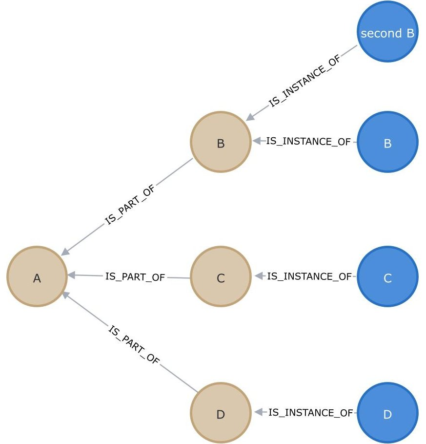


<div align="center">

Figure 6. Graph representation of the instances for blocks. Blocks are depicted in brown, and instances in blue.

</div>

between instances and blocks. Figure 7 shows the graph-transformation for the internal block diagram in Figure 4. The design is explained in the following and weighed against alternatives.

The itemflows shall be traceable through the whole system. One possibility to translate the information into a graph is to simply create a connector from block to block and add the flowitem's name and ID as properties on the connector. However, this would lead to the following complications: (a) the node of the

<!-- PDF_PAGE: 16 -->


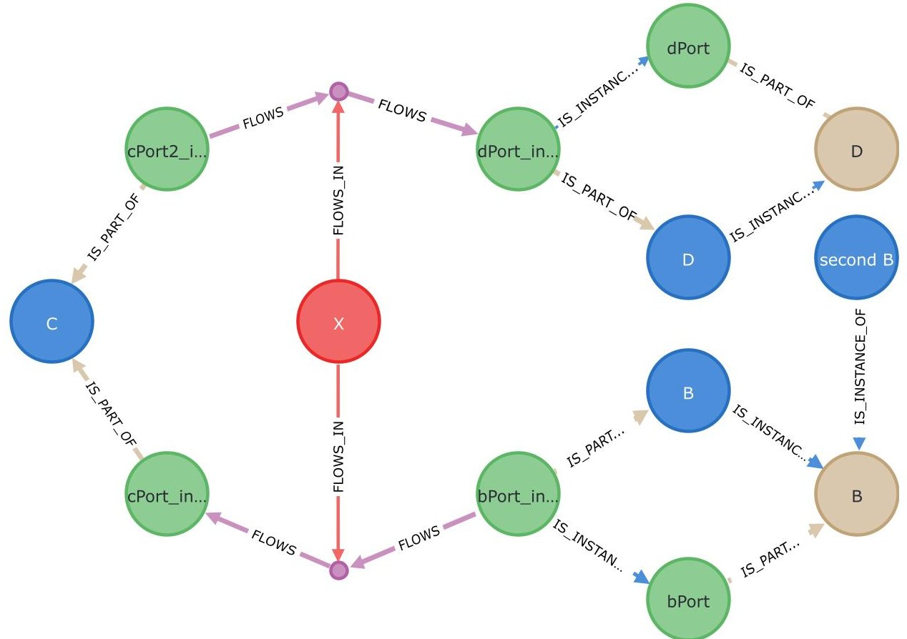


<div align="center">

Figure 7. Graph representation of the information related to Figures 3 and 4. Blocks are depicted in brown, instances of blocks in blue, hypernodes in purple, ports and port instances in green, and flowitems in red. Note: As the graph itself contains all information, this is merely an excerpt showing specific information but not bound to the limits of any SysML diagram type.

</div>

flowitem has no connection to the flow as the connector runs from source block to target block and cannot be connected to a third node, (b) the flowitem would not be traceable anymore, if a block containing the flowitem is used to describe the itemflow instead of the flowitem. The next simpler solution would be to directly use the flowitem as node between the ports it flows from and to. However, this only works until a second connector carries the same flow, as it would become untraceable which relation belongs to which connection. The solution in Figure 7 does not have these impasses, as a connector node is created for every SysML connector. This construct is often referred to as hypernodes, which is why the node carries the label :HYPERNODE.

Similarly, the simplest solution to handle ports would be to omit port instantiation and only store the relation between port and block, as well as port and block-instance. In the example shown in Figures 4 and 7, however, this approach would lead to a loss of the information, whether instance "B" or "second B" carries out the connection, as both would be connected to the port "bPort". Hence, in addition to the elements taken from the MagicDraw model, port instances are created during the translation from MagicDraw to Neo4J to discern which port instance belongs to which block instance. While ports can formally be instantiated in MagicDraw, requiring users to conduct this instantiation by hand and relating all port instances by hand would mean extra modeling effort that can be omitted. Figure 8 shows the complete graph schema for SysML Structure diagrams and to which the transformation of the internal block diagram in Figure 4 shown in Figure 7 is compliant. The graphic is interpreted as follows: Nodes are depicted in rectangular, while relations are presented as connections between the rectangular. The graphic defines which combinations of labels and relations between node types are allowed by the schema. For nodes with multiple labels (e.g., BLOCK:INSTANCE) all relations defined by the singular labeled node (in this case BLOCK) are also allowed. The relation types are written on the connections. Arrows

<!-- PDF_PAGE: 17 -->


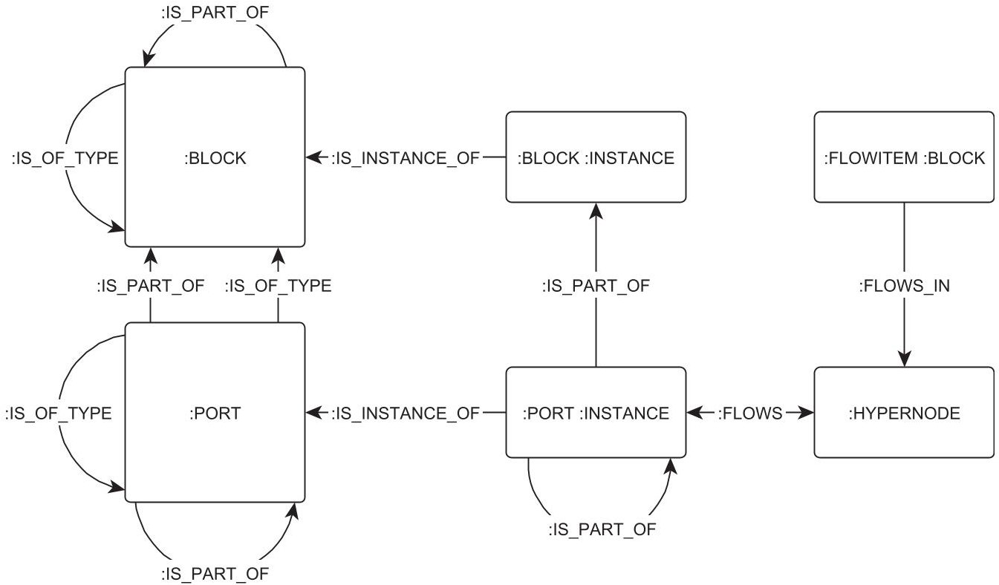


<div align="center">

Figure 8. Proposed graph schema for structural SysML diagrams.

</div>

originating at the node point to show relations defined between two nodes of the same type. Additionally to the labels and relation types defined in Figure 8, all nodes carry an ID- and a name property, allowing for unique identification and easy reference. The names are taken over from the SysML model. Where no name is provided in SysML NULL is entered in the graph.

## 4. Modeling Guidelines

One goal of the graph schema is to enable queries on a model that is not yet complete and thereby enabling graph-queries on SysML models from an early stage of development or on systems that are only partially modeled in later stages.

One goal of this set of modeling guidelines is to show how to build a SysML model that is effective for employing graph queries. The SysML leaves a wide variety of possible expressions to model the same concept. To enable useful queries, however, the SysML model has to meet some expectations, such as "information flowing between blocks is modeled as itemflow in a connector" instead of alternatives such as entering the name of the conveyed information as the connector name. Therefore, a modeling guideline is prerequisite to answering questions on the SysML model via the graph transformation as it defines which concepts are followed in the SysML model that can now be queried.

A second goal of the guidelines is to explain how to trim the guidelines, that is, what happens if a certain rule is not followed. When trimming these guidelines and working with incomplete models consider that the graph can only relay information that is available in the model. This is an important principle to understand which information should be included in the SysML model and guides us through the following section. The last goal of this set of modeling guidelines is to be useful, which requires it to be simple and efficient to apply and to yield results fast, while touching as little as possible on other modeling principles that may be followed by the modeler. Therefore, examples illustrating a guideline are presented at various points.

The buildup of this section follows the same principle as the previous sections, starting with structural diagrams and progressing to behavioral diagrams.

<!-- PDF_PAGE: 18 -->

The following section refers to the questions defined in Section 3. Any question number cited in the following refers to Section 3.

## 4.1. Modeling of structural associations

Recalling the questions defined in Section 3.1, Questions 1 (detailing the composition of a block) to 4 (detailing systems that employ a certain component) require a sound use of associations between blocks. That is, Every Block that is instantiated should be part of a structure of SharedAssociations and PartAssociations $ ^{4} $ which start at the system of systems and reach any components used in the system. This is also required for Question 8 (querying components dependant on a certain power supply) or Question 12 (querying the fallout caused by a broken component). As the graph schema unifies the concepts of part associations and shared associations into :IS_PART_OF-relations, no distinction is made in the guideline between the two association types.

The same applies to flowitems such as data: modeling flowitems as a set of associated blocks saves modeling effort when pursuing questions such as "How is information Y processed globally?" (Question 7) or searching for likely culprits in case of an anomaly on a specific subset of telemetry (Question 10).

## 4.2. Generalizations

Question 2 (querying the types of ports used over a certain range of equipment), Question 3 (querying the elements belonging to a certain class), and Question 4 (querying which systems employ a certain type of component) are of interest when the failure of a certain component can be traced back to its working principle and relevant changes need to be made across the whole system. Furthermore, generalizations can be used to put flowitems in the model into categories such as currents and voltages or data. This distinction is necessary to answer questions regarding how a certain piece of information is processed (Questions 6,7, 9,1011) or regarding power paths (Questions 8 and 12 (a) to (c)).

All of these questions require the use of generalizations as defined in Object Modelling Group (2019). A hierarchy in which port types, component types, and data types are defined is therefore sensible, but can be limited to the level of detail that allows to answer the above questions. On some systems, this may require to refine them to the point where the protocol of the port is defined (e.g., CAN, USB, Ethernet), while for other systems a simple differentiation between analog and digital ports may suffice.

Formulating a guideline for the use of generalizations, generalizations shall be used to classify blocks, flowitems, and ports by important terms and concepts used throughout the development. This concept especially comes into focus, when dealing with anomaly detection and failure detection, identification, and recovery. For example, Questions 12 (concerning the fallout of a broken component) and 12b (analyzing components offline due to an electrical short in a component) would benefit from employing the following two concepts:

- a fuse class, which shows what fuse is the next upstream on the power path, that is triggered by the short and

- a voltage or power class, which can be used to discern the power paths from data paths or other physical values for example.

In the same way, a data class would be beneficial to answer Question 12c (concerning components suffering from a loss of input, as they depend on data processed by any of the components offline due to the electrical short in a specified component), which depends on being able to discern a telemetry value from the physical flow it measures.

<!-- PDF_PAGE: 19 -->

## 4.3. Internal block diagrams and modeling of flowitems

The purpose of Internal Block Diagrams is to show the connections between blocks and thereby define which paths flowitems can take within the model.

To answer questions such as Question 5 (querying the component that supplies a system with power), Question 6 (concerning how a certain information is being processed within a certain subsystem) Question 7, Question 8 (querying which components draw power from a certain supply component), Question 9 (querying the source of and possible influences on a certain telemetry value), or Question 10 requires detailed information on the data and power flows within a system. Therefore, Blocks used as flowitems should be modeled to the same level of detail with which analyses are to be performed. To elaborate on this, the associations between flowitems on different levels, such as "Temperature X1 is part of the telemetry of Panel X, the telemetry of Panel X is part of Subsystem Y's telemetry" should be modeled on the same level of depth that is afterward required for analyses. As the analyses often start with anomalies seen on a single telemetry value this usually requires modeling down to the measurement of every single sensor.

While the flowitems should be modeled to great depth, the itemflows modeled in internal block diagrams do not require the same level of detail. If a certain telemetry shall be traceable end-to-end, the same level of detail also should be provided in the internal block diagram. Most modern spacecraft developments rely on commercial of-the-shelf parts to some degree. The suppliers of these components typically do not provide the necessary information to model on a level of detail allowing to track every data path within their subsystem. Therefore, the graph analysis has to be able to cope with black-boxed subsystems, of course following the paradigm that you can only query information that is available in the model. That is, if only the specification of the telemetry provided from the subsystem is available, but no information on its internal connections, setting the subsystem as a black box and transmitting a block containing all telemetry suffices.

Figure 9 illustrates this in an example. Figure 9a shows the telemetry flowitems of Subsystem A and Subsystem B. Figure 9b provides a structural breakdown of the spacecraft. Figure 9c shows the telemetry connections within the spacecraft in the form of an internal block diagram. Note here, that Subsystem A, for which no further breakdown is provided simply transmits its telemetry, which according to the upper diagram contains the values A1, A2, and A3.

Depending on the system to be modeled, discerning between physical values and their measurements as flowitems can be a useful addition to the modeling guidelines. An example of this would be an electrical power system, where currents, voltages, and the measurements thereof are transmitted.

In such a case the application of generalizations of the flowitems to the two blocks physical value and measurement resolves any ambiguity. This is especially recommended to answer questions such as Question 12 as it allows to backtrack power paths to the next fuse and to discern between power paths and data paths.

## 4.4. Summary

Overall, the modeling guidelines to transfer SysML models to Neo4J in a way that enables such complex queries as described in Section 3.1 are few. This was intended from the beginning, as the method described in this paper should be combinable with any other modeling strategy. Parts of the rules described above can even be neglected, if the specific questions related to these rules are not of interest.

## 5. Implementation

The translation of MagicDraw SysML Models into the graph is implemented using Python 3.8, with two scripts and a library of common functions (see Figure 10).

Figure 10 provides an overview of the implementation. The retrieve_SysML_model.py script reads the SysML-Model generated in MagicDraw 19.0 (.mdxml-file) and extracts SysML components and relations as lists of python dict variables. The lists are stored as .json-files. This enables a separation of

<!-- PDF_PAGE: 20 -->


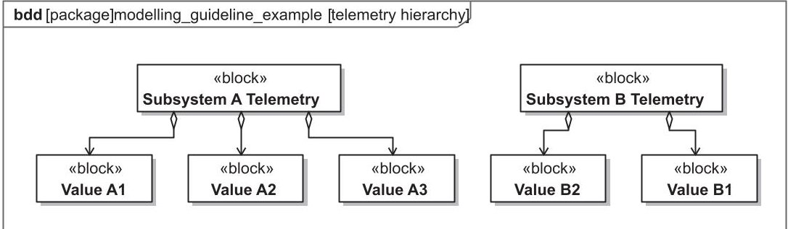


<div align="center">

(a)

</div>


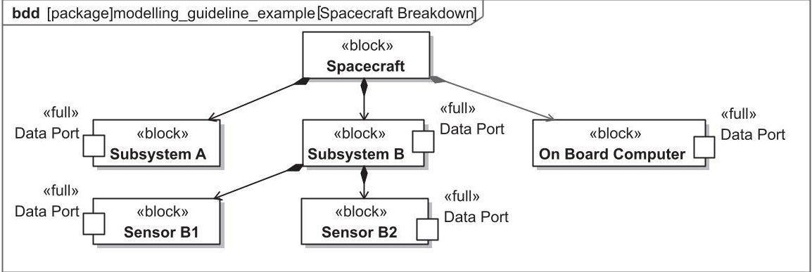


<div align="center">

(b)

</div>


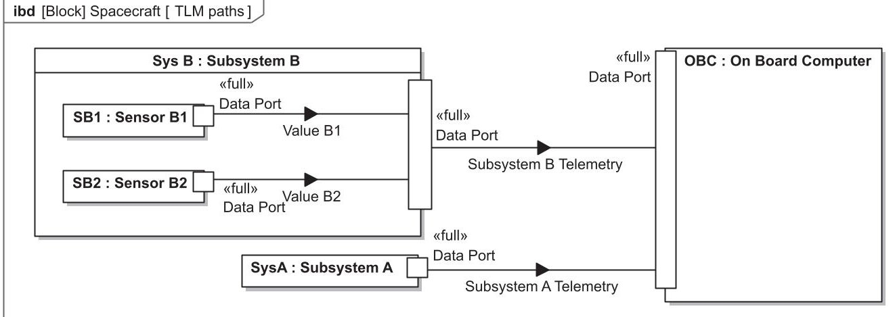


<div align="center">

(c)

</div>

<div align="center">

Figure 9. Illustrative application of the modeling guidelines for structural SysML aspects.

</div>

concerns and enables testing the retrieve functions separate from the insert functions, which insert the extracted SysML components in Neo4J. It also enables future developers to use only the extraction part of our code and insert the extracted SysML components anywhere else.

The insert_SysML_in_Neo4J.py script loads the stored .json files and writes every component via a separate query into the Neo4J database. This procedure is quite inefficient regarding execution times $ ^{5} $ but allows for faster debugging. As the execution time on a normal office PC is still under 3 minutes for several thousand SysML elements, the advantage in debugging prevails.

The code is open-sourced on GitLab under MIT license. It can be found under the following link: https://gitlab.lrz.de/lrt/sysml_graph_analysis_tool/

<!-- PDF_PAGE: 21 -->


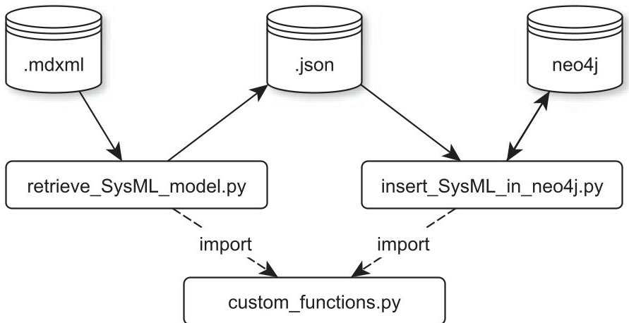


<div align="center">

Figure 10. Setup of the extract transfer load software to import MagicDraw SysML data to Neo4J.

</div>

To help with initial studies of the subject, the reference models used in this paper, that is, the MOVE-II Model and a smaller model containing the diagrams shown in Section 3 are published under https:// mediatum.ub.tum.de/1633734.

## 6. Application of the Schema on the MOVE-II Spacecraft

The following section describes the application of the schema and guidelines developed in Sections 3 and 4. After a short introduction, a selection of questions from Section 3.1 are taken and respective queries in the graph query language Cypher are explained and performed on the SysML Model of the MOVE-II spacecraft. To conduct these analyses, the SysML Model, which was generated using MagicDraw v19.0 SP4 was transformed into a Neo4J graph database, employing the schema built in Section 3 and the software implementation explained in Section 5.

The model of the MOVE-II spacecraft consists of a total of 605 blocks, 345 ports, 2820 relations, no activities, and no states and thus comprises a medium-sized model with purely structural aspects. No information on the behavior is included.

The model encompasses the satellite, ground station, and operations systems and shows the data paths of all telemetry the spacecraft provides as well as all power paths within the spacecraft. The spacecraft itself consists of multiple subsystems:

- Attitude Determination and Control System, controlling the spacecraft's attitude relative to the Earth and Sun.

- Communications (consisting of S-Band and UHF/VHF Transceiver), which provides contact to the ground.

- Command and Data Handling, which handles all telemetry, interprets communications, and controls the state of the satellite.

- Electrical Power System, containing the spacecraft's batteries and power converters and controlling the maximum power point

- Solar Cell Payload, solar cells that shall be measured against degradation over time in the space environment.

- Structure and Mechanisms, providing structural integrity and deploying the antennas and solar array.

## 6.1. Hierarchical analyses

The same list of subsystems provided above can be generated from the graph database with the following cypher-query, which searches for a node with the label :BLOCK and name-property MOVE- II satellite and any further block, which is directly a part of MOVE-II satellite, here described with the

<!-- PDF_PAGE: 22 -->

MATCH (moveii:BLOCK{name:'MOVE-II satellite'}) <-[:IS_PART_OF]-

(subsystem:BLOCK)

RETURN subsystem.name

subsystem.name

ADCS

CDH

EPS

UHF/VHF

PL

S-Band

Solar Array

STR

<div align="center">

Query 1. Retrieving the parts of a Block. Note: By adding * after IS_PART_OF the query retrieves the parts to unlimited depth.

</div>

subsystem-variable. Query 1 returns the name property of all nodes that match the position of the subsystem-variable:

While the above example already shows the solution for Question 1 from Section 3.1 (What is component X composed of?), Query 2 answers Question 2 (What types of ports are used over a certain range of equipment?). It starts by anchoring the query to the node with a :BLOCK label and the name Ground Station, asks for any :PORT that :IS_PART_OF the ground station node and queries the port types via the :IS_OF_TYPE relations $ ^{6} $ . It returns distinct names of the porttype variables and their number of usages, ordering the results in descending order by the number of usages of the port type within the ground station. The result is provided below the query. Note how the declarative definition of relation types fits the declarative language-style of Cypher, allowing for queries that can be understood with little prior knowledge of the language.

## 6.2. Tracing data paths and analyzing data anomalies

## 6.2.1. Datapath query

One of the first steps in analyzing anomalies is finding all components which potentially participate in the anomaly. Taking a data anomaly as an example, any component albeit software or hardware processing the anomaly-holding telemetry is to be found. Instead of consulting a variety of SysML Diagrams to find all components in question, which is cumbersome and prone to errors, Query 3 can provide the result, defining any source and target component and the data form in which the telemetry

MATCH (GroundStation:BLOCK{name:'Ground Station'}) <-[:IS_PART_OF*]-

(PortInGs:PORT) -[:IS_OF_TYPE]->(porttype)

RETURN DISTINCT porttype.name, count(porttype) ORDER BY count(porttype)

DESC

porttype.name count(porttype)

'N Connector' 8

'Ethernet' 3

'Serial Port' 2

'USB' 2

'SMA Connector' 2

'data port' 1

<div align="center">

Query 2. Retrieve all port types used within a certain range of equipment.

</div>

<!-- PDF_PAGE: 23 -->

```text

:param searchterm=>'Sidepanel X+ Temperature OW2'

//datapath table

MATCH(telemetry:FLOWITEM {name: $searchterm}) -[[:IS_PART_OF*0..]]->

(flowitem:FLOWITEM)

WITH flowitem

MATCH(flowitem)-[[:FLOWS_IN]]->(hpn:HYPERNODE)

WITH flowitem, hpn

MATCH path = (source:BLOCK:INSTANCE) <-[[:IS_PART_OF]]- (:PORT)

-[[:FLOWS]]-> (hpn) -[FLOWS]-> (:PORT) -[[:IS_PART_OF]]->

(target:BLOCK:INSTANCE)

```

<table border="1"><tr><td>processedElement</td><td>source</td><td>target</td></tr><tr><td>ADCS Beacondata&#x27;</td><td>beacon Poster&#x27;</td><td>ADCS Backend&#x27;</td></tr><tr><td>ADCS Beacondata&#x27;</td><td>ADCS Daemon&#x27;</td><td>beacon Data Collector&#x27;</td></tr><tr><td>ADCS Beacondata&#x27;</td><td>microcontroller&#x27;</td><td>ADCS&#x27;</td></tr><tr><td>ADCS Housekeeping Data&#x27;</td><td>ADCS Backend&#x27;</td><td>ADCS schema&#x27;</td></tr><tr><td>ADCS Housekeeping Data&#x27;</td><td>ADCS&#x27;</td><td>CDH&#x27;</td></tr><tr><td>Sidepanel X+ Temperature OW2&#x27;</td><td>temperature Sensors x+&#x27;</td><td>microcontroller x+&#x27;</td></tr><tr><td>[...]</td><td></td><td></td></tr></table>

<div align="center">

Query 3. Retrieve the datapath of a certain piece of information within the model. Note: The response was cut short here and originally contains an additional 18 lines of response omitted for readability.

</div>

is being transmitted. Note how the use of a parameter allows the reuse of the query for any other telemetry.

1. In this case, the telemetry is Sidepanel X+ Temperature OW2, a temperature value on the outside of the spacecraft.

2. Query 3 then looks for the :FLOWITEM with the defined telemetry name and all :FLOWITEMs which contain the node with the defined telemetry name.

3. In the next step, it finds all :HYPERNODES where any of the flowitem nodes :FLOWS_IN and calls these hpn.

4. The final step is to look for the pattern of :BLOCK:INSTANCE nodes, containing :PORTs connected via :FLOWS to a hpn. Over the :FLOWS-direction, the query differs between source and target of the flow

5. And consequently returns a table with the results.

Of course, the same query can be performed to return a graph instead of a mere table, which might be useful to graphically assist the understanding of the dataflow. Figure 11 shows the result of this query. Note how at a certain size the graph loses visual interpretability.

## 6.2.2. Finding probable causes of anomalies

The next step in finding a data anomaly is to identify other telemetry processed by the components Query 3 yielded and check them for anomalies. A component often either processes any data correctly or none, so while this is just an empirical step, it is an important and useful one. Query 4 is an addition to Query 3 and yields any other telemetry processed by the same ports.

This query also builds the basis to answer Question 10 (Given an anomaly on a specific subset of a system's telemetry, which components are most likely to have caused it? Which components can be ruled out?).

The question refers to a scenario, where more than one telemetry value shows an anomaly. To rule out any other component, the query follows the logic "if another input is being processed by the exact same component and port correctly, the error is most likely not in this component." Query 5 shows the basic pattern to find components processing the three faulty telemetry packages $fltm1, $fltm2, $fltm3, while

<!-- PDF_PAGE: 24 -->


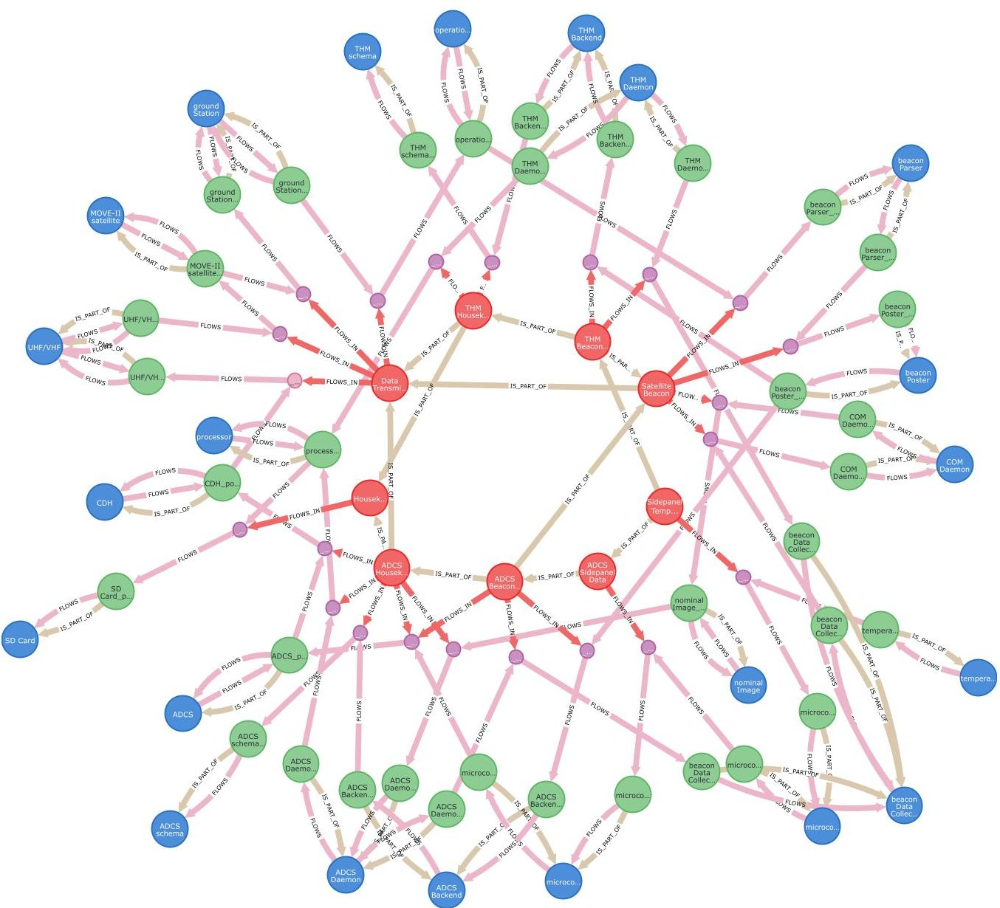


<div align="center">

Figure 11. Graph representation of Query 3, showing the data path of the flowitem Sidepanel X+ Temperature OW2 from its sensor through spacecraft and ground station to the operations interface. Red: :FLOWITEMnodes, green: :PORTnodes, blue: :BLOCK:INSTANCE nodes, and purple: :HYPERNODEs. The query is enabled by following the modeling rules in Section 4.3 the decomposition of flowitems.

</div>

not processing the healthy telemetry package $good_tlm$. The result shows a list of ports and components, including their IDs. The query shows how it is possible to narrow down a list of over 1400 possible suggestions to a mere 6 by applying logic on the graph transformation of the SysML model. Taking a closer look at the proposed components, we find that the ports p3 and p4 are proxy ports and therefore no real components. Ruling those out, we end up with one component and three ports as suggested causes of the anomaly. It has to be noted here, that other components or ports could be at fault as well, as not every possible fault path is traceable through the model. However, the query provides a good starting point for the analysis.

Figure 12 shows the respective part of the SysML Model, including the item flows, ports, and blocks.

## 6.3. Failure propagation analyses

The next type of analysis already becomes useful during the design of the spacecraft. In comparison to ground-based systems, robustness against failure is a design goal for any spacecraft, as on-sight repairs are

<!-- PDF_PAGE: 25 -->

```sql

CALL {

    MATCH (telemetry{name: $searchterm})-[:FLOWS_IN]->(hpn) RETURN hpn,

↵ telemetry

    UNION

    MATCH (telemetry{name:

↵ $searchterm})-[:FLOWS_IN]->()-[:FLOWS]-()-[:IS_PART_OF]->(component)

    <-[:IS_PART_OF]-()-[:FLOWS]-(hpn)

↵ RETURN hpn, telemetry

    }

WITH hpn, telemetry

MATCH (suggestion)-[:FLOWS_IN]->(hpn)

WHERE NOT suggestion = telemetry

return suggestion.name ORDER BY

↵ SHORTESTPATH((telemetry)-[:FLOWS_IN|FLOWS*]-(suggestion))

```

suggestion.name

'Sidepanel X+ Temperature OW3'

'Sidepanel X+ Temperature OW1'

'PDM Current ADCS 3V3 1'

'ADCS Sidepanel Data Package x+'

'Sun Vector x+'

'Sidepanel X+ Temperature BMX'

'Gyroscope Data x+'

'Magnetic Field Vector x+'

Query 4. Retrieve suggestions for possibly compromised telemetry by checking telemetry which is directly processed by the same components.

```json

:param fltm1=>'ADCS Housekeeping Data'

:param fltm2=>'UKW Beacon Data Hardware Only'

:param fltm3=>'S-Band Beacon Data Hardware Only'

MATCH (faulty_tlm1{name:$fltm1}), (faulty_tlm2{name:$fltm2}),

(faulty_tlm3{name:$fltm3}), (good_tlm {name: $good_tlm})

WITH *

MATCH

(faulty_tlm1)-[:FLOWS_IN]->()-[:FLOWS]->()-[:IS_PART_OF]->(component)

WHERE EXISTS

{(faulty_tlm_2)-[:FLOWS_IN]->()-[:FLOWS]->()-[:IS_PART_OF]->(component)}

AND EXISTS

{(faulty_tlm3)-[:FLOWS_IN]->()-[:FLOWS]->()-[:IS_PART_OF]->(component)}

AND NOT

EXISTS{(good_tlm)-[:FLOWS_IN]->()-[:FLOWS]->()-[:IS_PART_OF]->(component)}

RETURN component.name as suggestion, component.id as id

UNION

MATCH (faulty_tlm1{name:$fltm1}), (faulty_tlm2{name:$fltm2}),

(faulty_tlm3{name:$fltm3}), (good_tlm {name: $good_tlm})

WITH *

MATCH (faulty_tlm1)-[:FLOWS_IN]->()-[:FLOWS]->(port)

WHERE EXISTS {(faulty_tlm_2)-[:FLOWS_IN]->()-[:FLOWS]->(port)}

AND EXISTS {(faulty_tlm3)-[:FLOWS_IN]->()-[:FLOWS]->(port)}

AND NOT EXISTS {(good_tlm)-[:FLOWS_IN]->()-[:FLOWS]->(port)}

RETURN port.name as suggestion, port.id as id

```

suggestion id

SPI level shifter _19_0_4_9b3028f_1626770558674_761066_49622

CDH_SPI_port_instance _19_0_4_64d021d_1606812551466_659190_43643

_19_0_4_9b3028f_1626784294211_953036_61690

processor_port_instance _19_0_4_9b3028f_1606755365738_580408_43811

_19_0_4_9b3028f_1626770585221_986561_49783

level shifter_p4_port_instance _19_0_4_9b3028f_1632823793184_527010_45978

_19_0_4_9b3028f_1626770580938_1308_49739

level shifter_p3_port_instance _19_0_4_9b3028f_1632823808903_57539_46012

_19_0_4_9b3028f_1626770580938_1308_49739

SPI level shifter_port_instance _19_0_4_64d021d_1609248717945_193014_44390

_19_0_4_9b3028f_1626770558674_761066_49622

Query 5. Determine any port or block processing a list of faulty telemetry while not processing healthy telemetry.

<!-- PDF_PAGE: 26 -->


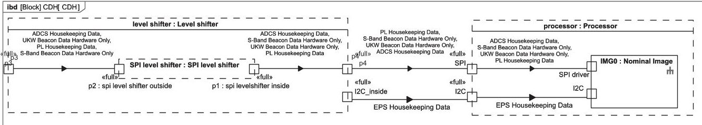


<div align="center">

Figure 12. Internal block diagram to Query 5.

</div>

usually not possible. Hence failure propagation is to be kept to an absolute minimum, that is, the spacecraft's attitude control system, on board computer, power, and basic communication systems should not be influenced by a failure in any other part of the system.

The graph schema and modeling guidelines proposed here do not enable the analysis of complex relations such as "the communication system can only work if the spacecraft is pointing to the ground station". The analyses possible with the here proposed graph schema and modeling guidelines center around Question 12 (What happens if component X breaks?).

In case component X is a physical component, a broken component may trigger an electrical short. To prevent a spread of such an event electrical fuses are employed throughout the system.

Therefore one of the tasks to be applied here is to find out which fuse triggers and which components are shut down as well by the fuse. Query 7 does exactly this. However, to enable this query, the graph needs to be extended by an additional :FLOWS relation between any :PORT with an incoming or outgoing flow connection and the :BLOCK which the port is part of. This is accomplished by the code presented in Query 6. Note further that Query 7 takes two parameters as input; the $searchterm parameter defines which component was shorted, the $flowlength parameter defines how many :FLOWS connections the query shall follow before it stops searching. It also requires to follow the modeling schema presented in Section 4.2, defining physical flowitems as a class differing from telemetry in order to enable an accurate tracking of the power path. Limiting the amount of :FLOWS connections followed in the query is not technically necessary but increases the performance significantly. As the volatile relations were all built with the property tbd=True, they can be deleted again after the query is finished.

Query 7 can also be tuned to show any telemetry values that are not processed correctly anymore due to the short by adding a new MATCH-clause based on the variable shortedcomponent.

## 6.4. Summary

As shown in the selected examples above, the graph allows to retrieve information from a complex context in a minimum of time. Especially noteworthy are the efficiency increase in looking for similar information within a different context and the ability to query complex design constructs. The parameterization of the queries allows to reuse them with different objects of interest and even on different systems. Some of the queries here would benefit from a more compact graph schema. Setting up the complete graph in a simpler

```text

MATCH (b:INSTANCE:BLOCK) <- [:IS_PART_OF] - (p:PORT) - [:FLOWS] -> (:HYPERNODE)

MERGE (p) <- [volatile_rel_out:FLOWS] - (b)

SET volatile_rel_out.tbd = True

MATCH

(b2:INSTANCE:BLOCK) <- [:IS_PART_OF] - (p2:PORT) <- [:FLOWS] - (:HYPERNODE)

MERGE (p2) - [volatile_rel_in:FLOWS] -> (b2)

SET volatile_rel_in.tbd = True

```

<div align="center">

Query 6. Code to create volatile [:FLOWS] relations necessary to apply the shortest path algorithm in Query 7.

</div>

<!-- PDF_PAGE: 27 -->

Call {

  MATCH p = (rtc{name:$searchterm}) <-[:IS_PART_OF]- (port)

  <-[:FLOWS]-() <-[:FLOWS_IN]- (shortedvoltage) -[:IS_OF_TYPE]->

  (pfi{name:'physical flowitem'})

  WITH shortedvoltage

  MATCH (fusetype {name:'electrical fuse'}) <-[:IS_OF_TYPE]- (fuse)

  <-[:IS_INSTANCE_OF]- (fuseinstance) <-[:IS_PART_OF]- (fuseportinstance)

  <-[:FLOWS]-> (hpn) <-[:FLOWS_IN]- (shortedvoltage)

  RETURN fuseinstance, shortedvoltage ORDER BY

  length(SHORTESTPATH((fuseinstance) -[:FLOWS*]- (rtc))) LIMIT 1}

WITH *

MATCH p=(fuseinstance) -[:FLOWS*1..$flowlength]-> (hpn:HYPERNODE)

<-[:FLOWS_IN]- (shortedvoltage)

WITH hpn, fuseinstance

MATCH (hpn) -[:FLOWS]-> () -[:IS_PART_OF]-> (shortedcomponent)

WHERE NOT fuseinstance.id = shortedcomponent.id

RETURN shortedcomponent.name

shortedcomponent.name

'current Limiter SD Cards'

'SD Card'

'FRAM'

'flash'

'GPS'

'processor'

'real Time Clock'

'level shifter'

<div align="center">

Query 7. Find components affected by an electrical short.

</div>

schema inevitably results in a loss of information, though. The graph projection capability of Neo4J, however, allows to create simpler projected graphs from an existing graph, which could be used to shorten queries (see Neo4J Inc., 2021), without losing information.

## 7. Conclusion

Over the past four sections of this paper, a graph schema and modeling guidelines evolved from a set of analysis questions that are typical for assembly, integration, and testing of small spacecraft and are based on personal experience. Section 3 developed the graph schema as a mere concept, weighing different options and explaining the thought process behind the proposed schema. To the best of the authors' knowledge, it is the only public schema for SysML interpretation in graph databases to this date that goes beyond the modeling of requirements and use cases presented by Petnga (2019). In the form proposed here, it completely lacks any schema for the handling of state machines, activity diagrams, use cases, requirements, sequence diagrams, and parametric diagrams as well as custom stereotypes. Seeing as this paper is already quite lengthy this was not an oversight but the result of a pragmatic decision.

The queries go far beyond the publications by Fisher et al. (2014), Bajaj et al. (2016), Bajaj et al. (2017), and Petnga (2019). The clear focus on the information a graph shall provide and the parallel development of modeling rules enable far-reaching and complex analyses of the system.

Overall the paper shows how graph analyses based on SysML can be a useful tool for engineering teams working with MBSE. It takes on the challenges to the adoption of MBSE summarized in Section 2 especially regarding the insufficiency of tools, the low share of projects already implementing MBSE and the importance of keeping with prevalent modeling strategies (cf. Pawlikowski et al., 2019), while keeping the functional complexity in control and structuring the knowledge about the system in a traceable manner (cf. European Space Agency, 2020b).

Properly implemented, this work could be the basis of decreasing the time spent on anomaly resolution in AIT and specifically the dependence on key-personnel. In addition to the presented use case of

<!-- PDF_PAGE: 28 -->

increasing efficiency in information retrieval and analysis in AIT, the repository linked to this paper further covers use cases, requirements, activity diagrams, and state machines as well as various commonly used information repositories as well as the schemata used to relate this information. It could thereby also serve to automatically retrieve information in earlier mission phases, allow for in-depth and structured reviews of MBSE models and become a general repository of information for the complete project lifecycle.

## 8. Outlook

While the above-presented schema and application contain a solid proposal for graph transformations of information in Block Definition Diagrams, and Internal Block Diagrams, these make only two of the nine diagram types of SysML (cf. Object Modelling Group, 2019, p. 211). Schemata for State Machine-, Activity-, Use Case-, and Requirement Diagrams including the respective code for translation can be found in the project repository. Schemata for Package-, Parametric-, and Sequence Diagrams still require definition. It furthermore does not cover the treatment of custom profiles which may require additional node and relation types.

A weak point of the currently provided implementation is its focus on files created with MagicDraw v19.0 SP4. As we do not have access to other versions of the modeling software, no cross-tests with newer software versions were possible. Switching to commonly agreed exchange formats for SysML/UML models is hence a logical step in the future.

All of this work may be done in future revisions of the schema and code and may be the topic of further publications. Another interesting aspect is enhancing formal reviews of a SysML model via graph queries. Parametrized queries could be set to any model to be reviewed, increasing the efficiency and transparency of the review process. The comparison between different versions of a SysML Model via graph analysis could also be interesting and would most likely require some slight modifications to the schema proposed here. Only a small selection of the questions posed in Section 3.1 could be shown here. Formulating the queries to answer all questions provided in Section 3.1 is a prospect for the future. With proper parametrization, these queries could form a toolbox to be used by any engineer participating in a project that makes use of this tool. However, while it may be seen as a weak point that the schema proposed here does not take over existing definitions from other schemata in the literature, the focus on simple, intuitive terms allows for descriptive Cypher queries that can be learned in a short time.

Additionally, a comparison of the proposed schema to other schemata such as the OML used by openCaesar or Intercax' Syndeia system might be interesting.

The graph database could be extended to include document-based information and relating it on a keyword basis to the SysML Model, thereby creating a holistic view of the system's digital environment. First tests show that while a promising amount of relations can be created by such an approach, the processing of synonyms, abbreviations, and unrelated usage of the same words create a unique challenge. Compared to classical MBSE approaches, which require a high level of discipline from everyone involved, such an approach could be conducted without requiring any change of behavior by the engineering team, which—as stated by Pawlikowski et al. (2019), McDermott et al. (2020) and Chami and Bruel (2018)—could result in an easier introduction of MBSE in general.

Finally, the schema will probably require a complete rework once Version 2 of the SysML has been published.

Acknowledgements. We further acknowledge the special role Prof. Dr. Markus Brandstaetter played in this research. His constant mentorship and guidance were of great help to our work. May his soul rest in peace.

Data Availability Statement. The code to replicate the findings of this study is openly available in the repository "sysml_graph_analysis_tool" at https://gitlab.lrz.de/lrt/sysml_graph_analysis_tool. The repository also contains the necessary code to translate req, uc, act, and stm diagrams. The SysML Model used in the analyses of this paper is available at https:// mediatum.ub.tum.de/1633734. Up to the publication, the SysML Model can be accessed via the following credentials: Login: review-schummer-MOVE-II Password: 27 K-GMfk-29keP.

<!-- PDF_PAGE: 29 -->

Author Contributions. The here presented work was conducted by Florian Schummer and Maximillian Hyba. Mr. Schummer's contributions to the paper lie in the original idea, development of the set of questions, creation of the published SysML Model, deriving the presented queries, as well as writing the main parts of the presented text. Mr. Hyba's contributions to the paper lie in writing and testing the majority of the software for the structural aspects of SysML. Both authors contributed equally to the conceptualization of the presented graph schema.

Funding Statement. This work received no specific grant from any funding agency, commercial or not-for-profit sectors.

Competing Interests. The authors declare none.

## References

ArrangoDB Inc. (2021) ArrangoDB Website (accessed 23 June 2021).

Angles R and Gutierrez C (2018) An introduction to graph data management. In Fletcher G, Hidders J and Larriba-Pey JL (eds), Graph Data Management: Fundamental Issues and Recent Developments. Cham: Springer International Publishing, pp. 1-32.

Bajaj M, Backhaus J, Walden T, Waikar M, Zwemer D, Schreiber C, Issa G, Intercax and Martin L (2017) Graph-based digital blueprint for model based engineering of complex systems. In INCOSE International Symposium, vol. 27. Hoboken NJ: Wiley, pp. 151-169.

Bajaj M, Zwemer D, Peak R, Phung A, Scott AG and Wilson M (2011) SLIM: Collaborative model-based systems engineering workspace for next-generation complex systems. In 2011 Aerospace Conference. NW Washington, DC: IEEE Computer Society, pp. 1-15.

Bajaj M, Zwemer D., Yntema R, Phung A, Kumar A, Dwivedi A and Waikar M (2016) MBSE++—Foundations for extended model-based systems engineering across system lifecycle. In INCOSE International Symposium, vol. 26. Hoboken, NJ: Wiley, pp. 2429-2445.

Bankauskaite J and Morkevicius A (2018) An approach: Sysml-based automated completeness evaluation of the system requirements specification, In Symposium for Young Scientists in Technology, Engineering and Mathematics, edited by: Capizzi G, Damasevicius R, Lopata A, Krilavicius T, Napoli C, Wozniak M, Gliwice Poland.

Bayer T, Day J, Dodd E, Jones-Wilson L, Rivera A, Shougarian N, Susca S and Wagner D (2021) Europa clipper: MBSE proving ground. In 2021 IEEE Aerospace Conference. NW Washington, DC: IEEE Computer Society.

Chami M and Bruel J (2018) A survey on MBSE adoption challenges, EMEASEC 2018, Berlin, Germany.

D'Ambrosio J and Soremekun G (2017) Systems engineering challenges and MBSE opportunities for automotive system design. In 2017 IEEE International Conference on Systems, Man, and Cybernetics (SMC), NW Washington, DC: IEEE Computer Society, pp. 2075-2080.

Dahmen U and Rossmann J (2018) Experimentable digital twins for a modeling and simulation-based engineering approach. In 2018 IEEE International Systems Engineering Symposium (ISSE)., pp. 1-8. NW Washington, DC: IEEE Computer Society.

Daniel G, Sunyé G and Cabot J (2016) UMLtoGraphDB: Mapping conceptual schemas to graph databases. In Comyn-Wattiau TK, Song I-Y, Yamamoto S and Saeki M (eds), Conceptual Modeling. Gifu, Japan: Springer, pp. 430-444.

Di Maio M, Weilkiens T, Hussein O, Aboushama M, Javid I, Beyerlein S and Grötsch M (2021) Evaluating MBSE methodologies using the FEMMP framework. In 2021 IEEE International Symposium on Systems Engineering (ISSE), NW Washington, DC: IEEE Computer Society, pp. 1-8.

Dubos G, Schreiner S, Wagner DA, Jones G, Kerzhner AA and Kaderka, J (2016) Architecture modeling on the Europa project. In AIAA SPACE 2016, p. 5310, Long Beach, CA: American Institute for Aeronautics and Astronautics.

European Space Agency (2020a) Application of MBSE to reverse-engineer OPS-SAT and improve OPS-SAT2, statement of work. Technical report.

European Space Agency (2020b) MB4SE user needs. Technical report.

Fernandes D and Bernardino J (2018) Graph databases comparison: Allegrograph, arangoDB, infinitegraph, Neo4J, and orientDB. In DATA, edited by Bernardino J, Quix C, Porto, P: Scitepress Digital Library, pp. 373-380.

Fisher A, Nolan M, Friedenthal S, Loeffler M, Sampson M, Bajaj M, VanZandt L, Hovey K, Palmer J and Hart L (2014) 3.1. 1 model lifecycle management for MBSE. In INCOSE International Symposium, vol. 24. Hoboken, NJ: Wiley, pp. 207-229.

Franz Inc. (2021) AllegroGraph Website. https://allegrograph.com/products/allegrograph/ (accessed 23 June 2021).

Hazle A and Towers J (2020) Good practice in MBSE model verification and validation, In INCOSE UK Annual Systems Engineering Conference 2020, Hoboken, NJ: Wiley.

Hodler A and Needham M (2019) Graph Algorithms: Practical Examples in Apache Spark and Neo4J. Sebastopol, CA: O'Reilly Media, Incorporated.

Intercax LLC (2021) Syndeia—Intercax|Software For Integrated MBSE. https://intercax.com/products/syndeia/ (accessed 17 July 2021).

International Council on Systems Engineering (2007) Systems engineering vision 2020.

Langer M, Appel N, Dziura M, Fuchs C, Günzel P, Gutsmiedl J, Losekamm M, Meßmann D, Pöschl T and Trinitis C (2015) MOVE-II-der Zweite Kleinsatellit der Technischen Universität München. Deutsche Gesellschaft für Luft-und Raumfahrt-Lilienthal-Oberth eV.

<!-- PDF_PAGE: 30 -->

Langer M, Schummer F, Appel N, Gruebler T, Janzer K, Kiesbye J, Krempel L, Lill A, Messmann D, Rueckerl S. and Weisgerber M (2017) Move-II-the munich orbital verification experiment II. In Proceedings of the 4th IAA Conference on University Satellite Missions & CubeSat Workshop, Rome, Italy: International Astronautical Association, pp. 4-7.

Laukotka F, Hanna M and Krause D (2021) Digital twins of product families in aviation based on an MBSE-assisted approach. Procedia CIRP 100, 684-689. 31st CIRP Design Conference 2021 (CIRP Design 2021).

McDermott T, Hutchison N, Clifford M, Van Aken E, Slado A, Henderson K (2020) Benchmarking the benefits and current maturity of model-based systems engineering across the enterprise. Technical Report.

Mengist A, Buffoni L and Pop A (2021) An integrated framework for traceability and impact analysis in requirements verification of cyber-physical systems. Electronics 10(8), 983.

Morkevicius A and Jankevicius N (2015) An approach: Sysml-based automated requirements verification. In 2015 IEEE International Symposium on Systems Engineering (ISSE), NW Washington, DC: IEEE Computer Society, pp. 92-97.

Morris B, Harvey D, Robinson KP and Cook SC (2016) Issues in conceptual design and MBSE successes: Insights from the model-based conceptual design surveys. In INCOSE International Symposium, Hoboken NJ: Wiley, vol. 26, pp. 269-282.

Musleh ME (2020) Transformation of UML state machine diagram into graph database to generate test cases.

National Aeronautics and Space Administration (2022) openCaesar. http://www.opencaesar.io/ (accessed 02 May 2022).

Needham M and Hodler A (2018) A Comprehensive Guide to Graph Algorithms. San Mateo, CA: Neo4J Inc.

Neo4J (2021). Neosemantics(n10s) User Guide: Neosemantics (accessed 21 March 2022).

Neo4J Inc. (2019) The Neo4J Graph Algorithms User Guide v3.5. San Mateo, CA: Neo4J Inc.

Neo4J Inc. (2021) Graph catalog - Neo4J graph data science. https://neo4j.com/docs/graph-data-science/current/management-ops/ graph-catalog-ops/ (accessed 30 September 2021).

Neo4J Inc. (2022) LOAD CSV - Neo4J Cypher Manual. https://neo4j.com/docs/cypher-manual/current/clauses/load-csv/ (accessed 24 March 2022).

Neumann T and Weikum G (2011) RDF-stores und RDF-query-engines. Datenbank-Spektrum 11(1), 63-66.

Object Modelling Group (2019) OMG Systems Modeling Language (OMG SysML) Version 1.6. Object Modelling Group.

Objectivity Inc. (2021) InfiniteGraph Website. https://infinitegraph.com/pricing/ (accessed 23 June 2021).

Pawlikowski G, Holladay JB and Knizhnik JRL (2019) Systems engineering and model-based systems engineering stakeholder state of the discipline—Independent assessment of perception from external/non-NASA systems engineering (SE) sources. https://ntrs.nasa.gov/citations/20205003969 (accessed 23 June 2021).

Petnga L (2019) Graph-based assessment and analysis of system architecture models. In Proceedings of the 29th Annual INCOSE International Symposium, Orlando FL: INCOSE.

Phillips CB and Pappalardo RT (2014) Europa clipper mission concept: Exploring Jupiter's ocean moon. Eos, Transactions American Geophysical Union 95(20), 165-167.

Puig-Suari PJ (2014) CubeSat Design Specification, CalPoly, Technical Report.

Roberts J and Hadaller A (2019) Behind the US's largest rideshare launch: Spaceflight's SSO-A, 33rd SmallSat Conference, Utah.

Robinson I, Webber J and Eifrem E (2015) Graph Databases: New Opportunities for Connected Data, 2nd edn. Sebastopol, CA: O'Reilly Media, Inc.

Rückerl S, Meßmann D, Appel N., Kiesbye J., Schummer F., Faehling M., Krempel L., Kale T., Lill A., Reina G., Schnierle P., Wuerl S., Langer M., Lülf M. (2019) First flight results of the move-II cubesat, 33rd SmallSat Conference, Utah.

Rutzinger M, Krempel L, Salzberger M, Buchner M, Hohn A, Kellner M, Janzer K, Zimmermann CG and Langer M (2016) On-orbit verification of space solar cells on the cubesat move-II. In 2016 IEEE 43rd Photovoltaic Specialists Conference (PVSC), NW Washington, DC: IEEE Computer Society, pp. 2605-2609.

Schluse M, Priggemeyer M, Atorf L and Rossmann J (2018) Experimentable digital twins—Streamlining simulation-based systems engineering for industry 4.0. IEEE Transactions on Industrial Informatics 14(4), 1722-1731.

Selvy BM, Roberts A, Reuter M, Claver CC, Comoretto G, Jenness T, O'Mullane W, Serio A, Bovill R, Sebag J, Thomas S, Bajaj M, Zwemer D, Van Klaveren B (2018). V&V planning and execution in an integrated model-based engineering environment using MagicDraw, syndeia, and Jira. In Modeling, Systems Engineering, and Project Management for Astronomy VIII, vol. 10705. Bellingham, WA: International Society for Optics and Photonics, edited by Angeli Z., Dierickx P., p. 107050U.

Telleschi G, Caroni A, Willingham E and Pradel P-H (2018) Reference missile functional architecture, addressing design in a multinational defense company. In CIISE, edited by Mancin E, Garro A, Tirone L, Fierro D, Gaudenzi P, Falcone A, Rome, IT: INCOSE, pp. 31-37.

Van Bruggen R (2014) Learning Neo4J. Birmingham, UK: Packt Publishing.

Webber J and van Bruggen R (2020) Graph Databases for Dummies. Hoboken, NJ: Wiley.

Weilkiens T, Scheithauer A, Di Maio M and Klusmann N (2016) Evaluating and comparing MBSE methodologies for practitioners. In 2016 IEEE International Symposium on Systems Engineering (ISSE), NW Washington, DC: IEEE Computer Society, pp. 1-8.

World Wide Web Consortium (2014) RDF 1.1 Concepts and Abstract Syntax. https://www.w3.org/TR/2014/REC-rdf11 concepts-20140225/ (accessed 24 June 2021).