<!-- PDF_PAGE: 1 -->

# Application of Design Structure Matrix (DSM) to Nano-satellite Systems Design and Management

By Mohammed Khalil Ibrahim $ ^{1)} $ and Yasuyuki Miyazaki $ ^{1)} $

$ ^{1} $ Aerospace Engineering Department, College of Science and Technology Nihon University, Funabashi 274-8501, Chiba, Japan.

Recently, there is a growing interest in Nano-satellite systems over the past decade because of their short development time and reduced cost. Although Nano-satellite is a tiny spacecraft but it can be considered as one of the complex systems which need to be tackled with a structured and engineered method in the integration phase. The present research will model the Nano-satellite hardware using the Design Structure Matrix (DSM) where the components are the diagonal of this matrix. The input and outputs of each components can be specified by the off-diagonal elements of the matrix. Each off-diagonal element represents the interaction of a component with other components. Applications of DSM to two space projects, which are i-CanSat picosatellite training kit and NEXUS CubeSat, are presented and discussed. The results show that DSM can provide a useful tool to visualize the system architecture and system decomposition.

Key Words: System Engineering, Design Structure Matrix, Nano-Satellite, Interface Design

## 1. Introduction

CubeSats are proven to be affordable tools for research, education and technology development mainly in the field of space engineering as well as other engineering disciplines like computer, electrical, and mechanical engineering. The low development cost and short development time in addition to the standardization of the launching procedures are attributed to the CubeSat growing interest. Single unit (1U) CubeSat is about 1.3 kg of weight and of a cubic shape with size of about 100 mm $ \times $ 100 mm $ \times $ 100 mm. Though it is small in size and weight but it can be considered as a complex system where there are tens of components which are interacting together in predefined ways to conduct the required mission. Many of CubeSat designs are based on third party's subsystem development to reduce the development time and cost. Currently there are several CubeSat companies that sell space proved CubeSat's subsystems. This will allow the CubeSat developers to focus in innovative missions and their related subsystems. Considerable time still required for interface with the third party's subsystem. Therefore CubeSat system needs tool for system engineering and management to model such complex system and understand the interaction among the locally developed subsystems, third party subsystems, and components.

Most of the CubeSat developers are university students who usually spend two or three years developing their CubeSats. Once they are graduated, their accumulated knowledge, which couldn't be documented, dissipates and the new students have to develop their own knowledge through reading and experimentation in order to gain the lost knowledge. This lost knowledge is known as implicit knowledge [1] and it requires considerable time and cost to regain it once lost. On the other hand, the knowledge that are accumulated in documents is known as explicit knowledge. With the rapid technological development in the Commercial-Off The Shelf (COTS) components, the explicit knowledge become obsolete.

Therefore there is a need to construct a knowledge transfer model between the implicit and explicit. Nonoka and Takeguchi [2] proposed in 1995 a Socialization, Externalization, Combination and Internalization (SECI) knowledge transfer model. Their model is most widely known as knowledge management model. Efforts are needed to modify the SECI model or to propose a new model to highlights the knowledge transfer issue in the space development project like the CubeSat.

As mentioned above, complex system engineering and knowledge transfer are vital issues in CubeSat development project and there are real needs to systemize them. The present research is exploring the possibility to tackle such issues by applying the Design Structure Matrix (DSM) technique to the CubeSat. The DSM is a well-known technique for modeling system architecture of a product or an organization. Since its proposal in 1970 by Professor Don Steward of California State University, Sacramento, DSM has gain considerable development and attention. DSM is particularly well suited to applications in the development of complex system. Application of DSM to 1U CubeSat called NEXUS is presented in this paper. NEXUS is developed as a collaboration project between Space Structure System Laboratory, Aerospace Engineering Department, Nihon University in Japan and the Japan Amateur Radio Satellite Organization (JAMSAT). Brief introduction to DSM is presented in section 2 with application to the pico-satellite training kit called i-CanSat developed by UNISEC [3]. Section 3 introduces the modeling of system with Architecture DSM. Section 4 presents the NEXUS system and highlights the locally developed and purchased subsystems. Section 5 presents the application of DSM to NEXUS system. The NEXUS Engineering Model (EM) DSM is constructed and discussed in section 6. Conclusion and further work are in section 7.

<!-- PDF_PAGE: 2 -->

## 2. The Design Structure Matrix (DSM)

The DSM is a network modeling tool used to represent the elements comprising a system and their interactions, thereby highlighting the system's architecture. The DSM is represented as a square N x N matrix, mapping the interactions among the set of N system elements. DSM has been used to model many types of systems. Depending on the type of system being modeled, DSM can represent various types of architectures. The DSM can be constructed from the system diagram. Figure 1 shows i-CanSat which is a pico-satellite training kit developed by UNISEC [3] to provide hands-on training in practical space engineering. Figure 2 shows the system diagram of the i-CanSat and the relations among the system components.

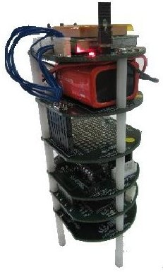

Figure 1 The i-CanSat training kit.

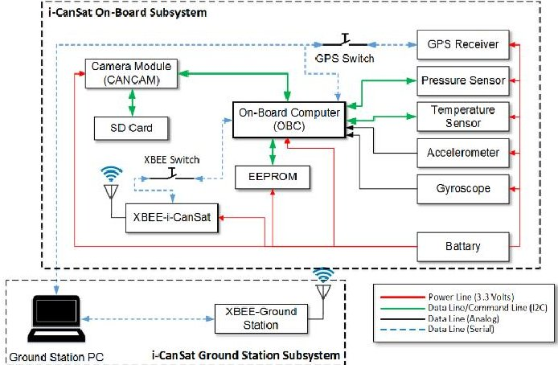

Figure 2 i-CanSat system diagram.

The DSM of the i-CanSat is shown in Figure 3. In Figure 3, components of the i-CanSat are represented by the gray elements along the diagonal. The off-diagonal black marks signifies the relationship of one component on another. Reading across the rows reveals what other components the component in the row provide. It can also be viewed as providing its output to other components. Reading down a column reveals what other components the component in that column depends on. It can also be viewed as the inputs to the component. Such convention is known as input column/output rows. There is another convention which is the opposite, i.e., input row/output column [4]. The input column/output row convention is adopted in the present study. Thus in Figure 3, the On-Board Computer (OBC) provides commands to EEPROM, Temperature Sensor, Pressure Sensor, Camera

Module (CANCAM), GPS switch, and XBEE switch, and it depends on EEPROM, Gyroscope, Accelerometer Temperature, Pressure Sensor, Temperature Sensor, Camera Module (CANCAM), GPS Switch and XBEE switch.

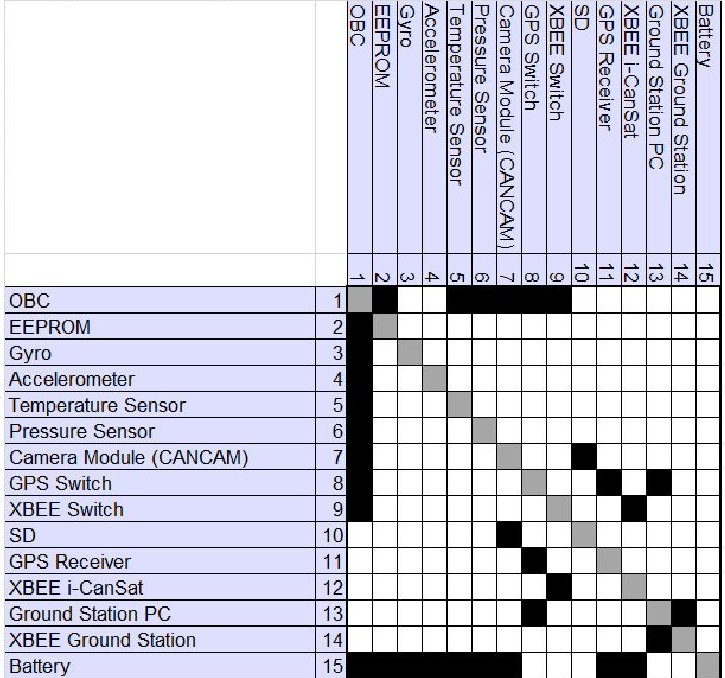

Figure 3 The DSM of the i-CanSat.

There are two main categories of DSMs. They are the static and time-based. Static DSMs represent the system elements existing simultaneously, such as components of a product or people in organizations as in the case of i-CanSat example shown in Figure 3. Static DSMs are usually analyzed with clustering algorithms. In time-based DSMs, the ordering of the rows and columns indicates a flow through time which means that upstream activities in a process precede downstream activities, the feedforward and feedback conventions are commonly adopted in time-based DSMs for interfaces. Timebased DSMs are analyzing using the sequencing algorithm. Furthermore the static DSM can be classified as componentbased or architecture DSM and the team-based or organization DSM. In the present study, architecture DSM is adopted for the design and management of the Nano-satellite systems.

## 3. Modeling System with Architecture DSM

Nano-satellite architecture is the arrangement of functional elements into physical chunks that become the building blocks of the Nano-satellite [5]. Chunks should implement one or a few functions and the interactions among chunks should be well defined. Modular system architectures have advantages in simplicity and reusability in Nano-satellite platforms.

A DSM can represent the Nano-satellite system architecture in terms of the relationship between its constituent components. The DSM of the whole Nano-satellite system can be decomposed into subsystems by smart clustering or partitioning algorithms. The architecture decomposition scheme has ramifications for the ease of system design and integration [5]. Before construct the DSM the following two steps of system engineering should be conducted:

1. Decompose the system into components.

2. Understand the interactions between the components.

<!-- PDF_PAGE: 3 -->

A well-defined type of interactions can help differentiation the relationship between the system elements. Table 1 shows the most common types of interactions in Nano-satellite systems with application to the i-CanSat example shown in Figure 2.

Table 1 The most common types of system element interactions in Nanosatellite systems.

<table border="1"><tr><td>Interaction Type</td><td>Description</td><td>i-CanSat Example</td></tr><tr><td>Data / Command</td><td>Data exchange between components or command send to/from component to the another component.</td><td>Analog and serial data lines</td></tr><tr><td>Power</td><td>Power needed to the components to function or the energy transfer between two components.</td><td>3.3 Volts power line.</td></tr><tr><td>Proximity</td><td>The physical adjacency between components.</td><td>SD Card-CANCAM, OBC-EEPROM, and GPS switch-Receiver</td></tr></table>

The DSMs in any category can be either binary DSM or Numerical DSM. Binary DSM means that the off-diagonal elements are ones and zeros. They can represent the presence or absence of a relationship. The i-CanSat DSM shown in Figure 3 is a binary DSM. Numerical DSMs could contain a multitude of attributes that provide more detailed information on the relationships between the different system elements. An improved description of these relationships provides a better understanding of the system and allows for the development of more complex and practical partitioning or clustering algorithms [6].

Clustering or partitioning the off-diagonal elements of DSM are conducted by reordering the rows and column. Clustering or partitioning requires several considerations. The most important objective is to maximize interactions between elements within clusters or chunks while minimizing interactions between clusters or chunks [5].

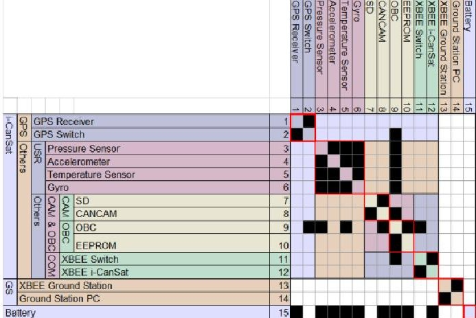

Figure 4 i-CanSat clustered DSM.

Figure 4 shows the i-CanSat after clustering by Lattix Architect 10.5.2 commercial software. As maximum as seven chucks/clusters can be identified from the clustered DSM.

Table 2 shows the components associated with each cluster. The physical model of the i-CanSat has six boards: GPS, PWR, USR, OBC, CAM, and XBEE boards. The clustered DSM produced clusters or subsystems that have the same constituent components as the physical i-CanSat which was developed by experienced developer. Each cluster in the i-CanSat is associated to a specific board. Cluster number six in Table 2 represents the ground station subsystem. It should be noted here that only cluster number seven or the battery is the only independent subsystem because it doesn't depends on any components. In next section, the application of DSM to a typical Nano-satellite project, NEXUS, is presented.

Table 2 i-CanSat Chucks/Clusters resulting from clustering the DSM.

<table border="1"><tr><td>Chuck/Cluster Number</td><td>Associated Components</td><td>i-CanSat Board</td></tr><tr><td>1</td><td>GPS Receiver and GPS Switch</td><td>GPS Board</td></tr><tr><td>2</td><td>Pressure Sensor, Temperature Sensor, Accelerometer, and Gyroscope.</td><td>USR Board</td></tr><tr><td>3</td><td>CANCAM and SD-Card</td><td>CAM Board</td></tr><tr><td>4</td><td>EEPROM and OBC</td><td>OBC Board</td></tr><tr><td>6</td><td>XBEE Ground Station and Ground Station PC</td><td>Ground Station Subsystem</td></tr><tr><td>7</td><td>Battery</td><td>PWR Board</td></tr></table>

## 4. Application to 1U CubeSat, NEXUS

NEXUS is a 1U （100 mm $ \times $ 100 mm $ \times $ 100 mm) sized CubeSat, and its weight is about 1.3kg. After orbit insertion, NEXUS deploys four mono-pole antennas. The NEXUS appearance with and without antennas deployment are shown in Figure 5.

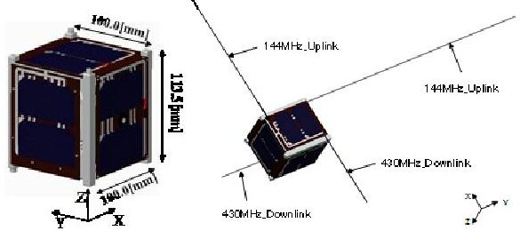

Figure 5 Appearance of NEXUS (Left: without antennas deployments Right: with antennas deployments).

NEXUS development is conducted as a collaboration research project between Space Structure System Laboratory, Aerospace Engineering Department, Nihon University and the Japan Amateur Radio Satellite Organization (JAMSAT). The mission objectives of NEXUS are as follows:

1. High-speed downlink using the 435MHz band at a baud rate of 38400 bps.

2. Data relay of amateur radio communication.

3. The data downlink using small and power-saving transceiver with baud rate 600~14400 bps.

4. Photographing high resolution images using small, lightweight, and locally developed Camera System. NEXUS is divided into bus system and mission subsystems.

<!-- PDF_PAGE: 4 -->

The details of those systems are shown in Table 3 and Table 4, respectively.

Table 3 NEXUS bus system.

<table border="1"><tr><td>Subsystem</td><td>Function</td></tr><tr><td>FMR(Flight Management Receiver)</td><td>Receiving the uplink and processing the command. This subsystem is the highest level of NEXUS.</td></tr><tr><td>CW(Continuous Wave)</td><td>Transmitting HK(House Keeping) data from satellite to ground by using CW beacon.</td></tr><tr><td>EPS(Electrical Power Supply)</td><td>Supplying stabilized power supply of 5V from Solar-cell and battery to other subsystem.</td></tr><tr><td>C&amp;DH(Command &amp; Data Handling)</td><td>Sampling and saving the HK data. It can prepare the data packet and send to the transmitter.</td></tr><tr><td>SG(Sensor Group) Antenna Deployment</td><td>Sampling HK data of each subsystem. To store the antenna during the launch and deploy it after orbital insertion.</td></tr></table>

Table 4 NEXUS mission subsystems.

<table border="1"><tr><td>Subsystem</td><td>Function</td></tr><tr><td>$\pi/4$ shift QPSK</td><td>To communicate at a baud rate of 38400bps at amateur radio band (Downlink:435MHz)) in addition to communicate by FX.25 protocol.</td></tr><tr><td>Transmitter</td><td>To relay uplink data at amateur radio band (uplink:144MHz/Downlink:435MHz).</td></tr><tr><td>FSK Transceiver</td><td>To transmit and receive data at amateur radio band (Uplink:144MHz/Downlink:435MHz). In addition this transceiver can vary the communication speed from 600 to 14400bps.</td></tr><tr><td>Camera</td><td>To shoot of Full HD(1920×1080 pixels) images.</td></tr></table>

Table 5 NEXUS subsystems availability.

<table border="1"><tr><td>Subsystem</td><td>Availability</td><td>Institution or Company and model number</td></tr><tr><td>FMR, CW, EPS, C&amp;DH, SG, Camera and Antenna Deployment</td><td>Locally developed</td><td>Nihon University</td></tr><tr><td>$\pi/4$ shift QPSK Transmitter, Liner Transponder, and FSK Transceiver</td><td>Locally developed</td><td>JAMSAT</td></tr><tr><td>Batteries</td><td>Commercially available.</td><td>Panasonic(UF103450P)</td></tr><tr><td>Transmitter and Receiver for the bus system</td><td>Commercially available</td><td>Nishi Musen Kenkyusyo Co. Ltd., Japan(TXE430MFCW-301A9600 and RXE145M301A)</td></tr></table>

The locally developed subsystems, commercially adopted subsystems, and third party developed subsystem are shown in Table 5. The NEXUS system and the interactions among the different subsystems described above can be depicted in a system diagram shown in Figure 6. Figure 7 shows the

exploded view the NEXUS assembly.

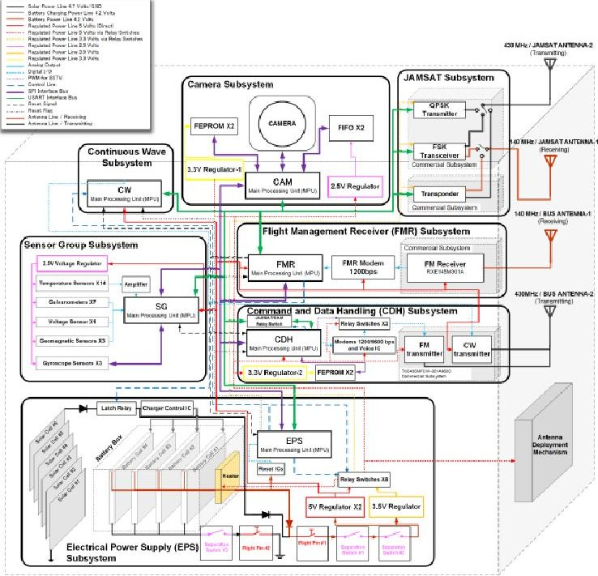

Figure 6 NEXUS system diagram.

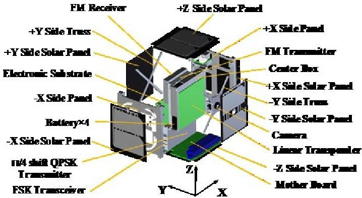

Figure 7 Exploded view of the NEXUS assembly.

Constructed a practically accepted DSM requires detailed system diagrams for the EPS, SG, C&DH, FMR, CW, Camera, and antenna deployment subsystems are shown in Figure 8, Figure 9, Figure 10, Figure 11, Figure 12, Figure 13 and Figure 14, respectively. These subsystems are locally developed at Space Structure Systems Laboratory, Aerospace Engineering Department, Nihon University, Japan.

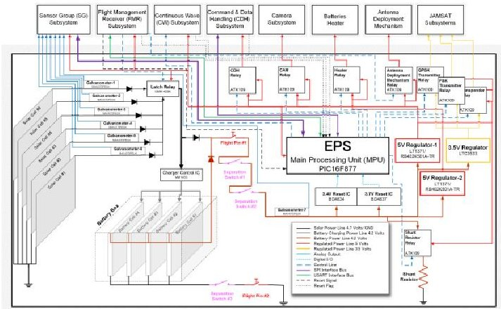

Figure 8 EPS subsystem.

<!-- PDF_PAGE: 5 -->

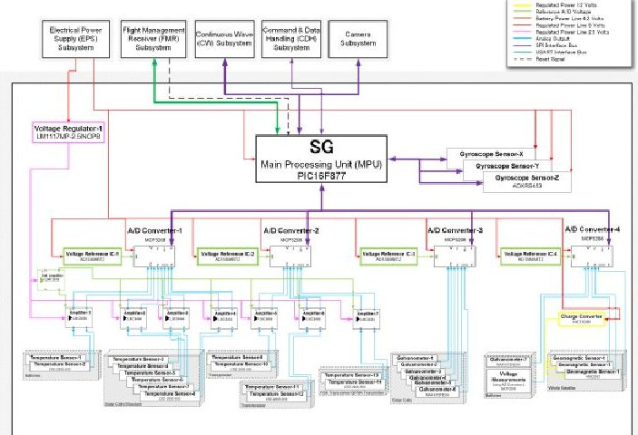

Figure 9 SG subsystem.

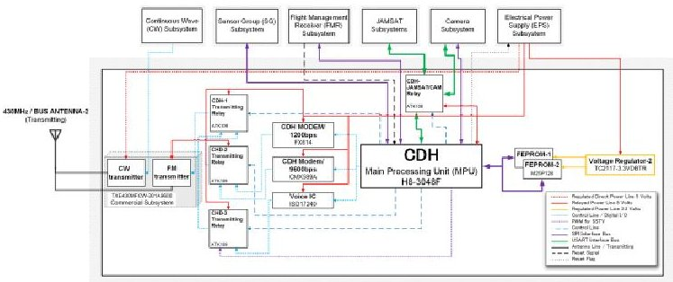

Figure 10 C&DH subsystem.

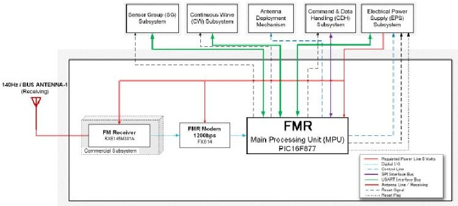

Figure 11 FMR subsystem.

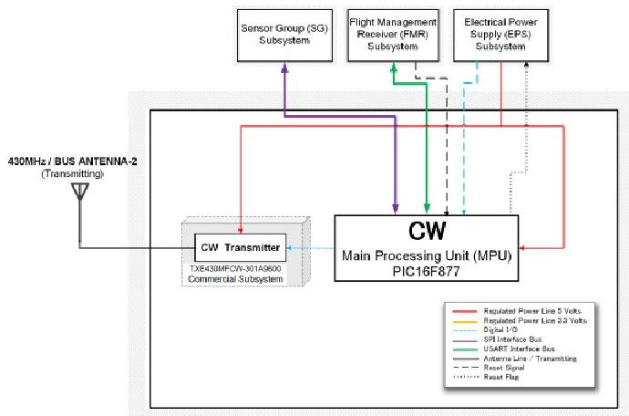

Figure 12 CW subsystem.

## 5. The application of DSM to NEXUS system

Based on the detailed system diagrams presented above, the subsystem listed in Table 5 and NEXUS assembly shown in Figure 7, it was decided to create additional two subsystems which were based on the previous experience for the Nanosatellites developed at Space Structure Systems Laboratory,

Aerospace Engineering Department, Nihon University, Japan. These Nano-satellites are SEEDS-II, which was launched in 2008, and SPROUT, which was launched in 2014, and they are still operational. The two subsystem are structure and mother board. The mother board subsystem is created to include the Z-axis gyroscope because the board's assembly for the locally developed subsystems at Nihon University will be assembled parallel to X-Y plane, as shown in Figure 7, and therefore the Z-axis gyroscope should be forced to be assembled in the mother board.

Table 6 shows the components associated to structure and mother board subsystems.

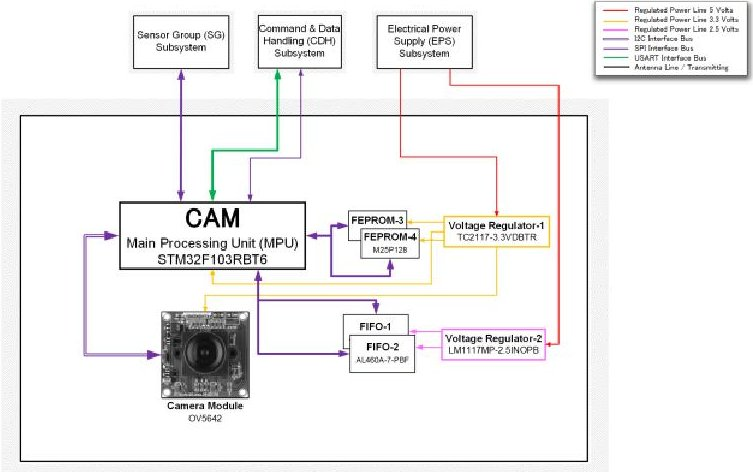

Figure 13 Camera subsystem.

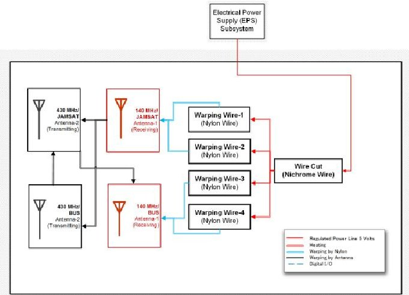

Figure 14 Antenna deployment subsystem.

Table 6 Structure and mother board subsystems.

<table border="1"><tr><td>Subsystem</td><td>Components</td></tr><tr><td>Structure</td><td><li>The Complete Antenna Deployment Subsystem</li><li>Solar Cells(1-6)</li><li>Separation Switches(1,2,and3)</li><li>Temperature Sensors(3-8)</li><li>Body</li><li>Camera</li></td></tr><tr><td>Mother Board</td><td><li>Z-Gyroscope</li></td></tr></table>

It was decided also to force the proximity of the temperature sensors as shown in Figure 9 to be placed at their associated subsystems as shown in Table 7. The total number of temperature sensors in NEXUS is fourteen sensors.

<!-- PDF_PAGE: 6 -->

Table 7 Allocation of the temperature sensors.

<table border="1"><tr><td>Subsystem</td><td>Temperature Sensor Number</td></tr><tr><td>Batteries</td><td>1-2</td></tr><tr><td>Structure</td><td>3-8</td></tr><tr><td>Liner Transponder</td><td>9-10</td></tr><tr><td>Transmitter and Receiver for the bus system</td><td>11-12</td></tr><tr><td>FSK Transceiver</td><td>13</td></tr><tr><td>$\pi/4$ shift QPSK Transmitter</td><td>14</td></tr></table>

A very detailed relationship list between the components was constructed and they can categorized into four categories: power, data and command, proximity, and mechanical, as shown in Table 8.

Table 8 Interaction categories.

<table border="1"><tr><td>Category</td><td>Physical Interfaces</td></tr><tr><td>Power</td><td>12 Volts4.7 Volts4.2 Volts5 Volts Regulator3.5 Volts Regulator5 Volts Relayed3.5 Volts Relayed3.3 Volts2.5 VoltsGND</td></tr><tr><td>Data and Command</td><td>Analog SignalPWM(for SSTV)Digital I/OControl SignalHigh Speed SPI(SPI-1)Low Speed SPI(SPI-2)USARTI2CReset SignalReset FlagAntenna Lines</td></tr><tr><td>ProximityMechanical</td><td>Physical ContactHeat(for wire cut)Warping(for antenna storage)</td></tr></table>

The Compact form of the binary DSM is shown in Figure 15 and the expanded form of the same DSM is shown in Figure 16. Up to 124 components are constituent components of NEXUS system. The assembly shown in Figure 17 depicted that the locally developed subsystems at Nihon University have to be allocated into fours boards, namely; A, B, C and M (mother boards). The mother board is including the Z-axis gyroscope and the interfaces of A, B, and C boards. The locally developed EPS, SG, C&DH, FMR, CW and Camera Subsystems have to be contained in boards A, B, and C. The expanded form of the binary DSM was clustered as shown in Figure 18. Up to eleven clusters can be identified. These eleven clusters are grouped into three groups. Groups I include the four clusters (portion of EPS and SG subsystems), group II include two clusters (portions of EPS, SG, and FMR subsystems and the complete C&DH, CAM, and CW subsystems), and group three include

the last five clusters (portion of EPS, SG, and FMR subsystems), as shown in Figure 18.

Though the resulting three groups have minimum interaction between them and maximum interaction inside each of them, they still couldn't be practically implemented as three boards A, B, and C because the locally developed subsystems are scattered among the three groups of clusters which couldn't be implemented from the practical development point of view.

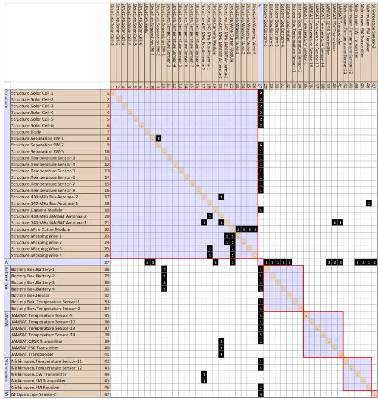

Figure 15 Compact form of the binary DSM of NEXUS.

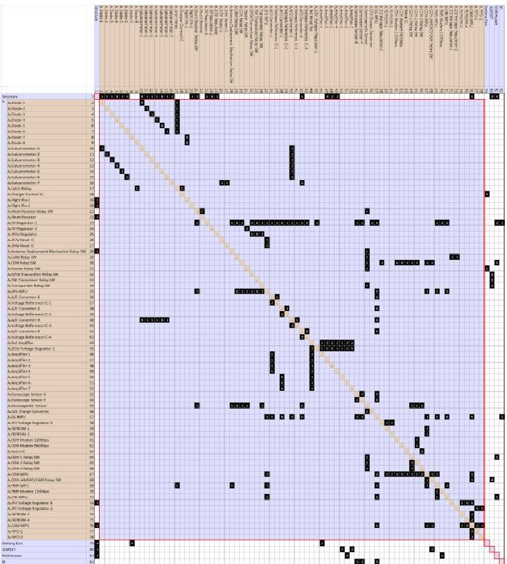

Figure 16 Expanded form of the binary DSM of NEXUS.

<!-- PDF_PAGE: 7 -->

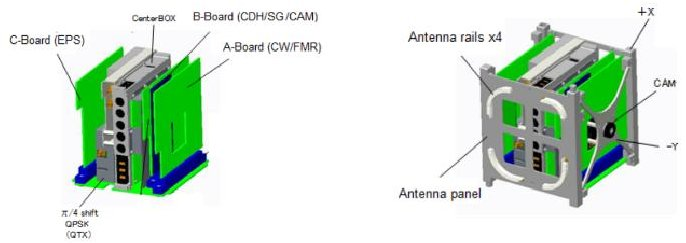

Figure 17 The locally developed subsystems at Nihon University (A, B, C and M (mother board) Boards and Structure).

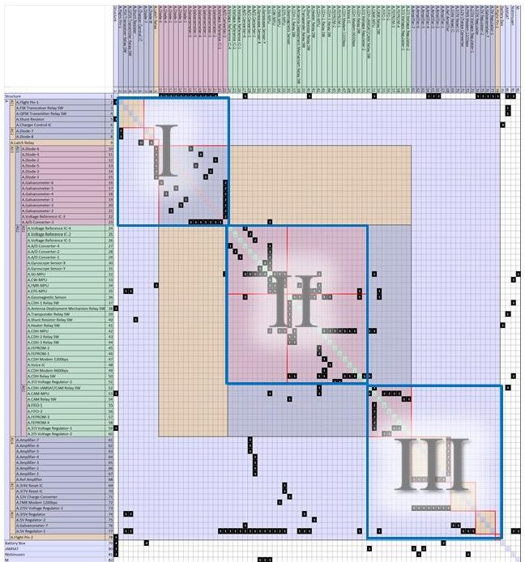

Figure 18 The clustered form of the binary DSM.

## 6. The Engineering Model (EM) of NEXUS

The development team at Space Structure System Laboratory, Aerospace Engineering Department, Nihon University, completed the design of the three boards (A, B, and C) based on the experience gained in the development of SEEDS-II and SPROUT Nano-satellites. Figure 19 shows the engineering model (EM) DSM. Cluster A or board A include CW and FRM subsystems. Cluster B include the C&DH, SG and CAM subsystems, and Cluster C include the EPS subsystem. It should note that boards A include also the geomagnetic sensor and the X-axis gyroscope. One of the design requirements is to place the geomagnetic sensor far away from relay switches, transceivers and other strong electromagnetic field producing components and modules. This is implemented explicitly in the EM DSM. It is also clearly seen that the interactions between the boards are stronger than that shown in Figure 18. This is observed by the number of the off-diagonal elements outside the clusters shown in Figure 18 and Figure 19.

Based on the Engineering Model (EM) DSM the strength of the interaction among the components of each board are increased in the baseline DSM shown in Figure 16 which makes it numerical DSM and this numerical DSM was reclustered and shown in Figure 20. There is no major difference between the binary and numerically clustered DSM. Manual placement of few clusters and components was conducted so

that the resultant matrix becomes as close as possible to the EM DSM and the resultant matrix is shown in Figure 21. It is clearly shown that the off-diagonal elements outside the clusters are increased which means strong interaction between the clusters. Although it might be accepted from the practical development point of view but it is still not minimizing the interactions between clusters. More information is needed to be grasped from the experienced development team so that an automatically clustered DSM can have cluster as close as possible to be practically accepted. Such a "tuned DSM" can support the unexperienced team to design their CubeSat appropriately. In other word, the technology transfer can be achieved through the tuned DSM.

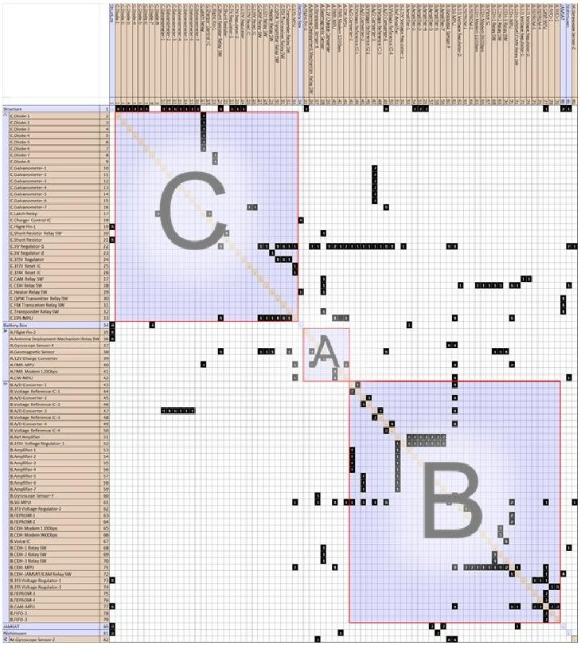

Figure 19 The Engineering Model (EM) DSM.

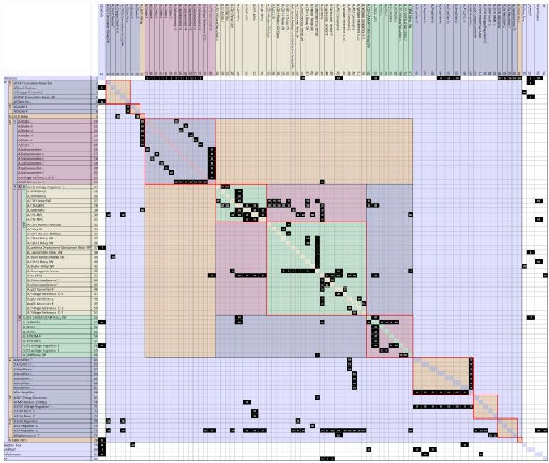

Figure 20 The clustered form of the numerical DSM.

## 7. Conclusions

The Design Structure Matrix (DSM) techniques was introduced and applied to two space projects. The two space

<!-- PDF_PAGE: 8 -->

project are the i-CanSat, a training educational kit for hands on training in space engineering developed by UNISEC-Japan, and 1U CubSat called NEXUS which is under-development at Nihon University, Japan, in collaboration with the Japan Amateur Radio Satellite Organization (JAMSAT). DSM provide a very useful visualization tool for the system architecture and the interaction among its constituent components. It can provide clear insights to the system design and management. The conclusion of the present study can be summarized in the following points.

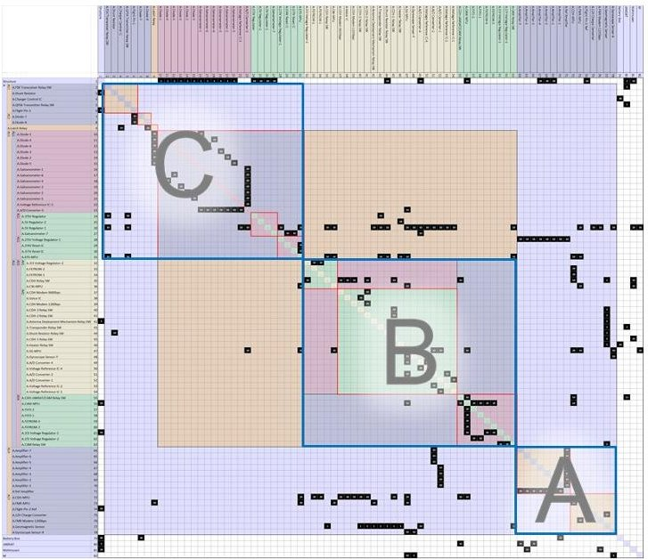

Figure 21 Manual tuning of the clustered form of the numerical DSM.

- Detailed system diagram is vital component in constructing a practically accepted DSM.

- Third party developed and commercially available subsystems can be embedded into the overall DSM and

their interactions between the locally developed subsystems can be visualized.

- Experience gained from previously developed CubSats can be implemented in constructed a practically accepted DSM in terms of components placement, interactions strength determination, and subsystem identification.

- DSM can provide a baseline platform for the knowledge transfer issue in specific project because the experience gain can be reflected in constructing DSM.

Operational modes of the NEXUS and their impact on the hardware DSM need to be studied in order to provide a useful insights to the software development aspect.

## Acknowledgment

The present research was funded by MEXT, Japan through the program of "Coordination Funds for Promoting Aerospace Utilization".

## References

1) Hideaki Uchikawa, Toshiyuki Yasui, and Seiko Shirasaka, "Hierarchical Knowledge Transfer and Creation Model", APCOSEC2013, 2013

2) Nonaka I. and Takeuchi H., "The knowledge-Creating Company: How Japanese Companies Create the Dynamism of Innovation", Oxford University Press, 1995.

3) www.unisec.jp (accessed March 30, 2017)

4) Steven D. Eppinger and Tyson R. Browning, "Design Structure Matrix Methods and Applications",The MIT Press, Cambridge, Massachusetts, 2012.

5) Tyson R. Browning, "Applying the Design Structure Matrix to System Decomposition and Integration Problems: A Review and New Directions", IEEE Transactions on Engineering Management, Vol. 48, No. 3, August 2001.

6) www.dsnweb.org (accessed March 30, 2017)