<!-- PDF_PAGE: 1 -->

<div align="center">

# Politecnico di Torino Master's Degree in Aerospace Engineering

</div>

ISAE-SUPAERO

Institut Supérieur de l'Aéronautique et de l'Espace, Toulouse


Politecnico di Torino


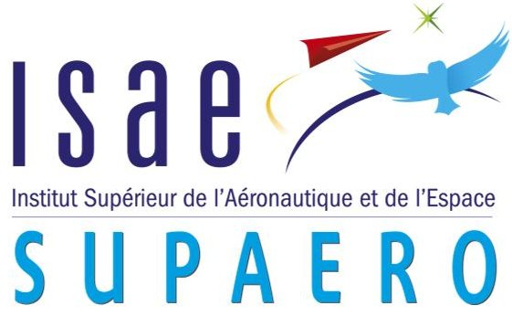


<div align="center">

# Master Thesis

</div>

<div align="center">

# Data Formalisation through MBSE for Concurrent Preliminary Design of CubeSats

</div>

Candidate: Giacomo Luccisano, 302189

Prof. Nicole Viola, Department of Management and Production Engineering (DIGEP), Politecnico di Torino, Torino, IT

Dr. Thibault Gateau, Department of Aerospace Vehicles Design and Control (DCAS), ISAE-SUPAERO, Toulouse, FR

Dr. Sophia Salas Cordero, Department of Complex Systems Engineering (DISC), ISAE-SUPAERO, Toulouse, FR

April 2024

<!-- PDF_PAGE: 2 -->

## Abstract

The space market trends indicate that in the next decade, the space industry will continue to experience a radical transformation in terms of the number of operating satellites and market value. Simultaneously, Industry and Academia are leading a transition from Document-Based System Engineering to Model-Based Systems Engineering (MBSE), combined with Concurrent Engineering (CE) approaches, due to increased demand and reduced design time.

How to effectively formalise data and improve data exchange is an open question. The representation of complex systems through models for defining their functional, logical, and physical architectures is not as straightforward as it could seem. For instance, during the Preliminary Design (PD) phase, when mathematical analyses and simulations need to be carried out, and system budgets need to be generated, such models require integration with external mathematical models that allow systems to be represented from a design parameters point of view.

Parallel to the adoption of the MBSE methodology, another revolution in the space sector, and more specifically in the small satellites field, has been the introduction of the CubeSat standard. Thanks to their standardised form factor, they enable a further reduction in development time and cost, especially in the PD phase, therefore offering an opportunity to increase the accessibility to space on a tight budget and representing a valuable research topic for Academia.

This thesis illustrates the work conducted in collaboration with ISAE-SUPAERO (Toulouse, FR), aiming to provide a formalisation of a CubeSat model to include relevant information for its use during the various stages of the PD phase. This research work presents the following main contributions: (i) to formalise the modelling efforts of CubeSats from the PD stage by architecting a generic CubeSat model with Systems Modelling Language (SysML), allowing data storage and visualisation through the use of Unified Modelling Language (UML) stereotypes, and enhancing information exchange for the integration with any set of simulation and analysis tools; (ii) to elaborate an end-to-end use case scenario in the context of the Nanostar Software Suite (NSS), an open-source software framework that aims to facilitate data exchange between various domain-specific software during CE sessions. The latter serves as a proof of concept demonstrating the proposed formalisation's benefits.

The proposed formalisation allows a CubeSat SysML model to be considered as the central source of truth for data during the entire design process, which can facilitate automating trade-off analyses, by relying on the combination of all SysML advantages and a well-chosen data instantiation across all PD study phases.

Keywords: Preliminary Design, CubeSat, Systems Engineering, Concurrent Design Engineering, Model-Based Systems Engineering, SysML, UML.

<!-- PDF_PAGE: 3 -->

## Contents

# 1 Introduction 1

# 2 Context of the work 3

2.1 Preliminary Design 3

2.2 Concurrent Engineering 6

    2.2.1 CE definition, advantages and challenges 6

    2.2.2 Concurrent Design Facilities 7

2.3 Model-Based System Engineering 9

    2.3.1 MBSE definition 9

    2.3.2 Benefits of using MBSE 9

    2.3.3 Future and challenges of MBSE 11

2.4 UML and SysML 12

    2.4.1 UML core elements 12

    2.4.2 SysML core elements 14

2.5 CubeSats 17

    2.5.1 SmallSats and CubeSats 17

    2.5.2 The CubeSat standard 18

2.6 Open-source initiatives for CubeSat design 21

2.7 State-of-the-art of the NSS 24

    2.7.1 Nanospace UI 25

    2.7.2 Nanospace DB 26

    2.7.3 Nanospace constellation 27

# 3 Proposed formalisation 29

3.1 Research problem 29

3.2 Integration process 32

3.3 Data formalisation in CubeSat model 35

    3.3.1 Modelling tools comparison 35

    3.3.2 Stereotypes generation process 37

    3.3.3 Budgets and parameters identification 39

3.4 Operating Modes generalisation 43

<!-- PDF_PAGE: 4 -->

3.4.1 Existing standards and models 43

3.4.2 Proposed Operating Modes formalisation 44

3.4.3 General Operating Modes model summary 48

3.4.4 Operating Modes generalisation test through NSS tools 49

3.5 Proposed stereotypes characterisation 52

3.5.1 SystemComp 52

3.5.2 SystemMain 53

3.5.3 Battery and SolarArray 53

3.5.4 Transmitter and Receiver 54

3.5.5 Orbit and PropagationLosses 55

3.5.6 GroundStation 55

3.5.7 OperatingMode 56

3.5.8 Stereotypes application example: Payload Block Definition Diagram 58

3.5.9 Observations 58

3.5.10 CubeSat SysML model and simulation tools integration summary 59

3.6 End-to-end use case 61

3.6.1 Example mission: TWC mission 61

3.6.2 Model files manipulation and data extraction 63

3.6.3 Model parser functionalities 65

3.6.4 Parser outputs 66

3.6.5 Simulation results 69

A Conclusions and future work 71

A Acronyms 73

B Configuration Files example 75

C TWC SysML model core elements 77

<!-- PDF_PAGE: 5 -->

## List of Figures

1 Comparison of space mission life cycle phases classifications between ESA, NASA, and US DoD. 3

2 Benefits of Concurrent Engineering 6

3 Challenges of Concurrent Engineering 7

4 ESA/ESTEC Concurrent Design Facility layout. 8

5 Model-Based Systems Engineering benefits. 10

6 UML structure. 12

7 Example of UML class and object with inherited attributes and operations. 13

8 Example of UML aggregation and composition associations. 13

9 Example of UML generalisation. 14

10 UML stereotype examples. 14

11 UML and SysML link. 15

12 SysML structure. 15

13 Nanosatellites by organisations. 17

14 All nanosatellites by locations. 18

15 Standard for 1U CubeSat structure. 19

16 CubeSats family. 19

17 Nanosatellite launches by types. 20

18 Simplified Nanospace architecture. 24

19 Nanospace-UI. 25

20 NSS constellation. 27

21 Gaps in current state-of-the-art tools for design and simulation of complex systems. 29

22 Research questions. 31

23 CubeSat model and simulation tools proposed integration process. 33

24 Gaphor GUI steps for UML stereotypes generation. 38

25 Requirements breakdown flowchart for OM identification. 44

26 Comparison between battery data output before and after code modifications. 51

27 Comparison between data budget output before and after code modifications. 51

28 Systems UML stereotypes definition. 52

29 Orbit and Propagation Losses UML stereotypes definition. 55

30 Operating Modes and Ground Station UML stereotypes. 57

<!-- PDF_PAGE: 6 -->

Payload BDD example. 58

Data flow scheme of an application of the proposed formalisation. 60

TWC system-level Block Definition Diagram implemented in Gaphor. 62

Example of requirements list output by Gaphor parser. 66

Example of Payload relationship graph. 68

TWC output Power and Data Budgets. 69

TWC Operating Modes Block Definition Diagram implemented in Gaphor. 77

TWC Orbit and Ground Station Block Definition Diagram implemented in Gaphor. 77

TWC Payload Block Definition Diagram implemented in Gaphor. 78

TWC EPS Block Definition Diagram implemented in Gaphor. 78

TWC Functional EPS Requirements implemented in Gaphor. 79

<!-- PDF_PAGE: 7 -->

## List of Tables

1 Small satellites classification by weight. 17

2 CubeSats mass specifications. 19

3 Summary of principal budgets and data needed for PD studies. 40

4 Mission operations abstraction mode presentation. 45

5 Proposed Operating Mode generalisation. 48

6 SystemComp stereotype attributes. 53

7 SystemMain stereotype additional attributes. 53

8 Battery and SolarArray stereotypes additional attributes. 54

9 Receiver stereotype additional attributes. 54

10 Transmitter stereotype additional attributes. 54

11 Orbit stereotype attributes. 55

12 PropagationLosses stereotype attributes. 55

13 GroundStation stereotype attributes. 56

14 OperatingMode stereotype attributes. 57

## Listings

1 TestName Mode .yaml configuration example 49

2 Example of OM stereotype definition in Gaphor .xml model file. 63

3 Servicing OM SysML block definition in Gaphor .xml model file. 64

4 OM stereotype's modeName property definition in Gaphor .xml model file. 64

5 Full set of OMs .yaml configuration example 75

<!-- PDF_PAGE: 8 -->

## 1 Introduction

Euroconsult in its Space Economy Report 2023 [1] highlighted how current trends in the space market suggest a significant shift in the industry over the coming decade. This transformation is expected to be evident in two key areas: a marked increase in the number of satellites in operation, also underlined by the forecasts presented in the Nanosats Database by Kulu [2]; and a substantial growth in market value, estimated to reach $ 737B within a decade [1].

Currently, there is a growing demand in the industry which necessitates a reduction in the time it takes to design these space systems. To meet this challenge, both the industrial sector and academic institutions are observing a pivotal shift in their approach to Systems Engineering (SE). The traditional Document-Based System Engineering methods are increasingly being replaced by Model-Based Systems Engineering (MBSE). This shift is occurring in tandem with the propagation of adoption of Concurrent Engineering (CE) methods. More information about NASA's approach to CE and its Concurrent Engineering Center (CEC) can be found in the work from Iwata et al. [3], while ESA's approach and its Concurrent Design Facility (CDF) are presented in the works from Bandecchi et al. [4], [5]. A general overview of CE practices, discussing their integration with MBSE methodology, can be found in Knoll et al. [6].

The move towards MBSE, coupled with CE methodology, is being driven by several advantages across different sectors, as presented by the International Council on Systems Engineering (INCOSE) in its Systems Engineering Handbook [7] and highlighted in the work of Henderson and Salado [8]. Such advantages include: enhanced efficiency in the design process, improved accuracy in system modelling, and a more collaborative and integrated approach to engineering projects. This transition is a response to the evolving needs of the sector and represents a significant advancement in the way space systems are engineered [8]. Moreover, the synergy between MBSE and CE approaches allows for real-time collaboration and decision-making, which is essential in reducing design time [6].

INCOSE, in its Systems Engineering Vision 2035 [9], confirmed how the future of Systems Engineering is strongly dependant on the application of MBSE. Advanced models, coupled with state-of-the-art visualisation techniques and deeply integrated, multidisciplinary simulations, will enable systems engineers to develop systems with increasing complexity while still maintaining high efficiency and reliability [9].

However, several challenges in the implementation of MBSE have been identified. As presented in the work from Bajaj et al. [10], several levels of discontinuity have been identified across the various design stages of complex systems, including discrepancies between systems models and simulation tools used. Another challenge, presented by Knoll et al. [6], is constituted by the lack of sufficient generic models to allow reuse, ensuring a further reduction in development costs.

In parallel, the CubeSat standard [11] since its first applications in the early 2000s has revolutionised the world of space mission design. Thanks to their standardised form factor, CubeSats have granted access to space to smaller countries and organisations with limited teams, budgets, and time, confirming themselves as a major research topic and a

<!-- PDF_PAGE: 9 -->

new opportunity for both industry and academia. An overview of the CubeSats history and major revolutions introduced by their application is also present in reference [12].

This work has been developed in the context of the Nanostar Software Suite (NSS) [13], [14], an open-source software constellation aimed at facilitating the Preliminary Design of CubeSats through the application of MBSE and CE approaches.

This thesis is structured as follows: Section 2 (Context of the work) presents a background on the principal topics discussed in the following of this thesis, such as Preliminary Design (PD), Concurrent Engineering (CE) and Model-Based Systems Engineering (MBSE) approaches, UML and SysML, the CubeSats standard and the state of the art of the NSS constellation.

Section 3 (Proposed formalisation) begins by providing an overview of the rationale for the main research problems of this research work, namely the formalisation of a general CubeSat model in SysML, capable of a comprehensive representation of the system and the integration of such model with any set of simulation tools. Afterwards, this section continues with the proposed formalisation of the CubeSat general SysML model, enhanced with UML stereotypes, capable of combining the benefits arising from MBSE with a method for data storage and representation within the model itself. This latter feature, as discussed in detail later, enables the model to be integrated with any set of simulation and analysis tools. Section 3 continues with the assessment of the general parameters and budget needed for a comprehensive mission simulation and validation, and the proposed formalisation for a CubeSat general OM is then introduced, as a way of obtaining a general activity profile for mission analysis and simulation.

An end-to-end application of the proposed formalisation is then presented. The CubeSat SysML model is integrated with the simulation tools from the NSS constellation, as a proof of concept, and the outputs are presented.

Lastly, in Section 4 the conclusions of the work are presented with its principal derivatives and future work.

<!-- PDF_PAGE: 10 -->

## 2 Context of the work

This section provides a brief overlook of concepts utilised throughout this thesis work. This includes the definition and meaning of the most common terms used in the following sections, coupled with the state of the art of design approaches, their major benefits and challenges.

## 2.1 Preliminary Design

Space missions' life cycles are thoroughly planned, from the initial concept studies to the final execution. In Figure 1 is represented the life cycle of a space mission, with a comparison of the mission phases nomenclature, as intended by European Space Agency (ESA), National Aeronautics and Space Administration (NASA), and US Department of Defence (DoD) [12].


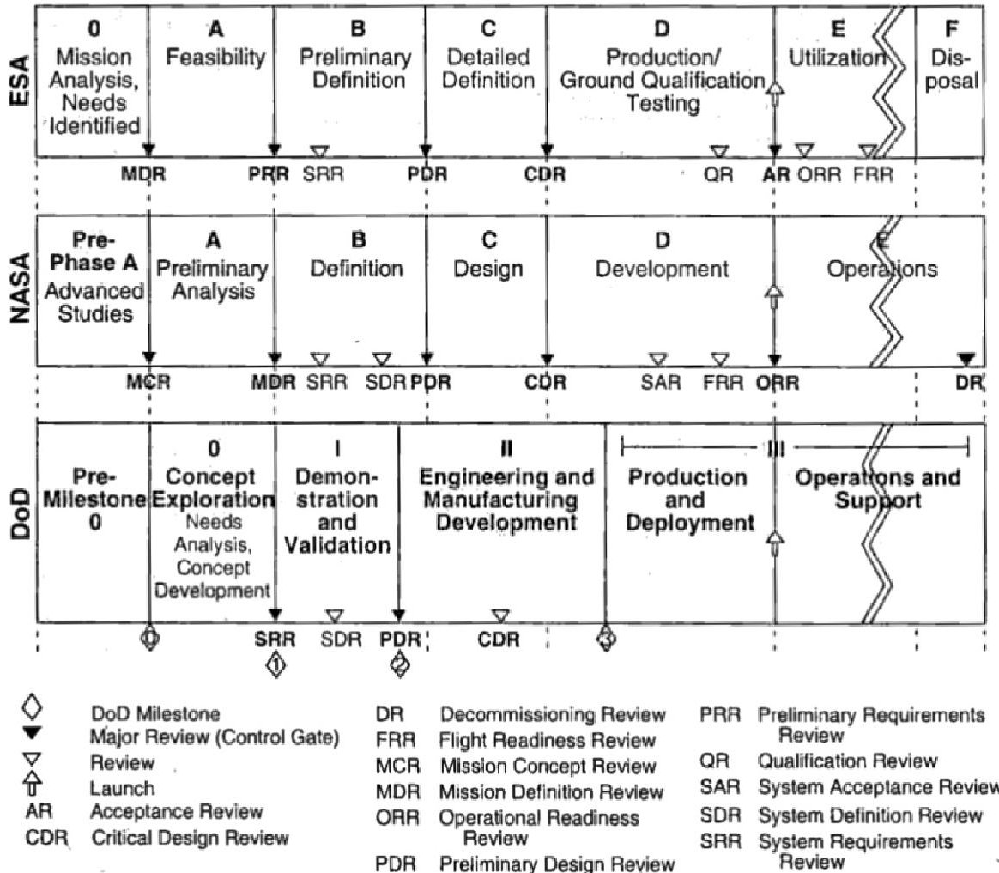


<div align="center">

Figure 1: Comparison of space mission life cycle phases classifications between ESA, NASA, and US DoD [12].

</div>

As shown in Figure 1, mission phases are analogous for ESA and NASA. ESA typically denotes them as Phases 0 (Mission Analysis), A (Feasibility study), B (Preliminary Definition), C (Detailed Definition), D (Production & Test), E (Utilisation) and F (Disposal), while NASA typically defines the Advanced Studies phase (ESA Phase 0) as Pre-Phase A, and includes Disposal as part of "Operations and Support" in Phase E. In this thesis work the ESA life cycle phases nomenclature is used.

<!-- PDF_PAGE: 11 -->

The NASA Systems Engineering Handbook [15] provides a thorough description of all design phases and their principal inputs and outputs. Each Phase ends with a Milestone Review, which involves a comprehensive review by experts and stakeholders, during which the entire project is critically evaluated to determine whether it meets the requirements and objectives of the mission [15].

This work focuses on Phases 0, A, and B, as they are the initial phases that lay the foundation for the entire mission design process, constituting the Preliminary Design (PD) Phase. Each of these Phases has specific purposes and outputs, as highlighted in [15].

Phase 0, Mission Analysis/Needs Identification The purpose of this phase is to identify one or more mission concepts, based on a preliminary assessment of mission needs and feasibility, in terms of technical requirements, expected costs, and risk analyses.

A Mission Definition Review (MDR) is held at the end of this Phase, for evaluating the feasibility of the project and its high-level requirements. If the mission is deemed feasible, it proceeds to Phase A.

Phase A, Feasibility it focuses on refining the mission concept and developing a first iteration of the Preliminary Design, comprising possible Concepts of Operations (ConOps), system architectures, and functions' trees. It aims to provide a more detailed and well-defined plan for the mission, which includes management plans and risk analyses. Preliminary Requirements Review (PRR) is held at the end of Phase A, whose main purpose is to confirm the technical and programmatic feasibility of the concepts provided. The chosen concepts move to Phase B for a more detailed design.

Phase B, Preliminary Definition This is characterised by developing a comprehensive preliminary design and initiating implementation preparations for the mission. Phase B includes the numerous trade-off analyses for the selection of the preferred mission baseline, the development of a project management plan, which considers budgeting and scheduling, and the definition of a verification plan.

A Preliminary Design Review (PDR) is held at the end of this phase. A PDR principal objectives are the verification of the PD of the selected concepts in regards to the requirements and constraints identified earlier; the release of final management, engineering, and product assurance plans; and the release of the Assembly, Integration & Test (AIT) plan. If the PDR is passed, the mission can proceed to the detailed design and assembly phases.

It is important to also note that in the field of engineering and product development, the Preliminary Design (PD) phase constitutes a highly multidisciplinary endeavour, requiring the confluence of different skills to establish a complete basic design. This phase represents more than just the initial outline of a project: professionals ranging from mechanical and electronic engineers to software developers and, in more specialized fields such as aerospace or automotive, aerodynamics and materials science experts, must work closely together.

<!-- PDF_PAGE: 12 -->

This interdisciplinary collaboration is crucial, as it ensures the holistic integration of different perspectives and ingrained skills, thereby optimising every aspect of the project to work in tandem. In aerospace, the PD phase requires meticulous synchronisation between figures such as structural engineers, propulsion specialists, and control system designers. Each discipline brings with it a rigorous set of requirements and considerations that contribute to a design that is not only technically robust but also conforms to strict safety standards, regulatory compliance, and cost efficiency. In addition, this collective approach plays a crucial role in addressing issues of user experience and environmental sustainability.

In summary, Phases 0, A, and B represent the initial and crucial steps in the life cycle of a space mission. Phase 0 focuses on the definition of a mission concept and the assessment of mission feasibility, Phase A refines the mission concept and develops a preliminary design, and Phase B goes further into the preliminary design, initiating the implementation preparation for detailed design and construction in subsequent phases.

These phases are conducted in a multidisciplinary manner, to ensure that space missions are well-considered, scientifically valuable, and technically achievable before significant resources are committed to the project.

<!-- PDF_PAGE: 13 -->

## 2.2 Concurrent Engineering

## 2.2.1 CE definition, advantages and challenges

From the work of Bandecchi et al. [5], Concurrent Engineering (CE) can be defined as "a systematic approach to integrated product development that emphasises the response to customer expectations. It embodies team values of co-operation, trust and sharing in such a manner that decision making is by consensus, involving all perspectives in parallel, from the beginning of the product life-cycle".

Concurrent Engineering represents a paradigm shift in the approach to design and development, particularly in complex, multidisciplinary projects. Unlike traditional sequential design processes, where each specialist involved in the project works on their subsystem design independently from the others, CE involves the simultaneous collaboration of several engineers, each contributing with their expertise. CE is therefore characterised by its collaborative, integrated, and real-time nature [4], [5].

This approach promotes an environment in which cross-functional teams, composed of specialists in areas such as system design, mission analysis, structure analysis, cost and risk assessment and project management, work concurrently rather than in a linear sequence. This holistic approach allows for immediate feedback and iterative project adjustments, significantly reducing the time and costs associated with the approach of traditional methods, where design iterations take place in meetings at intervals of a few weeks [5].

The advantages presented are also confirmed by Knoll et al. [6], through a survey conducted across industry, space agencies and academia, as can be seen in Figure 2.


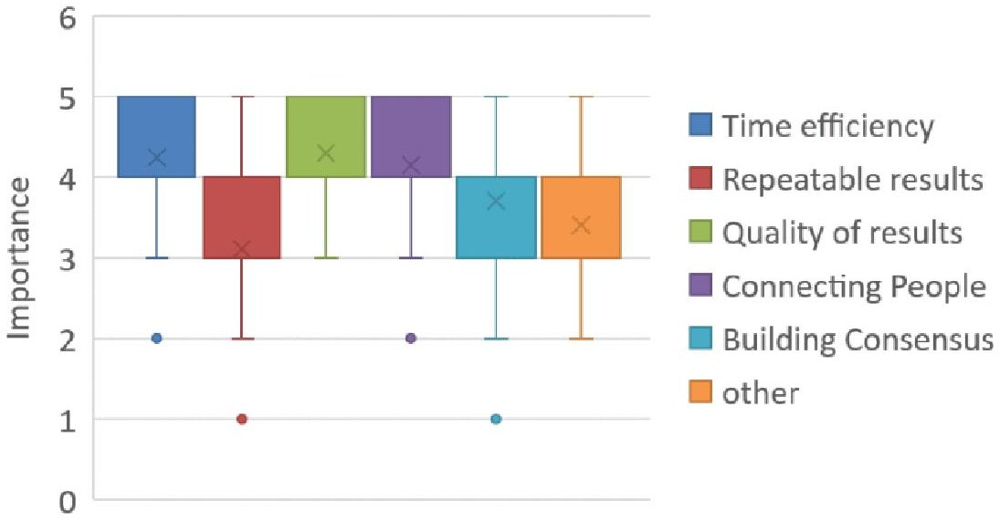


<div align="center">

Figure 2: Benefits of Concurrent Engineering [6].

</div>

However, Concurrent Engineering introduces a new set of challenges, as represented in Figure 3. Among these, the top three according to the results of [6] appear to be:

- Capturing engineering knowledge in models: MBSE has already become a major research topic, and will be exploited even more in the future, as presented in the INCOSE SE Vision 2035 [9]. In order to be more effective, models need to

<!-- PDF_PAGE: 14 -->


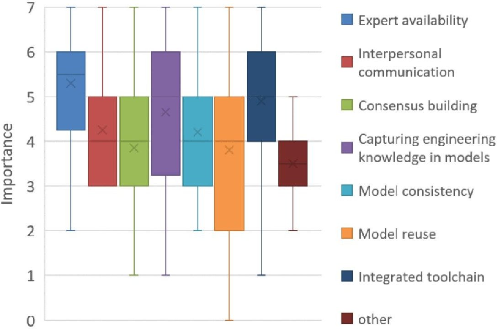


<div align="center">

Figure 3: Challenges of Concurrent Engineering [6].

</div>

represent a clear vision of the design and be reusable across projects, which also represents another of the challenges highlighted in the work of Knoll et al. [6].

- Expert availability: unlike more traditional methodologies, Concurrent Engineering requires the simultaneous participation, on-site or remote work, of all engineers involved in the project for each design session. This may represent an issue if a work schedule is not well defined.

- Integrated toolchain: the need for concurrent work between numerous specialists implies the need for a reliable and seamless link between the various tools required for each subsystem design, corroborated by reliable data sharing. This represents, as highlighted in the INCOSE SE Vision 2035 [9], one of the main challenges for the entire Systems Engineering field in the upcoming future.

## 2.2.2 Concurrent Design Facilities

The Concurrent Engineering sessions are typically held in highly specialised facilities, such as the ESA/ESTEC Concurrent Design Facility (CDF) [5], [4], or NASA's Concurrent Engineering Center (CEC). These dedicated environments are meticulously designed to foster efficient and effective interaction among the diverse range of professionals participating in the CE design processes [5].

An example of the layout of these facilities is presented in Figure 4.

These infrastructures are strategically arranged to facilitate optimal communication and collaboration. In particular, specialists who need to interact more frequently and closely are usually placed close to each other. This proximity improves ease and speed of communication, which is crucial in a fast-paced, collaborative environment. Furthermore, an important feature of these facilities is a central screen. This screen can display the

<!-- PDF_PAGE: 15 -->


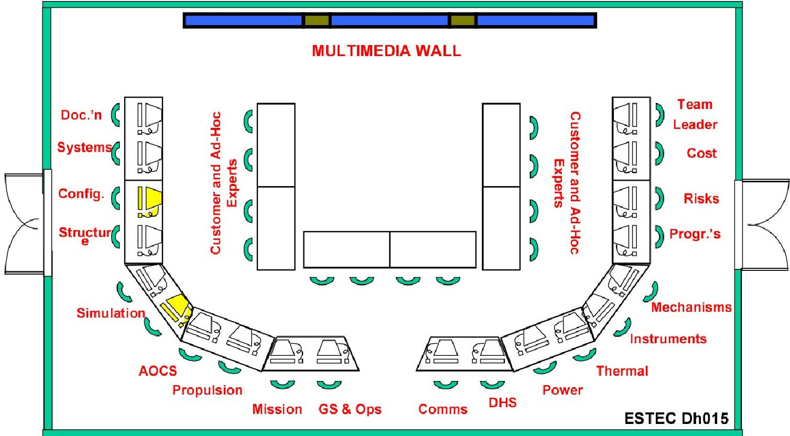


<div align="center">

Figure 4: ESA/ESTEC Concurrent Design Facility layout [5].

</div>

results of each participant's workstation, allowing the entire team to engage in detailed discussions and collaborative analysis.

From the research conducted by Knoll et al. [6], it has become evident that a significant portion of the engineers involved in CE sessions work remotely. This trend has necessitated the integration of video conferencing technology within the CDFs [5]. These technologies are not mere additions, but essential components that ensure the seamless integration of remote participants into the session.

This capability is critical to maintaining the effectiveness of the CE process in a world where remote and flexible working modes are becoming increasingly common. Remote participation technologies in CDFs allow teams to exploit a larger pool of expertise, regardless of geographical constraints, thus improving the quality and efficiency of the design process.

<!-- PDF_PAGE: 16 -->

## 2.3 Model-Based System Engineering

## 2.3.1 MBSE definition

The International Council on Systems Engineering (INCOSE), in its Systems Engineering Vision 2020 [16] defined Model-Based Systems Engineering (MBSE) as "the formalised application of modelling to support system requirements, design, analysis, verification, and validation activities beginning in the conceptual design phase and continuing throughout development and later life cycle phases".

MBSE represents a transformative approach in the realm of SE, as presented in the INCOSE SE Handbook [7]. It introduces a new model-centric paradigm, where comprehensive models are the primary medium of information exchange and system understanding. This approach moves away from traditional document-centric methods [7].

It is based on the use of domain-specific models $ ^{1} $ as the primary means of communication among engineers, rather than traditional documents. These models are often created using standardised languages such as the Unified Modelling Language (UML) or the Systems Modelling Language (SysML), which are discussed more in detail in Section 2.4 (UML and SysML).

They provide an abstract yet detailed representation of the system's architecture, behaviour, and requirements before the actual development phase. This increases the system's reliability and minimises the time and costs of the development and testing phases [7].

Centralising information in a cohesive model, MBSE combined with simulations promotes a shared and comprehensive understanding of complex systems. This helps to identify limitations or incompatibilities in design and avoid time and budget overruns, especially in the operational phase. This aspect is demonstrated to be as important as the system becomes more complex [7].

## 2.3.2 Benefits of using MBSE

According to the INCOSE SE Handbook [7], the use of MBSE presents several benefits. An assessment of the principal ones has been proposed in the work of Henderson and Salado [8] through a review of 20 journals and conferences of the SE area.

The most common benefits, divided into referenced, perceived, observed and measured ones according to reference [8], are depicted in Figure 5.

As indicated in reference [8], approximately two-thirds of the examined works highlight perceived advantages of Model-Based Systems Engineering. Conversely, only a minority of these works support their assertions regarding MBSE benefits through systematic

<!-- PDF_PAGE: 17 -->


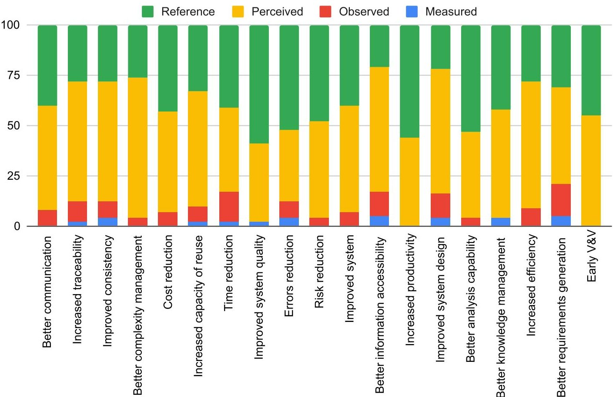


<div align="center">

Figure 5: Model-Based Systems Engineering benefits $ ^{2} $ . Adapted from [8].

</div>

measurement methodologies. However, it is important to highlight some of the principal benefits resulting from the study [8], which also trace to the benefits presented in the INCOSE SE Handbook [7]:

- Enhanced communication and productivity: one of the benefits of MBSE is its facilitation of clearer, more effective communication across the diverse engineers and teams involved in a complex system design. The visual and dynamic nature of models makes such systems more comprehensible, thereby enhancing collaborative efforts.

- Increased efficiency and quality: MBSE streamlines the engineering process by consolidating information in a singular, coherent model. This centralisation reduces the likelihood of inconsistencies and errors prevalent in document-based approaches, where the same information could be repeated through several documents, leading to a more efficient workflow and higher-quality systems.

- Effective complexity management: in today's world, systems are increasingly complex and interconnected, as highlighted in the INCOSE SE Vision 2035 [9]. Model-Based Systems Engineering offers a holistic perspective of such systems, enabling engineers to better understand and manage complex interactions and dependencies.

- Promotion of reusability and seamless integration: the modular nature of

<!-- PDF_PAGE: 18 -->

MBSE allows for the design of components and subsystems that are reusable. Additionally, it facilitates the smoother integration of new elements into existing systems, enhancing adaptability and scalability.

## 2.3.3 Future and challenges of MBSE

As highlighted in the INCOSE Systems Engineering Vision 2035 [9],"the future of Systems Engineering is model-based". This shows how highly promising the future trajectory of Model-Based Systems Engineering is. However, in the SE Vision 2020 [16] before, and in the SE Vision 2035 [9] after, several challenges for the SE field, also regarding the application of MBSE, have been identified.

SE Vision 2035 [9] presents "the enormous fragmentation across the engineering tools and data landscape" as one of the principal challenges for Systems Engineering. The presence of multiple discipline-specific tools, coupled with limited data standardisation and the extensive use of proprietary data formats are the principal causes for such discontinuity across the SE sector.

As systems grow in complexity, the demand for sophisticated system modelling techniques becomes more pressing. With the increasing complexity of systems design and requirements, there is a need to develop Systems Engineering practices "to provide methods for achieving high-effectiveness, high-assurance, resilient, adaptive, and life cycle affordable systems" [16].

In the upcoming future, SE practices will be model-centric, increasingly relying on reusable elements for fast and reliable systems designs. Emerging technologies, particularly in artificial intelligence and machine learning, offer new routes for automating elements of model creation and analysis. These advancements are likely to further refine the efficiency and efficacy of MBSE [9].

<!-- PDF_PAGE: 19 -->

## 2.4 Unified Modelling Language and Systems Modelling Language

In the context of MBSE, various modelling languages have been developed to answer the need to graphically visualise complex software and systems structures and their behaviours. They allow a comprehensive representation of a software/system in specific diagrams and data structures through a well-defined and constant set of rules.

Among these, two of the most diffused ones are the Unified Modelling Language (UML) and the OMG Systems Modelling Language (SysML).

The Unified Modelling Language [18] originated in the late '80s/early '90s and has immediately confirmed itself as one of the most useful modelling languages for software development [19]. The Systems Modelling Language [20] was born in the early 2000s by the combined endeavour of the Object Management Group (OMG), the International Council on Systems Engineering (INCOSE) and other partners and industry representatives, as a specialisation of UML for Systems Engineering applications. A thorough description of SE practices with SysML is presented in the work from Weilkiens [19].

The following section focuses on the key elements of the two deeply extensive modelling languages that are essential for understanding this work.

## 2.4.1 UML core elements

Figure 6 illustrates the core elements of UML and its structure. As described in [19], UML elements can be differentiated between structural and behavioural elements. The same distinction can be applied to SysML, as shown in Figure 12.


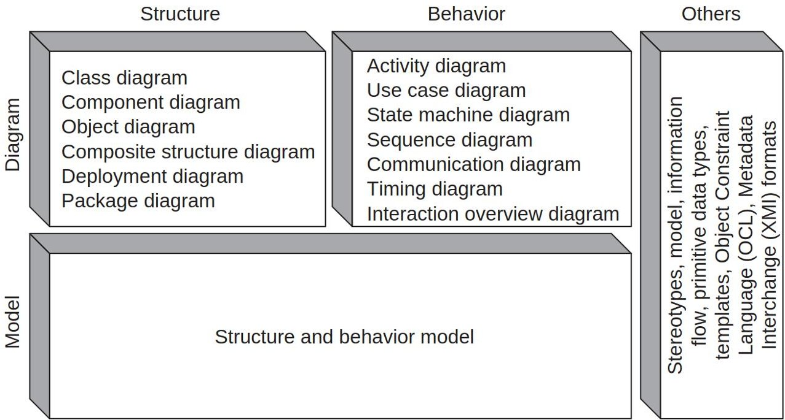


<div align="center">

Figure 6: UML structure [19].

</div>

Structural elements, such as classes and components, are utilised to outline the system's architecture while, in contrast, behavioural elements are employed to delineate the system's functions. On the other hand, a model encompasses a comprehensive description

<!-- PDF_PAGE: 20 -->

of the system, while a diagram represents a specific facet of the model, focusing on visualisation [19].

Classes Classes act as the basic units in object-oriented modelling. They delineate both the structure and behaviour of objects sharing common characteristics and meaning. Attributes define the structure, while operations outline the behaviour [18], [19]. Classes are introduced and characterised in Class Diagrams.

The above-mentioned objects could represent both codes' elements and real-life objects at any level of detail, thanks to the generality offered by the use of classes.

Attributees Attributes define the properties useful for the model and inherited by classes. They are composed of visibility, name, type, and a multiplicity, indicating the number of instances of the same type belonging to the class.


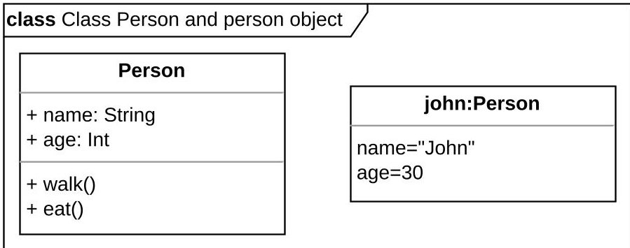


<div align="center">

Figure 7: Example of UML class and object with inherited attributes and operations.

</div>

Associations An Association indicates a relationship between two classes. Among those can be noted:

- Aggregation Association: describes a whole-part hierarchy between two elements.

- Composition Association: describes a whole-part hierarchy between two elements, in which the parts do not exist without the composite.


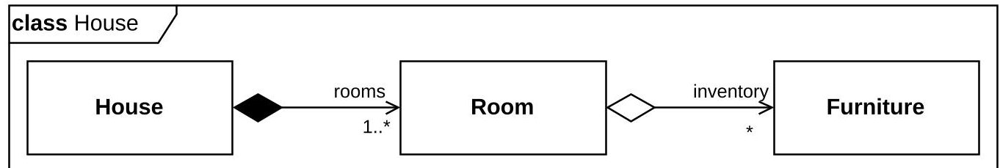


<div align="center">

Figure 8: Example of UML aggregation and composition associations. Adapted from [19].

</div>

As from Figure 8, the House and Room classes are connected by a Composition Association, while Room and Furniture are connected by an Aggregation Association. In this example, if the House ceases to exist, so do the Room(s) composing it. The same is not true for the Furniture element, which continues to exist in the model independently from the presence of a Room element [19].

<!-- PDF_PAGE: 21 -->

Another aspect presented in the example is the multiplicity of the elements. The "1..*" expression states that the House is composed of at least one Room, while the " *" alone implies that in the Room there could be an arbitrary number of Furniture elements.

Generalisations A generalisation introduces a hierarchy between a special subclass and a general superclass, where the subclass is a specialisation of the superclass (e.g., cat, dog or horse subclasses and animal superclass).


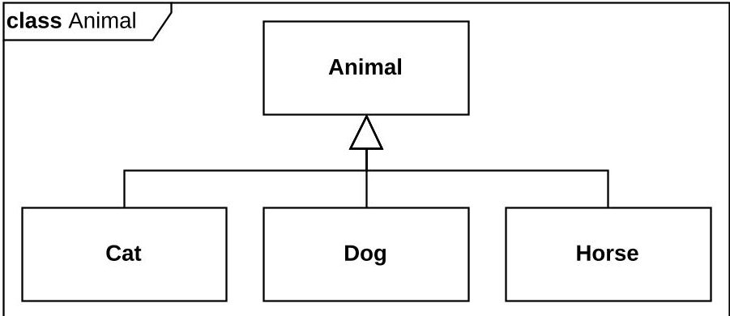


<div align="center">

Figure 9: Example of UML generalisation.

</div>

Stereotypes Stereotypes allow the definition of new elements through the extension of pre-existing model elements with more properties and/or operations. The pre-existing element extended by a stereotype is denoted with the keyword <<metaclass>>.

As from the example in Figure 10, it can be possible to extend the basic UML class «metaclass» with Height, Name and Age attributes and call this a Person class (Figure 10a). This new class can be used to define person elements in the model, allowing them to have a set of common attributes (Figure 10b).


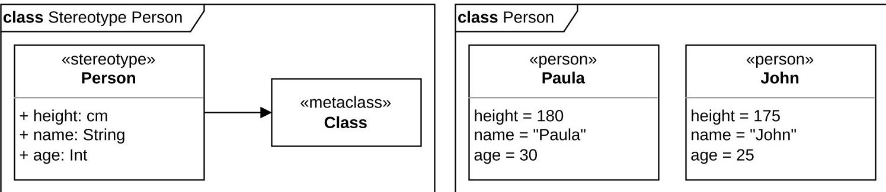


<div align="center">

(a) Stereotype definition example.

</div>

<div align="center">

(b) Stereotype application example.

</div>

<div align="center">

Figure 10: UML stereotype examples.

</div>

## 2.4.2 SysML core elements

As illustrated in Figure 11, the OMG Systems Modelling Language (SysML) [20] represents an extension to UML for Systems Engineering purposes. It has been obtained through the specialisation of part of the pre-existing UML elements, in combination with the introduction of new system-oriented elements and diagrams, as presented in Figure 12.

<!-- PDF_PAGE: 22 -->


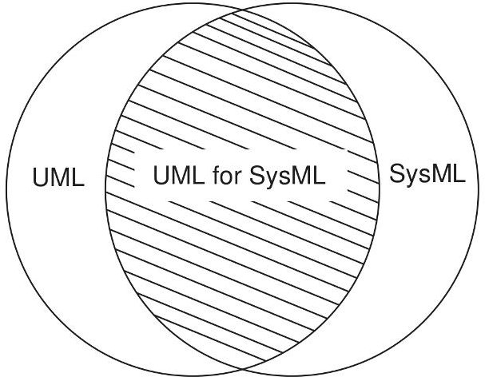


<div align="center">

Figure 11: UML and SysML link [19].

</div>


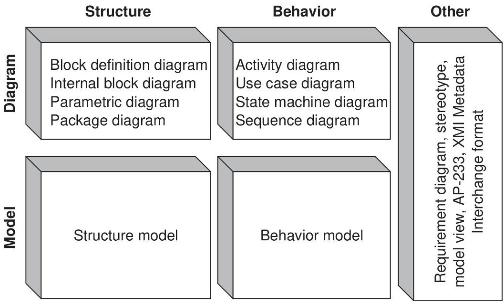


<div align="center">

Figure 12: SysML structure [19].

</div>

Blocks and Block Definition Diagrams In SysML, the UML's concept of a class is referred to as a block. Class Diagrams in SysML are therefore renamed as Block Definition Diagrams (BDDs). Additionally, SysML abstracts the UML class model's software focus, allowing objects to be utilised across various disciplines for system structure representation [19].

Requirements and Requirement Diagrams A new introduction in SysML with respect to UML is represented by Requirements. They represent conditions that systems must comply with and are collected and represented in Requirement Diagrams. Moreover, a series of relationships for requirements have been introduced, such as:

- derive requirement (or deriveReqt): indicates that a requirement is derived from another;

- satisfy: indicates how a system element satisfies a requirement;

- verify: indicates how a test case verifies a requirement.

<!-- PDF_PAGE: 23 -->

Value Types, Units and Dimensions A Value Type is a specialisation of a UML data type composed of a unit and a dimension. Units describe specific physical units, while dimensions specify their quantity.

Stereotypes applied to UML Both the Requirement element and its new relationships were obtained through the use of stereotypes for specialising pre-existing elements of UML. In particular, the requirement is a stereotype for the UML class element, while the deriveReqt, satisfy and verify relationships are stereotypes for the abstraction, realization and trace elements, respectively.

The same can be noted for several SysML elements, such as the previously-introduced blocks, value types, units or dimensions.

The extensive application of UML stereotypes will be a fundamental aspect of this work, as presented in Section 3 (Proposed formalisation).

<!-- PDF_PAGE: 24 -->

## 2.5 CubeSats

## 2.5.1 SmallSats and CubeSats

Large systems, while capable of obtaining impressive results in fields like space exploration, Earth observation, communications or navigation, require enormous investments in terms of cost, development time and workforce, as described in the "Space mission engineering: the new SMAD" from Wertz et al. [12]. Small satellites, the class composed of satellites weighing less than 500 kg as indicated in the Nanosats DB by Kulu [2], are revolutionising access to space with their counter-trending cost and system complexity, especially in fields like academia, education, and technology research & development [12]. Table 1 presents a further classification of small satellites by weight.

<div align="center">

Table 1: Small satellites classification by weight. Adapted from [2].

</div>

<table border="1"><tr><td></td><td colspan="2">Category</td><td>Mass[kg]</td></tr><tr><td rowspan="5">SmallSats</td><td>Mini-satellite</td><td colspan="2">100 to 500</td></tr><tr><td>Micro-satellite</td><td colspan="2">10 to 100</td></tr><tr><td>Nano-satellite</td><td colspan="2">1 to 10</td></tr><tr><td>Pico-satellite</td><td colspan="2">0.1 to 1</td></tr><tr><td>Femto-satellite</td><td colspan="2">0.01 to 0.1</td></tr></table>

While the majority of launched nanosatellites are from the US and Europe, thanks to this new mass standard, access to space has been granted to more and more countries and organisations during the last two decades [12], as presented in Figures 13 and 14.


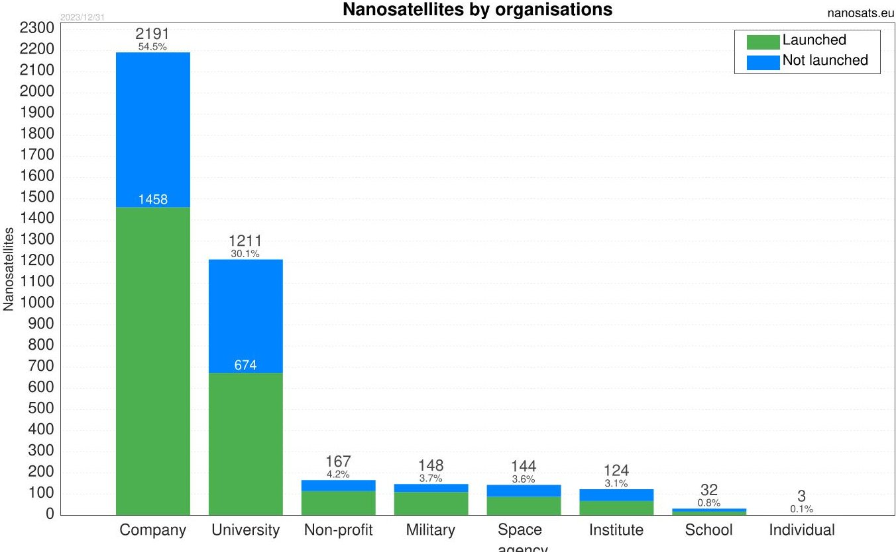


<div align="center">

Figure 13: Nanosatellites by organisations [2].

</div>

<!-- PDF_PAGE: 25 -->


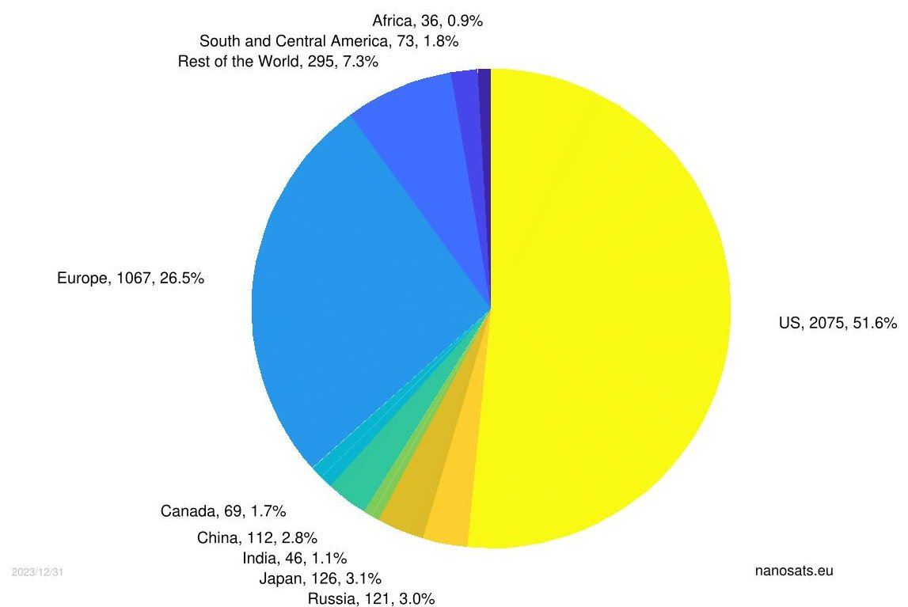


<div align="center">

Figure 14: All nanosatellites by locations [2].

</div>

CubeSats represent an even more groundbreaking category of nanosatellites, which significantly influenced the field of space exploration and satellite technology since their introduction in 1999.

Developed by Professors Jordi Puig-Suari of California Polytechnic State University and Robert Twiggs of Stanford University, the CubeSat project was initially aimed at providing university students with a standardised, cost-effective way to design, build, and launch satellites for space research and educational purposes [11], [12].

It all started at Stanford University with the spacecraft OPAL (Orbiting Picosat Automated Launcher), which represented "a significant milestone achievement in the evolution of small satellites" [12]. This mission demonstrated the viability of the picosatellite concept and the use of a new deployment system based on the release of small satellites from larger satellite systems.

This concept led to the development of the CubeSat form factor (which will be discussed more in detail in the following) and the P-POD deployment system [12]. The latter allowed a radical reduction of launch costs, by enabling a large number of small satellites to be more easily and simply accommodated inside the launcher tube.

## 2.5.2 The CubeSat standard

As anticipated, the CubeSat standard revolutionised access to space by offering a more affordable and accessible platform, coupled with a standardised class of dispensers [12].

It is based on the adoption of a standardised form and size factor, shown in Figure 15, in which each unit (defined as 'U') is a 10 x 10 x $ \sim $ 10 cm cube with a mass of around 2

<!-- PDF_PAGE: 26 -->

kg [11]. Although CubeSats were first used for academic purposes [12], their utility has expanded to include commercial, governmental, and scientific missions.


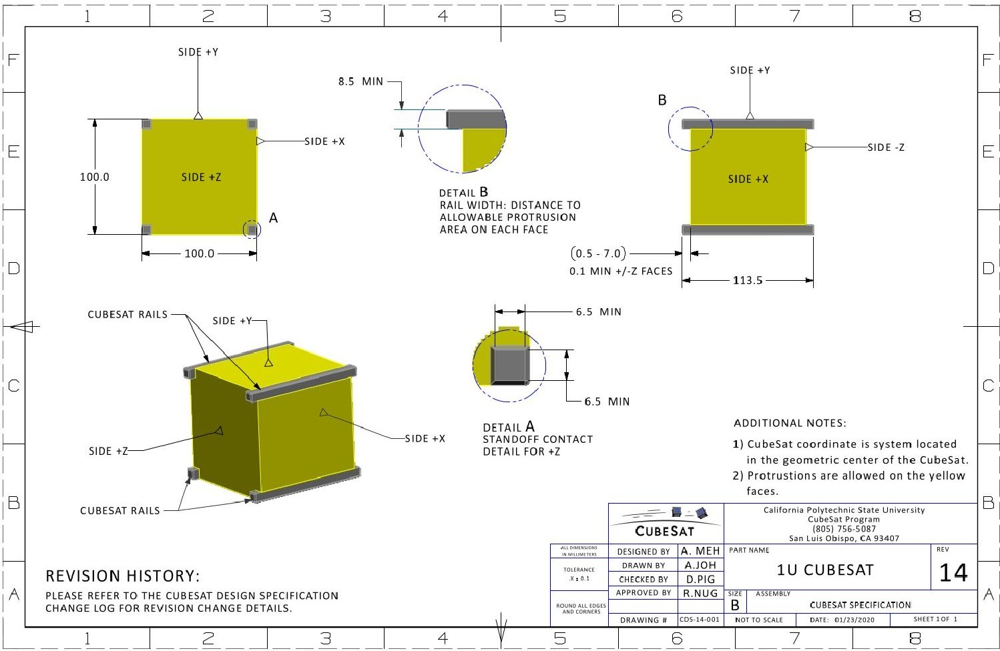


<div align="center">

Figure 15: Standard for 1U CubeSat structure [11].

</div>

Over time, CubeSats have evolved in both capability and size, with larger variants like 3U, 6U and 12U now common (see Figure 16 and Table 2 for the current CubeSats options available), broadening their potential applications to include tasks like Earth observation and scientific experiments, and even missions to other planets [2]. As evident from Figure 17, which shows the nanosatellite launches until 2023 and future previsions divided by satellite type [2], CubeSats represent the vast majority of them.


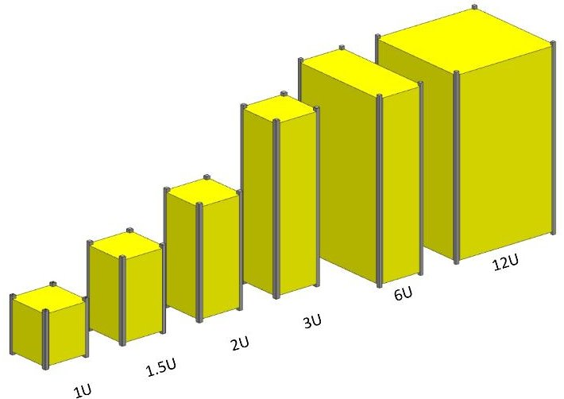


<div align="center">

Figure 16: CubeSats family [11].

</div>

<div align="center">

Table 2: CubeSats mass specifications [11].

</div>

<table border="1"><tr><td>U configuration</td><td>Mass[kg]</td></tr><tr><td>1U</td><td>2</td></tr><tr><td>1.5U</td><td>3</td></tr><tr><td>2U</td><td>4</td></tr><tr><td>3U</td><td>6</td></tr><tr><td>6U</td><td>12</td></tr><tr><td>12U</td><td>24</td></tr></table>

Their small size and standardised design have made it easier and cheaper to launch them as secondary payloads, reducing overall launch costs. The small satellite paradigm led

<!-- PDF_PAGE: 27 -->


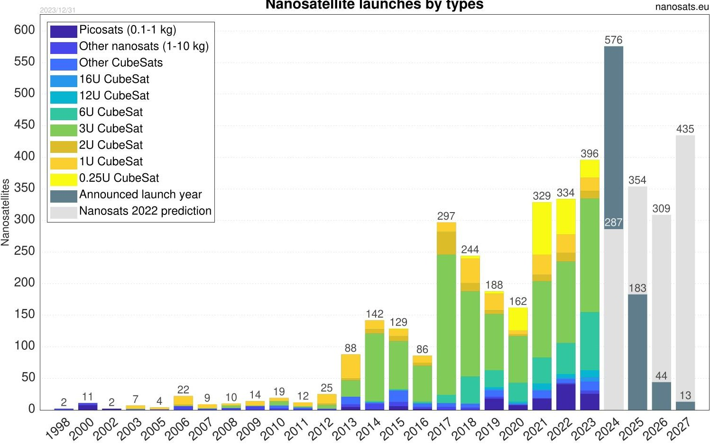


<div align="center">

Figure 17: Nanosatellite launches by types [2].

</div>

to more manageable and simple design phases, coupled with a radical simplification in terms of team members and time needed for a project [12].

Small satellites, although most of them are designed by students with no or little experience, offer comparable reliability to the missions of large satellites precisely because of the simplicity of their Concept of Operations (ConOps) and reference orbits (mostly Low Earth Orbits (LEOs)), the small number of components, and the fact that they often do not need to be rad-hardened [12].

This development has democratised space exploration, allowing smaller organisations and countries to engage in space activities [2], [12]. The rise of CubeSats represents a major shift in the way space missions are conducted, making them a key element in the future of space technology.

<!-- PDF_PAGE: 28 -->

## 2.6 Open-source initiatives for CubeSat design

Open-source initiatives in CubeSat design represent a significant and growing area of interest in the space field.

The work from Scholz and Juang [21] presents a thorough overview of open-source existing terrestrial practices and highlights how Open Design practices could benefit the space sector, more specifically in low budget projects such as the ones carried out by Academia.

In [21] Open Design is referred to as the combination of Open Source Software (OSS) and Open Source Hardware (OSHW), both regulated by specific entities.

For the OSS, the recognised regulator entities are the Free Software Foundation (FSF) [22] and the Open Source Initiative (OSI) [23]. The latter defined the Open Source Requirements (OSRs), i.e. the criteria that an Open Standard must comply with:

- No Intentional Secrets: The standard shall disclose any detail vital for interoperable implementation. Inevitable flaws shall be addressed by defining a process for rectifying issues identified during implementation and interoperability testing. Subsequent changes shall be integrated into an updated or new version of the standard, released under terms compliant with the OSR.

- Availability: The standard shall be openly and freely accessible (e.g., via a reliable website) under royalty-free terms at a fair and non-discriminatory cost.

- Patents: All patents crucial for the standard's implementation shall either:

- be licensed under royalty-free terms for unrestricted use, or

- be subject to a non-assertion commitment when utilised by open-source software.

- No Agreements: There shall be no obligation to sign any form of agreement, such as a licence agreement, N.D.A., grant, click-through, or similar documentation, to deploy conforming implementations of the standard.

- No OSR-Incompatible Dependencies: Implementation of the standard shall not depend on any other technology that does not meet the criteria of this Requirement.

The OSR therefore defines the environment and conditions for an OSS, allowing that to "be freely used, changed, and shared (in modified or unmodified form) by anyone. Open Source Software is made by many people, and distributed under licenses that comply with the Open Source Definition" [21], [23].

Unlike software, as highlighted in [21], access to various documents, including drawings, schematics, diagrams, design rules, layouts, and other related materials, is necessary for modifying and producing hardware.

The Open Source Hardware Association (OSHWA) [24], defines the OSHW as "hardware whose design is made publicly available so that anyone can study, modify, distribute, make, and sell the design or hardware based on that design. The hardware's source, the

<!-- PDF_PAGE: 29 -->

design from which it is made, is available in the preferred format for making modifications to it” [25].

This directly derives from the Open Source Definition from OSI [23], and defines a set of criteria that OSHW must comply with. The full list of OSHW Requirements is available in [25]. Among those, it is important to highlight the following ones:

- Documentation: Hardware shall come with documentation, including design files, allowing their modification and distribution. If not provided with the product, documentation should be obtainable online at minimal cost, ideally free.

- Necessary Software: If essential operation requires software, the license shall ensure either:

- detailed documentation for creating compatible open-source software, or

- necessary software is under an OSI-approved open source license.

- Derived Works: The license shall permit modifications and derivatives, allowing distribution under the same terms. It shall permit manufacturing, selling, and using products derived from the design files.

- Free Redistribution: The license shall not limit free selling or giving away of the project documentation and must not require royalties or fees for sale of derived works.

- Non-Discrimination: The license shall not discriminate against any person or group.

As presented in Section 2.5 (CubeSats) and remarked in the work from Scholz and Juang [21], after the introduction of the CubeSat standard, the access to space has been democratised. It enabled a wider range of Institutions, Countries and Organisations to develop and deploy reliable and cost-effective satellites, with reduced budgets.

Figure 13 from Kulu's Nanosats DB [2] shows how, after Industry, the second organisation with the most deployed CubeSats is Academia.

The work from Scholz and Juang [21] highlights how the introduction of the open-source paradigm within the Academic environment could streamline information exchange across various institutions. As for terrestrial applications, this would lead to more reliable, cost-effective, and innovative designs, based on a massive peer-review and all suggestions and improvements from the open-source community [21].

From that it is evident how an important aspect of the application of the open-source approach is its collaborative nature. Many open-source projects can rely on a strong community, which conduct most of the development process.

The application of the open-source paradigm to CubeSat design across Academia would facilitate such design process, allowing for easier re-utilisation of concepts, software and components and enabling the collaboration between various teams that could focus on several aspects of a same project without non-disclosure issues [21].

There are several notable open-source initiatives for CubeSat design that have emerged

<!-- PDF_PAGE: 30 -->

in recent years. These initiatives aim to provide accessible, community-driven resources for designing, building, and operating CubeSats. Some of these include:

- Libre Space Foundation: The Libre Space Foundation [26] is a non-profit organisation, dedicated to the development of open-source space technologies. One of their notable projects is the University of Patras Satellite (UPSat) [27], which appears to be the first Open Design CubeSat.

- LibreCube: LibreCube [28] is an initiative focusing on developing OSS and OSHW for space and Earth exploration, strictly using only open-source tools. They aim to provide designs and protocols that are freely available for anyone to use and adapt.

- Satellite Networked Open Ground Stations (SatNOGS): Also a project under the Libre Space Foundation, SatNOGS [29] is an open-source network of satellite ground stations. It provides a platform for tracking and receiving data from satellites, including CubeSats, and is a vital resource for CubeSat operators.

- ArduSat: The ArduSat Project [30] was an early example of an open-source CubeSat, which used Arduino [31] as a primary platform for payloads. Two small satellites were launched in 2013, after one year of crowdfunding [32], allowing users to run their own experiments in space. Both of them re-entered the atmosphere in 2014.

- Open Source CubeSat Workshop: This is an annual event that brings together developers and enthusiasts in the field of CubeSat and small satellite technologies. It focuses on open-source approaches and fosters collaboration and sharing of ideas and projects. Information on the 2021 edition of the Workshop are available in [33].

- Nanostar Software Suite (NSS): Developed by the joint effort of the Nanospace Consortium, the NSS is an open-source and web-based software framework, with the aim of facilitating data exchange between domain-specific software in CE sessions [34].

These initiatives reflect the growing interest in open-source approaches to space technology. By sharing designs, software, and knowledge, these projects not only lower the barriers to entry into the field of satellite development but also encourage innovation and collaboration in the space community.

<!-- PDF_PAGE: 31 -->

## 2.7 State-of-the-art of the NSS

The Nanostar Software Suite (NSS) is an open-source and web-based software framework, with the aim of facilitating data exchange between domain-specific software, as presented in the work from Gateau et al. [34].

Figure 18 shows the architecture of the NSS. It mainly consists of a web-based Graphical User Interface (GUI), a database and a Application Programming Interface (API), thoroughly designed to facilitate academic CubeSats Preliminary Design process and Concurrent Engineering sessions [34].

As from [35],"an API is a well-defined interface that provides a specific service to other pieces of software". The application of an API therefore allows modular functions and applications to be incorporated into the end-case suite, seeing each software in the NSS constellation as a component, or a service [35]. Moreover, NSS allows several ways for connecting third-party applications, as from the numbered circles in Figure 18:

1. Manual interaction with the GUI.

2. Through a generic interface (e.g., an API).

3. Through the NSS' dedicated API.

This feature ensures even greater flexibility in the choice of tools for budgeting and simulation activities and their implementation, making the modularity and flexibility core aspects of the NSS approach to the design process.


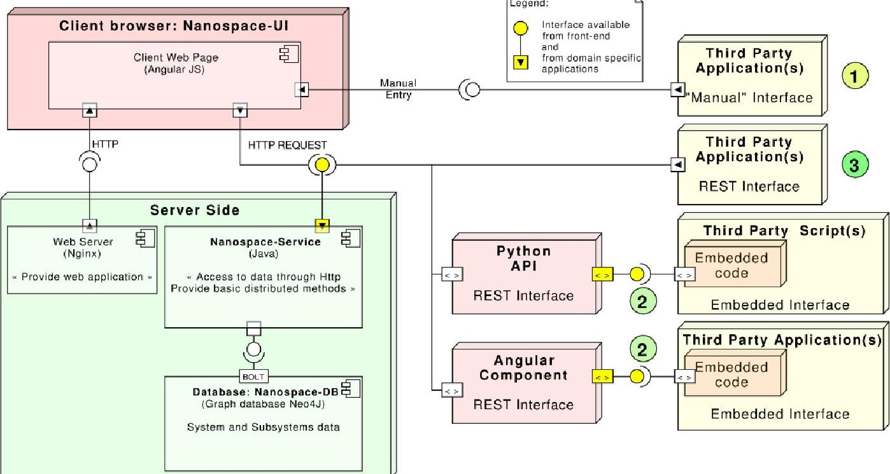


<div align="center">

Figure 18: Simplified Nanospace architecture [34].

</div>

<!-- PDF_PAGE: 32 -->

## 2.7.1 Nanospace UI

Nanospace UI is the primary visual interface of the Nanospace framework, which is used for the concurrent design of CubeSats. Figure 19 displays the GUI.


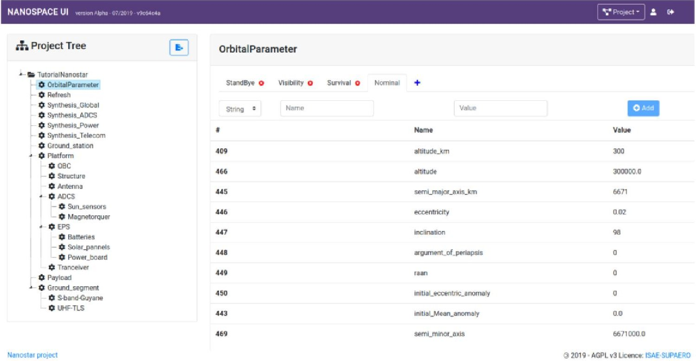


<div align="center">

Figure 19: Nanospace-UI [34].

</div>

Within the interface, the users are offered a range of functionalities to facilitate project interaction and management [34]:

- Cross-platform access: Nanospace UI is designed for cross-platform access, requiring only a modern web browser on the client side. This makes it easily accessible from various devices without needing specific installations.

- User authentication and management: Users can authenticate themselves to access the application and the projects they are responsible for. Additionally, users can add other members as co-responsible for a project, fostering collaboration.

- Project and model creation and modification: Nanospace-UI allows users to create and modify projects or models, which are compositions of various elements. Users can characterise models with specific values, adding detailed information and parameters to different project components.

- Creation of Requirements: The GUI enables users to create requirements based on the characteristics of the model, helping to ensure that the design meets the necessary criteria.

- Classic functionalities: It includes classic user interface functionalities such as copy, drag-and-drop, and auto-completion, enhancing the ease of use.

- Modes creation for components: The interface allows for the creation of one or several Operating Modes (OMs) for each component, facilitating the exploration

<!-- PDF_PAGE: 33 -->

of different configurations or states of a project's parts.

- History Access: Users also have access to a history of past modifications, aiding in tracking changes and maintaining project integrity.

In brief, Nanospace-UI is a comprehensive and user-friendly interface that facilitates various aspects of CubeSat project management and design, emphasising ease of use, collaboration, and efficient data handling.

## 2.7.2 Nanospace DB

Nanospace DB is a key component of the Nanospace framework. It incorporates several important elements and characteristics [34]:

- Graph-based data storage: Unlike traditional relational databases, Nanospace DB stores data in a graph form. This approach is more suitable for handling hierarchical data structures with variable depth, which is common in CubeSat design. In a graph database, data is represented as nodes and edges, where nodes can represent entities such as components, modes, and values, and edges represent the relationships between these entities [36].

- Use of Neo4j: Nanospace DB utilises Neo4j, a database known for its ACID (Atomicity, Consistency, Isolation, Durability) properties [36]. These properties ensure reliable transaction processing and data integrity, which are crucial for complex design projects like CubeSats. Neo4j's graph-based structure is particularly efficient for handling the interconnected and hierarchical nature of CubeSat design data.

- Write-protection and access competition: To manage concurrent access and ensure data integrity, data within Nanospace DB is write-protected. This feature allows multiple users to access and work with the data simultaneously without risking data corruption or conflicts.

- Entities in Nanospace DB: The data model of Nanospace DB includes several entities:

- Project: This entity stores elements that constitute the CubeSat model.

- Components: These are the building blocks of the project, representing various parts or subsystems of the CubeSat.

- Mode: This entity describes the different functional options of a component allowing for the representation of various states or configurations that a component might have.

- Value: This entity specifies the modes and, indirectly, the components. It represents the specific parameters or characteristics of a mode or component.

- User: This entity represents individuals who are responsible for different aspects of the project. It ensures accountability and tracking of modifications made by different team members.

<!-- PDF_PAGE: 34 -->

In summary, Nanospace DB is a sophisticated and adaptable database system, specifically designed for the complexities and collaborative nature of CubeSat design, leveraging the strengths of graph-based data storage and the robust capabilities of Neo4j.

## 2.7.3 Nanospace constellation

The Nanostar Software Suite (NSS) is an integral part of the Nanospace constellation concept, designed for the concurrent design of CubeSats. Its main elements are depicted in Figure 20, along with their integration level.


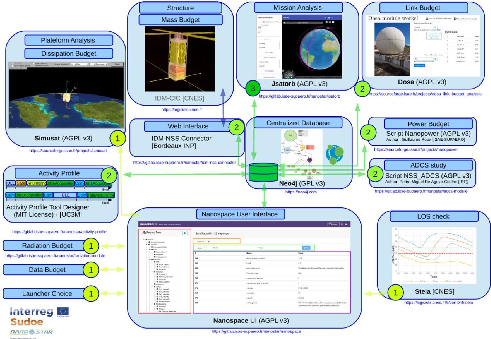


<div align="center">

Figure 20: NSS constellation. Green circles represent the level of interconnection, from low (1) to full (3) integration [34].

</div>

The development and support of the NSS modules are collaborative efforts by different institutes within the Nanostar Consortium [34]. This collective approach leverages the expertise and resources of various organisations to create a comprehensive and effective toolset.

The NSS is designed to respect, as far as possible, pre-existing standards sets, such as the ones by the Consultative Committee for Space Data Systems (CCSDS) and the European Cooperation for Space Standardisation (ECSS). CCSDS standards, for example, are crucial for ensuring interoperability, reliability, and quality in space data and information systems. A thorough overview of active standards for CubeSat missions is presented by Scholtz [37].

<!-- PDF_PAGE: 35 -->

Within the NSS, Nanospace functions as the backbone, facilitating smooth interactions between different subsystem expert software. This role underscores Nanospace's importance in integrating various software modules and ensuring seamless communication and data exchange among them.

This integration and interaction between different subsystem expert software is crucial for handling the complex, interdisciplinary nature of CubeSat design, where various subsystems need to be designed and tested in a coherent and coordinated manner [34].

In summary, the Nanostar Software Suite is a developing toolset within the Nanospace constellation, aimed at enhancing the concurrent design of CubeSats through collaborative efforts, standard compliance, and integrated subsystem expertise.

<!-- PDF_PAGE: 36 -->

## 3 Proposed formalisation

## 3.1 Research problem

The work of Knoll et al. [6] highlights how the introduction of Concurrent Engineering (CE) methodologies is facing a set of technical challenges. Among these, the top common ones appear to be the need for a strong and seamless connection between the various discipline-specific tools and the increasingly widespread use of MBSE, which must represent the systems in their entirety [6].

As presented in Section 2.3.3 (Future and challenges of MBSE), such challenges are also underlined in the INCOSE SE Vision 2020 [16] and SE Vision 2035 [9]. The fragmentation across modelling and simulation tools and the data landscape, along with the need for sophisticated modelling techniques, represents a challenge for the Systems Engineering field, to be faced in the near future.

The study conducted by Bajaj et al. [10] thoroughly examines the discrepancies between current tools used for designing and analysing complex systems during the various design phases, as depicted in Figure 21.


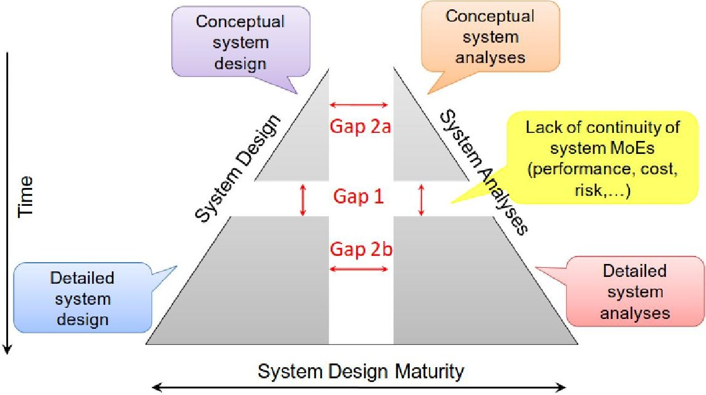


<div align="center">

Figure 21: Gaps in current state-of-the-art tools for design and simulation of complex systems. Adapted from [10].

</div>

Gap 1 focuses on the lack of Model-Based continuity in system design and simulation activities across different stages of mission design. This issue arises from the utilisation of varied modelling and simulation tools in the initial phases of a mission compared to the later stages. This results in inconsistencies in the system's definition, requirements, and performance parameters throughout the development cycle [10].

Gap 2 highlights the disconnection between design and simulation models within each design phase. Particular emphasis is given to Gap 2a, which points out the differences between conceptual system design models and mathematical analysis models in the early stages [10].

<!-- PDF_PAGE: 37 -->

The need for a MBSE workspace, facilitating the integration of modelling languages such as SysML with discipline-specific models, has led to the creation of the Systems Lifecycle Management (SLIM) [10] tool. An effort for developing an interface between a SysML model and a simulation tool such as Ansys Systems Tool Kit (STK) [38], following the SLIM methodology, is presented by Spangelo et al. [39]. In this application, the model executes a scenario and calculates the visibility windows between a Spacecraft (S/C) and a Ground Station (GS).

It has to be noted, however, how both SLIM and the work from Spangelo et al. [39], while providing useful information about the integration of SysML with various simulation tools, require the use of proprietary tools such as Ansys STK.

The demand for an open-source software ecosystem resulted in the development of the Nanostar Software Suite (NSS) [14], [34]. As presented in Section 2.7 (State-of-the-art of the NSS), this suite enables the creation of a unified database shared amongst the principal analysis software used during a Preliminary Design (PD) Phase.

The process utilised within the NSS is highly iterative and modular, allowing users the flexibility to either utilise the NSS or substitute specific tools with their preferred alternatives [14], [34].

Nevertheless, the NSS does not include all the advantages that would result from using modelling language such as SysML. A thorough description of MBSE, SysML and their benefits is presented in [8], [19], [40]. However, the use of MBSE tools and modelling languages for the NSS has been explored in the work of Salas Cordero et al. [13], emerging as a strong option for defining the functions related to the S/C and "avoiding the long manual task of mapping connections between system elements, which can be useful in change management to determine change propagation" [13].

A new set of research questions emerged from the work [13], emphasising what already presented in the work of Bajaj et al. [10]:

- Can MBSE be used as a "front-end" for the complete design cycle?

- How do CE approaches and associated tools, linked with MBSE approaches and their tools, impact the PD phase?

These questions, which eventually led to the development of the NSS [13], [14], [34], are answered in the following of this thesis in a new form, as schematised in Figure 22:

1. How to formalise the integration of MBSE tools and modelling languages with third-party open-source simulation tools for their application among the whole Preliminary Design phase?

2. How to formalise a CubeSat model with enough generality to allow its reusability across different mission designs, while still detailed enough for a comprehensive representation of the systems?

In the following sections of this thesis, a detailed description of a proposed formalisation of a general CubeSat model is presented. This model is specifically designed to be versatile

<!-- PDF_PAGE: 38 -->


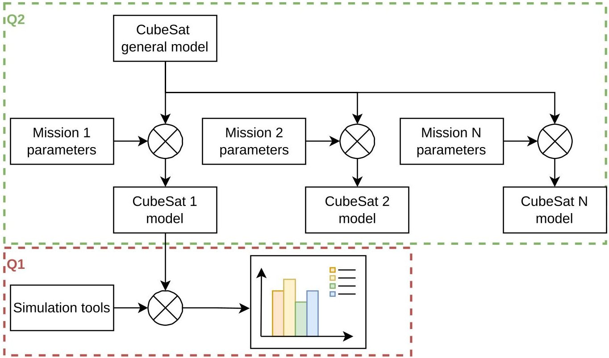


<div align="center">

Figure 22: Research questions.

</div>

and compatible with a wide range of simulation tools, making it a valuable asset to the CubeSat design and development process.

The entire process is developed with the use of open-source tools in mind, as a way to further facilitate the Preliminary Design of CubeSats in low-budget contexts, such as Academia.

The forthcoming sections begin with a discussion of the proposed integration process of the CubeSat model. This process is pivotal as it outlines the methodology for implementing the proposed formalisation in an end-to-end application. The proposed integration process is designed to ensure seamless interaction between the various components of the CubeSat model and any set of simulation tools.

Following the integration process, the thesis details all the elements that constitute the formalisation. Each element is examined, highlighting its role, significance, and interdependencies with other components.

Moreover, the thesis addresses how the proposed formalisation accommodates various mission types and objectives, illustrating the flexibility and adaptability of the model. This is particularly important given the diverse range of applications for which CubeSats are deployed, from Earth Observation and scientific research to technology demonstration and educational purposes.

Overall, the subsequent sections aim to provide a comprehensive guide to the proposed CubeSat model formalisation, offering valuable insights and practical methodologies for researchers, engineers, and students involved in CubeSat development. This formalisation is intended not only to streamline the design and development process but also to enhance the overall quality and success rate of CubeSat missions.

<!-- PDF_PAGE: 39 -->

## 3.2 Integration process

The work from Spangelo et al. [39] presents an integration of a CubeSat model with a proprietary simulation tool, i.e. Ansys STK. It presents a way for defining a set of parameters for the characterisation of the systems and subsystems composing a CubeSat, as inputs and outputs of the various functions defining the behaviour of such parts [39]. In the application presented by Spangelo et al., however, the CubeSat model is used as an interface for allowing inter-operability with external tools and data sources [39].

Since this thesis sets as requirements the use of open-source tools and the centralisation of data within a single model, the formalisation of a generic CubeSat model capable of acting as a front-end and single source of truth for the data during all stages of the PD phase is presented below. The proposed model formalisation, as discussed later, is integrable with any desired set of open-source simulation tools for analysis and budgeting activities and the generation of system reports.

Within the framework of MBSE and modelling languages, several options are viable. As illustrated in Section 2.4 (UML and SysML), however, the Systems Modelling Language (SysML) stands out as an extension of the Unified Modelling Language (UML), specifically designed for Systems Engineering (SE) applications. The SysML excels in its ability to represent complex systems, capturing everything from requirements and core functions to the interaction of components and $ flows^{3} $

Given these strengths, SysML has been chosen as the modelling language for developing a general CubeSat model as part of the proposed formalisation. This choice is motivated by the ability of SysML to effectively delineate both the logical and functional aspects of the systems and its ability to consistently represent their physical architecture.

However, despite its extensive modelling capabilities, SysML does not inherently provide the specific and quantifiable data needed for simulation and analysis. These elements, such as the mass and power consumption of system components and orbital parameters, are crucial for realistic simulations and accurate system budgeting. To fill this gap, it is necessary to support the SysML model with external mathematical models, which provide the detailed data required for these tasks.

The next step is the integration of the simulation data into the SysML model, to ensure the existence of a single source of truth for the data and reduce the fragmentation of information during the PD phases. This process requires the identification of the essential data and parameters that must be represented for a complete simulation of the system's operational scenarios.

Figure 23 illustrates the proposed integration process. This integration strategy aims to seamlessly merge the MBSE tools and SysML modelling language with third-party simulation tools, creating an effective and streamlined modelling and simulation environment for CubeSat development. This holistic approach ensures that the CubeSat model

<!-- PDF_PAGE: 40 -->

accurately embodies both the theoretical and practical aspects of the system, reflecting its performance and operational capabilities in simulated environments.


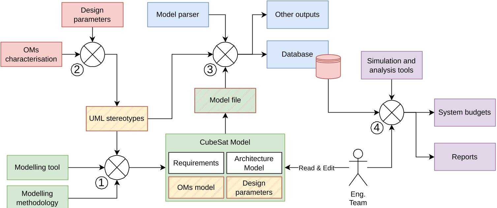


Figure 23: CubeSat model and simulation tools proposed integration process. The colour coding of the blocks defines an input/output relationship, following the order of the arrows.

1. The first step in the proposed process is to establish a general model for CubeSat using SysML, represented as green blocks in the Figure above. This model forms the backbone of the proposed formalisation. It is important to note that this initial phase is independent of any specific modelling tool or methodology. This flexibility in the selection of instruments, which is elaborated later in this thesis, is crucial for wider applicability and ease of adoption in various contexts.

2. The entire proposed formalisation is based on the application of UML stereotypes, represented as yellow blocks, to the SysML model $ ^{4} $ . Once again, this step relies neither on the modelling tool of choice for the generation of the model, nor on the other elements included in the model itself.

The proposed set of stereotypes, described in detail in Section 3.3.2 (Stereotypes generation process), allows further characterisation of the model blocks, enabling the inheritance of specific attribute sets to blocks with the same stereotype applied. Such attributes mimic the design parameters needed for analysis and simulation activities across the PD stages, represented by red blocks in Figure 23. They include, for instance, the orbital parameters, or the data needed for a characterisation of the Operating Modes (OMs) and the main systems of a CubeSat. Thus, the next required step is the identification of the parameters and main system budgets required in the PD phase.

3. After the identification of the parameters needed, the next stage in the proposed process is the extraction of relevant data from the model files for further integration with any set of analysis and simulation tools. It is done through the development of a dedicated parser, represented by blue blocks in Figure 23. The parser, by knowing

<!-- PDF_PAGE: 41 -->

in advance the stereotypes applied in the model and their relative attributes, is capable of extracting the desired data (e.g., the design parameters, represented by red blocks) and generating a software-readable data structure in any desired format. As presented in Section 3.5.10 (CubeSat SysML model and simulation tools integration summary), this step requires a thorough understanding of the model file format, and therefore is dependent on the modelling tool of choice.

4. Lastly, it is possible to link the newly generated data structure with any desired simulation and analysis tools for the generation of system budgets and reports, as indicated by purple blocks in Figure 23. With this step the integration is complete: it is possible to generate a CubeSat general model, capable of storing and visualising all relevant data for simulations and budgeting activities. Such data are automatically parsed into a software-readable data structure for integration within any set of simulation tools, without further need for manually populating a database. As presented in future sections, by changing the data inside the data structure manually, or as a result of a simulation/analysis, the parser is capable of automatically editing the model files, ensuring continuity in the overall process.

All the steps described above are discussed more in detail in the following of this work.

An end-to-end application of the proposed formalisation is presented in Section 3.5.10, as a proof of concept.

<!-- PDF_PAGE: 42 -->

## 3.3 Data formalisation in CubeSat model

This section provides an introduction to the proposed formalisation design choices. It presents the chosen modelling tool for the generation of a CubeSat general SysML model and the main steps within it for the inclusion of UML stereotypes within it. The principal design parameters and budget to be included within such stereotypes are assessed, before continuing to Section 3.4 (Operating Modes generalisation).

## 3.3.1 Modelling tools comparison

In order to create an effective and efficient SysML general CubeSat model, and to enrich it through the application of UML stereotypes, various open-source modelling tools need to be assessed. Each tool presents its own unique benefits and limitations, especially when considered for use in an academic setting. Given that many potential users are likely to be newcomers to both MBSE and SysML, it is essential to assess these tools through a lens that prioritises accessibility and ease of use.

The following set of evaluation criteria has been established:

- Ease of learning: how user-friendly is the tool, especially for beginners? This includes considerations of the tool's learning curve and the availability of learning resources such as tutorials and user guides.

- Complexity of the Graphical User Interface (GUI): the simplicity and intuitiveness of the tool's GUI are crucial. A less complex GUI can significantly enhance the learning process and overall user experience, particularly for those new to SysML.

- Tool modelling completeness: this criterion evaluates the extent to which a tool can comprehensively support all aspects of SysML modelling. It assesses the tool's capabilities in handling the various components and intricacies involved in creating a complete SysML model.

- Availability of pre-existing tools for model translation: the presence of existing resources or tools that facilitate the translation of models into software-readable data structures is highly valuable. This facilitates easier integration with other systems and software, enhancing the utility of the models developed.

- Ease of Translating Model Files: how straightforward is it to convert the model files into formats usable by other software? This aspect is vital for ensuring the versatility and applicability of the models across different platforms and use cases.

While these criteria are important for selecting the most suitable modelling tool, it is important to highlight that the proposed formalisation is designed to be independent of any specific modelling tool or methodology.

This independence ensures that the formalisation can be universally applied, regardless of the specific tools or methods preferred by different users or organisations. This ap-

<!-- PDF_PAGE: 43 -->

proach enhances the adaptability and broad applicability of the formalisation, making it a versatile solution in the field of CubeSat development and MBSE.

Eclipse Capella Eclipse Capella [41] stands out as a viable option in the realm of SysML tools. It is distinguished by its adherence to the Arcadia method, a guided modelling process [42], with comprehensive documentation on Arcadia available in reference [43].

Capella fully encompasses all SysML functionalities, offering the added feature of exporting requirements as table files. The models are saved in the .xml format, which is conveniently manipulable, a topic that is elaborated on later in this work. Additionally, Capella supports the integration of Python scripts with the model.

However, Capella's GUI presents a steep learning curve due to its complexity, potentially posing challenges for new users. The tool offers limited customisation options and does not come with an existing tool for translating the model files into software-readable data structures. The requirement for installing additional plugins or add-ons, for instance, to enhance the visualisation of requirements, further adds to its complexity.

Eclipse Papyrus Another tool assessed is Eclipse Papyrus [44], which implements all functionalities of SysML 1.6 and provides clear, concise explanations for each SysML/UML element. While its GUI is as feature-rich as Capella's, it is more user-friendly in comparison. Papyrus allows for the display of requirements in both table and graph formats and also saves models in the .xml format.

Like Capella, Papyrus does not currently have a parser. Users may also encounter some difficulties in defining stereotypes from graphs, which is not particularly straightforward for new users.

Gaphor Gaphor [45] boasts a notably simple GUI and an easy learning curve, complemented by straightforward shortcuts. The fact that it's written in Python is a significant advantage; this allows for model editing outside the GUI and offers potential for containerisation, with ample documentation on the subject [45]. Gaphor also facilitates the definition of stereotypes and common values, which is beneficial for variables definition, as introduced in Section 3.1 (Research problem).

However, Gaphor is not without its drawbacks. One notable issue is the lack of guidance and full error display during the design process, meaning that it could be possible for newer users to generate models not compliant with the SysML specification.

Chosen tool Overall, while each tool has its strengths, the decision on which tool to adopt depends on a balance of factors like ease of use for new users, functionality integration capabilities with existing simulation tools, and support for SysML standards.

<!-- PDF_PAGE: 44 -->

For instance, Gaphor's user-friendly interface and Python compatibility are significant advantages for teams looking for quick deployment and integration with existing Pythonbased workflows. On the other hand, Capella's comprehensive SysML support and structured approach might be more appealing for teams requiring in-depth Systems Engineering capabilities, despite its steeper learning curve and complexity.

Another aspect worth considering is the community and developer support for these tools. As presented in Section 2.6 (Open-source initiatives for CubeSat design), open-source tools like Gaphor have the advantage of community-driven development and support, which can be a valuable resource for troubleshooting, customisation, and enhancement. In contrast, tools like Capella, though robust, might rely more on official support channels and may have less flexibility in terms of customisation.

Because of these factors, combined with the presence of an already existing parser to be used as a reference, Gaphor is chosen as the preferred modelling tool for this application.

## 3.3.2 Stereotypes generation process

The proposed formalisation is based on the use of UML stereotypes $ ^{5} $ to extend the attributes of blocks in SysML Block Definition Diagrams (BDDs). These diagrams are instrumental in representing the physical architecture of the system, detailing the operative Orbit and Ground Station and including its Operating Modes.

The stereotypes are modelled as extensions of the UML Class metaclass. This extension allows the inheritance of their attributes by SysML blocks with one of these stereotypes applied, as introduced in Section 2.4 (UML and SysML).

Figure 24 shows the steps followed to generate the stereotypes in Gaphor [45]. However, it is important to emphasise how the proposed formalisation is independent of the modelling tool used.

1. Setting UML as the default: Initially, it is essential to establish the UML and its elements as the default settings. This step is fundamental since stereotypes are a component of UML, and their correct implementation hinges on this initial setup.

2. Creating Profile Diagrams for stereotype definition: The next stage involves generating new Profile Diagrams for the specification of stereotypes. For instance, in the example presented, an OrbitProfileDiagram is created specifically for defining the Orbit stereotype. This diagram acts as the outline for the stereotype's structure and attributes.

3. Inserting elements into the profile diagram: Subsequently, from the Profiles tab, both stereotype and metaclass elements can be selected and incorporated into the previously established Profile Diagram. In the given example, the stereotype is labelled Orbit, and it is crucial to set the metaclass as a Class to ensure correct association and functionality.

<!-- PDF_PAGE: 45 -->


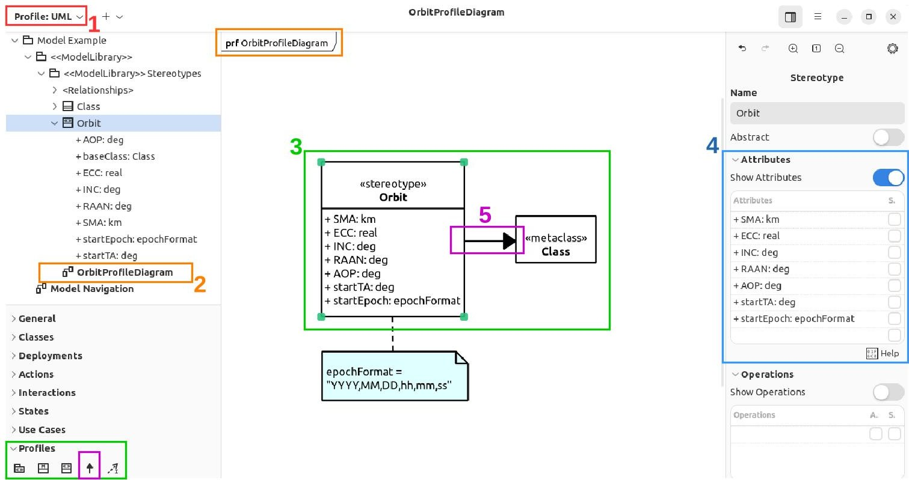


<div align="center">

Figure 24: Gaphor GUI steps for UML stereotypes generation.

</div>

4. Defining stereotype attributes: A critical step involves defining the attributes of the newly created Stereotype block. This process, accessible on the right-hand side of the GUI, lays the groundwork for future data extraction from the model. The attributes assigned to a stereotype will be shared across all blocks to which this stereotype is applied, enabling consistent and uniform assignment of relevant properties.

This uniformity is especially beneficial when dealing with common system elements like S/C systems or operating orbits. As further discussed in Section 3.5.10 (CubeSat SysML model and simulation tools integration summary), the establishment of common data structures significantly aids in translating the model files into formats readable by software, thereby facilitating their integration with simulation tools. In the example, the Orbit stereotype encompasses attributes detailing all necessary orbital parameters.

5. Establishing an Extension Relationship: The final step is to define an Extension Relationship between the created stereotype and the Class metaclass. This action enables the application of the Orbit stereotype to any Class element within the model.

Given that the SysML Block element is itself an extension of the UML Class element, this means the stereotype can be applied to every Block in the SysML model, broadening its applicability.

The generation of the stereotypes is independent of the modelling tool used and of the other elements included in the model itself. The latter feature guarantees the possibility of customising the model with any SysML elements and diagrams not related to the proposed formalisation (e.g., Internal Block Diagrams, Use Case Scenarios, etc.), ensuring that the full functionality of SysML can be used.

<!-- PDF_PAGE: 46 -->

Prior to delving into a more detailed characterisation of the stereotypes, it is necessary to identify all relevant data required for analysis and simulation activities throughout the PD phase. This step ensures that the stereotypes are not only theoretically sound but also practically applicable in real-world scenarios.

## 3.3.3 Budgets and parameters identification

The introduction of the CubeSat standard revolutionised the space sector, mainly due to its simplicity and cost-effectiveness, as highlighted in reference [12]. This innovation has democratised access to space, allowing a wider range of institutions, including smaller educational and research organisations, to participate in space missions. Despite these advances, the Preliminary Design (PD) phase of CubeSats remains a complex and intricate process, as illustrated in Section 2.1 (Preliminary Design).

The complexity of the PD phase is largely attributed to the inherently multidisciplinary nature of designing a satellite, even one as relatively small and standardised as a CubeSat. Designing a CubeSat requires a careful balancing of various technical aspects, such as mass, volume, power and data budgets, each of which presents its own set of challenges and constraints. In addition, considerations such as the budget for communication links and other mission-specific requirements add complexity to the design process.

The work by Gateau et al. [34] delves into the complexity of these requirements, offering an in-depth analysis of the various budgets and studies required to assess the feasibility of a CubeSat mission. Their results, summarised in Table 3, are a key resource for understanding the multiple aspects of a CubeSat's PD. This includes the evaluation of technical parameters, subsystem integration and balancing mission objectives with the physical and budgetary constraints inherent to CubeSats.

Mass Budget The mass budget is a critical component in the design and engineering of a Spacecraft. It provides a complete overview of the total mass of the S/C, calculated as the sum of the masses of all its components. This includes not only the primary structural and functional elements of the S/C, but also the mass of harnesses, propellants and other auxiliary materials.

An important aspect of the mass budget is the inclusion of relative margins, which are essential to account for uncertainties or potential changes in the mass of components during design, production and operation scenarios.

Volume Budget The volume budget plays a key role in S/C design by outlining the internal volume constraints within which all systems must be accommodated. It involves a detailed assessment of the space occupied by each of the S/C's internal systems. This assessment is critical to ensure that all components fit into the designated space while allowing for the necessary operating margins.

These margins are an integral part of the volume budget, providing flexibility and adaptability in the design to account for unforeseen changes or variations in component size.

<!-- PDF_PAGE: 47 -->

<div align="center">

Table 3: Summary of principal budgets and data needed for PD studies [34].

</div>

<table border="1"><tr><td>Budget</td><td>Input</td><td>Output</td></tr><tr><td>Mass</td><td>S/C components masses Margins</td><td>S/C mass</td></tr><tr><td>Volume</td><td>S/C components allocated volume S/C total volume Margins</td><td>S/C available volume</td></tr><tr><td>Power</td><td>S/C components consumption Activity profile Eclipses Solar cells and batteries description Margins</td><td>Power consumption profile Required batteries Required solar cells</td></tr><tr><td>Link</td><td>Orbital parameters Requirements(e.g.,Bit Error Rate(BER)) S/C communication system data Losses GS or other S/Cs comm.sys.data System margins</td><td>Data flow Link Margins</td></tr><tr><td>Data</td><td>Visibility windows Activity profile List of Ground Stations Satellites inter-link</td><td>Available data flow Required on-board storage</td></tr></table>

Power Budget The power budget is often considered one of the most critical factors in determining the feasibility of a space mission. It involves a thorough understanding and calculation of the power requirements of each S/C component.

The power budget must take into account the power consumption of these components and the S/C's power generation capabilities, which typically include batteries and solar cells. A key consideration for the power budget is the operating orbit of the S/C, which influences the duration and frequency of eclipse periods, i.e. periods when the S/C is in the Earth's shadow and depends solely on battery power.

This budget must be carefully managed in all S/C Operating Modes, taking into account the different activity profiles during the various mission phases. Ensuring adequate power margins is crucial to cope with fluctuations in energy requirements and generation capacities.

Link Budget The link budget of a S/C is a critical component in the design and operation of space missions, focusing mainly on the ability of the communication system to transmit and receive signals between the S/C and GS's or other S/Cs.

This is a detailed calculation that takes into account the power of the transmitted signal,

<!-- PDF_PAGE: 48 -->

the losses incurred during signal transmission through space and the Earth's atmosphere, and the sensitivity of the receiving antenna.

Key factors in this calculation include the gain and output power of the S/C's transmitting antenna, the distance the signal must travel, strongly depending on the operating orbit, and any potential losses due to atmospheric conditions, signal polarisation or space weather phenomena.

In addition, the link budget must consider the frequency of the transmitted signal, as different frequencies behave differently in space and atmospheric environments. The budget is essential to ensure reliable communication, which is crucial for mission control, data downlink and S/C monitoring. A well-planned link budget ensures that the S/C remains in contact with mission control and other entities, enabling successful mission operations and data transfer.

Data Budget The data budget of a S/C is a crucial aspect of its overall design and operational planning, as it includes the management and allocation of the S/C's data management capabilities. This budget mainly focuses on estimating and optimising the amount of data that the S/C can generate, process, store and downlink.

The main data budget considerations include the data generation rates of the various on-board instruments and sensors, the on-board data processing capabilities, the data storage capacity before transmission, and the bandwidth of the communication systems for the downlink of data.

The data budget also has to take into account the constraints imposed by the mission duration and the operating orbit, which affects communication with Ground Stations.

Furthermore, the data budget is closely linked to the scientific or operational objectives of the mission, which determine the types and volumes of data prioritised for collection and transmission. Effective management of the data budget is crucial to ensure that maximum scientific or operational value is extracted from the mission within the limits of available resources.

Other Budgets For more complex missions, it is necessary to go beyond the basic budgets and consider additional factors such as propellant budget, radiation, and heat dissipation.

These elements require in-depth analyses, particularly for the sizing of the Attitude & Orbit Control System (AOCS). Such analyses involve understanding the delta-V requirements for manoeuvres and the specifications of AOCS actuators and sensors.

While these additional parameters are critical for simulating more advanced S/C designs, their full characterisation is beyond the scope of this particular study, which focuses on the data presented in Table 3 as a foundation for the stereotypes characterisation and further integration of the CubeSat model with any set of simulation tools.

<!-- PDF_PAGE: 49 -->

Margins The margins mentioned in the definition of most budgets are a key consideration in S/C design.

Following ESA's Margin philosophy for science assessment studies [46], these margins are applied at both system and component levels. They serve to account for uncertainties and variations in design and operational parameters, ensuring that the S/C can operate effectively under different conditions.

Activity profile Particular attention must be paid to the definition of the required activity profile of the S/C.

This profile outlines the range of operations or activities that the S/C should perform during its mission, including transitions between Operating Modes. Derived from the Concept of Operations, the activity profile can vary significantly depending on the specific objectives and design of the S/C. However, for the purpose of this study, a generalisation of OM is proposed to develop a versatile activity profile that can be applied to different CubeSat designs.

<!-- PDF_PAGE: 50 -->

## 3.4 Operating Modes generalisation

As presented in the previous section, one of the requirements for the development of many system budgets is the identification of the Spacecraft's activity profile, often generated ad hoc for each mission.

In order to expand the modelling abstraction capabilities of the proposed formalisation, a way of generalising the activity profile of a CubeSat needs to be explored. Therefore, in the following sections, a generalisation of the Operating Modes of a CubeSat is presented, based on the identification of common attributes and criteria among several LEO CubeSat Concepts of Operations.

## 3.4.1 Existing standards and models

For a better understanding of how to proceed to provide a generalisation of the OMs, it is worth mentioning some of the works in the literature on this subject.

The work of Asundi and Fitz-Coy [47] presents a SE approach to CubeSat design for a rigorous definition of OMs and their dependencies. This work is based on the NASA Systems Engineering Handbook [15].

The Mission ConOps is an important document for the analysis of Mission Objectives and Mission Operations, which can be translated into an outline for the identification of Mission Phases and their OMs [47], constituting the above-mentioned S/C's activity profile. It is derived from the decomposition of the Mission Definition into Mission Objectives, taking into account external factors such as cost and other and other constraints, as shown in Figure 25.

The system requirements are translated into components, interfaces and then tasks, which are grouped to define the Operating Modes in accordance with the ConOps.

As most of the operations for CubeSats are similar or close enough to allow a standardisation of the OMs and ConOps, Jain's work [48] proposed an abstracted sequence of operations for CubeSats.

As discussed in [48], a standardised way of describing the Operating Modes, in terms of control sequences and minimum requirements for each OM, can be derived by analysing the similarities between different ConOps of LEO CubeSat missions (e.g., SwampSat [47], Waydo et al. [49], $ \mathrm{M}^{3} $ and APEX [50], VISORS [51], Cat-2 [52], DICE [53]).

An example of the structure of the templates provided by [48] is shown in Table 4.

By following the framework provided by ECSS-E-70 standards [54] as a template, each OM is characterised by its scope and concept, then the suggested mission sequence is presented. Lastly, minimal and additional capabilities, failure operations, and a rationale for the choice of the mode are listed.

Among the various benefits presented, this approach could allow future CubeSats developers to reduce development time and risks, by reusing the templates with little modifications as needed, as well as lay the foundations for the development of effective AIT plans [48].

<!-- PDF_PAGE: 51 -->


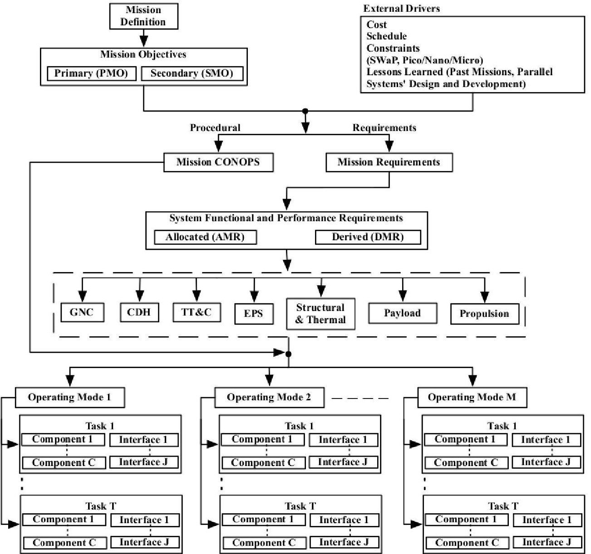


<div align="center">

Figure 25: Requirements breakdown flowchart for OM identification [47].

</div>

However, this template is more focused on a Document-Based method for defining a standard operations planning - that could enhance the development of control software for CubeSats thanks to the identification of common parameters for each OM - and for identifying the telemetry data produced during the operating scenario.

A Model-Based formalisation of a general OM model is therefore missing. In the following will be proposed a OMs generalisation, based on the methodology from Jain's work [48].

## 3.4.2 Proposed Operating Modes formalisation

The final purpose of this section is the formalisation of a general S/C's activity profile. To achieve so, it is possible to identify common characteristics among the ConOps and OMs of several CubeSat in LEO missions, through a similar process with respect to [48].

It is important to note that, although referring to different missions, most of the analysed ConOps (e.g., [49], [51], [53]) present similar OMs and transition criteria.

In particular, it can be observed how the Operating Modes related to Early Orbit Phase (EOP) and off-nominal scenarios, such as Detumbling, Calibration or Safe Modes, are

<!-- PDF_PAGE: 52 -->

<div align="center">

Table 4: Mission operations abstraction mode presentation [48].

</div>

<table border="1"><tr><td colspan="2">Mission Mode presentation</td></tr><tr><td>Mode Category</td><td>Content</td></tr><tr><td>Scope</td><td>Mode description and functionality</td></tr><tr><td>Mission Mode Concept</td><td>Mode concept stating stages of operations within the mode</td></tr><tr><td>Suggested mission sequence</td><td>A diagram suggesting different operations approaches</td></tr><tr><td>Capability</td><td>Minimum and additional set of capability required in for execution of the mode</td></tr><tr><td>Failure operations</td><td>List of failure operations for the mode and anomalies that can be addressed using stated practices</td></tr><tr><td>Mode rationale</td><td>Explanation on the useful correlation on the mode</td></tr></table>

almost always considered in their missions' ConOps, with various connotations.

While certainly critical from a design point of view, such OMs are however not considered for the current analysis. They represent non-nominal conditions and, as a result, have properties and transition conditions that are difficult to generalise and replicate across multiple projects.

Therefore, in the following only the Operating Modes relative to the operative phase of the S/Cs will be analysed.

Other two OMs usually present are a Servicing Mode and a Communication Mode, which refer respectively to cases where the Payload is active or a Downlink/Uplink with a GS is present. A central Stand-by Mode is often considered to reduce power consumption when the Payload is off or if no ground stations are visible.

Reference [52] highlights how some OMs transitions can occur based on the state of charge of the batteries, for example during eclipse periods when no power from the solar arrays is available.

The ConOps in reference [50], conversely, considers the attainment of a specific orbital configuration as a transition criterion between two OMs.

The main differences between the various OMs can thus be reduced, at the level of detail desired, to when a specific OM is activated and which subsystems are active in that Mode. The latter can be further reduced to a difference in average power consumption and data rate.

Transition criteria The general transition criteria for the Operating Modes have been identified among the most common present in literature:

- Presence of eclipse: A significant number of ConOps for CubeSats, such as those detailed in [47], [49], and [52], specify a transition in OMs during an eclipse or when

<!-- PDF_PAGE: 53 -->

available power is insufficient to sustain satellite operations. In such scenarios, the CubeSat typically switches off most of its systems to minimise power consumption and reduce the Depth Of Discharge (DOD) of its batteries.

- Presence of GS or specific target in Line Of Sight (LOS) with the S/C: Almost all the ConOps reviewed (e.g., [47], [49], [51], [52], [53]) emphasise the importance of establishing a communication link with a GS or multiple Ground Stations. This link is crucial for receiving commands from the GS and downlinking vital data, which can range from mission-specific information to satellite health status updates.

- S/C over specific Latitude/Longitude zone: Particularly relevant for Earth Observation missions (e.g.,[52]), this criterion involves activating satellite payloads when the S/C passes over designated terrestrial areas. This targeted operation is essential for capturing specific data sets pertinent to the mission's objectives.

- S/C in specific true anomaly range: Certain missions, as noted in [51], require the activation of thrusters or other systems when the satellite is in a particular orbital position or transitioning through a specific segment of its orbit. This precise positioning ensures that operational activities are conducted at optimal points in the orbit for maximum efficacy.

- Activation at a specific time: Similar to the true anomaly-based criterion, this approach involves determining the satellite's orbital position at a given time by solving Kepler's Equation $ ^{6} $ . Some missions necessitate defining an OM transition based on the time elapsed since the satellite's passage through periapsis. This time-based criterion allows for precise scheduling of operations in alignment with the mission's overall timeline and objectives.

In summary, these transition criteria are instrumental in guiding the operational behaviour of CubeSats, ensuring that they function optimally in response to their dynamic space environment and mission-specific requirements. The implementation of these criteria is vital for the effective management of CubeSat resources and the successful accomplishment of mission goals.

Default Mode definition A critical observation from the analysis of various ConOps is the prevalence of a central or Standby Mode, as highlighted in references like [49]. This Mode is typically activated when no specific operational conditions are met.

To mirror this in a generalised model, it is essential to incorporate the concept of a Default Mode. This Default Mode becomes active in the absence of conditions that trigger other specific Operating Modes.

The inclusion of a Default Mode ensures that there is always an active OM within the activity profile of the CubeSat. This continuous operational engagement is crucial for

<!-- PDF_PAGE: 54 -->

maintaining the basic functions of the CubeSat and ensuring its readiness to transition to other OMs as required.

Criteria priority Given that each space mission has unique objectives and priorities, it is vital to allow Users to define the priority order for activating each OM. This prioritisation is achieved by introducing a priority counter in the definition of each Operating Mode.

The priority counter is a strategic addition, facilitating more realistic simulations and mission analyses. It allows for the dynamic adjustment of OMs based on their assigned priority levels. Consequently, OMs with lower priority can be overwritten by those with higher priority during the creation of the activity profile. This flexibility is key in adapting the CubeSat's operations to varying mission needs and scenarios.

Relevant data Information about the activity profile and the OMs is essential for various system budgets, as also indicated in Table 3. On analysing the distinctions between different OM, several core differences become apparent, which can generally be categorised as:

- Variations in power consumption.

- Differences in data transmission rates.

- Discrepancies in the quantities of data produced or stored.

Therefore, a comprehensive definition of a general OM must encompass these parameters, as they represent the primary distinctions between various OMs. This incorporation is critical for accurately modelling the operational dynamics and resource requirements of the CubeSat across its different Operating Modes.

Metadata For simulation and visualisation purposes, it is useful to introduce the possibility to define relevant metadata for each OM, such as:

- Mode ID.

- Mode name.

- Post-processing information, such as colour for visualisation in graphs.

Such metadata not only aids in the clear identification and differentiation of various OMs but also enhances the usability and interpretability of simulation results and visual representations.

This added layer of information is particularly useful in complex analyses and presentations, where distinguishing between different OMs quickly and effectively can provide clearer insights into the CubeSat's operational profile.

<!-- PDF_PAGE: 55 -->

## 3.4.3 General Operating Modes model summary

The proposed generalisation offers a structured approach to defining any set of OMs, integrating a range of parameters and sub-parameters that capture the essence of a S/C's operational scenario. Table 5 summarises such generalisation.

The activation criteria cover scenarios from the S/C being in eclipse to its position in relation to the Earth's surface or a specific point in its orbit. Such detailed criteria are crucial for ensuring the accurate simulation of the OMs under varying conditions.

The Default mode check ensures that there is always an active OM, providing a fail-safe in case none of the specific activation criteria are met. The mode priority mechanism allows for a hierarchical approach, ensuring that more critical operations take precedence over others.

<div align="center">

Table 5: Proposed Operating Mode generalisation.

</div>

<table border="1"><tr><td colspan="2">Parameter</td><td>Sub-parameter</td></tr><tr><td rowspan="5">Activation Criteria</td><td>S/C in eclipse</td><td>N.A.</td></tr><tr><td>GS in LOS</td><td>N.A.</td></tr><tr><td>S/C over Lat/Lon zone</td><td>Start Latitude Start Longitude End Latitude End Longitude</td></tr><tr><td>S/C in True Anomaly range</td><td>Range Start Range End</td></tr><tr><td>S/C in time interval</td><td>Interval Start Interval End</td></tr><tr><td colspan="2">Default Mode check</td><td>N.A.</td></tr><tr><td colspan="2">Mode Priority</td><td>N.A.</td></tr><tr><td rowspan="3">Variables</td><td>Power Consumption</td><td>N.A.</td></tr><tr><td>Transmitted data rate</td><td>N.A.</td></tr><tr><td>Produced data</td><td>Housekeeping data Payload/other data</td></tr><tr><td rowspan="3">Metadata</td><td>Mode Name</td><td>N.A.</td></tr><tr><td>Mode ID</td><td>N.A.</td></tr><tr><td>Post-processing information</td><td>Colour,...</td></tr></table>

The variables section delves into the operational aspects of the OMs, including power consumption, data transmission rates, and data production. These variables are fundamental to understanding and simulating the spacecraft's functional capabilities in different modes.

<!-- PDF_PAGE: 56 -->

Lastly, the metadata section provides an additional layer of information, such as the mode name and ID, which are essential for identification and post-processing, including visualisation. The inclusion of post-processing information like colour coding adds an intuitive element to the presentation of data, enhancing the User's understanding and interaction with the simulation results.

By employing this general model in dedicated data structures, it becomes feasible to simulate a wide range of mission scenarios. This flexibility is invaluable in testing and refining various ConOps and operational strategies, making it a versatile tool in S/C design and mission planning. Such a comprehensive model not only aids in theoretical planning but also has practical implications, significantly enhancing the efficiency and effectiveness of mission simulations.

## 3.4.4 Operating Modes generalisation test through NSS tools

In order to validate the practicality and effectiveness of the proposed Operating Modes generalisation, a proof of concept is conducted by integrating the proposed formalisation within the existing Nanostar Software Suite (NSS) simulation tools.

Context This integration involves integrating the generalised OMs within a suite of Python-based tools used for various mission analysis tasks. These tasks include calculating visibility windows and eclipse periods, and generating data and power budgets.

The integration process involves storing all relevant information in Python data structures, in particular through .yaml files [56]. The YAML format (YAML Ain't Markup Language) is particularly suitable for this purpose due to its linguistic independence and its ability to facilitate data storage and exchange between different tools. The YAML format is both human-readable and unambiguous, making it straightforward for users to interpret while being easily processable by code. Because of the above-mentioned reasons, it has been chosen as the favourite format for the NSS simulation tools, and is therefore used within this application.

A significant advantage of the proposed OMs generalisation is its adaptability to different simulation tools and data formats. This flexibility means that the generalisation can be easily incorporated into existing data structures, requiring only minor modifications to the pre-existing Python codes.

An example of how an OM is defined within a .yaml data structure is presented in Listing 1. This snippet shows the configuration for a hypothetical TestName Mode. The detailed example of this configuration, including the extended parameters and their descriptions, is provided in Appendix B.

<div align="center">

Listing 1: TestName Mode .yaml configuration example

</div>

TestName:

    isDefault: True [bool]    # Default mode identification

    priority: 1 [int]        # Priority counter

    isEclipse: False [bool]    # Criterion 1: eclipse

<!-- PDF_PAGE: 57 -->

isOnTarget: False [bool] # Criterion 2: GS in LOS

isOnZone: False [bool] # Criterion 3: S/C over zone

zoneLatStart: na [deg] # |-> Criterion 3 sub-parameter

zoneLatEnd: na [deg] # |-> Criterion 3 sub-parameter

zoneLonStart: na [deg] # |-> Criterion 3 sub-parameter

zoneLonEnd: na [deg] # |-> Criterion 3 sub-parameter

isInRange: False [bool] # Criterion 4: true anomaly range

rangeStart: na [deg] # |-> Criterion 4 sub-parameter

rangeEnd: na [deg] # |-> Criterion 4 sub-parameter

isInInterval: True [bool] # Criterion 5: time interval

intervalStart: 0.0 [sec] # |-> Criterion 5 sub-parameter

intervalEnd: 240.0 [sec] # |-> Criterion 5 sub-parameter

modeID: 2 [int] # Metadata: mode ID

modeName: TestName [str] # Metadata: mode name

postProColour: '#BA525270 [str]' # Metadata: post-processing colour

TMRate: 18.0 [kbitsec] # Variable: Telemetry data rate

TCRate: 16.0 [kbitsec] # Variable: Telecommand data rate

powerCons: 32.0 [W] # Variable: Power consumption

TestName2:

isDefault: False [bool] # Default mode identification

priority: 2 [int] # Priority counter

[...]

This implementation, as illustrated, allows for the meticulous definition and customisation of each OM, including its activation criteria, priority level, and various operational variables like data rates and power consumption. This level of detail and customisability is essential for accurately simulating a diverse range of mission scenarios and operational conditions. The use of YAML further enhances this process by providing a format that is both coder-friendly and easily comprehensible, facilitating efficient data handling and exchange.

Implementation and results The enhanced scripts now incorporate functions specifically designed to verify whether the defined activation conditions for each Operating Mode are met at any given simulation time. This verification is conducted in a sequential manner, adhering to the priority order set by the User(s). As a result, OMs verified later in the sequence override those checked earlier, ensuring that the most relevant OM is active based on the current conditions.

To ensure the accuracy and reliability of these code changes, a comparative analysis is conducted using the same initial dataset to examine the outputs generated before and after the new OM characterisation. This approach enables direct comparison of simulation results, ensuring that changes have not adversely affected the accuracy of the calculation.

The CREME use case presented by Gateau et al. [14] serves as a reference for this comparison. Figure 26 and Figure 27 provide a visual comparison of the outcomes for both the power budget and the data budget, respectively, contrasting the results from the original and modified versions of the code.

In the case of the data budget (Figure 27a and Figure 27b), the outputs are identical,

<!-- PDF_PAGE: 58 -->


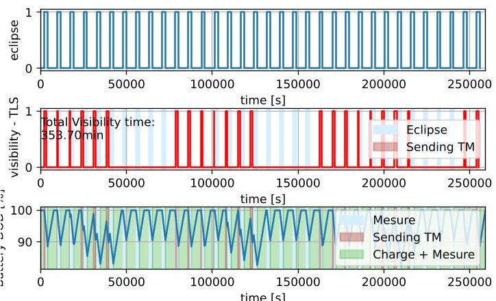


<div align="center">

(a) Output before code modifications [14].

</div>


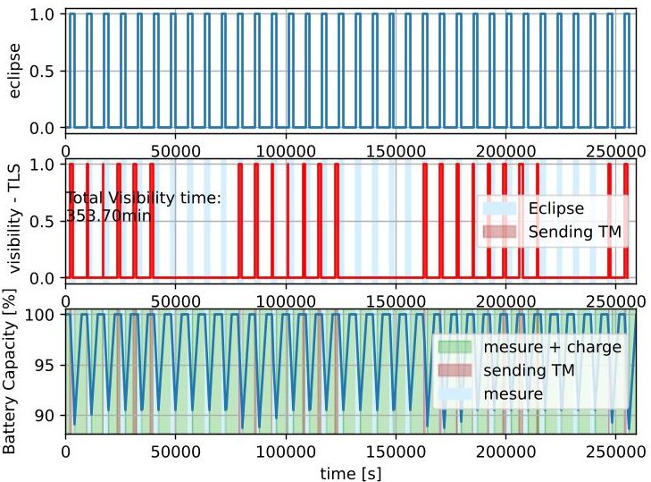


<div align="center">

(b) Output after code modifications.

</div>

<div align="center">

Figure 26: Comparison between battery data output before and after code modifications.

</div>


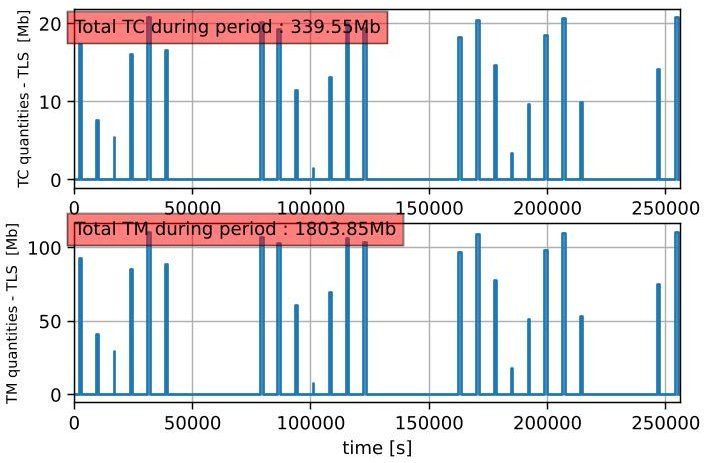


<div align="center">

(a) Output before code modifications [14].

</div>


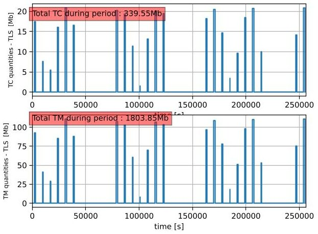


<div align="center">

(b) Output after code modifications.

</div>

<div align="center">

Figure 27: Comparison between data budget output before and after code modifications.

</div>

as expected, given that no changes were made to the calculations for eclipses and data links.

However, a notable difference can be observed in the power budget outputs (Figure 26a and Figure 26b). This discrepancy arises from the way the previous version of the code calculated power consumption, particularly during the Sending TM OM. The older code assumed battery discharge during this mode, which, while applicable during eclipses, is not universally true. This assumption resulted in an overestimated maximum DOD.

In summary, the proposed OMs generalisation significantly enhances the versatility of the code. It enables the adaptation of the scripts to different mission scenarios simply by modifying the configuration files, eliminating the need for further alterations to the Python source code.

The revised code, with its advanced approach to defining and transitioning between OMs, has proven to be more adaptable and flexible compared to its predecessor, allowing for more precise and varied mission simulations.

<!-- PDF_PAGE: 59 -->

## 3.5 Proposed stereotypes characterisation

In the following, the proposed set of stereotypes is proposed. They allow for a thorough characterisation of the parameters highlighted in Section 3.3.3 (Budgets and parameters identification) inside the CubeSat SysML model. The implementation of such stereotypes constitutes an extension of the model's capabilities, without affecting the possibility to represent the logical and functional behaviour of the model's elements.

## 3.5.1 SystemComp

SystemComp serves as the foundational stereotype for a physical component of the S/C encompassing the system's mass, power consumption, and applicable margins, along with pertinent metadata like ID, name, and manufacturer for component traceability.

For further customisation, the power consumptions are divided into three attributes: powerConsIsStb, powerConsIsOn and powerConsIsPeak for the consumptions in Standby, On and Peak mode respectively. A reference table for the attributes introduced with this stereotype is presented in Table 6, while Figure 28 shows their UML definition.

As shown in Figure 28, additional stereotypes further refine SystemComp:

- SystemMain;

- Battery;

- SolarArray;

- Transmitter;

- Receiver.


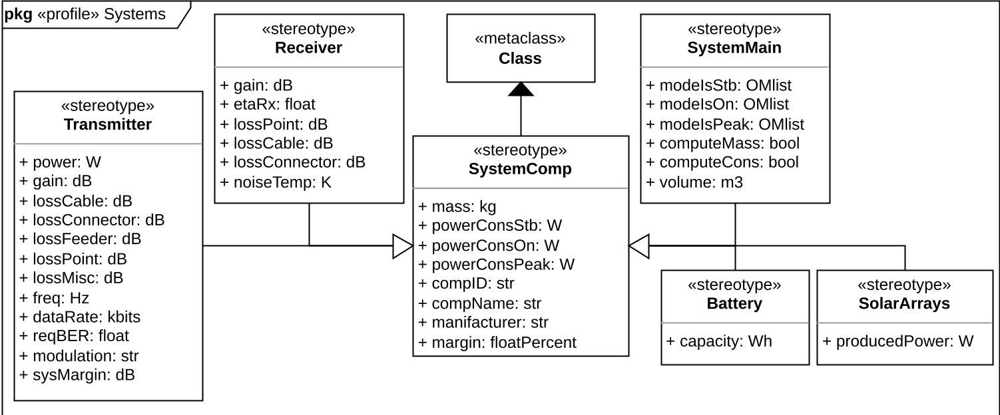


<div align="center">

Figure 28: Systems UML stereotypes definition.

</div>

<!-- PDF_PAGE: 60 -->

<div align="center">

Table 6: SystemComp stereotype attributes.

</div>

<table border="1"><tr><td>Attribute</td><td>ValueType</td><td>Scope</td></tr><tr><td>mass</td><td>kg</td><td>Define component’s/system’s mass</td></tr><tr><td>powerConsStb</td><td>W</td><td>Power consumption while in Stand-by mode</td></tr><tr><td>powerConsOn</td><td>W</td><td>Power consumption while in On mode</td></tr><tr><td>powerConsPeak</td><td>W</td><td>Power consumption while in Peak mode</td></tr><tr><td>compID</td><td>str</td><td>Component’s/system’s reference ID</td></tr><tr><td>compName</td><td>str</td><td>Component’s/system’s name</td></tr><tr><td>manufacturer</td><td>str</td><td>Component’s/system’s manufacturer</td></tr><tr><td>margin</td><td>float %*</td><td>Applicable margin to power consumption and mass</td></tr></table>

$ ^{*} $ float %: 0 $ \leq $ margin $ \leq 1 $

## 3.5.2 SystemMain

It characterises a primary SubSystem of the S/C (e.g., Electrical Power System (EPS), Propulsion System, Payload, etc.). Beyond the attributes of SystemComp, it includes a list of Operating Modes (OMs) in which the system operates in On, Stand-by, and Peak modes, the system volume, and two Boolean flags for post-processing. Table 7 displays the attributes introduced by this stereotype.

<div align="center">

Table 7: SystemMain stereotype additional attributes.

</div>

<table border="1"><tr><td>Attribute</td><td>ValueType</td><td>Scope</td></tr><tr><td>modeIsStb</td><td>OM List$ ^{*}$</td><td>List of OMs in which the system is in Stand-by mode</td></tr><tr><td>modeIsOn</td><td>OM List$ ^{*}$</td><td>List of OMs in which the system is in On mode</td></tr><tr><td>modeIsPeak</td><td>OM List$ ^{*}$</td><td>List of OMs in which the system is in Peak mode</td></tr><tr><td>computeMass</td><td>bool</td><td>Specify if to compute components&#x27; mass or not</td></tr><tr><td>computeCons</td><td>str</td><td>Specify if to compute components&#x27; consumption or not</td></tr><tr><td>volume</td><td>m$ ^{3}$</td><td>System&#x27;s external volume</td></tr></table>

$ ^{*} $OM List: [OM1 name, OM2 name, ...]

The computeMass and computeCons flags indicate whether the simulation tools should consider the masses and power consumption of the system's sub-components. These are introduced to facilitate database creation even in early design stages, when the entire system architecture is yet to be defined.

As anticipated in Section 3.1 (Research problem), for the applicable margins ESA Margin philosophy for science assessment studies [46] is followed, so that the model presents the capability to introduce margins on both component and system levels.

## 3.5.3 Battery and SolarArray

Battery and SolarArray encompass the battery's capacity and the power generated by solar arrays, in addition to the attributes introduced by SystemComp, as displayed in

<!-- PDF_PAGE: 61 -->

<div align="center">

Table 8.

</div>

<div align="center">

Table 8: Battery and SolarArray stereotypes additional attributes.

</div>

<table border="1"><tr><td>Attribute</td><td>ValueType</td><td>Scope</td></tr><tr><td colspan="3">Battery</td></tr><tr><td>capacity</td><td>Wh</td><td>maximum battery capacity</td></tr><tr><td colspan="3">SolarArray</td></tr><tr><td>producedPower</td><td>W</td><td>maximum output power</td></tr></table>

## 3.5.4 Transmitter and Receiver

These stereotypes define variables crucial for the Communication System elements affecting the link budget.

<div align="center">

Table 9: Receiver stereotype additional attributes.

</div>

<table border="1"><tr><td>Attribute</td><td>ValueType</td><td>Scope</td></tr><tr><td>gain</td><td>dB</td><td>Receiver Antenna Gain</td></tr><tr><td>etaRx</td><td>float</td><td>Receiver efficiency</td></tr><tr><td>lossCable</td><td>dB</td><td>Signal losses due to cables length</td></tr><tr><td>lossConnector</td><td>dB</td><td>Signal losses due to connectors</td></tr><tr><td>lossPoint</td><td>dB</td><td>Signal losses due to pointing mismatch</td></tr><tr><td>noiseTemp</td><td>K</td><td>System Noise Temperature</td></tr></table>

<div align="center">

Table 10: Transmitter stereotype additional attributes.

</div>

<table border="1"><tr><td>Attribute</td><td>ValueType</td><td>Scope</td></tr><tr><td>power</td><td>W</td><td>Transmitter antenna power</td></tr><tr><td>gain</td><td>dB</td><td>Transmitter Antenna Gain</td></tr><tr><td>lossCable</td><td>dB</td><td>Signal losses due to cables length</td></tr><tr><td>lossConnector</td><td>dB</td><td>Signal losses due to connectors</td></tr><tr><td>lossFeeder</td><td>dB</td><td>Signal losses inside the feeder</td></tr><tr><td>lossPoint</td><td>dB</td><td>Signal losses due to pointing mismatch</td></tr><tr><td>lossMisc</td><td>dB</td><td>Other Signal losses</td></tr><tr><td>freq</td><td>Hz</td><td>Transmitted signal frequency</td></tr><tr><td>dataRate</td><td>kbit/s</td><td>Transmitter data rate</td></tr><tr><td>reqBER</td><td>float</td><td>Required Bit Error Ratio</td></tr><tr><td>modulation</td><td>str</td><td>Modulation type name</td></tr><tr><td>sysMargin</td><td>dB</td><td>Margin applied to the transmitted signal</td></tr></table>

<!-- PDF_PAGE: 62 -->

## 3.5.5 Orbit and PropagationLosses

Orbit and PropagationLosses stereotypes specify all remaining necessary properties for orbital and link budget analyses.


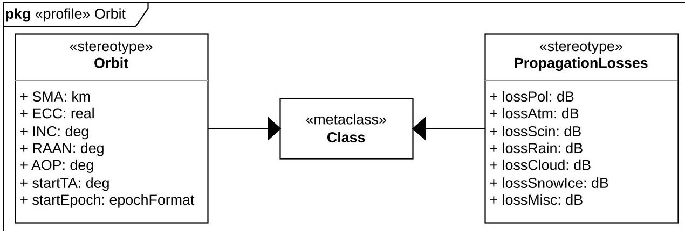


<div align="center">

Figure 29: Orbit and Propagation Losses UML stereotypes definition.

</div>

<div align="center">

Table 11: Orbit stereotype attributes.

</div>

<table border="1"><tr><td>Attribute</td><td>ValueType</td><td>Scope</td></tr><tr><td>SMA</td><td>km</td><td>Semi-major axis</td></tr><tr><td>ECC</td><td>float</td><td>Eccentricity</td></tr><tr><td>INC</td><td>deg</td><td>Inclination</td></tr><tr><td>RAAN</td><td>deg</td><td>Right Ascension of Ascending Node</td></tr><tr><td>AOP</td><td>deg</td><td>Argument of Periapsis</td></tr><tr><td>startTA</td><td>deg</td><td>Starting True Anomaly</td></tr><tr><td>startEpoch</td><td>epochFormat*</td><td>Initial simulation Epoch</td></tr></table>

$ ^{*} $ epochFormat: "YYYY,MM,DD,hh,mm,ss"

<div align="center">

Table 12: PropagationLosses stereotype attributes.

</div>

<table border="1"><tr><td>Attribute</td><td>ValueType</td><td>Scope</td></tr><tr><td>lossPol</td><td>dB</td><td>Signal losses due to polarisation</td></tr><tr><td>lossAtm</td><td>dB</td><td>Signal losses due to atmosphere</td></tr><tr><td>lossScin</td><td>dB</td><td>Signal losses due to scintillation</td></tr><tr><td>lossRain</td><td>dB</td><td>Signal losses due to rain</td></tr><tr><td>lossCloud</td><td>dB</td><td>Signal losses due to clouds presence</td></tr><tr><td>lossSnowIce</td><td>dB</td><td>Signal losses due to snow and ice</td></tr><tr><td>lossMisc</td><td>dB</td><td>Other signal losses</td></tr></table>

## 3.5.6 GroundStation

The GroundStation stereotype allows the definition of all the relevant data for the identification of the GS, such as its position, altitude and antenna data. Table 13 summarises

<!-- PDF_PAGE: 63 -->

all the newly-introduced parameters.

<div align="center">

Table 13: GroundStation stereotype attributes.

</div>

<table border="1"><tr><td>Attribute</td><td>ValueType</td><td>Scope</td></tr><tr><td>altitude</td><td>m</td><td>GS altitude</td></tr><tr><td>minElevation</td><td>deg</td><td>Min angle between S/C LOS and GS horizon line</td></tr><tr><td>Lat</td><td>deg</td><td>GS latitude</td></tr><tr><td>Lon</td><td>deg</td><td>GS longitude</td></tr><tr><td>powerTx</td><td>W</td><td>GS transmitter gain</td></tr><tr><td>lineLossTx</td><td>dB</td><td>GS transmitter signal losses due to line length</td></tr><tr><td>lossConnectorTx</td><td>dB</td><td>GS transmitter signal losses due to connectors</td></tr><tr><td>gainTx</td><td>dB</td><td>GS transmitter gain</td></tr><tr><td>lossPointRx</td><td>dB</td><td>GS signal losses due to pointing mismatch</td></tr><tr><td>freq</td><td>Hz</td><td>Transmitted signal from GS frequency</td></tr><tr><td>dataRateTx</td><td>kbit/s</td><td>GS transmitter data rate</td></tr><tr><td>reqBER</td><td>float</td><td>Required Bit Error Ratio</td></tr><tr><td>modulation</td><td>str</td><td>Modulation type name</td></tr><tr><td>sysMargin</td><td>dB</td><td>Margin applied to the transmitted signal</td></tr><tr><td>etaRx</td><td>float</td><td>GS receiver efficiency</td></tr><tr><td>diameterRx</td><td>m</td><td>GS receiver antenna diameter</td></tr><tr><td>LNAGain</td><td>dB</td><td>GS receiver Low Noise Amplifier gain</td></tr><tr><td>noiseTempRx</td><td>K</td><td>GS receiver System Noise Temperature</td></tr><tr><td>lossCableRx</td><td>dB</td><td>GS receiver signal losses due to cables length</td></tr><tr><td>lossConnectorRx</td><td>dB</td><td>GS receiver signal losses due to connectors</td></tr></table>

## 3.5.7 OperatingMode

In order to replicate the Operating Modes generalisation discussed in Section 3.4 (Operating Modes generalisation) and presented in Table 5, an OperatingMode stereotype is introduced. It is important to note how this stereotype is highly dependent on the systems' definition. In fact, the power consumption of each OM is calculated based on the power consumption of each subsystem or, optionally, cascaded from the individual components of each subsystem.

Consequently, three attributes have been added to the SystemMain stereotype to denote the OMs during which a particular system is in standby, on, or peak mode: modeIsStb modeIsOn, and modeIsPeak. These consist of lists containing the names of various OMs, enabling the simulation tools to associate the power consumption of a specified system with the total consumption of the Operating Mode during model translation.

Moreover, an isDefault Boolean attribute is present in the OperatingMode stereotype allowing the definition of an active OM when no activation criteria are satisfied.

<!-- PDF_PAGE: 64 -->

<div align="center">

Table 14: OperatingMode stereotype attributes.

</div>

<table border="1"><tr><td>Attribute</td><td>ValueType</td><td>Scope</td></tr><tr><td>modeName</td><td>str</td><td>OM name</td></tr><tr><td>modeID</td><td>int</td><td>OM unique ID</td></tr><tr><td>postProColor</td><td>str</td><td>OM color for post-processing</td></tr><tr><td>priority</td><td>int</td><td>Priority order for OM activation criterion check</td></tr><tr><td>isEclipse</td><td>bool</td><td>Is the OM active in eclipse?</td></tr><tr><td>isOnTarget</td><td>bool</td><td>Is the OM active while over GS?</td></tr><tr><td>isOnZone</td><td>bool</td><td>Is the OM active over a Lat/Lon zone?</td></tr><tr><td>zoneLatStart</td><td>deg</td><td>Zone initial Latitude</td></tr><tr><td>zoneLatEnd</td><td>deg</td><td>Zone ending Latitude</td></tr><tr><td>zoneLonStart</td><td>deg</td><td>Zone initial Longitude</td></tr><tr><td>zoneLonEnd</td><td>deg</td><td>Zone ending Longitude</td></tr><tr><td>isInRange</td><td>bool</td><td>Is the OM active while in a True Anomaly range?</td></tr><tr><td>rangeStart</td><td>deg</td><td>True Anomaly range start</td></tr><tr><td>rangeEnd</td><td>deg</td><td>True Anomaly range end</td></tr><tr><td>isInInterval</td><td>bool</td><td>Is the OM active while in a time interval?</td></tr><tr><td>intervalStart</td><td>s</td><td>Seconds after Periapsis transition</td></tr><tr><td>intervalEnd</td><td>s</td><td>Seconds after Periapsis transition</td></tr><tr><td>TCRate</td><td>kbit/s</td><td>OM Telecommand data rate</td></tr><tr><td>TMRate</td><td>kbit/s</td><td>OM Telemetry data rate</td></tr><tr><td>powerCons</td><td>W</td><td>OM total power consumption</td></tr><tr><td>isDefault</td><td>bool</td><td>Is the OM the default OM?</td></tr></table>


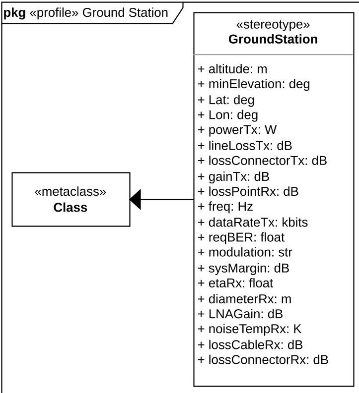


<div align="center">

(a) Ground Station UML stereotype.

</div>


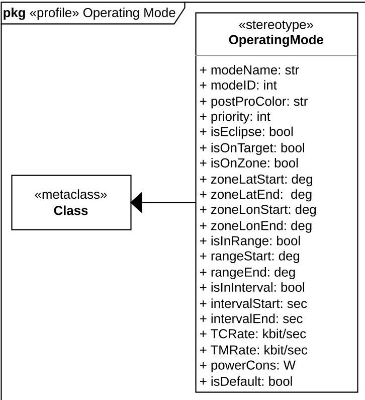


<div align="center">

(b) Operating Modes UML stereotype.

</div>

<div align="center">

Figure 30: Operating Modes and Ground Station UML stereotypes.

</div>

<!-- PDF_PAGE: 65 -->

## 3.5.8 Stereotypes application example: Payload Block Definition Diagram

After the definition of all the stereotypes required for the proposed formalisation, it is possible to implement them within the elements of a model's Block Definition Diagrams. Figure 31 shows an example of a Payload's BDD with the previously-described stereotypes applied.


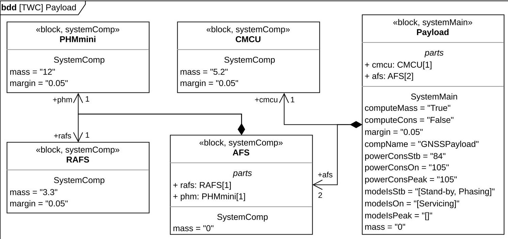


<div align="center">

Figure 31: Payload BDD example.

</div>

As demonstrated by the AFS block in the Figure, the proposed formalisation allows to take into account the components' redundancies by noting the multiplicity $ ^{7} $ of each Composite Association in the BDD.

Furthermore, it is possible to highlight how the computeCons and computeMass attributes allow data extraction at any design stage, more specifically when it is not possible to detail the individual components of a system. The example above shows how only the masses of the components are defined. The computeMass variable is therefore set to True, meaning that the mass of the payload will be derived from the masses of the components.

As for the computeCons variable, it is correctly set to False, as the power consumption of the various components is missing. However, this will not be invalidating for future interaction with simulation tools, as the overall payload's power consumption is defined at system level.

## 3.5.9 Observations

By standardising the attributes across various system components and operational aspects, the model ensures consistency and comprehensiveness in system representation. This uniformity is particularly beneficial when dealing with complex systems where numerous components and variables interact.

$ ^{7} $i.e., the number near the arrowhead of each Composite Association, also present in the parts section of the block.

<!-- PDF_PAGE: 66 -->

The model's versatility lies in its ability to adapt to different phases of system design and varying methodologies, thereby serving as a robust tool for systems engineers and analysts.

Furthermore, this design facilitates a seamless transition between the conceptual phase of system design and the practical aspects of implementation and analysis.

Moreover, the effectiveness of this formalisation does not hinge on the specific methodologies applied for generating the BDDs or the choice of tools utilised for their creation.

Lastly, a crucial aspect of this formalisation, which deserves to be emphasised, is that once the stereotypes and their associated attributes are defined, it becomes possible to identify common data structures within the model files.

This capability allows relevant data to be extracted for further integration with simulation tools, as all blocks to which the same stereotype is applied possess common attributes. This feature will be described in the following sections.

## 3.5.10 CubeSat SysML model and simulation tools integration summary

The proposed formalisation allows for the integration of a general CubeSat model, created using SysML and enhanced through UML stereotypes, with any set of simulation tools.

Figure 32 serves as a visual guide to the integration process of such a general CubeSat model with simulation tools such as, in this instance, the ones from the NSS constellation. The diagram uses colour-coded blocks to depict the connection between various tools and the outputs they generate.

The integration process takes place in several key steps, as illustrated by the numbered blocks in Figure 32:

1. CubeSat SysML model generation: The first step involves generating a SysML model, here using Gaphor [45] as an example. This step includes the definition of specific UML stereotypes within dedicated Profile Diagrams, as discussed in Section 2.4 (UML and SysML). These stereotypes are critical for adding specific attributes to the model elements.

2. UML stereotypes definition: The next phase focuses on applying the UML stereotypes within Block Definition Diagrams (BDDs). These diagrams are crucial in relation to various aspects such as physical architecture, orbit and Operating Modes. It is important to note that the choice of the modelling tool and methodology does not limit or define the specifications of the model, nor does it limit the types of diagrams and elements that can be included in the model.

3. Data extraction through a dedicated parser: Following the characterisation of the model, the next step is to extract relevant data from the model file. This is achieved through a parser, leading to the generation of a software-readable data structure and a requirements list, as indicated by the blue blocks in Figure 32. The use of additional tools, like the Graphviz library [57], enables the automatic

<!-- PDF_PAGE: 67 -->


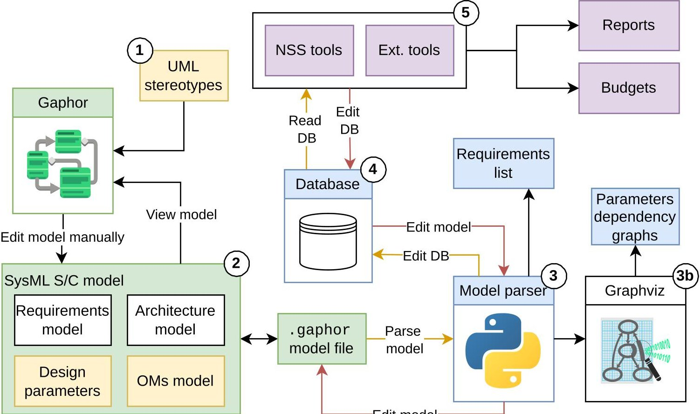


<div align="center">

Figure 32: Data flow scheme of an application of the proposed formalisation.

</div>

generation of a dependency graph. This graph visually represents the relationships among model elements and their attributes, providing a clearer understanding of how changes in one variable can affect the entire model.

4. Data structure generation based on UML stereotypes identification: The parser's primary focus is on blocks where stereotypes have been applied. This selective approach enhances the flexibility and general applicability of the SysML model, ensuring that only relevant data is extracted for the database generation. This flexibility is particularly advantageous, as it allows the model to replicate any system at any stage of design, provided the necessary stereotypes are applied.

5. Simulation tools and database interaction: Finally, once the database is generated, User(s) can engage in analysis and simulation using the NSS tools or other preferred simulation tools. This stage is further enhanced by the ability to edit the model files directly from Python, facilitating dynamic updates and modifications to the model based on the database inputs. This capability ensures a coherent and up-to-date flow of data between the backend database and the frontend SysML model.

The subsequent sections delve into more detail regarding each of these steps, providing a comprehensive understanding of the integration process and its application in CubeSat modelling and simulation.

<!-- PDF_PAGE: 68 -->

## 3.6 End-to-end use case

In the following, an application of the proposed formalisation, involving a SysML model expanded with the proposed set of UML stereotypes and linked with the simulation tools from the NSS constellation, is presented.

## 3.6.1 Example mission: TWC mission

Before delving into the specifics of the practical application process of the proposed formalisation, it is beneficial to introduce the selected case study. The case study selected for this purpose is an academic theoretical mission concept named "The White Compass (TWC)". This mission concept was developed during the "Space Mission and Systems Design" Course at Politecnico di Torino. The hypothetical goal of the TWC mission is to provide Global Navigation Satellite System (GNSS) services over the Arctic Region. This objective is to be achieved through a constellation of 12 small satellites, positioned in two High Elliptical Molniya-like Orbits $ ^{8} $

The essence of each TWC S/C is captured within a comprehensive SysML Block Definition Diagram, which has been constructed using Gaphor as a modelling tool. This BDD, showcased in Figure 33, includes the application of specific UML stereotypes, which play a pivotal role in defining and characterising each system and component of the S/C.

The detailed implementation of these stereotypes in the TWC mission model ensures that every aspect of the spacecraft, from its physical architecture to its operational capabilities, is meticulously defined and aligned with the mission's objectives.

Furthermore, the SysML model for the TWC mission extends beyond the general S/C architecture. In Appendix C, more detailed, system-specific BDDs are presented, alongside a comprehensive set of functional requirements. These include the characterisation of the orbit, the Ground Station, and the Operating Modes. The inclusion of these additional elements in the SysML model provides a more holistic view of the mission, encompassing not only the S/C itself but also its operational environment and the key parameters governing its mission profile.

The TWC mission case study thus serves as a practical example, demonstrating the application of the proposed formalisation process in a realistic, even though hypothetical mission scenario.

<!-- PDF_PAGE: 69 -->


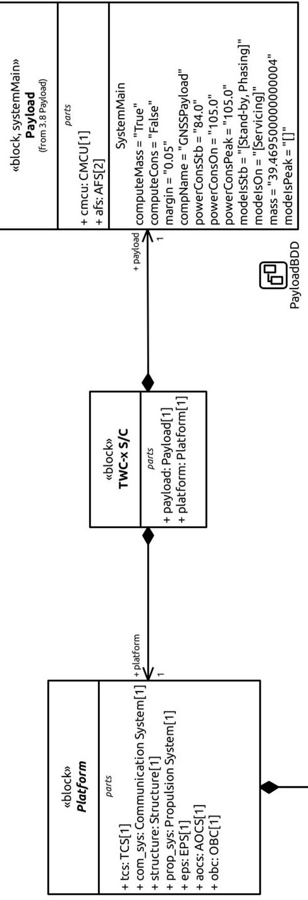


<table border="1"><tr><td colspan="2">&lt;block, systemMain&gt;
EPS
(from 3.1 EPS)</td></tr><tr><td colspan="2">parts</td></tr><tr><td>+pcu:PCU[1]
+bus:Bus12V[1]
+array:SolarArray[2]
+battery:Battery[2]
+shunt:ShuntRegulator[1]
+dcdc:DC/DC Converter[4]
+lcl:LCL[5]
+bus:Bus5V[1]
+bus:Bus3.3V[1]
+bus:Bus50V[1]
+bus:Bus28V[1]</td></tr><tr><td colspan="2">SystemMain</td></tr><tr><td>mass=&quot;120.0&quot;
margin=&quot;0.05&quot;
powerConsStb=&quot;10.0&quot;
powerConsOn=&quot;10.0&quot;
powerConsPeak=&quot;10.0&quot;
modelsOn=&quot;[Stand-by,Servicing,Phasing]&quot;
computeMass=&quot;False&quot;
computeCons=&quot;False&quot;
modelsStb=&quot;[]&quot;
modelsPeak=&quot;[]&quot;</td></tr></table>

<table border="1"><tr><td>《block, systemMain》Propulsion System(from 3.2 Propulsion System)</td><td>《block, systemMain》Structure(from 3.3 Structure)</td><td>《block, systemMain》Communication System(from 3.4 Communication System)</td><td>《block, systemMain》TCS(from 3.5 TCS)</td><td>《block, systemMain》AOCS(from 3.6 AOCS)</td><td>《block, systemMain》OBC(from 3.7 OBC)</td></tr><tr><td>+ thruster: Thruster[2]+ ppu: PPU[1]+ fms: FMS[1]+ tank: Fuel Tank[2]</td><td rowspan="2">SystemMainmass = "86.6"margin = "0.1"computeMass = "False"computeCons = "False"</td><td rowspan="2">parts+sModem: S band modem[1]tx: S band TX[1]filter: Filter[2]rx: S band RX[1]+ sAntenna: S band antenna[2]</td><td>parts+heaters: Heaters[1]+ sensors: Thermal Sensors[1]+ passiveCtrl: Passive Control[1]</td><td>partsSystemMainmass = "6.5"margin = "0.05"powerConsStb = "10.0"powerConsOn = "72.0"powerConsPeak = "331.0"modelsStb = "[]"modelsOn = "Stand-by, Servicing, Phasing]"modelsPeak = "[]"computeMass = "False"computeCons = "False"</td><td>partsSystemMainpowerConsStb = "35.0"powerConsOn = "35.0"powerConsPeak = "35.0"modelsStb = "[]"modelsOn = "Stand-by, Servicing, Phasing]"modelsPeak = "[]"computeMass = "False"computeCons = "False"mass = "15.0"margin = "0.1"</td></tr><tr><td>SystemMainmodelsStb = "[Stand-by, Servicing]"modelsOn = "[Phasing]"modelsPeak = "[]"mass = "90.5"powerConsStb = "0.0"powerConsOn = "250.0"powerConsPeak = "0.0"margin = "0.15"computeMass = "False"computeCons = "False"</td><td>SystemMainmass = "13.0"margin = "0.05"powerConsStb = "0.0"powerConsOn = "50.0"powerConsPeak = "125.0"modelsOn = "[Stand-by]"modelsStb = "Servicing, Phasing]"modelsPeak = "[]"computeMass = "False"computeCons = "False"</td><td>SystemMainmass = "10.0"powerConsStb = "10.0"powerConsOn = "72.0"powerConsPeak = "331.0"modelsStb = "[]"modelsOn = "Stand-by, Servicing, Phasing]"modelsPeak = "[]"computeMass = "False"computeCons = "False"</td><td>SystemMainpowerConsStb = "35.0"powerConsOn = "35.0"powerConsPeak = "35.0"modelsStb = "[]"modelsOn = "Stand-by, Servicing, Phasing]"modelsPeak = "[]"computeMass = "False"computeCons = "False"mass = "15.0"margin = "0.1"</td></tr></table>

<div align="center">

Figure 33: TWC system-level Block Definition Diagram implemented in Gaphor.

</div>

<!-- PDF_PAGE: 70 -->

## 3.6.2 Model files manipulation and data extraction

In order to integrate the proposed formalisation with the set of NSS simulation tools, it is important to understand how most of the modelling tools (e.g., the previously described Capella [41], Papyrus [44], Gaphor [45]) save their model files.

As discussed earlier, Gaphor, like other similar modelling tools, stores its models in .xml format [58]. This is a common file format for storing and transmitting data structures with a pre-defined set of rules.

Listing 2 presents an example of how the previously defined OperatingMode stereotype and all other stereotypes have been saved in the Gaphor .xml model file.

Listing 2: Example of OM stereotype definition in Gaphor .xml model file.

[...]

<Stereotype id="cf60e810-8885-11ee-95ad-17bee43d1b0b">

<instanceSpecification>

    <reflist>

        <ref refid="d14d034a-892e-11ee-9e0a-ad799f37f801"/>

        [...]

        <ref refid="08c33141-892f-11ee-9319-ad799f37f801"/>

    </reflist>

</instanceSpecification>

<name>

    <val>OperatingMode</val>

</name>

<ownedAttribute>

    <reflist>

        <ref refid="6d8fc81a-8886-11ee-b691-17bee43d1b0b"/>

        [...]

        <ref refid="ecf0c0d1-8885-11ee-83c5-17bee43d1b0b"/>

    </reflist>

</ownedAttribute>

<package>

    <ref refid="a44055ea-8856-11ee-91ef-850d737e7061"/>

</package>

<presentation>

    <reflist>

        <ref refid="cf61d79e-8885-11ee-8d03-17bee43d1b0b"/>

    </reflist>

</presentation>

</Stereotype>

[...]

Independently on the modelling tool of choice, once the rules and structures of such model files (which are different for each tool) are understood, it is possible to build simple Python libraries to extract the data of interest and, conversely, manipulate the .xml files as desired.

In this step, the proposed formalisation is helpful. As presented before, the formalisation is based on the use of common sets of attributes among SysML blocks with the same

<!-- PDF_PAGE: 71 -->

stereotypes applied. This introduces a high presence of similar structures inside the model files, that can be exploited.

Taking as an example the OperatingMode stereotype's formatting presented in Listing 2, its structure will be identical for every stereotype defined. The same can be noted for every element created with a specific stereotype applied.

As shown by the highlighted lines in Listings 2, 3 and 4, it is possible to identify in the model files cross-references between stereotypes, their attributes and the blocks they are applied to. This is a fundamental aspect for the development of a parser capable of translating the proposed SysML-based database into a software-readable database, whatever format is desired for that.

By knowing in advance the set of stereotypes present in the model and their attributes, once the structure of the model file is also known, it is possible to extract all relevant data for database generation. Once more, it can be done regardless of the modelling tool used or the number and type of blocks present in the model itself.

Listing 3: Servicing OM SysML block definition in Gaphor .xml model file.

[...]

<Block id="cbece26a-892e-11ee-abd0-ad799f37f801">

    <appliedStereotype>

        <reflist>

            <ref refid="d14d034a-892e-11ee-9e0a-ad799f37f801"/>

        </reflist>

    </appliedStereotype>

    <name>

        <val>Servicing</val>

    </name>

    <package>

        <ref refid="48c02cf6-892e-11ee-baeb-ad799f37f801"/>

    </package>

    <presentation>

        <reflist>

            <ref refid="cbedb683-892e-11ee-9404-ad799f37f801"/>

        </reflist>

    </presentation>

</Block>

[...]

Listing 4: OM stereotype's modeName property definition in Gaphor .xml model file.

```xml

<Property id="6d8fc81a-8886-11ee-b691-17bee43d1b0b">

    <class_>

        <ref refid="cf60e810-8885-11ee-95ad-17bee43d1b0b"/>

    </class_>

    <name>

        <val>modeName</val>

    </name>

    <slot>

        <reflist>

            <ref refid="8c07292e-892e-11ee-9df3-ad799f37f801"/>

```

<!-- PDF_PAGE: 72 -->

```xml

        <ref refid="d77119fc-892e-11ee-8132-ad799f37f801"/>

        <ref refid="0eda6a9a-892f-11ee-b23c-ad799f37f801"/>

    </reflist>

    </slot>

    <typeValue>

        <val>str</val>

    </typeValue>

</Property>

[...]

```

Starting from the stereotypes' definitions, all properties (i.e. the data needed for simulations and the generation of system budgets) are derived by cascading cross-references within the file structure.

It is important to note how, while the formalisation is independent of the modelling tools used, each tool requires a deep understanding of its model files' structure. In fact, while the model files' format remains the same across various modelling tools, the same cannot be said for the way each tool writes the information in such files.

## 3.6.3 Model parser functionalities

Because of the reasons mentioned above, a specific parser needs to be developed for translating a SysML model generated with Gaphor.

The parser serves as an essential element for the generation of a software-readable database based on a SysML CubeSat general model and its further integration with simulation tools. The final output of this process, including the integration of the new database with the NSS tools, is the generation of system budgets, i.e. a power budget and a data budget.

Data extraction process As described in the previous section, the parser is built taking into account the structure of the .xml Gaphor model file. Moreover, by knowing in advance the set of stereotypes introduced in the model and their specific attributes, it is possible to specify what data to extract from the model file.

The latter setting proves to be the more efficient the more complex the model file, which for models composed of numerous subsystems may have a large number of definitions of diagrams, elements and relationships between elements. Instead, the parser extracts only the relevant data for database generation.

Therefore, the data extraction process starts with the identification of all stereotypes present in the model, whose definition inside the model file includes a list of all their attributes and blocks to which they are applied. It is then possible to insert as many blocks and elements into the model as desired, since the parser will only take into account blocks referring to a stereotype among those introduced in Section 3.3.2 (Stereotypes generation process) with the proposed formalisation.

Subsequently, the parser runs through the various previously identified blocks to extract the attributes of interest (i.e. the data needed to populate the database). Once again,

<!-- PDF_PAGE: 73 -->

the extraction of attributes is tied to their belonging to the reference stereotype of the block in question. This latter requirement makes it possible to separate the stereotype-specific attributes from the block-specific attributes, introduced by the user(s) to detail the model and not relevant to the generation of the database,.

The same process is followed for SysML relevant elements, such as Requirements. Like the ones introduced with this formalisation, also the SysML Requirement element is an extension of the UML class metaclass $ ^{9} $ . This allows for the extraction of all requirements introduced into the model in a process similar to that described for the stereotypes introduced earlier.

## 3.6.4 Parser outputs

Requirements list The initial outcome of the parsing process is the creation of a comprehensive requirements list. This list is a collation of all parameters specified by the Requirement stereotype within the SysML model. Crucial elements such as the requirement's ID, name, and descriptive text are included in this list. This functionality proves especially valuable in scenarios where the chosen modelling tool lacks the capability to format requirements in tabular form, instead relying solely on block representations.

<table border="1"><tr><td>REQ. ID</td><td>REQ. NAME</td><td>REQ. TEXT</td></tr><tr><td>R-FUN-EPS-001</td><td>EPS-001</td><td>The electrical power system shall provide and regulate sufficient power to all other subsystems components in each mission phase</td></tr><tr><td>R-FUN-EPS-002</td><td>EPS-002</td><td>The electrical power system shall provide the correct voltage to satellite&#x27;s systems</td></tr><tr><td>R-FUN-EPS-003</td><td>EPS-003</td><td>The electrical power system shall ensure that the maximum power produced is within the safe operating limits to prevent any harmful effects</td></tr><tr><td>R-FUN-EPS-004</td><td>EPS-004</td><td>The batteries&#x27; functioning design shall guarantee an optimal efficiency during operational life</td></tr><tr><td>R-FUN-EPS-005</td><td>EPS-005</td><td>The solar panels shall generate at least 1.6 kW including margin</td></tr><tr><td>R-FUN-EPS-006</td><td>EPS-006</td><td>Solar panels shall perform sun tracking with an accuracy of ±5% of full step.</td></tr><tr><td>R-FUN-EPS-007</td><td>EPS-007</td><td>The batteries&#x27; Depth-of-Discarge (DoD) shall be less than 50% during operational life</td></tr><tr><td>R-FUN-EPS-008</td><td>EPS-008</td><td>The batteries&#x27; voltage shall be 28±2V</td></tr><tr><td>R-FUN-EPS-009</td><td>EPS-009</td><td>The batteries shall have a capacity of 2 kWh</td></tr><tr><td>R-FUN-EPS-010</td><td>EPS-010</td><td>The batteries shall have a minimum lifetime of 6 years</td></tr></table>

<div align="center">

Figure 34: Example of requirements list output by Gaphor parser.

</div>

The Requirement element in SysML allows for the application of a similar logic used in database extraction to the extraction of requirements. With minor modifications to the parser's code, it becomes feasible to not only extract basic information about each

<!-- PDF_PAGE: 74 -->

requirement but also to delve deeper into their relationships and contexts. This could include extracting details like the rationale behind each requirement or the specific systems to which they are linked.

For the purposes of this application, however, the focus is on generating a straightforward list of requirements. This approach streamlines the extraction process, ensuring that the essential information is captured efficiently and accurately. An illustrative example of such a generated requirements list is presented in Figure 34. This list is derived from the Requirements Diagram shown in Figure 41 in Appendix C.

The resulting requirements list provides a clear, organised overview of the various requirements that the S/C or mission must meet, ensuring that these critical factors are not overlooked during the design and development stages.

Software-readable data structure For seamless integration with the NSS constellation tools, the parser, once it has successfully extracted the necessary data from the SysML model, proceeds to store this data into a new set of .yaml files. The choice of .yaml format, as previously mentioned in Section 3.4.4 (Operating Modes generalisation test through NSS tools), aligns with the preferred format for the NSS tools. However, it is important to note that the database file format in the context of the proposed formalisation is flexible and not constrained to any specific type. This flexibility means that, with minor adjustments to the parser's code, data can be saved in a variety of formats, adapting to different requirements or preferences.

The crucial aspect of this step is to ensure that the newly created database accurately replicates the existing data structures of the simulation tools it is intended to integrate with. This replication is vital to guarantee that there is no loss or misrepresentation of information when the proposed formalisation is applied. Each element of the original data set, whether it is related to spacecraft characteristics, OMs, or other mission-specific details, must be meticulously mirrored in the new database.

This fidelity in data replication ensures that when the SysML model is integrated with the NSS tools, or any other chosen simulation tools, the transition is smooth and the results are consistent and reliable. The parser plays a pivotal role in this process, not only in extracting and converting data but also in preserving the integrity and accuracy of the data throughout the transition from the SysML model to the simulation environment.

By achieving this, the proposed formalisation facilitates a highly adaptable and efficient integration process, enabling users to leverage the strengths of SysML modelling in conjunction with advanced simulation tools. This integration enhances the capability to conduct comprehensive and accurate mission simulations, reflecting a true-to-life representation of spacecraft operations and behaviours.

An example of the .yaml file generated by extracting all relevant information about the OMs shown in Figure 37 is presented in Listing 5, in Appendix B.

Relationships Graphs In the Block Definition Diagrams of a SysML model, the establishment of Composite Associations plays a crucial role in defining the relationship

<!-- PDF_PAGE: 75 -->

between different blocks. Particularly, in the case of the SystemComp and SystemMain blocks, these associations enable the cascading of critical properties like power consumption and mass. This cascading occurs from the component level up to the main system block. Similarly, the Operating Modes are interconnected with the SystemMain blocks through attributes like modeIsStb, modeIsOn, and modeIsPeak $ ^{10} $ .

Understanding these relationships is key to the effective utilisation of the SysML model in the proposed design process. When extracting data for the database, it becomes possible to generate a Relationship graph. This graph, populated with all the blocks that have an assigned stereotype, offers a comprehensive visual representation of the dependencies and interconnections among the various variables within the model. Such a graph provides clear insights into how changes in one part of the system might impact other parts, allowing for more informed decision-making at any stage of the design process.


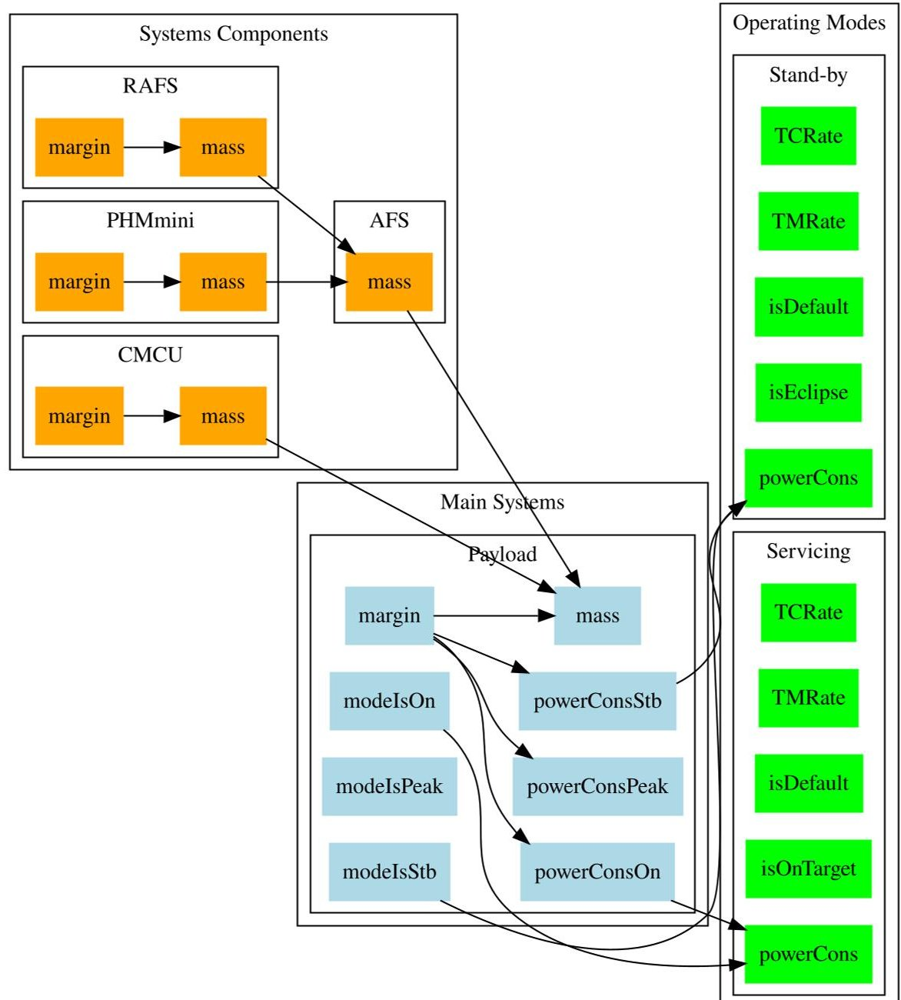


<div align="center">

Figure 35: Example of Payload relationship graph.

</div>

An example of this can be seen in Figure 35, which depicts a relationship graph generated

$ ^{1 0} $For a detailed explanation of the development of stereotypes and their attributes, refer to Section 3.3.2 (Stereotypes generation process)

<!-- PDF_PAGE: 76 -->

from the Payload BDD shown in Figure 39 and the OMs from Figure 37.

When extending this approach to a more comprehensive SysML-based data structure, other crucial elements can be included, such as Ground Stations or the S/C's Communication System. This inclusion would bring to light all relevant relationships necessary for data and link budget analysis.

Furthermore, incorporating elements like Solar Arrays, Batteries, and an EPS, along with orbital parameters, would facilitate the visualisation of all interrelationships pertinent to a power budget.

Such an expanded relationship graph would provide a holistic view of the system, highlighting the intricate web of dependencies that define the spacecraft's functionality and operational efficacy.

## 3.6.5 Simulation results

Summarising what is presented in the previous sections, through the proposed formalisation, it is possible to generate a general S/C SysML model. By editing the attributes inherited by the blocks through the application of the proposed set of UML stereotypes it becomes possible to adapt the general model to any system and mission scenario.

Once the Systems, Components, Operating Modes, Orbit(s) and Ground Station(s) are comprehensively characterised within the model, it is possible, through the development of a dedicated parser, to extract the relevant data and translate them into a data format that can be used with any desired set of simulation tools. These tools or scripts may require minor modifications in order to access the new database.

In this case, the TWC mission model presented in the previous sections is integrated with the mission analysis tools from the NSS constellation. They allow, as presented for the CREME use case [14] in Section 3.4.4 (Operating Modes generalisation test through NSS tools), the generation of a Power Budget and a Data Budget.


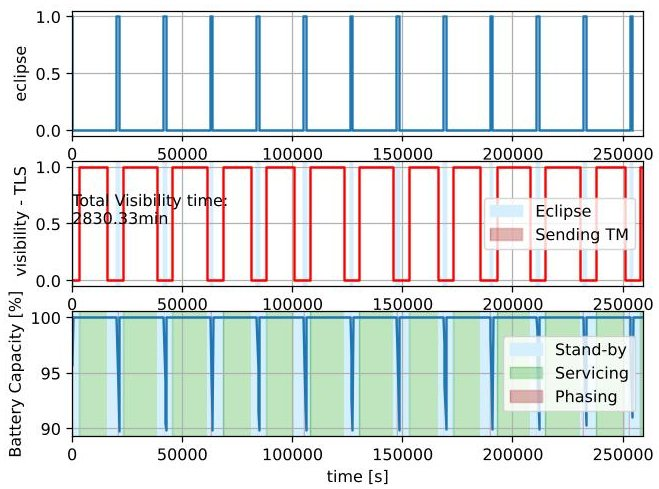


<div align="center">

(a) TWC Power Budged.

</div>


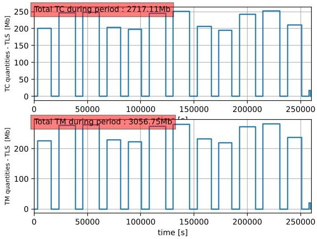


<div align="center">

(b) TWC Data Budged.

</div>

<div align="center">

Figure 36: TWC output Power and Data Budgets.

</div>

<!-- PDF_PAGE: 77 -->

Once the data are extracted from the S/C SysML model and saved in the preferred data format for the simulation tools, in this case the .yaml format, it becomes possible to execute analyses and generate the desired system budgets.

As secondary outputs for the parsing process, the requirements list and the relationship graph shown in Figure 34 and Figure 35 respectively are generated.

For the budgets generation, the mission analysis scripts required minor changes to the code in order to adapt to the newly generated data format, but once these changes were made, it became possible to use the software with any SysML model provided seamlessly. The result of the proposed process is reported in Figure 36.

The correct generation of system budgets proves the correct functionality of the proposed process, starting from the definition of UML stereotypes within a generic S/C SysML model and ending with the correct execution of simulations and analyses.

<!-- PDF_PAGE: 78 -->

## 4 Conclusions and future work

The Preliminary Design of a CubeSat is characterised by its high level of multidisciplinarity. Even through the use of advanced Systems Engineering practices, such as Model-Based Systems Engineering and Concurrent Engineering, there is a high fragmentation between the multiple domain-specific tools used by the various figures involved in a project. This fragmentation is also found in the storage and transmission of data required for simulation and analysis activities. This represents a challenge for the SE domain in the upcoming future [9], [16].

This problem led to the development of integrated toolchains for complex systems modelling and analysis, both proprietary (e.g., SLIM [10]) and open-source (e.g., the Nanostar Software Suite [14], [34]). However, how to effectively integrate open-source modelling tools and languages with domain-specific open-source tools for simulation and analysis activities was an open question [13].

This thesis presents the formalisation for a general CubeSat SysML model, enhanced through the use of UML stereotypes for data storage and transmission. The proposed formalisation enables the model to be considered as the central source of truth for data across all PD Phase stages, becoming the principal front-end for the overall design cycle.

The novelty of this thesis is represented by the generality offered by the features introduced within the proposed formalisation. It is possible to generate a CubeSat SysML model with any desired modelling tool and methodology without affecting the final result. Moreover, within the CubeSat SysML model, it is possible to define any desired diagram or element with no consequences on the integration process with any set of simulation tools. Such integration takes into account only the elements with one of the above-mentioned UML stereotypes applied and, once more, considers only the attributes introduced by such stereotypes. This feature allows another degree of freedom in the characterisation of model elements.

The second result of the presented research work is a generalisation for the Operating Modes of a CubeSat. It is based on the identification of common attributes and transition criteria between several LEO CubeSats Concepts of Operations. By introducing such OMs generalisation it becomes possible to define several CubeSats mission scenarios by only modifying the modelled OMs attributes, without the need to further edit any simulation tool or script. The proposed OMs generalisation can be implemented in any desired data format, including the one proposed in the general CubeSat SysML model formalisation, adding a further degree of freedom in its modelling and abstraction capabilities.

The exploitation of the UML stereotypes in the CubeSat SysML model makes it possible to identify common structures within the model files, enabling the extraction of data of interest for the integration of the model with any set of simulation and analysis tools. The generated data structure, dependent solely on the stereotypes introduced in the proposed formalisation and their attributes, can be adapted to any desired format.

While extracting relevant data, as a third output of the presented process, it is possible to generate dependency graphs. They highlight the relationships between various model

<!-- PDF_PAGE: 79 -->

elements and the budgets and variables dependent on them. Ultimately, they make it possible to understand graphically, quickly and intuitively which parameters are affected by a change in any design parameter, offering a valuable asset for trade-off studies across the PD Phase.

An application of the proposed formalisation in the context of the NSS constellation is presented as a proof of concept. The SysML model is generated using as a reference the TWC mission, a theoretical mission design developed during the "Space Mission and Systems Design" course at Politecnico di Torino. The SysML model, enhanced with the proposed set of UML stereotypes, is integrated within the mission analysis tools from the NSS through the development of a dedicated parser. The final output of the process is the generation of a Power Budget and a Data Budget, proving the functionality of the proposed formalisation.

A public repository collecting the main outcomes of this work is present at the link https://gitlab.isae-supaero.fr/preliminary-design/mbse-cubesat-sysml, provided under GPLv3 License.

As for future works, the proposed formalisation could benefit from some additions. The simulation tools of the NSS used for the end-to-end application introduced some levels of approximation: only circular orbits and one Ground Station for the data downlink/uplink have been considered. In the meantime, for the proposed OMs generalisation only LEO scenarios and Early Orbit Phase (EOP) operations have been taken into account, due to the absence of common properties and transition criteria to generalise and replicate across multiple projects.

A deepening of the topics above and their addition to the proposed formalisation would furthermore expand the generalisation capabilities enabled by the latter, allowing the modelisation of a wider range of missions. Additionally, the inclusion of dedicated stereotypes and relative attributes for a more thorough characterisation of systems such as the Propulsion System and the AOCS (e.g., by defining AOCS actuators and sensors, or thrusters and propellants) would lead to the integration and simulation of more complex scenarios, generating other useful budgets such as propellant and Delta-V budgets. Lastly, integration with other database formats, e.g. SQL, and their advantages can be explored.

<!-- PDF_PAGE: 80 -->

## A Acronyms

AIT Assembly, Integration & Test 4

API Application Programming Interface 24

AOCS Attitude & Orbit Control System 41

BDD Block Definition Diagram 15

BER Bit Error Rate 40

CCSDS Consultative Committee for Space Data Systems 27

CDF Concurrent Design Facility 1

CE Concurrent Engineering i

CEC Concurrent Engineering Center 1

ConOps Concept of Operations 20

DCAS Department of Aerospace Vehicles Design and Control 1

DIGEP Department of Management and Production Engineering 1

DISC Department of Complex Systems Engineering 1

DoD Department of Defence 3

DOD Depth Of Discharge 46

EOP Early Orbit Phase 44

EPS Electrical Power System 53

ECSS European Cooperation for Space Standardisation 27

ESA European Space Agency 3

FSF Free Software Foundation 21

GNSS Global Navigation Satellite System 61

GS Ground Station 30

GUI Graphical User Interface 24

INCOSE International Council on Systems Engineering 1

LEO Low Earth Orbit 20

LOS Line Of Sight 46

MBSE Model-Based Systems Engineering i

MDR Mission Definition Review 4

NASA National Aeronautics and Space Administration 3

NSS Nanostar Software Suite i

OM Operating Mode 25

OMG Object Management Group 12

OSHW Open Source Hardware 21

<!-- PDF_PAGE: 81 -->

OSHWA Open Source Hardware Association 21

OSI Open Source Initiative 21

OSR Open Source Requirement 21

OSS Open Source Software 21

PD Preliminary Design i

PDR Preliminary Design Review 4

PRR Preliminary Requirements Review 4

SatNOGS Satellite Networked Open Ground Stations 23

S/C Spacecraft 30

SE Systems Engineering 1

SLIM Systems Lifecycle Management 30

STK Systems Tool Kit 30

SysML Systems Modelling Language i

TWC The White Compass 61

UML Unified Modelling Language i

<!-- PDF_PAGE: 82 -->

## B Configuration Files example

Listing 5: Full set of OMs .yaml configuration example

Phasing:

isDefault: False [bool] # Default mode identification

priority: 2 [int] # Priority counter

isEclipse: False [bool] # Criterion 1: eclipse

isOnTarget: False [bool] # Criterion 2: GS in LOS

isOnZone: False [bool] # Criterion 3: S / C over zone

zoneLatStart: na [deg] # | - > Criterion 3 sub - parameter

zoneLatEnd: na [deg] # | - > Criterion 3 sub - parameter

zoneLonStart: na [deg] # | - > Criterion 3 sub - parameter

zoneLonEnd: na [deg] # | - > Criterion 3 sub - parameter

isInRange: False [bool] # Criterion 4: true anomaly range

rangeStart: na [deg] # | - > Criterion 4 sub - parameter

rangeEnd: na [deg] # | - > Criterion 4 sub - parameter

isInInterval: True [bool] # Criterion 5: time interval

intervalStart: 0.0 [sec] # | - > Criterion 5 sub - parameter

intervalEnd: 240.0 [sec] # | - > Criterion 5 sub - parameter

modeID: 2 [int] # Metadata : mode ID

modeName: Phasing [str] # Metadata : mode name

postProColor: '#BA525270 [str]' # Metadata : post-processing colour

TMRate: 18.0 [kbitsec] # Variable : Telemetry data rate

TCRate: 16.0 [kbitsec] # Variable : Telecommand data rate

powerCons: 0.0 [W] # Variable : Power consumption

Servicing:

TCRate: 16.0 [kbitsec]

TMRate: 18.0 [kbitsec]

intervalEnd: na [sec]

intervalStart: na [sec]

isDefault: False [bool]

isEclipse: False [bool]

isInInterval: False [bool]

isInRange: False [bool]

isOnTarget: True [bool]

isOnZone: False [bool]

modeID: 1 [int]

modeName: Servicing [str]

postProColor: '#00990040 [str]'

powerCons: 0.0 [W]

priority: 1 [int]

rangeEnd: na [deg]

rangeStart: na [deg]

zoneLatEnd: na [deg]

zoneLatStart: na [deg]

zoneLonEnd: na [deg]

zoneLonStart: na [deg]

Stand-by:

TCRate: 16.0 [kbitsec]

TMRate: 18.0 [kbitsec]

intervalEnd: na [sec]

intervalStart: na [sec]

isDefault: True [bool]

isEclipse: True [bool]

<!-- PDF_PAGE: 83 -->

```python

isInInterval: False [bool]

isInRange: False [bool]

isOnTarget: False [bool]

isOnZone: False [bool]

modeID: 0 [int]

modeName: Stand-by [str]

postProColor: '#D6EFFF [str]'

powerCons: 0.0 [W]

priority: 3 [int]

rangeEnd: na [deg]

rangeStart: na [deg]

zoneLatEnd: na [deg]

```

<!-- PDF_PAGE: 84 -->

## C TWC SysML model core elements

«block, operatingMode»

Stand-by

OperatingMode

modeName = "Stand-by"

modeID = "0"

postProColor = "#D6EFFF"

isEclipse = "True"

isOnTarget = "False"

isOnZone = "False"

isInRange = "False"

isInInterval = "False"

TCRate = "16.0"

TMRate = "18.0"

priority = "3.0"

powerCons = "0.0"

zoneLatStart = "na"

zoneLatEnd = "na"

zoneLonStart = "na"

zoneLonEnd = "na"

rangeStart = "na"

rangeEnd = "na"

intervalStart = "na"

intervalEnd = "na"

isDefault = "True"

«block, operatingMode»

Servicing

OperatingMode

modeName = "Servicing"

modeID = "1"

postProColor = "#00990040"

isEclipse = "False"

isOnTarget = "True"

isOnZone = "False"

isInRange = "False"

isInInterval = "False"

TCRate = "16.0"

TMRate = "18.0"

priority = "1.0"

powerCons = "0.0"

zoneLatStart = "na"

zoneLatEnd = "na"

zoneLonStart = "na"

zoneLonEnd = "na"

rangeStart = "na"

rangeEnd = "na"

intervalStart = "na"

intervalEnd = "na"

isDefault = "False"

«block, operatingMode»

Phasing

OperatingMode

modeName = "Phasing"

modeID = "2"

postProColor = "#BA525270"

isEclipse = "False"

isOnTarget = "False"

isOnZone = "False"

isInRange = "False"

isInInterval = "True"

intervalStart = "0.0"

intervalEnd = "240.0"

TCRate = "16.0"

TMRate = "18.0"

priority = "2.0"

zoneLatStart = "na"

zoneLatEnd = "na"

zoneLonStart = "na"

zoneLonEnd = "na"

zoneLonEnd = "na"

rangeStart = "na"

rangeEnd = "na"

intervalStart = "na"

intervalEnd = "na"

isDefault = "False"

<div align="center">

Figure 37: TWC Operating Modes Block Definition Diagram implemented in Gaphor.

</div>


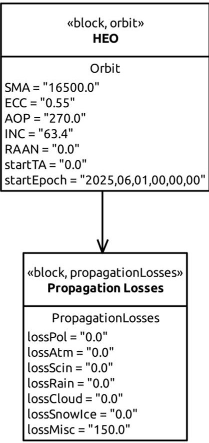


<div align="center">

(a) Orbit BDD.

</div>

«block, groundStation»

KirunaGS

GroundStation

altitude = "402.0"

minElevation = "5.0"

diameterRx = "15.0"

Lat = "67.9"

Lon = "21.0"

sysMargin = "10.0"

powerTx = "177.8"

lineLossTx = "4.7"

lossConnectorTx = "0.0"

gainTx = "46.8"

freq = "2000000000.0"

reqBER = "10.5"

modulation = "QPSK"

etaRx = "0.95"

noiseTempRx = "515.0"

LNAGain = "7.82"

lossCableRx = "0.0"

lossConnectorRx = "0.0"

dataRateTx = "10.0"

lossPointRx = "0.0"

<div align="center">

(b) Ground Station BDD.

</div>

<div align="center">

Figure 38: TWC Orbit and Ground Station Block Definition Diagram implemented in Gaphor.

</div>

<!-- PDF_PAGE: 85 -->


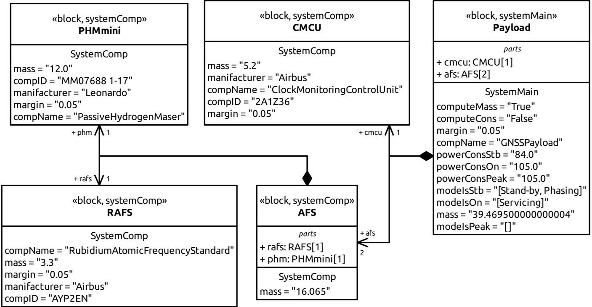


<div align="center">

Figure 39: TWC Payload Block Definition Diagram implemented in Gaphor. Components data from Satsearch [59].

</div>


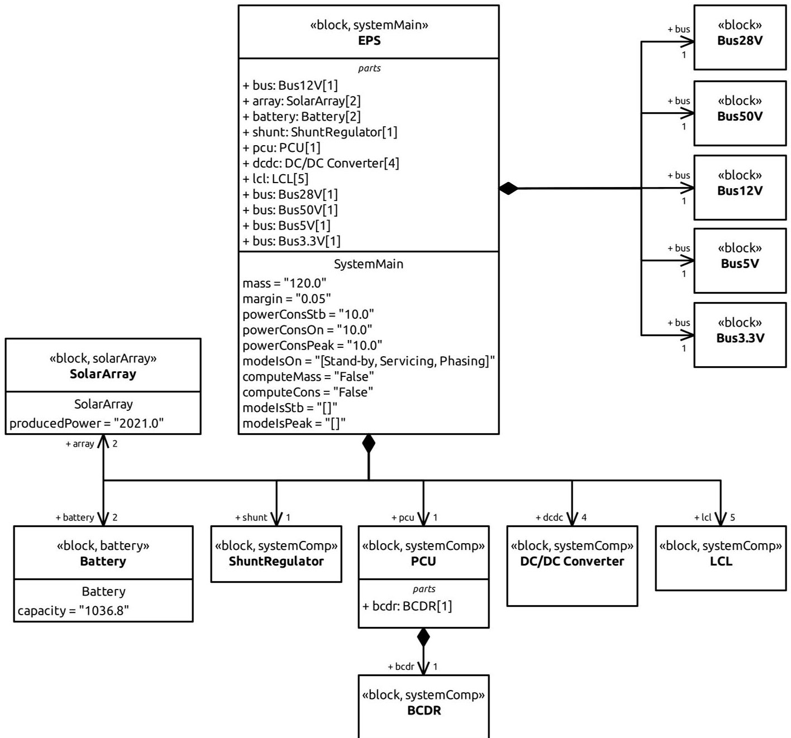


<div align="center">

Figure 40: TWC EPS Block Definition Diagram implemented in Gaphor.

</div>

<!-- PDF_PAGE: 86 -->


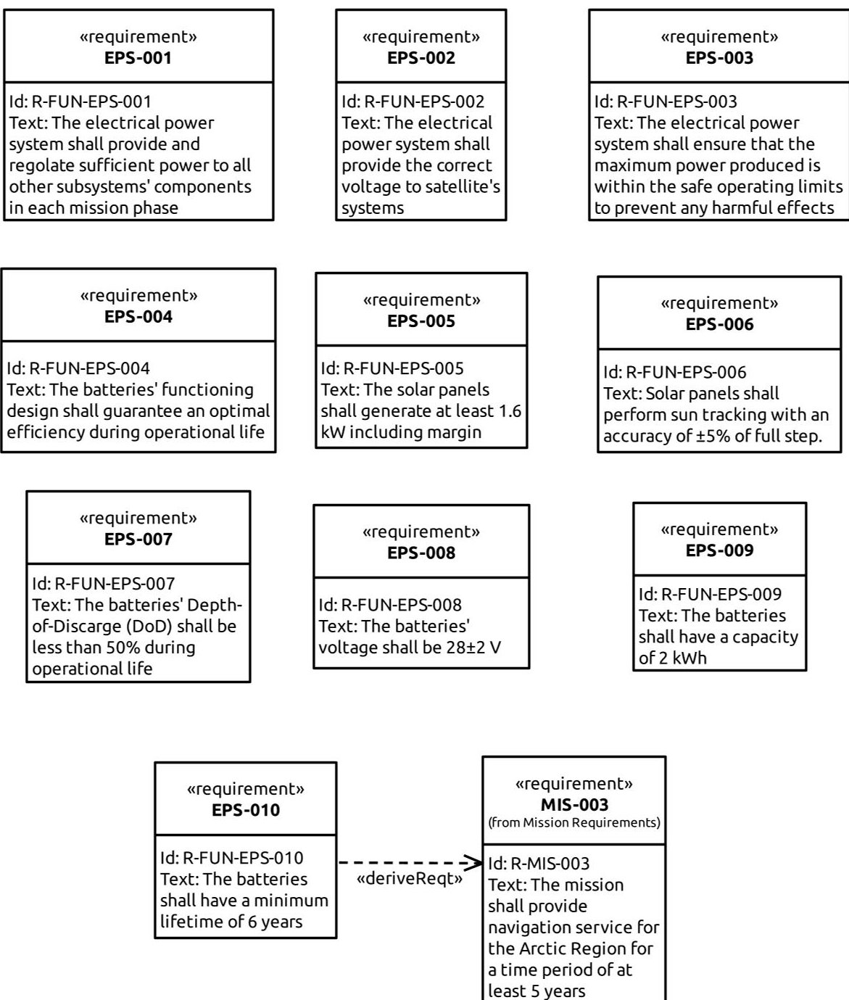


<div align="center">

Figure 41: TWC Functional EPS Requirements implemented in Gaphor.

</div>

<!-- PDF_PAGE: 87 -->

## References

[1] Euroconsult, Space Economy Report 2023. A Euroconsult Report, 9th ed., January 2023.

[2] E. Kulu, "Nanosats Database." https://www.nanosats.eu. Accessed: 10 Jan 2024.

[3] C. Iwata, S. Infeld, J. M. Bracken, M. McGuire, C. McQuirk, A. Kisdi, J. Murphy, B. Cole, and P. Zarifian, "Model-Based Systems Engineering in Concurrent Engineering Centers," in AIAA SPACE 2015 Conference and Exposition, (Goddard Space Flight Center), pp. 1-13, 2015.

[4] M. Bandecchi, B. Melton, and F. Ongaro, "Concurrent Engineering Applied to Space Mission Assessment and Design," ESA Bulletin, vol. 99, 1999.

[5] M. Bandecchi, B. Melton, B. Gardini, and F. Ongaro, "The ESA/ESTEC concurrent design facility," in Proceedings of the EuSEC 2000, vol. 1, pp. 329-336, 2000.

[6] D. Knoll, C. Fortin, and A. Golkar, "Review of Concurrent Engineering Design practice in the space sector: state of the art and future perspectives," in 2018 IEEE International Systems Engineering Symposium (ISSE), pp. 1-6, 2018.

[7] INCOSE, INCOSE Systems Engineering Handbook: a guide for system life cycle processes and activities — Edited by D. D. Walden, T. M. Shortell, G. J. Roedler, B. A. Delicado, O. Mornas, Y. Yew-Seng and D. Endler. Hoboken, New Jersey: Wiley & Sons, Inc., 5th ed., 2023.

[8] K. Henderson and A. Salado, "Value and benefits of Model-Based Systems Engineering (MBSE): Evidence from the literature," Systems Engineering, vol. 24, no. 1, pp. 51-66, 2021.

[9] INCOSE, "Systems Engineering Vision 2035." https://www.incose.org/publications/ se-vision-2035, 2021. Accessed: 5 Jan 2024.

[10] M. Bajaj, D. Zwemer, R. Peak, A. Phung, A. G. Scott, and M. Wilson, "SLIM: collaborative ModelBased Systems Engineering workspace for next-generation complex systems," in 2011 Aerospace Conference, pp. 1-15, 2011.

[11] CalPoly, CubeSat Design Specification. The CubeSat Program, Cal Poly SLO, California, February 2022. Rev. 14.1.

[12] J. R. Wertz, D. F. Everett, and J. J. Puschell, Space mission engineering: the new SMAD / edited by James R. Wertz, David F. Everett, Jeffery J. Puschell. Space Technology Library, Hawthorne, CA: Microcosm Press, c2011.

[13] S. S. Cordero, T. Gateau, and R. Vingerhoeds, "MBSE Challenges in the Concurrent Preliminary Design of CubeSats: Nanospace Study," in 2022 IEEE International Systems Conference (SysCon), pp. 1-8, 2022.

[14] T. Gateau, S. S. Cordero, R. Vingerhoeds, and J. Puech, "Nanospace and open-source tools for CubeSat preliminary design: review and pedagogical use-case," in 4th Symposium on Space Educational Activities, Universitat Politècnica de Catalunya, 2022.

[15] NASA, Systems Engineering Handbook. 12th Media Services, 2007. NASA/SP-2016-6105 Rev 2 supersedes SP-2007-6105 Rev 1 dated December, 2007.

[16] INCOSE, "Systems Engineering Vision 2020," Sept. 2007. INCOSE-TP-2004-004-02.

[17] M. Fowler, D. Rice, and M. Fowler, Patterns of enterprise application architecture. The Addison-Wesley signature series, Boston: Addison-Wesley, 2003.

[18] OMG, Standards Development Organization, "Unified Modeling Language (UML) 2.5.1 Specification." https://www.omg.org/spec/UML/2.5.1. Accessed: 16 Jan 2024.

[19] T. Weilkiens, Systems engineering with SysML/UML modeling, analysis, design. The MK/OMG Press, Amsterdam: Morgan Kaufmann OMG Press/Elsevier, 1st ed., 2007.

[20] OMG, Standards Development Organization, "Systems Modeling Language (SysML) 1.6 Specification." https://www.omg.org/spec/SysML/1.6. Accessed: 16 Jan 2024.

<!-- PDF_PAGE: 88 -->

[21] A. Scholz and J.-N. Juang, "Toward open source CubeSat design," Acta Astronautica, vol. 115, pp. 384-392, 2015.

[22] "Free Software Foundation." https://www.fsf.org/. Accessed: 1 Mar 2024.

[23] "Open Source Initiative." https://opensource.org/. Accessed: 1 Mar 2024.

[24] "Open Source Hardware Association." https://www.oshwa.org/. Accessed: 1 Mar 2024.

[25] Open Source Hardware Association, "Open Source Hardware Definition." https://freedomdefined.org/OSHW. Accessed: 1 Mar 2024.

[26] "Libre Space Foundation." https://libre.space/. Accessed: 28 Feb 2024.

[27] Libre Space Foundation, "UPSat - The first open source satellite." https://upsat.gr/. Accessed: 1 Mar 2024.

[28] "LibreCube." https://librecube.org/. Accessed: 1 Mar 2024.

[29] "SatNOGS - Open Source global network of satellite ground-stations." https://satnogs.org/. Accessed: 1 Mar 2024.

[30] "Ardusat - Expanding STEM education with access to space." https://github.com/ArduSat. Accessed: 1 Mar 2024.

[31] "Arduino." https://www.arduino.cc/. Accessed: 1 Mar 2024.

[32] Kickstarter, "ArduSat - Your Arduino Experiment in Space." https://www.kickstarter.com/ projects/575960623/ardusat-your-arduino-experiment-in-space. Accessed: 1 Mar 2024.

[33] Libre Space Foundation, "The Open Source CubeSat Workshop 2021: An Overview." https:// libre.space/2022/01/07/open-source-cubesat-workshop-2021/. Accessed: 1 Mar 2024.

[34] T. Gateau, L. Senaneuch, S. S. Cordero, and R. Vingerhoeds, "Open-source Framework for the Concurrent Design of CubeSats," in 2021 IEEE International Symposium on Systems Engineering (ISSE), pp. 1-8, 2021.

[35] M. Reddy, API design for C++. Boston: Elsevier/Morgan Kaufmann, 1st ed., 2011.

[36] R. Van Bruggen and P. Mohanta, Learning Neo4j: run blazingly fast queries on complex graph datasets with the power of the Neo4j graph database. Community Experience Distilled, Birmingham, England: Packt Publishing, 1st ed., 2014.

[37] A. Scholz, CubeSat standards handbook: A survey of international space standards with application for CubeSat missions. LibreCube Initiative, April 2021. Available online: https://gitlab.com/ artur-scholz/handbook-space-standards. Accessed: 14/09/2023.

[38] Ansys, "Ansys Systems Tool Kit (STK)." https://www.ansys.com/products/missions/ ansys-stk. Accessed: 20 Feb 2024.

[39] S. C. Spangelo, D. Kaslow, C. Delp, B. Cole, L. Anderson, E. Fosse, B. S. Gilbert, L. Hartman, T. Kahn, and J. Cutler, "Applying Model-Based Systems Engineering (MBSE) to a standard CubeSat," in 2012 IEEE Aerospace Conference, pp. 1-20, 2012.

[40] J. Holt and S. Perry, SysML for Systems Engineering - A Model-Based Approach. Institution of Engineering and Technology (The IET), 3rd ed., 2019.

[41] Eclipse Foundation, Inc., "Model Based System Engineering — Capella MBSE Tool." https:// mbse-capella.org/. Accessed: 12 Dec 2023.

[42] P. Roques, "MBSE with the ARCADIA Method and the Capella Tool," in 8th European Congress on Embedded Real Time Software and Systems (ERTS 2016), 2016.

[43] Eclipse Foundation, Inc., "Arcadia method." https://mbse-capella.org/arcadia.html. Accessed: 12 Dec 2023.

[44] Eclipse Foundation, Inc., "Papyrus." https://eclipse.dev/papyrus/. Accessed: 12 Dec 2023.

<!-- PDF_PAGE: 89 -->

[45] "Gaphor: UML/SysML Modeling." https://gaphor.org/. Accessed: 1 Dec 2023.

[46] ESA, Margin philosophy for science assessment studies. European Space Research and Technology Centre: ESA, 2012. SRE-PA/2011.097/, Issue 1, Revision 3.

[47] S. A. Asundi and N. G. Fitz-Coy, "CubeSat mission design based on a systems engineering approach," in 2013 IEEE Aerospace Conference, pp. 1-9, 2013.

[48] V. Jain, "Abstracting CubeSat Operations: A Path to Real Cubesat Interoperability," Master's thesis, York University, Toronto, July 2019.

[49] S. Waydo, D. Henry, and M. Campbell, "CubeSat design for LEO-based Earth science missions," in IEEE Aerospace Conference, vol. 1, pp. 1-1, 2002.

[50] B. Morton and S. Withrow-Maser, "On-Orbit CubeSat Performance Validation of a Multi-Mode Micropropulsion System," in 2017 Small Satellite Conference, 2017.

[51] E. G. Lightsey, E. Arunkumar, E. Kimmel, M. Kolhof, A. Paletta, W. Rawson, S. Selvamurugan, J. Sample, T. Guffanti, T. Bell, et al., "Concept of operations for the visors mission: A two satellite CubeSat formation flying telescope," in AAS 22-125, 2022 AAS Guidance, Navigation and Control Conference, 2022.

[52] H. Carreno-Luengo, A. Camps, P. Via, J. F. Munoz, A. Cortiella, D. Vidal, J. Jané, N. Catarino, M. Hagenfeldt, P. Palomo, and S. Cornara, "3Cat-2—An Experimental Nanosatellite for GNSS-R Earth Observation: Mission Concept and Analysis," IEEE Journal of Selected Topics in Applied Earth Observations and Remote Sensing, vol. 9, no. 10, pp. 4540-4551, 2016.

[53] E. Stromberg, C. Swenson, C. Fish, G. Crowley, A. Barjatya, and J. Petersen, "DICE Mission Design, Development, and Implementation: Success and Challenges," in AGU Fall Meeting Abstracts, vol. 2012, pp. SA13B-2179, 2012.

[54] European Cooperation for Space Standardization, "Active Standards." https://ecss.nl/ standards/active-standards/. Accessed: 27 Oct 2023.

[55] R. Fitzpatrick, An Introduction to Celestial Mechanics, pp. 46-52. Cambridge University Press, 2012.

[56] YAML Language Development Team, "YAML Ain't Markup Language version 1.2." https://yaml. org/spec/1.2.2/. Rev. 1.2.2. Accessed: 13 Feb 2024.

[57] "Graphviz." https://graphviz.org/. Accessed: 7 Dec 2023.

[58] W3C, "Extensible Markup Language (XML) 1.0 (Fifth Edition)." https://www.w3.org/TR/ REC-xml/. Accessed: 13 Feb 2024.

[59] satsearch B.V., "satsearch: the global marketplace for the space industry." https://satsearch. co/. Accessed: 7 Dec 2023.

<!-- PDF_PAGE: 90 -->

## Ringraziamenti

Come da tradizione, questa sezione sarà nella mia lingua madre.

In primo luogo, vorrei ringraziare la Prof.ssa Nicole Viola, Relatrice di questa Tesi, per il suo supporto durante la stesura di questo lavoro.

Vorrei esprimere la mia più profonda gratitudine al Dr. Thibault Gateau e alla Dott.ssa Sophia Salas Cordero: senza il vostro costante aiuto e i vostri preziosi suggerimenti e correzioni tutto ciò non sarebbe stato possibile. Merci.

Grazie ai miei genitori, per avermi sostenuto durante tutto questo percorso e avermi sempre garantito un porto sicuro in cui approdare nei momenti di difficoltà. Vi amo.

Grazie alla mia famiglia, tutta, per la sua vicinanza e amore. Grazie a voi mi sento parte di qualcosa di grande, e forte.

Grazie a Gianni, Ciccio, Domenico, Ivano e Francesco. Nonostante la distanza siete stati, e siete, le mie radici. Con voi vicino, so chi sono.

Grazie a Federico, mio fratello torinese. Vivere a Torino, grazie alla nostra convivenza, alle nostre pause "puntatina?" e al costante confronto con te, è stato facile come stare a casa.

Grazie agli amici della W38, per tutti i pranzi domenicali e le risate. Grazie ad AESA, per avermi fatto capire che l'Università è tanto di più oltre allo studio. Quello che mi avete dato è molto più di quanto potessi sperare.

Grazie a tutti gli amici di Briscola e Vinello, siete veramente troppi per scrivervi tutti, ma siete tutti altrettanto importanti per me. Grazie a voi, alla vostra vicinanza, alle risate, esami e pianti condivisi, non mi sono mai sentito da solo durante questo percorso. E so che mai lo sarò.

Grazie Ludovica, sei la mia più intima confidente, la mia grande sostenitrice e il mio faro nei momenti di tempesta. Grazie perché vedi in me quello che spesso io non riesco. Con te vicina anche il sole è più luminoso.

Infine, grazie a chi non c'è più. La vostra memoria è scolpita nel mio cuore, insieme ai vostri ideali. Non so cosa ci sia lassù, ma so che sarete sempre con me.