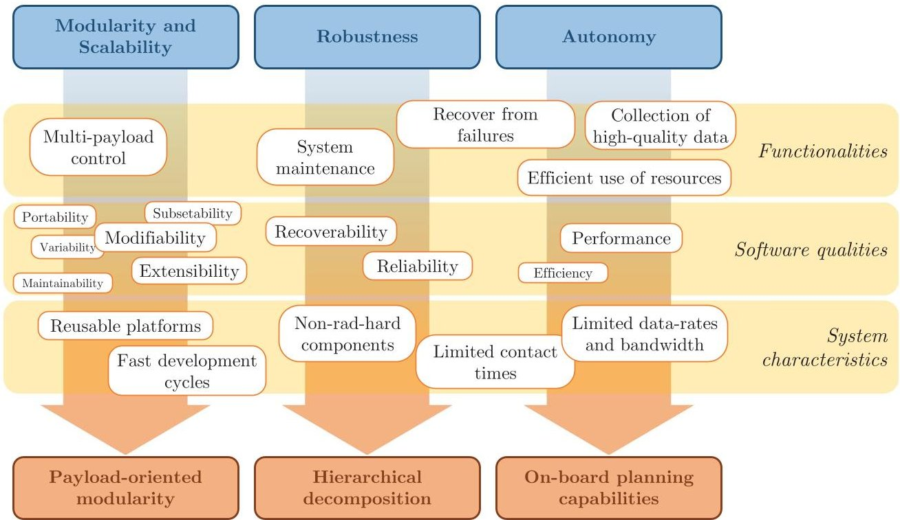
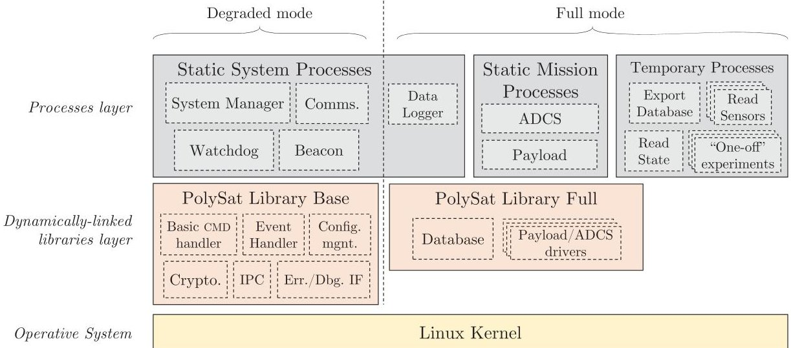
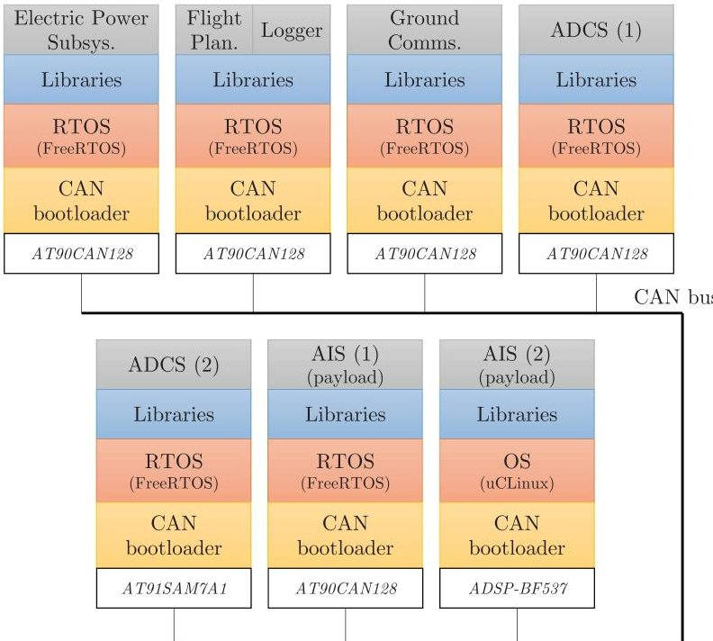
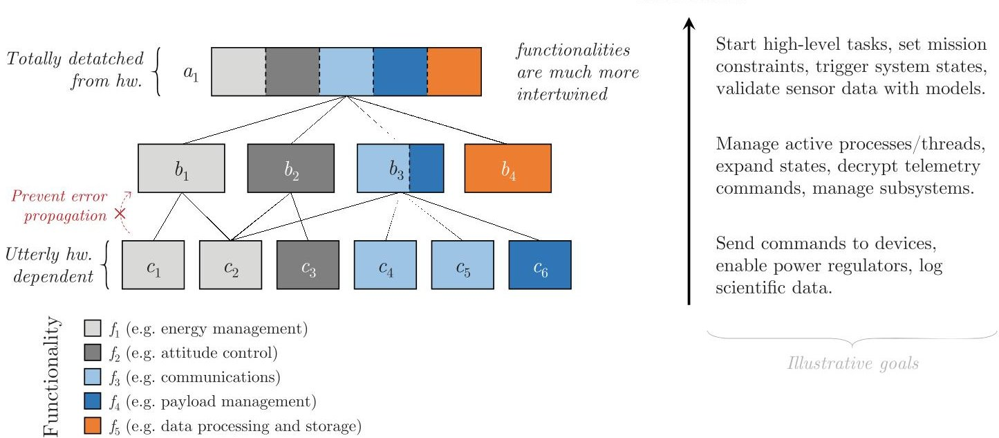
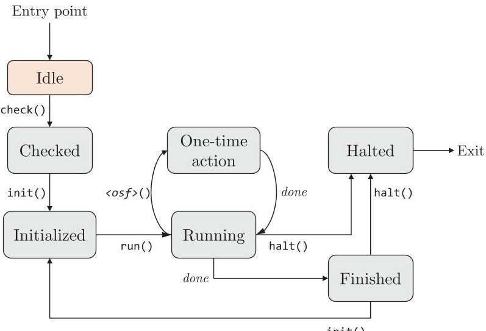
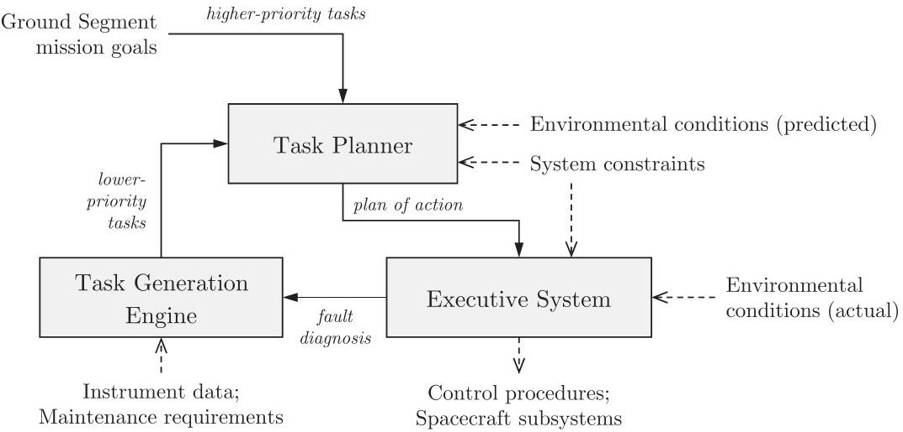
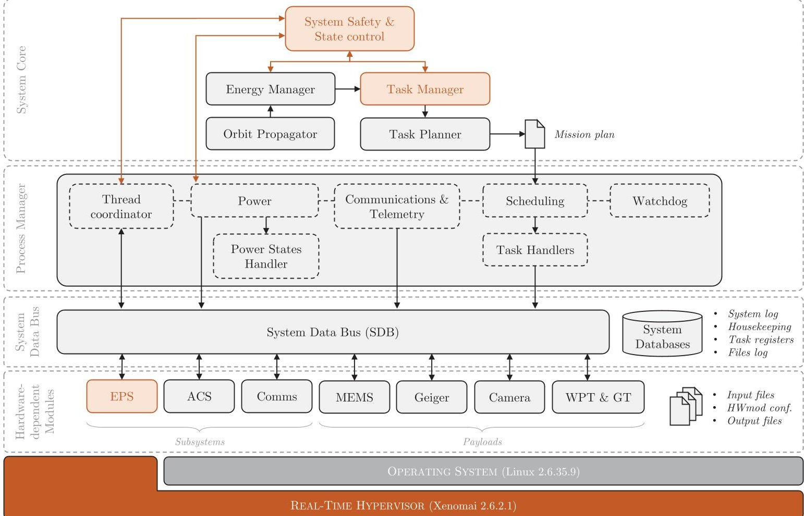

<!-- PDF_PAGE: 1 -->

# Design Guidelines for General-Purpose Payload-Oriented Nanosatellite Software Architectures

Carles Araguz, $ ^{*} $ Marc Marí, $ ^{+} $ Elisenda Bou-Balust, $ ^{+} $ and Eduard Alarcon $ ^{+} $ Technical University of Catalonia, 08034 Barcelona, Spain

Daniel Selva $ ^{\S}$ Cornell University, Ithaca, New York 14850

DOI: 10.2514/1.I010537

Despite their limited lifespan and reduced cost, nanosatellite missions have proved to be suitable platforms for Earth observation, scientific experiments, and technology demonstration. During the last years, the number of nanosatellite missions has noticeably increased, posing the need to improve several system characteristics to ultimately endorse the full potential of this class of spacecraft. In this context, this paper presents three design guidelines that can be applied in nanosatellite software to improve the system robustness, modularity, and autonomy. The design guidelines presented in this paper, namely, hierarchy-enabled robustness, payload-oriented modularity, and onboard planning capabilities, are complemented with a structured review of software techniques and architectural concepts that have been found in the literature. The paper justifies that these systemwide qualities are some of the most critical when designing flight software for CubeSat-like spacecraft and explores how they can improve mission performances and operability, enhance the system's tolerance to failures, and ease the development cycles. Finally, this paper illustrates the application of the design guidelines by detailing the onboard software architecture for the $ ^{3} $ Cat-1, a CubeSat program carried out at the Nano-Satellite and Payload Laboratory of the Technical University of Catalonia—UPC BarcelonaTech.

## I. Introduction

NANOSATELLITES have become an affordable alternative for many companies, research organizations, and universities to access the space market, both as consumers and providers. Usually deployed in low Earth orbit (LEO), nanosatellites have proven to be suitable platforms for technology demonstration [1], a variety of Earth observation and remote sensing purposes, science and research (e.g., [2]), and many other space applications such as low-power communications or maritime activity surveillance (e.g., [3]).

Either adopting the CubeSat design philosophy and standardized structure, as in the 3U-based FLOCK constellation by Planet Labs [4], or designing spacecraft busses that take up less than 60 cm per side, like NASA's CYGNSS constellation [5], nanosatellite platforms have already been adopted by agencies and small and large corporations, and they have been developed under many educational programs since the appearance of the CubeSat standard. Although the latter types of missions tend to be fully designed, implemented, and operated by heterogeneous teams at universities and are generally less demanding in terms of accuracy and reliability, the vast presence of university-developed nanosatellite missions is a clear sign of the ongoing democratization of space and the constant exploration of small spacecraft's science return capabilities. On the other hand, the interest and adoption of these types of platforms by the industry (e.g., [6,7]) evidences a clear paradigm shift and suggests a complexity increase for future mission architectures based on nanosatellite technologies.

However, this situation has led to the development of multiple successful, monolithic nanosatellite missions; lately, the adoption of this class of spacecraft has also been considered especially favorable for the development of new mission architectures such as fractionated spacecraft, satellite constellations, and swarms [8]. The combination of several instruments hosted at different nanosatellites has been envisaged as an enabler for new Earth observation missions with enhanced performance and improved system qualities [9].

In this scenario, some companies have already been offering software components, hardware modules, and complete subsystems that are compliant with the de facto standard (i.e., CubeSat units), ranging from complex attitude determination and control subsystems (ADCS) to electrical power supplies (EPS), robust communication protocols, low-power onboard computers, or real-time operating systems (RTOSs). These and many other CubeSat-compliant commercial components facilitate the development and integration of spacecraft and remove the burden of designing and testing some critical subsystems and modules. Thus, apart from coping with the complex task of integration, most nanosatellite developers ultimately focus on the development of mission-specific payloads and, most importantly, the design and implementation of custom flight software that controls the spacecraft at the device- and system-level.

Given that software is usually understood as the final architectural element to achieve the desired functionality, less attention has been placed on software-related issues during the emergence and consolidation of the CubeSat era. However, software and its architectural characteristics can be critical for the management of the mission; their correctness severely affects the functionality of the spacecraft. As a matter of fact, designing proper software architectures is also essential to achieve system-wide qualities such as reliability and performance and should not be understood as the mere fact of writing functionally correct programs.

In this context, this paper poses the need for improvement and explores the qualities and characteristics of nanosatellite systems. By identifying critical functionality and architectural requirements, this paper motivates the application of a design methodology for new designs that is composed of three essential guidelines, namely:

<!-- PDF_PAGE: 2 -->

Architectural Requirements for Nano-Satellite Software Architectures

Design Guidelines for Nano-Satellite Flight Software

Fig.1 Visual summary of common desired functionalities, qualities, and characteristics of nanosatellites, critical architectural requirements for their onboard software, and how they map to three design guidelines.

1) Payload-oriented modularity: Emphasizes the importance of proper encapsulation and generalization of low-level components to adapt software architectures to the needs of multi-payload missions and fast development cycles.

2) Robustness through hierarchical decomposition: Aims at structurally reducing error propagation and intends to minimize the complexity of critical system control parts by decoupling them from hardware and low-level modules.

3) Onboard planning capabilities: Provides a set of minimum components that can enhance the autonomy of a spacecraft by virtue of automatic generation of mission plans and robust execution of tasks.

This set of design guidelines, summarized in Fig. 1, are presented as generic overarching characteristics rather than implementation features. Thus, they can be applied vertically throughout a whole flight software framework. Furthermore, because of the fact that specific industry standards are not considered in this study, these design guidelines can be embraced both by educationally based programs and by industries developing their spacecraft, contributing thus to the foundations of future-generation nanosatellite software architectures.

This paper is organized as follows. Sections II and III identify the critical qualities and features that modern nanosatellite software should improve. Section III explores techniques to do so by revisiting and structuring knowledge hitherto presented in literature. Section IV derives the set of generic design guidelines that can be adopted at architectural levels and that improve the selected system qualities. Finally, Sec. V illustrates the application of these design criteria with an instance of those guidelines in the flight software architecture of the $ ^{3} $Cat-1 nanosatellite mission.

## II. Identifying the Architectural Requirements for Next-Generation Software Architectures

Determining the essential requirements for nanosatellite flight software requires the assessment of both their functional traits, the particularities of this type of system, and the desired all-encompassing qualities. The impact of these three aspects upon the design process is probably common to that of many engineering fields, and their interaction needs to be taken into consideration just as much as they need to be individually considered. Functional requirements essentially describe the behavior of the system (internal and external) and can easily draw specific structural design requirements; functions can easily be decomposed into blocks and their interrelationships. On the other hand, the specific system characteristics, or its context, will also reveal indirect design requirements that should be well studied at design-time. Not only do these relate to the limiting conditions under which the system operates (e.g., intermittent or continuous operation, influenced by external factors that may cause failures, setting a maximum number of concurrent operations), but they also encompass particular details of the development process, such as whether they need to be produced in mass or not; the types of devices on top of which the software will run; how much of the design will need to be changed and which parts will suffer greater modifications; etc. The number of possible functions and specific system characteristics can be vast and is out of the scope of this study. Instead, the present analysis is interested in common aspects that do apply in most nanosatellite missions and can translate to generic design requirements.

Indeed, this set of generic requirements is very much motivated by functional characteristics, system limitations, and external conditions. However, these factors also enforce high-level attributes of a software architecture, which can also be grouped and studied under the term of quality attributes. Accordingly, a software architecture should not only define the system in terms of tangible actions, relationships, or functionalities, but it should also play a significant role in achieving these system-wide quality attributes. Designing a suitable architecture will allow or preclude just about all of a system's characteristics, thereby leading the goodness of a software architecture to strongly affect the integrity of the whole system.

The IEEE Standard for a Software Quality Metrics Methodology [10] defines software quality as the degree to which the software possesses a desired combination of attributes. These nonfunctional attributes of a software system (e.g., reliability, performance, usability) can map to specific, yet high-level, requirements and may often be intertwined with each other.

<!-- PDF_PAGE: 3 -->

The set of quality attributes one can use to assess a particular software architecture differs depending upon the source, so much so that lexically similar or identical qualities can have different names, and the same quality can be found with slightly different definitions. The considered attributes and their definitions in this paper are taken from the standards in [11-16]. Note, however, that because they relate to qualitative aspects, assessing them quantitatively is often a very subjective exercise that has not been tackled either in the cited works or in this analysis. To minimize semantic ambiguities and provide a more generic set of requirements, this paper proposes three groups of quality attributes that encompass many of the specific ones discussed in the references. The requirements proposed in this paper, justified in detail in the following sections, are robustness (Sec. II.A), modularity and scalability (Sec. II.B), and autonomy (Sec. II.C). These quality attributes will ultimately be mapped into three independent design rules later in this paper.

Aside from possible interdependencies, software quality attributes may be conceptually bound to the desired functionality and external limitations of a system. In other words, some system limitations and functional requirements will force some of these qualities to become actual requirements. As an illustration of the latter statement, consider a case in which software needs to process large volumes of data (function) but is forced to run in a computationally limited hardware (system characteristic). Although, in this case, the software architecture would require a certain performance, if the software would run on several different platforms, one would say that the software needs to have high portability. This conceptual binding between functionalities, system characteristics, and the high-level qualities of a software is graphically represented in Fig. 1, for the groups of attributes proposed previously.

## A. Robustness

Space applications are subject to countless sources of failures. Although the effects of ionized particles in the onboard semiconductors, such as single-event upsets (SEUs) and single-event latchups (SELs), are some of the most common sources of errors, other situations like one-time subsystem malfunctions or power/communication failures can cause a variety of runtime errors. To protect their microcontrollers and memories against SEUs and SELs, large spacecraft are often equipped with radiation-hardened devices that can withstand greater doses of ionizing radiation. Contrarily, nanosatellite designs hardly include such devices, usually owing to the spacecraft limited power and mass budgets and sometimes due to the habitual use of commercial off-the-shelf (COTS) components.

Similarly, large satellites also combine the use of radiation-hardened (rad-hard) technology with sophisticated real-time operating systems, hypervisors, and middleware, which present reliability guarantees and provide the foundations for robust software environments. The latter types of products, however, are not restricted in nanosatellite developments. A good example of these can be found in NASA/GSFC's Core Flight Executive and Core Flight Software $ ^{**} $ (cFE and cFS), an open-source middleware that is available for some open-source kernels $ ^{††} $ (e.g., RTEMS, Linux) and can be used to develop flight applications. The cFS/cFE middleware is a comprehensive flight software framework that extends the operating system and provides common services and a myriad of reusable modules. Adopting these may ameliorate the robustness of the system because these products have been exhaustively tested and verified [17]. Regardless of this suite already being tested in NASA's nanosatellite missions [18], its adoption is still not broad enough, and many current developments are still implemented on top of simpler, commonly known operating systems (e.g., FreeRTOS or standard Linux kernels), which lack most of the reliability guarantees of additional, space-qualified middleware.

In these situations, the mission software should be able to withstand the system's failures and correct them. From an architectural standpoint, not considering qualities like recoverability or reliability during the software design process poses a risk to the mission and could become one of the causes of a global breakdown. Although the reliability of an architecture is related to the ability to perform the required functions without failures or within a bonded failure rate, recoverability emphasizes how good the recovery strategies are. To recover from a fault or unexpected state, one may argue that the architecture needs to be designed with robust system state control and some kind of error detection mechanism. Because of that, this evaluation framework considers critical to implement the available architectural methods and alternatives to achieve robust software, also in nanosatellite programs.

## B. Software Modularity and Scalability

During the last years, developing, launching, and operating high-density constellations of nanosatellites started to become a reality. Ventures like the one started by Planet Labs have planned to operate constellations of up to 200 homogeneous units [4] to offer Earth imagery at medium resolutions (3-5 m) with daily revisit times. The capabilities of satellite constellations consisting of many nanosatellite units are promising and suggest the need for modular architectures, also from a software viewpoint. As a matter of fact, next-generation constellations should not necessarily involve identical units orbiting at different orbits but could also encompass a set of heterogeneous nanosatellites orbiting closer and communicating with one another. In that scenario, software architectures not only need be replicable but shall be variable enough to attain the control of a diversity of payloads.

Simultaneously, many nanosatellite programs tend to continue their activities after a successful mission and develop new generations of spacecraft based on their previous designs. In this context, designing reusable systems does have a significant importance to reduce, even more, the development times of future nanosatellite units.

As technology advances, new, smaller, less power-consuming, and more capable devices and modules will surface. Nanosatellites will then increase their payload capacities and will likely require flight software capable of controlling and interfacing more subsystems. The need for scalable and flexible software architectures where modules can be added, changed, or removed without affecting the core of the architecture therefore becomes evident. In this respect, several attributes can be studied to assess how complex it is to modify an architecture to some extent. Terms such as variability, extensibility, and subsetability reflect the ease with which a software architecture can be modified to produce new designs that differ in specific, preplanned ways and assess the required actions to do so. Similarly, maintainability or modifiability also express the ease with which a software system or component can be modified to correct faults, improve some characteristic, or adapt to a changed environment. When the changes are exogenous to the software architecture itself, one can study the portability of the design by assessing how complex it is to migrate it from one platform to a different one. With more or less emphasis in each of them, this set of qualities is deemed essential in this study and will be considered when deriving specific design guidelines in the sections that follow.

## C. Spacecraft Autonomy

There are many different factors that suggest that nanosatellites be provided with a certain degree of autonomy. To begin with, observability in satellites can be extremely constrained. Depending on the orbit altitude and inclination as well as the location of the ground stations, satellites in

<!-- PDF_PAGE: 4 -->

LEO (i.e., most nanosatellites) can establish communication links in the order of up to 4-5 times per day, with durations in the range of 5-10 min, approximately. Assuming good elevation conditions for the ground station antennae, nanosatellite operators might be able to communicate with their spacecraft during 30-45 min every 24 h if occasional link deterioration caused by environmental factors is not considered. Consequently, the amount of information that can be downloaded from an LEO satellite is extremely restricted, let alone the limited data rates often found in nanosatellite systems.

These communication restrictions may preclude mission operators from reacting to unexpected failures with agility and could lead the satellite to remain in safe modes for long periods after an error is detected. Intermittent communications thus worsen the spacecraft performance if science opportunities are missed during the latter situation. Conversely, autonomous spacecraft that can replan their activities not only will improve the spacecraft's data acquisition capabilities but will also ameliorate the mission's robustness.

On the other hand, limited telemetry bandwidth could prevent the retrieval of fine-grained states of the satellite. When satellite actions and resource allocations are planned in the ground segment, not knowing the state of the spacecraft with enough accuracy can negatively affect the way they are computed. Combining spacecraft state uncertainties with the uncertainties inherently found in space environments may, in addition, turn the plan generation into a very complex endeavor.

Furthermore, autonomous spacecraft can also deliver higher-quality data if they are provided with algorithms that intelligently optimize the data collection and download. This capability is not new for large spacecraft and has been demonstrated in the past for several satellite missions. An example of this is NASA's Earth Observing One (EO-1), a spacecraft that performed onboard data analysis and replanning to optimize the volume of data downloaded to ground [19]. The three-tiered software architecture in EO-1 encompassed a scheduler module (CASPER) that was able to replan activities, including downlink, based on science observations in the previous orbit cycles. Although computing resource allocation and performing data analysis onboard demands higher computational capabilities, the same onboard planning software was successfully integrated in the IPEX nanosatellite mission in 2013 [20], demonstrating that this class of satellites can also support and benefit from the sophisticated algorithms present in autonomy systems.

Notwithstanding the fact that the commented autonomous capabilities are common in large satellite missions, many nanosatellite operation approaches are still relying upon the interaction of spacecraft with ground segment controllers. When nanosatellites pass over their ground stations, they receive sequences of time-tagged telemetry commands whose execution is statically scheduled at ground. Modern approaches are those implementing goal-based operations, where ground operators only modify the mission goals and allow the spacecraft to autonomously schedule its activities to meet the current goals [21,22]. Mission goals inherently encapsulate complex and flexible command sequences that will be decomposed onboard and are not accompanied by a fixed execution time. This type of approaches, in which nanosatellites would be more autonomous, improve the mission performance by allowing the spacecraft to optimize the timeline of actions not only based on the state of resources and subsystem but also with a given degree of awareness of the captured data quality. Nanosatellites with instruments that can only operate under certain conditions (e.g., optical imagers are generally constrained by lighting and cloud-coverage conditions) could autonomously decide when to enable their instruments based on predictions (e.g., lighting conditions) and onboard analysis of data (e.g., cloud coverage), thus saving power and storage efficiently.

Having explored the system characteristics, qualities, and common functional aspects, this paper proposes this framework of three essential requirements (robustness, modularity and scalability, and autonomy) to be applied during the design process of future nanosatellite software. The items presented in the framework have essentially arisen from the technological context and current trends in the small spacecraft community; although CubeSat-based systems have proven to be a time- and cost-effective alternative to develop high-performance, complex space systems, the number of nanosatellite programs is growing incessantly. All of the aforementioned architectural requirements are achievable through software engineering efforts and encompass many of the quality attributes found in architecture evaluation methods.

Whereas there are many systems described in the literature that improve most of the critical qualities (reliability, flexibility, autonomy, performance, etc.), their descriptions and designs have been presented and addressed from their particular mission standpoints, preventing their architectures, components, and techniques to be generally applied in different contexts. It is the purpose of this paper to explore some of these techniques and designs and to derive a set of design guidelines that satisfy the requirements presented in this section and that can be generally applied in new software architectures for nanosatellites.

## III. Review of Current Solutions

This section gathers a compendium of architectural concepts and design techniques that are present or have been applied in successful programs. Although some of the items of this list are basic concepts with which most software engineers will be familiar, all of them can be concurrently embraced at the design phase as a means to improve some of the essential quality attributes for nanosatellite flight software.

## A. Process Isolation and Protected Shared Resources

Time and space partitioning (TSP) are well-known techniques in the aviation and space industries to deliver robust software. TSP kernels and middleware allow one computer to be used for many different applications and the controlled use of the system's shared resources (i.e., memory, I/O devices, etc.). Applications executed using a TSP approach have their memory regions protected from the rest of the processes and are executed within deterministic time slots managed by a global hypervisor running on top of the OS. Although interpartition communication is reliably managed and guaranteed by intermediate layers, this approach allows high-level applications to be executed seamlessly without affecting other computer components upon their failure.

Applying time and space protection for the applications running in spacecraft is a common and recommended approach that can be found in many spacecraft designs [23]. Nonetheless, it may require the utilization of specific RTOSes or middleware. The idea of process isolation, however, is also implemented in widely known kernels like Linux. These operating systems are, on the contrary, much more available and known than specific TSP products, and they naturally provide process isolation (i.e., a virtual address space for each process). The use of Linux in small satellite developments is not new (e.g., [20,24-28]) and owes to the inherent use of readily available COTS components (i.e., onboard computers, OBC). In Linux-based designs, however, the mechanisms to control the access to shared resources (e.g., storage devices, communication ports, etc.) should be carried out separately because most Linux drivers are not designed to provide such feature.

## B. Real-Time Operating Systems

The utilization of real-time software in the nanosatellite community is highly accepted and recommended. Programming flight software applications in real-time environments is essential to guarantee the execution of critical processes. Although priority-based real-time systems implement reliable scheduling algorithms that prevent task priority inversions, intertask communication and synchronization services provided by real-time kernels also allow the deployment of complex architectures.

<!-- PDF_PAGE: 5 -->

Fig. 2 PolySat's second-generation bus software architecture (extracted from [29] and adapted).

Most modern RTOSes support many of the processor architectures found in spacecraft computers (e.g., PowerPC, ARM, SPARC, etc.). The availability of hard-real-time OSes ranges from industry renowned products like RTEMS, VxWorks, QNX, LynxOS, and so on, to smallfootprint, free and/or open-source alternatives such as FreeRTOS or $ \mu $ C/OS-III. On the other hand, in the list of real-time alternatives, one can also include Linux patches, such as PREEMPT_RT or Xenomai. These options, which provide soft-real-time capabilities to standard Linux kernels (e.g., priority-based preemptive scheduling), can also be suitable for nanosatellite developments, although their timing capabilities (i.e., latencies) are not comparable to specialized hard-real-time products.

## C. Deembeddable Core and Safe Devices

Architectural approaches to improve software robustness can be found in multiple nanosatellite designs. An easily applicable example can be found in the flight software developed at California Polytechnic State University for their series of CPx nanosatellites. Figure 2 [29] shows the two-tiered PolySat's software architecture, consisting of the Processes and Libraries layers, deployed on top of a Linux kernel. The processes layer encompasses the so-called static processes (i.e., processes that are always active) and the temporary processes (i.e., are launched on-demand). Depending on their functionality and criticality, static processes are subcategorized into system or mission processes, clearly identifying the main platform modules. In addition, the libraries layer, which provide services and hardware interfaces to the processes layer, is also logically divided into a set of basic libraries ("PolySat Library Base") plus an extension set ("PolySat Library Full").

Their reusable software architecture has been the main controlling software onboard CPx spacecraft and is characterized by presenting two modes of operation, namely, degraded and full mode. In degraded mode, the onboard computer only runs critical processes that do not access devices that are sensitive to radiation damage (i.e., NAND storage device). These critical processes implement the minimal functionality for the satellite to be operable and are responsible for switching to full mode once the contents of the NAND device have passed an integrity test.

Designing software architectures with deembeddable cores that require a minimum set of hardware components to run may allow ground operators to keep control of the spacecraft even when parts of the system are unusable. In the lack of redundant systems, this kind of technique can enhance the overall robustness of the system and ameliorate the lifespan of the spacecraft.

## D. Fault Detection, Isolation, and Recovery Methodology

Fault detection, isolation, and recovery (FDIR) techniques are quite spread among space applications and have recently landed in the nanosatellite community. FDIR systems externally monitor system variables and infer the occurrence of errors by checking their expected values, usually against a predefined model. In the event of failures, FDIR systems detect their severity and apply some actions to isolate, circumvent, and solve the errors, whenever possible. Implementing safe modes where the spacecraft can safely remain upon the occurrence of errors is a common technique that allows ground operators to return the system to a desired state and may prevent loss of contact.

Despite the high computational load required to run complex FDIR systems, there have been nanosatellite missions that considered them to some extent. On one hand, Technical University of Delft has applied FDIR analysis on their DelFFi program [30] by studying how to detect and isolate failures in several subsystems and devices (e.g., deployables, UART, $ \mathrm{I}^{2} \mathrm{C} $ , memories). Their analysis resulted in a set of procedures and rules to trigger state transitions to safe modes and/or to signal the errors.

Among the active small satellite initiatives, the European Space Agency's 3U CubeSat OPS-SAT encompasses a dedicated FDIR computer that monitors each payload board through a modular controller [25]. Apart from the ability to monitor housekeeping data coming from the OBC and reacting to a small set of telemetry commands, the FDIR computer is able to circumvent single-event effects (i.e., SEU, SEL) by electrically isolating the payload boards from the system bus.

## E. Dynamically Linked Libraries

Segmented software implementations that consist of a set of programs, libraries, and drivers can be partially updated by only replacing some of their fractions. Although shared libraries offer the possibility to encapsulate reusable code outside the kernel that can be loaded or called by several programs, the fact that they are easily replaceable significantly increases the updateability and modularity of the system as well. Furthermore, because nanosatellite communication channels impose severe constraints on the volume of data that can be transferred, maximizing the software modularity should be deemed essential when designing in-orbit firmware update methods. A common update methodology is the application of patches to the software binaries. Usually, patches consist of new program data appended to the existing binary and accessed through jump instructions injected in specific program locations. Although this method can reduce the uploaded volume of data, its complexity is critical and may imply longer development and test times. Systems based on dynamically linked modules could ease this procedure by allowing the replacement of the whole module (both in-orbit or during integration stages).

PolySat's design philosophy actually followed this approach, resulting in all the basic software features being implemented in shared libraries. Linux-based operating systems include the dynamic linker, a component that loads and links shared libraries needed by the executables at runtime. Although updating a software architecture in orbit could be accomplished by securely replacing programs and library binaries through telemetry

<!-- PDF_PAGE: 6 -->

Fig. 3 AAUSAT3's software platform.

commands, the most valuable advantage is the ability to upgrade a component without recompiling or modifying the rest of the architecture (e.g., kernel, drivers, other components, etc.).

## F. Centralized Versus Distributed Approaches

Regardless of the system topology being extrinsic characteristic to software engineers, the choice of one or another notably affects the design of the software architecture. The majority of nanosatellites are centered around a single onboard computer that controls each subsystem through low-level, interface microcontrollers. Even though this system architecture inflicts a risk on the mission if the OBC presents a failure, the complexity of the system is reduced, given that most computations are performed on the same device. Communicating software components within the same environment is easy and is achieved through kernel services (e.g., pipes, message queues, shared memory heaps, etc.). Nonetheless, distributed approaches have also flown in previous missions, such as the one presented by the AAUSAT3 (Aalborg University, Denmark).

AAUSAT3's software architecture [3] is based on a set of applications that run on top of the platform's software stack: the bootloader, the kernel, and a collection of libraries (Fig. 3). Although the system architecture of the AAUSAT3 did not allow to migrate all the applications to different nodes (i.e., some of them rely on hardware components that are only accessible at their node), missing one module does not necessarily imply a global mission breakdown. Although isolation of components running in different nodes and application concurrency is achieved naturally and effortlessly, distributed approaches remove single points of failure thanks to the replication of baseline components (onboard computer, OS, etc.).

## G. Software Redundancy

Hardware redundancy is usually prohibitive in nanosatellites due to its cost and complexity. However, implementing redundancy at the software level is achievable and can solve some of the effects caused by SEU. Two possible types of software redundancy are envisaged and are listed as follows.

Data redundancy: Hishmeh et al. [31] state that critical data may be redundantly stored within a memory device to be able to recover from SEU effects. They applied this technique for the KySat-1 flight software, an educational CubeSat project by the Kentucky Space Consortium. The KySat-1 stored three copies of sensitive data on the onboard EEPROM to ensure its integrity in the event of a bit flip caused by radiation particles. Although this technique might not be applicable for large volumes of data, it could be a suitable solution to protect critical, nonvolatile system parameters or temporary scientific data.

Bootloader redundancy: Storing the boot images in triple modular redundancy (TMR) memories prevents the onboard computer from starting with a corrupted image and has been implemented in some programs (e.g., [28]). Despite TMR being a hardware technique, the concept of triplicating and voting a system image can also be performed in software within a single memory chip. Although less robust, the improvement can be adopted with little extra cost, mainly in terms of complexity, in many nanosatellite programs. The AAUSAT3 can easily illustrate the idea. Engineers of the AAUSAT3 program designed a CAN-based bootloader that can start any given application on the spacecraft boards [3]. This bootstrap system, which was designed in conjunction with the so-called software image server (SWIS), was intended to perform firmware updates securely (i.e., if an application fails, the system can return to the previous version or switch to a different one). Notwithstanding, the SWIS is essentially a system that can store redundant copies of a boot image and reliably select and correct corrupted ones. Similarly, onboard computers with sufficient capacity in their ROM devices could implement simpler concepts to protect the most critical data: the kernel image.

## H. Other Techniques Toward Robust Software

The literature covers plenty of software techniques to achieve robust software that are suitable in nanosatellite developments. Although describing them all is not the object of this paper, this section concludes with three valuable design concepts that may mitigate or help to detect problems in small spacecraft platforms.

Robust communications: Exchanging information between two entities is often critical. Processes and modules may communicate to send system commands and their responses, system variables, or sensitive data (e.g., subsystem configuration parameters). In some cases, this information exchange may be performed over unreliable communication channels or may be affected by SEU effects. In order to prevent unreliable delivery of digital data, the communication protocols should implement error detection and correction (EDAC) techniques. Although the list of available EDAC techniques that can be implemented in software is extensive and can be complex (e.g., [32]), there are simple techniques

<!-- PDF_PAGE: 7 -->

that can be generally adopted with ease: 1) data integrity checks (checksums or cyclic redundancy checks ensure that the transferred information has not suffered any modification); 2) acknowledgments (both positive and negative ACK segments are sent to signal the correct reception of a packet; 3) handshakes (communication is only started after ensuring that both ends are prepared), and 4) timeouts (control the time between queries and replies to avoid hanging on deadlocked processes).

Hardware and software watchdogs: Watchdogs are timers that cause automatic resets if the system under control is not responding [33]. Hardware watchdogs are present in many devices (i.e., microcontrollers), and their use may prevent global failures because they can restart the device when it is locked in unexpected deadlocks or failures. At the same time, software-based watchdogs can also be implemented. Process heartbeats can be used to detect deadlocks and to reset the processes whenever they occur.

Robust programming: Establishing strict coding rules and standards is critical for the management of a project with many collaborators. Stating rules that forbid certain programming constructs to ensure security and reliability can be key in applications where failure rate must be kept to the minimum. Although the adoption of industrial standards is always the preferred alternative, their complexity and lack of knowledge can be an obstacle to many educational nanosatellite programs. Nonetheless, simpler alternatives like the ones suggested by NASA Jet Propulsion Laboratory for Reliable Software in [34] can be applied with less effort and are highly recommended.

## IV. Structured Design Criteria for Nanosatellite Flight Software

Considering the presented compendium of techniques and concepts as a fundamental starting point, this section now poses three structured design rules that can be applied vertically throughout nanosatellite software architectures. These criteria involve both structural and functional artifacts that are complementary to the summarized techniques and that are specifically oriented to improve, even further, the groups of requirements presented in Sec. II.

Although most of the practices gathered in the previous section could improve the system's modularity and cope with the inherent presence of failures, they also show that these questions can be solved under many perspectives and at many levels: from low-level procedures or implementation recommendations to structural approaches and system design methodologies. Likewise, this section tries to contribute to the list of software design practices by proposing a set of guidelines that mimic some generic design rules while considering the specific needs and functional commonalities of nanosatellite flight software (i.e., mainly for Earth observation and technology demonstration missions).

## A. Robustness Through Hierarchy

The architectures introduced previously exhibited efforts toward the system robustness; most of them were focused on accurately detecting and minimizing the effects of errors. However, none of the practices boosted the robustness from a purely architectural perspective. Instead, they provided measures to counteract the problems: disable modules, trigger contingency modes, etc. Despite these measures being absolutely necessary, robustness can also be enriched in an abstract and generic manner through the ordering of software components. In this regard, the first proposed guideline is based on two fundamental concepts: encapsulation and goal-oriented decomposition of functionalities.

Component encapsulation is, actually, the basis of any design, and its correctness not only will affect the performance of the system but can also worsen some other qualities (e.g., testability, modularity). Although most nanosatellite architectures simply juxtapose modules encapsulated by the functionality of the spacecraft's subsystems, this approach complicates component interactions and lacks system perspective.

Conversely, software modules can be organized to keep hierarchical relationships. Just like organizations are divided into strata with different responsibility levels, a software architecture can also be split into several levels of abstraction (i.e., layers) to model the system. Each of these levels of abstraction requires the interaction with the adjacent ones to be able to develop a global function, hence establishing a hierarchical relationship. The first benefit of such modeling approach is the ability to remove error propagation paths. Layered structures where modules maintain hierarchical relationships may cut the propagation of errors if modules in each layer are sufficiently isolated. Figure 4 illustrates this idea by representing an arbitrary architecture divided into three levels of abstraction. The lines that connect each box represent module interdependency (i.e., "use cases") and reflect the hierarchical relationship explained previously. If the modules were implemented as sandboxed processes, these relations would be communication channels through which one process can invoke routines on another. Robust interprocess communication could allow processes in layer B to be isolated from errors in processes of layer C (e.g., a segmentation fault on module $ c_{1} $ would not affect module $ b_{1} $ ). Therefore, it becomes critical that modules that maintain some kind of dependence with others be provided with deterministic response to errors when external invocations fail unexpectedly.

## Abstraction

Fig. 4 Encapsulation of functionalities in abstraction levels, or layers.

<!-- PDF_PAGE: 8 -->

Fig. 5 Low-level modules state transition network.

In addition to that, this very vertical encapsulation of components, or "layering", can be naturally combined with the commonly implemented horizontal fragmentation based on functionality. This introduces the latter concept: goal-oriented decomposition of functionalities. Although modeling the software into different levels of abstraction allows to cut error propagation paths easily, disseminating functionalities $ f_{i} $ among the layers also minimizes the complexity of each component. In accordance to this idea, a given functionality would be split into multiple tangible actions, or "goals", more or less abstract. Figure 4 illustrates possible goals with different abstraction degrees. At the same time, the figure shows that high-level components are functionally complex and may encompass several functionalities as the abstraction increases.

With this decomposition approach, components that rely on hardware (i.e., modules that control subsystems or interface with payloads) can be completely isolated from systemwide controllers that operate at a much higher abstraction level and that are critical to the mission management. Because high-level modules are untied to subsystem failures and implement abstract functions (e.g., finite state machines), they become easier to implement and simpler to verify by static source code analyzers. The hardware detachment presented by higher modules may enable them not only to be designed simpler but to be implemented in protected hard-real-time environments, $ \S\S $ inherently improving their robustness by allowing a deterministic scheduling policy of those components.

## B. Payload-Oriented Modularity

The ability of a software architecture to be extended and modified relies on its modularization. Generally, identifying the subsets that maximize internal coupling and minimize coupling between modules is a demanding intellectual exercise and is influenced by subjectivity. Nonetheless, a certain lack of generality is usually needed in all engineering areas to deliver products that are tailored to the actual requirements and context. In this respect, software architects can follow the steps in [35] that state how to identify changeable parts from an engineering perspective, namely, 1) identification of the (system) items that are likely to change; 2) location of the specialized components in separate modules; and 3) design intermodule interfaces that are insensitive to the anticipated changes, preventing the changeable aspects to be revealed by the interface.

This encapsulation approach, based on the very definition of intermodule interfaces, can be embraced by nanosatellite software designers to hide the changeable parts of their products and produce replaceable modules. Besides minor modifications to correct or simplify parts of the software, nanosatellite architectures are subject to changes in parts related to their subsystems and payloads. Changes in the subsystems do not necessarily imply the removal of any of them; there is likely to be an EPS, an ADCS, and a communications system. However, the actual hardware and their interfaces may dramatically change after a mission update. Similarly, the payloads hosted by the spacecraft will differ from one mission to another.

In accordance to the aforementioned context, the guideline here presented proposes an encapsulation of low-level modules based on payloads and subsystems, together with the definition of generic interfaces for these components. The interface is defined as a set of functions that can be invoked by other modules in the architecture and that modify the internal state of the component (Fig. 5). Four basic functions are defined, namely, check(), init(), run(), and halt(). Their implementations should account for the functionality described in Table 1. This basic API, which has some resemblance with Linux drivers management, allows the system to start and stop modules in a controlled manner. The modules could perform a set of initial checks before any other action is performed to guarantee that the underlying hardware or subsystems are operative. When these tests succeed, the module remains in the Checked state until the init() function is invoked. A module can then transition to the Running state after it has been correctly initialized [functions init() and run()]. Most self-contained modules should be able to operate the payload or subsystem autonomously and jump to the Finished state once the Running routines are completed. Other modules, however, may never finish because they control subsystems or devices that are always active.

In addition, some modules may not be able to autonomously control the subsystem and may require external triggers to transition to internal substates. The so-called one-shot functions (OSF) try to account for these triggering requirements. If the substates of a module were controlled by hierarchically higher components, the designers could implement custom OSF to handle those state transitions. Moreover, modules that are able to generate instantaneous data that are relevant to the rest of the architecture could also implement specific functions to retrieve it (e.g., sensor readings, externally visible subsystem variables, etc.).

Finally, either in Finalized or during Running, the function halt() can be called to cleanly terminate the process and release the resources (e.g., memory regions, kernel services, open databases or files, peripherals, etc.).

With this minimal, generic interface encapsulating routines that are close to the payload and subsystem hardware, changeable modules can be integrated seamlessly in an architecture. Provided that the interface is kept the same, replacing low-level components should be transparent to higher-level components and should provide the required flexibility in future nanosatellite generations.

<!-- PDF_PAGE: 9 -->

Table 1 Low-level modules generic interface

<table border="1"><tr><td>Function</td><td>Description</td></tr><tr><td>check()</td><td>Verify that the subsystem is ready and does not present any errors. Runs unit tests on devices, checks that there is no communication or power issue, and if there are some, reports them with details.</td></tr><tr><td>init()</td><td>Configures internal parameters or the underlying devices to begin the execution of the running routines. Acquires static resources (e.g., memory, databases, digital buses) and ensures that the system does not accumulate any previous error.</td></tr><tr><td>run()</td><td>Executes the routines that control the subsystem or payload. After an invocation of this function, the module can generate and process data, enable actuators, and communicate with other modules.</td></tr><tr><td>halt()</td><td>Reset all variables and devices, release resources, and remove itself from the active list of modules (e.g., exit the process).</td></tr><tr><td>osf()</td><td>Interrupt the main routine or spawn a secondary execution thread to handle a custom request. Requests may trigger substate transitions, perform one-time actions, or request instantaneous data.</td></tr></table>

## C. Onboard Planning Capabilities

Providing autonomous mission planning capabilities is, as a matter of fact, a very common approach toward autonomous spacecraft. Initially proposed by NASA for the DS-1 Remote Agent Experiment [36] and adopted in spacecraft developments since then, the concept is fundamentally based on the definition of a set of high-level components that define the so-called autonomy system. These modules provide the ability to both intelligently plan and robustly execute a list of timed activities based on mission goals (either self-generated or defined by ground operators), deterministic environmental conditions (e.g., orbit trajectory), and system constraints (e.g., battery state of charge). This design guideline proposes the functionality of an autonomy system to be included in new nanosatellite developments and simplifies its dissemination into the three elementary components shown in Fig. 6.

On the one hand, a task planner module collects mission requirements in the form of abstract tasks. These tasks can be defined at the beginning of the mission, can be uploaded or modified during the satellite lifespan, or can be autonomously generated by the autonomy system itself. Highlevel tasks may encompass a priority level that allows to weight the importance of each task. Tasks uploaded by the ground segment will tend to be prioritized over those autonomously spawned by the system. Similarly, maintenance requirements (e.g., desaturate reaction wheels, database maintenance) will likely have lower priorities to prevent them from interfering with instrument activities. In conjunction with the task planner, a minimal autonomy system should also encompass a robust executive system that is able to decode the plan of action and perform all the required procedures to achieve it. Both the task planner and the executive system should be consistent with the environmental conditions and system constraints. If an unexpected situation would occur or a constraint would be violated, the executive system would cancel any related routines, activate the system safe mode, and generate a failure diagnosis report. Finally, complementing the two essential components, a task generation engine could be included. This optional module shall be capable to propose tasks to the system 1) either because the previous plan has been aborted, 2) due to maintenance requests, or 3) as a result of some external observation (i.e., instrument data analysis).

Ultimately, it is worth mentioning the computational burden that an autonomy system inflicts on the OBC. Scheduling tasks and comprehensively managing their execution is an onerous endeavor and may dramatically increase the usage of computational and system resources (e.g., CPU time, memory, power). This is specially the case of deliberative task planners, where the computation required to find the optimal schedule for a finite time window can be high. Continually correcting the plan of action with up-to-date execution details and data analysis augments the autonomous capabilities of a spacecraft but may not be feasible in all cases. Because of that, nanosatellite developers may be inclined to design autonomy systems that are deployed in whole at specific periods of time, generating plans of action that are not replanned until the last scheduling window is completed or that are reactive instead of deliberative.

## V. Applying Design Criteria

Having presented three techniques that enhance the previously justified software qualities and functionalities, this section describes an actual software architecture that applies these criteria and embraces many of the concepts presented in Sec. III. This architecture is the main controlling software onboard the CubeCAT-1 nanosatellite $ ^{3} $ Cat-1), developed at the Nano-Satellite and Payload Laboratory (NanoSat Lab) of the Technical University of Catalonia. The $ ^{3} $ Cat-1 is essentially a technology demonstration mission that integrates seven different payloads within a 1U form factor [37]. The design of its flight software has targeted modularity and reusability to become the precursor for future nanosatellite missions at the

Fig. 6 Autonomy system components.

<!-- PDF_PAGE: 10 -->

Non-real-time process. Non-real-time thread. Real-time task(s).

Fig. 7 $ ^{3} $Cat-1 flight software architecture.

NanoSat Lab. Moreover, its architecture is oriented to the exploration of autonomous operations and encompasses a task planner and robust executive system as the controlling core for the satellite functionalities.

The $ ^{3} $Cat-1's flight software architecture, depicted in Fig. 7, is organized in four hierarchical layers in accordance with the first design guideline, namely, System Core, Process Manager, System Data Bus, and Hardware-Dependent Modules. Each of these layers has been implemented as a set of isolated processes (in some cases multithreaded) or real-time tasks. The architecture is executed on top of a soft-real-time OS composed of a Linux kernel and a Xenomai hypervisor. This allows for an extra level of hierarchy, given that real-time tasks are scheduled with higher priority than regular Linux processes. As a matter of fact, the entire Linux kernel is run during the idle states of the RTOS's scheduler. This guarantees that critical processes such as those that control the system state, monitor health variables, and control each of the underlying layers never suffer from CPU starvation nor priority inversions. The Xenomai framework provides several kernel-managed services to communicate real-time tasks with non-real-time processes. These services are used along with standard methods (e.g., named pipes, shared memory regions, signals) to provide communication interfaces between the components of the architecture.

## A. System Core

The highest level of abstraction is set at the system core (or Syscore, for short), which is composed of five different modules. The system safety and state control (SS/SC) module is entirely designed as a real-time component. It encompasses five Xenomai tasks that control the state of the spacecraft at the functional and energy levels. Functional states relate to system-wide actions that are taken by the spacecraft to fulfill its mission goals (e.g., perform scientific experiments, enable certain functionalities such as attitude control, establish a link with the ground segment). These functional states are coupled and induced by the energy reservoir of the spacecraft, which is also monitored at this architectural layer. The battery state of charge (SOC) is a critical variable provided by the EPS low-level module. Implementing SS/SC in the real-time environment was a strong design requirement because this provided greater isolation between components. Although teal-time tasks are managed by the real-time kernel and hypervisor, user-space Linux processes are scheduled by the low-priority non-real-time kernel. Thus, execution of SS/SC is guaranteed, even when the non-real-time Linux kernel is locked in unexpected states. This design choice forced the implementation of some EPS components to also be implemented as RT tasks, although their timing and latency are not critical if kept within reasonable values. For the EPS task, this range of allowed latency corresponded to a fraction of its period of execution, which is of 60 s. This range was chosen together with the hardware watchdog of the EPS microcontroller, which will cause a reset if it is locked for 16 s. With the EPS component providing critical data (i.e., SOC) to the SS/SC, a failure in this software component or a delayed sending of data causes a soft reset of the onboard computer along with the corresponding logging activity to notify ground operators of this event.

Along with this real-time module, the Syscore includes part of the spacecraft's autonomy system: a Task Planner. The Task Planner is essentially a high-level system scheduler that generates a list of time-tagged activities for a given time window. Its behavior is purely deliberative (i.e., offline); it executes the scheduling algorithm for a finite period of time until a single solution is produced. The internal algorithm, implemented in Prolog, takes task descriptions and scheduling characteristics defined at design-time and determines when they need to be executed, within the future scheduling window. The state of the system resources are predicted either by the Task Planner or by the Energy Manager. This latter component includes models of the system that, together with the orbit propagation, allow to predict the necessary resource profiles for the Task Planner algorithm. The number of resources controlled and allocated by the Task Planner is limited to four, namely, energy, instantaneous power, storage capacity, and operations simultaneity.

<!-- PDF_PAGE: 11 -->

## B. Process Manager

The second component of the autonomy system is a multithreaded process named process manager (or Procman). This non-real-time component implements the executive system and decomposes high-level commands and autonomously generated mission plans into low-level instructions and modes of operation. Note that the autonomy system of the $ ^{3} $Cat-1 lacks a task generation engine because none of the payloads or experiments required this functionality nor were there maintenance tasks to be scheduled autonomously.

Most of the high-level states are mapped in Procman's finite state machines to set up, monitor, and control the low-level processes of this architecture. It is also at this architectural level where the Telemetry Tracking and Control (TT&C) system is implemented, and all the packets are processed and generated. Thus, ground operators are capable to override Syscore states and have access to low-level components easily.

At the same time, power modes are managed by the power and power states handler components. These threads interpret energy-related commands and enable or disable spacecraft functionalities. They also have the ability to control the power mode of the OBC, allowing them to set low-power consumption modes when the energy is critical or the system is in idle states.

Finally, the scheduling thread, which starts by Syscore request, parses the mission plan generated by the Task Planner and spawns a single thread to handle each of the planned activities (task handlers). These handlers initialize dedicated, low-level processes and prepare the hardware to be able to start their endeavors (e.g., enable dc/dc converters).

## C. System Data Bus

Although the actions performed by the Procman involve access to the spacecraft subsystems (i.e., hardware), they are never performed directly by this process. Instead, the procman can issue a set of low-level commands. This set of commands, which are still encapsulating several instructions or procedures, can be mission-specific in some cases (e.g., one-shot functions) but are usually generic to allow the Procman to transparently interface with whatever low-level modules the architecture has. The interface with which the low-level modules and Procman are connected is the System Data Bus (SDB). This layer acts as a command forwarder, delivering requests and replies from any module connected to it. It provides a second level of isolation apart from protected memory regions, given that the flow of all requests is always controlled by the SDB process. The SDB implements a simple transport protocol with timeouts that, despite not performing data integrity checks, does acknowledge the sender when a single command is executed/read by the receiver. At the same time, the SDB protocol defines restricted commands that are only available to some modules (e.g., low-level modules cannot request dc/dc converters to be enabled because this action is strictly solely restricted for the procman, but all modules can request sensor measurements).

## D. Hardware-Dependent Modules

The lower-level functionality is located in the hardware-dependent modules layer. This part of the software is composed of specialized modules (or HWmods) that can be analogous to device drivers. All HWmods implement the previously mentioned generic interface [check(),init(), run(), and halt()] and, in some cases, custom OSF. HWmods execute device-level instructions like read/write operations and digital pin control and implement communication protocols for each of the external devices connected through digital buses (e.g., UART, $ \mathrm{I}^{2} $ C, SPI). They are, indeed, subsystem and payload controllers, and because of that, there is a single HWmod for each payload or subsystem. Although the details for each of the payloads and subsystems can be read in [37,38], it is important to note that these software components are not always running. With the exception of EPS, which is constantly monitoring battery SOC and PV panel's power, the rest of the HWmods are launched by demand when some of the payload or subsystem activities have to be performed.

## E. Interfaces, Files, and Databases

A critical aspect of this hierarchical design is to be able to preclude error propagation from one module to the other. Despite the fact that all modules run with virtually separated memory areas, there still are interprocess or intertask communication methods. Most of the communication channels employed in this architecture are named pipes where the process always involves a timeout. If a given subsystem fails, bottom-up error propagation is precluded by catching the error in the upper layer (including, for instance, timeouts) and by restarting whatever procedure or component presented the failure.

Listing 1: Comms. HWmod configuration file

| | | |

| :--- | :--- | :--- |

| 1 | HW_TIMEOUT = 1000000 | # Microseconds |

| 2 | TIMEOUT_HANDSHAKE = 2 | |

| 3 | TIMEOUT_SDS = 5 | |

| 4 | TIMEOUT_EDS = 5 | |

| 5 | TIMEOUT_ACK = 7 | |

| 6 | ADAPTIVE_MODIFIER = 1.0 | |

| 7 | HS_REPEAT = 6 | |

| 8 | HSACK_REPEAT = 10 | |

| 9 | ACK_REPEAT = 5 | |

| 10 | LAST_REPEAT = 3 | |

| 11 | SYNC_REPEAT = 2 | |

| 12 | PROTOCOL_DELAY = 1000 | # Microseconds |

| 13 | SYNC_DELAY = 100000 | # Microseconds |

| 14 | FREQ2_RX = 10 | # Uplink freq. |

| 15 | FREQ1_RX = 9D | |

| 16 | FREQ0_RX = 89 | |

| 17 | FREQ2_TX = 10 | # Downlink freq. |

| 18 | FREQ1_TX = D1 | |

| 19 | FREQ0_TX = 3B | |

| 20 | DRATE = F8 | # Data rate |

| 21 | SYNC1 = D2 | |

| 22 | SYNC0 = 59 | |

| 23 | ADDR = 00 | |

| 24 | FEC_DIS = 0 | # FEC enabled |

<!-- PDF_PAGE: 12 -->

On the other hand, data generated by the system can also be stored in the file system, either as a regular file or in SQLite databases. The architecture encompasses up to four different databases where processes can register new files and change their state, update the state of a task, and read or write system logs and housekeeping measurements (e.g., voltage, temperature, attitude states, etc.). In addition, most components of the architecture can be dynamically configured through configuration files stored in the file system. These files, which usually have a list of values for several configuration parameters, may allow ground operators to adjust the behavior of the system in orbit (e.g., changing controller constants, changing the downlink frequency, etc.). The included code shows an example of the contents of one of such configuration files.

## F. Development Assets

Finally, it is worth noting that, for updatability purposes, and thanks to the adoption of a Linux OS, most of the architectural features are provided through dynamically linked libraries. These system libraries, which are loaded at runtime, implement the SDB protocol and interfaces for HWmods, provide several wrappers to access and write to the databases, and decouple some TT&C procedures and functions from the procman process (therefore allowing in-orbit upgrades of the telemetry system).

## VI. Conclusions

Regardless of the size of the spacecraft, the extremely harsh conditions of space can lead to a myriad of system failures. Apart from the effects of ionized particles, which not only can induce catastrophic software misbehavior but can also cause severe power failures, thermal cycles and extreme temperatures may deteriorate batteries and other components. This is especially true for missions that integrate several COTS modules, which hardly include any rad-hard or space-qualified components. Despite their reduced cost (and risk), nanosatellite missions still demand significant efforts to improve their robustness. At the same time, one common idea within the small spacecraft paradigm is the development of reusable platforms that can accommodate several mission functional requirements. This approach, often crystallized into payload-agnostic commercial products (e.g., Endeavor Platform by Tyvak Inc.), has expanded the capacity limits of CubeSat missions and has fostered the exploration of modular and flexible architectures. Noteworthy, low-cost, and highly modular designs have also turned nanosatellites into suitable platforms to deploy complex satellite systems such as large constellations involving thousands of units. In alignment with this idea, nanosatellites contributing to a cooperative mission potentially require their autonomous capabilities to be enhanced, not only to enable such distributed architectures but especially to ameliorate their recoverability and cope with their restricted operability.

The work described in this paper has introduced three essential requirements, namely, 1) robustness, 2) payload-oriented modularity, and 3) autonomy, and has mapped them to three software design guidelines: 1) robustness through hierarchical decomposition of system functionalities, 2) payload-oriented modularity, and 3) onboard planning capabilities. The presented guidelines showed ways to improve these system qualities and functionalities from the software perspective and at an architectural level. In that sense, the first two guidelines proposed a way to structure and design software modules that is fundamentally based on isolation of components and minimization of internal complexity as well as encapsulation of mission-dependent subsystems with a general purpose interface. Software architectures that apply those concepts can easily replace, include, or remove payload functionality and may present an improved robustness if propagation of low-level errors (i.e., those related with hardware and devices external to the onboard computer) is prevented or reliably handled. On the other hand, such hierarchical ordering of components allows system-critical modules to be implemented in higher levels of the architecture and detached from hardware. Finally, this paper has proposed the design of a primitive autonomy system that is aimed at providing onboard planning capabilities to the nanosatellite. The generic autonomy system, elaborated from previous mission concepts (e.g., RAX, EO-1), is described as a set of components with a delimited goal.

The derived design criteria have been ultimately illustrated in an actual software architecture for a nanosatellite mission, the Cat-1. Its software architecture has applied hierarchical ordering of components and payload-oriented modularization and presents a secure and reliable message-passing interface that transparently connects low-level modules with the autonomy system of the spacecraft. Moreover, the flight software is equipped with an autonomy system consisting of a multithreaded flight executive and a fully elastic task planner that is able to allocate more than one system resource to each activity while generating a plan of action for the spacecraft.

## References

[1] Bowmeester, J., and Guo, J., "Survey of Worldwide Pico- and Nanosatellite Missions, Distributions and Subsystem Technology," Acta Astronautica, Vol. 67, Nos. 7-8, 2010, pp. 854-862. doi:10.1016/j.actaastro.2010.06.004

[2] Kitts, C., et al., "Flight Results from the GeneSat-1 Biological Microsatellite Mission," Proceedings of the 21st AIAA/USU Conference on Small Satellites, Utah State Univ., Utah, 2007.

[3] Bønding, J., Jensen, K. F., Pessans-Goyheneix, M., Tychsen, M. B., and Vinther, K., "Software Framework for Reconfigurable Distributed System on AAUSAT3," Tech. Rept., Aalborg Univ., Aalborg, Denmark, Dec. 2008, http://kom.aau.dk/group/08gr724/article_final.pdf.

[4] Boshuizen, C. R., Mason, J., Klupar, P., and Spanhake, S., "Results from the Planet Labs Flock Constellation," Proceedings of the 28th Annual AIAA/USU Conference on Small Satellites, Utah State Univ. Paper SSC14-I-I, Utah, 2014, pp. 1-8, https://digitalcommons.usu.edu/cgi/viewcontent.cgi? article=3016&context=smallsat.

[5] Ruf, C., Gleason, S., Jeleak, Z., Katzberg, S., Ridley, A., Rose, R., Scherrer, J., and Zavorotny, V., "The NASA EV-2 Cyclone Global Navigation Satellite System (CYGNSS) Mission," Proceedings of the IEEE Aerospace Conference, IEEE Publ., Piscataway, NJ, 2013, pp. 1-7. doi:10.1109/AERO.2013.6497202

[6] Ehrenfreund, P., et al., "The O/OREOS Mission—Astrobiology in Low Earth Orbit," Acta Astronautica, Vol. 93, Jan. 2014, pp. 501-508. doi:10.1016/j.actaastro.2012.09.009

[7] Vuolo, F., Neugebauer, N., Bolognesi, S. F., Atzberger, C., and D'Urso, G., "Estimation of Leaf Area Index Using DEIMOS-1 Data: Application and Transferability of a Semi-Empirical Relationship Between Two Agricultural Areas," Remote Sensing, Vol. 5, No. 3, 2013, pp. 1274-1291. doi:10.3390/rs5031274

[8] Barnhart, D. J., Vladimirova, T., and Sweeting, M. N., "Very-Small-Satellite Design for Distributed Space Missions," Journal of Spacecraft and Rockets, Vol. 44, No. 6, 2007, pp. 1294-1306. doi:10.2514/1.28678

[9] Selva, D., and Krejci, D., "A Survey and Assessment of the Capabilities of Cubesats for Earth Observation," Acta Astronautica, Vol. 74, 2012, pp. 50-68. doi:10.1016/j.actaastro.2011.12.014

[10] IEEE Std 1061-1992: IEEE Standard for a Software Quality Metrics Methodology, IEEE Publ., Piscataway, NJ, 1993. doi:10.1109/IEEESTD.1993.115124

<!-- PDF_PAGE: 13 -->

[11] IEEE Std 610.12-1990: Standard Glossary of Software Engineering Terminology, IEEE Publ., Piscataway, NJ, 1990. doi:10.1109/IEEESTD.1990.101064

[12] IEEE/EIA 12207.0-1996 Standard Industry Implementation of International Standard ISO/IEC 12207 Standard for Information Technology Software Life Cycle Processes, IEEE Publ., Piscataway, NJ, 1998. doi:10.1109/IEEESTD.1998.88083

[13] ISO/IEC 9126: Information Technology—Software Product Evaluation—Quality Characteristics and Guidelines for Their Use, International Standard Organization, Geneva, 1991.

[14] IEEE Std 1232-1995: Trial-Use Standard for Artificial Intelligence and Expert System Tie to Automatic Test Equipment (AI-ESTATE): Overview and Architecture, IEEE Publ., Piscataway, NJ, 1995.

[15] Clements, P., Kazman, R., and Klein, M., Evaluating Software Architectures, Addison-Wesley, Reading, MA, 2001.

[16] Anderson, J. L., "Autonomous Satellite Operations for CubeSat Satellites," M.S. Thesis, California Polytechnic State Univ., San Luis Obispo, CA, March 2010.

[17] Ganesan, D., Lindvall, M., Ackermann, C., McComas, D., and Bartholomew, M., "Verifying Architectural Design Rules of the Flight Software Product Line," Proceedings of the 13th International Software Product Line Conference, Carnegie Mellon Univ., Pittsburgh, PA, Aug. 2009, pp. 161-170.

[18] Cudmore, A. P., Crum, G., Sheikh, S., and Marshall, J., "Big Software for SmallSats: Adapting cFS to CubeSat Missions," Proceedings of the 29th Annual AIAA/USU Conference on Small Satellites, Utah State Univ., Utah, 2015, pp. 1-16, https://digitalcommons.usu.edu/cgi/viewcontent.cgi? article=3303&context=smallsat.

[19] Chien, S., Sherwood, R., Tran, D., and Cichy, B., et al., "Using Autonomy Flight Software to Improve Science Return on Earth Observing One," Journal of Aerospace Computing, Information and Communication, Vol. 2, No. 4, 2005, pp. 196-216. doi:10.2514/1.12923

[20] Chien, S., Doubleday, J., Ortega, K., Tran, D., Bellardo, J., Williams, A., Piug-Suari, J., Crum, G., and Flatley, T., "Onboard Autonomy and Ground Operations Automation for the Intelligent Payload Experiment (IPEX) Cubesat Mission," Proceedings of the International Symposium on Artificial Intelligence, Robotics, and Automation for Space, European Space Agency, Noordwijk, The Netherlands, 2012.

[21] de Novaes Kucinskis, F., and Ferreira, M. G. V., "On-Board Satellite Software Architecture for the Goal-Based Brazilian Mission Operations," IEEE Aerospace and Electronic Systems Magazine, Vol. 28, No. 8, 2013, pp. 32-45. doi:10.1109/MAES.2013.6575409

[22] Wojtkowiak, H., Balagurin, O., Fellinger, G., and Kayal, H., "ASAP: Autonomy Through On-Board Planning," Proceedings of the 6th International Conference on Recent Advances in Space Technologies (RAST), IEEE Publ., Piscataway, NJ, 2013, pp. 377-381. doi:10.1109/RAST.2013.6581235

[23] Windsor, J., and Hjortnaes, K., "Time and Space Partitioning in Spacecraft Avionics," Proceedings of the 3rd IEEE International Conference on Space Mission Challenges for Information Technology, IEEE Publ., Piscataway, NJ, 2009, pp. 13-20.

[24] Limesand, D., Whitney, T., Straub, J., and Marsh, R., "An Overview of the OpenOrbiter Autonomous Operating Software," Proceedings of the 2015 IEEE Aerospace Conference, IEEE Publ., Piscataway, NJ, 2015, pp. 1-12. doi:10.1109/AERO.2015.7119265

[25] Evans, D., and Merri, M., "OPS-SAT: An ESA Nanosatellite for Accelerating Innovation in Satellite Control," SpaceOps 2014 Conference, AIAA Paper 2014- 1702, 2014.

[26] Manyak, G., and Bellardo, J., "PolySat's Next Generation Avionics Design," Proceedings of the IEEE 4th International Conference on Space Mission Challenges for Information Technology (SMC-IT), IEEE Publ., Piscataway, NJ, 2011, pp. 69-76. doi:10.1109/SMC-IT.2011.13

[27] Schmidt, M., and Schilling, K., "An Extensible On-Board Data Handling Software Platform for Pico Satellites," Acta Astronautica, Vol. 63, Nos. 11-12, 2008, pp. 1299-1304. doi:10.1016/j.actaastro.2008.05.017

[28] Tian, S., Yin, Z., Yan, J., and Liu, X., "Design and Implementation of a Low-Cost Fault-Tolerant On-Board Computer for Micro-Satellite," Proceedings of the 7th International ICST Conference on Communications and Networking in China (CHINACOM), IEEE Publ., Piscataway, NJ, 2012, pp. 129-134. doi:10.1109/ChinaCom.2012.6417462

[29] Manyak, G., "Fault Tolerant and Flexible CubeSat Software Architecture," M.S. Thesis, California Polytechnic State Univ., San Luis Obispo, CA, June 2011. [30] Bräuer, F., "System Architecture Definition of the DelFFi Command and Data Handling Subsystem," M.S. Thesis, Delft Univ. of Technology, Delft, The Netherlands, July 2015.

[31] Hishmeh, S. F., Doering, T. J., and Lumpp, J. E., "Design of Flight Software for the KySat CubeSat Bus," Proceedings of the IEEE Aerospace Conference, IEEE Publ., Piscataway, NJ, 2009, pp. 1-15. doi:10.1109/AERO.2009.4839646

[32] Shirvani, P. P., Saxena, N. R., and McCluskey, E. J., "Software-Implemented EDAC Protection Against SEUs," IEEE Transactions on Reliability, Vol. 49, No. 3, 2000, pp. 273-284. doi:10.1109/24.914544

[33] Beningo, J., "A Review of Watchdog Architectures and Their Application to CubeSats," Tech. Rept., 2010, http://www.beningo.com/wp-content/uploads/images/Papers/WatchdogArchitectureReview.pdf.

[34] Holzmann, G. J., "The Power of 10: Rules for Developing Safety-Critical Code," Computer, Vol. 39, No. 6, 2006, pp. 95-99. doi:10.1109/MC.2006.212

[35] Parnas, D. L., "Designing Software for Ease of Extension and Contraction," IEEE Transactions on Software Engineering, Vol. SE-5, No. 2, 1979, pp. 128-138. doi:10.1109/TSE.1979.234169

[36] Gamble, E. B., and Simmons, R., "The Impact of Autonomy Technology on Spacecraft Software Architecture: A Case Study," IEEE Intelligent Systems and their Applications, Vol. 13, No. 5, 1998, pp. 69-75. doi:10.1109/5254.722373

[37] Jové-Casulleras, R., Araguz, C., Via, P., Solanellas, A., Amézaga, A., Vidal, D., Muñoz, J. F., Mar, M., Olivé, R., and Saez, A., et al., $ ^{3} $ Cat-1 Project: A Multi-Payload Cubesat for Scientific Experiments and Technology Demonstrators," European Journal of Remote Sensing, Vol. 50, No. 1, 2017, pp. 125-136. doi:10.1080/22797254.2017.1274568

[38] Gorreta, S., Pons-Nin, J., López, G., Figueras, E., Jove, R., Araguz, C., Via, P., Camps, A., and Dominguez-Pumar, M., "A CubeSAT Payload for In-Situ Monitoring of Pentacene Degradation due to Atomic Oxygen Etching in LEO," Acta Astronautica, Vol. 126, 2016, pp. 456-462. doi:10.1016/j.actaastro.2016.06.028