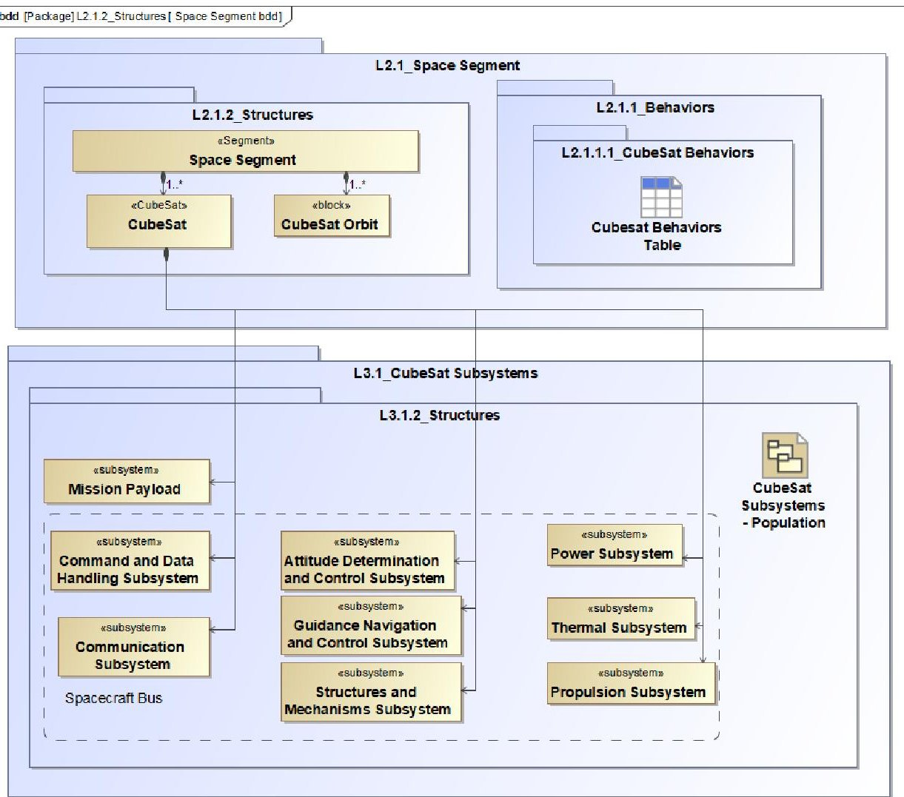
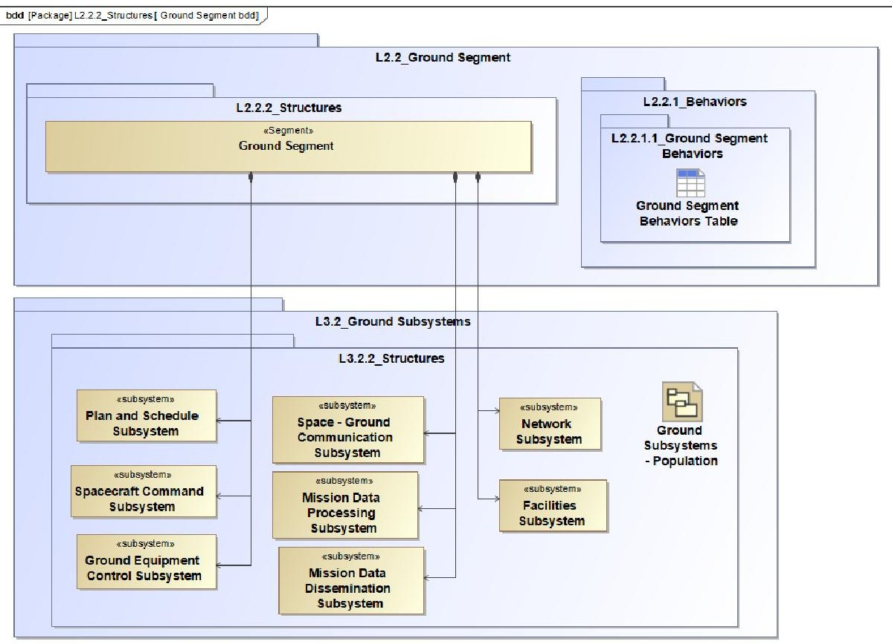
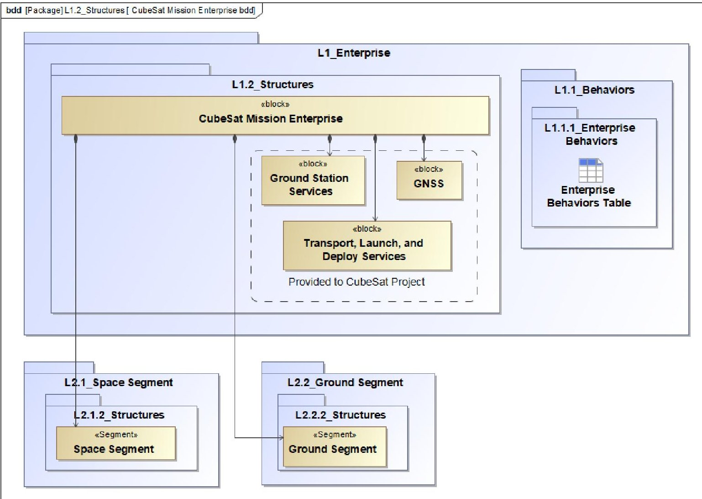
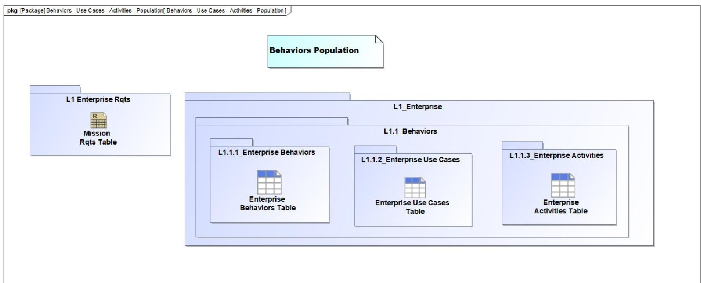
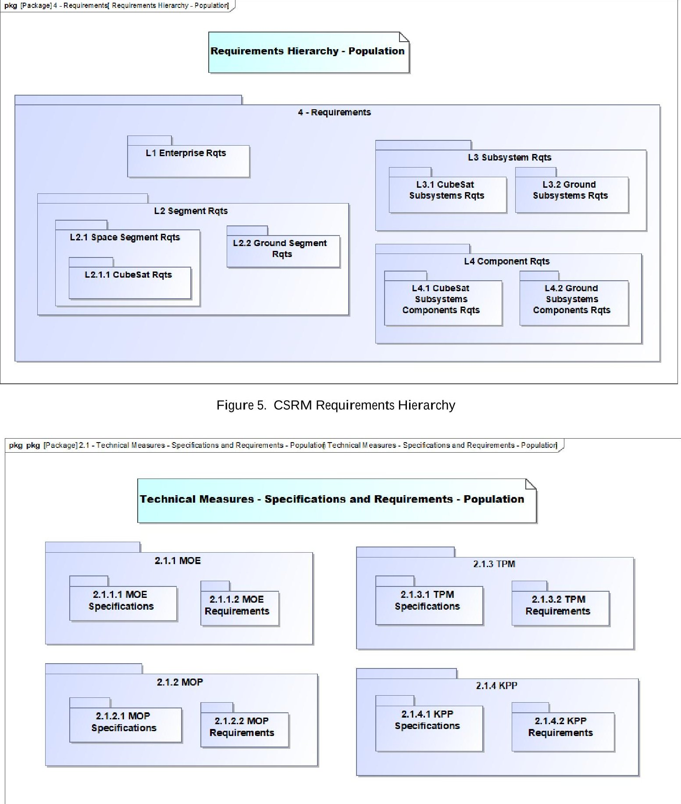

<!-- PDF_PAGE: 1 -->

Mission Engineering and the CubeSat System Reference Model - Status #2

David Kaslow

DEKaslow Consulting

Newtown Square, PA 19073

610 405 6685

david.kaslow@gmail.com

Alejandro Levi INCOSE Space Systems Working Group Alejandro.G.Levi@ieee.org orcid.org: 0000-0001-8450-8597

David Hurst

Orbital Transports, Inc

Chicago, IL

773 218 6151

dhurst@orbitaltransports.com

Bradley Ayres Air Force Institute of Technology Wright-Patterson AFB, OH 9372553636x3422 bradley.ayres@afit.edu

Chuck Croney Consultant Fort Washington, PA 215 880 4422 chuck.croney@gmail.com

Philip T Cahill Consultant

Bryn Mawr, PA

610 787 0203

navyred@msn.com

Steven A. MacLaird "Steve"

Object Management

Group, SVP, Gov't & 

Industrial Strategy

Quinlan, TX 75474

703 231 6335

MacLaird@omg.org

## ABSTRACT

The International Council on Systems Engineering (INCOSE) Space System Working Group (SSWG) has created the CubeSat System Reference Model $ ^{\mathrm{TM}} $ (CSRM $ ^{\mathrm{TM}} $ ) intended for use by system architects and engineers as a starting point to develop the physical architecture of the Space and Ground segments of the CubeSat mission of interest to them. The CSRM is based on Model-Based System Engineering (MBSE) principles, is System Modeling Language $ ^{\mathrm{TM}} $ (SysML $ ^{\mathrm{TM}} $ ) v1.7 compliant, and hosted in a graphical modeling tool. The CSRM has been submitted to the Object Management Group (OMG) and is in the finalization process to become an OMG Specification.

With the development of the CSRM nearing completion, the INCOSE SSWG is now researching how features of the CSRM can be used at a higher level to support Mission Engineering (ME). ME, a concept where the mission itself is looked at as a system, is being explored as a means to maintain balance between the spacecraft system, operations (including ground systems), and the mission (the integration of needed capabilities).

An earlier paper provided an initial assessment of where the CSRM supports ME activities and where there are areas that require further research. That paper proposed a way forward that included a set of activities needed to completely define what additions would be required to extend the CSRM to fully support ME. One of those activities was to analyze the CSRM for additional artifacts which could be added to the containment tree for key elements of ME activities that do not map to the CSRM. This paper provides the results of performing that activity for two ME activities: the Mission Architecting Activity and the Mission-oriented Systems-of-Systems (SoS) Implementation Activity.

<!-- PDF_PAGE: 2 -->

## 1. INTRODUCTION

The International Council on Systems Engineering (INCOSE) Space Systems Working Group (SSWG) successfully completed work on the design and development of a CubeSat System Reference Model (CSRM) in 2020. The SSWG created the CSRM to serve as a starting point for system architects and engineers developing a physical architecture of the Space and Ground Segments for their own CubeSat mission. References [1-6] provide a description of the CSRM and its contents. Recently, the Object Management Group (OMG) Architecture Board approved the CSRM as a beta specification.

Now that work on the CSRM is complete, the SSWG has refocused their efforts on researching how to extend the CSRM to enable the application of ME to model a complete CubeSat mission. The INCOSE Systems Engineering Body of Knowledge (SEBoK) defines ME as "the application of systems engineering to the planning, analysis, and designing of missions where the mission is the system of interest" [7]. The SEBoK identifies seven main activities associated with ME:

- Mission Capability Analysis and Definition

- Mission Thread Definition

- Tradeoff Analysis

- Mission Architecting

- Requirements Engineering

- Interoperability Analysis

- Mission-oriented System of Systems (SoS) Implementation

A previous paper [8] conducted an initial assessment of where the CSRM currently supports ME activities and identified areas that require further research. It proposed a way forward that defined research activities aimed at identifying extensions to the CSRM needed to support ME of a CubeSat mission.

One of those activities was to analyze the CSRM for additional artifacts to be added to the containment tree for key elements of ME activities that do not currently map to the CSRM. This paper provides the results of performing that activity for two of the seven ME activities identified above: the Mission Architecting and Mission-oriented SoS Implementation activities.

## 2. MISSION ARCHITECTING

During Mission Architecting, an operational architecture is developed that describes the capabilities, operational activities, operational nodes, and other relevant elements to model the mission [7]. Whereas capabilities and operational activities will be unique to each CubeSat

mission, there are certain elements of the mission architecture that will be common across many missions.

References [9] and [10] define a space mission architecture that contains seven basic elements that are common to all space missions:

- Spacecraft

- Ground Segment

- Mission Operations

- Orbit

- Launch Segment

- Command, Control, and Communications Architecture

- Subject

## Spacecraft

The Spacecraft consists of a payload and the spacecraft bus. The payload is that portion of the Spacecraft that interacts with the Subject. The bus is composed of a set of subsystems that support the payload by providing orbit maintenance, attitude determination and control command and data handling, power, temperature control, and structure.

The CSRM currently contains elements that model the Spacecraft as shown in Figure 1. These elements include the spacecraft's payload and major subsystems. This element of the Mission Architecture is complete.

## Ground Segment

The Ground Segment consists of the facilities and communications equipment necessary to communicate with and control the Spacecraft. It provides a critical link between the Spacecraft and Mission Operations. The Ground Segment receives state-of-health and mission data from the Spacecraft and transmits that data to Mission Operations. It also receives commands from Mission Operations and transmits them to the Spacecraft.

This is another element of the Mission Architecture that is currently captured in the CSRM as shown in Figure 2. The CSRM contains elements for:

- Spacecraft - Ground Communication Subsystem

- Ground Equipment Control Subsystem

- Facilities Subsystem

These CSRM elements are sufficient for capturing the necessary structural elements of the Ground Segment.

<!-- PDF_PAGE: 3 -->

Figure 1. CSRM Model Elements for the Space Segment

Figure 2. CSRM Model Elements for the Ground Segment

<!-- PDF_PAGE: 4 -->

## Mission Operations

Mission Operations consists of the people and systems that execute the mission. It is responsible for command and control of the spacecraft and delivering data to the user. It typically performs the following functions:

- Flight Dynamics

- Mission Planning and Scheduling

- Test and Simulations

- Real-Time Flight Operations

- Anomaly Resolution

- Data Processing and Management

These functions are allocated to corresponding structural elements responsible for their execution. Reference [10] provides a sample Mission Operations organization that contains elements for:

- Flight Dynamics

- Mission Planning and Scheduling

- Operational Test Bed

- Real-Time Flight Operations

- Data Management

- Software

- Hardware and Facilities

Together, these Mission Operations elements have the capability to accomplish all the typical functions listed above.

Some of these elements are already contained in the CSRM as part of the Ground Segment shown in Figure 2:

- Plan and Schedule Subsystem

- Spacecraft Command Subsystem

- Mission Data Processing Subsystem

- Mission Data Dissemination Subsystem

- Facilities Subsystem

The Plan and Schedule Subsystem correlates to the Mission Planning and Scheduling element. The Spacecraft Command Subsystem partially correlates to Real-Time Flight Operations as commanding of the spacecraft is an activity accomplished by this Mission Operations element. The Mission Data Processing and Dissemination Subsystems correlate to Data Management. This leaves several Mission Operations elements listed above that are not currently represented as part of the CSRM and would have to be created.

The CSRM elements listed above are all currently considered to be part of an overall Ground Segment. However, CSRM elements have not been identified that

support Mission Operations as called out in References [9] and [10].

To fully capture both the Ground Segment and Mission Operations elements of the Mission Architecture, the following modifications to the existing CSRM would have to be made:

- Create a separate package for the Mission Operations element separating it from the Ground Segment elements making it consistent with the Mission Architecture defined in References [9] and [10].

- Within this package, create a new model element for the Mission Operations system.

- Move the Plan and Schedule Subsystem, Mission Data Processing and Dissemination Subsystems, and Spacecraft Command Subsystem to be a part of the newly created Mission Operations system.

- Rename the Spacecraft Command Subsystem to be "Real-Time Flight Operations" to reflect all the activities accomplished by this element of Mission Operations.

- Add new elements "Flight Dynamics Subsystem" responsible for orbital determination and propagation and "Operational Test Bed" as parts of the Mission Operations system.

- Finally, add a new element "Mission Operations Facilities Subsystem" as part of the Mission Operations system and rename the Facilities Subsystem currently contained as part of the Ground Segment to be "Ground Segment Facilities" to differentiate the two.

## Orbit

This element represents the spacecraft's trajectory in space and has a significant influence on every element of the mission.

As shown in Figure 1, the CSRM Space Segment is composed of a CubeSat Orbit element. This element of the Mission Architecture is complete.

## Launch Segment

This element primarily consists of the launch vehicle, launch vehicle adapter/dispenser, and launch facilities to include ground support equipment.

The CSRM currently contains a model element for Transport, Deploy, and Launch Services as shown in Figure 3. This element could be used to represent the

<!-- PDF_PAGE: 5 -->

Launch Segment or adapted to include all elements that would be contained as part of this element of the Mission Architecture.

## Command, Control, and Communications Architecture

The Command, Control, and Communications Architecture consists of the arrangement of components that allow all elements of the Mission Architecture to communicate with each other.

The CSRM currently contains a model element for Network Subsystem as part of the Ground Segment. Just as above, this element could be used to represent the Command, Control, and Communications Architecture or adapted to be more inclusive of all possible components that could make up this element of the Mission Architecture. In addition, this element should be made a stand-alone element instead of part of the Ground Segment to raise it to the same level as the other elements of the Mission Architecture.

## Subject

The final element of the Mission Architecture represents what the spacecraft observes or interacts with. The CSRM currently does not contain a model element to capture this element of the Mission Architecture. It would have to added to the existing model.

In summary, the CSRM currently provides a capability to capture many elements of a typical space Mission Architecture, but additional work is required to either modify existing elements or create new elements to fully capture all elements associated with a typical space mission. This is summarized in Table 1.

## 3. MISSION-ORIENATED SYSTEMS-OF- SYSTEMS (SOS) IMPLEMENTATION

The mission-oriented SoS is implemented through designing and developing new systems, modifying existing systems, and/or modifying doctrine, policies procedures, and other non-materiel means to help achieve the mission [7]. References [11] and [12] state that during SoS implementation, key decision points are identified and supported with various forms of data, evidence or knowledge that are contained in key work products or artifacts. They identify a list of artifacts that include:

- Capability Objectives

- Concept of Operations (CONOPS)

- Systems Information

- Requirements Space

- Performance Measures and Methods

- Performance Data

- Systems Engineering Planning Elements

- Risks and Mitigation

- Master Plan

- Agreements

- Architecture

- Technical Baselines

- Technical Plan(s)

- Integrated Master Schedule

The following artifacts were not considered as part of this effort because they are programmatic in nature and would not be included in a ME model of a CubeSat mission:

- Systems Engineering Planning Elements

- Master Plan

- Agreements

- Technical Plan(s)

- Integrated Master Schedule

The remaining artifacts are discussed below.

## Capability Objectives

Capability objectives are statements of the top-level objectives for the SoS that describe capabilities needed by the user. They provide a basis for translating operational needs into high-level requirements, assessing performance to objectives, and developing an architecture and solution options.

The CSRM currently does not contain a model element for capturing SoS capability objectives. This element would have to be created to support this SoS information artifact.

## CONOPS

The CONOPS describes how functionality of the systems in the SoS will be employed in an operational setting. It describes the way users plan to operate and use systems to achieve SoS capability objectives. It is used to define the SoS requirements space and identify aspects of systems which could impact the SoS design.

The CSRM currently contains model elements to capture enterprise-level behaviors as shown in Figure 4. An enterprise is defined as the aggregation of systems and users that work together to accomplish a goal [13]. Enterprise is synonymous for SoS. The CSRM provides the capability to capture enterprise behaviors to include use cases and activities that can be used to describe the way users plan to operate and use systems to achieve SoS capability objectives.

<!-- PDF_PAGE: 6 -->

Figure 3. CubeSat Mission Enterprise

Figure 4. Enterprise Behaviors

<!-- PDF_PAGE: 7 -->

Table 1. Summary of Mission Architecting Activity

<table border="1"><tr><td>Space Mission Architecture Element</td><td>Recommended Actions</td></tr><tr><td>Spacecraft</td><td>No further actions required. CSRM currently contains model elements to capture this element of the architecture.</td></tr><tr><td>Ground Segment</td><td>CSRM currently contains model elements to capture this element of the architecture with recommended changes noted below.</td></tr><tr><td>Mission Operations</td><td>Recommended actions:
• Create a separate package for the Mission Operations element separating it from the Ground Segment elements making it consistent with the Mission Architecture defined in References[9] and[10].
• Within this package, create a new model element for the Mission Operations system.
• Move the Plan and Schedule Subsystem, Mission Data Processing and Dissemination Subsystems, and Spacecraft Command Subsystem to be a part of the newly created Mission Operations system.
• Rename the Spacecraft Command Subsystem to be “Real-Time Flight Operations” to reflect all the activities accomplished by this element of Mission Operations.
• Add new elements “Flight Dynamics Subsystem” responsible for orbital determination and propagation and “Operational Test Bed” as parts of the Mission Operations system.
• Finally, add a new element “Mission Operations Facilities Subsystem” as part of the Mission Operations system and rename the Facilities Subsystem currently contained as part of the Ground Segment to be “Ground Segment Facilities” to differentiate the two.</td></tr><tr><td>Orbit</td><td>No further actions required. CSRM currently contains model elements to capture this element of the architecture.</td></tr><tr><td>Launch Segment</td><td>Utilize existing CSRM Transport, Deploy, and Launch Services element to represent the Launch Segment or adapt it to include all elements that would be contained as part of this element of the Mission Architecture.</td></tr><tr><td>Command, Control, and Communications Architecture</td><td>Utilize existing CSRM Network element or adapt it to include all elements that would be contained as part of this element of the Mission Architecture. In addition, this element should be made a stand-alone element instead of part of the Ground Segment to raise it to the same level as the other elements of the Mission Architecture.</td></tr><tr><td>Subject</td><td>Currently does not exist within the CSRM and would need to be created.</td></tr></table>

<!-- PDF_PAGE: 8 -->

## Systems Information

Systems information contains information about constituent systems that impacts SoS capability objectives. This information includes both technical and programmatic aspects of the system. As stated above, programmatic aspects (organizational structures, fiscal data, and planning perspectives) are not addressed as they are not considered to be key elements of a CubeSat ME model.

Technical aspects of each system will be unique to each CubeSat mission and impossible to define in advance as part of a reference model. Section 2. provides a set of recommendations for expanding the CSRM to provide a complete space mission architecture. That architecture, from a structural standpoint, includes all the necessary system elements relevant to a SoS. This provides ME teams the ability to define unique technical aspects for each constituent system of the SoS.

## Requirements Space

The SoS requirements space defines the functions required to provide the needed operational capability with consideration of the variability in the user environment that impacts the ways these functions will be executed. It is defined at a level of detail that enables trades among potential and actual constituent systems and interfacing external systems. As stated above, the requirements space is derived from the SoS CONOPS.

The CSRM currently contains model elements to capture requirements from the enterprise-level down through the components of the CubeSat and Ground Segments as shown in Figure 5. This provides a good foundation for defining a complete requirements space for a SoS. Additional effort would be required to create new model elements to capture requirements for those newly created elements of the Mission Architecture identified above in Section 2.

## SoS Performance Measures and Data

SoS performance measures are directly traceable to the capability objectives defined for the SoS. These measures are used to assess the status and progress of the SoS in meeting its objectives.

The CSRM contains elements for defining technical measures for Measures of Effectiveness at the enterpriselevel and the methods used to collect performance data as shown in Figure 6.

## Risks and Mitigations

Risks are focused on undesirable emergent behaviors of the SoS. Risks and mitigations are addressed throughout the SoS implementation process. The Systems Modeling

Language does not define a model element for capturing these risks. There is a non-normative stereotype for an extension to the requirement model element, "extendedRequirement". This element has a property, "RiskKind", defined by an enumeration that has the values of High, Medium, and Low. This is inadequate to capture the definition of the risk, mitigation strategy, and status. A new model element would have to be created in the CSRM in order to capture SoS risks.

## Architecture

The SoS architecture provides a context for understanding the relationships among constituent systems and developing implementation options for meeting capability requirements. It includes systems information, connectors and protocols used to communicate and/or synchronize processing across systems, key data element/structures that cross interfaces, and key data conversions to facilitate data sharing and communication between constituents.

Each of these will be mission unique. Defining a complete mission architecture as discussed in Section 2. and enterprise-level behaviors discussed above provides a good foundation for ME teams to adapt the CSRM to their own unique mission architectures.

## Technical Baselines

The SoS technical baseline includes a requirements baseline, an allocated baseline, and a product baseline for the SoS and the detailed system baselines maintained by the systems themselves.

With the additions previously discussed, the CSRM would be capable of providing data supporting the establishment of requirements and allocated baselines. The CSRM only provides elements down to the logical level. Each mission will have a unique physical solution and, hence, a unique product baseline that each ME team will have to create.

In summary, the CSRM currently provides a capability to capture many of the artifacts associated with the implementation of a SoS, but additional work is required to create new elements to fully capture all artifacts associated with systems engineering of a SoS. This is summarized in Table 2

<!-- PDF_PAGE: 9 -->

Figure 6. Technical Measures

<!-- PDF_PAGE: 10 -->

Table 2. Summary of Mission-oriented System of Systems (SoS) Implementation Activity

<table border="1"><tr><td>SoS Systems Engineering Artifacts</td><td>Recommended Actions</td></tr><tr><td>Capability Objectives</td><td>The CSRM currently does not contain a model element for capturing SoS capability objectives. This element would have to be created to support this SoS information artifact.</td></tr><tr><td>Concept of Operations</td><td>The CSRM provides the capability to capture enterprise behaviors to include use cases and activities that can be used to describe the way users plan to operate and use systems to achieve SoS capability objectives.</td></tr><tr><td>Systems Information</td><td>Section 2. provides a set of recommendations for expanding the CSRM to provide a complete space mission architecture. That architecture, from a structural standpoint, includes all the necessary system elements relevant to a SoS. This provides ME teams the ability to define unique technical aspects for each constituent system of the SoS.</td></tr><tr><td>Requirements Space</td><td>The CSRM currently contains model elements to capture requirements from the enterprise-level down through the components of the CubeSat and Ground Segments. Additional effort would be required to create new model elements to capture requirements for those newly created elements of the Mission Architecture identified above in Section 2</td></tr><tr><td>SoS Performance Measures and Data</td><td>The CSRM contains elements for defining technical measures for Measures of Effectiveness at the enterprise-level and the methods used to collect performance data.</td></tr><tr><td>Risks and Mitigation</td><td>The CSRM does not currently contain that model element. It would have to be created in order to capture SoS risks.</td></tr><tr><td>Architecture</td><td>Defining a complete mission architecture as discussed in Section 2. and enterprise-level behaviors provides a good foundation for ME teams to adapt the CSRM to their own unique mission architectures.</td></tr><tr><td>Technical Baselines</td><td>With the additions discussed in Section 2., the CSRM would be capable of providing data supporting the establishment of requirements and allocated baselines. The CSRM only provides elements down to the logical level. Each mission will have a unique physical solution and, hence, a unique product baseline that each ME team will have to create.</td></tr></table>

<!-- PDF_PAGE: 11 -->

## 4. CONCLUSION

This effort sought to analyze the CSRM for additional artifacts needed to be added to the containment tree for key elements associated with the ME Mission Architecting and Mission-oriented SoS Implementation activities. The results show that many elements are already contained with the CSRM but additional work is needed to modify existing elements and, in some cases, create entirely new ones.

Tables 1. and 2. provide recommendations for actions needed to provide a CubeSat mission model with all artifacts required to support the Mission Architecting and Mission-oriented SoS Implementation activities.

## 5. STANDARDS FOR SPACE

A number of standards bodies exist that provide space standards. Two of those are the Consultative Committee on Space Data Standards (CCSDS) and the Object Management Group $ ^{\circledR} $ (OMG $ ^{\circledR} $ ) Just as the CSRM is devised to save time and money, OMG's space standards are designed to do the same. Standards that are currently available for consideration include [14]:

- XML Telemetric and Command Exchange $ ^{\mathrm{TM}} $ （XTCE $ ^{\mathrm{TM}} $ ）

- Ground Equipment Monitoring Service $ ^{\mathrm{TM}} $ （GEMS $ ^{\mathrm{TM}} $ ）

- Satellites Operations Language Metamodel $ ^{\mathrm{TM}} $ （SOLM $ ^{\mathrm{TM}} $ ）

- XTCE Profile for US Government Satellites $ ^{TM} $ aka GovSat (XUSP $ ^{TM} $ )

- Command & Control Mission Specification $ ^{\mathrm{TM}} $ （C2MS $ ^{\mathrm{TM}} $ ）(i.e., NASA's Goddard Mission Services Evolution Center (GMSEC) program to coordinate ground and flight data systems)

- Common Object Request Broker Agent (CORBA) - Light and REST

- Space Telecommunications Interface $ ^{\mathrm{TM}} $ （ $ \mathrm{STI}^{ \mathrm{TM}} $ ）

- Alert Management Service (ALMAS)

- Information Exchange Framework Reference Architecture (IEF-RA)

- Open Architecture Radar Interface Standard (OARIS)

## 6. Future Research

Future research will continue the activities proposed in Reference [8] with a focus on identifying ME MBSE methodologies and assess whether the CSRM is the right tool to support these methodologies.

## References

[1] D. Kaslow, B. Ayres, P. Cahill, L. Hart, and R. Yntema, "A Model-Based Systems Engineering (MBSE) Approach for Defining the Behaviors of CubeSats," Proceedings of IEEE Aerospace Conference, Big Sky, MT. 2017

[2] Kaslow and A. Madni. "Validation and Verification of MBSE Compliant CubeSat Reference Model." Proceedings of 15th Annual Conference on Systems Engineering Research. 2017.

[3] D. Kaslow, B. Ayres, P. Cahill, and L. Hart, "A Model- Based Systems Engineering Approach for Technical Measurement with Application to a CubeSat," Proceedings of IEEE Aerospace Conference, Big Sky, MT. 2018.

[4] D. Kaslow, B. Ayres, P. Cahill, L. Hart, Croney, L Hart, A. Levi. "Developing a CubeSat Model-Based Systems Engineering (MBSE) Reference Model - Interim Status #4," Proceedings of AIAA Space Forum. Orlando, FL. 2018.

[5] D. Kaslow, P. Cahill, and R. Frank, "Developing a CubeSat System MBSE Reference Model Interim Status #5," Proceeding of AIAA/USU Conference on Small Satellites, Logan, UT. 2019.

[6] D. Kaslow, P. Cahill, and B. Ayres, "Development and Application of the CubeSat System Reference Model", Proceedings of IEEE Aerospace Conference, Big Sky, MT. 2020.

[7] INCOSE Guide to the Systems Engineering Body of Knowledge v. 2.3, October 2020. https://www.sebokwiki.org/

[8] D. Kaslow, A. Levi, P. Cahill, B. Ayres, D. Hurst, C. Croney, "Mission Engineering and the CubeSat System Reference Model," Proceedings of IEEE Aerospace Conference, Big Sky, MT. 2021.

[9] J. Wertz and W. Larson (eds.), Space Mission Analysis and Design $ (3^{\mathrm{rd}} $ .Ed.), Microcosm Press, Hawthorne CA, 1999.

[10] J. Wertz, D. Everett, and J. Puschell (eds.), Space Mission Engineering: The New SMAD. Microcosm Press, Hawthorne CA, 2011.

[11] J. Dahmann, G. Rebovich, J. A. Lane, R. Lowry, "System Engineering Artifacts for SoS," IEEE A&E Systems Magazine, January 2011.

<!-- PDF_PAGE: 12 -->

[12] J. Dahmann, G. Rebovich, J. A. Lane, R. Lowry, K. Baldwin, "An Implementers' View of Systems Engineering for Systems of Systems," IEEE International Systems Conference, Montreal, Canada. 2011

[13] S. Friedenthal, A. Moore, R. Steiner, A Practical Guide to SysML: The Systems Modeling Language (3rd ed.), Morgan Kaufmann, Waltham, MA, 2015

[14] S. MacLaird, Building Out of This World SmallSats Utilizing Model Standards - Saving Time & Resources (available upon request)