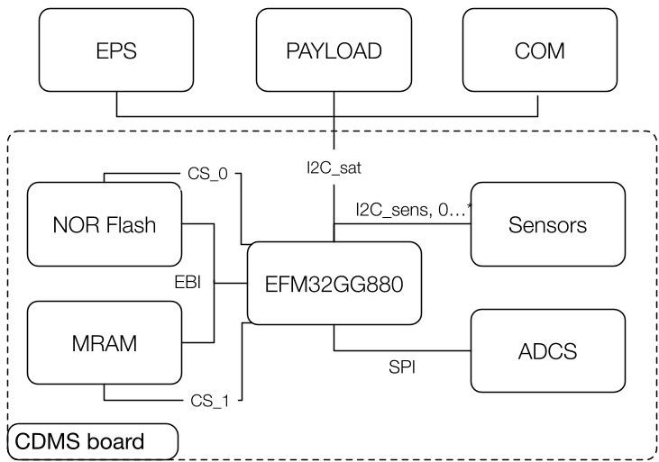
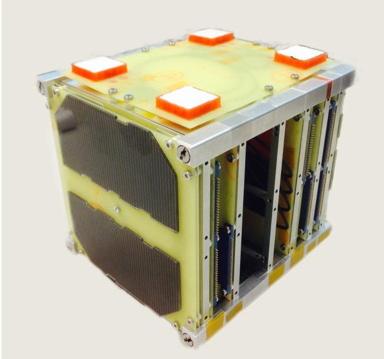
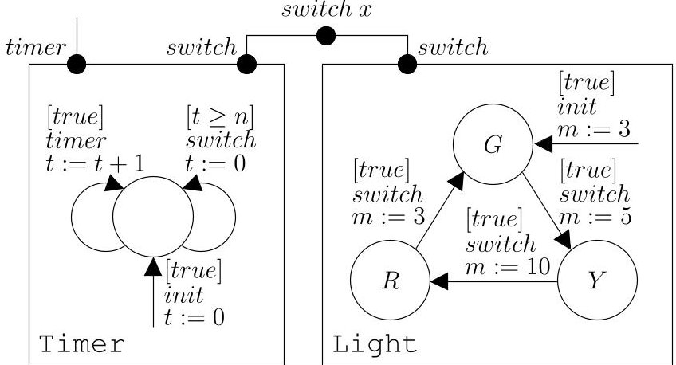
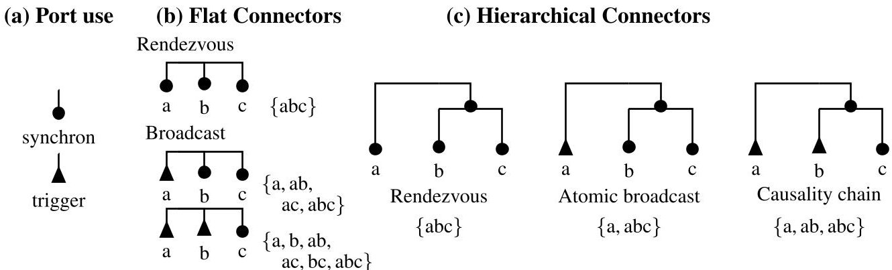
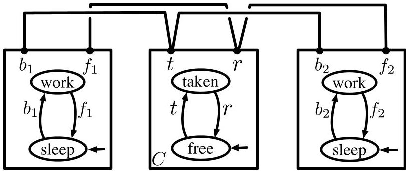
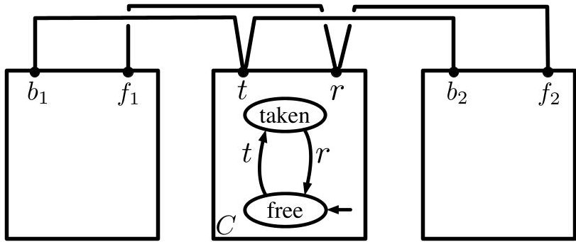
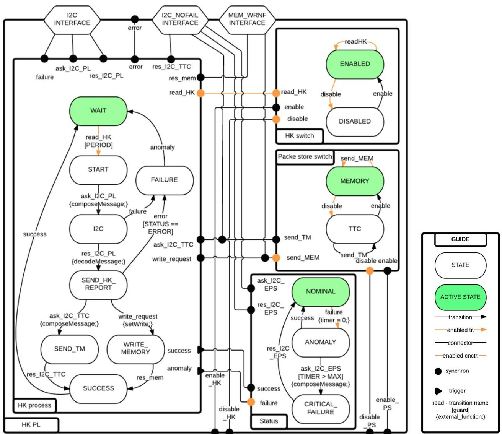
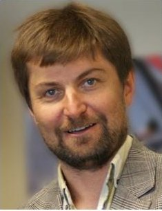
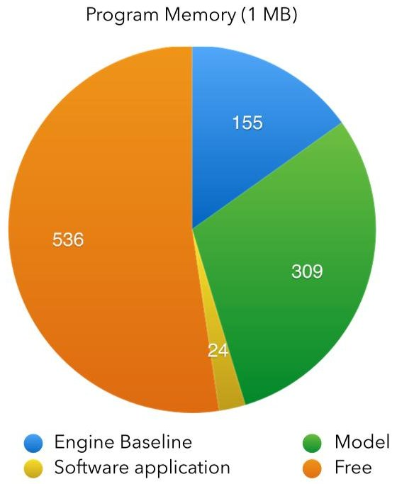
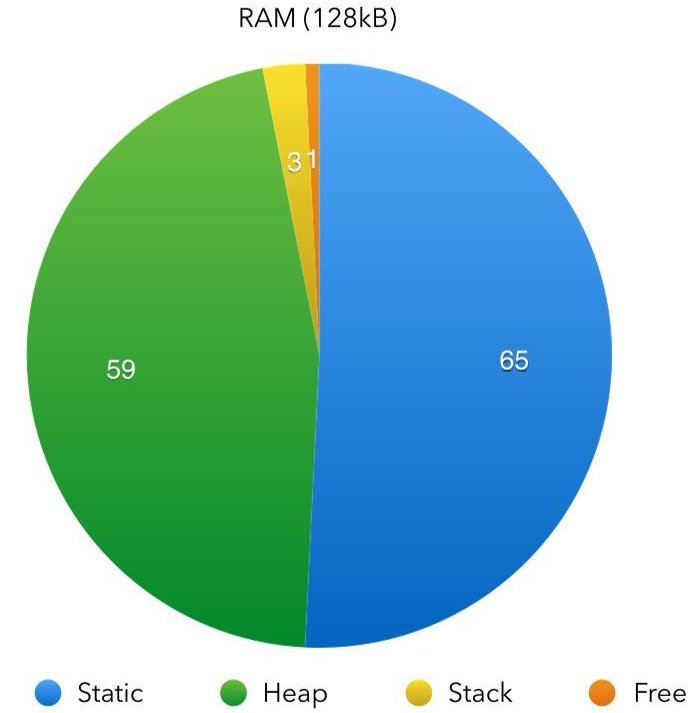

<!-- PDF_PAGE: 1 -->

# Robust Software Development for University-Built Satellites

Anton B. Ivanov

Space Engineering Center, EPFL

PPH 334, Station 13

1015 Lausanne, Switzerland

+41 21 693 6978

anton.ivanov@epfl.ch

Simon Bliudze

EPFL IINFCOM LCA2

INJ 340, Station 14

1015 Lausanne, Switzerland

+41 21 693 1397

simon.bliudze@epfl.ch

Abstract—Satellites and other complex systems now become more and more software dependent. Even nanosatellites have complexity that can be compared to scientific instruments launched to Mars. COTS components and subsystems may now be purchased to support payload development. On the contrary, the software has to be adapted to the new payload and, consequently, hardware architecture selected for the satellite. There is not a rigorous and robust way to design software for CubeSats or small satellites yet. In this paper, we will briefly review some existing systems and present our approach, which based on Behaviour-Interaction-Priority (BIP) framework. We will describe our experience in implementing fight software simulation and testing in the Swiss CubETH CubeSat project. We will conclude with lessons learned and future utilization of BIP for hardware testing and simulation.

## TABLE OF CONTENTS

1. INTRODUCTION...1

2. MOTIVATION...1

3. THE BIP FRAMEWORK...3

4. APPROACH...5

5. IMPLEMENTATION...6

6. DISCUSSION...7

7. SUMMARY...8

8. FUTURE WORK...8

ACKNOWLEDGMENTS...8

REFERENCES...8

BIOGRAPHY...9

## 1. INTRODUCTION

Flight software is rewritten for each satellite project, despite the existing heritage, due to changed requirements, new payload or updated hardware components. There is not yet a rigorous and robust way to design software and adapt for changes for small satellites yet or CubeSats in a university setting. There are design practices and considerable experience that exist in all major space organisations such as NASA and ESA, however, they are not available to student teams. To our knowledge, considerable number flight software programs for university satellites is written in C or C++ code. Recent efforts at Vertmont Tech [1] are using industry standard Ada Code. SysML $ ^{2} $ can be used to describe the system as a whole [2] and then check some properties such as energy consumption. SysML can be a valid tool for system engineering as a whole, but it is not rigorous enough to allow automatic software behaviour verification and validation. Another approach [3] is to utilise TuLiP (Temporal Logic Planning Toolbox) with the JPL SCA (Statechart Autocoder) to enable the automatic synthesis of low-level implementation code directly from formal specifications.

Here we present our approach using the Behaviour- Interaction-Priority (BIP) framework [4], a component-based language which can be used to build correct-by-construction applications. It has been developed by the Verimag laboratory in Grenoble university and is currently used in the EPFL by the Rigorous System Design laboratory (RISD). BIP can be used to formally model complex systems and provides a toolset for their verification and validation and for code generation. The framework is young; therefore there are not many practical designs with it yet.

Modular nature of the BIP approach allows iterative design for satellites in development and adaptation to hardware changes. In order to accomplish modularity, common patterns in components and structures have to be developed. The verification of the correctness in the BIP model is made by using a set of common rules in the assembly of atoms and compounds.

We have used the BIP approach in the our CubeSat project (CubETH) to design logic for the operation of a satellite and compiled into machine code, which was executed on the onboard computer. Software running Control and Data Management system compiled for Cortex-A3 processor design. This work has proven technical feasibility and exposed a number of problems with the approach. Our next goal is to develop a visual environment to provide graphical user interface to simplify generation of the BIP code.

In this work we will present main principles of the BIP framework, our implementation, and challenges for implementation on a CubeSat platform.

## 2. MOTIVATION

## CubETH CubeSat project

CubETH is a cooperative Swiss CubeSat mission [5] to demonstrate new technologies in the area of Global Navigation Satellite System (GNSS)-based n avigation and the usage of COTS components. The satellite will carry five GNSS patch antennas, each connected to two independent u-blox multi-GNSS receivers. These very small, commercially available low-cost receivers are able to track single-frequency code and phase data of all the major GNSS, i.e. GPS, GLONASS, QZSS, Beidou (and ready for Galileo). Four main science objectives have been defined for the Cu-

<!-- PDF_PAGE: 2 -->

bETH mission: (1) precise orbit determination using lowcost GNSS receivers, (2) attitude determination based on very short baselines, (3) comparison of the performance in space between GPS and GLONASS (and possibly other GNSS) as an important step for further developments of space-borne GNSS receivers, (4) additional experimental measurements (e.g. for air density estimation during re-entry). The satellite will carry 3 retro-reflectors to enable satellite laser ranging for performance validation of the precise orbit determination. Novel CubeSat technologies [6], [7] will also be tested. We will take into account lessons learned from the SwissCube mission, which has been in operation since 2009. A new modular design for the structure as well as connectors will be flown. We also intend to demonstrate the use of a miniaturized low-power command and data handling system, which shall control the satellite.

The components that were most critical for the successful operation of the Control and Data Management Subsystem (CDMS) are the microcontroller and the memories, which are both COTS (Commercial Off-The-Shelf) components. Consequently, components that have already been flown in CubeSats or other spacecraft have been selected. The CDMS will use a microcontroller from the Giant Gecko family by Energy Micro, a Cortex-M3 running at 48 MHz and with a very low power consumption (limited at 36.5 mW). The interboard communication protocol is I2C. The CDMS (simplified diagram is shown on Figure 1) acts as master and requests flight data from the other subsystems. At this stage of the development [15], relevant data to gather is typically housekeeping parameters, as board current consumption, temperature, status flags, or battery voltage. Such data acquisition and I2C communication were implemented on all present subsystems.

Figure 1. Simplified block-diagram of the CubETH flight software structure, which is centered on the Control and Data Management System

One key property of the BIP framework is the capability to automatically generate C++ code, which can be further compiled on a microprocessor platform. For the CubETH project we were able to create a full model of the spacecraft and create toolchain to compile code for running on CortexM3 architecture.

## Flight software quality attributes

In the international standards for architecture description and software engineering a number of quality attributes is specified as expression of "ilities" - qualities such as reliability, portability, modularity and others. Software designed with these qualities in mind is more robust to faults in hardware. At the European level, these attributes are described in a set of European Cooperation for Space (ECSS) standards, such as [8]. At NASA, in addition to standard design practices a recent effort [9] has been underway to specify a large table of quality attributes for mission flight software. In this work, we would like to concentrate primarily on robustness, safety, modularity and portability qualities for flight software architectures for nano and mico satellites and scientific instruments. These two broad categories are the main target customers of the work described in this proposal.

Figure 2. Structural and Thermal model of the CubETH satellite. This is a 1 unit CubeSat measuring 10x10x10 cm. On the top panel are 4 GNSS antennae for the experiment Internal electronics are organized in layers.

It is clear that the topic of "correct-by-construction" software development is now very actively studied by many groups around the world to address increased complexity of modern systems. Our approach is to the use the formal validation framework to create and verify the system logic, followed by porting C++ code directly onto the microprocessor. This approach will ensure the following "ilities" of the overall system (following [9]):

Reliability The developer will have to focus first on the logic of the overall system. Before starting on hardware drivers it will be possible to model behaviour of the overall system using established design patterns. The system will also be validated to be compliant with a number of design rules. Thus, the system will not be 100% proof, but it will allow eliminating a number of errors or ambiguities that are usually recovered late in the project development cycle.

Modularity—The system will allow verifying individual components separately, before integration of the whole system. For example, temperature sensors can be integrated as "hard-

<!-- PDF_PAGE: 3 -->

ware in the loop" to verify logic of operations without connecting them to the rest of the system.

PortabilityThe overall system will have a hardware interface in the form of C or C++ low-level functions, which are implemented to reflect capabilities of selected components. In the case of component replacement we need only to replace the corresponding driver, while keeping overall logic of the system in place. This would be a major improvement on the current state-of-practice, where a change of components also requires modifications of the logic. Such changes are extremely costly, once the logic is implemented already in C++ code and require a lot of reverse engineering work.

## 3. THE BIP FRAMEWORK

Our approach relies on the BIP framework [10] for component-based design of correct-by-construction applications. BIP provides a simple, but powerful mechanism for the coordination of concurrent components by superposing three layers: Behaviour, Interaction, and Priority. First, component behaviour is described by Labelled Transition Systems (LTS) having transitions labelled with ports and extended with data stored in local variables. Ports form the interface of a component and are used to define its interactions with other components. They can also export part of the local variables, allowing access to the component's data. Second, interaction models, i.e. sets of interactions, define the component coordination. Interactions are sets of ports that define allowed synchronisations between components. An interaction model is defined in a structured manner by using connectors [11]. Third, priorities are used to impose scheduling constraints and to resolve conflicts when multiple interactions are enabled simultaneously. Interaction and Priority layers are collectively called Glue.

The strict separation between behaviour-i.e. stateful components—and coordination-i.e. stateless connectors and priorities—allows the design of modular systems that are easy to understand, test and maintain.

The BIP language has been implemented as a coordination language for C++ [10] and Java [12]. The core of the framework provides automatic, semantics-preserving C++ code generation through a tool structured into:

- a front-end, for parsing a program in the BIP language (a BIP-specific extension of C++) and building the corresponding BIP model (a language-independent model in the Eclipse Modelling Framework);

- a set of filters for model transformations;

- and the back-end for the generation of code suitable for compiling onto the target platform.

The tool is modular: both the front- and the back-end can be independently replaced to provide parsing and generating code in other languages than BIP (for input) and C++ (for output). Execution of the BIP model is driven by the BIP Engine, which implements the BIP operational semantics. It is provided as a precompiled library, linked with the generated C++ code of the model.

The BIP framework provides several verification tools: DFinder [13] for compositional deadlock-freedom analysis, Kratos (developed in collaboration with FBK $ ^{4} $ ）[4] for state-reachability checking and BIP-to-NuSMV tool [4], which

Figure 3. Traffic light in BIP

transforms BIP models into the input format of the nuXmv model checker, for the verification of temporal logic properties.

## Main features of BIP

Below we further discuss the main features of the BIP framework. It is important to clearly distinguish the BIP features from those of conventional programming languages, such as C++ or Java. First of all, being a framework, BIP differs from object-oriented programming, inasmuch as it relies on the inversion of control principle: components notify the BIP engine about possible transitions, then relinquish control and wait for the engine to tell them which transition to execute. It is possible, but not necessary, to associate calls to external functions to component transitions. The state of a BIP component cannot be directly modified by any other component. The ports of BIP components represent neither input/output data, nor methods to be invoked. Instead, a port denotes the event that occurs when the component executes a transition whereof this port is the label. Thus, a connector enforces synchronisation of such events. The BIP engine decides which components are to execute which transitions, based on the full information about the connectors and priorities in the system. Robustness of the approach is achieved via separation of concerns of software components and intrinsic capability of the framework to isolate error states.

Atoms—BIP systems are assembled from atomic components (atoms), corresponding to concurrent processes, such as control algorithms, monitors, bus and memory drivers etc. Atoms have disjoint state spaces. An atom is defined by the corresponding sets of ports, states, transitions, data variables and update functions associated to transitions. Simple functions—as in the example below—can be specified directly, whereas more complex ones can be defined as external C/C++ code.

Figure 3 shows a simple traffic light controller system modeled in BIP. It is composed of two atomic components Timer and Light, modelling, respectively, a timer and the light switching behaviour. The Timer atom has one state with two self-loop transitions. The incoming arrow, labeled init, denotes the initialisation event. It is guarded by the constant predicate true and has an associated update function t := 0 which initialises the data variable t, used to keep track of the time spent since the last change of color. The Light atom

<!-- PDF_PAGE: 4 -->

determines the color of the traffic light and the duration that the light must stay in one of the three states, corresponding to the three colors.

Connectors—The system in Figure 3 has two connectors: a singleton connector with one port timer and no data transfer and a binary connector, synchronising the ports switch of the two components. The first, singleton connector is necessary, since, in BIP, only ports that belong to at least one connector can fire. The second connector synchronises the ports Timer.switch and Light.switch; it has an exported port, also called switch, and an associated variable x used for the data transfer.

Connectors define sets of interactions based on the synchronisation attributes of the connected ports, which may be either trigger or synchron (Figure 4a). If all connected ports are synchrons, then synchronisation is by rendezvous, i.e. the defined interaction may be executed only if all the connected components allow the transitions of those ports (Figure 4b). If a connector has at least one trigger, the synchronisation is by broadcast $ ^{6} $ , i.e. the allowed interactions are all non-empty subsets of the connected ports comprising at least one of the trigger ports (Figure 4b). More complex connectors can be built hierarchically (Figure 4c).

In general, a connector description consists of three parts:

1. A control part specifying a set of ports to be synchronised at most one per atomic componentand, optionally, a single exported port. The latter can be used as a usual port in higher level connectors.

3. A Boolean guard determining the enabledness of an interaction depending on the values of the provided data: the interaction is only enabled if the data provided by the components satisfies the guard.

2. A dataflow part specifying the computation associated with the interaction. The computation can affect variables associated with the ports. It consists of an upstream computation followed by a downstream computation.

The guard of the Timer.switch - Light.switch connector in Figure 3 is the constant predicate true, the upward and downward dataflows are defined, respectively, by the assignments x := Timer.m and Light.n := x. Thus, upon each synchronisation, Light informs Timer about the amount of time to spend in the next state, by transferring the value of Timer.m into Light.n. In hierarchical connectors, the separation of the dataflow into upward- and downward parts allows the data provided by the upward flow to be modified in the higher levels of the connector hierarchy before being transferred downwards.

Priority—Notice that, when $ t\geq n $ , both transitions, timer and switch, of the Timer atom are enabled. Since all other guards in the system are constant predicates true, this means that both connectors can fire. Imposing the priority timer $ < $ switch resolves this choice, so that switching is performed whenever possible. In general, it is not necessary to impose priorities in all conflict situations: according to the BIP semantics, one of the enabled maximal priority interactions is chosen non-deterministically [11].

Compounds—Finally, compound components are composed of sets of sub-components (atoms and/or compounds), connectors and priorities. A compound can export ports defined in connectors in order to interact with other components in a larger compound.

## Property Enforcement—Architectures

A posteriori verification, e.g. model checking, is well-known to be limited by the combinatorial state-space explosion problem. In particular, among the verification tools discussed in the previous section, only DFinder is known to scale well to very large models. This is due to the fact that this tool performs compositional over-approximation of the set of reachable states of the model, instead of computing it precisely.

By-construction property enforcement is an alternative approach that allows designer to circumvent this limitation. It consists in applying design patterns—that we call architectures—to restrict the behaviour of a set of components so that the composed behaviour meets a given property. Depending on the expressiveness of the glue operators, it may be necessary to use additional coordinating components to satisfy the property.

Architectures depict design principles, paradigms that can be understood by all, allow thinking on a higher level and avoiding low-level mistakes. They are a means for ensuring global properties characterising the coordination between components-correctness for free. Using architectures is key to ensuring trustworthiness and optimisation in networks, OS, middleware, HW devices etc.

System developers extensively use libraries of reference architectures ensuring both functional and non-functional properties, for example fault-tolerant architectures, architectures for resource management and Quality of Service control, time-triggered architectures, security architectures and adaptive architectures. The proposed definition is general and can be applied not only to hardware or software architectures but also to protocols, distributed algorithms, schedulers, etc.

Given a semantic domain—i.e. a class of component behaviors— $ \mathcal{C} $ , an architecture is a partial operator $ A:\mathcal{C}^{n}\rightarrow \mathcal{C} $ , imposing a characteristic property $ \Phi $ . It is defined by a glue operator (a combination of interactions and priorities) $ gl $ and a finite set of coordinating components $ \mathcal{D}\subset \mathcal{C} $ , such that:

- A transforms a set of components $ C_{1},\dots,C_{n} $ into a composite component $ A[C_{1},\dots,C_{n}]=gl(C_{1},\dots,C_{n},\mathcal{D}) $;

$$
A \left[ C _ {1}, \dots , C _ {n} \right]
$$

An architecture is a solution to a coordination problem specified by $ \Phi $ , using a particular set of interactions specified by $ gl $ . It is a partial operator, since the interactions of $ gl $ should match actions of the composed components.

Figure 5 shows a simple BIP model for mutual exclusion between two tasks. It has two components modeling the tasks and one coordinator component C. The four binary connectors synchronise each of the actions $ b_{1}, $ $ b_{2} $ (resp. $ f_{1}, $ $ f_{2} $ ) of the tasks with the action t, for "take", (resp. r, for "release") of the coordinator.

An architecture can be viewed as a BIP model, where some of the atomic components are considered as coordinators, while the rest are parameters. When an architecture is applied to a set of components, these components are used as operands to replace the parameters of the architecture. Clearly, operand

<!-- PDF_PAGE: 5 -->

Figure 4. Flat and hierarchical BIP connectors

Figure 5. Mutual exclusion model in BIP

Figure 6. Mutual exclusion architecture

components must refine the corresponding parameter ones in that sense, parameter components can be considered as types. $ ^{7} $ Thus, Figure 6 shows an architecture that enforces the mutual exclusion property on any two components with interfaces $ \{b_{1}, f_{1}\} $ and $ \{b_{2}, f_{2}\} $ , satisfying the following property:

Once a component has executed the f transition, it will not enter the critical section as long as it does not execute the b transition.

For the operand components in Figure 5, the critical section is the state work.

Composition of architectures is based on an associative, commutative and idempotent architecture composition operator

$ \oplus $ [15]. If two architectures $ \mathcal{A}_{1} $ and $ \mathcal{A}_{2} $ enforce respectively safety properties $ \Phi_{1} $ and $ \Phi_{2} $ , the composed architecture $ \mathcal{A}_{1} \oplus \mathcal{A}_{2} $ enforces the property $ \Phi_{1} \wedge \Phi_{2} $ , that is both properties are preserved by architecture composition.

Since architectures restrict the behavior of components they are applied to, preservation of deadlock-freedom cannot, in general, be guaranteed by construction. Instead, deadlockfreedom has to be verified a posteriori using dedicated tools, such as DFinder. The role of model checking is reduced to demonstrating the correctness of architectures w.r.t. their characteristic properties. This can usually be achieved by using relatively small models combined with inductive reasoning techniques to formally prove that, if a given architecture correctly enforces its characteristic property on a certain number of operand components, it will also correctly impose this property on any number of components.

## 4. APPROACH

Our goal is to provide a framework for rigorous design and implementation of control software for space missions. Such framework must have the following key properties.

Concurrency-Control software and, in particular, that required for space missions is inherently concurrent, since space systems comprise large numbers of elements, such as sensors, scientific instruments and other sub-systems that operate in real time, sharing resources, such as communication buses and memories.

Modularity Software driving the operation of these elements must be designed in a modular fashion, with the structure of the software closely mimicking that of the system. On one hand, this allows separate validation of each software component and, on the other hand, greatly improves reconfigurability of the system.

Separation of concerns—In order to ensure robustness of the software system, designers must have the capability to identify all error states and ensure that corresponding corrective actions are properly defined. To this end, the above modularity requirement is strengthened by further requiring that the state information be clearly exhibited in the software model.

Expressiveness The design framework should be sufficiently expressive to allow the development of complete software systems without the need for complex manual integration.

<!-- PDF_PAGE: 6 -->

The state space of such systems grows exponentially with the number of components.

Visual editing—In order to further reduce cognitive complexity and allow designers to have a global understanding of the software system on the levels of abstraction appropriate for each design task, the design framework must provide a visual representation and editing front-end allowing designer to browse the model of the software in an intuitive way and structuring the model information that is presented at any given time.

Correctness guarantees-It is fundamental for the design of mission-critical software to have the possibility of establishing the correctness of the software model with respect to the mission requirements and, in particular, the satisfaction of safety properties and deadlock-freedom. To this end, the design framework must provide either verification tools capable of analysing the designed models, or synthesis tools automatically deriving component behaviour from high-level specifications, or more pragmatically-a combination of both.

Formal operational semantics—Guarantees of correctness can only be provided if the modelling formalism underlying the design framework has a formally defined operational semantics. In the absence of such operational semantics, formal reasoning about the system is not possible and the only options for software validation available at design time are testing and simulation. At CERN the use of formal verification techniques has allowed finding bugs even in relatively simple, well-tested components [16].

Automatic code generation—Lastly, to ensure that the properties demonstrated to hold on the model of the software system remain valid in the final implementation, it is highly desirable that the executable code be automatically generated from the model by a semantics-preserving transformation (to ensure forward and backward translation).

## 5. IMPLEMENTATION

The full design workflow (i.e. requirements analysis, logic design, BIP code development, compilation to microprocessor and testing) was completed [17], thereby demonstrating the feasibility of the BIP concept application to nanosatellties. An example of the Payload Housekeeping element is shown in Figure 7.

The full model had 56 atoms and did not fit into the available memory on the satellite Engineering Model. Therefore, the full tool chain was implemented for a reduced software model, containing 19 atoms and 60 connectors. It should be noted that the reduction of the model was greatly simplified by the strong modularity provided by the BIP framework. At the moment, the feasibility study has implemented a small part of the overall system. Full system will be implemented in the future on a system with more available memory.

The model represented the interaction of the CDMS (Control and Data Management Subsystem) with the Payload and the Attitude Determination and Control (ADCS) subsystems. Model time step on the microprocessor was 6 ms, which satisfied the requirement for 0.5 Hz processing step on the satellite bus. The main challenges were 1) the need to perform static allocation of memory, 2) the large RAM footprint of the generated code and 3) the necessity of compiling the BIP

engine and the generated code with a custom ARM compiler. The memory footprint of the generated code is shown in Figure 8. The amount of RAM (128MB) on the Cortex-A3 processor is the main constraint, limiting the number of atoms and connectors (and hence the complexity of the model) that can be used simultaneously. Only static allocation is available, therefore it is impossible to reallocate data to main memory. This restriction is easily lifted on more powerful platforms. Selected architecture was used due to its low power consumption and, more generally, the restrictive power regime on a 1U CubeSat. Complex projects with university CubeSats are now moving fast towards 3U and 6U platforms. We expect that future platforms will be more powerful and therefore can accommodate full model implementation.

Several strategies were considered in [18] for the validation of the model, with mixed success. Application of verification tools proved too complex on the complete satellite model with full detail for the following two reasons. First, the available prototype verification tools only support a reduced BIP syntax. In particular, compound components are not supported and the external C/C++ code, which is not analysed as part of the verification process, has to be removed manually. The second, intrinsic reason of the verification complexity is the large size of the state-space that must be analysed, which calls for non-trivial abstractions and for compositional approaches that are not available in the current state of the art, for general verification. (As discussed below, verification of specific properties, such as deadlock freedom, can be performed compositionally.) Further analysis in [17], [18] has suggested that by-construction validity could be achieved by applying specific model development rules for the design of the BIP model of the software.

We have analysed the model developed by [17] to identify recurring design patterns. These patterns were formalised as BIP architectures (see Section 3) and used in [19] to design a new BIP model for CubETH on-board software from scratch. More specifically, starting with a small set of atoms, which realise the simple key functionality of the software, we have systematically applied the above architectures to enforce safety properties associated to the requirements formulated for the on-board software. Since the safety properties imposed by architectures are preserved by architecture composition [15], all properties that we have associated to the CubETH requirements are satisfied by construction by this latter model.

Architectures enforce properties by restricting the joint behaviour of the operand components (Section 3). Therefore, combined application of architectures can generate deadlocks. We have used the DFinder tool [13] to verify deadlock-freedom of the case study model. DFinder applies compositional verification on BIP models by overapproximating the set of reachable states and checking symbolically that the intersection of the obtained set and the set of deadlock states is empty. This approach allows DFinder to analyse very large models. The tool is sound, but incomplete: due to the above mentioned over-approximation it can produce false positives, i.e. potential deadlock states that are unreachable in the concrete system. However, our case study model was shown to be deadlock-free without any potential deadlocks. Thus, no additional reachability analysis was needed.

<!-- PDF_PAGE: 7 -->

Figure 7. The BIP model of the payload housekeeping readout block

The ports comprising external interfaces of the compound component are located on the boundaries of the block. Transitions are executed on external signals (e.g. read_HK, enable, disable, send_TM etc. Active states are highlighted in green, whereas enabled ports and connectors are highlighted in orange. The block is shown in its WAIT mode.

## 6. DISCUSSION

The main drawback of the work in [17] resides in the fact that the model was initially drawn by hand using LucidCharts $ ^{8} $ rendering impossible the translation of diagrams into any other language. Hence, BIP code reproducing the logic in the diagrams had to be written manually, with the inherent risk of introducing errors and reduced maintainability of the code. However, the nature of BIP is graphical, due to the component-based philosophy adopted by the framework, the use of Labelled Transition Systems and connectors to define, respectively, component behaviour and synchronisations. Therefore, we have made the following two attempts to address this problem.

The first attempt [20] consisted in re-encoding this model in SysML, using activity diagrams. This attempt failed due to the absence of versatile support for synchronization modeling in SysML. We have subsequently attempted to develop a visual editor based on the Sirius $ ^{9} $ plugin for Eclipse, directly using the BIP ECORE meta-model [21].

Eclipse Sirius is an open-source software project of the Eclipse Foundation. This technology allows creating custom graphical modeling workbenches by leveraging the Eclipse Modeling technologies. Sirius is mainly used to design complex systems (industrial systems or IT applications). The first use case was Capella $ ^{10} $ , a Systems Engineering workbench contributed to the Eclipse Working Group PolarSys in 2014 by Thales.

A prototype modeler for specifying BIP systems using the Eclipse Sirius tool was developed, providing a set of diagrams with all constituent elements of BIP models, such as compounds, atoms, ports and connectors. The modeler generates an XMI file in the format accepted by the BIP code generator, thus allowing graphical design of a working BIP system.

However, the visual interface of the modeler was unsatisfactory, significantly departing from the graphical conventions commonly adopted in BIP. This is due to the structural incompatibility of the current Ecore meta-model used in the BIP framework with user-friendly visual rendering. Thus, we conclude that a new visual editor design is necessary,

<!-- PDF_PAGE: 8 -->

which would be based on a dedicated meta-model with a bidirectional transformation into the BIP meta-model.

## 7. SUMMARY

In this work, we have demonstrated the feasibility of the BIP approach for the development of flight software. Restrictions of the Cortex-M3 processor have forced us to reduce the model in order to fit it into the memory available on the CubeSat. However, the demonstration of the reduced model on the CubeSat board was a success.

We found it extremely useful to have a capability to verify the design logic before compiling to hardware. Although we did not succeed in formally verifying the complete model, due to a combination of intrinsic (model complexity) and extrinsic (tool limitations) factors, the structure of the satellite software makes this model readily amenable for decomposition into a number of parts, each of which can be verified individually. Furthermore, the application of the BIP architecture-based design approach has allowed us to design a similar model, where all the safety properties are enforced by construction. This approach only requires the model to be verified for deadlock freedom, which we managed to achieve using the DFinder tool from the BIP toolset. (It should be noted, however, that any properties that are not enforced by construction would still have to be verified separately.)

## 8. FUTURE WORK

This work has shown that, for relatively small missions, such as CubSats, BIP can be used to design complete onboard software. In the context of larger missions, where design of software components is often delegated to subcontractors, a key difficulty consists in the integration of such components. The On-Board Software Reference Architecture (OSRA) [22] standardization initiative aims at addressing this difficulty by defining a common component model. In this context, the most straightforward application of the BIP framework is the development and automatic code generation for OSRA components. To achieve this goal, the BIP code generation must be adapted in such a manner as to provide the interfaces defined by the OSRA. Furthermore, availability of BIP models—developed in the framework of the ESA "Catalogue of Software and System Properties" project for the OSRA constituent elements, allows the use of the BIP framework for co-simulation and co-validation of several heterogeneous components, whereof parts can be designed in BIP, while others—using alternative languages and modelling frameworks, such as C++ or Mathlab/Simulink.

We have identified a number of developments necessary to facilitate OBSW design using the BIP approach. A project is currently under way to prepare a graphical user interface, necessary to avoid manual transfer of diagrams to code. It is also necessary to study the power consumption overhead when using the precompiled model.

Finally, an important part of the future work is to design a set of design patterns and validation rules to improve quality of the software architecture.

## ACKNOWLEDGMENTS

The authors would like to thank the Master and PhD students who have contributed to this project. We are also grateful to the École polytechnique fédérale de Lausanne for supporting it.

## REFERENCES

[1] C. Brandon and P. Chapin, Reliable Software Technologies - Ada-Europe 2013, ser. Lecture Notes in Computer Science, H. B. Keller, E. Plödereder, P. Dencker, and H. Klenk, Eds. Berlin, Heidelberg: Springer Berlin Heidelberg, 2013, vol. 7896.

[2] S. C. Spangelo, J. Cutler, L. Anderson, E. Fosse, L. Cheng, R. Yntema, M. Bajaj, C. Delp, B. Cole, G. Soremekum, and D. Kaslow, "Model based systems engineering (MBSE) applied to Radio Aurora Explorer (RAX) CubeSat mission operational scenarios," in 2013 IEEE Aerospace Conference. IEEE, mar 2013, pp. 1- 18.

[3] S. Dathathri, S. C. Livingston, R. M. Murray, and L. J. Reder, "Interfacing TuLiP with the JPL Statechart Autocoder : Initial progress toward synthesis of flight software from formal specifications," in IEEE AeroSpace, 2016.

[4] S. Bliudze, A. Cimatti, M. Jaber, S. Mover, M. Roveri, W. Saab, and W. Qiang, "Formal verification of infinite state BIP models," in Proceedings of the 13th International Symposium on Automated Technology for Verification and Analysis, ser. Lecture Notes in Computer Science, B. Finkbeiner, G. Pu, and L. Zhang, Eds., vol. 9364. Springer, 2015, pp. 326-343.

[5] A. B. Ivanov, L. Masson, S. Rossi, F. Belloni, N. Mullin, R. Wiesendanger, M. Rothacher, C. Hollenstein, B. Mannel, D. Willi, M. Fisler, P. Fleischman, H. Mathis, M. Klaper, M. Joss, and E. Styger, "CubETH: Nano-satellite mission for orbit and attitude determination using low-cost GNSS receivers," in 66th International Astronautical Congress. Jerusalem, Israel: International Astronautical Federation, IAF, 2015.

[6] S. Rossi, A. Ivanov, G. Soudan, V. Gass, C. Hollenstein, and M. Rothacher, "CubETH magnetotorquers: Design and tests for a cubesat mission," Advances in the Astronautical Sciences, vol. 153, pp. 1513-1530, 2015. [Online]. Available: https://www.scopus.com/inward/ record.uri?eid=2-s2.0-84968735754&partnerID=40& md5=bb518e947c8ab4ddbeac99ac1a755895

[7] S. Rossi, A. Ivanov, G. Burri, V. Gass, C. Hollenstein, and M. Rothacher, "CubETH sensor characterization: Sensor analysis required for a cubesat mission," Advances in the Astronautical Sciences, vol. 153, pp. 1493-1512, 2015. [Online]. Available: https://www.scopus.com/inward/record. uri?eid=2-s2.0-84968718629&partnerID=40&md5= aac75ea756db639e4bc94d5fbd24c473

[8] ECSS, "ECSS-E-ST-40C: Software," ESA Requirements and Standards Division, Noordwijk, Netherlands, Tech. Rep., 2009.

[9] J. Wilmot, L. Fesq, and D. Dvorak, "Quality Attributes for Mission Flight Software : A Reference for Architects," in IEEE AeroSpace, Big Sky, MT, 2016, pp. 1-7.

[10] A. Basu, S. Bensalem, M. Bozga, J. Combaz, M. Jaber, T.-H. Nguyen, and J. Sifakis, "Rigorous component-

<!-- PDF_PAGE: 9 -->

based system design using the BIP framework," Software, IEEE, vol. 28, no. 3, pp. 41-48, 2011.

[11] S. Bliudze and J. Sifakis, "The algebra of connectors— structuring interaction in BIP," IEEE Transactions on Computers, vol. 57, no. 10, pp. 1315-1330, 2008.

[12] S. Bliudze, A. Mavridou, R. Szymanek, and A. Zolotukhina, "Coordination of software components with BIP: Application to OSGi," in Proceedings of the 6th International Workshop on Modeling in Software Engineering, ser. MiSE 2014. New York, NY, USA: ACM, 2014, pp. 25-30.

[13] S. Bensalem, A. Griesmayer, A. Legay, T.-H. Nguyen, J. Sifakis, and R. Yan, "D-Finder 2: towards efficient correctness of incremental design," in Proceedings of the $ 3^{\mathrm{rd}} $ international conference on NASA Formal methods, ser. NFM'11. Berlin, Heidelberg: Springer-Verlag, 2011, pp. 453-458.

[14] "BIP tutorial," http://www-verimag.imag.fr/TOOLS/ DCS/bip/doc/latest/html/language.html.

[15] P. Attie, E. Baranov, S. Bliudze, M. Jaber, and J. Sifakis, "A general framework for architecture composability," Formal Aspects of Computing, vol. 18, no. 2, pp. 207231, Apr. 2016.

[16] B. Fernández Adiego, D. Darvas, E. Blanco Viñuela, J.-C. Tournier, S. Bliudze, J. O. Blech, and V. M. González Suárez, "Applying model checking to industrial-sized PLC programs," IEEE Transactions on Industrial Informatics, vol. 11, no. 6, pp. 1400-1410, 2015.

[17] M. Pagnamenta, "Rigorous software design for nano- and micro-satellites using BIP framework," Master's thesis, Space Center, EPFL, Sep. 2014.

[18] A. Sikiaridis, "Definition and Implementation of Validation Strategies for a Nanosatellite Flight Control Software Model," eSpace, EPFL, Lausanne, Switzerland, Tech. Rep., 2016.

[19] A. Mavridou, E. Stachtiari, S. Bliudze, A. Ivanov, P. Katsaros, and J. Sifakis, "Architecture-based design: A satellite on-board software case study," in Proceedings of the 13th International Conference on Formal Aspects of Component Software, O. Kuchnarenko and R. Khosravi, Eds., 2016, to appear.

[20] J.-N. Pittet, "CubETH: Onboard software design with SysML," eSpace, EPFL, Lausanne, Switzerland, Tech. Rep., 2015.

[21] V. Ilievski, "Implemtation of visual interface for BIP programming in Eclipse Sirius environment," RISD, Lausanne, Tech. Rep., 2016.

[22] A. Jung, M. Panunzio, and J.-L. Terraillon, "SAVOIRFAIRE On-board software reference architecture," SAVOIR Advisory Group, Tech. Rep. TEC-SWE/09- 289/AJ, Jun. 2010.

## BIOGRAPHY

Dr Anton B. Ivanov is a scientist with the EPFL Space Center (eSpace) in Lausanne Switzerland. He is the project manager for the CubETH CubeSat project, study leader for the CHEOPS satellite and is responsible for the Minor in Space Technologies. After receiving his PhD in Planetary Science from Caltech in 2000, Dr Ivanov joined the Jet Propulsion Laboratory to contribute to Mars Global Surveyor, Mars Odyssey, Mars Express and Mars Science Laboratory projects. In 2007, Dr Ivanov joined Swiss Space Center to lead development of the Concurrent Design Facility.

Dr Simon Bliudze holds an MSc in Mathematics from the St. Petersburg State University (Russia, 1998), an MSc in Computer Science from Université Paris 6 (France, 2001) and a PhD in Computer Science from École Polytechnique (France, 2006). He has spent two years at Verimag (Grenoble, France) as a post-doc with Joseph Sifakis working on formal semantics for the BIP component framework. After three years as a research engineer at CEA Saclay, France, he has joined the Rigorous System Design Laboratory (RiSD) at EPFL. Since 2014, Dr Bliudze is working on the application of BIP to the design of On-Board Software in collaboration with the EPFL Space Center and in the Catalogue of System and Software Properties (CSSP) project funded by hte European Space Agency.

<!-- PDF_PAGE: 10 -->

Figure 8. Memory footprint of the reduced BIP model

The model was compiled for the Energy Micro EFM32 processor (a Cortex-M3 running at 48 MHz). The top chart shows the partition of the total allocated memory: note that there is still 536 kB available. The bottom chart is for allocation in the RAM, which is the source of the main limitation on the size of the BIP model.