<!-- PDF_PAGE: 1 -->

POLITECNICO

MILANO 1863

SCUOLA DI INGEGNERIA INDUSTRIALE

E DELL'INFORMAZIONE

# Pre-Phase A design through MBSE of CUBE Mission

TESI DI LAUREA MAGISTRALE IN SPACE ENGINEERING - INGEGNERIA SPAZIALE

Author: Miriam Amato

Student ID: 970438 Advisor: Professor Michèle Lavagna Co-advisors: - Academic Year: 2021-22

<!-- PDF_PAGE: 2 -->

<!-- PDF_PAGE: 3 -->

## Abstract

The System Engineering approach, commonly used to design space missions, presents downsides when a large number of stakeholders exchange a high volume of information as it happens in such complex projects. It is difficult to keep track of the high number of documents produced and to assure their consistency and traceability. Model-Based System Engineering (MBSE) methodology aims at replacing the document-centric approach by creating intuitive models readily available and easily modifiable. To show the strengths of this method, the ARCADIA MBSE method, developed by Thales, will be applied to the Pre-Phase A design of CUBE Mission through the open-source tool Capella. Following the four engineering levels established by the methodology, the feasibility study is performed and models that describe with increasing detail the mission in all its aspects are obtained. Starting from the stakeholders' needs, the functioning of every single subsystem and component will be explored and modeled.

CUBE Mission is a first of its kind as it aims at studying Earth's magnetosphere by exploiting CubeSats technology. Space agencies from all over the world have been studying this phenomenon for decades to understand how it acts and evolves by employing big-size spacecraft. With the advancement of CubeSat technology, a cheaper way of exploring Earth's natural shield is now available. Being this technology relatively young, the feasibility of the mission has to be proven by performing a Pre-Phase A analysis, which requires the analysis of the mission from different points of view. Starting from the orbital mechanics and environmental analysis, passing through the sizing of the different subsystems, it results in a mass and power budget, a preliminary configuration and requirements for the CubeSats.

Keywords: Magnetosphere, System engineering, CubeSat, MBSE, ARCADIA, Capella

<!-- PDF_PAGE: 4 -->

<!-- PDF_PAGE: 5 -->

## Sommario

L'ingegneria di sistema, l'approccio più utilizzato per sviluppare missioni spaziali, presenta dei difetti quando il grande numero di soggetti interessati ad un progetto complesso come questo, si scambia un volume di informazioni notevole. Tenere sotto controllo il grande numero di documenti che vengono prodotti e assicurarsi della loro tracciabilità e coerenza può risultare alquanto complicato. La metodologia Model-Based System Engineering (MBSE) punta a sostituire la visione documento-centrica creando modelli intuitivi, pronatamente disponibile e facilmente modificabili. Per mostrare i punti di forza di questa metodologia, il metodo MBSE ARCADIA, sviluppato da Thales, è applicato al Pre-Phase A design della missione CUBE attraverso lo strumento open-source Capella. Seguendo i quattro livelli ingegneristici previsti dalla metodologia, è possibile svolgere lo studio di fattibilità e ottenere modelli che descrivono con crescente dettaglio la missione in tutti i suoi aspetti. Iniziando dai bisogni dei soggetti coinvolti, il funzionamento di ogni singolo sottosistema sarà esplorato e modellato.

La missione CUBE è unica nel suo genere in quanto punta a studiare la magnetosfera terrestre sfruttando la tecnologia dei CubeSats. Le agenzie spaziali di tutto il mondo studiano questo fenomeno da decenni per capirne il comportamento e l'evoluzione. Finora, satelliti di grandi dimensioni sono stati utilizzati, ma con lo sviluppo della tecnologia dei CubeSats, un nuovo e meno costoso modo di esplorare lo scudo naturale della Terra è ora disponibile. Essendo questa tecnologia relativamente recente, uno studio di fattibilità, quello che viene chiamato Pre-Phase A analysis, deve essere condotto. Per farlo, diversi aspetti della missione vengono analizzati. Iniziando con la meccanica orbitale, passando per il dimensionamento dei diversi sottosistemi si ottiene un budget di massa e potenza, una configurazione preliminare e requisiti per i CubeSats.

Parole chiave: Magnetosfera, System engineering, CubeSat, MBSE, ARCADIA, Capella

<!-- PDF_PAGE: 6 -->

<!-- PDF_PAGE: 7 -->

## Contents

Abstract i

Sommario iii

Contents v

List of Acronyms vii

List of Tables ix

List of Figures xi

Introduction 1

1 Model-Based System Engineering 3

1.1 ARCADIA method 3

1.2 Capella tool 4

1.2.1 Engineering levels 5

1.2.2 Requirements 9

2 CUBE Mission 11

2.1 Mission Overview 11

2.2 Mission Analysis 12

2.2.1 Orbital Mechanics 12

2.2.2 Environmental analysis 15

3 Space segments design 19

3.1 Operational Analysis 19

3.2 System Analysis 20

3.3 Logical & Physical Architecture 24

<!-- PDF_PAGE: 8 -->

3.3.1 Propulsion system 24

3.3.2 Telecommunications system 29

3.3.3 OBDH 37

3.3.4 AOCS 43

3.3.5 EPS 58

3.3.6 TCS 70

3.3.7 Structure 79

3.3.8 Global mission view in Capella 83

3.4 Preliminary configuration 85

3.5 System Budgets 93

3.5.1 Power budget 93

3.5.2 Mass budget 94

3.6 Criticalities and open points 98

4 Mission phases 99

4.1 Mission phases in Capella 100

5 Risk Assessment 103

6 Conclusions 107

Bibliography 109

Acknowledgements 115

<!-- PDF_PAGE: 9 -->

## List of Acronyms

<table border="1"><tr><td>AOCS</td><td>Attitude and Orbit control system</td></tr><tr><td>ARCADIA</td><td>ARCHitecture Analysis and Design Integrated Approach</td></tr><tr><td>BER</td><td>Bit error rate</td></tr><tr><td>CPU</td><td>Central processing unit</td></tr><tr><td>DET</td><td>Direct Energy Transfer</td></tr><tr><td>EPBS</td><td>End Product Breakdown Structure</td></tr><tr><td>EPS</td><td>Electrical power system</td></tr><tr><td>ESA</td><td>European Space Agency</td></tr><tr><td>GEO</td><td>Geostationary orbit</td></tr><tr><td>GFLOPS</td><td>Giga Floating Point Operations Per Second</td></tr><tr><td>GNSS</td><td>Global Navigation Satellite System</td></tr><tr><td>GPS</td><td>Global Positioning System</td></tr><tr><td>GS</td><td>Ground station</td></tr><tr><td>IMU</td><td>Inertial measurement unit</td></tr><tr><td>INAF</td><td>Istituto Nazionale di Astrofisica</td></tr><tr><td>IR</td><td>Infrared</td></tr><tr><td>ITU</td><td>International Telecommunications Union</td></tr><tr><td>KIPS</td><td>Thousand of Instructions Per Second</td></tr><tr><td>KSAT</td><td>Kongsberg Satellite Services</td></tr><tr><td>MBSE</td><td>Model-based system engineering</td></tr><tr><td>MEO</td><td>Medium Earth Orbit</td></tr><tr><td>MIPS</td><td>Million of Instructions Per Second</td></tr><tr><td>MOC</td><td>Mission Operations Center</td></tr><tr><td>OBC</td><td>On-board computer</td></tr><tr><td>OBDH</td><td>On-board data handling</td></tr><tr><td>PA</td><td>Plasma analyzer</td></tr><tr><td>PCDU</td><td>Power conditioning and distribution unit</td></tr><tr><td>PPT</td><td>Peak Power Tracking</td></tr><tr><td>PS</td><td>Propulsion System</td></tr></table>

<!-- PDF_PAGE: 10 -->

RAM Random Access Memory

RW Reaction wheel

SAA South Atlantic Anomaly

SK Station keeping

SSC Swedish Space Coorporation

SSD Solid State Drive

SSO Sun-synchronous orbit

TM Telecommands

TCS Thermal control system

WCC Worst cold case

WHC Worst hot case

<!-- PDF_PAGE: 11 -->

## List of Tables

2.1 High level requirements 12

2.2 Orbital mechanics requirements 15

2.3 Environmental requirements 18

3.1 Propulsion system - SSO segment 25

3.2 PS requirements 26

3.3 Propulsion systems 27

3.4 Data rate 30

3.5 Estrack ground stations data 32

3.6 Space losses 34

3.7 Eb/N0 results 34

3.8 Telecommunications system requirements 35

3.9 Antennas 36

3.10 Transceivers 36

3.11 OBDH requirements 38

3.12 On board computer 39

3.13 Pointing budget 44

3.14 External disturbances 46

3.15 RWs momentum storage - SSO segment 49

3.16 Magnetotorquers desaturation time 51

3.17 Thrusters force 51

3.18 AOCS requirements 52

3.19 Sun sensor 53

3.20 IMU 53

3.21 Magnetometer 53

3.22 Star tracker 53

3.23 GPS antenna 54

3.24 GPS receiver 54

3.25 Reaction wheels 54

3.26 Magnetotorquer 55

<!-- PDF_PAGE: 12 -->

3.27 Eclipse and Daylight time - SSO segment 58

3.28 Power budget - SSO segment 61

3.29 Modes power budget - SSO segment 61

3.30 Power budget - Magnetospheric segment 64

3.31 Modes power budget - Magnetospheric segment 64

3.32 EPS requirements 66

3.33 PCDU and batteries 66

3.34 Internally dissipated heat 71

3.35 Components operative temperature range 72

3.36 Multi-nodal analysis results - SSO segment 75

3.37 Multi-nodal analysis results - Magnetospheric segment 76

3.38 TCS requirements 78

3.39 Modes' frequency 82

3.40 Structure requirements 82

3.41 Power budget 93

3.42 Mass budget - SSO segment 95

3.43 Mass budget - Magnetospheric segment 97

<!-- PDF_PAGE: 13 -->

## List of Figures

1.1 ARCADIA method [11] 4

1.2 Activity Explorer 5

1.3 Flow control Functions 8

2.1 Sun Synchronous orbit [9] 12

2.2 Types of SSO orbits [57] 13

2.3 Proton flux 500 km orbit 16

2.4 Proton flux 800 km orbit 16

2.5 TID 500 km orbit 16

2.6 TID 800 km orbit 16

2.7 TID Circular orbit 17

2.8 TID Elliptical orbit 17

3.1 [OCB] CUBE Mission 19

3.2 [OAB] CUBE Mission 20

3.3 [MCB] System Capabilities 21

3.4 [SFBD] System Capabilities breakdown 22

3.5 [SAB] CUBE Mission 23

3.6 Spacecraft propulsion systems [46] 24

3.7 [PFBD] Propulsion system functions 27

3.8 [LAB] Propulsion system 28

3.9 [PAB] Propulsion system 28

3.10 Telecommunications frequency band [45] 29

3.11 Modulations [36] 31

3.12 Estrack ground stations [19] 32

3.13 OBDH reference values [41] 37

3.14 [PFBD] OBDH functions 39

3.15 [PFBD] Telecommunication system functions 40

3.16 [LAB] Telecommunications system 41

3.17 [PAB] Telecommunications system 42

<!-- PDF_PAGE: 14 -->

3.18 [LES] Telecommunications system 43

3.19 Preliminary configuration 46

3.20 Detumbling - SSO segment 48

3.21 Slew and Tracking - SSO segment 49

3.22 Slew and Tracking - Magnetospheric segment 50

3.23 [PFBD] AOCS functions 55

3.24 [PAB] AOCS 56

3.25 [LAB] AOCS 57

3.26 Arrays power - SSO segment 63

3.27 Arrays power - Magnetospheric segment 65

3.28 [PFBD] EPS functions 67

3.29 [LAB] EPS 68

3.30 [PAB] EPS 69

3.31 [LES] EPS 69

3.32 External heat sources [40] 70

3.33 Multi-nodal analysis nodes 74

3.34 Temperature range components - SSO segment 75

3.35 Temperature range panels - SSO segment 76

3.36 Temperature range components - Magnetospheric segment 77

3.37 Temperature range panels - Magnetospheric segment 77

3.38 [PFBD] TCS functions 78

3.39 [LAB] TCS 78

3.40 Vega-C carrying system capabilities [3] 79

3.41 Launch frequencies [3] 80

3.42 Structure - SSO segment 81

3.43 Structure - Magnetospheric segment 81

3.44 FEMAP structural model 81

3.45 [PFBD] Structure functions 82

3.46 [LAB] Structure 83

3.47 [LAB] CUBE Mission 84

3.48 SSO segment - Front 85

3.49 SSO segment - Back 85

3.50 SSO segment - Inside 86

3.51 Percentage of occupied volume - SSO segment 86

3.52 Magnetospheric segment - Front 87

3.53 Magnetospheric segment - Back 87

3.54 Magnetospheric segment - Inside 88

<!-- PDF_PAGE: 15 -->

## List of Figures

3.55 Percentage of occupied volume - Magnetospheric segment 88

3.56 [PAB] CUBE Mission 89

3.57 [PAB] EPS - SSO segment 89

3.58 [PAB] EPS - Magnetospheric segment 90

3.59 [PAB] OBDH - SSO segment 90

3.60 [PAB] OBDH - Magnetospheric segment 91

3.61 [PAB] Structure - SSO segment 91

3.62 [PAB] Structure - Magnetospheric segment 92

3.63 Subsystems power percentage per phase- SSO segment 94

3.64 Subsystems power percentage per phase - Magnetospheric segment 94

3.65 Mass budget percentage - SSO Segment 96

3.66 Mass budget - Magnetospheric Segment 96

4.1 [PES] Early in orbit 101

5.1 Risks severity classification [12] 103

5.2 Risks likelihood classification [12] 103

5.3 Risk matrix 104

5.4 Risks assessment table 105

<!-- PDF_PAGE: 16 -->

<!-- PDF_PAGE: 17 -->

## Introduction

Model-based system engineering (MBSE) is a methodology developed in the last decade, used to support the requirements, design, analysis, verification, and validation phases of a complex system. It provides an alternative to the exchange and storage of information through documentation, putting in the center models [52].

Written documents present multiple difficulties. They can be unnecessarily complex and lengthy making it hard for the team or the stakeholders to understand the process or the requirements. Being the design process extremely fluid, every change would result in a multitude of documents for which consistency needs to be assured.

MBSE allows having all the relevant information in the same place in an organized and intuitive way, making it easier to spot mistakes or consistency issues. In addition, anyone can access the models anytime and anywhere to consult or modify them.

The downside of this method is the initial time required to train the personnel in using the tool which prevents MBSE from being more widely used.

In this thesis, the MBSE approach is applied to the CUBE Mission Pre-Phase A design, to show its strengths in such complex projects. Designing the different aspects of the mission, including the sizing of the different subsystems will come naturally following the methodology. The end result is a list of requirements along with a mass and power budget, as one would expect from the classic feasibility analysis, but also different models that can help and guide the future design.

The work is divided into six chapters. In Chapter 1, the MBSE approach is described focusing on the ARCADIA methodology and the Capella tool. In Chapter 2, an overview of the mission is provided together with the mission analysis description. In Chapter 3 the space segments are designed following the MBSE approach; a preliminary configuration, the system budgets, and the criticalities are also presented in this section. In Chapter 4 the mission phases are discussed. In Chapter 5 a risk assessment analysis is performed, and in Chapter 6 conclusions are drawn.

<!-- PDF_PAGE: 18 -->

<!-- PDF_PAGE: 19 -->

## 1 Model-Based System Engineering

The first usage of the term MBSE dates back to the late nineties, but the methodology didn't become popular until September of 2007 when the International council on system engineering introduced its "MBSE 2020 Vision". According to it, MBSE was set to replace the documentcentric approach in the near future. Initially, MBSE was restricted to the Systems Modeling Language (SysML), but with its increasing popularity other modeling language standards were supported as well. Nowadays, the leading MBSE methodologies that use SysML are IBM Telelogic Harmony-SE, INCOSE Object-Oriented Systems Engineering Method (OOSEM), and the IBM Rational Unified Process for Systems Engineering (RUP SE) for ModelDriven Systems Development (MDSD) [20].

A relatively newer MBSE solution is the ARChitecture Analysis and Design Integrated Approach (ARCADIA) methodology which is implemented in the open-source tool Capella, used in this work.

## 1.1. ARCADIA method

ARCADIA is a Model-Based engineering method developed by Thales between 2005 and 2010. It is based on 3 mandatory intercorrelated activities that have the same importance: need analysis and modeling, architecture building, and validation [11].

The methodology is based on 4 engineering levels [Fig. 1.1]: Operational analysis, System analysis, Logical Architecture, and Physical Architecture, each responding to a different question. The Operational Analysis investigates "what the users of the system need to accomplish". The System Analysis details "what the system has to accomplish for the users". The Logical Architecture analyzes "how the system will work to fulfill expectations". The physical architecture describes "how the system will be developed and built" [50].

There's an additional level, the EPBS (End Product Breakdown structure), which reports "what is expected from the provider of each component". This is not considered a core level, as it has more of an industrial orientation and at this stage of the mission is not explored.

<!-- PDF_PAGE: 20 -->

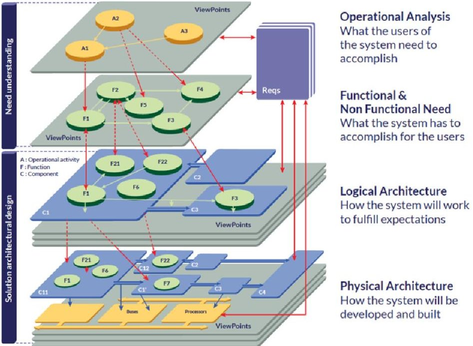

Figure 1.1: ARCADIA method [11]

## 1.2. Capella tool

Developed by Eclipse, Capella is a tool that implements the ARCADIA method.

In it, each one of the four engineering levels can be easily developed one by one. The process is guided by the Activity explorer in which the different diagrams and activities that are available at each level are shown. In figure 1.2 the one for the System analysis is reported for reference. The strength of this method is the traceability, which is assured with the Contextually Create feature, that allows transitioning everything done in the previous level to the next one. This way, nothing is lost and everything can be traced through all the levels.

<!-- PDF_PAGE: 21 -->

Figure 1.2: Activity Explorer

## 1.2.1. Engineering levels

To understand the models presented in this work, the various elements that characterize each engineering level are hereafter presented. Please note that this is not an exhaustive explanation of all the Capella functionalities; if interested in that, please consult [50], from which the definitions and concepts introduced here are taken.

## Operational analysis

The main goal at this level is to understand the needs of the stakeholders so that during the design, it can be assured that the system, a concept not yet introduced at this level, satisfies them.

The principal elements present at this level are

- Operational Capabilities: capability of an organization to provide a high level service leading to an operational objective being reached.

- Operational Entity: entity belonging to the real world (organization, existing system, etc.) whose role is to interact with the system being studied or with its users.

- Operational Actor: particular case of a (human) nondecomposable operational entity.

- Operational Activities: process step carried out in order to reach a precise objective by

<!-- PDF_PAGE: 22 -->

an operational entity, which might need to use the future system in order to do so.

The different activities must be allocated to the various Actors/Entities and are linked together by Interactions, represented as arrows, which are defined as an exchange of information or of unidirectional matter between Operational Activities.

## System Analysis

At this level, the concept of system is introduced, but only as a black bo and what it has to do for the users is analyzed.

The principal elements present at this level are:

- System: organized group of elements that function as a unit (black box) and respond to the needs of the users. The System owns Component Ports that allow it to interact with external Actors;

- System actors: any element external to the system that interacts with it.

- System Capabilities: capability of the System to provide a high-level service allowing it to carry out an operational objective

- Functions: behavior or service provided by the System or by an Actor

- Mission: high-level need/service which exploits System Capabilities.

- Functional chain: element of the model that enables a specific path to be designated among all possible paths. Valid also in the next two levels.

With the contextually create tool, all the Functions realized at the previous level are transitioned to this one. They can be entirely, partially, or not realized by the system. In the first case, they are allocated to the System. In the second case, they are broken down into several functions some of which will be allocated to the System and others to the actors. Once broken down in fact, they cannot be allocated, as according to one of the ARCADIA rules, "Only "leaf" Functions (Functions that are not broken down) can be allocated" [50]. In the third case, they are allocated to the actors directly.

The different functions are linked by what is here called Functional exchange. It is represented as a green line connecting two ports of a function. If it exits from a function the port is green, if it enters, the port is red. Please note that already existing Functional exchanges of parent functions have to be delegated to leaf functions.

The concept of Components exchange, connection (blue line) between the System and one of its external Actors, allowing circulation of Functional Exchanges is introduced at this level. Another ARCADIA rule states that "At every level of Arcadia, a Functional Exchange between two Functions allocated to two Behavioral Components must be allocated to a single Compo-

<!-- PDF_PAGE: 23 -->

nent Exchange between these two Components" [50]. Therefore also Functional exchange, just like Functions, need to be allocated and they are allocated to Components exchange. Another ARCADIA rule states that "Arcadia demands that Functional Exchanges be unidirectional. A Function Port is either an input or an output, and this property cannot be modified in Capella. On the other hand, a Component Exchange can be uni- or bi-directional"[50]. In the first case, the white port shows the direction, in the second case, the white port is blank.

## Logical Architecture

At this level, the different subsystems, here called Logical components, of the system, are identified, without making any technological consideration.

The principal elements present at this level are:

- Logical component: structural element within the System, with structural Ports to interact with the other Logical Components and the external actors.

- Logical actors: any element that is external to the System (human or non-human) and that interacts with it.

- Logical functions: behavior or service provided by a Logical Component or by a Logical Actor.

To better describe the path conditions between source and recipients, flow control Functions are introduced. Different types of flow control Functions exist [50]:

- Duplicate function: transmits the same information coming from the source to all recipients.

- Split function: transmits some of the source information to each recipient selectively.

- Route function: transmits the information received from one source to one among several potential recipients.

- Gather function: collects information from different sources and transmits it to one recipient.

- Select function: channels the information from one source among several, to one recipient.

Their icons are shown in order as presented in figure 1.3 and can be found at all levels of engineering.

<!-- PDF_PAGE: 24 -->

Figure 1.3: Flow control Functions

## Physical Architecture

At this level, the final architecture of the system is defined, making all the necessary technological considerations.

Two different types of Physical components can be observed. A Behavior Physical Component is a component of the system, responsible for performing some of the Functions assigned to the system, by interacting with other Behavior Components and with that of the external Actors. A Node Physical Component is a component that hosts a certain number of Behavior Components, by providing them with the resources required for them to operate and interact with their environment" [50]. The Node Physical Components are reported in yellow, while the Behavior Components are reported in blue.

A third type of link is here introduced, the Physical link, which is defined as "a means of communication, transport or channeling between two Node Physical Components, used as a support for the Component Exchanges" [50]. Hence Physical links represent real, physical connections between the different components, and to each one, a Component exchange is allocated.

## Diagrams

The same kinds of diagrams can be found across all levels.

- Architecture diagrams: show the allocation of functions to components.

- Breakdown diagrams: represent hierarchies of either Functions or Components

- Scenario Diagrams: show the vertical sequence of the messages passed between elements (lifelines) and are largely inspired by the UML/SysML sequence diagram.

Scenario diagrams are particular diagrams as they are the only ones in which the temporal aspect is present. Different scenario diagrams are available but they all present vertical lines, Instance Roles (called lifelines in UML/SysML), on which functions (here called State Fragments) are allocated and exchanges (here called Messages) are used to pass from one model element to the other. In particular, the diagrams available are "Functional Scenarios (the lifelines are Functions), Exchange Scenarios (the lifelines are Components/Actors while the sequence Messages are Functional or Component Exchanges), Interface Scenarios (the lifelines are Components/Actors while the sequence Messages are Exchange Items)" [50].

Different time relations can be highlighted. The time constraint between two messages can be

<!-- PDF_PAGE: 25 -->

expressed with the Duration command. To describe repetitive actions, the concept of Combined Fragment, which comes directly from UML/SysML, is introduced. Each fragment contains an operator and can be split into different operands. Some of those require a condition to "activate" called Guard. The main operands are [50]:

- LOOP: the fragment can be executed several times, and the guard condition states the iteration frequency (e.g. every day);

- OPT: the fragment is only executed if the condition provided is true (very similar to a "while" cycle);

- ALT: the fragment contains some alternative operands, only executing the one that contains the true condition (very similar to an "if" cycle);

- PAR: the fragment contains a number of operands that are executed in parallel, no Guard condition is present here

- STRICT: this interaction operator requires a strict sequencing (order) of the operands within the combined fragment.

Not all types of diagrams must be realized at each level, it is up to the Capella user to select the ones that best describe the situation he/she wants to present.

## 1.2.2. Requirements

In the vast majority of engineering projects requirements are the main vehicle of information between the different stakeholders. They evolve throughout the design and keeping track of them can be challenging. The idea proposed by Bonnet, Voirin and Navas [5] suggests that the classic written requirements can be complemented by the different model elements present in all MBSE approaches. Throughout the design of this mission, different requirements are identified.

Capella offers the possibility of including textual requirements in the models with the "Requirements Viewpoint" add-on to show how the different elements satisfy them. In this work, this aspect is not explored, nonetheless, by looking at the different diagrams, the correspondence between the Capella elements and the requirements is evident.

Requirements often include information other than the functioning of the system on which the ARCADIA methodology focuses. Information like size and mass can only be reported in a descriptive way in Capella, not allowing the mission designers to obtain power and mass budgets yet. The Eclipse community is in fact working, with the help of third parties, towards add-ons that allow the interface of Capella with software like Matlab or the phyton language

<!-- PDF_PAGE: 26 -->

to close this gap.

The requirements will have the following identification.

## WWW-YYYY-Z

- WWW: Either SSO,MAG, or S&M to indicate the space segment the requirement is intended for.

- YYYY: three or four letters to indicate the subsystem the requirements are intended for. The only exception is the environmental requirements for which ENV is used and the mission requirements deriving from the orbital mechanics for which MIS is used.

- Z: one digit to indicate the requirement number.

<!-- PDF_PAGE: 27 -->

## 2 CUBE Mission

## 2.1. Mission Overview

The main goal of CUBE Mission is to provide further insight into specific areas of Earth's magnetosphere using CubeSats technology.

It sees the involvement of the CUBE collaboration, in charge of realizing the mission payloads and analyzing the data, and Politecnico di Milano responsible for the development of the space segment.

To achieve the mission goal, three different payloads are envisioned, hosted on CubeSats platforms. The CubeSats will then be arranged in a constellation of satellites positioned in the two orbits of interest, a Sun Synchronous orbit and a highly inclined magnetospheric orbit at an altitude of 60000 km which will collect data for at least 2 years.

Regarding the payloads, being this a new mission, not all the decisions have yet been finalized. Only one of the three payloads, the Plasma Analyzer, has been sized and requirements are available. It oversees the collection of ions from the magnetosphere. To avoid contamination from the electrons present in space, it is immersed in a shielded cavity. A complex system of grids with different polarization is in charge of ion acceptance and electron repulsion. The presence of a segmented collector allows obtaining the velocity components of the ions. The second and third payloads will most likely be a high-accuracy magnetometer and a minia-

The second and third payloads will most likely be a high-accuracy magnetometer and a miniature radiometer.

In this thesis, the constellation aspect is not explored. The budgets and requirements presented are valid for a single CubeSat platform. In particular, two different space segments are modeled based on the different characteristics of their final orbits. They are referred to as the SSO segment and the Magnetospheric segment.

According to this, the high-level requirements can be derived.

<!-- PDF_PAGE: 28 -->

<table border="1"><tr><td>ID</td><td>Requirements</td></tr><tr><td>S&amp;M-HLR-1</td><td>The space segment shall collect data from Earth&#x27;s magnetosphere</td></tr><tr><td>S&amp;M-HLR-2</td><td>The payloads shall be hosted on CubeSats platforms</td></tr><tr><td>SSO-HLR-3</td><td>The space segment shall operate in a Sun-synchronous orbit</td></tr><tr><td>MAG-HLR-3</td><td>The space segment shall operate in a highly inclined magnetospheric orbit</td></tr><tr><td>S&amp;M-HLR-4</td><td>The mission shall have a lifetime of at least 2 years</td></tr></table>

Table 2.1: High level requirements

To comply with S&M-HLR-2, where dimensions and mass values are necessary, those of a 12U Cubesat are used. After a first iteration, where also a 6U CubeSat was considered, this is deemed the most appropriate size as will be clear at the end of this work.

## 2.2. Mission Analysis

## 2.2.1. Orbital Mechanics

In order to comply with SSO-HLR-3 and MAG-HLR-3 [Tab.2.1], the two different orbits are analyzed.

## Sun-synchronous orbit

Sun-synchronous orbits are nearly polar orbits such that the satellite passes over any given point of the planet's surface at the same local mean solar time. Therefore, the spacecraft sees each portion of the surface under nearly the same condition of daylight or darkness.

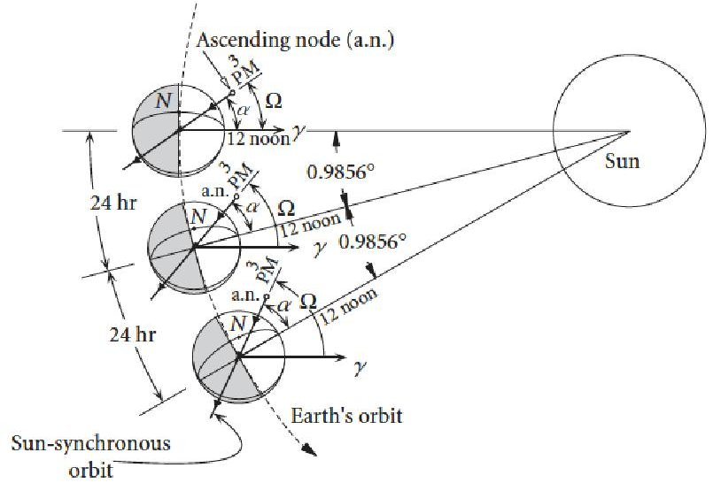

Figure 2.1: Sun Synchronous orbit [9]

<!-- PDF_PAGE: 29 -->

Mathematically this is possible if the precession rate of the orbit is equal to the mean motion of the Earth around the Sun.

The precession rate of the orbit can be expressed as [9]:

$$
\dot {\Omega} = - \frac {3}{2} \frac {\sqrt {\mu} J _ {2} R _ {E} ^ {2}}{(1 - e ^ {2}) ^ {2} a ^ {\frac {7}{7}}} \cos i
$$

Where J2 is the coefficient for the second zonal term related to the oblateness of the Earth, $ \mu $ is the standard gravitational parameter, RE is the mean radius of the Earth, roughly 6378 km, e is the eccentricity, a is the semi latus rectum and i is the inclination of the orbit.

The mean motion of the Earth around the sun is $ 3 6 0^{\circ} $ per sidereal year, therefore the ascending node of the orbit must advance at a rate

$$
\dot {\Omega} = \frac {2 \pi}{3 6 5 . 2 6 \cdot 2 4 \cdot 3 6 0 0} = 1. 9 9 1 \cdot 1 0 ^ {- 7} \mathrm {r a d / s}
$$

Equating the two rates it is possible to calculate the inclination to make the orbit sun-synchronous For this mission, altitudes between 500 and 800 km are considered, for the particular case of noon/midnight orbits [Fig. 2.2a], for which the local mean solar time of passage for equatorial latitudes is around noon or midnight. This choice stems from the scientific team's need for particular magnetospheric data. The inclination for the limit orbits are $ 94.4^{\circ} $ and $ 98.6^{\circ}. $

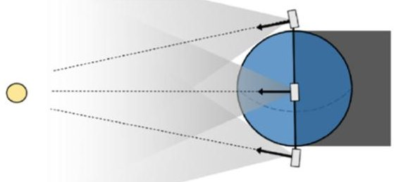

(a)

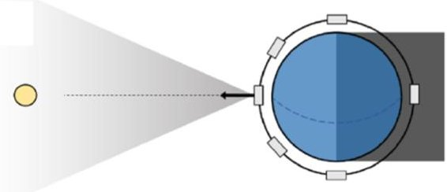

(b)

Figure 2.2: Types of SSO orbits [57]

Due to the gravitational forces of the Moon and the Sun, the inclination and altitude of sunsynchronous orbits might change, therefore orbital maintenance maneuvers are necessary.

Due to the gravitational forces of the Moon and the Sun, the inclination and altitude of sun-synchronous orbits might change, therefore orbital maintenance maneuvers are necessary. The delta-V necessary for station keeping in a year for a 12U CubeSat is computed assuming a drag coefficient equal to 2. The case of solar mean is considered as the next solar maximum is expected to be reached in July 2025 [48] and given the stage of the mission, it is assumed that it won't be ready for launch before 2028. Considering the mission lifetime of at least 2 years and a 100% margin [17], the final value amounts to 15.6 m/s for the 500 km orbit and 0.312 m/s for the 800 km orbit [33].

## Magnetospheric orbit

<!-- PDF_PAGE: 30 -->

The magnetospheric orbit required for this mission has an altitude of about 60000 km and a high inclination. The orbit is such that the CubeSat cannot be launched directly into it, therefore the satellite has to perform a transfer maneuver from an initial orbit to reach the nominal one.

Given the structure of the magnetosphere and the high-level requirements the Plasma Analyzer has to comply with, the Polimi team has come up with a series of possible solutions.

The first option is for the CubeSat to be initially launched into a geostationary (GEO) orbit. After that, the CubeSat would make its way toward the magnetospheric orbit where it would perform a change of plane maneuver to position itself into its final orbit.

There are a few drawbacks associated with this idea. Not many CubeSats have been launched into GEO so their behavior in this orbit is not well known. The flight onto the final orbit would then take about 6 months and, once there, the change of plane maneuver would require a very high delta-V which might be hard to achieve with the propulsion systems available for CubeSats. Therefore, this option is no further discussed.

The second option is to take advantage of the orbit used by Global Navigation Satellite System (GNSS) like Galileo. Those are circular orbits at different altitudes in MEO and could be used as a starting point for the CubeSat. From here two ways are possible.

The CubeSat could reach a circular orbit of a radius equal to about 60000 km. This would be a very stable orbit that allows the payload to spend enough time in the region of interest of the magnetosphere.

The CubeSat could instead achieve an elliptical orbit by raising its apogee to 60000 km and keeping the perigee at the GNSS orbit. This would facilitate telecommunications with Earth but the maneuver to raise the apogee is considered very tricky. Nonetheless, both options will be considered.

The Polimi team has computed the delta-V necessary for the transfer maneuver from the initial to the final orbit to be 1.1 km/s. The number is not stochastic, nonetheless, a 50% margin is applied to it.

A peculiar characteristic of satellites orbiting at such high altitudes is that they will pass through Earth's shadow only twice a year, around the spring and autumn equinoxes. The exact time the satellite will spend in eclipse and its period is determined for the EPS sizing in section 3.3.5.

According to this, the following orbital mechanic's requirements are obtained.

<!-- PDF_PAGE: 31 -->

<table border="1"><tr><td>ID</td><td>Requirement</td><td>Parent requirement</td></tr><tr><td>SSO-MIS-1</td><td>The space segment shall operate between 500 and 800km</td><td>SSO-HLR-3</td></tr><tr><td>SSO-MIS-2</td><td>The space segment shall perform orbit maintenance maneuvers</td><td>SSO-MIS-1</td></tr><tr><td>SSO-PROP-1</td><td>The propulsion system shall provide a delta-V of at least15.6m/s</td><td>SSO-HLR-3</td></tr><tr><td>MAG-MIS-1</td><td>The space segment shall perform a maneuver to reach the nominal orbit</td><td>MAG-HLR-3</td></tr><tr><td>MAG-PROP-1</td><td>The propulsion system shall provide a delta-V of at least1.85km/s</td><td>MAG-MIS-1</td></tr></table>

Table 2.2: Orbital mechanics requirements

## 2.2.2. Environmental analysis

The orbit choice is highly influenced by the environment in which the CubeSat will work. In space, the spacecraft are subjected to different radiation sources; mainly the sun in the form of Solar wind, Solar flares, and Coronal Mass Ejections but also Galactic Cosmic Rays and radiation belts. Radiations can disturb or even damage the electronics of a satellite. Highenergy particles can damage components with single impact events (Single Event Upset) or cumulative effects (Total Dose).

Atomic oxygen erosion and surface charging are also critical aspects to consider.

To get an idea of the radiation environment in the orbits of interest, the software SPENVIS [18] has been employed and the results are reported below for the two segments. For all of them, 20 orbits have been modeled and the mission is considered to start on Jan 1 of 2028.

## Sun-synchronous orbit

The only significant danger for satellites in sun-synchronous orbits is the well-known South Atlantic Anomaly in which due to the depression of the magnetic field, highly energetic protons and electrons are very abundant.

In the pictures below a world map of the trapped proton flux is shown for the 500 km sunsynchronous orbit (Fig. 2.3) and for the 800 km sun-synchronous orbit (Fig. 2.4).

<!-- PDF_PAGE: 32 -->

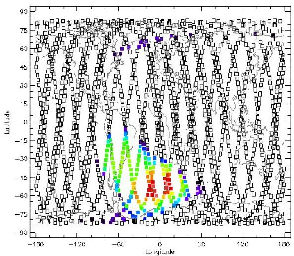

Figure 2.3: Proton flux 500 km orbit

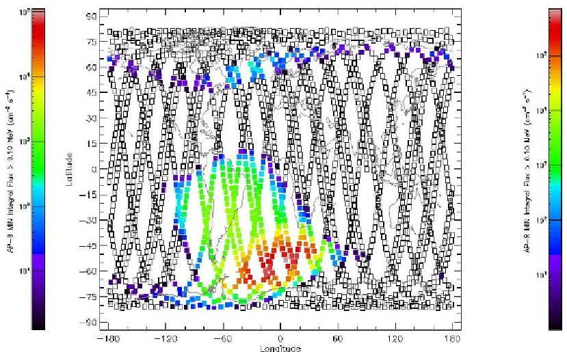

Figure 2.4: Proton flux 800 km orbit

It can be observed that the higher altitude orbit, presents larger regions in which harmful radiations are present and is interested by higher energetic protons. At 800 km the protons reach values of about $ 1 0^{6} $ Mev while at 500 km they have an energy of $ 1 0^{5} $ Mev.

A mode shall be assured in which the electronics are put on standby so that they do not get damaged.

Also in this case, the total ionization dose (TID) at those altitudes is shown in the graphs below for a period of 2 years.

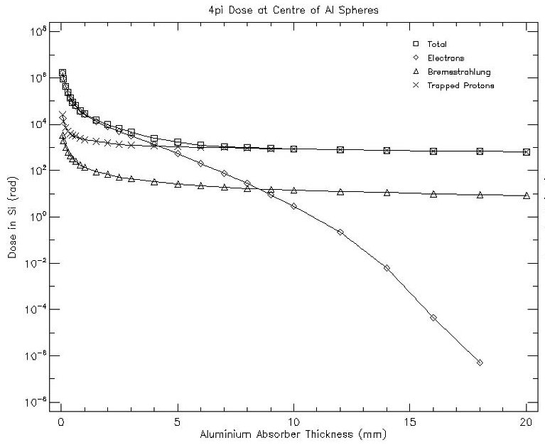

Figure 2.5: TID 500 km orbit

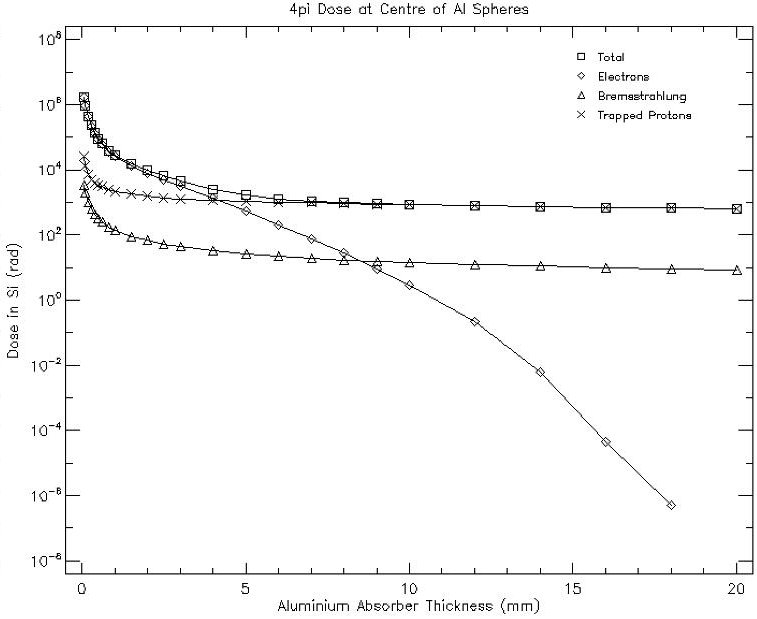

Figure 2.6: TID 800 km orbit

Given these results, both orbits are considered acceptable. The spacecraft electronics shall be designed to withstand at least 10 krad, considering an average aluminum thickness of 3 mm.

<!-- PDF_PAGE: 33 -->

## Magnetospheric orbit

The main risk for satellites in magnetospheric orbits is surface charging due to the free electric charges in the plasma which may result in sudden electrostatic discharge (ESD). Therefore any exposed material shall be thoroughly checked and controlled.

The total ionizing dose of the two different possible orbits is reported for a period of two years, considering an inclination of $ 7 0^{\circ} $

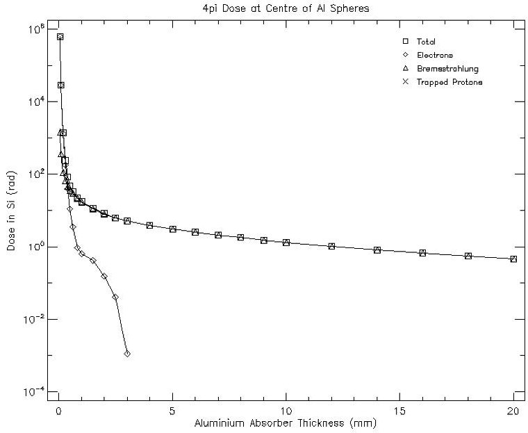

Figure 2.7: TID Circular orbit

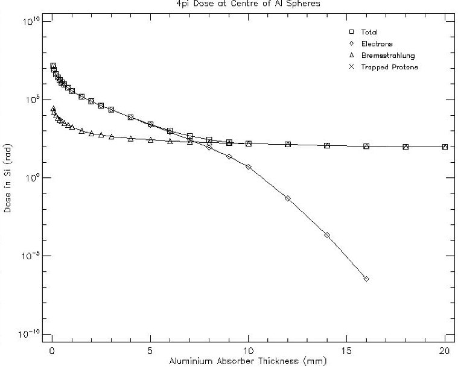

Figure 2.8: TID Elliptical orbit

The circular orbit offers safer conditions, as the total ionizing dose is lower with respect to the elliptical orbit selecting the same aluminum thickness. Being this a Pre-Phase A design, both orbits will be considered acceptable. The components are sized for the worst-case scenario, represented by the elliptical orbit. In particular, considering an average aluminum thickness of 4 mm, the spacecraft components shall be qualified to withstand at least 15 krad.

According to this, the following environmental requirements can be defined.

<!-- PDF_PAGE: 34 -->

<table border="1"><tr><td>ID</td><td>Requirements</td></tr><tr><td>SSO-ENV-1</td><td>The sensitive components shall be put on stand-by while crossing the SAA</td></tr><tr><td>SSO-ENV-2</td><td>The space segment external layers shall be made of at least 3mm thick aluminum</td></tr><tr><td>SSO-ENV-3</td><td>The components shall be designed to withstand at least 10krad</td></tr><tr><td>MAG-ENV-1</td><td>The space segment external layers shall be made of at least 4mm thick aluminum</td></tr><tr><td>MAG-ENV-1</td><td>The components shall be designed to withstand at least 15krad</td></tr></table>

Table 2.3: Environmental requirements

<!-- PDF_PAGE: 35 -->

## 3 Space segments design

## 3.1. Operational Analysis

The first step in Capella requires the mission designers to pose the question "what the users of the system need to accomplish".

To do that, the different stakeholders need to be identified. For CUBE mission, as stated in section 2.1, the main organizations involved in the project are ESA, the CUBE Collaboration and Politecnico di Milano. In addition to those ones that are specific to this mission, some other players present in all space missions can be recognized. Those are the Launcher, responsible for bringing the space segments in orbit, the MOC in charge of managing the in-orbit operations, the ground segment provider with which the space segments exchange information and the environment, which despite not being an actual organization or person, greatly influence the mission.

The various Entities described and the indispensable services they provide, the Operational Capabilities, can be organized in an Operation Capabilities Blank diagram [Fig. 3.1].

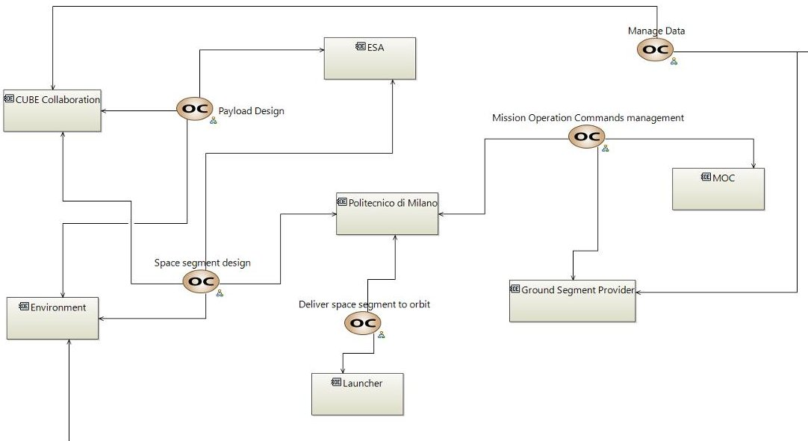

Figure 3.1: [OCB] CUBE Mission

<!-- PDF_PAGE: 36 -->

The Operational Capabilities are broken down into Operational Activities which practically explain what is expected by each Entity. They can be observed in an Operational Architecture Blank diagram [Fig. 3.1].

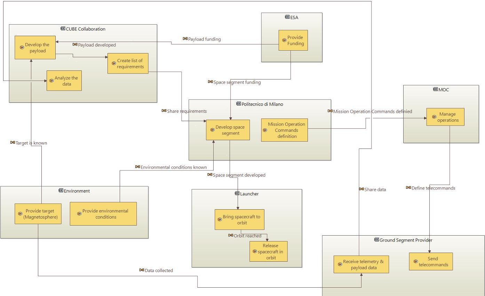

Figure 3.2: [OAB] CUBE Mission

The advantages of the MBSE method are already noticeable at this level. It forces the mission designers to reason on the different contributors to the project and assign to each one tasks. Furthermore, the diagram obtained is easily understandable and allows everyone to know everyone's role in the mission. It can be easily modifiable to add or remove elements as the mission progresses.

## 3.2. System Analysis

At the System Analysis level, the concept of system is introduced for the first time but it is considered as a black box. The mission designers are asked to reason on "what the system has to accomplish for the users".

For the CUBE mission, the system is nothing other than the space segment and the answer is explained by HLR-1 "The space segment shall collect data from Earth's magnetosphere" which is represented in Capella as a Mission.

To satisfy the Mission the system exploits certain System Capabilities. This is highlighted in

<!-- PDF_PAGE: 37 -->

the diagram by the Capability Exploitation relation, the black arrows connecting the two. The different capabilities can also require the involvement of external actors, which is shown by means of Capability Involvements that connect the two. Everything just discussed can be represented with a Mission Capabilities Blank Diagram [Fig. 3.3].

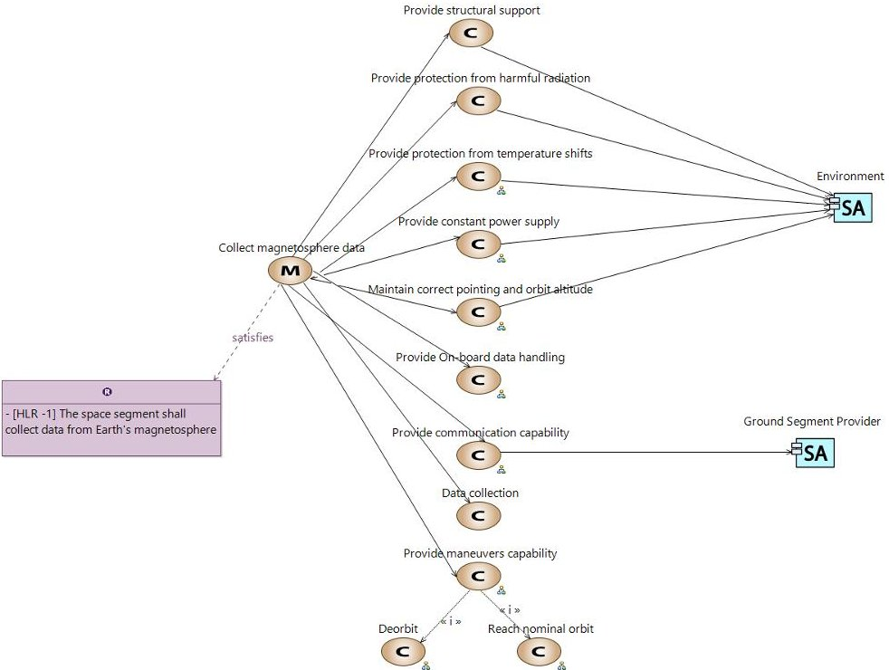

Figure 3.3: [MCB] System Capabilities

Only in this diagram, the textual requirement is also reported, to show what described in section 1.2.2. Even without it, the correlation between the high-level requirement and the Capella element would've been clear.

The System Capabilities presented in the diagram can be seen as mission requirements typically assigned to each subsystem. The system here is in fact required to provide a constant power supply, communication capabilities, onboard data handling, and so on. This concept though is not yet introduced at this level of the ARCADIA methodology.

Each capability, as done at the Operational Analysis level, is further declined in System functions, to better explain how the system will work to satisfy the Capability.

This can be shown cumulatively for all the capabilities with a System function breakdown diagram [Fig. 3.4]. The parent functions color is changed to red to distinguish them from the leaf functions in green.

<!-- PDF_PAGE: 38 -->

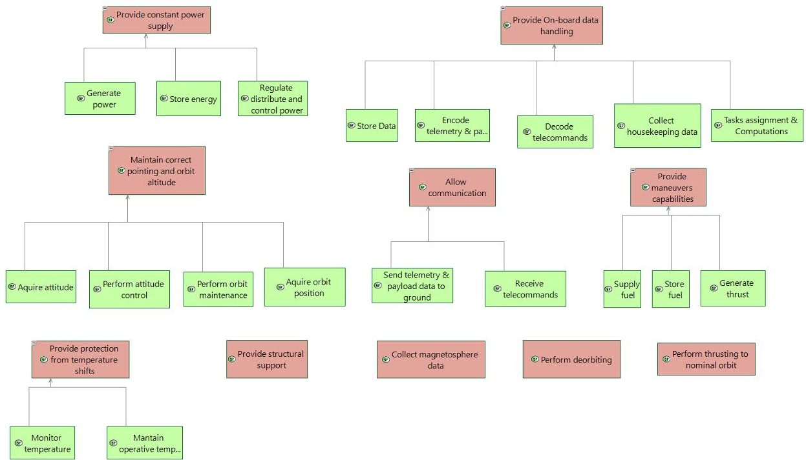

Figure 3.4: [SFBD] System Capabilities breakdown

Not all the functions are broken down at this level, but this is purely a design choice.

Both the functions transferred from the Operational analysis and the newly defined ones must be assigned to the System actors or the system; this can be done with a System Architecture Diagram [Fig. 3.5]. As can be seen, the system, here called "Space segment" is now shown in the diagram.

The functions are naturally green-colored, but a different color is used for those specific to only one segment. In particular, the functions in pink are exclusive to the Magnetospheric segment, while the orange ones are exclusive to the SSO segment.

Both the Functional exchange, in green, and the Component exchange, in blue, can be noticed in the diagram.

This level provides a complete view of the system, its high-level functionalities, and its interactions with external actors. From this, the mission designers or the stakeholders can easily verify if something is missing or if something needs to be removed. Both actions can be easily performed in Capella without the need of modifying tens of documents.

<!-- PDF_PAGE: 39 -->

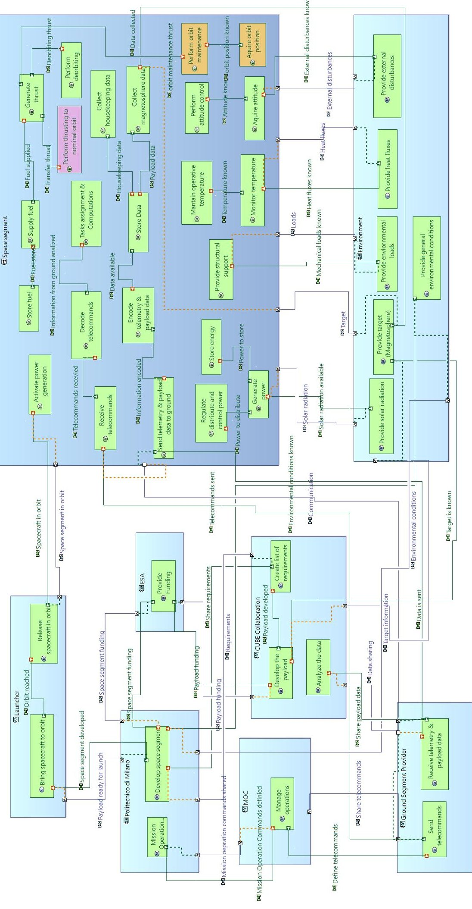

Figure 3.5: [SAB] CUBE Mission

<!-- PDF_PAGE: 40 -->

## 3.3. Logical & Physical Architecture

At the Logical Architecture level, the concept of subsystem is introduced. The MBSE methodology requires the mission designer to reason on how the system can achieve what it has to do, excluding "all technological considerations or implementation choices" which are delegated to the Physical Architecture level.

The two engineering levels are subsequent but are here reported together for each subsystem, called respectively Logical component and Physical component, to better understand the difference between them. In the logical level diagrams, the functional interaction between the different subsystems is highlighted, while at the physical level, this is not repeated, and more emphasis is put on showing the physical connections between the different components.

To do this, the different subsystems need to be sized. For each, the sizing process is first described and then the subsystem is implemented in Capella.

As before different functions are defined and shown for each subsystem with a Physical Function Breakdown diagram that includes the functions defined at the Logical level as well. At the end of each subsystem sizing different design requirements are shown, but not the mission ones, as these functions at the Logical level, can be seen as mission requirements.

## 3.3.1. Propulsion system

## Propulsion system sizing

Different propulsion systems (PSs) are available for satellites and can be divided into two big categories, chemical and electric propulsion systems. The main difference is that chemical propulsion systems can provide a high thrust at the expense of the specific impulse while electric propulsion systems can generate a high specific impulse at the expense of the thrust consuming a lot of power.

<table border="1"><tr><td>Technology</td><td>Thrust Range</td><td>Specific Impulse Range[sec]</td></tr><tr><td colspan="3">4.6.1 CHEMICAL PROPULSION TECHNOLOGIES</td></tr><tr><td>Hydrazine Monopropellant</td><td>0.25-25N</td><td>200-285</td></tr><tr><td>Alternative Mono- and Bipropellants</td><td>10mN-120N</td><td>160-310</td></tr><tr><td>Hybrids</td><td>1-230N</td><td>215-300</td></tr><tr><td>Cold/Warm Gas</td><td>10μN-3N</td><td>30-110</td></tr><tr><td>Solid Motors</td><td>0.3-260N</td><td>180-280</td></tr><tr><td>Propellant Management Devices</td><td>N/A</td><td>N/A</td></tr><tr><td colspan="3">4.6.2 ELECTRIC PROPULSION TECHNOLOGIES</td></tr><tr><td>Electrothermal</td><td>0.5-100mN</td><td>50-185</td></tr><tr><td>Electrosprays</td><td>10μN-1mN</td><td>225-5000</td></tr><tr><td>Gridded Ion</td><td>0.1-20mN</td><td>1,000-3,500</td></tr><tr><td>Hall-Effect</td><td>1-60mN</td><td>800-1,950</td></tr></table>

Figure 3.6: Spacecraft propulsion systems [46]

<!-- PDF_PAGE: 41 -->

## SSO segment propulsion system

To comply with SSO-PROP-1 [Tab. 2.2] a chemical propulsion system is selected. Different technologies exist that fall under this category; the most common are cold gas PS, monopropellant PS, and bipropellant PS.

Due to the CubeSat constraints in terms of size, the bipropellant solution is excluded as it is usually bigger given the need for two tanks, while the monopropellant solution is excluded as it demands additional power to heat the catalyst bed. Therefore a cold gas system will be sized.

Two different kinds of cold gas systems exist, the pressurized gas system and the liquified gas system. In both cases, the thrust is generated by the acceleration of vapor but in the first case, the propellant is stored in gas form, while in the latter the propellant is stored in liquid form and needs to be vaporized.

The two systems will be sized considering Nitrogen in the first case and the non-toxic liquid propellant R236fa for the second case.

The propellant mass can be computed through the Tsiolkovsky equation considering 60s of specific impulse, according to commercially available cold gas thrusters [43], the required delta-V, a 2% margin [17] for the unusable propellant, and the nominal dry mass at launch. Knowing the density of the two different propellants, the volume of the propellant tanks can be computed. The value is obtained considering a 10% margin [17] and Aluminum as the tank's material.

The values are reported in the table below for the two possible orbits for the two different propellants.

<table border="1"><tr><td></td><td colspan="2">500kmSSO</td><td colspan="2">800kmSSO</td></tr><tr><td></td><td>N2</td><td>R236fa</td><td>N2</td><td>R236fa</td></tr><tr><td>Propellant mass[g]</td><td>293</td><td>293</td><td>6</td><td>6</td></tr><tr><td>Tank volume[cm3]</td><td>1200</td><td>265</td><td>23</td><td>5.23</td></tr><tr><td>Tank mass[g]</td><td>3300</td><td>745</td><td>64.5</td><td>14.7</td></tr></table>

Table 3.1: Propulsion system - SSO segment

The liquid propellant has a higher density which translates into a lower size and mass of the tanks. According to this, the liquified gas system is chosen.

The propulsion system shall also deorbit the satellite, therefore additional propellant shall be considered for this operation.

## Magnetospheric segment propulsion system

<!-- PDF_PAGE: 42 -->

To comply with MAG-PROP-1 [Tab. 2.2] the need for an electric propulsion system arises as this kind of thrust cannot be obtained with a chemical propulsion system. Given that this kind of PS is selected, a 10% margin [17] is to be added to the delta-V bringing the value to 2 km/s.

Different types of electric propulsion systems exist, namely gridded ion thrusters, FEEP thrusters, and hall effect thrusters.

Selecting an average specific impulse of 2000 s, and considering the nominal dry mass at launch and a 2% margin for the unused propellant [17], the propellant mass amounts to 1.3 kg using the Tsiolkovsky equation.

Other than the propellant mass, an important driver in the selection of an electric PS is the power required.

A research was conducted to see the power required by the electric propulsors available on the market that can provide the required propellant mass. According to this, the FEEP technology requires a power over 100 W [16], the Gridden ion thruster a power up to 80 W [6] and the hall thrusters a minimum power of 100 W [7] .

Therefore, the gridded ion thruster is selected.

## Requirements

According to the design just performed, different design requirements can be obtained.

<table border="1"><tr><td>ID</td><td>Requirement</td><td>Parent requirement</td></tr><tr><td>SSO-PROP-2</td><td>The space segment shall be equipped with a cold gas thruster</td><td>-</td></tr><tr><td>SSO-PROP-3</td><td>The cold gas thruster shall provide at least 293g of propellant</td><td>SSO-PROP-1</td></tr><tr><td>SSO-PROP-4</td><td>The cold gas thruster tank shall be made of aluminum</td><td>-</td></tr><tr><td>MAG-PROP-2</td><td>The space segment shall be equipped with a gridded ion thruster</td><td>-</td></tr><tr><td>SSO-PROP-3</td><td>The gridded ion thruster shall provide at least 1.3kg of propellant</td><td>MAG-PROP-1</td></tr></table>

Table 3.2: PS requirements

## Reference components

As reference for the mass and power budgets, the Standard Micro Propulsion System (MiPS) by VACCO [59] and the BUSEK Bit-Ion 3 [6] are used for the SSO segment and Magnetospheric segment respectively. Their properties are reported in the table below.

<!-- PDF_PAGE: 43 -->

<table border="1"><tr><td></td><td>Cold Gas propulsion system</td><td>Gridded ion propulsion system</td></tr><tr><td>Propellant</td><td>R236fa</td><td>-</td></tr><tr><td>Thrust[mN]</td><td>25x4 thrusters</td><td>1.1</td></tr><tr><td>Propellant mass[g]</td><td>557</td><td>1.5</td></tr><tr><td>Dry mass[kg]</td><td>799</td><td>1.4</td></tr><tr><td>Total impulse[Ns]</td><td>219</td><td>&gt;30000</td></tr><tr><td>Specific impulse[s]</td><td>61.2</td><td>2150</td></tr><tr><td>Dimensions[mm]</td><td>100x100x70</td><td>180x88x102</td></tr><tr><td>Power[W]</td><td>12</td><td>56-75</td></tr><tr><td>Operating Temperature[℃]</td><td>-15 to 55</td><td>-15 to 45</td></tr><tr><td>Data interface</td><td>RS422</td><td>RS485</td></tr><tr><td>Thermal Dissipation Load[W]</td><td>-</td><td>35</td></tr></table>

Table 3.3: Propulsion systems

Propulsion system in Capella

The functions relative to the propulsion system are reported in the figure below.

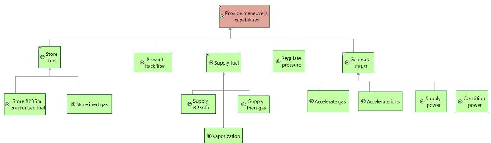

Figure 3.7: [PFBD] Propulsion system functions

At the logical level, the propulsion system is composed of two Logical Components that represent the two solutions selected for the SSO and Magnetospheric segment, namely the chemical and electric propulsion system to which functions with no technological solutions are allocated [Fig. 3.8].

<!-- PDF_PAGE: 44 -->

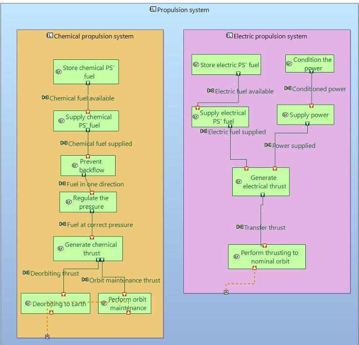

Figure 3.8: [LAB] Propulsion system

At the physical level, to comply with the design requirements, two Node Physical Components are created that represent the specific propulsion systems selected, the Cold gas and Gridded ion thrusters. These are further detailed into different Behavioral Physical Components which represent the different components of the propulsion systems and to which the functions are assigned.

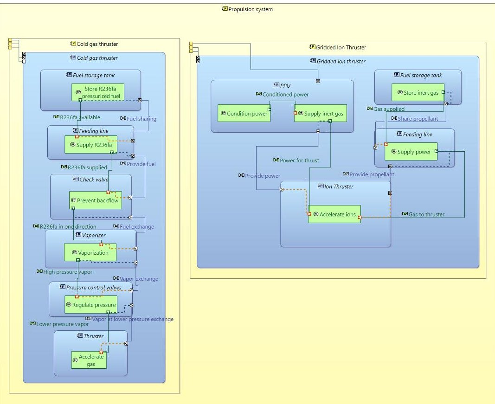

Figure 3.9: [PAB] Propulsion system

<!-- PDF_PAGE: 45 -->

## 3.3.2. Telecommunications system

## Telecommunications system sizing

The two platforms are expected to communicate with Earth, and vice versa, during the whole duration of the mission. The platform sends the scientific data acquired together with the telemetry needed by the MOC to understand the status of the platform and receives data in case new software or other information needs to be communicated from ground. Those are referred to as telecommands.

Respectively those two operations are referred to as downlink and uplink.

## Link budget design

To size the different components, the link must be designed between transmitter and receiver. This is possible through the link budget equation, which allows evaluating the energy per bit versus noise density ratio according to the following formula.

$$
\frac {E _ {b}}{N _ {0}} = \frac {P _ {r x}}{k T _ {s y s} R}
$$

Where $ \mathrm{P_{r x}} $ is the power of the receiver, k is the Boltzmann constant, R is the data rate and $ \mathrm{T_{s y s}} $ is the system equivalent noise temperature.

All the different parameters are discussed in the next sections.

## Frequencies

The first step is selecting the frequencies in which the downlink and uplink will occur. In compliance with the ITU regulation [13] for both segments, the S-band is selected. In particular, the 2200-2290 MHz frequency band dedicated to space research is considered for the downlink and the 2025-2110 MHz band is considered for uplink.

For the calculations, the lower limit will be considered as it provides the worst-case scenario for the Eb/N0.

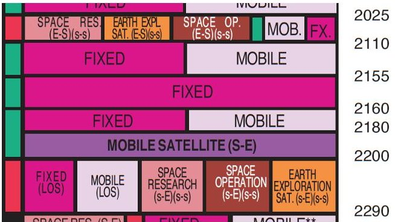

Figure 3.10: Telecommunications frequency band [45]

<!-- PDF_PAGE: 46 -->

## Donwlink data rate

To select the data rate, the visibility windows and the data budget have to be derived. For the latter, it is important to understand the periodicity with which a communication event verifies.

According to the Plasma Analyzer requirements, the data budget is expected to be $ \leq100 $ Mb/day. Considering the same amount for the other two payloads and a 30% margin according to [17] the total amounts to 390 Mb/day for both segments.

The visibility window for the SSO segment depends on the altitude. For a 500 km orbit, it amounts to about 8 minutes, while for an 800 km orbit to about 11.5 minutes. To obtain the available time for uplink and downlink, a 20% margin is considered that accounts for when the satellite enters and exits the window or if there are troubles connecting; it amounts to 6.4 minutes for the 500 km orbit and 9.2 minutes for the 800 km one. Considering repeated ground tracks, the satellite will pass over a given ground station every day, therefore the data shall be stored on board for one day and then downloaded to Earth.

For the Magnetospheric segment, the value of the visibility window is very high given the altitude of the orbit. In particular, for the circular orbit, it amounts to about 20.65 hours while for the elliptical one at perigee is 18.2 hours, and at apogee 9.35 hours. Of course, only the necessary fraction of time of the communication window will be utilized for the uplink and downlink of the data. For the circular orbit, considering repeated ground tracks, the satellite will pass over the same ground station after 2 days, the value increases to 4 for the elliptical one. In the first case, one ground station shall be utilized, and therefore data shall be stored on board for two days and then downloaded to Earth. For the elliptical case, 2 ground stations shall be considered, with which the satellite exchanges data every 2 days. This is done because otherwise, the data rate would be too high after 4 days, resulting in a very low Eb/N0. The time required to download the data is considered to be 3 hours for the circular orbit and 2 for the elliptical. These values are selected as they provide the best Eb/N0 results.

The data rate values for the different orbits are reported below considering convolution encoding and a BPSK modulation which are most commonly utilized.

<table border="1"><tr><td></td><td>SSO segment</td><td>Magnetospheric segment</td></tr><tr><td rowspan="2">Downlink data rate</td><td>500km:1Mbps</td><td>Circular:36.1kbps</td></tr><tr><td>800km:0.7Mbps</td><td>Elliptical:54.2kbps</td></tr></table>

Table 3.4: Data rate

Having selected a modulation, the minimum Eb/N0 can be inferred from graphs [Fig. 3.11] considering a BER of $ 1 0^{-5} $ for the science data and of $ 1 0^{-7} $ for telemetry information. The min-

<!-- PDF_PAGE: 47 -->

imum Eb/N0 for the BPSK/QPSK modulation for the science is 13 dB, while for the telemetry is 14.5 dB, considering an additional 3dB margin [17].

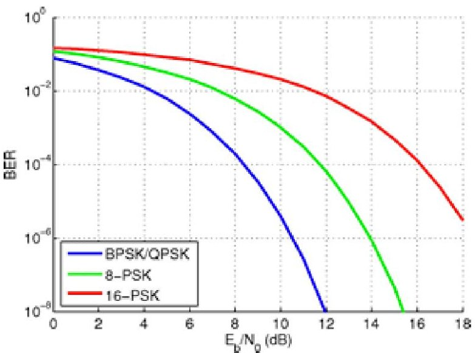

Figure 3.11: Modulations [36]

Antennas and Transceivers

Another important aspect is the antenna and the transceiver that will be present onboard the spacecraft.

An initial estimate of the transmitted power can be obtained by considering the portion of power assigned to the subsystem and the efficiency of the amplifier. Its value amounts to 3 W considering a solid state amplifier.

Knowing the frequency and therefore the wavelength, and considering a diameter compatible with the CubeSat size, an initial estimate of the gain of the antenna can be computed as

$$
G _ {a n t} = 1 0 \log \left(\frac {\pi D ^ {2} \mu_ {a n t}}{\lambda^ {2}}\right)
$$

Considering a diameter of 70 mm, and an efficiency of 0.7, the gain amounts to 2.6 dB for the downlink and 1.88 dB for the uplink.

Comparing the values obtained with antennas and transceivers available on the market, the obtained RF power is set to 1 W for the SSO segment and 2 W for the Magnetospheric one; the antenna gain obtained is used in the calculations, but it is important to notice that the value is lower with respect to the one of commercially available antennas.

An omnidirectional antenna is also expected to be present on board to assure communications in all situations. In particular, it shall be utilized in the early in-orbit time or if the attitude is lost.

Ground station

<!-- PDF_PAGE: 48 -->

Another important aspect is the selection of the ground station with which the satellite will communicate. Different options are available.

The first option is the ESA ESTRACK system, which is composed of the CORE ESA NETWORK, which includes antennas for near-Earth orbit communication as well as deep space antennas, the augmented network, and the cooperative network [19].

This option is quite expensive, and the antennas might be saturated, given the high number of missions already in orbit. It is though the most reliable one.

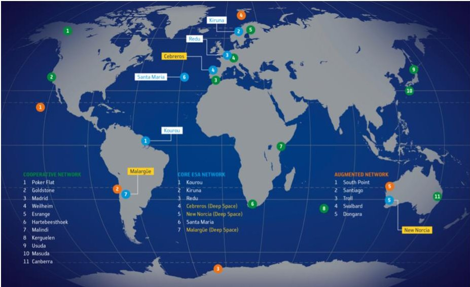

Figure 3.12: Estrack ground stations [19]

As reference, the KIRUNA antenna has been considered which provides downlink and uplink in the S-band [8]. The relevant information about the antenna is reported in table 3.5.

<table border="1"><tr><td></td><td>Downlink</td><td>Uplink</td></tr><tr><td>Diameter[m]</td><td>15</td><td>15</td></tr><tr><td>Frequency range[MHz]</td><td>2200-2300</td><td>2025-2120</td></tr><tr><td>Antenna Gain@45°[dBi]</td><td>48.6</td><td>46</td></tr><tr><td>System noise temperature[K]</td><td>93</td><td>-</td></tr><tr><td>G/T@Zenith[dB/K]</td><td>28.9</td><td>-</td></tr><tr><td>Antenna beamwidth(-3dB)[deg]</td><td>0.65</td><td>0.7</td></tr><tr><td>Transmit power[W]</td><td>-</td><td>300</td></tr><tr><td>EIRP[dBW]</td><td>-</td><td>71</td></tr><tr><td>Data rate</td><td>-</td><td>Typical2Kbps</td></tr><tr><td>Pointing accuracy[°]</td><td>0.05</td><td>0.05</td></tr></table>

Table 3.5: Estrack ground stations data

<!-- PDF_PAGE: 49 -->

Another option is to consider commercial ground stations, a service offered by different companies.

- The Swedish Space Corporation (SSC) "operates 10 ground stations strategically located around the world for optimum coverage, plus 8 supplementary partner stations. The SSC CONNECT network capabilities fit all mission types, sizes and orbits from LEO to Lunar and beyond" [56].

- Leaf space currently operates 14 ground stations around the world, which provide coverage for over 55 satellites. [38]

- Kongsberg Satellite Service (KSAT) owns some of the best-located ground stations in the world, the Svalbard and Antarctica ground stations, and is part of the ESA augmented network [34].

To guarantee the minimum Eb/N0, a diameter of at least 13 meters has to be guaranteed. Assuming that the same ground station provider will supply for both segments, Leaf space antennas have a too-small diameter, up to 3 meters, for the Magnetospheric segment, therefore are excluded. The ESTRACK system is the best candidate for this mission. For the SSO segment antennas like Kiruna and Kourou are good candidates; but also the South point one owned by SSC and the Svalbard one owned by KSAT which are part of the ESTRACK augmented network. For the Magnetospheric segment, the poker flat station is a valid option for both orbits and as previously mentioned, for the elliptical orbit, an additional station is required; the antenna in Masuda in Japan is a possible option.

Regarding the uplink data rate the typical value reported in table 3.5 is used.

## Losses

The signal is affected by different losses due to both the components and the mean it crosses:

- Transmission line losses: due to the passage of the signal through the transmission line. They are set to be 1 dB as a reference value for both missions.

- Atmospheric losses: due to the interaction with the gases in the atmosphere or the rain. They are set to be 0.7 dB as a reference value for both missions

- Misalignment losses: due to the misalignment between transmitter and receiver, their value depends on the beamwidth and the pointing accuracy of the different antennas. This is set as $ 5^{\circ} $ for the onboard antenna and $ 0.05^{\circ} $ for the ground station according to table 3.5. The beamwidth instead is computed knowing the wavelength and the diameter of the antennas. The values vary only slightly between uplink and downlink and are in the order of 0.02 dB for the segments antenna and in the order of 0.06 dB for the ground station antenna.

<!-- PDF_PAGE: 50 -->

- Space losses: due to the spreading of the signal in space, they depend on the frequency and the orbit. The values vary only slightly between uplink and downlink, therefore, for reference, only the losses at downlink are reported [Tab.3.6]. The values are shown for the two segments at the maximum and minimum distance from the ground station. These distances have been computed considering an elevation angle of $ 5^{\circ} $ [17].

<table border="1"><tr><td></td><td colspan="2">SSO segment</td><td colspan="2">Magnetospheric segment</td></tr><tr><td></td><td>500km</td><td>800km</td><td>Circular</td><td>Elliptical</td></tr><tr><td>Minimum distance</td><td>352.9dB</td><td>362.3dB</td><td>449.1dB</td><td>435.3dB</td></tr><tr><td>Maximum distance</td><td>381.4dB</td><td>387.3dB</td><td>450.9dB</td><td>438.6dB</td></tr></table>

Table 3.6: Space losses

## Equivalent system temperature

The last parameter to select is the Equivalent system temperature, $ \mathrm{T}_{sys} $ . This is the sum of three components, the noise temperature of the antenna, the noise temperature of the transmission line, and the noise temperature of the receiver.

For the uplink, the system equivalent temperature is set to 250 K. For the downlink, the system equivalent temperature of the ESTRACK antennas reported in table 3.5 is utilized.

## Eb/N0 results

Now that all the parameters have been set, the Eb/N0 can be computed. The results are reported below for the different orbits of both segments at the maximum and minimum distance from the ground station.

<table border="1"><tr><td colspan="2"></td><td>Minimum distance Eb/N0[dB]</td><td>Maximum distance Eb/N0[dB]</td></tr><tr><td rowspan="2">SSO segment downlink</td><td>500km</td><td>43.5</td><td>31.1</td></tr><tr><td>800km</td><td>41</td><td>30</td></tr><tr><td rowspan="2">SSO segment uplink</td><td>500km</td><td>90.5</td><td>78.2</td></tr><tr><td>800km</td><td>86.5</td><td>75.6</td></tr><tr><td rowspan="2">Magnetospheric segment downlink</td><td>Circular</td><td>16.4</td><td>15.6</td></tr><tr><td>Elliptical</td><td>20.6</td><td>19.1</td></tr><tr><td rowspan="2">Magnetospheric segment uplink</td><td>Circular</td><td>49</td><td>48.2</td></tr><tr><td>Elliptical</td><td>55</td><td>53.5</td></tr></table>

Table 3.7: Eb/N0 results

<!-- PDF_PAGE: 51 -->

As expected, the values for the elliptical orbit are higher with respect to the ones for the circular orbit, but in all cases, the energy bit over noise density values respect the minimum ones imposed by the modulation.

Please note that the subsystem is implemented in Capella after the OBDH sizing, performed in the next section, as their functioning is strictly correlated.

## Requirements

According to the design just performed, different design requirements can be obtained.

<table border="1"><tr><td>ID</td><td>Requirement</td><td>Parent requirement</td></tr><tr><td>S&amp;M-TTCS-1</td><td>The downlink and uplink shall be performed in the S-band</td><td>-</td></tr><tr><td>S&amp;M-TTCS-2</td><td>The space segment shall be equipped with an S-band antenna &amp; transceiver</td><td>S&amp;M-TTCS-1</td></tr><tr><td>S&amp;M-TTCS-3</td><td>The S-band antenna shall provide a gain of at least 2.66 dB for downlink and 1.88 dB for uplink</td><td>S&amp;M-TTCS-1</td></tr><tr><td>S&amp;M-TTCS-4</td><td>The minimum Eb/N0 shall be 13 dB for science and 14.5 dB for telemetry</td><td>-</td></tr><tr><td>S&amp;M-TTCS-5</td><td>The S-band transceiver shall provide a RF power of at least 2W</td><td>S&amp;M-TTCS-5</td></tr><tr><td>SSO-TTCS-6</td><td>The downlink shall be performed every day</td><td>S&amp;M-TTCS-5</td></tr><tr><td>MAG-TTCS-6</td><td>The downlink shall be performed every 2 days</td><td>S&amp;M-TTCS-5</td></tr><tr><td>S&amp;M-TTCS-7</td><td>The space segment shall be equipped with an UHF-band antenna &amp; transceiver</td><td>-</td></tr></table>

Table 3.8: Telecommunications system requirements

## Reference components

The pair of antennas and transceivers from IQ spacecom [26] [27] and ISISPACE [28] [29] are selected as reference for the mass and power budget for the S-band and UHF-band respectively. Their relevant information is presented in tables 3.9 and 3.10.

<!-- PDF_PAGE: 52 -->

<table border="1"><tr><td></td><td>S-band antenna</td><td>UHF antenna</td></tr><tr><td>Frequency range[MHz]</td><td>1980-2500</td><td>UHF and VHF</td></tr><tr><td>Gain[dBi]</td><td>6-11</td><td>0</td></tr><tr><td>Beamwidth[°]</td><td>Vertical:±40Horizontal:±40</td><td>-</td></tr><tr><td>Dimensions[mm]</td><td>70x70x3.4</td><td>98x98x6.6</td></tr><tr><td>Mass[g]</td><td>49</td><td>90-115</td></tr><tr><td>Operating Temperature[℃]</td><td>-40 to+85</td><td>-20 to+80</td></tr><tr><td>TRL</td><td>9(LEO)</td><td>Space qualified</td></tr></table>

Table 3.9: Antennas

<table border="1"><tr><td></td><td>S-band transceiver</td><td>UHF transceiver</td></tr><tr><td>Frequency range[MHz]</td><td>Tx:2200-2290Rx:2025-2110</td><td>Tx:435-438 or 400.15-402Rx:145.8-146 or 148-150.05</td></tr><tr><td>Output power[W]</td><td>up to 2</td><td>up to 0.5</td></tr><tr><td>Supported modulations</td><td>Tx:BPSK,QPSK,OQPSKRx:BPSK</td><td>BPSK</td></tr><tr><td>Data rate</td><td>Tx:2kbps-200MbpsRx:3.5kbps-896kbps</td><td>Tx:1.2,2.4,4.8,9.6kbpsRx:9.6kbps</td></tr><tr><td>Power Consumption[W]</td><td>Tx+Rx:&lt;15Rx:&lt;4</td><td>Tx:4Rx:0.48</td></tr><tr><td>Dimensions[mm]</td><td>90x65x25.3</td><td>90x96x15</td></tr><tr><td>Mass[g]</td><td>200</td><td>75</td></tr><tr><td>Operating Temperature[℃]</td><td>-30 to+60</td><td>-20 to+60</td></tr><tr><td>Data interface</td><td>SPI(LVDS,RS422)</td><td>I2C</td></tr><tr><td>TRL</td><td>9(LEO)</td><td>Flight heritage</td></tr></table>

Table 3.10: Transceivers

<!-- PDF_PAGE: 53 -->

## 3.3.3. OBDH

## OBDH sizing

The On-Board Data handling subsystem oversees the data exchange between the different subsystems as well as the storing of payloads data and general housekeeping information. It receives and decodes the telecommands from ground transforming them into a sequence of operations that the spacecraft must perform. Furthermore, it prepares the flow of information that has to be transmitted to ground.

The OBDH is comprised of different components all sized according to different parameters. The Central Processing Unit (CPU), in charge of processing, is sized mainly according to the Millions of Instructions Per Second (MIPS) but also with respect to the I/O channels and Giga Floating point Operation Per Second (GFLOPS).

The storage capacity, the size of the Random Access Memory (RAM) and of the Solid State Drive (SSD) is sized according to the size of data and code of the different subsystems' components and the payload data budget respectively.

Lastly, the bus, in charge of connecting the different units, is sized considering the data rate.

The typical values of Kwords, Thousands of Instructions Per Second (KIPS), and Execution frequencies for the different functions relative to each subsystem, useful to size the mentioned components, are reported in figure 3.13.

<table border="1"><tr><td rowspan="2">Function</td><td colspan="2">Size(Kwords)</td><td rowspan="2">Typical Throughput(KIPS)</td><td rowspan="2">Typical Execution Frequency(Hz)</td></tr><tr><td>Code</td><td>Data</td></tr><tr><td>Communications</td><td></td><td></td><td></td><td></td></tr><tr><td>Command Processing</td><td>1.0</td><td>4.0</td><td>7.0</td><td>10.0</td></tr><tr><td>Telemetry Processing</td><td>1.0</td><td>2.5</td><td>3.0</td><td>10.0</td></tr><tr><td>Attitude Sensor Processing</td><td></td><td></td><td></td><td></td></tr><tr><td>Rate Gyro</td><td>0.8</td><td>0.5</td><td>9.0</td><td>10.0</td></tr><tr><td>Sun Sensor</td><td>0.5</td><td>0.1</td><td>1.0</td><td>1.0</td></tr><tr><td>Earth Sensor</td><td>1.5</td><td>0.8</td><td>12.0</td><td>10.0</td></tr><tr><td>Magnetometer</td><td>0.2</td><td>0.1</td><td>1.0</td><td>2.0</td></tr><tr><td>Star Tracker</td><td>2.0</td><td>15.0</td><td>2.0</td><td>0.01</td></tr><tr><td>Attitude Determination&amp;Control</td><td></td><td></td><td></td><td></td></tr><tr><td>Kinematic Integration</td><td>2.0</td><td>0.2</td><td>15.0</td><td>10.0</td></tr><tr><td>Error Determination</td><td>1.0</td><td>0.1</td><td>12.0</td><td>10.0</td></tr><tr><td>Precession Control</td><td>3.3</td><td>1.5</td><td>30.0</td><td>10.0</td></tr><tr><td>Magnetic Control</td><td>1.0</td><td>0.2</td><td>1.0</td><td>2.0</td></tr><tr><td>Thruster Control</td><td>0.6</td><td>0.4</td><td>1.2</td><td>2.0</td></tr><tr><td>Reaction Wheel Control</td><td>1.0</td><td>0.3</td><td>5.0</td><td>2.0</td></tr><tr><td>CMG Control</td><td>1.5</td><td>0.3</td><td>15.0</td><td>10.0</td></tr><tr><td>Ephemeris Propagation</td><td>2.0</td><td>0.3</td><td>2.0</td><td>1.0</td></tr><tr><td>Complex Ephemeris</td><td>3.5</td><td>2.5</td><td>4.0</td><td>0.5</td></tr><tr><td>Orbit Propagation</td><td>13.0</td><td>4.0</td><td>20.0</td><td>1.0</td></tr><tr><td>Autonomy</td><td></td><td></td><td></td><td></td></tr><tr><td>Simple Autonomy</td><td>2.0</td><td>1.0</td><td>1.0</td><td>1.0</td></tr><tr><td>Complex Autonomy</td><td>15.0</td><td>10.0</td><td>20.0</td><td>10.0</td></tr><tr><td>Fault Detection</td><td></td><td></td><td></td><td></td></tr><tr><td>Monitors</td><td>4.0</td><td>1.0</td><td>15.0</td><td>5.0</td></tr><tr><td>Fault Correction</td><td>2.0</td><td>10.0</td><td>5.0</td><td>5.0</td></tr><tr><td>Other Functions</td><td></td><td></td><td></td><td></td></tr><tr><td>Power Management</td><td>1.2</td><td>0.5</td><td>5.0</td><td>1.0</td></tr><tr><td>Thermal Control</td><td>0.8</td><td>1.5</td><td>3.0</td><td>0.1</td></tr><tr><td>Kalman Filter</td><td>8.0</td><td>1.0</td><td>80.0</td><td>0.01</td></tr></table>

Figure 3.13: OBDH reference values [41]

<!-- PDF_PAGE: 54 -->

For each subsystem, the functions relevant to the components described for each space segment are taken into consideration. All the functions for the communications, autonomy, fault detection, and other functions categories are also included. The results are presented including a 75% margin [17], as the values in the table are not specific to the mission. They are valid for both segments unless specified differently.

To compute the MIPS, necessary to size the CPU, the KIPS of the different functions are summed. The total amounts to 0.37 MIPS.

The size of the code and data of each function is summed to obtain the size of the RAM. The code size amounts to 2 MB while the data size is 1 MB.

For the SSO segment, to comply with SSO-TTCS-6 [Tab. 3.8], the data shall be stored on board for one day, therefore 85 MB of SSD space is required.

For the Magnetospheric segment, to comply with MAG-TTCS-6 [Tab. 3.8] the data shall be stored on board for 2 days before being sent to the ground station, therefore 170 MB of SSD space is necessary.

Lastly, the data rate for the bus sizing is calculated as the product between the code and the data Kwords by the typical execution frequency. The bus must transmit 3.2 Mbps of code and 3.8 Mbps of data for the different functions.

Regarding the payloads, for the Plasma analyzer, it is required that a CAN bus is used for code transmission and an RS422 for data transmission.

## Requirements

According to the design just performed, different design requirements can be obtained.

<table border="1"><tr><td>ID</td><td>Requirement</td></tr><tr><td>S&amp;M-OBDH-1</td><td>The processor shall provide at least 0.37 MIPS</td></tr><tr><td>S&amp;M-OBDH-1</td><td>The RAM memory size shall be of at least2 MB for code and 1 MB for data</td></tr><tr><td>SSO-OBDH-1</td><td>The SSD memory size shall be of at least85 MB</td></tr><tr><td>MAG-OBDH-1</td><td>The SSD memory size shall be of at least170 MB</td></tr><tr><td>S&amp;M-OBDH-1</td><td>The bus shall be able to handle a data rate of at least3.8 Mbps for data and3.2 Mbps for code</td></tr></table>

Table 3.11: OBDH requirements

## Reference component

As reference, Cubesat On-Board Computer by IMT [25] is considered for the mass and power budget and it presents the following characteristics.

<!-- PDF_PAGE: 55 -->

<table border="1"><tr><td>Processor</td><td>PIC32MZ M14K,32-bit MIPS™core(Up to200MHz,330DMIPS)</td></tr><tr><td>On board memories</td><td>8GBPayloadData128MBHousekeepingData16MBRAM</td></tr><tr><td>On-board communication interface</td><td>2xCAN2.0Bbusinterfaceup to1Mbps2xUARTinterfaces2xI2Cinterfaces</td></tr><tr><td>Power consumption[W]</td><td>1</td></tr><tr><td>Dimensions[mm]</td><td>95x91x11</td></tr><tr><td>Mass[g]</td><td>55</td></tr><tr><td>Operating temperature[℃]</td><td>-20to+70</td></tr></table>

Table 3.12: On board computer

## OBDH in Capella

The following functions are defined for the OBDH.

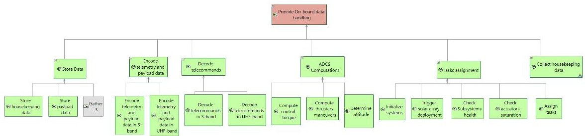

Figure 3.14: [PFBD] OBDH functions

At the logical level, the On-board data handling is composed of three Logical Components, the CPU in which, among other things, the AOCS calculation are performed, and the memories. A dedicated architecture blank diagram is not reported as its functioning will be shown in the TMTC and AOCS Architecture blank diagrams.

At the physical level, one Node Physical Component is created, the On-board computer, while different Behaviour Physical Components, to which the functions are assigned, are created for the processor and attitude determination and control algorithms, the SSD and RAM memories.

<!-- PDF_PAGE: 56 -->

## Telecommunications system in Capella

The functions relative to the telecommunications system are reported in the figure below.

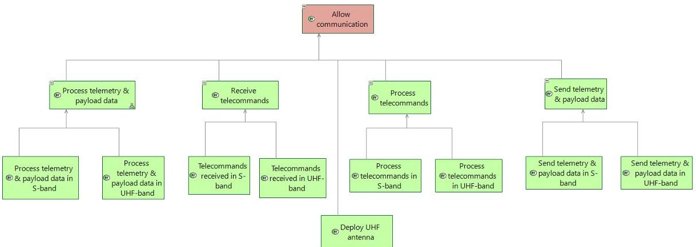

Figure 3.15: [PFBD] Telecommunication system functions

At the logical level, the telecommunications system is realized by two Logical Components, the antenna and the transceiver. The functions involved in the processes of uplink and downlink are highlighted with Functional Chains. The uplink process starts with the generation of the telecommands (TM) by the MOC. These are then shared with the Ground station provider that sends them to the spacecraft. The antenna receives the TM, that are processed by the transceiver before being sent to the CPU for the decoding and the assignment of the tasks. The downlink begins with the collection of data by the payloads and the collection of housekeeping data by the CPU which are stored in the memories. The information is then encoded by the CPU, it is processed by the transceiver and sent to Earth. At this point, the scientific data is sent to the CUBE collaboration while the telemetry is sent to MOC to check on the correct functioning of all systems. The corresponding diagram is shown in figure 3.16.

<!-- PDF_PAGE: 57 -->

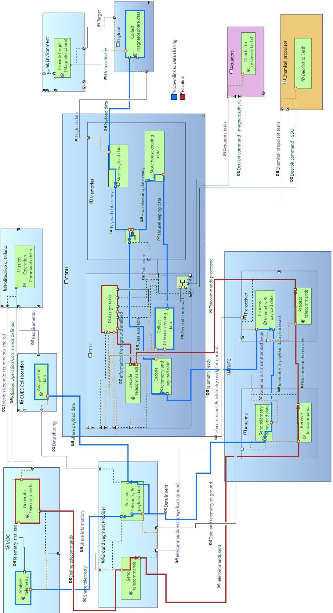

Figure 3.16: [LAB] Telecommunications system

<!-- PDF_PAGE: 58 -->

At the physical level, to comply with the design requirements, four Node Physical Components representing the two different antennas and transceivers are realized each one hosting a Behavior Physical Component to which the functions are allocated. Physical links representing the exchange of data between antenna and transceiver can here be seen for the first time and are reported in violet. As already stated, those represent real data cables connecting the two components

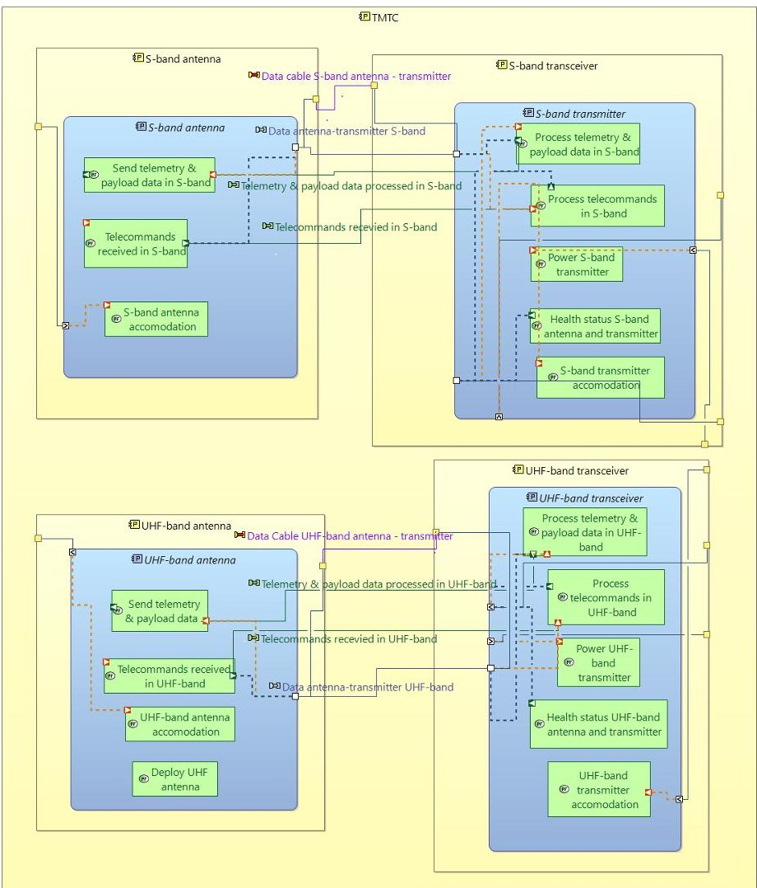

Figure 3.17: [PAB] Telecommunications system

<!-- PDF_PAGE: 59 -->

A scenario diagram is also realized for the telecommunications subsystems to highlight the duration and repetitive nature of the uplink and downlink activities.

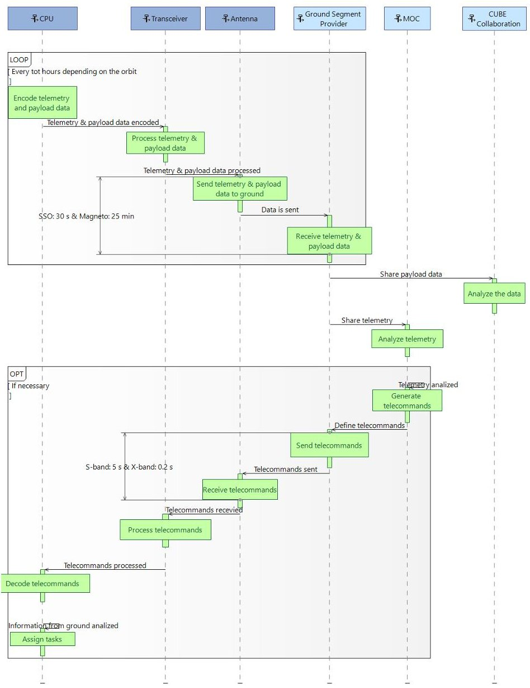

Figure 3.18: [LES] Telecommunications system

## 3.3.4. AOCS

## AOCS sizing

The AOCS subsystem is responsible for keeping the satellite in its operational orbit and maintaining the desired orientation, counteracting the environmental and internal disturbances that the satellite is subjected to.

To determine the real attitude of the CubeSat, the presence of sensors is necessary. Because a direct measurement is not always possible, the attitude is reconstructed from what is present in the environment, its known position, and some mathematical models.

The control is performed by actuators based on the information given by the sensors.

<!-- PDF_PAGE: 60 -->

## AOCS modes & pointing budget

The AOCS functioning varies according to the task the spacecraft performs, therefore different modes of operation need to be defined.

- Detumbling mode: the aim of this mode is to detumble the satellite so that its angular velocity is equal to zero.

- Science mode: the focus of this mode is to compensate the disturbances to maintain the correct pointing of the payloads. According to the PA requirements, it shall be located on the ram side of the S/C and it shall have the FoV with axis on the along track direction and aperture of $ \pm 4 0^{\circ} $ at least.

- Telecom mode: the satellites shall point the GS as it moves inside the visibility window to center the beam of the antennas with the receivers.

- Slew mode: this mode shall be triggered every time the satellite is required to change its orientation. This will happen when the solar panels have to be oriented towards the sun and when the antenna has to track the ground station.

- Safe mode: when activated, the requirement on the pointing accuracy is relaxed and the priority of the AOCS is to guarantee communications with Earth.

- Maneuvering mode: during this mode, the correct pointing of the propulsion system or thrusters shall be ensured.

For each mode, the pointing direction and accuracy are reported in table 3.13. Neither the payload nor the antennas have stringent requirements in terms of accuracy. In particular, the antenna pointing requirements are set to $ 5^{\circ} $ , while for the payload, no information is available, therefore $ 1^{\circ} $ is used to be conservative.

<table border="1"><tr><td></td><td>Pointing</td><td>Accuracy</td></tr><tr><td>Science mode</td><td>Ram direction</td><td>1°</td></tr><tr><td>Telecom mode</td><td>Earth</td><td>&lt;5°</td></tr><tr><td>Safe mode</td><td>Earth</td><td>&lt;5°</td></tr><tr><td>Maneuvering mode</td><td>Target</td><td>1°</td></tr></table>

Table 3.13: Pointing budget

Considering the performance requirements, the 3-axis stabilization control technique shall be employed.

<!-- PDF_PAGE: 61 -->

## Disturbances

The main disturbances for both missions are represented by the Magnetic field, the Gravity Gradient (GG), and the Solar radiation pressure which generate a torque on the satellite. The magnetic field torque is generated according to the law:

$$
M = m \times B
$$

Where m is the residual magnetic induction due to parasitic currents in the satellite selected under the worst scenario as [0.01; 0.01; 0.01] $ Am^{2} $ [55], and B is the Earth's magnetic field. To model the Earth's magnetic field, the approximation of a dipole could not be used for the SSO segment CubeSats, therefore, it was modeled in a more precise manner as the gradient of the scalar potential V up to the fourth order.

The GG torque, unlike the other two, is not due to an external factor but depends on the mass distribution of the spacecraft. In the principal axis frame, the torque can be expressed as:

$$
M _ {G G} = \frac {3 G m}{R _ {3}} \left[ \begin{array}{l} \left(I _ {z} - I _ {y}\right) c _ {2} c _ {3} \\ \left(I _ {x} - I _ {z}\right) c _ {1} c _ {3} \\ \left(I _ {y} - I _ {x}\right) c _ {2} c _ {1} \end{array} \right]
$$

With $ I_{x}, I_{y}, I_{z} $ as the inertia moments along the 3 axis and $ c_{1}, c_{2}, c_{3} $ as the direction cosines of the radial direction expressed in the principal axis.

The disturbance is secular (constant) if the spacecraft is planet oriented and cyclic if it is inertially oriented.

The average pressure due to solar radiation can be evaluated as:

$$
P = \frac {F}{c}
$$

Where F is the Sun's power per unit surface and c is the speed of light.

The incoming radiation is partially absorbed, specularly reflected, and diffusely reflected so that the relation between the absorption coefficient, diffuse reflection coefficient, and the specular reflection coefficient i.e., $ \rho_{a}+\rho_{d}+\rho_{c}=1 $ , is valid.

The SRP torque in Simulink is modeled as:

$$
M _ {S R P} = \Sigma r _ {i} \times F _ {i}
$$

$$
F _ {i} = - P A _ {i} \left(\hat {S} _ {b} \cdot \hat {N} _ {b i}\right) \left[ \left(1 - \rho_ {s}\right) \hat {S} _ {b} + \left(2 \rho_ {s} \left(\hat {S} _ {b} \cdot \hat {N} _ {b i}\right) + 2 \rho_ {d}\right) \hat {N} _ {b i} \right]
$$

<!-- PDF_PAGE: 62 -->

With $ F_{i} $ as the force on each panel, $ \hat{S}_{b} $ denoting the unit direction of the satellite-Sun vector, $ \hat{N}_{bi} $ indicating the normalized direction of each surface, and $ A_{i} $ indicating the area of each surface.

The disturbance is cyclic if the spacecraft is planet oriented and secular (constant) if it is solar oriented.

To compute the disturbances, a preliminary configuration is necessary.

The inertia matrix is computed for the two segments considering a situation like the one in figure 3.19 with solar arrays of the size found in section 3.3.5. In both cases, the inertia is computed considering the wet mass at launch. For the SSO segment, the inertia is $ [ 0.189;0.437;0.107] \mathrm{kg m}^{2} $ and for the Magnetospheric segment is $ [ 0.195;0.723;0.107] \mathrm{kg m}^{2} $

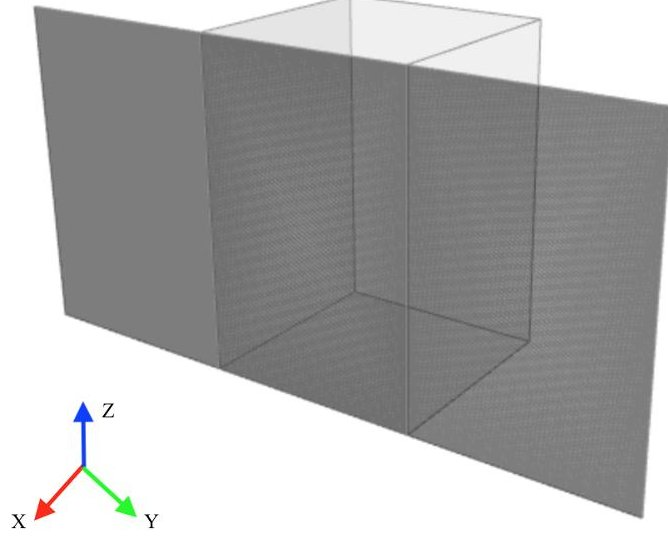

Figure 3.19: Preliminary configuration

At this point, the order of magnitude of the torques generated by the different disturbances on the spacecraft can be computed and are reported for one orbit, for the different orbits.

<table border="1"><tr><td></td><td>Magnetic Torque[Nm]</td><td>SRP Torque[Nm]</td><td>GG Torque[Nm]</td></tr><tr><td>SSO</td><td>$10^{-6}$</td><td>$10^{-8}$</td><td>$10^{-10}$</td></tr><tr><td>Circular orbit</td><td>$10^{-9}$</td><td>$10^{-8}$</td><td>$10^{-12}$</td></tr><tr><td>Elliptical orbit</td><td>$10^{-8}$</td><td>$10^{-8}$</td><td>$10^{-11}$</td></tr></table>

Table 3.14: External disturbances

For the SSO segment, the main disturbance is represented by the magnetic field, followed by the SRP and the GG.

<!-- PDF_PAGE: 63 -->

For the Magnetospheric segment, the main disturbance is represented by the SRP followed by the Magnetic field and the Gravity Gradient.

## Sensors

Studying the orbits, the following sensors are selected.

For the SSO segment, the attitude is evaluated by sun sensors and a 3-axis magnetometer during the sunlit portion of the orbit. The two are chosen because, given the geocentric sunsynchronous orbit, they provide measurements in perpendicular directions. In addition, an IMU will provide a measure of the spacecraft's angular velocity. During the eclipse period, the attitude will be retrieved from the IMU and the magnetometer measurements.

A Global Positioning System (GPS) antenna and receiver will also be present on board. The first will receive, amplify, and convert the signal coming from a Global Navigation Satellite System (GNSS) satellite which will be processed by the receiver to compute the position of the CubeSat.

For the Magnetospheric segment, during the sunlit periods, the attitude will be retrieved using star trackers and sun sensors and an IMU will provide a measure of the spacecraft's angular velocity. For the sporadic eclipse moments, to retrieve the attitude, the IMU will be used in combination with the star trackers. Two different star trackers will be positioned on opposite faces of the platform to guarantee redundancy.

Regarding the sun sensors, three different kinds are available on the market, which differ on the way the sun position is calculated and the accuracy of these calculations.

In order of accuracy and cost, they are the coarse analog sensors, the fine analog sensor, and the digital sensor.

Given the type of orbits and the loose performance requirements, the fine analogue sun sensor is considered for both segments. The segments will be equipped with 5 of them, one on each face, in addition to the ones that are already present on the solar arrays.

## Actuators

Different actuators are available, namely Reaction wheels, Control Moment Gyros, Thrusters, and Magnetotorquers.

The first two are based on spinning wheels to create a torque. Due to their size, CMGs are hardly utilized on Cubesats, therefore to perform the control action, Reaction Wheels (RWs) will be employed for both segments.

The downside of RWs is their need for desaturation. Magnetotorques will be employed to desaturate the wheels in the SSO segment, while the same function is delegated to thrusters for the Magnetospheric segment.

<!-- PDF_PAGE: 64 -->

## Reaction wheels

The two fundamental parameters needed to size the reaction wheels are the torque and the momentum storage capacity which will be derived by analyzing the AOCS behavior for the first few orbits. After the spacecraft is released by the launcher, detumbling is performed while the solar arrays are still stowed away. After that, the arrays are deployed and a slew maneuver is performed to achieve the required pointing which must be kept for the whole mission. The pointing required by the science mode is analyzed as it is the one the spacecraft will spend most of its life in.

Regarding the detumbling, being the two segments of the same size and about the same weight, the torque, and accumulated momentum results are similar for this task and are reported below.

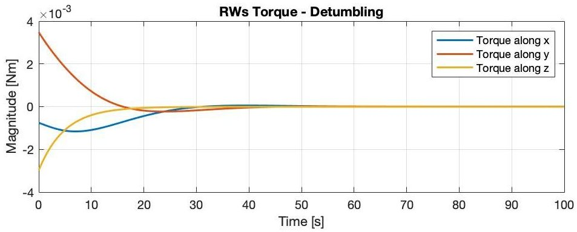

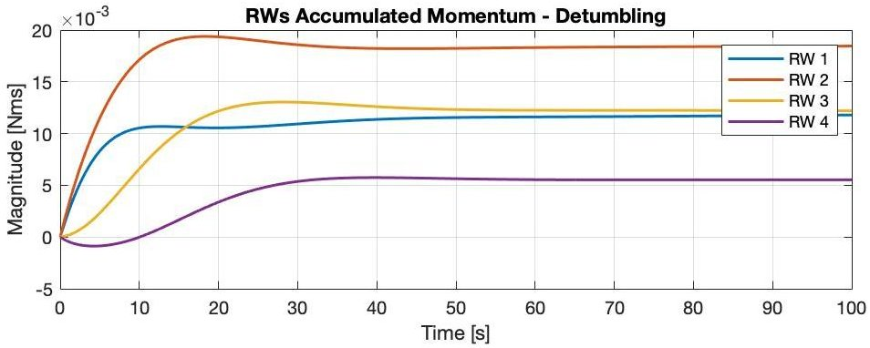

Figure 3.20: Detumbling - SSO segment

The torque required to reduce the angular velocity to zero reaches a maximum of 4 mNm for which a momentum of 20 mNms is accumulated. The task is considered to be complete after 100 seconds.

For the SSO segment, to study the torque and accumulated momentum needed to achieve and maintain the required pointing, here referred to as slew and tracking, one day, 15 orbits are analyzed and the results are reported in figure 3.21.

<!-- PDF_PAGE: 65 -->

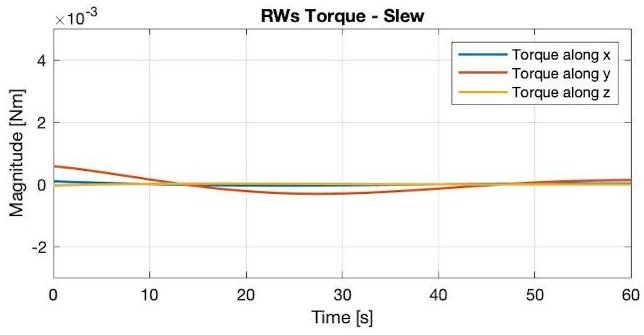

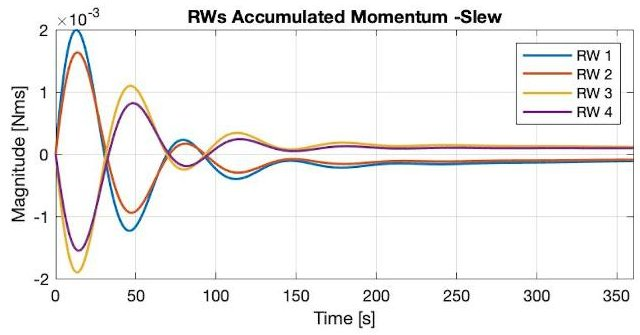

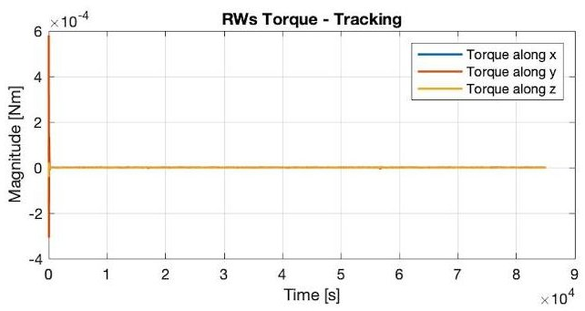

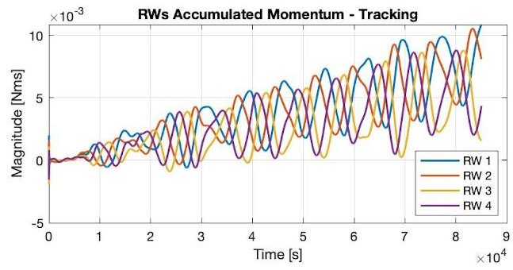

Figure 3.21: Slew and Tracking - SSO segment

The torque necessary for the slew maneuver is in the order of 1 mNm for which 2 mNms are accumulated. For the rest of the mission to balance the external disturbances, the torque required is very low, in the order of $ 1 0^{-5} $ while the accumulated momentum increases up to 10.5 mNms a day.

The momentum storage the RWs shall provide depends on how often they are desaturated. Considering the stored momentum as 30% of the maximum momentum storage a RW can provide, different storage capacities are reported for different desaturation frequencies.

<table border="1"><tr><td></td><td>Every orbit</td><td>Every 5 orbits</td><td>Every 10 orbits</td><td>Every 15 orbits(one day)</td></tr><tr><td>Momentum storage capacity[mNms]</td><td>2</td><td>13.5</td><td>23.5</td><td>35</td></tr></table>

Table 3.15: RWs momentum storage - SSO segment

For the Magnetospheric segment, the values of torque and accumulated momentum are shown for the two tasks for 8 orbits, 4 days for the circular orbit, and 2 days for the elliptical one.

<!-- PDF_PAGE: 66 -->

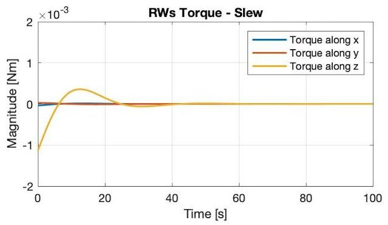

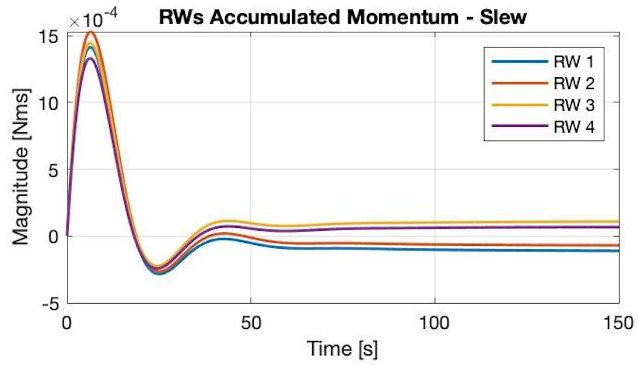

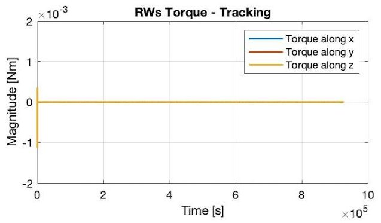

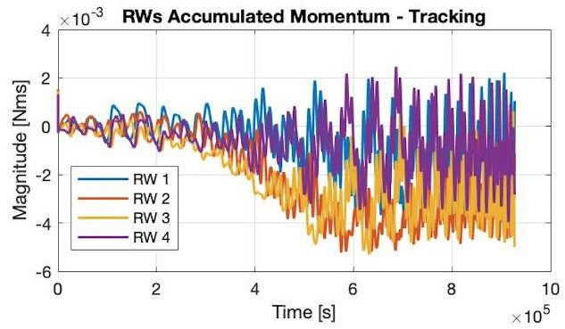

Figure 3.22: Slew and Tracking - Magnetospheric segment

The torque for the slew maneuver reaches a maximum of 1 mNms for which a momentum up to 1.5 mNms is accumulated.

During nominal operations, the accumulated momentum increases with time until it reaches a maximum of 5 mNms after 8 orbits.

Considering that the wheels are desaturated after every 8 orbit, and assuming once again the stored momentum as 30% of the maximum momentum storage a RW can provide, RWs that can store at least 16.7 mNms are needed.

## Magnetotorquers

To desaturate the RW in the Magnetospheric segment, magnetotorquers will be employed. The magnetic diplo necessary for the desaturation can be calculated as

$$
D = \frac {h}{t B}
$$

With B being the Earth's magnetic field, which, on average, amounts to $ 0. 2 * 1 0^{-4} $ T for both orbits.

The magnetic moment depends also on the time the desaturation will take. The higher the time, the lower the magnetic moment necessary to desaturate the wheels is. Selecting a magnetic moment $ 1. 1 9 \mathrm{A m}^{2} $ , in line with magnetotorquers compatible with CubeSats size available on the market, the average time to desaturate the wheels for the different frequencies shown previously can be computed and is reported in table 3.16. The results are presented considering that the desaturation will happen when the wheels are 30% saturated.

<!-- PDF_PAGE: 67 -->

<table border="1"><tr><td></td><td>Desaturation time [min]</td></tr><tr><td>Every orbit</td><td>0.42</td></tr><tr><td>Every 5 orbits</td><td>2.8</td></tr><tr><td>Every 10 orbits</td><td>4.9</td></tr><tr><td>Every 15 orbits</td><td>7.4</td></tr></table>

Table 3.16: Magnetotorquers desaturation time

According to this, desaturations are expected to be done once after the slew maneuver and then performed every 5 orbits.

This task will be very frequent for the SSO segment and it shall be performed during the science mode and in particular, before entering the SK, telecom, or protection mode if needed.

## Thrusters

To desaturate the RW in the Magnetospheric segment, thrusters will be employed. The force that the thrusters need to provide can be computed as [37]:

$$
F = \frac {h}{L t}
$$

Where h is the momentum storage capacity obtained previously, L is the arm of the moment, selected as 0.5U considering a 1U thrusters' system, and t is the burning time. The results are presented for different time values, considering that the desaturation will happen when the wheels are 30% saturated.

<table border="1"><tr><td></td><td>t=10s</td><td>t=20s</td><td>t=30s</td><td>t=40s</td></tr><tr><td>Force[mN]</td><td>11.1</td><td>5.6</td><td>3.7</td><td>2.8</td></tr></table>

Table 3.17: Thrusters force

The total impulse can be calculated as [37]:

$$
I _ {T O T} = n r. o f d e s a t u r a t i o n s * F * t
$$

The number of desaturations needs to be estimated. Considering that desaturations will be performed every 8 orbits, for a 2 years mission, considering an additional desaturation after the slew maneuver, the value amounts to 48 desaturations for the circular orbit, and 70 for the elliptical one. The values are computed considering that the wheels will be desaturated when 30% of the maximum momentum is reached.

<!-- PDF_PAGE: 68 -->

At this point, the total impulse can be computed. Considering a 100% margin on the number of desaturations, it amounts to 9.6 Ns for the circular orbit and to 14 Ns for the elliptical orbit. The thrusters shall also deorbit the space segment, therefore additional propellant shall be accounted for.

For the Magnetospheric segment, the desaturation is less common and is delegated to happen during the science mode.

## Requirements

According to the design just performed, different design requirements can be obtained.

<table border="1"><tr><td>ID</td><td>Requirement</td></tr><tr><td>S&amp;M-AOCS-1</td><td>The AOCS shall perform a 3-axis control</td></tr><tr><td>S&amp;M-AOCS-3</td><td>The AOCS shall provide the a pointing accuracy of $ 1^{\circ} $</td></tr><tr><td>S&amp;M-AOCS-3</td><td>The space segment shall be equipped with sun sensors</td></tr><tr><td>S&amp;M-AOCS-4</td><td>The space segment shall be equipped with IMU</td></tr><tr><td>SSO-AOCS-5</td><td>The space segment shall be equipped with a magnetometer</td></tr><tr><td>SSO-AOCS-6</td><td>The space segment shall be equipped with magnetotorquers</td></tr><tr><td>MAG-AOCS-5</td><td>The space segment shall be equipped with star trackers</td></tr><tr><td>MAG-AOCS-6</td><td>The space segment shall be equipped with thrusters</td></tr><tr><td>SSO-AOCS-7</td><td>Desaturations shall be performed every 5 orbits during science mode</td></tr><tr><td>MAG-AOCS-7</td><td>Desaturations shall be performed every 8 orbits during science mode</td></tr><tr><td>MAG-AOCS-8</td><td>The thrusters shall deorbit the space segment</td></tr></table>

Table 3.18: AOCS requirements

## Reference components

## Sensors

For both segments, as reference for the mass and power budgets, the 2-axis fine analogue NanoSSC sun sensor from SOLAR MEMS [53] and the STIM300 IMU by Safran [51] are considered. Their characteristics are reported in tables 3.19 and 3.20 respectively.

<!-- PDF_PAGE: 69 -->

3| Space segments design

<table border="1"><tr><td></td><td>Sun sensor</td></tr><tr><td>FOV[°]</td><td>±60</td></tr><tr><td>Accuracy</td><td>&lt;0.5°(3σ)&lt;0.1°(precision)</td></tr><tr><td>Power supply[W]</td><td>0.01</td></tr><tr><td>Dimensions[mm]</td><td>27.4x14x5.9</td></tr><tr><td>Mass[g]</td><td>4</td></tr><tr><td>Radiation[krad]</td><td>&gt;100(gamma)300(proton)</td></tr><tr><td>OperatingTemperature[℃]</td><td>-30 to+85</td></tr><tr><td>TRL</td><td>Space qualified</td></tr></table>

Table 3.19: Sun sensor

<table border="1"><tr><td></td><td>IMU</td></tr><tr><td>Bias instability</td><td>Gyro:0.3°/hAccelerometer:0.02mg</td></tr><tr><td>Noise</td><td>Gyro:0.15°/√hAccelerometer:0.03m/s/√h</td></tr><tr><td>Power[W]</td><td>2</td></tr><tr><td>Mass[g]</td><td>55</td></tr><tr><td>Dimensions[mm]</td><td>44.8x38.6x21.5</td></tr><tr><td>Operating temperature[℃]</td><td>-40 to +85</td></tr><tr><td>Data interface</td><td>RS422</td></tr></table>

Table 3.20: IMU

For the SSO segment the AAC Clyde space MAG-3, 3-axis magnetometer [1] is used as reference and for the Magnetospheric segment the ST200 from AAC Clyde space [2] is considered as reference for the star tracker. Their characteristics are reported in tables 3.21 and 3.22 respectively.

<table border="1"><tr><td></td><td>Magnetometer</td></tr><tr><td>Orthogonality[°]</td><td>$\pm1$</td></tr><tr><td>Noise density</td><td>12pTRMS/$\sqrt{Hz}$@1Hz</td></tr><tr><td>Dimensions[mm]</td><td>35.1x32.2x82.6</td></tr><tr><td>Mass[g]</td><td>100</td></tr><tr><td>Operating temperature[℃]</td><td>-50 to+85</td></tr><tr><td>Power supply[W]</td><td>1</td></tr><tr><td>Radiation[krad]</td><td>&gt;10</td></tr></table>

Table 3.21: Magnetometer

<table border="1"><tr><td></td><td>Star tracker</td></tr><tr><td>Accuracy</td><td>Pitch,yaw:30 arcsecRoll:200 arcsec</td></tr><tr><td>Max slew rate[°/s]</td><td>0.3</td></tr><tr><td>Update rate[Hz]</td><td>5</td></tr><tr><td>FOV[°]</td><td>-</td></tr><tr><td>Sun exclusionangle[°]</td><td>30/45(baffle optional)</td></tr><tr><td>Dimensions[mm]</td><td>29x29x38.1</td></tr><tr><td>Mass[g]</td><td>42</td></tr><tr><td>OperatingTemperature[℃]</td><td>-20 to+40</td></tr><tr><td>Peak power[mW]</td><td>600</td></tr><tr><td>Data interface</td><td>UART/RS422</td></tr></table>

Table 3.22: Star tracker

<!-- PDF_PAGE: 70 -->

The GOM space GPS kit [23] is used as reference for the SSO segment for the mass and power budget of the GPS antenna and receiver. Their characteristics are reported in tables 3.23 and 3.24 respectively.

<table border="1"><tr><td></td><td>GPS antenna</td></tr><tr><td>Gain[dB]</td><td>4.5</td></tr><tr><td>Dimensions[mm]</td><td>Diam.35x7.25</td></tr><tr><td>Mass[g]</td><td>50</td></tr><tr><td>Operating temperature[℃]</td><td>-40 to +85</td></tr></table>

Table 3.23: GPS antenna

<table border="1"><tr><td></td><td>GPS receiver</td></tr><tr><td>Signals</td><td>GNSS</td></tr><tr><td>Power[W]</td><td>GPS L1:0.9GLONASS:1.3All:1.8</td></tr><tr><td>Dimensions[mm]</td><td>46x71x11</td></tr><tr><td>Mass[g]</td><td>31</td></tr><tr><td>Operating temperature[℃]</td><td>-40 to +85</td></tr><tr><td>Data interface</td><td>CAN</td></tr></table>

Table 3.24: GPS receiver

## Actuators

For both segments, The 4-wheel system by Nanoavionics [44] is selected as reference for the mass and power budget. Their characteristics are reported in table 3.25

<table border="1"><tr><td></td><td>Reaction wheels</td></tr><tr><td>Max Torque[mNm]</td><td>Along x:5.9
Along y:5.9
Along z:2.5(5 if all RW used)</td></tr><tr><td>Max Moment[mNms]</td><td>Along x:37
Along y:37
Along z:15.6(31.1 if all RW used)</td></tr><tr><td>Power[W]</td><td>Peak:6
Nominal:0.6</td></tr><tr><td>Dimensions[mm]</td><td>92.5x92.5x51.3</td></tr><tr><td>Mass[g]</td><td>665</td></tr><tr><td>Operating temperature[℃]</td><td>-40 to+85</td></tr><tr><td>Data interface</td><td>SPI/UART</td></tr></table>

Table 3.25: Reaction wheels

For the SSO segment, The Manetotorquer rod by Newspacesystem [47] is selected as refer-

<!-- PDF_PAGE: 71 -->

ence for the power and mass budgets. The values reported in table 3.26 are intended for a 3-axis magnetotorquer board composed of two rods and an air coil for control along the third direction.

<table border="1"><tr><td></td><td>Magnetotorquer</td></tr><tr><td>Magnetic moment $[Am^{2}]$</td><td>X,Y axis:1.19</td></tr><tr><td>Power[W]</td><td>2</td></tr><tr><td>Dimensions[mm]</td><td>94x94x13</td></tr><tr><td>Mass[g]</td><td>156</td></tr><tr><td>Operating temperature[℃]</td><td>-20 to+60</td></tr></table>

Table 3.26: Magnetotorquer

For the Magnetospheric mission thrusters, the 36mm height version of the VACCO Cold Gas Standard propulsion system proposed as a propulsor for the SSO segment [59] is used as reference for the mass and power budget.

## AOCS in Capella

The functions relative to the AOCS are reported in the figure below.

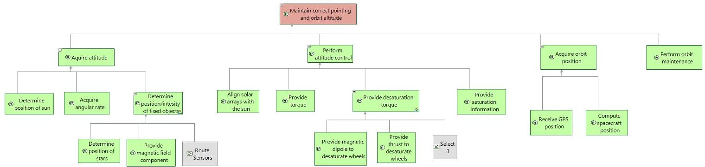

Figure 3.23: [PFBD] AOCS functions

At the logical level, the AOCS system is composed of two Logical Components, the sensors and the actuators [Fig. 3.25].

As previously done, Functional Chains are employed to describe specific logical sequences of functions. The "Compensate for external disturbances" has two inputs, the external disturbances from the environment and the recognition of fixed objects' position by the sensors. The OBDH can then determine the attitude and the torque necessary to maintain the attitude. The information is passed to the actuators that apply the correct torque to the spacecraft. In the SSO Segment case, the position of the spacecraft can be computed more accurately by the

<!-- PDF_PAGE: 72 -->

GPS antenna and receiver. The second functional chain "Actuators desaturation", shows the involved functions in the desaturation of the actuators.

At the physical level, to comply with the design requirements, Node Physical Components and the relative Behavior Physical Components to which the functions are allocated, are realized for each sensor and actuator.

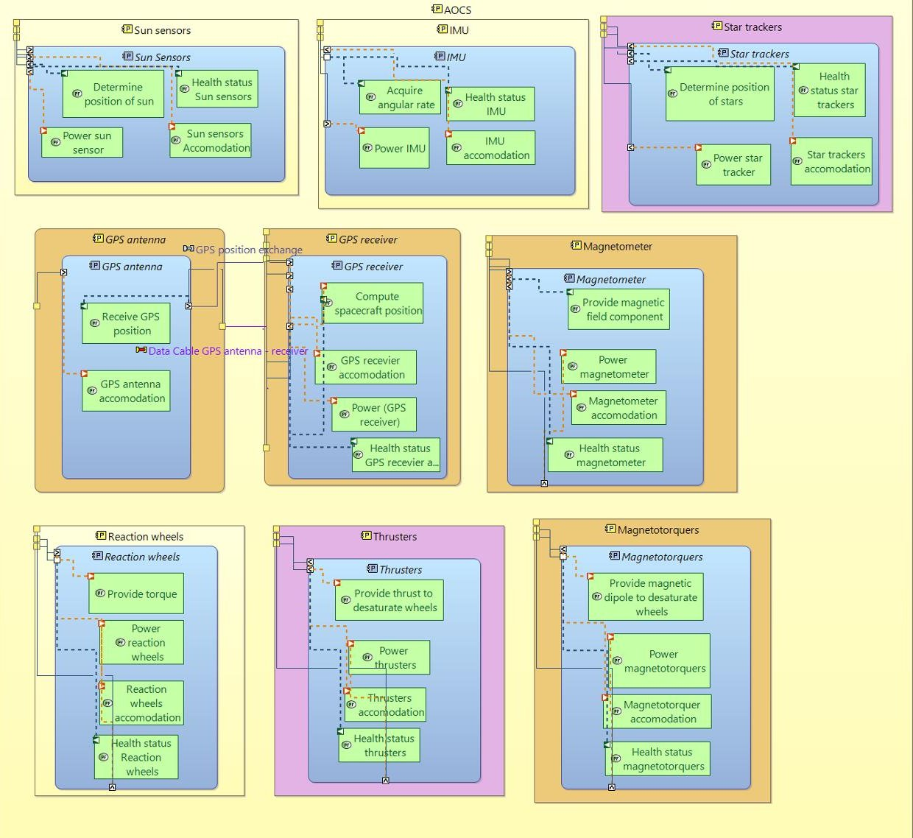

Figure 3.24: [PAB] AOCS

<!-- PDF_PAGE: 73 -->

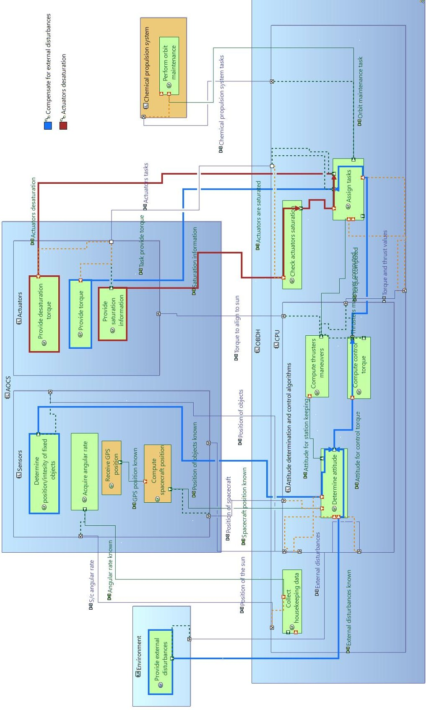

Figure 3.25: [LAB] AOCS

<!-- PDF_PAGE: 74 -->

## 3.3.5. EPS

## EPS sizing

The EPS is responsible for distributing controlled energy to all the subsystems. There are two kinds of energy sources, primary and secondary. The most widely used primary power sources include primary batteries, solar arrays, and RTGs. Given the mission lifetime and power required, primary batteries are not an option. Given the size of CubeSats RTGs are excluded as well. Solar arrays are therefore employed as a primary energy source. The most common secondary energy sources include secondary batteries that are employed on both platforms to provide power during eclipse periods and early in-orbit operations when the deployable solar arrays are still folded.

## Eclipse and Daylight time

Before sizing the different power sources, the time the satellites spend in eclipse and daylight needs to be calculated for the two segments.

## SSO segment

The eclipse time can be calculated as the product between the period and the eclipse fraction which is calculated as [39]:

$$
f _ {e} = \frac {1}{1 8 0 ^ {\circ}} \arccos \left(\frac {\sqrt {h ^ {2} + 2 R _ {E} h}}{(R _ {E} + h) \cos \beta}\right)
$$

Where beta is the orbital angle, the angle between the solar vector and its projection onto the orbital plane. Its value changes through the year due to orbital perturbations and the seasonal variation of the solar declination and right ascension, therefore a median annual value has been used in the calculations [33].

The daylight time is computed as the difference between the period and the eclipse time.

The result for the two orbits is reported in the table below

<table border="1"><tr><td></td><td>$T_{e}[\mathrm{h}]$</td><td>$T_{d}[\mathrm{h}]$</td></tr><tr><td>500kmSSO</td><td>0.5949</td><td>0.9796</td></tr><tr><td>800kmSSO</td><td>0.5845</td><td>1.0942</td></tr></table>

Table 3.27: Eclipse and Daylight time - SSO segment

## Magnetospheric segment

Concerning the circular magnetospheric orbit, a different approach is considered. As previously mentioned, due to the nature of the orbit, the eclipse time is expected to be restricted

<!-- PDF_PAGE: 75 -->

to the months of March and September. For the calculations, the shadow of the Earth is assumed to be cylindrical with the same diameter as Earth, and the penumbra as well as any atmospheric reflection phenomena, are neglected. The eclipse time is calculated as [30]:

$$
\left\{ \begin{array}{l l} T _ {e} = T \frac {\theta_ {e}}{3 6 0 ^ {\circ}} & \mathrm {i f} r < R _ {E} \csc \left(i _ {\odot}\right) \\ T _ {e} = 0 & \mathrm {i f} r > R _ {E} \csc \left(i _ {\odot}\right) \end{array} \right.
$$

with $ \theta_{e}=2(1 8 0^{\circ}-\theta) $ and theta computed as

$$
\theta = \pm \sqrt {\frac {1 - \left(\frac {R _ {E}}{r}\right) ^ {2}}{\cos i _ {\odot}}}
$$

Where $ i_{\odot} $ is the inclination of the sun to the orbital plane which is calculated from the inclination and RAAN of the orbit, and right ascension and declination of the sun. The last three parameters change throughout the year; therefore, the eclipse condition is not constant.

According to the results, the segment is in eclipse for a relevant fraction of its period from March $ 2 0^{th} $ to March $ 2 5^{th} $ and from September $ 1 7^{th} $ to September $ 2 2^{nd} $ , for a maximum of 1.4465 hours during the Autumn equinox. Hence the daylight time is always 47.269 hours aside from those periods of time in which it decreases to a minimum of 45.8225 hours.

Regarding the elliptical orbit, a similar approach with respect to the magnetospheric circular orbit is adopted. The assumptions of the previous case on the shadow shape are still valid, therefore similar results as the case above are expected. The eclipse time is calculated by exploiting the time law, in particular, [31]:

$$
\left\{ \begin{array}{l l} T _ {e} = t _ {0} + \frac {M _ {f} - M _ {i}}{n} & \mathrm {i f} r < R _ {E} \csc \left(i _ {\odot}\right) \\ T _ {e} = 0 & \mathrm {i f} r > R _ {E} \csc \left(i _ {\odot}\right) \end{array} \right.
$$

Where n is the mean motion, $ t_{0} $ is the time of perigee passage and $ M_{i}, M_{0} $ are the mean anomalies when the satellite enters and leaves the shadow area. To calculate the latter, Kepler's equation is solved.

According to the results, the segment is in eclipse for a relevant fraction of its period from March $ 2 0^{th} $ to March $ 2 6^{th} $ and from September $ 1 5^{th} $ to September $ 2 1^{st} $ , for a maximum of 1.7169 hours in case the eclipse happens when the satellite is at apogee. Hence the daylight time is always 32.1874 hours aside from those periods of time in which it decreases to a minimum of 30.9088 hours.

<!-- PDF_PAGE: 76 -->

## EPS modes

The following modes are defined, in compliance with the TMTC and the AOCS.

- Early in orbit mode: during this mode, the batteries will power the AOCS to detumble the satellite and orient the spacecraft towards the sun, the deployment mechanism of the solar arrays and the deployment mechanism of the UHF antenna.

- Science mode: during this mode, the active components are the payloads, the OBDH, the entire ADCS, and the GPS for the SSO segment.

- Telecom mode: during this mode, the active components are the S-band antenna and transceiver, the OBDH, and the attitude and control portion of the ADCS.

- Maneuvering mode: this mode is exclusive to the SSO segment and will be used for both the SK and decommissioning activities. The active components are the propulsion system, the OBDH, and the attitude and control portion of the ADCS.

- Transfer mode: this mode is exclusive to the Magnetospheric segment and will be activated during the transfer maneuver to the nominal orbit. The active components are the propulsion system, the OBDH, and the attitude and control portion of the ADCS.

- Decommissioning mode: this mode is exclusive to the Magnetospheric segment and will be activated during the decommissioning maneuvers. The active components are the propulsion system, the OBDH, and the attitude and control portion of the ADCS.

- Protection mode: this mode is exclusive to the SSO segment and will be activated when the spacecraft crosses over the SAA; the active systems at that time will be put on standby.

- Safe mode: depending on which is the reason for entering it, different subsystems could be active. If possible, the priority is to provide power to the antennas to communicate the problem.

## SSO segment sizing

One of the fundamental parameters for the sizing of the EPS system is the power budget.

In table 3.28, the power required by each subsystem is reported. The equipment level margin is set to 10% as the components used as reference fall under the category Product C [17]; the system level margin is set to 20% to cover the "unknown unknowns" [17]. For the payloads, only the plasma analyzer is considered in the budget, but the EPS will be sized so that enough power is available also for the other two. The plasma analyzer power consumption is 5W, according to its requirements, to which a 25% margin is applied at the equipment level; the same system level margin is applied.

<!-- PDF_PAGE: 77 -->

<table border="1"><tr><td colspan="2">Subsystems</td><td colspan="2">Power[W]w/o margin</td><td>EquipmentMargin[%]</td><td>Power[W]w/ margin</td></tr><tr><td colspan="2">Plasma analyzer</td><td colspan="2">5</td><td>25</td><td>6.25</td></tr><tr><td colspan="2">Propulsion system</td><td colspan="2">12</td><td>10</td><td>13.2</td></tr><tr><td rowspan="2">TMTC</td><td>S-band</td><td colspan="2">15</td><td>10</td><td>16.5</td></tr><tr><td>UHF-band</td><td colspan="2">4.5</td><td>10</td><td>4.95</td></tr><tr><td rowspan="7">ADCS</td><td rowspan="3">Determination</td><td>Sun Sensors</td><td>0.05</td><td>10</td><td>0.055</td></tr><tr><td>Magnetometer</td><td>1</td><td>10</td><td>1.1</td></tr><tr><td>IMU</td><td>2</td><td>10</td><td>2.2</td></tr><tr><td>Control</td><td>RWs</td><td>6</td><td>10</td><td>6.6</td></tr><tr><td>Desaturation</td><td>Magnetotorquers</td><td>2</td><td>10</td><td>2.2</td></tr><tr><td>GPS</td><td colspan="2">1.8</td><td>10</td><td>1.98</td></tr><tr><td colspan="2">OBDH</td><td colspan="2">1</td><td>10</td><td>1.1</td></tr><tr><td colspan="2">Mechanisms</td><td colspan="2">5</td><td>10</td><td>5.5</td></tr></table>

Table 3.28: Power budget - SSO segment

The power budget is determined for each EPS mode considering a 20% system margin [17]. Considering the frequent light/dark cycles of such orbits, the different modes can be activated in both the daylight and eclipse parts of the orbit. The values are slightly different in the two cases due to the sun sensors not being active in the second case; the power required in daylight is therefore reported as it represents the worst-case scenario.

<table border="1"><tr><td>EPS mode</td><td>Active Subsystems</td><td>Power [W] w/o margin</td><td>Power [W] w/ system margin(20%)</td></tr><tr><td>Early in orbit</td><td>OBDH+ADCS$_{Tot}$+ Mechanisms+GPS+TMTC(UHF)</td><td>25.7</td><td>30.8</td></tr><tr><td>Science</td><td>PA+OBDH+ADCS$_{Tot}$+GPS</td><td>21.5</td><td>25.8</td></tr><tr><td>Telecom</td><td>TMTC(S-band)+ADCS$_{Det&amp;Cont}$+OBDH</td><td>27.6</td><td>33</td></tr><tr><td>Maneuver</td><td>PS+ADCS$_{Det&amp;Cont}$+OBDH</td><td>24.3</td><td>29.1</td></tr></table>

Table 3.29: Modes power budget - SSO segment

Both the batteries and the solar arrays will be sized considering the power demand of the telecom mode, as it is the most demanding one.

<!-- PDF_PAGE: 78 -->

Secondary power source sizing

To size the batteries the relevant parameter is the capacity which is calculated as [35]:

$$
C _ {r} = \frac {P _ {e} T _ {e}}{(D O D) \eta}
$$

Where DOD represented the depth of discharge, selected as 30% for the SSO segment as it goes through many light-dark cycles; $ \eta $ , the efficiency of the batteries, is set as 95%; $ \mathrm{P}_{e} $ is the power in eclipse, and $ \mathrm{T}_{e} $ the time in eclipse.

The capacity amounts to 68.9 Wh for the 500 km orbit and 67.7 Wh for the 800 km one. The value is in line with the Li-ion batteries available on the market.

The power required to charge the batteries is computed as the DOD times the capacity divided by the daylight time of each orbit.

It amounts to 21 W for the 500 km orbit and 18.6 W for the 800 km one.

Assuming that the early in-orbit operations require less than 2 hours, the batteries are sufficient to cover also those operations.

Primary power source sizing

The total power required by the solar arrays can be computed as [35]:

$$
P _ {S A} = \frac {\frac {P _ {e} T e}{X _ {e}} + \frac {P _ {d} T d}{X _ {d}}}{T _ {d}}
$$

In which $ X_{e} $ and $ X_{d} $ represent the efficiency factor in eclipse and daylight respectively and depend on the power control architecture employed. The PPT is considered for the SSO segment as it is the best option for the many daylight/eclipse cycles it goes through; the values are equal to 0.6 and 0.8 for eclipse and daylight respectively. $ P_{e} $ and $ P_{d} $ represent respectively the average eclipse and sunlit load. To the second the power to recharge the batteries is added.

The results are 101 W for the 500 km orbit and 93.8 W for the 800 km orbit.

The power that the solar arrays can provide can be computed as

$$
P = A _ {S A} * P _ {E O L}
$$

And it must be at least equal to the required one.

The power at the End Of Life (EOL) can be calculated from the power at the Beginning of life (BOL) taking into account the degradation factor. The power at the Beginning Of Life

<!-- PDF_PAGE: 79 -->

(BOL) instead depends on the specific power at 1AU which depends on the solar cells' efficiency. The Triple junction cells are taken into consideration as they are a well-established technology with high TRL and hundreds of missions. In particular, the 32.2% XTE-SF (Standard Fluence) Space Qualified Triple Junction Solar Cell by Spectrolab [54] which can provide 27.9% efficiency at the EOL is taken as reference.

Another important aspect is the solar arrays degradation due to the space environment which is quantified by the degradation factor and the inherent degradation factor. The first accounts for the cell employed and the mission lifetime; it is equal to $ (1-D)^{y} $ , with D the annual degradation factor set to 0.0375 for GaAs cells and y the mission lifetime set to 2 years. The latter accounts for the design and assembly, the temperature, and the inherent losses of the arrays and is set equal to 0.87 [35].

The power produced depends also on the sun incidence angle, whose value depends highly on the different orbits' parameters, the position of the sun, and the orientation of the solar panels. Given its dependence on the angle, the power is not constant during the orbit. It has a maximum in correspondence of theta equal to 0 and then decreases until it reaches zero when theta is equal to 90.

To provide the required power, $ 6 0 0 \times3 0 0 \mathrm{~ m m}^{2} $ deployable solar arrays are needed, in combination with a 6U body-mounted array on the front face. This combination can provide up to 128.8 W at the EOL [Fig. 3.26].

It is reminded that two payloads are not accounted for. If their power is over 10 W, the solar arrays' size may vary as they are sized for the telecom phase. Nonetheless, as it is, the solar arrays already produce about 30 more watts than required.

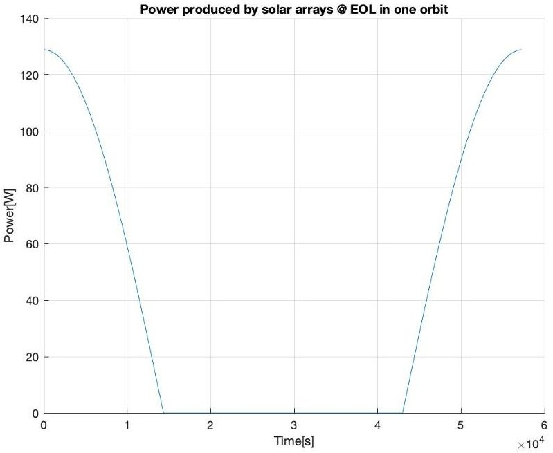

Figure 3.26: Arrays power - SSO segment

<!-- PDF_PAGE: 80 -->

## Magnetospheric segment sizing

The power budget for the magnetospheric segment is reported below. The same considerations done for the SSO segment about the margins and the payloads are valid also in this case.

<table border="1"><tr><td colspan="2">Subsystems</td><td colspan="2">Power[W]w/o margin</td><td>EquipmentMargin[%]</td><td>Power[W]w/ margin</td></tr><tr><td colspan="2">Plasma analyzer</td><td colspan="2">5</td><td>25</td><td>6.25</td></tr><tr><td colspan="2">Propulsion system</td><td colspan="2">75</td><td>10</td><td>82.5</td></tr><tr><td rowspan="2">TMTC</td><td>S-band</td><td colspan="2">15</td><td>10</td><td>16.5</td></tr><tr><td>UHF-band</td><td colspan="2">4.5</td><td>10</td><td>4.95</td></tr><tr><td rowspan="5">ADCS</td><td rowspan="3">Determination</td><td>Sun Sensors</td><td>0.05</td><td>10</td><td>0.055</td></tr><tr><td>Star Trackers</td><td>1.2</td><td>10</td><td>1.32</td></tr><tr><td>IMU</td><td>2</td><td>10</td><td>2.2</td></tr><tr><td>Control</td><td>RWs</td><td>6</td><td>10</td><td>6.6</td></tr><tr><td>Desaturation</td><td>Thrusters</td><td>12</td><td>10</td><td>13.2</td></tr><tr><td colspan="2">OBDH</td><td colspan="2">1</td><td>10</td><td>1.1</td></tr><tr><td colspan="2">Mechanisms</td><td colspan="2">5</td><td>10</td><td>5.5</td></tr></table>

Table 3.30: Power budget - Magnetospheric segment

The following power budget for each mode is obtained.

<table border="1"><tr><td>EPS mode</td><td>Active Subsystems</td><td>Power [W] w/o margin</td><td>Power [W] w/ system margin(20%)</td></tr><tr><td>Early in orbit</td><td>OBDH+ADCS$_{Tot}$+Mechanisms+TMTC(UHF)</td><td>34.9</td><td>41.2</td></tr><tr><td>Science</td><td>PA+OBDH+ADCS$_{Tot}$</td><td>30.7</td><td>36.9</td></tr><tr><td>Telecom</td><td>TMTC(S-band)+ADCS$_{Det&amp;Cont}$+OBDH</td><td>27.8</td><td>33.3</td></tr><tr><td>Transfer</td><td>PS+ADCS$_{Det&amp;Cont}$+OBDH</td><td>93.8</td><td>112.5</td></tr><tr><td>Decommissioning</td><td>Thrusters+ADCS$_{Det&amp;Cont}$+OBDH</td><td>24.5</td><td>29.4</td></tr></table>

Table 3.31: Modes power budget - Magnetospheric segment

Considering the power demand and the sporadic eclipse periods, the transfer phase shall be performed in daylight, while the others can be activated also during the eclipse period.

<!-- PDF_PAGE: 81 -->

The batteries are sized according to the average eclipse load of the science mode, making sure that the capacity obtained satisfies also the early-in-orbit mode needs. The solar arrays instead are sized according to the transfer mode.

## Secondary power source sizing

Following the same procedure as the SSO segment, the batteries can be sized.

For the circular orbit, the capacity amounts to 70.2 Wh and which requires 1.3 W to be recharged. For the elliptical orbit, the capacity amounts to 83.4 Wh and which requires 2.2 W to be recharged.

Assuming that the early in-orbit operations require less than 2 hours, the batteries are sufficient to cover also those operations.

## Primary power source sizing

Following the same procedure as the SSO segment, the solar arrays can be sized. In this case, the DET power control architecture is considered and the efficiency factors are 0.65 for eclipse and 0.85 for daylight.

Considering the same solar cells as the previous case, which are qualified up to GEO orbits, the power required by the arrays amounts to 135.6 W for the circular orbit and 138.2 W for the elliptical one.

This means that 800x300 $ mm^{2} $ deployable solar arrays in combination with a 6U body-mounted one are needed, as they can provide up to 165.6 W at the EOL [Fig. 3.27].

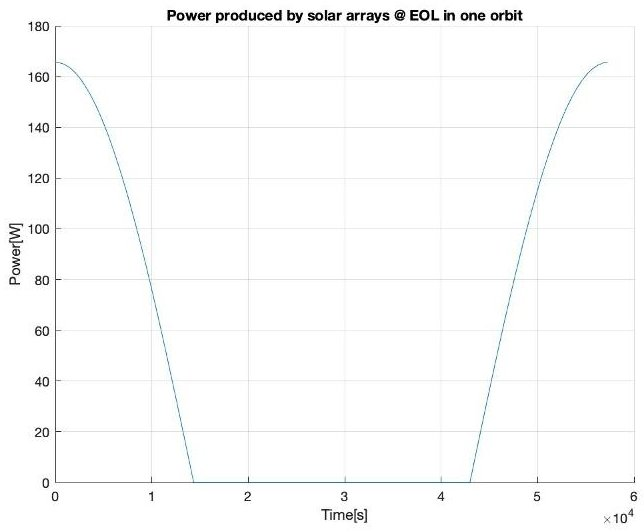

Figure 3.27: Arrays power - Magnetospheric segment

In this case, the payload's additional power is not a constraint, as the difference between the power demand in the science mode and the transfer mode for which the arrays are sized is about 70W.

<!-- PDF_PAGE: 82 -->

## Requirements

According to the design just performed, different design requirements can be obtained.

<table border="1"><tr><td>ID</td><td>Requirement</td></tr><tr><td>S&amp;M-EPS-1</td><td>The primary energy source shall be solar arrays</td></tr><tr><td>S&amp;M-EPS-2</td><td>The secondary energy source shall be secondary batteries</td></tr><tr><td>SSO-EPS-3</td><td>The batteries shall provide at least 68.9 Wh</td></tr><tr><td>SSO-EPS-4</td><td>The solar arrays shall have an area of at least 0.42m3</td></tr><tr><td>MAG-EPS-3</td><td>The batteries shall provide at least 83.4Wh</td></tr><tr><td>MAG-EPS-4</td><td>The solar arrays shall have an area of at least 0.54m3</td></tr></table>

Table 3.32: EPS requirements

## Reference components

For the PDCU and batteries, the OrbAstro EPS [49] for the SSO segment and the MicroEPS by DHV [58] for the Magnetospheric segment, are taken as references for the power and mass budgets.

<table border="1"><tr><td></td><td>SSO segment EPS</td><td>Magnetospheric segment EPS</td></tr><tr><td>Batteries[Wh]</td><td>72</td><td>150</td></tr><tr><td>Operating Temperature[℃]</td><td>-30 to +60</td><td>-40 to 85</td></tr><tr><td>Dimensions[U]</td><td>0.7</td><td>0.8</td></tr><tr><td>Mass[g]</td><td>1100</td><td>760</td></tr><tr><td>Data interface</td><td>-</td><td>I2C</td></tr></table>

Table 3.33: PCDU and batteries

Regarding the solar arrays, the NanoPower TSP 2030-3P by GOMspace [24] is selected as reference for the deployable arrays, while the 6U solar panel by Endurosat [14] is selected for the body-mounted array. According to the first, the mass of the solar arrays amounts to 1.5 kg for the SSO segment and to 2 kg for the Magnetospheric one. The body-mounted solar array's mass is considered to be 390 g.

<!-- PDF_PAGE: 83 -->

## EPS in Capella

The functions relative to the EPS are reported in the figure below.

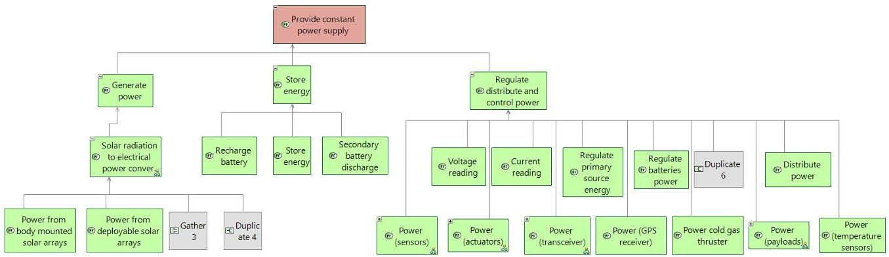

Figure 3.28: [PFBD] EPS functions

At the logical level, the electrical power subsystem is composed of four different Logical Components, the power generation, the energy storage, the power distribution and control, and the power distribution [Fig. 3.29]. Three different Functional Chains are present in this diagram. The first, "Solar arrays deployment", starts with the flip of the kill switch mechanism that turns on the EPS. The secondary batteries are discharged and the power is distributed to the OBDH that after a series of checks, gives the command to deploy the solar arrays. The second functional chain, "Solar arrays positioning", starts with the AOCS determining the position of the spacecraft so that the correct maneuver to align the solar arrays with the sun can be computed by the OBDH and communicated to the actuators. Note that this functional chain doesn't directly involve the EPS, but is reported here nonetheless because of its relevance. The third one, the "Solar arrays power distribution" functional chain, starts with the solar radiation generated by the environment that the primary energy source converts into electric power and distributes to the batteries and to the different subsystems.

<!-- PDF_PAGE: 84 -->

Figure 3.29: [LAB] EPS

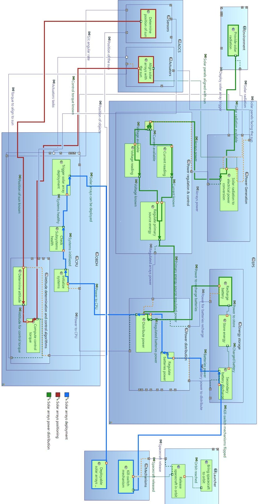

<!-- PDF_PAGE: 85 -->

At the physical level, it is composed of 6 different Node physical components corresponding to the different components of the subsystem. In figure 3.30 the Physical Links between them can be seen. This time in red as they represent power cables.

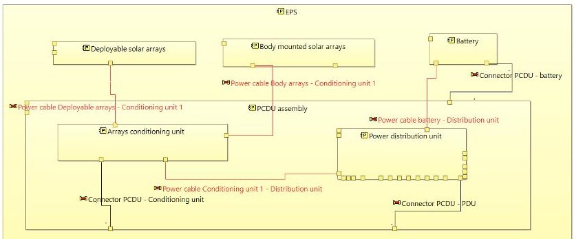

Figure 3.30: [PAB] EPS

Also in this case, the scenario diagram comes in handy to highlight the different functions that are active during the eclipse and daylight periods.

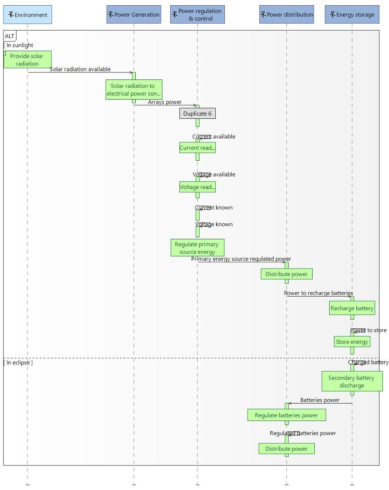

Figure 3.31: [LES] EPS

<!-- PDF_PAGE: 86 -->

## 3.3.6. TCS

## TCS sizing

The thermal control system is in charge of keeping the different systems in their operative temperature range. The spacecraft during its orbit is subjected to external heat sources, that coupled with the internal ones can make the temperature exit the operative range. To assure that this doesn't happen, some form of thermal control might need to be implemented.

Two different forms of control exist, active or passive. Active thermal control includes the use of heaters, heat pipes, heat exchangers, and any device that actively keeps the temperature within the acceptable range. Those are usually more complex and expensive than passive control methods that include among others, particular surface finishes, radiators, and insulation systems.

A multi-nodal analysis is performed in order to understand if and what kind of thermal control the two platforms need.

## Thermal Analysis

In the analysis, steady-state conditions are considered. This implies that the heat generated inside the spacecraft, plus the heat coming from the outside, minus the heat expelled towards deep space must equal zero.

$$
Q _ {i n t e r n a l} + Q _ {e x t e r n a l} - Q _ {e m i t t e d} = 0
$$

The external sources of heat for an Earth-orbiting mission like this are the sun in the form of direct solar flux and albedo, solar radiation reflected by the planet, and the Earth's natural infrared emission [Fig. 3.32].

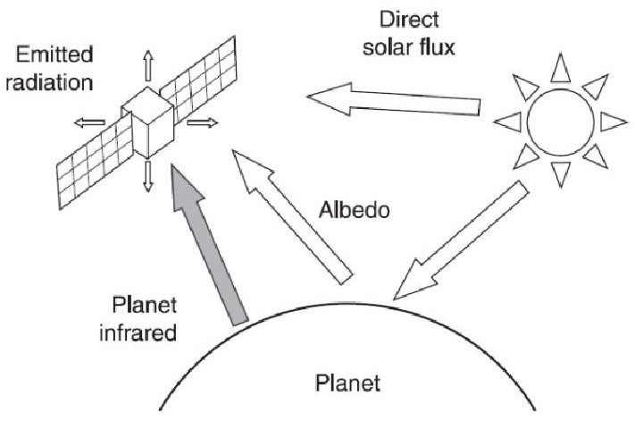

Figure 3.32: External heat sources [40]

<!-- PDF_PAGE: 87 -->

To perform the analysis, two different cases are identified, the hot case and the cold case.

For the hot case, the input heat includes the Sun and Earth's infrared contribution.

$$
Q _ {i n t e r n a l} + Q _ {s u n} + Q _ {a l b e d o} + Q _ {I R} - Q _ {e m i t t e d} = 0
$$

For the cold case, the only input heat is the infrared one.

$$
Q _ {i n t e r n a l} + Q _ {I R} - Q _ {e m i t t e d} = 0
$$

## Internally dissipated power

Firstly, the worst hot case (WHC) and the worst cold case (WCC) scenarios are identified for the two segments according to the EPS modes defined and the orbits' characteristics. This allows deriving the internally dissipated power.

For the SSO segment, the WHC is represented by the telecom mode performed in daylight while the WCC is the science mode performed in eclipse conditions.

For the Magnetospheric segment, different conditions will be explored. The transfer phase represents the worst hot case, but the satellite will be in it for a limited amount of time. As previously stated, it will be performed in sunlight conditions, therefore all the external fluxes will be considered in the analysis. For the rest of its life, the spacecraft will have to deal with the telecom mode in daylight as the WHC and the science mode in eclipse as the WCC.

Regarding the internal heat, the power dissipation of the different subsystems needs to be estimated. It is considered that 90% of the power generated by the subsystems present in the spacecraft is dissipated. The only exception is the electric propulsor for which the power dissipated value is present in the datasheet of the one taken as reference [Tab. 3.3]. The total values are reported below for the different orbits for the WHC and WCC.

<table border="1"><tr><td></td><td colspan="2">Cold case</td><td colspan="2">Hot case</td></tr><tr><td></td><td>Mode</td><td>Power [W]</td><td>Mode</td><td>Power [W]</td></tr><tr><td>SSO orbits</td><td>Pscience</td><td>23.2</td><td>Ptelecom+Precharge</td><td>500km:48.7800km:46.5</td></tr><tr><td rowspan="2">Magnetospheric orbits</td><td>Ptelecom</td><td>30</td><td>Pscience+Precharge</td><td>Circular:34.3Elliptical:35.2</td></tr><tr><td colspan="2">-</td><td>Ptransfer</td><td>43.9</td></tr></table>

Table 3.34: Internally dissipated heat

<!-- PDF_PAGE: 88 -->

## Operative temperature range

The operative temperature ranges of the different components selected as references are reported in the table below.

<table border="1"><tr><td colspan="2">Subsystems</td><td colspan="4">Operative Temperature[℃]</td></tr><tr><td colspan="2"></td><td colspan="2">SSO segment</td><td colspan="2">Magnetospheric segment</td></tr><tr><td colspan="2">Plasma analyzer</td><td colspan="2">-20 to 50</td><td colspan="2">-20 to 50</td></tr><tr><td colspan="2">Propulsion system</td><td colspan="2">-15 to 55</td><td colspan="2">-15 to 45</td></tr><tr><td rowspan="2">TMTC</td><td>S-band</td><td colspan="2">Antenna: -40 to 85Transmitter: -30 to 60</td><td colspan="2">Antenna: -40 to 85Transmitter: -30 to 60</td></tr><tr><td>UHF-band</td><td colspan="2">Antenna: -20 to 80Transmitter: -20 to 60</td><td colspan="2">Antenna: -20 to 80Transmitter: -20 to 60</td></tr><tr><td rowspan="6">ADCS</td><td rowspan="5">Determination</td><td>Sun Sensors</td><td>-30 to 85</td><td>Sun Sensors</td><td>-30 to 85</td></tr><tr><td>Magnetometer</td><td>-50 to 85</td><td>Star Trackers</td><td>-20 to 40</td></tr><tr><td>IMU</td><td>-40 to 85</td><td>IMU</td><td>-40 to 85</td></tr><tr><td>GPS</td><td>Antenna: -40 to 85Receiver: -40 to 85</td><td>GPS</td><td>-</td></tr><tr><td>Control</td><td>RWs</td><td>-40 to 85</td><td>RWs</td><td>-40 to 85</td></tr><tr><td>Desaturation</td><td>Magnetotorquers</td><td>-20 to 60</td><td>Thrusters</td><td>-15 to 55</td></tr><tr><td colspan="2">OBDH</td><td colspan="2">-20 to 70</td><td colspan="2">-20 to 70</td></tr><tr><td colspan="2">EPS</td><td>PCDU+batteries</td><td>-30 to 60</td><td>PCDU+batteries</td><td>-40 to 85</td></tr></table>

Table 3.35: Components operative temperature range

Considering the active components for the modes taken as WHC and WCC, the temperature range to assure the correct operation of the components can be set.

The SSO segment has to remain in the range $ -20^{\circ} \mathrm{C} $ to $ 60^{\circ} \mathrm{C} $ ; considering a $ 15^{\circ} \mathrm{C} $ margin [17], the range becomes $ -5^{\circ} \mathrm{C} $ to $ 45^{\circ} \mathrm{C} $ .

For the Magnetospheric segment, for the transfer mode, the range $ -15^{\circ} \mathrm{C} $ to $ 40^{\circ} \mathrm{C} $ ; for the science/telecom mode, the range is $ -20^{\circ} \mathrm{C} $ to $ 40^{\circ} \mathrm{C} $ . Considering a $ 15^{\circ} \mathrm{C} $ margin [17], the satellite has to be in the range of $ 0^{\circ} \mathrm{C} $ to $ 25^{\circ} \mathrm{C} $ in the first case and $ -5^{\circ} \mathrm{C} $ to $ 25^{\circ} \mathrm{C} $ in the second one.

## External power sources

Regarding the external power sources, they are reported hereafter. Only the parameters specific to the mission are discussed for the others consult [32].

<!-- PDF_PAGE: 89 -->

- Sun power: due to sun flux impinging on the surfaces of the spacecraft.

Different surfaces with different properties receive the solar flux, therefore two different contributions need to be considered.

In particular, for the solar arrays only the solar power that is not converted in energy needs to be dissipated. This can be computed as:

$$
Q _ {s u n - S A} = \left(1 - \epsilon_ {S A}\right) A _ {S A} q _ {s u n}
$$

The emissivity of the solar arrays, $ \epsilon_{sun} $ , is set as 0.85 [54]

For the body-mounted solar array the entire heat is considered to be dissipated by the Cubesat.

Regarding the deployable solar panels, their view factor with respect to the sides of the CubeSat is computed and it amounts to 0.0018 for the SSO segment and 0.0013 for the Magnetospheric segment. This means that a very small fraction of the heat that is not absorbed and that needs to be dissipated impacts on the spacecraft, less than 0.1 W. Therefore it is not considered in this preliminary analysis.

The top and bottom faces of the spacecraft receive solar flux as well, but unlike the previous case, the total amount that reaches the spacecraft has to be dissipated. It can be computed as

$$
Q _ {s u n - t o p b o t t o m} = q _ {s u n} A _ {t o p b o t t o m} \alpha_ {s u n} \cos \left(\theta_ {s u n}\right)
$$

The solar flux, $ q_{sun} $ , depends on the distance between the Sun and the spacecraft. It can be assumed equal to the solar flux at 1 AU, therefore $ 1367.5 \mathrm{~W / m^{2}}. $

- Albedo power: due to solar flux reflected off the planets.

It can be computed as

$$
Q _ {a l b e d o} = q _ {a l b e d o} A _ {a l b e d o} \alpha_ {a l b e d o} \cos \left(\theta_ {a l b e d o}\right)
$$

Wiht the albedo flux, $ q_{albedo} $ obtained as

$$
q _ {a l b e d o} = q _ {s u n} a \frac {R _ {E} ^ {2}}{(R _ {E} + h) ^ {2}}
$$

Considering an albedo factor, a, of 0.32, the value amounts to $ 3 7 6. 2 3 \mathrm{~ W / m^{2}} $ for the 500 km SSO, $ 3 4 5. 4 \mathrm{~ W / m^{2}} $ for the 800 km SSO, $ 4 \mathrm{~ W / m^{2}} $ for the circular magnetospheric orbit and $ 1 4. 6 8 \mathrm{~ W / m^{2}} $ for the elliptical magnetospheric orbit.

- Infrared power: natural emission of planets.

<!-- PDF_PAGE: 90 -->

It can be computed as

$$
Q _ {I R} = q _ {I R} A _ {I R} \epsilon_ {I R} \cos \left(\theta_ {I R}\right)
$$

The infrared flux $ \mathrm{q}_{IR} $ is obtained as

$$
q _ {I R} = \sigma \epsilon_ {E} T _ {E} ^ {4} \frac {R _ {E} ^ {2}}{(R _ {E} + h) ^ {2}}
$$

Selecting the planet's temperature and emissivity, $ \epsilon_{E} $ , as 255.25 K and 0.85 for Earth, the following values are obtained for the different orbits. 175.6 W/m $ ^{2} $ for the 500 km SSO, 161.2 W/m $ ^{2} $ for the 800 km SSO, 1.88 W/m $ ^{2} $ for the circular magnetospheric orbit, and 6.27 W/m $ ^{2} $ for the elliptical magnetospheric orbit.

## Multi-nodal analysis model

To perform the multi-nodal analysis, seven nodes are created, one for each panel plus one that includes all the components. The latter is envisioned as a smaller parallelepiped with dimensions $ 1 8 0 \times1 8 0 \times2 8 0 \mathrm{~ m m}^{3}. $

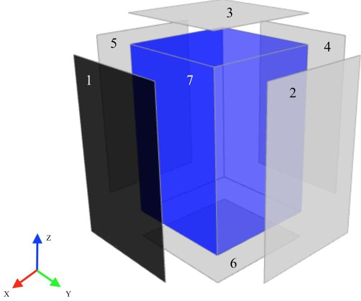

Figure 3.33: Multi-nodal analysis nodes

The power from external sources is distributed to the relative panels. In particular, the sun power is considered for panels 1,3, and 6 while the IR and the albedo are considered for panel 4 which is pointed at Earth. The panels exchange heat with the components and vice versa by radiation; the panels also dissipate the heat towards deep space, excluding the front one that hosts the solar panel.

<!-- PDF_PAGE: 91 -->

## 3| Space segments design

## SSO segment results

To keep the components in their operative range, the optical properties of coating materials reported in table 3.36 have been selected for the different nodes. In it, corresponding coating materials are also indicated according to common surface finishes [22]. For some panels, the absorptivity value is not specified as it is not relevant to the analysis performed, therefore for these, generic materials with the required properties are shown. Where the absorptivity is reported is intended to be that of the external panel.

<table border="1"><tr><td></td><td>Absorptivity</td><td colspan="2">Emissivity</td><td colspan="2">Coating material</td></tr><tr><td></td><td></td><td>Internal</td><td>External</td><td>Internal</td><td>External</td></tr><tr><td>Node1</td><td>-</td><td>0.91</td><td>0.85</td><td>Paint</td><td>Solar array</td></tr><tr><td>Node2</td><td>-</td><td>0.91</td><td>0.82</td><td>Paint</td><td>3mm aluminized Kapton</td></tr><tr><td>Node3</td><td>0.06</td><td>0.91</td><td>0.88</td><td>Paint</td><td>Paint</td></tr><tr><td>Node4</td><td>0.38</td><td>0.91</td><td>0.67</td><td>Paint</td><td>1mm aluminized Kapton</td></tr><tr><td>Node5</td><td>-</td><td>0.91</td><td>0.82</td><td>Paint</td><td>3mm aluminized Kapton</td></tr><tr><td>Node6</td><td>0.06</td><td>0.91</td><td>0.88</td><td>Paint</td><td>Paint</td></tr><tr><td>Node7</td><td>-</td><td colspan="2">0.67</td><td colspan="2">1mm aluminized Kapton</td></tr></table>

Table 3.36: Multi-nodal analysis results - SSO segment

With these values, the following temperature range is obtained for the components [Fig. 3.34] and the external panels [3.35] for 15 orbits.

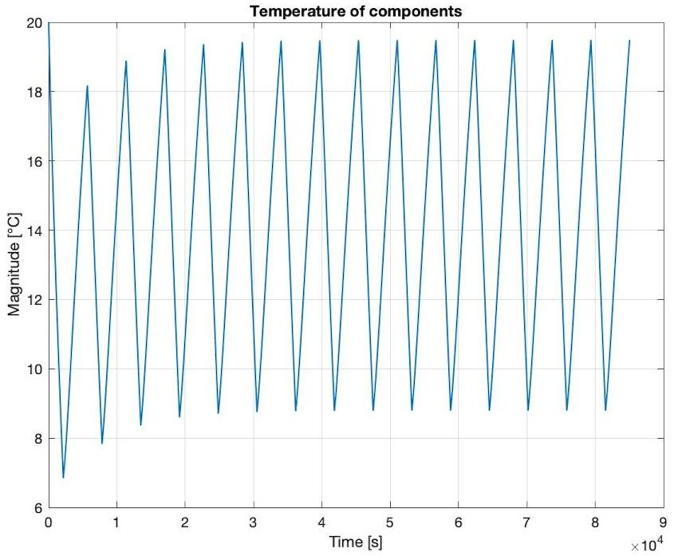

Figure 3.34: Temperature range components - SSO segment

<!-- PDF_PAGE: 92 -->

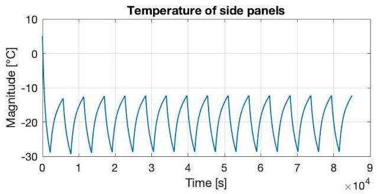

Figure 3.35: Temperature range panels - SSO segment

The temperature respects the marginalized temperature range; the temperature excursion though is high and it might be a problem for components that need a constant temperature to operate.

## Magnetospheric segment results

For the Magnetospheric segment, materials that satisfy both conditions are needed and are reported in the table below. The same considerations done for the SSO segment are valid also in this case.

<table border="1"><tr><td></td><td>Absorptivity</td><td colspan="2">Emissivity</td><td colspan="2">Coating material</td></tr><tr><td></td><td></td><td>Internal</td><td>External</td><td>Internal</td><td>External</td></tr><tr><td>Node1</td><td>-</td><td>0.82</td><td>0.85</td><td>Paint</td><td>Solar array</td></tr><tr><td>Node2</td><td>-</td><td>0.82</td><td>0.61</td><td>Paint</td><td>1mm aluminized Kapton</td></tr><tr><td>Node3</td><td>0.06</td><td>0.82</td><td>0.88</td><td>Paint</td><td>Paint</td></tr><tr><td>Node4</td><td>0.38</td><td>0.82</td><td>0.67</td><td>Paint</td><td>1mm aluminized Kapton</td></tr><tr><td>Node5</td><td>-</td><td>0.82</td><td>0.61</td><td>Paint</td><td>1mm aluminized Kapton</td></tr><tr><td>Node6</td><td>0.06</td><td>0.82</td><td>0.88</td><td>Paint</td><td>Paint</td></tr><tr><td>Node7</td><td>-</td><td colspan="2">0.55</td><td colspan="2">0.5mm aluminized Kapton</td></tr></table>

Table 3.37: Multi-nodal analysis results - Magnetospheric segment

The results for the two orbits, both respecting the temperature range are very similar, therefore only the one of the circular orbit is reported below.

<!-- PDF_PAGE: 93 -->

Figure 3.36: Temperature range components - Magnetospheric segment

Figure 3.37: Temperature range panels - Magnetospheric segment

The satellite will also have to be equipped with temperature sensors, in order to ensure that the temperature stays within the range. Different companies provide them like Minco [42], which offers both analog and digital ones.

<!-- PDF_PAGE: 94 -->

## Requirements

According to the design just performed, different design requirements can be obtained.

<table border="1"><tr><td>ID</td><td>Requirement</td></tr><tr><td>S&amp;M-TCS-1</td><td>Passive thermal control methods shall be used</td></tr><tr><td>SSO-TCS-2</td><td>The spacecraft temperature shall remain in the range-20℃ to 60℃</td></tr><tr><td>MAG-TCS-2</td><td>The spacecraft temperature shall remain in the range-15℃ to 40℃ during the transfer to the nominal orbit</td></tr><tr><td>MAG-TCS-3</td><td>The spacecraft temperature shall remain in the range-20℃ to 40℃ during the nominal operations</td></tr></table>

Table 3.38: TCS requirements

## TCS in Capella

The functions of the TCS are reported in the figure below.

Figure 3.38: [PFBD] TCS functions

At the logical level the thermal control system is composed of two Logical Components, the temperature sensors and the thermal control method. The same distinction is done also at the Physical level, therefore only one diagram is reported.

Figure 3.39: [LAB] TCS

<!-- PDF_PAGE: 95 -->

## 3.3.7. Structure

## Structure sizing

The primary structure has the role to sustain and support the payload and the components of the different subsystems during each phase of the mission and protect them from the ground, space, and launch environment. Each one is characterized by different conditions that can risk the integrity and safety of the subsystems.

## Structual analysis

In order to size the structure, the launcher needs to be selected to understand the kind of loads the platform has to sustain. To do that, different launching possibilities are investigated.

The two main launching possibilities for deploying CubeSats in orbit, are a rideshare mission and a piggyback mission.

Figure 3.40: Vega-C carrying system capabilities [3]

A rideshare mission is designed to carry in orbit as many satellites as possible, to optimize costs and space.

Different companies provide this kind of launch service.

Arianespace new launcher Vega-C performs rideshare missions at least once a year [3]. The launch period, slot, and date are defined by Arianespace. The launch period is notified when enough customers are secured and is defined at the latest 6 months in advance for CubeSats developers. The target orbit is decided by Arianespace according to each customer's needs, but up to 3 different altitudes can be targeted. Different carrying systems have been developed

<!-- PDF_PAGE: 96 -->

by the company, considering satellites of different sizes arranged in various configurations to optimize the available space [3.40]. For CubeSats deployment, from the kick-off meeting to the actual launch, at least a year is necessary.

The company D-orbit ION Satellite Carrier offers launch and deployment services for CubeSats and microsatellites [10]. The available space is a 64U volume and there's the possibility for a precise deployment, meaning that each satellite is deployed independently. It also possesses the ability to perform orbital maneuvers. A standard launch campaign takes a year to be arranged.

Lastly, the company EXOLAUNCH provides rideshare launch, dedicated launch, and constellation launch in exotic and custom orbits [21].

A piggyback mission in which CubeSats or small-sats are secondary payloads to a primary payload for which the mission is specifically designed.

Arianespace also performs piggyback missions which can take place when extra performance and volume are available on already manifested missions with a main passenger. The secondary payload has to be approved by the main passenger who also has the final say on the launch schedule and the target orbit. The possibility to release the secondary payload at a different altitude is present on some occasions.

Also in this case, different carrying systems have been developed by the company, considering satellites of different sizes arranged in various configurations to optimize the available space [3.40].

For the SSO orbit, the most suited option among a rideshare mission or a piggyback mission is a rideshare mission. More companies offer this service, and there is more orbit and launch flexibility.

Regarding the magnetospheric orbit, or to be more specific, to reach the initial GNSS orbit the only option is a piggyback mission. For example, Arianespace has been appointed to launch eight new Galileo satellites over the next few years with the latest launch scheduled for 2025 [4]. Missions similar to this could be exploited.

Selecting the Vega-C launcher which can provide both launch options, the following frequencies have to be assured so that no dynamic coupling happens.

<table border="1"><tr><td></td><td>Mini S/C</td><td>Micro S/C</td><td>Nano S/C</td><td>Cubesat Deployers</td></tr><tr><td>Mass</td><td>400-200kg</td><td>200-60kg</td><td>60-30kg</td><td>35-10Kg</td></tr><tr><td>Main frequencies</td><td>Lat&gt;30Hz
Longi&gt;60Hz</td><td>Lat&gt;60Hz
Longi&gt;90Hz</td><td>Lat&gt;115Hz
Longi&gt;115Hz</td><td>Lat&gt;115Hz
Longi&gt;115Hz</td></tr></table>

Figure 3.41: Launch frequencies [3]

<!-- PDF_PAGE: 97 -->

## 3| Space segments design

The same structure is envisioned for the two segments, with a minor difference on the bottom that accounts for the presence of the propulsion system for the SSO segment and the presence of the propulsion system and the thrusters for the Magnetospheric segment. The structure is made of 10 mm thick aluminum beams and has a hole on the top for the payload.

Figure 3.42: Structure - SSO segment

Figure 3.43: Structure - Magnetospheric segment

To check compliance with the required frequencies, a FEMAP model was realized. In figure 3.44 the one for the SSO segment is reported as a reference.

Figure 3.44: FEMAP structural model

<!-- PDF_PAGE: 98 -->

The following frequencies are obtained for the first five modes for the two structures.

<table border="1"><tr><td></td><td colspan="2">Frequency[Hz]</td></tr><tr><td></td><td>SSO structure</td><td>Magnetospheric structure</td></tr><tr><td>Mode1</td><td>131.2</td><td>311.2</td></tr><tr><td>Mode2</td><td>135</td><td>313</td></tr><tr><td>Mode3</td><td>391</td><td>440</td></tr><tr><td>Mode4</td><td>494</td><td>710</td></tr><tr><td>Mode5</td><td>700</td><td>828</td></tr></table>

Table 3.39: Modes' frequency

As it can be seen, they respect the limits required by the launcher.

## Requirements

According to the design just performed, different design requirements can be obtained.

<table border="1"><tr><td>ID</td><td>Requirement</td><td>Parent requirement</td></tr><tr><td>S&amp;M-STC-1</td><td>The structure shall be a 12U CubeSat</td><td>S&amp;M-HLR-2</td></tr><tr><td>S&amp;M-STC-1</td><td>The structure shall be the launch loads of Vega-C</td><td>-</td></tr></table>

Table 3.40: Structure requirements

## Reference component

For the mass budget, an average of the mass of 12U CubeSat structures commercially available is performed, and according to it, the value 1.87 kg is used.

## Structure in Capella

The functions defined for the structure are reported in the figure below.

Figure 3.45: [PFBD] Structure functions

<!-- PDF_PAGE: 99 -->

At the logical level, The structure subsystem is composed of three Logical Components, the primary structure, the mechanisms, and the launcher interface. The same distinction is done also at the Physical level, therefore only one diagram is reported.

Figure 3.46: [LAB] Structure

## 3.3.8. Global mission view in Capella

Having sized all the subsystems and created all the corresponding logical components, a complete view of the different elements can be shown with a Logical Architecture Blank diagram [Fig. 3.47]. In this diagram, only the Logical Components, the Logical actors, and their relations, Components exchange, are reported. The same thing can also be done at the Physical level and is presented in the next section. Once again, global diagrams like this one and the ones presented for each subsystem, allow to easily spot mistakes or missing elements early on in the design so that action can be taken right away and the design course rectified.

<!-- PDF_PAGE: 100 -->

Figure 3.47: [LAB] CUBE Mission

<!-- PDF_PAGE: 101 -->

## 3.4. Preliminary configuration

Having selected all the different components, it is possible to present a preliminary configuration of the two CubeSats. A color code has been used to distinguish the different subsystems. The ADCS components are reported in green, the EPS component is in blue, the TMTC components are in purple, the payload is in yellow, the propulsion system is in red, and the on board computer is in black.

## SSO segment

In figure 3.48 the 600x300 $ mm^{2} $ deployable solar arrays and the body-mounted 200x300 $ mm^{2} $ solar array can be seen. On the top, the deployed UHF antenna and the payload are also visible. In figure 3.49 the S-band and GPS antennas can be noticed together with the holes necessary for the sun-sensors embedded in the structure.

Figure 3.48: SSO segment-Front

Figure 3.49: SSO segment - Back

<!-- PDF_PAGE: 102 -->

The internal components are visible in figure 3.50.

Figure 3.50: SSO segment - Inside

Considering the available space to be $ 1 9 7 \times1 9 7 \times2 2 5 \mathrm{~ m m}^{3} $ according to commercially available 12U CubeSat structures [15], the components occupy 40.5% of it. Which leaves a little less than 60% for the other two payloads and the harness. Of the 40.5%, the volume is occupied as follows.

Figure 3.51: Percentage of occupied volume - SSO segment

<!-- PDF_PAGE: 103 -->

## Magnetospheric segment

In figure 3.52 the 800x300 $ mm^{2} $ deployable and 200x300 $ mm^{2} $ body-mounted solar arrays can be noticed as well as the deployed UHF antenna and the payload. In figure 3.53 the S-band antenna can be seen together with the two holes for the star trackers and the embedded sun sensors holes.

Figure 3.52: Magnetospheric segment - Front

Figure 3.53: Magnetospheric segment - Back

The internal components are visible in figure 3.54.

<!-- PDF_PAGE: 104 -->

Figure 3.54: Magnetospheric segment - Inside

Considering once again the available space to be $ 1 9 7 \mathrm{x} 1 9 7 \mathrm{x} 2 2 5 \mathrm{m m}^{3} $ the components occupy 52% of it, which leaves 48% for the other two payloads and the harness. Of the 52%, the volume is occupied as follows.

Figure 3.55: Percentage of occupied volume - Magnetospheric segment

In Capella, a general Physical architecture blank diagram [Fig. 3.56] can be seen as the preliminary configuration counterpart, as all the different specific components can be reported in the same place.

<!-- PDF_PAGE: 105 -->

Figure 3.56: [PAB] CUBE Mission

How the different subsystems' components are physically connected can be shown in Capella with specific Architecture blank diagrams. In particular, through the Physical links, as previously done, the power, data, and structural connections between the different Node Physical components can be highlighted. Diagrams are produced for the EPS, OBDH, and Structure subsystems from which these connections stem for the two segments.

In figure 3.57 the SSO segment power connections are shown, while in figure 3.58 the ones for the Magnetospheric segment are reported.

Figure 3.57: [PAB] EPS - SSO segment

<!-- PDF_PAGE: 106 -->

Figure 3.58: [PAB] EPS - Magnetospheric segment

In figure 3.59 the SSO segment data connections are shown, while in figure 3.60 the ones for the Magnetospheric segment are shown.

Figure 3.59: [PAB] OBDH - SSO segment

<!-- PDF_PAGE: 107 -->

Figure 3.60: [PAB] OBDH - Magnetospheric segment

In figure 3.61 the SSO segment data connections are shown, while in figure 3.62 the ones for the Magnetospheric segment are shown.

Figure 3.61: [PAB] Structure - SSO segment

<!-- PDF_PAGE: 108 -->

Figure 3.62: [PAB] Structure - Magnetospheric segment

<!-- PDF_PAGE: 109 -->

## 3.5. System Budgets

As previously mentioned, realizing System budgets is not yet possible with Capella, as nonfunctional properties cannot be associated with the different elements. This is one of the biggest flaws of the tool, but solutions are being studied. The system budgets are therefore only reported in a classical way.

## 3.5.1. Power budget

The power budget is presented once more for the two segments considering the margin discussed in the EPS section.

<table border="1"><tr><td colspan="2">Subsystems</td><td colspan="4">Power[W]w/margin</td></tr><tr><td colspan="2"></td><td colspan="2">SSO Segment</td><td colspan="2">Magnetospheric Segment</td></tr><tr><td colspan="2">Plasma analyzer</td><td colspan="2">7.25</td><td colspan="2">7.25</td></tr><tr><td colspan="2">Propulsion system</td><td colspan="2">15.6</td><td colspan="2">97.5</td></tr><tr><td rowspan="2">TMTC</td><td>S-band</td><td colspan="2">19.5</td><td colspan="2">19.5</td></tr><tr><td>UHF</td><td colspan="2">5.85</td><td colspan="2">5.85</td></tr><tr><td rowspan="6">ADCS</td><td rowspan="3">Determination</td><td>Sun Sensors</td><td>0.065</td><td>Sun Sensors</td><td>0.065</td></tr><tr><td>Magnetometer</td><td>1.3</td><td>Star Trackers</td><td>1.56</td></tr><tr><td>IMU</td><td>2.6</td><td>IMU</td><td>2.6</td></tr><tr><td>Control</td><td>RWs</td><td>7.8</td><td>RWs</td><td>7.8</td></tr><tr><td>Desaturation</td><td>Magnetotorquers</td><td>2.6</td><td>Thrusters</td><td>15.6</td></tr><tr><td colspan="2">GPS</td><td colspan="2">2.34</td><td colspan="2">-</td></tr><tr><td colspan="2">OBDH</td><td colspan="2">1.3</td><td colspan="2">1.3</td></tr><tr><td colspan="2">Mechanisms</td><td colspan="2">6.5</td><td colspan="2">6.5</td></tr></table>

Table 3.41: Power budget

The following graphs show the power percentage each subsystem requires for each EPS mode for the two segments.

<!-- PDF_PAGE: 110 -->

Figure 3.63: Subsystems power percentage per phase- SSO segment

Figure 3.64: Subsystems power percentage per phase - Magnetospheric segment

## 3.5.2. Mass budget

At this point, it is possible to perform a mass budget for the two platforms, in which the nominal dry mass and the total wet mass at launch are reported are derived.

The mass of each reference component is reported to which a 10% margin is applied [17].

It is reminded that the information about two payloads is not available at this time, therefore only the plasma analyzer is included in the mass budget; according to its requirements, its weight is 1.3 kg to which a 25% margin [17] is applied.

The nominal dry mass at launch is computed by summing the mass of the different components, including an additional 10% margin [17] for the harness mass, but excluding the propellant mass and the system margin.

The total wet mass at launch is obtained by adding the propellant mass and applying the system margin set to 20% [17] to the nominal dry mass.

The mass budget for the SSO segment is reported in table 3.42.

<!-- PDF_PAGE: 111 -->

3| Space segments design

<table border="1"><tr><td colspan="2">Subsystems</td><td>Mass[kg]w/o margin</td><td>Equipment margin[%]</td><td>Mass[kg]w/ margin</td></tr><tr><td colspan="2">Structure</td><td>1.87</td><td>10</td><td>2</td></tr><tr><td colspan="2">Plasma analyzer</td><td>1.3</td><td>25</td><td>1.625</td></tr><tr><td colspan="2">Propulsion system structure</td><td>0.8</td><td>10</td><td>0.88</td></tr><tr><td rowspan="2">TMTC</td><td>S-band</td><td>Antenna:0.049Transceiver:0.2</td><td>10</td><td>Antenna:0.054Transceiver:0.22</td></tr><tr><td>UHF-band</td><td>Antenna:0.115Transceiver:0.075</td><td>10</td><td>Antenna:0.127Transceiver:0.083</td></tr><tr><td rowspan="6">ADCS</td><td>Sun Sensors</td><td>0.02</td><td>10</td><td>0.022</td></tr><tr><td>Magnetometer</td><td>0.1</td><td>10</td><td>0.11</td></tr><tr><td>IMU</td><td>0.055</td><td>10</td><td>0.061</td></tr><tr><td>GPS</td><td>Antenna:0.05Receiver:0.031</td><td>10</td><td>Antenna:0.055Receiver:0.034</td></tr><tr><td>RWs</td><td>0.665</td><td>10</td><td>0.732</td></tr><tr><td>Magnetotorquers</td><td>0.156</td><td>10</td><td>0.172</td></tr><tr><td colspan="2">OBDH</td><td>0.055</td><td>10</td><td>0.061</td></tr><tr><td>EPS</td><td>PCDU+batteries</td><td>1.1</td><td>10</td><td>1.21</td></tr><tr><td rowspan="2">Solar panels</td><td>Body</td><td>0.39</td><td>10</td><td>0.43</td></tr><tr><td>Deployable</td><td>1.5</td><td>10</td><td>1.65</td></tr><tr><td colspan="4">Harness margin[%]</td><td>10</td></tr><tr><td colspan="4">Nominal dry mass at launch</td><td>10.5</td></tr><tr><td colspan="2">Propulsion system propellant</td><td>0.557</td><td>10</td><td>0.613</td></tr><tr><td colspan="4">System margin[%]</td><td>20</td></tr><tr><td colspan="4">Total wet mass at launch</td><td>13.4</td></tr></table>

Table 3.42: Mass budget - SSO segment

The percentage of mass that each subsystem represents is reported in figure 3.65.

<!-- PDF_PAGE: 112 -->

Figure 3.65: Mass budget percentage - SSO Segment

The mass budget for the Magnetospheric segment is reported in table 3.43. The percentage of mass of each subsystem is reported in the figure below.

Figure 3.66: Mass budget - Magnetospheric Segment

<!-- PDF_PAGE: 113 -->

<table border="1"><tr><td colspan="2">Subsystems</td><td>Mass[kg]w/o margin</td><td>Equipment margin[%]</td><td>Mass[kg]w/ margin</td></tr><tr><td colspan="2">Structure</td><td>1.87</td><td>10</td><td>2</td></tr><tr><td colspan="2">Plasma analyzer</td><td>1.3</td><td>25</td><td>1.625</td></tr><tr><td colspan="2">Propulsion system structure</td><td>1.4</td><td>10</td><td>1.54</td></tr><tr><td rowspan="2">TMTC</td><td>S-band</td><td>Antenna:0.049Transceiver:0.2</td><td>10</td><td>Antenna:0.054Transceiver:0.22</td></tr><tr><td>UHF-band</td><td>Antenna:0.115Transceiver:0.075</td><td>10</td><td>Antenna:0.127Transceiver:0.083</td></tr><tr><td rowspan="5">ADCS</td><td>Sun Sensors</td><td>0.02</td><td>10</td><td>0.022</td></tr><tr><td>Star Tracker</td><td>0.084</td><td>10</td><td>0.093</td></tr><tr><td>IMU</td><td>0.055</td><td>10</td><td>0.061</td></tr><tr><td>RWs</td><td>0.665</td><td>10</td><td>0.732</td></tr><tr><td>Thrusters structure</td><td>0.64</td><td>10</td><td>0.7</td></tr><tr><td colspan="2">OBDH</td><td>0.055</td><td>10</td><td>0.061</td></tr><tr><td>EPS</td><td>PCDU+batteries</td><td>0.76</td><td>10</td><td>0.84</td></tr><tr><td rowspan="2">Solar panels</td><td>Body</td><td>0.39</td><td>10</td><td>0.43</td></tr><tr><td>Deployable</td><td>2</td><td>10</td><td>2.2</td></tr><tr><td colspan="4">Harness margin[%]</td><td>10</td></tr><tr><td colspan="4">Nominal dry mass at launch</td><td>11.9</td></tr><tr><td colspan="2">Propulsion system propellant</td><td>1.5</td><td>10</td><td>1.65</td></tr><tr><td colspan="2">Thrusters propellant</td><td>0.21</td><td>10</td><td>0.23</td></tr><tr><td colspan="4">System margin[%]</td><td>20</td></tr><tr><td colspan="4">Total wet mass at launch</td><td>16.5</td></tr></table>

Table 3.43: Mass budget - Magnetospheric segment

<!-- PDF_PAGE: 114 -->

## 3.6. Criticalities and open points

The main criticality of this mission, as expected, is the Magnetospheric segment. Due to the presence of the electric propulsion system, the power demand is very high during the transfer phase which results in very big and heavy solar arrays. This could be a problem for the CubeSat deployer as they have standard sizes and such big arrays when folded are extremely bulky. Nonetheless, given the popularity of electric propulsion systems for such platforms, companies like Spacemind offer deployers that can host such structures.

Regarding the two orbits, as already stated, the elliptical orbit presents criticalities from an environmental point of view as the components would have to be qualified for radiations of 15 krad, considering a 4mm aluminum structure. For the circular orbit, the main criticality is the telecommunications system in which despite the link budget being above the minimum value it is still very low.

The SSO segment presents fewer criticalities as CubeSats are designed to operate in these orbits. The only concern regarding this mission is the very frequent desaturations the reaction wheels are subjected to.

Regarding both segments, as stated multiple times, only one of the three payloads is finalized at the time this work is realized. Despite having considered margins to account for their presence, the work done will need some adjusting once the requirements are available. Adjustments might also be needed as the constellation aspect is developed.

<!-- PDF_PAGE: 115 -->

## 4 Mission phases

Analyzing the functionalities necessary to reach the mission goal, different mission phases can be identified. For each, the AOCS and EPS mode is specified.

## Launch phase

During this phase, the main concern is for the CubeSats to survive the storing conditions and the mechanical loads generated during the launch.

## Early in-orbit phase

Once the CubeSat is deployed in space, before starting its routine operations, it has to perform a few tasks. The deployment flips the kill-switch mechanism which results in the batteries discharging and the power being distributed to relevant subsystems. First of all the space segment will detumble, i.e. reduce its velocity to zero. Once this task is completed, the solar arrays can be deployed and oriented towards the sun so that all the subsystems can be powered. In addition, the UHF band antenna is also deployed in this phase to communicate with Earth. AOCS: Detumbling mode

EPS: Early in orbit mode

## Transfer phase

This phase is exclusive to the Magnetospheric segment. As described in section 2.2.1, the CubeSat will have to make its way from the initial orbit in which it is deployed to the nominal orbit. After receiving the go from ground, the spacecraft's AOCS will align the propulsor in the correct direction and then make its way to its final orbit.

AOCS: Maneuvering mode

EPS: Transfer mode

## Operative phase

This is the phase in which the spacecraft will spend the majority of their lifetime. Different modes characterize this phase:

- Science mode: during this mode, the payloads will collect the data, therefore it is crucial to maintain the correct pointing by counteracting the different disturbances the spacecraft is subjected to.

AOCS: Science mode

<!-- PDF_PAGE: 116 -->

EPS: Science mode

- Telecom mode: during this mode, the satellite will establish a connection with the ground station. It is paramount to keep the antennas aligned so that all the data and information can be correctly exchanged. Because of this, the payloads are put on standby for the whole duration of the phase as the correct pointing cannot be guaranteed. This mode can be entered at any time and, depending on the situation, the two different antennas will be utilized.

AOCS: Telecom mode

EPS: Telecom mode

- Station Keeping mode: this mode is exclusive to the SSO segment. In it, orbital maneuvers are performed to maintain the correct orbit altitude and inclination. During this phase, the payloads will be put on standby.

AOCS: Maneuvering mode

EPS: Maneuvering mode

- Protection mode: this mode is exclusive to the SSO segment and it will be activated when crossing over the SAA. To avoid damaging the payloads or the other components they will be temporarily put on standby.

EPS: Protection mode

- Safe mode: the satellite is expected to enter into this mode autonomously in case of malfunctioning to one of the systems or being lost in space condition. The normal course of operations is interrupted, all nonessential operations are suspended and the satellite must communicate the problem as soon as possible.

AOCS: safe mode

## Decommissioning phase

EPS:safe mode

At the end of their lifetime, the satellites are expected to perform deorbiting maneuvers. The SSO segment will deorbit to Earth while the Magnetospheric segment will deorbit to a graveyard orbit.

AOCS: Decommissioning mode

EPS: Maneuvering mode (SSO segment), Decommissioning mode (Magnetospheric segment)

## 4.1. Mission phases in Capella

The scenario diagram could be used also in this situation to highlight the temporal relations between the different actions the spacecraft has to perform in the different phases.

<!-- PDF_PAGE: 117 -->

An example is proposed in the picture below for the Early in-orbit phase.

Figure 4.1: [PES] Early in orbit

<!-- PDF_PAGE: 118 -->

<!-- PDF_PAGE: 119 -->

## 5 Risk Assessment

An important aspect of any project is the risk management. Identifying the risks and putting in place mitigation strategies, if needed, is important to not let the situation precipitate in the instance something were to happen.

Risks are classified based on their severity, the consequences they would have on the project in the event they were to happen, and likelihood, the probability that this event will actually happen. According to the ESA standard [12] the severity and likelihood are ranked as shown in figures 5.1 and 5.2 respectively.

<table border="1"><tr><td>Score</td><td>Severity</td><td>Severity of consequence: impact on(for example)cost</td></tr><tr><td>5</td><td>Catastrophic</td><td>Leads to termination of the project</td></tr><tr><td>4</td><td>Critical</td><td>Project cost increase&gt;tbd%</td></tr><tr><td>3</td><td>Major</td><td>Project cost increase&gt;tbd%</td></tr><tr><td>2</td><td>Significant</td><td>Project cost increase&lt;tbd%</td></tr><tr><td>1</td><td>Negligible</td><td>Minimal or no impact</td></tr></table>

Figure 5.1: Risks severity classification [12]

<table border="1"><tr><td>Score</td><td>Likelihood</td><td>Likelihood of occurrence</td></tr><tr><td>E</td><td>Maximum</td><td>Certain to occur, will occur one or more times per project</td></tr><tr><td>D</td><td>High</td><td>Will occur frequently, about 1 in 10 projects</td></tr><tr><td>C</td><td>Medium</td><td>Will occur sometimes, about 1 in 100 projects</td></tr><tr><td>B</td><td>Low</td><td>Will seldom occur, about 1 in 1000 projects</td></tr><tr><td>A</td><td>Minimum</td><td>Will almost never occur, 1 of 10000 or more projects</td></tr></table>

Figure 5.2: Risks likelihood classification [12]

Based on this, the risk index can be defined as the product between the severity and the likelihood. To better understand which risks need mitigation strategies, a risk matrix can be constructed [Fig. 5.3].

Acceptable risks, those with a low index, are reported in green, and for those no direct action

<!-- PDF_PAGE: 120 -->

is envisioned other than monitoring them. The others are all classified as unacceptable risks. The ones with a medium index, reported in yellow, call for aggressive mitigation strategies while those with a high index, reported in red, require a change in the baseline.

<table border="1"><tr><td>Likelihood</td><td></td><td></td><td></td><td></td><td></td><td></td></tr><tr><td>E</td><td>1E</td><td>2E</td><td>3E</td><td>4E</td><td>5E</td><td></td></tr><tr><td>D</td><td>1D</td><td>2D</td><td>3D</td><td>4D</td><td>5D</td><td></td></tr><tr><td>C</td><td>1C</td><td>2C</td><td>3C</td><td>4C</td><td>5C</td><td></td></tr><tr><td>B</td><td>1B</td><td>2B</td><td>3B</td><td>4B</td><td>5B</td><td></td></tr><tr><td>A</td><td>1A</td><td>2A</td><td>3A</td><td>4A</td><td>5A</td><td></td></tr><tr><td></td><td>1</td><td>2</td><td>3</td><td>4</td><td>5</td><td>Severity</td></tr></table>

Figure 5.3: Risk matrix

Some preliminary risks are identified and are shown in figure 5.4. Both acceptable and unacceptable risks are listed and for each, a preventive measure and a remedial action are proposed. It is reminded that the two segments are part of a constellation of CubeSats, therefore the risks related to components or mechanisms are to be intended for a single platform.

<!-- PDF_PAGE: 121 -->

Figure 5.4: Risks assessment table

<table border="1"><tr><td>Segment</td><td>Risk Description</td><td>RI</td><td>Risk impact</td><td>Prevention</td><td>Action</td></tr><tr><td>MAG</td><td>Delta-V insufficient to reach for nominal orbit</td><td>4B</td><td>Data won’t be collected from required orbits</td><td>Accurate calculations</td><td>New orbit</td></tr><tr><td>MAG, SSO</td><td>One or more of the constellation spacecrafts doesn’t survive launch loads</td><td>4B</td><td>Data won’t be collected in the quantity required</td><td>Tests</td><td>New constellation arrangement</td></tr><tr><td>MAG, SSO</td><td>One or more of the constellation spacecrafts is not deployed</td><td>4B</td><td>Data won’t be collected in the quantity required</td><td>Redundant system</td><td>New orbit or new constellation arrangement</td></tr><tr><td>MAG, SSO</td><td>Deployable solar arrays mechanism failure</td><td>4A</td><td>Extremely reduced power in sunlight; spacecraft not operative, data won’t be collected in the quantity required</td><td>Tests, Consider body mounted arrays</td><td>Some operations could be done with batteries and body mounted panel</td></tr><tr><td>MAG, SSO</td><td>UHF antenna deployment mechanism failure</td><td>3A</td><td>No communication redundancy or in case of lost attitude</td><td>Tests, Consider patch antennas</td><td>Use S-band antenna for all communications</td></tr><tr><td>MAG, SSO</td><td>Debris impact SA</td><td>3A</td><td>Solar arrays don’t produce the necessary power</td><td>Debris study</td><td>Reduce power consumption during daylight</td></tr><tr><td>MAG, SSO</td><td>Surfaces optical values change</td><td>4C</td><td>Operative temperature range might not be assured</td><td>Tests, high margins, protective layer on surfaces</td><td>-</td></tr><tr><td>SSO</td><td>Main engine failure</td><td>2A</td><td>Orbit maintenance cannot be performed</td><td>Tests</td><td>-</td></tr><tr><td>MAG</td><td>Main engine failure</td><td>4A</td><td>Spacecraft cannot reach nominal orbit; data won’t be collected from both orbits in the quantity required</td><td>Tests</td><td>New orbit</td></tr><tr><td>MAG, SSO</td><td>S-band antenna failure</td><td>4A</td><td>Communication is very limited</td><td>Tests</td><td>Rely on UHF antenna</td></tr><tr><td>MAG, SSO</td><td>UHF antenna failure</td><td>3A</td><td>No communication redundancy or in case of lost attitude</td><td>Tests</td><td>Rely on S-band antenna</td></tr><tr><td>SSO</td><td>GPS antenna failure</td><td>3A</td><td>No accurate orbit determination</td><td>Tests</td><td>Use sensors and actuators</td></tr><tr><td>MAG, SSO</td><td>Communication delay due to ground station</td><td>2B</td><td>Data have to be stored on board for longer</td><td>High margin on memories sizing</td><td>Communicate with other ground station if possible</td></tr><tr><td>MAG, SSO</td><td>RWs failure</td><td>3A</td><td>Attitude control less efficient</td><td>Test, redundancy</td><td>Use desaturation actuators for attitude control</td></tr><tr><td>SSO</td><td>Desaturation actuators failure</td><td>4A</td><td>RWs are saturated, spacecraft not operative, data won’t be collected in the quantity required</td><td>Test, redundancy</td><td>Use main engine to desaturate wheels</td></tr><tr><td>MAG</td><td>Desaturation actuators failure</td><td>4A</td><td>RWs are saturated, spacecraft not operative, data won’t be collected in the quantity required</td><td>Test</td><td>-</td></tr><tr><td>SSO</td><td>Batteries failure</td><td>4A</td><td>Activities cannot be performed during numerous eclipse periods; spacecraft not operative, data won’t be collected in the quantity required</td><td>Tests, redundancy</td><td>Minimum activity during eclipse period</td></tr><tr><td>MAG</td><td>Batteries failure</td><td>3A</td><td>Activities cannot be performed during sporadic eclipse periods</td><td>Tests, redundancy</td><td>Minimum activity during eclipse period</td></tr><tr><td>MAG, SSO</td><td>OBC failure</td><td>4A</td><td>Data won’t be collected in the quantity required</td><td>Tests, redundancy</td><td>-</td></tr><tr><td>MAG, SSO</td><td>Payload failure</td><td>4B</td><td>Spacecraft not operative, data won’t be collected in the quantity required</td><td>Tests</td><td>Use spacecraft for other tests</td></tr></table>

<!-- PDF_PAGE: 122 -->

<!-- PDF_PAGE: 123 -->

## 6 Conclusions

The thesis aimed at showing the strengths of the MBSE method when applied to the PrePhase A design of a space mission. Following the different engineering levels of the ARCADIA method through the Capella tool, at the same time, the classic feasibility analysis is realized and models are obtained. Those accompany the mission designers from the early phases of the project, in which stakeholders and their needs are identified, all the way to the functioning of specific subsystems. They can be customized to show different elements based on the audience, they can be easily modified as the design progresses, and the traceability is easily assured unlike documents produced with the classic system engineering approaches. In addition, the models can be complemented by adding requirements that are a vital part of the system engineering process. The biggest downside of the Capella tool is the lack of an interface with an analytical and numerical simulator which makes it not possible to model the non-functional aspects of the mission, but steps are being made in this direction.

Regarding the feasibility of CUBE Mission, despite the criticalities mentioned, it is considered feasible at this stage. A power and mass budget, along with a preliminary configuration and various requirements are obtained for the two CubeSats that show just that.

In conclusion, even though learning to use MBSE tools like Capella takes a lot of effort in the beginning, this is repaid in the long run.

<!-- PDF_PAGE: 124 -->

<!-- PDF_PAGE: 125 -->

## Bibliography

[1] AAC Clyde Space. Mag-3, 2023. URL https://www.aac-clyde.space/ what-we-do/space-products-components/adcs/mag-3.

[2] AAC Clyde Space. St200, 2023. URL https://www.aac-clyde.space/ what-we-do/space-products-components/adcs/st200.

[3] Ariane space. SSMS Vega C user's manual, 2020.

[4] Ariane space. Arianespace to launch eight new galileo satellites. 2022. URL https://www.arianespace.com/press-release/ arianespace-to-launch-eight-new-galileo-satellites/.

[5] S. Bonnet, J.-L. Voirin, and J. Navas. Augmenting requirements with models to improve the articulation between system engineering levels and optimize v&v practices. INCOSE International Symposium, 29:1018-1033, 07 2019. doi: 10.1002/j.2334-5837.2019.00650.x.

[6] BUSEK. Bit-3 ion thruster, 2023. URL https://www.busek.com/bit3.

[7] BUSEK. Hall thrusters, 2023. URL https://www.busek.com/ hall-thrusters.

[8] Consultative Commitee for Space Data System. Radio frequency and modulation systems, 05 1997.

[9] H. D. Curtis. Orbital mechanics for Engineering students. Butterworth-Heinemann, 2013.

[10] D-ORBIT. D-orbit homepage, 2023. URL https://www.dorbit.space/.

[11] ECLIPSE. Arcadia method at a glance!, 2023. URL https://www.eclipse.org/capella/arcadia.html.

[12] ECSS. Space project management - risk management, 2008. URL https://ecss. nl/standard/ecss-m-st-80c-risk-management/.

[13] Electronic Communications Committee (ECC) within the European Conference of Postal and Telecommunications Administrations (CEPT). The european table of frequency allocations and utilisations in the frequency range 9 khz to 3000 ghz, 2003.

<!-- PDF_PAGE: 126 -->

[14] Endurosat. 6u solar panel, 2023. URL https://www.endurosat.com/ cubesat-store/cubesat-solar-panels/6u-solar-panel/.

[15] Endurosat. 12u cubesat platform, 2023. URL https://www.endurosat.com/ cubesat-store/cubesat-platforms/12u-cubesat-platform/.

[16] Enpulsion. Thrusters shop, 2023. URL https://www.enpulsion.com/ order/.

[17] ESA. Concurrent design facility studies standard margin philosophy description, 2017.

[18] ESA. Spenvis, 2022. URL https://www.spenvis.oma.be/.

[19] ESA. Esa-estrack ground stations, 2023. URL https://www.esa int/Enabling_Support/Operations/ESA_Ground_Stations/ Estrack_ground_stations.

[20] J. Estefan. Survey of model-based systems engineering (MBSE) methodologies. INCOSE MBSE Focus Group, 25, 01 2008.

[21] Exolaunch. Exolaunch homepage, 2023. URL https://exolaunch.com/.

[22] D. Gilmore and M. Donabedian. Spacecraft Thermal Control Handbook-Appendix A. Aerospace Press, 2002. URL https://books.google.it/books?id=yGi7zQEACAAJ.

[23] GOMspace. Gps-kit, 2023. URL https://gomspace.com/shop subsystems/attitude-orbit-control-systems/gps-kit.aspx.

[24] GOMspace. The nanopower tracking solar panels, 2023. URL https://gomspace com/shop/subsystems/power/nanopower-tsp.aspx.

[25] IMT. Homepage, 2023. URL https://www.imtsr1.it/.

[26] iQspacecom. S-band antenna, 2023. URL https://www.iq-spacecom.com/ products/antenna-s-band.

[27] iQspacecom. S-band transceiver system (sdr), 2023. URL https://www. iq-spacecom.com/products/xlink-s.

[28] ISISPACE. Uhf antenna, 2023. URL https://www.isispace.nl/product antenna-system-for-6u-12u-cubesats/.

[29] ISISPACE. Vhf uplink/uhf downlink full duplex transceiver, 2023. URL https://www.isispace.nl/product/ isis-uhf-downlink-vhf-uplink-full-duplex-transceiver/.

<!-- PDF_PAGE: 127 -->

[30] M. Ismail, A. Bakry, H. Selim, and M. Shehata. Eclipse intervals for satellites in circular orbit under the effects of earth's oblateness and solar radiation pressure. NRIAG Journal of Astronomy and Geophysics, 4(1):117-122, 2015. ISSN 2090-9977. doi: https:// doi.org/10.1016/j.nrjag.2015.06.001. URL https://www.sciencedirect.com/ science/article/pii/S2090997715000206.

[31] M. Ismail, A. Bakry, H. Selim, and M. Shehata. Eclipses intervals for satellites in elliptical orbit under effects of solar radiation pressure and earth's oblatness. Al-Azhar Bulletin of Science, 26:17-22, 06 2015. doi: 10.21608/absb.2015.22633.

[32] J. J. P. James R. Wertz, David F. Everett. Space mission engineering: The new SMAD. Butterworth-Heinemann, 2011.

[33] J. J. P. James R. Wertz, David F. Everett. Space mission engineering: The new smad (livecalc), 2011. URL http://www.sme-smad.com/.

[34] Kongsberg satellite service. Global ground station network, 2023. URL https://www.ksat.no/ground-network-services/the-ksat-global-ground-station-network/.

[35] M. Lavagna. SSEO course - EPS notes, a.y. 2020/2021.

[36] M. Lavagna. SSEO course - TTMTC notes, a.y. 2020/2021.

[37] M. Lavagna. SSEO course - ADCS exercise notes, a.y. 2021/2022.

[38] Leaf space. Ground segment as a service, 2023. URL https://leaf.space/.

[39] S. M. Computation of eclipse time for low-earth orbiting small satellites. International Journal of Aviation, Aeronautics, and Aerospace, 01 2019. doi: 10.15394/ijaaa.2019.1412.

[40] M. Macdonald and V. Badescu. The International Handbook of Space Technology. Springer Praxis Books. Springer Berlin Heidelberg, 2014. ISBN 9783642411007. URL https://books.google.it/books?id=IesnnwEACAAJ.

[41] M. Massari. Payload design course - electronic subsystem notes, a.y. 2021/2022.

[42] MINCO. Temperature sensors, 2023. URL https://www.minco.com/temperature-sensors/.

[43] MOOG. Cold gas thrusters, 2023. URL https://www.moog.com/products/ propulsion-controls/launch-vehicles/cold-gas-thrusters. html.

[44] Nanoavionics. Cubesat reaction wheels control system satbus 4rw0, 2023.

<!-- PDF_PAGE: 128 -->

URL https://nanoavionics.com/cubesat-components cubesat-reaction-wheels-control-system-satbus-4rw/.

[45] NASA. Electromagnetic spectrum regulation, 2023. URL https://www.nasa.gov/directorates/heo/scan/spectrum/txt_accordion3.html.

[46] NASA. In-space propulsion, 2023. URL https://www.nasa.gov/smallsat-institute/sst-soa/in-space-propulsion.

[47] Newspace system. Magnetotorquer rods, 2023. URL https://www. newspacesystems.com/products/magnetotorquer-rods/.

[48] NOAA. Hello solar cycle 25. 2020. URL https://www.weather.gov/news/ 201509-solar-cycle.

[49] OrbAstro. Long-life electrical power system, 2023. URL https://orbastro.com/ subsystems/long-life-eps/.

[50] P. Roques. Systems Architecture Modeling with the Arcadia Method. iSTE press, 2018. URL https://books.google.it/books?id=yGi7zQEACAAJ.

[51] Safran. Stim300, 2023. URL https://www.sensonor.com/products inertial-measurement-units/stim300/.

[52] N. Shevchenko. An introduction to model-based systems engineering (MBSE). Carnegie Mellon University, Software Engineering Institute's Insights (blog), Dec 2020. URL http://insights.sei.cmu.edu/blog/ introduction-model-based-systems-engineering-mbse/. Accessed: 2023-Mar-30.

[53] SolarMEMS. Nanossoc sun sensor for nano-satellites, 2023. URL https://www. solar-mems.com/nanossoc/.

[54] Spectrolab. Cells & cics, 2023. URL https://www.spectrolab.com/ photovoltaics.html#space_arrays.

[55] J. Springmann, J. Cutler, and H. Bahcivan. Magnetic sensor calibration and residual dipole characterization for application to nanosatellites. 08 2010. doi: 10.2514/6.2010-7518.

[56] Swedish Space cocorporation. Satellite ground station services, 2023. URL https:// sscspace.com/services/satellite-ground-stations/.

[57] H. Taylor, M. Vreugdenburg, L. Sangalli, and R. Vincent. Rmcsat: An f10.7 solar flux index cubesat mission. Remote Sensing, 13(23), 2021. ISSN 2072-4292. doi: 10.3390/rs13234754. URL https://www.mdpi.com/2072-4292/13/23/4754.

<!-- PDF_PAGE: 129 -->

[58] D. Technologies. Electrical power system, 2023. URL https://dhvtechnology. com/products/electrical-power-systems/.

[59] VACCO. Standard micro propulsion system, 2023. URL https:// cubesat-propulsion.com/standard-propulsion-system/.

<!-- PDF_PAGE: 130 -->

<!-- PDF_PAGE: 131 -->

## Acknowledgements

I want to thank Professor Michèle Lavagna for giving me the opportunity of working on a real mission and explore my passion for System Engineering; Jacopo Prinetto, Michele Ceresoli, and Enrico Belloni for helping me with my work.

A special thank you goes also to the guys of "La Prima & Seconda fila" that I didn't get to thank the first time around, for all the fun we had in Turin.

If I have learned anything in these 25 years is that people are everything.

There are people that are part of my life that I know are never going to leave because they have shown it to me day in and day out for years.

To these people, I dedicate my work.

To Sosa, for raising me and making me the person I am today; for showing me what love is with every card she sent me when I was away, with every thoughtful gift she gets me, with every train ride she took after a week of work just to spend 12 hours together.

To Daddy, for working every single day of his life so that we could all have the best of everything; for letting me make my own decisions and respecting them despite not agreeing with them. I hope one day I can give you your lighthouse.

To Amaro, for putting up with me every day of his life.

To my grandparents and the rest of my family for their love and support.

To Valentina and Marta, the most talented women I know, for their decade-long friendship.

To David, my kindred spirit and forever messing around buddy, Dina, Misha, Kevin & Al for being my second family and my biggest fans since the day we met almost 8 years ago now. To Paul for every letter, text, call, laugh, advice, and memory, we've shared in the past 7 years. For always, always being there for me despite the 9000 km that separates us. To pieces.

I wouldn't have made it without you all.

I love you more than I can express, and I feel so lucky to have you in my life. I don't know what's gonna happen next, but I hope you are all going to be there to see it.

<!-- PDF_PAGE: 132 -->

