<!-- PDF_PAGE: 1 -->

## Politecnico di Torino

Master's Degree in Aerospace Engineering A.Y.2024/2025 Graduation Session July 2025

<div align="center">

# Integrating Data-Driven and Model-Based Systems Engineering for End-to-End Small-Satellite Design

</div>

Academic Supervisors:

Prof. Fabrizio Stesina

Prof. Sabrina Corpino

Candidate:

PhD(c). Serena Campioli

Carlotta Deiana

<!-- PDF_PAGE: 2 -->

<!-- PDF_PAGE: 3 -->

## Summary

The aerospace industry is currently experiencing a significant transition towards the digitalisation of spacecraft development processes. This shift presents several challenges, including technical limitations in data exchange systems and the increasing complexity of space systems. Over the years, a variety of System Engineering (SE) approaches have been adopted with the objective of managing information as it passes between engineering teams, ensuring consistent design data across different projects and activities, and reducing mission costs and development times. The most relevant of these approaches are Data-Driven Systems Engineering (DDSE) and Model-Based Systems Engineering (MBSE). The DDSE centralises and integrates all space mission engineering data, creating a single source of truth for rapid and collaborative decision-making and enabling faster automation and iteration. The MBSE employs a model-centric approach to the design of complex space systems, promoting a coherent understanding and early validation of mission architectures.

To address the challenges currently being experienced in the aerospace industry, the design of small satellites requires a methodology that is more agile than traditional approaches. Moreover, a single modelling tool is often inadequate. This thesis proposes an integration of the Data-Driven System Engineering (DDSE) and ModelBased System Engineering (MBSE) methodologies with the aim of enhancing and facilitating the preliminary small satellite design development. To achieve this objective, two complementary tools have been selected: Valispace, a DDSE tool that provides a user-friendly digital environment for engineering data, ensuring the integrity of data while encouraging real-time collaboration; Capella, an MBSE tool that implements the ARCADIA method to create, visualize and simulate the models of the systems, improving the comprehension of the project even at an early stage.

The integrated approach is based on the combination of these two methodologies thereby ensuring a more comprehensive and clear understanding of the space system

<!-- PDF_PAGE: 4 -->

being modelled, and achieving a more efficient and dynamic management of all data. This, in turn, allows for the maintenance of a single source of truth, guaranteeing the continuity of information between the two tools and fostering the collaboration between engineering teams and stakeholders. The present thesis illustrates the methodology, the integration of the tools and the results from a small-satellite case study. It demonstrates how the combination of DDSE and MBSE has optimised the design development process, thereby ensuring a more agile solution that mitigates risks and improves decision-making processes.

<!-- PDF_PAGE: 5 -->

<!-- PDF_PAGE: 6 -->

## Table of Contents

**List of Figures** VIII

**List of Tables** XI

**List of abbreviations** XII

**Introduction** 1

**1 State of Art** 3

1.1 Systems Engineering 3

1.2 Data-Driven Systems Engineering 5

1.3 Model-Based Systems Engineering 8

1.3.1 Methodologies 10

1.3.2 Modelling languages 13

**2 Systems Engineering Tools** 15

2.1 Valispace 17

2.2 Capella 20

**3 Valispace-Capella Integration** 27

3.1 DDSE-MBSE approach 27

3.2 Integration 30

<!-- PDF_PAGE: 7 -->

Stakeholders Needs Analysis . . . . .

<!-- PDF_PAGE: 8 -->

A.4 Export_modes.py 81

**B Valispace Python API scripts** 83

B.1 Import_Requirements.py 83

B.2 Import_System_Components.py 85

B.3 Import_LC_Hierarchy.py 86

B.4 Components_bridge.py 88

B.5 Import_All_Modelists.py 95

**C Capella diagrams** 97

**Bibliography** 102

<!-- PDF_PAGE: 9 -->

## List of Figures

1.1 The engineering data pyramid [5]. ... 7

1.2 The PMTE Elements and Effects of Technology and People. [3] ... 11

2.1 Valispace V-model [18]. ... 18

2.2 Valispace overview. ... 19

2.3 The main engineering levels of the Architecture Analysis & Design Integrated Approach (ARCADIA) Method [17]. ... 21

3.1 Tools integration process. ... 31

3.2 Python for Capella architecture [22]. ... 35

4.1 Operation Capabilities Blank (OCB) Operational Capabilities ... 44

4.2 Operational Activity Interaction Blank (OAIB) Mission Lifecycle ... 45

4.3 OAIB [Scientific Obj] Urban Heat Island (UHI) effect mapping and detection ... 45

4.4 OAIB [Technological Obj] Deep space technologies validation in Low Earth Orbit (LEO) ... 46

4.5 Operational Architecture Blank (OAB) Operational Entities ... 47

4.6 Operational Scenario (OES) Mission Lifecycle ... 48

4.7 Context System Actors (CSA) System ... 50

4.8 System Components imported from Capella to Valispace. ... 51

4.9 Mission and Capabilities Blank (MCB) Mission and Capabilities Blank diagram ... 52

<!-- PDF_PAGE: 10 -->

4. 10 System Functions Breakdown Diagram (SFBD) To maintain system operability . . . . .

<!-- PDF_PAGE: 11 -->

C.4 SAB Integration & Testing (I&T) 98

C.5 SAB Launch and Early Orbit Phase (LEOP) 99

C.6 SAB End Of Life (EOL) 100

C.7 Mass budget estimation on Valispace. 101

C.8 Volume budget estimation on Valispace. 101

<!-- PDF_PAGE: 12 -->

## List of Tables

1.1 Strenghts and weaknesses of Data-Driven Systems Engineering (DDSE) 7

1.2 Strenghts and weaknesses of Model-Based Systems Engineering (MBSE) 10

2.1 Overview of types of diagrams available in Capella [17]. 24

3.1 DDSE and MBSE integration. 28

3.2 Valispace and Capella capabilities [20]. 29

4.1 High Level Requirements and Drivers 41

4.2 Operational Analysis terminology [19]. 42

4.3 System Analysis terminology [19]. 49

4.4 Logical Architecture terminology [19]. 59

4.5 Physical Architecture terminology [19]. 69

<!-- PDF_PAGE: 13 -->

## List of the abbreviations

AIV/T Assembly, Integration, Verification and Testing

AOCS Attitude and Orbit Contro System

ARCADIA Architecture Analysis & Design Integrated Approach

API Application Programming Interface

AutomationML Automation Modeling Language

CAM Collision Avoidance Manoeuvre

ConOps Concept of Operations

COTS Commercial-Off-The-Shelf

CRUD Create-Read-Update-Delete

CSA Context System Actors

DDSE Data-Driven Systems Engineering

DSL Domain-Specific Language

XII

<!-- PDF_PAGE: 14 -->

EO Earth Observation

EOL End Of Life

EPBS End Product Breakdown Structure

EPS Electrical Power System

ESA European Space Agency

FDIR Failure Detection, Isolation and Recovery

GNC Guidance, Navigation and Control

HTTP Hypertext Transfer Protocol

ID Identification

IDE Integrated Development Environment

IML Interdisciplinary Modeling Language

INCOSE International Council on Systems Engineering

IVVQ Integration, Verification, Validation, and Qualification

I&T Integration & Testing

JPL Jet Propulsion Laboratory

LAB Logical Architecture Blank

XIII

<!-- PDF_PAGE: 15 -->

LCBD Logical Component Breakdown Diagram

LEO Low Earth Orbit

LEOP Launch and Early Orbit Phase

LFBD Logical Functions Breakdown Diagrams

LST Land Surface Temperature

MBSE Model-Based Systems Engineering

MCB Mission and Capabilities Blank

MCC Mission Control Center

MDD Model-Driven Development

MDS Model-Driven System

MNDWI Modified Normalised Difference Water Index

MSM Modes and State Diagrams

NDBI Normalised Difference Built-up Index

NDVI Normalised Difference Vegetation Index

OA Operationa Analysis

OAB Operational Architecture Blank

XIV

<!-- PDF_PAGE: 16 -->

OAIB Operational Activity Interaction Blank

OCB Operation Capabilities Blank

OES Operational Scenario

OOSEM Object-Oriented Systems Engineering Methodology

OPD Object-Process Diagram

OPL Object-Process Language

OPM Object-Process Methodology

PAB Physical Architecture Blank

PCDU Power Control and Distribution Unit

PCU Power Control Unit

PDU Power Distribution Unit

PI Principal Investigator

REST Representational State Transfer

RUP Rational Unified Process

RUP-SE Rational Unified Process for System Engineering

s/c Spacecraft

XV

<!-- PDF_PAGE: 17 -->

SA System Analysis

SAB System Architecture Blank

SDFB System Data Flow Blank

SDL System Definition Language

SE Systems Engineering

SFBD System Functions Breakdown Diagram

SYSMOD Systems Modeling Process

SoI System of Interest

SoW Statement of Work

SQL Structured Query Language

SysML Systems Modeling Language

TCS Thermal Control System

TRL Technology Readiness Level

UHI Urban Heat Island

UML Unified Modeling Language

VPMS ViewPoint Modes and States

<!-- PDF_PAGE: 18 -->

## Introduction

The present thesis is contextualised within the field of Systems Engineering (SE), with a specific focus on the methodologies employed in the aerospace industry for small satellite missions.

Among these methodologies, the ones that have emerged most recently are DDSE and MBSE. The DDSE approach promises centralised management of quantitative and qualitative engineering data, ensuring consistency throughout the entire product life cycle. In contrast, MBSE adopts a model-centric approach to modelling system architecture and functionalities, guided by the ARCADIA method.

However, a more exhaustive methodology is required, capable of combining the strengths of both approaches with the aim of enhancing the design process of small satellites. To achieve this objective, two tools have been selected: Valispace and Capella, which represent the DDSE and MBSE methodologies, respectively.

The proposed solution in this thesis is based on the exploitation of the advantages of each approach shown in each respective tool, whilst simultaneously covering each other's weaknesses through the integration of them. The developed integration acts as a bridge between the two environments, with the objective of facilitating the transfer of information between them while ensuring the retention of a single source of truth. Consequently, each tool will be responsible for managing the project activities for which it is optimally suited, whilst also acquiring information from the other tools in order to ensure a consistent and constantly updated workflow. The execution of this process is supported by the utilisation of the Application Programming Interface (API) of the two software programs.

In summary, the thesis deals with the integration of these two methodologies for the development of a small satellite mission and is structured as follows.

The initial chapter presents a thorough overview of the thesis's background, delving into the domain of SE, with a particular emphasis on the two methodologies employed: DDSE and MBSE.

The second chapter conducts a meticulous investigation into the tools that have been selected, Valispace and Capella, including a detailed examination of their

<!-- PDF_PAGE: 19 -->

potentialities, strengths and weaknesses.

The third chapter of this work of thesis focuses on the proposed solution, the integration between the two tools, and provides a detailed explanation of its application in the early stages of the mission, with a particular focus on the Python codes that made it possible.

The fourth chapter presents a case study, consisting in a small satellite mission, called GeoProfundo, with dual objectives: the emulation of an interplanetary environment and Earth observation.

Finally, a concise section on conclusions summarises the outcomes of this work and provides a prospectus for future research related to the present thesis.

<!-- PDF_PAGE: 20 -->

## Chapter 1

## State of Art

## 1.1 Systems Engineering

The SE multi-disciplinary and methodical [1] approach is described by the International Council on Systems Engineering (INCOSE) as "a means to enable the realization of successful systems" and "focuses on defining customer needs and required functionality early in the development cycle, documenting requirements, then proceeding with design synthesis and system validation while considering the complete problem" [2]. SE can be defined as the art of developing a functioning system capable of both satisfying requirements and observing the constraints imposed on it. Its objective is to enhance the project as a whole, balancing operational, technical, economic, and logistical factors, and producing a product that is not dominated by the perspective of a single discipline. It is a holistic and integrative discipline in which engineers with different backgrounds work in collaboration to produce a coherent outcome [1] [3].

Indeed, a system can be defined as a collection of different elements that, when considered as a whole, produce results that would not be obtainable by the elements alone. The elements may involve hardware, software, equipment, facilities, personnel, and procedures that are necessary for the purpose in question. In summary, these are all the elements that are indispensable for the generation of system-level results. The quality of the system is primarily determined by the interaction and interconnection among its parts, with the aim of improving global system performance. [1]

SE is a "logical way of thinking" [1], a unique way of viewing reality, with the capacity to increase awareness of the entire system and the way in which

<!-- PDF_PAGE: 21 -->

its components interact. The SE process is characterised by an iterative methodology, which supports discovery, learning and continuous improvement. It combines technical and management processes, both of which depend on effective decision-making. [1]

In the contemporary era of SE, it is crucial to address several pivotal challenges. Firstly, handling complexity is of primary importance, given that current products are complex systems composed of subsystems, components, and parts, frequently equipped with smart functionalities and communication capabilities. Conventional tools are no longer sufficient to manage the increasing complexity of systems. [4]

Secondly, it is essential to ensure traceability across the entire life cycle. In the event of inadequate traceability during the development of products, costs for the manufacturer can increase rapidly.

Furthermore, model creation, digitalisation, reusability, and automatic documentation [4] are vital aspects. In order to ensure that users and operators are fully informed about system operation, maintenance, and even failures, it is necessary to produce comprehensive documentation that is both complete and exhaustive. This approach serves to reinforce the manufacturer's expertise and provides a framework for enhanced user support. In contrast to static documents, models offer significant advantages in terms of reusability, sharing, and storage for automated documentation production.

Finally, SE aims to reduce system development costs, human mistakes, and late re-engineering activities [4]. The growing prevalence of SE within the industrial sector can be attributed to its efficacy in managing multidisciplinary engineering projects.

As demonstrated in the literature [4], there are four key areas of interest in SE: (i) the methodology, based on digital models, which are easily shared within a community of users and stored by a data management system; (ii) the tools, encompassing both theoretical tools, which include several typical diagrams and certain engineering methods, and software that provides a digital and virtual environment managed by a standard language; (iii) the language, establishing a common terminology or a tool that is easily understood and applied by all developers is necessary for promoting efficient cooperation; (iv) the data management, that requires a common environment with authorised user access, including hardware and software. The platform enables interoperability, automatically transferring data without user intervention.

The fundamental principles of SE have been delineated. It is evident that this field is undergoing a constant evolution to address increasingly exigent

<!-- PDF_PAGE: 22 -->

challenges, especially those driven by the growing complexity of systems and the necessity for enhanced integration between the physical and digital domains. In this context, two modern methodologies are transforming the approach to SE: DDSE and MBSE. These two concepts will be analysed more in detail in the following sections.

## 1.2 Data-Driven Systems Engineering

DDSE is a "methodology where engineering data and associated structure, links and connections constitute the foundation of the systems engineering process" [5]. The DDSE is founded on the principle of data collection in a unified database, with concurrent access for all engineers engaged in the project. The main objective is the establishment of a centralised location for data management, which is constantly updated and monitored. This database must have the capacity to immediately detect and respond to changes while also maintaining a comprehensive overview of the relationships between values. [5]

While document-centric approaches involve the creation of documents to report on the current state at the conclusion of each development phase, DDSE focuses on working with data from a single source of truth. The concept of a single source of truth implies that all data points are created, utilised and stored within a unified database. The engineers benefit from total oversight of the project data and its latest changes, facilitating the ability to make optimal decisions and trade-offs with all the relevant information in real time. While the document-centric approach has historically been an adopted methodology in engineering activities, a data-driven approach offers the potential to minimise inconsistencies in engineering data and the time expended on document updates and information acquisition. [6]

The majority of companies in the space industry continue to utilise a document-driven approach to engineering. In traditional SE, the outcome of each design stage is a set of documents that outline deliverables of the activity that serve as input for the succeeding stage in the development process. The documents are then often subjected to further modifications, which serve to increase the level of design of the product. This process can introduce further dependencies and technical changes, which, in turn, may result in document inconsistencies. The necessity for accurate and effective data management is increasing significantly, and the DDSE allows for this consistency. [5]

The DDSE approach offers a wide range of benefits. The creation of a

<!-- PDF_PAGE: 23 -->

consistent database of connected engineering values is of crucial importance, not only for DDSE, but also for SE as a whole. This leads to the establishment of accurate assumptions and analyses at the early stages of the project. The identification of discrepancies during the latter stages of a project can indeed be a costly and time-consuming process, often necessitating additional expenses and rework. Furthermore, it is crucial that engineering values are interconnected through the utilisation of formulas or simulations, thereby facilitating automatic propagation that ensures consistency throughout the entire development life cycle. Another feature pertains to automation. The use of scripts to execute manual operations has been demonstrated to enhance efficiency and to reduce the probability of errors. APIs support the integration of tools and the exchange of data, thereby establishing connections between different disciplines and areas of research.

In the context of traceability and transparency, DDSE exhibits multi-user functionality and facilitates clear interconnections between data and users, thereby transforming data into a dynamic entity. Traceability is the ability to identify the value derived at any moment by anyone on a project.

In conclusion, DDSE facilitates the implementation of optimisation processes thereby empowering engineers to exploit the modelled relationships and enable the automatic derivation of optimised versions of the project. [5]

However, this methodology has also its limitations. Incomplete or incorrect data can compromise design choices. It is evident that any analysis or model that is constructed on the basis of these elements will inevitably produce incorrect results and lead to erroneous decisions. Moreover, the significant reliance on data leads to increased costs. The implementation of a DDSE infrastructure necessitates a substantial initial investment, in addition to continuous maintenance expenses. Data privacy and security represent another key concern. Complex systems frequently manage sensitive and private data and are thus required to comply with regulations.

Finally, it is important to highlight the DDSE's capacity to generate large volumes of data, as this can delay decision-making and project organisation, thus increasing development costs and times.

The following table 1.1 provides a summary of the advantages and disadvantages of this methodology.

<!-- PDF_PAGE: 24 -->

<div align="center">

Table 1.1: Strenghts and weaknesses of DDSE

</div>

<table border="1"><tr><td colspan="2">DDSE features</td></tr><tr><td>Strenghts</td><td>Weaknesses</td></tr><tr><td>Consistent database of engineering data</td><td>Critical dependence on data</td></tr><tr><td>Automation through APIs</td><td>High costs on infrastructure</td></tr><tr><td>Traceability and transparency</td><td>Data privacy and security</td></tr><tr><td>Constant project optimization</td><td>Slow decision-making process</td></tr><tr><td>Expert personnel not required</td><td></td></tr></table>

In order to implement DDSE, it is first necessary to establish an infrastructure that permits simple instrumentation and data access for all relevant stakeholders. The processes of data collection and storage are at the foundation of an engineering data management system, as shown in figure 1.1.


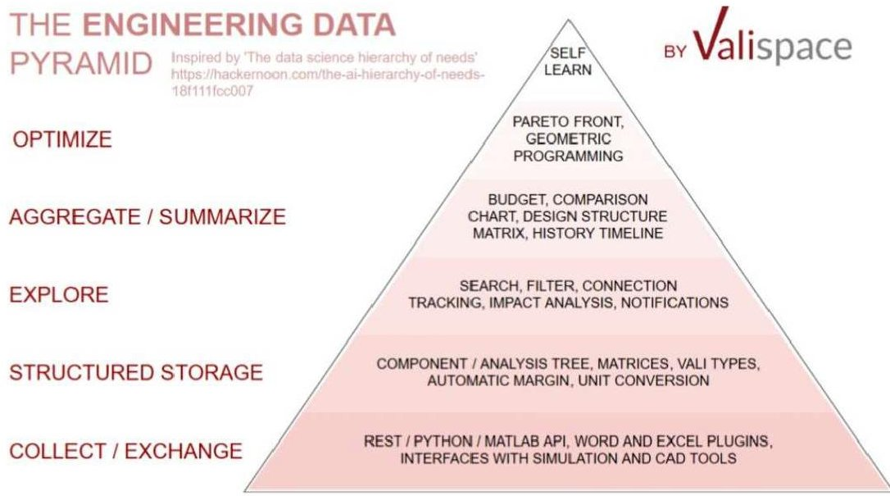


<div align="center">

Figure 1.1: The engineering data pyramid [5].

</div>

In the domain of engineering data management, the "hierarchy of data needs" states that certain fundamental elements of data storage and structure are prerequisites for the effective execution of data analytics, optimisation algorithms and machine learning. For this reason, after the data collection into a unified database, the subsequent stage of the process involves the integration of a structured framework within the data. In order to facilitate clear communication and analysis, values are structured using a simple data model, thus enhancing collaboration and greater

<!-- PDF_PAGE: 25 -->

transparency. Finally, the levels at the top of the pyramid allow advanced exploration, powerful data analytics and automation. [5]

In order to fully embrace a data-driven approach, it is important to establish connections between tools and systems across various disciplines through the utilisation of open APIs. The assurance of consistency in the final design of a space project is dependent on the effective exchange of data between various engineering tasks and their corresponding tools during the design phases. [5]

## 1.3 Model-Based Systems Engineering

Nowadays, the increasing complexity of systems has led to the evolution of concepts and to the research of innovative approaches to implement SE. MBSE has emerged as a strong methodology to support the management of complexity, the maintenance of consistency, and to assure traceability during system development. It is a SE approach defined by the INCOSE as "the formalized application of modeling to support system requirements, design, analysis, verification and validation activities beginning in the conceptual design phase and continuing throughout development and later life cycle phases" [2].

The MBSE methodology is a collection of processes, methods and tools, both theoretical and software, that support the discipline of SE within a "model-based" context. Models are considered the fundamental technical baseline for a project, with the purpose of supporting and facilitating the performance of the systems engineering tasks throughout the system's life cycle. These models, which can be physical, mathematical, or otherwise logical representations of a system, entity, phenomenon or process, are utilised from requirements and analysis definition, through design and implementation, and finally to the verification of the system. A model is not merely a collection of representations, but an integrated repository of the project's knowledge. [7] [8]

MBSE stands as a pillar of the digital transformation in SE. It provides a "more holistic, collaborative, and efficient approach" [9] to develop complex systems. In the document-based method, system information and specifications are primarily generated as documents. The huge number of documents often leads to significant management and updating challenges. It becomes crucial to prevent different team members from simultaneously working on conflicting versions of the same document, thereby mitigating communication issues. Model-Based Systems Engineering, in contrast, formalizes systems engineering practices, utilizing coherent digital system and engineering domain models as the primary means of exchanging information, feedback, and requirements. [9]

<!-- PDF_PAGE: 26 -->

This approach has been demonstrated to offer significant advantages. These include an increased productivity through the reuse of existing models and automated generation of documentation, thus reducing both time and costs.

Furthermore, this approach enhances communication, thereby optimising the exchange of information and establishing a common language not only among engineers from diverse backgrounds, but also between designers and clients.

In addition, the methodology improves the quality of the system through the establishment of a unique, authoritative system model that supports rigorous requirements traceability, enhanced system design integrity and consistent documentation.

MBSE also offers a significant improvement in complexity management facilitating the effective handling of intricate systems by decomposing them into more manageable components. This, in turn, enables the effective mitigation of risk.

It is finally characterised by its ability to facilitate early defect detection thereby minimising inconsistencies and errors, to achieve a more robust and reliable final product. The validation of requirements through design verification serves to increase reliability and reduce risks. [10] [11]

Nevertheless, this approach has its drawbacks. Initially, the adoption of this approach is not an immediate, but rather a gradual process, that necessitates substantial change and training for the team. This involves the acquisition of new instruments and the assimilation of novel modelling languages. It is not unexpected that teams familiarised with more user-friendly, document-based methods may be resistant to such a transition.

Financially, MBSE requires an initial investment to procure the necessary tools for implementation and to support personnel training. Beyond the immediate costs, lack of standardisation presents another issue. As will be demonstrated in the following sections, although international standards do exist, their implementation can vary depending on the tools adopted, leading to inconsistencies.

Finally, integrating MBSE with traditional methodologies can be quite difficult especially when it comes to converting existing documentation into detailed models. The following table 1.2 provides a summary of the advantages and disadvantages of this methodology.

<!-- PDF_PAGE: 27 -->

<div align="center">

Table 1.2: Strenghts and weaknesses of MBSE

</div>

<table border="1"><tr><td colspan="2">MBSE features</td></tr><tr><td>Strenghts</td><td>Weaknesses</td></tr><tr><td>Increased productivity</td><td>Steep learning curve</td></tr><tr><td>Enhanced communication</td><td>Initial high costs</td></tr><tr><td>Improved quality</td><td>Lack of standardisation</td></tr><tr><td>Complexity management</td><td>Complexity in system migration</td></tr><tr><td>Early defect detection</td><td></td></tr></table>

The following sections will delve more deeply into the principles of MBSE, a methodology that, in comparison with DDSE, has been extensively described in the literature. Firstly, the MBSE methodologies currently employed in the industrial sector will be presented, followed by a subsequent section dedicated to the languages employed.

## 1.3.1 Methodologies

According to J. A. Estefan in [7], the word methodology can be defined as a collection of related processes, methods and tools. A process is a logical sequence of tasks designed to achieve a specific objective. It outlines "WHAT" needs to be done, without clarifying "HOW" each task is executed. Processes are structured in layers, allowing for analysis and definition at various levels. A method provides the techniques for performing a task; it defines the "HOW" for each task. Every task within a process is executed using methods. A tool is an instrument that enhances the efficiency of a task when applied correctly to a specific method. Its primary purpose is to make performing the "HOWs" easier. In systems engineering, most tools are software-based, allowing creating models using appropriate languages. Tools should also integrate with each other to ensure completeness, correctness and consistency across the project.

There is also the environment, defined as the surrounding circumstances, external objects, conditions, or factors that impact the actions of an object or an entity. These conditions may be categorised as social, cultural, personal, physical, organisational, or functional. In the context of a project, the environment is designed to facilitate the effective integration and support of its tools and methods. [7]

<!-- PDF_PAGE: 28 -->

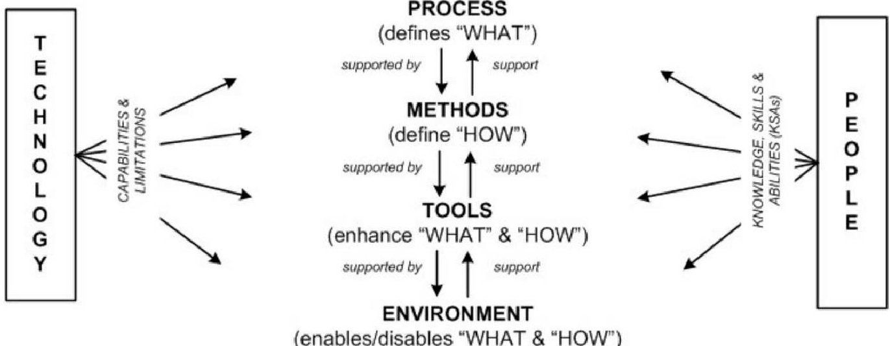


<div align="center">

Figure 1.2: The PMTE Elements and Effects of Technology and People. [3]

</div>

As can be seen in the figure 1.2, when selecting the right mix of Processes, Methods, Tools and Environment (PMTE) elements, both the capabilities and limitations of the technology and the knowledge, skills and abilities of the people are included.

As already mentioned in the previous section, MBSE is about elevating models in the engineering process to a central and governing role in the specification, design, integration, validation, and operation of a system. A variety of models exist to represent the different aspects and types of a system: from models that, in the early life cycle of a system, define different mission and system concepts, to models that support system design solutions. But also models that support the integration of software and hardware components, together with system verification, can be implemented. [7]

Several approaches have been developed in recent years to support MBSE and to implement it. A summary of the leading MBSE methodologies, as detailed in the Handbook [4], is presented below.

INCOSE Object-Oriented Systems Engineering Methodology (OOSEM) It has been developed by the INCOSE since 1998. It can be defined as a "scenario-driven approach" [4], integrating the process in a fully object-oriented context within the model-based approach. A fundamental aspect of the methodology is the delineation of the system's objectives, mission, and operational scenarios. The V-diagram is the most suitable model for the implementation of the product life cycle. It adopts the Systems Modeling Language (SysML) language for the specification, analysis, design and verification of the system.

<!-- PDF_PAGE: 29 -->

The IBM Rational Telelogic Harmony-SE The process is based on the "V" life cycle model, using an iterative workflow through the three phases of requirements analysis, system functional analysis, and design synthesis. It supports the Model-Driven Development (MDD) approach, where the model is the central work product, based on the SysML structure diagrams. However, IBM provides support for Harmony within the IBM Rational tools packages.

The IBM Rational Unified Process for System Engineering (RUP-SE) It enhances the Rational Unified Process Rational Unified Process (RUP) of concurrent design and iterative development for Model-Driven System (MDS) through the utilisation of the spiral model and object-oriented principles. The approach employs business modelling, the first discipline of iterative tasks, to ensure the system's conformity to business activities. The product is characterised by the presence of either a series or a single product with multiple versions. It is also defined by market permanence and service.

The Vitech Model-Based System Engineering This approach involves Vitech's CORE $ ^{\circledast} $ environment as a system design repository, connecting stakeholders, source requirements, behaviour and architecture domains, and verification and validation. The approach is founded on a model of product development, the Onion Model, composed of layers that enable users to progress from the source documents of the customer to the final specifications. The language employed for technical communication is the System Definition Language (SDL), which is predicated on relationships, entities and attributes.

The Jet Propulsion Laboratory (JPL) State Analysis (SA) The JPL has established a methodology for defining model- and state-based control architecture. The states delineate the conditions that the system attains as it evolves over time, while the models specify the evolution of the system states themselves. This method supports the evolution of the system model during the project life cycle, through an iterative modelling process and the state analysis information, which are collected in a Structured Query Language (SQL) database.

The Object-Process Methodology (OPM] It is a "holistic system paradigm [4] based on objects, defined as entities which simply exist, and processes, which are described as transformation patterns applied to the objects. The methodology delineates the system development, life cycle support, and evolution through three stages: requirement specification, analysis and development, and implementation. The OPM integrates the Object-Process Language (OPL) (process-oriented approach) with the Object-Process Diagram (OPD) graphic model (object-oriented approach), supported by the OPCAT software environment.

<!-- PDF_PAGE: 30 -->

The ARCADIA Method It is a model-based engineering methodology for systems, hardware and software architecture design, which has been created by Thales between 2005 and 2010. It is recommended that three mandatory interrelated activities are implemented: Need Analysis and Modelling, Architecture Building and Validation, and Requirements Engineering. The ARCADIA is supported by a standard modelling tool (the Melody Advance/Capella) that depends on the Unified Modeling Language (UML) and SysML languages.

The Systems Modeling Process (SYSMOD) It is a user-oriented methodology for requirements engineering and system architectures. It involves stakeholders analysis, requirements and system context definition, requirements analysis, domain model definition, and system architecture definition by levels (functional, logical, physical). It relies on the SysML modelling language.

## 1.3.2 Modelling languages

In the SE context, while numerical modeling can rely on a solid mathematical apparatus, functional modeling has long suffered from a lack of suitable tools. Fortunately, the development of meta-models based on intuitive graphical languages has filled this gap, allowing designers to communicate effectively with users through the functional model. This summary will explore the main languages used in SE, with a particular focus on UML and SysML.

In the domain of software engineering, the design by objects was effectively supported by the UML language, which was subsequently elaborated enhanced and adapted to the system design as the SysML. UML's primary objective was to create a language that did not rely on mathematics, but on standard diagrams and modeling elements with defined rules and semantics. It allows for a clear description of activities, architecture, operational rules, and interactions (even with the user) through a graphical meta-model.

The adaptation of UML to more general and complex systems led to the birth of SysML. Developed starting in 2001, with significant contributions from INCOSE, SysML is a true customization of UML for systems engineering. It distinguishes itself from UML by introducing modeling blocks instead of classes and robustly supports the modeling of requirements, structure, behavior, and parameters of a system, its components, and its environment. It's fundamental for the MBSE, as it permits key concepts to be visualized through simple effective diagrams. Each block serves as the basic structural unit of the model, representing a system element. [4]

SysML is structured into four main types of diagrams: (i) requirements diagrams,

<!-- PDF_PAGE: 31 -->

specifically introduced in SysML to link the system model to the preliminary elicitation of requirements, a crucial aspect of systems engineering; (ii) structure diagrams, which describe the composition of the system, its components, and their relationships; (iii) behavior diagrams, which illustrate dynamic interactions, activities, and flows within the system; (iv) parametric diagrams that represent a significant innovation, enabling the quantitative modeling of system behavior and architecture, essential for numerical simulations and optimization.

More recently, new updates and evolutions of those languages are proposed to more properly fit some specific applications and domains. A lack of entities in the original UML and SysML has been identified, particularly in sectors like industrial engineering. This has led to the research and development of new generations of communication and modeling tools, such as the Interdisciplinary Modeling Language (IML) or the Automation Modeling Language (AutomationML). Their main goal is not specifically the SE, but their focus is predominantly on the technical domains in which they are currently engaged. In summary, while SysML remains a prevalent tool for SE due to its robustness and versatility, the emergence of new languages and ongoing research indicates a field in constant evolution, requiring increasingly specific and powerful tools to address the growing complexity of modern systems. [4]

<!-- PDF_PAGE: 32 -->

## Chapter 2

## Systems Engineering Tools

The present chapter is dedicated to the analysis of tools suitable for implementing SE, which are a fundamental part of the present thesis project. As mentioned in the previous chapter, the implementation of SE necessitates the utilisation of software tools for the collection of requirements and the realisation of the modelling activity delineated in [4].

Firstly, an introductory overview of the most significant SE tools currently available on the market is presented. Subsequently, the focus is directed towards a detailed exposition of two environments selected for the purpose of integration.

The following list outlines some of the most relevant software programs.

IBM Rational DOORS - Rhapsody The IMB Corporation has designed IMB Rhapsody to work together with DOORS to track and manage design requirements throughout the project's life cycle and to enable navigation between design and requirements. DOORS is currently used for the requirements elicitation, while Rhapsody implements the typical tools of the SysML language, performing system specification and modeling. The interface works by sharing information between the Rhapsody model and the DOORS database. [4][12]

Cameo System Modeler Dassault Systemes has developed an industrial MBSE environment which provides tools for the creation of SysML models and diagrams. The software supports the analysis of the design, the requirements verification, and the decision-making process, while preserving model consistency and monitoring design progress. Its key benefits are: requirements management, traceability among different levels of the project, reports customisation, resolution of parametric models, development and configuration management. [13]

<!-- PDF_PAGE: 33 -->

System Composer It is an MBSE tool, developed by MathWorks, for the purpose of defining, analysing, and simulating system and software architectures. It deeply integrates with the MathWorks ecosystem, including Simulink for detailed behavioral modeling, simulation, and design validation using various diagrams and models, Embedded Coder for direct code generation from software, and Requirements Toolbox for requirement allocation and traceability. It offers robust analysis capabilities for trade studies and comprehensive documentation generation. [14]

Papyrus It is an industrial-grade open source MBSE tool that offers support for both SysML and UML languages. It has notably been used in industrial projects and is the base platform for several industrial modeling tools. It enables engineers to create complex models of systems and to support the entire modelling life cycle, from requirements specification and architecture definition to analysis and simulation via additional plugins, ensuring data traceability during the project. [15]

Valispace The DDSE web-based platform is utilised by engineers for the creation of logical models of a product, in addition to the management of requirements, technical parameters, and design modifications. Technical properties are stored in a single database, with formulas connecting them. It allows engineers from different disciplines and external stakeholders to work simultaneously on a project. Moreover, the single database provides consistency throughout all project phases. It easily integrates with other engineering tools through an API, thus facilitating the tracking of relationships that are situated outside the tool itself. [16]

Capella It is a comprehensive MBSE tool and method to specify and design system architecture, and to manage complexity. It is based on the ARCADIA method. It provides a conceptual framework for the analysis and modelling of system architecture at different levels of abstraction, from operational and system analysis to logical and physical architecture. It offers diagrams and viewpoints to support the engineering process, facilitating collaboration, consistency and traceability. [17]

This was a brief summary of the SE tools that have been most frequently cited in the literature and that appear to be the most widely used in industry.

The next sections focus on the two main tools upon which the thesis is based: Valispace, for DDSE implementation, and Capella, for MBSE. A more detailed description of the features and capabilities of the two software instruments is provided, as well as the method they implement.

<!-- PDF_PAGE: 34 -->

## 2.1 Valispace

DDSE focuses on managing all engineering information as interconnected data points within a single source of truth, and Valispace is a web-based platform that perfectly embodies and enables the DDSE philosophy. It acts as a central hub for all engineering data, moving beyond outdated documents to manage dynamic information. [6].

This approach empowers engineers with a complete, real-time overview of project data and status. It enables the development of logical models, with all their technical properties being stored in a unified, consistent database, with the relevant formulas connecting these properties. This fundamental feature significantly differentiates Valispace from current solutions. The integration of properties with formulas facilitates the immediate visualisation of parameter dependencies, thereby providing a comprehensive understanding of the impact of design modifications on the system. Furthermore, this tool has been demonstrated to significantly enhance collaboration, aiding all engineers engaged in a project in working with consistent project data. It facilitates the exchange of data with suppliers and customers, providing a comprehensive overview of complex systems in real-time and ultimately reducing overall development time. Moreover, Valispace supports the reuse of design information between projects, further increasing efficiency. [16]

An thorough investigation into its main strengths reveals that Valispace is, above all, characterised by its ease of use. The tool does not require training for its use, due to the intuitive web interface design. It has been designed to incorporate a user-friendly workflow, with the objective of reducing the time and effort required for training, thus mitigating one of the disadvantages of current SE tools. As the model becomes more intricate, users can gradually familiarise themselves with the tool's functionality.

Another feature that can be observed is the consistency. Valispace is based on a consistent database. The identification of discrepancies during the early stages of a project is facilitated, thereby avoiding costly and time-consuming consequences that may require additional expenses and rework. Furthermore, the user is automatically informed of any alteration of the engineering data via an integrated notification system.

As a browser-based tool, it does not necessitate installation or a specific platform. It can be deduced that flexibility represents a further strength. Systems engineers have the potential to access data remotely via web browser and to create, store and manage engineering data from anywhere. Additionally, the exportation, importation and direct access of data from alternative tools is facilitated by a dedicated API that enables automated processes and scripting capability.

Finally, the adaptive nature of the web interface allows the configuration of diverse

<!-- PDF_PAGE: 35 -->

perspectives that are aligned with the requirements of different stakeholders. It is not necessary to comprehend a specific MBSE methodology or modelling language in order to obtain pertinent information about the system. [16]

Valispace optimises the engineering process from requirement definition to system design, testing, verification and validation. This systematic methodology is guided by the principles of the "V model", as shown in figure 2.1. [18]

Starting from the Product specification, Valispace allows the integration of


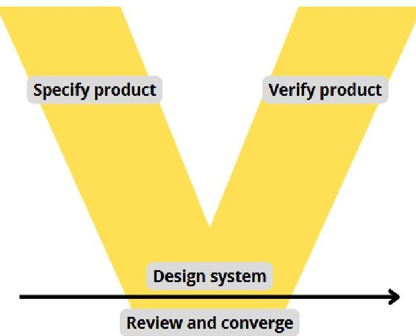


<div align="center">

Figure 2.1: Valispace V-model [18].

</div>

engineering data ( e.g. mass, volume and power consumption) with formulas calculations and simulations through the parametrization of requirements. Indeed, it makes the requirements dynamic, associating them with technical properties thus guaranteeing that calculations are automatically updated in the event of any change.

In the context of System Design, Valispace supports the interaction of physical properties and requirements. Consequently, any changes made will be visible to all members of the engineering team, together with the effect that component variations have on the system as a whole. The tool supports not only rapid design iterations, but also trade-offs. Furthermore, by connecting requirements and components to formulas and calculations, it guarantees that the team is always dealing with the latest data, eliminating the need to check numerous other documents to verify the correctness of the data.

In Valispace, the "V model" is characterised by the automatic and real-time execution of Product Verification. This process occurs in conjunction with the progression of the system model, and by establishing interconnections between requirements, physical units, parameters and calculations. Concurrently, the

<!-- PDF_PAGE: 36 -->

collection, analysis, and integration of requirements and performance data take place.

The system is capable of concurrent management of two distinct data types: requirements data and performance data. These two types of data are continuously checked against each other through automatic verification. Moreover, Valispace allows the creation of customised test procedures based on specific criteria. Once the execution of the requirements has been completed, their verification will be conducted automatically.

Finally, it is possible to conduct Reviews of the data. It is important that all the teams have the capacity to execute and verify any actions that come from reviews conducted directly on the data rather than in additional documents. The efficacy of this system in reducing the time engineers spend retrieving documents has been demonstrated, thereby ensuring that all team members are aware of the actions they need to take.

The Valispace platform is articulated in the following sections, as shown in figure 2.2.


<div align="center">

Figure 2.2: Valispace overview.

</div>

Project Module It provides a project management overview. Users can have access to a range of features to manage the project timeline and to coordinate with colleagues.

Components Module It shows the mission architecture and the product tree of the components constituting the system. The tool lets the user assign different types of properties to each component. These are called valis for numerical values and formulas, dataset for varying values, textvali for text, datevali for date and matrix for properties with different values per state. It is also possible to associate modelists with components, which represent the operational modes of the component in question and which, together with the other properties, will then allow project budgets to be calculated. Another option provided by Valispace is the ability to create trade-offs, offering a clear view of the different alternatives with their respective parameters, thus enabling the most suitable option to be chosen.

Requirements Module It provides an intuitive and effective way to manage the project's requirements. They can be assigned to components or components'

<!-- PDF_PAGE: 37 -->

values, and their verification status can be tracked throughout the design phases. A requirements hierarchy can also be outlined and visualised clearly due to the parent-child relationships.

Analyses Module It gives users the ability to write and manage all the project documents, including graphs, tables, budgets and reports that will be stored in this module.

Scripting Module It allows users to write and run simulations using the Octave or Python programming languages. More complex calculations are what the module is designed to perform.

Tests Module It provides a single place to perform all verification activities, from creation to organisation and tracking. Users can create procedures to verify requirements, equipped with attached files and tags.

## 2.2 Capella

Capella represents an open-source solution for MBSE, that adopts the ARCADIA method. The ARCADIA methodology was developed by the Thales Group and has been employed since 2011 in several projects across a variety of domains, including satellite systems. This "structured engineering method" is dedicated to the definition and validation of the architectures of complex systems [19]. It promotes collaboration between all stakeholders, encouraging an enhanced understanding of real customer needs and facilitating the sharing of product architecture. It enables the execution of iterations from the definition phase onwards, thereby ensuring the alignment of the architecture with all identified needs.

The ARCADIA method is founded on a series of "Golden Rules" [17] that have been established to ensure the robustness and feasibility of architectural design. The integration of need analysis, requirements and architecture definition and validation as essential and interrelated activities is central to the approach.

This method is here elucidated with particular regard to its fundamental principles. The figure 2.3 provides a visual representation of its main engineering levels.

<!-- PDF_PAGE: 38 -->

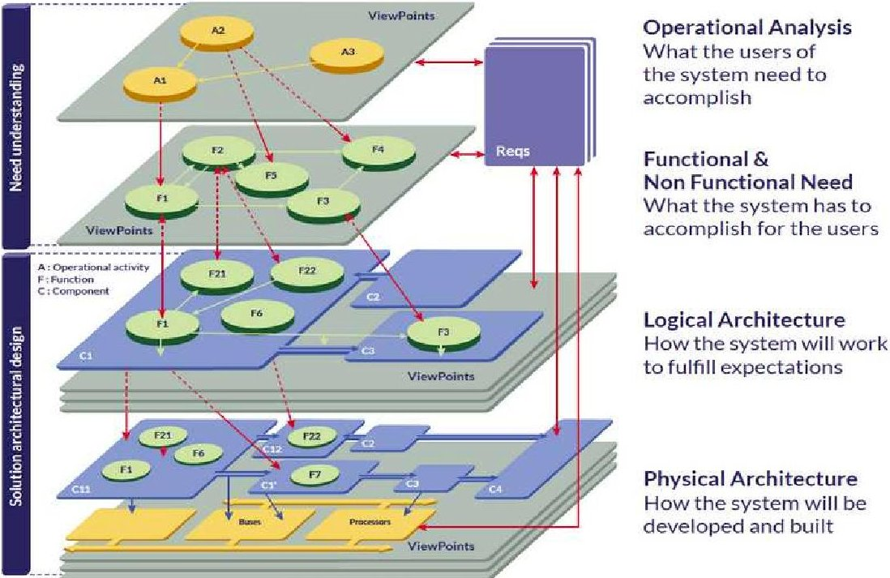


<div align="center">

Figure 2.3: The main engineering levels of the ARCADIA Method [17].

</div>

The following is an overview of these levels [19].

Operational Analysis "What the users of the system need to accomplish."[19] This encompasses more than simply meeting system requirements; it concerns a detailed understanding of the problem from the user and stakeholders' perspectives, before any thought of a technical solution. The process involves the identification of the needs, the establishment of the relevant actors and their respective roles, the formulation of high-level objectives to be accomplished, and the definition of the specific activities to be performed by the actors in order to achieve these aims. The main output is a clear understanding of the overall stakeholders' needs, which is achieved by creating a clear overview of the mission as it is envisioned, independent of any system that might eventually support it.

## System Analysis "What the system has to accomplish for the users." [19]

In this sections, the focus shifts from the needs of the user to the needs of the system itself. The objective is to define how the system will satisfy those needs and what its expected behaviours and qualities will be. At this stage, system functions and data exchanges are delineated, but also non-functional constraints and interactions between systems and operators are clarified. The primary purpose is to verify the feasibility of customer requirements. The main outputs include system functions, interactions between users and external systems, and consolidated

<!-- PDF_PAGE: 39 -->

system requirements. This phase is crucial for specifying the design and requires customer validation.

Logical Architecture "How the system will work to fulfill expectations."[19] This entails an internal functional analysis, which involves the decomposition of system functions into sub-functions and the identification of logical components. The initial step in this process is to define the solution's expected behaviour using functions, interfaces and data flows, taking into account both the system's functional and non-functional needs. These functions are then allocated to one or more logical components. The result is a detailed, structured logical architecture that comprises components, justified interfaces, scenarios, modes and states.

## Physical Architecture "How the system will be developed and built." [19]

This level shares the same core objective as the Logical Architecture, that is to define how the system will fulfill its expectations. However, it establishes the final concrete architecture of the system. This perspective introduces the necessary details and design decisions for implementation. It incorporates all the functions required by the specific technical choices and implementation details, while also highlighting behavioral components (e.g. software components) that will perform these functions. The primary output of this engineering phase is the selected physical architecture, detailing the components that need to be produced.

## End Product Breakdown Structure (EPBS) "What is expected from the provider of each component." [19]

It represents the final and most detailed level of architectural definition. In this section, the conditions that each component of Physical Architecture must fulfil in order to satisfy the constraints and design choices are identified. This level breaks down the physical architecture, thereby ensuring that each individual component meets its specific performance requirements and limitations. This, in turn, facilitates its integration into the system design. This phase is crucial for preparing a robust and secure Integration, Verification, Validation, and Qualification (IVVQ) process.

The method can be both top-down or bottom-up, depending on the project's status. The ARCADIA method supports iterative and recursive application across the system's hierarchy. Any subsystem can be considered the "system" for the next level of analysis, a breakdown that continues until specific subsystems or Commercial-Off-The-Shelf (COTS) are reached. [19]

ARCADIA's objective is to transform the engineering field through the implementation of a model-based approach, that diverges from the conventional

<!-- PDF_PAGE: 40 -->

document-centric methodologies. In order to achieve this result, Thales developed a unified architectural modelling language, Capella, starting in 2007. In contrast to most of the companies that adopted existing tools, Thales prioritized developing the ARCADIA method, based on functional analysis and the allocation of functions to architecture elements, something more familiar to engineers. As a result, Capella intuitively integrates both the method and its associated language. This synergy enables engineers to focus on defining architectures rather than dealing with complex modeling languages like UML or SysML. Capella is a comprehensive framework encompassing the full range of engineering activities, from the initial identification of client requirements to integration, verification, and validation. [19]

A detailed analysis of Capella's characteristics reveals that one of its key strengths is its ability to facilitate enterprise-wide collaboration and co-engineering initiatives. All engineering teams share a common methodology, a unified exchange of information, and a model. This shared model is fundamental to the formalisation of the analysis of operational and functional needs, as well as the definition and justification of the architecture models. The Capella models, constructed for each ARCADIA engineering phase, are integrated through transformations and connected by justification links, enabling comprehensive impact analysis, particularly during evolutions.

Moreover, Capella has been designed for the purpose of architectural design, relying on a Domain-Specific Language (DSL) rather than general languages like UML or SysML, making it easier for users. It manages and scales complexity through its abstraction levels, facilitating model maintenance, large-scale modelling and enabling model evolution and reuse.

Another fundamental aspect of the proposed framework is the focus on the early verification of architectural design to ensure the robustness and feasibility of the design itself. The method establishes a set of rules for preliminary verification, with the aim of validating architectural design in a way that is efficient in terms of time and cost.

The final advantage delineated is the ability to adapt to different projects and organizational needs, ensuring that this solution is not a rigid solution but a flexible framework. Capella balances design drivers (like functionality, performance, cost, safety and security) and constraints to optimise designs and handle different product configurations. This is what renders Capella suitable for this approach, in terms of adaptability and flexibility. [19] [17]

The following areas are shown when entering the Capella interface [19].

Activity Browser It provides guidance through the various engineering phases of your architectural modeling. The software facilitates the generation of new diagrams, while providing a means of creating "transitions" between different

<!-- PDF_PAGE: 41 -->

phases.

Semantic Browser It assists in navigating the model. When an item is selected, the Semantic Browser displays all its references, including contained and related elements, and every diagram related to it.

Project Explorer It is a traditional tree-view diagram that shows the entire Capella model. It provides an overview of all the items and diagrams.

Diagram It presents a graphical representation of a specific component of the model, allowing the processes of creation, modification, and deletion of items, as well as adjustment of their organization or aesthetic characteristics.

Properties This section displays all the properties associated with any selected item.

In conclusion, a brief summary of the types of diagrams available in Capella is presented in the table 2.1.

<div align="center">

Table 2.1: Overview of types of diagrams available in Capella [17].

</div>

<table border="1"><tr><td>Diagram Type</td><td>Description</td></tr><tr><td>Capabilities</td><td>Available in all engineering levels. Used to manage relationships among Missions, Actors, and Capabilities.</td></tr></table>

<!-- PDF_PAGE: 42 -->

<table border="1"><tr><td>Diagram Type</td><td>Description</td></tr><tr><td>Breakdown</td><td>Present at all levels. Show hierarchical decomposition of Functions and Components.</td></tr><tr><td>Data Flow</td><td>Represent exchange of information between functions. Enable highlighting of Functional Chains. Used across all levels.</td></tr><tr><td>Operational Architecture</td><td>Built at the Operational Analysis level. Allocate Operational Activities to Entities. Highlight Operational Processes.</td></tr><tr><td>Architecture</td><td>Used in all levels. Allocate Functions to Components. Highlight Functional Chains.</td></tr></table>

<!-- PDF_PAGE: 43 -->

<table border="1"><tr><td>Diagram Type</td><td>Description</td></tr><tr><td>Scenario</td><td>Represent "vertical sequence of messages" exchanged among elements. Multiple variants available.</td></tr><tr><td>Mode and State</td><td>Represent UML/SysML-like state machines. Link to Functions, Exchanges, and other concepts.</td></tr><tr><td>Class</td><td>Model precise data structures. Associate with Functional Exchanges, Components, and more.</td></tr></table>

<!-- PDF_PAGE: 44 -->

<div align="center">

# Valispace-Capella Integration

</div>

This chapter outlines the methodology employed by this thesis, which is based on the complementary nature of the DDSE and MBSE approaches, as well as the integration of Valispace and Capella tools.

After an initial section that provides a justification for the choices made regarding the adopted methodologies, the core of the integration process is explained. The steps and the roles of the two tools are then highlighted, along with the modalities of their integration.

Finally, the scripts created to export engineered data from Capella for import into Valispace and to compare and ensure conformity between the two environments are detailed.

## 3.1 DDSE-MBSE approach

MBSE has become a widely adopted methodology for the design of complex systems, offering substantial improvements in terms of efficiency and efficacy compared with traditional document-based approaches. However, MBSE tools are currently considered excessively complex as they attempt to address the numerous technical challenges faced by systems engineers. To overcome these limitations, the emerging approach of DDSE has been introduced to complement MBSE. DDSE simplifies the design process and improves collaboration. In particular, it works with engineering data and its associated structures and links to form the basis of the systems engineering process.

<!-- PDF_PAGE: 45 -->

The present thesis aims to develop a methodology that is more agile and flexible than traditional approaches. This research project is inspired by the concept outlined in the paper [20] by Elecnor Deimos, which aims to develop a methodology that exploits the complementarity of DDSE and MBSE, and consequently of multiple tools, with the objective of reducing development costs and times without the necessity for extensive training of personnel. Deimos asserts that this methodology has been successfully employed in numerous missions, encompassing both Earth observation, deep space and scientific missions [20].

The integration of these approaches produces a powerful combination, capable of compensating for each other's weaknesses. In consideration of the conclusions reported in tables 1.1 and 1.2, which provide a detailed exposition of the respective benefits and limitations of the individual methodologies, it is possible to proceed with the critical analysis of the complementarity of the two methodologies, that is summarised in table 3.1.

<div align="center">

Table 3.1: DDSE and MBSE integration.

</div>

<table border="1"><tr><td></td><td>DDSE</td><td>MBSE</td><td>Integration</td></tr><tr><td>System representation</td><td>Engineering data</td><td>Models</td><td>Models provide context for data, that validates models</td></tr><tr><td>Complexity handling</td><td>Management of datasets and requirements</td><td>Hierarchical decomposition of components and functions</td><td>Management of complexity from different perspectives</td></tr><tr><td>Decision making</td><td>Decisions based on simulations and analysis</td><td>Decisions based on system design and architecture</td><td>Decisions based on analysis results and design choices</td></tr><tr><td>Traceability</td><td>Traceability of data, results and requirements</td><td>Traceability of models</td><td>Enhanced traceability of the project through integration</td></tr><tr><td>Ease of use</td><td>Easy to learn, user-friendly procedure</td><td>Steeper learning curve</td><td>Initial complexity of MBSE mitigated by familiarity with DDSE</td></tr></table>

The MBSE provides the architecture and functional connections, thus demonstrating the system's functionality. The model created in Capella serves as a reference structure for the DDSE in managing the data and the requirements derived from it. Conversely, the DDSE supports MBSE models through the definition of concrete engineering data that can be used for analyses and simulations, thereby enhancing the completeness of the project. Together, these tools provide comprehensive support throughout the entire mission life cycle of the product. Moreover, their integration allows for more comprehensive management of project complexity. The

<!-- PDF_PAGE: 46 -->

DDSE provides consistent management of all collected data, while the MBSE breaks down the various components and their functions, making the models easier to understand.

The decision-making process and traceability are also improved, with the two methodologies complementing each other in terms of analysis and simulation results and design choices. Finally, the ease with which the DDSE can be adopted, given its widespread use among companies, mitigates the initial difficulty of approaching the MBSE methodology.

Their combination ensures the continuity of information and the preservation of a "single source of truth." The objective of the integration is to illustrate the efficacy of the design process by allowing for rapid change management, thereby increasing both effectiveness and efficiency.

In view of the numerous challenges and tasks with which the field of SE is confronted, the adoption of a single tool often proves insufficient [20][21]. The present thesis implements this approach using two software tools, Capella for MBSE and Valispace for DDSE, thereby pursuing continuity and conformity between the two through continuous data exchange throughout the entire project. The two tools selected for implementation, conversely, aspire to attain a more robust design, leveraging each other's strengths and limitations. While Capella demonstrates proficiency in architecture definition, functional analysis and operative modes definition, Valispace offers a user-friendly environment, capable of managing engineering data and requirements, in addition to budget estimation, in real time.

The following table 3.2 summarises the main strengths and weaknesses of the two tools.

<div align="center">

Table 3.2: Valispace and Capella capabilities [20].

</div>

<table border="1"><tr><td></td><td>Valispace</td><td>Capella</td></tr><tr><td>Requirements</td><td>Excellent for requirements management, including digitization, flow-down, traceability, and ease of export; highly user-friendly.</td><td>Strong in requirements management, including propagation and traceability with model elements.</td></tr><tr><td>Concept of Operations</td><td>Poorly suited.</td><td>Very strong for defining ConOps through sequence diagram and VPMS Add-On.</td></tr><tr><td>Modes and States</td><td>Not very strong, but it allows for modes definition and allocation to components and their values (useful for budgets).</td><td>Strong for detailed modeling of modes and states with triggers and transitions.</td></tr></table>

<!-- PDF_PAGE: 47 -->

<table border="1"><tr><td></td><td>Valispace</td><td>Capella</td></tr><tr><td>Functional Analysis</td><td>Poorly suited.</td><td>Very strong for modeling of functionalities and functional interfaces at various levels through the use of breakdown diagrams.</td></tr><tr><td>Architectures</td><td>Weak, it allows the physical architecture definition but it is intended for use in engineering data management. Useful for trade-offs.</td><td>Very strong for logical and physical architecture definition, functions allocation to components and functional chains.</td></tr><tr><td>Budgets and Simulations</td><td>Very strong for modeling components with "non-static sizing values", providing budgets and simulations.</td><td>Weak, its main focus is on static data related to components.</td></tr><tr><td>Team collaboration</td><td>Very strong for real-time collaboration, including reviews, notes, and notifications.</td><td>Strong with the support of Add-Ons.</td></tr><tr><td>Real-time coordination</td><td>Very strong, it supports real-time coordination, with constantly updated information shared among all participants.</td><td>Weak, it allows shared models, but not in real time.</td></tr></table>

## 3.2 Integration

In view of the considerations expressed in the previous section about the DDSE-MBSE approach, this section elaborates on the integration process of the two tools, Valispace and Capella, the responsibilities of each of them, and the measures implemented to guarantee compliance between the two. The figure 3.1 provides a high-level overview of the process, which will now be analysed in detail.

Firstly, it is essential to clarify the roles of the two tools: Capella will be established as the master, the principal entity responsible for the mission and system architecture, while Valispace will fulfil a supporting role, managing all engineering data, requirements and budgets. It is important to note that Valispace will be the entity that must adapt to the changes and choices made by Capella. In order to achieve this objective, a number of Python scripts have been developed. These scripts execute two main functions: firstly, they enable the export of data from Capella, and secondly, they allow the subsequent import of this data into Valispace. Furthermore, these scripts verify the consistency between the two at the system level. To implement this solution, it was determined that the Capella add-on, designated Python for Capella [22], and the Valispace API [23] would be utilised. These will be explored in greater depth in the following sections.

<!-- PDF_PAGE: 48 -->

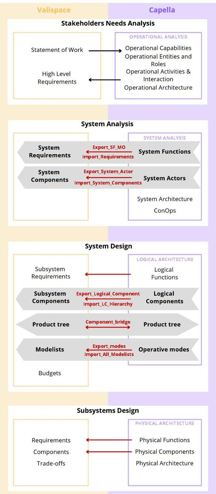


<div align="center">

Figure 3.1: Tools integration process.

</div>

The next paragraphs will analyse the integration process step-by-step. As shown in figure 3.1, the two environments Valispace and Capella have been divided to highlight the functionality attributed to each. In addition, the various engineering

<!-- PDF_PAGE: 49 -->

levels are presented from the top to the bottom according to the ARCADIA method.

It is possible to discern different types of arrows. The first type of red arrow displays a script above it, which defines the implementation of the Python code and, consequently, the establishment of the connection between the two environments. The red ones without any reference above represent a possible connection between the two environments via codes not implemented in this study. Finally, the black arrow simply defines the flow of the work.

The following discussion will proceed through a gradual examination of each respective level.

## Stakeholders Needs Analysis

The initial phase of the project begins with the Statement of Work (SoW), which delineates the objectives and constraints of the project. The initial mission and customer needs are then identified and defined as requirements on Valispace. The subsequent phase involves conducting the actual Operational Analysis on Capella, encompassing the stakeholder needs analysis, the identification of the entities involved, and the allocation of related activities to them, thus producing the Operational Architecture. The diagrams generated on Capella will facilitate the definition and refinement of the high-level requirements on Valispace, also providing the necessary context for their consolidation during the system's architectural definition on Capella. In this particular instance, the implementation of a script was not considered a required measure to ensure the consistency of the two environments. It is evident that the stakeholder needs analysis is more successfully executed on Capella. Conversely, Valispace exclusively handles the management of the requirements themselves.

## System Analysis

The objective of this level is to establish the configuration of the system that will satisfy the requirements of the users. In this context, the process begins with the System Analysis on Capella, where a functional analysis is conducted and the involved actors are determined. In this case, two sets of scripts are implemented to facilitate the process.

Starting from the functional analysis, the Export_SF_MO.py script (3.3) exports the functions of interest modelled on Capella and the Import_Requirements.py (3.4) imports them into Valispace in the form of Requirements. Among the other scripts, Export_System_Actor.py (3.3) exports the actors defined on Capella and Import_System_Components.py script 3.4 imports them into Valispace as Components, thereby enabling the

<!-- PDF_PAGE: 50 -->

definition of a compliant mission architecture in the DDSE environment.

The next step of the process is the elaboration of the detailed System Architecture on Capella, along with the definition of the Concept of Operations (ConOps) in the same environment, through the use of the ViewPoint Modes and States (VPMS) Add-On [24]. As previously observed, the diagrams developed in Capella help to consolidate and satisfy the requirements stored in Valispace. This statement is applicable to all levels.

## System Design

The process at this level also begins with Capella's Logical Architecture which defines the detailed internal logical structure of the system, enabling the decomposition of the functions and their allocation to Logical Components (in this case, the subsystems of the system). In this phase, there are multiple scripts available to facilitate the integration. As with the previous level, the first two sets of Python scripts follow the same logic as the two implemented in the System Analysis.

Although not implemented in this particular instance, it is possible to establish new requirements on Valispace, starting from the Logical Functions defined on Capella, by making minor changes to the scripts Export_SF_MO.py and Import_Requirements.py.

The second set of scripts is responsible for the exportation of the complete hierarchy of Logical Components created on Capella through the Export_Logical_Component.py script 3.3, subsequently bringing them into Valispace using the Import_LC_Hierarchy.py code 3.4, while ensuring the maintenance of the hierarchy.

At this point, a "bridge script" has been formulated in order to ensure conformity between the two environments. The script in question is Components_bridge.py 3.4 and its function is to compare the entire hierarchy of components (i.e. the Product Tree) established in the two tools, compare them, and show a report to the user underlining the discrepancies between the two environments. Consequently, if a component appears to be missing in Valispace when Capella is considered the master, the missing component will be imported into Valispace automatically to restore conformity.

Another activity undertaken on Capella has been the definition of the modes and states diagram, which facilitates a detailed analysis of the operative modes. These modes are exported from Capella through the Export _modes.py script 3.3, and then imported via the designated script Import_All_Modelists

<!-- PDF_PAGE: 51 -->

3. 4 on Valispace as Modelists, and assigned to the component of interest.

The final steps involve the development of a Logical Architecture on Capella, with the allocation of functions to components, and the estimation of budgets (mass, volume, power) on Valispace. The latter process exploits the imported operative modes and the engineering data, already defined and assigned to the components on Valispace.

## Subsystems Design

The final level to be implemented is the physical one, which, in this case, has not been completely developed but has barely been started with the aim of showing the process and of completing it in the future. The objective of this phase is to define the final physical architecture of the system, including the selected physical components and their technical characteristics.

The procedure starts on Capella with the definition of the Physical Architecture In this particular case, the development of a single subsystem has been conducted with the purpose of demonstrating certain functionalities of the process. As in the previous phases, the requirements defined on Valispace are consolidated by the architectures defined on Capella.

The same scripts that facilitate the establishment of requirements and the transfer of components from Capella to Valispace are also applicable at this level, with minor changes.

This level also allows for an increasingly detailed analysis of the system, both of the architectural model and of the operative modes, which can now be applied to the physical components, consequently creating more detailed budgets on Valispace. Furthermore, it is important to demonstrate Valispace's capacity to efficiently manage trade-offs between components.

## 3.3 Python for Capella

Python for Capella is an open-source add-on of Capella that enables interaction with models built on Capella via Python. This solution supports the creation of Python scripts, which are utilised for the extraction and importation of information from and about the model itself. Given that the extraction of model information constitutes a crucial step in the execution of the project, the add-on proved to be very useful.

Technically, Python for Capella includes Eclipse EASE to allow script execution, PyDev for script edition and finally a Python Interpreter. It therefore supports the use of a common coding language, Python, and provides high-level example scripts that are accessible to the user but can be totally customised and modified, as well as being easily shared and used. [22] It is crucial to acknowledge that the

<!-- PDF_PAGE: 52 -->

execution of these codes is exclusively possible within the Capella framework, as Python for Capella constitutes an internal API.

The figure 3.2 illustrates the architectural levels on which this solution is based. The purpose of the solution is highlighted in red, while the contributions of the users are indicated in blue.


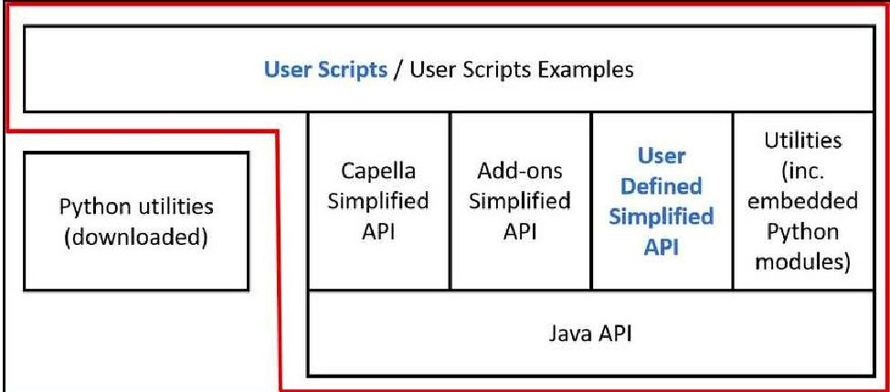


<div align="center">

Figure 3.2: Python for Capella architecture [22].

</div>

Among these levels, the Java API bridges Python with Java, providing support for data extraction and import. Python Technical Libraries simplify operations for users by enabling the definition of high-level scripts. They provide libraries, including the definition of the Capella metamodel. Lastly, High-Level User Scripts define the environment within which users implement specific actions to be performed, with default examples provided to demonstrate the capabilities.

Python for Capella is supplied with default libraries and relies on a simplified metamodel to facilitate the definition of scripts by end-users. Moreover, documentation is generated from this model to know more about its content [25]. This solution is highly customizable, extensible for Capella metamodel add-ons, and clearly separates technical scripting from high-level user scripts. In summary, Python for Capella empowers users with programmatic access and automation capabilities to manage, analyze, and exchange data within their Capella models more efficiently.

Starting from the scripts already available in Python for Capella environment [22], these were modified and adapted to be able to satisfy the requests of the project. The following codes have been implemented within the Capella environment and utilised for the purpose of integration. In order to obtain a more accurate understanding of them, it is recommended to consult the appendix A, where the complete scripts are available.

<!-- PDF_PAGE: 53 -->

## Export__SF__MO.py

This script extracts from Capella all the functions of the layer of interest, in this case the System Analysis level, and exports them into an Excel file, divided into three sheets. The first sheet "All System Functions" comprises all the functions of the level of interest and their characteristics, that include the name, ID, description and the identification of those functions which are leaf functions. The second sheet "Leaf Functions" contains only the leaf functions and their related information. The third sheet "Mission Objectives" contains the leaf functions relating to a root function of the user's choice. This layout has been configured with two objectives in mind: firstly, to facilitate the complete export of all functions, and secondly, to enable their import into Valispace.

The configuration of the Excel file is totally customisable. In this particular instance, the script was implemented with the objective of deriving the leaf functions from the root function "To satisfy mission objectives", and subsequently creating new requirements in Valispace, based on the aforementioned functions.

The script is readily adaptable, allowing for its implementation in other Capella's levels and for the generation of a distinct Excel file format.

## Export__System__Actor.py

This script simply extracts all the System Actors created at the System Analysis layer on Capella and lists them in Excel format.

## Export__Logical__Component.py

This script extracts all the Logical Components defined at the Logical Architecture level on Capella. The extraction process starts with the selection of a component by the user, from which all the components that originate from it are exported. The script reports the component's hierarchy throughout the extraction process. In order to facilitate the import operation into Valispace, the data is extracted in Excel format as follows: the names of the components are placed in one column, the names of its parent in another, and a number indicating its hierarchy level in a third. If the number of the hierarchy level is 1, the component is at the top of the hierarchy tree; if the number is 2, the component is one level down, and so on. It is important to note that, with negligible alterations, this code can be executed on different Capella levels, thereby encompassing the components of interest and their respective hierarchies.

<!-- PDF_PAGE: 54 -->

## Export__modes.py

The purpose of this script is to enable the exportation of Capella's Modes, defined via the MSM diagram, as a list of them in Excel format.

## 3.4 Valispace Python API

Valispace exposes an open Representational State Transfer (REST) API, which can be queried using Python libraries. Its primary objective is to facilitate the process of interacting with Valispace's data. In this project, the software was employed to develop customised scripts capable of interacting with the platform and with data previously extracted from Capella. This solution is characterised by its simplicity and ease of use.

The initial step involves the installation of the library within the selected Integrated Development Environment (IDE). Subsequent to this, authentication on Valispace is required, which can be achieved through the utilisation of either API tokens generated on Valispace or via Valispace's username and password. It offers a simple and intuitive method of executing Create-Read-Update-Delete (CRUD) operations, which represent the fundamental vocabulary for interacting with any data management system. In particular:

- Create (C) to add new data into Valispace through POST Hypertext Transfer Protocol (HTTP) method;

- Read (R) to retrieve existing data from Valispace through GET HTTP method;

- Update (U) to modify existing data in Valispace through PUT/PATCH HTTP method;

- Delete (D) to remove existing data from Valispace through DELETE HTTP method.

The following list comprises the scripts created exploiting this API. The primary function of these codes is to support the import of data previously exported from Capella into Valispace, as well as to enable a comparative analysis of the data defined in the two environments.

## Import__Requirements.py

The present script retrieves the functions associated with the mission objectives and their corresponding descriptions from the Excel file that has been generated by the Export_SF_MO.py 3.3. These functions are then imported into Valispace as new Requirements.

The user is required to specify the Identification (ID) of the Specification under

<!-- PDF_PAGE: 55 -->

which the new requirement will be allocated. The script will then generate a new Requirement with an identification number that is consistent with the nomenclature and in line with the previous ones in terms of numbering.

In order to facilitate this process, it has been determined that the "description" section of the System Functions in Capella should include the text of the associated requirement, thus enabling it to be imported automatically and without modification.

## Import__System__Components.py

This script imports the list of System Actors, that has been previously exported from Capella to an Excel file, through the Export_System_Actor.py script (3.3), as new Components in Valispace.

## Import__LC__Hierarchy.py

The present script utilises the export results of the Export_Logical_Component.py code (3.3), which contains the components with their hierarchy derived from the Capella design, and imports them into Valispace while maintaining consistency. The user is required to specify the ID of the component from which the import process shall begin.

## Components__bridge.py

This script has been created with the intention of creating a bridge between the two tools, Valispace and Capella, verifying the correctness and consistency of their Product trees. In this case, a comparison among the various components, checking also the coherence of their hierarchy, is made at the Logical Architecture layer of Capella.

In particular, the code has been implemented through six main functions: once all the Components have been retrieved from the Valispace project through the get_all_project_components function, the get_valispace_parent_child_hierarchy function builds the hierarchy by identifying their parent-child relationships. Then, the get_excel_data function reads the Excel file extracted from Capella, taking all the values and converting them into a string, ensuring that the format is compatible with Valispace's one. The compare_lists function compares the two lists of parent-child relationships, derived from the two tools, and displays a report of the analysis in the console, specifying which components are inconsistent.

Furthermore, considering Capella as the master tool, an automation process has been implemented through the comps_to_import_to_Vali function which, in the event that elements present in Capella are missing in Valispace, automatically

<!-- PDF_PAGE: 56 -->

proceeds to insert these missing components into the Valispace environment, while maintaining compliance with Capella.

## Import__All__Modelists.py

The present script, starting from the export of the Capella operative modes through the Export_modes.py script (3.3), imports these as Modelists into Valispace and assigns them to the Component defined by the user.

<!-- PDF_PAGE: 57 -->

## Chapter 4

## Case study

The present chapter is dedicated to the practical implementation of the methodology delineated in the previous chapter, with the objective of validating its efficacy in a space mission context. In order to illustrate this process, a case study is presented, which relates to the design of a small satellite mission, which has been named GeoProfundo. The mission has two objectives: the first concerns the emulation of an interplanetary environment in LEO, and the second is an Earth observation objective. The subsequent paragraphs provide a detailed study of this mission, outlining the phases to be followed in accordance with the integration methodology. The work carried out on Valispace and Capella is also provided, emphasising how the adopted approach ensured compliance and conformity between the two tools.

## 4.1 Mission Overview

This section addresses the objectives of the GeoProfundo mission, which is framed within two domains: deep space exploration and Earth observation.

The first domain represents a technical challenge for small satellites. Due to the reduced costs and rapid development cycles, these satellites are destined to play an increasingly significant role in the future of deep space missions. In the context of the mission, they should serve as cost-effective in-orbit demonstrators of critical technologies for future deep space applications, within the limitations of the LEO environment. In particular, the demonstration should focus on navigation, communication and operations capabilities, which are critical for deep space.

On the other hand, the Earth Observation domain presents the scientific challenge of monitoring the effects of UHI phenomenon in European cities. The UHI phenomenon has been shown to have a significant impact on the thermal

<!-- PDF_PAGE: 58 -->

environment of urban areas, causing them to exhibit higher temperatures in comparison to suburban and rural regions. It is caused by the "heatwaves", defined as prolonged periods of extremely high temperatures. [26] [27] Whilst it is true that this service already exists, this can be further supported by small satellites, that can be specifically targeted towards a designated area, with the objective of addressing the specific requirements of the relevant stakeholders and end users.

The mission statement of the Geoprofundo mission has been defined as follows: "The mission should act as a technology demonstrator in LEO for future deep-space small satellite missions, focusing on navigation, communication and operations technologies. Additionally, the mission should monitor relevant environmental parameters across European urban area providing critical insights into the UHI effect."

The mission goals that can be derived are: (i) to validate small satellites' technology capabilities for deep-space navigation, communication, and operations in a LEO environment and (ii) to monitor and quantify relevant environmental parameters providing critical insights into the UHI effect. The SoW provides a list of drivers and high-level requirements, which can be consulted in the table 4.1.

<div align="center">

Table 4.1: High Level Requirements and Drivers

</div>

<table border="1"><tr><td>Req.ID</td><td>Statement</td></tr><tr><td>R-MIS-010</td><td>The mission shall support autonomous operation for a minimum of 10 (TBC) days without human intervention.</td></tr><tr><td>R-MIS-020</td><td>The mission shall simulate Mars communications architecture, achieving a minimum delay of 13 TBC minutes for signal transmission.</td></tr><tr><td>R-MIS-030</td><td>The mission shall support in-situ mapping with a spatial resolution of at least 100 (TBC) meters.</td></tr><tr><td>R-MIS-040</td><td>The mission shall be operative with only 1 launch.</td></tr><tr><td>R-MIS-050</td><td>The mission shall be operative with only 1 launch.</td></tr><tr><td>R-MIS-060</td><td>The mission shall be compatible with at least 2 commercial launchers.</td></tr><tr><td>R-SYS-010</td><td>The spacecraft mass shall not exceed 50kg.</td></tr><tr><td>R-SYS-020</td><td>The spacecraft shall have propulsion capability onboard. Rationale: towards zero debris policy e.g. Collision Avoidance Manoeuvre (CAM)</td></tr><tr><td>R-DES-010</td><td>The mission shall be compliant with respect to Space Debris Mitigation Policy of the European Space Agency.</td></tr><tr><td>D-MIS-010</td><td>The mission shall preferably use European technologies.</td></tr><tr><td>D-MIS-020</td><td>The Mission should reuse as much as possible existing Earth infrastructures, ground antennas and logistics for operations.</td></tr><tr><td>D-MIS-030</td><td>Existing off-the-shelf products and technologies for both Ground and Space Segments should be selected when possible.</td></tr></table>

<!-- PDF_PAGE: 59 -->

## 4.2 Stakeholders Needs Analysis

The process starts with the importation of the initial mission and client needs derived from the SoW and listed in table 4.1, into Valispace as high-level requirements and drivers.

Then, preliminary mission studies concerning the stakeholder needs analysis are conducted on Capella. This analysis is implemented at the first level of the ARCADIA method, known as Operationa Analysis (OA), which is the current focus. As previously stated, this phase entails the identification of the entities, i.e. the stakeholders, who will interact with the system, along with the activities allocated to them and the interactions between these entities.

The primary objective of this study is to identify the needs and objectives of the users. The Operational Analysis in Capella involved the creation of a "domain model" [19], independently of the future system to be realized. The idea is to voluntarily create a level of abstraction from the system under study in order to focus on the "real" needs of the different stakeholders.

Before proceeding to the description of the process, it is first necessary to provide a summary of the terminology employed in this particular context 4.2.

<div align="center">

Table 4.2: Operational Analysis terminology [19].

</div>

<table border="1"><tr><td>Symbol</td><td>Element</td><td>Description</td></tr><tr><td>OC</td><td>Operational Capabilities</td><td>Organisation&#x27;s capacity to provide a service that satisfies the highest level objectives.</td></tr><tr><td>OE</td><td>Operational Entity</td><td>A real-world entity that interacts with the system and its users.</td></tr><tr><td>OA</td><td>Operational Activities</td><td>The steps that a process must take in order to achieve a specific objective and which are realised by an entity.</td></tr><tr><td></td><td>Operational Interaction</td><td>The exchange of information between the various activities.</td></tr><tr><td>OP</td><td>Operational Processes</td><td>Distinct set of activities and interactions that are interconnected by a common capability.</td></tr></table>

To proceed with the description of the procedure, the first diagram created on Capella was the OCB diagram 4.1, that allows for the creation of Operational Capabilities, Operational Entities and the relations between them. Initially, the main stakeholders involved in this mission were identified. A key stakeholder is the European Space Agency (ESA), which can be interested in both the implementation and testing of new technologies in deep space, and in complementing and improving

<!-- PDF_PAGE: 60 -->

the service offered by Copernicus on UHI analysis [26] [28]. Furthermore, research bodies and universities are interested in both aspects of the mission, depending on their field of research. This interest is related to the data collected and the goodness of knowledge return. Furthermore, the space industry is to be considered, in terms of companies interested in testing new technologies for deep space and Earth observation. The objectives of these companies are dual: firstly, to increase the Technology Readiness Level (TRL) of their products, and secondly, to gain experience.

The last Entity is associated with end users, who will benefit from the outcomes of the scientific part of the mission. In this case, there are many different entities involved, including national and regional governments seeking to improve the quality of life in cities and to support green urbanism, in the latter case together with architects and urban planners; environmental organisations and public authorities interested in protecting the environment and public health, but also concerned about the effects of climate change. [29][30][31] Finally, there are energy providers who are interested in monitoring the UHI effect in order to make new improvements in the management of increasingly demanding energy.

Despite the potential involvement of numerous other stakeholders in the mission, the individuals with the greatest influence and power are highlighted here. This is illustrated in the legend of the figure 4.1, which differentiates between Promoters, who possess significant interest and influence, and Defenders, who have a high level of interest but less influence.

Consequently, three Operational Capabilities were delineated. The first one is the "Mission Lifecycle" and concerns the steps that the satellite design and development process must go through in order to realise the final product. These steps begin with the funding of the mission and end with the release of the satellite into the orbit. The other two Capabilities focus on the mission's high-level objectives: one is the scientific objective of "[Scientific Obj] UHI effect mapping and detection", and the other is the technological objective of "[Technological Obj] Deep space technologies validation in LEO". These objectives align with those previously mentioned in the Mission Overview section (4.1) and will be addressed in greater detail subsequently.

Finally, the interactions between Capabilities and Entities are highlighted in the diagram.

<!-- PDF_PAGE: 61 -->

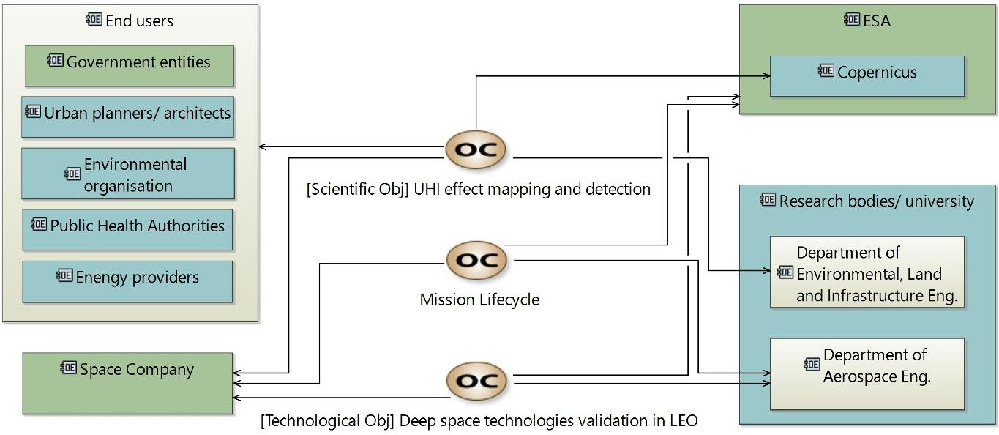


<div align="center">

Figure 4.1: OCB Operational Capabilities

</div>

The following step in the process is the creation of an OAIB diagram for each of the Operational Capabilities. The OAIB is a data flow diagram that can be related to each Capability and allows for the creation of a set of Activities, as well as the Interactions that links them. The OAIBs created are shown in figures 4.2, 4.3 and 4.4. They enable a more detailed analysis of the high-level mission objectives at an abstract level, without going into the technical specifics of implementation. In summary, they establish a comprehensive and precise understanding of the system's operational requirements before the implementation process is addressed. For instance, the diagram in the figure 4.3 illustrates the process that the collected environmental data should follow in order to reach the various users. Among the environmental data necessary for measuring the UHI effect, Land Surface Temperature (LST) data and several spectral indices have been selected, including Normalised Difference Vegetation Index (NDVI), Normalised Difference Built-up Index (NDBI) and Modified Normalised Difference Water Index (MNDWI). However, here the focus is on the path that the data will follow to satisfy stakeholders. The same applies to the OAIB Technological Objective diagram in the figure 4.4.

<!-- PDF_PAGE: 62 -->

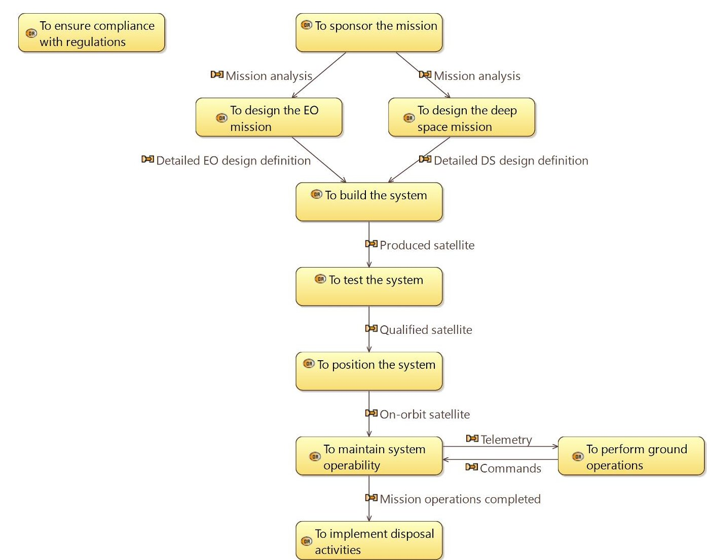


<div align="center">

Figure 4.2: OAIB Mission Lifecycle

</div>


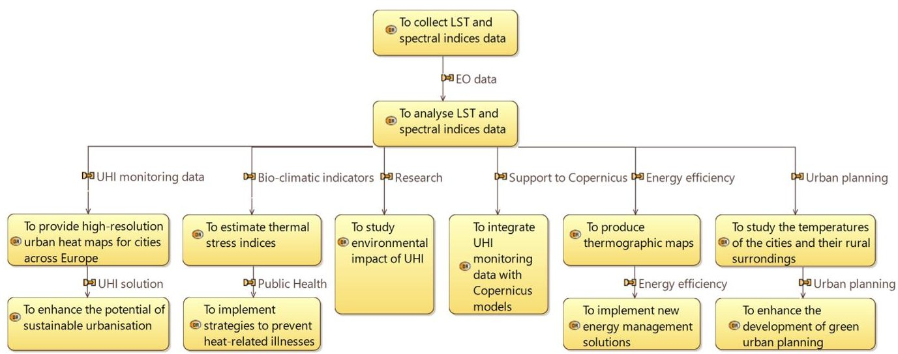


<div align="center">

Figure 4.3: OAIB [Scientific Obj] UHI effect mapping and detection

</div>

<!-- PDF_PAGE: 63 -->

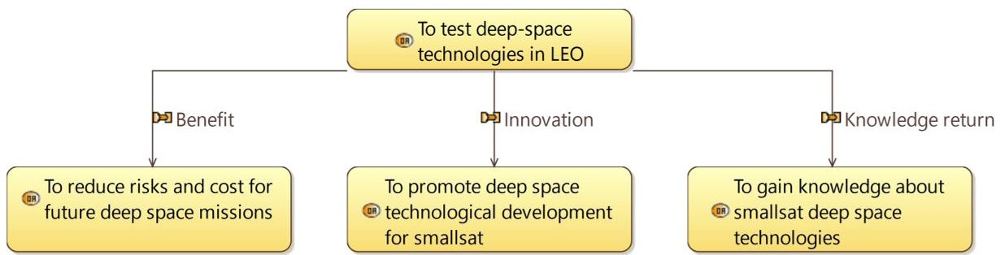


<div align="center">

Figure 4.4: OAIB [Technological Obj] Deep space technologies validation in LEO

</div>

Finally, the OAB architecture diagram was created. It is probably the most important at each level of engineering since it offers the most complete overview of the level. It essentially allows the Activities, defined in the OAIB diagrams, to be allocated to each responsible Entity that will perform them.

In order to address the complexity involved in developing a space mission, Consortia (i.e. strategic partnerships) are frequently established. These are temporary collaborations among multiple entities with the objective of achieving a common goal, in this case the development of the satellite itself. Initially, roles related to the Consortium were identified and assigned to the relevant entities, as illustrated in the figure 4.5 by the purple rectangles. The definitions under discussion are primarily related to the "Mission Lifecycle" Capability, as illustrated by the use of blue arrows to denote the associated Operational Process.

The roles in question include that of the Sponsor, in this case the ESA, that is responsible for financing the mission, defining its general objectives and, in this case, also acting as the regulatory entity. Then the role of Principal Investigator (PI) was introduced as the scientific responsible for the mission. In this particular instance, given the dual purpose of the mission, two PIs have been delineated: one related to the scientific objective of the mission, i.e. the Department of Aerospace Engineering of a university, and the other connected to the technical scope, i.e. an aerospace company.

Additionally, a Prime Contractor, named Prime, is involved and is defined as an entity responsible for the overall management of the technical implementation of the product.

The diagram also illustrates the Operational Processes associated with the two primary mission objectives identified in this study, which are represented by red and green to denote scientific and technological Capabilities, respectively. Consequently, all interactions between the entities and the functions assigned to them are clearly visible.

<!-- PDF_PAGE: 64 -->

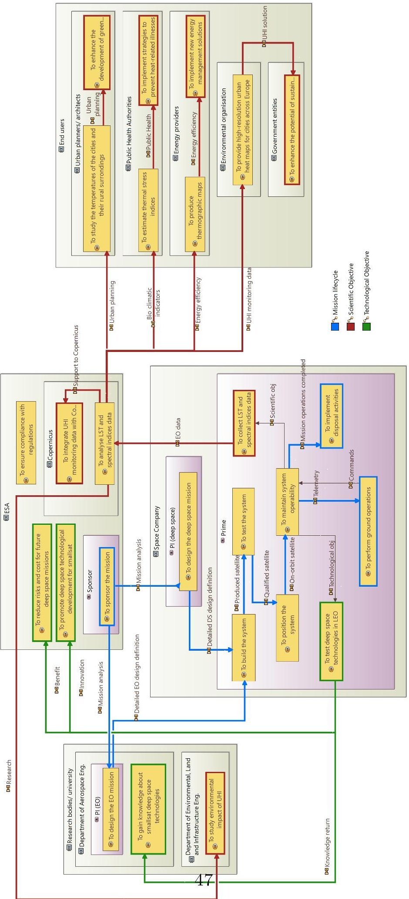


<div align="center">

Figure 4.5: OAB Operational Entities

</div>

<!-- PDF_PAGE: 65 -->

Finally, an OES diagram shows the process represented in the OAIB or in the OAB diagrams, but focusing on the chronological aspects, thus describing the sequence of interactions in time. In this case, an OES diagram for the "Mission Lifecycle" Capability has been developed and it is shown in the figure 4.6. LOOP fragments in it indicate that the process represented is repeated every day.


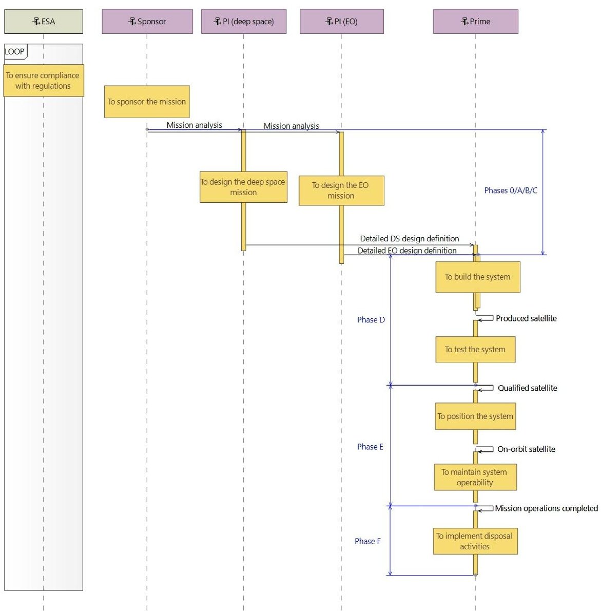


<div align="center">

Figure 4.6: OES Mission Lifecycle

</div>

Subsequent to the completion of the Operational Analysis on Capella, the process returns to Valispace, where any newly identified mission requirements will be integrated and the analysis conducted on Capella will be verified as a means of ensuring compliance with the requirements imposed on Valispace.

<!-- PDF_PAGE: 66 -->

## 4.3 System Analysis

The focus now shifts to the System Analysis, which is initially implemented at Capella's System Analysis level. In this case, the emphasis is directed towards the system itself, defining its functionality and its external interfaces. This is achieved through a high-level functional analysis and a definition of the Actors involved. These actions will subsequently result in the definition of the ConOps and the mission architecture.

As in the previous section, the table 4.3 provides a concise summary of the main Capella's concepts that are highlighted in this section.

<div align="center">

Table 4.3: System Analysis terminology [19].

</div>

<table border="1"><tr><td>Symbol</td><td>Element</td><td>Description</td></tr><tr><td></td><td>System</td><td>A group of elements that function as a single entity(black box)and respond to user needs.</td></tr><tr><td></td><td>System Actor</td><td>An entity external to the System(whether human or not)with which the System itself interacts.</td></tr><tr><td></td><td>System Capability</td><td>The System&#x27;s capacity to provide a service that enables the accomplishment of high-level objectives.</td></tr><tr><td></td><td>System Function</td><td>A function accomplished by the System itself,or by anActor,constituting a behaviour of the system.</td></tr><tr><td></td><td>Functional Exchange</td><td>A unidirectional exchange of information between twoFunctions.</td></tr><tr><td></td><td>Component Exchange</td><td>An interaction between theSystem and theActors.</td></tr><tr><td></td><td>Functional Chain</td><td>A specific pathway among all possible functional paths,which is useful for the identification of constraints.</td></tr></table>

As outlined in the manual [19] included in the bibliography, there are two methods for transitioning from the Operational Analysis to the System Analysis level on Capella. One method uses the "transition" function to move Operational Entities, Capabilities and Functions directly from one level to another. The other solution, which has been chosen for this case study, keeps the two levels separate, even if a certain continuity is noticeable. In the System Analysis level, the focus is indeed on defining high-level System Functions that are no longer associated with the role of the stakeholders. The System is identified as a modeling element, i.e. a "black box" containing no other structural elements. [19]

The design process starts with the CSA diagram in figure 4.7, which is one of the

<!-- PDF_PAGE: 67 -->

first diagrams to be realised in the System Analysis on Capella. It defines the System of Interest (SoI), namely the "Space Segment", that, in this case study, is the GeoProfundo satellite, and new System Actors.

Some of the Operational Entities previously identified at OA have been transitioned to System Analysis (SA). The definitive set of System Actors comprises the Launch Site and Launcher, which belong to the Launch Segment; the Mission Control Center (MCC), which plans operations; the Ground Segment, which manages ground operations; Copernicus, which integrates the collected environmental data with its models; and finally an entity called Environment, which embodies space environmental behaviour.


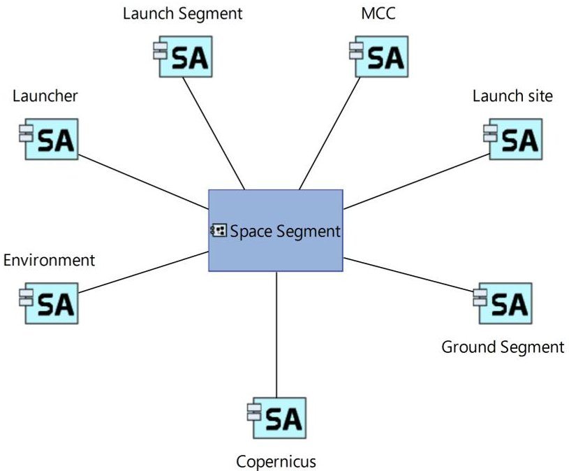


<div align="center">

Figure 4.7: CSA System

</div>

These Actors defined on Capella were then imported as Components into Valispace using the two aforementioned scripts, Export_System_Actor.py (3.3) and Import_System_Components.py (3.4). This ensures consistency between the two tools at an early stage, avoiding errors later on. These new System Components are included in the System Design section of Valispace, under the GeoProfundo Component. The figure 4.8 below shows the results of the import process.

<!-- PDF_PAGE: 68 -->

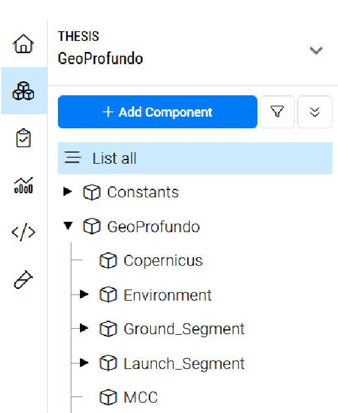


<div align="center">

Figure 4.8: System Components imported from Capella to Valispace.

</div>

The subsequent part of the process involves the creation of the MCB diagram, which defines System Missions, i.e. system objectives, and new System Capabilities. Moreover, it identifies the System Actors involved in each System Capability.

In this instance, a series of System Capabilities are derived from a generic Mission Capability, thereby establishing the foundations upon which the subsequent functional analysis is to be conducted. The defined System Capabilities can be observed in the figure 4.9, where they are also related to the Actors through relationships labelled "Capability Involvements".

Subsequently, the decomposition of System Capabilities is conducted, thereby leading to the realisation of a rigorous functional analysis through the SFBD diagram, that allows the creation of functions and sub-functions. It is significant to observe that the Functions indicated in light blue are those that have been allocated to the Actors. As recommended in the manual [19], it is considered a best practice to modify the color of the parent functions that can no longer be allocated to white. Consequently, the only functions, namely leaf functions, displayed in green, are those allocated to the System. The figures 4.11 and 4.10 show snapshots of the conducted functional analysis. The other SFBDs diagram related to the remaining System Capabilities, can be consulted in the appendix C.

<!-- PDF_PAGE: 69 -->

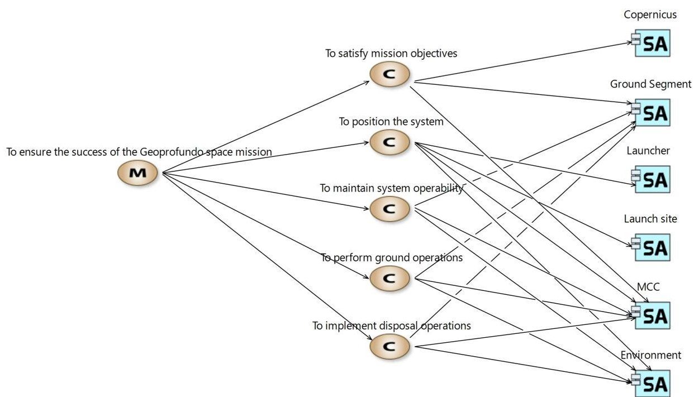


<div align="center">

Figure 4.9: MCB Mission and Capabilities Blank diagram

</div>


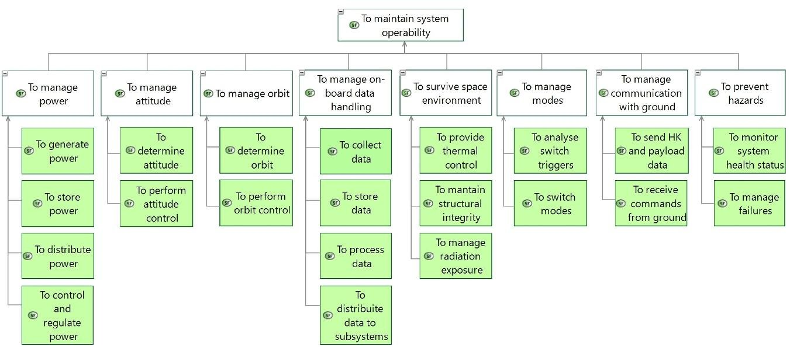


<div align="center">

Figure 4.10: SFBD To maintain system operability

</div>

<!-- PDF_PAGE: 70 -->

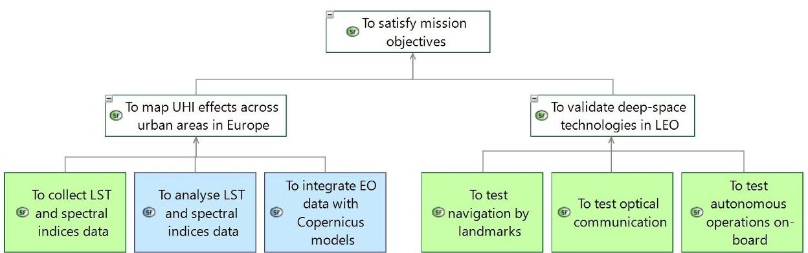


<div align="center">

Figure 4.11: SFBD To satisfy mission objectives

</div>

Once the initial preliminary functional analysis has been conducted on Capella, the mission requirements on Valispace have been updated. By employing the Export_SF_MO.py (3.3) and Import_Requirements.py (3.4) scripts, which respectively export the leaf functions of the selected root function from Capella and then import them as new requirements on Valispace, Valispace is maintained in compliance with the initial design choices implemented on Capella. In order to execute the code, the user is required to submit the Capella root function of interest, in this case "To satisfy mission objectives", along with the Specification ID on which the requirements will be imported into Valispace. Consequently, the script enables the generation of new requirements with an identifier that is consistent with the adopted convention, with a consecutive index with respect to the last requirement in the selected specification.

The figure 4.12 presents a screenshot of the Valispace platform, which illustrates the results of this process. In this particular example, the requirements refer to the testing of deep space technologies and they have been imported under the "MISSION" Specification. The technologies selected for this mission encompass the validation of navigation by landmarks, the testing of optical communication, and the automation of certain on-board operations.

In any case, this constitutes one potential method for directly creating requirements on Valispace from a System Function on Capella. The process could also be performed by creating a requirement on Capella and importing it into Valispace, or by managing the requirements manually in the Valispace environment.

<!-- PDF_PAGE: 71 -->

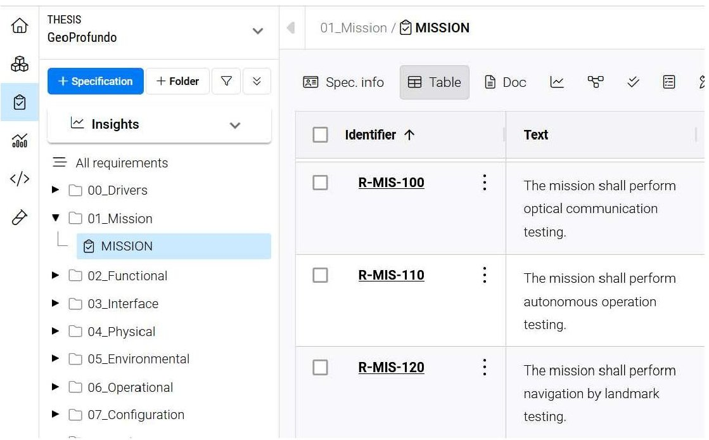


<div align="center">

Figure 4.12: Mission Requirements imported from Capella to Valispace.

</div>

Returning to the Capella environment, the SDFB has been created. This is a data flow diagram that defines Functional Exchanges and allocates them to the Functions. The functions constituting a Capabilities can be organised using these diagrams, as shown in figure 4.13. The same type of diagram has also been developed to illustrate Functional Exchanges involving multiple Capabilities, interconnected by a shared concept, in this case, the data flow. The figure 4.14 illustrates the functions involved and their mutual interactions.

It is possible to observe all of the System Functions involved in this level in the SAB diagram, as shown in figure 4.16 where the Functions are allocated to the System or to the Actors. In this instance, a global diagram has been chosen; however, it can also be partial, enabling the user to select the entities to be displayed. Additionally, it introduces the concept of Component Exchange, that, according to the ARCADIA method, represents an exchange that crosses the System or an Actor boundary. As previously stated, the System Analysis does not incorporate the concept of subsystems. However, examining the diagram in figure 4.16, a graphical representation of the functions that belong to each subsystem could be gathered.

Another feature offered by Capella exploited in this level is the definition of the ConOps. In order to implement this functionality, it is necessary to exploit the VPMS add-on, which offers the capability to create the "Configurations", that can be associated with the phases of the ConOps. The "Configurations" determined in this case have been I&T, LEOP, the Operative Phase and the

<!-- PDF_PAGE: 72 -->

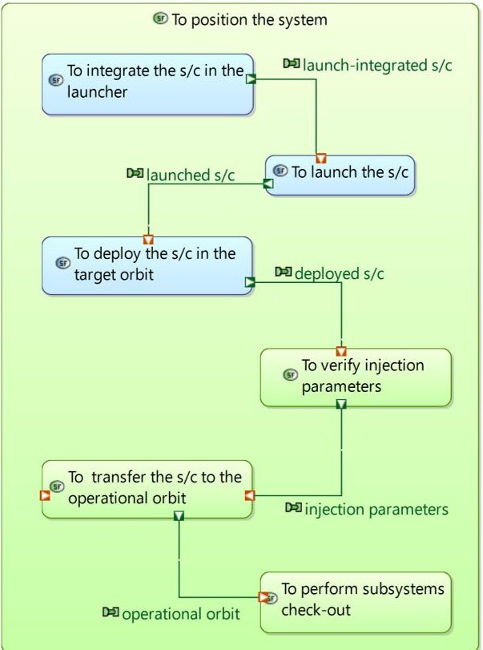


<div align="center">

Figure 4.13: SDFB To reach the operational orbit

</div>


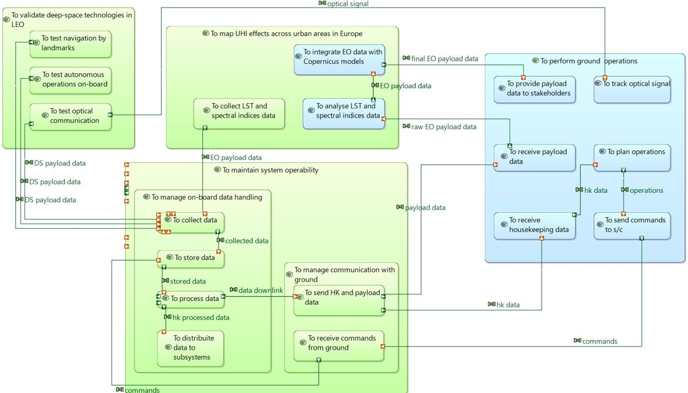


<div align="center">

Figure 4.14: SDFB Data flow

</div>

<!-- PDF_PAGE: 73 -->

EOL. The initial I&T phase concerns the integration and testing operations conducted prior to launch, while the LEOP encompasses the launch, the release into the target orbit, the deployment, the detumbling, and the commissioning phases. The Operational Phase is comprised of two distinct sub-phases. During the first sub-phase, environmental data is collected and a database on Earth mapping is created for the purpose of implementing navigation by landmark. In the subsequent sub-phase, while the collection of environmental parameters for Earth Observation (EO) purposes is continued, the deep space technologies are tested. Finally, the EOL phase involves de-orbiting, passivation and re-entry. The figure 4.15 shows a visual representation of ConOps.


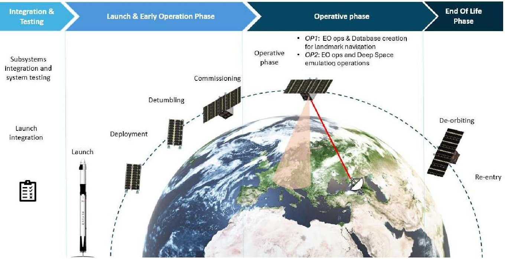


<div align="center">

Figure 4.15: ConOps visual.

</div>

In the context of Capella, these phases are modelled by indicating, for each configuration, which System Functions are active and which are not, as illustrated in the figure 4.17 for the Operative configuration. The operational status of each function is denoted by a specific colour: green indicates that the function is active, while red signifies that it is inactive. The remaining configurations are delineated in the appendix C.

<!-- PDF_PAGE: 74 -->

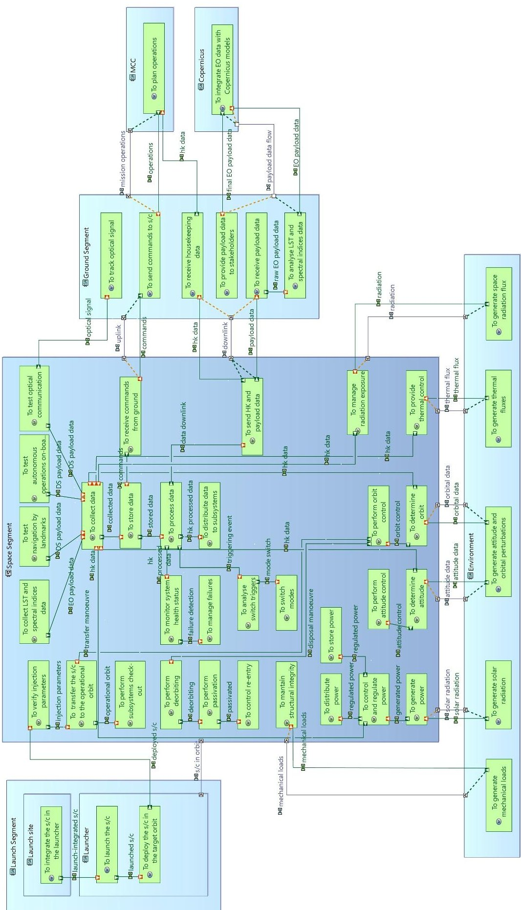


<div align="center">

Figure 4.16: SAB Structure

</div>

<!-- PDF_PAGE: 75 -->

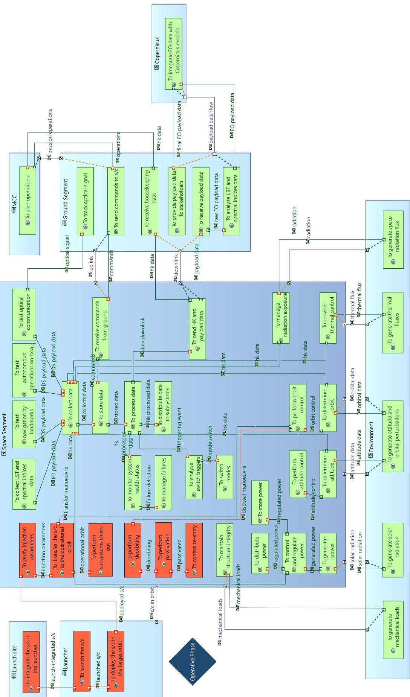


<div align="center">

Figure 4.17: SAB Operative phase

</div>

<!-- PDF_PAGE: 76 -->

## 4.4 System Design

Once the high-level functions and architecture have been defined in the System Analysis, the following step is to understand how the system works to meet the objectives and then open the so-called "black box". This procedure is denoted in Capella as "Logical Architecture" and involves a further decomposition of the functions of the previous level, as well as a breakdown of the System into Logical Components, assimilated to the concept of subsystems. It is important to note that the present analysis does not encompass technical considerations and implementation choices, which will be addressed in the next level. Similarly as in the previous sections, the table 4.4 provides a brief summary of the

Similarly as in the previous sections, the table 4.4 provides a brief summary of the logical architecture terminology and elements employed in this layer.

<div align="center">

Table 4.4: Logical Architecture terminology [19].

</div>

<table border="1"><tr><td>Symbol</td><td>Element</td><td>Description</td></tr><tr><td>L</td><td>Logical Component</td><td>Structural element within the System, with ports to interact with other Logical Components or Actors.</td></tr><tr><td>LA</td><td>Logical Actor</td><td>An external entity to the System (human or non-human) with which the System itself interacts.</td></tr><tr><td>LF</td><td>Logical Function</td><td>Behaviour or service provided by Logical Components or Actors that can communicate with other functions through the Functional Exchanges.</td></tr></table>

The initial step consists in the transition of the System Functions derived from the System Analysis to the current level. Thereafter, a review of these functions has been executed, with the majority of them being broken down. This breakdown specifically impacted those functions derived from the root functions "To maintain system operability" and "To satisfy mission objectives". The results are visible in the LFBD (figures 4.18 and 4.19), which allow for the hierarchical identification of the new Logical Functions.

The system's approach to testing deep space technologies in the various areas of interest is now clearer. The steps that led to the testing of navigation by landmarks and laser communication are noted. As for autonomous operations on board, these are to be managed through the Failure Detection, Isolation and Recovery (FDIR) algorithm, that will help the transition between operating modes, with commands from the ground being kept to a minimum. It is also important to note that the System Functions derived from the previous level and no longer allocated to any entity in this level have been coloured white.

<!-- PDF_PAGE: 77 -->

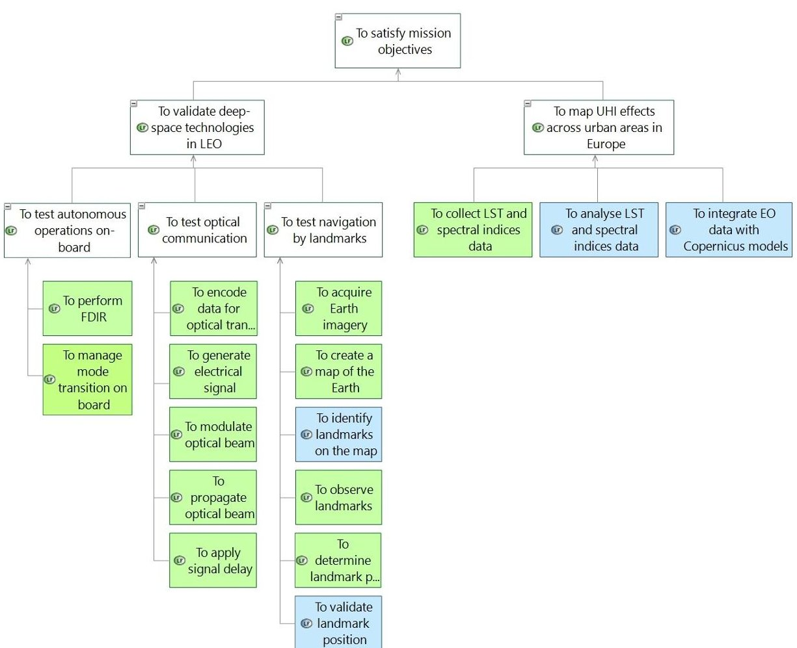


<div align="center">

Figure 4.18: LFBD To satisfy mission objectives

</div>

<!-- PDF_PAGE: 78 -->

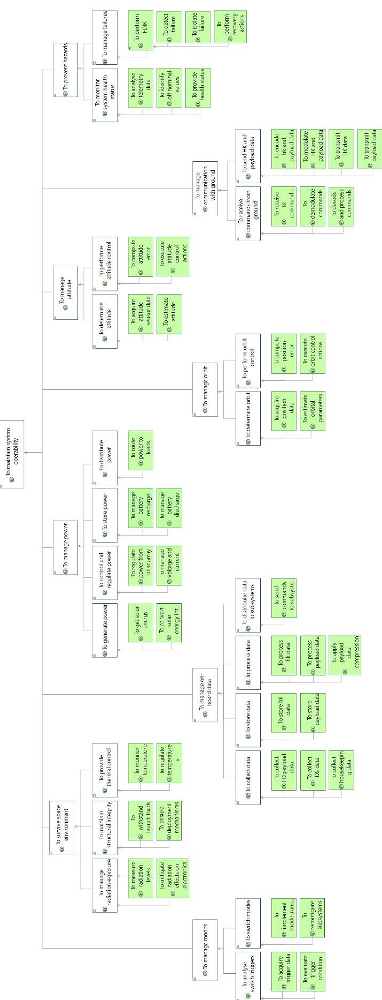


<div align="center">

Figure 4.19: LFBD To maintain system operability

</div>

<!-- PDF_PAGE: 79 -->

Subsequently, the logical structure has been modelled. The System is thus broken down into a series of Logical Components, thereby creating a real hierarchy, as illustrated in the LCBD diagram in figure 4.20.


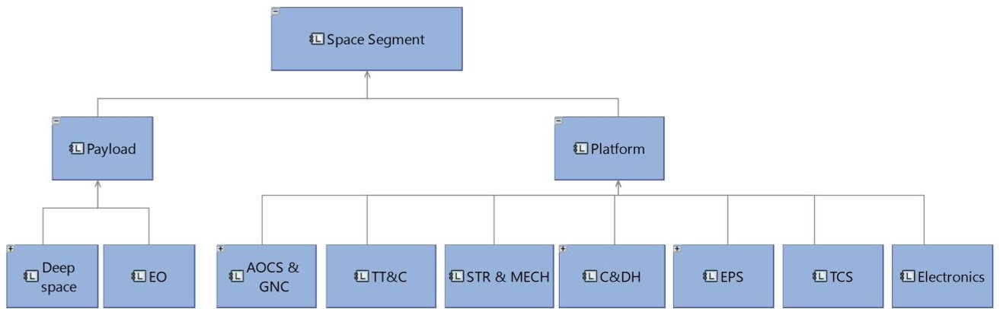


<div align="center">

Figure 4.20: LCBD Space Segment

</div>

As soon as the logical structure of the System has been completed, all the Logical Components created are imported into Valispace, maintaining the hierarchy and therefore, the parent-child relationships. The scripts that implement this step are firstly Export_Logical_Components.py (3.3), which exports the Logical Components from Capella to an Excel file, and then Import_LC_Hierarchy.py (3.4), which imports the Excel file into the Valispace environment and, in this case, under the "Space Segment" component. The result of the import process is illustrated in the following figure 4.21. As clearly shown, continuity and consistency are preserved.

At this stage in the design process, it was deemed necessary to create a link, or "bridge", that would involve both tools simultaneously in order to verify their compliance. The exploitation of this instrument during the design reviews is proposed, for instance, to facilitate the verification of the consistency of components between the tools [20]. The Component_bridge.py (3.4) code is capable of implementing this process, exporting the list of components present on Valispace and Capella, comparing them, and displaying a report of the current status. This report indicates which components are present on Valispace but not on Capella, and vice versa. Furthermore, given the adoption of Capella as the "master" tool of the project, in the event that a component is not present on Valispace, the structure is automatically updated in Valispace, thereby restoring conformity. The figure 4.22 shows the output that the code displays in the console when a component is absent on Valispace.

<!-- PDF_PAGE: 80 -->

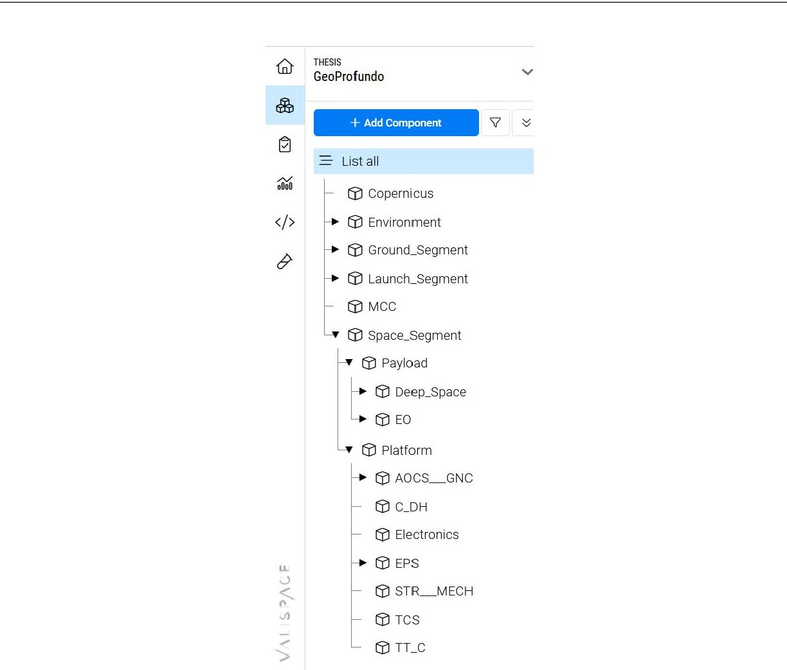


<div align="center">

Figure 4.21: Logical Component imported from Capella to Valispace.

</div>


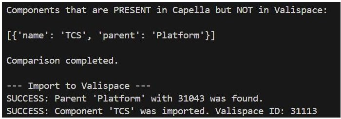


<div align="center">

Figure 4.22: Component_bridge.py output in console when TCS component is missing in Valispace.

</div>

Following the identification of the new components and functions, the architecture is modelled, allocating Logical Functions to designated Logical Components or Actors. New Functional and Component Exchanges are also created. The outcome of the logical architecture is showcased in the LAB diagram, displayed in figure 4.23, which is the result of design choices and decisions involving all the subsystems.

<!-- PDF_PAGE: 81 -->

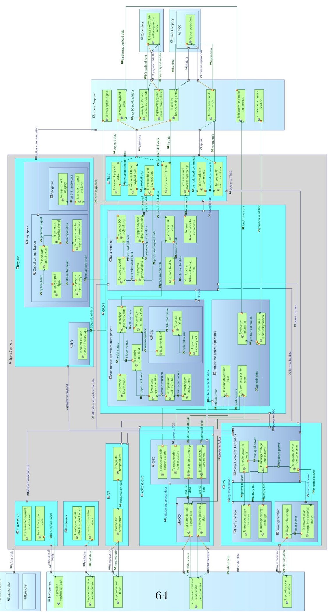


<div align="center">

Figure 4.23: LAB Structure

</div>

<!-- PDF_PAGE: 82 -->

Another potential feature that can be exploited on Capella is the use of MSM diagrams to define operative modes. Modes are defined in the manual [19] as the "expected behaviour", in a specific condition, of an entity (System, Actor, Component). This enables a highly detailed analysis of operative modes through the use of the "transition" functionality, which describes the reaction of a structural element when an event occurs. A transition can be defined as a process which contains a source and a target State, and a Trigger. The diagram employed for this mission is illustrated in the figure 4.24.

In this case, 11 operative modes have been defined: (1) Dormant, during which the Spacecraft (s/c) is integrated into the launcher and the entire system is powered off; (2) In-orbit checkout, in which the s/c is released into orbit, turned on, and goes through the detumbling, the deployment of solar panels, and the commissioning of all the subsystems; (3) Basic, where the satellite is orbiting areas irrelevant to the mission and is therefore in low power mode; (4) DataBase Creation, when it is in sunlight and is mapping the Earth in order to test navigation by landmark in the future; (5) Transmission, during which the s/c downlinks payload and telemetry data to ground ; (6) Science EO, when it captures science data for UHI measurements; (7) Manoeuvre, in which it performs station-keeping, transfer and de-orbiting manoeuvres; (8) Autonomous Deep, that is activated once the Earth mapping database has been completed and it is dedicated to testing navigation by landmark and autonomous operations on board; (9) Transmission Deep, that tests laser communication; (10) Safe, that activates in case of failure and recovers either autonomously or via command from ground if necessary; (11) Passivated, which is entered once the mission is complete and disposal operations are carried out.

In the figure, four main transitions are delineated: automatic transitions are represented by black, telecommand transitions by blue, failure detection transitions by red, and the recovery transitions by green. Recovery transitions can occur in both automatic and telecommand modality.

<!-- PDF_PAGE: 83 -->

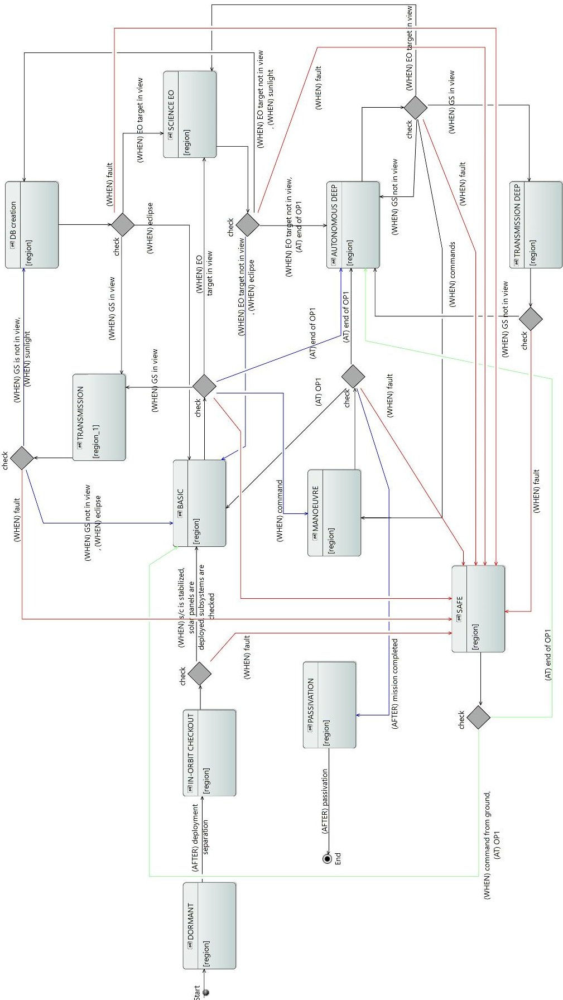


<div align="center">

Figure 4.24: MSM Operative modes

</div>

<!-- PDF_PAGE: 84 -->

The operative modes were subsequently imported into Valispace and associated with the Space Segment, and with the different subsystems. The import process was achieved through the use of the Export_modes.py (3.3) and Import_All_Modelists.py (3.4), which enable the export of the modes from Capella and the creation of what are defined as Modelists on Valispace by indicating the ID of the component in interest. The figure 4.25 illustrates the outcome of the import process into Valispace, in this instance applied to the "Space Segment". The same procedure was applied to the various subsystems.


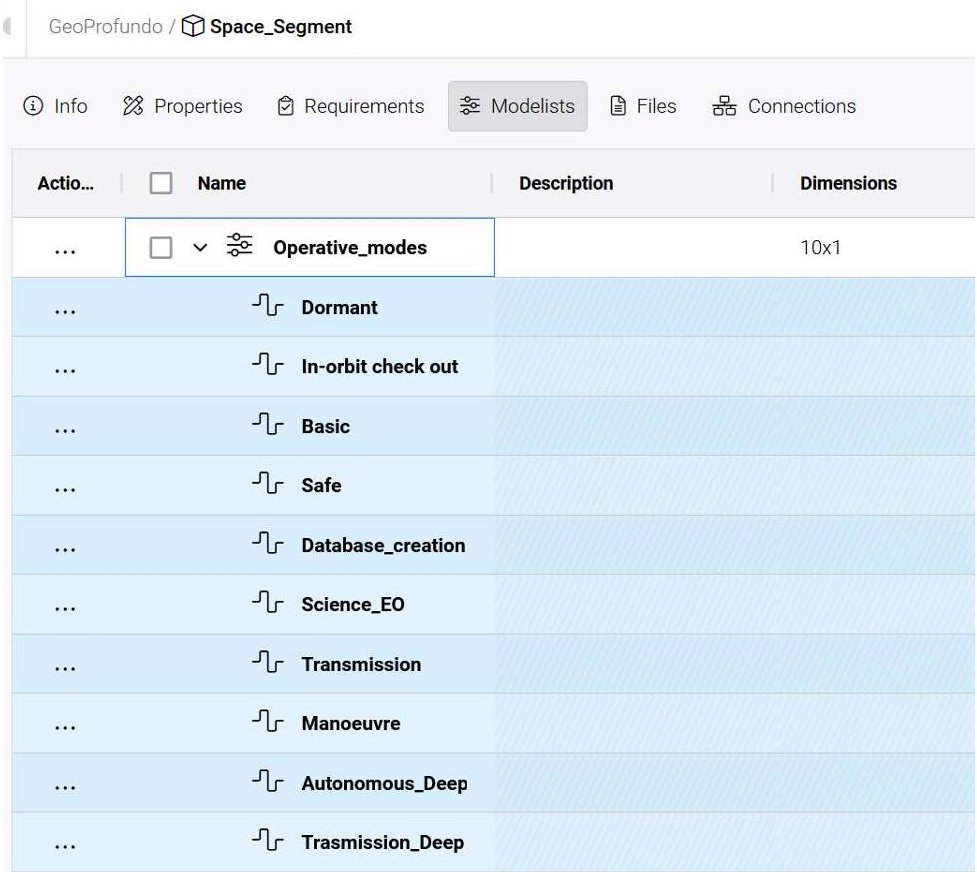


<div align="center">

Figure 4.25: Operative modes imported into Valispace from Capella

</div>

Although the operative modes are significantly clearer and more explanatory on Capella, the process of importing them into Valispace was useful in order to exploit its capacity for budget calculation. Indeed, within the Analysis section of Valispace, it is possible to create a variety of budgets by taking advantage of the properties defined and associated with the various components. The creation of a "Power" matrix property connected to each subsystem, which defines the different power values depending on the operative mode, enables the tool to automatically compute a power budget (4.26).

<!-- PDF_PAGE: 85 -->

<table class="table table-bordered"><thead><tr><th>Actio...</th><th>Name</th><th>State</th><th>Value</th><th>Display Unit</th></tr></thead><tbody><tr><td>...</td><td>PowerConsumption</td><td>[0 W; 3.44 W; 1.5 W; 1.2 W; 2 V)</td><td>W</td><td></td></tr><tr><td>...</td><td>f(x) Dormant</td><td>0</td><td>W</td><td></td></tr><tr><td>...</td><td>f(x) In-orbit check out</td><td>3.44</td><td>W</td><td></td></tr><tr><td>...</td><td>f(x) Basic</td><td>1.5</td><td>W</td><td></td></tr><tr><td>...</td><td>f(x) Safe</td><td>1.2</td><td>W</td><td></td></tr><tr><td>...</td><td>f(x) Database_creation</td><td>2</td><td>W</td><td></td></tr><tr><td>...</td><td>f(x) Science_EO</td><td>5</td><td>W</td><td></td></tr><tr><td>...</td><td>f(x) Transmission</td><td>5</td><td>W</td><td></td></tr><tr><td>...</td><td>f(x) Manoeuvre</td><td>19</td><td>W</td><td></td></tr><tr><td>...</td><td>f(x) Autonomous_Dep</td><td>2</td><td>W</td><td></td></tr><tr><td>...</td><td>f(x) Trasmission_Dep</td><td>8</td><td>W</td><td></td></tr></tbody></table>

<div align="center">

Figure 4.26: "Power" property associated with AOCS&GNC component, depending on the operative modes.

</div>

The results can be viewed both in table form, as shown in the figure 4.27, and in report form. Furthermore, it introduces the possibility of customising the budget through the application of margins, for instance.

<table border="1"><tr><td colspan="8">In-orbit check out</td></tr><tr><td>Component</td><td>PowerConsumption</td><td>margin+</td><td>total margin+</td><td>worst case+</td><td>margin-</td><td>total margin-</td><td>worst case-</td></tr><tr><td>Space_Segment</td><td>11.14W</td><td>+20%</td><td>+27.9%</td><td>14.243W</td><td>-0%</td><td>0%</td><td>11.14W</td></tr><tr><td>Payload</td><td>0W</td><td>+0%</td><td>+0%</td><td>0W</td><td>-0%</td><td>0%</td><td>0W</td></tr><tr><td>Deep_Space</td><td>0W</td><td>+5%</td><td>+0%</td><td>0W</td><td>-0%</td><td>0%</td><td>0W</td></tr><tr><td>EO</td><td>0W</td><td>+5%</td><td>+0%</td><td>0W</td><td>-0%</td><td>0%</td><td>0W</td></tr><tr><td>Platform</td><td>0W</td><td>+0%</td><td>+0%</td><td>0W</td><td>-0%</td><td>0%</td><td>0W</td></tr><tr><td>AOCS_GNC</td><td>3.44W</td><td>+10%</td><td>+10%</td><td>3.784W</td><td>-0%</td><td>0%</td><td>3.44W</td></tr><tr><td>C_DH</td><td>2W</td><td>+5%</td><td>+5%</td><td>2.1W</td><td>-0%</td><td>0%</td><td>2W</td></tr><tr><td>Electronics</td><td>N/A</td><td>N/A</td><td>N/A</td><td>N/A</td><td>N/A</td><td>N/A</td><td>N/A</td></tr><tr><td>EPS</td><td>2.7W</td><td>+5%</td><td>+5%</td><td>2.835W</td><td>-0%</td><td>0%</td><td>2.7W</td></tr><tr><td>STR_MECH</td><td>N/A</td><td>N/A</td><td>N/A</td><td>N/A</td><td>N/A</td><td>N/A</td><td>N/A</td></tr><tr><td>TCS</td><td>N/A</td><td>N/A</td><td>N/A</td><td>N/A</td><td>N/A</td><td>N/A</td><td>N/A</td></tr><tr><td>TT_C</td><td>3W</td><td>+5%</td><td>+5%</td><td>3.15W</td><td>-0%</td><td>0%</td><td>3W</td></tr><tr><td>Total</td><td>11.14W</td><td>+20%</td><td>+27.9%</td><td>14.243W</td><td>-0%</td><td>0%</td><td>11.14W</td></tr></table>

<div align="center">

Figure 4.27: Power budget estimation on Valispace for In-orbit check-out mode.

</div>

<!-- PDF_PAGE: 86 -->

Additionally, the Valispace feature was employed to compute a preliminary mass and volume budget, employing the "mass" and "volume" properties associated with each subsystem. The results can be seen in the appendix C. It is evident that this procedure may also be conducted on physical components, which are to be delineated in the subsequent phase of the project, thus performing increasingly complex and detailed analyses.

## 4.5 Subsystem Design

The next step in the methodology is to achieve a further level of detail by analysing the various subsystems that constitute the satellite. In this case, the process has only been started to give an hint on how it might proceed, but it has not yet been fully implemented. The focus is on the EPS, which serves as an example to demonstrate the potential of Capella and Valispace at this stage of the project.

As in the previous case, the work has started with Capella at the Physical Architecture level. The objectives of the Physical Architecture are equivalent to those of Logical Architecture. However, Physical Architecture defines the concrete physical components that constitute the system. Consequently, it delineates the definitive architectural configuration of the system, accurately representing how it should be integrated. The focus shifts to the functions associated with technical and implementation choices. Furthermore, the components that perform these functions are also defined. [19]

The following table 4.5 provides a comprehensive list of the new concepts introduced in this chapter [19].

<div align="center">

Table 4.5: Physical Architecture terminology [19].

</div>

<table border="1"><tr><td>Symbol</td><td>Element</td><td>Description</td></tr><tr><td>P</td><td>Behaviour Physical Component</td><td>Physical component that executes the allocated Physical Functions, contributing to the behaviour of the System.</td></tr><tr><td>P</td><td>Node Physical Component</td><td>Physical component that provides the material resources for Behaviour Components.</td></tr><tr><td></td><td>Physical Port</td><td>Non-oriented port that belongs to an Node Component; the Component Port belongs to a Behaviour Component.</td></tr><tr><td></td><td>Physical Link</td><td>Non-oriented connection between Node Components.</td></tr></table>

To begin this new phase starting from Capella, the "transition" feature is used to

<!-- PDF_PAGE: 87 -->

transfer all the Functions defined at the Logical level.

The next step is to define the Behaviour and Node Components, which in this case have been represented only for the EPS. Three Node Components have been defined: the solar arrays, the Power Control and Distribution Unit (PCDU), which is composed internally of Power Control Unit (PCU) and Power Distribution Unit (PDU), and the battery pack. Each of these components has been then associated with a Behaviour component, to which the functions already defined at the Logical level could be allocated. The figure 4.28 shows the PAB diagram, which illustrates all the aforementioned choices. It is also possible to define Functional and Components exchanges. The Component Exchanges were categorised as either relating to data, commands, or power lines.


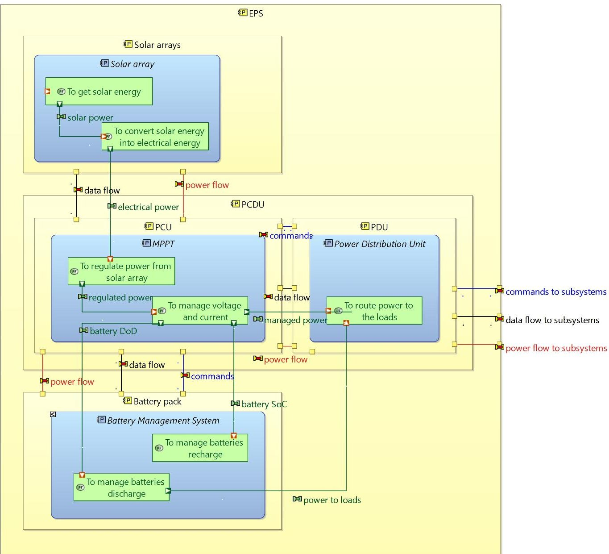


<div align="center">

Figure 4.28: PAB Structure EPS

</div>

<!-- PDF_PAGE: 88 -->

Meanwhile, on Valispace, in addition to continuous requirements management at every level, the components must now be updated. With minor modifications, the codes implemented for the Logical Architecture can be used to bring the new components defined on Capella to Valispace. Again, this is the same iterative process followed in the previous sections, which can also be implemented here using the same Python code, with a few adjustments.

A further capability of Valispace is highlighted: its ability to manage trade-offs between different components. To demonstrate this, an example regarding batteries has been provided in figure 4.29.


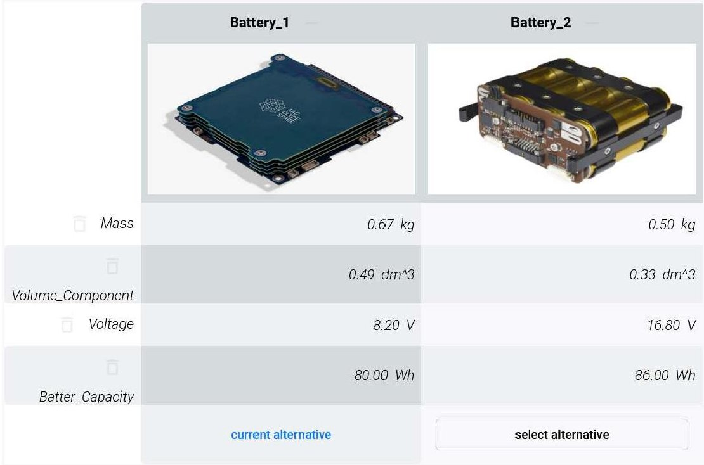


<div align="center">

Figure 4.29: Battery trade-off on Valispace. [32] [33]

</div>

Valispace provides a clear overview of the components involved in the trade-off by displaying all engineering information in a format that is easy to compare. It also enables to iterate quickly through budgets, as it only requires the selection of one component to update all analyses (for example, mass and volume budgets).

<!-- PDF_PAGE: 89 -->

## Conclusions

The present thesis explores the various methodologies employed in the domain of System Engineering to create a more agile and effective approach to the design of small satellite missions. The study was based on two of the most innovative methodologies of recent years: DDSE and MBSE. The complementarity of these two approaches, along with the integration of Capella and Valispace tools, enables the analysis of the mission from different perspectives and throughout the entire life cycle of the product.

Capella has been proven to be the most suitable option for system and subsystem architectures definition and development, ensuring strong consistency and an integrated vision. The ARCADIA method implemented by Capella provides a clear and guided path through the different phases of system engineering, thus helping to structure the design process. Additionally, it facilitates the conception of ConOps and operative modes. In summary, Capella enhances efficiency, quality and reliability in the development of complex systems, providing a structured model-based approach that is essential for addressing the challenges of modern systems engineering.

In parallel, Valispace has been demonstrated to excel in the management of dynamic requirements and engineering data in real-time, facilitating collaborative interactions among diverse teams. Furthermore, the software is designed to estimate budgets and monitor their progression in accordance with the evolution of the design, thereby ensuring accurate tracking of alterations.

However, the true strength of this methodology lays in the integration of the two tools, which enables the bridging of the gaps between them, resulting in the creation of a unified, promising tool capable of completely managing all the early stages of the mission. The seamless interaction between these two tools has been made possible by their capacity to offer APIs, which facilitate not only their own integration but also integration with other platforms.

It is relevant to note that the present study has been conducted exclusively on the preliminary stages of the project, with the intention of exploring

<!-- PDF_PAGE: 90 -->

the potential applications of this work. Additionally, it could also function as a starting point for subsequent iterations and increasingly detailed levels, supporting the mission design project in the definition of the physical architecture and the consolidation of the final design. With regard to the design of subsystems, which has only been outlined here, there are numerous possibilities for enhancing the integration of the two tools. For instance, it is possible to associate metadata with components on Capella and then transfer them to Valispace, thus creating new and increasingly realistic budgets. Furthermore, the potential for its application in the domain of Assembly, Integration, Verification and Testing (AIV/T) management is promising, especially if Capella is used in combination with the Test section in Valispace.

Other areas that may be worthy of future investigation include requirements management. Valispace has demonstrated a proven expertise in requirements management, which influenced the decision to utilise this platform for management purposes exclusively. An alternative strategy could be to formulate some relevant requirements in Capella before proceeding to import them into Valispace. This would replace the existing process of going through the functions defined in Capella. In this particular instance, the potential disadvantages may be associated with the replication of information across the two software programs. Nevertheless, this remains an alternative that is worth of further consideration.

In summary, the project appears to offer a wide range of possibilities and establishes the foundations for future research into the integration of these two tools.

It appears that Valispace and Capella are complementary in nature, and the integration of these platforms via their respective APIs, Valispace Phyton API and Python for Capella, has shown promising results. The APIs facilitate the automation of repetitive and time-consuming workflows and tasks, thereby ensuring data synchronisation and reducing human error. The result is an integrated and cohesive toolchain that is fully customisable by the user through Python scripts. This solution is accessible to users with even limited coding expertise, as both APIs provide example codes that can be utilised as a foundational starting point to acquire competencies. In addition, it is widely acknowledged that the selected programming language, Python, is considered to be among the most accessible for beginners.

There are numerous steps that can be pursued in the future. One of these is related to the difference between the two APIs: Valispace exposes a REST API that facilitates interaction with data via HTTP requests from the Python language. In contrast, Python for Capella is an "internal" API that enables direct manipulation of models on Capella through scripts executed within the Capella environment itself. It is therefore reasonable to consider an alternative Capella API, designated capellambse [34], which was developed before Python for Capella. This API allows

<!-- PDF_PAGE: 91 -->

models to be read and written on Capella via Python scripts executed outside the Capella environment. The difference is that the capellambse API, in combination with the Valispace API, would enable the creation of an independent bridge that can read data from Capella and integrate it into Valispace without the necessity of launching the Capella application. However, further investigation is required into the functionality of this API, in order to evaluate its ability to match the capabilities of Python for Capella.

Finally, a next improvement of the tool is the development of a user interface. At present, the integration procedure necessitates the execution of a series of scripts. While these are designed to be straightforward and intuitive for the user, they are still disconnected and fragmented. It is therefore important to be aware of the process outlined in the chapter 3 dedicated to the integration of the tools. The subsequent step could be the creation of a user interface that simplifies the procedure for users with no prior experience of the integration process. This would minimise the training required to familiarise users with the procedure. The implementation of such a system would result in the establishment of an automated and efficient workflow, thereby enhancing product quality and team productivity.

In conclusion, this approach offers new possibilities in the implementation of the MBSE methodology associated with DDSE, potentially throughout the entire life cycle of a small satellite. It raises the issue of the creation of new tools capable of managing the potential of both Capella and Valispace solutions while maintaining a single source of truth.

<!-- PDF_PAGE: 92 -->

## Appendix A

## Python for Capella scripts

## A.1 Export_SF_MO.py

```python

# include for the Capella modeller API

include('workspace://Python4Capella/simplified_api/capella.py')

if False:

    from simplified_api.capella import *

# include to read and write xlsx files

from openpyxl import *

# insert the path of your Capella model

aird_path = ''

model = CapellaModel()

model.open(aird_path)

# enter the System Analysis level

se = model.get_system_engineering()

sa = se.get_system_analysis()

root_function_MO = "To satisfy mission objectives"

# prepare Excel file export

project_name = aird_path[0:(aird_path.index("/", 1) + 1)]

project = CapellaPlatform.getProject(project_name)

folder = CapellaPlatform.getFolder(project, 'script results')

```

<!-- PDF_PAGE: 93 -->

```python

xlsx_file_name = CapellaPlatform.getAbsolutePath(folder) + '/' + 'Export_SF_MO.xlsx'

# create a workbook

workbook = Workbook()

# write Excel file header

worksheetSF = workbook.active

worksheetSF.title = 'All System functions'

worksheetSF["A1"] = 'SF name'

worksheetSF["B1"] = 'ID'

worksheetSF["C1"] = 'Description'

worksheetSF["D1"] = 'leaf function'

worksheetLF = workbook.create_sheet("Leaf Functions")

worksheetLF["A1"] = 'Leaf functions name'

worksheetLF["B1"] = 'ID'

worksheetLF["C1"] = 'Description'

worksheetMO = workbook.create_sheet("Mission objectives")

worksheetMO["A1"] = 'MO functions name'

worksheetMO["B1"] = 'ID'

worksheetMO["C1"] = 'Description'

worksheetMO["D1"] = 'Root function name'

worksheetMO["E1"] = 'Specific Ancestor found'

# retrieve all the system functions from the model

all_SF = sa.get_all_contents_by_type(SystemFunction)

# examine the hierarchy between functions

def is_descendant_of_specific_function(current_function,

    root_function_name):

    parent = current_function.get_container()

    current_path = []

    while parent:

        if isinstance(parent, SystemFunction):

            current_path.append(parent.get_name())

        if parent.get_name() == root_function_name:

            return True, parent.get_name()

        parent = parent.get_container()

    return False, "Not Found"

i = 2

j = 2

```

<!-- PDF_PAGE: 94 -->

```python

k = 2

for sf in all_SF:

    worksheetSF["A" + str(i)] = sf.get_name()

    worksheetSF["B" + str(i)] = sf.get_id()

    worksheetSF["C" + str(i)] = sf.get_description() if sf.get_description() else ''

    # determine if it's a leaf function and place 'X'

    is_leaf_function_marker = ''

    owned_functions_list = []

    if hasattr(sf, 'get_owned_functions'):

        owned_functions_list = sf.get_owned_functions()

    if not owned_functions_list:

        is_leaf_function_marker = 'X'

        worksheetLF["A" + str(j)] = sf.get_name()

        worksheetLF["B" + str(j)] = sf.get_id()

        worksheetLF["C" + str(j)] = sf.get_description()

        j = j + 1

        is_descendant, SF_root_name =

is_descendant_of_specific_function(sf, root_function_M0)

    if is_descendant:

        parent_sf_name = sf.get_container().get_name()

    if sf.get_container() else "No Parent"

        worksheetMO["A" + str(k)] = sf.get_name()

        worksheetMO["B" + str(k)] = sf.get_id()

        worksheetMO["C" + str(k)] = sf.get_description()

        worksheetMO["D" + str(k)] = parent_sf_name

        worksheetMO["E" + str(k)] = SF_root_name

        k = k + 1

    worksheetSF["D" + str(i)] = is_leaf_function_marker

    i = i + 1

# save the Excel file

workbook.save(xlsx_file_name)

print('saving excel file')

# refresh

CapellaPlatform.refresh(folder)

print('Script execution finished.')

```

<!-- PDF_PAGE: 95 -->

Listing A.1: Export_SF_MO.py script [22].

## A.2 Export__System__Actor.py

```python

# include for the Capella modeller API

include('workspace://Python4Capella/simplified_api/capella.py')

if False:

    from simplified_api.capella import *

# include to read and write xlsx files

from openpyxl import *

# insert the path of your Capella model

aird_path = ''

model = CapellaModel()

model.open(aird_path)

# enter the System Analysis level

se = model.get_system_engineering()

sc = se.get_system_analysis()

# get all System Actors

comps = sc.get_system_component_pkg()

actors_list = comps.get_all_contents_by_type(SystemActor)

# examine System Actors hierarchy

def actor_hierarchy(system_actors_list):

    selected_system_actors = []

    for actor in system_actors_list:

        container = actor.get_container()

        if isinstance(container, SystemComponentPkg):

            selected_system_actors.append(actor.get_label())

    return selected_system_actors

actors_to_export = actor_hierarchy(actors_list)

# prepare Excel file export

project_name = aird_path[0:(aird_path.index("/", 1) + 1)]

project = CapellaPlatform.getProject(project_name)

```

<!-- PDF_PAGE: 96 -->

Python for Capella scripts

```python

folder = CapellaPlatform.getFolder(project, 'script results'

)

xlsx_file_name = CapellaPlatform.getAbsolutePath(folder) + '/' + 'Export_System_Actors.xlsx'

# create a workbook

workbook = Workbook()

# write Excel file header

worksheet = workbook.active

worksheet.title = 'System actors'

worksheet["A1"] = 'Name'

i = 2

for single_actor in actors_to_export:

    worksheet["A" + str(i)] = single_actor

    i = i + 1

# save the Excel file

workbook.save(xlsx_file_name)

# refresh

CapellaPlatform.refresh(folder)

```

Listing A.2: Export_System_Actor.py script [22].

## A.3 Export__Logical__Component.py

```python

# name              : Export Logical Component

# script-type       : Python

# description       : Export Logical Component

# popup             : enableFor(org.polarsys.capella.core

    .data.capellacore.CapellaElement)

# include for the Capella modeller API

include('workspace://Python4Capella/simplified_api/capella.

    py')

if False:

    from simplified_api.capella import *

# include to read/write xlsx files

from openpyxl import *

```

<!-- PDF_PAGE: 97 -->

```python

# retrieve the element from the current selection

selected_elem = CapellaElement(CapellaPlatform.

    getFirstSelectedElement())

# insert the path of your Capella model

aird_path = ''

model = CapellaModel()

model.open(aird_path)

hierarchy_data = []

# go through the hierarchy of Logical Components and places

    it on hierarchy_data

def traverseHierarchy(elem, parent_name=None, level=1):

    elem_name = elem.get_name()

    hierarchy_data.append({

        'Component Name': elem_name,

        'Parent Name': parent_name,

        'Hierarchy Level': level

    })

    # if the current element is a Logical Component, search

    for children:

        if isinstance(elem, LogicalComponent):

            lc = elem

            for sub_elem in lc.get_owned_logical_components():

                if isinstance(sub_elem, LogicalComponent):

                    # recursive function, passing the name of

                    the current element as parent

                    traverseHierarchy(sub_elem, elem_name, level

        + 1)

# get System Engineering

se = model.get_system_engineering()

print('starting export of model ' + se.get_name())

# prepare Excel file export

project_name = aird_path[0:(aird_path.index("/", 1) + 1)]

project = CapellaPlatform.getProject(project_name)

folder = CapellaPlatform.getFolder(project, 'results')

xlsx_file_name = CapellaPlatform.getAbsolutePath(folder) + '/' + 'Export_LC.xlsx'

# create a workbook

```

<!-- PDF_PAGE: 98 -->

```python

workbook = Workbook()

# write Excel file header

worksheet = workbook.active

worksheet.title = 'LC export'

headers = ['Component Name', 'Parent Name', 'Hierarchy Level']

worksheet.append(headers)

# search for first level Logical Components and call the function

for elem in se.get_logical_architecture().get_logical_system()

    .get_owned_logical_components():

        if isinstance(elem, LogicalComponent):

            traverseHierarchy(elem)

# write the list on Excel

for row_data in hierarchy_data:

    worksheet.append([

        row_data['Component Name'],

        row_data['Parent Name'],

        row_data['Hierarchy Level']

    ])

# save the Excel file

workbook.save(xlsx_file_name)

# refresh

CapellaPlatform.refresh(folder)

```

Listing A.3: Export_Logical_Component.py script [22].

## A.4 Export__modes.py

```python

# include for the Capella modeller API

include('workspace://Python4Capella/simplified_api/capella.py')

if False:

    from simplified_api.capella import *

# include to read/write xlsx files

from openpyxl import *

# insert the path of your Capella model

```

<!-- PDF_PAGE: 99 -->

```python

aird_path = ''

model = CapellaModel()

model.open(aird_path)

# examine the Logical Architecture level

se = model.get_system_engineering()

la = se.get_logical_architecture()

log_comp = la.get_logical_component_pkg()

# get all modes

modes = log_comp.get_all_contents_by_type(Mode)

# prepare Excel file export

project_name = aird_path[0:(aird_path.index("/", 1) + 1)]

project = CapellaPlatform.getProject(project_name)

folder = CapellaPlatform.getFolder(project, 'script results')

xlsx_file_name = CapellaPlatform.getAbsolutePath(folder) + '/' + 'Export_modes.xlsx'

# create a workbook

workbook = Workbook()

# write Excel file header

worksheet = workbook.active

worksheet.title = 'Operative modes'

worksheet["A1"] = 'Modes'

i = 2

for mode in modes:

    worksheet["A" + str(i)] = mode.get_label()

    i = i + 1

# save the Excel file

workbook.save(xlsx_file_name)

# refresh

CapellaPlatform.refresh(folder)

```

Listing A.4: Export_modes.py script [22].

<!-- PDF_PAGE: 100 -->

<div align="center">

# Valispace Python API scripts

</div>

## B.1 Import_Requirements.py

```python

import valispace

import pandas as pd

from tqdm import tqdm

deployment = input("Deployment Name:")

# Authentication to Valispace

try:

    valispace = valispace.API(url="https://"+deployment+".valispace.com",

    session_token="Bearer ...")  # insert your access token

    print("Successful authentication using the provided Token")

except Exception as e:

    print(f"An error has occurred: {e}")

# insert your Excel file path

csvFilePath = r"...""

# insert the ID of the specification the requirements should added to

specification_ID = int(input("Enter the ID of the project:"))

```

<!-- PDF_PAGE: 101 -->

```python

# generate the new identifier for the imported requirement

def getNextReqIdentifier(last_req_identifier, increase = 10):

    :

        splitted_req_identifier = last_req_identifier.split('-')

        splitted_req_identifier_len = len(

        splitted_req_identifier)

        next_index = int(splitted_req_identifier[

        splitted_req_identifier_len-1]) + increase

        next_idenfier = f"{'-'.join(splitted_req_identifier[: splitted_req_identifier_len-1])}-{f"{str(next_index):03}"}"

        return next_idenfier

# get the identifier of the last requirement created in that specification

def getLastReqIdentifier(specificationID):

    try:

        SpecRequirements = valispace.get(f'requirements/specifications/{specificationID}/')

        SpecRequirements = SpecRequirements['requirements']

        req_identifiers = []

        for req in tqdm(SpecRequirements, desc="Getting informations of the specification requirements"):

            req_identifier = valispace.get(f'requirements/{req}')['identifier']

            req_identifiers.append(req_identifier)

        last_identifier = ""

        biggest_index = 0

        for identifier in req_identifiers:

            splitted_identifier = identifier.split('-')

            index = int(splitted_identifier[len(splitted_identifier)-1])

            if index > biggest_index:

                biggest_index = index

                last_identifier = identifier

            return last_identifier

    except:

        Exception('Error while getting specification requirements!')

```

<!-- PDF_PAGE: 102 -->

```python

# get all requirements in the selected specification

def import_req(csvFilePath, specification_ID):

    reqs = pd.read_excel(csvFilePath)

    last_req_identifier = getLastReqIdentifier(

        specification_ID)

    for index, row in reqs.iterrows():

        next_req_identifier = getNextReqIdentifier(

            last_req_identifier)

        last_req_identifier = next_req_identifier

        req = {

            "specification": specification_ID,

            "identifier": next_req_identifier,

            "title": row['Function'],

            "text": row['Description']

        }

        requirementPosted = valispace.post('requirements/', req)

import_req(csvFilePath, specification_ID)

```

Listing B.1: Import_Requirements.py script.

## B.2 Import_System_Components.py

```python

import valispace

import pandas as pd

deployment = input("Deployment Name:")

# Authentication to Valispace

try:

    valispace = valispace.API(url="https://"+deployment+".valispace.com",

    session_token="Bearer ...") # insert your access token

    print("Successful authentication using the provided Token")

except Exception as e:

    print(f"An error has occurred: {e}")

# insert the Excel file path

excelFilePath = r"...""

# insert the ID of the parent component

```

<!-- PDF_PAGE: 103 -->

```python

parent_component = 0

# import System Components

def import_comp(excelFilePath, parent_component):

    comps = pd.read_excel(excelFilePath)

    for index, row in comps.iterrows():

        component = {

            "name": row['Name'],

            "parent": parent_component

        }

        # replace spaces with underscores

        for key, value in component.items():

            if isinstance(value, str):

                component[key] = value.replace(' ', '_')

            componentPosted = valispace.post("components/",

    component)

import_comp(excelFilePath, parent_component)

```

Listing B.2: Import_System_Components.py script.

## B.3 Import_LC_Hierarchy.py

```python

import valispace

import pandas as pd

deployment = input("Deployment Name:")

# Authentication to Valispace

try:

    valispace = valispace.API(url="https://"+deployment+".valispace.com",

    session_token="Bearer ...") # insert your access token

    print("Successful authentication using the provided Token")

except Exception as e:

    print(f"An error has occurred: {e}")

capella_id_to_valispace_id_map = {}

# insert the Excel file path

excelFilePath = r"..."

name_to_valispace_id_map = {}

```

<!-- PDF_PAGE: 104 -->

```python

# inserts the ID of the parent component from which to start

the import

top_parent_id_in_valispace = 0

# hierarchy import

def import_full_hierarchy_by_name(excelFilePath,

    top_level_valispace_parent_id=0):

    print(f"Start importing LC hierarchy from file: {excelFilePath}")

    try:

        comps_df = pd.read_excel(excelFilePath)

        all_levels = sorted(comps_df['Hierarchy Level']).

    unique())

    for current_level in all_levels:

        components_at_current_level = comps_df[comps_df['Hierarchy Level'] == current_level]

    # replace spaces with underscores

    for index, row in components_at_current_level.

    iterrows():

        current_elem_name = row['Component Name']

        parent_elem_name_from_excel = row['Parent Name']

        current_elem_name_cleaned =

current_elem_name.replace(' ', '_').replace('&', '_')

        if pd.notna(parent_elem_name_from_excel):

            parent_elem_name_cleaned =

parent_elem_name_from_excel.replace(' ', '_').replace('&', '_')

        else:

            parent_elem_name_cleaned = None

        # determine the ID of the parent of the current component

        valispace_parent_id = None

        if current_level == 1:

            valispace_parent_id =

top_level_valispace_parent_id

        else:

            valispace_parent_id =

name_to_valispace_id_map.get(parent_elem_name_cleaned)

            if not valispace_parent_id:

                print(f" Attention: parent ID '{parent_elem_name_from_excel}' for '{current_elem_name}' not found.")

```

<!-- PDF_PAGE: 105 -->

```python

continue

component_data = {

    "name": current_elem_name_cleaned,

}

if valispace_parent_id:

    component_data["parent"] = valispace_parent_id

try:

    # import the component on Valispce

    component_posted = valispace.post("components/", component_data)

    valispace_id = component_posted.get('id')

    valispace_name_from_vs = component_posted.get('name')

    name_to_valispace_id_map[current_elem_name_cleaned] = valispace_id

except Exception as e:

    print(f" Error: {e}")

    continue

print("\nImport of hierarchy completed.")

except FileNotFoundError:

    print(f"Error: '{excelFilePath}' excel file not found")

except Exception as e:

    print(f"Error: {e}")

import_full_hierarchy_by_name(excelFilePath,

    top_parent_id_in_valispace)

```

Listing B.3: Import_LC_Hierarchy.py script.

## B.4 Components_bridge.py

```python

import valispace

import pandas as pd, json

deployment = input("Deployment Name:")

```

<!-- PDF_PAGE: 106 -->

```python

# Authentication to Valispace

try:

    valispace = valispace.API(url="https://"+deployment+".valispace.com",

    session_token="Bearer ...")    # insert your access token

    print("Successful authentication to Valispace using the provided Token")

except Exception as e:

    print(f"An error has occurred: {e}")

# insert the Valispace project ID

Valispace_project_ID = 100

# specify the ID of the component from which to start the hierarchy

start_component_ID = 30856

# Excel file of the Logical Component

excel_file_path = r"..."  exported from Capella

excel_sheet_name = 'LC export'

excel_parent_column = 'Parent Name'

excel_component_column = 'Component Name'

# Function that extracts all components from Valispace project ID

def get_all_project_components(project_id):

    all_components = valispace.get(f"components/?project={str(project_id)}")

    return all_components

# Function that builds the parent-child hierarchy of components

def get_valispace_parent_child_hierarchy(all_components, start_id=None):

    component_id_to_name = {comp['id']: comp['name'] for comp in all_components}

    component_id_to_obj = {comp['id']: comp for comp in all_components}

    # Search for the starting component of the hierarchy

    first_component = None

    if start_id:

        first_component = component_id_to_obj.get(start_id)

```

<!-- PDF_PAGE: 107 -->

```python

    if not first_component:

        print(f"WARNING: starting component not found")

        return []

    else:

        print("ERROR: Define the correct ID")

        return []

    # Recursive internal function to extract the parent-child relationships

    def get_relationships_recursive(current_component_id):

        Valispace_relationships = []

        current_component_name = component_id_to_name.get(current_component_id)

        # Find all direct children of the current component

        children = []

        for comp in all_components:

            if comp.get('parent') == current_component_id:

                children.append(comp)

        for child in children:

            child_name = child['name']

            Valispace_relationships.append({"Parent": current_component_name, "Child": child_name})

        # Call the function recursively for the child's children

        Valispace_relationships.extend(get_relationships_recursive(child['id']))

        return Valispace_relationships

    # Start recursion from the chosen initial component

    parent_child_relationships = get_relationships_recursive(first_component['id'])

    return parent_child_relationships

# Function that reads Excel data from Capella

def get_excel_data(file_path, sheet_name, parent_col, child_col):

    excel = pd.read_excel(file_path, sheet_name=sheet_name)

    Capella_relationships = []

    for index, row in excel.iterrows():

        # Retrieves values and converts them into strings

```

<!-- PDF_PAGE: 108 -->

```python

    parent = str(row[parent_col]).strip() if pd.notna(row[parent_col]) else None

    child = str(row[child_col]).strip() if pd.notna(row[child_col]) else None

    # Replace spaces with underscores

    if parent is not None:

        parent = parent.replace(" ", "_").replace("&", "_")

    if child is not None:

        child = child.replace(" ", "_").replace("&", "_")

    # Normalise the string 'None' or empty to a true

    None for the parent

    if parent == ''' or (isinstance(parent, str) and parent.lower() == 'none'):

        parent = None

    if child:

        Capella_relationships.append({"Parent": parent, "Child": child})

    return Capella_relationships

# Function that compares the component relationships of

# Capella and Valispace

def compare_lists(valispace_relationships, capella_relationships):

    valispace_rel_set = set((rel['Parent'] if rel['Parent']

    is not None else '', rel['Child']) for rel in valispace_relationships)

    capella_rel_set = set((rel['Parent'] if rel['Parent'] is not None else '', rel['Child']) for rel in capella_relationships)

    rel_only_in_valispace = valispace_rel_set - capella_rel_set

    rel_only_in_capella = capella_rel_set - valispace_rel_set

    if not rel_only_in_valispace and not rel_only_in_capella:

```

<!-- PDF_PAGE: 109 -->

```python

    print("Parent-Child relationships are IDENTICAL in Valispace and Capella")

    else:

        if rel_only_in_valispace:

            print("\nRelationships PRESENT in Valispace but NOT in Capella:")

            for parent, child in sorted(list(

rel_only_in_valispace)):

                print(f" - Parent: '{parent if parent else 'None'}', Child: '{child}'")

        if rel_only_in_capella:

            print("\nRelationships PRESENT in Capella but NOT in Valispace:")

            for parent, child in sorted(list(

rel_only_in_capella)):

                print(f" - Parent: '{parent if parent else 'None'}', Child: '{child}'")

# Function that defines the components to be imported into Valispace

def comps_to_import_to_Vali(valispace_relationships,

capella_relationships):

    capella_rel_set = set((rel['Parent'] if rel['Parent'] is not None else '', rel['Child']) for rel in capella_relationships)

    valispace_comps_set = set((rel['Child']) for rel in valispace_relationships)

    capella_comps_set = set((rel['Child']) for rel in capella_relationships)

    comps_only_in_capella = capella_comps_set - valispace_comps_set

    only_capella_child_parent = {child: parent for parent, child in capella_rel_set}

    components_to_import_to_valispace = []

    for comp in comps_only_in_capella:

        parent_of_comp = only_capella_child_parent.get(comp, '')

        components_to_import_to_valispace.append({

            "name": comp,

            "parent": parent_of_comp

        })

    if not comps_only_in_capella:

```

<!-- PDF_PAGE: 110 -->

```python

    print("\nValispace and Capella have the same

    components")

    else:

        print("\nComponents that are PRESENT in Capella but

    NOT in Valispace:")

        print(f"\n{components_to_import_to_valispace}")

    print("\nComparison completed.")

    return components_to_import_to_valispace


print("Start of Valispace and Capella data extraction

    programme...")

all_project_components = get_all_project_components(

    Valispace_project_ID)

valispace_hierarchy = []

if all_project_components:

    valispace_hierarchy =

    get_valispace_parent_child_hierarchy(

        all_project_components,

        start_id=start_component_ID

    )

capella_data = get_excel_data(

    excel_file_path,

    excel_sheet_name,

    excel_parent_column,

    excel_component_column

)

if valispace_hierarchy and capella_data:

    compare_lists(valispace_hierarchy, capella_data)

else:

    print("\nUnable to compare: no valid data from Valispace

    or Capella.")

new_vali_comps = comps_to_import_to_Vali(valispace_hierarchy

    , capella_data)

if new_vali_comps:

    print("\n--- Import to Valispace ---")

for component_data in new_vali_comps:

```

<!-- PDF_PAGE: 111 -->

```python

component_name = component_data['name']

parent_name = component_data['parent']

parent_id = None # initialisation

if parent_name:

    try:

        search_parent_ID = valispace.get('components',

        params={

            'name': parent_name,

            'project': Valispace_project_ID

        })

    if search_parent_ID:

        for found_component in search_parent_ID:

            if found_component.get('name') ==

parent_name:

                parent_id = found_component.get(

'id')

            print(f"SUCCESS: Parent '{parent_name}' with {parent_id} was found.")

            break

    if parent_id is None:

        print(f"WARNING: Parent '{parent_name}' of the component '{component_name}' not

found. The component will be created without a parent.")

    else:

        print(f"WARNING: No results found for

the parent '{parent_name}'. The component '{component_name}' was not imported.")

    continue

except Exception as e:

    print(f"ERROR: {e} \nParent's ID search

failed for the '{component_name}'.")

    continue

valispace_payload = {

    "name": component_name,

    "project": Valispace_project_ID

}

if parent_id is not None:

    valispace_payload["parent"] = parent_id

# Post the component on Valispace

```

<!-- PDF_PAGE: 112 -->

```python

    component_posted = valispace.post("components/",

    valispace_payload)

else:

    print("\nThere are no components to import.")

```

Listing B.4: Components_bridge.py script.

## B.5 Import_All_Modelists.py

```python

import valispace

import pandas as pd

deployment = input("Deployment Name:")

# Authentication to Valispace

try:

    valispace = valispace.API(url="https://"+deployment+".valispace.com",

    session_token="Bearer ...") # insert your access token

    print("Successful authentication using the provided Token")

except Exception as e:

    print(f"An error has occurred: {e}")

# insert the ID of the project

project_ID = 0

# insert the ID of the component of interest

component_ID = 0

# insert the name of new Modelist to be imported

modelist_name = "Operative Modes"

# insert Excel file path

excel_file_path = r"...""

# Import Modelist on Valispace

def import_modes(excelFilePath, component_ID, modelist_name):

    :

    modes = pd.read_excel(excelFilePath)

    mode_name_string = [

        [str(row['Modes']).strip().replace(' ', '_')]

        for index, row in modes.iterrows()

        if str(row['Modes']).strip()

```

<!-- PDF_PAGE: 113 -->

```python

]

num_rows = len(mode_name_string)

cleaned_modelist = modelist_name.strip().replace(' ', '_')

modelist = {

    "mode_names": mode_name_string,

    "parent": component_ID,

    "name": cleaned_modelist,

    "number_of_rows": num_rows,

    "matrices_referring": [],

    "matrices_linking": []

}

print(modelist)

modePosted = valispace.post("modelists/", modelist)

import_modes(excel_file_path, component_ID, modelist_name)

print("Modelist was imported")

```

<div align="center">

Listing B.5: Import_All_Modelists.py script.

</div>

<!-- PDF_PAGE: 114 -->

## Appendix C Capella diagrams


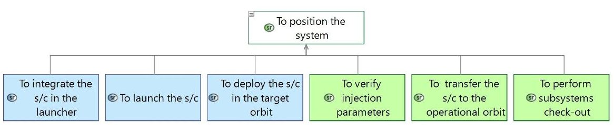


<div align="center">

Figure C.1: SFBD To position the system

</div>


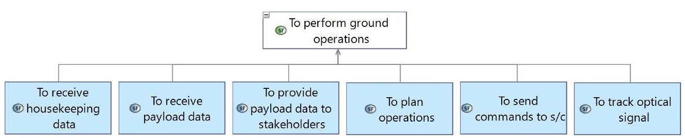


<div align="center">

Figure C.2: SFBD To perform ground operations

</div>


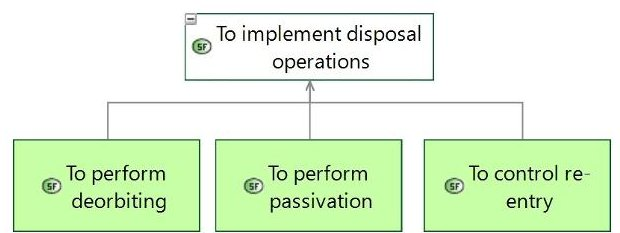


<div align="center">

Figure C.3: SFBD To implement disposal operations

</div>

<!-- PDF_PAGE: 115 -->

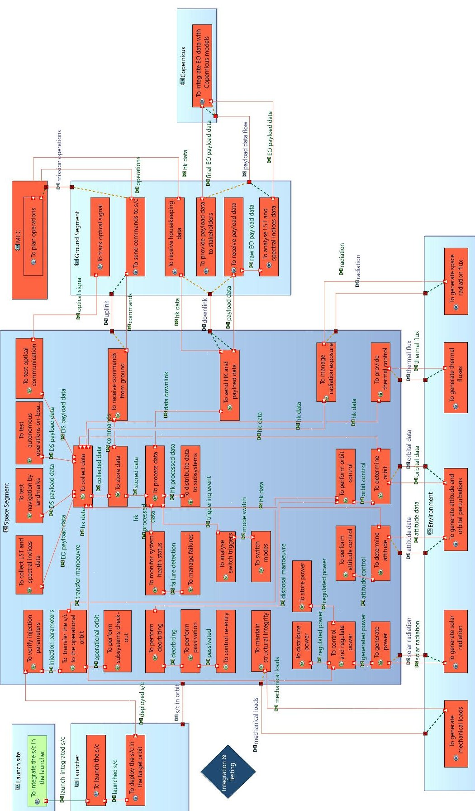


<div align="center">

Figure C.4: SAB I&T

</div>

<!-- PDF_PAGE: 116 -->

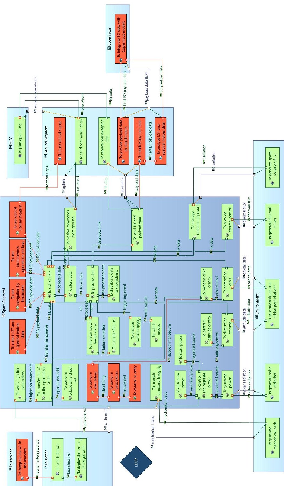


<div align="center">

Figure C.5: SAB LEOP

</div>

<!-- PDF_PAGE: 117 -->

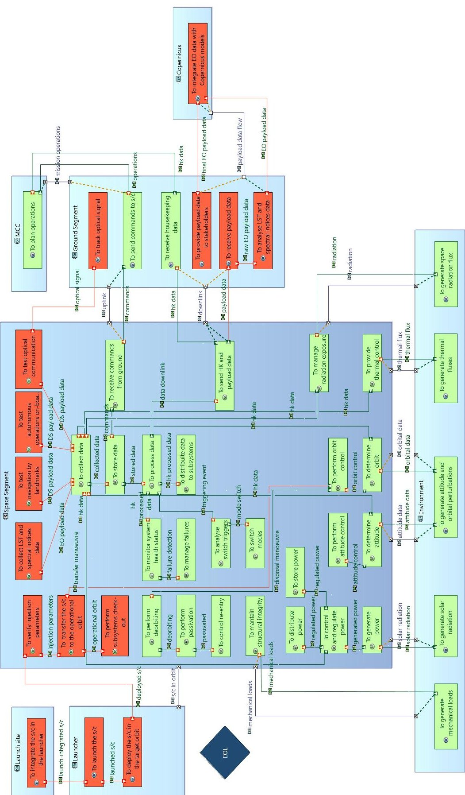


<div align="center">

Figure C.6: SAB EOL

</div>

<!-- PDF_PAGE: 118 -->

<table border="1"><tr><td>Component</td><td>Mass</td><td>margin+</td><td>total margin+</td><td>worst case+</td><td>margin-</td><td>total margin-</td><td>worst case-</td></tr><tr><td>Space_Segment</td><td>27.74kg</td><td>+20%</td><td>+26%</td><td>34.952kg</td><td>-0%</td><td>0%</td><td>27.74kg</td></tr><tr><td>Payload</td><td>5.12kg</td><td>+0%</td><td>+5%</td><td>5.376kg</td><td>-0%</td><td>0%</td><td>5.12kg</td></tr><tr><td>Deep_Space</td><td>2.16kg</td><td>+0%</td><td>+5%</td><td>2.268kg</td><td>-0%</td><td>0%</td><td>2.16kg</td></tr><tr><td>Navigation</td><td>1.5kg</td><td>+0%</td><td>+5%</td><td>1.575kg</td><td>-0%</td><td>0%</td><td>1.5kg</td></tr><tr><td>VNIR_Camera</td><td>1.5kg</td><td>+5%</td><td>+5%</td><td>1.575kg</td><td>-0%</td><td>0%</td><td>1.5kg</td></tr><tr><td>Optical_communication</td><td>0.66kg</td><td>+0%</td><td>+5%</td><td>0.693kg</td><td>-0%</td><td>0%</td><td>0.66kg</td></tr><tr><td>Laser_Module</td><td>0.66kg</td><td>+5%</td><td>+5%</td><td>0.693kg</td><td>-0%</td><td>0%</td><td>0.66kg</td></tr><tr><td>EO</td><td>2.96kg</td><td>+0%</td><td>+5%</td><td>3.108kg</td><td>-0%</td><td>0%</td><td>2.96kg</td></tr><tr><td>LWIR_Camera</td><td>1.8kg</td><td>+5%</td><td>+5%</td><td>1.89kg</td><td>-0%</td><td>0%</td><td>1.8kg</td></tr><tr><td>SWIR_Camera</td><td>1.16kg</td><td>+5%</td><td>+5%</td><td>1.218kg</td><td>-0%</td><td>0%</td><td>1.16kg</td></tr><tr><td>Platform</td><td>22.62kg</td><td>+0%</td><td>+5%</td><td>23.751kg</td><td>-0%</td><td>0%</td><td>22.62kg</td></tr><tr><td>AOCS_GNC</td><td>5.39kg</td><td>+0%</td><td>+5%</td><td>5.659kg</td><td>-0%</td><td>0%</td><td>5.39kg</td></tr><tr><td>C_DH</td><td>0.28kg</td><td>+5%</td><td>+5%</td><td>0.294kg</td><td>-0%</td><td>0%</td><td>0.28kg</td></tr><tr><td>Electronics</td><td>0.3kg</td><td>+5%</td><td>+5%</td><td>0.315kg</td><td>-0%</td><td>0%</td><td>0.3kg</td></tr><tr><td>EPS</td><td>4.43kg</td><td>+5%</td><td>+5%</td><td>4.651kg</td><td>-0%</td><td>0%</td><td>4.43kg</td></tr><tr><td>STR_MECH</td><td>10.5kg</td><td>+5%</td><td>+5%</td><td>11.025kg</td><td>-0%</td><td>0%</td><td>10.5kg</td></tr><tr><td>TCS</td><td>0.24kg</td><td>+5%</td><td>+5%</td><td>0.252kg</td><td>-0%</td><td>0%</td><td>0.24kg</td></tr><tr><td>TT_C</td><td>1.48kg</td><td>+5%</td><td>+5%</td><td>1.554kg</td><td>-0%</td><td>0%</td><td>1.48kg</td></tr><tr><td>Total</td><td>27.74kg</td><td>+20%</td><td>+26%</td><td>34.952kg</td><td>-0%</td><td>0%</td><td>27.74kg</td></tr></table>

<div align="center">

Figure C.7: Mass budget estimation on Valispace.

</div>

<table border="1"><tr><td>Component</td><td>Volume</td><td>margin+</td><td>total margin+</td><td>worst case+</td><td>margin-</td><td>total margin-</td><td>worst case-</td></tr><tr><td>Space_Segment</td><td>19.95 dm^3</td><td>+20%</td><td>+26%</td><td>25.137 dm^3</td><td>-0%</td><td>0%</td><td>19.95 dm^3</td></tr><tr><td>Payload</td><td>5 dm^3</td><td>+0%</td><td>+5%</td><td>5.25 dm^3</td><td>-0%</td><td>0%</td><td>5 dm^3</td></tr><tr><td>Deep_Space</td><td>2 dm^3</td><td>+0%</td><td>+5%</td><td>2.1 dm^3</td><td>-0%</td><td>0%</td><td>2 dm^3</td></tr><tr><td>Navigation</td><td>1.5 dm^3</td><td>+0%</td><td>+5%</td><td>1.575 dm^3</td><td>-0%</td><td>0%</td><td>1.5 dm^3</td></tr><tr><td>VNIR_Camera</td><td>1.5 dm^3</td><td>+5%</td><td>+5%</td><td>1.575 dm^3</td><td>-0%</td><td>0%</td><td>1.5 dm^3</td></tr><tr><td>Optical_communication</td><td>0.5 dm^3</td><td>+0%</td><td>+5%</td><td>0.525 dm^3</td><td>-0%</td><td>0%</td><td>0.5 dm^3</td></tr><tr><td>Laser_Module</td><td>0.5 dm^3</td><td>+5%</td><td>+5%</td><td>0.525 dm^3</td><td>-0%</td><td>0%</td><td>0.5 dm^3</td></tr><tr><td>EO</td><td>3 dm^3</td><td>+0%</td><td>+5%</td><td>3.15 dm^3</td><td>-0%</td><td>0%</td><td>3 dm^3</td></tr><tr><td>LWIR_Camera</td><td>1.44 dm^3</td><td>+5%</td><td>+5%</td><td>1.512 dm^3</td><td>-0%</td><td>0%</td><td>1.44 dm^3</td></tr><tr><td>SWIR_Camera</td><td>1.56 dm^3</td><td>+5%</td><td>+5%</td><td>1.638 dm^3</td><td>-0%</td><td>0%</td><td>1.56 dm^3</td></tr><tr><td>Platform</td><td>14.95 dm^3</td><td>+0%</td><td>+5%</td><td>15.698 dm^3</td><td>-0%</td><td>0%</td><td>14.95 dm^3</td></tr><tr><td>AOCS_GNC</td><td>8.4 dm^3</td><td>+0%</td><td>+5%</td><td>8.82 dm^3</td><td>-0%</td><td>0%</td><td>8.4 dm^3</td></tr><tr><td>C_DH</td><td>0.42 dm^3</td><td>+5%</td><td>+5%</td><td>0.441 dm^3</td><td>-0%</td><td>0%</td><td>0.42 dm^3</td></tr><tr><td>Electronics</td><td>0.6 dm^3</td><td>+5%</td><td>+5%</td><td>0.63 dm^3</td><td>-0%</td><td>0%</td><td>0.6 dm^3</td></tr><tr><td>EPS</td><td>2.55 dm^3</td><td>+5%</td><td>+5%</td><td>2.677 dm^3</td><td>-0%</td><td>0%</td><td>2.55 dm^3</td></tr><tr><td>STR_MECH</td><td>1.67 dm^3</td><td>+5%</td><td>+5%</td><td>1.754 dm^3</td><td>-0%</td><td>0%</td><td>1.67 dm^3</td></tr><tr><td>TCS</td><td>0.21 dm^3</td><td>+5%</td><td>+5%</td><td>0.221 dm^3</td><td>-0%</td><td>0%</td><td>0.21 dm^3</td></tr><tr><td>TT_C</td><td>1.1 dm^3</td><td>+5%</td><td>+5%</td><td>1.155 dm^3</td><td>-0%</td><td>0%</td><td>1.1 dm^3</td></tr><tr><td>Total</td><td>19.95 dm^3</td><td>+20%</td><td>+26%</td><td>25.137 dm^3</td><td>-0%</td><td>0%</td><td>19.95 dm^3</td></tr></table>

<div align="center">

Figure C.8: Volume budget estimation on Valispace.

</div>

<!-- PDF_PAGE: 119 -->

## Bibliography

[1] NASA. NASA System Engineering Handbook. NASA, 2007 (cit. on pp. 3, 4).

[2] D.D. Walden, G.J. Roedler, K.J. Forsberg, R.D. Hamelin, and T.M. Shortell. INCOSE Systems engineering handbook. Wiley, 2015 (cit. on pp. 3, 8).

[3] S. Corpino. Space Missions and Systems Design - SMSD. Tech. rep. lectures, Politecnico di Torino, 2025/26 (cit. on pp. 3, 11).

[4] E. Brusa, A. Cala, and D. Ferretto. System Engineering and Its Application to Industrial Product Development. Springer, 2018 (cit. on pp. 4, 11-15).

[5] L. Lindblad, M. Witzmann, and S. Vanden Bussche. Data-Driven System Engineering: turning MBSE into industrial reality. 2021. URL: https:// www.valispace.com/wp-content/uploads/2021/03/Valispace-2018- Turning-MBSE-Into-Industrial-Reality-SECESA.pdf (cit. on pp. 5-8).

[6] M. Ackley. Efficient Engineering 101 (II): Document-Driven vs. Data-Driven Systems Engineering (DDSE). 2019. URL: https://www.valispace.com/efficient-engineering-101-ii-document-driven-vs-data-driven-systems-engineering-ddse/ (cit. on pp. 5, 17).

[7] Jeff A. Estefan. 《Survey of Model-Based Systems Engineering (MBSE) Methodologies》. In: ResearchGate.net (2008) (cit. on pp. 8, 10, 11).

[8] NDIA. Model-Based Engineering Subcommittee, Final Report. Tech. rep. NDIA, 2011 (cit. on p. 8).

[9] M. Peres. The Complete Guide to Model-Based Systems Engineering (MBSE). Valispace. 2023. URL: https://www.valispace.com/the-complete-guide-to-model-based-systems-engineering-mbse/ (cit. on p. 8).

[10] P. Guardabasso, L. Lindbland, M. Witzmann, and S.Siarov. 《Evaluation of the Learning Process of a Data-Driven Systems Engineering Methodology in a Workshop Environment》。In: International Astronautical Congress (IAC-19). 2019 (cit. on p. 9).

<!-- PDF_PAGE: 120 -->

[11] G. Dinolfo. 《Application of MBSE to reverse engineering a rendzvous and docking space mission》. MA thesis. Politecnico di Torino, 2022 (cit. on p. 9).

[12] IBM. Integrating Rhapsody and DOORS. 2025. URL: https://www.ibm.com/docs/en/engineering-lifecycle-management-suite/design-rhapsody/ 10.0.1?topic=tools-integrating-rhapsody-doors (cit. on p. 15).

[13] Dassault Systemes. Cameo System Modeler. 2025. URL: https://www.3ds. com/products/catia/no-magic/cameo-systems-modeler (cit. on p. 15).

[14] MathWorks. System Composer. 2025. URL: https://www.mathworks.com/ products/system-composer.html (cit. on p. 16).

[15] Eclipse. Eclipse Papyrus. 2023. URL: https://eclipse.dev/papyrus/ (cit. on p. 16).

[16] L. Lindblad, M. Witzmann, and S. Vanden Bussche. System Engineering fro a web browser: turning MBSE into industrial reality. 2016. URL: https://www.valispace.com/wp-content/uploads/2021/02/Lindblad-SECESA- 2016-Valispace-web-browser-engineering.pdf (cit. on pp. 16-18).

[17] Capella. URL: https://mbse-capella.org/arcadia.html (cit. on pp. 16, 20, 21, 23, 24).

[18] URL: https://www.valispace.com/ (cit. on p. 18).

[19] P. Roques. System Architecture Modeling with the Arcadia Method - A practical guide to Capella. ISTE, 2018 (cit. on pp. 20-23, 42, 49, 51, 59, 65, 69).

[20] P. Minacapilli, F. C. Zurita, S. Criado Zurita, S. Campo Pérez, A. Rodríguez Pérez-Silva, and D. Escudero Lasheras. 《Small satellites mission design enhancement through MBSE and DDSE toolchain》。In: Model Based Space Systems and Software Engineering - MBSE2022 (2022) (cit. on pp. 28, 29, 62).

[21] J. Whitehouse. MBSE at ESA: State of MBSE in ESA Missions and Activities. MBSE 2021 Conference. URL: https://indico.esa.int/event/386/timetable/#5-mbse-at-esa-state-of-mbse-in (cit. on p. 29).

[22] Labs for Capella. Python for Capella. Valispace. URL: https://github.com/ labs4capella/python4capella (cit. on pp. 30, 34, 35, 78, 79, 81, 82).

[23] Valispace Python API. URL: https://github.com/valispace/ValispacePythonAPI (cit. on p. 30).

[24] Capella. Capella Add-Ons. URL: https://mbse-capella.org/addons.html (cit. on p. 33).

<!-- PDF_PAGE: 121 -->

[25] M2Doc from Capella model. Python4Capella Simplified Metamodel. URL: https://github.com/labs4capella/python4capella/blob/master specification/M2Doc%20generation/Python4Capella%20Simplified% 20Metamodel.docx (cit. on p. 35).

[26] ECMWF Copernicus Climate Change Service. Demonstrating heat stress in European cities. 2019. URL: https://climate.copernicus.eu/demonstrating-heat-stress-european-cities (cit. on pp. 41, 43).

[27] Copernicus Land Monitoring Service. A method to combat the Urban Heat Island effect. URL: https://land.copernicus.eu/en/use-cases/a method-to-combat-the-urban-heat-island-effect/a-method-to combat-the-urban-heat-island-effect (cit. on p. 41).

[28] Copernicus Climate Data Store. Climate variables for cities in Europe from 2008 to 2017. 2019. URL: https://cds.climate.copernicus.eu/datasets/ sis-urban-climate-cities?tab=overview (cit. on p. 43).

[29] ECMWF. Destination Earth Use Case. Addressing urban heat island effect. URL: https://stories.ecmwf.int/destination-earth-use-case/ (cit. on p. 43).

[30] Cure Copernicus. Copernicus for Urban Resilience in Europe. URL: https://cure-copernicus.eu/thecuresystem.html (cit. on p. 43).

[31] ESA. Urban Heat Islands and Urban Thermography. Tech. rep. The UHI project - Executive Summary, 2011 (cit. on p. 43).

[32] AAC Clyde Space. OPTIMUS-80. Datasheet. URL: https://www.aac-clyde space/what-we-do/space-products-components/cubesat-batteries (cit. on p. 71).

[33] GOMspace. NanoPower BPX. Datasheet. URL: https://gomspace.com/ shop/subsystems/power/nanopower-bpx.aspx (cit. on p. 71).

[34] Github. Python-Capellambse. URL: https://github.com/DSD-DBS/py-capellambse (cit. on p. 73).
