<!-- PDF_PAGE: 1 -->

## PHYSICS-BASED DIGITAL TWINS FOR CO-SIMULATION

MARIUSZ JANIAK

Solution Architect, SoftServe

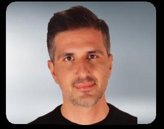

STEFANO CRISTIANO

Principal Research Scientist, NVIDIA

<!-- PDF_PAGE: 2 -->

## AGENDA

01 Digital Twin concept

02 Industrial grade simulations

03 Developing with NVIDIA Omniverse $ ^{ \mathrm{TM}} $

04 Co-simulation

05 Use cases

06 USD-FMI standard

07 Recap

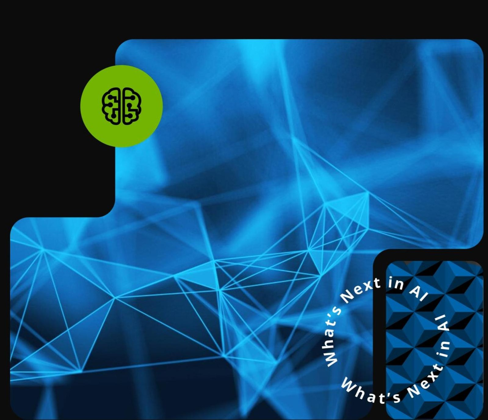

nVIDIA softserve

<!-- PDF_PAGE: 3 -->

## DIGITAL TWIN OBJECTIVES

A digital twin is a virtual representation of a physical system, product, or process that dynamically updates based on real-world data to provide insights and improve operations [SoftServe].

- Support design

- Assess the present

- Revisit the past

- Predict the future

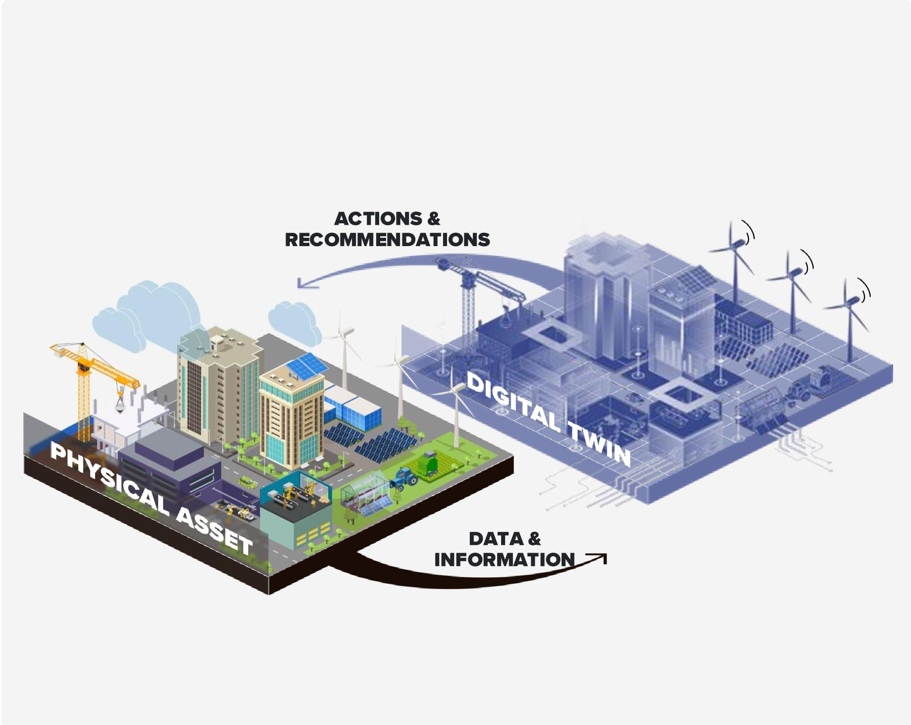

<!-- PDF_PAGE: 4 -->

## MANUFACTURING DIGITAL TWINS FOCUS USE CASES

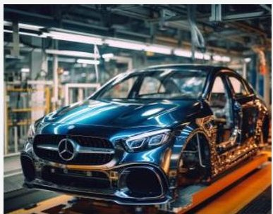

## PRODUCT DESIGN

- Collaborative design

- Virtual team collaboration

- Virtual product build-up

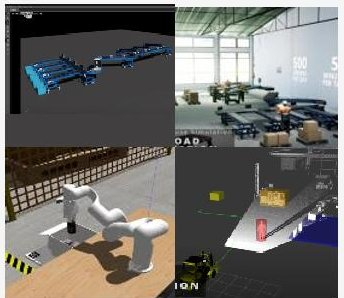

## FACTORY DESIGN

- Factory layout design

- Factory/Plant Simulation

- Manufacturing Processes / Production line simulation

- Virtual commissioning

- Virtual team collaboration

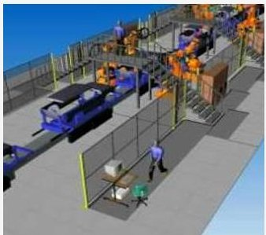

## PRODUCTION PLANNING

- What-if scenarios / simulations

- Schedule verification

- Optimize warehouse / inventory design and flow

- Increased OEE, navigate potential bottlenecks & machine failures

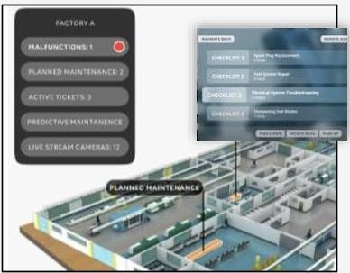

PRODUCTION CONTROL

- Shopfloor transparency

- Machine configuration

- Quality Control

- Online Diagnostics

- Predictive Maintenance

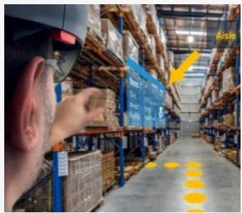

WORKER TRAINING & PLANT TOURS

- Virtual training

- Virtual Plant tours

<!-- PDF_PAGE: 5 -->

## INDUSTRIAL METAVERSE | DIGITAL FIRST

<!-- PDF_PAGE: 6 -->

## INDUSTRIAL HIGH-FIDELITY SIMULATIONS

## Rigid body dynamics

- body motion

- kinematics

- contains

- collision

## Structural Mechanics

- stress,

- strain,

- materials deformation

## Fluid dynamics

- laminar flow

- turbulent flow

- compressible

- incompressible

## Heat transfer

- conduction

- convection

- radiation

## Electromagnetic

- induction

- wave propagation

- eddy currents

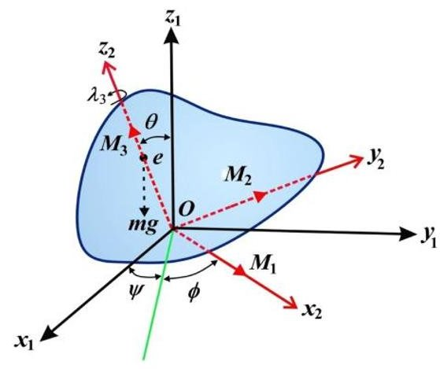

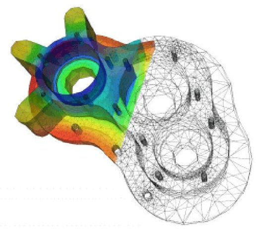

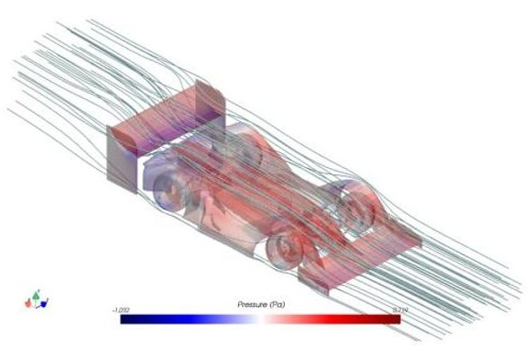

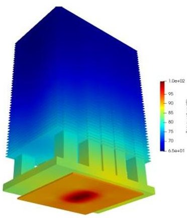

Temperature (C)

1.0e+02

95

90

85

80

75

70

6.5e+01

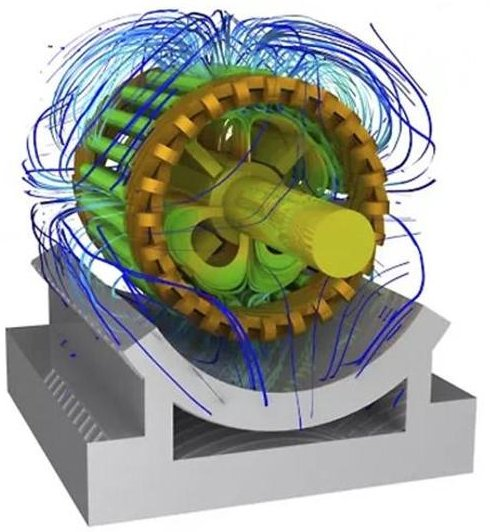

<!-- PDF_PAGE: 7 -->

## MULTIPHYSICS SIMULATIONS

Multiphysics simulations involve the simultaneous modeling of multiple physical phenomena that interact within a system.

## FEATURES

- Cross-Domain Interactions

- High Accuracy

- Solver Integration

- Scalability

## CHALLENGES

- Computational Intensity

- Solver Coupling

- Mesh Generation and Adaptivity

- Time Synchronization

- Boundary Conditions

- Data Management

- Accuracy and Validation

- Interdisciplinary Knowledge

- Software Interoperability

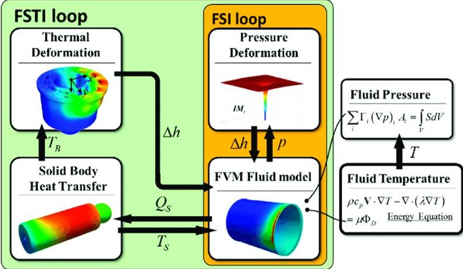

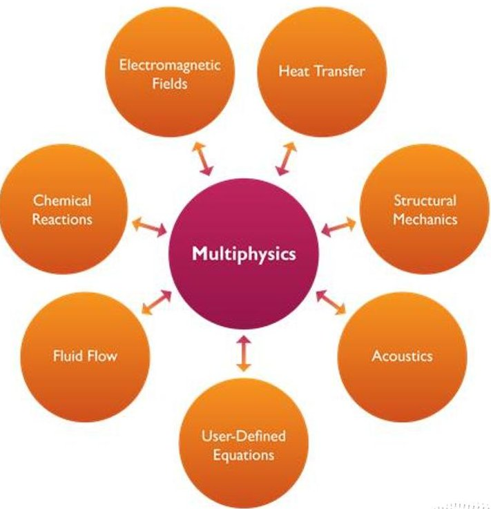

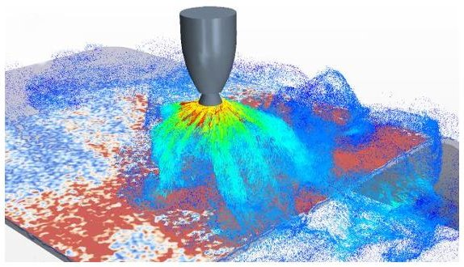

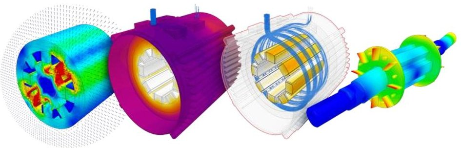

<!-- PDF_PAGE: 8 -->

# UNIVERSAL SCENE DESCRIPTION (OpenUSD)

## WHAT IS OpenUSD?

Extensible software ecosystem for constructing, packaging, assembling simulating and collaborating on 3D projects

Robust interchange with its expanding set of schemas and standardized core APIs

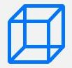

Geometry

Shading

Lighting

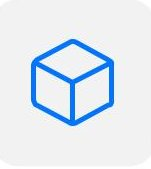

Physics

Combine assets into larger assemblies and enable collaborative workflows

## ALLIANCE FOR OpenUSD (AOUSD)

Open, non-profit organization dedicated to promoting the interoperability of 3D content through OpenUSD

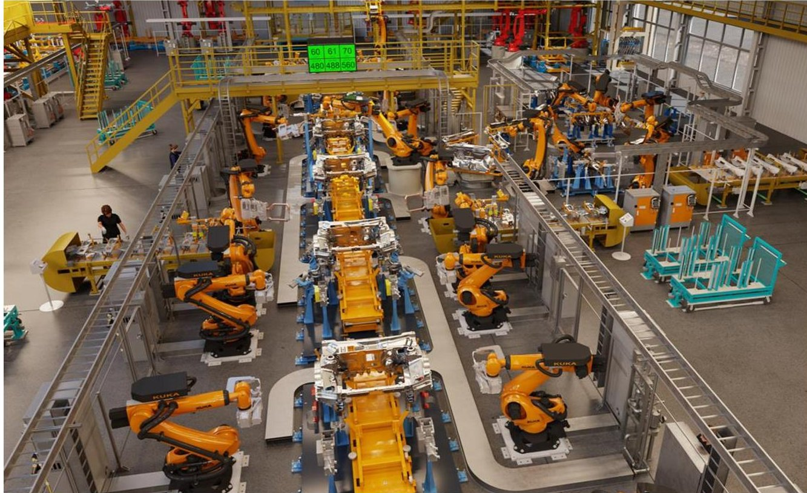

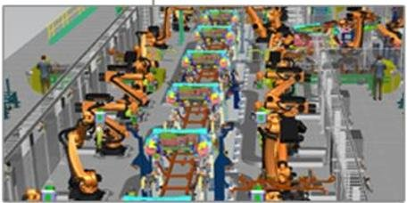

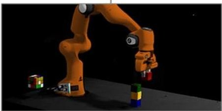

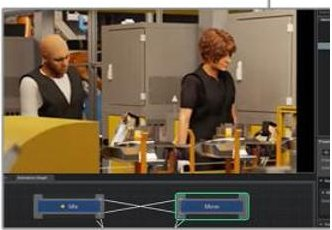

<!-- PDF_PAGE: 9 -->

## NVIDIA OMNIVERSE

Platform to Develop OpenUSD-Based Industrial Digitalization Applications

NVIDIA Omniverse $ ^{\mathrm{TM}} $ is a platform of APIs, SDKs, and services that enable developers to integrate OpenUSD NVIDIA RTX $ ^{\mathrm{TM}} $ rendering technologies, and generative physical AI into existing software tools and simulation workflows for industrial and robotic use cases.

Developer Applications

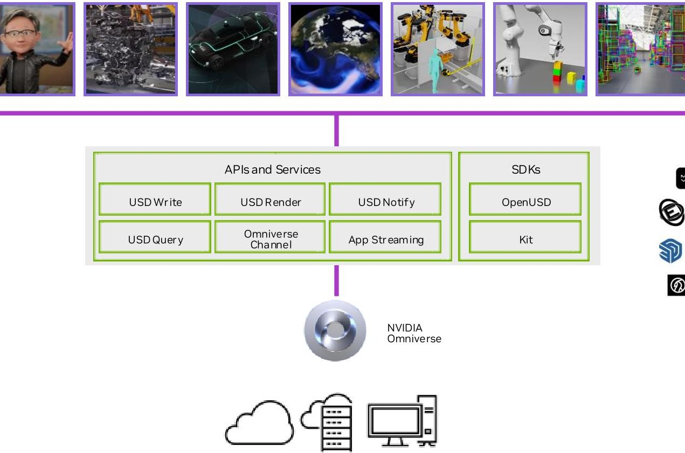

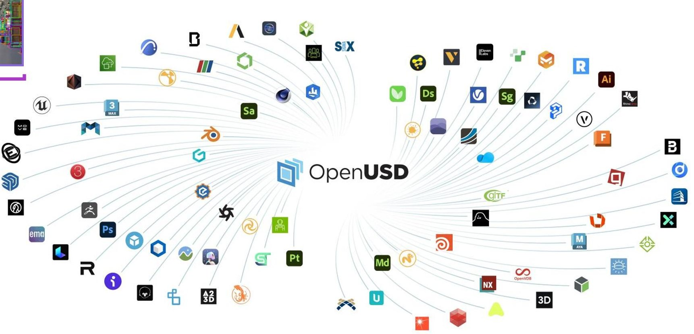

<!-- PDF_PAGE: 10 -->

## NVIDIA OMNIVERSE

Industrial Digitalization Applications and Use Cases

Developers across industries are building physical AI and industrial simulation applications with OpenUSD, Omniverse SDKs and APIs.

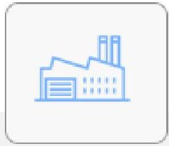

VIRTUAL FACILITY INTEGRATION

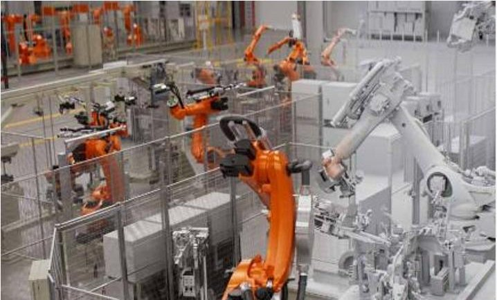

Develop physically accurate Digital Twins of massive facility layouts, simulations, automation systems and operations.

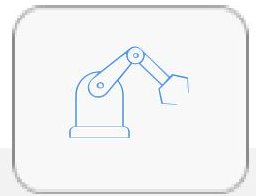

SIMULATION FOR PHYSICAL AI

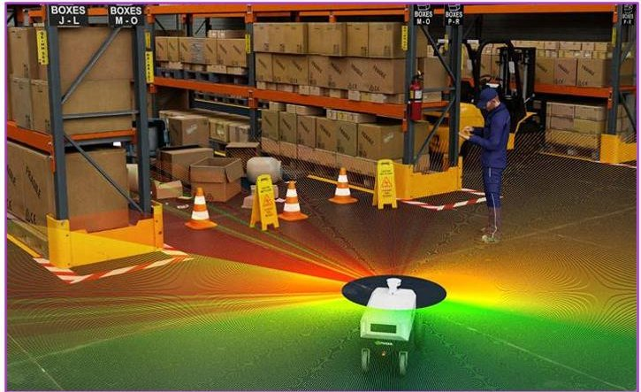

Provide physically accurate world simulation, sensor simulation that scales for Auto AV, AMRs, Manipulators and smart spaces.

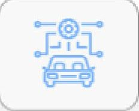

GENERATIVE AI FOR DESIGN

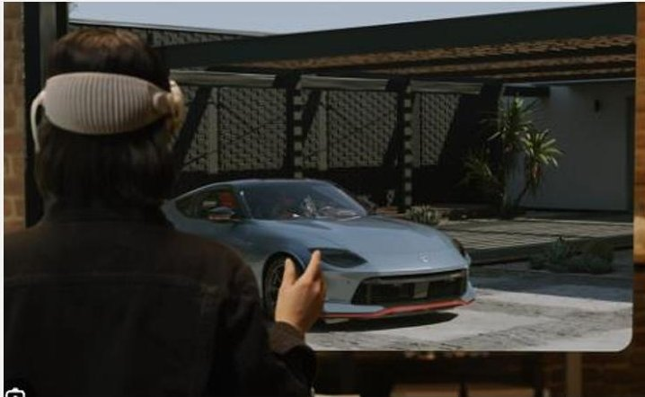

Leverage Generative AI for Design and Configurators

<!-- PDF_PAGE: 11 -->

## CO-SIMULATION IN NUTSHELL

Co-simulation is a method where different simulation models work together to analyze complex or multi-domain systems in a coordinated way.

- Hybrid simulation (mixed time- & event-driven)

- Simulation of heterogeneous systems

- Distributed simulation

- Common simulation standards (FMI, DCP, SSP)

- Unified models

- Flexible solvers

- Scalable infrastructure

Decision tree

Data-driven AI

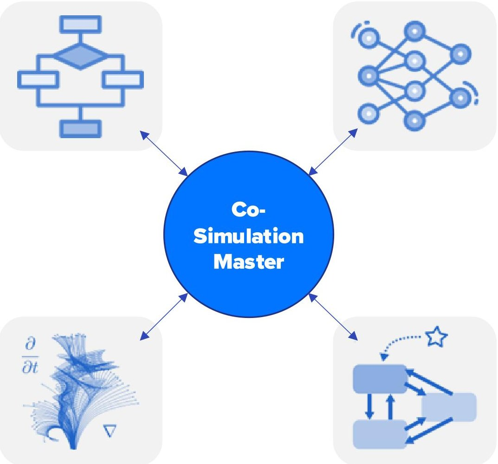

Dynamical system

State machine

<!-- PDF_PAGE: 12 -->

## FMI/FMU STANDARD

The Functional Mock-up Interface (FMI) is a free standard that defines a container and an interface to exchange dynamic models using a combination of XML files, binaries and C code, distributed as a ZIP file.

- Tool-independent standard making submodels binary compatible

- Functional Mock-Up Unit (FMU)

- The FMI standard specifies the APIs

- Supported by more than 200+ tools

- Maintained as a Modelica Association Project (MAP FMI)

- Releases on github.com/modelica/fmi-standard

<table><tr><td>dSPACE</td><td>ALTAIR</td><td>AKKODiS</td><td>PMSF
IT Consulting</td></tr><tr><td>AVL</td><td>AIRBUS</td><td>BOEING</td><td>BOSCH</td></tr><tr><td>DLR</td><td>Fraunhofer</td><td>gm</td><td>KNORR-BREMSE</td></tr><tr><td>NVIDIA</td><td>GROUPE
RENAULT</td><td>SAAB</td><td></td></tr><tr><td>SIEMENS</td><td>synOPSYS</td><td>W</td><td>VOLVO</td></tr><tr><td>ABB</td><td>AMPERE</td><td>Ansys</td><td>BECKHOFF</td></tr><tr><td>AARHUS UNIVERSITY</td><td>UNA
Universität
Augsburg
University</td><td>Fraunhofer</td><td>itk
ENGINEERING</td></tr><tr><td>ETAS</td><td>Julia
computing</td><td>LTX</td><td>virtual vehicle</td></tr><tr><td>MACHINEWARE</td><td>DASSAULT
SYSTEMES</td><td>esi
get it right</td><td>Maplesoft</td></tr><tr><td>Modelon</td><td>WOLFRAM
MATHCORE</td><td>TLK-Thermo</td><td>tracetronic</td></tr><tr><td>TECHNISCHE
UNIVERSITÄT
DRESDEN</td><td>COMSOL</td><td>KEE</td><td>KNORR-BREMSE</td></tr><tr><td>OpenModelica</td><td>MARTIN-LUTHER-UNIVERSITÄT
HALLE WITTENBERG</td><td>vti</td><td>Danfoss</td></tr></table>

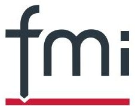

Functional Mock-up Interface

<!-- PDF_PAGE: 13 -->

## CO-SIMULATION IN NVIDIA OMNIVERSE

## PROBLEM

- Replicating the real-world processes in real-time

- Observe and evaluate the system under various conditions

- Leverage the integrative power of the NVIDIA Omniverse ecosystem

- Enable improved multi-disciplinary collaboration across different engineering teams

## SOLUTION

- Introduce FMI/FMU standard to NVIDIA Omniverse ecosystem

- Develop co-simulation scenario of the 1DOF levitating plate with payload

- Combine soft-RT rigid-body (PhysX) and fluid (Particles) simulation with control

- Develop models in Python and OpenModelica

- Develop NVIDIA Omniverse KIT extension with UI interface

- Compare results of fluid simulation with OpenFOAM CFD

## IMPACT

- Accelerating engineering teams

- Process optimization

- Adaptation to business goals on the design stage

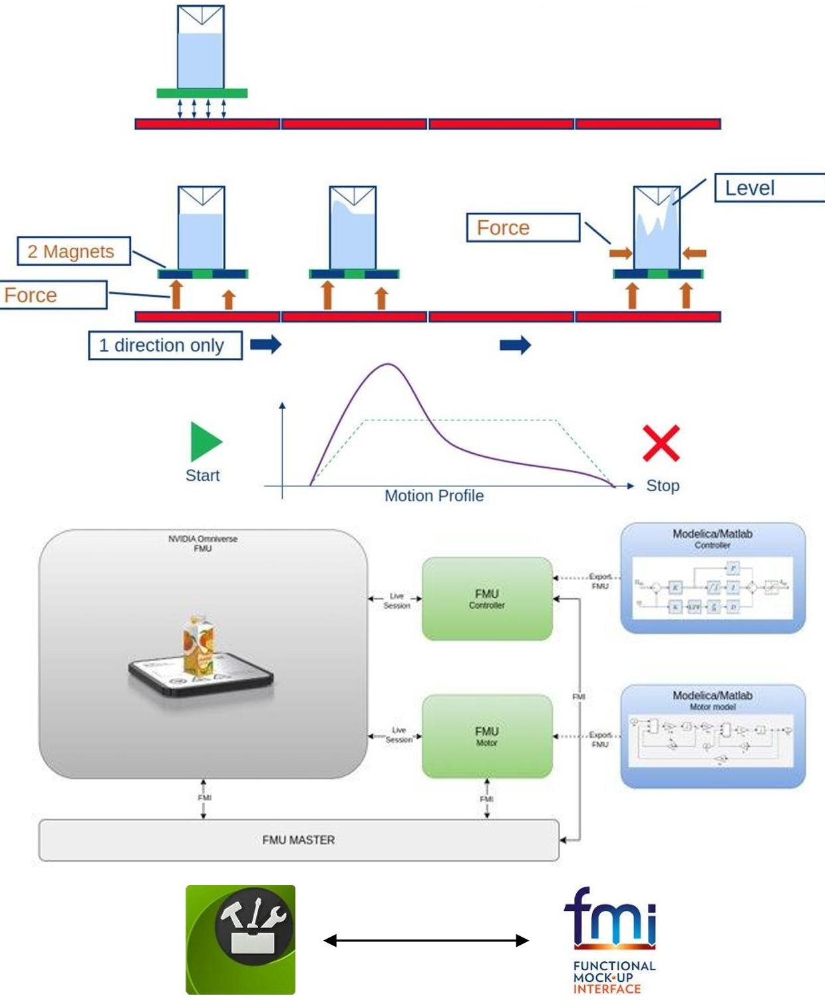

<!-- PDF_PAGE: 14 -->

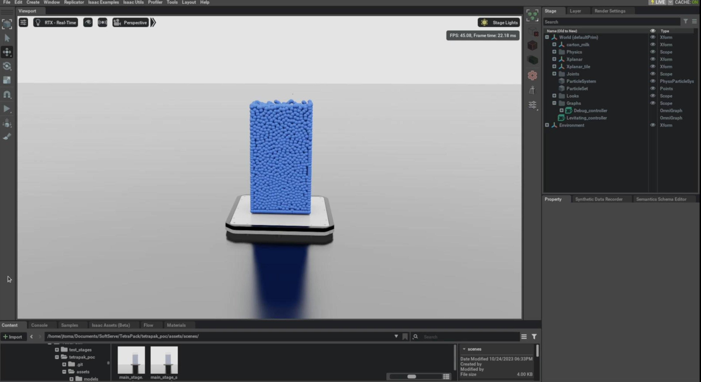

<!-- PDF_PAGE: 15 -->

# HIGH FIEDELITY CO-SIMULATION IN NVIDIA OMNIVERSE

## PROBLEM

- Create a foundation for a Digital Twin of the industrial machines

- Monitor, control and tune the device via set of control parameters

- Include high-fidelity simulations of selected assembly processes

- Enable fine-tuning of the process control parameters.

## SOLUTION

- Introduce ANSYS ROMs to NVIDIA Omniverse ecosystem.

- Combine simulation of rigid-body (PhysX), soft-body (Ansys ROM) with control

- Develop Simulation Twin of the press machine

- Develop models in Python and Ansys Twin Builder

- Develop nonlinear static simulation of element under press in Ansys

- Develop NVIDIA Omniverse KIT extension with UI interface

- Integrate Simulation Twin with AWS IoT Twin Maker

## IMPACT

- Accelerating engineering teams

- Process optimization

- Adaptation to business goals on the design stage

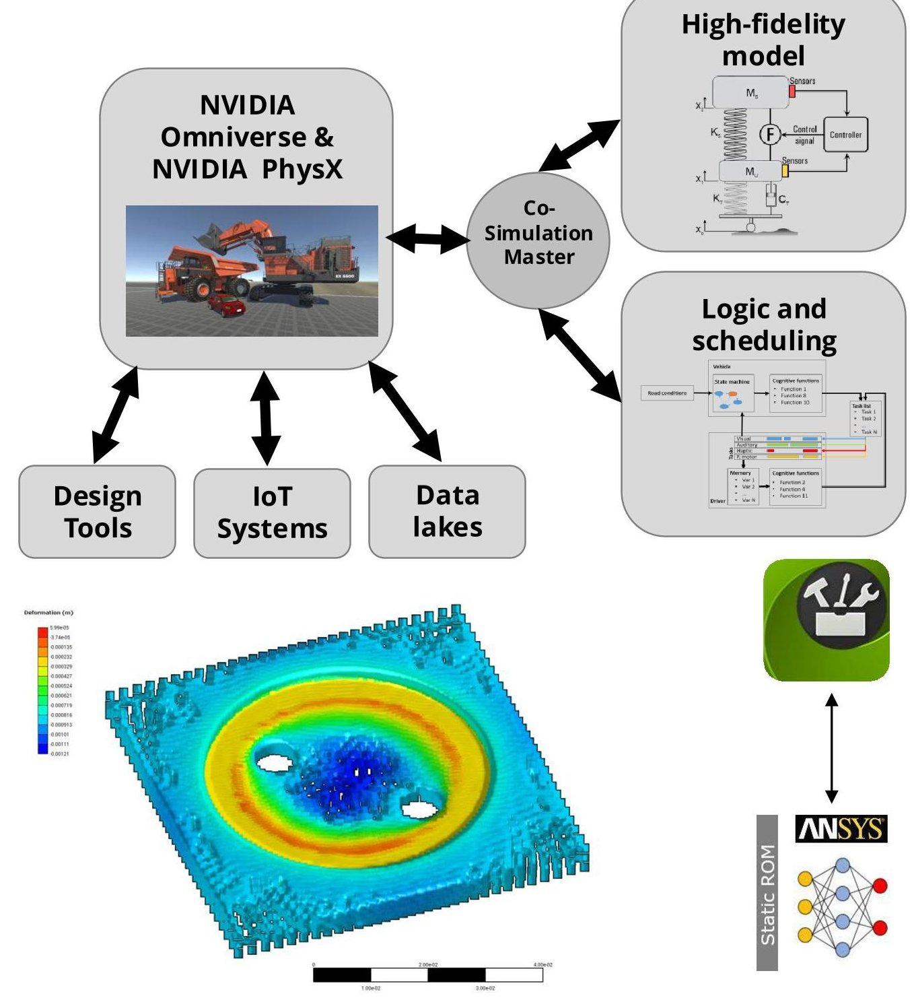

<!-- PDF_PAGE: 16 -->

# OCEAN UUV DIGITAL TWIN

## BUSINESS OVERVIEW

Develop digital twin of the UUV to meet the following business needs:

- Decrease time-to-market for the UUV solution

- Increase end-user satisfaction by increasing solution quality

- Increase solution effectivity by developing a high-fidelity model

## SOLUTION HIGHLIGHTS

- Simulate AOR (Area of Responsibility) focusing on littoral depths 50' to 250' deep.

- Develop a one-way coupled CFD set of models

- Develop equivalent PINNs model of fluid flow around UUV

- Track preplanned UUV trajectory

- Estimate battery consumption

- Visualize simulations with Nvidia Isaac Sim

## TECHNOLOGIES

NVIDIA Omniverse, NVIDIA Modulus, OpenFOAM, PINNS, CFD, Numerical methods, Modeling, Motion planning, Control

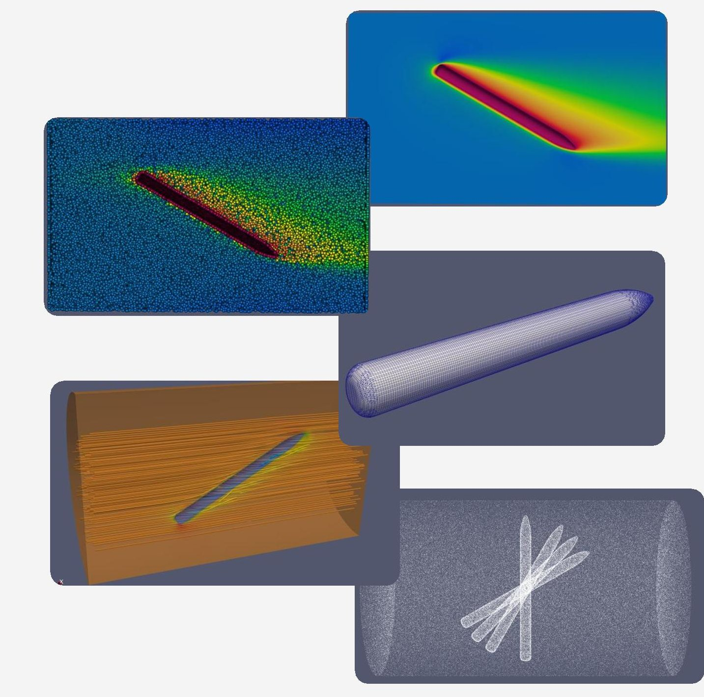

<!-- PDF_PAGE: 17 -->

<!-- PDF_PAGE: 18 -->

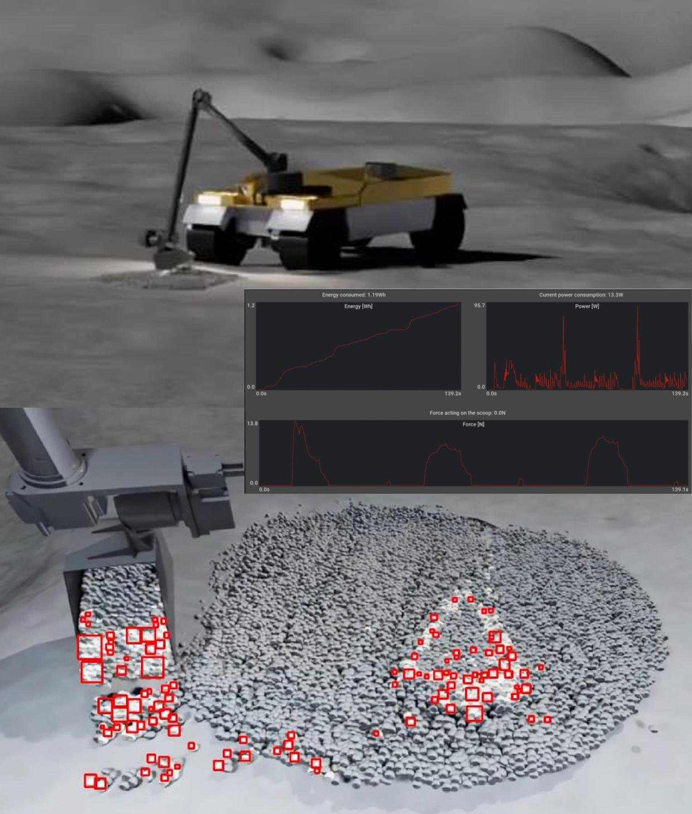

## MOON SCOOPING

## BUSINESS OVERVIEW

- Developed a solution of a mobile platform equipped with a robotics arm to scoop the regolith searching for ice deposits on the Moon

- Scoop the Moon regolith for exploration or construction

- Detect ice deposits while scooping

- Enable energy efficient operations

## SOLUTION

- Design of hardware components of the robot

- Design a vibratory mechanism to ensure energy effective scooping

- Apply simulation-first approach for efficient scooping

- Utilize robotics perception for ice deposit detection

- Implement high-fidelity terramechanics approach (NVIDIA Warp)

- Enable real-time energy consumption tracking

## IMPACT

- Increase mission duration with energy efficient scooping

- Enable real-time ice deposit detection

- Validate complex robotics solution in simulation

<!-- PDF_PAGE: 19 -->

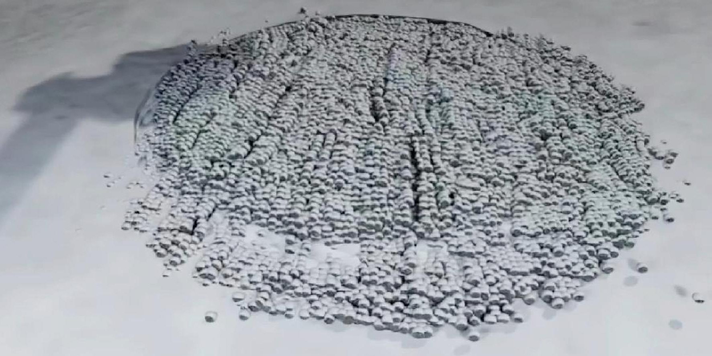

<!-- PDF_PAGE: 20 -->

## OUR VISION - USD + FMI

## Completely Define 3D Model and Simulation Behavior for Digital Twins

## 3D DIGITAL TWINS AND PHYSICAL AI

## OpenUSD

Geometry, shading, lighting, and physics

## FMI

Self contained simulation behavior

- MVP - Standardizing FMU integration in USD for co-simulation

- Single FMU $ \longleftrightarrow $ OpenUSD

- POC Shared as an open-sourced sample initially

- Merging the consensus standard and normative guidelines into OpenUSD

- Bring USD and FMI ecosystem partners into further discussions

- Identify industrial use cases and expand the integration standard/implementation

- Improve performance and usability

<!-- PDF_PAGE: 21 -->

## USD-FMI STANDARD

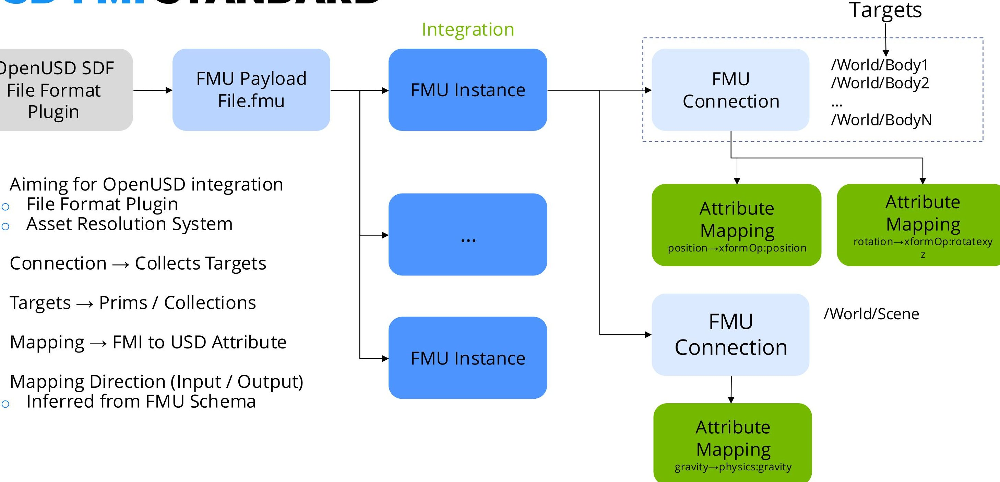

<!-- PDF_PAGE: 22 -->

## USD-FMI STANDARD

## Demo: MultiBody Physics standard

- FMU Wraps MuJoCo Physics Engine

- Mirror Physics Data to USD Stage

- Enables MultiBody Physics interaction

Collision interaction with host Physics Engine

- Joint Interaction with host Physics Engine

In Progress implementation of FMI- USD Standard

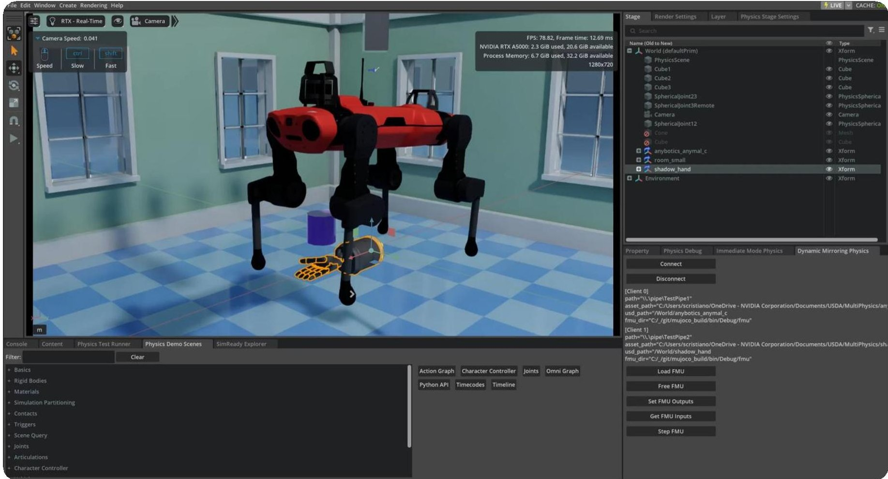

<!-- PDF_PAGE: 23 -->

## USD-FMI STANDARD

## Example: MultiBody Physics standard

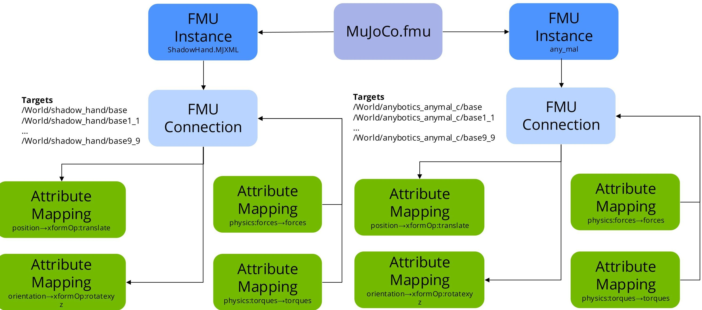

<!-- PDF_PAGE: 24 -->

## FUTURE OF USD + FMI

## What NVIDIA brings to the table

## BRIDGE AND BRING THE FMI AND ALLIANCE FOR OPEN USD (AOUSD) STANDARDS GROUPS AND ECOSYSTEMS

- Identify industrial use cases and expand the integration standard

- Create a working group for USD+FMI with stakeholders

## WITH NVIDIA'S UNIQUE COMPETENCIES, FURTHER USD+FMI OPPORTUNITIES IN

- Hardware acceleration of FMUs within USD

- Define 'Simready' specifications using USD + FMI --> 3D asset data + coupled behavior

- Neural physics and machine learning models using FMUs

## APPLICATION WORKSTREAMS

- Robotics simulations, testing/validation and reinforcement learning pipelines

- Autonomous Vehicles (AV Sim)

- HIL, SIL, PLC control simulations

- Virtual Factory Integration

<!-- PDF_PAGE: 25 -->

## RECAP

01 Digital Twin concept

02 Industrial grade simulations

03 Developing with NVIDIA Omniverse $ ^{ \mathrm{TM}} $

04 Co-simulation

05 Use cases

06 USD-FMI standard

07 Recap

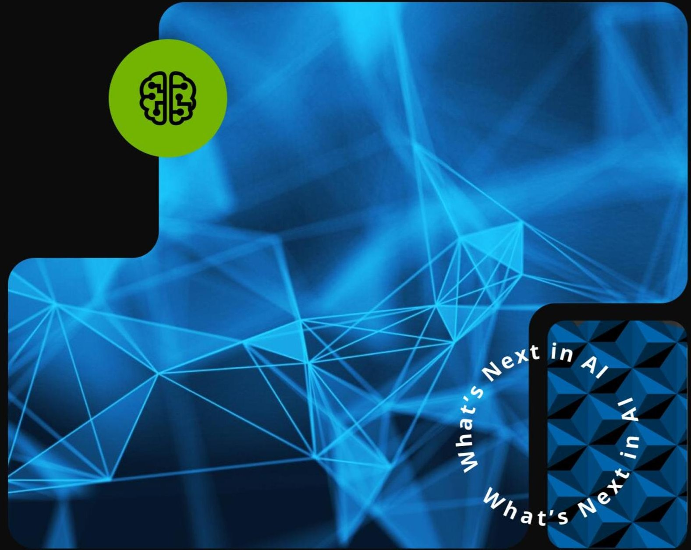

nVIDIA softserve

<!-- PDF_PAGE: 26 -->

## THANK YOU!

MARIUSZ JANIAK

Solution Architect, SoftServe

mjania@softserveinc.com

STEFANO CRISTIANO

Principal Research Scientist, NVIDIA

scristiano@nvidia.com

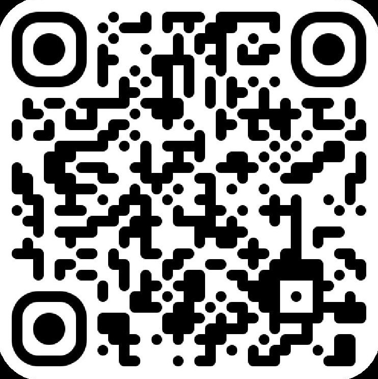

ANY QUESTIONS? LET'S TALK

<!-- PDF_PAGE: 27 -->

## FOR

THE

FUTURE

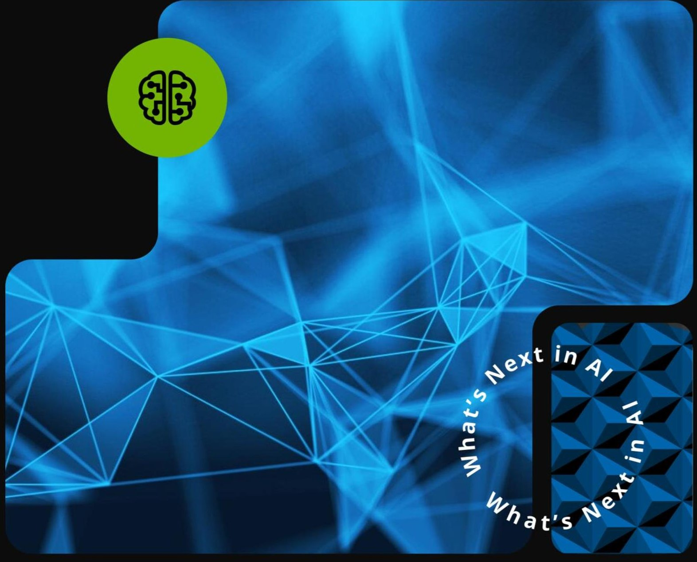
