<!-- PDF_PAGE: 1 -->

# A Framework for sizing, designing, and testing of Electrical Power System for nanosatellites: A case study of a 3U university Cubesat

Youssef El Hachimi $ ^{a,b} $ $ ^{*}, $ Amina Daghouri $ ^{b} $ $ ^{I D}, $ Hassane Mahmoudi $ ^{a}, $ Abdelaali Ouhammam $ ^{a,b}, $ Soumia El Hani $ ^{c} $

$ ^{a} $ Power Electronics, Smart Control Techniques, Automatic and Robotics Team, EMI, Mohammed V University in Rabat, Av Ibn Sina, 765, Rabat, Morocco

$ ^{b} $ University Center for Research in Space Technologies, EMI, Mohammed V University in Rabat, Av Ibn Sina, 765, Rabat, Morocco

$ ^{c} $ Energy Optimization, Diagnosis and Control Team, ENSAMR, Mohammed V University in Rabat, Av. des Forces Armées Royales, 10100, Rabat, Morocco

## ARTICLE INFO

Keywords:

Framework

Cubesats

Electrical Power System

Design

Functional tests

Environmental tests

## ABSTRACT

Because a CubeSat's Electrical Power System (EPS) must endure the hostile space environment, which includes radiation, temperature fluctuations, and electrostatic discharge, its dependability is essential to the mission's success. Based on real-world mission experience, this study presents the first organized paradigm that addresses the whole CubeSat EPS development lifecycle, including sizing, design, integration, and qualification. By conforming to the project life cycles of the National Aeronautics and Space Administration (NASA) and the European Cooperation for Space Standardization (ECSS), the framework guarantees adherence to space standards and facilitates the early detection of possible design flaws. In order to guarantee energy sufficiency before hardware development, the framework offers early insights into power generation, storage needs, and subsystem consumption through its Mission Design and Preliminary Power Budget phases. While SIMULINK facilitates preliminary electromagnetic compatibility (EMC) analysis, which aids in identifying design hazards associated with heat dissipation and conducted emissions, COMSOL Multiphysics is utilized for thermal evaluation during the EPS Design phase. By addressing important concerns prior to manufacturing, these early tests increase reliability and lower development costs. The robustness and practical use of the suggested methodology are illustrated by a real-world CubeSat case study, which validates each stage through hardware implementation and environmental and functional testing. In addition to addressing a significant vacuum in the literature, this study enables more dependable and reproducible CubeSat EPS designs for upcoming space missions by offering a comprehensive, mission-driven, and standards-compliant development approach.

## 1. Introduction

CubeSats are a class of nanosatellites composed of cube-shaped units measuring 10 cm $ \times $ 10 cm $ \times $ 10 cm and weighing up to 2 kg per unit (1U) [1]. The miniaturization of electronics has significantly advanced the development of small satellites, particularly Cubesats, which now dominate the aerospace sector. Due to their small size and low cost, universities and startups have been able to conduct space research [2]. Cubesats are generally launched into low earth orbit (LEO) to perform a variety of tasks [3], such as remote sensing [4], earth observation [5], and low atmospheric studies [6,7]. The main subsystems in a Cubesat are attitude determination and control system (ADCS), on-board computer (OBC), payload such as Camera, Antennas or sensors, the payload controller (PC), communication receiver and transmitter (COMM TX-RX), and EPS.

The EPS is responsible for energy generation, control, storage, and distribution, playing a crucial role in a Cubesat. The primary energy source for the EPS is solar cells, which convert solar flux into electrical power to sustain the Cubesat's various subsystems [8]. Batteries are also essential to the EPS's operation, serving as the primary energy storage system. They store the excess energy generated by the solar panels and, crucially, are used to compensate for energy deficits, particularly during the eclipse phase when the satellite traverses the earth's shadow [9]. Additionally, the EPS guarantees a controlled flow of current to subsystems, preserves operational integrity, and serves as a defense against over-current scenarios [10]. It needs to be well designed in order to respond to every scenario, particularly during critical operations such as data transmission or maneuvering during eclipses. Addressing these power limitations is crucial for enhancing the

<!-- PDF_PAGE: 2 -->

capabilities and performance of nanosatellites [11]. The mission could fail if the EPS malfunctions; hence, its reliability and robustness are critical [12].

Similar to conventional satellites, CubeSats adhere to a planned development schedule to guarantee mission success. While different space agencies, such as NASA, ESA (European Space Agency), and JAXA (Japan Aerospace Exploration Agency), define their own project lifecycles, they all share a common approach emphasizing rigorous design reviews and validation processes. In our case, the ESA project lifecycle serves as the reference model, beginning with the Mission Design Review (MDR) and progressing through key milestones, including the Preliminary Design Review (PDR), Critical Design Review (CDR), and Flight Readiness Review (FRR). Each of these phases plays a crucial role in ensuring the CubeSat's reliability and readiness for launch. According to [13], a structured lifecycle approach enhances mission success by systematically addressing technical challenges at each phase. By following ESA guidelines, this process ensures that the CubeSat undergoes rigorous validation, iterative design improvements, and risk mitigation before its operational deployment in space.

The Mission Definition Review establishes the mission objectives, operational concept, and feasibility, ensuring alignment with technical and scientific goals. The Preliminary Design Review assesses the feasibility of the CubeSat's subsystems through simulations and early analyses to verify that the design meets initial requirements. Validation at this stage focuses on feasibility assessments. The Critical Design Review marks the transition from design to production, ensuring that the system is fully defined, manufacturable, and testable, with validation shifting to confirm design correctness before fabrication. Finally, the Flight Readiness Review is the last phase before launch, where functional and environmental tests are conducted to confirm that the spacecraft meets all mission and launcher requirements and is ready for deployment. While several studies address various aspects of CubeSat EPS development [9,10,12,14-29], the literature lacks a comprehensive framework that integrates all design phases in accordance with space industry and standards, from mission design to flight qualification testing. Authors in [14] focuses on the design and verification of the CubeSat's electrical power system, covering energy generation, storage, and distribution. While it provides insights into system performance through design validation, it does not extend to environmental testing or a structured, end-to-end framework for EPS qualification. Authors in [9,15], presented results from EPS sizing and validation, thus providing an insights how key elements of EPS are sized. The authors in [17] proposed a low-cost, lightweight EPS focused on delivering the required power efficiently. However, their work lacks consideration of the environmental aspects, which are crucial for space missions. Components used in CubeSat EPS must undergo environmental testing or have proven flight heritage to ensure reliability in space conditions. Ignacio et al. [16] focuses solely on power budget validation, ensuring that the EPS meets mission energy demands through an analysis of power generation, storage, and consumption. However, it does not present a complete EPS design methodology or address environmental testing and qualification, making it a limited approach compared to a comprehensive development framework. Samrat et al. [18] proposed a MATLAB/Simulink model for CubeSat EPS design and simulation, analyzing the effects of CubeSat spinning on solar power generation and EPS responses to operational changes. The study emphasizes through EPS analysis to prevent mission failure. Another study presents the design of a custom EPS, including power budget analysis, system design, and functional testing [19]. In [20], the authors address EPS design in accordance with power budget analysis and also conduct a thermal analysis. The authors in [21] present the design and testing of the IITMSAT EPS, including a blind conducted emissions adjustment. This adjustment was made without specific reference to EMC standards and involved the implementation of a low-pass filter to reduce high-frequency noise. Alvarado1 et al. [22] present the research, analysis,

and design of the EPS for CubeSat Colombia 1. Starting with a theoretical preliminary design, they developed and refined a critical design through iterations. Electrical and physical tests were performed on the designed printed circuit board (PCB). The authors in [24] present the EPS design and implementation for the CubeStar satellite, covering system analysis, component selection, and testing. The authors in [23] present the design and on-orbit performance analysis of the Quetzal-1 CubeSat EPS, focusing on power generation, storage, and distribution. They evaluate the system's power budget, demonstrating how solar panel efficiency, battery charge state, and power demand impact energy balance. Leonardo et al. [12] designed and simulated different nanosatellite EPS architectures, including directly coupled, very low dropout regulator, and maximum power point tracking (MPPT) based systems. They validated their models through experimental testing using a hardware test stand. However, their work remains limited to simulation and laboratory validation without full system integration or environmental qualification. The authors in [10] designed an MPPT-based EPS for an Earth observation nanosatellite, estimating power demand and optimizing energy harvesting. They validated the system through MATLAB simulations, but no hardware implementation or environmental testing was performed. Edpuganti et al. [25] present a comprehensive review of CubeSat EPS architectures, classifying them into seventeen categories based on power conversion stages, converter placement, PV panel interfacing, and DC bus regulation. They analyze each architecture's operation, advantages, and limitations, providing a valuable reference for CubeSat developers and researchers working on next-generation EPS designs.

The approaches and degrees of validation used in the aforementioned studies differ greatly, despite the fact that they all offer insightful information about CubeSat EPS design. A comparative overview of these studies is provided in Table 1, which emphasizes elements like power budgeting, functional and environmental testing, real mission application, and the type of results reported. This synthesis supports the need for a more thorough framework and highlights current gaps in the literature.

This study presents a novel, unified framework for CubeSat EPS development, aligning with ESA and NASA space project life cycles. The proposed framework integrates mission design, power budget estimation, EPS architecture selection, and hardware validation through functional and environmental testing. By following a structured approach, it ensures compatibility with space standards while enabling iterative refinement during the design phase, enhancing the reliability and efficiency of CubeSat power systems. Fig.1 presents a block-level overview of the framework, illustrating the structured step-by-step process involved in CubeSat electrical power system design. The flowchart visually maps out the key phases, from mission definition and power budgeting to EPS design and testing, ensuring a clear understanding of the methodology. Each component in the diagram is elaborated in detail throughout the article.

## 2. Mission design

In this phase, each aspect plays a critical role in shaping the EPS of a CubeSat. The power system must be tailored to meet mission-specific requirements, ensuring sufficient energy generation, storage, and distribution throughout the mission lifecycle.

The mission duration directly influences the selection of solar panels, battery capacity, and degradation mitigation strategies. A shortterm mission (e.g., a few months) may prioritize high-efficiency but less radiation-hardened components, whereas long-duration missions (e.g., five years or more) require radiation-resistant solar cells, robust components, and advanced battery management systems to counter degradation [31]. Additionally, the mission's operational modes (e.g., active imaging, standby, or communication) dictate fluctuating power demands. The EPS must be designed to accommodate these variations through intelligent power regulation and storage systems. Furthermore,

<!-- PDF_PAGE: 3 -->

Table 1 Summary table comparing key features of previous works.

<table border="1"><tr><td>Ref.</td><td>Year</td><td>Real Mission</td><td>Requirement</td><td>Power Budget</td><td>EPS Design</td><td>Functional Tests</td><td>Environmental Tests</td><td>Results</td></tr><tr><td>[14]</td><td>2013</td><td>Yes</td><td>Mission</td><td>Yes</td><td>Yes</td><td>Yes</td><td>No</td><td>Practical</td></tr><tr><td>[24]</td><td>2013</td><td>Yes</td><td>Mission</td><td>Yes</td><td>Yes</td><td>Yes</td><td>Partial</td><td>Practical</td></tr><tr><td>[26]</td><td>2013</td><td>Yes</td><td>Mission</td><td>Yes</td><td>Yes</td><td>Partial</td><td>No</td><td>Simulation</td></tr><tr><td>[21]</td><td>2015</td><td>Yes</td><td>Mission</td><td>Yes</td><td>Yes</td><td>Partial</td><td>No</td><td>Practical</td></tr><tr><td>[22]</td><td>2017</td><td>Yes</td><td>Mission</td><td>Yes</td><td>Yes</td><td>Partial</td><td>No</td><td>Practical</td></tr><tr><td>[19]</td><td>2018</td><td>Yes</td><td>Mission</td><td>Yes</td><td>Yes</td><td>Partial</td><td>No</td><td>Practical</td></tr><tr><td>[10]</td><td>2018</td><td>No</td><td>Power</td><td>Yes</td><td>Partial</td><td>No</td><td>No</td><td>Simulation</td></tr><tr><td>[15]</td><td>2019</td><td>No</td><td>Power</td><td>Yes</td><td>No</td><td>No</td><td>No</td><td>Simulation</td></tr><tr><td>[18]</td><td>2019</td><td>No</td><td>Power</td><td>Yes</td><td>No</td><td>No</td><td>No</td><td>-</td></tr><tr><td>[12]</td><td>2020</td><td>No</td><td>Power</td><td>Yes</td><td>Partial</td><td>Partial</td><td>No</td><td>Simulation</td></tr><tr><td>[30]</td><td>2022</td><td>No</td><td>Power</td><td>Yes</td><td>Yes</td><td>No</td><td>No</td><td>Simulation</td></tr><tr><td>[17]</td><td>2023</td><td>No</td><td>Power</td><td>Yes</td><td>No</td><td>No</td><td>No</td><td>-</td></tr><tr><td>[9]</td><td>2023</td><td>Yes</td><td>Power</td><td>Yes</td><td>No</td><td>No</td><td>No</td><td>Simulation</td></tr><tr><td>[16]</td><td>2023</td><td>No</td><td>Power</td><td>Yes</td><td>No</td><td>No</td><td>No</td><td>Simulation</td></tr><tr><td>[23]</td><td>2023</td><td>Yes</td><td>Mission</td><td>Yes</td><td>Yes</td><td>Partial</td><td>No</td><td>Practical</td></tr><tr><td>[29]</td><td>2024</td><td>Yes</td><td>Power</td><td>Yes</td><td>Partial</td><td>No</td><td>No</td><td>Simulation</td></tr></table>

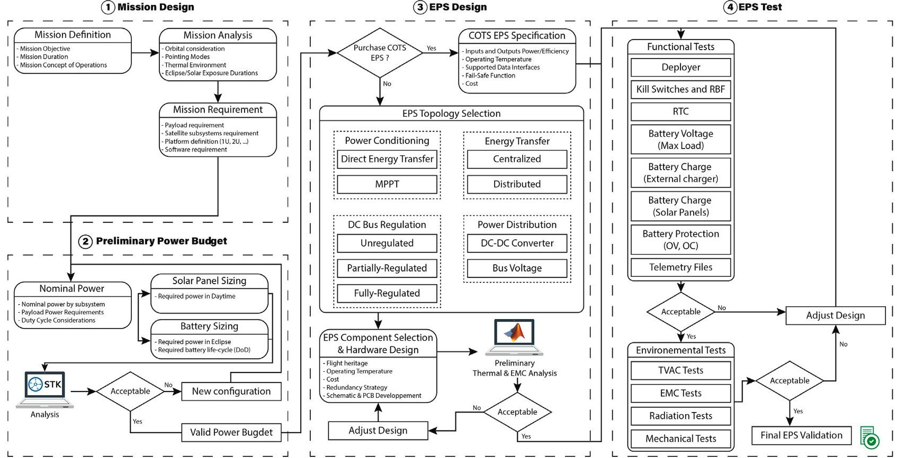

Fig. 1. Proposed framework for sizing, designing, and testing a CubeSat Electrical Power System.

the mission concept of operations (CONOPS) defines the CubeSat's activities and corresponding power demand profiles [32], requiring a dynamic power management system capable of efficiently switching between different states (e.g., disable communication subsystems when no ground station contact).

Mission analysis involves evaluating the trade-offs that impact the satellite's performance and power system design. Orbit selection is primarily driven by payload requirements, such as imaging constraints or the link budget for a communication payload. This choice directly influences solar power availability, radiation exposure, and thermal conditions. For example, LEO satellites in a Sun-Synchronous Orbit (SSO) experience approximately 30% eclipse per orbit, necessitating sufficient battery storage and efficient charge controllers to sustain operations during power interruptions. Additionally, the CubeSat's orientation affects solar panel exposure. A nadir-pointing configuration (e.g., for Earth observation) may generate less power than a suntracking configuration, making power optimization strategies essential. Beyond orbit selection, a thermal analysis is required to define the satellite's upper and lower temperature thresholds, ensuring appropriate

component selection [33]. At this stage, it is necessary to compute key orbital parameters, including Orbit Period $ T_{o} $ , Sunlight Period $ T_{s} $ , and Eclipse Period $ T_{e} $ , to accurately model power generation and storage requirements. (see Fig. 2).

The Orbit period can be determined using Kepler's Third Law presented in (1), with the Earth radius $ R_{e}=6 3 7 8 $ km, the chosen altitude of the Cubesat h, and the standard gravitational parameter of the earth $ \mu=3 9 8 6 0 1 \mathrm{k m}^{3} / \mathrm{s}^{2}. $

$$
T _ {o} = 2 \pi \sqrt {\frac {\left(R _ {e} + h\right) ^ {3}}{\mu}}
$$

The Sunlight period can be found by calculating the angle of which the satellite is in sunlight; in case of SSO, the angle of sunlight is $ (\alpha_{s}=\pi+2\psi) $ ; on the other hand, the angle of the Eclipse period $ T_{e} $ is $ (\alpha_{e}=\pi-2\psi) $ ; hence, $ T_{s} $ and $ T_{e} $ can be found using following equations [34]:

$$
T _ {s} = \left(\frac {1}{2} + \frac {\psi}{\pi}\right) T _ {o}
$$

$$
T _ {e} = \left(\frac {1}{2} - \frac {\psi}{\pi}\right) T _ {o}
$$

<!-- PDF_PAGE: 4 -->

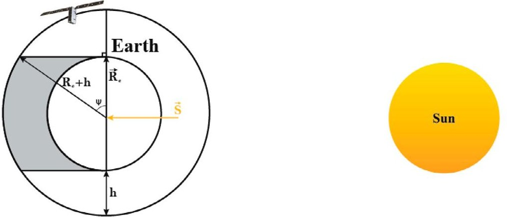

Fig. 2. Angles to calculate eclipse and sunlight periods.

where $ \psi $ is defined by:

$$
\psi = \arccos \left(\frac {R _ {e}}{R _ {e} + h}\right)
$$

Mission requirements are defined based on payload power and size constraints. During this phase, the necessary CubeSat subsystems required to accomplish the mission are also identified, including the OBC for computing power, the Attitude Determination and Control Subsystem for orientation control, the Communication subsystem, and, if necessary, a Payload Controller. These requirements dictate the overall power budget and system architecture. Based on these defined needs, the CubeSat platform (1U, 2U, 3U, etc.) is selected to ensure compatibility with the mission's power, size, and operational constraints.

## 3. Preliminary power budget

The preliminary power budget is typically conducted during the PDR phase, following space standards [35]. To perform this analysis, the power consumption of all subsystems and their respective duty cycles must be determined. A common approach for estimating the satellite's power generation involves calculating the total power consumed by the CubeSat's subsystems and payload throughout the sunlight period [9]. To determine the required solar panel (SP) production, it is necessary to establish the minimum power generation needed. This can be computed using (5), where $ E_{s} $ $ E_{e} $ $ X_{s} $ , and $ X_{e} $ represent the energy consumed during sunlight and eclipse phases and their respective energy path efficiencies. The power generation requirement must be calculated using End-Of-Life (EOL) characteristics, the latter can be determined by (6), to account for worst-case scenarios. To ensure a conservative design, low energy path efficiencies should be considered, with typical values of $ X_{s}=80\% $ and $ X_{e}=60\% $ [9]. Finally, the number of solar cells needed （ $ N_{sc} $ ）is determined using (7), ensuring sufficient power generation over the mission lifetime.

$$
P _ {s p _ {\min }} = \frac {\frac {E _ {s}}{X _ {s}} + \frac {E _ {e}}{X _ {e}}}{T _ {s}}
$$

$$
P _ {s c _ {E O L}} = V _ {m p _ {E O L}} I _ {m p _ {E O L}}
$$

$$
N _ {s c} = \frac {P _ {s p _ {m i n}}}{P _ {s c _ {E O L}}}
$$

When sizing the battery, multiple factors must be considered, including weight, size, mission duration, and power requirements during the eclipse phase. These parameters directly influence battery selection to ensure reliable energy storage throughout the mission. Additionally, operating temperature plays a crucial role in battery performance and longevity. A study explored the possibility of integrating a supercapacitor alongside a battery to extend battery life and meet high current demands without causing battery degradation [36]. The Depth of Discharge (DoD) significantly impacts battery degradation, as described

in [37] , and can be determined using (9). Over the past 20 years, Liion batteries have been extensively optimized for space missions [38]. Currently, more than 98% of newly developed satellites rely on Li-ion technology, making them the preferred choice for satellite applications [38]. According to [39], for Li-ion batteries, the parameters (a, b) are defined as (a = 1331, b = -1.825). The CubeSat's lifetime dictates the total number of charge/discharge cycles, referred to as the number of cycles $ ( N_{cycle} ) $ , which is calculated using (8). To ensure the battery withstands these $ N_{cycle} $ , the required DoD must remain below the value determined by (9). Consequently, battery oversizing is necessary to extend operational life. Additionally, a 20% margin (M) must be incorporated to compensate for battery degradation over time [9]. The total energy required for the mission can be determined using (10).

$$
N _ {c y c l e} = N _ {l i f e t i e} \cdot N _ {d a y / y e a r} \cdot N _ {o r b i t / d a y}
$$

$$
N _ {c y c l e} = a \cdot D o D ^ {b}
$$

$$
E _ {B a t t e r y} = \frac {E _ {e}}{D o D} (1 + M)
$$

After completing the sizing process, it is recommended to simulate the mission using dedicated software such as System Tool Kit (STK). This ensures that the power system has been accurately sized, validating its performance under real mission conditions before starting the EPS design phase.

## 4. EPS design

At this stage, with both power generation and storage components sized, two options are available: purchasing a Commercial Off-TheShelf (COTS) EPS or developing a custom EPS. Each option presents distinct advantages and trade-offs. Opting for a COTS EPS can significantly reduce design and manufacturing time, ensuring compatibility with industry standards. However, this approach is often costly and may impose limitations on customization, where various criteria needs to be addressed. If a suitable COTS EPS meeting the mission specifications, such as power requirements, supported data interfaces, and thermal constraints is available, it can streamline development. Conversely, if a COTS solution is not viable, an in-house EPS must be designed, requiring careful selection of its topology, starting from power conditioning, this unit delivers voltage to the DC bus, but PV panel output fluctuates due to environmental conditions and load mismatches. Solar Array Regulators address this by ensuring load matching and battery overcharge prevention. Two main approaches exist: Direct Energy Transfer (DET), where power is transferred directly with bypass regulators, and Peak-Power-Transfer (PPT), which uses DC-DC converters to optimize power extraction. MPPT topologies are preferred in CubeSats for maximizing energy harvesting, and hybrid DET-PPT configurations have been explored for improved efficiency [40]. For

<!-- PDF_PAGE: 5 -->

satellites in general, two types of power system architectures exist: distributed and centralized. In a distributed architecture, each subsystem has its own dedicated power conditioning unit, meaning power regulation occurs locally at each subsystem rather than on a single centralized board. This approach provides flexibility and redundancy but increases system complexity and weight. Conversely, a centralized architecture consolidates all power conditioning and regulation into a single unit, distributing power to all subsystems from one central board. Due to their small size and mass constraints, CubeSats typically adopt a centralized power system, simplifying design and minimizing the number of components needed [41]. The choice between unregulated, partially regulated, and fully regulated DC buses significantly influences the topology of a CubeSat's EPS. In The unregulated bus topology, the DC bus voltage directly follows the battery voltage, resulting in voltage variations that subsystems must accommodate. This approach simplifies the power system design but may limit the performance of sensitive subsystems [25]. A partially regulated bus maintains the bus voltage within a specific range, often through power conditioning units, offering a balance between system simplicity and voltage stability [41]. A fully regulated bus employs DC-DC converters to ensure a constant and stable voltage regardless of the battery state, enhancing subsystem reliability but increasing system complexity and conversion losses [42]. The selection among these architectures depends on mission constraints, power requirements, and subsystem voltage tolerance [41]. At this stage power distribution needs to be addressed, this part must include DC-DC Converters if subsystems needs a specific supply voltage, these DC-DC converters can be either buck or boost. It is essential to implement voltage and current monitoring, along with temperature and overcurrent/overvoltage protection circuitry, without requiring MCU intervention [43]. Additionally, power switches are mandatory for controllable outputs to ensure compliance with the mission's CONOPS. Components are selected based on multiple criteria. They must have flight heritage, ensuring reliability in space environments. Designers must verify that components operating temperature falls within the range established in the requirements. A redundancy strategy can be implemented to enhance reliability, and finally, the cost must remain reasonable. At this stage in-house hardware design, software development, and component procurement begin, aligning with the CDR phase of the project life cycle as per ECSS standards [35]. During PCB development, key considerations such as EMC and thermal management must be incorporated to ensure the reliability and performance of the EPS [44]. After completing the hardware design, preliminary thermal and EMC analyses are conducted to obtain initial results. Failure to meet the predefined thermal requirements or comply with EMC standards necessitate design adjustments. These modifications can include enhancing thermal management within the PCB, incorporating filters to mitigate EMC issues, or refining the PCB layout to improve signal integrity [45].

## 5. EPS tests

The qualification of the EPS aims to provide evidence that the system meets all specified requirements and performs reliably in its intended environment with the necessary qualification margins [46]. The EPS testing process is divided into two main parts. The first part focuses on functional validation, ensuring that the EPS performs all critical operations as designed [47]. This includes verifying the deployment of antennas or solar panels (if applicable), managing power on-off sequences based on a predefined combination of kill switches (KS) and remove before flight (RBF) switch, and ensuring that the realtime clock (RTC) operates independently, even when the satellite is powered off using flight switches. Additionally, battery performance is assessed under maximum load conditions, verifying that in an unregulated DC bus, the battery delivers the required current without falling bellow 10% of the initial voltage, while in a regulated DC bus, voltage stability is maintained. The qualification process also includes

verifying proper battery charging through both an external charger and solar panels. To simulate solar charging, a halogen lamp is used due to its stable and smooth spectrum, affordability, and compatibility with clean-room environments. Finally, the validation ensures that the battery protection is working in case of (overvoltage) (OV) or overcurrent (OC) conditions and that telemetry data is correctly logged. The second part of the qualification process evaluates the EPS's ability to operate reliably in its intended environment. This begins with Thermal Vacuum Chamber (TVAC) testing, conducted in accordance with established standards such as the thermal analysis handbook [48] and NASA guidelines. These tests simulate the extreme thermal and vacuum conditions of space, ensuring the EPS can withstand and function optimally under mission-relevant environmental stresses. Next the EPS's Electromagnetic Compatibility is tested, this aims to validate the preliminary analysis, this test is also established according to space standards such as [49]. The third qualification test evaluates the EPS's ability to withstand extreme radiation environments. This testing is crucial to ensure the long-term reliability of the system by assessing its resistance to radiation-induced degradation and potential single-event effects, which could impact functionality during the mission. The final phase of testing ensures that the designed EPS meets the mechanical qualification requirements outlined in [50]. This includes vibration, shock, and acoustic tests to verify the system's structural integrity and resilience to launch and operational loads. Failure to achieve the desired results necessitates design adjustments, followed by a complete re-evaluation. This includes repeating both functional and environmental qualification tests to ensure compliance with mission requirements and space standards.

## 6. Case study: UM5-SAT

## 6.1. Mission design

The mission aims to deploy a 3U university CubeSat to enhance remote sensing capabilities in Morocco, with a primary focus on Internet of Things (IoT) data collection. This project is expected to contribute to various fields, including agriculture, environmental monitoring, and disaster management. Designed for a 5-year mission duration, the CubeSat will gather data from IoT terminals across Morocco and transmit it to the ground station (GS) in Rabat during visibility windows. A Sun-Synchronous Orbit at 550 km altitude with an inclination of 98 $ ^{\circ} $ C is been selected to optimize the link budget. The mission profile is defined by a set of operational modes. These modes, managed by the EPS, are designed to meet the specific requirements of different phases of the Cubesat's mission:

- Idle Mode: The satellite is not receiving data from ground terminals nor communicating with GS.

- Receiving Mode: The satellite is receiving short messages from IoT terminals on the ground.

- GS Communication Mode: The satellite is communicating with the GS during the access period.

- Safe Mode: The satellite subsystems are partially shut down to conserve power during non-critical mission phases.

- Critical Mode: The EPS subsystem activates the critical mode, initiating energy conservation measures as the state of charge of the batteries falls to 40% or lower. During this mode, all satellite subsystems are powered off, with only the EPS Microcontroller Unit (MCU) remaining in an operational state.

The CubeSat must also withstand temperatures ranging from $ - 2 0^{\circ} \mathrm{C} $ to $ 6 0^{\circ} \mathrm{C} $ [51]. Considering its orbital constraints, the orbit duration, sunlight and eclipse durations are calculated using (1), (2), and (3).

To fulfill this mission, the CubeSat includes an SDR payload to facilitate communication with various ground terminals. It also features an Attitude Determination and Control Subsystem (ADCS), which determines the satellite's position and attitude using various sensors, such

<!-- PDF_PAGE: 6 -->

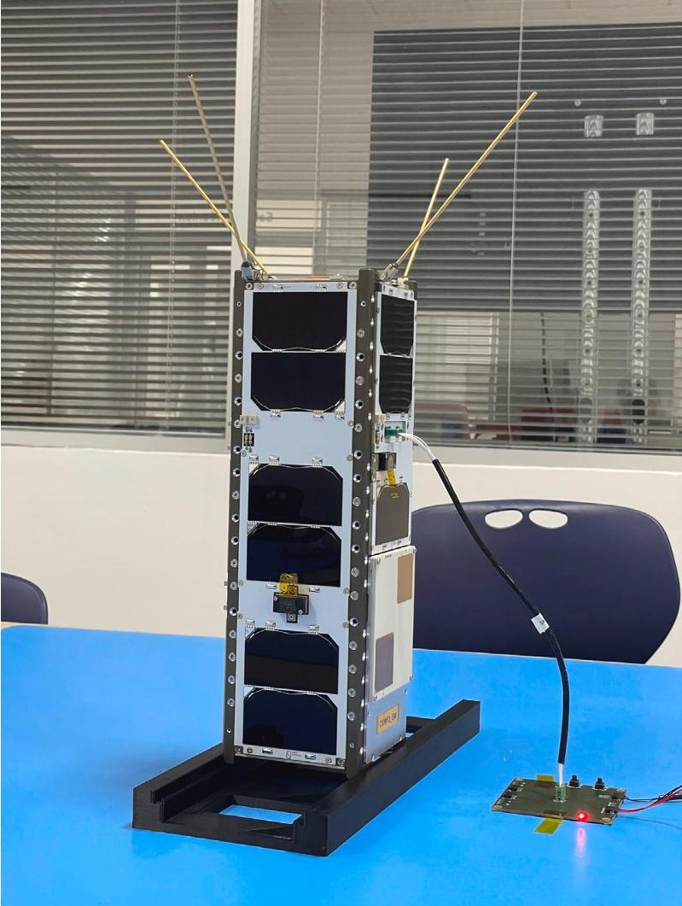

Fig. 3. UM5-SAT Cubesat.

as gyroscopes, magnetometers, and sun sensors. The ADCS adjusts the CubeSat's attitude using magnetorquers and reaction wheels, allowing the satellite to maintain and modify its orientation in space. This ensures stability and proper alignment with mission objectives, such as sun-pointing for maximum power generation or ground station (GS) pointing for communication [52]. The CubeSat includes an On-Board Computer (OBC) that acts as its central processing unit, managing operations, handling data transfers, and gathering and transmitting housekeeping telemetry from all subsystems. Additionally, a Payload Controller (PC) is responsible for data collection, storage, and transmission, as well as receiving and executing commands from the ground station, serving as the interface between the satellite and the SDR payload. For communication, the CubeSat incorporates a dual-band system, utilizing UHF-TTC for emergency purposes and S-Band for normal operations (uplink/downlink). This setup provides the CubeSat with a large data budget [53]. To integrate all these subsystems efficiently, the CubeSat adopts a 3U configuration. (see Fig. 3).

## 6.2. Preliminary power budget

The power budget analysis was carried out, taking into account specifications calculated previously. It was assumed that the satellite is tracking the sun while the payload is not operating. The payload operation duty cycle (10% of the orbit duration) was selected according to ground station visibility duration and data budget. The EPS is intended to power subsystems depending on the operational modes and based on whether there is sunlight or an eclipse period. During sunlight, SPs are the main power source of the EPS; the energy is produced by solar cells and transmitted to power subsystems. Batteries are used to store the extra energy; they are needed, especially in eclipse time, because SPs are not operational. They can also be used when there is insufficient energy production from SPs.

## 6.2.1. SP sizing

In this work, Triple Junction 3G30 A solar cells from Azur Space are used, with their characteristics presented in Table 3. The required number of solar cells, $ N_{sc} $ = 11, is calculated using the approach outlined in Section 3. Given the dimensions of the solar cells (40 mm $ \times $ 80 mm) and the required $ N_{sc} $ ,12 cells are placed on the same face, necessitating the use of a deployable panel to integrate them. Another challenge is ensuring that the CubeSat generates sufficient power to sustain critical subsystems (EPS, UHF-TTC, and S-Band) even when stowed. Based on the power requirements calculated from Table 3, these subsystems require a total of 2.29 W. To address this, a minimum of three solar cells per face is required. Consequently, seven additional cells are incorporated into the design, distributed across two faces, with four cells on one face and three on the other.

## 6.2.2. Battery sizing

Taking into consideration the mission's duration requirement is greater than 5 years; taking $ N_{lifetime}=5 $ means that the number of cycles is $ N_{cycle}=27375 $ calculated as the number of charges or discharges during its lifetime, as described by (8). In order to survive these $ N_{cycle} $ using (9), the required DoD must be lower than 16%. For this purpose, it is necessary to oversize the battery. A 20% margin M is also added to compensate for the battery degradation. The Eq. (10) can be used to determine the amount of energy needed for this mission. It was found that the battery energy required is $ E_{e}=31.11 $ Wh. A battery pack composed of four Li-ion battery cells (NCR18650BF) from Panasonic is constructed to meet the energy requirements listed in Table 4. Connecting these cells in series (2S2P) doubles the battery pack voltage, giving an output voltage of 8.4 V while also doubling the current.

## 6.2.3. Power budget validation

The objective is to validate the power budget done in Section 6.2. The SP sizing and the battery sizing will be validated by simulation. A simulation of the mission of the IoT satellite was done in ANSYS STK software based on parameters presented in Table 6. The Cubesat power generation and power consumption were simulated using the Cubesat cell distribution presented in Table 5, a deployable panel, and four NCR18650BF battery cells (2S2P) are used. The satellite attitude was set as sun-pointing with the +Y axis and the ECI +Z axis constrained because both COMMs (UHF and IoT) are omnidirectional. This will give an advantage to power generation while communicating with both GS and IoT terminals. In Idle and Safe Modes, the satellite will be performing sun-pointing; in Receiving Mode, it will be GS-pointing considering the S-Band is directional.

A 24-hour scenario is created in STK starting on July 1, 2024 at 12:00:00 UTC, when solar flux is at a minimum to simulate worst case scenario. All orbits, ground station, and IoT terminals visibilities were computed and are presented in Fig. 4.

The instantaneous generated power is calculated using the following equation:

$$
P _ {G} = \sum_ {n = 1} ^ {4} S _ {c} \eta_ {s c} A _ {n} \cos \left(\alpha_ {n}\right)
$$

where $ S_{c}=1 3 1 6 \mathrm{~ W / m^{2}} $ is the worst case solar flux, $ \eta_{s c}=2 6. 6 \% $ is the EOL efficiency of the Azur Space solar cell (SC), $ A_{n} $ is the effective area of the SP, for example +Y panels with the deployable area is $ A_{1}=3 0. 1 8 \times1 2=3 6 2. 1 6 \mathrm{~ m^{2}} $ , and $ \alpha_{n} $ is the angle between the Sun vector and the n axis of the satellite.

The SPs generation in their EOL reaches $ P_{G}=12.935 $ W as presented in Fig. 5. It can be noticed that the power generation drops to $ P_{G}= $ 0.07 W at 13:13 and to $ P_{G}=3.22 $ W at 14:47. These changes occur when the satellite changes its attitude from sun-pointing to GS-pointing to perform data and telemetries downloading.

Additionally, taking into account worst-case scenarios, assuming that the CubeSat can communicate with the IoT payload as well as

<!-- PDF_PAGE: 7 -->

Table 2 UM5-Sat power budget.

<table border="1"><tr><td>Subsystem</td><td>Voltage(V)</td><td>Current(A)</td><td>Qty</td><td>Marginworst case(%)</td><td>Duty Cycle(%)</td><td>Power(W)</td></tr><tr><td>EPS</td><td>8.3</td><td>0.08</td><td>1</td><td>5%</td><td>100%</td><td>0.70</td></tr><tr><td>Battery Heaters</td><td>8.3</td><td>0.241</td><td>2</td><td>5%</td><td>30%</td><td>1.26</td></tr><tr><td>OBC</td><td>3.3</td><td>0.161</td><td>1</td><td>5%</td><td>100%</td><td>0.56</td></tr><tr><td>Reaction Wheels</td><td>5</td><td>0.044</td><td>4</td><td>5%</td><td>100%</td><td>0.92</td></tr><tr><td>Magnetorquers</td><td>5</td><td>0.084</td><td>3</td><td>5%</td><td>30%</td><td>0.40</td></tr><tr><td>PC</td><td>3.3</td><td>0.212</td><td>1</td><td>5%</td><td>100%</td><td>0.74</td></tr><tr><td>SDR Payload</td><td>5</td><td>1</td><td>1</td><td>5%</td><td>10%</td><td>0.53</td></tr><tr><td>CAN Bus Interface</td><td>5</td><td>0.006</td><td>1</td><td>5%</td><td>100%</td><td>0.03</td></tr><tr><td>S-Band(Rx)</td><td>8.3</td><td>0.075</td><td>1</td><td>5%</td><td>95%</td><td>0.62</td></tr><tr><td>S-Band(Tx+Rx)</td><td>8.3</td><td>0.7</td><td>1</td><td>5%</td><td>5%</td><td>0.31</td></tr><tr><td>UHF TTC(Rx)</td><td>3.3</td><td>0.042</td><td>1</td><td>5%</td><td>94%</td><td>0.14</td></tr><tr><td>UHF TTC(Tx)</td><td>3.3</td><td>2.5</td><td>1</td><td>5%</td><td>6%</td><td>0.52</td></tr></table>

Table 3

Azur space triple junction GaAs 3G30A characteristics.

<table border="1"><tr><td></td><td>Voc(mV)</td><td>Isc(mA)</td><td>Vmp(mV)</td><td>Imp(mA)</td><td>Eff(%)</td></tr><tr><td>BOL</td><td>2690</td><td>519.6</td><td>2409</td><td>502.9</td><td>29.6</td></tr><tr><td>EOL</td><td>2512</td><td>501.3</td><td>2244</td><td>485.1</td><td>26.3</td></tr></table>

Table 4

LITHIUM-ION battery Panasonic NCR18650BF characteristics.

<table border="1"><tr><td>Item</td><td>Specification</td></tr><tr><td>Nominal Capacity</td><td>3350mAh</td></tr><tr><td>Nominal Voltage</td><td>3.6V</td></tr><tr><td>Charge Condition</td><td>Current:1625mA
Voltage:4.2V
Constant Current-Constant Voltage(CC-CV)
Charging Time:4.0h</td></tr><tr><td>Operating Temperature</td><td>Charge:0 to 45℃
Discharge:-20 to 60℃
Storage:-20 to +50℃</td></tr><tr><td>Weight</td><td>46.5g max</td></tr><tr><td>Dimension</td><td>Height:65.3mm
Diameter:18.6mm</td></tr></table>

FOR UNFUNDED EDUCATIONAL USE ONLY

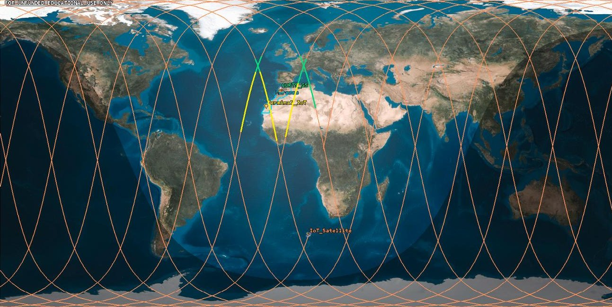

Fig. 4. UM5Sat orbits during 24 h (Orange), GS Visibility (Yellow) and IOT Terminals visibility (Green). (For interpretation of the references to color in this figure legend, the reader is referred to the web version of this article.)

GS with both S-Band and UHF for emergency purposes or for heavy data downlink. Fig. 6 presents the instantaneous power consumption. It can be noticed that the power consumption while in sunlight is stable at $ P_{c}=4.388 $ W. As the cubesat enters the earth shadow, the power consumption increases to $ P_{c}=6.388 $ W due to battery heaters. When

the satellite is in communication with both GS and the IoT terminals, the power consumption increases to $ P_{c}=20.258 $ W; it also increases when it is communicating while in eclipse to $ P_{c}=22.258 $ W.

Fig. 7 shows DoD values during a 24-hour interval in which the solar flux is at a minimum.

<!-- PDF_PAGE: 8 -->

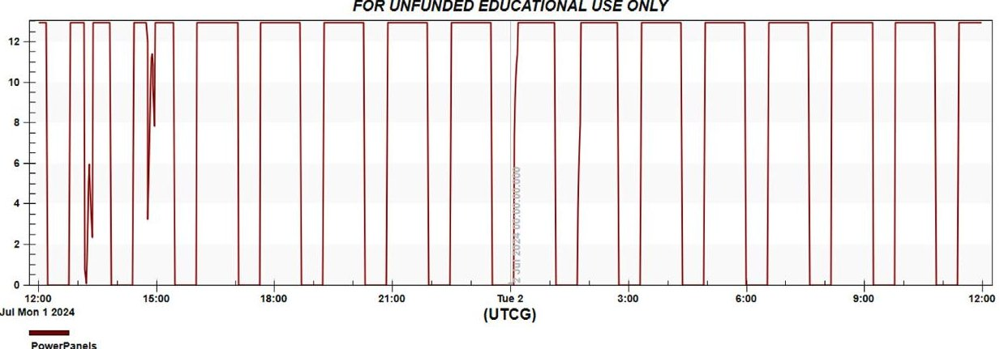

Fig. 5. Power generated in (W) at EOL during worst case solar flux day of the year.

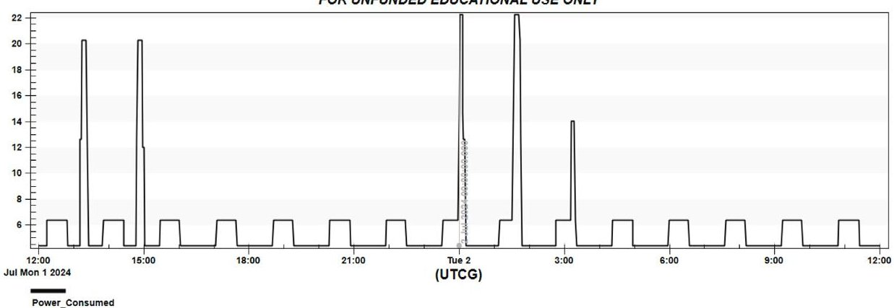

Fig. 6. Power consumed in (W) during worst case solar flux day of the year.

Table 5

Number of solar cell per panel.

<table border="1"><tr><td>Satellite Axis</td><td>Number of solar cell</td></tr><tr><td>+X</td><td>0</td></tr><tr><td>-X</td><td>3</td></tr><tr><td>+Y</td><td>12</td></tr><tr><td>-Y</td><td>4</td></tr><tr><td>+Z</td><td>0</td></tr><tr><td>-Z</td><td>0</td></tr></table>

It can be seen that DoD hits a maximum value of 14.73% at July 2 01:47, while the satellite is in eclipse phase and it is communicating with both GS and IoT terminals, drawing $ P_{c}=2 2. 2 5 8 $ W only from batteries. The DoD is well below the required value presented in Section 6.2.2.

Based on previous sizing and power budget validation, the final system specification is presented in Table 6.

## 7. EPS design

Generally, in small satellites, the EPS features a centralized architecture, with all components assembled on a single PCB [27], this will architecture will be used in our EPS since all conditioning, storage and distribution are managed by EPS, a PPT architecture is chosen thanks to its higher efficiency [54-56]. An unregulated power bus is preferred as it allows for lower load currents, thereby reducing losses in wiring and power switches, improving overall power efficiency [57]. Based on the subsystem voltage requirements presented in Table 2, our EPS will integrate two DC-DC buck converters (3.3 V and 5V) to provide the necessary power to the respective subsystems, battery

Table 6

<table border="1"><tr><td>Parameters</td><td>Requirement</td></tr><tr><td>Altitude</td><td>550km</td></tr><tr><td>Inclination</td><td>98°</td></tr><tr><td>Number of orbit per day</td><td>15</td></tr><tr><td>Period</td><td>96min42s</td></tr><tr><td>Eclipse</td><td>35min30s</td></tr><tr><td>Sunlight</td><td>61min12s</td></tr><tr><td>Power Needed</td><td>12.4W</td></tr><tr><td>Battery Energy Needed</td><td>31.11Wh</td></tr><tr><td>Number of SCs</td><td>19</td></tr><tr><td>Battery Pack</td><td>2S2P</td></tr></table>

heaters and S-Band will be powered directly from the unregulated bus. The components selected for our EPS have proven flight heritage, and their operating temperatures fall within the required range outlined in Section 6.1.

## 7.1. MPPT converters

The chosen MPPT converters are placed at the input of the EPS. Each converter gathers the maximum power from the solar panels and provides regulated voltage to the bus (subsystems and battery). A good trade-off is to employ one boost converter for two opposite sides of the CubeSat rather than one boost converter per side. This is useful as it allows different MPPs to be tracked, accommodating changes in solar irradiance and temperature in different solar panels. However, parallel solar panel connections can be problematic because if one panel shorts, the power generated by the array becomes null.

<!-- PDF_PAGE: 9 -->

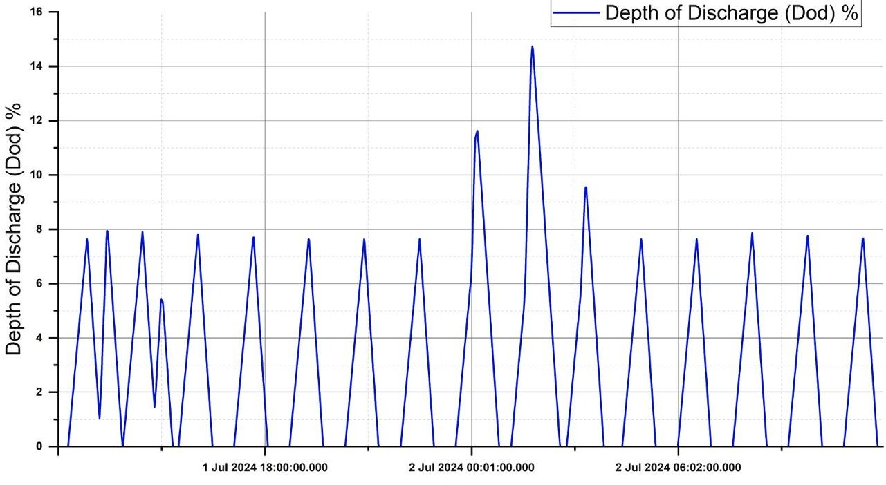

Fig. 7. Computed depth of discharge of the battery for each orbit during worst case solar flux day of the year.

To overcome this, a diode is often added in series with each panel, and these connections are subsequently linked in parallel, providing power to the MPPT circuit. This ensures that if one panel shorts, the diode isolates it from the array [19,58]. In this configuration, an ideal diode circuit is used at the input and output of the MPPTs to ensure protection from reverse currents while reducing power losses (minimal voltage drop) and removing the need for Schottky diodes on the solar panels, thus increasing efficiency.

The LTC3119 from Analog Devices is selected for its wide input voltage range, making it compatible with solar panels of up to 12 cells. Its built-in MPPT functionality simplifies integration, allowing designers to easily configure the power system for different nanosatellite sizes, including up to 12U Cubesats. The straightforward setup of the MPPT circuit enables seamless adaptation to various CubeSat architectures, reducing design complexity while ensuring efficient power harvesting. Additionally, MPPT converters are connected in parallel, each operating with its own MPPT algorithm, further enhancing flexibility and reliability. To ensure proper operation of the MPPT for a 6S1P solar panel configuration with a string voltage of 14.45 V and a hardwareset tracking point at 11.5 V, the resistor divider network must be carefully selected. The Maximum Peak Point Controller (MPPC) voltage is determined using the following equation:

$$
V _ {\mathrm {M P P C}} = 0. 7 9 8 \times \left(1 + \frac {R _ {5}}{R _ {6}}\right)
$$

Rearranging for $ R_{5} $:

$$
R _ {5} = \left(\frac {V _ {\mathrm {M P P C}}}{0 . 7 9 8} - 1\right) \times R _ {6}
$$

With a typical choice of $ R_{6}=1 0 0 \ k \Omega $ , the corresponding $ R_{5} $ value is $ R_{5}=1. 3 4 1 \ M \Omega $ , this selection ensures that the MPPT function keeps the input voltage at approximately 75% of the open-circuit voltage, optimizing power extraction while maintaining system stability. The flexibility of the resistor selection allows for easy reconfiguration to accommodate different CubeSat sizes and power requirements.

## 7.2. MCU and memory

The micro-controller unit (MCU) of the EPS, as the core of the subsystem, controls output channels and performs the measurements of voltages, currents, and temperatures. It also monitors autonomous functions such as MPPT, OC/OV, and channel faults. The need for a reliable and efficient MCU is inevitable; thus, an STM32F303 was chosen for

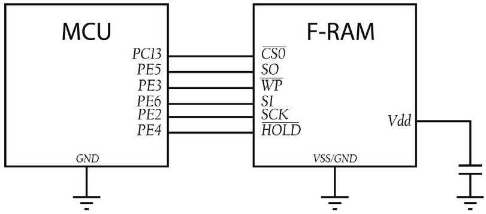

Fig. 8. MCU and F-RAM interface block diagram.

this project due to its flight heritage and low power consumption [59 60]. The CY15B104Q_SXI ferroelectric random-access memory (F-RAM) is used to store EPS firmware and mission-critical EPS telemetries. A driver was developed using the CY15B104Q_SXI's datasheet to store necessary data while optimizing storage. Data is stored in hex format, and a parser is used to convert this data into readable values in GS side. (see Fig. 8).

## 7.3. Real time clock (RTC)

In the Launch and Early Operation Phase (LEOP), the EPS is the first subsystem to boot and powers on only the UHF-TTC subsystem. To keep track of time, an RTC is implemented in the EPS, as it is responsible for synchronizing other subsystems' clocks. The RTC and Power-ON circuit are directly connected to the battery, so they remain functional even when the EPS is off. The ATXK-H14, an ultra-low-power Temperature Compensated Crystal Oscillator (TCXO), is selected for its precise and stable timekeeping across varying environmental conditions. The interface block diagram between the TCXO and MCU is shown in Fig. 9.

## 7.4. Battery protection

An OC protection is designed for the battery pack, ensuring subsystems do not draw more current from the batteries than their specified threshold. An OV protection is also designed, preventing the battery voltage from exceeding 8.4 V and ensuring the batteries are not overcharged.

<!-- PDF_PAGE: 10 -->

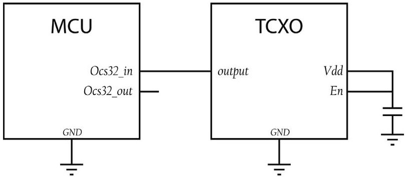

Fig. 9. MCU and TCXO interface block diagram.

Another feature found in commercial EPS (e.g., GOMSpace) [47], which includes battery modes, has been designed for this project. The under-voltage (UV) protection prevents deep discharging of the batteries. The battery state is defined in Fig. 10. When the battery voltage is 8.4 V, they are considered FULL, and the Cubesat can perform its mission without interruption. When the voltage drops to 7.3 V, the EPS enters Normal mode, keeping the outputs ON. If the voltage drops below 7 V, the EPS switches OFF non-essential channels (e.g., Payload). Notably, when the voltage drops to less than 6.5 V, the EPS enters Critical mode, switching OFF all outputs except for the MCU and the UHF-TTC. This prevents the battery from going too low and allows critical information to be sent to the Ground Station for troubleshooting.

A proposed feature is designed to protect the battery from further discharging. The EPS enters HW critical mode when the battery pack voltage is less than 6.18 V. In this mode, the EPS switches OFF the MCU and the UHF-TTC (Rx) and S-Band (Rx), keeping only the RTC and the solar power input ON. This allows the MPPT converter, functioning at a hardware set point, to charge the battery and keeps track of time even after reboot.

To address this, the circuit presented in Fig. 11 is proposed. It includes an LTC4231 from Analog Devices. This IC can handle temperatures ranging from $ - 6 5 \mathrm{~^\circ C} $ to $ 1 2 5 \mathrm{~^\circ C} $ and a wide input range from 2.7 V to 36 V. The LTC4231 has internal OV and UV comparators. The HW Critical Mode and the OV protection are designed using this feature. The resistor values $ R_{1} $ $ R_{2} $ $ R_{3} $ , and $ R_{4} $ set the three thresholds: UV rising $ (V_{UVON}=6.44\mathrm{V}) $ , UV decreasing $ (V_{UVOFF}=6.18\mathrm{V}) $ , and OV rising $ (V_{OVOFF}=8.4\mathrm{V}) $ . The values of the resistors can be calculated using equations found in [61].

$$
R _ {4} = \frac {0 . 7 9 5}{V _ {O V O F F}} 1 0 0 0
$$

$$
R _ {3} = \left(\frac {V _ {O V O F F}}{V _ {U V O N}} - 1\right) R _ {4}
$$

$$
R _ {2} = \left(\frac {V _ {U V O N}}{V _ {U V O F F}} - 1\right) \frac {V _ {O V O F F}}{V _ {U V O N}}
$$

$$
R _ {1} = \left(\frac {V _ {O V O F F}}{0 . 7 9 5} - 1\right) R _ {4} - R _ {3} - R _ {2}
$$

The OC protection feature is achieved by sizing the resistor $ R_{s} $ . The internal circuit breaker of the IC senses OC faults when $ \Delta V_{SENSE} < 50 \mathrm{mV} $ . For an OC protection of $ I_{OC}=2 \mathrm{A} $ , the value of $ R_{s} $ is calculated using the following equation:

$$
R _ {s} = \frac {5 0 \times 1 0 ^ {- 3}}{I _ {O C}}
$$

Based on the Safe Operating Area (SOA) curve of the MOSFET, it can withstand 60 W for 10 ms [62]. To choose the $ C_{t} $ value, the circuit breaker delay $ t_{CB} $ must be less than 10 ms but higher than $ t_{CHARGE(MAX)}=0.5 $ ms, calculated using (19) with $ C_{l}=100 $ $ \mu\mathrm{F} $ and $ I_{OC(min)}=1.8 $ A (see Table 7).

$$
t _ {C H A R G E (M A X)} = \frac {C _ {l} V _ {I N}}{I _ {O C (m i n)}}
$$

The capacitor $ C_{t} $ value is then calculated using:

$$
C _ {t} = \frac {t _ {C B}}{V _ {i n}}
$$

## 7.5. Outputs switches and protections

The EPS distribution features current and voltage sensors to monitor subsystems power consumption, the LTC4231 is used for power switching, and only OC protection is implemented to mitigate single-event latch-up (SEL), as its occurrence leads to excessive current draw [63]. Using the same design approach presented in Section 7.4, output channels are monitored and protected using both hardware and software OC protection to prevent damaging subsystems with the hardware threshold set at $ I_{OC}=2 $ A, while the software limit is left configurable.

## 7.6. Fight switches

Since CubeSats must be turned off while they are in the P-POD [64] a power-on circuit was designed and will be presented in this paper as a black-box. This circuit is responsible for turning the CubeSat on or off and is controlled by flight switches: 2 Kill Switches and 1 Kill Switch Reset (KSR). The KSs are placed on the satellite rails and indicate when the CubeSat is deployed into orbit from the P-POD. The KSR is responsible for turning the CubeSat off before placing it in the P-POD for launch. The RBF switch is used to keep the satellite off even if the KSs are released, enabling safe handling of the satellite; it is removed when the satellite is in the P-POD. The state machine of the power-on circuit is presented in Fig. 12.

The proposed architecture is presented in Fig. 13, it is composed of voltage, current, and temperature sensors, for monitoring, 3 MPPT converters, 9 ideal diodes, charge and discharge switches, battery heaters, 2 buck converters, 7 output switches, a 4Mbit FRAM, and an MCU. (see Fig. 14).

## 7.7. Preliminary thermal and EMC analysis

A thermal analysis was conducted for both the worst hot case, with peak solar flux $ ( S_{SC}=1 4 1 2 \mathrm{~ W / m^{2}}) $ , and the worst cold case, with minimum solar flux $ ( S_{SC}=1 3 2 0 \mathrm{~ W / m^{2}}) $ . Tests were performed on both the EPS and batteries, with results presented in [51], confirming that both remain within the safe operating range. In the worst hot case, the EPS temperature ranges from $ 3. 8 1 \mathrm{~ ^ {\circ} C} $ to $ 2 5. 4 6 \mathrm{~ ^ {\circ} C} $ , while the batteries range from $ 1 1. 0 4 \mathrm{~ ^ {\circ} C} $ to $ 2 2. 4 2 \mathrm{~ ^ {\circ} C} $ . For the worst cold case, the EPS operates between $ - 1 8. 8 2 \mathrm{~ ^ {\circ} C} $ and $ - 1. 4 1 \mathrm{~ ^ {\circ} C} $ , and the batteries between $ - 1 0. 8 9 \mathrm{~ ^ {\circ} C} $ and $ - 6. 3 8 \mathrm{~ ^ {\circ} C} $ . With these successful test results, the thermal analysis can be considered validated.

Since the EPS includes DC-DC converters as switching components, a preliminary EMC investigation was conducted on the 3.3 V buck converter, as it supplies the highest current demand. The converter was modeled and simulated in SIMULINK $ ^{\textcircled{2}} $ , considering input/output voltages and currents, and DC-DC switching frequency. To evaluate conducted emissions, a Line Impedance Stabilization Network (LISN) was placed at the DC-DC converter's input to filter noise from the power supply, as the converter is directly fed by the EPS battery. The simulation model, shown in Fig. 15, is conducted following the EMC guidelines outlined in the ECSS standard [49].

The results, presented in Fig. 16, indicate that the observed peaks correspond to the switching frequency of the DC-DC converter (200 kHz) and its first harmonic (400 kHz). Additionally, the measured emissions remain within the acceptable limits defined by the standard, confirming compliance with EMC requirements.

<!-- PDF_PAGE: 11 -->

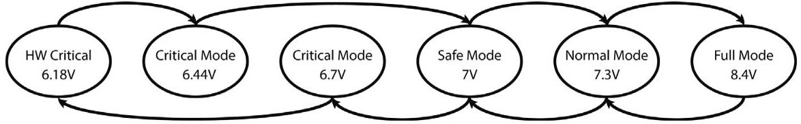

Fig. 10. Battery state diagram.

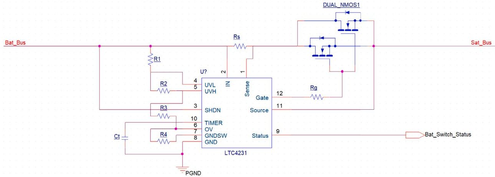

Fig. 11. Battery protection circuit.

Table 7

Component values of the battery protection circuit.

<table border="1"><tr><td></td><td>R1</td><td>R2</td><td>R3</td><td>R4</td><td>Rs</td><td>Ct</td></tr><tr><td>Values</td><td>867.5KΩ</td><td>8.25KΩ</td><td>31.6KΩ</td><td>91KΩ</td><td>25mΩ</td><td>220μF</td></tr></table>

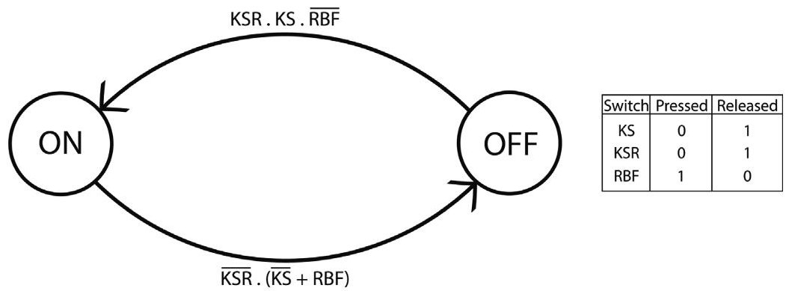

Fig. 12. Power ON state machine.

## 8. EPS test

## 8.1. Functional tests

The functional setup for this test is depicted in Fig. 17. In the setup, the EPS is identified as component 1. The battery voltage is manually simulated using the Keysight U8002 A power supply, labeled as component 2. To simulate the load, BK Precision 8600B Series programmable DC electronic loads, identified as component 4, are employed. Measurements are meticulously taken using the Keysight 34450 A Digital Multimeter (component 3) and the Keysight DSOX2012 A Oscilloscope (component 5).

## 8.1.1. Deployer

The proposed EPS architecture, previously designed, has been built and tested to assess its performance. Fig.18 illustrates the temperature profile of the deployer during the deployment sequence, verifying that the EPS correctly manages the procedure.

## 8.1.2. Flight switches test

This test verifies the proper operation of the flight switches. Fig. 19 compares the bus voltage $ ( V_{2} ) $ to the battery voltage $ ( V_{1} ) $ , demonstrating how the switch states affect system power.

Initially, all switches are released, representing the launch configuration where the RBF switch is already removed, and the KS is released upon deployment. The EPS remains ON. Pressing the KSR turns the CubeSat OFF by dropping $ V_{2} $ to 0 V, while releasing it restores power. Pressing KS or RBF alone does not affect the power state due to the latching switch configuration. However, pressing both RBF and KSR simultaneously turns the CubeSat OFF. The test confirms proper ON/OFF functionality, simplifying ground handling and ensuring automatic power activation after deployment.

As shown in Fig. 19, $ V_{1}\neq V_{2} $ , with $ V_{2} $ settling at 0.33 V instead of 0 V. Possible causes include:

- Leakage Current: Small leakage through the MOSFET or circuit elements can maintain a residual voltage.

- Parasitic Capacitance: Charge retention in circuit components may prevent $ V_{2} $ from fully dropping.

## 8.1.3. Real time clock test

The RTC test aims to verify the performance of the TCXO in maintaining a stable frequency under different temperature conditions: $ 2 5 \, ^ {\circ} \mathrm{C} $ and $ 5 0 \, ^ {\circ} \mathrm{C} $ . The frequency measurements were recorded using an oscilloscope, as shown in Fig. 20. At both $ 2 5 \, ^ {\circ} \mathrm{C} $ presented in Fig.

<!-- PDF_PAGE: 12 -->

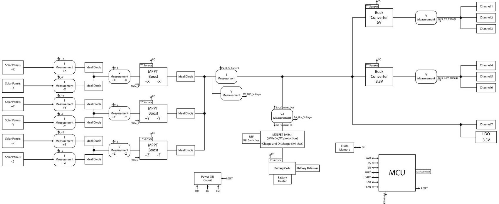

Fig. 13. The proposed EPS architecture.

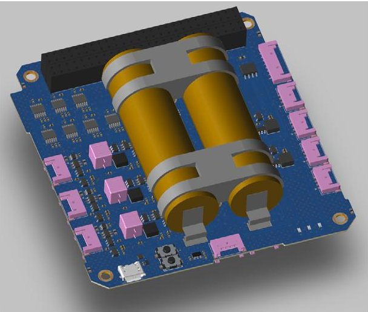

(a)

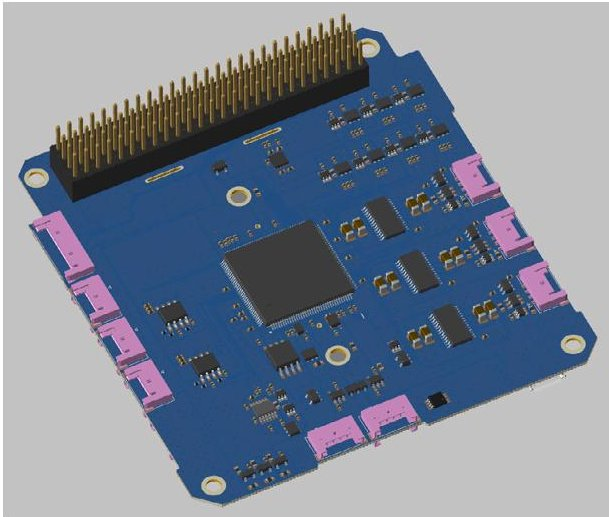

(b)

Fig. 14. EPS PCB 3D view. (a) Top view. (b) Bottom view.

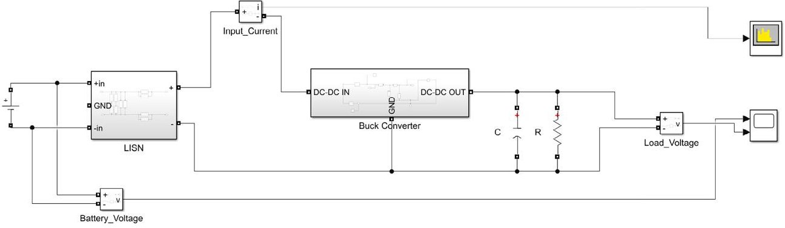

Fig. 15. Simulation model of the 3.3 V DC-DC converter.

20(a) and 50 $ ^{\circ} \mathrm{C} $ presented in Fig. 20(b), the TCXO maintained a stable frequency of 32.768 kHz. This consistency indicates that the TCXO effectively compensates for temperature variations, ensuring reliable timekeeping across a range of temperatures. The stability of the frequency at both $ 25^{\circ} \mathrm{C} $ and $ 50^{\circ} \mathrm{C} $ confirms that the oscillator can provide accurate timekeeping to the RTC in varying environmental conditions which is crucial for the satellite's mission-critical operations.

## 8.1.4. Battery voltage test

This test aims to evaluate the voltage drop at maximum load, since unregulated bus at higher current demands leads to a drop in voltage, this drop must be bellow 10%, at minimum load the voltmeter show that the voltage $ V_{minload}=7.954 $ V where at maximum load the voltage is $ V_{maxload}=8.081 $ V this means that the drop is $ V_{drop}=1.5716\% $

<!-- PDF_PAGE: 13 -->

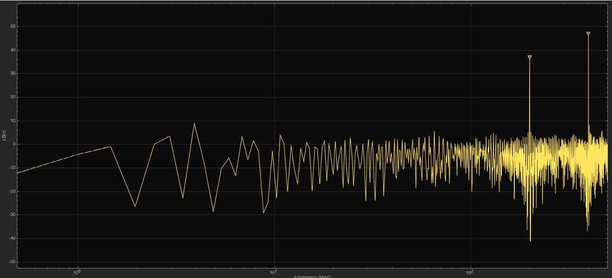

Fig. 16. Simulated conducted emission of the 3.3 V DC-DC converter.

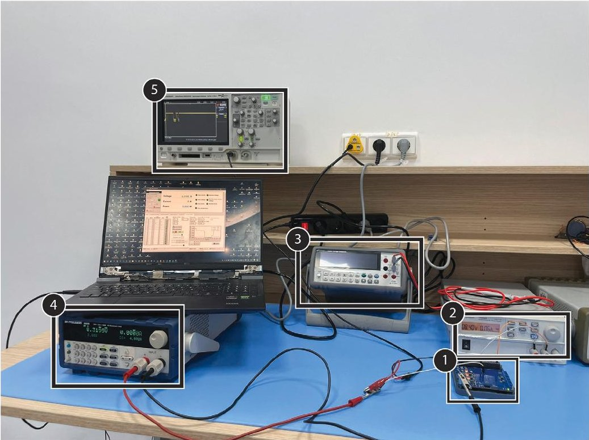

Fig. 17. EPS testing setup.

## 8.1.5. Battery charging tests

This test evaluates the EPS's ability to charge the batteries using both an external charger and the MPPT when SPs are illuminated by a halogen light bulb. Fig. 21(a) shows the battery voltage over time while connected to an external charger, while Fig. 21(b) presents the battery voltage during solar charging. The tests were conducted with the OBC, PC, S-Band, and UHF-TTC subsystems powered on. The increasing battery voltage confirms successful charging via the external charger. For the solar charging test, the halogen lamp was sequentially placed in front of each SP, starting with the +Y panel, followed by the deployable +X panel, then the -Y, and finally the -X panel. Each panel generated approximately 100 mA which is insufficient for charging the batteries but adequate to validate the MPPT software functionality and the charging circuit. This is further confirmed by a decrease in battery output current when power generation occurs, indicating that the generated power is being directly supplied to the subsystems.

## 8.1.6. Battery protection test

This test evaluates the system's ability to sense an OC condition, disconnect the bus side from power, and recover from a possible deep

discharge condition. The test is first simulated in LTspice, as presented in Fig. 22. All the component values are set as designed in the previous section, and the NMOS model is added based on the datasheet [62].

The occurrence and reaction of the IC to an OC condition is simulated using the switch S1 and the pulse signal from the power source $ V_{2} $ . It generates a pulse that drives the switch, causing S1 to periodically open and close. When S1 closes (during the high pulse from $ V_{2} $ ), it simulates an OC condition by creating a direct path for current flow. The IC detects this OC through the sense resistor Rs and responds by turning off the external MOSFET Q1 to protect the circuit and essentially the load side.

The simulation results presented in Fig. 23(a), shows that when the switch S1 is closed due to V2 pulse, the LTC4231 detects this spike in current $ I_{S1} $ through the sense resistor Rs. The controller then responds by turning off the external MOSFET Q1, which cuts off the power to prevent damage. This protective action is evident from the rapid drop in current $ I_{S1} $ right after the initial spike, indicating that the circuit successfully disconnects the load to mitigate the OC condition. Notice that from the inset zooms on the critical moment around 200 ms, the results confirms that the MOSFET remains within its SOA during this

<!-- PDF_PAGE: 14 -->

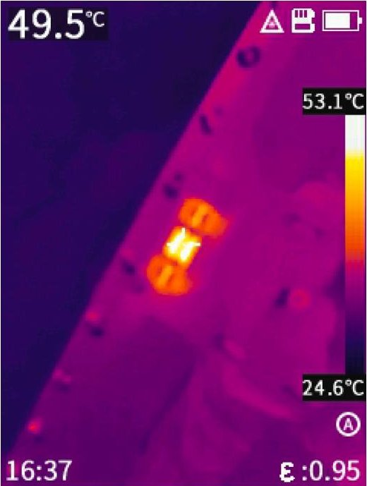

Fig. 18. UHF Antenna Deployer Temperature.

brief OC event, which is bellow 60 W and less than 10 ms. After an OC condition causes the IC to shut down, the Electrical Power System needs to be reactivated. The LTC4231-2 is selected for its ability to automatically restart the system after 500 ms. This auto-retry feature ensures that, in the absence of further OC conditions, the system will remain operational until another OC event occurs.

The experimental results presented in Fig. 23(b) confirms the ability of the circuit to prevent from OC condition. Starting from a bus voltage of $ V_{S1}=8.4 \mathrm{~V} $ and no load connected the current drawn is null $ I_{S1}=0 $ A. When a Constant Current (CC) of $ I_{S1}=0.5 $ A is applied, a slight drop in output voltage is noticed. As the current is gradually increased in steps to 1.0 A, 1.5 A, and finally to 2.0 A, the bus voltage $ V_{S1} $ shows corresponding decreases, indicating that the circuit is responding to the increasing load. At each step, the voltage $ V_{S1} $ stabilizes at a slightly lower value, demonstrating the circuit's capabilities to provide the desired load current demand. When the attempting to draw current $ I_{S1}=4 \mathrm{~A}> $ $ I_{OC} $ the bus voltage $ V_{S1} $ drops significantly, and the protection mechanism of the circuit activates, leading to a rapid decrease in voltage. This response indicates that the circuit is effectively preventing an overcurrent condition by cutting off the voltage supply when the current exceeds the safe threshold. Notice that when the CC is still applied, every 500 ms the IC tries to power-up until the no load is applied, the circuit recovers, and the bus voltage $ V_{S1} $ returns to its initial value of 8.4 V, confirming the proper functioning of the circuit's protection and recovery mechanisms.

The second test evaluates the circuit's response to UV and OV conditions. The first part of the graph presented in Fig. 24(a) shows the start-up of the IC, beginning at 7.4 V. According to the battery state diagram, the EPS should be in Normal Mode. When the voltage drops to 6 V in the second part, the LTC4231 detects an UV condition and responds by turning off the MOSFET to prevent further discharging of the battery. In this state, the subsystem enters HW critical mode, with only the RTC remaining operational. Since the MPPT converters are set to HW set point, the solar panels generate the necessary power to charge the battery. As the voltage across the battery rises to 7 V in the third part, the LTC4231 turns the MOSFET back on, powering up the subsystem and transitioning it to Safe Mode. In the fourth part of the graph, the IC demonstrates its capability to detect an OV condition, driving the MOSFET down to prevent damage to the subsystems.

The results, depicted in Fig. 24(b), confirm the expected behavior. Initially, the circuit operates normally with the voltage above the UV low threshold $ ( V_{UVOFF}=6.18\mathrm{V}) $ , keeping the MOSFET on and

the system operational. As the voltage drops below this threshold, the LTC4231 detects the UV condition and turns off the MOSFET to prevent further battery discharge, evident by the voltage dropping. When the voltage rises again, the MOSFET only turns back on once the voltage exceeds the UV high threshold $ ( V_{UVON}=6.44\mathrm{V}) $ , demonstrating the hysteresis effect. Additionally, when the voltage surpasses the OV threshold $ ( V_{OVOFF}=8.4\mathrm{V}) $ , the LTC4231 detects the OV condition and shuts down the MOSFET to protect the circuitry from overvoltage damage, as shown by the voltage dropping again. It should be noted that the observed voltage drop between the input $ V_{1} $ and the output $ V_{2} $ is due to the current drawn by loads connected to the output. When the LTC4231 detects an UV or OV condition, it turns off the MOSFET to protect the circuit.

## 8.1.7. Telemetry files check

This test implements a hardware-in-the-loop (HIL) simulation of the CubeSat as a test case to verify that the EPS correctly gathers and logs all telemetry data with a 30-second sampling period. A custom scenario is simulated, where ADCS sensor data generated by STK is fed to the OBC for real-time attitude control. The test records the current demand of reaction wheels and magnetorquers, validating both the EPS and ADCS. After the test, the telemetry file is downloaded from the EPS and analyzed by plotting the data to detect potential anomalies. During the test, the charger was initially unplugged to observe battery discharge behavior. It was then plugged in to assess the charging process, followed by alternating unplugging and plugging cycles to evaluate the EPS response to varying power conditions and ensure proper battery charge/discharge management.

All results are represented with timestamps on the X-axis, validating that the RTC accurately records the time for each telemetry entry. Fig. 25(a) shows that the telemetry entry ID is correctly tracked, starting from zero and incrementing with each new entry. Additionally, the EPS uptime is logged correctly. Fig. 25(b) shows the MPPC output voltage, while Fig. 25(d) presents the output currents from SP, currents are null since no illumination is present to the SPs. Fig. 25(c) presents output converters voltages, both are correct and stable during test.

In Fig. 26(a), the states of the battery, MPPT, and heaters are presented. A battery mode value of 2 confirms that the EPS remains in normal operation, which aligns with the threshold defined in Fig. 10. The MPPT and battery heaters are set to automatic mode, with values of 2 and 0, respectively. Since the battery temperatures, shown in Fig. 26(d), remain within a safe range, the heaters remain off as expected.

Fig. 26(b) presents the battery voltage along with its charge and discharge currents. The input current from the external charger $ ( I_{SP/Ext_{Charg}} ) $ is initially zero, indicating that the system starts in a disconnected state. When the charger is plugged in, $ I_{SP/Ext_{Charg}} $ increases, followed by a rise in the battery charge current $ ( I_{Batt_{1}N}} $ and a gradual increase in battery voltage $ ( V_{Batt}} $ . Meanwhile, the discharge current $ ( I_{Batt_{OUT}} ) $ remains stable, confirming that the EPS continues supplying power to the subsystems. Upon unplugging the charger, $ I_{SP/Ext_{Charg}} $ drops to zero, and the battery begins discharging, leading to a decrease in $ V_{Batt}} $ . This cycle is repeated multiple times, demonstrating the expected EPS response to charging and discharging conditions. Fig. 26(c) presents the current consumption of different subsystems during the test. The ADCS $ ( I_{Channel1}} $ shows dynamic variations due to attitude control, while the payload $ ( I_{Channel2}} $ remains stable. The OBC $ ( I_{Channel4}} $ and PC $ ( I_{Channel5}} $ ) draw steady currents, as expected. The S-Band $ ( I_{Channel7}} $ stays stable since it operates in receive mode. The UHF-TTC $ ( I_{AO_{3.3}} $ ) shows periodic activity, while $ I_{Channel3}} $ and $ I_{Channel6} $ remain at zero since no deployment was performed and channel6 is not connected to any subsystem. Fig. 26(d) shows EPS sensor temperatures, all within expected ranges, confirming stable telemetry and normal thermal behavior. These results validate the EPS telemetry and power tracking capabilities.

<!-- PDF_PAGE: 15 -->

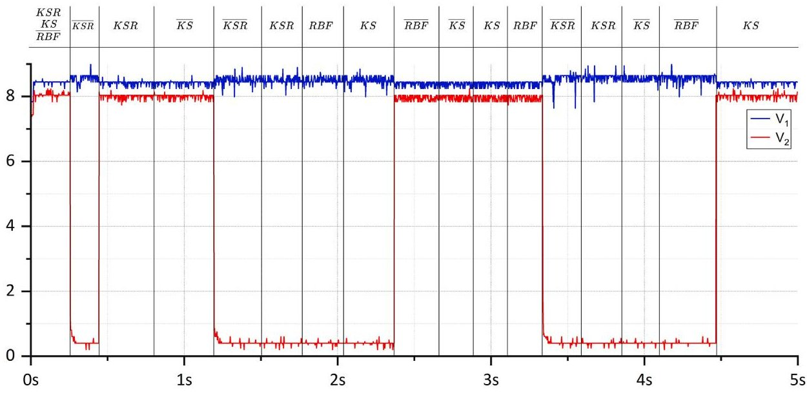

Fig. 19. Flight switches sequence test result.

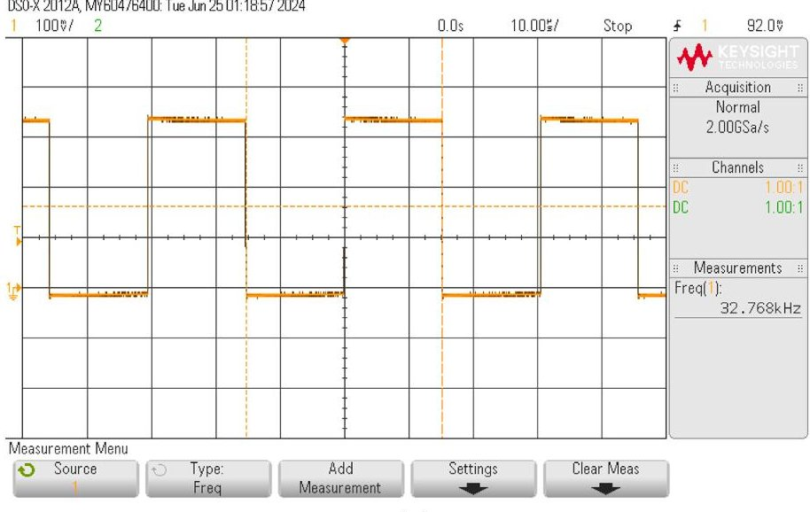

(a)

DS0-X 2012A, MY60476400: Tue Jun 25 01:28:39 2024

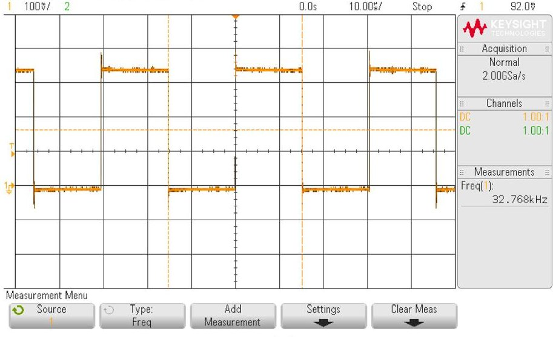

(b)

Fig. 20. TCXO frequency. (a) frequency at $ 2 5 \mathrm {° C} $ . (b) frequency at $ 5 0 \mathrm {° C} $

<!-- PDF_PAGE: 16 -->

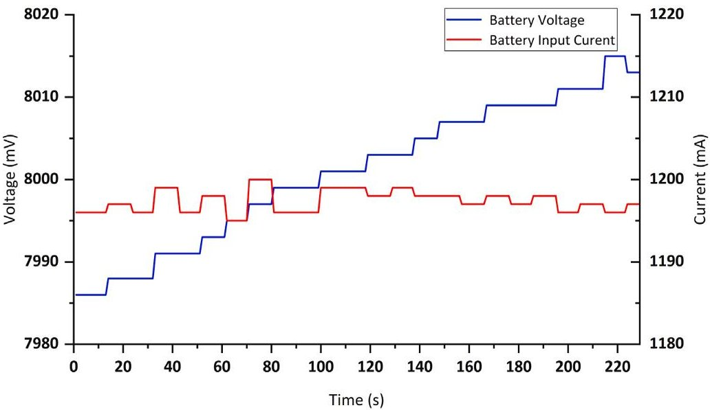

(a)

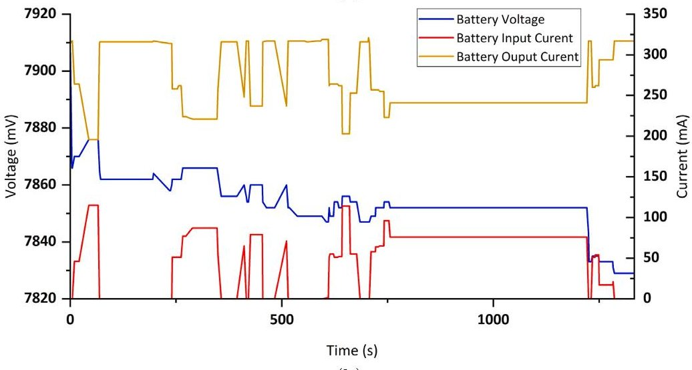

(b)

Fig. 21. Battery voltage during charging (a) using external charger. (b) using SP.

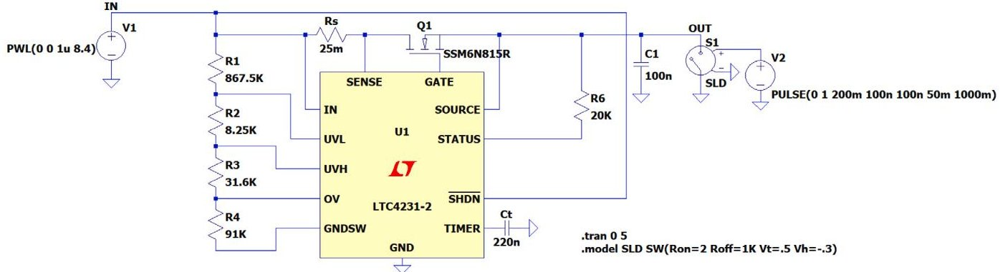

Fig. 22. LTspice circuit schematic.

## 8.2. Environmental tests

After successfully conducting the functional tests, environmental testing can commence, provided that all EPS functionalities align with the specified requirements. These tests typically coincide with FRR in the project life cycle. The test procedures, detailed in [51], follow ECSS and NASA guidelines for thermal vacuum testing. The tests were

performed to replicate the real space environment, simulating both the worst cold-case and worst hot-case scenarios. The results confirmed that the EPS, including its batteries, operated effectively and remained within the required margins, thereby validating the thermal test.

The remaining qualification tests for the EPS include EMC, radiation, and mechanical testing. These tests were not performed due to

<!-- PDF_PAGE: 17 -->

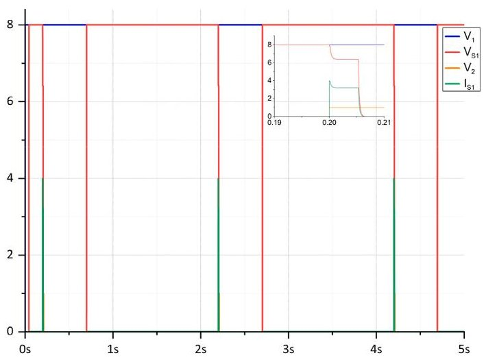

(a)

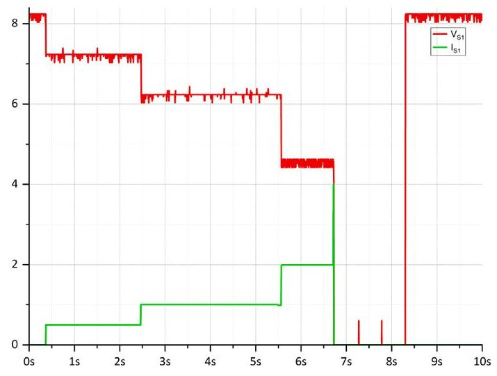

(b)

Fig. 23. EPS overcurrent protection. (a) LTspice OC Simulation result; (b) Experimental OC result.

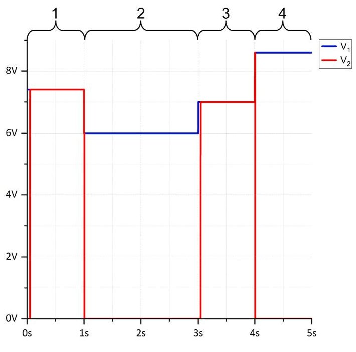

(a)

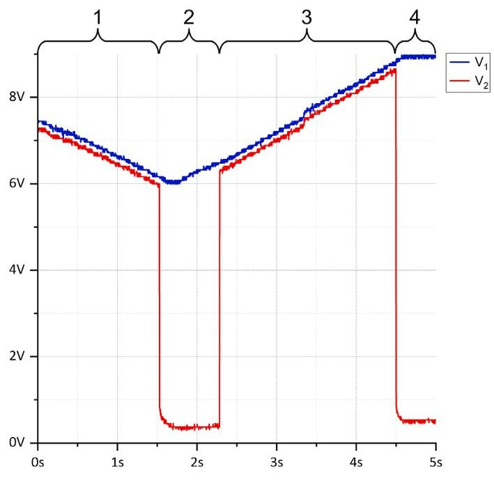

(b)

Fig. 24. EPS undervoltage and overvoltage protection. (a) LTspice UV&OV Simulation result. (b) Experimental UV&OV result.

the need for specialized equipment to meet ECSS and NASA standards but are planned for future work.

## 9. Conclusion

This paper presents a comprehensive framework for sizing, designing, and testing a CubeSat EPS, covering the entire process from mission design to validation through testing. Aligned with ESA and NASA space project life cycles, this framework ensures that the EPS meets performance requirements and operates reliably in the harsh space environment. The framework is presented in four phases. First, the Mission Design phase defines the power requirements based on mission objectives and analysis. Next, the Preliminary Power Budget phase determines solar panel and battery sizing to guarantee sufficient energy availability. The EPS Design phase follows, addressing topology selection, component selection, and preliminary thermal and EMC analysis.

Finally, the EPS Testing phase validates system performance through functional and environmental tests. After introducing the framework, a case study is presented, demonstrating its application in designing an EPS of a university CubeSat. This case study follows each phase of the framework, illustrating its effectiveness in guiding the development and validation of a reliable power system.

In conclusion, this paper provides a structured and comprehensive framework for the sizing, design, and validation of CubeSat Electrical Power Systems. By integrating mission-driven power budgeting, systematic EPS design methodologies, and rigorous functional and environmental testing, this framework ensures the reliability and performance of CubeSat power systems in space. The contributions of this framework advance current methodologies by offering a validated, end-to-end process that aligns with ESA and NASA standards, making it applicable to a wide range of CubeSat configurations and mission

<!-- PDF_PAGE: 18 -->

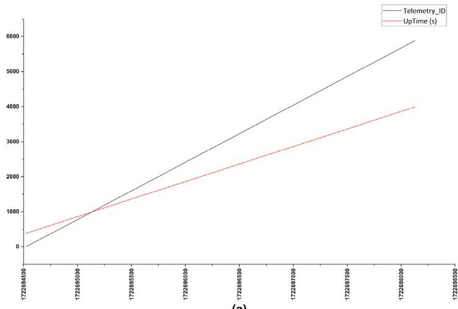

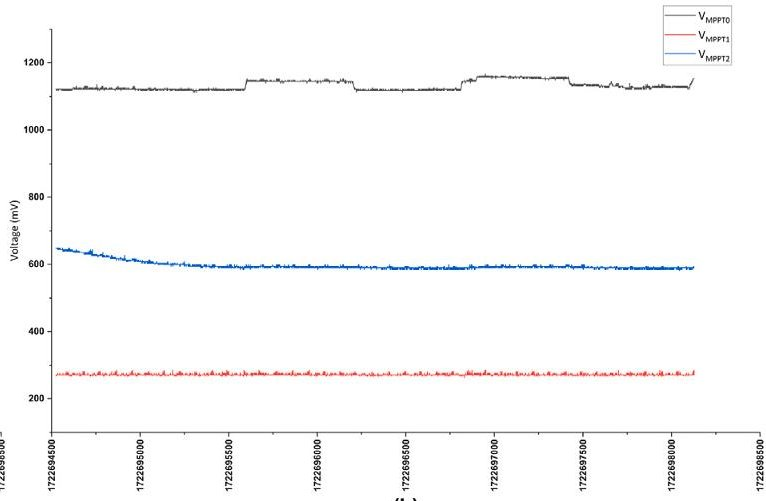

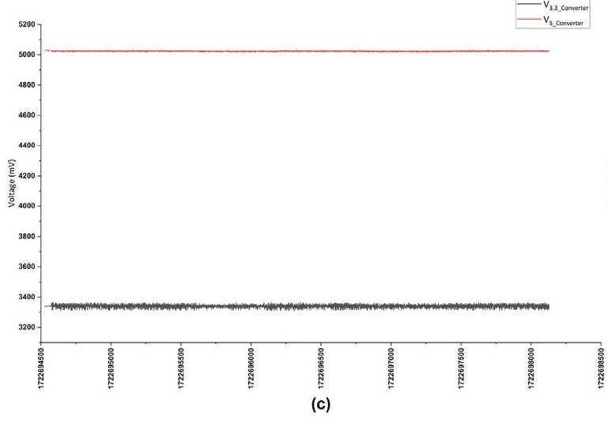

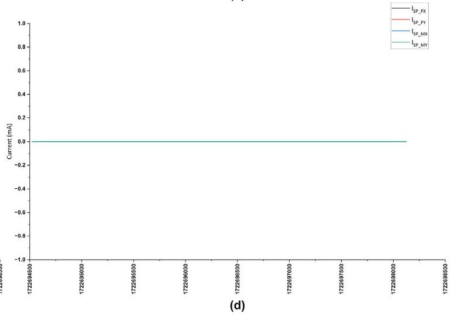

Fig. 25. (a) Telemetry ID and EPS UpTime; (b) MPPTs Voltages; (c) Output converters Voltages; (d) SP Input currents.

profiles. As a structured reference model, this framework addresses gaps in prior studies, which often focus on individual aspects of EPS development without a holistic validation approach. The step-by-step methodology, from mission analysis to final EPS validation, provides a systematic path for ensuring power system robustness before launch. By demonstrating the application of this framework through a case study, we validate its effectiveness in guiding the development of a functional and flight-ready CubeSat EPS.

In order to further improve the framework, current and future work will focus on refining it through the integration of in-orbit performance data from the UM5-Sat mission, as well as from other CubeSats of varying sizes (e.g., 1U, 2U). In particular, in-orbit data from two 3U CubeSats already in service (UM5-Ribat and UM5-EOSAT) that will be used to evaluate the framework's effectiveness under different mission conditions. This will enable a deeper analysis of EPS behavior under real space conditions, particularly in terms of energy generation, storage efficiency, and power distribution stability. Additionally, advanced modeling techniques, including AI-driven power optimization and predictive analysis, will be explored to enhance the adaptability of the framework across different mission scenarios. Another key direction will be the integration of ground-based COTS components into future EPS designs to reduce overall mission costs. Applying the framework to the development of such cost-effective solutions will further validate its effectiveness and expand its applicability to a broader range of CubeSat missions.

## CRediT authorship contribution statement

Youssef El Hachimi: Writing - review & editing, Writing - original draft, Visualization, Conceptualization. Amina Daghouri: Writing - review & editing, Writing - original draft, Validation, Methodology, Conceptualization. Hassane Mahmoudi: Writing - review & editing, Validation, Supervision, Resources. Abdelaali Ouhammam: Writing - original draft, Validation, Investigation. Soumia El Hani: Writing - original draft, Validation, Supervision, Resources.

## Declaration of competing interest

The authors declare that they have no known competing financial interests or personal relationships that could have appeared to influence the work reported in this paper.

## Acknowledgments

This work was carried out in the frame of the cooperation between the Royal Center for Space Research and Studies (CRERS) and the Mohammed V University in Rabat (UM5R).

## Data availability

The data that has been used is confidential.

<!-- PDF_PAGE: 19 -->

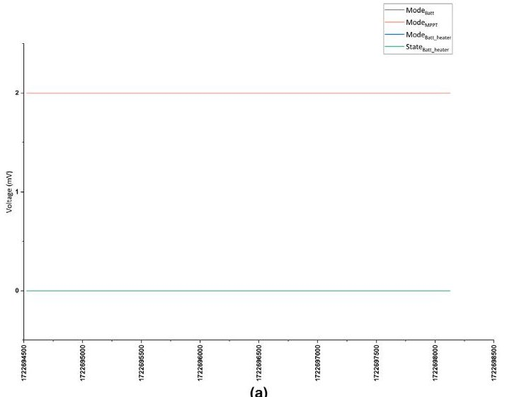

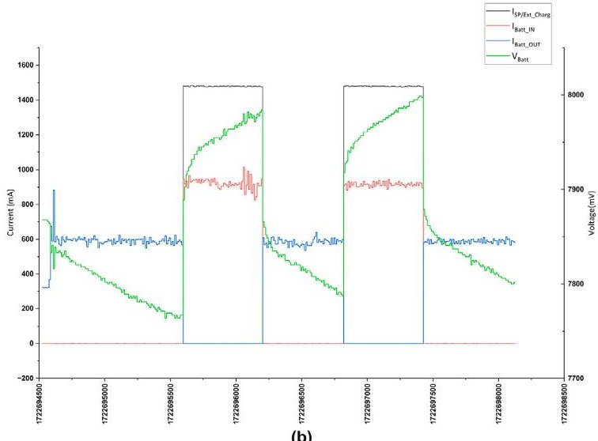

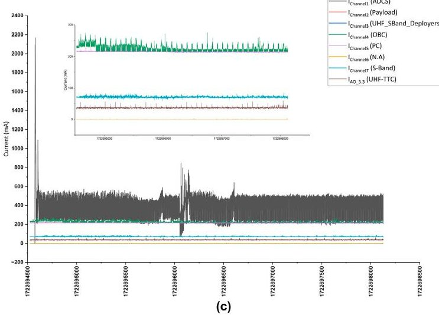

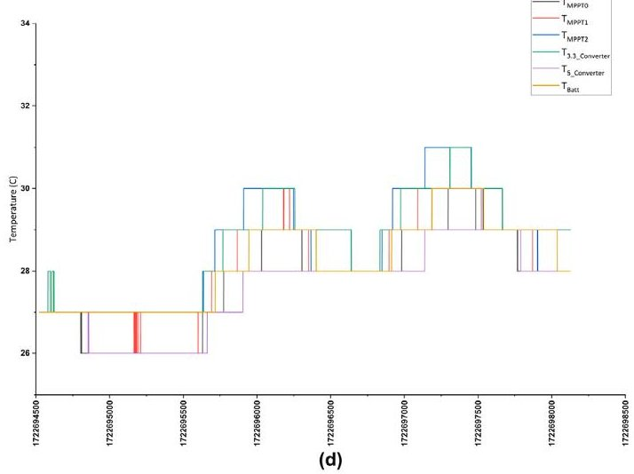

Fig. 26. (a) Battery and heaters modes; (b) Charge/Discharge currents and battery voltage; (c) Channels output currents; (d) Temperature sensors.

## References

[1] California Polytechnic State, Cubesat design specification, CubeSat Program, Calif. Polytech. 14 (2020) 34.

[2] R.M. Millan, R. von Steiger, M. Ariel, S. Bartalev, M. Borgeaud, S. Campagnola, J.C. Castillo-Rogez, R. Fléron, V. Gass, A. Gregorio, D.M. Klumpar, B. Lal, M. Macdonald, J.U. Park, V. Sambasiva Rao, K. Schilling, G. Stephens, A.M. Title, J. Wu, Small satellites for space science: A COSPAR scientific roadmap, Adv. Space Res. 64 (8) (2019) 1466-1517, http://dx.doi.org/10.1016/j.asr.2019.07.035.

[3] R. Jones, Demonstration of Data Integrity Compromises on a CubeSat, FY23 Laboratory Directed Research & Development Annual Report 93.

[4] N. Ivliev, V. Podlipnov, M. Petrov, I. Tkachenko, M. Ivanushkin, S. Fomchenkov, M. Markushin, R. Skidanov, Y. Khanenko, A. Nikonorov, et al., 3U CubeSatbased hyperspectral remote sensing by offner imaging hyperspectrometer with radially-fastened primary elements, Sensors 24 (9) (2024) 2885.

[5] W.F.A.W. Aasim, A. Seyedzadeh, M. Okasha, E. Sulaeman, A.-H. Jallad, Thermal analysis of AlainSat-1: A 3U cubesat for earth observation, in: E3S Web of Conferences, vol. 477, EDP Sciences, 2024, p. 00020.

[6] R.L. Bishop, A. Barjatya, J.H. Clemmons, R.L. Walterscheid, D.J. Swanson, The low-latitude ionosphere/thermosphere enhancements in density (LLITED) mission's post-launch status and lessons learned, 2023, AGU23.

[7] T.H. Zurbuchen, R. von Steiger, S. Bartalev, X. Dong, M. Falanga, R. Fléron, A. Gregorio, T.S. Horbury, D. Klumpar, M. Küppers, et al., Performing high-quality science on cubesats, Space Res. Today 196 (2016) 11-30.

[8] A. Sulistya, W. Hasbi, R. Muhida, Design and implementation of effective electrical power system for surya satellite-1, IOP Conf. Ser.: Earth Environ. Sci. 149 (2018) 012059, http://dx.doi.org/10.1088/1755-1315/149/1/012059.

[9] A. Daghouri, Y. El Hachimi, A. Ouhammam, M.A. Chanoui, S. El Hani, H. Mahmoudi, Investigating the power budget of a 3U nanosatellite designed for earth observation, in: 2023 IEEE 10th International Workshop on Metrology for AeroSpace, MetroAeroSpace, 2023, pp. 574-579, http://dx.doi.org/10.1109/ MetroAeroSpace57412.2023.10190016.

[10] A. Aoudeche, X. Zhao, K. Kerrouche, Design of a high performance electrical power system for an earth observation nano-satellite, 2018, pp. 140-146, http://dx.doi.org/10.1145/3277453.3286093.

[11] J. Scharnagl, R. Haber, V. Dombrovski, K. Schilling, NetSat—Challenges and lessons learned of a formation of 4 nano-satellites, Acta Astronaut. 201 (2022) 580-591, http://dx.doi.org/10.1016/j.actaastro.2022.09.036.

[12] L. Kessler Slongo, S. Vega Martinez, B. Vale Barbosa Eiterer, E. Bezerra, Nanosatellite electrical power system architectures: Models, simulations and tests, Int. J. Circuit Theory Appl. 48 (2020) http://dx.doi.org/10.1002/cta.2872.

[13] B. Shiotani, Project Life-Cycle and Implementation for a Class of Small Satellites (Ph.D. thesis), University of Florida, 2018.

[14] B.L. Molton, KySat-2 electrical power system design and analysis, 2013.

[15] A. Ali, A. Massoud, M.O. Hasna, T. Khattab, T. Jabban, M.A. Nema, Modeling of CubeSat orientation scenario and solar cells for internet of space provision, in: 2019 9th International Conference on Recent Advances in Space Technologies, RAST, IEEE, 2019, pp. 541-546.

[16] I.F. Acero, J. Diaz, R. Hurtado-Velasco, S.R.G. Bautista, S. Rincón, F.L. Hernandez, J. Rodriguez-Ferreira, J. Gonzalez-Llorente, A method for validating CubeSat satellite EPS through power budget analysis aligned with mission requirements, IEEE Access 11 (2023) 43316-43332.

[17] S. Abushawish, A. Lifiya, H. Khan, M. Eshaq, R. Gadhafi, A. Gawanmeh, H. Mukhtar, W. Mansoor, A low cost, efficient electrical power system design for CubeSat, in: 2023 10th International Conference on Recent Advances in Air and Space Technologies, RAST, 2023, pp. 1-6, http://dx.doi.org/10.1109/ RAST57548.2023.10197932.

[18] S. Acharya, F. Alshehhi, A. Tsoupos, O. Khan, M. Elmoursi, V. Khadkikar, H. Zeineldin, M. Al Hosani, Modeling and design of electrical power subsystem for CubeSats, in: 2019 International Conference on Smart Energy Systems and Technologies, SEST, 2019, pp. 1-6, http://dx.doi.org/10.1109/SEST.2019. 8849042.

[19] N.L. Ramos, Satellite Electrical Power System (Ph.D. thesis, MS thesis), Lisbon Univ., Lisbon, Portugal, 2018.

[20] R.F. Graça, A. Suleman, Low Earth Orbit Nano Satellite Electrical Power System Design, Instituto Superior Técnico, Lisboa, 2014.

[21] S. Gopakumar, S. Eega, S.V. Suresh, M.S.S. Reddy, A. Antony, H. Ramachandran, D. Koilpillai, Design of electrical power subsystem for iitmsat, in: 2015 International Conference on Space Science and Communication, IconSpace, IEEE, 2015, pp. 175-180.

[22] J.S.O. Alvarado, J.S.R. Mora, L.E.A. Pico, Designs and implementations for CubeSat Colombia 1 satellite power module, Int. J. Appl. Eng. Res. 12 (18) (2017) 7360-7371.

<!-- PDF_PAGE: 20 -->

[23] A. Aguilar-Nadalini, K.H. Chung, C. Marsicovetere, J.A. Bagur, J.F. Medrano, E. Miranda, V. Ayerdi, L. Zea, Design and on-orbit performance of the electrical power system for the quetzal-1 CubeSat, J. Small Satell 12 (2) (2023) 1201-1229.

[24] K.O. Skyttemyr, Design and implementation of the electrical power system for the cubestar satellite, 2013.

[25] A. Edpuganti, V. Khadkikar, M.S.E. Moursi, H. Zeineldin, N. Al-Sayari, K. Al Hosani, A comprehensive review on CubeSat electrical power system architectures, IEEE Trans. Power Electron. 37 (3) (2022) 3161-3177, http://dx.doi.org/10.1109/TPEL.2021.3110002.

[26] J. Hemmo, Electrical Power Systems for Finnish Nanosatellites, School of Electrical Engineering, 2013.

[27] R. Burt, Distributed Electrical Power Systems in Cubesat Applications, Utah State University, 2011.

[28] J. Bester, B.B. Groenewald, R.H. Wilkinson, Electrical Power System for a 3U Cubesat Nanosatellite Incorporating Peak Power Tracking with Dual Redundant Contro, PRZEGLAD ELEKTROTECHNICZNY, 2012.

[29] A. Daghouri, C. Makri, S. El Hani, Design of an electrical power system for a 1U nanosatellite using modified G3PCX, CEAS Space J. (2024) 1-15.

[30] K.D.E. Kerrouche, A. Seddjar, N. Khorchef, S.A. Bendoukha, L. Wang, A.A. and, CubeSat project: experience gained and design methodology adopted for a low-cost Electrical Power System, Automatika 63 (4) (2022) 695-717, http://dx.doi.org/10.1080/00051144.2022.2065420.

[31] T. Esram, P.L. Chapman, Comparison of photovoltaic array maximum power point tracking techniques, IEEE Trans. Energy Convers. 22 (2) (2007) 439-449, http://dx.doi.org/10.1109/TEC.2006.874230.

[32] J. Zhang, C. He, Y. Zhang, X. Qi, X. Yang, Cubesat Task Scheduling Method Considering Operational Reliability, Available at SSRN 4528072.

[33] N. Blanchete, A. Bah, Thermal design, analysis and test: Framework for CubeSat in low Earth orbit, Results Eng. 24 (2024) 103401, http://dx.doi.org/10.1016/j.rineng.2024.103401.

[34] M. Ismail, A. Bakry, H. Selim, M. Shehata, Eclipse intervals for satellites in circular orbit under the effects of Earth's oblateness and solar radiation pressure, NRIAG J. Astron. Geophys. 4 (1) (2015) 117-122, http://dx.doi.org/10.1016/j.nrjag.2015.06.001.

[35] ESA, ESTEC, European Cooperation for Space Standardization - Space project management- Project Planning and Implementation, Requirements and Standards Division Noordwijk, The Netherlands, 2009.

[36] A. Daghouri, S. El Hani, Y. El Hachimi, H. Mediouni, Enhanced hybrid energy storage system combining battery and supercapacitor to extend nanosatellite lifespan, Results Eng. 23 (2024) 102634, http://dx.doi.org/10.1016/j.rineng.2024.102634.

[37] C. Rosenkranz, Deep cycle batteries for plug-in hybrid application, in: EPI Workshop in EVS20, USA, 2003, 2003.

[38] G. Pistoia, Lithium-ion batteries: Advances and applications, 2014, pp. 1-612.

[39] D. Dallinger, J. Link, M. Buttner, Smart grid agent: Plug-in electric vehicle, Sustain. Energy, IEEE Transaction 5 (2014) 710-717, http://dx.doi.org/10.1109/TSTE.2014.2298887.

[40] J. Xie, Y.-Z. Li, L. Yang, Y. Sun, M. Yuan, A review of the recent progress of stand-alone photovoltaic-battery hybrid energy systems in space and on the ground, J. Energy Storage 55 (2022) 105735.

[41] B. Hussein, A.M. Massoud, T. Khattab, Centralized, distributed, and module-integrated electric power system schemes in cubesats: performance assessment, IEEE Access 10 (2022) 55396-55407.

[42] M. Yaqoob, Design control and power management of small satellite microgrids, 2022.

[43] L.T. Lumbwe, Development of an oNboard Computer (OBC) for a CubeSat (Ph.D. thesis), Cape Peninsula University of Technology, 2013.

[44] M. Van Doorn, EMC expert system for architecture design, in: Proceedings of the 2011 Asia Pacific EMC Symposium, Jeju Island, Korea, 2011.

[45] R. Hussain, A. Al-Garni, S.S. Iqbal, Q.H. Abbasi, Multi-band CubeSat antenna and design considerations for space environment, in: 2023 IEEE International Symposium on Antennas and Propagation and USNC-URSI Radio Science Meeting, USNC-URSI, IEEE, 2023, pp. 883-884.

[46] ESA, ESTEC, European Cooperation for Space Standardization - Space engineering - Testing, Requirements and Standards Division Noordwijk, The Netherlands, 2022.

[47] S. Barra, Functional testing of the electrical power system of the MIST satellite, 2019.

[48] ESA, ESTEC, European Cooperation for Space Standardization - Space Engineering - Thermal Analysis Handbook, Requirements and Standards Division Noordwijk, The Netherlands, 2016.

[49] ESA, ESTEC, European Cooperation for Space Standardization - Space Engineering - Electromagnetic Compatibility, ESA, ESTEC, Noordwijk, The Netherlands, 2022.

[50] ESA, ESTEC, European Cooperation for Space Standardization - Space engineering - Structural general requirements, Requirements and Standards Division Noordwijk, The Netherlands, 2008,

[51] N. Blanchete, A. Bah, CubeSat thermal analysis: evaluating models for thermal contact conductance, Heat Mass Transf. (2024) 1-13.

[52] I. El wafi, M. Haloua, Z. Guennoun, Z. Moudden, A framework for developing an attitude determination and control system simulator for Cubesats: Processor-in-loop testing approach, Results Eng. 22 (2024) 102201, http://dx.doi.org/10. 1016/j.rineng.2024.102201.

[53] N. El hassainate, A.O. Said, Z. Guennoun, Dual-band circularly polarized slotted patch antenna for S-band Cubesat Communication System, CEAS Space J. (2024) 1-12.

[54] A. Edpuganti, V. Khadkikar, H. Zeineldin, M.S.E. Moursi, M. Al Hosani, Comparison of peak power tracking based electric power system architectures for CubeSats, IEEE Trans. Ind. Appl. 57 (3) (2021) 2758-2768, http://dx.doi.org/ 10.1109/TIA.2021.3055449.

[55] B. Hussein, A.M. Massoud, T. Khattab, Centralized, distributed, and module-integrated electric power system schemes in CubeSats: Performance assessment, IEEE Access 10 (2022) 55396-55407, http://dx.doi.org/10.1109/ACCESS.2022. 3176902.

[56] E. Mostacciuolo, L. Iannelli, S. Sagnelli, F. Vasca, R. Luisi, V. Stanzione, Modeling and power management of a LEO small satellite electrical power system, in: 2018 European Control Conference, ECC, 2018, pp. 2738-2743, http://dx.doi.org/10.23919/ECC.2018.8550095.

[57] M. Bekhti, M. Beldjehem, F. Arezki, Effect of the bus voltage level on the power system design for microsatellites, Int. J. Appl. 11 (1) (2022) 91-97.

[58] A. Daghouri, S. El Hani, N. Naseri, I. Aboudrar, Assessing MPPT techniques for nanosatellite EPS in sun-pointing orientation: A comparative study, in: M. Bendaoud, A. El Fathi, F.I. Bakhsh, S. Pierluigi (Eds.), Advances in Electrical Systems and Innovative Renewable Energy Techniques, Springer Nature Switzerland, Cham, 2024, pp. 103-109.

[59] J. Dalbins, K. Allaje, H. Ehrpais, I. Iakubivskyi, E. Ilbis, P. Janhunen, J. Kivastik, M. Merisalu, M. Noorma, M. Pajusalu, I. Sunter, A. Tamm, H. Teras, P. Toivanen, B. Segret, A. Slavinskis, Interplanetary student nanospacecraft: Development of the LEO demonstrator ESTCube-2, Aerospace 10 (6) (2023) http://dx.doi.org/ 10.3390/aerospace10060503.

[60] R. Duarte, S. Vale, L. Martins-Filho, F. Torres, Development of an autonomous redundant attitude determination system for cubesats, J. Aerosp. Technol. Manag. 12 (2020) http://dx.doi.org/10.5028/jatm.v12.1166.

[61] LTC4231, Micropower Hot Swap Controller, 2019, LTC4231 ANALOG DEVICES Rev.B.

[62] SSM6N815R, Silicon N-Channel MOS, 2017, SSM6N815R Toshiba Rev.1.0.

[63] M. Klein, M. Chekhlov, R. Thummala, G. Falco, A meta-analysis of radio frequency interactions in the ionosphere and near-earth space, in: AIAA SCITECH 2025 Forum, 2025, http://dx.doi.org/10.2514/6.2025-1604, arXiv:https://arc. aiaa.org/doi/pdf/10.2514/6.2025-1604.

[64] J. Debes, N. Howard, R. Harrington, R. Cobb, J. Black, Rapid build and space qualification of CubeSats, 2011.

Youssef El Hachimi received the Engineer degree in Electronic and Automatic Systems, in 2021, from National School of Applied Sciences-Tangier, Morocco. He is working toward the Ph.D. degree in Electrical Engineering and Space Technologies at the University Center for Research in Space Technologies of Mohammadia School of Engineers. His research interests include the electrical power systems, and electromagnetic compatibility in aerospace systems. He can be contacted at email: yousef.elhachimi@research.emi.ac ma

Amina Daghouri currently an Assistant Professor at the University Center for Research in Space Technologies, Mohammed V University, Rabat, Morocco. She recently obtained her Ph.D. in Electrical Engineering for Space Technologies. She earned her Engineering Degree in Electrical Engineering from ENSAM (EX-ENSET) at Mohammed V University, Rabat, Morocco, in 2018. She was part of the team that recently launched the two university nanosatellites, UM5Sat-Ribat and UM5EOSat. She has contributed as an author and co-author to more than 12 publications in her field. Her research interests include embedded systems, hardware and software design, solar energy harvesting devices, robust control, hybrid energy storage, and the design and optimization of electrical power systems for nanosatellites. She is currently an active member of the Electrical Power Systems team at the University Center for Research in Space Technologies.

<!-- PDF_PAGE: 21 -->

Hassane Mahmoudi received B.S degree in electrical engineering from Mohammadia School of Engineers, Rabat, Morocco, in 1982, and the Ph.D. degree in power electronic from Montefiore Institute of Electrical Engineering, Luik Belgium, in 1990. He was an assistant professor of physics, at the Faculty of Sciences, Meknes, Morocco, from 1982 to 1990. Since 1992, he has been a professor at the Mohammadia Schools of Engineers, Rabat, Morocco. He was the head of electric engineering department during four years (1999, 2000, 2006 and 2007), and the Deputy Director in charge of Research and Cooperation between 2019 and 2022. Since 2022, he has held the director position of Mohammadia School of Engineers. His research interests include static converters, electrical motor drives, active power filters, and the compatibility electromagnetic. He can be contacted at email: mahmoudi@emi.ac.ma

Abdelaali Ouhammam received the Engineer degree in Electro-technical and Power Electronics, in 2014, from Mohammadia School of Engineers-Rabat, Morocco. He is currently Ph.D. student in Aerospace Engineering at the University Center for Research in Space Technologies of Mohammadia School of Engineers. His research interests include the field of power electronics and electromagnetic compatibility. He can be contacted at email: ouh.abdelaali@gmail.com

Soumia El Hani Prof. Dr. IEEE Senior Member, received Engineering Degree in 1992 From Higher school of MinesRabat. She received the "Doctorat en Science" degree and the "Habilitation Universitaire" degree in Electrical Engineering, Automatic with honors, respectively, in 2003 and 2006 from Mohammed V University, 'Ecole Mohammadia

d'Ingénieurs' Morocco. She was the Director of Digital Learning Center's Mohammed V University in Rabat and the Director of "Centre de promotion de l'usage des Énergies Renouvelables et de l'Economie Verte" of Mohammed V University. Her research interests are in the area of Robust Control, Monitoring and Diagnosis of Electromechanical Systems. She is in charge of the research team 'Energy Optimization, Diagnosis and control' EODIC, research Center in 'Sciences et Technologies de l'Ingénieur et de la Santé'. She is Author of several publications in the field of electrical engineering, including robust control systems, diagnosis and control systems of Renewable Energy conversion. She is the co-founder and the General Chair of the International Conference on Electrical and Information Technologies since 2015 (IEEE-Conference). She is the Scientific Committees member of IRSEC (Morocco), IEMDC 2017 Miami, ICSGCE since 2014 Malaysia. Soumia El Hani is a member of the Organizing and the Scientific Committees of several international conferences dealing with topics related to Renewable Energy, Electrical Machines and Drives. Professor Soumia El Hani is member of IEEE Power & Energy Society. Soumia El Hani is an Effective Member of the Moroccan Soroptimist Association, and Founding Member and chair of the association 'Association Marocaine de la Recherche et de l'Ingénierie en Sciences et Technologies (AMARIST)'. She is the author and co-author of more than 60 papers which appeared in refereed specialized journals and symposia. She was the co-editor of the Springer book "Recent Advances in Electrical and Information Technologies for Sustainable Development" Springer Nature Switzerland AG 2019, Springer, Cham. She was also the author of 7 book chapters. She was the editor of the ICEIT's Proceedings. Moreover, she has supervised Ph D and Masters Theses dealing with different research topics concerned with her research interests. She has been the principal investigator and the project manager for different research projects.