<!-- PDF_PAGE: 1 -->

# MBSE-driven Exploratory System Architecture Analysis Framework for the Engineering Test Satellite-9 Project

Yuta Nakajima $ ^{1} $ and Tsutomu Fukatsu $ ^{2} $ Japan Aerospace Exploration Agency, Tsukuba, Ibaraki, Japan

This paper introduces an application of Model-Based Systems Engineering (MBSE) for the risk management of JAXA's Engineering Test Satellite-9 project. The comprehensive analysis of failure modes of a complex system is a challenging issue for project systems engineers due to the complex interaction between components developed by different providers. Current MBSE practices focus on the formalized description of the system architecture to manage complexity. The main idea of this paper is MBSE-driven systems architecture analysis enabled by the fusion of MBSE-driven architecture description and data analytics. We propose an exploratory system architecture analysis framework that combine SysML-based MBSE process with R-based data analytics. We provide results of the failure mode analysis for the Hall Thruster System newly developed for the next generation all-electric satellite system. We also demonstrated the capability of workflow orchestration for generating the project engineering dashboard combining the OpenCAESAR framework.

## I. Introduction

JAXA's Engineering Test Satellite-9 (ETS-9) project team is applying Model-Based Systems Engineering (MBSE) approach to the risk management of flight system development. ETS-9 demonstrates advanced digital payloads and all-electric spacecraft technologies including a newly developed high-power Hall Thruster System for next generation communication satellites.

A comprehensive understanding of the system-level failure modes and the failure propagation effects of complex Hall Thruster system is a challenging issue for risk management due to the complex interactions between components developed by different providers. The current widely used safety and reliability engineering analysis techniques, such as Fault Tree Analysis (FTA) and Failure Modes and Effects Analysis (FMEA), were designed to identify component failure modes[6]. Extracting system-level failure modes across multiple components relies on the experience and intuition of experts. Therefore, comprehensiveness and reproducibility are challenging issues for risk analysis.

This paper introduces the application of MBSE and advanced analytics to the failure mode analysis of the Hall Thruster System.

We make the following specific contributions:

- Building a Framework for Exploratory System Architecture Analysis (Section. III) We build an exploratory system architecture analysis framework that integrates SysML-based modelbased systems engineering process with R-based data analytics. We combined the current MBSE practice and an exploratory data analysis approach[10] that is widely used in the R language community. Rigor description of system architecture is transformed into graph-structured data that can be visualized and analyzed in R language. This framework opens new doors for systems engineers to use abundant resources in data science community.

- Building a tool environment that seamlessly integrates SysML and R languages (Section. IV) We proposed the tool integration solution that seamlessly integrates a SysML modeling tool and the R programming environment. We developed an API to import SysML data into RStudio, an R language

<!-- PDF_PAGE: 2 -->

development environment, to automate the data tidying, analysis, and visualization process for applying graph theory. The results and process of the analysis were published as reproducible documents that contain analysis codes, texts and visualization results written in R Markdown[12].

- Application to risk analysis of Hall Thruster System (Section. V)

- We apply the proposed analysis framework to the failure mode analysis of the Hall Thruster system newly developed in JAXA. We demonstrate the function failure propagation analysis with the Design Structure Matrix (DSM). Using the model information constructed in SysML and the function propagation analysis in R language as a guide for building the FTA, we constructed an FTA consisting of 75 failure modes covering HTM, FCM, and PPU.

- Expand the proposed analysis capability to the workflow orchestration (Section. VI) We expanded the capability of the proposed analysis framework to the workflow orchestration for generating the project engineering dashboard. We demonstrated the integration of the OpenCAESAR framework[26][27] and R languages to generate a web-based dashboard that represents highly digested information for project management. We build the automated workflow to update, publish, and deploy a dashboard using a CI/CD pipeline.

We found that the proposed data-driven risk analysis approach is reproducible and comprehensive compared with traditional document-based approaches that depend on experts' knowledge and experience.

## II. Background

## A. Engineering Test Satellite-9 Mission Overview

Japan Aerospace Exploration Agency (JAXA) is developing a technology demonstration satellite to improve the international competitiveness of next-generation geostationary communications satellites [1][2]. In recent years, high-speed/high-capacity communication satellites that can flexibly change communication frequencies and coverages in orbit have been introduced to the market due to the global expansion of the broadband environment. In response to these changes in the communication satellite market, the ETS-9 satellite will demonstrate a fully digital communication payload and an all-electric satellite bus technology to increase the capacity of communication payloads.

Conventional communication payloads require hardware configurations to be determined for the expected communication demand before launch and cannot be changed after launch to meet actual demand. ETS-9's demonstration payload is digitalized and can reconfigure its coverage area, capacity, and frequency in orbit. This fully digital payload increases the flexibility to adjust to the change in market demands.

Fig. 1 Left: Artist concept for ETS-9, Right: Performance test of Hall Thruster.

<!-- PDF_PAGE: 3 -->

All-electric satellite buses use only electric propulsion systems for orbit transfer and station-keeping. Compared to conventional chemical propulsion systems, the electric propulsion system has better propulsion efficiency and increases the mass of communication payloads[3]. The ETS-9 satellite will demonstrate the technologies, which include the newly developed Hall Thruster (Fig. 1) [4], a 25kW class high power and lightweight power supply system, and a large amount of heat rejection technologies.

## B. Systems Engineering Challenge for managing risk of Hall Thruster development

JAXA ETS-9 Project is developing a new 6 kW high thrust Hall thruster system for geostationary orbit transfer of large satellites[4]. Fig. 2 Fig. shows the configuration and operational overview of the Hall thruster system under development.

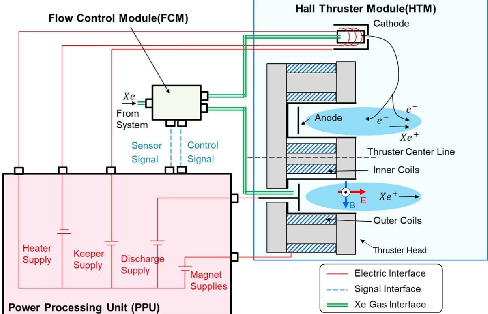

Fig. 2 System of Interest (SOI): Hall Thruster System

The Hall Thruster System consists of three main components: the hall thruster module (HTM), the power processing unit (PPU), and the propellant flow control module (FCM).

A Hall thruster generates thrust by ionizing and accelerating ions to high velocities[5]. The propellant Xe gas is fed into the discharge channel through the anode and dispersed into the acceleration channel. The electrons emitted from the cathode to the anode interact with the magnetic field and generate the accelerating electric field within the discharge plasma. These electrons generate ions in collisions with neutral atoms of propellant. Ions are accelerated by the electric field from the anode to the cathode-potential and generate thrust. Some of the electrons from the cathode leave the thruster with the ion beam to neutralize the charge.

The PPU consists of several power supplies: an anode power supply to supply power to the anode of the HTM, a coil power supply to generate a magnetic field, a heater power supply to heat the electron-emitting material of the hollow cathode, a keeper power supply to start the discharge by applying a voltage to the keeper electrode of the hollow cathode, and an FCM power supply for driving the FCM.

The control of a hall thruster is complex due to its nonlinear electrical characteristics. At the ignition, it is necessary to start up each power supply of the PPU every few seconds while controlling the flow rate of the Xe gas according to a predetermined ignition sequence. The controller in the PPU implements sequence control at the ignition, where the timing of the activation of power, gas, and signals is critical, the transition from the low-power to the high-power operating mode right after ignition, and sequence control during the shutdown. The controller in the PPU also monitors

<!-- PDF_PAGE: 4 -->

the thruster operation status and sends and receives telemetry and commands to and from the satellite system controller. The PPU monitors the thruster operation status by monitoring the output current and voltage of power supplies, detecting discharge current oscillations, and estimating the flow rate of the supplied Xe gas using the FCM pressure sensor output. When an anomaly is detected, the PPU shuts down the thruster according to a pre-defined procedure by the protection function.

Thus, the Hall thruster is a complex system with complex interactions between components and interface specifications that span multiple companies. Therefore, understanding the system-level failure modes and failure propagation is necessary for the risk management of flight projects.

## C. MBSE Challenges for Engineering Test Satellite-9 Project

The adoption of model-based systems engineering (MBSE) is growing in government and industry projects[13] [18][19]. In traditional document-based systems engineering, engineering information is distributed across multiple documents. The practice of MBSE integrates and structures this information and improves the process of information exchange in system development through digitized engineering information[19][20]. However, current MBSE practices have focused on better communication and information sharing, and efforts of analytics to transform collected digital data into insights for decision-making are limited[18]. The automation of tasks associated with this analysis is also limited.

Throughout the application of MBSE to risk management in the development of ETS-9's Hall Thruster, we found that the system model can aid human understanding of the system by reflecting the essential interactions of the system architecture. A rigorous description of the system architecture with formalized language, SysML, has the benefit of explicitly understanding the complex interactions and hierarchical structure of the system[5]. In addition, we were able to comprehensively identify failure modes that span multiple components through failure propagation analysis focusing on the chain of functions and hierarchical structure[5][9].

In the process of extracting failure modes, it was necessary to explore the relationships among SysML model elements to understand chains of functions and failure propagation. However, in a complex system such as a Hall thruster, where many interactions are interconnected and the number of model elements is large, manually searching between model elements takes a lot of time and it is challenging to ensure completeness. We can apply advanced analytical techniques, such as graph theory, to functional chain analysis. This requires converting data from SysML modeling tools into a data format that can be read by another analysis tool, such as the Python language or the R language development environment. Usually, data transfer between different tools is realized manually via CSV data, which is a limitation of data analysis automation.

This paper proposes a methodology and solution for integrating MBSE and data analytics technology, which has been lacking in previous MBSE efforts, along with a case study of the risk analysis of the hall thruster.

## III. MBSE-driven Exploratory System Architecture Analysis Framework

## A. ETS-9 MBSE Framework

The key idea of our approach is a comprehensive system analysis supported by a system model in SysML and data analytics in R language. We build an MBSE-driven exploratory system architecture analysis framework that integrates the SysML-based MBSE process with R-based data analytics as shown in Fig. 3.

We have organized processes, tools, and languages for analyzing and generating the artifacts needed for project decision-making by treating the structured engineering information in the system model as semantic data and using the rich analysis library of the R language.

The proposed framework consists of five steps. First, we identify concerns of the project team and the systems engineering artifacts needed to make decisions. Then, working backward from the generation of the required artifacts, we design a meta-model of our system model. We clarify the purpose of the model, what the model captures, and how to describe the model. Next, the system model is described in SysML using No Magic's Cameo Systems Modeler. After that, the system model information is imported into RStudio, R language development environment, for system analysis, visualization, and generation of SE deliverables. Finally, these results are used for communication and decision-making in the project team.

<!-- PDF_PAGE: 5 -->

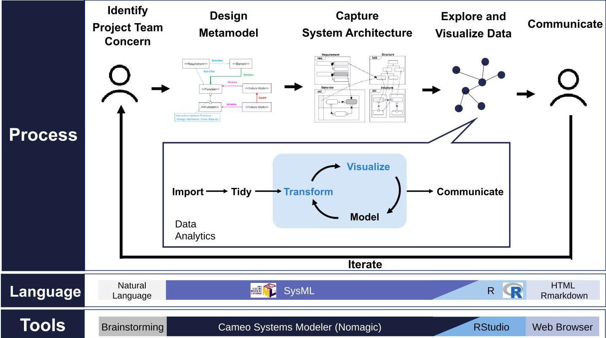

Fig. 3 MBSE-driven Exploratory System Architecture Analysis Framework

In many MBSE efforts, system models are built without a clear problem to be solved, and as a result, there are cases where the models created are not usable or the MBSE effort itself is terminated, and the importance of "Problem Framing" is suggested[16]. The proposed framework includes a step to carefully consider the issues to be solved through the system model before building the system model, which is common with reference[16].

As a benefit of MBSE, a number of methods have been proposed to automatically generate SE deliverables from the system model, such as "documents" required for specifications and review boards, and FTAs and FMEAs required for risk analysis [14][15]. Compared to traditional document-based development, MBSE enhances the accumulation and exchange of information necessary for systems engineering by structuring and centrally managing information about the system.

The proposed framework introduces processes and tools that seamlessly connect the SysML and R languages allowing traditional MBSE efforts to leverage the latest analytical techniques from the data science community.

## B. ETS-9 System Modeling Methodology

To deal with the complexity of the hall thruster system, we developed the ETS-9 modeling methodology, that the system-of-interest is modeled by focusing on the interactions between elements. Fig. 4 shows the meta-model of the proposed methodology[5][8][9].

The core concept modeling methodology is to explicitly describe the relationships among the three elements of the system architecture: requirements, functions, and elements. A requirement specifies an element and a function. An element performs a function. A function has an interaction with other functions. These models are expanded to the failure mode analysis by customized descriptions[9]. A failure mode is described as an undesirable behavior. A failure mode violates a function. A low-level failure mode causes a high-level failure mode. Since the low-level failure mode causes the high-level failure mode, a <<Cause>> relationship is added between the low-level failure mode and the high-level failure mode. Information on requirements, structure, function, and failure modes are integrated into the system model to allow traceability in risk analysis. The SysML notation used in the ETS-9 modeling methodology is shown in Fig. 5.

Based on the meta-model, we use <<activity>> elements to describe <<mission>> and <<functions>>. A SysML <<block>> represents <<elements>> such as system, sub-system, and components. Relationship between activities, requirements and blocks are our core system model. The <<perform>> relationship between <<functions>> and <<elements>> is described in SysML <<allocate>> relationship. We extend activity elements to describe <<failure

<!-- PDF_PAGE: 6 -->

modes>>. We defined the failure mode as <<e9.Risk.FailureMode>>, which extends SysML activity elements. We defined the relationship between failure modes and functions as <<e9.Risk.Violates>>.

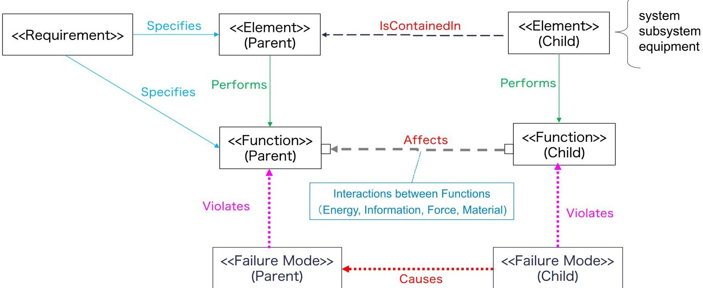

There is a dependency relation between parent and child functions.

Failure of a "lower level" function can only cause failure of a parent function.

Fig.4 Meta-model for system architecture description

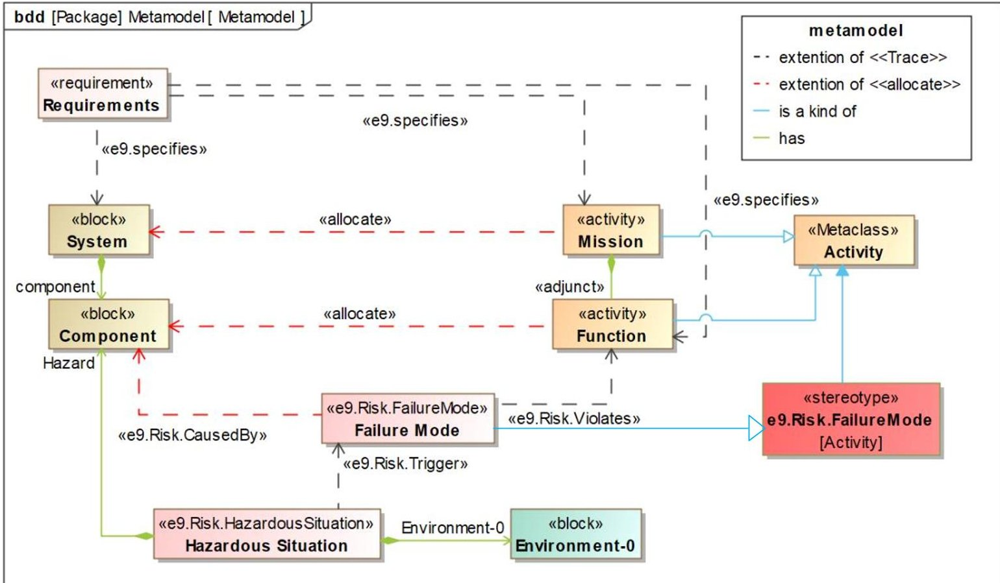

Fig. 5 Selecting and Usage of Elements in SysML notations

<!-- PDF_PAGE: 7 -->

The core concepts of the modeling methodology are shown in Fig. 6. We capture the complex behavior of the system as interactions between elements and describe the interactions using four input-output conversion patterns: energy, information, force, and matter[5][10]. For example, the function of a Hall thruster system, "generate thrust," can be described as an input-output conversion with Xe gas and electrical energy as input and thrust as output. The Hall Thruster system is decomposed into HTM, FCM, and PPU elements, and as a result of the system decomposition, new interactions and interfaces emerge among the components. These patterns are easy to model with SysML activity elements and Object Flow. Activities represent semantics for precisely specifying the behavior in terms of the flow of control and the flow of inputs and outputs. A control flow specifies the sequence of functional behaviors. An object flow specifies the flow of inputs and outputs. This enables a rigorous description of input-output relationships between functions and a comprehensive understanding of complex system interactions.

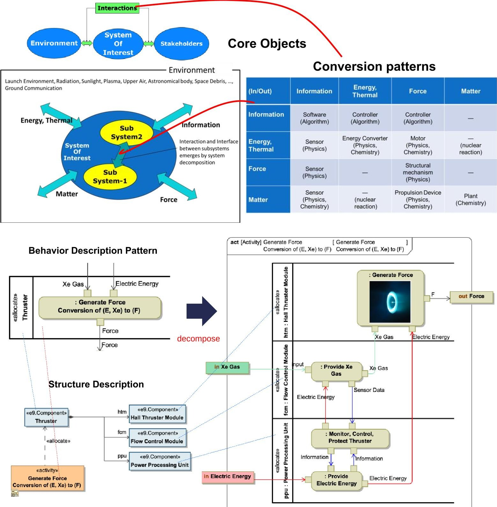

Fig. 6 Behavior description Patterns for interactions as conversion of input and output

<!-- PDF_PAGE: 8 -->

## C. Exploratory System Architecture Analysis

Fig. 7 shows the details of the Capture System Architecture Step and the Explore and Visualize Data Step.

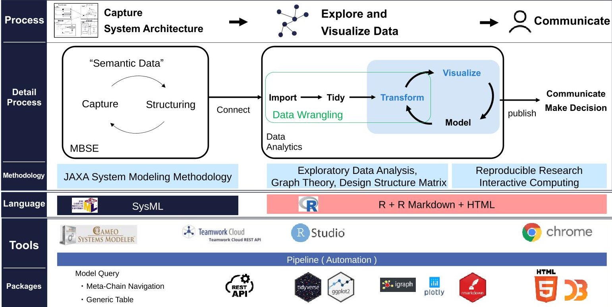

Fig. 7 Details of Capture System Architecture and Explore and Visualize Data

The proposed framework is unique in that it combines conventional MBSE efforts with exploratory data analysis approaches[10], data visualization technologies, and reproducible research technologies[12] using the R language, an open-source data science language.

Exploratory data analysis is a widely used concept in the data science community that utilizes data visualization, transformation, and modeling to capture the insights of data through repeated hypothesis testing[10]. The proposed framework is novel in that it applies the concept of exploratory data analysis to system architecture analysis in MBSE. A system model of requirements, structure, and behavior described in SysML is a set of elements and relationships among elements, and can be handled as semantic data. For example, we describe a function as an input-output transformation of energy, matter, and information with a SysML Activity element. At this time, each function is connected to another function via inputs and outputs. The relationships between functions are described as object flows. By abstracting SysML activity elements as nodes and SysML object flows as edges, they can be treated mathematically in the world of graph theory.

In Explore and Visualize Data Step, SysML data is imported on the R language development environment. This data is explored and analyzed by iteratively processing, transforming, visualizing, and modeling the data. Fig. 8 shows a simplified model of a Hall thruster as an example of a system with complex interactions among its components. Fig. 9 shows an example of converting the SysML Activity element into a graph structure for this model.

First, the object flow between the activity and activity elements of SysML was converted to graph data in the R language. The conversion to graph data was performed using the igraph package[21], which is available as an open-source library. Next, this graph data was modeled as a Design Structure Matrix (DSM), which represents the graph structure in matrix form and provides a holistic view of the dependencies and interactions of products with complex structure[17]. Fig. 9 shows an example of visualization of converted graph data from multiple perspectives. We visualized the data in a tree format[21] from a hierarchical perspective, in a Sankey Plot format from a functional propagation perspective, and in a matrix format from comprehensive view of the dependencies among functions. We applied the open-source visualization libraries, plotly package[22] and corrplot package[23], to visualize the data.

<!-- PDF_PAGE: 9 -->

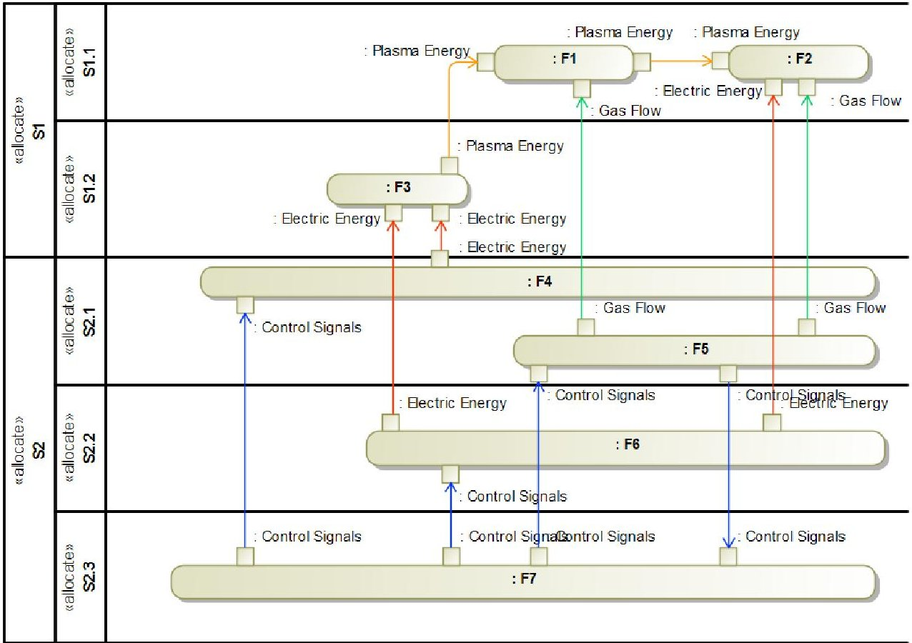

Fig. 8 Example of how a SysML Activity Diagram is used for modeling complex interactions

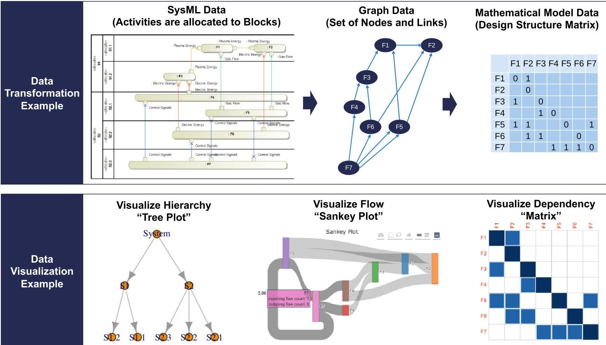

Fig. 9 Example of Data Transformation and Visualization

<!-- PDF_PAGE: 10 -->

Fig. 10 shows an example of an exploratory analysis of system architecture using the same Fig. 8 system model. The DSM method[17] can extract features of the system through matrix transformations. This method can identify the presence or absence of feedback loops in the dependencies of a target system and can derive the optimal task order through a matrix reordering called partitioning[17]. In the example in Fig. 10, the feedback loop between elements was explicitly captured by transforming the matrix into a triangular matrix through matrix reordering. Thus, we can analyze the system architecture in an exploratory manner by iteratively visualizing, transforming, and modeling the graphed system model data.

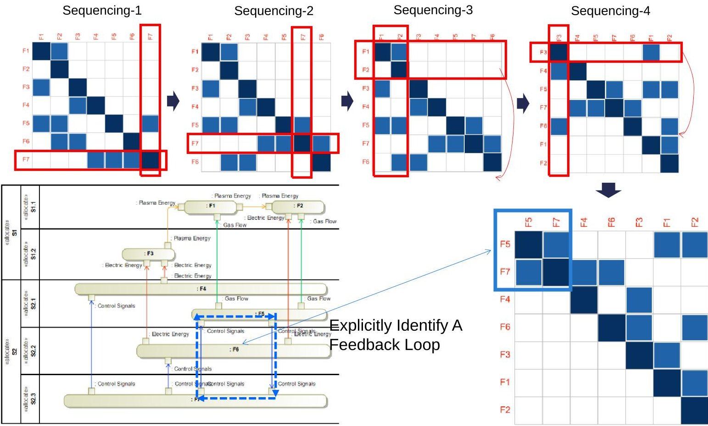

Fig. 10 Example of Exploratory System Architecture Analysis

## D. Reproducible Systems Engineering Artifacts

We generate SE artifacts as HTML-based interactive digital SE artifacts from SysML models using graph theory and data visualization packages in the R language. These digitized SE artifacts help systems engineers understand, analyze, and communicate with complex systems. Fig. 11 shows an example of a digital SE artifact. We used R Markdown [9] to output the results as a document with embedded text, code, and visualization results. This enabled the systems engineer to record the results and process of the analysis, which improved the reproducibility of the systems analysis.

<!-- PDF_PAGE: 11 -->

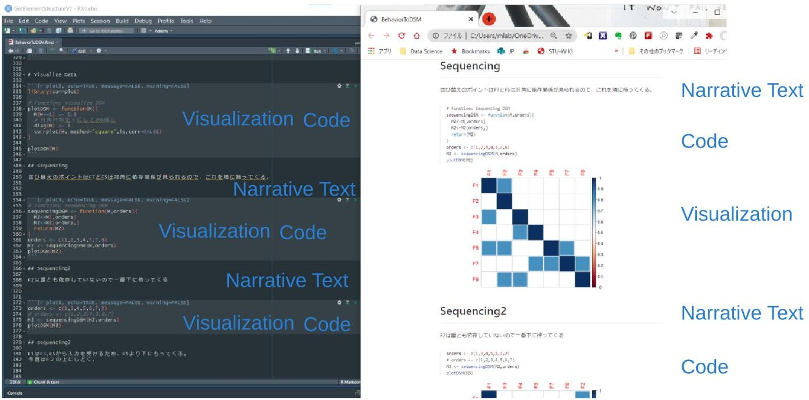

Fig. 11 Reproducible Systems Engineering Artifact

## IV. Solution for Integration of MBSE and R

We built a tool integration solution that seamlessly integrates SysML and the R programming environment. We developed codes to import SysML data into RStudio, an R language development environment, to automate the process of data formatting for applying graph theory and visualizing the data as interactive systems engineering artifacts. We also improved the reproducibility of the system analysis by outputting the analysis results as a document with embedded text documents, visualization results, and generated code using R Markdown[12].

## A. Building a tool environment that seamlessly integrates SysML and R languages

Fig. 12 shows a tool integration solution that seamlessly integrates SysML and the R programming environment.

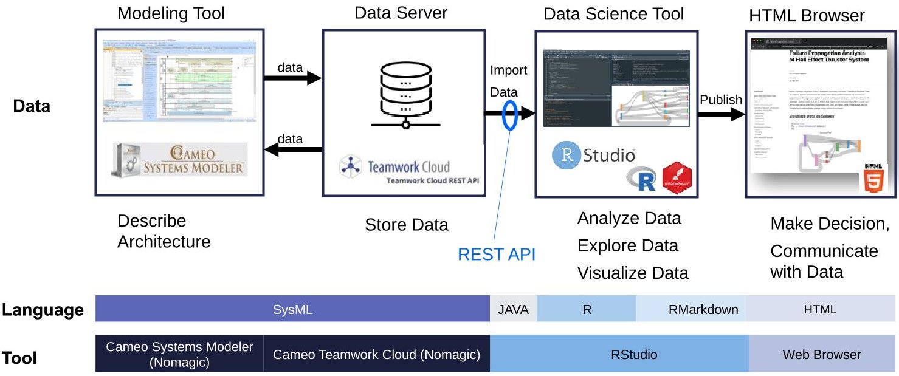

Fig.12 ETS-9 MBSE integrated solution of tool and language

<!-- PDF_PAGE: 12 -->

We used No Magic's Cameo Systems Modeler as the SysML modeling tool and RStudio as the R language development environment. Since direct data exchange between these tools was not possible, we decided to exchange data via No Magic's Teamwork Cloud. A system model data built with Cameo Systems Modeler is stored in the Teamwork Cloud, which is a central repository for storing models. This stored data is imported into RStudio via the REST API. The imported data is analyzed, explored, and visualized on RStudio using R language and R Markdown, and the results are automatically generated as HTML documents. Stakeholders can view these documents using a Web Browser.

## B. API and Reusable Libraries for Automation

We developed R language codes to bring SysML data into RStudio via a REST API and automated the data exchange process between SysML and R language. System analysis using SysML data begins with data extraction. We developed in-house R language libraries that abstract the processes related to the task of retrieving data via the REST API from the Teamwork Cloud, so that users can easily import data into R language data frames. For example, we have built a function to get SysML Activity and Failure Mode data in R data frame format. Now we can get these data with a single line of code. We also developed reusable functions to extract, shape, transform and visualize the data for applying graph theory. After storing the acquired data as data frames in the R language, processes related to data manipulation and analysis can be described in a few lines by leveraging the pipeline operations of the R language. This allows for exploratory data analysis with agile analysis and visualization iterations. Fig. 13 shows an example of code to visualize SysML Activity data as a Sankey Plot. We can describe the process of data input, checking obtained data, pre-processing for data visualization, and data visualization in about 10 lines.

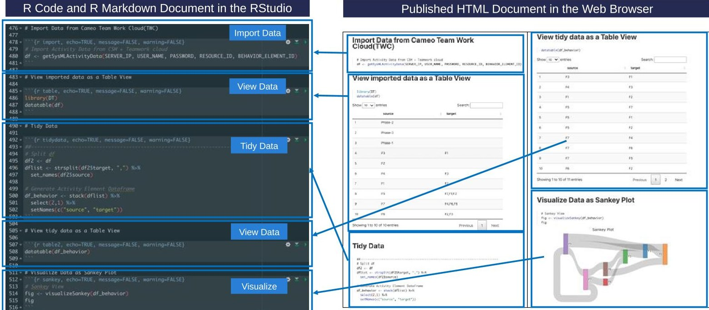

Fig. 13 Code Example for SysML and R integrations

## V. Results

The proposed approach was applied to the failure mode analysis of ETS-9 Hall Thruster. This paper presents two case studies that demonstrate the effectiveness of the proposed approach. First, by integrating MBSE and R language, we show a case study of applying advanced analytical techniques of graph theory to system analysis. Second, we present an example of automating the process of generating SE artifacts.

<!-- PDF_PAGE: 13 -->

## A. Reproducible System Analysis using MBSE and R integration

Fig. 14 shows the activity diagram of the ignition sequence of the Hall Thruster and the results of the function propagation analysis using DSM.

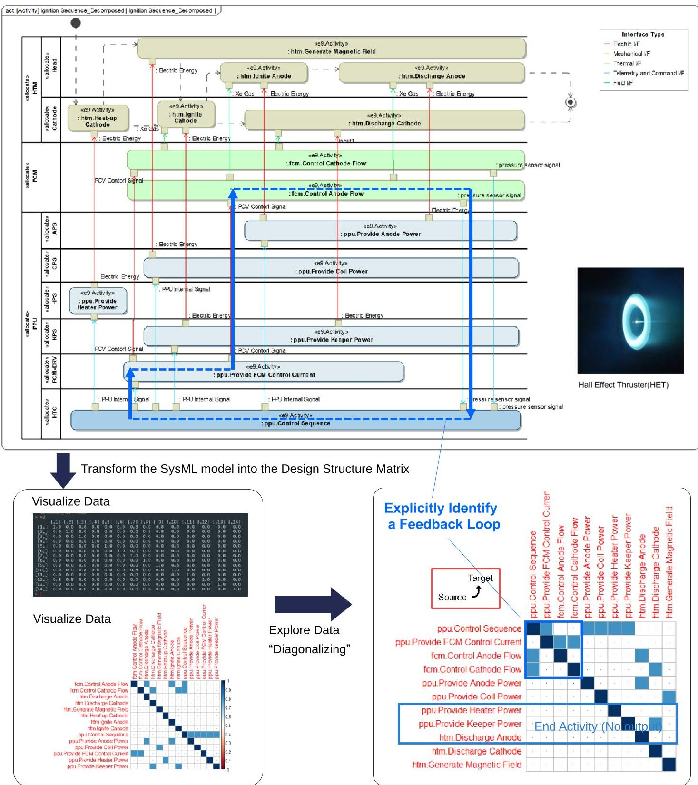

Fig. 14 DSM application to system architecture analysis of hall thruster system

<!-- PDF_PAGE: 14 -->

First, we modeled the ignition sequence with SysML Activity and Block elements, focusing on the interactions between the HTM, FCM, and PPU. The Activity elements have a relationship of <<allocate>> to the 9 Block elements and are represented using the Swimlane in the Activity diagram[13]. Next, model data was imported into R Studio and converted to DSM to identify functional chains and failure propagation. We can now explore the relationships among SysML model elements in the R language. We then triangulated the DSM through matrix transformations and data visualizations. The results explicitly show that the bottleneck of flow control in complex hall thruster operations is the feedback control loop using pressure sensors of the FCM.

By leveraging the results of these analyses, we can comprehensively extract failure modes related to flow control failures. Fig. 15 shows the FTA for the anode flow control failure. This is expanded into FCM failure, PPU FCM power failure, and FCM control failure. In particular, the FCM control failure is affected by the feedback loop between HTM-FCM-PPU. The proposed method allowed us to extract the propagation of failure modes across companies that were missing from the FMEA conducted by each company. The data and analytics also supported the validity of the project decision to implement open-loop flow control without pressure sensors in the controller to mitigate failures.

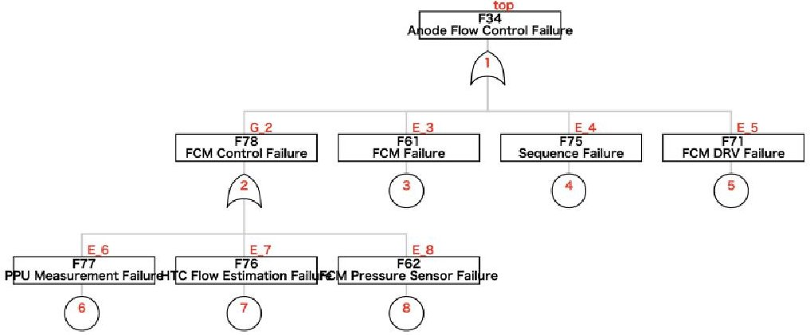

Fig. 15 FTA of Anode Flow Control Failure Mode

In a complex system such as a hole thruster, many interactions are interconnected complexly, resulting in many model elements. Compared to conventional MBSE, which requires manual exploration between model elements, the application of advanced analysis methods such as DSM enables efficient and exhaustive functional propagation analysis. In addition, we observed that using R Markdown to record the data visualization and transformation process along with the analysis code improves the reproducibility of the system analysis.

## B. Automation to generate a SE Artifact

Fig. 16 shows a partial visualization of the FTA for the Hall Thruster.

<!-- PDF_PAGE: 15 -->

Failure Modes described in SysML

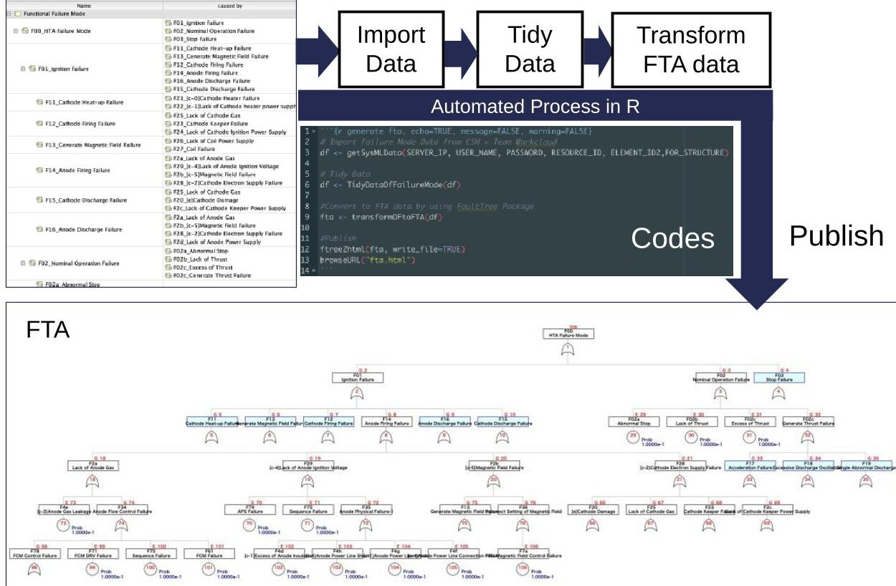

Fig. 16 Interactive Fault Tree Analysis (FTA) Result

Using the model information constructed in SysML and the function propagation analysis in R language as a guide for building the FTA, we constructed an FTA consisting of 75 failure modes covering HTM, FCM, and PPU. We described the extracted failure modes in SysML and generated them as FTAs using the R language. We have automated the process of generating FTAs from failure mode data described in SysML by using the FaultTree package[24] of R language. The code to generate a FTA is reusable with a few lines of code. Combined with the graphical data analysis library of the R language, it is now possible to generate a partial FTA in a short time, extracting only those parts of the overall FTA that are necessary for flow control, as shown in Fig. 15. The various FTAs generated are used for project risk management. We find that the integration of MBSE with the R language is effective to automate the generation of SE artifacts for project decision-making.

## VI. Expand the proposed analysis capability to the workflow orchestration

We expanded the capability of the proposed analysis framework to the workflow orchestration for generating the project engineering dashboard[25]. In this use case, we demonstrated the integration of the OpenCAESAR framework [26][27] and R languages to generate a web-based dashboard that represents highly digested information for project management as shown in Fig. 17.

<!-- PDF_PAGE: 16 -->

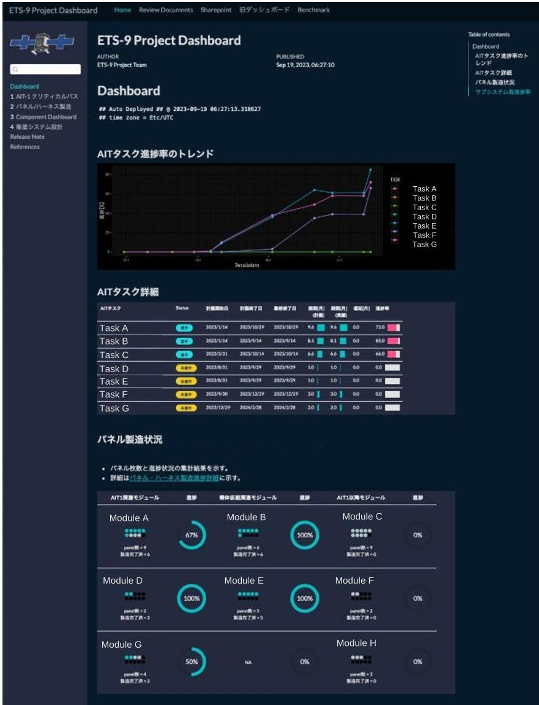

Fig. 17 ETS-9 Project Engineering Dashboard

We described the system architecture using Ontological Modeling Language (OML)[28] instead of using SysML. A System Model in OML describes the structured data using a precise vocabulary and generates a spreadsheet. We use OML to convert unstructured data into structured information that can be analyzed using CI/CD engines.

Information collected by project members through manual activities is stored as structured data using a spreadsheet. Users input component status and attribute parameters such as scheduling information using their familiar tool, Excel. Then, automatically generate and deploy triggered by spreadsheet changes, leveraging GitLab's CI/CD. We build the automated workflow to update, publish, and deploy a dashboard using a CI/CD pipeline as shown in Fig. 19.

Because most of the project team is unfamiliar with MBSE, we designed the user experience as data input using spreadsheets instead of OML. It's not intended to create a new structure using a spreadsheet approach. We aimed for easy adoption for project teams by updating pre-defined properties like development status, scheduling information, mass, and vendor information.

<!-- PDF_PAGE: 17 -->

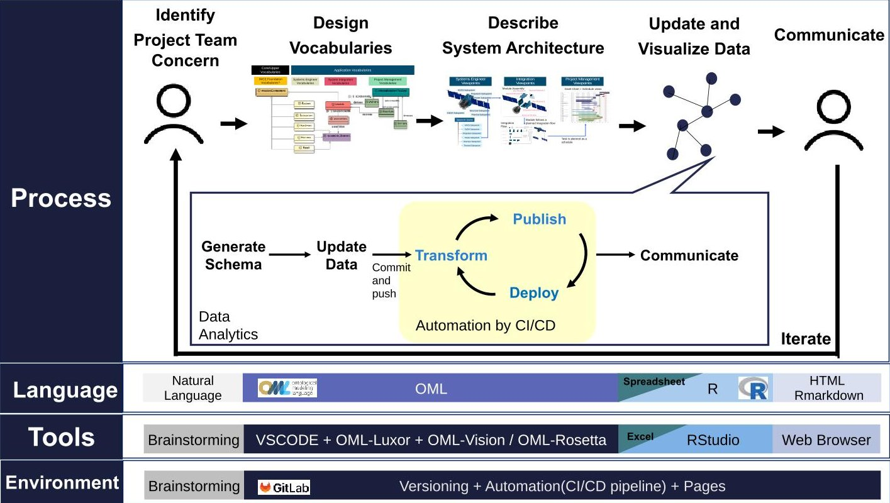

Fig. 18 Demonstration of Workflow Orchestration

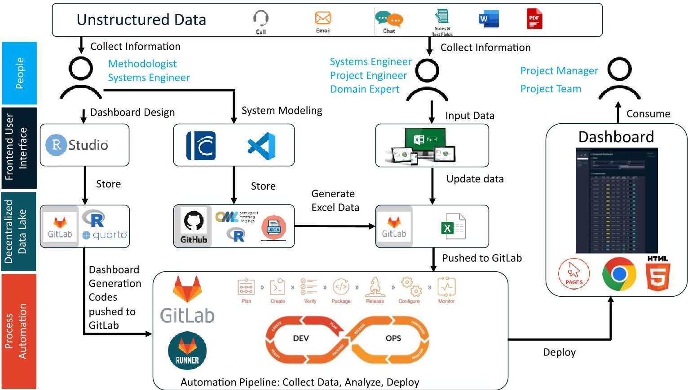

Fig. 19 Data Flow and Process Automation using CI/CD

<!-- PDF_PAGE: 18 -->

## VII. Conclusions

We proposed an exploratory system architecture analysis framework that integrates MBSE and R language data analytics, and we described the results of its application to a flight project. We find that the proposed analytical framework and tool solution that integrates the SysML and R languages are effective for system-level failure mode analysis of the Hall Thruster System. The results will enable systems engineers to leverage the rich and open-source analytical technologies of the data science community. We found an opportunity to transform document-based systems engineering, which relies on experience and intuition, into systems engineering for the digital age, built on data and analytics.

## Acknowledgements

The authors gratefully acknowledge the contributions of the entire Engineering Test Satellite 9 project team at JAXA. Many thanks to David Wagner, Maged Elaasar, Nicholas Rouquet, Steve Jenkins, Aaron Levitt and Michel D. Ingham from the Jet Propulsion Laboratory for their help in applying OpenCAESAR framework to the prototype development.

## References

[1] Fukatsu, T., Ogawa, R., Sano, T., and Odawara, Y., "The Preliminary Design Review result of Engineering Test Satellite-9," Proceedings of 63rd Space Sciences and Technology Conference, The Japan Society for Aeronautical and Space Sciences, 1K01, 2019 (in Japanese).

[2] Fukatsu, T., Ogawa, R., Sano, T., and Odawara, Y., "Development status of Engineering Test Satellite-9," Proceedings of 65th Space Sciences and Technology Conference, The Japan Society for Aeronautical and Space Sciences, 3D03, 2021 (in Japanese).

[3] Hatooka, Y., Sano, T., Kudoh N., Hisamoto, Y., and Fukatsu, T., "Development of All-Electric Satellite through Engineering Test Satellite-9," Aeronaut. Space Sci. Japan., 65 (2017), pp.309-313 (in Japanese).

[4] Funaki, I., Sano, T., and Fukatsu, T., "Development Status of 6-kW-class Hall Thrusters at JAXA," 36th International Electric Propulsion Conference, Vienna, Austria, IEPC-2019-441, 2019.

[5] Goebel, D.M., and Katz, I. "Fundamentals of electric propulsion: ion and Hall thrusters," John Wiley & Sons, 2008.

[6] Leveson, N. G. "Software Challenges in Achieving Space Safety." Journal of the British Interplanetary Society 62 (2009): 265-272.

[7] Nakajima, Y., and Fukatsu, T., "Applications of Model-Based Systems Engineering for JAXA's Engineering Test Satellite-9 Project," Model-Based Systems and Software Engineering Workshop 2020, European Space Agency, 2020.

[8] Nakajima, Y., and Fukatsu, T., "Model Based Systems Engineering approach for the ETS-9 project," Proceedings of 63rd Space Sciences and Technology Conference, The Japan Society for Aeronautical and Space Sciences, 1K01, 2019 (in Japanese).

[9] Nakajima, Y., Hisamoto, Y., and Fukatsu, T., "Systematic Failure Mode Analysis of ETS-9 Hall Thruster," Proceedings of 64th Space Sciences and Technology Conference, The Japan Society for Aeronautical and Space Sciences, 4L12, 2020 (in Japanese).

[10] Kato, M., Nakajima, Y., Takei, Y., Noda, A., and Inaba, N. (2018). "Interaction-Oriented Systems Engineering Methodology for Model-Based Systems Engineering," 2018 AIAA SPACE and Astronautics Forum and Exposition, AIAA, 2018.

[11] Wickham, H., and Garrett, G., "R for data science: import, tidy, transform, visualize, and model data," O'Reilly Media, Inc.", 2016.

[12] Xie, Yihui, Joseph J. Allaire, and Garrett Grolemund. R Markdown: The definitive guide. Chapman and Hall/CRC, 2018.

[13] Sindiy, O.V., Mozafari, T., and Budney C.J., "Application of Model-Based Systems Engineering for the Development of the Asteroid Redirect Robotic Mission," AIAA Space 2016 Conference, AIAA, Long Beach, CA, 13-16 September 2016.

[14] Jackson, M., and Wilkerson, M., "MBSE-driven visualization of requirements allocation and traceability," 2016 IEEE Aerospace Conference. IEEE, 2016.

<!-- PDF_PAGE: 19 -->

[15] Delp, C., Lam, D., Fosse, E., & Lee, C. Y., "Model based document and report generation for systems engineering." 2013 IEEE Aerospace Conference. IEEE, 2013.

[16] Martin, James N. "Problem Framing: Identifying the Right Models for the Job." INCOSE International Symposium. Vol. 29. No. 1. 2019.

[17] Eppinger, Steven D., and Tyson R. Browning. Design structure matrix methods and applications. MIT press, 2012.

[18] Henderson, Kaitlin, and Alejandro Salado. "Value and benefits of model - based systems engineering (MBSE): Evidence from the literature." Systems Engineering 24.1 (2021): 51-66.

[19] Bayer, Todd, et al. "Europa Clipper: MBSE Proving Ground." 2021 IEEE Aerospace Conference (50100). IEEE, 2021.

[20] Delp, Christopher, et al. "Model based document and report generation for systems engineering." 2013 IEEE Aerospace Conference. IEEE, 2013.

[21] Csardi, Gabor, and Tamas Nepusz. "The igraph software package for complex network research." InterJournal complex systems 1695.5 (2006): 1-9.

[22] Sankey Diagram in R: https://plotly.com/r/sankey-diagram/ [retrieved 12 June 2024].

[23] An Introduction to corrplot Package: https://cran.r-project.org/web/packages/corrplot/vignettes/corrplot-intro.html [retrieved 12 September 2022]

[24] Package 'FaultTree': https://cran.r-project.org/web/packages/FaultTree/FaultTree.pdf [retrieved 12 June 2024]

[25] Yuta Nakajima. "Lessons Learned From openCAESAR Application to JAXA's ETS-9 Project," onto:Nexus 2024: 1st Workshop on Ontological Modeling and Analysis, Jet Propulsion Laboratory, 2024.

[26] D. Wagner, S. Y. Kim-Castet, A. Jimenez, M. Elaasar, N. Rouquette and S. Jenkins, "CAESAR Model-Based Approach to Harness Design," 2020 IEEE Aerospace Conference, Big Sky, MT, USA, 2020, pp. 1-13.

[27] M. Elaasar, et al., "openCAESAR: Balancing Agility and Rigor in Model-Based Systems Engineering," in 2023 ACM/IEEE International Conference on Model Driven Engineering Languages and Systems Companion (MODELS-C), Västerås, Sweden, 2023 pp. 221-230.

[28] Ontological Modeling Language: https://www.opencaesar.io/oml/ [retrieved 12 June 2024]