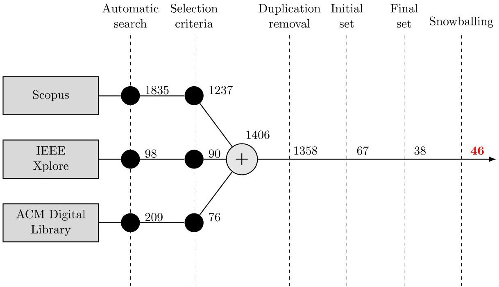
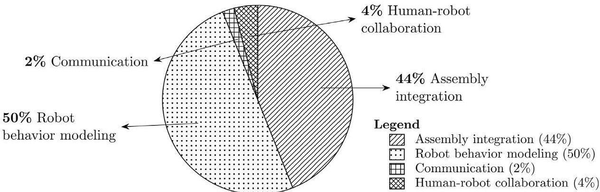
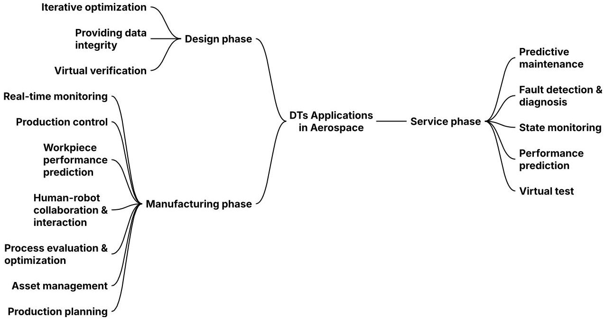
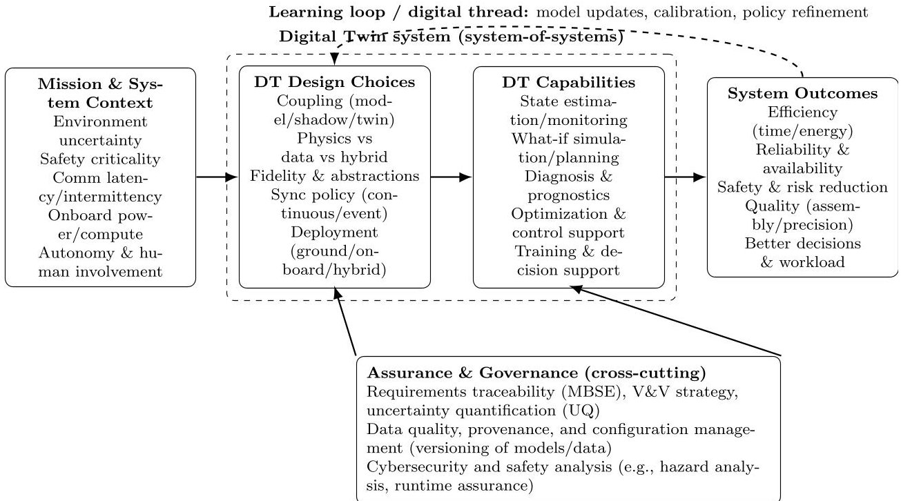

<!-- PDF_PAGE: 1 -->

# Digital Twin Models for Space Robotics: Objectives, Applications, and Challenges

Mehran Rostamnia $ ^{ \textcircled{1D}} $ , Sara Pettinari $ ^{ \textcircled{1D}} $ , Patrizio Pelliccione $ ^{ \textcircled{1D}} $

Gran Sasso Science Institute (GSSI), Viale Francesco Crispi 7, L'Aquila, 67100, Abruzzo, Italy

## ARTICLE INFO

Keywords:

Digital twin

Robotics

Space

Systematic literature review

## ABSTRACT

Context: Digital Twin (DT) technology is increasingly explored in the space sector, yet its application in space robotics remains fragmented and less mature than in other industries. Existing studies report isolated implementations, but a structured analysis to clarify DT roles and guide future developments is still lacking. Objectives: This paper provides a systematic literature review of DT applications in space robotics. The study aims to (i) classify primary objectives of their use, (ii) map applications across system lifecycle phases, (iii) identify recurring challenges, and (iv) report advantages while deriving analytical insights for future research. Methods: We conducted a systematic literature review using a comprehensive search across multiple databases. After applying defined inclusion and exclusion criteria, 46 academic publications were selected for detailed analysis. Beyond descriptive categorization, a cross-cutting synthesis was performed to examine why DTs are used, where they are instantiated along the system lifecycle, and what constrains their deployment. Results: The analysis shows that DTs are primarily used for assembly processes and robot behavior modeling, while human-robot collaboration and communication remain underexplored. Applications are mainly distributed across design (iterative optimization and virtual verification), manufacturing (production control and real-time monitoring), and service phases (state monitoring and predictive maintenance). However, most implementations rarely span the full lifecycle. Recurring challenges include model accuracy and uncertainty management, data quality and synchronization, multi-DT interoperability, and the absence of reusable reference frameworks. Reported advantages include efficiency improvement, enhanced system management and monitoring, improved assembly quality and reliability, and strengthened decision-making support. Conclusion: Although DTs offer clear benefits to space robotics, adoption is still emerging. Addressing existing challenges and investigating new application areas is essential for advancing their role in future space missions.

## 1. Introduction

From the launch of the first satellites to today's advanced missions, the need to understand space has driven significant technological progress. As space mission complexity increases, new challenges emerge, requiring the adoption of advanced technologies. Robotics has become a core component of modern space missions, enabling greater autonomy and supporting deep-space exploration. Among the technologies advancing space robotics, Digital Twin (DT) emerges as a promising and groundbreaking approach [1,2]. DTs can mirror physical entities in the virtual space, even during the entire life cycle of the real entity. In the 1960s, NASA was the first to examine the idea of a DT for space applications. NASA redesigned its spacecraft on Earth to replicate the systems in space for exploration missions. DT refers to a multidisciplinary, multi-scale, and multi-physics model that integrates various inputs such as operational data, historical data, and other

information [3,4]. Through the effective use of DTs, space organizations can enhance predictive maintenance, fault detection, and performance prediction [5-7].

Although DT technology originated in the aerospace sector, its adoption in the space domain, particularly in space robotics, remains in an early stage. Indeed, according to a recent study [8], the proportion of contributions related to DTs in the space sector is still relatively low compared to other industries. Existing reviews often lack a comprehensive examination of DT applications and functionalities across the entire system lifecycle, which includes phases from initial design to implementation and operation [9]. Moreover, prior studies do not provide a detailed classification of the objectives of DTs in space robotics. Finally, to support further development in this area, there is a need to clearly identify current challenges, highlight the benefits of DT adoption, and define key areas that require more focused investigation.

<!-- PDF_PAGE: 2 -->

To fill this gap, we provide a systematic literature review of DTs for space robotics grounded in the following research questions, each motivated by a specific synthesis need and designed to connect directly to the results that follow.

- RQ1: What are the primary objectives of using DTs in space robotics? Rationale: The DT literature in space robotics uses the term "digital twin" to cover heterogeneous goals. Clarifying the dominant objectives is necessary to understand where DTs deliver value today and where the evidence base remains sparse, and it provides the organizing lens for the remainder of the review.

- RQ2: What are the applications of DTs in space robotics? Rationale: DT contributions are distributed unevenly across the product/system lifecycle. Mapping DT applications across design, manufacturing, and service/operations phases makes explicit where DTs are currently instantiated, how lifecycle context shapes DT architecture and validation, and where lifecycle continuity (digital thread reuse) is missing.

- RQ3: What are the current challenges and limitations of integrating DTs in space robotics? Rationale: Space robotics imposes mission-critical constraints (uncertainty, latency, limited onboard resources, safety requirements) that amplify engineering and assurance barriers. Identifying recurring limitations, including model accuracy/precision, data quality and synchronization, interoperability across interacting multi-DT ecosystems, and the absence of reusable frameworks, is essential to derive a systems engineering research agenda and to interpret why some DT objectives remain underexplored.

- RQ4: What are the advantages of using DTs in space robotics? Rationale: Reported benefits are often stated qualitatively and with inconsistent metrics. Consolidating advantages across objectives and lifecycle phases helps distinguish frequently claimed value (e.g., efficiency, system management, decision support, quality/reliability) from areas requiring stronger evidence and enables a clearer linkage between DT design choices and measurable outcomes.

Collectively, these research questions enable not only structured classification but also cross-cutting analysis of architectural choices, lifecycle continuity, and evidence maturity. This perspective supports a systems-engineering interpretation of DT adoption in space robotics, linking technical objectives to broader mission-level constraints.

Building on these questions, our systematic literature review synthesizes the state of the art on DTs for space robotics by analyzing 46 peer-reviewed publications indexed in IEEE Xplore, ACM, and Scopus (covering studies up to the end of June 2024). The results show a strong concentration of research on two objectives: improving robotic behavior and performance (50% of the analyzed studies) and supporting assembly-related activities (44%) , while DT usage for communication/networking (2%) and human-robot collaboration (4%) remains comparatively limited. This distribution suggests that DT research in space robotics is currently driven by use cases with clearer and measurable performance targets (e.g., task execution, precision, and assembly outcomes), whereas socio-technical and system-of-systems applications (e.g., operator teaming and network-level DTs) are still emerging and underexplored.

Across the system lifecycle, the reviewed DT applications span design, manufacturing, and service/operations phases. In the design phase, DTs are most commonly used to enable iterative refinements and to validate complex models before deployment; in the manufacturing phase, DTs primarily support "smart manufacturing" functions by monitoring, manipulating, and managing systems and processes; and in the service phase, DTs are most often applied to real-time system monitoring that supports decision-making and predictive maintenance. At the same time, our synthesis highlights persistent barriers to broader adoption, notably the difficulty of ensuring DT model accuracy and

precision, the need for high-quality data and reliable data synchronization, the challenge of managing interacting multi-DT ecosystems, and the lack of general reusable DT frameworks for space systems. Despite these challenges, the surveyed evidence consistently reports benefits in efficiency, system management, decision support, and quality/reliability, and it points to in-space satellite construction as a particularly promising emerging direction for future DT-enabled space robotics.

To connect these contributions, we provide a compact cross-analysis of why DTs are used (objectives), where they are instantiated along the system lifecycle (applications), and what constrains their deployment (challenges), while also summarizing the benefits most often claimed in the literature. Fig. 1 decomposes this cross-analysis into three views. Fig. 1(a) summarizes where each objective is most frequently instantiated along the lifecycle: assembly work concentrates strongly in manufacturing, reflecting DT usage for monitoring/manipulation and process management in production contexts, whereas robot behavior spans design and service/operations, consistent with DT usage for monitoring, diagnosis, and performance support during mission execution.

Fig. 1(b) highlights the challenge structure underlying these distributions. Across objectives, model accuracy and precision (CH1) are pervasive, underscoring that DT usefulness is bounded by model mismatch under uncertain environments and evolving system states. Data quality and synchronization (CH2) appear most prominently in assemblyfocused studies, where heterogeneous sensing and process variability drive dependence on robust data pipelines. Finally, the lack of general frameworks (CH4) cuts across objectives, suggesting that reusable reference architectures and assurance patterns for DT deployment remain immature. The advantage profiles in Fig. 1(c) align with these emphases: efficiency gains dominate assembly and robot behavior DTs, communication DTs emphasize system management and reliability, and HRC DTs primarily highlight real-time decision support and improved human work.

The rest of the article is as follows. Related reviews are presented in Section 2. Literature review methodology and classification criteria are highlighted in Section 3. The objectives of DT in the space domain are presented in Section 4. Section 5 reviews the application of DT in the space domain. Section 6 provides research challenges and limitations. The advantages of using DT in the space domain are mentioned in Section 7. Section 8 discusses possible future directions and considers the level of popularity of DT in the space domain, while Section 9 presents lessons learned. Finally, Section 10 summarizes and concludes the paper.

## 2. Related works

This section analyzes works presenting a literature review targeting DTs for space robotics.

Sicard et al. [10] reviewed papers to explore the use of UAVs and satellites across various fields. They highlighted that this technology provides a significant improvement in performance, reliability, and lifespan of the UAVs and satellites. The review includes a case study on a CubeSat attitude adjustment device to showcase how DTs can lead to better control performance, orientation tracking, and condition monitoring. Li et al. [11] reviewed the research studies related to DT. They discussed the concept of DT technology and the primary components of DT, functionalities, and challenges. The study presents the impact of DT utilization on the aerospace industry. Moreover, the authors proposed three dimensions for future aero-DTs, including interactive, standardization, and cognitive dimensions, which could improve the efficiency of aerospace systems. They addressed the limitations and challenges in optimizing DTs for aerospace applications, such as the need for real-time data acquisition and suitable enabling technologies selection. Finally, they proposed a roadmap to overcome these challenges. Yin and Wang [3] presented a review to discuss the aerospace applications and developments of DT technology. They

<!-- PDF_PAGE: 3 -->

<table border="1"><tr><td>Objective</td><td>Design</td><td>Manuf.</td><td>Service</td><td>Total</td></tr><tr><td>Assembly</td><td>3</td><td>16</td><td>2</td><td>20</td></tr><tr><td>Robot behavior</td><td>12</td><td>3</td><td>14</td><td>23</td></tr><tr><td>Human-robot collaboration(HRC)</td><td>1</td><td>1</td><td>0</td><td>2</td></tr><tr><td>Communication/networking</td><td>0</td><td>0</td><td>1</td><td>1</td></tr><tr><td>Total</td><td>16</td><td>20</td><td>17</td><td>46</td></tr></table>

(a) Objectives and lifecycle emphasis (counts).

<table border="1"><tr><td>Objective</td><td>CH1</td><td>CH2</td><td>CH3</td><td>CH4</td><td>Total</td></tr><tr><td>Assembly</td><td>5</td><td>6</td><td>1</td><td>2</td><td>14</td></tr><tr><td>Robot behavior</td><td>15</td><td>1</td><td>0</td><td>1</td><td>17</td></tr><tr><td>Human-robot collaboration(HRC)</td><td>1</td><td>0</td><td>0</td><td>1</td><td>2</td></tr><tr><td>Communication/networking</td><td>1</td><td>1</td><td>0</td><td>1</td><td>3</td></tr></table>

(b) Dominant challenges by objective (counts).

<table border="1"><tr><td>Objective</td><td>Eff.</td><td>Mgmt.</td><td>Spd.</td><td>Qual.</td><td>RT</td><td>Human</td></tr><tr><td>Assembly</td><td>√</td><td>√</td><td>√</td><td>√</td><td></td><td></td></tr><tr><td>Robot behavior</td><td>√</td><td></td><td>√</td><td></td><td>√</td><td></td></tr><tr><td>Communication/networking</td><td></td><td>√</td><td></td><td>√</td><td>√</td><td></td></tr><tr><td>Human-robot collaboration(HRC)</td><td></td><td></td><td></td><td></td><td>√</td><td>√</td></tr></table>

(c) Advantage profiles (qualitative mapping).

Fig. 1. Interrelation of objectives, lifecycle emphasis, challenges, and advantages of deploying Digital Twins (DTs) in space robotics. (a) shows where DT work concentrates along the lifecycle; (b) shows which challenges recur most often by objective; (c) summarizes advantage profiles reported in the literature. CH1: model accuracy/precision; CH2: data quality/synchronization; CH3: multi-DT interaction; CH4: lack of general frameworks. Eff.: efficiency improvement; Mgmt.: enhanced system management; Spd: provide smart process design; Qual.: improved quality/reliability; RT: dynamic real-time analysis/decision support; Human: enhanced human work/collaboration.

emphasized the importance of creating precise models of the physical counterpart. The paper highlights the benefits of DTs compared to traditional modeling simulations. Phanden et al. in [12] reviewed the integration of simulation and DT for various applications, including manufacturing, aerospace, and robotics. They considered the close relationships between simulation techniques and DTs. The study aims to acquire clarification of conceptual foundations for future research in adapting simulation techniques for developing DT. Mazumder et al. in [8] presented a systematic review of the trends of DT in various domains of robotics, such as space robotics, soft robotics, medical and rehabilitation robotics, human-robot interaction, and industrial robotics. The study identifies possible future directions in the target domains, including mixed reality applications and AI implementations. Additionally, it provides challenges, threats, and limitations.

Our study takes a step forward by proposing a systematic literature review of existing studies in the space robotics domain to provide a detailed classification, which has generally been absent in recent review publications, as indicated in Table 1. As summarized in the table, the focus of the related works, whether they explore aerial robotics or general robotics (i.e., without targeting specific robot types), the lifecycle stage each review addresses, and whether they specifically focus on the space domain or target multiple domains. As shown in the table, a comprehensive study that covers different aspects of space robotics is still needed. Having a detailed classification helps us to better identify gaps and trending research areas.

Table 1 positions our contribution with respect to existing review efforts and makes explicit the gap this paper addresses. Prior surveys on

DTs in the aerospace and robotics literature vary substantially in both scope (e.g., UAVs/satellites, generic aerospace systems, or multi-domain robotics) and in the depth of synthesis they provide. In particular, many works discuss DT concepts and selected applications at a high level, but only partially (or implicitly) connect these to lifecycle phases, recurring integration challenges, and reusable taxonomies that would support systematic comparison across studies. Moreover, several reviews do not target space robotics specifically, treating it as a sub-area within broader domains.

Compared to related works, our study delves into a deeper analysis of applications. Specifically, the work in [10] considers health monitoring and performance optimization as applications of DT in the space domain. The works in [3,11] do not offer a structured classification for applications. In [11], challenges are related to data and validation of the model, while our work provides wider challenges in the space domain. We analyzed applications and functionality of DT over the entire lifecycle of the robotic system, while [12] considers only the integration of simulation and DT without focusing on different aspects of DT in space robotics. Furthermore, our study covers all robots in the space domain, which is missing in [10,11]. Unlike [8,12], we consider only robotics in the space domain, which gives us a precise focus on the analysis and finding gaps.

## 3. Research method

In this research, we followed Kitchenham's guidelines [13] to review systematically and provide our literature review. The systematic

<!-- PDF_PAGE: 4 -->

Table 1

Overview of related review works and coverage dimensions (single-column, compact).

<table border="1"><tr><td>Work</td><td>Yr</td><td>Scope</td><td>C</td><td>A</td><td>L</td><td>Ch</td><td>T</td><td>SR</td></tr><tr><td>[10]</td><td>2024</td><td>Aerospace DTs(UAVs/satellites)</td><td>√</td><td>√</td><td>~</td><td>~</td><td>X</td><td>Lowa</td></tr><tr><td>[11]</td><td>2021</td><td>Aerospace DT concept+roadmap</td><td>√</td><td>~</td><td>√</td><td>√</td><td>~</td><td>Low-Medb</td></tr><tr><td>[3]</td><td>2020</td><td>Aerospace DT applications overview</td><td>√</td><td>~</td><td>~</td><td>~</td><td>X</td><td>Lowc</td></tr><tr><td>[12]</td><td>2021</td><td>Simulation-DT relationship(multi-domain)</td><td>√</td><td>~</td><td>~</td><td>~</td><td>X</td><td>Noned</td></tr><tr><td>[8]</td><td>2023</td><td>Robotics DT trends/gaps(multi-domain)</td><td>√</td><td>~</td><td>~</td><td>√</td><td>~</td><td>Lowe</td></tr><tr><td>Our work</td><td>-</td><td>Space robotics DTs(SLR; lifecycle-grounded)</td><td>√</td><td>√</td><td>√</td><td>√</td><td>√</td><td>High</td></tr></table>

C = DT concept/components; A = applications synthesized; L = explicit lifecycle grounding (design/manufacturing/service); Ch = challenges/limitations consolidated;

T = taxonomy/classification (not only narrative); SR = space-robotics specificity. $ \checkmark $ covered; $ \sim $ partial/implicit; $ \times $ not covered.

$ ^{a} $ Includes a CubeSat-related case study but is not space-robotics-specific nor structured as a lifecycle taxonomy.

$ ^{b} $ Strong on DT components and aerospace roadmap; applications are discussed but not systematically classified for space robotics.

$ ^{c} $ High-level aerospace survey emphasizing model fidelity; limited structured lifecycle and robotics-objective synthesis.

$ ^{d} $ Focuses on simulation-DT conceptual links rather than DT objectives/applications/challenges in space robotics.

$ ^{e} $ Covers robotics broadly (space robotics as a sub-area); limited space-domain constraints and lifecycle-specific synthesis.

Fig. 2. An overview of the literature review and research process.

review contains three main phases, including planning, conducting, and documenting. Fig. 2 demonstrates the research process we followed.

Planning. The key goals of this phase are to (i) determine the importance of the work, (ii) outline exhaustive research goals and associated research questions, and (iii) develop research protocols that the researcher follows to conduct a systematic literature review.

To achieve comprehensive results, keywords play a high importance role. To obtain suitable keywords, we extracted the most relevant terms used by studies in the target domain, for instance, "Digital twins", "Aerospace", and "Robotics". The search terms were used in multiple mixtures with synonyms to mostly cover our research questions. Moreover, space robotics is often discussed using mission- or rover-specific terminology rather than generic robotics keywords; we explicitly incorporated the names of major NASA rovers (e.g., Perseverance, Curiosity) into the search string. We finally reached the following search string.

"Digital twin*" AND (("Aerospace" OR "

Astronautical" OR "Spacecraft" OR "Space

technology" OR "Space domain*" OR ("

space exploration" OR "space mission*"))

AND ("Robotic*" OR "Robot*")) OR (("

Rover*" OR "Perseverance" OR "Sojourner"

OR "Spirit" OR "Curiosity")))

The Inclusion and Exclusion Criteria (IC and EC), shown in Table 2, were applied to the initial search results obtained from databases. The inclusion criteria make sure that the results are related to the aim of the study. We covered all the studies from scratch till the end of June 2024. We also set exclusion criteria to exclude literature studies that are out of scale to help us concentrate on contexts in our research questions. Final set publications must satisfy every inclusion and exclusion criterion.

Using this keyword, relevant papers were derived from the largest and most widely used scientific indexing systems and databases in software engineering: SCOPUS, IEEE Xplore Digital Library, and ACM.

These criteria were applied while reading the abstract and title of the articles. The articles that were identified outside the research domain did not proceed to the analysis stage. As can be seen in Fig. 2, we conducted an automatic search on our objective datasets (Scopus, IEEE, and ACM) to retrieve studies aligned with our search string, from which a total of 2142 initial records were retrieved (Scopus: 1835; IEEE: 98; ACM: 209). Once we employed the inclusion and exclusion criteria 1403 papers remained (Scopus: 1237; IEEE: 90; ACM: 76). After that, we removed duplicate entries to ensure that each study was conducted

Conducting. In the conducting phase, the selected papers were analyzed and evaluated, which is provided as an online documentation, to meet the research questions. Ultimately, the results were finalized.

<!-- PDF_PAGE: 5 -->

<table border="1"><tr><td>Inclusion criteria</td><td>Exclusion criteria</td></tr><tr><td>IC1: Journal or conference publications with space applications.</td><td>EC1: Manuscripts whose language is not English.</td></tr><tr><td>IC2: Studies that report DT applications in robotics.</td><td>EC2: Short papers(less than 2000 words),Poster-based papers,Doctoral Thesis,Book Chapters.</td></tr><tr><td rowspan="4">IC3: Publications that present the application of DTs in the Space domain.</td><td>EC3:Papers that are out of the Computer Science and Engineering domains.</td></tr><tr><td>EC4:Proceedings papers.</td></tr><tr><td>EC5:Studies presenting surveys and reviews.</td></tr><tr><td>EC6:Studies that do not explicitly mentionDT-integrated robotic methodology in the space domain.</td></tr></table>

Table 3

Quality assessment rubric used to appraise methodological rigor of included studies.

<table border="1"><tr><td>ID</td><td>Criterion(what to look for)</td></tr><tr><td>QA1</td><td>DT definition and scope are clear.The physical counterpart and DT boundary, assumptions,and intended use are specified.</td></tr><tr><td>QA2</td><td>Coupling and update semantics are specified.The work makes clear whether the DT is an offline model,a digital shadow,a bidirectional twin,or predictive/prescriptive.</td></tr><tr><td>QA3</td><td>Data sources and data handling are described.Inputs,preprocessing,and provenance are reported with enough detail to judge credibility.</td></tr><tr><td>QA4</td><td>Model and implementation details are reported.Key modeling choices(physics,data-driven,hybrid)and calibration/training procedures are stated.</td></tr><tr><td>QA5</td><td>Validation is described and matched to claims.The evaluation setup,baselines(if any),and validation realism level are reported clearly.</td></tr><tr><td>QA6</td><td>Metrics and outcomes are quantitative or well-defined.Measures are stated,and results support the conclusions drawn.</td></tr><tr><td>QA7</td><td>Reproducibility support is present.The paper provides sufficient detail to replicate the approach,or shares code/data/configuration where feasible.</td></tr><tr><td>QA8</td><td>Limitations and threats to validity are discussed.The paper acknowledges constraints such as model mismatch,latency,drift,or environment uncertainty.</td></tr><tr><td>QA9</td><td>Lifecycle and governance aspects are addressed.The work indicates where it fits in the lifecycle and how models/data are managed or updated over time.</td></tr><tr><td>QA10</td><td>Claims are evidence-aligned.The strength of the conclusions is consistent with the reported validation and assumptions.</td></tr></table>

only once, then, 1358 papers were left to initial check. In this stage, we exclude irrelevant studies by reading the titles and abstracts. At the end of this stage, 67 papers were left for meticulous review and analysis. The drastic decrease in the number of papers was caused by studies that only referenced the initial study of DT, which pertains to the aerospace domain, without further investigation. After filtering out in the final selection and conducting backward and forward snowballing search, 38 papers were discerned as directly related to the purpose of our study. We then conducted snowballing on the remaining papers to identify additional relevant studies. This process yielded 8 additional papers, bringing the total number of selected papers to 46.

Quality assessment and evidence appraisal. To address the methodological rigor of the included studies, we conducted a structured quality assessment of each selected paper. The goal of this appraisal is to analyze the papers and to enable an evidence-based synthesis. Our analysis was guided by a checklist-based rubric tailored to DT studies in space robotics (Table 3). Each criterion was assessed using a threelevel scale: 0 (not addressed), 0.5 (partially addressed or unclear), and 1 (explicit and sufficient detail). The total quality score for each study is the sum across QA1-QA10 (max 10). Quality scoring was used to interpret evidence strength and does not affect inclusion. We assessed methodological reporting quality using the rubric in Table 3 and separately coded each study for objectives, lifecycle phase, modeling paradigm, validation realism, and deployment characteristics.

Documenting. In the documenting phase, we meticulously analyzed the selected papers and documented the results.

## 4. Objectives of DT in space robotics (RQ1)

To answer RQ1, this study highlights four emerging trends during the literature analysis. These trends include assembly, robot behavior, communication, and human-robot collaboration. Using DT for assembly refers to the use of DT in space robotics to construct, repair, or modify robots' physical structures or components. The robot's behavior refers to using DT to enhance the robot's interaction with its environment and execute tasks. Integrating DT for communication refers to satellite network communication to construct highly scalable and flexible networks. Finally, human-robot collaboration refers to using DT to improve robot-human collaboration. As shown in Table 4, we classified the above-presented papers based on their objectives for supporting space robotics.

As can be seen in Fig. 3, 44% of studies have focused on integrating DTs into the assembly process of satellites. These papers discuss various approaches to support efficient construction, repair, and updates to the physical robot, using the DT. 50% of the papers explore the use of DT to model and enhance robot behavior. These studies highlight how DT can aid in programming, testing, and refining robotic actions, leading to more precise and reliable robotic missions. Only 2% of studies address the role of DT in communication within space robotics. The study applied DT in satellite network protection against data loss. Finally, two papers, i.e., the 4% investigate the assistance DT can provide to human operators. This involves human-in-the-loop assembly, health monitoring, and training simulations designed to enhance human-robot collaboration.

<!-- PDF_PAGE: 6 -->

<table border="1"><tr><td>Objective</td><td>Papers</td></tr><tr><td>Assembly</td><td>2024: [2,14-19]
2023: [20-23]
2022: [24-26]
2021: [27-29] 2020: [30,31],
2018: [32]</td></tr><tr><td>Robot Behavior</td><td>2024: [33-38]
2023: [39-44]
2022: [45-48], 2021: [49-52]
2020: [53,54] 2019: [55]</td></tr><tr><td>Communication</td><td>2023: [56]</td></tr><tr><td>Human-robot collaboration</td><td>2024: [57], 2022: [24]</td></tr></table>

Fig. 3. Distribution of studies by Digital Twin (DT) application in space robotics.

## Answer to RQ1

DT objectives in space robotics are mainly centered on assembly tasks and robot behavior modeling, reflecting a focus on measurable performance optimization and operational refinement. Conversely, usage targeting satellite communication and networking infrastructures, along with human-robot collaboration, is less represented.

## 5. Applications in the space domain (RQ2)

To answer RQ2, we adopt the product lifecycle phases proposed in [58] to classify the papers based on their functionality in various phases. In addition, for ease of clarity, we further categorized the studies based on their year of publication. As shown in Fig. 4, studies were put in three phases: design phase (Section 5.1), manufacturing phase (Section 5.2), and service phase (Section 5.3). Furthermore, Table 5 summarizes DT applications in space robotics from the analyzed papers.

## 5.1. Applications in the design phase

The design phase refers to the entire design stage of a specific product from scratch to the end. Usually, designing a product involves four steps: (i) understanding the task, (ii) coming up with the initial design, (iii) refining the design, and (iv) finalizing the details [58]. In the past, the whole design process was done by professionals by integrating historical knowledge and experience. Under the circumstances, the experts carried out various refinements based on trial and error. However, reaching a usable and accurate product, if possible, may cost prices such as time and work costs. In contrast, in modern product design, designers try to shorten the time to market and access a realistic model along with high efficiency. Meanwhile, DT plays an important role in achieving the desired goals. Using DT in the design phase can precisely

digitalize manufacturing products [59], assembly processes [60], and robot behaviors [61]. DT helps gather data by combining historical and real-time data to bring efficiency and accuracy to a model. This technology consents to proactive assessments of consequences, iterative optimizations, and, on top of this, boosting developments.

This phase encompasses three applications: iterative optimization, providing data integrity, and virtual evaluation & verification.

## 5.1.1. Iterative optimization

Refinements make a design strong. DT technology fuses real-time data and historical knowledge to enhance efficiency by iteratively improving models [50]. DT-based methodologies can refine the virtual space layer of the model to accurately mirror the physical entity, achieve optimal system behavior during the design phase [35], and provide a high-quality process model [27,48]. DT in comparison with conventional simulations is successfully able to identify possible abnormalities [23], exert evolutionary self-iterative optimizations [46], and help decision-making [14].

Wang et al. in [50], proposed a DT-based method to improve data processing and real-time response to production task changes. They suggested a three-dimensional framework for various physical entities of the aerospace assembly workshop. The aim is to highlight the role of Automated Guided Vehicles (AGVs) in reducing task execution time and production efficiency. Using the A $ ^{*} $ algorithm, they developed a dynamic path-planning model for AGVs. The model aims to prioritize tasks, avoid collisions, and select optimal paths. In [46], using Fault and BT trees, Christofi et al. constructed a model that can be used as a DT to help detect faults and diagnose in spacecraft operations by operators. This model, in a continuous improvement loop, simplifies the design of test scenarios and enhances operational diagnosis. Liew et al. [40] present a DT for satellites that integrates knowledge graphs and graph reasoning to dynamically update model parameters. By iteratively adjusting satellite state variables based on real-time telemetry data, the system supports continuous optimization of the DT model to reflect current system behavior more accurately.

<!-- PDF_PAGE: 7 -->

Fig. 4. Applications of DT in the space domain.

Table 5

<table border="1"><tr><td>Application</td><td>Papers</td></tr><tr><td>Iterative optimization</td><td>[23,35,40,43,46,48,50]</td></tr><tr><td>Providing data integrity</td><td>[17,27,36]</td></tr><tr><td>Virtual evaluation &amp; verification</td><td>[35,39,41-43,51,52,57]</td></tr><tr><td>Real-time monitoring</td><td>[2,14,16,19,24,25,29,47]</td></tr><tr><td>Production control</td><td>[2,14,15,20,25,26,29,31,32,39,47]</td></tr><tr><td>Workpiece performance prediction</td><td>[2,15,18,25,32]</td></tr><tr><td>Human-robot collaboration &amp; interaction</td><td>[24]</td></tr><tr><td>Process evaluation &amp; optimization</td><td>[15,16,18,22,28-30,35]</td></tr><tr><td>Asset management</td><td>[15,20,39]</td></tr><tr><td>Production planning</td><td>[2,16]</td></tr><tr><td>Predictive maintenance</td><td>[16,34,37,38,40,44]</td></tr><tr><td>Fault detection &amp; diagnosis</td><td>[37,45,49,56]</td></tr><tr><td>State monitoring</td><td>[16,21,33-35,37-40,42,45,49,53-56]</td></tr><tr><td>Performance prediction</td><td>[33,34,39,42]</td></tr><tr><td>Virtual test</td><td>[35]</td></tr></table>

## 5.1.2. Providing data integrity

Conventional models cannot satisfy modern requirements. These models are fed with periodic data, which can cause problems such as delays in detecting issues and anomalies [58]. Generally, the manual collection of this data is time-consuming, which results in a longer development cycle. However, complex modern processes need to be fed with accurate big data that comes from multiple sources, vital for sophisticated visualizations. Meanwhile, DT as a new technology can meet new demands by providing aggregated detailed data from various physical entities: human operators, materials, and machines [27]. DT enhances decision-making with access to a holistic view of operations, along with improvement in the accuracy and reliability of data [14,48].

Yi et al. proposed a multi-layer DT for the smart assembly process. The proposed DT contains three layers, namely physical, interaction, and virtual space layers. The physical space layer encompasses all mandatory resources for the assembly of physical entities like human operators, materials, and machines. In this layer, perception and execution objects are key parts. The interaction space layer, as a bridge between the physical and virtual layers, iteratively optimizes and controls the process. The virtual layer provides a 3D model of assembly operations and enables high-fidelity simulations and planning [27]. Li et al. in [17] proposed a feature-based multi-dimensional process model by integrating a 3D computer vision algorithm to extract high-similarity machining features from MBD models. The proposed framework, empowered by DT, combines on-site data, quality information, and process knowledge. The core of the method includes

data pre-processing, semantic segmentation, and instance segmentation. Semantic segmentation identifies key features, while instance segmentation clusters them. Instance segmentation distinguishes individual objects within point cloud data. DBSCAN clustering is used for efficient instance segmentation of machining features.

## 5.1.3. Virtual evaluation & verification

Systems and products are becoming complex, intelligent, and autonomous. Markets compete to design and present products in the shortest time with high efficiency. Designs must be done in a direction that minimizes time and cost, along with speeding up the design processes [51,62]. Toward this aim, fully validating designs of real systems in the design phase has become compulsory, especially in the space domain, because of high sensitivities. Hence, DT technology has rich potential in the field of verification. By providing accurate mirroring of physical entities, DT enables validations in a virtual space to detect issues of real-world functions [63]. Exerting DT for verification addresses the challenges of traditional approaches, such as limited sample size, worst case, and boundary testing. Moreover, simulations by DT provide checking assumptions in parallel, which is worth reducing time [64].

Pinal et al. in [57] presented DTs for training NASA and ESA astronauts. The authors developed a DT to monitor astronauts' oxygen levels, temperature, and pulsations. Moreover, they used DT to evaluate candidates for going to space using activities like the ascent to the space station. Their DT is utilized to create and design immersive training scenarios and test careful planning to ensure training objectives. Zhang et al. [42] proposed the use of virtual entities to simulate operations

<!-- PDF_PAGE: 8 -->

in advance, enabling the verification of technical feasibility before mission execution. Newman et al. [41] proposed a multi-component DT system optimized for telemetry-based visualization, supporting the design phase by leveraging real-time telemetry data to refine and optimize the DT model.

## 5.2. Applications in manufacturing phase

Traditionally, manufacturing involves an industrial production process where raw materials are converted into finished products. Increasing demands for high-quality products have emerged in a new horizon of manufacturing called smart manufacturing. Smart manufacturing, nowadays as a modern version of traditional manufacturing, has become the center of attention in the industrial revolution and development [65], which necessitates a closed-loop interaction between physical and digital elements. A wide range of new technologies, such as cloud computing, robotics, IoT, and DT, have registered an impressive upturn in the new manufacturing era. Among the key technologies, DT plays a pivotal role in this new era of manufacturing. DT with the ability to digitalize almost every aspect of the physical world can give special perception to the engineers, optimize manufacturing operations, provide hyper-automatization, detect abnormalities, make intelligent decisions, and simulate situations to forecast performance [66,67].

This phase encompasses seven applications, including real-time monitoring, production control, workpiece performance prediction, human-robot collaboration & interaction, process evaluation & optimization, asset management, and production planning.

## 5.2.1. Real-time monitoring

The term "monitoring" can be defined as observing and checking the progress or quality over time. Traditionally, offline monitoring techniques are usually done using non-destructive methods. Nowadays, due to rapid technological advancements and increasing automation in industries, online monitoring is being studied and utilized to enhance productivity. One of the advanced technologies to monitor activities and changes is DT. With remarkable developments in smart sensors, communication technologies, and data mining in recent decades, digital modeling technology has become a vital tool in different industries. DT is capable of simulating a particular physical entity and evaluating system states, performance, and changes to identify abnormalities and optimize the production workflow. DTs use real-time data with advanced analytical technologies to supervise the system. Such monitoring supports efficiency enhancement, valuable insight generation, system malfunction ironing out, and safety assurance. Moreover, it provides predictive maintenance by estimating the current and future states of real assets [68,69].

In [25], Zhuang et al. proposed a framework to address uncontrolled assembly systems to prevent quality anomalies. The framework collects and manages real-time quality through IoT and bill of materials. Their DT model for quality management includes visualization and prediction components. They utilized Grey-Markov models for quality data forecasting in monitoring and prediction levels. T-K statistical control charts assess assembly system control and predict future states. The framework enables cause traceability for quality anomalies using the Apriori algorithm, and a Grey-Markov model improves predictions for small sample sizes in aerospace quality data. Bai et al. in [47] presented a new DT-based process monitoring and diagnosis approach and system for small-batch machining. For DT-based monitoring, they developed Model-based and Signal-based monitoring indicators. Their methodology includes five phases: (i) modeling, (ii) data collection (from external sensors & CNC system), (iii) indicator designing (indicators of the energy ratio for chatter detection and the residual force component for tool wear monitoring), (iv) threshold setting & decision-making (using tool condition monitoring & chatter detection), and (v) feedback control and model updating (to regulate the operational parameters).

## 5.2.2. Production control

According to [70],"production control refers in particular to two decisions: when to release an order into the manufacturing system, and which product to release, referring to releasing and sequencing decisions, respectively". In the manufacturing environment, DTs can automate the process, control it, and also make data-centric decisions based on the combination of real-time predictive analysis and computer modeling. Providing a digital representation of physical product processes and maintaining a bidirectional connection enables DTs to reflect changes in the physical system within the digital model and vice versa [71]. This grants consent to DTs to test different scenarios and optimize the process and system behavior to meet the required specifications [72], improve performance [39], and reduce the effects of disturbances on the productivity of the system [73]. Additionally, DTs can indeed support intelligent control through data collected from a dynamic environment and AI-integrated methods to achieve a real-time perception of complex contexts. This makes it possible to oversee, manipulate, and manage the system in reactive and proactive ways [70].

Su et al. in [14] presented a knowledge-driven DT modeling approach for the manufacturing process. This cognitive DT enables precise modeling that manages the process by representing a virtual replica of the system. Their multi-layer methodology starts with collecting raw data from multiple sources based on technical requirements and then shapes the knowledge graph to help decision-making. They aimed to tackle complexity by leveraging historical structured data and realtime updating of the geometry and decision models to improve the performance of DT. The methodology was applied to an aero-engine blade production line. The results show that the proposed cognitive DT can efficiently predict, optimize, and control manufacturing workflow. Kang et al. [20] develop a DT model of the docking interface for barrel assembly using real measurement data. The system performs virtual assembly simulations before physical execution, allowing visualization of otherwise hidden processes and ensuring error-free operations.

## 5.2.2. Workpiece performance prediction

Advances in manufacturing necessitate the maintenance and improvement of the performance quality of complex products [74]. In the space domain, these products, such as satellites and rockets, must be assembled with high precision standards [18]. The product assembly process features small batch production, high reliability, lengthy development, and frequent disruption [25]. The final quality of a product directly shows that performance and achieving high performance of a product are critical factors in the manufacturing phase. Performance can be affected by a lot of factors, such as workspace changes and system degradation [69,75]. In conventional manufacturing, for instance, actions are taken into account when degradation in equipment reaches a certain point that can cause unexpected failures [76]. Accordingly, there is high competition in modern manufacturing to move away from reactive manners that may end in catastrophic consequences. These demands require real-time monitoring data and predicting abnormalities during the initial stage of the performance degradation. As a premise technology to monitor physical entities, DT can satisfy requirements by fusing the physical world, the information world, and real-time data collection. As a feasible solution to cited demands, DT provides a robust and accurate visualization to quickly determine abnormal causes and predict venturesome consequences in their infancy [15,77].

Zhuang et al. presented a DT-based framework for a smart production management and control system specifically designed for complex product assembly in satellite manufacturing. The framework uses DT technology to enhance real-time data management, predictive analytics, and production efficiency on the shop floor [32]. Yi et al. in [18] developed a DT to address high-performance precision assembly issues to enhance assembly accuracy (quality and performance) prediction. They also presented three enabling technologies for constructing DT:

<!-- PDF_PAGE: 9 -->

assembly process modeling, assembly deviation propagation, and assembly accuracy analysis. They extracted features and constraints from CAD data (Geometrical Dimension including GD&T design data, surface deformation data, and point-cloud data) and a perception model for PDTM (Part DT Model) generation. Their proposed DT assembly process model integrates PDTM with assembly process information. Assembly positioning simulations update constraints and calculate relative positioning errors. The assembly deviation is analyzed using an improved Jacobian-Torsor model and Monte Carlo simulations. Additionally, controllers execute assembly operations based on feedback from the virtual space layer.

## 5.2.4. Human-robot collaboration & interaction

Human-robot collaboration has developed the level of automation in traditionally challenging areas such as assembly, which can provide safety [78], quality control [79], and so on. With the development of manufacturing, it has been identified that there are some parts of the processes in which human presence in close proximity is irreplaceable. However, there are some difficulties to consider, such as skill gaps, regulatory compliance, and concerns related to the workforce [80]. The aerospace assembly process is getting complex and sensitive, and achieving such collaboration is becoming challenging. DT, as a connector technology between humans and robots, can cause advanced intelligent collaboration and ensure safe cooperation [81]. DT provides technical support for real-time monitoring, analysis, and dynamic decisions to optimize collaboration and improve efficiency [24].

Liu et al. in [24], focused on the relationship between humans and manufacturing. They used wearable AR devices to construct a Human-centric Collaborative Assembly System (HCAS), which will improve multiple points such as human synergy, cyber and physical systems in the loop, assembly efficiency and quality, and yield reduction in human participation percentage. HCAS integrates operators into the assembly system, focusing on their well-being. The framework introduces DTs and analyzes multiple collaboration aspects (including interactions between cyber systems, physical systems, and humans). The presented framework for HCAS consists of three DT models to enhance collaboration among human, cyber, and physical elements in the assembly process: (i) assembly process DT to map real-time assembly processes in both cyber and physical systems; (ii) assembly operator DT to facilitate adaptive task assignments centered around the operator, which captures operator data to enhance task assignment and performance monitoring; and (iii) assembly quality DT to guide real-time adjustments of process parameters, such as assembly abnormalities, geometric errors, and physical errors. Bao et al. in [36] proposed a novel factory model to support intelligent manufacturing in establishing a socialized aerospace part machining service ecosystem. Their multi-level model utilizes DT to provide real-time industrial information integration and simulations, which support human-centric decision-making.

## 5.2.5. Process evaluation & optimization

Process evaluation and optimization are considered effective strategies to enhance the quality and efficiency of process development. However, several challenges bring difficulty to evaluating and optimizing processes, such as a dynamic change in machining conditions, uncertainty in the availability of resources, and complexity of processes [82]. DT, as an effective means to comprehensively mirror and visualize the physical status in the virtual counterpart, overcomes the limitations and offers the flexibility to run experiments. Despite conventional optimization methods that were black-box approaches, providing limited information, and suffering in optimizing processes effectively, DT fuses historical data and real-time data perception to establish a strong and clear map between physical and virtual to monitor the process and make decisions to improve the quality of products [83,84]. Moreover, by understanding the actual process conditions and deciding

how to enhance the quality of the process, DT improves the smartness and autonomous levels of manufacturing.

Li et al. in [22] proposed a framework for on-site quality assessment of aero-engine assemblies using DT. The DT-based approach identifies relationships between quality and process parameters. The DT integrates collected data (geometric data and processing information) from the assembly process, a quality assessment parameter based on geometric features and relationships, and a data-driven analytical model using the Vector Loop for quality analysis. The approach uses continuous feedback and adjustment during the assembly process to minimize deviations and enhance overall quality.

## 5.2.6. Asset management

Smart manufacturing cumulatively relies upon utilizing expensive and complex assets. While these assets enhance productivity and profitability by boosting throughput and reliability, managing them is demanding [85]. Managing assets and their associated data requires monitoring, detecting, and predicting issues [86]. A DT, as a dynamic asset representation that mimics the real-world behavior of a physical entity, is a promising technology to manage assets safely and efficiently. DT enables dynamic data collection and processing to provide high-fidelity virtual models and historical analysis. By integrating a broader range of sources of data and techniques of data analytics, it can predict the future states of its associated real-life objects [87]. Moreover, DT ensures maintenance to maximize the effective lifetime, while minimizing associated costs and the possibility of unexpected downtime [88].

In [39], Zhang et al. introduced a five-layer framework for online optimal control of milling deformation for thin-walled parts. Specifically, the physical milling machine layer includes the physical milling machine and its components. The DT data layer processes and stores real-time data from the milling machine. The virtual milling machine layer integrates geometric, behavioral, and mechanism models for simulation. The milling deformation simulation layer develops low-latency simulation methods for milling deformation understanding. Finally, the deformation optimal control layer optimizes milling parameters to minimize deformation and machining time. Zhang et al. in [15] proposed an online optimization method to optimize assembly process parameters. They utilized DT technology and the extended particle swarm algorithm. Their proposed DT-based framework contains three layers: the physical, DT, and optimal control layers. The physical layer includes robots, operators, and assembly parts. The DT layer simulates and predicts assembly precision, considering multi-dimensional errors: geometric, positioning, and deformation errors. The optimal-control layer uses DT models and the extended particle swarm algorithm to dynamically adjust assembly parameters. Kang et al. [20] proposed a DT that leverages real-time data to continuously reflect the current state of critical components involved in the docking process. This enables proactive verification of assembly feasibility and aids in maintaining alignment between digital and physical assets throughout their lifecycle.

## 5.2.7. Production planning

Fast changes and rising disturbances in manufacturing environments motivate the evolution and integration of intelligent dynamic production planning. Using real-time data collected from sensors and simulation data, DT allows for testing production plans in virtual space [58,89]. Additionally, DT by taking full advantage of visualizing the physical world and analysis, makes intelligent decisions to meet profitability and productivity [90].

Leuter in [2] proposed a methodology to produce small satellites in orbit using AI approaches and DT. They presented a Digital Process Twin as a form of DT to map the processes without a fixed physical entity, unlike the original DT. They integrated two AI approaches into DPT to enable automated configuration and support assembly processes. Their four-dimensional DPT includes an interface section,

<!-- PDF_PAGE: 10 -->

stored information, models and services, and the communication and aggregation layer. They applied DT to monitor and control production processes, test different scenarios, optimize the assembly and integration of CubeSats before the actual physical implementation, provide data and bidirectional connection with the physical entity, detect faults, and enhance the robustness of the process.

## 5.3. Applications in service phase

During the service phase, manufacturers and suppliers no longer have direct control of their products. This makes it tough to manage and access their data or create a continuous data stream. Although existing virtual models might accurately mirror the product's design, they do not connect to the actual manufactured parts. Moreover, there is no connection between the manufactured parts and the specific products in use. This means that the same items can behave differently in varying service conditions. In this phase, users are mainly interested in the product's reliability and ease of use, while manufacturers and suppliers focus on the product's real-time operating status, maintenance strategies, and more [58,65].

This phase encompasses five applications, including predictive maintenance, fault detection & diagnosis, state monitoring, performance prediction, and virtual test.

## 5.3.1. Predictive maintenance

The maintenance involves periodically checking the health of the system/product, applying potential remedies, and preventing secondary damages and downtime, which directly affect performance. Nowadays, industries are transforming from preventive maintenance [91] to predictive maintenance [92]. Predictive maintenance involves data-driven models, state monitoring, fault detection, health prediction, and maintenance management. DT leverages historical data, simulations, and domain knowledge to predict products/systems' trends and behavior patterns [93,94]. By simulating different scenarios, decision-making, and the prediction of possible issues, DT provides the best solution to calibrate systems for optimal efficiency, cost-effectiveness, and optimal performance [95]. Moreover, DT-based predictive maintenance reduces the hazards of failures, service support challenges, and the system's shutdown [96].

In [34] , Xie et al. presented a hybrid DT framework that integrates DT technology at both system and physical field levels to improve modeling accuracy and efficiency (combines physics simulation and data modeling). They utilized deep learning for accurate modeling at the physical field level, the Modelica language to establish multi-domain system models, and addressed the challenges of disparate calculation times. For the system level, they integrated multi-domain unified modeling to enhance the accuracy and efficiency of co-simulation. Furthermore, a co-simulation approach based on the Functional Mock-up Interface is developed to enhance information interaction and computing time synchronization between system-level models and the physical field level. Liew et al. [40] proposed an approach to enable predictive maintenance by inferring hidden relationships and anomalies in telemetry parameters through knowledge graph reasoning. This allows for early detection of potential faults and facilitates proactive maintenance planning.

## 5.3.2. Fault detection & diagnosis

DT models identify abnormalities [97] and diagnose [62] the root cause of physical assets by making a comparison between the current state of real-world systems and digital simulations. DT makes it possible to identify hidden deviations via synchronizing virtual and real-time operational data in a proactive manner. Designing an efficient DT model can help detect abnormalities, allow quick actions, and maintain system integrity to control equipment/operational costs [68]. This technology integrates virtual simulations with real-time measurements,

provides complete analytical knowledge, and identifies system inconsistencies. Anomalies are analyzed down to their origins to enhance the system's whole structure [56]. It can result in increasing system lifetime, enhancing the robustness of the production process, and alleviating the operational efficiency of the real system [98]. In the past, the diagnostic process was conducted manually and reactively, like rulebased diagnosis [99,100] and warning-based using thresholds [101]. These approaches needed an expert for the decision-making process. However, the integration of simulations and data streams and real-time monitoring of DT has been used to replace traditional methods with data-driven decision-making techniques [45,102].

Figueroa et al. [45] implemented a DT for the power manager system of the NASA Artemis Mission. They used the NASA Platform for Autonomous Systems electrical equipment domain libraries to create DT for fault diagnosis in the system. Qiao et al. in [56] proposed a DT-based framework for detecting and protecting against sinkhole and grayhole nodes induced by silent data corruption. By analyzing fault injection experiments and silent data corruption errors, they established a satellite network fault model and proposed a DT to detect sinkhole and grayhole by mapping real satellite networks in a virtual space for monitoring. The framework allows for real-time detection and correction of routing issues.

## 5.3.3. State monitoring

The new era of industry expectations is becoming high. Hence, systems and products must have high efficiency, long lifetime, and low operation costs. State monitoring, as a process of observing the current status of the system, plays a crucial role in achieving sustainability and maintainability of the system [94]. As an emerging and transforming technology, DT represents a high-fidelity dynamic virtualization of the physical entity to provide a real-time status of the physical world. DT leverages multiple key technologies such as sensors, simulations, cloud computing, and IoT, to offer advanced analysis, probabilistic simulations, and real-time updates [103]. DT using real-time interaction with the physical world and processing data can make intelligent decisions to monitor system health, prevent consequential damages by predicting, reduce downtime and costs, prolong useful life, and improve performance [94].

In [21], Jin et al. presented a multi-dimensional DT for monitoring and evaluating the service states of reconfigurable tooling in aerospace assembly. To achieve a precise representation of the tooling and its components, the system encompasses four dimensions, including geometric, physical, behavioral, and rule models. Geometric and physical models describe the physical properties of the object, and the behavioral model refers to the impact of external actions from assembly behaviors and the response of repositioning modules. Rule models contain several implementation rules to monitor data and set laws for evaluation and decision-making. To guarantee consistency between the virtual replica and the physical object, the parameters are calibrated in the behavioral model phase. The results of verification through assembly experiments show effectiveness in monitoring deviations, assembly sequences, and bolt-tightening angles. Chow et al. [33] leveraged a DT of a rover simulated on the lunar surface, while constantly monitoring its behavior and the conditions of the terrain. Zhang et al. [39] utilized real-time state information from the physical entity system during mission execution, employing this data to dynamically inform and drive the DT, thereby facilitating decision-making processes. Liew et al. [40] identified high-influence state variables and continuously track them using both observed and inferred telemetry data. This enhances situational awareness and ensures the DT accurately mirrors the evolving state of the physical satellite system.

<!-- PDF_PAGE: 11 -->

## 5.3.4. Performance prediction

A system/product that was initially designed/manufactured ideally, during the service phase, might not be able to adapt due to various operational conditions and environmental changes [58]. Therefore, operations need to be monitored to ensure optimal performance, particularly in the space domain, due to complex structures and sensitive products. Using real-time data and monitoring different operations of the physical entity, DT can meticulously supervise every aspect of the physical counterpart's performance. Through analytic observations over the life-cycle of the system and real-time perceptions, DT offers the best usage plan to maximize its potential and predict optimal adaptations toward higher performance [93,96].

Chow et al. [33] focused on the motion aspect of the DT, aiming to accurately predict the position of each rover at every given time step, leveraging a simulation environment to train a physics-informed machine learning model. Zhang et al. [42] leveraged both real-time and historical data to conduct data-driven simulations, enabling timely warnings of abnormal phenomena.

## 5.3.5. Virtual test

Systems and products may face damage in a small/the whole part, which can disturb the operation of other parts or even stop the whole system. DT can test certain operations to prevent failures of the physical counterpart. The early methodology is used to solve the issues when they occur, which can consequently cause costly damages and loss; however, DT fuses simulations and operational data to find the bugs before they happen [58,64].

He et al. in [35] presented an approach to integrate DT into low Earth orbit satellite networking, aiming to improve operational efficiency and reduce costs associated with trial-and-error methods in complex environments. They utilized DT technology for network virtualization and the construction of a validation environment. The DT platform includes four layers: resource, virtualization, management, and interaction layers. Two approaches for creating DT models, kernelbased virtual machine virtualization and container-based technology, were used in this study. It allows for high-fidelity simulation of network nodes without porting applications, and container technology offers resource efficiency and faster deployment for large-scale scenarios.

## Answer to RQ2

DT applications in space robotics span the design, manufacturing, and service phases; however, they are unevenly distributed and predominantly phase-local. In the design phase, DTs are mainly used for iterative optimization and virtual verification of complex models. In manufacturing, they support production control, real-time monitoring, and quality management in smart assembly environments. In the service phase, DT implementations primarily focus on state monitoring, fault detection, and predictive maintenance. Although these applications span multiple lifecycle phases, most studies address only a single stage rather than enabling end-to-end continuity.

## 6. Challenges and limitations (RQ3)

While the integration of DT into space robotics could lead to remarkable advancements, implementing it poses several challenges. As observed in the previous sections, the concept of DT is already being used in several application areas. However, to make DTs completely indistinguishable from their physical counterparts, many challenges must be tackled. We start by highlighting a well-known challenge from the Artemis program, widely acknowledged in space exploration. This gives us a solid real-world example to begin with. Following this, we expand our discussion by incorporating additional challenges identified

in the literature and drawing insights from various research papers. Moreover, the summary of challenges is reported in Table 6.

The Artemis program is a major initiative in the space sector, where DT technologies are integrated across multiple phases. However, several ongoing challenges affect the program's implementation. These include environmental constraints on the lunar surface, transportation logistics, base camp management, policy considerations, astronaut training, and the use of autonomous robotic systems. The lunar environment presents specific hazards such as radiation, dust accumulation, and low gravity. Predicting the position of lunar rovers is particularly difficult due to the presence of regolith, which complicates terrain modeling and mobility planning. Additionally, navigation becomes more complex under operational limitations such as limited power availability in robotic systems. The development and deployment of effective DTs to address these issues remain a technical challenge. While data transmission from space to Earth-based DT systems is not currently a critical limitation, the efficiency of DT usage can be improved by reducing the number of DT instances involved. Therefore, creating functional DTs for Artemis requires the integration of multiple data sources, including archived mission data, real-time telemetry, and expert knowledge. This integration is necessary across the DT design, modeling, and operational phases [33,104].

## 6.1. Accuracy and precision of DT models

Most DT models mirror the real-world entity by capturing its behaviors in the virtual world. Although in recent years valuable efforts have been made to enhance accuracy, the demand for accurate models in the presence of efficiency is still high. This inaccuracy can stem from a lack of proper knowledge representation [48], precise information of space missions environment [33], the complexity and computational demands escalation during monitoring of the space mission [34,42], especially when human lives are at stake [57]. In space manufacturing, precise models for reconfigurable tooling [21,41], assembly process parameters optimization [15], and improving the efficiency and effectiveness of path planning solutions in workshop logistics [48,50] are demanding areas. Furthermore, describing evolutionary processes of equipment causes difficulty in modeling production behaviors [23]. The deviation between theoretical modeling and engineering application [51] is always a concern that affects the accuracy of DT models. One of the promising challenges in space assembly is system and environmental changes over the system lifecycle. That may arise in the shape of degradation [51], and dynamic changes in materials and conditions [19,39]. These raise demands for realistic system modeling [46] and adaptable DTs to keep the process safe from changes [40]. Furthermore, in space exploration, capturing dynamics due to disturbances and mismatched uncertainties can significantly impact the accuracy and precision of DT models, particularly for damage detection [37], adapting to unforeseen scenarios [38], health monitoring [54], and rover design changes [43,53].

## 6.2. Low data quality

To achieve high-performance and high-quality DTs, it is essential to provide them with data [22,32]. Gathering historical data and integrating it with real-time information creates complex and ambiguous datasets that are difficult to handle. Due to data heterogeneity, collecting data for accurate predictions needs to fuse new technologies with DT, such as integrating knowledge graphs [14] and quality prediction methods [25]. However, integrating multiple technologies with DT poses challenges, including compatibility and data synchronization [15]. In space manufacturing, response data from sensors often contains noise, making it difficult to monitor the machining process accurately [47]. Additionally, the intelligent extraction of features from model-based definitions is an area that can hinder the accuracy of process planning and feature recognition [17].

<!-- PDF_PAGE: 12 -->

<table border="1"><tr><td>Challenges</td><td>Papers</td></tr><tr><td>(CH1) Accuracy and precision of DT models</td><td>[15,19-21,23,33,34,37-43,46,48,50,51,53,54,56,57]</td></tr><tr><td>(CH2) Low data quality</td><td>[14,15,17,22,25,32,47]</td></tr><tr><td>(CH3) Multi-DT interaction</td><td>[16]</td></tr><tr><td>(CH4) Lack of general framework</td><td>[23,27,52,56]</td></tr></table>

## 6.3. Multi-DT interaction

The space industry is becoming more complex, increasing the need to deploy and integrate multiple DTs across different lifecycle stages. For a specific mission, sometimes it is compulsory to bring together multiple DTs. This means unifying all the data related to the system across its entire lifecycle. It is challenging because data consistency among DTs must be ensured quickly. Moreover, optimizing functionality, enhancing performance, and reaching high-quality products requires connectivity, which can lead to network connectivity issues such as latency and high ping [16].

One possible solution to this problem could be blockchain technology. Fusing DT technology with blockchain and machine learning can significantly reduce network latency and enhance overall system performance [8].

## 6.4. Lack of general frameworks

Expanding DTs into various applications faces significant difficulties. Currently, there are no ready-to-use modules available to create DTs for any system, or reusable DTs capable of replicating all relationships within a system [52]. Without a general framework, it becomes difficult to apply a DT across different applications and systems uniformly, which complicates development and implementation. This absence can hinder the use of DT technology and limit its potential benefits [56]. In space manufacturing, the lack of multidimensional dynamic models limits the realistic representation of physical assembly entities [23,27].

## Answer to RQ3

Utilizing DTs in space robotics faces significant challenges. As a representative example to understand the main challenges, we can refer to the Artemis program, which focuses on implementing effective DTs to address issues, such as data transmission from space to Earth and environmental restrictions on the lunar surface. Ensuring the accuracy and precision of DT models is challenging, particularly in manufacturing and path planning. High-quality data is essential for DTs to function effectively, but data collection and synchronizing data can be complex. Furthermore, integrating multiple DTs that interact with each other needs strong data consistency and network connectivity solutions. In addition, the development of reusable and general DT frameworks remains highly needed.

## 7. Advantages of DTs in space robotics (RQ4)

DTs have significantly influenced developments in the space industry by providing a dynamic virtual replica of physical objects, processes, or systems. DT integrates real-time data and historical knowledge from design, manufacturing, and in-service operations to present a realtime reflection of its physical counterpart. In the following, several advantages of integrating DT in the space domain are presented, all of which are extracted from 34 analyzed publications. Moreover, the summary of results is reported in Table 7.

Efficiency improvement. Using DT in different parts of the space industry can yield efficiency enhancement. It improves the first-time success rate of assembly operations, which reduces the need for repetitive assembly commissioning based on prior experience [18,27], reduces equipment and machining failure rates [36,48], and reduces downtime of the production process [14]. In space assembly, DT improves feature extraction and process planning efficiency [17]. It also supports reusable and reconfigurable tooling systems, which enhances monitoring and evaluation of service states [23]. In the manufacturing phase, DT facilitates real-time monitoring of machining processes, allowing timely correction of abnormal conditions [22,47], and enabling real-time data sharing [2]. Using real-time acquisition and management of shop-floor data, DT alleviates operational efficiency by reducing assembly time [32,100]. Moreover, it improves machining accuracy for thin-walled parts by integrating dynamic clamping information, optimizing process parameters, and supporting operators in managing deformation and product changes during start-up phases [26,28]. Furthermore, it improves predictive modeling for complex metal deformation tasks [19] and enhances security through real-time detection of cyber intrusions and anomalies [49].

In space exploration, DTs allow for the calibration and validation of models against real-world data, which improves the accuracy of simulations, enhances mission planning [37], and health management of spacecrafts [54]. DT enables dynamic analysis of inter-satellite topology and enhances maintenance strategies [35]. Moreover, in the Artemis project, leveraging DT can improve operational efficiency by enabling the development of autonomy strategies and human-machine teaming models, which are essential for effective operations in the lunar environment [104].

Enhance system management. Integrating DT technology into the space domain can result in an effective system design process and ease of management [52]. In satellite networking, it enables low construction cost, highly scalable and flexible networking along with easy testing of real network protocols [35,56], and minimizes risks [104]. It allows for real-time interaction and monitoring of machining processes, which can lead to real-time corrections of unexpected conditions, thereby preventing irreversible damage to machine tools and workpieces [47]. Moreover, DT allows for the prediction of system performance, which enhances the understanding of the manufacturing process and manages the assembly process [31].

Provide smart process design. Using DT for process design contributes to a more effective system design process, reduces design complexities [27,52], and the cost of building new models [104]. In addition, it improves the ability to estimate design efforts earlier [52] and improves the overall control of the assembly process [27]. DT supports the continuous evolution of advanced, cost-effective, and reusable models that dynamically reflect changes in the environment and production needs [19,46]. It facilitates operator-centric and adaptive task allocation while reducing reliance on human experience and minimizing rework [24]. Through multi-dimensional modeling, DT provides accurate mapping of production processes, supporting intelligent planning and optimization [23]. Moreover, by continuously evolving knowledge models using real-time and historical data, DT improves process optimization and informed decision support [14]. In space exploration, DTs facilitate the testing of design changes of the rovers to enhance damage detection capabilities [37] and reveal the impacts of isolated physical phenomena on changed models [43].

<!-- PDF_PAGE: 13 -->

<table border="1"><tr><td>Advantages</td><td>Papers</td></tr><tr><td>Efficiency improvement</td><td>[2,14,17-19,22,23,26-28,32,35-37,46-49,54,104]</td></tr><tr><td>Enhance system management</td><td>[31,35,47,52,56,104]</td></tr><tr><td>Provide smart process design</td><td>[14,19,23,24,27,37,43,46,52,104]</td></tr><tr><td>Improve quality and reliability</td><td>[2,15,19,21,22,25,27,29,36,39,56]</td></tr><tr><td>Enhance decision-making capabilities</td><td>[14,19,27,38,45,57]</td></tr><tr><td>Dynamic real-time analysis</td><td>[15,35,39,46,50,57,104]</td></tr><tr><td>Enhance performance</td><td>[14,16,30,35,39,44,46,53,55,104]</td></tr><tr><td>Enhance human work</td><td>[24,28,57]</td></tr></table>

Improve quality and reliability. DT contributes to the development of smart space assembly, which improves the quality of assembly processes, including assembly parameters deviations [15,22,27], milling process of thin-walled parts [39], machining processes [29,48], and metal forming process [19]. Through enabling real-time data sharing and communication between all components and automated learning from production data, DT further improves the quality of the assembly system [2]. Moreover, DT helps avoid the wrong operation and failures in the assembly process [21,25]. In the space domain, the application of DT also strengthens the reliability of satellite systems by ensuring more robust monitoring and validation mechanisms [36,56].

Enhance decision-making capabilities. In space exploration, DTs by accurate monitoring of space-based systems enhance decision-making to manage unexpected events in space environments [38]. Moreover, leveraging DT in the NASA Artemis mission enhances the decision-making process by providing a dynamic system state model that the autonomous software can reference in real-time [45] and enabling accurate training scenarios of astronauts [57]. The use of DT in space manufacturing allows the continuous evolution of knowledge models, which enhances decision-making processes through utilizing historical and real-time data [14]. By leveraging high-fidelity virtual models for process simulation, prediction, and optimization, DT systems also provide robust technical guidance to support and improve production operations [19,27].

Dynamic real-time analysis. In space manufacturing, leveraging DT allows for real-time analysis and optimization of the assembly process, which enhances assembly quality and multi-dimensional assembly errors prediction accuracy [15,50]. Moreover, the use of DT in the milling process of thin-walled parts allows for real-time deformation perception, which significantly enhances the quality of the parts produced [39]. In space missions, DT can help in real-time understanding the impact of various variables, such as air resistance, on the outcomes of simulations, during training scenarios of astronauts [57]. The use of DT models enhances real-time operational diagnostics for ground stations to prevent the loss of satellite telemetry data [46] and allows for the direct testing of real network protocols and upper-layer applications without the need for porting [35].

Enhance performance. Integrating DT into the space industry maximizes mission success [104], improves maintenance strategies, reduces downtime of manufacturing processes [14]. Furthermore, in space manufacturing, using DT leads to improve assembly performance and operational safety of aerospace equipment such as milling machines [39], and identification of potential failures and optimizing system performance [16,30]. In space exploration, DTs enhance the performance of rovers by detecting anomalies such as driving motors, solar panels, and electric heaters [44], assessing the degradation of spacecraft battery packs [55], and improving control strategies under realistic conditions [53]. Moreover, DT enhances the performance of the network protocols [35] and strengthens health monitoring features of satellites [46].

Enhance human work. DT, through realistic virtualization of physical entity, improves human-robot collaboration [57], decreases the dependence on human experience and frequency of rework [24]. In space manufacturing, DT enhances human work by enabling faster management of product changes during trial processes, which strengthens operators' decision-making capabilities [28].

## Answer to RQ4

DTs improve efficiency by reducing operational, development, and production times and errors. They streamline and facilitate system management. Additionally, they support smarter process design through simplified and reusable models and improve both quality and reliability in assembly and machining processes of satellite systems. Moreover, DTs empower data-driven decision-making with real-time analytics, boost overall performance, and promote human-robot collaboration in a more effective way.

## 8. Discussion

The discussion section interprets the study results through a systems-engineering lens to extract explanatory insights and actionable implications for DT deployment in space robotics. Rather than reiterating the descriptive findings, we relate the observed research patterns to architectural choices (e.g., coupling level, modeling paradigm, deployment, and synchronization) and to the strength of the underlying evidence (validation realism and operational maturity). To support this synthesis, we combine the decision-centric framework in Fig. 5 with the cross-tabulated matrices in Tables 8-12 and the challenge-to-assurance mapping in Table 13. Together, these elements provide a structured basis to explain why certain DT objectives dominate the literature, where lifecycle continuity breaks down, and which assurance and governance mechanisms are required for DTs to credibly support decisions in safety- and mission-critical contexts.

## 8.1. From descriptive mapping to explanatory synthesis

The reviewed literature indicates a rapidly growing interest in DT approaches for space robotics, but the evidence base is uneven across objectives, lifecycle phases, and validation maturity. To move beyond a descriptive catalog of applications and challenges, we synthesize the findings using a conceptual framework (Fig. 5) that links mission context to DT design choices, enabled capabilities, and system outcomes, with assurance and governance as cross-cutting concerns. In addition, we operationalize several explanatory dimensions, e.g., coupling level, modeling paradigm, validation realism, and deployment/synchronization architecture, via the matrices in Tables 9-12. These matrices are intended as a practical "bridge" between (i) what the literature reports and (ii) the architectural and evidence variables that determine whether a DT can credibly support decisions in safety- and mission-critical settings.

<!-- PDF_PAGE: 14 -->

Fig. 5. Conceptual framework for Digital Twin (DT) value creation in space robotics from a systems engineering perspective. Mission context constrains DT design choices, which enable capabilities that produce outcomes. Assurance and governance provide cross-cutting controls for trustworthiness and lifecycle integration.

Table 8

Objective $ \times $ lifecycle phase matrix (counts of studies; lifecycle phases are not mutually exclusive).

<table border="1"><tr><td>Objective</td><td>Design</td><td>Manufacturing</td><td>Service</td><td>Total</td></tr><tr><td>Assembly</td><td>3</td><td>16</td><td>2</td><td>20</td></tr><tr><td>Robot behavior</td><td>12</td><td>3</td><td>14</td><td>23</td></tr><tr><td>Human-robot collaboration(HRC)</td><td>1</td><td>1</td><td>0</td><td>2</td></tr><tr><td>Communication/networking</td><td>0</td><td>0</td><td>1</td><td>1</td></tr><tr><td>Total</td><td>16</td><td>20</td><td>17</td><td>46</td></tr></table>

Table 9

Objective $ \times $ DT coupling level matrix. Each study is coded to one dominant coupling level, interpreted from the reported functionality and synchronization intent.

<table border="1"><tr><td>Objective</td><td>Offline digital model</td><td>Digital shadow</td><td>Bidirectional twin</td><td>Predictive/ prescriptive</td><td>Total</td></tr><tr><td>Assembly</td><td>3</td><td>4</td><td>3</td><td>10</td><td>20</td></tr><tr><td>Robot behavior</td><td>8</td><td>3</td><td>3</td><td>9</td><td>23</td></tr><tr><td>Human-robot collaboration(HRC)</td><td>1</td><td>1</td><td>0</td><td>0</td><td>2</td></tr><tr><td>Communication/networking</td><td>0</td><td>1</td><td>0</td><td>0</td><td>1</td></tr><tr><td>Total</td><td>12</td><td>9</td><td>6</td><td>19</td><td>46</td></tr></table>

## 8.2. A decision-centric DT framework for space robotics

Fig. 5 conceptualizes DT value creation as a chain: mission & system context constrains DT design choices, which enable DT capabilities, producing measurable system outcomes. Two features are especially important for space robotics and explain several patterns observed in this review:

- Context-constrained coupling: Communication latency/intermittency, onboard compute and power limits, and safety criticality (e.g., crewed or proximity operations) shape whether continuous synchronization and closed-loop decision automation are feasible.

- Assurance and governance as engineering prerequisites: In space robotics, a DT is a decision-support subsystem (and sometimes a decision-generating subsystem). Therefore, requirements traceability, V&V evidence, uncertainty quantification (UQ), cybersecurity controls, and configuration management are not optional add-ons but enabling conditions for trust.

## 8.3. Why assembly and robot behavior dominate

The objective distribution (Table 8, Total column) shows that DT research concentrates primarily on (i) assembly-related problems (20/46 objective instances) and (ii) robot behavior/performance (23/46). A systems interpretation is that these objectives offer: (a) clear, measurable performance indicators (e.g., assembly accuracy, task success rate, execution time, energy use), (b) comparatively direct mappings between models and decision points (planning, monitoring, error compensation), and (c) bounded operational loops in which DT-enabled improvements can be demonstrated in simulation, lab prototypes, or limited operational scenarios.

By contrast, human-robot collaboration (HRC) (2/46) and communication/networking (1/46) are underrepresented. Under the lens of Fig. 5, these objectives introduce stronger socio-technical and systemof-systems coupling (human trust calibration, interpretability demands, cybersecurity exposure, multi-stakeholder governance) and thus raise the assurance burden. This implies that progress in these areas is gated not only by modeling advances but also by evidence-producing V&V practices and reference architectures that support lifecycle governance.

<!-- PDF_PAGE: 15 -->

Table 10

Objective $ \times $ modeling paradigm matrix (dominant modeling approach as reported or inferable from the described DT implementation).

<table border="1"><tr><td>Objective</td><td>Physics-based</td><td>Data-driven</td><td>Hybrid</td><td>Other/not specified</td><td>Total</td></tr><tr><td>Assembly</td><td>3</td><td>6</td><td>8</td><td>3</td><td>20</td></tr><tr><td>Robot behavior</td><td>8</td><td>8</td><td>5</td><td>2</td><td>23</td></tr><tr><td>Human-robot collaboration(HRC)</td><td>1</td><td>0</td><td>0</td><td>1</td><td>2</td></tr><tr><td>Communication/networking</td><td>0</td><td>0</td><td>0</td><td>1</td><td>1</td></tr><tr><td>Total</td><td>12</td><td>14</td><td>13</td><td>7</td><td>46</td></tr></table>

Table 11

Objective $ \times $ validation realism matrix. Categories reflect the most realistic validation reported for a study.

<table border="1"><tr><td>Objective</td><td>Concept/no eval</td><td>Simul. only</td><td>HIL/SIL</td><td>Lab prototype</td><td>Field analogue</td><td>Oper. use</td></tr><tr><td>Assembly</td><td>0</td><td>5</td><td>0</td><td>13</td><td>0</td><td>2</td></tr><tr><td>Robot behavior</td><td>0</td><td>10</td><td>0</td><td>5</td><td>2</td><td>6</td></tr><tr><td>Human-robot collaboration(HRC)</td><td>0</td><td>0</td><td>0</td><td>1</td><td>1</td><td>0</td></tr><tr><td>Communication/networking</td><td>0</td><td>0</td><td>0</td><td>0</td><td>0</td><td>1</td></tr><tr><td>Total</td><td>0</td><td>15</td><td>0</td><td>19</td><td>3</td><td>9</td></tr></table>

## 8.4. Lifecycle integration remains a central gap

Table 8 indicates that objectives are not uniformly distributed across lifecycle phases. Assembly is predominantly manufacturing-oriented (16/20 intersecting with manufacturing), while robot behavior is primarily addressed in design (12/23) and service/operations (17/23), with comparatively fewer manufacturing links (3/23). HRC appears sparsely across phases, and communication DTs appear only in service/ operations in this corpus.

Beyond this distribution, a central systems engineering gap is the prevalence of phase-local DT solutions. In this review, most studies address exactly one lifecycle phase (40 out of 46), while only a small subset spans multiple phases (4 out of 46), and only two span all three phases. This matters because phase-local DTs typically yield local performance improvements, whereas lifecycle-spanning DTs enable digital thread continuity: requirements traceability, configuration management of models/data, and evidence accumulation across mission evolution. Therefore, future DT research would benefit from explicitly reporting how DT artifacts (models, parameters, datasets, assumptions) are versioned, validated, and reused across design-manufacturing-operations.

## 8.5. Coupling level, modeling, validation, and architecture: what "DT" means in practice

A key explanatory dimension is the DT coupling level (Table 9). Across the corpus, predictive/prescriptive DTs (19/46) and offline digital models (12/46) together dominate the objective instances, while digital shadow (9/46) and bidirectional twins (6/46) appear less frequently. This distinction is not semantic: coupling level determines whether a DT can only support retrospective analysis, can provide one-way monitoring (digital shadow), or can plausibly support closed-loop decision-making. Under the mission constraints represented in Fig. 5 (latency/intermittency, onboard constraints, safety criticality), coupling level should be treated as an architectural choice with explicit trade-offs, rather than assumed as a definitional property of "being a DT".

Modeling paradigm is an additional axis (Table 10). Data-driven (14/46) and hybrid approaches (13/46) are prominent, but physics-based methods (12/46) remain important, particularly where extrapolation, interpretability, or physical constraints matter. The implication is that systems engineering reporting should increasingly include: (i) explicit model scope and fidelity claims, (ii) calibration procedures and UQ, and (iii) how model outputs propagate into downstream planning/diagnosis/control decisions.

Crucially, modeling choices must be interpreted together with validation realism (Table 11). The evidence base concentrates in simulation only (15/46) and lab prototype settings (19/46), with fewer operationaluse studies (9/46) and limited field-analogue validation (3/46). No

studies in this corpus were coded as explicitly reporting a hardware-/software-in-the-loop (HIL/SIL) validation stage. For a safety- and mission-critical domain, this highlights a maturity gap: the literature often demonstrates feasibility, but less often demonstrates robustness under representative disturbances (e.g., comm dropouts, delayed telemetry, unmodeled contact, component degradation, or adversarial/cyber conditions).

Deployment architecture and synchronization policy (Table 12) further clarifies feasibility constraints. Ground-only deployment dominates (35/46), with fewer hybrid ground/onboard instances (11/46) and no onboard-only cases in this corpus. Synchronization policies are predominantly continuous (22/46) and intermittent/batch (19/46), with few event-driven designs (5/46). These patterns are consistent with the domain: manufacturing and lab contexts support continuous updates, while service/operations contexts often face intermittent connectivity. Consequently, research that claims "real-time" DT operation should specify synchronization semantics (continuous vs. eventdriven vs. batch), as these semantics directly affect diagnosability, controllability, and assurance arguments.

## 8.6. Assurance and governance are not optional add-ons

The most frequently cited challenges—model fidelity/accuracy, data quality, and multi-twin interoperability—map directly onto the assurance/governance layer in Fig. 5. In space robotics, the DT influences decisions under uncertainty; thus, assurance must address not only the correctness of a model but the fitness-for-decision of the DT pipeline, including cybersecurity and configuration governance. Table 13 translates the dominant challenge categories into concrete DT design and assurance implications. A key insight is that multi-twin interactions introduce emergent risks (inconsistent assumptions, asynchronous updates, conflicting recommendations), which must be controlled through interface contracts, shared semantics, configuration management, and integration-level V&V—not solely through improved component-level models.

## 8.7. Design principles for DTs under space mission constraints

Synthesizing across the corpus through the lens of Fig. 5 and Tables 9-13, we propose the following design principles:

DP1: Architect for intermittency: Treat connectivity as a constraint. Use asynchronous synchronization with buffering, and trigger updates on events when latency or dropouts prevent continuous mirroring (Table 12).

DP2: Make uncertainty explicit: Use calibrated uncertainty bounds (UQ) for high-variability interaction regimes (terrain/contact/assembly) and propagate uncertainty into downstream planning/diagnosis decisions (Table 13).

<!-- PDF_PAGE: 16 -->

Objective $ \times $ deployment architecture and synchronization policy matrix. Each study is coded to one dominant deployment architecture and one dominant synchronization policy.

<table border="1"><tr><td>Objective</td><td>Ground-only</td><td>Onboard-only</td><td>Hybrid ground/onboard</td><td>Cont. sync</td><td>Event-driven sync</td><td>Intermit./batch</td></tr><tr><td>Assembly</td><td>20</td><td>0</td><td>0</td><td>15</td><td>0</td><td>5</td></tr><tr><td>Robot behavior</td><td>13</td><td>0</td><td>10</td><td>6</td><td>5</td><td>12</td></tr><tr><td>Human-robot collaboration(HRC)</td><td>1</td><td>0</td><td>1</td><td>1</td><td>0</td><td>1</td></tr><tr><td>Communication/networking</td><td>1</td><td>0</td><td>0</td><td>0</td><td>0</td><td>1</td></tr><tr><td>Total</td><td>35</td><td>0</td><td>11</td><td>22</td><td>5</td><td>19</td></tr></table>

Mapping dominant challenge categories to DT design/assurance implications (systems engineering view).

<table border="1"><tr><td>Challenge</td><td>Design implication</td><td>Mitigation pattern</td><td>Test/assurance implication</td></tr><tr><td>Model accuracy &amp; uncertainty</td><td>Set a fidelity budget tied to the decisions the DT must support, and expose uncertainty (UQ) as an explicit output.</td><td>Prefer hybrid models when needed and recalibrate online under drift. Keep an assumptions record to bound validity.</td><td>Validate on representative scenarios with decision-level criteria, and propagate uncertainty into planning/diagnosis for robust actions.</td></tr><tr><td>Data quality &amp; drift</td><td>Treat the data pipeline as mission-critical, with provenance and drift monitoring built in.</td><td>Apply quality gates and sensor-health checks, and version data and parameters for traceability.</td><td>Include data-quality metrics in the assurance case and regression-test the pipeline, with procedures for degraded modes.</td></tr><tr><td>Multi-DT interoperability</td><td>Design for composability early by treating multi-twin coordination as a system-of-systems requirement.</td><td>Use a reference architecture with explicit interfaces and shared semantics, supported by modular services and identifiers.</td><td>Test contracts and semantic consistency, and stress timing/synchronization under asynchronous updates.</td></tr><tr><td>Intermittency/latency constraints</td><td>Assume delayed and missing updates, and design DT functions to degrade safely rather than rely on continuous mirroring.</td><td>Use event-triggered sync and buffering, and onboard surrogates when connectivity is limited, with delay-aware estimation.</td><td>Validate under dropout/latency profiles and verify diagnosability and safe fallbacks when confidence degrades.</td></tr><tr><td>Lack of general frameworks</td><td>Frame the gap as missing reusable architectures and lifecycle governance, not only missing tooling.</td><td>Develop reference architectures aligned with MBSE, plus reusable patterns and configuration governance.</td><td>Provide assurance templates that trace DT claims to requirements and preserve evidence across lifecycle changes.</td></tr></table>

DP3: Choose coupling intentionally: State whether the contribution is an offline model, a digital shadow, or a bidirectional/predictive twin, and justify the coupling level with respect to mission context (Table 9).

DP4: Engineer lifecycle traceability: Treat DT artifacts as configuration items. Version models and data, maintain requirements traceability, and define change-impact procedures so that assets can be reused across lifecycle phases (Table 8).

DP5: Engineer interoperability early: Use modular DT services with explicit interface contracts and semantic consistency checks to support multi-twin orchestration and reduce integration brittleness (Table 13).

DP6: Build assurance in: Couple DT functions with V&V evidence, cybersecurity controls, and (where relevant) runtime assurance mechanisms that bound unsafe actions under model mismatch (Table 13).

## 8.8. Research propositions and a systems engineering agenda

To enable cumulative progress, future work should move toward testable propositions linking mission context, DT architecture, and outcomes. Based on the synthesized evidence and remaining gaps, we propose:

P1: Latency-coupling contingency: As communication latency and intermittency increase, DT architectures shift from bidirectional coupling toward onboard predictive capability with asynchronous/ event-driven synchronization.

P2: Safety-assurance contingency: Higher safety criticality increases the marginal value of UQ and evidence-based V&V, and decreases the feasibility of prescriptive DTs without runtime assurance.

P3: Interoperability-scalability relationship: Multi-twin deployments scale only when supported by interface contracts, shared semantics, and configuration management; otherwise, integration effort grows superlinearly with the number of twins.

P4: Lifecycle continuity effect: DTs treated as lifecycle assets and reused across design, manufacturing, and operations generate larger system-level benefits than phase-local DTs, controlling for coupling level and fidelity.

Finally, we recommend that the community adopt reporting guidelines aligned with Tables 9-12: each DT paper should explicitly state coupling level, deployment architecture, synchronization policy, modeling paradigm, uncertainty treatment, validation realism, and the system outcomes measured. Such normalization would materially increase comparability and support evidence-weighted synthesis in future reviews.

## 8.9. Limitations and threats to validity

This synthesis is constrained by heterogeneity in DT definitions and evaluation practices across the reviewed studies. In particular, inconsistent reporting of coupling level, synchronization semantics, and validation realism limits strong causal inference. The framework and matrices proposed here are intended to reduce this limitation by making architectural and evidence dimensions explicit and, importantly, by encouraging future studies to report them as first-class results.

## 8.10. Tools and environment

DT implementation in space robotics does not rely on a single platform, but rather on a combination of heterogeneous tools spanning simulation, modeling, data processing, and infrastructure components. We synthesize recurring patterns observed across the reviewed studies to provide a structured view of how tools and environments are organized in practice.

Based on the analyzed frameworks and implementations [2,18] we identify a common multi-layer organization that captures the main

<!-- PDF_PAGE: 17 -->

Table 14 Synthesis of DT architectural layers and associated tools in manufacturing vs. space robotics applications.

<table border="1"><tr><td>Layer</td><td>Manufacturing DTs</td><td>Space exploration DTs</td></tr><tr><td>Physical layer</td><td>Machines,CNC Systems,assembly robots,industrial sensors,production lines</td><td>spacecrafts,rovers,space robots,rocket transfer vehicles,actuators,embedded sensors</td></tr><tr><td>Connection layer</td><td>Fieldbus systems,industrial gateways,PLC interfaces,Wi-Fi,IoT</td><td>ROS middleware,secure WebSockets,telemetric links,onboard communication systems</td></tr><tr><td>Data&amp;infrastructure layer</td><td>Time-series DB,historians,SQL/NoSQL DBs,cloud/edge computing,Geometry models,knowledge graph for machine models</td><td>Time-series DB,mission logs,knowledge graph for scenarios,telemetry storage,distributed systems,HPC/GPU</td></tr><tr><td>Modeling&amp;simulation layer</td><td>Simulink/Simscape,Modelica,PlantSim,CAD/CAM,Tecnomatix,MWorks,process simulation tools</td><td>Simulink/Simscape,Vortex Studio,NVIDIAOmniverse,Modelica,robotic simulators</td></tr><tr><td>Intelligence layer</td><td>Predictive maintenance,optimization,ML models,Halcon,SCADA/control logic</td><td>Autonomous navigation,planning,AI/ML,control algorithms</td></tr><tr><td>Interaction&amp;Visualization layer</td><td>Industrial dashboards,HMI,reporting tools</td><td>Mission control interfaces,3D visualization,operator dashboards</td></tr></table>

functional roles required to build and operate DT systems. This organization, summarized in Table 14, consists of six conceptual layers: Physical, Connection, Data & Infrastructure, Modeling & Simulation, Intelligence, and Visualization. These layers should be interpreted as an abstraction of recurring design patterns rather than a prescriptive reference architecture.

- Physical Layer: Represents the real-world robotic assets (e.g., satellites, rovers, space manipulators) and embedded sensing systems that continuously generate operational data.

- Connection Layer: Enables data exchange between physical systems and their digital counterparts. In space robotics, this layer is strongly influenced by communication constraints such as latency and intermittency. The literature shows frequent use of ROS-based middleware and telemetry-driven communication (e.g., WebSockets), whereas industrial DTs more commonly rely on fieldbus and IoT-based connectivity.

- Data & Infrastructure Layer: Supports data storage, management, and scalability. Both domains employ time-series databases and distributed infrastructures, but space applications more often emphasize telemetry storage, mission logs, and high-performance computing resources.

- Modeling & Simulation Layer: Hosts the virtual representation of the system, including geometric, physical, and behavioral models. The literature shows that manufacturing DTs focus on CAD/CAM integration and finite element analysis for precision assembly, while space robotics applications rely more on physics-based simulators and robotic environments to capture dynamic and uncertain operating conditions.

- Intelligence Layer: Provides analytics and decision-support capabilities. In manufacturing, this layer is mainly used for optimization and predictive maintenance, whereas in space robotics, it is more oriented toward autonomy, planning, and adaptive control.

- Visualization Layer: Enables human interaction with the DT through dashboards, 3D visualization, or mixed-reality interfaces. Space applications tend to emphasize mission control interfaces and operator-in-the-loop interaction, while industrial systems rely more on monitoring dashboards and reporting tools.

Overall, the choice of tools and environments is strongly dependent on the target application domain. Manufacturing-oriented DTs prioritize modeling fidelity and process optimization, whereas space robotics DTs emphasize communication robustness, real-time interaction, and autonomous decision-making under constrained conditions. This distinction highlights how architectural requirements are shaped by domain-specific operational constraints rather than by a unified technological stack.

## 9. Lessons learned

This section summarizes the main lessons emerging from the reviewed literature and translates them into practical implications for the development of DTs in space robotics. We summarize the main evidence, limitations, and design implications identified in the literature, organized according to the four DT objective categories: assembly-oriented DTs, robot behavior-oriented DTs, communication-oriented DTs, and HRC-oriented DTs.

Balancing fidelity vs. Complexity. Higher model fidelity can improve the usefulness of DTs, but it also increases computational cost, validation effort, and integration complexity.

For assembly-oriented DTs, higher fidelity leads to improved assembly quality and more accurate modeling of multi-dimensional assembly errors. Additionally, complexity increases when integrating multi-source heterogeneous data and multi-dimensional models (geometry, physics, and rules). Knowledge-driven modeling and knowledge graphs are therefore often used to manage data heterogeneity and support traceability.

For robot behavior-oriented DTs, fidelity is constrained by environmental uncertainty, limited sensing, and the availability of representative simulation data. In planetary exploration, terrain properties, regolith interaction, thermal conditions, and communication limitations make high-fidelity modeling difficult. The reviewed studies suggest that hybrid approaches, including physics-based models combined with data-driven or physics-informed learning methods, are useful for improving model accuracy while limiting computational cost.

For communication-oriented DTs, fidelity is less tied to physical geometry and more to the logical and operational state of the network. Relevant elements include traffic flows, routing behavior, link quality, and anomaly patterns. In this case, the main challenge is not geometric accuracy but the ability to maintain an updated representation of a dynamic satellite network.

For HRC-oriented DTs, fidelity mainly concerns human motion, task context, training scenarios, and the alignment between virtual and physical environments. This requires prioritizing behavioral and geometric fidelity to ensure that the human's virtual experience accurately translates into physical maneuvers.

Real-time operational support and evidence maturity. The reviewed literature shows that real-time or near-real-time support is more mature in structured environments than in open and uncertain space environments.

In assembly applications, DTs can support real-time monitoring, process adjustment, AGV path planning, and production management because the physical environment is bounded and instrumented. However, latency may still arise from sensing, scanning, feature extraction, and model updating.

<!-- PDF_PAGE: 18 -->

In robot behavior-oriented DTs, real-time synchronization is more difficult. Space exploration scenarios are affected by sparse telemetry, communication delay, uncertain terrain, and limited onboard resources. As a result, current DTs in this category are more often used for monitoring, anomaly detection, prediction, and pre-mission or postevent analysis than for fully synchronized autonomous mission-level decision-making.

Communication-oriented DTs provide near-real-time support when network telemetry is available, particularly for anomaly detection and routing-related monitoring.

Finally, HRC-oriented DTs support real-time operator assistance and human-in-the-loop interaction, but their operational maturity remains limited by the complexity of modeling human behavior and space-specific constraints.

Environment-dependent DT design. The target environment strongly shapes DT design choices. Assembly DTs operate in structured, observable, and controlled environments. This enables higher synchronization quality and more reliable model updating. However, proprietary data, heterogeneous systems, and external process disturbances still limit generalization.

Robot behavior-oriented DTs operate in harsher and less predictable environments. Terrain uncertainty, orbital dynamics, radiation, thermal variation, and communication constraints affect model validity and synchronization. Therefore, current evidence supports the use of DTs for virtual testing, monitoring, diagnosis, and decision support, while robust in-the-loop autonomy under deep-space conditions remains insufficiently demonstrated.

For communication-oriented DTs, the environment is the satellite network itself. The main limitations are propagation delay, dynamic topology, link instability, and cybersecurity threats.

For HRC-oriented DTs, the environment includes both the physical workspace and the human operator, making synchronization, safety, and interpretability central concerns.

Research gaps. The reviewed literature highlights four main gaps. First, many DT implementations remain phase-local and do not support lifecycle continuity from design to operation. Second, validation under representative space conditions remains limited, especially for uncertain environments and delayed communication. Third, data availability and interoperability remain major barriers, particularly when proprietary design and production data are required. Fourth, reusable architectures and reporting standards are still missing, making it difficult to compare DT implementations across studies.

Takeaway. DT design in space robotics must be matched to the operational context and objective. Assembly-oriented DTs benefit from controlled environments and therefore show stronger evidence for highfidelity modeling, synchronization, and process optimization. Robot behavior-oriented DTs face greater uncertainty and are currently more suitable for monitoring, virtual testing, anomaly detection, and predictive analysis than for fully autonomous in-the-loop mission control. Communication-oriented DTs emphasize logical and operational fidelity for network monitoring and anomaly detection, while HRCoriented DTs prioritize behavioral and geometric fidelity for training and operator support. Across all categories, the central open challenge is the development of DT architectures that remain accurate, synchronized, and trustworthy under the latency, uncertainty, and resource constraints of space missions.

## 10. Conclusion

This paper presented a systematic literature review of available studies to explore objectives, applications, challenges, and advantages of DTs in space robotics. The lack of an up-to-date systematic literature review motivated this study to classify available publications based on applications through all stages of the system lifecycle. Additionally,

a comprehensive systematic review was needed to highlight the challenges of improvement while inspiring researchers by emphasizing the benefits of usage to drive future innovation. Moreover, a review was necessary to identify critical areas that require further attention. Table 15 provides a concise summary of our findings.

From the findings, DT in the robotic space domain has gained increasing academic and industrial attention in recent years. Our study revealed that implementing DTs to improve robot behavior and refine assembly processes are the most impactful objectives in space robotics, while other scopes like communication and human-robot collaboration need much more attention. We recognized that human-robot collaboration remains an unrepresented area both in manufacturing and space exploration, where human presence in proximity is inevitable. Due to the complex and sensitive nature of the space domain, future studies demand advanced intelligent collaboration between humans and robots using DT. We found that the most common applications in the design, manufacturing, and service phases are iterative optimization and virtual verification, production control, and state monitoring, respectively. Overall, using DT for monitoring states of robots in the space domain has the most prevalent applications. High-fidelity DT is needed in testing robotic system operations to prevent failure and reduce the downtime of the system. We identified that DT in the space industry suffers from implementation limitations in reaching an efficient and reusable framework. Furthermore, model accuracy and precision, along with low data quality, are among the primary challenges facing digital twins in space robotics. Our study highlighted that this industry has greatly benefited from DT. This technology improved many aspects of systems and products, such as efficiency, system management, quality, reliability, and so on. Among these, the improvement in efficiency stands out as the most prominent advantage of implementing DT in space robotics.

Digital Twin technology is becoming a foundational capability for space robotics, but this study shows that today's evidence is still concentrated in a narrow set of use cases and validation settings. Most published works target either satellite/robot assembly and integration or the modeling and enhancement of robot behavior, where benefits are easier to measure and demonstrate. In contrast, DT support for communication and for human-robot collaboration remains comparatively sparse, and operational demonstrations are still limited relative to simulation and laboratory prototypes. Across objectives, recurring barriers include model fidelity under uncertain environments, data quality and synchronization, interoperability among interacting DTs, and the absence of reusable architectures and governance patterns that support lifecycle continuity. At the same time, the literature consistently reports tangible value in efficiency, decision support, and quality and reliability, indicating that DTs can meaningfully improve mission outcomes when engineered with appropriate evidence and assurance.

Future research should therefore prioritize DT designs that are aligned with space mission constraints and that accumulate convincing evidence. Promising directions include lifecycle-spanning "digital thread" implementations that carry verified models and data from design through operations, multi-twin orchestration for system-of-systems missions, and architectures that remain effective under latency and intermittent connectivity. Methodologically, stronger validation under representative conditions is needed, including standardized benchmarks, clear reporting of coupling and synchronization semantics, and repeatable evaluation metrics. Application-wise, underexplored opportunities include hyper-automation for complex missions (e.g., in-space assembly, servicing, and reconfiguration), resilient satellite network twins for protection against data loss and cyber threats, and human-centered DTs that improve operator performance through training, health monitoring, and calibrated decision support. Advancing these areas will help move DTs in space robotics from promising prototypes to trustworthy, mission-critical capabilities.

<!-- PDF_PAGE: 19 -->

Table 15

Reviewed studies across applications, objectives, challenges, and advantages.

<table border="1"><tr><td></td><td colspan="3">Applications</td><td colspan="4">Objectives</td><td colspan="4">Challenges</td><td colspan="8">Advantages</td></tr><tr><td rowspan="2">Study</td><td colspan="3">Design Phase</td><td colspan="4">Assembly</td><td colspan="4">Robot behavior</td><td colspan="4">HRC</td><td colspan="4">Communication</td></tr><tr><td colspan="3">Manufacturing Phase</td><td colspan="4">Assembly</td><td colspan="4">Robot behavior</td><td colspan="4">HRC</td><td colspan="4">Communication</td></tr><tr><td>[50]</td><td>√</td><td></td><td></td><td></td><td>√</td><td></td><td></td><td>√</td><td></td><td></td><td></td><td></td><td></td><td></td><td></td><td></td><td></td><td></td><td>√</td><td></td><td></td></tr><tr><td>[35]</td><td>√</td><td>√</td><td>√</td><td></td><td>√</td><td></td><td></td><td></td><td></td><td></td><td></td><td></td><td></td><td></td><td></td><td></td><td></td><td></td><td>√</td><td>√</td><td></td></tr><tr><td>[48]</td><td>√</td><td></td><td></td><td></td><td>√</td><td></td><td></td><td>√</td><td></td><td></td><td></td><td></td><td></td><td></td><td>√</td><td></td><td></td><td></td><td></td><td></td><td></td></tr><tr><td>[23]</td><td>√</td><td></td><td></td><td>√</td><td></td><td></td><td></td><td>√</td><td></td><td></td><td></td><td>√</td><td></td><td></td><td>√</td><td></td><td></td><td></td><td></td><td></td><td></td></tr><tr><td>[46]</td><td>√</td><td></td><td></td><td></td><td>√</td><td></td><td></td><td>√</td><td></td><td></td><td></td><td></td><td></td><td>√</td><td></td><td></td><td></td><td></td><td>√</td><td>√</td><td></td></tr><tr><td>[27]</td><td>√</td><td></td><td></td><td>√</td><td></td><td></td><td></td><td></td><td></td><td></td><td>√</td><td></td><td></td><td>√</td><td>√</td><td>√</td><td>√</td><td></td><td></td><td></td><td></td></tr><tr><td>[17]</td><td>√</td><td></td><td></td><td>√</td><td></td><td></td><td></td><td></td><td></td><td>√</td><td></td><td></td><td></td><td>√</td><td></td><td></td><td></td><td></td><td></td><td></td><td></td></tr><tr><td>[104]</td><td></td><td></td><td></td><td></td><td></td><td></td><td></td><td></td><td></td><td></td><td></td><td></td><td></td><td>√</td><td>√</td><td>√</td><td></td><td></td><td>√</td><td>√</td><td></td></tr><tr><td>[33]</td><td></td><td></td><td>√</td><td></td><td>√</td><td></td><td></td><td>√</td><td></td><td></td><td></td><td></td><td></td><td></td><td></td><td></td><td></td><td></td><td></td><td></td><td></td></tr><tr><td>[20]</td><td></td><td>√</td><td></td><td>√</td><td></td><td></td><td></td><td>√</td><td></td><td></td><td></td><td></td><td></td><td></td><td></td><td></td><td></td><td></td><td></td><td></td><td></td></tr><tr><td>[41]</td><td>√</td><td></td><td></td><td></td><td>√</td><td></td><td></td><td>√</td><td></td><td></td><td></td><td></td><td></td><td></td><td></td><td></td><td></td><td></td><td></td><td></td><td></td></tr><tr><td>[45]</td><td></td><td></td><td>√</td><td></td><td>√</td><td></td><td></td><td></td><td></td><td></td><td></td><td></td><td></td><td></td><td></td><td></td><td>√</td><td></td><td></td><td></td><td></td></tr><tr><td>[51]</td><td>√</td><td></td><td></td><td></td><td>√</td><td></td><td></td><td>√</td><td></td><td></td><td></td><td></td><td></td><td></td><td></td><td></td><td></td><td></td><td></td><td></td><td></td></tr><tr><td>[40]</td><td>√</td><td></td><td>√</td><td></td><td>√</td><td></td><td></td><td>√</td><td></td><td></td><td></td><td></td><td></td><td></td><td></td><td></td><td></td><td></td><td></td><td></td><td></td></tr><tr><td>[25]</td><td></td><td>√</td><td></td><td>√</td><td></td><td></td><td></td><td></td><td>√</td><td></td><td></td><td></td><td>√</td><td></td><td></td><td>√</td><td></td><td></td><td></td><td></td><td></td></tr><tr><td>[56]</td><td></td><td></td><td>√</td><td></td><td></td><td></td><td>√</td><td>√</td><td></td><td></td><td>√</td><td></td><td>√</td><td></td><td>√</td><td></td><td></td><td></td><td></td><td></td><td></td></tr><tr><td>[36]</td><td>√</td><td></td><td></td><td></td><td>√</td><td></td><td></td><td></td><td></td><td></td><td></td><td>√</td><td></td><td></td><td>√</td><td></td><td></td><td></td><td></td><td></td><td></td></tr><tr><td>[21]</td><td></td><td></td><td>√</td><td>√</td><td></td><td></td><td></td><td>√</td><td></td><td></td><td></td><td></td><td></td><td></td><td>√</td><td></td><td></td><td></td><td></td><td></td><td></td></tr><tr><td>[14]</td><td></td><td>√</td><td></td><td>√</td><td></td><td></td><td></td><td></td><td>√</td><td></td><td></td><td>√</td><td></td><td>√</td><td></td><td>√</td><td></td><td>√</td><td></td><td>√</td><td></td></tr><tr><td>[24]</td><td></td><td>√</td><td></td><td>√</td><td></td><td>√</td><td></td><td></td><td></td><td></td><td></td><td></td><td></td><td>√</td><td></td><td></td><td></td><td></td><td></td><td>√</td><td></td></tr><tr><td>[22]</td><td></td><td>√</td><td></td><td>√</td><td></td><td></td><td></td><td></td><td>√</td><td></td><td></td><td>√</td><td></td><td></td><td>√</td><td></td><td></td><td></td><td></td><td></td><td></td></tr><tr><td>[52]</td><td>√</td><td></td><td></td><td></td><td>√</td><td></td><td></td><td></td><td></td><td></td><td>√</td><td></td><td>√</td><td>√</td><td></td><td></td><td></td><td></td><td></td><td></td><td></td></tr><tr><td>[34]</td><td></td><td></td><td>√</td><td></td><td>√</td><td></td><td></td><td>√</td><td></td><td></td><td></td><td></td><td></td><td></td><td></td><td></td><td></td><td></td><td></td><td></td><td></td></tr><tr><td>[15]</td><td></td><td>√</td><td></td><td>√</td><td></td><td></td><td></td><td>√</td><td>√</td><td></td><td></td><td></td><td></td><td></td><td>√</td><td></td><td>√</td><td></td><td>√</td><td></td><td></td></tr><tr><td>[16]</td><td></td><td>√</td><td>√</td><td>√</td><td></td><td></td><td></td><td></td><td></td><td>√</td><td></td><td></td><td></td><td></td><td></td><td></td><td></td><td>√</td><td></td><td></td><td></td></tr><tr><td>[39]</td><td>√</td><td>√</td><td></td><td></td><td>√</td><td></td><td></td><td>√</td><td></td><td></td><td></td><td></td><td></td><td></td><td></td><td>√</td><td></td><td>√</td><td>√</td><td></td><td></td></tr><tr><td>[32]</td><td></td><td>√</td><td></td><td>√</td><td></td><td></td><td></td><td></td><td>√</td><td></td><td></td><td></td><td>√</td><td></td><td></td><td></td><td></td><td></td><td></td><td></td><td></td></tr><tr><td>[2]</td><td></td><td>√</td><td></td><td>√</td><td></td><td></td><td></td><td></td><td></td><td></td><td></td><td>√</td><td></td><td></td><td>√</td><td></td><td></td><td></td><td></td><td></td><td></td></tr><tr><td>[18]</td><td></td><td>√</td><td></td><td>√</td><td></td><td></td><td></td><td></td><td></td><td></td><td></td><td>√</td><td></td><td></td><td></td><td></td><td></td><td></td><td></td><td></td><td></td></tr><tr><td>[47]</td><td></td><td>√</td><td></td><td></td><td>√</td><td></td><td></td><td></td><td>√</td><td></td><td></td><td>√</td><td>√</td><td></td><td></td><td></td><td></td><td></td><td></td><td></td><td></td></tr><tr><td>[19]</td><td></td><td>√</td><td></td><td>√</td><td></td><td></td><td></td><td></td><td>√</td><td></td><td></td><td>√</td><td></td><td>√</td><td>√</td><td>√</td><td></td><td></td><td></td><td></td><td></td></tr><tr><td>[49]</td><td></td><td></td><td>√</td><td></td><td>√</td><td></td><td></td><td></td><td></td><td></td><td></td><td>√</td><td></td><td></td><td></td><td></td><td></td><td></td><td></td><td></td><td></td></tr><tr><td>[57]</td><td>√</td><td></td><td>√</td><td></td><td></td><td>√</td><td></td><td>√</td><td></td><td></td><td></td><td></td><td></td><td></td><td></td><td>√</td><td>√</td><td></td><td>√</td><td></td><td></td></tr><tr><td>[42]</td><td>√</td><td></td><td>√</td><td></td><td>√</td><td></td><td></td><td></td><td>√</td><td></td><td></td><td></td><td></td><td></td><td></td><td></td><td></td><td></td><td></td><td></td><td></td></tr><tr><td>[26]</td><td></td><td>√</td><td></td><td>√</td><td></td><td></td><td></td><td></td><td></td><td></td><td></td><td>√</td><td></td><td></td><td></td><td></td><td></td><td></td><td></td><td></td><td></td></tr><tr><td>[30]</td><td></td><td>√</td><td></td><td>√</td><td></td><td></td><td></td><td></td><td></td><td></td><td></td><td></td><td></td><td></td><td></td><td></td><td></td><td></td><td>√</td><td></td><td></td></tr><tr><td>[28]</td><td></td><td>√</td><td></td><td>√</td><td></td><td></td><td></td><td></td><td></td><td></td><td></td><td></td><td></td><td>√</td><td></td><td></td><td></td><td></td><td>√</td><td></td><td></td></tr><tr><td>[29]</td><td></td><td>√</td><td></td><td>√</td><td></td><td></td><td></td><td></td><td></td><td></td><td></td><td></td><td></td><td></td><td>√</td><td></td><td></td><td></td><td></td><td>√</td><td></td></tr><tr><td>[31]</td><td></td><td>√</td><td></td><td>√</td><td></td><td></td><td></td><td></td><td></td><td></td><td></td><td></td><td></td><td>√</td><td></td><td></td><td></td><td></td><td></td><td>√</td><td></td></tr><tr><td>[44]</td><td></td><td></td><td>√</td><td></td><td>√</td><td></td><td></td><td></td><td></td><td></td><td></td><td></td><td></td><td></td><td></td><td></td><td></td><td></td><td>√</td><td></td><td></td></tr><tr><td>[37]</td><td></td><td></td><td>√</td><td></td><td>√</td><td></td><td></td><td>√</td><td></td><td></td><td></td><td>√</td><td></td><td>√</td><td></td><td></td><td></td><td></td><td></td><td></td><td></td></tr><tr><td>[55]</td><td></td><td></td><td>√</td><td></td><td>√</td><td></td><td></td><td></td><td></td><td></td><td></td><td></td><td></td><td></td><td></td><td></td><td></td><td></td><td>√</td><td></td><td></td></tr><tr><td>[38]</td><td></td><td></td><td>√</td><td></td><td>√</td><td></td><td></td><td>√</td><td></td><td></td><td></td><td></td><td></td><td></td><td></td><td>√</td><td></td><td></td><td></td><td>√</td><td></td></tr><tr><td>[53]</td><td></td><td></td><td>√</td><td></td><td>√</td><td></td><td></td><td>√</td><td></td><td></td><td></td><td></td><td></td><td></td><td></td><td></td><td></td><td></td><td>√</td><td></td><td></td></tr><tr><td>[43]</td><td>√</td><td></td><td></td><td></td><td>√</td><td></td><td></td><td>√</td><td></td><td></td><td></td><td></td><td>√</td><td></td><td></td><td></td><td></td><td></td><td></td><td></td><td></td></tr><tr><td>[54]</td><td></td><td></td><td>√</td><td></td><td>√</td><td></td><td></td><td>√</td><td></td><td></td><td></td><td>√</td><td></td><td></td><td></td><td></td><td></td><td></td><td></td><td></td><td></td></tr></table>

Mehran Rostamnia: Writing - review & editing, Writing - original draft, Visualization, Resources, Methodology, Investigation, Formal analysis, Data curation, Conceptualization. Sara Pettinari: Writing review & editing, Writing - original draft, Methodology, Formal analysis, Data curation, Conceptualization. Patrizio Pelliccione: Writing review & editing, Supervision, Project administration, Methodology, Funding acquisition, Formal analysis.

## CRediT authorship contribution statement

## Declaration of generative AI and AI-assisted technologies in the manuscript preparation process

During the preparation of this manuscript, the authors used ChatGPT-5 to assist with rephrasing text and checking grammar and spelling. After using this tool, the authors reviewed and edited the content as necessary and take full responsibility for the content of the published article.

## Declaration of competing interest

The authors declare that they have no known competing financial interests or personal relationships that could have appeared to influence the work reported in this paper.

## Acknowledgments

This work has been partially funded by (a) the MUR (Italy) Department of Excellence 2023-2027, (b) the European HORIZON-KDT-JU research project MATISSE "Model-based engineering of Digital Twins for early verification and validation of Industrial Systems", HORIZON-KDT-JU-2023-2-RIA, Proposal number: 101140216-2, KDT232RIA_ 00017, (c) the PRIN project P2022RSW5W - RoboChor: Robot Choreography, (d) the PRIN project 2022JKA4SL - HALO: etHical-aware AdjustabLe autOnomous systems, and (e) the Space It Up project funded by the Italian Space Agency and the Ministry of University and Research CUP: D53C24000580005.

<!-- PDF_PAGE: 20 -->

Table A.16 List of Acronyms.

<table border="1"><tr><td>Acronym</td><td>Full term</td></tr><tr><td>DT</td><td>Digital Twin</td></tr><tr><td>RQ</td><td>Research Question</td></tr><tr><td>CH</td><td>CHallenge</td></tr><tr><td>UAV</td><td>Unmanned Aerial Vehicle</td></tr><tr><td>IEEE</td><td>Institute of Electrical and Electronics Engineers</td></tr><tr><td>ACM</td><td>Association for Computing Machinery</td></tr><tr><td>AGV</td><td>Automated Guided Vehicles</td></tr><tr><td>HRC</td><td>Human-Robot Collaboration</td></tr><tr><td>NASA</td><td>National Aeronautics and Space Administration</td></tr><tr><td>ESA</td><td>European Space Agency</td></tr><tr><td>PDTM</td><td>Part Digital Twin Model</td></tr><tr><td>HCAS</td><td>Human-centric Collaborative Assembly System</td></tr><tr><td>ML</td><td>Machine Learning</td></tr><tr><td>PLC</td><td>Programmable Logic Controller</td></tr><tr><td>DB</td><td>Data Base</td></tr><tr><td>IoT</td><td>Internet of Things</td></tr></table>

## Appendix. List of variables and acronyms

For clarity and reproducibility, this appendix summarizes the main acronyms used throughout the manuscript (see Table A.16).

## Data availability

Data will be made available on request.

## References

[1] Al Zami MB, Shaon S, Quy VK, Nguyen DC. Digital twin in industries: A comprehensive survey. IEEE Access 2025.

[2] Leutert F, Bohlig D, Kempf F, Schilling K, Mühlbauer M, Ayan B, Hulin T, Stulp F, Albu-Schäffer A, Kutscher V, et al. AI-enabled cyber-physical inorbit factory-AI approaches based on digital twin technology for robotic small satellite production. Acta Astronaut 2024;217:1-17.

[3] Wang L, et al. Application and development prospect of digital twin technology in aerospace. IFAC-PapersOnLine 2020;53(5):732-7.

[4] Hänel A, Schnellhardt T, Wenkler E, Nestler A, Brosius A, Corinth C, Fay A, Ihlenfeldt S. The development of a digital twin for machining processes for the application in aerospace industry. Procedia Cirp 2020;93:1399-404.

[5] Kim MU. A survey on digital twin in aerospace in the new space era. In: 2022 13th international conference on information and communication technology convergence. ICTC, IEEE; 2022, p. 1735-7.

[6] Souanef T, Al-Rubaye S, Tsourdos A, Ayo S, Panagiotakopoulos D. Digital twin development for the airspace of the future. Drones 2023;7(7):484.

[7] Hu W, Zhang T, Deng X, Liu Z, Tan J. Digital twin: A state-of-the-art review of its enabling technologies, applications and challenges. J Intell Manuf Spec Equip 2021;2(1):1-34.

[8] Mazumder A, Sahed M, Tasneem Z, Das P, Badal F, Ali M, Ahamed M, Abhi S, Sarker S, Das S, et al. Towards next generation digital twin in robotics: Trends, scopes, challenges, and future. Heliyon 2023;9(2).

[9] Kiritsis D, Bufardi A, Xirouchakis P. Research issues on product lifecycle management and information tracking using smart embedded systems. Adv Eng Inform 2003;17(3-4):189-202.

[10] Sicard B, McCafferty-Leroux A, Appuhamy R, Newton A, Kosierb P, Gadsden SA. Aerospace digital twins: examining applications of digital twin technology to unmanned aerial vehicles and satellites. In: Autonomous systems: sensors, processing, and security for ground, air, sea, and space vehicles and infrastructure 2024. vol. 13052, SPIE; 2024, p. 57-66.

[11] Li L, Aslam S, Wileman A, Perinpanayagam S. Digital twin in aerospace industry: A gentle introduction. IEEE Access 2021;10:9543-62.

[12] Phanden RK, Sharma P, Dubey A. A review on simulation in digital twin for aerospace, manufacturing and robotics. Mater Today: Proc 2021;38:174-8.

[13] Kitchenham B, Charters S, et al. Guidelines for performing systematic literature reviews in software engineering. 2007.

[14] Su C, Han Y, Tang X, Jiang Q, Wang T, He Q. Knowledge-based digital twin system: Using a knowledge-driven approach for manufacturing process modeling. Comput Ind 2024;159:104101.

[15] Zhang C, Zhou G, Ma D, Wang Z, Zou Y. Digital twin-driven multi-dimensional assembly error modeling and control for complex assembly process in industry 4.0. Adv Eng Inform 2024;60:102390.

[16] Tong X, Bao J, Tao F. Co-evolutionary digital twins: A multidimensional dynamic approach to digital engineering. Adv Eng Inform 2024;61:102554.

[18] Yi Y, Zhang A, Liu X, Jiang D, Lu Y, Wu B. Digital twin-driven assembly accuracy prediction method for high performance precision assembly of complex products. Adv Eng Inform 2024;61:102495.

[19] Li J, Wang Z, Zhang S, Lin Y, Jiang L, Tan J. Task incremental learning-driven digital-twin predictive modeling for customized metal forming product manufacturing process. Robot Comput-Integr Manuf 2024;85:102647.

[20] Kang Y, Xiao H, Chen Y-g, Song S-r, Wang T-y. Precise docking algorithm for typical barrel component docking process. In: International conference on computer, control and robotics. IEEE; 2023, p. 239-45.

[21] Jin J, Hu J, Li C, Shi Z, Lei P, Tian W. A digital twin system of reconfigurable tooling for monitoring and evaluating in aerospace assembly. J Manuf Syst 2023;68:56-71.

[22] Li J, Zhao G, Zhang P, Xu M, Cheng H, Pengfei H. A digital twin-based on-site quality assessment method for aero-engine assembly. J Manuf Syst 2023;71:565-80.

[23] Xiao B, Qi Q, Tao F. Multi-dimensional modeling and abnormality handling of digital twin shop floor. J Ind Inf Integr 2023;35:100492.

[24] Liu X, Zheng L, Wang Y, Yang W, Jiang Z, Wang B, Tao F, Li Y. Human-centric collaborative assembly system for large-scale space deployable mechanism driven by digital twins and wearable AR devices. J Manuf Syst 2022;65:720-42.

[25] Zhuang C, Liu Z, Liu J, Ma H, Zhai S, Wu Y. Digital twin-based quality management method for the assembly process of aerospace products with the Grey-Markov model and apriori algorithm. Chin J Mech Eng 2022;35(1):105.

[26] Wang G, Cao Y, Zhang Y. Digital twin-driven clamping force control for thin-walled parts. Adv Eng Inform 2022;51:101468.

[27] Yi Y, Yan Y, Liu X, Ni Z, Feng J, Liu J. Digital twin-based smart assembly process design and application framework for complex products and its case study. J Manuf Syst 2021;58:94-107.

[28] Zhu Z, Xi X, Xu X, Cai Y. Digital twin-driven machining process for thin-walled part manufacturing. J Manuf Syst 2021;59:453-66.

[29] Liu S, Bao J, Lu Y, Li J, Lu S, Sun X. Digital twin modeling method based on biomimicry for machining aerospace components. J Manuf Syst 2021;58:180-95.

[30] Sun X, Bao J, Li J, Zhang Y, Liu S, Zhou B. A digital twin-driven approach for the assembly-commissioning of high precision products. Robot Comput-Integr Manuf 2020;61:101839.

[31] Hinchy E, Carcagno C, O'Dowd NP, McCarthy CT. Using finite element analysis to develop a digital twin of a manufacturing bending operation. Procedia CIRP 2020;93:568-74.

[32] Zhuang C, Liu J, Xiong H. Digital twin-based smart production management and control framework for the complex product assembly shop-floor. Int J Adv Manuf Technol 2018;96:1149-63.

[33] Chow E, Lu T, Payumo K, de Fourou GB, Sadler E, Janvisloo NE, Carrillo J, Li B, Hubler B, Littlejohn O, et al. Collaborative moonwalkers. In: Aerospace conference. IEEE; 2024, p. 1-15.

[34] Xie Y, Yao W, Li X, Wang N, Zheng X, Chen X. Hybrid digital twin for satellite temperature field perception and attitude control. Adv Eng Inform 2024;60:102405.

[35] He C, Zhang Y, Ke J, Yao M, Chen C. Digital twin technology-based networking solution in low earth orbit satellite constellations. Electronics 2024;13(7):1260.

[36] Bao Y, Zhang X, Wang C, Ming X. Further expansion from smart manufacturing system (SMS) to social smart manufacturing system (SSMS) based on industrial internet. Comput Ind Eng 2024;191:110119.

[38] Ebrahimi S, Seyedi M, Ullah SS, Ferdowsi F. Resilient space operations with digital twin for solar PV and storage. IEEE Open Access J Power Energy 2024.

[39] Zhang C, Zhou G, Xu Q, Wei Z, Han C, Wang Z. A digital twin defined autonomous milling process towards the online optimal control of milling deformation for thin-walled parts. Int J Adv Manuf Technol 2023;124(7):2847-61.

[40] Liew Y, Dong Y. Parameter selection for digital satellite model updating with knowledge graph. In: Applied mathematics, modeling and computer simulation. IOS Press; 2023, p. 759-76.

[41] Newman E, Huang J, Pomerantz M, Sellin J. Multi-project telemetry-based digital twin environment for space-mission development, analysis, and operations. In: Aerospace conference. IEEE; 2023, p. 1-12.

[42] Zhang H, Shen T, Suo X, Fan L. A digital twin-based robotic control framework for rocket launch missions. In: 2023 China automation congress. CAC, IEEE; 2023, p. 5774-9.

[43] Mottaghi M, Chhabra R, Huang W. High-fidelity software-in-the-loop simulation of a six-wheel lunar rover using vortex studio for output-tracking control design. In: 2023 IEEE aerospace conference. IEEE; 2023, p. 1-7.

<!-- PDF_PAGE: 21 -->

[44] Pinello L, Giglio M, Cadini C, De Luca GF. Development of a space exploration rover digital twin for damage detection. In: PHM society Asia-Pacific conference. vol. 4, 2023, 1.

[45] Figueroa F, Underwood L, Morris J, Walker M, Brown R. Risk-reduction autonomy implementation to enable NASA artemis missions. In: Aerospace conference. IEEE; 2022, p. 1-13.

[46] Christofi N, Pucel X. A novel methodology to construct digital twin models for spacecraft operations using fault and behaviour trees. In: Proceedings of the 25th international conference on model driven engineering languages and systems: companion proceedings. 2022, p. 473-80.

[47] Bai L, Zhang J, Yan J, López de Lacalle LN, Muñoa J. Cutting model integrated digital twin-based process monitoring in small-batch machining. Int J Adv Manuf Technol 2024;1-13.

[48] Zhang X, Zheng L, Fan W, Ji W, Mao L, Wang L. Knowledge graph and function block based digital twin modeling for robotic machining of large-scale components. Robot Comput-Integr Manuf 2024;85:102609.

[49] Fraser B, Al-Rubaye S, Aslam S, Tsourdos A. Enhancing the security of unmanned aerial systems using digital-twin technology and intrusion detection. In: 2021 IEEE/AIAA 40th digital avionics systems conference. DASC, IEEE; 2021, p. 1-10.

[50] Wang S, Fu T, Luo P, Wang A. Multi AGV simulation system of intelligent workshop based on digital twin. In: World conference on mechanical engineering and intelligent manufacturing. IEEE; 2021, p. 325-9.

[51] Meng D, Fan L, Shi Y, Cheng Z. Virtual simulation model of portable inverted pendulum. In: Chinese control and decision conference. IEEE; 2021, p. 3789-93.

[52] Wang H, Li H, Wen X, Luo G. Unified modeling for digital twin of a knowledge-based system design. Robot Comput-Integr Manuf 2021;68:102074.

[53] Shuai S, Lei W, Zhiping L, Peng G, Feifei C, Yuting F. Research on parallel system for motion states monitoring of the planetary rover. In: 2020 5th international conference on communication, image and signal processing. CCISP, IEEE; 2020, p. 86-90.

[54] Ye Y, Yang Q, Yang F, Huo Y, Meng S. Digital twin for the structural health management of reusable spacecraft: A case study. Eng Fract Mech 2020;234:107076.

[55] Peng Y, Zhang X, Song Y, Liu D. A low cost flexible digital twin platform for spacecraft lithium-ion battery pack degradation assessment. In: 2019 IEEE international instrumentation and measurement technology conference. I2MTC, IEEE; 2019, p. 1-6.

[56] Qiao G, Zhuang Y, Ye T, Qiao Y. A digital-twin-based detection and protection framework for SDC-induced sinkhole and grayhole nodes in satellite networks. Aerospace 2023;10(9):788.

[57] Piñal O, Arguelles A. Mixed reality and digital twins for astronaut training. Acta Astronaut 2024;219:376-91.

[58] Liu M, Fang S, Dong H, Xu C. Review of digital twin about concepts, technologies, and industrial applications. J Manuf Syst 2021;58:346-61.

[59] Park H, Shin M, Choi G, Sim Y, Lee J, Yun H, Jun MB-G, Kim G, Jeong Y, Yi H. Integration of an exoskeleton robotic system into a digital twin for industrial manufacturing applications. Robot Comput-Integr Manuf 2024;89:102746.

[60] Tao C, Chunhui L, Hui X, Zhiheng Z, Guangyue W. A review of digital twin intelligent assembly technology and application for complex mechanical products. Int J Adv Manuf Technol 2023;127(9):4013-33.

[61] Kousi N, Gkournelos C, Aivaliotis S, Giannoulis C, Michalos G, Makris S. Digital twin for adaptation of robots' behavior in flexible robotic assembly lines. Procedia Manuf 2019;28:121-6.

[62] Hodavand F, Ramaji IJ, Sadeghi N. Digital twin for fault detection and diagnosis of building operations: a systematic review. Buildings 2023;13(6):1426.

[63] Lai Y, Wang Y, Ireland R, Liu A. Digital twin driven virtual verification. In: Digital twin driven smart design. Elsevier; 2020, p. 109-38.

[64] Löcklin A, Müller M, Jung T, Jazdi N, White D, Weyrich M. Digital twin for verification and validation of industrial automation systems-a survey. In: International conference on emerging technologies and factory automation. vol. 1, IEEE; 2020, p. 851-8.

[65] Qi Q, Tao F, Zuo Y, Zhao D. Digital twin service towards smart manufacturing. Procedia Cirp 2018;72:237-42.

[66] Esmaeilian B, Behdad S, Wang B. The evolution and future of manufacturing: A review. J Manuf Syst 2016;39:79-100.

[67] Roy RB, Mishra D, Pal SK, Chakravarty T, Panda S, Chandra MG, Pal A, Misra P, Chakravarty D, Misra S. Digital twin: current scenario and a case study on a manufacturing process. Int J Adv Manuf Technol 2020;107:3691-714.

[68] Rayhana R, Bai L, Xiao G, Liao M, Liu Z. Digital twin models: functions, challenges, and industry applications. J Radio Freq Identif 2024.

[69] Wang K-J, Lee Y-H, Angelica S. Digital twin design for real-time monitoring-a case study of die cutting machine. Int J Prod Res 2021;59(21):6471-85.

[70] Ragazzini L, Negri E, Fumagalli L, Macchi M. Digital twin-based bottleneck prediction for improved production control. Comput Ind Eng 2024;192:110231.

[71] Rathore MM, Shah SA, Shukla D, Bentafat E, Bakiras S. The role of ai, machine learning, and big data in digital twinning: A systematic literature review, challenges, and opportunities. IEEE Access 2021;9:32030-52.

[72] Nie Q, Tang D, Liu C, Wang L, Song J. A multi-agent and cloud-edge orchestration framework of digital twin for distributed production control. Robot Comput-Integr Manuf 2023;82:102543.

[73] Fu B, Bi M, Umeda S, Nakano T, Nonaka Y, Zhou Q, Matsui T, Tilbury DM, Barton K. Digital twin-based smart manufacturing: Dynamic line reconfiguration for disturbance handling. IEEE Trans Autom Sci Eng 2025.

[74] Joshi SD. Smart factory digital twin for performance measurement, optimization, and prediction. In: Transforming industry using digital twin technology. Springer; 2024, p. 115-43.

[75] Cimino C, Negri E, Fumagalli L. Review of digital twin applications in manufacturing. Comput Ind 2019;113:103130.

[76] He B, Liu L, Zhang D. Digital twin-driven remaining useful life prediction for gear performance degradation: A review. J Comput Inf Sci Eng 2021;21(3):030801.

[77] Yang X, Ran Y, Zhang G, Wang H, Mu Z, Zhi S. A digital twin-driven hybrid approach for the prediction of performance degradation in transmission unit of CNC machine tool. Robot Comput-Integr Manuf 2022;73:102230.

[78] Choi SH, Park K-B, Roh DH, Lee JY, Mohammed M, Ghasemi Y, Jeong H. An integrated mixed reality system for safety-aware human-robot collaboration using deep learning and digital twin generation. Robot Comput-Integr Manuf 2022;73:102258.

[79] Baratta A, Cimino A, Longo F, Nicoletti L. Digital twin for human-robot collaboration enhancement in manufacturing systems: Literature review and direction for future developments. Comput Ind Eng 2024;187:109764.

[80] Ramasubramanian AK, Mathew R, Kelly M, Hargaden V, Papakostas N. Digital twin for human-robot collaboration in manufacturing: Review and outlook. Appl Sci 2022;12(10):4811.

[81] Ma X, Qi Q, Cheng J, Tao F. A consistency method for digital twin model of human-robot collaboration. J Manuf Syst 2022;65:550-63.

[82] Liu J, Zhou H, Liu X, Tian G, Wu M, Cao L, Wang W. Dynamic evaluation method of machining process planning based on digital twin. IEEE Access 2019;7:19312-23.

[83] Lee H, Yang H. Digital twinning and optimization of manufacturing process flows. J Manuf Sci Eng 2023;145(11).

[84] Thelen A, Zhang X, Fink O, Lu Y, Ghosh S, Youn BD, Todd MD, Mahadevan S, Hu C, Hu Z. A comprehensive review of digital twin—part 2: roles of uncertainty quantification and optimization, a battery digital twin, and perspectives. Struct Multidiscip Optim 2023;66(1):1.

[85] Sicard B, Wu Y, Gadsden SA. Digital twin enabled asset management of machine tools. In: 2024 IEEE international conference on prognostics and health management. ICPHM, IEEE; 2024, p. 285-92.

[86] Lu Q, Xie X, Parlikad AK, Schooling JM. Digital twin-enabled anomaly detection for built asset monitoring in operation and maintenance. Autom Constr 2020;118:103277.

[87] Chen L, Xie X, Lu Q, Parlikad AK, Pitt M, Yang J. Gemini principles-based digital twin maturity model for asset management. Sustainability 2021;13(15):8224.

[88] Kong LCW, Harper S, Mitchell D, Blanche J, Lim T, Flynn D. Interactive digital twins framework for asset management through internet. In: 2020 IEEE global conference on artificial intelligence and internet of things. GCAIoT, IEEE; 2020, p.1-7.

[89] Luo D, Thevenin S, Dolgui A. A state-of-the-art on production planning in industry 4.0. Int J Prod Res 2023;61(19):6602-32.

[90] Zhang C, Zhou G, Hu J, Li J. Deep learning-enabled intelligent process planning for digital twin manufacturing cell. Knowl-Based Syst 2020;191:105247.

[91] Clounie J, Guerra-Zubiaga DA, Voicu RC. Digital twin approach to support preventative maintenance in a robotic application. In: ASME international mechanical engineering congress and exposition. vol. 87608, American Society of Mechanical Engineers; 2023, V003T03A082.

[92] Aivaliotis P, Arkouli Z, Georgoulias K, Makris S. Methodology for enabling dynamic digital twins and virtual model evolution in industrial robotics-a predictive maintenance application. Int J Comput Integr Manuf 2023;36(7):947-65.

[93] Zhong D, Xia Z, Zhu Y, Duan J. Overview of predictive maintenance based on digital twin technology. Heliyon 2023;9(4).

[94] Liu H, Xia M, Williams D, Sun J, Yan H. Digital twin-driven machine condition monitoring: A literature review. J Sens. 2022;2022(1):6129995.

[95] D'Amico RD, Erkoyuncu JA, Addepalli S, Penver S. Cognitive digital twin: An approach to improve the maintenance management. CIRP J Manuf Sci Technol 2022;38:613-30.

[96] Singh M, Fuenmayor E, Hinchy EP, Qiao Y, Murray N, Devine D. Digital twin: Origin to future. Appl Syst Innov 2021;4(2):36.

[97] Liu Z, Lang Z-Q, Gui Y, Zhu Y-P, Laalej H. Digital twin-based anomaly detection for real-time tool condition monitoring in machining. J Manuf Syst 2024;75:163-73.

[98] Bofill J, Abisado M, Villaverde J, Sampedro GA. Exploring digital twin-based fault monitoring: challenges and opportunities. Sensors 2023;23(16):7087.

[99] Zayed SM, Attiya G, El-Sayed A, Sayed A, Hemdan EE-D. An efficient fault diagnosis framework for digital twins using optimized machine learning models in smart industrial control systems. Int J Comput Intell Syst 2023;16(1):69.

[100] Sun T, He X, Song X, Shu L, Li Z. The digital twin in medicine: a key to the future of healthcare? Front Med 2022;9:907066.

[101] Isermann R. Model-based fault-detection and diagnosis-status and applications. Annu Rev Control 2005;29(1):71-85.

<!-- PDF_PAGE: 22 -->

[102] Nguyen TN, Ponciroli R, Bruck P, Esselman TC, Rigatti JA, Vilim RB. A digital twin approach to system-level fault detection and diagnosis for improved equipment health monitoring. Ann Nucl Energy 2022;170:109002.

[103] Wang T, Feng K, Ling J, Liao M, Yang C, Neubeck R, Liu Z. Pipeline condition monitoring towards digital twin system: A case study. J Manuf Syst 2024;73:256-74.