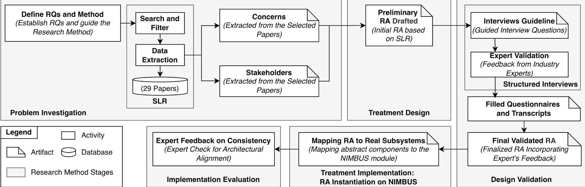
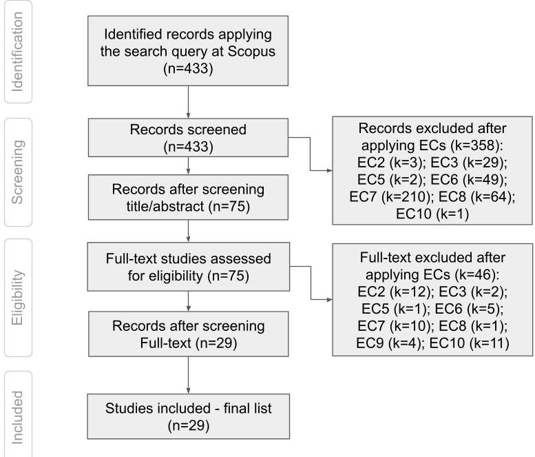
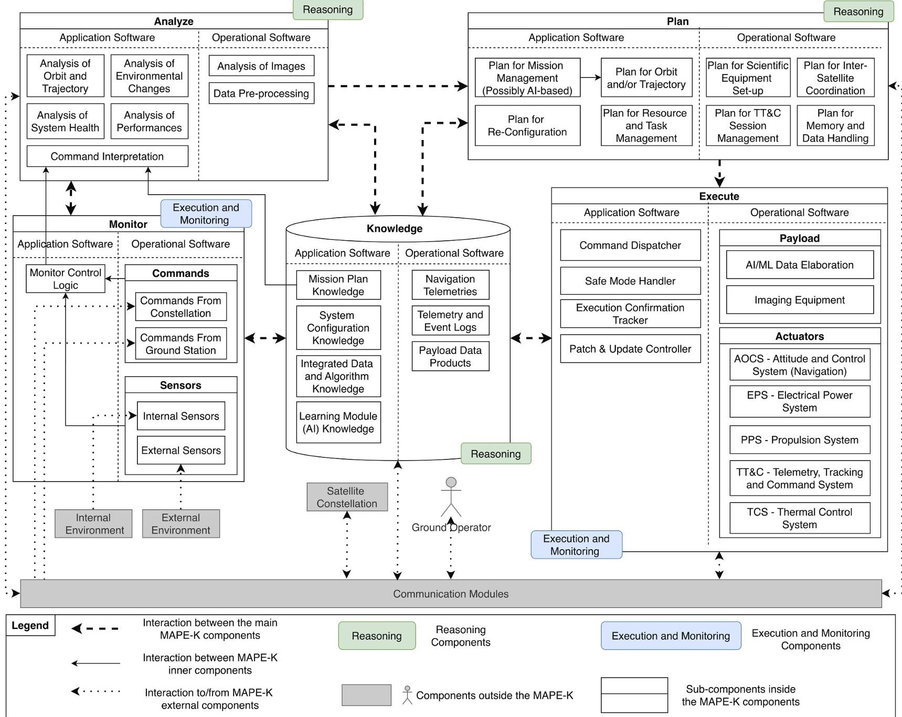
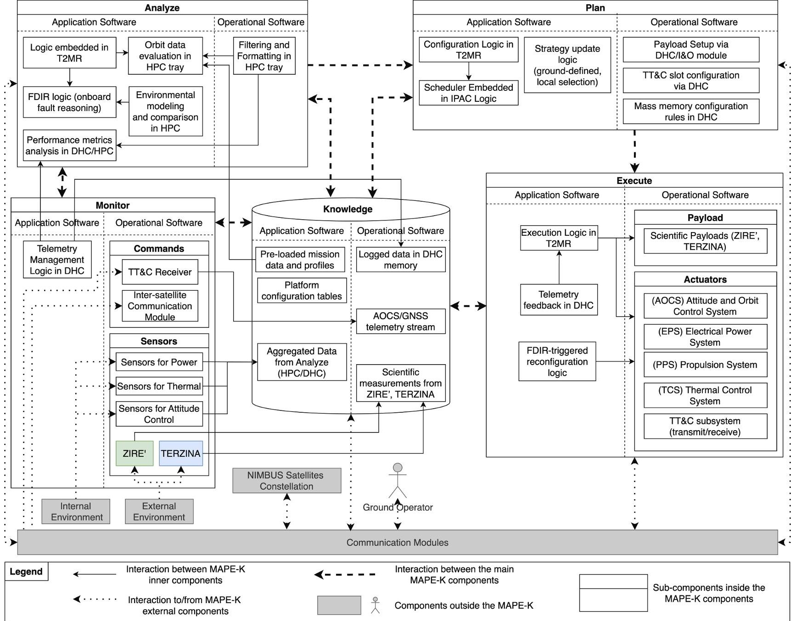

<!-- PDF_PAGE: 1 -->

# Reference architecture for autonomy and adaptivity in satellites

Francesco Basciani $ ^{iD} $ a,b,*, Luciana Rebelo $ ^{iD} $ a, Patrizio Pelliccione $ ^{iD} $ a,b

$ ^{a} $ Gran Sasso Science Institute (GSSI), L'Aquila, Italy

b Gran Sasso Tech (GST), L'Aquila, Italy

## ARTICLE INFO

Keywords:

Reference architecture

Autonomous systems

Adaptive systems

Space domain

ISO/IEC/IEEE 42010

## ABSTRACT

Background. Software plays a growing role in the space domain. Autonomy and adaptivity are central for managing mission complexity, handling communication delays, improving efficiency, and enabling operations without ground intervention. Objective. This paper presents a reference architecture (RA) for autonomous and adaptive satellite systems. Method. The RA is grounded in a systematic literature review and validated with industry experts. Following ISO/IEC/IEEE 42010, we identify stakeholders and concerns, define architectural decisions, and present components and connectors. Results. The architecture organizes five functional components along the MAPE-K loop and separates applicationlevel and operational-level roles. We instantiate the RA on the NIMBUS platform, a satellite that Thales Alenia Space Italy developed for the IRIDE constellation. This treatment implementation confirms the feasibility of mapping abstract responsibilities onto real onboard software and subsystems. Conclusion. The proposed RA provides a structured foundation for designing autonomous and adaptive space systems. Its successful instantiation on NIMBUS shows its suitability for partitioned, safety-critical platforms. Future work includes support for learning modules, constellation-level planning, and secure reconfiguration.

## 1. Introduction

The space industry is undergoing a rapid transformation, driven by the increasing autonomy of onboard systems and the democratization of access to satellite production and deployment. Modularization of satellite platforms and the commercialization of launch services enable new actors to participate in complex space missions. Companies are investing in space-service infrastructures to support the full lifecycle of orbital assets, from transportation and in-orbit assembly to refueling, maintenance, and debris management. These trends call for robust software architectures that support adaptive, resilient, and scalable operations in autonomous and distributed satellite environments. Autonomy and adaptivity are necessary to modern satellite missions, especially in the context of deep space and constellation-based operations. These capabilities reduce the need for constant ground control, support decisionmaking in communication-degraded conditions, and enable the onboard response to dynamic mission scenarios. They are particularly relevant for managing complex interactions among multiple satellites, improving responsiveness, and ensuring mission continuity when human intervention is not feasible (Rouff, 2002). As missions become increasingly distributed, new software infrastructures are needed to support onboard reasoning, flexible scheduling, and safe reconfiguration.

This paper contributes by presenting a Reference Architecture (RA) for autonomous and adaptive systems in the space domain, focusing on satellite platforms. The importance of RAs is widely acknowledged in software architecture research (Cloutier et al., 2010; Bucaioni et al., 2023) and is reflected in ongoing standardization efforts by ISO/IEC/ IEEE (ISO, 2024). However, to the best of our knowledge, no RA currently addresses autonomy and adaptivity in this domain. Our proposal fills this gap by defining a reusable architectural model grounded in a Systematic Literature Review and validated through expert interviews.

This work has been carried out in collaboration with Thales Alenia Space Italy (TAS-I, 2025) as part of a project investigating the increasing centrality of software in modern space systems. The proposed reference architecture builds on established standards such as SAVOIR (ESA, 2024) and ECSS-E-ST-40C (ECSS, 2024a) while explicitly incorporating the MAPE-K feedback loop to support runtime autonomy and systemlevel adaptation. It further complements standards like ECSS-Q-ST-3002C (ECSS, 2024b), extending fault management principles with components and execution semantics designed to support autonomous behaviors. While several reference architectures and frameworks have been proposed in the space domain, most focus on specific aspects such as modularity, fault management, or planning autonomy, without providing a unified model that integrates autonomy and adaptivity under the

<!-- PDF_PAGE: 2 -->

Fig.1. Research method overview.

Table 1 Search string keywords.

<table border="1"><tr><td>Domain</td><td>Keywords</td></tr><tr><td>Population:Space</td><td>“space domain”OR“space context”OR“space environment”OR“space application*”OR“space system*”OR“space industry”OR“space area”OR“application space”</td></tr><tr><td>Population:Architecture</td><td>“architecture”OR“framework”OR“platform”</td></tr><tr><td>Population:Software/Hardware</td><td>“software”OR“hardware”OR“electrical”</td></tr><tr><td>Intervention:Autonomous/Adaptive</td><td>“ml”OR“machine learning”OR“ai”OR“artificial intelligence”OR“intelligent”OR“smart”OR“autonom*”OR“flexible”OR“general”OR“adaptive”</td></tr></table>

Search String: （“space domain” OR “space context” OR “space environment” OR “space application*” OR “space system*” OR “space industry” OR “space area” OR “application space”）AND（“architecture” OR “framework” OR “platform”）AND（“software” OR “hardware” OR “electrical”）AND（“ml” OR “machine learning” OR “ai” OR “artificial intelligence” OR “intelligent” OR “smart” OR “autonom*” OR “flexible” OR “general” OR “adaptive”）

- RQ1. What are the main stakeholders and concerns of autonomous and adaptive space systems?

same architectural framework. Our proposal addresses this gap by combining MAPE-K feedback semantics with ECSS-compliant software partitioning and assurance principles. A detailed comparison with existing architectures and standards is presented later in Section 4 (Table 8), where we position our reference architecture with respect to prior MAPE-K and ECSS-based solutions. These characteristics make the architecture wellsuited for next-generation satellite constellations operating in uncertain environments with reduced ground interaction. Recent studies have also emphasized the growing challenges in qualifying and validating AI/ML-enabled software in the space domain (Petrucci et al., 2025), where traditional approaches to assurance may not suffice due to the complexity and non-determinism introduced by learning-based components.

This study is directly motivated by the findings of our previous systematic literature review on AI-enabled space architectures (Rebelo et al., 2025). That work identified eight recurrent architectural viewpoints and showed that the Autonomous and Adaptive viewpoint was the most frequently addressed and the most interconnected among the analyzed studies. Building on those results, this paper deepens that viewpoint by proposing a reference architecture specifically focused on autonomy and adaptivity in satellite systems.

We define autonomy and adaptivity in this work as the capability of a satellite to dynamically adjust its mission operations and task scheduling in response to changing environmental or operational conditions, without requiring constant ground intervention. Our focus is thus on mission-level autonomy, aimed at improving responsiveness and reducing operator workload, rather than on low-level control aspects such as attitude or orbital regulation.

In this work, we aim to answer the following Research Questions (RQs):

- RQ2. What are the main architectural decisions for autonomous and adaptive space systems?

- RQ3. What are the main components of a reference architecture for autonomous and adaptive space systems?

RQ1 identifies the relevant stakeholders and their concerns. We defined this research question by following what is recommended in the ISO/IEC/IEEE 42010:2022 standard (ISO/IEC/IEEE, 2022) to describe an architecture. Specifically, this standard recommends identifying the stakeholders' concerns, since they are the subjects of interest or information needs that an individual or group (a stakeholder) has about a system being architected. RQ2 defines the architectural decisions required to support these concerns, while RQ3 proposes the overall structure and components of the RA. To answer these questions, we conducted a Systematic Literature Review to extract relevant knowledge and validated the resulting architecture through interviews with domain experts. Moreover, to demonstrate the applicability of the architecture, we instantiated it on NIMBUS (TAS-I-NIMBUS, 2025), a small satellite platform developed by TAS-I (TAS-I, 2025) for the Italian IRIDE constellation (Orusa et al., 2024). This instantiation allowed us to concretely map abstract architectural responsibilities onto real onboard software and subsystems, validating the expressiveness of the model and revealing its engineering implications. This instantiation supported us in investigating how the proposed RA can be realized in an operational satellite context.

This paper is structured as follows. Section 2 describes the research method. Section 3 addresses RQ1. Section 4 presents the RA and discusses RQ2 and RQ3. Section 5 highlights the alignment between the stakeholders, concerns, and the reference architecture. Section 6 describes the validation we performed. Specifically, Section 6.1 reports the validation process, and Section 6.2 describes the instantiation of the RA on NIMBUS. Section 7 presents related work. Threats to validity are

<!-- PDF_PAGE: 3 -->

<table border="1"><tr><td>IC1: Study is related to autonomous or adaptive space architectures.</td></tr><tr><td>Exclusion criteria</td></tr><tr><td>EC1: Study has no abstract.</td></tr><tr><td>EC2: Study is just an Abstract or Extended Abstract (until 4 pages).</td></tr><tr><td>EC3: Not a Primary Study. The studies considered editorials, summaries of keynotes, tutorials, posters, and secondary studies (i.e., surveys, SLR, mapping studies, thesis, etc.) were excluded.</td></tr><tr><td>EC4: Study is not written in English.</td></tr><tr><td>EC5: Study is a copy or an older version of another publication already considered. In these cases, the most current version is considered.</td></tr><tr><td>EC6: The study mentions the space domain but is applied to space subjects other than satellites, such as robots, rovers, and stratospheric balloons.</td></tr><tr><td>EC7: Study is not related to autonomous and adaptive systems.</td></tr><tr><td>EC8: Study is not related to the space domain.</td></tr><tr><td>EC9: Full paper not available for download.</td></tr><tr><td>EC10: Study does not present an explicit architecture.</td></tr></table>

addressed at Section 8. Section 9 concludes the paper and outlines future directions.

## 2. Research method

To propose the reference architecture, this work follows the principles of the Design Science Methodology (DSM) by Wieringa (2014). According to DSM, design-oriented research is structured around five stages: Problem Investigation, Treatment Design, Design Validation, Treatment Implementation, and Implementation Evaluation. These stages, illustrated in Fig.1, guided the development and assessment of our proposed reference architecture for autonomy and adaptivity in satellite systems. As illustrated in Fig.1, the preliminary reference architecture is derived from the synthesis of identified stakeholders and their concerns, rather than directly from the data extraction activity. Fig.1 distinguishes between research activities and the artifacts they produce. Activities represent the methodological steps performed during the study (e.g., data extraction, expert validation), while artifacts denote the intermediate or final outcomes generated by these activities (e.g., stakeholders, concerns, architectural requirements, and the reference architecture itself). In particular, expert feedback is modeled as a validation activity whose outcome is the refinement of architectural artifacts, rather than as an artifact per se. Fig.1 distinguishes between research activities and the artifacts they produce. Activities represent the methodological steps performed during the study (e.g., data extraction and expert validation), while artifacts denote the intermediate or final outcomes generated by these activities (e.g., identified stakeholders, concerns, architectural requirements, and the reference architecture itself). Expert feedback is therefore modeled as a validation activity whose outcome is the refinement of architectural artifacts.

In the following, we explain the main steps performed. Additional details related to the research method are available in our replication package at https://doi.org/10.5281/zenodo.17397974

## 2.1. Problem investigation.

The first stage focuses on understanding the context of use, stakeholders, goals, and requirements, and on defining the problem clearly, including success criteria. In our study, this corresponds to the identification of current limitations in the design of autonomous and adaptive satellite systems, as well as the need for a structured architectural solution. To ground this analysis in evidence, we conducted a Systematic Literature Review (SLR) following the guidelines of Kitchenham and Charters (2007). The SLR enabled us to identify the main challenges and research directions from the existing literature, which served as the problem investigation phase in the DSM process.

Prior to executing the full SLR, we piloted the review protocol to assess its feasibility and adequacy. The pilot employed a pre-selected "control group" of studies deemed pertinent to our research questions.

This control group comprised two benchmark studies (namely Amini et al., 2021 and Labrèche et al., 2022) against which we verified that the protocol's search, screening, and data extraction procedures operated as intended.

Search strategy. We aimed to address the RQs already introduced in the paper. To find relevant publications, the search string was formulated following the methodological guidelines proposed by Kitchenham and Charters (2007), which recommend structuring queries based on the Population, Intervention, and Context (PIC) framework to support systematic keyword identification. In this study, however, the Context dimension was deliberately excluded from the search strategy, as the objective was to ensure a comprehensive review that encompasses evidence and experiences originating from both industry and academia, including all levels of professionals (e.g., practitioners, academics, consultants, students). The resulting search string is presented in Table 1. We iteratively refined the query to capture studies using alternative terminology, for instance, papers referring to "platform" or "framework" instead of "architecture". We also included synonym terms referring to autonomous or adaptive systems, such as "general", "flexible", "intelligent", and "smart", since these often describe similar capabilities in the literature. We included the terms hardware and electrical to reduce the risk of missing relevant space-architecture studies that describe onboard autonomy using embedded or avionics-oriented terminology rather than explicitly framing the contribution as software-only. Relevance was then ensured through the application of inclusion and exclusion criteria, followed by a full-text screening. Studies in which autonomy or adaptivity was addressed exclusively as a ground-based capability, or without an explicit onboard architectural model, were excluded. This exclusion reflects the architectural scope of the review, rather than assumptions about functional reallocation between ground and onboard systems. To reduce the number of irrelevant results, the search was restricted to the sub-areas of Computing and Engineering (excluding other domains such as Biology or Economy) and to the publication period from 2013 to 2024, to avoid obsolete research. The query was applied to titles, abstracts, and keywords to ensure consistency. The search was conducted using Scopus, which is widely adopted in systematic studies (e.g., Poy et al., 2024; Wei et al., 2025; dos Santos et al., 2024) and recognized as the largest peer-reviewed database, encompassing IEEE, Springer, and Elsevier. A total of 433 records were retrieved in July 2024.

Screening and duplicate removal. We performed a preliminary screening of all results, reading titles and abstracts to exclude irrelevant works and remove duplicates. After this step, 75 publications were retained.

Selection criteria. The search focused on studies addressing space architectures with autonomous and adaptive features. We defined one inclusion criterion (IC) and ten exclusion criteria (EC), summarized in Table 2. In our scope, we considered publications written in English that ranged from a little over 10 years and could be freely downloaded. It is important to highlight that our search returned no publications written

<!-- PDF_PAGE: 4 -->

Fig. 2. Study inclusion process.

in languages other than English, but returned papers that are not available for downloading (4 publications in total). Nevertheless, considering the analysis of their abstracts, the fact of excluding these 4 studies does not influence the final results presented in this SLR.

The resulting selection provided the foundation for understanding the current state of research, the limitations of existing approaches, and the open challenges in designing architectures that support autonomy and adaptivity in space systems. This knowledge directly informed the requirements and scope of our proposed reference architecture.

Full-text checking. The selected papers were given to two authors for review. Each reviewer read the full text separately to give their own verdict concerning inclusion or exclusion. In plenary meetings, all papers that generated conflicting perspectives were widely discussed. We have applied the Landis and Koch (1977) interpretation; the agreement rate reached 92% which is qualified as 'almost perfect agreement'. The PRISMA flow diagram, revealing all stages of the search process, is illustrated in Fig. 2, as well as the reasons for exclusion, along with their respective counts. The reasons were documented in accordance with the ECs reported in Table 2, both at the screening stage and during the eligibility assessment.

Ultimately, after applying the IC and EC criteria, 29 papers were obtained as a result to be on the final list. The final list of primary studies included in this SLR is shown in Table 3.

Considering that the 29 papers were retrieved from Scopus, this gives us confidence in peer-reviewed literature, covering a wide spectrum of publishers and research domains. The distribution of research by publication type is as follows: 5 papers published in journals and 24 papers published in conference proceedings. All journals are reputable, with 4 occupying the first quartile (Q1) and 1 occupying the second quartile (Q2). The IEEE Aerospace Conference (AERO) has the largest number of papers (9), followed by the International Astronautical Congress (IAC), containing 6 of the 29 papers considered. Furthermore, in order to analyze assurance and confidence in the solutions, we investigated whether validation/experiments have been conducted on the approaches presented in the papers. Of the 29 papers analyzed, 25 of them evaluated the proposed solution, relying on simulation, case studies, and experiments. Nevertheless, 4 studies presented preliminary ideas, not producing validation of the results.

Data storage. The studies returned from Scopus in the searching phase were cataloged and stored accordingly. This catalog helped us in the classification and analysis procedures. Some of the main information presented was followed by a protocol, an identifier (id) for each returned

study, and answers to RQs. The catalog helped us in the data extraction and synthesis procedures and may be used by those interested in updating or replication. A summarized version of this form is available at our replication package (https://doi.org/10.5281/zenodo.17397974.).

Data extraction. Reading the full text, three authors independently extracted the relevant data for answering the RQs. Thus, we had independent readings and classifications. We used the form available from the replication package, which was then discussed in a series of meetings attended by the authors to clarify unclear viewpoints and resolve conflicting opinions.

Following the data extraction phase, the selected papers were systematically analyzed to identify recurring concerns and stakeholders relevant to the design of autonomous and adaptive space systems. Concerns represent the main design issues and architectural challenges addressed by the analyzed studies, such as uncertainty management, system adaptability, or hardware requirements for autonomy, while stakeholders correspond to the actors directly or indirectly involved in or affected by these aspects, including system architects, space engineers, mission operators, spacecraft software developers, and ground operators. Both types of information were extracted from the selected literature through a detailed content analysis and consolidated through author cross-review to ensure consistency. The identified concerns and stakeholders constitute the core empirical outcome of this stage and directly contribute to answering RQ1. A detailed discussion of these results is provided in Section 3.

## 2.2. Treatment design.

In this stage, a treatment, i.e., an artifact capable of addressing the identified problem, is conceived. In our case, the proposed treatment is a Reference Architecture (RA) that captures the essential components and interactions required to support autonomy and adaptivity in space systems. The RA is empirically grounded in the SLR and is designed to capture the principal design issues and architectural challenges reported by the identified stakeholder groups and their associated concerns. The RA is conceptual in nature and aims to provide both a structural and behavioral view of such systems.

## 2.3. Design validation.

This stage aims to evaluate whether the proposed artifact could work in theory before being deployed in a real context. As illustrated in Fig.1, this phase was organized into a structured sequence that included the preparation of interview materials, interaction with industry experts, data collection, and refinement of the proposed RA.

In the first step, an interview guideline was defined to support a consistent and replicable validation process. The questionnaire included guided questions addressing key aspects such as applicability, autonomy, adaptability, scalability, and compliance with standards. This document served as the basis for all subsequent interviews, ensuring uniformity across the collected feedback. Following the preparation of the guideline, a validation round with domain experts was conducted. Structured interviews were held with professionals from the aerospace sector, who provided feedback based on their experience in satellite software assurance, architecture evaluation, and autonomous system integration. The insights gathered in this phase helped to assess the theoretical soundness and practical relevance of the proposed RA. All interviews were recorded, and the corresponding questionnaires and transcripts were compiled to preserve traceability and transparency. The resulting material includes both quantitative evaluations and qualitative observations, highlighting strengths, weaknesses, and possible improvements.

Finally, the collected feedback was analyzed and integrated into the refined version of the RA. This process resulted in the final validated architecture, incorporating expert suggestions to ensure alignment with industrial practices and standards. A summary of the experts involved in the validation is presented in Table 4, highlighting their

<!-- PDF_PAGE: 5 -->

Table 3 Selected studies.

<table border="1"><tr><td>Study</td><td>Title</td><td>Reference</td></tr><tr><td>$P_{1}$</td><td>ScOSA on the Way to Orbit: Reconfigurable High-Performance Computing for Spacecraft</td><td>Lüdtke et al.(2023)</td></tr><tr><td>$P_{2}$</td><td>ICU4SAT:A General-Purpose Reconfigurable Instrument Control Unit Based on Open Source Components</td><td>Nannipieri et al.(2022)</td></tr><tr><td>$P_{3}$</td><td>Evaluation of Xilinx Versal Architecture for Next-Gen Edge Computing in Space</td><td>Perryman et al.(2023)</td></tr><tr><td>$P_{4}$</td><td>InSECTS Cloud Agnostic On-Orbit Processing for Satellite Development</td><td>Obst et al.(2023)</td></tr><tr><td>$P_{5}$</td><td>Enhancing Context-Aware Reactive Planning for Unexpected Situations of On-Orbit Spacecraft</td><td>Shen et al.(2022)</td></tr><tr><td>$P_{6}$</td><td>Software Architecture Design of Distributed Satellite Systems Test Bed</td><td>Cerruti et al.(2022)</td></tr><tr><td>$P_{7}$</td><td>Hardware Acceleration of Nonlocal Means-Based Speckle Noise Removal Applied to SAR Imagery</td><td>Sanchez and George(2020)</td></tr><tr><td>$P_{8}$</td><td>De-RISC:The First RISC-V Space-Grade Platform for Safety-Critical Systems</td><td>Wessman et al.(2021)</td></tr><tr><td>$P_{9}$</td><td>AI/ML for Mission Processing Onboard Satellites</td><td>Veyette et al.(2022)</td></tr><tr><td>$P_{10}$</td><td>ReCoN:A reconfigurable CNN acceleration framework for hybrid semantic segmentation on hybrid socs for space applications</td><td>Sabogal et al.(2019)</td></tr><tr><td>$P_{11}$</td><td>Hardware Accelerated Machine Learning on Embedded Systems for Space Applications</td><td>Dengel et al.(2021)</td></tr><tr><td>$P_{12}$</td><td>FRESCO:A Framework for Spacecraft Systems Autonomy</td><td>Amini et al.(2021)</td></tr><tr><td>$P_{13}$</td><td>Towards a highly adaptive software-defined radio transmitter for small satellite platforms</td><td>Pätschke and Klinkner(2021)</td></tr><tr><td>$P_{14}$</td><td>Considerations in the Deployment of Machine Learning Algorithms on Spaceflight Hardware</td><td>McBee et al.(2021)</td></tr><tr><td>$P_{15}$</td><td>OPS-SAT Spacecraft Autonomy with TensorFlow Lite, Unsupervised Learning, and Online Machine Learning</td><td>Labrèche et al.(2022)</td></tr><tr><td>$P_{16}$</td><td>Reconfigurable Framework for Environmentally Adaptive Resilience in Hybrid Space Systems</td><td>Sabogal et al.(2020)</td></tr><tr><td>$P_{17}$</td><td>Heterogeneous On-Orbit Processing Engine (HOPE) Architecture Design for Edge Processing in Space</td><td>Mee et al.(2021)</td></tr><tr><td>$P_{18}$</td><td>Distributed multi-GNSS timing and localization for nanosatellites</td><td>Giralo and D’Amico(2019)</td></tr><tr><td>$P_{19}$</td><td>A new complementary multi-core data processor for space applications</td><td>Luchena et al.(2018)</td></tr><tr><td>$P_{20}$</td><td>FPGA-based multi-sensor relative navigation in space: Preliminary analysis in the framework of the I3DS H2020 project</td><td>Estébanez Camarena et al.(2018)</td></tr><tr><td>$P_{21}$</td><td>Spacecraft mission agent for autonomous robust task execution</td><td>Gillette et al.(2018)</td></tr><tr><td>$P_{22}$</td><td>Development of software for space applications based on ROS and ROS2</td><td>Kryza et al.(2017)</td></tr><tr><td>$P_{23}$</td><td>High Performance Computing Applications in Space with DM Technology</td><td>Zucherman et al.(2019)</td></tr><tr><td>$P_{24}$</td><td>Building block-based "iBOSS" approach: Fully modular systems with standard interface to enhance future satellites</td><td>Kortman et al.(2015)</td></tr><tr><td>$P_{25}$</td><td>SA-FEMIP:A Self-Adaptive Features Extractor and Matcher IP-Core Based on Partially Reconfigurable FPGAs for Space Applications</td><td>Di Carlo et al.(2014)</td></tr><tr><td>$P_{26}$</td><td>Gs4EO:An innovative solution for flight operations software on low cost EO missions</td><td>Gonzalez et al.(2014)</td></tr><tr><td>$P_{27}$</td><td>A software-in-the-loop simulation of an intelligent microsatellite within a virtual environment</td><td>Hassani and Lee(2013)</td></tr><tr><td>$P_{28}$</td><td>A multi-ocular smart system for vision-based space navigation</td><td>Capuano et al.(2014)</td></tr><tr><td>$P_{29}$</td><td>RISC-V Processor Technologies for Aerospace Applications in the ISOLDE Project</td><td>Fornaciari et al.(2023)</td></tr></table>

Table 4

Summary of experts involved in RA validation.

<table border="1"><tr><td>Expert ID</td><td>Years of Experience in the Field</td><td>Domain of Practice</td><td>Current Role</td><td>Relevant Competencies</td></tr><tr><td>Expert 1</td><td>28</td><td>Satellite Platform Systems</td><td>Responsible for End-to-End Quality Assurance of Onboard Satellite Architectures</td><td>System-level software assurance, autonomous subsystem integration, validation of onboard execution chains</td></tr><tr><td>Expert 2</td><td>9</td><td>Aerospace Software Development</td><td>Software Assurance Engineer for Adaptive and Safety-Critical Onboard Systems</td><td>MAPE-K patterns, fault-tolerant software, architecture evaluation in autonomous platforms</td></tr><tr><td>Expert 3</td><td>12</td><td>Ground-Space Communication Architectures</td><td>System Engineer for Autonomous Ground-Satellite Communication Architectures</td><td>TT&amp;C architecture, inter-satellite communication logic, support to distributed autonomy</td></tr></table>

experience, domain of practice, and relevant competencies. The questionnaire and full transcripts are available in the replication package at https://doi.org/10.5281/zenodo.17397974, ensuring transparency and enabling future replication of this study. The detailed results of the validation are discussed in Section 6.1.

## 2.4. Treatment implementation

This stage concerns the deployment of the proposed artifact in a real operational context to demonstrate its feasibility and expressiveness. In our study, this corresponds to the instantiation of the Reference Architecture (RA) on a real satellite platform, namely NIMBUS, one of the satellite classes developed by Thales Alenia Space Italy (TAS-I) for the IRIDE constellation (TAS-I-NIMBUS, 2025). This stage focuses on the concrete mapping of the abstract components of the RA to the actual software, hardware, and subsystem configurations implemented in NIMBUS, as illustrated in Fig. 1.

The mapping process ensures that each conceptual element of the RA finds a correspondence within the operational satellite architecture, including its onboard processing units, scheduling logic, and communication interfaces. This alignment enables the translation of architectural principles into deployable components, thus bridging the gap between conceptual design and engineering realization.

Through this instantiation, we verify that the proposed RA is not only theoretically sound but also practically applicable in the context of a real satellite system. The activity provides empirical evidence that the architecture supports the integration of autonomous and adaptive behaviors while remaining compliant with the industrial constraints and standards adopted by TAS-I. Further details about the instantiation process and its technical outcomes are provided in Section 6.2.

## 2.5. Implementation evaluation.

Finally, the implemented artifact is assessed to determine whether it actually works in practice. This evaluation considers the effectiveness and applicability of the instantiated architecture in a real operational scenario, analyzing aspects such as feasibility, scalability, and compliance with industrial standards. The validation performed with TAS-I scientists and engineers provided evidence of the architecture's usefulness in supporting real-world development activities.

Overall, the workflow presented in Fig.1 summarizes the research process across the five DSM stages. Additional methodological details, including search strings, inclusion/exclusion criteria, and interview protocols, are available in our replication package at https://doi.org/10. 5281/zenodo.17397974.

<!-- PDF_PAGE: 6 -->

Table 5

Examples of system requirements collected from papers P1 and P2.

<table border="1"><tr><td>Ref.</td><td>System Requirement</td><td>(ID) Category</td><td>Architectural Requirement</td></tr><tr><td>P1</td><td>“Deep space robotic missions increasingly require high computational power to meet autonomy demands. The necessity for Commercial Off-The-Shelf(COTS) based on-board computer systems from the requirements of low-budget scientific satellites and autonomous missions, which need high-performance computing beyond what space-grade hardware offers.”</td><td>(1)COTS with high-performance computing</td><td>AR4.The RA shall incorporate advanced sensor capabilities, high-performance computing,and efficient communication mechanisms to ensure autonomous satellite operations.</td></tr><tr><td>P1</td><td>“ScOSA is designed to facilitate parallel computing and system reconfiguration.It addresses the vulnerability of commercial off-the-shelf hardware to errors and failures in space environments.A key feature of ScOSA is its capability to redistribute tasks among distributed nodes,thereby mitigating the impact of node failures by reallocating tasks to operational nodes.”</td><td>(2)Fault-tolerance mechanisms to ensure mission continuity</td><td>AR8.The RA shall implement fault-tolerance mechanisms to ensure mission continuity and the longevity of space assets in the presence of hardware failures,software anomalies,or radiation-induced faults.These mechanisms shall include the redundant design of critical components and the ability to seamlessly switch to backup elements when faults are detected.</td></tr><tr><td>P2</td><td>“The space industry currently relies on custom Instrument Control Units(ICUs) to optimize onboard memory allocation and ground bandwidth.However,these units are tailored for specific missions,making them inflexible and costly for smaller missions and industries.The paper introduces a solution to this issue by enabling on-the-fly reconfigurability,allowing for the repurposing of earth observation missions without the need for new satellite launches.This flexibility facilitates new mission concepts and temporary adjustments to monitoring needs.”</td><td>(3)High processing,memory,and bandwidth;(4)Mechanisms that enable satellites to reconfigure and evolve</td><td>AR4.The RA shall incorporate advanced sensor capabilities,high-performance computing,and efficient communication mechanisms to ensure autonomous satellite operations.AR6.The RA shall incorporate adaptability mechanisms that enable satellites to reconfigure and evolve their functionality in response to new or modified mission objectives throughout their operational lifespan.</td></tr><tr><td>P3</td><td>...</td><td>...</td><td>...</td></tr></table>

Table 6

Concerns and architectural requirements.

<table border="1"><tr><td>Concern</td><td>Architectural Requirement</td><td>Ref.</td></tr><tr><td>C1. Levels of Autonomy</td><td>AR1. The RA shall define and implement distinct levels of autonomy, ranging from human-centered control to system-centered autonomous operation, in order to optimize human-system collaboration and ensure safe autonomous behavior under all operational conditions.</td><td>P4, P12, P14, P15, P18, P19, P23, P24, P26, P27</td></tr><tr><td>C2. Environmental Aspects for Adaptation</td><td>AR2. The RA shall enable the strategic selection and prioritization of environmental parameters that are most relevant for adaptive operations in space, considering limitations in resources and data processing capabilities. The prioritized parameters shall include the satellite&#x27;s position and trajectory, space weather conditions, celestial events, atmospheric density, solar radiation levels, and the presence of space debris.</td><td>P5, P8, P9, P11, P15, P16, P20</td></tr><tr><td>C3. Uncertainty Management</td><td>AR3. The RA shall provide mechanisms for behavioral adaptation to manage uncertainties resulting from dynamic and unpredictable conditions in both the software and operational environment, ensuring that system performance remains within acceptable limits despite deviations from expected outcomes.</td><td>P5, P15, P21, P23, P24, P26, P27</td></tr><tr><td>C4. Hardware Requirements for Autonomy</td><td>AR4. The RA shall incorporate advanced sensor capabilities, high-performance computing, and efficient communication mechanisms to ensure autonomous satellite operations, while maintaining low cost.</td><td>P1, P2, P3, P4, P5, P7, P8, P9, P10, P11, P13, P15, P16, P19, P20, P22, P23, P27, P28, P29</td></tr><tr><td>C5. Autonomous Decision Making</td><td>AR5. The RA shall implement advanced decision-making mechanisms to enable adaptive satellite behavior under dynamic operational conditions.</td><td>P5, P11, P12, P14, P15, P17, P23, P25, P26, P28, P29</td></tr><tr><td>C6. System Adaptability to New Objectives</td><td>AR6. The RA shall incorporate adaptability mechanisms that enable satellites to reconfigure and evolve their functionality in response to new or modified mission objectives throughout their operational lifespan. These mechanisms shall include capabilities for on-orbit reprogramming, instrument reconfiguration, orbital maneuvers, and strategic operational adjustments to ensure continued relevance, effectiveness, and responsiveness under changing mission demands and environmental conditions.</td><td>P2, P6, P15, P16, P24</td></tr><tr><td>C7. Software Update Management after Deployment</td><td>AR7. The RA shall provide real-time software update capabilities to maintain system integrity and operational continuity. This functionality shall enable the implementation of bug fixes, feature enhancements, and performance optimizations without requiring physical intervention, system shutdown, or redeployment of replacement satellites.</td><td>P4, P8, P9, P12, P13</td></tr><tr><td>C8. Fault Tolerance and System Operability</td><td>AR8. The RA shall implement fault-tolerance mechanisms to ensure mission continuity and the longevity of space assets in the presence of hardware failures, software anomalies, or radiation-induced faults. These mechanisms shall include the redundant design of critical components and the ability to seamlessly switch to backup elements when faults are detected.</td><td>P1, P5, P9, P15, P16, P21, P26, P27, P29</td></tr></table>

## 3. Concerns and stakeholders (RQ1)

Software systems controlling satellites are inherently complex, especially when autonomy and adaptivity are involved. Their design poses multiple challenges across technical, operational, and organizational dimensions. With RQ1, we aim to identify the main stakeholders and concerns of autonomous and adaptive space systems. According to the ISO/IEC/IEEE 42010 standard (ISO/IEC/IEEE, 2022), identifying stakeholders and their concerns is essential for structuring architectural descriptions and ensuring that design choices are well-aligned with the system's environment. In space systems, where safety, resilience, and

compliance with standards are critical, understanding who is affected by the architecture and what they care about becomes a key prerequisite for any reference model.

A concern refers to any influence on a system in its environment, including developmental, technological, business, regulatory, or operational factors. In autonomous space systems, concerns span areas such as fault tolerance, onboard decision-making, uncertainty management, lifecycle support, and adaptability. In this study, autonomy and adaptivity refer to the satellite's ability to dynamically adjust its mission operations and task scheduling in response to changing environmental or operational conditions. The feedback loop described

<!-- PDF_PAGE: 7 -->

in the proposed reference architecture therefore operates at the mission operations level, supporting decision-making and reconfiguration, while lower-level control functions (e.g., attitude and orbital control) are managed by dedicated subsystems. This distinction clarifies that the form of autonomy addressed in this study concerns operational intelligence and adaptive coordination, rather than physical control.

Our approach to identifying concerns builds upon the methodology proposed by Nakagawa and Oliveira (2011) and Nakagawa et al. (2014). First, we identified the system requirements. These requirements were collected through an analysis of the full text in the set of papers identified in the SLR, focusing on the activities, tasks, constraints, and rules that each solution must support. Then, the system's requirements were categorized to derive the architectural requirements, which in turn were mapped to concerns. This last step constitutes a slight modification of the original methodology, in which architectural requirements are mapped to concepts.

In total, 42 system requirements were collected. These system requirements were grouped into a broader category and then represented as an architectural requirement defined at a more general level. This process can be observed in Table 5, which brings examples of system requirements retrieved from papers P1 and P2. The complete list of system requirements extracted from the set of papers can be consulted in our catalog, which presents details for each research question, available at our replication package (https://doi.org/10.5281/zenodo.17397974).

Table 6 summarizes the concerns we mapped, accompanied by the architectural requirements extracted from the literature and references. We explicitly link the concerns to the literature for traceability and justification. This structured representation helped us generalize recurring issues and connect them with architectural decisions (see Section 4).

Stakeholders are individuals, groups, or organizations with a vested interest in the system and its outcomes (ISO29148, 2018). These include government organizations, space vendors, mission operators, space engineers, and standardization bodies. Each stakeholder may hold different concerns, and often, the same concern is shared across multiple roles. Table 7 outlines the main stakeholders we identified and illustrates how their interests intersect with the concerns. For example, uncertainty management is a concern for both systems architects and mission operators, while hardware requirements directly affect space engineers and space commercial vendors.

This classification provided a foundation for deriving the architectural viewpoints and decisions described later in the paper. In particular, it helped highlight where trade-offs emerge and where system qualities (e.g., reconfigurability vs. certification) may be in tension. It also guided the mapping of responsibilities into the MAPE-K loop during the construction of the reference architecture.

## 4. Reference architecture (RQ2 and RQ3)

In this section, we aim to address RQ2 (What are the main architectural decisions for autonomous and adaptive space systems?) and RQ3 (What are the main components of a reference architecture for autonomous and adaptive space systems?). The architectural decisions (AD) we identified are described below, together with the rationale for defining them.

A description of the components and connectors of the architecture is provided in Fig. 3. The figure visually reflects the categorization of architectural components introduced in this section, distinguishing between reasoning components and execution and monitoring components. It is important to note that Fig. 3 includes components at different abstraction levels. Some of them, such as Monitor Control Logic, Command Dispatcher, and Execution Confirmation Tracker, represent infrastructural mechanisms that enable the operation of the MAPE-K feedback loop across the architecture. Others, such as Data Pre-processing or Analysis of System Health, are generic and domain-agnostic modules applicable to most satellite systems. Finally, elements like Analysis of Orbit and Trajectory or Analysis of Images are mission-specific examples illustrating how

the reference architecture can be specialized for satellites with different payloads and operational goals. This combination of infrastructural, generic, and mission-dependent components is intentional, highlighting the flexibility of the proposed architecture, which defines reusable building blocks that can be instantiated and specialized according to the characteristics of different satellite families.

According to the ISO/IEC/IEEE 42010:2022 standard (ISO/IEC/IEEE, 2022) and the upcoming ISO/IEC/IEEE 42,042 (DIS) software (2024) on Reference Architectures, an architecture description can include multiple complementary views, each addressing specific stakeholder concerns. Among these, the Component and Connector (C&C) view is recognized as one of the primary and most effective representations for illustrating system structure, communication paths, and the logical relationships among components. In our case, this view best captures how autonomy and adaptivity emerge from the interaction and coordination of architectural elements within the MAPE-K model. Furthermore, the ISO/IEC/IEEE 42,042 (DIS) draft highlights that a Reference Architecture should define building blocks (partial models) and rules for their combination, a principle inherently reflected in the C&C representation adopted in this work. While other views, such as the Operational or Deployment Views (as used in frameworks like DoDAF), could complement this representation, they are outside the scope of this paper and are identified as part of future work.

Coming back to Fig. 3, some connectors were intentionally abstracted to enhance readability and emphasize the logical flow between components rather than low-level communication wiring. For instance, the Communication Modules element encapsulates the infrastructure that mediates data exchange among the MAPE-K components and external entities, instead of showing explicit ports or interfaces. This abstraction is consistent with the objective of representing functional relationships rather than protocol-level interactions, which may vary depending on the specific satellite platform or onboard operating system (e.g., Xtratum, PikeOS).

To further clarify the novelty and positioning of the proposed Reference Architecture (RA), we provide a comparison with existing MAPE-K and ECSS-based approaches that have influenced its design. Unlike previous works, our RA was not conceived ad hoc but systematically derived through a Systematic Literature Review (SLR) encompassing 29 primary studies. It builds on consolidated standards such as SAVOIR (ESA, 2024) and ECSS-E-ST-40C (ECSS, 2024a), while extending them with explicit MAPE-K semantics to support runtime autonomy and system-level adaptation. Moreover, it complements ECSS-Q-ST-30-02C (ECSS, 2024b) by embedding fault detection and recovery principles within the Monitor, Analyze, Plan, Execute feedback cycle. This combination results in a model that bridges static assurance-oriented standards with dynamic adaptive behavior.

Table 8 summarizes how our RA differentiates from these and other representative architectures discussed in the literature.

As summarized in Table 8, previous approaches emphasize modularity (SAVOIR), process compliance (ECSS-E-ST-40C), or fault management (ECSS-Q-ST-30-02C), but none provide a unified and reusable model integrating autonomy and adaptivity. Our RA fills this gap by aligning MAPE-K functional semantics with ECSS-compliant software partitioning, validated through expert assessment and instantiated in a real industrial setting (NIMBUS).

AD1: Adopt the MAPE-K (Monitor-Analyse-Plan-Execute over a shared Knowledge) feedback loop as style.

Rationale: The MAPE-K loop is a widely adopted reference model for autonomous systems in general. In this work, adaptive satellite systems are considered a specific class of autonomous systems, which motivates the adoption of MAPE-K as a suitable conceptual foundation.

While the architecture allows for minimal human oversight, primarily for commanding some specific plans or operations to the satellite or receiving the desired information from the satellite, the focus is on max-

<!-- PDF_PAGE: 8 -->

## Table 7

Stakeholders and related concerns.

<table border="1"><tr><td>Stakeholders[papers]</td><td>Description and Related Concerns(C)</td></tr><tr><td>Ground Operators[P1,P4,P15,P17,P21,P22,P23,P24,P26,P27]</td><td>Ground Operators may send commands to the satellite system and make decisions in response to node failures(C5), thus ensuring operational continuity in uncertain situations(C3).They utilize pre-computed configuration trees(C6) to monitor and clearly understand any changes applied, maintaining system operability and quickly addressing internal faults(C8).</td></tr><tr><td>Space Commercial Vendors[P3,P19]</td><td>They represent the purchaser of a satellite or related service.They require understanding autonomy levels to optimize human-autonomous collaboration(C1).Evolving mission demands drive the need for high-performance computing in autonomy systems(C4).</td></tr><tr><td>University Research Groups[P3,P13,P16,P18,P19,P20;P21,P22,P23,P24,P25,P29]</td><td>They serve as end users and innovation contributors.They(i) demand high-performance computing to meet increasingly complex mission needs(C4),(ii) contribute and innovate algorithms for efficient decision-making in space missions(C5),and(iii) develop new technologies for small satellite platforms that focus on low-power consumption,reconfigurability and miniaturization(C6).</td></tr><tr><td>System Architects[P1,P2,P3,P6,P10,P12,P16,P25,P26]</td><td>They ensure an autonomous and adaptive architecture.They(i) define autonomy levels and delineate roles between humans and automation(C1),(ii) strategically select and prioritize environmental aspects for adaptation,ensuring resource-efficient monitoring and effective response to relevant conditions(C2),(iii) design the satellite system to address uncertainty,enabling real-time adjustments based on dynamic factors to maintain optimal performance(C3),(iv) incorporate advanced sensor systems,communication interfaces,and hardware components for achieving system autonomy in satellite operations(C4),(v) have to ensure the satellite&#x27;s adaptability to new objectives,integrating diverse techniques for reprogramming and reconfiguring instruments(C6),and(vi) design fault tolerance mechanisms,redundancy,and backup systems to ensure continuous operability despite internal faults in the space environment(C8).</td></tr><tr><td>Space Engineers[P3,P11,P12,P29]</td><td>They own functional and non-functional aspects.They(i) want to know how to deal with uncertainty,and to do that they exploit guidelines from experts(C3),(ii) apply advanced algorithms and real-time data processing for efficient autonomous decision-making in space missions(C5),(iii) enable satellite adaptability through software engineering,incorporating techniques like reconfiguration(C6),(iv) take responsibility for implementing functionalities to handle internal faults(C8),and(v) develop hardware solutions to bridge the confidence gap needed in the space industry(C4).</td></tr><tr><td>Spacecraft Software Developers[P4,P6,P11,P15,P22,P23,P26]</td><td>They ensure efficient software testing and deployment for satellite systems.They(i) require a pathway for testing,updating,and deploying software to on-orbit cloud processing clusters economically and responsibly(C4),(ii) offer chances for parallel development of flight software,providing service interfaces that can be customized according to the applications(C6),and(iii) build CI/CD pipeline to deploy and update software without system shutdowns(C7).</td></tr><tr><td>Mission operators[P12,P15,P22,P24,P26]</td><td>They are responsible for managing the satellite&#x27;s objectives.In the context of dynamic environments and flexible mission objectives,they may encounter uncertainty-related challenges as indicated in(C3).Additionally,they will execute relevant techniques for making the system work with new objectives(C6).Finally,mission operators can pre-specify goal networks to the desired degree to limit autonomy(C1).</td></tr><tr><td>Department of Defense[P9,P16,P17]</td><td>The Department of Defense seeks insights on satellite autonomy(C1) and advanced technologies(C5) for streamlined acquisitions and enhanced missions.</td></tr><tr><td>Commercial and government organizations[P8,P15,P16,P18,P19,P20,P21,P23,P25,P26,P29]</td><td>They represent government centers,space agencies,and private companies that seek to leverage small spacecraft for critical observations and measurements,with a growing emphasis on deploying them in advanced configurations like constellations and coordinated measurement setups(C2).Additionally,they are offering new technologies for small satellites,providing or proposing new services like asteroid mining,precise release into orbit,on-orbit servicing,and in-orbit assembly(C4).</td></tr></table>

## Table 8

Comparison between our Reference Architecture (RA) and existing space and aerospace architectures/standards.

<table border="1"><tr><td>Architecture/Source</td><td>Primary Scope and Goal</td><td>Autonomy/Adaptivity Focus</td><td>Key Components/Viewpoints</td><td>Key Gaps vs. Our RA</td></tr><tr><td>SAVOIR(ESA,2024)</td><td>ESA framework for modular and reusable onboard software development.</td><td>Limited autonomy support; no explicit adaptivity or runtime reasoning.</td><td>Functional decomposition; service-based reuse of software components.</td><td>Lacks runtime feedback loop; no explicit representation of adaptive behavior or decision-making.</td></tr><tr><td>ECSS-E-ST-40C(ECSS,2024a)</td><td>ECSS software engineering standard focusing on life-cycle and dependability assurance.</td><td>None; defines software processes, not architecture.</td><td>Software process and assurance framework.</td><td>Does not provide architectural guidance for autonomous or adaptive systems.</td></tr><tr><td>ECSS-Q-ST-30-02C(ECSS,2024b)</td><td>ECSS standard for quality assurance and FDIR(Fault Detection,Isolation and Recovery).</td><td>Reactive fault management; no autonomous reasoning or adaptation.</td><td>Quality and reliability management,FDIR mechanisms.</td><td>No integration of FDIR with reasoning or adaptive decision logic.</td></tr><tr><td>RA for Space Production Systems(Sanderson et al.,2022)</td><td>Reference Architecture for space production systems, addressing manufacturing and integration.</td><td>Not autonomy-centric; focuses on industrial processes and connectivity.</td><td>Functional,Information,Connectivity,and Communications viewpoints.</td><td>No onboard autonomy or adaptivity mechanisms; unrelated to satellite operations.</td></tr><tr><td>Time and Space Partitioning Using OSRA(Bos et al.,2016)</td><td>On-Board Software Reference Architecture(OSRA) middleware,focusing on partitioning and isolation(ESA).</td><td>Focused on separation and timing guarantees; not on autonomy or adaptivity.</td><td>Time and Space Partitioning,middleware services.</td><td>No explicit MAPE-K reasoning or adaptation semantics.</td></tr><tr><td>Software RA for CubeSats(Gagliardini et al.,2023)</td><td>Standardized software architecture for CubeSats,derived from stakeholder surveys.</td><td>Requirements-driven; limited to standardization,not runtime autonomy.</td><td>High-level requirements,functionalities,and interface abstractions.</td><td>No autonomy or adaptivity at runtime;no MAPE-K structure.</td></tr><tr><td>SCS-Satellite Control Systems RA(Rohling et al.,2019)</td><td>RA for ground-based satellite control systems ensuring interoperability.</td><td>Focus on ground control and operations; minimal onboard autonomy.</td><td>Enterprise,structural,data flow,logical,and composition viewpoints.</td><td>Lacks onboard reasoning and continuous adaptive behavior.</td></tr><tr><td>FRESCO(Amini et al.,2021)</td><td>Framework for autonomous spacecraft systems.</td><td>Partial autonomy;focused on planning and execution.</td><td>Decision-making and planning modules.</td><td>No system-level adaptivity or knowledge-based integration.</td></tr><tr><td>OPS-SAT(Labrèche et al.,2022)</td><td>ESA experimental platform for AI-enabled space experiments.</td><td>Adaptive applications at subsystem level;no reusable RA.</td><td>AI/ML deployment and on-orbit testing framework.</td><td>No abstract,reusable architectural model or ECSS mapping.</td></tr><tr><td>Proposed RA(this work)</td><td>Autonomous and adaptive satellite systems integrating ECSS and SAVOIR principles.</td><td>Full integration of autonomy and adaptivity across application and operational software layers.</td><td>Components organized around the MAPE-K loop;partitioned structure ensuring safety and reasoning integrity.</td><td>N/A</td></tr></table>

<!-- PDF_PAGE: 9 -->

Fig. 3. Reference architecture for autonomy and adaptivity in satellite systems (Components and Connectors view). Interfaces are abstracted for clarity, with communication modules shown as logical elements representing information exchange.

imizing the autonomous capabilities of the satellite. This architectural style allows the system to autonomously react to telemetry changes and environmental variations directly onboard, reducing the dependency on ground operations and shortening the reaction time to events such as orbital perturbations or subsystem anomalies. This operational organization, in turn, supports more efficient resource usage and stable performance across different mission conditions. Such a design reduces the latency in decision-making processes. It increases the resilience of satellite operations against unexpected anomalies, aligning with the core objectives of autonomous and adaptive systems [P12]. As seen in Fig. 3, the architecture has been defined according to this AD.

Additionally, the architecture includes a bidirectional Communication Module that manages interactions between all MAPE-K components and external entities, such as ground stations and other satellites. It facilitates the exchange of data and commands, ensuring seamless integration of external communications into the satellite's operations. This module helps synchronize the satellite with mission control and other assets, enhancing its ability to handle complex communication scenarios [P2, P27].

AD2: Structured Categorization of Application and Operational Software across Monitor, Analyze, Plan, Execute, and Knowledge Phases

The decision to introduce two software categories was derived from the literature and industrial standards, which emphasize the importance of distinguishing between critical and non-critical onboard software. Following the expert validation (see Section 6) and a detailed analysis of ECSS and SAVOIR documentation, this distinction was refined and validated using the terms Application Software and Operational Software. This separation aligns with standard space engineering practices that differentiate mission-level management and adaptive functionalities from safety-critical execution and service layers. Experts confirmed that such a categorization reflects the approach commonly adopted in industrial platforms, where isolating software components by criticality improves safety assurance, qualification, and maintainability in partitioned systems.

Rationale: As shown in Fig. 3, the decision to categorize the Monitor, Analyze, Plan, Execute, and Knowledge phases into Application Software and Operational Software within our satellite system's MAPE-K architecture is grounded in widely adopted space engineering practices and terminology aligned with the ECSS-E-ST-40C standard (ECSS, 2024a). This structured separation allows for a clearer distinction between missionlevel decision-making logic and platform-level operational execution,

<!-- PDF_PAGE: 10 -->

facilitating the deployment of the architecture on partitioned, safetycritical platforms.

Application Software encompasses components that implement mission-specific logic, autonomous behavior, and reasoning processes. These include functionalities for monitoring and analyzing system health, planning trajectory or mission actions, and executing adaptive control decisions. In line with ECSS definitions, this software layer is responsible for the intelligent behavior of the satellite system and is generally considered critical in ensuring mission goals and safety [P27, P28].

Operational Software refers to components responsible for the execution of satellite functions that interact directly with onboard hardware and external systems. This includes the acquisition of sensor data, reception of telecommands, control of payloads, and actuation of subsystems such as navigation, power, and thermal control. While these functions are essential to satellite operation, they are structurally and logically distinct from the adaptive and reasoning logic captured in the Application Software.

It is important to highlight that this separation is not only logical but also physical: in actual satellite implementations, components of the Application and Operational Software are deployed in isolated software partitions. This isolation ensures stronger safety and security guarantees by minimizing interference between critical components and isolating adaptive or non-deterministic behaviors. Such partitioning is fundamental to compliance with safety-critical standards and to support the assurance levels required in modern space missions.

This architectural decision supports efficient resource allocation and enhances operational clarity by allowing independent handling of platform-level execution (Operational Software) and adaptive behavior (Application Software). Each category benefits from focused design strategies that optimize performance and reliability, using data from the Knowledge component to enable informed and context-aware operation.

The following design decisions, AD3-AD6, focus on the four macro-components: Monitor, Analyse, Plan, and Execute. AD7 focuses on Knowledge, which is shared among the four components.

## AD3: Capabilities of the Monitor Component.

Rationale: The Monitor component in autonomous satellite systems is responsible for the continuous acquisition and handling of data from both the environment and internal satellite subsystems. The Application Software (see Fig. 3) embeds the Monitor Control Logic, responsible for managing and orchestrating the monitoring process; and the Operational Software includes the actual acquisition interfaces, such as Sensors and Commands. The Sensors include both internal sensors, measuring parameters such as system health, power, or temperature, and external sensors that capture environmental data. The Commands block collects telecommands received from the ground station or from other satellites in the constellation, without interpreting or processing them semantically. These inputs are first passed through the Monitor Control Logic, which validates and routes them toward the appropriate reasoning or execution components, typically Analyze or Execute, based on system configuration and command type. This separation ensures that only the control logic resides in the reasoning layer, while the physical interaction with the environment and command channels remains confined to the operational domain. This architectural decision aligns with practices in safety-critical embedded systems and facilitates partitioning and isolation of monitoring functions, thereby improving system reliability and resilience [P1, P4].

## AD4: Strategic Functionality of the Analyze Component.

Rationale: The Operational Software includes functions like Data Preprocessing and Analysis of Images, which prepare and filter raw input from sensors and payloads, transforming it into a usable format. These tasks involve onboard data reduction or preliminary pattern extraction and are performed without embedded reasoning capabilities. The Application Software is responsible for higher-level evaluation and interpretation of the system's operational state. This includes modules for Analysis of Orbit and Trajectory, System Health, Performances, and Environmental Changes, as well as Command Interpretation.

These components apply diagnostic reasoning, identify anomalies, and assess whether observed behaviors deviate from mission expectations or system constraints. One example is the integration of Fault Detection, Isolation, and Recovery (FDIR) mechanisms, which autonomously detect, isolate, and trigger corrections in response to internal or external anomalies [P1, P5, P9, P21]. The Analyze phase maintains a bidirectional link with the Knowledge component, using stored models, past events, and mission data to contextualize its assessments. It can also feed learned results or extracted events back into Knowledge, supporting incremental system adaptation [P2, P6, P16]. Through its tight integration with the Monitor and Plan components, Analyze enables feedback-driven operations: if a performance drop is detected, further data may be requested from Monitor, or reconfiguration plans may be triggered. This continuous loop of monitoring, analysis, and adaptation enhances the satellite's responsiveness and operational stability in unpredictable space environments [P5, P6].

## AD5: Planning for Satellite System.

Rationale: The Plan component defines how the satellite adapts its behavior in response to analysis outcomes and mission goals. The Application Software layer is responsible for autonomous reasoning and decision-making related to mission and system behavior, including Mission Management (possibly supported by AI models), Reconfiguration, Orbit and/or Trajectory, and Resource and Task Management planning. These modules interpret the results produced by Analyze and generate abstract strategies to adapt operations, reassign resources, or modify onboard behavior to maintain mission alignment and system health. Reasoning may involve predefined rule-based strategies or adaptive logic learned from past outcomes and encoded in the Knowledge base. The Operational Software layer handles specific aspects of mission preparation and readiness. It includes detailed procedures for Scientific Equipment Set-up, TT&C Session Management, Memory and Data Handling, and Inter-Satellite Coordination, which are essential in constellationbased scenarios. These planning functions do not involve autonomous reasoning but rather orchestrate pre-scheduled or event-driven configurations to be executed in the next phase. This layered approach ensures that high-level strategy formulation and low-level operational preparation are logically and physically separated. The bidirectional link with the Knowledge component allows the system to retrieve past plans and execution results to inform current decisions and to log newly generated plans for future reference. This feedback mechanism enables the continuous alignment between the satellite's internal state and its operating environment, allowing it to adjust command priorities and control parameters as telemetry and mission data evolve. Through this ongoing self-assessment, the system maintains operational readiness even when facing environmental variations or transient anomalies [P8, P14].

## AD6: Executing System and Service Operations

Rationale: The Execute component is responsible for translating the plans produced by the Plan phase into concrete actions performed by onboard systems. The Application Software layer includes logic-based execution management modules such as the Command Dispatcher, which orchestrates the sequence and dispatch of commands; the Safe Mode Handler, which ensures fallback procedures under critical conditions; the Execution Confirmation Tracker, which monitors the correct completion of operations; and the Patch & Update Controller, which manages runtime software updates and fallback images. The Operational Software layer encompasses all modules that interface directly with the hardware subsystems and payloads. These include: Actuators, such as the AOCS, EPS, PPS, TT&C, and TCS, which apply control actions to manage orientation, power distribution, propulsion,

<!-- PDF_PAGE: 11 -->

communication, and thermal regulation respectively; Payloads, such as AI/ML Data Elaboration and Imaging Equipment, are responsible for executing mission-specific tasks like onboard data processing, scientific measurements, and data acquisition. Unlike the reasoning components in Application Software, Operational Software modules do not make decisions; they carry out low-level operations according to previously defined plans. This separation ensures compliance with the architecture of safety-critical systems, where high-criticality tasks can be isolated and monitored independently from less critical processing. The Execute component interacts with the Knowledge base to retrieve execution context and update operational status and outcomes. For example, telemetry logs, execution reports, and software status are all recorded to maintain traceability and support subsequent analysis phases. This interaction facilitates long-term adaptation by continuously updating internal models and operational parameters based on telemetry feedback, ensuring that control actions remain consistent with the satellite's evolving state and mission objectives [P15, P16, P19, P20].

## AD7: Utilizing the Knowledge Component for Effective Data Management and Decision Support

Rationale: As shown in Fig. 3, the Knowledge component serves as a centralized information hub that supports all phases of the MAPE-K loop by ensuring consistent access to relevant data and learning context. It is also logically divided into two layers. The Application Software layer hosts semantically rich and decision-relevant content, including Mission Plan Knowledge, which encodes mission objectives, schedules, and constraints; System Configuration Knowledge, describing the current setup of hardware and software components; Integrated Data and Algorithm Knowledge, which stores fused inputs from multiple sources and algorithms supporting complex reasoning Learning Module (AI) Knowledge, which captures trained models, learned patterns, or statistical insights from prior experience. The Operational Software layer contains raw or low-level data required for real-time operation or later analysis. This includes: Navigation Telemetries, continuously collected from onboard systems; Telemetry and Event Logs, which provide traceability and postfactum validation; Payload Data Products, resulting from imaging, sensor capture, or onboard processing.

This separation reflects the distinction between knowledge used for autonomous reasoning and that used for state monitoring or external interaction. The bidirectional integration of Knowledge with all other MAPE-K phases ensures that decisions are informed, explainable, and historically grounded. For instance, Mission Plan Knowledge may be queried during planning, while execution outcomes feed back into the learning module for adaptation [P21, P22]. By managing heterogeneous knowledge artifacts in a structured and accessible manner, this component improves the satellite's capacity to adapt under uncertainty, operate autonomously, and ensure mission continuity. The ability to link knowledge to reasoning logic, perception history, and actuation feedback is a key enabler of autonomy in the context of space systems [P23, P24].

This architecture is generic and applicable to various satellite system classes, including GEO (Geostationary Earth Orbit), MEO (Medium Earth Orbit), and LEO (Low Earth Orbit). Some elements may vary in applicability; for example, the Plan for Orbit and/or Trajectory component is less relevant for GEO satellites, which require only minor orbital adjustments. Similarly, while external sensors like GPS are typically unused in GEO systems, equivalent instruments such as spectrometers or radiometers are employed for scientific and environmental monitoring purposes.

## 5. Alignment between the stakeholders concerns and the reference architecture

The Monitor component is important for stakeholders like Ground Operators and Mission Operators. It ensures the real-time collection of

data through navigation telemetries and sensors. This component is particularly important for Ground Operators who need to track changes and configurations and manage safe modes and direct interventions. It addresses concerns C3, C5, and C8 about managing software uncertainties and ensuring operability in the presence of faults, and also C1, controlling the degree of autonomy. Furthermore, the real-time tracking of changes and system states ensures that satellite constellations operate cohesively, maintaining system integrity and operational efficiency across the constellation.

The Analyse component addresses the needs of system architects and space engineers, who work on radiation-tolerant designs and decompose spacecraft control for autonomous decision-making. It supports analyzing system health, command effectiveness, and performance metrics for optimizing performance and reliability in harsh space conditions. It directly tackles concerns C2, C4, and C5 related to system health management, environmental aspects, and enhances autonomous decision making efficiency. This is particularly important for satellite constellations, where analyzing inter-satellite data and performance metrics can improve synchronization and operational coordination among satellites.

The Plan component caters to the strategic needs of stakeholders such as the Department of Defense, and Mission Operators. It facilitates formulating mission management strategies and resource allocations, planning for AI/ML model deployments and scientific equipment setups, and ensuring adaptability to uncertainty, changing mission objectives, and operational demands, thus addressing C2, C3, and C6. The architecture supports scalable planning by defining the Plan component in a manner that can be extended to various operational contexts, ranging from single-satellite decision-making to coordinated planning across multiple satellites as needed. While hierarchical or constellation-level planning strategies are not explicitly instantiated in the reference architecture, the design does not preclude their adoption in concrete system instantiations.

The Execute phase translates strategic plans into concrete actions. This is critical for stakeholders like Spacecraft Software Developers, who require the execution of high-performance computing tasks under strict constraints. This component manages the spacecraft's critical systems and, by extension, the constellation, such as navigation, power management, and payload operations. It ensures efficient mission execution and addresses C4, C6, and C7 by optimizing resource use and operational efficiency.

Finally, the Knowledge component consolidates data and insights across the architecture, supporting ongoing learning and system configuration adjustments. It enhances the system's overall intelligence and adaptability by maintaining a repository of mission plans and operational data. This supports informed decision-making considering uncertainty, and continuous improvement, addressing C2 and C5 for developing AI/ML strategies and improving decision support systems. It also ensures that lessons learned from individual satellites inform broader constellation strategies, thereby improving the coherence and efficiency of satellite networks. This component enables stakeholders, such as Space Commercial Vendors and Commercial and government organizations, to access information that supports innovation and system enhancement. Furthermore, for the Department of Defense, this component offers a strategic advantage by enabling quick adaptation to evolving conditions and threats, integrating AI/ML knowledge to foster adaptable AI strategies. This is critical for advancing technological capabilities in defense, streamlining acquisitions, and accelerating modernization efforts vital for national security.

In general, stakeholders like Space Commercial Vendors, University Research Groups, and the Department of Defense, who benefit from the Operational Software category provided by the MAPE-K components, finds significant value in the advanced analysis capabilities that enable more general high-performance computing and AI/ML strategies for adaptable problem-solving. Also, Spacecraft Software Developers are integral within the Operational Software category of the MAPE-K architecture,

<!-- PDF_PAGE: 12 -->

## Table 9

Mapping the RA components and decisions with stakeholders, concerns, and the references.

<table border="1"><tr><td>RA component/Architectural decision</td><td>Stakeholders</td><td>Concerns</td><td>References</td></tr><tr><td>Monitor</td><td>Ground Operator and Mission Operator</td><td>C1,C3,C4,C5,C8</td><td>P1,P4,P5,P9,P11,P12,P14,P15,P16,P17,P18,P19,P21,P22,P23,P24,P25,P26,P27,P28,P29</td></tr><tr><td>Analyse</td><td>System architects and Space engineers</td><td>C2,C4,C5</td><td>P1,P2,P3,P4,P5,P6,P7,P8,P9,P10,P11,P12,P13,P14,P15,P16,P17,P19,P20,P22,P23,P25,P26,P27,P28,P29</td></tr><tr><td>Plan</td><td>Department of Defense and Mission Operators</td><td>C2,C3,C6</td><td>P2,P5,P6,P8,P9,P11,P12,P15,P16,P17,P20,P21,P22,P23,P24,P26,P27</td></tr><tr><td>Execute</td><td>Spacecraft Software Developers</td><td>C4,C6,C7</td><td>P1,P2,P3,P4,P5,P6,P7,P8,P9,P10,P11,P12,P13,P15,P16,P19,P20,P22,P23,P24,P26,P27,P28,P29</td></tr><tr><td>Knowledge</td><td>Space Commercial Vendors,Department of Defense,andCommercial and government organizations</td><td>C2,C5</td><td>P3,P5,P8,P9,P11,P12,P14,P15,P16,P17,P18,P19,P20,P21,P23,P25,P26,P28,P29</td></tr><tr><td>Categorization ofApplication andOperational Software</td><td>Space Commercial Vendors,University Research Groups,Department of Defense,andSpacecraft Software Developers</td><td>C4,C7,C8</td><td>P1,P2,P3,P4,P5,P6,P7,P8,P9,P10,P11,P12,P13,P15,P16,P17,P18,P19,P20,P21,P22,P23,P24,P25,P26,P27,P28,P29</td></tr></table>

where they manage software deployment through CI/CD pipelines. This process facilitates rapid testing, updating, and seamless integration into on-orbit cloud processing clusters.

They maintain satellite performance and mission alignment by ensuring updates do not disrupt critical system functions. Their strategic role addresses concerns C4, C7, and C8, effectively applying their expertise while safeguarding the integrity of system management operations. Each component of the MAPE-K architecture is designed to address the specific concerns of stakeholders, promoting autonomous, adaptive, and traceable from architectural decisions to stakeholder needs, as illustrated in Table 9. This structured approach intends to deliver an effective architecture that meets the nuanced demands of autonomous and adaptive space systems, looking for its comprehensiveness and relevance within the field.

## 6. Validation

In this section, we report the validation we made of the reference architecture. We aim to answer the following two validation questions:

- VQ1: How is the reference architecture perceived by experts in terms of applicability, support for autonomy and adaptation, technical robustness, and practical use?

We answer this validation question in Section 6.1.

- VQ2: How can the reference architecture for autonomous and adaptive systems be instantiated and assessed in a concrete operational context?

We answer this validation question in Section 6.2.

## 6.1. Validation with experts (VQ1)

The results of the expert evaluations are presented in Table 10. Given the limited number of experts involved, the reported mean, standard deviation (SD), and interquartile range (IQR) are used purely as descriptive indicators to summarize dispersion and convergence among expert judgments, rather than for statistical inference. All three experts involved in the validation are senior professionals from Thales Alenia Space Italy (TAS-I), each belonging to different departments, namely software engineering, quality assurance, and onboard autonomy systems. This ensured complementary perspectives on the proposed architecture, covering design, verification, and operational viewpoints within the same industrial context. Experts rated each question on a scale from 1 to 5, where 1 indicates "Strongly Disagree" and 5 indicates "Strongly Agree". Alongside the individual expert responses, the table also reports the mean, standard deviation (SD), and interquartile range (IQR) for each section, providing a concise statistical summary of the evaluation. The

mean values, ranging between 4.3 and 4.8, indicate a strong overall agreement on the architecture's quality, while the limited variability across SD (0.4-0.8) and IQR (0.5-1.0) confirms consistent and convergent expert opinions. In particular, the General Applicability and Autonomy and Adaptability sections exhibit the highest consensus, showing that the experts share confidence in the architecture's ability to generalize across mission types and to support autonomous behavior in practice. Slightly higher dispersion in the Technical Robustness and Practical Use sections suggests opportunities for refinement and further industrial validation, but all values remain within a high-confidence range. As shown in the table, the ratings for all aspects of the architecture are high, consistently above the midpoint, reflecting high agreement among the experts on the architecture's flexibility, autonomy, adaptability, scalability, and alignment with industry standards.

The experts confirmed that the architecture is flexible enough to be adapted to different satellite systems, including GEO, LEO, and MEO. They appreciated the system-agnostic design of the architecture, highlighting its potential to reduce development time and costs across multiple mission types. As one expert noted, "the use of the MAPE-K feedback loop is a standout feature, allowing the architecture to handle complex, real-time decisions autonomously, exactly what's needed for next-generation satellite missions". This feedback is particularly encouraging, as it comprehensively validates our architectural choices, reinforcing the direction in designing an adaptable and autonomous system. Some experts suggested minor adjustments to tailor specific mission profiles, though these do not affect the overall structure or adaptability of the architecture. Another expert suggested minor refinements to enhance data handling efficiency, especially in scenarios with high data volumes, although this does not affect the core architecture.

Regarding autonomy, experts found the MAPE-K feedback loop effective for real-time decision-making. An expert suggested that the integration of ML could further improve the adaptability of the system, provided that ML remains restricted to non-critical functions to comply with industry standards for safety. This caution reflects a broader consensus that ML should be applied selectively, particularly in areas that do not impact mission safety. Another expert emphasized the importance of designing the Services component with reusability in mind: "a well-designed Services component could be widely applied across different applications". This aligns with our goal of developing modular components within the architecture, enabling flexibility and scalability across various mission profiles.

The architecture's scalability was well received, particularly for large satellite constellations. Experts recommended further testing to ensure robustness in complex, multi-satellite environments. They also acknowledged the alignment of the architecture with established space standards, such as ECSS, while suggesting that specific details could be

<!-- PDF_PAGE: 13 -->

Table 10 Expert validation results with descriptive summary.

<table border="1"><tr><td>Section</td><td>Question</td><td>Exp.1</td><td>Exp.2</td><td>Exp.3</td><td>Mean</td><td>SD</td><td>IQR</td></tr><tr><td rowspan="3">General Applicability</td><td>Applies to various satellite systems</td><td>4</td><td>4</td><td>5</td><td>4.78</td><td>0.42</td><td>0.5</td></tr><tr><td>System-agnostic</td><td>5</td><td>4</td><td>5</td><td></td><td></td><td></td></tr><tr><td>Distinction between System Management and Services</td><td>5</td><td>5</td><td>5</td><td></td><td></td><td></td></tr><tr><td rowspan="2">Autonomy and Adaptability</td><td>Support for autonomous decision-making</td><td>5</td><td>4</td><td>5</td><td>4.75</td><td>0.43</td><td>0.5</td></tr><tr><td>Handles adaptability effectively</td><td>5</td><td>4</td><td>5</td><td></td><td></td><td></td></tr><tr><td rowspan="2">Technical Robustness</td><td>Aligns with space industry standards</td><td>4</td><td>3</td><td>5</td><td>4.67</td><td>0.75</td><td>1.0</td></tr><tr><td>Supports FDIR mechanisms</td><td>5</td><td>5</td><td>5</td><td></td><td></td><td></td></tr><tr><td rowspan="3">Practical Use and Future Improvements</td><td>Provides scalable solution</td><td>5</td><td>4</td><td>5</td><td>4.33</td><td>0.75</td><td>1.0</td></tr><tr><td>Effectively uses MAPE-K feedback loop</td><td>4</td><td>4</td><td>5</td><td></td><td></td><td></td></tr><tr><td>Robust enough to serve as a standard</td><td>5</td><td>3</td><td>5</td><td></td><td></td><td></td></tr></table>

refined to further support mission-critical operations, particularly in FDIR.

Based on their feedback, we made several adjustments to the initial version of the architecture. Initially, our analysis of the existing literature had placed telemetry data within the Monitor component. However, some experts recommended moving the telemetry data to the Knowledge component to improve data accessibility and decisionmaking throughout the MAPE-K cycle. Additionally, while the Communication component was originally part of Execute, the experts suggested separating it as an independent element, as it serves as a link among all components, facilitating seamless communication throughout the architecture.

## 6.2. Treatment implementation on a real satellite platform: Tthe NIMBUS example (VQ2)

Despite increasing contributions addressing autonomy in the space domain, our literature review revealed a notable lack of reference architectures specifically focused on autonomous and adaptive satellite systems. Among the 29 primary studies selected, none presented a complete architectural model covering both reasoning and operational layers, nor did they provide instantiations grounded in concrete onboard subsystems. Most existing works discuss enabling technologies or partial frameworks, often limited to specific mission scenarios or hardware configurations.

To address this gap, we proposed a reference architecture and instantiated it on a real satellite platform to demonstrate its applicability and validate its structure. We selected NIMBUS, one of the satellite classes developed by Thales Alenia Space Italy (TAS-I), for the IRIDE constellation (TAS-I-NIMBUS, 2025). NIMBUS represents a class of small satellites designed for constellation-based missions in Low Earth Orbit (LEO), equipped with onboard computing and modular scientific payloads (TAS-I-NIMBUS, 2025; De Mitri et al., 2023). Operating in LEO enables frequent Earth revisits and reduced communication latency, which facilitates faster ground interactions. However, autonomy and adaptivity remain essential to cope with the rapid environmental and operational variations typical of LEO missions, ensuring responsiveness and resilience even when ground support is temporarily unavailable.

Each phase of the MAPE-K loop is instantiated using concrete software and subsystem elements from NIMBUS. Components are assigned to either Application Software or Operational Software, following the logical and physical separation enforced in partitioned real-time environments, such as those based on Xtratum (Masmano et al., 2012) or PikeOS (GmbH, 2025).

This instantiation serves two purposes: first, it demonstrates the feasibility and expressiveness of our architecture when mapped onto a real, partitioned, safety-critical system; second, it validates the RA by showing how its abstract components can be concretely realized through realworld software, hardware, and subsystem configurations. This treatment implementation also benefits from the involvement of the Gran Sasso

Table 11 Mapping of Monitor on NIMBUS.

<table border="1"><tr><td>RA Element</td><td>NIMBUS Component</td><td>Layer</td></tr><tr><td>Monitor Control Logic</td><td>Telemetry management logic in DHC</td><td>Appl. SW</td></tr><tr><td>Commands from Ground Station</td><td>TT&amp;C Receiver</td><td>Oper. SW</td></tr><tr><td>Commands from Constellation</td><td>Inter-satellite communication module</td><td>Oper. SW</td></tr><tr><td>Internal Sensors</td><td>Sensors for Power, Thermal, and Attitude Control</td><td>Oper. SW</td></tr><tr><td>External Sensors</td><td>ZIRE&#x27;, TERZINA payloads</td><td>Oper. SW</td></tr></table>

Tech Foundation (GST) (Tech, 2025), a joint initiative between Thales Alenia Space Italy and the Gran Sasso Science Institute, which participates in the NIMBUS program through research and technology validation activities (Gran Sasso Tech, 2023; Tech and GSSI, 2023). This collaboration contributes to aligning the architectural mapping with actual engineering practices adopted in the platform's development.

Fig. 4 shows the architecture of NIMBUS as an instance of the MAPE-K reference model. The software components are divided into the five canonical phases of the loop: Monitor, Analyze, Plan, Execute, and Knowledge. Application-level components contain reasoning, evaluation, decision-making, and scheduling logic, while operat-ional-level components handle sensing, communication, me-mory access, command transmission, and interaction with physical subsystems and payloads. The architecture also includes external modules for interacting with the environment, ground operator, and peer satellites in the constellation.

Monitor: this macro-component integrates data from payloads such as ZIRE' (charged particles, gamma rays, space weather) and TERZINA (Cherenkov detection)

(De Mitri et al., 2023; Thales Alenia Space Italy (TAS-I), 2025), internal sensors, and telecommands received via TT&C. Acquisition interfaces are part of the Operational Software. These interfaces include the Data Handling and Control (DHC) system, a core onboard unit responsible for mass memory, I/O interfaces, telemetry, and data routing. Telecommands received from ground stations or peer satellites do not directly interact with the Analyze, Plan, and Execute macro-components. Instead, they are first captured and validated by the Monitor's control logic, which determines their forwarding to the Analyze phase for semantic interpretation or directly to the Execute phase in case of predefined operational instructions. The Application Software contains the Telemetry Management Logic in DHC components and is responsible for telemetry interpretation, data filtering, and routing actions to subsequent components. The instantiation of the Monitor phase on the NIMBUS platform is summarized in Table 11.

Analyze: this macro-component is instantiated in the NIMBUS architecture using a combination of onboard data processing and reasoning components. Let us first focus on the Operational Software layer. The

<!-- PDF_PAGE: 14 -->

Fig. 4. NIMBUS architecture - components and connectors view.

High-Performance Computing (HPC) tray is a dedicated processing unit that handles pre-processing tasks such as filtering and formatting raw data from payloads and sensors. This functionality supports the RA component Data Pre-processing, allowing bandwidth optimization by transmitting only selected, mission-relevant outputs rather than full data strea-ms (TAS-I-NIMBUS, 2025).

At the Application Software level, NIMBUS instantiates several RA components of the Analyze phase. The RA component Analysis of Orbit and Trajectory is realized by the orbit data evaluation logic in the HPC tray. The RA component Analysis of Environmental Changes corresponds to environmental modeling and comparison, also deployed within the HPC. The RA component Analysis of System Health is instantiated by onboard Fault Detection, Isolation, and Recovery (FDIR) logic (De Mitri et al., 2023), and the RA component Analysis of Performances is implemented through a performance metrics analysis module distributed across the HPC and the Data Handling and Control (DHC) unit.

Each element consumes structured input from the Monitor phase, delivered via the DHC, including telemetry from sensors (e.g., power, thermal, attitude) and data from the ZIRE' and TERZINA payloads. In addition to sensing, the RA component Command Interpretation is instantiated by rule-based logic within the Tactical and Telecommand Management and Reconfiguration (T2MR) module, integrated into the

IPAC core. This logic processes incoming telecommands received via TT&C or inter-satellite links and determines their semantic meaning and necessary actions (Thales Alenia Space Italy (TAS-I), 2025).

The outputs of all Analyze RA components are routed to the RA components of the Plan and Knowledge phases. Analytical results such as anomaly reports, orbit state updates, and environmental assessments feed the planning logic (e.g., within T2MR). At the same time, aggregated data is stored in the Knowledge base for future use and traceability.

This architectural structure reinforces the role of Analyze in transforming raw observations into actionable knowledge. Its continuous exchange with the Knowledge base enables a feedback mechanism that supports reasoning, adaptation, and system resilience throughout the satellite's operational lifecycle. The instantiation of the Analyze phase on the NIMBUS platform is summarized in Table 12.

Plan: this macro-component orchestrates in the NIMBUS architecture the transition from analytical insight to concrete mission execution. At the Application Software level, several RA components are instantiated.

The RA component Mission Management Planning is realized through configuration logic embedded in the Tactical and Telecommand Management and Reconfiguration (T2MR) module, part of the IPAC core. The

<!-- PDF_PAGE: 15 -->

Table 12 Mapping of Analyze on the NIMBUS platform.

<table border="1"><tr><td>RA Element</td><td>NIMBUS Component</td><td>Layer</td></tr><tr><td>Analysis of Orbit and Trajectory</td><td>Orbit data evaluation in HPC tray</td><td>Appl. SW</td></tr><tr><td>Analysis of System Health</td><td>FDIR logic(onboard fault reasoning)</td><td>Appl. SW</td></tr><tr><td>Analysis of Performances</td><td>Performance metrics analysis in DHC/HPC</td><td>Appl. SW</td></tr><tr><td>Analysis of Environmental Changes</td><td>Environmental modeling and comparison in HPC</td><td>Appl. SW</td></tr><tr><td>Command Interpretation</td><td>Logic embedded in T2MR and rule engine</td><td>Appl. SW</td></tr><tr><td>Data Pre-processing</td><td>Filtering and formatting in HPC tray</td><td>Oper. SW</td></tr></table>

RA component Resource and Task Planning is implemented via a scheduler embedded in the same IPAC logic. This scheduler selects the timing and priority of executable actions based on inputs from the Analyze and Knowledge components. The RA component Reconfiguration Planning is instantiated through a rule engine in T2MR, which dynamically adapts the configuration in response to context changes or anomalies. Additionally, the RA component Orbit and Trajectory Planning is supported by a strategy update logic module, which enables local prioritization and mode selection based on rules defined on the ground and received via telecommands.

These planning decisions are executed by the Execute component and operationalized at the Operational Software level through specific interfaces managed by the Data Handling and Control (DHC) unit. The RA component Scientific Equipment Setup is mapped to commands configuring the payloads via the I&O module. The RA component TT&C Session Planning corresponds to the assignment of time slots for communications. In contrast, the RA component Memory and Data Handling Planning is realized by configuration logic that manages mass memory usage for telemetry and data storage.

Planning components depend on structured inputs from the RA components of the Analyze and Knowledge phases, such as system health metrics, environmental evaluations, and platform configuration tables. Their outputs are propagated to the RA components in Execute and simultaneously written back into the Knowledge repository to ensure context awareness and traceability for future planning iterations.

Although the onboard planning logic does not currently include explicit mechanisms for constellation-wide coordination, the architecture exposes inter-satellite interfaces via the HPC/ISL tray (TAS-I-NIMBUS 2025). This design allows future extensions to distributed planning and synchronization among NIMBUS nodes in the IRIDE (Orusa et al., 2024) initiative.

Overall, the instantiation preserves the separation between highlevel planning and low-level execution, as envisioned in the RA. Reasoning and scheduling activities are handled by the Application Software layer, which corresponds to the Analyze and Plan stages of the MAPE-K model, while the resulting commands are executed through the Operational Software components, ensuring autonomy while maintaining compliance with safety constraints. The instantiation of the Plan phase on the NIMBUS platform is summarized in Table 13.

Execute: this macro-component is responsible, in the NIMBUS architecture, for translating the high-level plans produced by the Application Software layer into concrete actions applied to subsystems and payloads. At the Application Software level, several RA components are instantiated to support reasoning, planning, and monitoring functionalities.

The RA component Command Dispatcher is realized through the Execution Logic embedded in the T2MR module. This logic sequences and routes commands to the relevant operational targets, including actuators, payloads, and the TT&C subsystem, based on inputs received from the RA component Plan. It determines when and where each action must be applied according to the current mission context. The RA component

Table 13 Mapping of Plan on the NIMBUS platform.

<table border="1"><tr><td>RA Element</td><td>NIMBUS Component</td><td>Layer</td></tr><tr><td>Mission Management Planning</td><td>Configuration logic in T2MR</td><td>Appl. SW</td></tr><tr><td>Resource and Task Planning</td><td>Scheduler embedded in IPAC logic</td><td>Appl. SW</td></tr><tr><td>Reconfiguration Planning</td><td>Rule engine in T2MR</td><td>Appl. SW</td></tr><tr><td>Orbit and Trajectory Planning</td><td>Strategy update logic (ground-defined, local selection)</td><td>Appl. SW</td></tr><tr><td>Scientific Equipment Setup</td><td>Payload Setup via DHC/I&amp;O module</td><td>Oper. SW</td></tr><tr><td>TT&amp;C Session Planning</td><td>TT&amp;C slot configuration via DHC</td><td>Oper. SW</td></tr><tr><td>Memory and Data Handling Planning</td><td>Mass memory configuration rules in DHC</td><td>Oper. SW</td></tr></table>

Safe Mode Handler is instantiated as the FDIR-triggered reconfiguration logic, which monitors anomalies reported by the Analyze phase and activates predefined fallback procedures when needed. This logic interacts with the Data Handling and Control (DHC) system to access telemetry, verify results, and isolate faulty components. The RA component Execution Confirmation Tracker is implemented using telemetry feedback mechanisms processed by the DHC, which monitor the execution status of each command. The RA component Patch and Update Controller is not represented in the NIMBUS instantiation, as software update and recovery capabilities are implemented at the platform level through redundant hardware boards. These mechanisms operate independently of the application logic and are not managed by autonomous software components. As such, they fall outside the scope of the MAPE-K loop and are excluded from the architectural view.

At the Operational Software level, all hardware-facing RA components are instantiated: the RA components AO-CS Actuation, EPS Actuation, PPS Actuation, and TCS Actuation correspond to their respective control systems (AOCS, EPS, PPS, and TCS). The RA component TT&C Operations is mapped to the TT&C subsystem responsible for uplink/downlink. The RA component Payload Operations is realized by executing ZIRE' and TERZINA scientific payloads, triggered based on the mission plan.

All execution outcomes, successful actions, errors, or recovery procedures are returned to the RA component Monitor for telemetry reporting and recorded in the Knowledge base. This dual feedback mechanism supports both traceability and system adaptation in the next control cycle.

This instantiation of the Execute macro-component sho-ws how the RA enforces a clear separation between high-level logic and low-level operations. Reasoning remains in the application layer, while physical actions and confirmations are managed through operational interfaces. This separation ensures traceability, robustness, and safety in autonomous execution for mission-critical satellite systems. The instantiation of the Execute phase on the NIMBUS platform is summarized in Table 14.

Knowledge: this macro-component is a centralized information space in the NIMBUS architecture, accessible by all phases of the MAPEK loop. It is structured along two dimensions: reasoning-related content, handled by the Application Software, and raw or operational data, managed by the Operational Software.

At the Application Software level, three components of the RA are instantiated. The RA component Mission Plan Knowledge is realized in NIMBUS as Pre-loaded mission data and profiles, which contain configuration settings and operational timelines defined on the ground. These are used by planning components to activate behaviors based on schedules or detected events. The RA component System Configuration Knowledge is mapped to Platform configuration tables, which describe the hardware and software setup of the satellite, enabling compatibility checks and diagnostics. The RA component Integrated Data and Algorithm Knowledge is implemented through the Aggregated Data from Analyze (HPC/DHC),

<!-- PDF_PAGE: 16 -->

Table 14

Mapping of Execute on the NIMBUS platform.

<table border="1"><tr><td>RA Element</td><td>NIMBUS Component</td><td>Layer</td></tr><tr><td>Command Dispatcher</td><td>Execution logic in T2MR</td><td>Appl. SW</td></tr><tr><td>Safe Mode Handler</td><td>FDIR-triggered reconfiguration logic</td><td>Appl. SW</td></tr><tr><td>Execution Confirmation Tracker</td><td>Telemetry feedback in DHC</td><td>Appl. SW</td></tr><tr><td>AOCS Actuation</td><td>(AOCS) Attitude and Orbit Control System</td><td>Oper. SW</td></tr><tr><td>EPS Actuation</td><td>(EPS) Electrical Power System</td><td>Oper. SW</td></tr><tr><td>PPS Actuation</td><td>(PPS) Propulsion System</td><td>Oper. SW</td></tr><tr><td>TCS Actuation</td><td>(TCS) Thermal Control System</td><td>Oper. SW</td></tr><tr><td>TT&amp;C Operations</td><td>TT&amp;C subsystem(transmit/receive)</td><td>Oper. SW</td></tr><tr><td>Payload Operations</td><td>Scientific Payloads(ZIRE&#x27;,TERZINA)</td><td>Oper. SW</td></tr></table>

Table 15

Mapping of Knowledge on the NIMBUS platform.

<table border="1"><tr><td>RA Element</td><td>NIMBUS Component</td><td>Layer</td></tr><tr><td>Mission Plan Knowledge</td><td>Pre-loaded mission data and profiles</td><td>Appl. SW</td></tr><tr><td>System Configuration Knowledge</td><td>Platform configuration tables</td><td>Appl. SW</td></tr><tr><td>Integrated Data and Algorithm Knowledge</td><td>Aggregated Data from Analyze (HPC/DHC)</td><td>Appl. SW</td></tr><tr><td>Navigation Telemetries</td><td>AOCS/GNSS telemetry stream</td><td>Oper. SW</td></tr><tr><td>Telemetry and Event Logs</td><td>Logged data in DHC memory</td><td>Oper. SW</td></tr><tr><td>Payload Data Products</td><td>Scientific measurements from ZIRE&#x27;, TERZINA</td><td>Oper. SW</td></tr></table>

which collects synthesized outputs from analysis functions, including performance metrics, health indicators, and environmental summaries.

The Operational Software level includes three additional RA components. The RA component Navigation Telemetries is instantiated as the AOCS/GNSS telemetry stream, which reports positioning and attitude information. The RA component Telemetry and Event Logs corresponds to the Logged data in DHC memory, storing historical traces of onboard activity. Finally, the RA component Payload Data Products is realized as the Scientific measurements from ZIRE', TERZINA, reflecting missionrelevant observations acquired by the onboard instruments. While the reference architecture is designed to support learning-based knowledge modules when applicable, the current implementation of NIMBUS does not include onboard learning capabilities. This reflects the architecture's adaptability to different satellite classes, where reasoning and context awareness can be achieved without needing onboard model training or autonomous learning mechanisms. The centralized role of Knowledge in the NIMBUS instance ensures consistency across the reasoning, planning, and monitoring phases, enabling data continuity and reuse across successive adaptation cycles. The instantiation of the Execute phase on the NIMBUS platform is summarized in Table 15.

It is worth noting that, while the Monitor, Analyze, and Execute phases are fully instantiated in the current NIMBUS platform, the Plan and Knowledge phases are partially implemented. In particular, the planning logic currently focuses on configuration and task scheduling, while advanced coordination and learning-based knowledge modules are planned for future integration. This partial instantiation does not affect the validity of this implementation, as all the MAPE-K phases are structurally represented and interconnected according to the proposed reference model. The objective of this treatment implementation is to demonstrate the feasibility and coherence of the architecture when applied to a real industrial satellite platform, rather than to provide a full implementation of all software elements.

This instantiation shows that the proposed reference architecture can be concretely applied to a real-world, partitioned, safety-critical satellite such as NIMBUS while preserving the logical structure of the MAPE-K loop. The mapping demonstrates how high-level reasoning, subsystem management, and data handling responsibilities can be cleanly separated and aligned with actual deployment layers. It also highlights the architecture's flexibility: components not required in a specific satellite class, such as learning-based modules, can be omitted without compromising the model's integrity. Likewise, features such as inter-satellite coordination, though not currently implemented, can be enabled through dedicated infrastructure. These characteristics make the architecture suitable for modern constellation-based missions like IRIDE (Orusa et al., 2024), where autonomy, adaptability, and traceability are key requirements. While the architecture presented for NIMBUS is derived solely from publicly available documentation and does not claim to represent the internal proprietary design, it constitutes a plausible system-level representation. Domain experts at Thales Alenia Space Italy (TAS-I) reviewed this instantiation. They confirmed that the key architectural aspects are consistent with the structure and operational responsibilities typically adopted in such platforms. We therefore conclude that the proposed reference architecture is feasible and sufficiently expressive to model real-world satellite systems. Although the instantiation is presented on the NIMBUS platform, the proposed reference architecture is not tied to a specific satellite class or mission profile. NIMBUS is used as a representative example of a modern, partitioned onboard software platform; however, the core architectural principles, such as the structuring of the MAPE-K loop and the separation between reasoning and execution, as well as between Application and Operational Software, are independent of orbit, payload, and mission duration. Accordingly, the same architectural structure can be applied to other satellite classes, including deep-space missions, Earth observation platforms, and heterogeneous constellations, by instantiating or omitting components as needed. This flexibility is inherent to the reference nature of the architecture and was also confirmed during expert validation.

## 7. Related work

We surveyed the literature on the topic to define an RA for autonomy in space. This section complements the literature analysis by comparing our work with secondary studies investigating the same research topic. We used the search string presented in Table 1 in conjunction with the terms （‘'systematic review' OR 'literature review' OR 'systematic mapping' OR 'mapping study' OR 'systematic map' OR survey) to define a suitable search stri ng to retrieve secondary studies, as suggested in Napoleao et al. (2021). The search was applied to the Scopus database, returning 13 records; however, after scanning, none of them remained. To broaden coverage beyond Scopus, we also queried Google Scholar, which is effective at surfacing works not indexed in curated databases (Mourao et al., 2020). After analyzing 94 hits returned, despite the lack of secondary studies focusing on the same objective, some primary studies caught our attention, as they are partially related to our subject.

The work proposed in Sanderson et al. (2022) provides an RA for space production systems. Architecture is described from a number of architectural viewpoints, namely the functional, information, connectivity, and communications viewpoints. The authors of work (Bos et al., 2016) applied Time and Space Partitioning (TSP) on EagleEye, a mission of the European Space Agency (ESA), addressing the On-Board Software Reference Architecture (OSRA). OSRA is a middleware that provides generic functionality to develop onboard applications for satellites and satellite instruments. To address the demand for a standardized software architecture in the European small satellite market, the authors of Gagliardini et al. (2023) first surveyed the needs of key players

<!-- PDF_PAGE: 17 -->

in the space sector, involving both industry and governmental bodies, such as space agencies. From this survey, they derived the high-level requirements, functionalities, and interfaces of a software architecture for CubeSats. Then, they provided a proof of concept to guide designers aiming to put this concept into production. These works do not focus explicitly on the autonomy and adaptivity viewpoint as we do.

The authors of Rohling et al. (2019) presented an RA for satellite control systems called SCS-RA, validated by developing a real microsatellite control system. SCS-RA primarily focuses on ground-based operations and interoperability between ground control centers. In contrast, our architecture is designed to handle both ground and onboard decision-making processes in real-time by integrating the MAPE-K feedback loop. This process allows for continuous monitoring, analysis, planning, and execution on the satellite, supporting autonomous adaptability to dynamic space conditions. A consolidated comparison between our proposed Reference Architecture and existing Space and Aerospace frameworks is presented in Table 8 (Section 4). This summary provides a side-by-side view highlighting how our RA extends existing approaches by integrating autonomy and adaptivity within a coherent and reusable architectural model.

Within RAs addressing adaptation/autonomy in domains other than space, there are many applications in other contexts. For example, the authors of Wu (2002) developed a reference model for the architecture of adaptive hypermedia applications: AHAM (for Adaptive Hypermedia Application Model). The approach was divided into a domain model (DM), user model (UM), and adaptation model (AM), which provides a clear separation of concerns when developing an adaptive hypermedia application. Also, the authors of Affonso et al. (2019) provided an RA for the Self-Mobile Applications domain, called RA4Self-MobApps, aiming to reuse previously acquired knowledge and experiences. The RA contemplates different phases of development (i.e., design and runtime). In the health domain, the authors of Grua et al. (2020) proposed an RA for enabling personalization and self-adaptation of mobile apps for eHealth. The RA uses multiple MAPE loops operating at different levels of granularity and for different purposes.

From the automotive field, the authors of Behere and Törngren (2016) described a functional RA for autonomous driving, with components grouped into (i) perception, (ii) decision and control, and (iii) vehicle platform manipulation. This architecture is structured to meet the needs of vehicle autonomy on the ground, emphasizing real-time road environment perception, vehicle control, and traffic-based decisions. In contrast, our architecture addresses the challenges of space autonomy, where satellites must adapt to dynamic, unpredictable conditions without external infrastructure support, such as road markings or traffic signals. Our design incorporates the MAPE-K feedback loop, enabling realtime autonomous decision-making and adaptability, which are essential for space systems operating independently and under mission-critical constraints.

## 8. Threats to validity

The research presented here is subject to threats to validity. Hereafter, we discuss the validity concerning the four groups of common threats to validity (Zhou et al., 2016).

Construct validity. Threats of this nature can arise with indicators that may underrepresent the concept, and also there may be bias in the representation of the concept (Sjøberg and Bergersen, 2023). To mitigate the threat of selecting relevant studies, we use Scopus, a widely recognized source for computer science. The search string for Scopus is constructed interactively and tested with a control group. Another aspect concerns the publishing period, which we limit from 2013 to 2024. However, we aim to consider fresh and state-of-the-art findings. Also, we notice an increase in the number of publications from 2018 onwards. Our review was restricted to the 2013-2024 period since we aimed at capturing more recent efforts. This also aligns with the industrial needs of Thales Alenia Space Italy for state-of-the-art reference

architectures. We acknowledge that this excludes earlier works. However, Garcés et al. (2021) show that research activity in reference architectures before 2013 was sparse, with the majority of contributions concentrated in the last decade. Thus, while this decision reduces historical coverage, it captures the most active and industrially relevant period for deriving requirements for our RA. This strategy is also consistent with other SLRs published in JSS, such as Meckenstock (2024), which explicitly limited the time window of primary studies based on when the topic gained major attention in research.

Internal validity. We smooth the risks associated with data extraction by having at least two authors look at each paper. Concerning selection, the authors followed a well-established research protocol and tracked the inclusion and exclusion criteria applied for all candidate studies. The uncertainties concerning certain studies were discussed, and decisions have been made by reaching a consensus among the authors in synchronous meetings. The same procedures were followed concerning data extraction, and the data was also revised by different reviewers throughout the analyses.

External validity. External validity concerns the generalisability of the final results (Wohlin et al., 2012). As we are using Scopus, papers that are not peer-reviewed, primary studies are removed (e.g., white papers, technical reports, blog posts). This threat to validity comes from the study design, as we target high-quality scientific papers (e.g., journal or conference papers). In the same way, we applied our EC2 and EC3 exclusion criteria, excluding summaries of keynotes, tutorials, posters, short papers, abstracts, or extended abstracts, as they do not provide the information required to answer our RQs. An additional threat is that we did not perform snowballing. Therefore, the risk of missing papers is higher. Although the snowballing can improve confidence in the selected set of publications, we performed the validation with experts, as well as the instantiation of the reference architecture on a real satellite platform. This reassures us that, in the event that some important parts are not identified in the papers, they will be addressed by the experts. In addition, these individuals' knowledge and practical experience give us sufficient reason to be confident in our results and their practical usefulness, applying the RA in a real project.

Conclusion validity. Threats of this type refer to the relation between the extracted data and the results presented. The fact that we followed a well-defined process to construct the RA, which was further validated with specialists, and then instantiated in a real satellite platform, gives us the conviction that this RA is representative. Moreover, concerning repeatability, we provided all the necessary resources in the replication package (study protocol, raw data, and interview transcripts) to enable future replications of our study.

## 9. Conclusions and future work

This paper introduced a reference architecture for autonomy and adaptivity in satellite systems, grounded in a systematic literature review and validated through expert interviews. The architecture is centered on the MAPE-K loop. It integrates core design decisions tailored to the space domain, such as the separation between application-level reasoning and operational-level execution.

To assess the applicability of our model in a concrete context, we instantiated the architecture on NIMBUS, a small satellite platform developed by Thales Alenia Space Italy for the IRIDE constellation. The instantiation demonstrated that the proposed architecture could be realized on partitioned (i.e., software-separated and physically isolated) safety-critical systems with real onboard components. This process also helped refine the architecture, for example, by repositioning telemetry handling into the Knowledge component and clarifying the role of command reception within the Monitor phase.

Expert feedback confirmed the architecture's flexibility, modularity, and alignment with industry practices and standards such as ECSS. In particular, separating concerns and using MAPE-K were highlighted as key enablers of autonomy in space operations.

<!-- PDF_PAGE: 18 -->

The NIMBUS implementation currently covers the analyzing, monitoring, and execution phases of the MAPE-K loop, which have been fully implemented and validated on the platform. Some elements of the planning and knowledge phases, such as onboard learning, autonomous update management, and distributed coordination, are still under development. However, this does not affect the validity of the current instantiation, which already demonstrates the architectural feasibility and coherence of the proposed model. These features are part of the NIMBUS roadmap and will progressively enable a complete realization of the Reference Architecture across both the Application and Operational Software layers.

Despite these strengths, the architecture still presents limitations. While it enables onboard decision-making and adaptive behavior, it maintains a minimal ground-based infrastructure for supervision, validation, and safety-critical updates, as is customary in safety-critical space systems. This necessary level of supervision ensures the integrity of remote operations but may introduce risks in disconnected or degraded communication scenarios. Second, the security of remote software updates remains a challenge, particularly in the face of evolving cyber threats. Third, the architecture assumes real-time data processing capabilities that may be constrained by hardware limitations or unpredictable workloads, especially in multi-satellite constellations.

Future work will address these limitations by exploring distributed autonomy across satellite constellations, designing secure update channels, and integrating ML techniques under verifiable constraints. It will be interesting in the future to explore specific viewpoints (ISO, 2011) explicitly focusing on security aspects or constellations of satellites and cross-satellite coordination (towards a system of systems of satellites). Also, we plan to extend the architecture with support for runtime learning and model-based validation, enabling its adoption in even more complex operational scenarios.

Finally, as noted in Section 4, additional architectural views such as the Operational and Deployment Views (as adopted in frameworks like DoDAF) could be identified as complementary to the Component and Connector View adopted in this study. These views are intentionally left out of scope to maintain focus on autonomy and adaptivity, but their inclusion represents a natural continuation of this work. In future extensions, we plan to formalize these complementary views to provide a more comprehensive architectural description, connecting operational behaviors and deployment configurations with the logical and adaptive structure presented here.

## CRediT authorship contribution statement

Francesco Basciani: Writing - review & editing, Writing - original draft, Visualization, Validation, Supervision, Software, Resources, Project administration, Methodology, Investigation, Formal analysis, Data curation, Conceptualization; Luciana Rebelo: Writing - review & editing, Writing - original draft, Visualization, Validation, Supervision, Software, Resources, Project administration, Methodology, Investigation, Formal analysis, Data curation, Conceptualization; Patrizio Pelliccione: Writing - review & editing, Writing - original draft, Visualization, Validation, Supervision, Software, Resources, Project administration, Methodology, Investigation, Formal analysis, Data curation, Conceptualization.

## Acknowledgement

## Declaration of competing interest

The authors declare that they have no known competing financial interests or personal relationships that could have appeared to influence the work reported in this paper.

## Data availability

No data was used for the research described in the article.

This work has been partially funded by (a) the MUR (Italy) Department of Excellence 2023-2027, (b) the European HORIZON-KDT-JU research project MATISSE "Model-based engineering of Digital Twins for early verification and validation of Industrial Systems", HORIZON-KDTJU-2023-2-RIA, Proposal number: 101140216-2, KDT232RIA_00017, and (c) the European Union - NextGenerationEU under the Italian Ministry of University and Research (MUR) National Innovation Ecosystem under grant ECS00000041 - VITALITY - CUP: D13C21000430001 and grant PE0000020 - CHANGES - CUP: D53C22002560006.

## References

Affonso, F.J., Passini, W.F., Nakagawa, E.Y., 2019. A reference architecture to support the development of mobile applications based on self-adaptive services. Pervasive Mob. Comput. 53, 33-48. https://doi.org/https://doi.org/10.1016/j.pmcj.2019.01.001

Amini, R., Fesq, L., Mackey, R., Mirza, F., Rasmussen, R., Troesch, M., Kolcio, K., 2021. FRESCO: a framework for spacecraft systems autonomy. In: 2021 IEEE Aerospace Conference (50100). IEEE, pp. 1-18.

Behere, S., Törngren, M., 2016. A functional reference architecture for autonomous driving. Inf. Softw. Technol. 73, 136-150.

Bos, V., Vepsälainen, T., Prokhorova, Y., Latvala, T., 2016. Time and space partitioning using on-board software reference architecture. In: 2016 IEEE International Symposium on Software Reliability Engineering Workshops (ISSREW). IEEE, pp. 17-20.

Bucaioni, A., Di Salle, A., Iovino, L., Malavolta, I., Pelliccione, P., 2023. Reference architectures modelling and compliance checking. Softw. Syst. Model. 22 (3), 891-917.

Capuano, G., Ascolese, R., Titomanlio, D., Longobardi, P., De Nino, M., Formicola, G. 2014. A multi-ocular smart system for vision-based space navigation. In: 65th IAC International Astronautical Congress, Toronto (Canada). Vol. 29.

Cerruti, S.H., España, M., Servidia, P., 2022. Software architecture design of distributed satellite systems test bed. In: 2022 IEEE Biennial Congress of Argentina (ARGENCON). IEEE, pp. 1-8.

Cloutier, R., Muller, G., Verma, D., Nilchiani, R., Hole, E., Bone, M., 2010. The concept of reference architectures. Syst. Eng. 13 (1), 14-27.

De Mitri, I., Di Santo, M., collaboration, o. b. o. t.N., 2023. The NUSES space mission. J. Phys. Conf. Ser. 2429 (1), 012007. https://doi.org/10.1088/1742-6596/2429/1/ 012007

Dengel, R., Honvault, C., Mansilla, L., Magnin, D., Marques, H., Steenari, D., Foerster, K., Liwicki, M., Laufer, R., 2021. Hardware accelerated machine learning on embedded systems for space applications. In: 72nd International Astronautical Congress (IAC), Dubai, United Arab Emirates.

Di Carlo, S., Gambardella, G., Prinetto, P., Rolfo, D., Trotta, P., 2014. SA-FEMIP: a selfadaptive features extractor and matcher IP-core based on partially reconfigurable FP-GAs for space applications. IEEE Trans. Very Large Scale Integr. VLSI Syst. 23 (10), 2198-2208.

ECSS, 2024a. ECSS-E-ST-40C. ECSS-E-ST-40C Website link. [Online; accessed 14 November-2024].

ECSS, 2024b. ECSS-Q-ST-30-02C. ECSS-Q-ST-30-02C Website link. [Online; accessed 14 November-2024].

ESA, 2024. SAVIOR: space avionics open interface architecture. ESA - SAVIOR Website link. [Online; accessed 14-November-2024].

Estebanez Camarena, M., Feetham, L., Scannapieco, A., Aouf, N., 2018. FPGA-based multisensor relative navigation in space: preliminary analysis in the framework of the I3DS H2020 project.

Fornaciari, W., Reghenzani, F., Agosta, G., Zoni, D., Galimberti, A., Conti, F., Tortorella, Y., Parisi, E., Barchi, F., Bartolini, A., Acquaviva, A., Gregori, D., Cognetta, S., Ciancarelli, C., Leboffe, A., Serri, P., Burrello, A., Pagliari, D.J., Urgese, G., Martina, M., Masera, G., Di Carlo, R., Sciarappa, A., 2023. Risc-V processor technologies for aerospace applications in the isolde project. In: Silvano, C., Pilato, C., Reichenbach, M. (Eds.), Embedded Computer Systems: Architectures, Modeling, and Simulation. Springer Nature Switzerland, Cham, pp. 363-378.

Gagliardini, L.M., Corpino, S., Arcieri, A., 2023. Software reference architecture for cubesats: a direct approach. New Space 11 (2), 82-93.

Garcés, L., Martínez-Fernández, S., Oliveira, L., Valle, P., Ayala, C., Franch, X., Nakagawa, E.Y., 2021. Three decades of software reference architectures: a systematic mapping study. J. Syst. Softw. 179, 111004.

Gillette, A., O'Connor, B., Wilson, C., George, A., 2018. Spacecraft mission agent for autonomous robust task execution. In: IEEE Aerospace Conference, pp. 1-8.

Giralo, V., D'Amico, S., 2019. Distributed multi-GNSS timing and localization for nanosatellites. Navigation 66 (4), 729-746.

GmbH, S., 2025. PikeOS. https://www.sysgo.com/pikeos. [Online; accessed 09-April 2025].

Gonzalez, O., Fernandez, A., Monge, A., Gonzalez Abeytua, J.A., Pirondini, F., Ortiz, A., 2014. Gs4eo: an innovative solution for flight operations software on low cost EO missions. In: SpaceOps 2014 Conference, p. 1724.

Gran Sasso Tech, 2023. Gst projects. GST Projects Presentation Website. [Online; accessed 22-October-2025].

Grua, E.M., De Sanctis, M., Lago, P., 2020. A reference architecture for personalized and self-adaptive e-health apps. In: European Conference on Software Architecture. Springer, pp. 195-209.

<!-- PDF_PAGE: 19 -->

Hassani, K., Lee, W.-S., 2013. A software-in-the-loop simulation of an intelligent microsatellite within a virtual environment. In: 2013 IEEE International Conference on Computational Intelligence and Virtual Environments for Measurement Systems and Applications (CIVEMSA). IEEE, pp. 31-36.

ISO, 2024. ISO/IEC/IEEE. ISO/IEC/IEEE Website link. [Online; accessed 14-November 2024].

ISO, I., 2011. IEEE: 42010: 2011 systems and software engineering, architecture description. Int. Stand. .

ISO29148, 2018. ISO/IEC/IEEE 29148:2018. ISO/IEC/IEEE 29148:2018 Website link. [Online; accessed 19-September-2025].

ISO/IEC/IEEE, 2022. ISO/IEC/IEEE 42010:2022 - Software, Systems and Enterprise - Architecture Description. Edition 2.

Kitchenham, B.A., Charters, S., 2007. Guidelines for Performing Systematic Literature Reviews in Software Engineering. Technical Report EBSE 2007-001. Keele University and Durham University, UK.

Kortman, M., Ruhl, S., Weise, J., Kreisel, J., Schervan, T., Schmidt, H., Dafnis, A., 2015. Building block based iBOSS approach: fully modular systems with standard interface to enhance future satellites. In: 66th International Astronautical Congress (Jerusalem), pp. 1-11.

Kryza, L., Wustenberg, P., Meschede, T., Funke, T., Brieß, K., 2017. Development of software for space applications based on ROS and ROS2. In: 68th International Astronautical Congress (IAC). IAC-17, Adelaide, SA.

Labrèche, G., Evans, D., Marszk, D., Mladenov, T., Shiradhonkar, V., Soto, T., Zelenevskiy, V., 2022. OPS-SAT spacecraft autonomy with tensorflow lite, unsupervised learning, and online machine learning. In: 2022 IEEE Aerospace Conference.

Landis, J.R., Koch, G.G., 1977. The measurement of observer agreement for categorical data. Biometrics 33, 159-174.

Luchena, D., Schiattarella, V., Spiller, D., Moriani, M., Curti, F., 2018. A new complementary multi-core data processor for space applications. In: 69th International Astronautical Congress (IAC), Bremen, Germany.

Lüdtke, D., Firchau, T., Cortes, C.G., Lund, A., Nepal, A.M., Elbarrawy, M.M., Hammadeh, Z.H., Meß, J.-G., Kenny, P., Brömer, F., et al., 2023. ScOSA on the way to orbit: reconfigurable high-performance computing for spacecraft. In: 2023 IEEE Space Computing Conference (SCC). IEEE, pp. 34-44.

Masmano, M., Crespo, A., Coronel, J., 2012. XtratuM Hypervisor for LEON4: Volume 2: XtratuM User Manual. Technical Report xm-4-usermanual-047d. Universidad Politécnica de Valencia.

McBee, R., Anderson, J.L., Koets, M.A., Ramirez, J., Tschirhart, Z., 2021. Considerations in the deployment of machine learning algorithms on spaceflight hardware. In: 2021 IEEE Aerospace Conference (50100). IEEE, pp. 1-10.

Meckenstock, J.-N., et al., 2024. Shedding light on the dark side - a systematic literature review of the issues in agile software development methodology use. J. Syst. Softw. 211, 111966. https://doi.org/https://doi.org/10.1016/j.jss.2024.111966

Mee, J.K., Lovelly, T.M., Ellis, D.T., 2021. Heterogeneous on-orbit processing engine (HOPE) architecture design for edge processing in space. In: 2021 IEEE Aerospace Conference (50100). IEEE, pp. 1-6.

Mourão, E., Pimentel, J.F., Murta, L., Kalinowski, M., Mendes, E., Wohlin, C., 2020. On the performance of hybrid search strategies for systematic literature reviews in software engineering. Inf. Softw. Technol. 123, 106294.

Nakagawa, E.Y., Guessi, M., Maldonado, J.C., Feitosa, D., Oquendo, F., 2014. Consolidating a process for the design, representation, and evaluation of reference architectures. In: 2014 IEEE/IFIP Conference on Software Architecture. IEEE, pp. 143-152.

Nakagawa, E.Y., Oliveira, L. B.R., 2011. Using systematic review to elicit requirements of reference architectures. WER 11, 1-12.

Nannipieri, P., Giuffrida, G., Diana, L., Panicacci, S., Zulberti, L., Fanucci, L., Hernandez, H. G.M., Hubner, M., 2022. ICU4sat: a general-purpose reconfigurable instrument control unit based on open source components. In: 2022 IEEE Aerospace Conference (AERO). IEEE, pp. 1-9.

Napoleao, B.M., Felizardo, K.R., Souza, E. F.d., Petrillo, F., Hallé, S., Vijaykumar, N.L., Nakagawa, E.Y., 2021. Establishing a search string to detect secondary studies in software engineering. In: 47th Euromicro Conference on Software Engineering and Advanced Applications (SEAA), pp. 9-16.

Obst, A.G., Eng, J., Decker, R.A., McNamara, H., Knuth, A., Becker, L., 2023. InSECTS cloud agnostic on-orbit processing for satellite development. In: 2023 IEEE Aerospace Conference. IEEE, pp. 1-7.

Orusa, T., Viani, A., Borgogno-Mondino, E., 2024. Iride, the euro-italian earth observation program: overview, current progress, global expectations, and recommendations. Environ. Sci. Proc. 29 (1), 74.

Patschke, S., Klinkner, S., 2021. Towards a highly adaptive software-defined radio transmitter for small satellite platforms. Acta Astronaut. 186, 50-59.

Perryman, N., Wilson, C., George, A., 2023. Evaluation of xilinx versal architecture for next-gen edge computing in space. In: 2023 IEEE Aerospace Conference. IEEE, pp. 1-11.

Petrucci, A., Basciani, F., Pelliccione, P., 2025. AI/ML for Safety-Critical Software: The Case of the Space Domain. IEEE Softw. 42(3), 107-114. https://doi.org/10.1109/MS. 2024.3412406.

Poy, O., Moraga, M.A., García, F., Calero, C., 2024. Impact on energy consumption of design patterns, code smells and refactoring techniques: preliminary analysis in the framework of the I3DS H2020 project. J. Syst. Softw. 212, 112303.

Rebelo, L., Basciani, F., Pelliccione, P., 2025. Applications of AI in space domain. ACM Comput. Surv. 58 (1). https://doi.org/10.1145/3757317

Rohling, A.J., Neto, V. V.G., Ferreira, M. G.V., Dos Santos, W.A., Nakagawa, E.Y., 2019. A reference architecture for satellite control systems. Innov. Syst. Softw. Eng. 15, 139-153.

Rouff, C., 2002. Autonomy in future space missions. In: AAAI Workshop on Autonomy, Delegation, and Control.

Sabogal, S., George, A., Crum, G., 2019. ReCoN: a reconfigurable CNN acceleration framework for hybrid semantic segmentation on hybrid socs for space applications. In: 2019 IEEE Space Computing Conference (SCC). IEEE, pp. 41-52.

Sabogal, S., George, A., Wilson, C., 2020. Reconfigurable framework for environmentally adaptive resilience in hybrid space systems. ACM Trans. Reconfigur. Technol. Syst. 13 (3), 1-32.

Sanchez, H. A.L., George, A.D., 2020. Hardware acceleration of nonlocal means-based speckle noise removal applied to SAR imagery. In: 2020 IEEE High Performance Extreme Computing Conference (HPEC). IEEE, pp. 1-7.

Sanderson, D., Brown, A., Leadbetter, J., Gordon, A., Shires, E., Ratchev, S., 2022. Reference Architecture for Space Production Systems. arXiv:2211.08415. https://arxiv.org/abs/2211.08415. Preprint.

dos Santos, L. B.R., de Souza, E.F., Trubiani, C., Pinciroli, R., Vijaykumar, N.L., et al., 2024. Performance regression testing initiatives: a systematic mapping. Inf. Softw. Technol. 159, 107641.

Shen, B., Da Xu, L., Cai, H., Yu, H., Hu, P., Jiang, L., Guo, J., 2022. Enhancing contextaware reactive planning for unexpected situations of on-orbit spacecraft. IEEE Trans. Aerosp. Electron. Syst. 58 (6), 4965-4983.

Sjøberg, D. I.K., Bergersen, G.R., 2023. Construct validity in software engineering. IEEE Trans. Softw. Eng. 49 (3), 1374-1396.

software, I., 2024. ISO/IEC/IEEE dis 42042 - software and systems engineering - reference architecture of software and systems. ISO Official Website. [Draft International Standard; accessed 9-October-2025].

TAS-I, 2025. Thales alenia space Italy. https://www.thalesaleniaspace.com/it. [Online; accessed 10-April-2025].

TAS-I-NIMBUS, 2025. NIMBUS. https://philab.esa.int/wp-content/uploads/sites/3/ 2024/12/02-IRIDE_NIMBUS_Frankfurt_rev2.pdf. [Online; accessed 10-April-2025].

Tech, G.S., 2025. Gst website. Accessed April 2025. https://www.gransassotech.org/.

Tech, G.S., GSSI, 2023. Gran SASSO tech and GSSI on the NUSES satellite. The NUSES satellite Website. [Online; accessed 22-October-2025].

Thales Alenia Space Italy (TAS-I), 2025. Terzina and Zire': small satellite platforms within the IRIDE programme. Final Report, ESA Nebula Study C4000133850FR. [Online; accessed 22-October-2025].

Veyette, M.J., Aylor, K., Stafford, D., Herrera, M., Jumani, S., Lineberry, C., Macklen, C., Maxwell, E., Stiles, R., Jenkins, M., 2022. Ai/ML for mission processing onboard satellites. In: AIAA Scitech 2022 Forum, p. 1472.

Wei, Y., Rocher, N., Gupta, C., Nguyen, M.H., Zimmermann, R., Ooi, W.T., Jouffrais, C., Nanayakkara, S., 2025. Human robot interaction for blind and low vision people: a systematic literature review. In: Proceedings of the 2025 CHI Conference on Human Factors in Computing Systems, pp. 1-19.

Wessman, N.-J., Malatesta, F., Andersson, J., Gomez, P., Masmano, M., Nicolau, V., Le Rhun, J., Cabo, G., Bas, F., Lorenzo, R., et al., 2021. De-RISC: the first RISC-V space-grade platform for safety-critical systems. In: 2021 IEEE Space Computing Conference (SCC). IEEE, pp. 17-26.

Wieringa, R., 2014. Design Science Methodology for Information Systems and Software Engineering. Springer.

Wohlin, C., Runeson, P., Höst, M., Ohlsson, M.C., Regnell, B., Wesslén, A., et al., 2012. Experimentation in Software Engineering. Vol. 236. Springer.

Wu, H., 2002. A Reference Architecture for Adaptive Hypermedia Applications. Ph.D. thesis. Eindhoven University of Technology.

Zhou, X., Jin, Y., Zhang, H., Li, S., Huang, X., 2016. A map of threats to validity of systematic literature reviews in software engineering. In: 23rd Asia-Pacific Software Engineering Conferencees, pp. 153-160.

Zucherman, A.P., Samson, J.R., Malphrus, B.K., 2019. High performance computing applications in space with DM technology. In: IEEE Aerospace Conference.