<!-- PDF_PAGE: 1 -->

# Review of the digital twin design of the smart satellite thermal control structure

Hanyu Wang $ ^{a} $ , Jingyu Yang $ ^{a,b,*} $ , Yuchen Shi $ ^{a} $ , Haichang Huo $ ^{a} $ , Xinyu Ye $ ^{a} $

$ ^{a} $ Space Solar Power Station Laboratory, Intelligent Aircraft Systems Theory and Technology Laboratory, Shenyang Aerospace University, No. 37, Daoyi South St., Shenbei New District, Shenyang, 110136, China

$ ^{b} $ Research and Development Department, Shenyang Goddard Intelligent Equipment Technology Co., Ltd, Shenyang, 110001, China

## ARTICLE INFO

Keywords:

Intelligent thermal control structure

Digital twin

Multi physics field modeling

Structural functional integration

## ABSTRACT

Intelligent thermal control structures (ITCS) have attracted growing attention as a key enabler for meeting the stringent demands of next-generation satellites in efficient heat management, autonomous regulation, and integrated system performance. With the rapid evolution of digital twin (DT) technologies, thermal control digital twins—seamlessly combining high-fidelity physical models with data-driven intelligence—are reshaping paradigms in thermal system design, in-orbit state perception, and predictive health monitoring.

This paper presents a systematic review of the functional requirements and technological advancements in ITCS, encompassing passive and active thermal control materials, structure-thermal coupling mechanisms, and representative research progress. In this context, we identify and analyze the core enabling technologies underpinning DT-based thermal control, including multi-physics field modeling, hybrid reduced-order modeling, and deep learning approaches, as well as the integration of multi-source sensor data and real-time model updating mechanisms. To address current challenges in real-time adaptability, functional integration, and crossmission generalization, we propose a modular and distributed digital twin framework organized into a three-layer architecture, known as "structure-simulation-cognition", which enables dynamic thermal field mapping and intelligent control. Finally, emerging trends such as structure-function co-design, edge-intelligence deployment, and digital standardization are discussed to lay the theoretical foundation and provide engineering guidance for the next generation of intelligent satellite thermal control systems.

## 1. Introduction

With the increasing complexity of space missions, satellites operating in orbit are facing increasingly severe thermal environment challenges. Taking a typical 500 km low Earth orbit (LEO) as an example, the satellite's external surface temperature can fluctuate between $ - 1 2 5^{\circ} \mathrm{C} $ and $ + 6 0^{\circ} \mathrm{C} $ under design margin conditions, with an orbital day-night cycle of approximately 94 min [1]. Meanwhile, the localized thermal dissipation demands of high-power-density electronic payloads in miniaturized satellites have continued to escalate. In certain critical areas, the instantaneous heat flux density has approached the upper limit of conventional passive thermal control designs, significantly increasing the complexity of structural-thermal coupling [2,3]. By the end of 2024, the total number of operational satellites in orbit will have exceeded 11,500, representing nearly a threefold increase compared to approximately

3800 in 2020. Among them, CubeSats and NanoSats accounted for approximately 72 % of all newly launched small satellites in 2023. Their volume-constrained and power-dense architectures have significantly exacerbated the complexity of thermal management design and increased the risk of localized overheating. As missions evolve, future thermal control must address heat fluxes exceeding $ 1 0 0 \mathrm{~ W / c m^{2}} $ , temperature stability within $ 1^{\circ} \mathrm{C} $ , extreme temperature tolerance, mass and power minimization, and integration of thermal, mechanical, and optical subsystems—requirements that greatly amplify the structural-thermal coupling challenge in compact small satellites [4].

Conventional satellite thermal control structures primarily rely on static material responses and fixed thermal resistance networks, which are inadequate for coping with rapidly varying thermal loads and dynamic mission cycles. With advances in materials science and structural integration technologies, Intelligent Thermal Control Structures (ITCS)

<!-- PDF_PAGE: 2 -->

have gradually emerged. These structures are characterized by the incorporation of thermally responsive materials—such as $ \mathrm{V O_{2}} $ smart films and composite phase change materials—as well as actively regulated components, including thermoelectric coolers and micro thermal switches, enabling directional conduction, storage, and regulation of heat flow. Current research focuses on three main directions: (1) performance enhancement and structural adaptation of passive intelligent thermal regulation materials; (2) integration and lightweight design of active thermal control components; and (3) systematic development of coupled design methodologies for thermal control systems and loadbearing structures. These advancements are progressively establishing a multi-level thermal control architecture featuring "multifunctional materials-adaptive structures-intelligent sensing and regulation" capabilities.

Meanwhile, Digital Twin (DT) technology is providing full life-cycle support for the modeling, monitoring, and prediction of aerospace thermal control systems. By integrating high-fidelity finite element modeling with data-driven approaches, DT enables virtual-physical synchronization, thermal-structural co-simulation, and online model updating, significantly enhancing the responsiveness and robustness of thermal control systems [5]. Deep operator learning methods, such as DeepONet and Fourier Neural Operator (FNO), enable efficient and accurate surrogate modeling of high-dimensional thermal fields from sparse observational data, achieving reconstruction errors as low as 1-2 K and significantly outperforming traditional models [6,7].

However, there are still many challenges in this field, including the complex integration of materials and structures, the lack of modeling generalization ability, the difficulty of real-time model updating, and the lack of a unified system architecture. Therefore, this paper systematically reviews the "digital twin design of intelligent thermal control

structure", sorts out its functional requirements and development context, analyzes the key modeling technologies and development bottlenecks, and proposes a new design scheme based on modular structure and distributed twin nodes, aiming to provide theoretical support and path reference for the design and Engineering implementation of highperformance aerospace thermal control system in the future.

## 2. Functional requirements and system characteristics of intelligent satellite thermal control structure

In designing spacecraft thermal control, it is essential to characterize the orbital thermal environment, translate mission needs into functional requirements for the intelligent thermal-control structure, and specify key performance indicators to ensure on-orbit stability. Current research on intelligent satellite thermal-control architectures increasingly emphasizes intelligent materials, integrated sensing and control, intelligent modeling and simulation (often via digital twins), and collaborative system design. Fig. 2.1 summarizes the architecture of the proposed intelligent thermal control system and the classification of components. The architecture is organized into component, system, and cognitive layers with explicit interactions: solid arrows denote data/measurement flow, dashed arrows denote control/actuation flow, and dotted arrows denote the model-update/learning loop. A solid U-shaped arrow from Digital Twin System Modeling back to the system layer highlights state estimation provided to the controller.

As indicated in Fig. 2.1, sensor telemetry flows from intelligent thermal devices to the Control Strategies and Algorithms module (solid, left-to-middle), while actuation commands return to the devices (dashed, middle-to-left); adaptive thermal materials exchange materialstate feedback (solid, left-to-middle) and material-state regulation

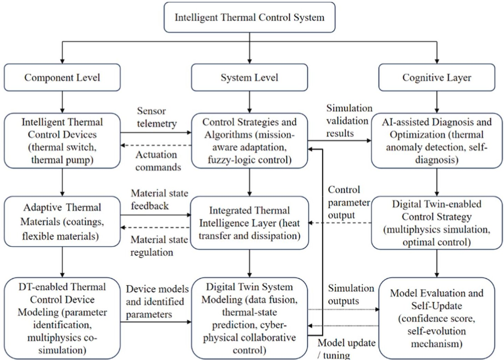

Legend: data/measurement flow control/actuation flow model-update/learning loop

Fig. 2.1. Architecture of intelligent thermal control system and classification diagram of components system.

<!-- PDF_PAGE: 3 -->

(dashed, middle-to-left) with the Integrated Thermal Intelligence Layer; device models and identified parameters are provided to the digital-twin system model (solid); the learning loop consists of simulation outputs and model update/tuning (dotted, middle-to-right and right-to-middle); and the system layer provides simulation validation results to, and receives control-parameter outputs from, the cognitive layer.

2. 1. Research progress on the thermal environment characterization and analysis of thermal control structures in intelligent satellites

This section characterizes the orbital thermal environment that provides the boundary conditions and disturbance profiles used by the system layer in Fig. 2.1, and it motivates the selection of componentlevel devices and materials. The thermal environment faced by satellites is still one of the most critical challenges in spacecraft system design, especially for intelligent thermal control structures with adaptive, rapid response, and energy-saving functions.

In designing thermal-control structures for intelligent satellites, accurate modeling of the dynamic thermal environment is critical to effective control strategies. As shown in Fig. 2.2, the architecture follows the digital-twin paradigm, integrating physical entities, virtual models, and twin data centers to enable real-time perception, state prediction, and virtual-physical closed-loop control of the thermal environment. The system fuses orbital parameters, radiative fluxes, and time-series telemetry with joint space-ground observations, markedly improving the modeling of transient heat loads such as solar irradiance, eclipse (umbra-penumbra) transitions, and plasma interactions. This

architecture moves beyond traditional "offline modeling and static control," toward a dynamic control mechanism with online learning and intelligent inference, advancing the thermal-control system from decoupled structural functions to task-driven collaborative operation. Looking ahead, integrating physics-constrained neural networks and edge-computing frameworks should further enhance self-adaptation and on-orbit responsiveness.

The current research shows that there are significant differences in the thermal behavior of the thermal environment under different orbital States, which urges people to further study the thermophysical boundary modeling and adaptive control strategy.

In low Earth orbit (LEO), the frequent alternation of sunshine and shading leads to periodic and transient fluctuations of satellite heat input, which induces a structural thermal stress cycle and device fatigue failure [3,4,9,]. To address the characteristics of non-steady-state thermal loads, recent research has focused on time-resolved heat flux modeling, coupled with transient finite element analysis (FEA) and digital twin mechanisms, enabling real-time thermal state prediction and active thermal compensation. [5,6,10,11]. In contrast, although the thermal input of geostationary orbit (GEO) satellites is relatively stable, long-term ultraviolet radiation and infrared antiradiation lead to material aging and performance degradation [12]. As a result, research is progressively evolving toward multi-scale thermal management strategies, encompassing tunable emissivity coatings [13], embedded thermal control networks, and variable-conductance interface designs [14], in order to meet the stability and longevity requirements of thermal regulation under diverse orbital environments.

System applications

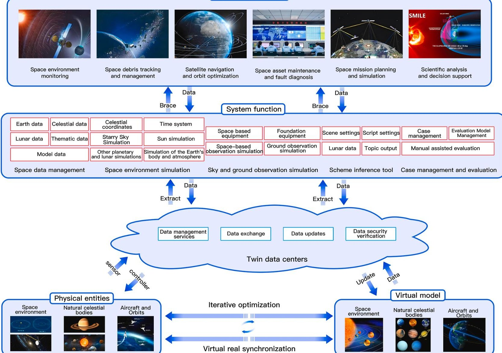

Fig. 2.2. The DT architecture of the space environment [8].

<!-- PDF_PAGE: 4 -->

Compared with LEO, although the heat input of geostationary orbit (GEO) satellites is relatively stable, long-term exposure to solar radiation and Earth's infrared radiation is prone to cause surface material aging, thermal and optical induced degradation, and interface thermomechanical mismatch. [15,16]. The current research is shifting from thermal load response to the improvement of thermal stability at the material level, focusing on functional coatings with adjustable emissivity and UV resistance, as well as structural thermal control means such as embedded heat pipe network and variable conductivity interface, in order to achieve self-adaptive thermal management for long-term tasks. [17]. These trends are consistent with the higher "thermal-input fluctuation" in LEO and the long-term materials challenge in GEO highlighted in Fig. 2.3.

From a future development perspective, the distinct thermal environments between Low Earth Orbit (LEO) and Geostationary Earth Orbit (GEO) are driving the evolution of thermal control structure design toward a track-feature-driven and multi-physical adaptive coupling paradigm. A unified modeling framework that integrates orbital dynamics, thermophysical boundary conditions, and material state evolution is expected to be a critical approach for enhancing the intelligence level of satellite thermal control structures. Furthermore, the integration of physics-informed machine learning models with edge computing platforms will significantly improve the real-time responsiveness and robustness of track-level thermal control systems, facilitating their transition from passive reactive mechanisms to proactive predictive control.

The advanced intelligent thermal control system integrates multi-source sensing, environment-aware control logic, and an AI prediction algorithm to deal with dynamic tasks and complex environments. Physical information neural networks (PINNs) effectively improve the estimation accuracy of track state and abnormal acceleration by combining physical constraints and deep learning [18]. The physical information multi-task attention network (MTA UNET) integrates multi-task learning and attention mechanisms to realize the real-time prediction of thermal stress and deformation [19]. In addition, the machine learning method has been used to construct the mapping relationship between orbital dynamics and thermal response, supporting the adaptive reconstruction of boundary conditions [20]. The European Space Agency's large space simulator (LSS) provides a high-fidelity

ground verification platform for on-orbit thermal control modeling.

Despite these advances, there are still challenges in cross-scale modeling, long-term stability, and the coupling between mechanical deformation and heat flux distribution, especially in the case of multiple field interference (radiation, microgravity, thermal fatigue). Therefore, the ongoing research is moving towards the overall thermal structure behavior modeling framework. In this framework, real-time digital twins become the core mechanism of environmental perception and adaptation of intelligent satellite platforms.

2. 2. Research progress on system functional requirements of intelligent thermal control structures

This section develops the system-level functional requirements, control objectives, constraints, and KPIs that govern sensing, actuation, and supervisory logic in the system layer of Fig. 2.1.

## 2.2.1. Active and passive thermal regulation capabilities of intelligent thermal control structures

In-orbit thermal load fluctuations in satellite thermal control systems have become increasingly intense. On low Earth orbits (LEO), thermal flux can vary between 800 and $ 1 3 0 0 \mathrm{W / m^{2}} $ within a 90-min cycle. Frequent eclipses introduce enhanced nonlinear disturbances, making it difficult for conventional single-mode thermal control mechanisms to cope effectively. Intelligent thermal control structures featuring active-passive coordination have emerged as a key direction. These structures integrate passive components such as phase change materials (PCM), heat pipes, and multilayer insulation (MLI), with active elements including thermoelectric coolers (TEC), electrical heaters, and adjustable radiators. Coupled with AI-based control logic and multi-source sensing, such systems enable high-precision, low-power, and missionadaptive thermal management capabilities. Fig. 2.4 illustrates this integrated passive-active intelligent thermal-control architecture, highlighting the coordination between passive elements, active actuators, and the AI-based controller under typical LEO thermal disturbances.

2. 2.1.1. Research progress on passive thermal control structures for intelligent satellites. Traditional passive thermal control methods, such as multilayer insulation (MLI), heat pipes, thermal control coatings, and

Comparison of Thermal Environment and Management for LEO and GEO Satellites LEO GEO

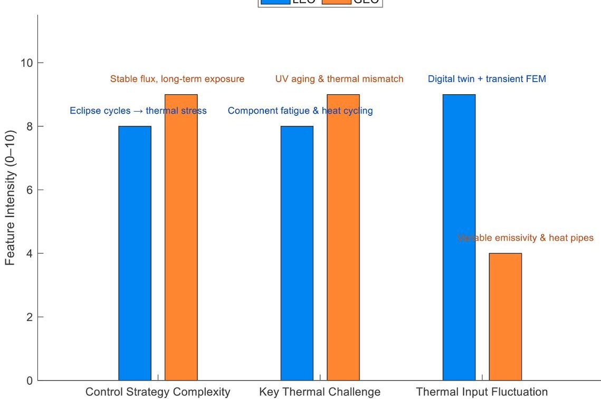

Fig. 2.3. Comparison between low Earth orbit and geostationary orbit.

<!-- PDF_PAGE: 5 -->

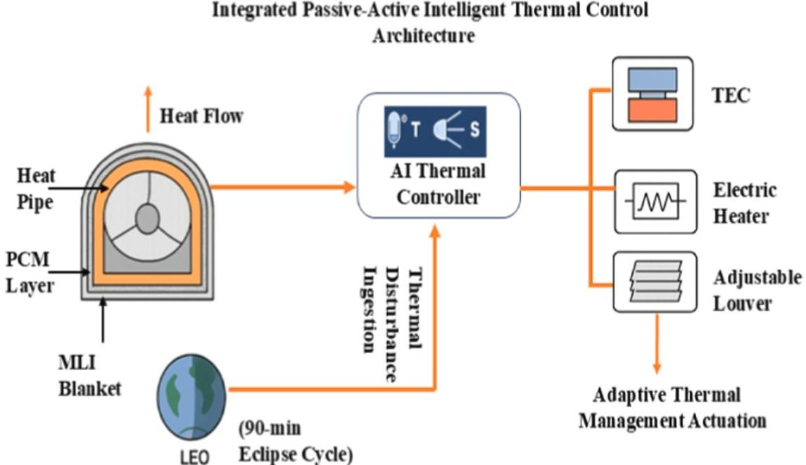

Fig. 2.4. Integrated passive-to-active intelligent thermal control architecture diagram.

phase change materials (PCMs), remain the foundation of satellite thermal design due to their zero power consumption, structural simplicity, and high reliability. MLI features an areal density of less than $ 0. 3 \mathrm{~ k g / m^{2}} $ and offers excellent insulation performance, though it lacks the ability to actively regulate heat flow. Heat pipes provide thermal conductivities as high as $ 1 0^{4}-1 0^{5} $ W/m·K, making them suitable for medium- and low-power applications. In recent years, advanced passive thermal control structures have rapidly emerged. For instance, graphene-enhanced PCMs, with thermally conductive frameworks reaching up to 5300 W/m·K, have demonstrated significant improvements in transient thermal response and heat storage efficiency.

In practical engineering applications, conventional heat pipes remain a key component for building reliable thermal control systems. A communication satellite employed an aluminum honeycomb sandwich deck with embedded heat pipes to enhance in-plane thermal conductivity. Cross-panel connections between the $ \pm\mathrm{Y} / \pm\mathrm{Z} $ and $ -\mathrm{X} / +\mathrm{Z} $ surfaces further optimized heat flux distribution and conduction continuity over orbital cycles [21]. The embedded heat pipe and structural co-design not only enhance the thermal response uniformity of passive control systems but also provide a high-fidelity physical foundation for thermal-structural coupling models in digital twins. In the thermal digital twin (DT) framework for intelligent satellites, modeling and optimizing heat pipe layouts enable integrated structural-thermal design, real-time visual simulation, and dynamic evolutionary tracking, thereby improving thermal steady-state prediction and adaptive regulation capabilities.

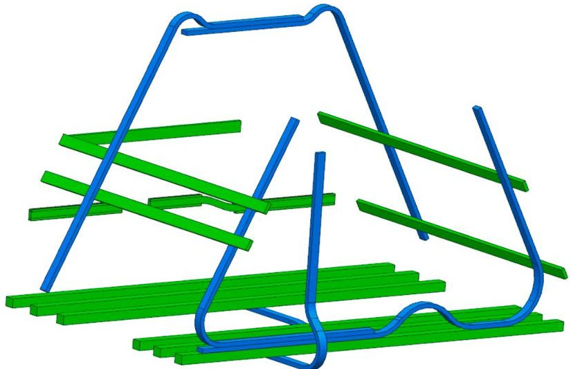

Fig. 2.5. Heat pipe layout [21].

Fig. 2.5 schematizes a cross-panel, serpentine heat-pipe layout with distributed in-plane spreaders, supporting continuous conduction and more uniform heat-flux routing across the deck.

Escalating integration and power density in spaceborne electronics—most notably SSPA outputs totaling up to 448 W—concentrate heat in tightly packaged assemblies, imposing severe demands on spacecraft thermal-control systems; a representative SSPA deck with truss heat-pipe topology is shown in Fig. 2.6. Limited packaging volume and complex on-orbit thermal environments make conventional single-path cooling insufficient for efficient and uniform temperature regulation, thereby degrading device performance and system reliability. To address these constraints, recent studies propose a truss-structured heatpipe layout: a three-dimensional network of multiple heat pipes combined with optimized thermal-interface materials and fillers. This configuration reduces contact thermal resistance and enables efficient heat spreading and dissipation within confined spaces, offering an effective physical solution for intelligent satellite thermal-control structures [21]. In addition, the three-dimensional topology of the truss heat pipe network and its interfacial material parameters offer quantifiable thermo-structural coupling priors, enabling high-fidelity physical-layer modeling within digital twin frameworks. Meanwhile, its high-efficiency thermal control performance in constrained volumes can be dynamically calibrated and predicted through in-orbit sensor-driven data, facilitating multiphysics-informed digital twin updates. This structural design paradigm lays a solid physical foundation for the development of adaptive, self-evolving, and real-time feedback-enabled thermal control digital twin systems.

While retaining the advantage of zero power consumption, enhanced passive components—when deeply integrated with intelligent sensing and control mechanisms—hold the potential to overcome the inherent response lag of traditional passive thermal control, positioning themselves as core elements of next-generation quasi-active thermal regulation systems.

Driven by the stringent thermal budgets and miniaturization constraints intrinsic to micro- and nanosatellite platforms, passive thermal management architectures now routinely incorporate high-performance composite phase-change materials (PCMs) that deliver simultaneous gains in thermal conductivity, latent-heat density, and structural integrability. Graphene-PCM hybrids, for example, exploit graphene's exceptional in-plane conductivity to circumvent the classical thermal bottleneck of organic PCMs, whereas graphene-aerogel encapsulated systems suppress interfacial resistance and volumetric shrinkage to yield ultra-low effective thermal impedance [22]. Metal-foam-reinforced

<!-- PDF_PAGE: 6 -->

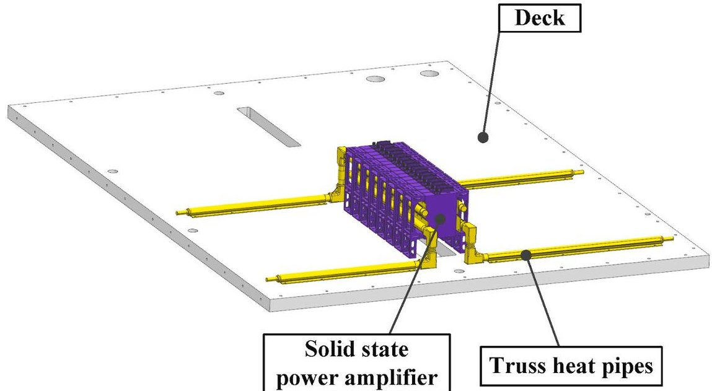

Fig. 2.6. Schematic diagram of thermal design of solid-state power amplifier [21].

PCMs form percolating three-dimensional networks that boost thermal diffusivity by orders of magnitude. [23]. For ultrathin panel applications, carbon-nanotube-dispersed PCMs provide precisely tuned thicknesses together with continuous conduction pathways. At the module level, honeycomb sandwich cores infiltrated with low-melting-point PCMs (e.g., decane, octanol) act as passive thermal buffers, while paraffin-filled microporous Ti-Al alloys couple load-bearing capability with adaptive heat-storage functionality.

For the thermal control requirements of micro and nano satellites, many types of enhanced PCM composites show complementary performance characteristics in key indicators such as thermal conductivity, thermal storage density, thermal response speed, structural compatibility, and environmental adaptability. By constructing multi-metric radar charts, the advantages of different materials can be visualized,

facilitating precise selection and combination optimization of thermal control materials under mission-specific requirements. Such a multidimensional performance evaluation framework provides quantitative support and decision-making guidance for the development of high-performance, mission-adaptive thermal control systems. Fig. 2.7 instantiates this framework by comparing representative composites across the five metrics, visually highlighting complementary strengths and trade-offs to support mission-tailored material selection.

Enhanced PCM composites have demonstrated superior thermal responsiveness and adaptability in thermal control scenarios for microand nanosatellites. Table 2.1 summarizes the key performance indicators and application scenarios of a variety of enhanced phase change material (PCM) composites in satellite thermal control in recent years. Nano fillers such as graphene nanosheets (GNPs) and carbon nanotubes

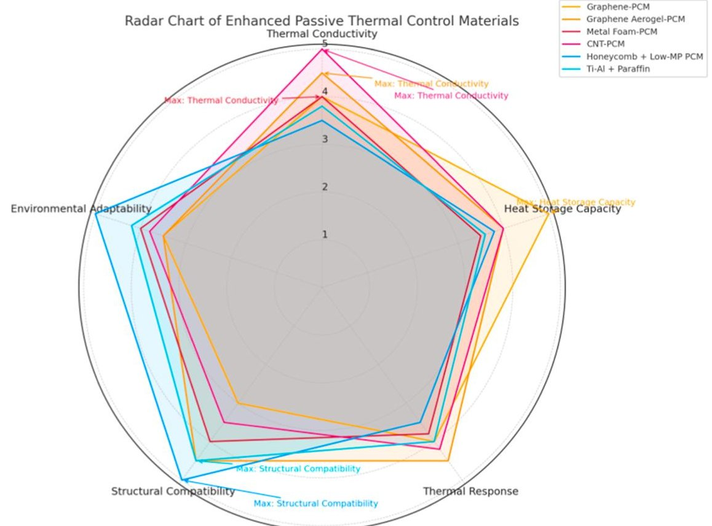

Each grid ring represents one performance level (1 to 5, outermost is best). Highlighted labels indicate the strongest performance feature of each material type.

Fig. 2.7. Enhanced passive thermal control material radar chart.

<!-- PDF_PAGE: 7 -->

Table 2.1

Thermophysical properties and application scenarios of enhanced cm composites for satellite thermal control [24-29].

<table border="1"><tr><td>Material Type &amp; Doping</td><td>Thermal Conductivity(W/m·K)</td><td>Latent Heat(J/g)</td><td>Volume Fraction Loading</td><td>Cycling Stability</td><td>Key Performance Features</td><td>Applicable Scenarios</td></tr><tr><td>Graphene nanoplatelets(4.2 wt%GNPs) reinforced PCM composite</td><td>2.1</td><td>206.2</td><td>-</td><td>-</td><td>High thermal conductivity,高能量存储密度</td><td>Micro/nanosatellite thermal response and thermal management systems</td></tr><tr><td>Graphene/carbon nanotube aerogel-supported paraffin-based PCM composite</td><td>1.897(7.6×pure paraffin)</td><td>236.7</td><td>-</td><td>-</td><td>Synergistic enhancement of thermal conductivity and energy storage</td><td>High-performance thermal buffering and fast thermal response for satellites</td></tr><tr><td>Aluminum foam embedded PCM</td><td>-</td><td>-</td><td>-</td><td>-</td><td>~186% enhancement in thermal conductivity,rapid thermal response</td><td>Thermal regulation of spacecraft structures,missions sensitive to thermal variations</td></tr><tr><td>Brass foam embedded PCM</td><td>-</td><td>-</td><td>-</td><td>-</td><td>~86% enhancement in thermal conductivity,rapid thermal response</td><td>Thermal regulation of spacecraft structures,missions sensitive to thermal variations</td></tr><tr><td>2wt% functionalized multi-walled carbon nanotube(MWCNT)doped paraffin PCM</td><td>1.02(~4×increase)</td><td>-</td><td>-</td><td>&lt;2% mass loss after100cycles</td><td>Excellent thermal and cycling stability</td><td>Long-duration satellite thermal control systems require high reliability</td></tr><tr><td>1wt% functionalized MWCNTdoped1-tetradecanol PCM</td><td>0.781(~173%increase)</td><td>≥191.3</td><td>-</td><td>&lt;1% mass loss after100cycles</td><td>Enhanced thermal conductivity and thermal stability</td><td>High-density thermal energy storage and localized satellite thermal management</td></tr><tr><td>Hierarchical macro-nanoporous copper(H-MNPM)encapsulated PCM</td><td>~3×increase</td><td>-</td><td>90%</td><td>90%</td><td>High loading capacity,高 thermal conductivity,and leakage-free stability</td><td>High heat flux management in the satellite electronics bay,rapid thermal regulation</td></tr></table>

(CNTs) significantly improve the thermal conductivity of the composite PCM, taking into account the high latent heat and cycle stability, which is suitable for the thermal management of a satellite electronic cabin with high heat storage density and rapid thermal response. [24,25]. Microporous metal foam structures, such as aluminum foam and copper foam, not only significantly enhance thermal diffusion capabilities but also enable rapid temperature regulation, making them well-suited for thermal buffering and localized thermal control of temperature-sensitive components in space structures. [26]. Functionalized multi-walled carbon nanotube (F-MWCNT) doped phase change materials (PCMs) not only enhance thermal conductivity but also exhibit excellent cycling stability and thermal reliability, making them suitable for satellite thermal control systems requiring long-term stable operation [27,28]. The PCM encapsulated in hierarchical macro-nano porous copper (h-mnpm) structure achieves ultra-high volume fraction and thermal conductivity of phase change materials, and has the advantages of no leakage and high stability. It is suitable for high-density heat flow tasks, such as thermal management of high-power devices in a satellite electronic cabin. [29]. The above material system provides

multi-dimensional technical support for the design of an intelligent satellite thermal control structure by combining high-efficiency heat conduction and energy storage capacity.

In summary, the design of enhanced PCM composites is shifting from single-parameter conductivity boosts to a multiscale, structure-thermal control-integration pathway. Graphene-based conductivity enhancers deliver strong gains but face cost and fabrication bottlenecks. By contrast, structural strategies-microporous metal foams and hierarchical macro-nanoporous metals (H-MNPM)-offer greater system adaptability via higher thermal diffusivity, structural stability, and high PCM loading, making them well suited to high-heat-flux, rapid-response scenarios. Looking ahead, emphasis should be placed on system-integrated material-structure co-design, DT-driven dynamic-behavior modeling, and in-orbit reliability verification, together with standardized evaluation protocols, to ensure stable and efficient thermal management for intelligent satellites. Fig. 2.8 consolidates these points by mapping the multiscale path-material-level in-situ enhancement, structure-level scaffolds, and system-level intelligent integration-and the typical performance targets along each track.

## Multiscale Optimization Path of Enhanced PCMs for Satellite Thermal-Control Structures

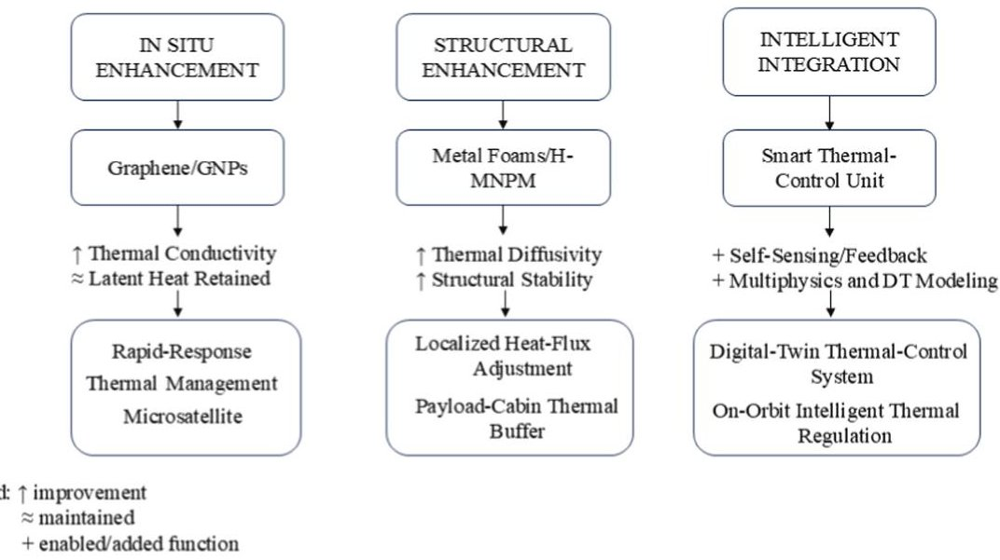

Fig. 2.8. Multi-scale optimization path diagram of enhanced PCM in satellite thermal control structure.

<!-- PDF_PAGE: 8 -->

2. 2.1.2. Research progress on active thermal control structures for intelligent satellites. Facing the future, the intelligent active thermal control structure is continuously evolving along the path of "high response - low energy consumption - intelligent adaptation - structural integration", The progressive integration of programmable thermoresponsive materials, low-power intelligent sensors, self-learning control laws, and digital twin-based thermal state prediction models enables the construction of a closed-loop thermal regulation system tailored for complex mission scenarios. This trend not only provides high-precision thermal control guarantee for the new generation of multi-mission adaptive satellite platforms but also lays a foundation for the integrated and intelligent development of thermal control systems.

Active thermal-control technologies, illustrated in Fig. 2.9, utilize external energy to modulate heat flow, achieving rapid response and high temperature-control accuracy—key requirements for deep-space exploration and extreme orbital conditions. The figure classifies existing mechanisms into three principal categories.

(i) Thermoelectric-control structures—thermoelectric coolers (TECs) for solid-state temperature regulation and localized hotspot mitigation [30];

(ii) Micro-pumped-loop systems, including micro loop heat pipes (LHPs) for long-distance, high-heat-flux transport and integrated electronic-component cooling [31];

(iii) Integrated structure-thermal-control modules, exemplified by thermoresponsive actuator materials, adaptive thermal stiffness, and deployable thermal sunshields (TRS), which support systemlevel adaptation.

Recent trends converge on coupling dense temperature and heat-flux sensor networks with predictive-control schemes (e.g., neural networks [32] and adaptive PID) to achieve independent multi-zone, multi-load regulation. In parallel, miniaturized, low-power designs [33] are yielding MEMS-scale active elements and hybrid passive-active subsystems for constellations and small deep-space probes. A further emphasis is structure-function integration, embedding thermal-control elements into load-bearing structures to co-optimize thermal management and structural performance, thereby improving system integration and quality-assurance efficiency. LHPs are capillary-driven passive two-phase loops; they are included here for system-level classification and because they are often integrated with active regulation.

With the continuous advancement of intelligent thermal control technologies, active thermal regulation systems have demonstrated significant improvements across several key performance dimensions, including thermal control accuracy, response speed, energy efficiency, structural integration, autonomous control capability, and in-orbit adaptability. The transition from conventional active thermal components to integrated intelligent structures has markedly enhanced the degree of structural-functional integration and control intelligence. Building upon this progression, the incorporation of digital twin mechanisms has further endowed the system with predictive control, adaptive regulation, and in-orbit reconfiguration capabilities, thereby strengthening its resilience under complex multi-physical thermal environments. These innovations position the architecture as a core enabling technology for next-generation high-autonomy space platforms.

From a system architecture perspective, this technological evolution signifies a shift from an engineering-driven paradigm to an intelligent ecosystem characterized by data-driven decision-making and cognitive coordination. Next-generation intelligent thermal control systems integrate real-time sensing, predictive modeling, and autonomous decisionmaking to establish a closed-loop thermal regulation framework, providing both the technological foundation and strategic pathway for reliable thermal management in dynamic and mission-critical orbital environments.

Driven by the increasing demands for high integration, operation in complex thermal environments, and adaptability to multi-functional missions, the development of intelligent active thermal control structures for satellites has progressed across multiple scales—from device-level innovations to module and system-level integrations. Table 2.2 summarizes the key performance indicators and application characteristics of several state-of-the-art active thermal control technologies, including enhanced thermoelectric coolers (TECs), microchannel loop heat pipes (LHPs), active louvers, and hybrid thermal control architectures. Recent studies have highlighted that enhanced TEC structures offer superior localized thermal regulation under high heat flux conditions, enabling precise temperature stabilization and effective suppression of thermal stress. [34]. Microchannel LHPs, owing to their low thermal resistance and fast startup behavior, have emerged as critical components in passive-active hybrid systems, particularly for small satellite platforms. [35]. Additionally, adaptive radiators employing shape memory alloys or MEMS-based configurations exhibit significant

Classification and Working Principles of Active Thermal Control Structures

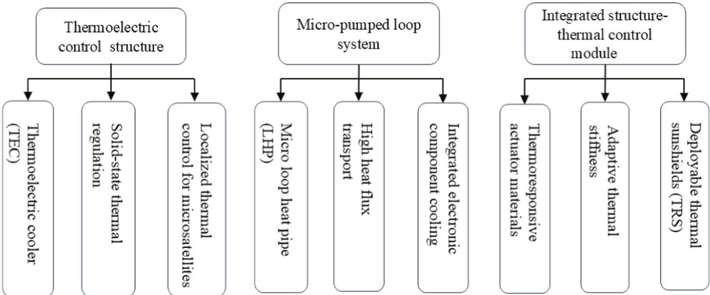

Fig. 2.9. Classification and working principles of active thermal control structures.

<!-- PDF_PAGE: 9 -->

Table 2.2

Key performance of active thermal control components supporting digital twinbased thermal design in intelligent satellites [34-36].

<table border="1"><tr><td>Technology type</td><td>Representative study</td><td>Key performance parameters</td><td>Application scenarios</td></tr><tr><td>Enhanced Thermoelectric Cooler(TEC)</td><td>Targeted for GaN HEMT Devices</td><td>Maximum heat flux density:27.8W/cm2; Temperature control accuracy:±0.2℃; Steady-state temperature drop:32.1%</td><td>Localized active cooling for high heat flux space power devices</td></tr><tr><td>Integrated TEC Module</td><td>Designed for On-Chip Heat Sources</td><td>Heat flux regulation:26.7W/cm2(8W/0.3cm2heat source); Junction temperature control:≤85℃</td><td>Thermal distribution and steady-state regulation for highly integrated electronic systems</td></tr><tr><td>Loop Heat Pipe(LHP) with Microchannel Structure</td><td>Multi-Attitude Test Platform</td><td>Heat load:30-180W; Evaporator thermal resistance:0.0168℃/W; Rapid startup capability</td><td>Stable operation under microgravity and variable attitude environments; suitable for passive-assisted and active-cooperative systems</td></tr><tr><td>Active Louvers &amp; MEMS Radiator</td><td>SMA-Driven/MEMS-Based Architecture</td><td>Adjustable aperture angle:±30°; Radiative flux modulation range:up to60%;Response time:&lt;1s;Power consumption:&lt;0.2W</td><td>Suitable for microsatellites and low-power platforms with rapid heat flux switching capability</td></tr><tr><td>Hybrid LHP+TEC System</td><td>Switchable Thermal Control Platform for Ultra-LEO Orbits</td><td>Startup time:&lt;1.5min;Internal temperature rise≤1.5℃atΔT=137℃;Source temperature control:≤22.5℃</td><td>Applicable to extreme thermal gradient scenarios in Ultra-LEO orbits, providing thermal isolation and responsive regulation capabilities</td></tr></table>

advantages in terms of low power consumption, rapid actuation, and structural miniaturization, addressing the diversified thermal regulation needs of resource-constrained space systems.

More importantly, the hybrid TEC-LHP system exhibits excellent thermal stability and programmable regulation capabilities under extreme orbital conditions, which can effectively alleviate the thermal instability issue of onboard satellite equipment under high thermal shock and temperature gradients. [36]. From the perspective of system integration, the future evolution of active thermal control structures will not be limited to enhancements in temperature regulation accuracy and response speed but will rather depend on their deep integration with digital twin systems, high-reliability sensing networks, and mission-adaptive control logic, in order to achieve mission-driven optimal thermal state management and autonomous in-orbit self-evolutionary regulation capabilities.

The microscale fluidic control system, as a core technology for active thermal control in intelligent satellite thermal structures, has achieved significant advancements in recent years. Graphene-enhanced heat pipes and nanofluid-based heat pipes have significantly improved both thermal dissipation efficiency and system lightweight performance. Studies have demonstrated that under a 10 W thermal load, the specific heat dissipation capacity of graphene-reinforced heat pipes reaches $ 7 2 3 0 \mathrm{W m}^{2} \cdot \mathrm{K}^{1} \cdot \mathrm{g}^{1} $ , approximately 3.5 times higher than that of copper-

based commercial heat pipes. [37]. The microchannel cooling system realizes adaptive heat flow regulation through nano fluid [38]. And MEMS temperature control micro valve adaptive microchannel cooling equipment; The micro pump and the electrowetting digital microfluidic scheme provide a high-precision, low-power heat dissipation path. In addition, the introduction of deep learning and digital twins has promoted the evolution of thermal control systems in the direction of intelligence and self-optimization. By introducing deep learning techniques, actively tunable metamaterials capable of autonomously sensing ambient temperature and rapidly adjusting their thermal functionalities have been developed, enabling intelligent regulation of heat transfer and laying the foundation for the advancement of future intelligent thermal control systems. [39]. Fig. 2.10 illustrates typical implementations of microscale fluidic control, including single-sided digital microfluidic platforms and oscillating-droplet actuation, and their impact on hotspot temperature distributions. These results underscore the progress of microscale active thermal-control technologies toward efficient and adaptive heat regulation.

Although the intelligent active thermal control structure has made progress in temperature accuracy, response speed, and system integration, it is still difficult to give consideration to energy efficiency, environmental adaptability, and long-term reliability in a complex orbit environment. The first challenge lies in the lack of a unified low-power, high-stability dynamic modeling framework under multi-source thermal disturbances; The second is that the sensor executive control chain is susceptible to radiation and thermal drift, resulting in accuracy degradation with the duration of the task. In addition, there is still a lack of multi-field coupling in the orbit test platform to verify its generalization ability and practical feasibility.

2. 2.1.3. Research progress on Active-Passive coupled thermal control structures for intelligent satellites. For complex environments such as multiple orbit transitions and high-frequency mission-induced thermal disturbances, current research is increasingly integrating active and passive thermal-control mechanisms to build a collaborative thermal-control system with rapid response, high adaptability, and an energy-efficiency balance. This structure combines the thermal-inertia buffering of passive units (e.g., PCM and MLI) with the precise, rapid adjustment of active modules (e.g., TECs and LHPs), thereby enhancing system thermal stability and intelligent regulation. Fig. 2.11 schematically summarizes this demand-driven architecture, linking the three building blocks—passive units and active modules under the core enabling pillars of material integration, structural fusion, and intelligent control—to the achieved advantages of rapid response, high adaptability, and an energy-efficiency balance.

The advancement of intelligent satellite thermal control structures has progressively shifted toward the integration of active and passive thermal control technologies, aiming to establish a multi-modal collaborative thermal management system. Such systems enable enhanced thermal regulation efficiency while maintaining low power consumption and improving robustness and adaptability under complex thermal environments. Utilizing a two-step dispersion method, 0.6 wt% graphene powder was uniformly distributed within organic paraffin, resulting in a 72.2 % increase in the thermal conductivity of the composite phase change material, alongside a 32.0 % improvement in transmittance reduction. Fourier transform infrared spectroscopy (FTIR) analysis revealed no new spectral peaks, indicating excellent physical and chemical stability of the material. [42]. Furthermore, an integrated thermal control system combining Loop Heat Pipe (LHP), Thermoelectric Cooler (TEC), and Multi-Layer Insulation (MLI) has been developed targeting ultra-low orbit spacecraft. This system achieves internal temperature regulation within $ \pm 22.5 $ $ ^{\circ}C $ in an external thermal environment of 350 $ ^{\circ}C $ , with the capability to initiate operation within 1.5 min and reduce temperature by 13.6 $ ^{\circ}C $ within 10 min, demonstrating suitability for efficient thermal management amid complex orbital thermal

<!-- PDF_PAGE: 10 -->

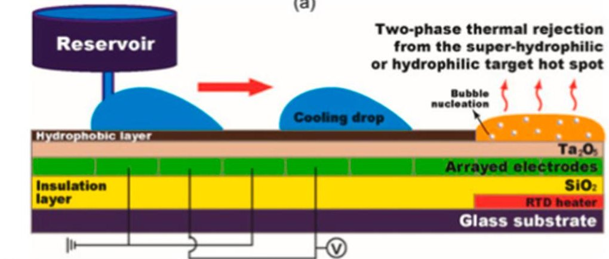

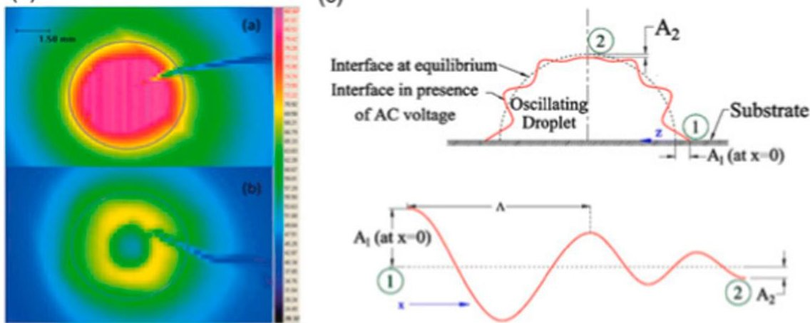

Fig. 2.10. (a) Diagram of a single-sided digital microfluidic (SDMF) device and the working principles of effective liquid transportation and two-phase cooling [40] (b) Diagram of oscillating droplets and surface waves [41]; (c) Temperature distribution at the hot spot and in the surrounding area when there are (below) and without (above) oscillating droplets.

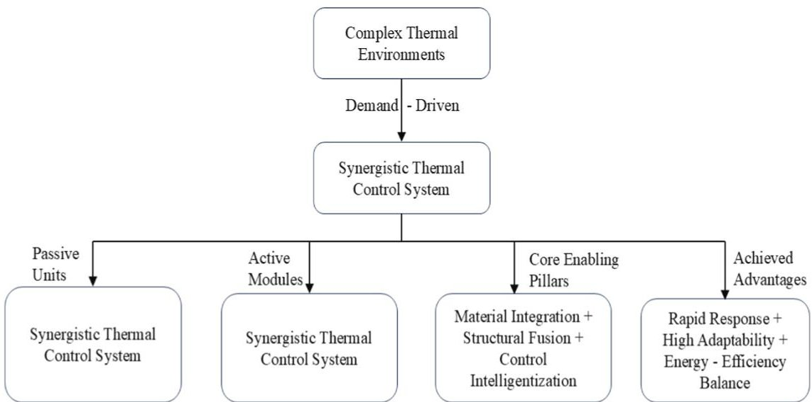

Fig. 2.11. Demand-driven collaborative thermal control system framework for digital-twin-based intelligent satellites.

disturbances. [36]. Taken together, these advances motivate an architecture that couples low-power thermal buffering with fast-response active control; Fig. 2.12 schematically summarizes this active-passive thermal control unit, in which a phase-change material (PCM) thermal-storage layer, a thermoelectric cooler (TEC) active-regulation layer, and a loop heat pipe (LHP) heat-transfer layer-integrated with multi-layer insulation (MLI) and coordinated by an embedded controller-operate synergistically to maintain system-level thermal balance.

The active-passive thermal control unit (Fig. 2.12) comprises three integrated layers: a PCM thermal-storage layer, a TEC active-regulation layer, and an LHP heat-transfer layer. The PCM layer passively buffers transient thermal loads via latent-heat storage, providing a thermally stable environment for the upper layers. Building on this buffered

condition, the TEC layer delivers precise temperature control, whereas the LHP layer rapidly transports and dissipates accumulated heat. Coordinated by an embedded control module, these layers operate synergistically to maintain system-level thermal balance. By combining lowpower thermal buffering with fast-response active control, the architecture enhances adaptability to highly dynamic orbital thermal environments and helps alleviate the trade-off between energy efficiency and thermal responsiveness—one of the key challenges in next-generation satellite thermal management.

In addition, the integration of multifunctional structures for intelligent satellite thermal control has become a major development direction. A hybrid cooling system decoupling the heat pipe and phase change material (PCM) was proposed in a previous study. Under a heating power of 16 W, the steady-state temperature of the battery is reduced by

<!-- PDF_PAGE: 11 -->

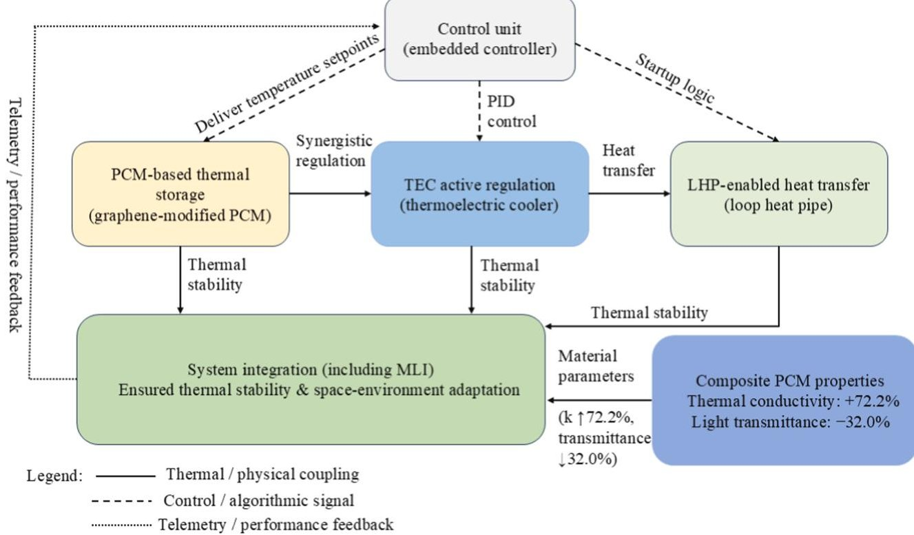

Fig. 2.12. Schematic architecture of an active-passive coupled thermal control unit for intelligent satellites.

approximately 14 % (at 2 m/s), 10 % (at 3 m/s), and 4 % (at 4 m/s) compared to the case without PCM, thereby significantly enhancing the thermal control performance. This structural decoupling strategy provides data support and design insights for optimizing active-passive coupled thermal control in intelligent satellites under scenarios with intense thermal flux fluctuations [43].

Table 2.3 summarizes the typical performance indicators of the three types of thermal control systems. It can be seen that the active-passive coupling scheme achieves a balance between control accuracy, response time, and power consumption, and is especially suitable for the complex scenario of rapid switching of the thermal environment of intelligent satellites.

Compared with conventional architectures, the proposed hybrid system offers enhanced control accuracy for high-frequency tasks in Low Earth Orbit (LEO), while promoting lightweight and low-power design strategies for satellite constellations. In deep space missions, it also necessitates radiation-hardened components and autonomous control capabilities. Consequently, future designs should evolve toward configurations that are tailored to specific mission requirements.

Fig. 2.13 illustrates six critical research priorities for developing active-passive coupled thermal-control systems in intelligent satellites.

(i) Material integration, referring to the synergistic combination of thermal-interface materials, phase-change materials, and structural components;

(ii) Lightweight design, targeting mass reduction without compromising thermal performance;

(iii) AI-based control, enabling adaptive and predictive thermal regulation via data-driven algorithms;

Active-Passive Coupled Thermal Control Opportunities

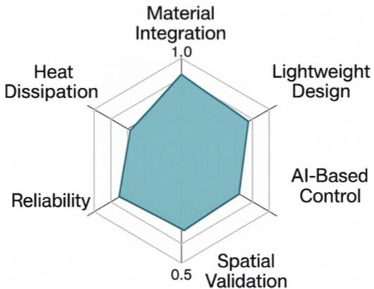

Fig. 2.13. Development priorities of active-passive coupled thermal control systems.

(iv) Spatial validation, highlighting the necessity of in-orbit demonstration and environmental adaptability;

(v) Reliability, ensuring long-term thermal stability under variable orbital conditions;

(vi) Heat dissipation capability, focusing on the efficient removal of high-density heat loads from compact electronic modules

However, the practical implementation of such hybrid systems still faces significant challenges, including the complexity of thermal-structural integration, difficulty in managing interface thermal

Table 2.3

Comparison of performance parameters of different types of thermal control systems.

<table border="1"><tr><td>Technology category</td><td>Representative components</td><td>Temperature Control Accuracy</td><td>Thermal response time</td><td>Power consumption</td><td>Application scenario</td></tr><tr><td>Passive thermal control structure</td><td>MLI, PCM, Heat Pipe</td><td>$\pm$5-10℃</td><td>Several minutes to several hours</td><td>Nearly zero</td><td>Orbital steady state, Nominal region</td></tr><tr><td>Active Thermal Control System</td><td>TEC, LHP, Heater</td><td>$\pm$0.1-2℃</td><td>Seconds to minutes</td><td>High(1-10W)</td><td>Precision payload, Transient thermal environment</td></tr><tr><td>Hybrid passive-active thermal control system</td><td>PCM+TEC,LHP+MLI</td><td>$\pm$1-3℃</td><td>&lt;20s</td><td>Medium(0.5-5W)</td><td>Intelligent platform, thermally dynamic missions</td></tr></table>

<!-- PDF_PAGE: 12 -->

resistance under varying mechanical loads, and the lack of sufficient inorbit validation data. To address these issues, future research should prioritize the co-design of thermal control materials and load-bearing structures to achieve better integration and mass-efficiency; incorporate AI-enhanced thermal management strategies, such as real-time fault detection and model predictive control (MPC), to improve system responsiveness; and expand space-based experimental validation efforts to accelerate the transition from laboratory prototypes to fully operational satellite platforms.

## 2.2.2. Adaptive thermal management response mechanisms of intelligent satellite thermal control structures

Current intelligent satellite thermal control structures are transitioning from passive temperature-responsive mechanisms to cognitively driven and adaptively regulated systems. Research efforts are primarily focused on three key aspects: sensor-cognition integration, structural-material synergy, and intelligent closed-loop decision-making, thereby advancing thermal control systems from static protection schemes toward dynamic intelligent architectures.

2. 2.2.1. Research progress on Sensor-Cognition integration in intelligent thermal control structures. Driven by the requirements for autonomy and real-time adaptability in next-generation spacecraft, sensor-cognition integration has become a key enabler for intelligent satellite thermalcontrol structures. Table 2.4 synopsizes representative routes—multisensor data fusion, physics-informed machine learning, and federated learning with multimodal fusion—together with their reported benefits and current limitations. Deployed in complex, time-varying orbital environments, these methods strengthen thermal situational awareness and cognitive decision-making. Nevertheless, constraints in model interpretability, onboard compute budgets, and the scarcity of highfidelity in-orbit data persist. Future progress will hinge on lightweight models, adaptive learning, and cross-modal data integration, pushing satellite thermal control toward higher autonomy, robustness, and environmental adaptability.

Fig. 2.14 schematizes the perception-cognition fusion pipeline for intelligent-satellite thermal control. Multimodal sensor data (input) undergo fusion and feature construction (modeling), advance to physicsenhanced modeling for state estimation (cognition), and culminate in thermal-control strategies or thermal-state predictions (output). The

Comparison table of key technologies for perception-cognition integration [44, 45].

<table border="1"><tr><td>Technical Direction</td><td>Core Approach</td><td>Technical Advantages</td><td>Challenges</td></tr><tr><td>Multi-sensor Data Fusion</td><td>Explicit Attention-Enhanced Fusion (EAEF)</td><td>Enhanced fusion performance between visible and infrared imagery; mean Intersection-over-Union (mIoU) improved by 1.6%</td><td>High algorithmic complexity; requires high-performance computational resources</td></tr><tr><td>Physics-Informed Machine Learning</td><td>Cognitive Semantic Augmentation (CSA) Model</td><td>Integrates physics-based modeling with AI to improve thermal state prediction accuracy and data transmission efficiency.</td><td>Limited model adaptability and robustness under varying mission scenarios</td></tr><tr><td>Federated Learning with Multimodal Fusion</td><td>FedFusion Framework</td><td>Supports distributed data fusion across multiple satellites; communication cost reduced by 4×; accuracy achieved up to 94.35%</td><td>Complex system architecture and synchronization mechanism design requirements</td></tr></table>

figure makes explicit the roles of input, modeling, cognition, and output within the overall architecture.

In the process of cognitive-perceptual fusion development in thermal digital twins, significant improvements have been achieved in modeling efficiency and learning strategies. Lightweight thermal models enabled by techniques such as pruning, quantization, and reduced-order modeling (ROM) are being increasingly adopted to achieve highprecision predictions under the computational constraints of satelliteborne processors. [39]., In addition, adaptive and online learning frameworks have been integrated to ensure model stability under continuously varying thermal loads and orbital disturbances. These mechanisms enable real-time updates of thermal boundary conditions and material response models by integrating streaming sensor data [46].

Meanwhile, the integration of multimodal sensing with heterogeneous data fusion—including thermal, structural, and radiative signals-enhances system interpretability in complex operational environments. However, modality alignment and consistency mapping remain critical challenges, particularly in achieving robust and explainable cross-modal reasoning. Overall, these evolving approaches form the algorithmic foundation of the modeling and cognitive layers in next-generation intelligent satellite thermal digital twin architectures.

2. 2.2.2. Research progress on Structure-Material synergy in intelligent thermal control structures. As satellites rapidly evolve toward highly autonomous and adaptive operations, the development of intelligent thermal-interface systems that integrate functional materials with microscale structural design strategies has become a key focus. Recent progress has emphasized material-structure collaborative design to achieve dynamic thermal regulation at the material-structure interface. As shown in Fig. 2.15, research efforts have primarily focused on three areas: $ \mathrm{V O_{2}} $ -based smart thin films, which serve as core materials for temperature-regulated radiative control; microstructured thermal-regulation devices designed to enable interface-level thermal responsiveness; and structurally integrated phase-change materials (PCMs) that allow for switchable heat storage and conduction. These structure-material integrated design strategies enable thermal digital twins to simulate not only steady-state behavior but also dynamic phenomena such as emissivity switching and latent-heat release.

Smart materials represented by $ \mathrm{V O_{2}} $ exhibit a metal-insulator transition (MIT) around $ 6 8 \mathrm{~}^\circ \mathrm{C} $ , accompanied by a pronounced shift in infrared emissivity, providing a physical basis for constructing dynamically tunable thermal control interfaces. [47]. An intelligent radiator based on $ \mathrm{V O_{2}} / \mathrm{B a F_{2}} $ three-period stacked structure achieves thermal control performance with an emissivity adjustment range of up to 0.7917 on an aluminum substrate. After introducing a $ 0.1 \ \mu\mathrm{m} \ \mathrm{T i O_{2}} $ protective layer, the emissivity adjustment range was increased to 0.7932, demonstrating excellent thermal control performance. [48]. Yu et al. developed a $ \mathrm{V O_{2}-Z n S} $ Fabry-Perot cavity structure, leveraging resonance enhancement to amplify the infrared emissivity contrast before and after the $ \mathrm{V O_{2}} $ phase transition, achieving a dynamic emissivity modulation of $ \Delta \varepsilon\approx 0. 6 3 $ . This structure exhibits excellent temperature control capability in the mid-infrared spectral range [49].

A $ \mathrm{V O_{2}} $ -based switchable radiator was developed, utilizing its metal-insulator transition at approximately $ 68^{\circ} \mathrm{C} $ to achieve a notable infrared emissivity modulation exceeding 0.4. This enables dynamic switching between thermal control states. The proposed design provides a lightweight, rapid-response radiative regulation solution for satellite thermal control systems, with no moving parts, effectively managing variable thermal loads in orbital environments. [47]. In related studies, graphene nanoplatelets (GNPs) were incorporated into polyethylene glycol (PEG) to form composite phase change materials with significantly enhanced thermal conductivity and phase change enthalpy. These improvements demonstrate strong potential for rapid thermal response and stable heat storage, which is particularly relevant for localized thermal regulation of satellite electronics and for modeling

<!-- PDF_PAGE: 13 -->

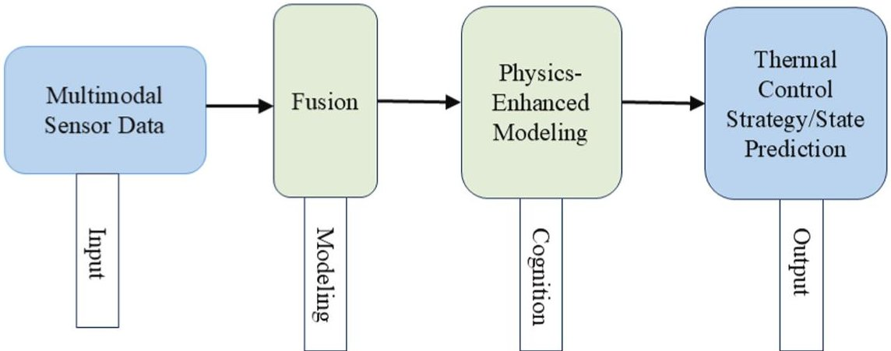

Fig. 2.14. Functional architecture of perception-cognition fusion in intelligent satellite thermal control.

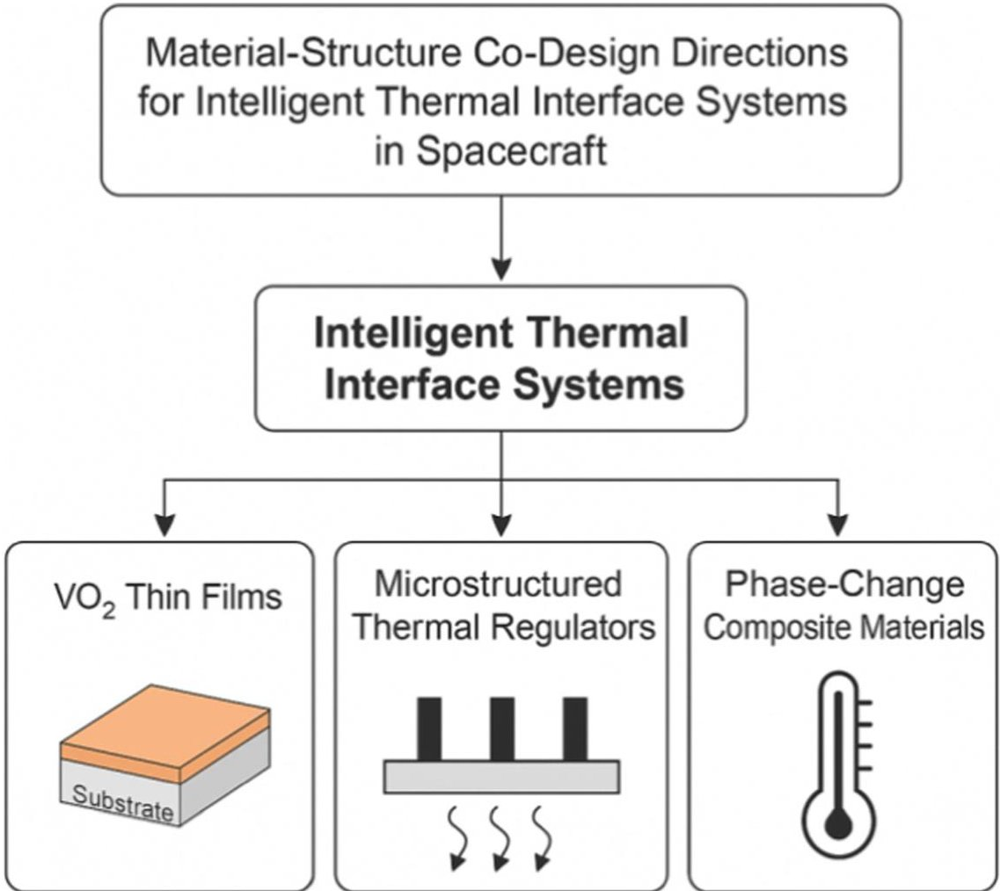

Fig. 2.15. Material-structure Co-design strategies for intelligent thermal interface systems in spacecraft.

subsystem-level thermal behavior within digital twin frameworks [50].

Table 2.5 delineates the principal materials and functional units underpinning intelligent thermal-control structures.

(i) $ \mathrm{V O_{2}} $ smart films (metal-insulator transition at $ \sim 6 8 \mathrm{~}^{\circ} \mathrm{C} $ ; abrupt infrared-emissivity switching);

(ii) $ \mathrm{V O_{2} / B a F_{2}} $ multilayers (three-period; emissivity modulation of 0.7917, increasing to 0.7932 with a $ \mathrm{T i O_{2}} $ insertion layer);

(iii) $ \mathrm{V O_{2}-Z n S F a b r y-P e r o t c a v i t i e s} $ (emissivity contrast $ \Delta \varepsilon\approx 0. 6 3) $;

(iv) $ \mathrm{V O_{2}} $ switchable radiators (dynamic emissivity $ > 0.4 $ ; lightweight, no-moving-parts design, and fast response for orbital transients);

(v) High-thermal-conductivity composite PCMs (e.g., sulfonated graphene-doped PEG) that combine higher thermal conductivity with latent-heat storage for local electronics cooling and subsystem-level digital-twin modeling.

The integration of structure and material in intelligent thermal

control components has not only driven the transition of satellite thermal management systems from static design to dynamic regulation but also provided embedded material-level physical models and structural response interfaces essential for constructing digital twins with adaptive thermal management capabilities. This establishes a micro-scale foundation for thermal-physical modeling within the perception-cognition-regulation closed loop of digital twin systems.

As structure-material co-design becomes increasingly central to next-generation thermal management strategies, thermal rectification and thermal metamaterials have emerged as frontier technologies with transformative potential in intelligent satellite thermal control systems. Under complex and anisotropic thermal loading conditions, the synergistic integration of asymmetric thermal rectifiers with metamaterial-based structures-capable of advanced functionalities such as thermal cloaking, heat concentration, and anisotropic conduction-enables directional, reconfigurable, and path-controllable heat flux regulation. This paradigm enhances both the adaptability and energy efficiency of

<!-- PDF_PAGE: 14 -->

Table 2.5 Summary table of key materials and functional units for intelligent thermal control structures [46-49,51].

<table border="1"><tr><td>Research Direction</td><td>Key Material/Structure</td><td>Main Performance/Function</td><td>Research Highlights and Application Scenarios</td></tr><tr><td>Smart tunable emissivity materials</td><td>Vanadium dioxide</td><td>Metal-insulator transition at ~68℃; abrupt change in infrared emissivity</td><td>Provides a physical basis for dynamic, tunable thermal-control interfaces</td></tr><tr><td>Multilayer tunable emissivity structure</td><td>VO2/BaF2 three-period multilayer; with TiO2 insertion</td><td>Emissivity modulation range up to 0.7917; increased to 0.7932 with TiO2</td><td>Excellent thermal-control performance on aluminum substrates; enhanced emissivity tuning range and durability</td></tr><tr><td>Resonance-enhanced radiative structure</td><td>VO2-ZnS Fabry-Pérot cavity structure</td><td>Emissivity contrast $\Delta \varepsilon \approx 0.63$</td><td>Strong mid-infrared thermal-control capability via resonance-enhanced dynamic response</td></tr><tr><td>Switchable radiator design</td><td>VO2-based switchable radiator</td><td>Dynamic infrared emissivity modulation amplitude $>0.4$</td><td>Lightweight, no moving parts, fast response; suitable for dynamic thermal-load management in satellite orbital environments</td></tr><tr><td>High-thermal-conductivity composite PCM</td><td>Sulfonated graphene (SG)-doped poly (ethylene glycol) (PEG) matrix</td><td>Significantly improved thermal conductivity and latent heat</td><td>Rapid thermal response and stable heat storage; suitable for local thermal control of satellite electronics; supports digital twin subsystem-level modeling</td></tr></table>

onboard thermal control architectures. Table 2.6 summarizes representative pathways-modular thermal rectifiers, active thermal metamaterials, kirigami-inspired deployables, and thermo-mechanically stable lattices-together with their core structures, technical highlights, performance metrics, and application directions. Recent studies have demonstrated preliminary realizations of lightweight integrated platforms that combine thermal conductivity enhancement, thermal regulation, and structural support, such as smart thermal control panels and thermally conductive layers in flexible antennas. In alignment with the requirements of digital twin-based modeling, these co-engineered structures offer a physically grounded framework for constructing high-fidelity simulation models with heterogeneous and nonlinear

thermal response characteristics, thereby enabling real-time thermal state prediction and behavior-aware evolution within the digital twin environment.

With the development of intelligent thermal control structures to higher autonomy and adaptability, the collaborative integration of thermal rectification mechanisms and thermal metamaterials is becoming the key path to realize the collaborative control of structural material function. Fig. 2.16 shows a hierarchical design framework, covering micro geometric tailoring, periodic structure construction, and material thermal response design, highlighting its wide adaptability in multi-scenario thermal management. This kind of multi-physical response structural unit has the ability of directional heat conduction, reconfigurable thermal path, and dynamic radiation control, and can be used as the physical modeling input and boundary condition source of the digital twin of smart satellite thermal control. [5,55,56]. Its nonlinear thermal behavior and stimulus response characteristics provide support for the modeling, cognition, and feedback control layer in the thermal twin system, and help to build an adaptive, closed-loop regulation and prediction-driven thermal management architecture for the complex orbit environment [57].

Shape memory alloys (SMAs) possess temperature-driven shape memory and self-recovery capabilities, enabling non-electrical actuation for thermal-control structures and tight coupling between thermal response and structural deformation. When integrated with composite materials or flexible structures, they facilitate lightweight, structure-function-integrated intelligent thermal-control components, supporting thermal-path switching and reconfigurable heat-dissipation structures.

As shown in Fig. 2.17, an SMA wire can be shape set into a torsion spring using a simple bolted fixture, providing the basic torsional actuator element used in the applications summarized in Table 2.7. As summarized in Table 2.7, representative SMA-enabled directions include SMA-based heat engines for space power conversion and energy recovery, SMA-driven reconfigurable helical antennas for communications, SMA-actuated radiator-fin systems that provide temperature-responsive heat dissipation, and SMA torsional actuators for bidirectional rotation in active control-surface applications.

Although the above research has made some breakthroughs, SMA-related thermal control technology still faces key challenges, such as insufficient phase transition temperature regulation, poor material structure interface matching, limited thermal response stability and repeatability, and scale effect limiting the actual engineering deployment. Future development trends will focus on the advancement of low-temperature phase change materials suitable for low-orbit environments (e.g., tungsten-doped vanadium dioxide $ \mathrm{W-V O_{2}} $), multiphase reversible oxides), and the integration of 4D printing with Shape Memory Alloys (SMAs) to realize thermo-induced and deformation-coupled response mechanisms. Efforts will be directed toward constructing a closed-loop digital twin regulation system that integrates intelligent materials, programmable structures, and data-driven models, forming a "material-structure-algorithm" synergy. Additionally, the integrated design of

Advances in structural-material synergy of smart thermal control metamaterials [39,52-54].

<table border="1"><tr><td>Technology Type</td><td>Core Structure</td><td>Technical Highlights</td><td>Performance Metrics</td><td>Application Direction</td></tr><tr><td>Modular Thermal Rectification Metamaterials</td><td>Microstructured composite composed of a single material</td><td>Programmable thermal conductivity and asymmetric heat flow control</td><td>Directional macroscopic heat flow regulation</td><td>High-performance aerospace thermal management, space heat flow guidance systems</td></tr><tr><td>Active Thermal Metamaterials</td><td>Deep learning-driven closed-loop control unit(temperature sensing+AI+microactuation structure)</td><td>Adaptive thermal conduction regulation based on real-time temperature feedback</td><td>Significantly enhanced thermal conductivity with fast adaptive thermal response.</td><td>Adaptive thermal regulation systems</td></tr><tr><td>Kirigami-Inspired Thermal Metamaterials</td><td>Deployable origami-based structural design</td><td>Anisotropic and programmable thermal expansion control</td><td>Thermal expansion coefficient tunable from-2354.3 to 3006.7ppm/℃</td><td>Space optical systems, MEMS thermal regulation structures</td></tr><tr><td>Thermo-mechanically Stable Metamaterials</td><td>Lattice sandwich metamaterial structure</td><td>Zero thermal warping design, enhanced thermal dimensional stability</td><td>99.7% reduction in thermal warpage; significantly improved antenna signal stability</td><td>Antenna structures, deep-space communication systems</td></tr></table>

<!-- PDF_PAGE: 15 -->

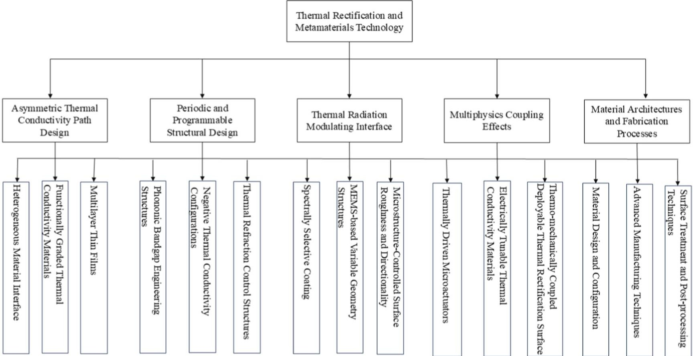

Fig. 2.16. The structural-materials collaborative design framework diagram of thermal rectification and thermal metamaterial technology.

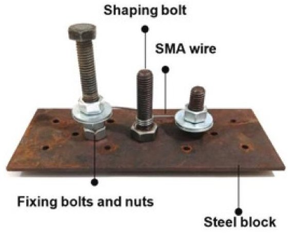

(a)

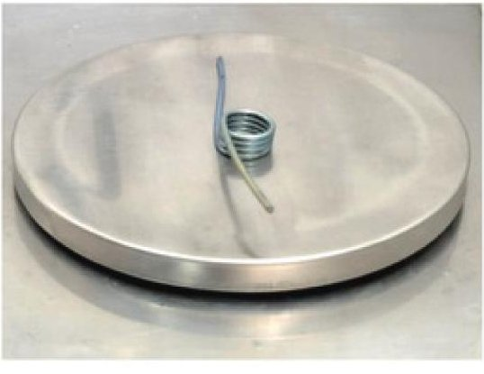

(b)

Fig. 2.17. Fabrication method of the SMA springs: (a) SMA wire fixture used to keep the wire as a torsion spring during shape setting; (b) SMA torsion spring after shape setting [58].

thermal control, load-bearing, and electromagnetic shielding functions will be promoted to comprehensively enhance the adaptability, intelligence, and system integration capability of satellite thermal control structures.

2. 2.2.3. Research progress on closed-loop decision-making and control of intelligent thermal control structures. With the increasing emphasis on autonomous operation and closed-loop control in advanced spacecraft thermal management, the application of intelligent decision-making mechanisms within satellite thermal-control structures has undergone significant evolution, marking a shift from classical control theory toward self-adaptive, cognition-enabled control architectures. While traditional methods such as linear-quadratic regulation (LQR) and Kalman filtering have been effectively applied in active thermaldisturbance suppression, emerging intelligent control strategies—including deep reinforcement learning, adaptive sliding-mode control, and physics-informed machine learning—have markedly enhanced system performance in terms of nonlinear dynamic response,

real-time adaptability, and computational efficiency. As a result, nextgeneration thermal-control systems are gradually acquiring key capabilities such as dynamic mission-oriented thermal response, structure-thermal coupling adjustment, and intelligent, energy-efficient distribution.

As summarized in Table 2.8, representative closed-loop decision-control approaches span classical state-estimation/optimal-control (Kalman filtering with LQR) and intelligent strategies-deep reinforcement learning, fixed-time sliding-mode control augmented by reinforcement learning, physics-informed machine learning, and Actor-Critic-based online PID tuning-with reported gains in stability, steady-state error, disturbance rejection, computational efficiency, and temperature accuracy. These advances form a solid technical foundation for achieving high-reliability thermal management in future constellation-based and deep-space missions. Notably, for small satellites and missions operating in highly dynamic orbital environments, intelligent thermal-control strategies demonstrate superior adaptability and energy-optimization potential. Despite current challenges-such as

<!-- PDF_PAGE: 16 -->

Table 2.7 Key technologies of intelligent thermal control and reconfigurable structure based on SMA [58-61].

<table border="1"><tr><td>Research Direction</td><td>Key Technology</td><td>Application Scenario</td><td>Technical Highlights and Data Support</td></tr><tr><td>SMA-based heat engine</td><td>Shape memory alloy-Stirling heat engine thermo-mechanical-material coupling framework.</td><td>Space power conversion and energy recovery systems</td><td>Optimized output torque and speed; enhanced thermal power utilization; suitable for microgravity environments</td></tr><tr><td>Reconfigurable helical antenna</td><td>Opposed SMA-driven adjustable helical arm structure</td><td>Space communication systems</td><td>Enables antenna shape reconfiguration; frequency tuning range increased by 15%; RF performance remains stable</td></tr><tr><td>Intelligent radiator fin system</td><td>Biomimetic design with SMA-actuated fin deployment mechanism</td><td>Integrated thermal control structures</td><td>Automatic response to temperature variations; heat dissipation capacity increased by 25-30%; structural simplification</td></tr><tr><td>SMA torsional actuator</td><td>Design of the SMA torsion spring bidirectional drive mechanism</td><td>Aerospace active control surface systems</td><td>Achieves approximately 30° bidirectional rotational actuation; features lightweight and compact integration; response speed adjustable for optimization</td></tr></table>

Table 2.8 Table of key research progress and technical characteristics of closed-loop decision control [20,62-65].

<table border="1"><tr><td>Research Direction</td><td>Technical Methods and Features</td><td>Research Highlights and Outcomes</td></tr><tr><td>Active thermal stability control</td><td>Kalman filter-based state estimation combined with linear-quadratic regulator(LQR) for disturbance heat-flux compensation.</td><td>Approximately4dB improvement in displacement stability, enhancing system response precision</td></tr><tr><td>Deep reinforcement learning application</td><td>Online load-power adjustment using deep reinforcement learning(DRL) for nonlinear thermal environments</td><td>More stable temperature control: steady-state error reduced by22.7-47.4%in simulation and by20.4-42.7%in experiments</td></tr><tr><td>Fixed-time sliding mode control</td><td>Reinforcement learning-augmented sliding mode control with adaptive gain tuning and fixed-time convergence for strong adaptability</td><td>Improved rendezvous and docking robustness: position error&lt;0.005m; disturbance rejection improved by32%; response speed increased by45%</td></tr><tr><td>Physics-informed machine learning(PIML)</td><td>Neural network with heat-conduction physics constraints and finite-difference supervision for efficient, physics-consistent thermal-field prediction</td><td>Computational efficiency improved by~1.7×while maintaining physical consistency and real-time generalization capability.</td></tr><tr><td>Intelligent thermal control strategy</td><td>Online PID parameter tuning via Actor-Critic policy network combined with reinforcement learning to enhance adaptability and responsiveness</td><td>Control accuracy±0.01℃; steady-state error reduced by50-75%; demonstrated robustness and rapid response capability</td></tr></table>

modeling complexity, limitations in onboard computing power, and insufficient generalization across diverse environments—the integration of artificial intelligence, high-performance embedded hardware, and structurally integrated design is emerging as a critical pathway toward next-generation closed-loop autonomous thermal-control systems.

To make the mapping between obstacles and remedies explicit, Fig. 2.18 summarizes three principal challenges in closed-loop intelligent thermal control and their primary mitigation strategies.

(i) Structural-thermal model complexity, mitigated by integrated structural-thermal co-design with model-reduction surrogates;

(ii) Instability of online-learning convergence, mitigated by lowpower adaptive/robust control with safety monitoring (e.g., adaptive MPC, safe RL);

(iii) And on-board computing and power constraints, mitigated by edge-intelligence hardware (FPGA, ASIC, and SoC accelerators). The arrows in Fig. 2.18 indicate the challenge-to-solution mapping and do not represent information or energy flow. These pairings clarify how emerging control algorithms, embedded computation, and structural-thermal co-design jointly enable autonomous and energy-efficient thermal management.

## 2.2.3. Synergistic interactions between intelligent satellite thermal control structures and other systems

Under the trend of high integration and modularization, satellite thermal control structures are no longer isolated auxiliary systems but must function as system-level coupled components, achieving coordinated optimization of thermal energy and functionality with key subsystems such as power and propulsion systems.

2. 2.3.1. Synergistic interactions between intelligent satellite thermal control structures and power and propulsion systems. Intelligent thermal-control structures must coordinate closely with spacecraft power and propulsion subsystems to achieve system-level performance optimization. Fig. 2.19 schematizes this system-level coupling: a thermal-management hub mediates bidirectional exchanges between the thermal-control structure and the power and propulsion systems. In the schematic, solid arrows indicate physical and energy couplings, whereas dashed connectors indicate coordination and control via the thermal-management hub; the lower block implements collaborative optimization. The thermal-control structure exchanges waste-heat removal and actuator-power supply with the power (energy) system, and ignition/ plume heating and pre-heat/cooling demand with the propulsion system. On the power side, coupled regulation with the electrical-power system has become an important direction in the intelligent evolution of thermal control [66]. Structurally embedded thermal pathways and distributed smart heat-transfer components enable information interconnection with the power-management module and thermal-state prediction, thereby optimizing heat-routing and enhancing stability. On the propulsion side, periodic ignitions and thruster operations impose nonlinear disturbances on the thermal-control loop. Recent

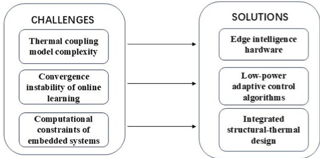

Legend: arrows indicate mitigation mapping (challenge $ \rightarrow $ solution); they do not represent information or energy flow.

Fig. 2.18. Challenges and solutions in intelligent thermal control loop design.

<!-- PDF_PAGE: 17 -->

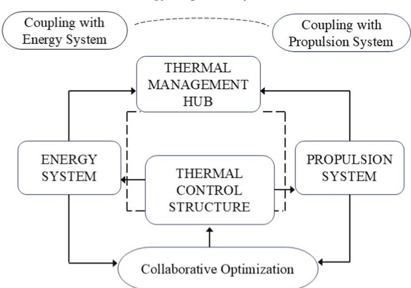

Fig. 2.19. Thermal management system and energy propulsion collaboration diagram.

studies therefore advocate coupling the thermal-control structure with propulsion-subsystem thermal-state models in a digital-twin framework, using active thermal-load identification and control to improve thermal robustness over the mission cycle [67].

Future development trends lie in establishing a synergistic decisionmaking framework for thermal-energy-power coupling among multiple subsystems, enabling integrated regulation of multi-source thermal disturbances and energy redistribution under complex operating conditions. Meanwhile, multi-task thermal management strategies based on physics-enhanced learning are expected to play a key role, endowing thermal control systems with dynamic response and adaptive regulation capabilities across systems and operational cycles. This will provide stronger system-level thermal control resilience for next-generation constellation systems and missions in extreme orbital environments.

2. 2.3.2. Synergistic interactions between intelligent satellite thermal control structures and solar array structures. Under increasingly stringent mission conditions, integrated thermal-structural design has become essential for achieving efficient, synergistic operation of solar array structures in multi-physics coupled environments. This trend is exemplified by the deployment of Intelligent Thermal Control Structures (ITCS) at critical locations such as joints and deployment mechanisms. These structures integrate phase-change materials (PCMs), thermally responsive materials, and miniature thermal switches, thereby enabling active responses to thermal disturbances, dynamic regulation of heatconduction pathways, and adaptive thermal buffering, while preserving the mechanical performance of the joints [68].

Meanwhile, to maintain solar cells operating within an efficient temperature range, thermal management strategies are increasingly evolving toward intelligent and adaptive approaches. A representative pathway involves the development of adaptive thermal shielding technologies, which utilize variable-spectrum radiative materials or thermophotovoltaic coatings to selectively reflect or absorb solar irradiation [69]. In addition, the concept of reconfigurable thermal control structures has recently emerged, such as flexible deployable radiators and thermally actuated morphing devices, which can actively adjust their configurations in response to real-time orbital thermal conditions, thereby optimizing overall thermodynamic performance and structural load distribution.

Intelligent thermal control structures still lack a unified multi physics coupling modeling framework integrating thermal, structural, and electrical fields. In particular, the nonlinear and hysteretic response

mechanisms of materials under unsteady orbital environments remain unclear. Future efforts should focus on multi-scale modeling to uncover the intrinsic self-regulation mechanisms of materials and to establish predictive and verifiable coupled theoretical models, thereby advancing the design and optimization of highly reliable intelligent thermal control structures.

## 2.3. Coupled Structural-Thermal design and multi-physics integration of intelligent satellites

This section implements the architecture introduced in Fig. 2.1 for coupled structural-thermal design and multi-physics integration, by coupling the component layer (devices and materials), the system layer (integrated thermal intelligence, control strategies, and digital-twin system modeling), and the cognitive layer (AI-assisted diagnosis and model evaluation). Structural-thermal integration is an important direction in the design of intelligent spacecraft systems, with its core lying in the development of multifunctional material systems and a design framework that is both physically simulation-enabled and adjustable. In this process, digital twins will play a key role in modeling, prediction, and the iterative refinement of control strategies.

## 2.3.1. Research progress on the multifunctional integrated design of intelligent thermal control structures

Embedding the thermal-control function into the main structure is the key path to improving the thermal-management efficiency and system integration of spacecraft. Fig. 2.20 summarizes the co-design concept: embedded heat pipes and functional thermal materials, together with a distributed temperature-sensing network, enable structure-function integration and feed high-resolution data to the thermal digital twin. Current research therefore focuses on the integration of heat-conduction channels, thermal-control materials, and temperature-sensing networks in load-bearing components to achieve the collaborative design of structural load bearing and thermal regulation.

Carbon-fiber-reinforced porous PCM composites can simultaneously bear mechanical load and regulate heat flow, realizing the integration of structure and function; the introduction of hexagonal boron nitride (hBN) nanosheets into thermoplastic composites also significantly improves their thermal conductivity and mechanical properties [69,70]. Meanwhile, by laying MEMS temperature sensors or fiber Bragg grating (FBG) arrays within the structure, a "perception-prediction-control" closed loop can be constructed to provide high-precision spatiotemporal temperature data for the thermal digital twin [71]. In recent years, sensing-actuation integrated composites (such as thermally conductive layers embedded with piezoelectric fibers) have emerged as a promising direction, endowing materials with thermal responsiveness and actuation capabilities and promoting the intelligent evolution toward "material as structure, structure as function.

With the evolution of spacecraft thermal control systems toward lightweight, high integration, and intelligence, traditional singlefunction materials can no longer meet the comprehensive requirements for thermal conduction, heat storage, structural stability, and electromagnetic compatibility in complex orbital environments. In recent years, integrated thermal control design based on multifunctionally coupled materials and microstructural regulation has become a research hotspot. Multicomponent composites based on carbon nanotubes, graphene, $ \mathrm{F e_{3} O_{4}} $ , and flexible polymer matrices, combined with configuration strategies such as electrospinning, coaxial alignment, and multi-core-shell structures, have enabled the development of multifunctional material systems that simultaneously possess thermal conductivity, heat storage, piezoelectric response, and EMI shielding capabilities. From a performance characterization perspective, significant breakthroughs have been achieved in certain systems. For example, axially aligned MWCNT-enhanced PVDF nanofibers can deliver a piezoelectric response displacement of up to 24 $ \mu \mathrm{m} $ . As shown in Table 2.9, these advances not only represent important progress in the

<!-- PDF_PAGE: 18 -->

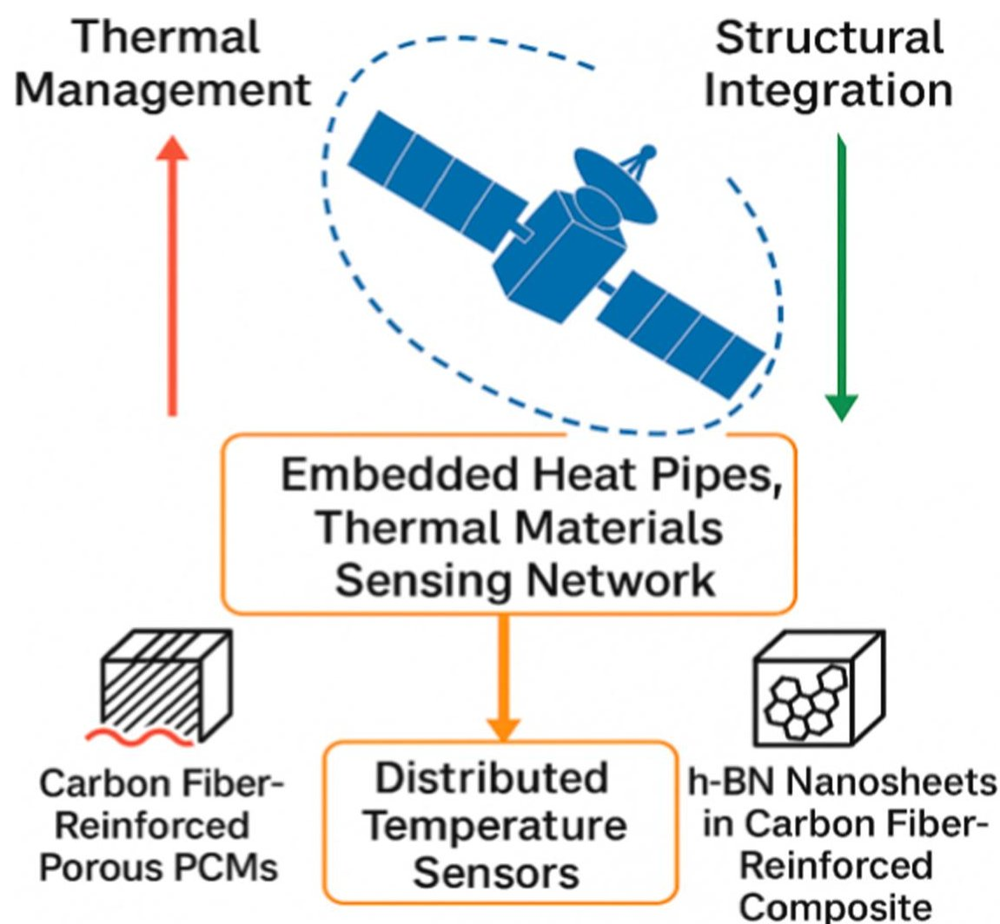

Fig. 2.20. Integrated integration of thermal control and structural functions in intelligent satellite design.

integration of structural and functional elements but also highlight the critical role of microstructural design in effectively tuning the multiphysical responses thermal, electrical, magnetic, and mechanical. In addition, functional integration strategies are evolving toward systemlevel co-design tailored for space missions. Overall, multifunctional thermal control structures are gradually transitioning from experimental validation to system engineering integration, providing critical support for high performance, low power consumption, and strong adaptive thermal control capabilities in intelligent satellites.

## 2.3.2. Research progress on multi-field coupled modeling and Cooptimization design of intelligent thermal control structures

Digital-twin design for intelligent satellite thermal-control structures hinges on multifield coupled modelling and co-optimization to realize high-fidelity thermo-structural-control co-simulation and intelligent regulation. Fig. 2.21 schematizes a workflow that links high-fidelity thermo-structural finite-element analysis to reduced-order surrogates (POD/DL-ROM) for real-time co-simulation, and then closes the loop through machine-learning/model-predictive controllers and a strategy analysis and scheduling layer, yielding an efficient thermo-mechanical digital twin. This configuration enables real-time (or faster-than-realtime) simulation of thermal responses together with attitude/actuator dynamics, allowing rapid assessment of control options. Mission context—orbital parameters, attitude evolution, and task profiles—feeds the twin to realize a mission-driven adaptive thermal-control framework that supports dynamic reconfiguration and closed-loop optimization of the thermal-control mechanisms. By iterating between strategy analysis and data-driven model updates, the digital twin improves predictive accuracy and strengthens cyber-physical interactive control.

The multi-field coupling modeling emphasizes the integrated simulation of physical processes such as heat, force, electricity and phase change, in order to accurately depict the dynamic response of the

structure under complex loads For example, in the thermo-mechanical coupled finite element model of PCM-enhanced structures, researchers incorporated nonlinear thermal contact, temperature-dependent material properties, and latent heat release mechanisms. Simulation results demonstrated good agreement with the reference solution when phasechange latent heat and nonlinear thermal contact conditions were considered, with errors falling within the engineeringly acceptable range (approximately 5 %) [79]. In terms of co-optimization, systemlevel optimal design is achieved by formulating multiple objective functions—such as thermal resistance, mass, stiffness, and response rate—and applying methods including genetic algorithms, topology optimization, and reinforcement learning [80,81]To enhance the efficiency of multi-physics modeling, recent studies have proposed the integration of Proper Orthogonal Decomposition (POD)-based model reduction with Physics-Informed Neural Networks (PINNs), aiming to construct high-accuracy and low-computational-cost rapid thermal control models. [82]. Based on the PIML method, neural networks are integrated with finite difference models to achieve real-time prediction and dynamic correction of thermal-stress responses, resulting in a simulation speed improvement of approximately 1.7 times and a significant enhancement in thermal control efficiency during orbital transfers [20].

## 3. Research progress on design methods and technologies of digital twin for intelligent satellite thermal control structures

3. 1. Multilevel architecture of digital twin for intelligent satellite thermal control structures

For intelligent satellite missions operating in multi-orbit and complex thermal environments, traditional one-way mapped thermal simulation bodies can no longer meet the demands of real-time

<!-- PDF_PAGE: 19 -->

Table 2.9

Overview of key properties and application potentials of multifunctional intelligent thermal control materials and structures [72-78].

<table border="1"><tr><td>Research Content</td><td>Key Performance Improvements</td><td>Application Prospects</td></tr><tr><td>Electrospun axially aligned multi-walled carbon nanotube(MWCNT)-reinforced.Polyvinylidene fluoride(PVDF)nanofibers</td><td>Increasedβ-phase content;bending displacement of24μm under4V/μm electric field</td><td>Flexible,integrable piezoelectric actuator units for structural response control</td></tr><tr><td>Coaxially alignedMWCNT/PVDFnanofiber-based actuating material</td><td>β-phase content up to94%;crystallinity increased by50%;enhanced actuation performance at low filler loading</td><td>Micro-scale flexible thermal-control actuator films;smart surface structural control components</td></tr><tr><td>Honeycomb carbon fiber bundle-supported paraffin-based composite phase change material(PCM)</td><td>Thermal conductivity improved by nearly7times. excellent shape, stability,and cycling performance;latent heat≈192.2J/g</td><td>Space thermal-control energy storage modules;Solar energy harvesting and waste-heat management</td></tr><tr><td>Fiber Bragg grating(FBG)sensors embedded in theCFRP skin and aluminum honeycomb structure of the NASA SUNRISE III optical platform</td><td>Embedded FBG temperature and strain sensing with fast response;capable of detecting micro-deformations;suitable for near-zero coefficient of thermal expansion platforms</td><td>Integrated thermomechanical-sensing structures for space optical instruments;supports in-orbit state monitoring and ground thermal-vacuum test validation.</td></tr><tr><td>Multicore-shell structuredPVDF/Fe3O4@pDA@Ag nanofiber membranes</td><td>EMI shielding effectiveness up to82.31dB;combined electrical conductivity,magnetic loss,and microwave attenuation;excellent impedance matching</td><td>Multifunctional composites integrating thermal control,electromagnetic compatibility,and structural response meet lightweight,高-integration requirements for intelligent satellites.</td></tr><tr><td>Directionally aligned carbon fiber-reinforced composite phase change material(CPCM)</td><td>Thermal conductivity increased to6.31W/(m·K);latent heat~131J/g maintained;photothermal conversion efficiency≈83.5%</td><td>Thermal conduction-storage synergistic modules in intelligent satellite thermal-control systems;supports lightweight structural integration and sensitive-payload thermal management</td></tr><tr><td>Flexible phase change composites(FPCC)</td><td>High latent heat(&gt;150J/g)coexisting with mechanical flexibility;adaptable to complex geometries;excellent thermal buffering and formability</td><td>Construction of flexible thermal-control units,deployable spacecraft surface structures,and localized thermal-management modules;supports functional integration and morphology regulation of intelligent satellite thermal structures</td></tr><tr><td>MWCNT/PDA-graphene/PVDF-HFP flexible composite conductive films</td><td>EMI shielding effectiveness≈32.54dB;electrical conductivity≈1000S/m;thermal response temperature increased to172℃</td><td>Flexible material solutions integrating thermal control and electromagnetic compatibility,suitable for high-integration satellite structure design</td></tr></table>

mechanisms. Through bidirectional coupling of physics-driven and data-driven approaches, it enables state mapping, behavior simulation, and task-responsive regulation of the thermal control structure across spatiotemporal scales, supporting high-precision modeling and intelligent adaptability throughout its full lifecycle.

modeling and adaptive regulation. In recent years, digital twins (DTs) of intelligent thermal control structures have been evolving into complex systems endowed with multi-level perception, cognition, and adaptive evolution capabilities. Mainstream architectures generally adopt a three-layer decoupled design of "physical layer-model layer-cognitive layer," in which each layer constructs a system-level collaborative closed loop through heterogeneous data fusion and modeling

## 3.2. Thermal field physical layer in the digital twin design of intelligent satellite thermal control structures

At the thermal-physical layer—the interface linking the digital twin of the satellite's thermal-control structure to real sensor data—the system consists of the load-bearing structure, an embedded sensing fabric, and edge-computing units. Deploying thermal sensor arrays, FBG fiberoptic sensors, and flexible thermal films across structural surfaces raises the spatial resolution and temporal sampling of the thermal field, while a self-organizing IIoT architecture supports dynamic node reconfiguration and collaborative edge processing to build multi-dimensional thermal maps under complex orbital conditions.

Table 3.1 provides a concise overview of representative technologies along five directions: embedded microsystems integrated with IIoT, edge synchronization and communications, TinyML-based edge inference, radiation-hardened edge nodes, and cooperative multi-node inference/scheduling. Collectively, these capabilities deliver precise sensing, time-aligned and reliable data, low-power onboard intelligence, and scalable coordination—forming the data backbone for high-fidelity digital-twin estimation and closed-loop thermal control.

The distributed digital twin architecture based on IIoT has achieved real-time synchronized sensing and edge analysis of multi-area thermal fields [88]. The structural embedded deployment of the new thermistor array, flexible hot film and FBG Optical fiber sensor has significantly enhanced the data density and stability of the thermal control system [89]. Among them, FBG sensor realizes Bragg reflection of specific wavelength $ \lambda $ B=2neff $ \Lambda $ ) through periodic refractive index modulation structure, which has excellent thermal/strain sensitivity, and is suitable for high-resolution dynamic sensing of thermal field and structural stress state in complex track environment. Fig. 3.1 sketches guided propagation and acceptance-angle limitations in a step-index fiber [90], the basis for reliable optical sensing. Fig. 3.2 depicts the FBG mechanism, highlighting the refractive-index grating and the reflected Bragg wavelength in the spectrum [91].

At present, the thermal field physical layer of the digital twin of the smart satellite thermal control structure is accelerating in the direction of high integration, low power consumption, and strong robustness. The integration of next-generation CMOS-MEMS sensors, self-organizing IIoT networks, and edge synchronization protocols enables multidimensional sensing and high-precision collaborative acquisition of thermal field information, significantly improving system response speed and data coverage capability. TinyML-based edge intelligence algorithms and radiation-hardened high-precision DACs further enhance the in-orbit computational capability and environmental adaptability of sensing nodes, establishing an edge perception architecture with autonomous inference and stable output capabilities. Overall, thermal control structures are evolving from a "single-point sensing-distributed collaboration-intelligent autonomy" architecture toward a closed-loop model of "perception-cognition-prediction. In the future, ultra-low-power multifunctional thermal-sensitive devices, in-orbit adaptive inference models, and edge intelligence chips deeply integrated with structural materials will become key research focuses, laying a solid foundation for the development of high-timeliness and high-fidelity thermal control digital twin systems.

## 3.3. The thermal field modeling layer in the digital twin design for intelligent satellite thermal control structures

As a core layer of the digital-twin architecture for intelligent-satellite thermal-control systems, the thermal-field modeling layer aims to

<!-- PDF_PAGE: 20 -->

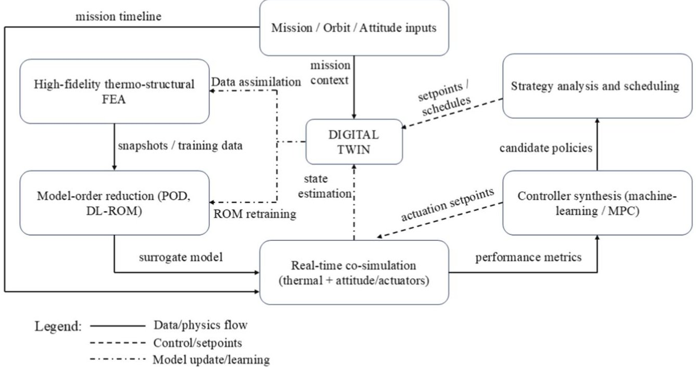

Fig. 2.21. Digital twin model of the satellite thermal control system.

Key technologies of the thermal physical layer in intelligent satellite digital twins [83-87].

<table border="1"><tr><td>Key Direction</td><td>Technical Progress/Component Type</td><td>Typical Performance Metrics</td><td>Main Advantages &amp; Role</td></tr><tr><td>Embedded microsystems integrated with IIoT</td><td>Monolithic CMOS-MEMS thermal flow sensor</td><td>Power &lt;5mW; Sensitivity:156mV/(m/s); Detection limit:86μm/s; Linear range:±4m/s; temperature-control error:&lt;0.01K; Noise density:12.4nV/√Hz</td><td>High-precision, low-power flow sensing; supplies thermal-control, state monitoring, and digital-twin sensory inputs</td></tr><tr><td>Edge-side data processing &amp; energy-efficient synchronous communication</td><td>TDMA-based low-power sync protocol+nRF52832 SoC wireless node</td><td>Synchronization accuracy0.8μs; Energy cost15μW/kbps; CPU load&lt;2%; packet-error rate≤0.03; TX power≥3dBm</td><td>Precise time sync and lightweight communication; supports multi-node thermal-field sensing and dynamic coordination</td></tr><tr><td>Edge-side data-processing algorithms</td><td>TinyML backbone CNN+dedicated neural coprocessor+on-chip weight storage</td><td>Power160mW; inference speed30FPS; entirely on-chip processing</td><td>Efficient recognition and low-power edge inference, suited to rapid intelligent thermal-control anomaly response</td></tr><tr><td>Radiation-hardened edge node design</td><td>Radiation-hardened12-bit stringDAC(RHBD,0.13μmCMOS)</td><td>ENOB&gt;9.7;INL/DNL&lt;0.2LSB;Radiation tolerance≥500krad(Si)</td><td>Provides high-precision analogue outputs under radiation; increases stability and reliability of edge nodes in thermal-control structures</td></tr><tr><td>Cooperative intelligent inference &amp; scheduling</td><td>Model partitioning+self-aware multi-node inference framework</td><td>Throughput↑14.77×;devices10;accuracy maintained;latency markedly reduced</td><td>Overcomes computational bottlenecks; enables multi-task scheduling and anomaly prediction via collaborative edge intelligence</td></tr></table>

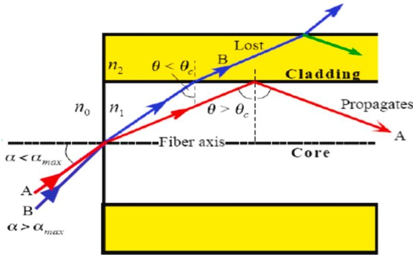

Fig. 3.1. Fiber optic working principle diagram [90].

deliver high-fidelity modeling and dynamic prediction of thermal responses under complex thermal environments. The enabling strategy is to fuse multiphysics, physics-based modeling with data-driven algorithms to form a framework that is physically consistent and computationally efficient. Fig. 3.3 schematically summarizes this logic: the physics-based and data-driven branches feed an integration step that yields hybrid models capable of capturing strong nonlinearity, thermostructural coupling, and multiscale boundary conditions.

In the digital-twin design of intelligent thermal-control structures, the thermal-field modeling layer targets high-precision multiphysics modeling, dynamic-response prediction, and improved simulation efficiency. Table 3.2 summarizes representative advances—updatable ABD shell/multiscale frameworks, thermo-flexible-structure vibration models with ACLD, and thermal-dynamic coupling for orbit-dependent loads—which together enhance modeling accuracy, response controllability, and orbital-environment adaptability, supporting digital-twin modeling of flexible structures and complex load scenarios.

To address the increasingly complex thermal environments of next-generation spacecraft, developing a high-fidelity digital twin for intelligent-satellite thermal-control systems requires a structured modelling architecture. Fig. 3.4 illustrates a closed-loop workflow integrating multiphysics coupling, data-driven thermal modelling, model self-evolution and calibration, boundary-condition inference, and system deployment, thereby enhancing prediction accuracy and

<!-- PDF_PAGE: 21 -->

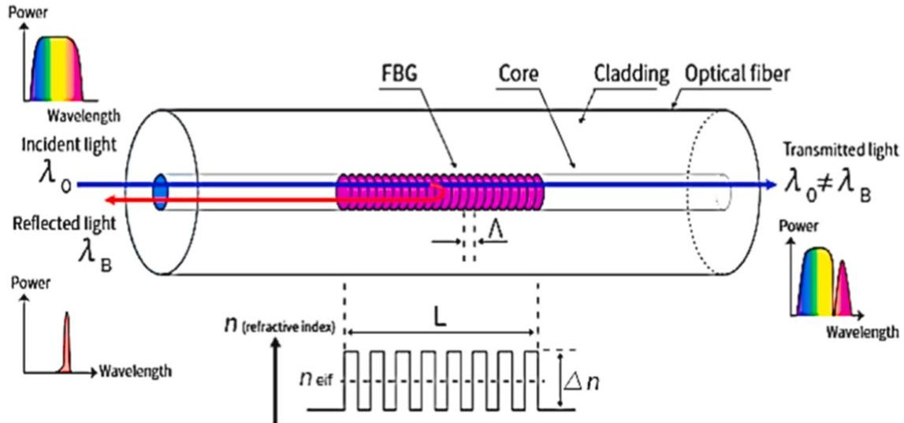

Fig. 3.2. FBG working principle diagram [91].

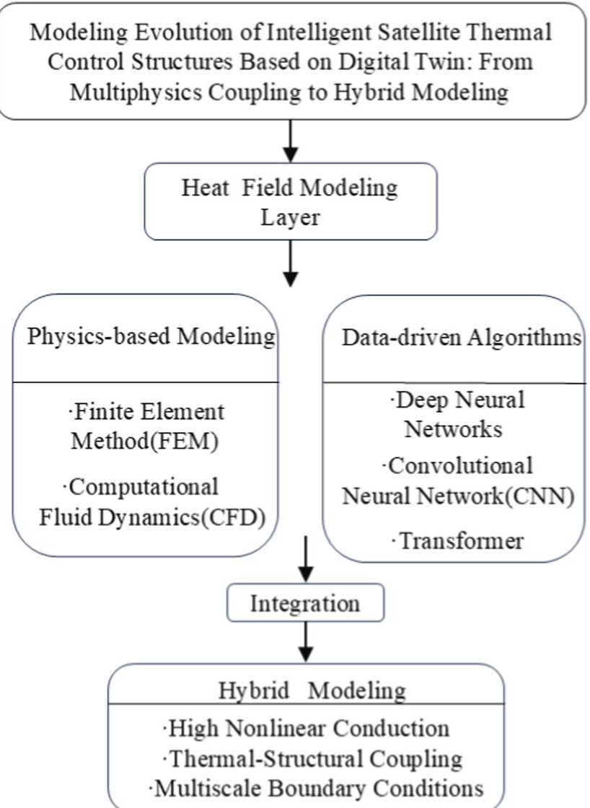

Fig. 3.3. Evolution diagram of intelligent satellite thermal control structure modeling.

adaptability under dynamic orbital conditions.

In response to the challenge that traditional thermal simulation workflows often struggle to balance computational efficiency and accuracy, recent research has made significant progress by adopting reduced-order modeling techniques based on Proper Orthogonal Decomposition (POD) and Dynamic Mode Decomposition (DMD). These methods have achieved simulation speed improvements by two to three orders of magnitude $ ( 1 0^{2}-1 0^{3} $ times) in the digital twin modeling of intelligent thermal control structures. Further studies have introduced physics-informed machine learning frameworks that integrate Proper

Table 3.2 Key technologies of the thermal field model layer for intelligent satellite thermal control structure [92-94].

<table border="1"><tr><td>Key Technical Breakthrough</td><td>Performance Metrics(Data Support)</td><td>Applicable Scenarios</td></tr><tr><td>Updatable ABD shell model and multiscale modeling framework</td><td>Modeling accuracy improved by 23.7 %; thermal deformation error &lt;4.8 %; simulation efficiency increased by 30 %</td><td>Flexible solar wings; thermally stress-dominated structures; modeling for adaptive performance evolution and long-duration operation</td></tr><tr><td>Development of coupled thermo-flexible-structure vibration model with integrated active constrained layer damping(ACLD)</td><td>Maximum vibration displacement reduced by &gt;65 %; thermal response settling time shortened by≈43 %; damping ratio increased by&gt;70 %</td><td>Flexible structural components subject to severe thermally induced deformation; design of thermal-structure coupled feedback control systems</td></tr><tr><td>Thermo-dynamic coupling modeling supporting prediction of thermally induced structural response under complex orbital conditions</td><td>Coupling error&lt;5 %; response accuracy improved by≈18 %</td><td>Space truss antennas: simulation and modeling of complex thermal-control structures and thermally induced disturbances</td></tr></table>

Orthogonal Decomposition (POD)-based dimensionality reduction with embedded physical priors to construct surrogate models for spacecraft thermal response Compared with the pure data-driven neural network method, this method can significantly reduce the training cost (about 26 %-81 %) while ensuring the modeling accuracy. [82]. In the field of multi-fidelity thermal field modeling, recent studies have proposed a multi-fidelity fusion method based on Taylor Mode Decomposition (TMD). By implicitly embedding physical constraints, this approach demonstrates superior prediction stability and cross-scale generalization capability under sparse and non-uniform thermal field conditions, outperforming traditional methods such as POD, DMD, PINNs, DeepONet/FNO, and POD-LSTM [95].

Taken together, these advances are distilled in Table 3.3. The table provides a concise, side-by-side comparison of representative digital-twin modeling methods (POD, DMD, PINN, DeepONet/FNO, PODLSTM), summarizing key strengths and limitations, and it also outlines a TMD-based multi-fidelity data-fusion approach that introduces implicit physics priors to improve stability and cross-scale generalization under sparse, non-uniform thermal fields.

To address the challenges of multi-domain, strongly nonlinear, and complex boundary condition thermal conduction in intelligent thermal control structures, researchers have proposed a coupled transient multidomain thermal modeling approach that integrates Proper Orthogonal

<!-- PDF_PAGE: 22 -->

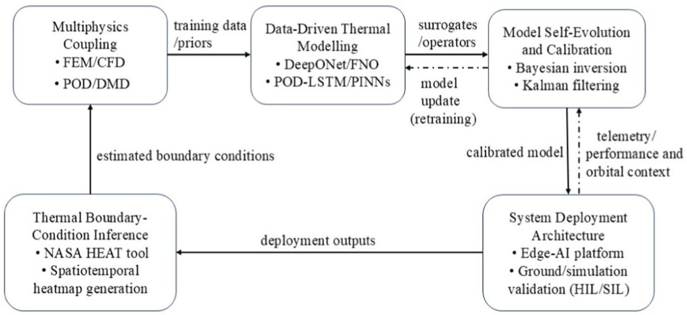

Legend: data/physics flow

- - - - - - - telemetry/model update

Fig. 3.4. The key modeling path for the digital twin of the intelligent satellite thermal control structure.

Comparison and analysis of digital twin modeling methods for intelligent satellite systems [96-100].

<table border="1"><tr><td>Method</td><td>Key Characteristics and Challenges</td><td>TMD-Based Data Fusion Solution</td></tr><tr><td>POD(Proper Orthogonal Decomposition)</td><td>Efficient for dimensionality reduction; suitable for regular boundaries; limited in handling nonlinearities and multi-fidelity data</td><td>Mode decoupling improves feature interpretability; supports multi-fidelity fusion modeling.</td></tr><tr><td>DMD(Dynamic Mode Decomposition)</td><td>Effective in capturing temporal patterns, sensitive to noise, and weak in physical constraints</td><td>Implicit physics priors are introduced to enhance model stability and physical consistency.</td></tr><tr><td>PINN(Physics-Informed Neural Network)</td><td>Explicitly incorporates PDEs; strong analytical capacity, but training is difficult; relies on known physical formulations.</td><td>Can model complex thermal systems without explicit PDEs; adaptable to unknown disturbance fields.</td></tr><tr><td>DeepONet/FNO(Fourier Neural Operator)</td><td>Strong generalization capability; requires large-scale datasets; limited inherent physical consistency.</td><td>Improves prediction accuracy via co-learning with limited high-fidelity data and physics-guided training</td></tr><tr><td>POD-LSTM(Proper Orthogonal Decomposition+Long Short-Term Memory network)</td><td>Captures temporal dynamics; still dependent on single-source data</td><td>Fuses simulation, telemetry, and sensor data to support heterogeneous, multi-source digital twin modeling</td></tr></table>

Decomposition (POD)-based model reduction with the Element Differential Method (EDM) and the Radial Integration Boundary Element Method (RIBEM). This method significantly improves both simulation accuracy and computational efficiency, making it well-suited for constructing real-time responsive digital twin systems for thermal control. [101]. Neural network techniques have demonstrated strong potential in capturing the nonlinear and temporal dynamic responses of thermal control structures. In particular, Long Short-Term Memory (LSTM) networks have been successfully employed to predict the response characteristics of functionally graded materials (e.g., porous plate structures) under unsteady thermal loads, providing an effective approach for constructing high-precision thermo-structural surrogate models. [102]. Furthermore, integrating the Mixture of Experts (MoE) mechanism into the Physics-Informed Neural Networks (PINNs) architecture enables adaptive distinction of different physical regions, thereby facilitating efficient modeling of discontinuous solutions to

hyperbolic conservation laws. This approach effectively overcomes the convergence bottlenecks of conventional PINNs in complex boundary value problems [103].

## 3.4. Thermal field cognitive layer in the digital twin design of intelligent satellite thermal control structures

As the core module for implementing high-order intelligence, the cognitive layer undertakes the semantic understanding, knowledge modeling, and closed-loop decision-making functions of multi-source perception data in the digital twin of the intelligent satellite thermal control structure. Compared with the traditional "Data-Driven + physical heuristic" reasoning framework, the cognitive layer introduces technologies such as knowledge mapping, cognitive computing and reinforcement learning, which endows the system with the ability of logical attribution, experience transfer and strategy optimization of thermal behavior, promotes the thermal control system from "passive response" to "active cognition prediction regulation" closed-loop evolution, and realizes the intelligent autonomy and dynamic adaptation of on orbit thermal management.

The multi-fidelity knowledge transfer mechanism in the cognitive layer has emerged as a key technical pathway for enhancing the autonomous evolution and environmental adaptability of thermal control digital twins. An adaptive transfer learning method based on dynamic Kriging models enables the dynamic migration of high-fidelity ground-based models to in-orbit environments, effectively mitigating accuracy degradation caused by model mismatch and environmental disturbances [104]. This mechanism integrally unifies ground-based simulations, high-altitude experiments, and in-orbit telemetry data to enable mission-driven model updating and strategy optimization. In terms of state identification, the Dynamic Mode Decomposition (DMD) method has been applied to the spatiotemporal modal extraction of GRACE satellite data, enhancing the cognitive capability of thermal control system evolution patterns [105]. Meanwhile, autonomous thermal control systems integrated with PINN-CNN architectures have achieved physically consistent steady-state thermal field prediction under unlabeled data conditions, demonstrating the deep integration potential of the cognitive layer in fault reconstruction and energy consumption regulation [106,107].

Fig. 3.5 summarizes the core techniques underpinning this mechanism—including high-fidelity data fusion, domain adaptation and feature alignment, transfer-learning framework design, adaptive weight scheduling, multi-task collaborative optimization, and online and incremental learning—thereby guiding implementation in practice.

In the design of digital twins for intelligent satellite thermal control

<!-- PDF_PAGE: 23 -->

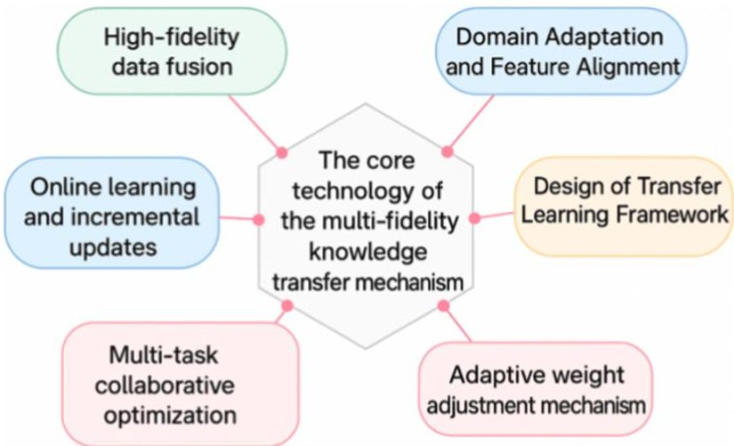

Fig. 3.5. The core technology of the multi-fidelity knowledge transfer mechanism.

structures, the Hybrid Digital Twin (HDT) framework integrates systemlevel modeling with physics-field-level surrogate modeling, enabling unified modeling and co-optimization of thermal field perception and attitude control. At the physical level, this approach employs deep neural networks to construct efficient surrogate models for thermal fields, significantly reducing simulation costs. At the system level, a multi-domain co-modeling mechanism is introduced to enhance crosslayer interactions and temporal synchronization. Experimental results show that the temperature reconstruction error is controlled within 1 K, and the attitude control accuracy exceeds $ 1^{\circ} $ , validating the engineering applicability and control stability of this method in thermo-mechanicalcontrol integrated applications [108]. At present, the HDT framework is evolving toward three types of integrated capabilities.

(i) Enhancing the multi-fidelity generalization of thermal field models through reduced-order and adaptive strategies such as POD and DMD, enabling cross-condition thermal cognition transfer;

(ii) Integrating telemetry and simulation data to establish a systemlevel cognitive mechanism with online adaptability;

(iii) Advancing the coordinated control of thermal management, attitude regulation, and mission execution, evolving from perception-based modeling to predictive regulation and optimal task allocation, thereby supporting on-orbit multi-objective thermal management for highly autonomous satellites.

To meet the demands of intelligent response under complex in-orbit thermal environments, current research focuses on developing integrated perception-cognition modeling frameworks with enhanced generalization and interpretability, aiming to support thermal state awareness, anomaly prediction, and adaptive regulation. Table 3.4 summarizes the cognitive-layer routes and their core methods, functional roles, and advantages—covering multimodal thermal perception with spatiotemporal completion, physics-informed deep-learning prediction, multiscale representation with causal anomaly inference, and interpretable cognition linked to control—thereby providing the methodological basis for the system modeling and implementation that follow.

## 4. Digital twin of intelligent satellite thermal control structures: challenges and advances

## 4.1. Complexity analysis of multi-physics coupling modeling for digital twins of intelligent satellite thermal control systems

In the modeling of digital twins for intelligent satellite thermal control structures, multi-physics coupling is a key enabler for achieving

Table 3.4 Key technical paths for the cognitive layer of the intelligent satellite thermal control structure [109,110].

<table border="1"><tr><td>Technical Route</td><td>Core Methods</td><td>Functional Role</td><td>Technical Advantages</td></tr><tr><td>Multimodal thermal perception and spatiotemporal completion modeling</td><td>Infrared imaging, thermal array, vibration response+Low-Rank Tensor Reconstruction(LRT)+Spatiotemporal Graph Neural Network(ST-GNN)</td><td>Synchronous modeling and completion of multi-source data</td><td>Mitigates limitations of onboard thermal sensor deployment and sparse observations; enhances perception accuracy and completeness</td></tr><tr><td>Physics-informed deep learning modeling</td><td>Physics constraints+neural network-based thermal prediction</td><td>Physics-consistent thermal field modeling</td><td>Enhances physical consistency and generalization; reduces dependency on labeled data</td></tr><tr><td>Multiscale thermal field representation and anomaly inference</td><td>Dynamic Graph Convolutional Networks(Dynamic-GCNs)+Bayesian Causal Inference</td><td>Local anomaly detection and failure path analysis</td><td>Supports fault prediction and reasoning for thermal control systems</td></tr><tr><td>Interpretable cognition and closed-loop control interface design</td><td>Transformer-based feature extraction+AutoEncoder compression+embedded policy learning</td><td>Coupling of decision output and control execution</td><td>Enables semantic closed-loop from perception to control; improves interpretability of decision policies</td></tr></table>

high-fidelity prediction. The system requires a unified description of complex physical processes in orbit, including heat conduction, radiation, structural response, attitude control, and the orbital environment. Fig. 4.1 schematizes this coupled formulation, highlighting the bidirectional interactions among heat conduction/radiation, structural response, attitude control, and the evolving orbital environment. This results in a highly nonlinear, high-dimensional thermo-structural-control-orbit coupled model involving the solution and coupling of multiple sets of partial differential equations (PDEs). The model incurs high computational costs and exhibits poor real-time performance, making it difficult to directly embed into the inference framework of a digital twin. Meanwhile, the process exhibits pronounced spatiotemporal multiscale characteristics and strong local-global coupling features, posing

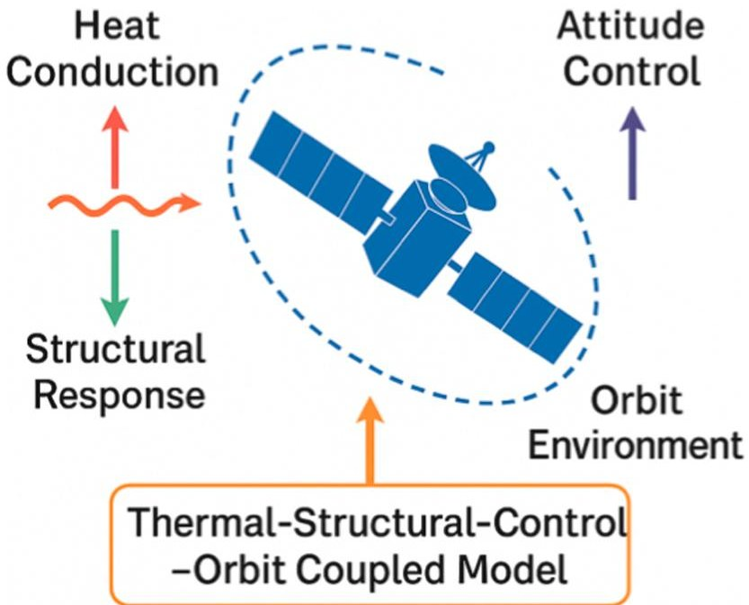

Fig. 4.1. Schematic of the thermal-structural-control-orbit coupled model.

<!-- PDF_PAGE: 24 -->

significant challenges to the physical consistency of modeling, numerical stability, as well as model-level dimensionality reduction and generalization capabilities.

To address the challenges of high nonlinearity, high dimensionality, real-time requirements, and data scarcity in digital twin modeling, current research mainly seeks breakthroughs along four technical pathways: dimensionality-reduction modeling, multiscale representation, physics-consistent deep learning, and on-orbit data augmentation. Table 4.1 provides a concise problem-solution crosswalk by mapping each challenge category (nonlinearity, dimensionality, real-time constraints, and data scarcity) to corresponding approach directions and representative techniques. These strategies not only enhance the feasibility and adaptability of multiphysics-coupled modeling in thermal-control systems but also lay the foundation for information transfer and regulatory capabilities from the modeling layer to the cognitive layer.

## 4.2. Construction and generalization challenges of intelligent satellite thermal control digital twin models under high-dimensional thermal environments

In constructing the modeling layer of an intelligent satellite thermal control digital twin, accurate modeling and generalization capability of the high-dimensional thermal field are critical. The thermal field exhibits complex spatiotemporal dynamics and high-dimensional characteristics. As summarized in Fig. 4.2, the key impediments are on-orbit data sparsity/incompleteness, non-stationary dynamics, high dimensionality with redundancy, limited labeled data, weak integration of physics priors, and strong task/configuration variability, which together frame the generalization challenge for high-dimensional thermal-field models. Traditional deep learning methods tend to overfit when dealing with non-stationary thermal environments or complex boundary conditions, making it difficult to maintain robust generalization performance in real on-orbit scenarios. Meanwhile, constrained by the scarcity of on-orbit measurement data and low-frequency data transmission, the

Table 4.1

Techniques for addressing the challenges of multi-physics field thermal control modeling in digital twin systems [111-113].

<table border="1"><tr><td>Challenge Category</td><td>Approach Direction</td><td>Representative Key Techniques and Methods</td></tr><tr><td>Scale mismatch issue</td><td>Multiscale modeling; dominant mode extraction</td><td>Multilevel mesh modeling; Dynamic Mode Decomposition (DMD); modal analysis for principal thermo-structural modes</td></tr><tr><td>Limited model scalability and generalization</td><td>Enhanced model compression and structural adaptability</td><td>Proper Orthogonal Decomposition (POD)-based reduced-order modeling; dynamic sliding window prediction; model transfer framework</td></tr><tr><td>Real-time performance vs. computational constraints</td><td>Reduced-order modeling and lightweight deployment</td><td>POD-DMD combined reduced-order modeling strategy; integration of reduced-order models (ROMs); embedded-optimized physics-based simulation modules</td></tr><tr><td>Limited physics-data fusion</td><td>Physics-informed modeling; neural architecture optimization</td><td>Physics-Informed Neural Networks (PINNs); hybrid digital twin architectures; PDE-constrained Transformer models (e.g., PINN-Former)</td></tr><tr><td>Scarce in-orbit validation data</td><td>Data augmentation and transfer learning; simulation-real coupling</td><td>Virtual simulation-based data augmentation; semi-supervised model validation; few-shot transfer learning for on-orbit applications</td></tr></table>

training process often faces the dual challenges of small sample sizes and high-dimensional sparse data, which further affect the robustness and stability of the model.

To address the challenges of insufficient generalization and limited sample sizes in high-dimensional thermal field modeling, current research tends to develop physics-guided data-driven frameworks. Structured models such as FNO and DeepONet enhance the representation of complex boundary conditions and physical laws by embedding partial differential operators or Fourier kernels within neural networks, demonstrating superior performance in thermal field prediction compared to traditional CNNs or LSTMs [114,115]. Meanwhile, multi-fidelity modeling and small-sample transfer strategies have gained increasing attention. For example, constructing unified training domains by physically integrating ground simulation and on-orbit data, or employing Taylor modal embeddings to extract dominant thermal response features, can enhance model transferability and stability across different scenarios. [95]. The aforementioned methods provide critical support for constructing digital twins under complex thermal environments.

The current research constructs a thermal control modeling framework that simultaneously achieves computational efficiency, physical consistency, and task generalization capability through strategies of dimensionality reduction, decoupling, enhancement, and embedded physics integration. Hybrid modeling combined with physics-guided deep learning is emerging as a mainstream technical approach, providing foundational support for cross-task, high-confidence, and real-time modeling of intelligent satellite thermal control digital twins. Table 4.2 concisely maps these challenge types-high dimensionality and redundancy, task heterogeneity, uncertain thermal boundaries, data scarcity, and the expressiveness-consistency trade-off-to the corresponding solution paths, offering a quick crosswalk from problem to remedy for practical deployment.

## 4.3. Research on intelligent perception and reliable inference of on-orbit environment for intelligent satellite thermal control digital twin

In the construction of intelligent satellite thermal control structural digital twins, enhancing their intelligent perception and reliable inference capabilities in the on-orbit environment is crucial for achieving autonomous system operation and state prediction.

However, due to space radiation, electromagnetic interference, and resource constraints, thermal sensors are prone to performance degradation, resulting in reduced data acquisition stability and measurement accuracy. Meanwhile, limitations in sensor placement, insufficient downlink bandwidth, and constrained telemetry resources result in onorbit thermal field data exhibiting spatiotemporal sparsity, significant drift, and quality fluctuations, which substantially increase the difficulty of digital twin model development. In dynamically changing mission scenarios, such as attitude adjustments and load switching, the thermal field response varies drastically, and traditional low-frequency offline corrections are insufficient to meet the demand for high-frequency dynamic updates. [116]. Moreover, the lack of a unified credibility assessment metric system and verification process limits its engineering deployment in high-reliability space missions. [117]. Fig. 4.3 consolidates these obstacles into a closed-loop challenge map—linking perception-data sparsity/inconsistency, high dynamics and non-stationarity, poor physical consistency/generalization, uncertainty propagation, and instability during online evolution—thereby framing the requirements for on-orbit intelligent perception and trustworthy inference.

In recent years, in response to the sensing and modeling challenges of intelligent satellite thermal control structures under complex on-orbit environments, research has focused on key technical approaches such as disturbance-resilient sensing, sparse reconstruction, dynamic correction, and trustworthy evaluation. Radiation-hardened MEMS thermal sensor arrays, integrated with multi-source data fusion

<!-- PDF_PAGE: 25 -->

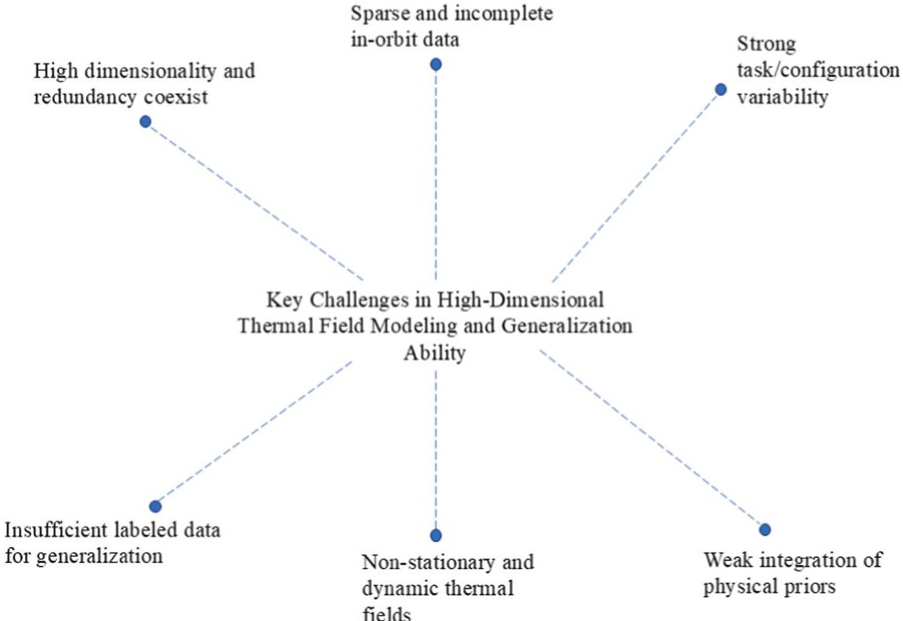

Fig. 4.2. High-dimensional thermal field modeling and key challenges in generalization ability mapping.

Challenge-solution mapping for intelligent thermal modeling in high-dimensional scenarios.

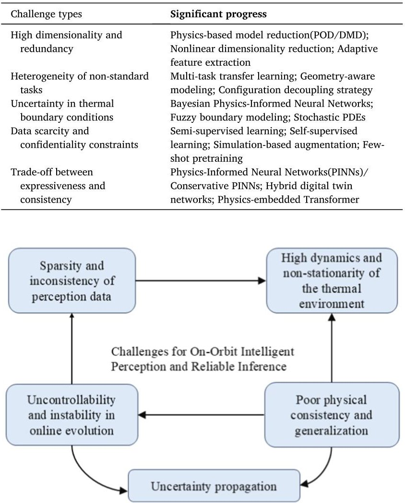

Fig. 4.3. Challenges of on-orbit intelligent perception and trustworthy reasoning.

mechanisms, have significantly enhanced measurement robustness and data reliability [118]. The thermal map reconstruction method combining compressed sensing and Proper Orthogonal Decomposition

(POD) has achieved high-fidelity sparse thermal field recovery. [118]. Bayesian inference and extended Kalman filtering have been employed for the online calibration of digital twin models, enhancing response consistency under dynamic thermal field variations [117,118]. Meanwhile, drawing on the practices of ESA and NASA in system health management, a preliminary framework for trustworthy evaluation and standardized validation processes of digital twins for thermal control applications has been established, providing engineering support for high-reliability missions [119].

## 4.4. Edge deployment and flight-ground collaborative architecture of intelligent satellite thermal control digital twin systems

In intelligent satellite thermal control digital twin systems, edge deployment and enclave-coordinated operations face critical challenges such as limited computational resources, communication bottlenecks, data heterogeneity, uncertainty modeling, and security assurance. Edge nodes struggle to support real-time inference of high-dimensional thermal control models, highlighting the urgent need for lightweight modeling and heterogeneous computing architectures. [8]. Enclave communication latency and bandwidth limitations impact state synchronization and decision-making efficiency, driving the development of edge-cloud collaboration and intelligent scheduling mechanisms [120]. Perceptual-side data exhibit inconsistencies in frequency, accuracy, and structure, necessitating standardized interfaces and multimodal fusion algorithms to enhance consistency [121]. In response to thermal environmental disturbances, it is necessary to integrate Physics-Informed Neural Networks (PINNs) with Bayesian methods to achieve uncertainty modeling and physics-constrained learning; moreover, data privacy and security risks require the incorporation of encryption and access control strategies. The coordinated response to these challenges is a key prerequisite for achieving cross-platform, highly dynamic, and adaptive operation of thermal control digital twins.

## 5. New design of intelligent satellite thermal control structural digital twin

## 5.1. Modular structure and distributed twin node architecture

To address the systematic challenges of intelligent satellite thermal

<!-- PDF_PAGE: 26 -->

control system digital twins in high-dimensional coupling, spatiotemporal multi-scale features, and real-time computation, this paper proposes a novel architecture based on modular functional decoupling and collaborative distributed twin nodes. Based on a modular structure, each physical module is mapped to a digital twin node responsible for local state sensing, prediction, and feedback, thereby forming an independent intelligent control loop. This design approach fully draws on microservice system architecture, embedded edge inference technologies, and distributed sensing networks to enable efficient co-modeling of the thermal control system in both physical and virtual spaces. As schematically illustrated in Fig. 5.1, the modular stack—thermal conduction, thermal radiation, structural response, and attitude control—is mapped onto a distributed twin-node layer, with each node closing a local sense-predict-feedback loop while collaborating across the twin network.

As illustrated in Fig. 5.2, the architecture decomposes the satellite thermal-control system into physically autonomous, functionally independent modules mapped to distributed twin nodes—thermal conduction, thermal radiation, structural response, and attitude-control/dynamics. Thermal-conduction nodes simulate anisotropic conduction within structural components, accounting for interfacial thermal resistance and latent-heat/effective heat-capacity effects. Thermal-radiation nodes model on-orbit radiative exchange driven by surface attitude, time-varying view factors, and orbital illumination cycles. Structural-response nodes predict thermally induced deformation and stress evolution via coupled thermo-structural finite-element models. Attitudecontrol/dynamics nodes capture the impacts of thermal loads on mass distribution and inertia and feed these into the control algorithms. Each node hosts local data acquisition, lightweight modeling, inference, and optimization, while a DT-orchestrator coordinates the nodes through standardized interfaces—e.g., OPC UA and DDS—to enable efficient distributed-twin collaboration and real-time thermal-state management of the overall system.

It features excellent scalability, real-time performance, and robustness. Based on heterogeneous computing platforms (e.g., FPGA, ARM Cortex-M), the architecture supports hot-swappable nodes and resource reconfiguration through modular design, achieving the system's flexible expansion. The edge twin engine is responsible for local modeling and prediction, supporting high-frequency real-time responses. It dynamically allocates resources through an event-triggered mechanism and, combined with redundant twin subsystem strategies, achieves fault takeover and robust operation in the event of node failures.

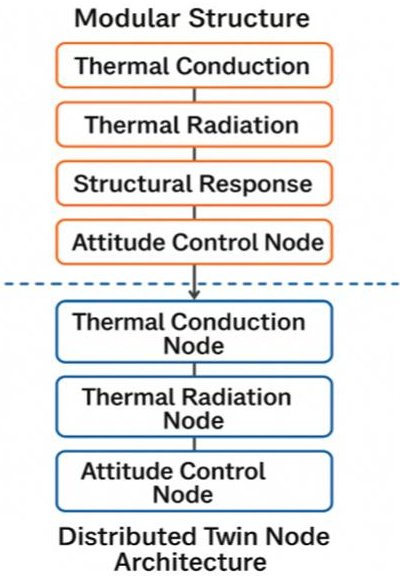

Fig. 5.1. A two-layer architecture featuring a modular structure and distributed twin nodes.

## 5.2. A three-layer collaborative framework for modular and distributed digital twin-based satellite thermal control

To achieve a highly reliable, responsive, and autonomous digital-twin thermal-control system, this scheme establishes a three-layer collaborative architecture-physical layer, simulation layer, and cognitive layer. As illustrated in Fig. 5.3, a DT-orchestrator coordinates twin models (conduction, radiation, structural response, attitude) over standardized communication/coordination links and physical-layer sensing, enabling scalable, collaborative operation. Through hierarchical collaboration of physical sensing, modeling computation, and decision cognition, it enables dynamic mapping and intelligent regulation of on-orbit thermal behavior. To enable a highly integrated and crossplatform-deployable engineering-oriented digital twin system, a standardized mechanism encompassing communication and coordination is proposed. At the communication layer, DDS is employed to achieve high-concurrency, low-latency data distribution, while the OPC UA protocol facilitates interoperability among heterogeneous devices. Unified data formats such as ROS 2 or JSON are adopted to support lightweight parsing and debugging. The coordination layer manages the operational status of twin nodes through service registration, heartbeat detection, and dynamic scheduling; it supports module hot-swapping, remote updates, and version control, and ensures system-state transparency and operational efficiency through a twin-operation monitoring dashboard.

The physical layer, as the fundamental support of the system, integrates the satellite's primary load-bearing structures, built-in thermal conduction channels, and a distributed multimodal sensing network This layer enables in-situ sensing of temperature gradients, heat flux, and structural strain, establishing a tightly integrated cyber-physical sensing platform to support thermo-structural interaction and cosimulation.

The modeling layer bridges raw sensor data and advanced inference by deploying local digital-twin model nodes that encompass key thermal processes—conduction, radiation, thermoelasticity, and attitude. The nodes support heterogeneous strategies, including PDE-based reducedorder models (ROMs), dynamic mode decomposition (DMD), and proper orthogonal decomposition (POD), and are optimized via Tiny Machine Learning (TinyML) for embedded deployment on platforms such as Jetson Nano and Cortex-M. Efficient real-time communication and collaboration among nodes are achieved through the Data Distribution Service (DDS) and the Open Platform Communications Unified Architecture (OPC UA). As schematized in Fig. 5.4, these twin-model nodes run ROM/decomposition solvers with TinyML edge deployment and are coordinated via DDS/OPC UA.

The cognitive layer centers on a centralized digital twin (DT) coordinator that integrates multi-source model outputs to achieve global state estimation and generate control strategies. This layer combines algorithms such as Kalman filtering, GRU predictors, and Bayesian fusion to infer thermo-structural states under dynamic orbital conditions. Through a "perception-prediction-control" closed-loop mechanism, it enables real-time adjustment of active thermal control components and adaptive optimization of thermal management strategies, thereby establishing an intelligent and scalable hierarchical thermal control system architecture.

## 6. Future developments of intelligent satellite thermal control structural digital twin

Facing the complexity and dynamic challenges of future space missions, digital twins of intelligent satellite thermal control structures will continue to advance toward high-fidelity multiphysics coupled modeling, on-orbit heterogeneous sensing fusion, lightweight intelligent inference, and integrated co-evolution of structure, materials, and control. Leveraging the integration of deep reduced-order models, reinforcement learning, and edge computing technologies, the thermal

<!-- PDF_PAGE: 27 -->

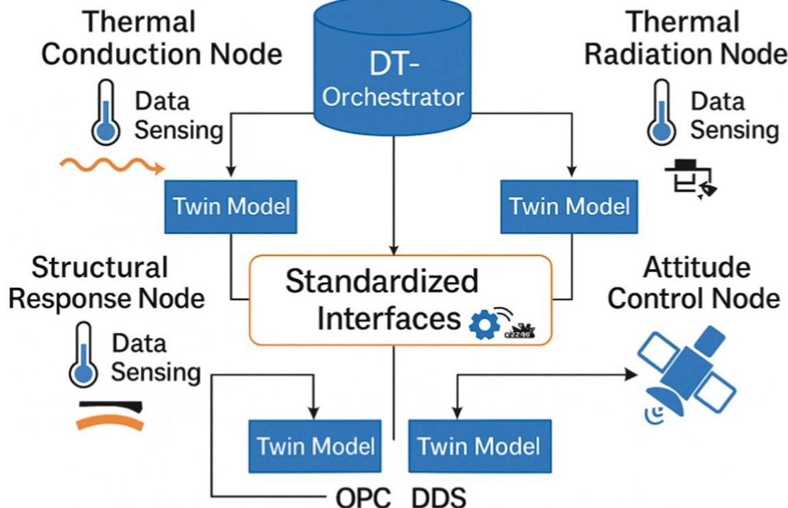

Fig. 5.2. Distributed digital twin node architecture for modular satellite thermal control.

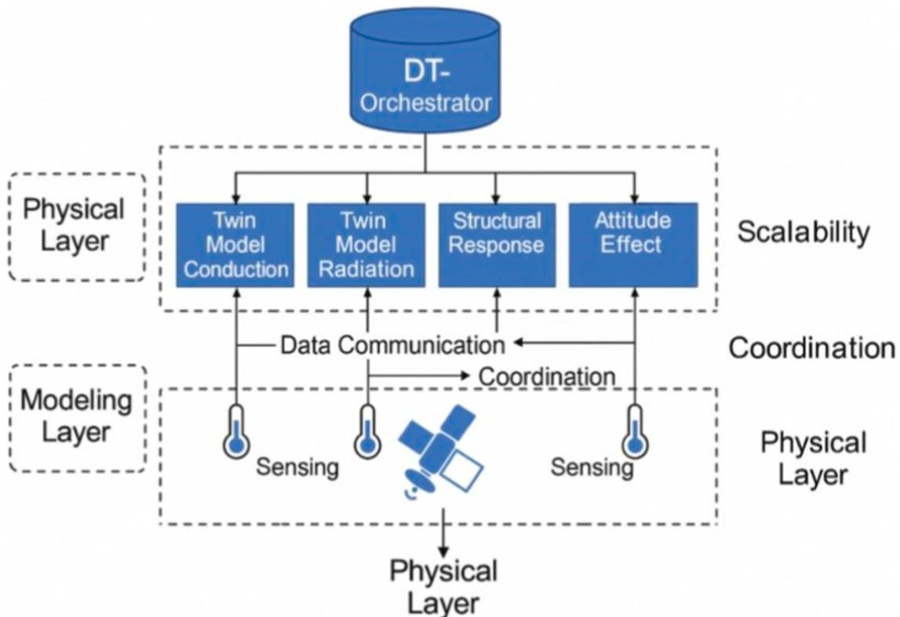

Fig. 5.3. Three-layer collaborative architecture diagram of the modular digital twin system for satellite thermal control.

control digital twin not only possesses real-time prediction and robust control capabilities under complex thermal environments but also enables adaptive model updating and mission-driven closed-loop regulation. The key to future development lies in overcoming the bottleneck between model generalization capability and data sparsity, establishing a "perception-cognition-control" closed-loop system that supports on-orbit dynamic evolution, thereby providing sustainable, autonomous, and highly reliable digital mapping support for the next generation of intelligent thermal control structures.

## 7. Conclusion and future perspectives

Designing high-fidelity digital twins (DTs) for intelligent satellite thermal-control systems is pivotal for achieving precise on-orbit thermal

state awareness and autonomous regulation, thereby elevating mission reliability and energy-efficiency margins. This work has systematically reviewed the functional requirements and architectural characteristics of intelligent satellite thermal-control structures, emphasizing recent advances in active, passive, and hybrid active-passive solutions. We analyzed adaptive thermal-management mechanisms, inter-subsystem synergies, and key performance indicators that jointly determine in-orbit robustness.

Focusing on DT-enabled thermal-control modeling, we dissected a hierarchical "physical-model-cognitive" framework and surveyed its enabling technologies: distributed multimodal sensing networks and embedded edge inference at the physical layer; heterogeneous reducedorder surrogates—spanning partial-differential-equation (PDE) model reduction, dynamic-mode decomposition (DMD), proper orthogonal

<!-- PDF_PAGE: 28 -->

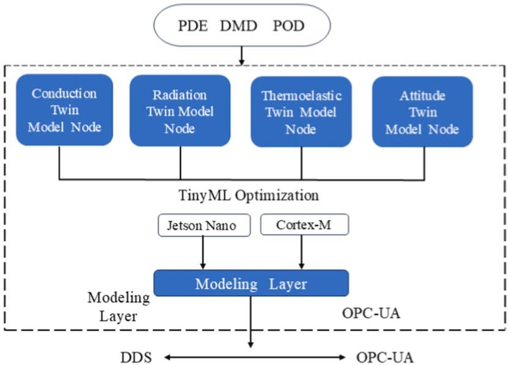

Fig. 5.4. A distributed twin modeling layer for thermal-structural reasoning and edge collaboration.

decomposition (POD), and physics-informed neural networks (PINNs) at the modeling layer; and Kalman-filtering, gated recurrent unit (GRU) prediction, and Bayesian fusion strategies at the cognitive layer. We highlighted breakthroughs in multiphysics coupling, high-dimensional generalization under sparse datasets, and trustworthy inference in radiation-rich orbital environments.

A modular, distributed DT architecture was subsequently proposed that integrates structural, simulation, and cognitive subsystems. Leveraging a microservice-oriented communication stack—Data-Distribution Service (DDS) and Open-Platform-Communications Unified Architecture (OPC-UA)and engineered for heterogeneous computing targets (e.g., FPGA, Jetson Nano, ARM Cortex-M), the framework supports hot-swappable nodes, real-time resource orchestration, and dynamic thermal-field mapping with closed-loop "perception-prediction-control" regulation.

Looking forward, we identify four strategic directions for next-generation intelligent thermal-control DTs.

Ultra-High-Fidelity Multiphysics Co-Simulation - Integrating conjugate heat-transfer, thermoelasticity, micro-vibration, and attitude dynamics in a unified, uncertainty-aware DT kernel to capture cross-domain interactions at millisecond cadence.

- On-Orbit Heterogeneous Sensing Fusion - Deploying radiation hardened MEMS sensor arrays, optical fiber Bragg gratings, and hyperspectral imagers with federated-learning-based fusion to maximize data veracity under limited telemetry.

- Lightweight, Trustworthy Edge Intelligence - Exploiting Tiny Machine Learning (TinyML), reinforcement-learning-driven policy optimization, and secure enclave computing to realize subsecond inference and resilient control on resource-constrained platforms.

- Standardization and Verification Ecosystem - Establishing open reference models, validation benchmarks, and in-line qualification protocols (e.g., V-model with DT-in-the-loop) to ensure interoperability, traceability, and certification readiness across agencies and vendors.

By converging structure, materials, and control into an adaptive cyber-physical continuum, future DT-enabled thermal-control systems will deliver sustainable autonomy, enhanced fault tolerance, and lifecycle performance gains, offering a robust digital backbone for upcoming deep-space and high-throughput satellite missions.

## CRediT authorship contribution statement

Hanyu Wang: Writing - review & editing, Writing - original draft, Conceptualization. Jingyu Yang: Writing - review & editing, Supervision. Yuchen Shi: Writing - review & editing. Haichang Huo: Writing review & editing. Xinyu Ye: Writing - review & editing.

## Declaration of competing interest

The authors declare that they have no known competing financial interests or personal relationships that could have appeared to influence the work reported in this paper.

## Acknowledgments

This project is supported by LiaoNing Revitalization Talents Program (Grant No. XLYC2207049) "Intelligent satellite platform design and development"; Industry-university-research Innovation Fund for Chinese Universities (Grant No. 2021BCF01004) "Industrialization project research of missile cluster guidance platform based on "5G+ ARTIFICIAL intelligence satellite""; Liaoning Province education science "14th Five-Year plan" project (Grant No. JG22DA029) "Research on the construction of first-class undergraduate courses of integration of production and education in local universities"; Postgraduate Education Reform Project of Liaoning Province (Grant No. LNYJG2024056) "Research and practice on training system of "six in one" aviation professional degree graduate students". This paper is a phased research result of the 2024 vocational education project of China Vocational and Technical Education Association and China Vocational Education Research Institute (SZ24A21) : "Mechanism - Model - Path Study on the integration of Production and Education to Accelerate the development of new quality Productivity"; The "14th Five-Year Plan" of the China Taixi Research Society(JSFZ/2024/173) "Research on the Cultivation of Aerospace Equipment Talents and the Path for High-Quality Employment and Entrepreneurship under the Mechanism of Industry-Academia Integration"; Basic research projects for universities in the year 2025 (LJ212510143023) "Research on the Circular Synergistic Evolution Mechanism of Digital Twins for High Maneuverability Intelligent Satellites".

## References

[1] D.W. Hengeveld, J.E. Braun, E.A. Groll, A.D. Williams, Hot- and cold-case orbits for robust thermal control, J. Spacecraft Rockets 46 (6) (Nov. 2009) 1249-1260. https://doi.org/10.2514/1.44468.

[2] R.C. Consolo, S.K.S. Boetcher, Advances in Spacecraft Thermal Control, 2023, pp. 1-50, https://doi.org/10.1016/bs.aiht.2023.04.001.

[3] A.M. Elshaer, A.M.A. Soliman, M. Kassab, S. Mori, A.A. Hawwash, Thermal control of a small satellite in low Earth orbit using phase change materials-based thermal energy storage panel, The Egyptian Journal of Remote Sensing and Space Sciences 26 (4) (Dec. 2023) 954-965, https://doi.org/10.1016/j.ejrs.2023.11.007.

[4] K.K. Baraya, Thermal Management Challenges in Small Satellites, 2023, pp. 217-229, https://doi.org/10.1007/978-981-19-6470-1_18.

[5] D. Wu, Z. Li, J. Sun, L. Zhu, Digital twin based intelligent monitoring system for spacecraft vacuum thermal tests, in: M. Milly Cen, L. Wang (Eds.), 4th International Conference on Information Science, Electrical, and Automation Engineering (ISEAE 2022), SPIE, Aug. 2022, p. 170, https://doi.org/10.1117/ 12.2640367.

[6] X. Zhao, X. Chen, Z. Gong, W. Zhou, W. Yao, Y. Zhang, RecFNO: a resolutioninvariant flow and heat field reconstruction method from sparse observations via fourier neural operator, Int. J. Therm. Sci. 195 (Jan. 2024) 108619, https://doi.org/10.1016/j.ijthermalsci.2023.108619.

[7] S. Zhao, H. Lei, X. Shi, Deep operator neural network applied to efficient computation of asteroid surface temperature and the yarkovsky effect, Astron. Astrophys. 691 (Nov. 2024) A224, https://doi.org/10.1051/0004-6361/ 202451789.

[8] W. Liu, M. Wu, G. Wan, M. Xu, Digital twin of space environment: development, challenges, applications, and future outlook, Remote Sens. 16 (16) (Aug. 2024) 3023, https://doi.org/10.3390/rs16163023.

[9] X. Xing, Z. Shen, Thermoelastic-structural dynamics analysis of a satellite with composite thin-walled boom, Acta Mech. 234 (3) (Mar. 2023) 1259-1273, https://doi.org/10.1007/s00707-022-03445-7.

<!-- PDF_PAGE: 29 -->

[10] A. Di Meglio, N. Massarotti, P. Nithiarasu, A physics-driven and machine learning-based digital twinning approach to transient thermal systems, Int. J. Numer. Methods Heat Fluid Flow 34 (6) (Jul. 2024) 2229-2256, https://doi.org/ 10.1108/HFF-10-2023-0616.

[11] H. Yi, K. Fan, Co-simulation-based digital twin for thermal characteristics of motorized spindle, Int. J. Adv. Manuf. Technol. 125 (9-10) (Apr. 2023) 4725-4737, https://doi.org/10.1007/s00170-023-11060-6.

[12] S. Duzellier, P. Gordo, R. Melicio, D. Valerio, M. Millinger, A. Amorim, Space debris generation in GEO: space materials testing and evaluation, Acta Astronaut. 192 (Mar. 2022) 258-275, https://doi.org/10.1016/j.actaastro.2021.12.036.

[14] N. Athanasopoulos, J. Farmasonis, N. Siakavellas, Preliminary design and comparative study of thermal control in a nanosatellite through smart variable emissivity surfaces, Proc. Inst. Mech. Eng. G J. Aerosp. Eng. 233 (9) (Jul. 2019) 3336-3350, https://doi.org/10.1177/0954410018795809.

[15] P. Van Bach Ngoc, N.L. Thien, P.H. Quan, Thermal Analysis on Small Satellite Structure Under Cosmic Radiation Effect, 2024, pp. 253-259, https://doi.org/ 10.1007/978-3-031-39090-6_29.

[16] A. Suliga, B. Bras, O. Ergincan, R. Martins, J. Geary, R. Rampini, Transmission loss of spacecraft optical materials due to ultraviolet-induced contamination, J. Spacecraft Rockets 59 (3) (May 2022) 773-781, https://doi.org/10.2514/1. A35220.

[17] Y.-G. Lv, Y.-T. Wang, T. Meng, Q.-W. Wang, W.-X. Chu, Review on thermal management technologies for electronics in spacecraft environment, Energy Storage 3 (3) (Sep. 2024) 153-189, https://doi.org/10.1016/j.enss.2024.03.001.

[18] J. Varey, J.D. Ruprecht, M. Tierney, R. Sullenberger, Physics-informed neural networks for satellite state estimation, in: 2024 IEEE Aerospace Conference, IEEE, Mar. 2024, pp. 1-8, https://doi.org/10.1109/AERO58975.2024.10521414.

[19] Z. Cao, W. Yao, W. Peng, X. Zhang, K. Bao, Physics-informed MTA-UNet: prediction of thermal stress and thermal deformation of satellites, Aerospace 9 (10) (Oct. 2022) 603, https://doi.org/10.3390/aerospace9100603.

[21] H. Huang, C. Bu, Design and verification of thermal control system of communication satellite, Aerospace 11 (10) (Sep. 2024) 803, https://doi.org/ 10.3390/aerospace11100803.

[20] M. Oddiraju, Z. Hasnain, S. Bandyopadhyay, E. Sunada, S. Chowdhury, Physics-informed machine learning towards a real-time spacecraft thermal simulator, in: AIAA AVIATION FORUM AND ASCEND 2024, American Institute of Aeronautics and Astronautics, Reston, Virginia, Jul. 2024, https://doi.org/10.2514/6.2024-4204.

[23] M. Aramesh, B. Shabani, Metal foam-phase change material composites for thermal energy storage: a review of performance parameters, Renew. Sustain. Energy Rev. 155 (Mar. 2022) 111919, https://doi.org/10.1016/j.rser.2021.111919.

[22] Q. Zhu, et al., Recent advances in graphene-based phase change composites for thermal energy storage and management, Nano Materials Science 6 (2) (Apr. 2024) 115-138, https://doi.org/10.1016/j.nanoms.2023.09.003.

[24] Y. Shang, D. Zhang, M. An, Z. Li, Enhanced thermal performance of composite phase change materials based on hybrid graphene aerogels for thermal energy storage, Materials 15 (15) (Aug. 2022) 5380, https://doi.org/10.3390/ ma15155380.

[25] J. Guo, et al., Form-stable phase change composites with high thermal conductivity and enthalpy enabled by graphene/Carbon nanotubes aerogel skeleton for thermal energy storage, Appl. Therm. Eng. 255 (Oct. 2024) 123954. https://doi.org/10.1016/j.applthermaleng.2024.123954.

[26] E. Baccega, L. Vallese, M. Bottarelli, Enhancement of thermal conductivity of paraffin PCM with metal foams, Int. J. Thermophys. 46 (3) (Mar. 2025) 35, https://doi.org/10.1007/s10765-024-03500-6.

[27] M.A. Fikri, et al., Thermal conductivity, reliability, and stability assessment of phase change material (PCM) doped with functionalized multi-wall carbon nanotubes (FMWCNTs), J. Energy Storage 50 (Jun. 2022) 104676, https://doi. org/10.1016/j.est.2022.104676.

[28] H. Ayaz, V. Chinnasamy, M. Shin, H. Cho, Investigation of 1-tetradecanol with functionalized multi-walled carbon nanotubes as PCM for high-density thermal energy storage, J. Mater. Res. Technol. 27 (Nov. 2023) 4005-4011, https://doi. org/10.1016/j.jmrt.2023.10.226.

[29] Y. Grosu, et al., Hierarchical macro-nanoporous metals for leakage-free high- thermal conductivity shape-stabilized phase change materials, Appl. Energy 269 (Jul. 2020) 115088, https://doi.org/10.1016/j.apenergy.2020.115088.

[30] S. Zhang, et al., Vibration-free six-stage thermoelectric cryogenic cooler achieving 130 K low temperature, Device (May 2025) 100797, https://doi.org/10.1016/j. device.2025.100797.

[31] C. Liu, et al., Experimental study of heat transfer performance of a large-area loop heat pipe heat spreader based on biomimetic leaf veins, Appl. Therm. Eng. 271 (Jul. 2025) 126298, https://doi.org/10.1016/j.applthermaleng.2025.126298.

[32] A.M. Chacón-Maldonado, G. Asencio-Cortés, A. Troncoso, A multimodal hybrid deep learning approach for Pest forecasting using time series and satellite images, Inf. Fusion 124 (Dec. 2025) 103350, https://doi.org/10.1016/j. inffus.2025.103350.

[33] F. Song, X. Xia, P. Gu, X. Shen, L. Liu, C. Sun, Design of a miniature high-precision anemorumbograph based on thermal field distribution, Sens Actuators A Phys 389 (Aug. 2025) 116538, https://doi.org/10.1016/j.sna.2025.116538.

[34] L. Yi, et al., Enhanced cooling model for GaN HEMT based on thermoelectric cooler, Appl. Therm. Eng. 265 (Apr. 2025) 125576, https://doi.org/10.1016/j.applthermaleng.2025.125576.

[35] L. Ling, et al., Experimental investigation on the thermal performance of a novel loop heat pipe (LHP) with micro-channel structure, Appl. Therm. Eng. 238 (Feb. 2024) 122046, https://doi.org/10.1016/j.applthermaleng.2023.122046.

[36] J. Huang, L. Chang, B. Dong, J. Wang, H. Huang, Variable switching system for heat protection and dissipation of Ultra-LEO satellites based on LHP coupled with TEC, Aerospace 11 (7) (Jul. 2024) 539, https://doi.org/10.3390/aerospace11070539.

[37] Y. Liu, et al., A lightweight and high thermal performance graphene heat pipe, Nano Select 2 (2) (Feb. 2021) 364-372, https://doi.org/10.1002/nano.202000195.

[38] S.Y. Jung, H. Park, Experimental investigation of heat transfer of Al2O3 nanofluid in a microchannel heat sink, Int. J. Heat Mass Tran. 179 (Nov. 2021) 121729, https://doi.org/10.1016/j.ijheatmastransfer.2021.121729.

[39] P. Jin, L. Xu, G. Xu, J. Li, C. Qiu, J. Huang, Deep learning-assisted active metamaterials with heat-enhanced thermal transport, Adv. Mater. 36 (5) (Feb. 2024), https://doi.org/10.1002/adma.202305791.

[40] S.-Y. Park, Y. Nam, Single-sided digital microfluidic (SDMF) devices for effective coolant delivery and enhanced two-phase cooling, Micromachines 8 (1) (Dec. 2016) 3, https://doi.org/10.3390/mi8010003.

[41] M. Chakraborty, R. Anand, P.S. Rao, S. Sen, S. DasGupta, Oscillating nanofluid droplet for micro-cooling, Sensor. Actuator. B Chem. 239 (Feb. 2017) 562-570. https://doi.org/10.1016/j.snb.2016.06.145.

[42] R. Kumar, et al., Investigation of thermal performance and chemical stability of graphene enhanced phase change material for thermal energy storage, Phys. Chem. Earth, Parts A/B/C 128 (Dec. 2022) 103250, https://doi.org/10.1016/j.pce.2022.103250.

[43] N. Sharifi, H. Shabgard, C. Millard, U. Etufugh, Hybrid heat Pipe-PCM-Assisted thermal management for lithium-ion batteries, Batteries 11 (2) (Feb. 2025) 64, https://doi.org/10.3390/batteries11020064.

[44] D. Li, W. Xie, Y. Li, L. Fang, Fedfusion: Manifold Driven Federated Learning for multi-satellite and Multi-modality Fusion, Nov. 2023, https://doi.org/10.1109/TGRS.2023.3339522.

[45] M. Liang, J. Hu, C. Bao, H. Feng, F. Deng, T.L. Lam, Explicit attention-enhanced fusion for RGB-thermal perception tasks, IEEE Rob. Autom. Lett. 8 (7) (Jul. 2023) 4060-4067, https://doi.org/10.1109/LRA.2023.3272269.

[46] R. Gupta, B. Tian, Y. Wang, K. Nahrstedt, TWIN-ADAPT: Continuous learning for digital twin-enabled online anomaly classification in IoT-Driven smart labs, Future Internet 16 (7) (Jul. 2024) 239, https://doi.org/10.3390/fi16070239.

[47] H. Kim, et al., VO2-based switchable radiator for spacecraft thermal control, Sci. Rep. 9 (1) (Aug. 2019) 11329, https://doi.org/10.1038/s41598-019-47572-z.

[48] Q. Xu, et al., VO2-Based spacecraft smart radiator with high emissivity tunability and protective layer, Nanomaterials 14 (16) (Aug. 2024) 1348, https://doi.org/ 10.3390/nano14161348.

[49] R. Yu, et al., Growth of VO2-ZnS thin film cavity for adaptive thermal emission, Appl. Phys. Lett. 125 (12) (2024), https://doi.org/10.1063/5.0222653.

[50] L. He, H. Wang, H. Zhu, Y. Gu, X. Li, X. Mao, Thermal properties of PEG/ Graphene nanoplatelets (GNPs) composite phase change materials with enhanced thermal conductivity and photo-thermal performance, Appl. Sci. 8 (12) (Dec. 2018) 2613, https://doi.org/10.3390/app8122613.

[51] B. Zandonati, G. Bucagu, A.A. Pol, M. Pierini, O. Sirkin, T. Kopetz, Towards optimal compression: joint pruning and quantization. https://doi.org/10.4855 0/arXiv.2302.07612, Feb. 2023.

[52] H. He, W. Peng, H. Le Ferrand, Thermal rectification in modularly designed bulk metamaterials, Adv. Mater. 36 (8) (Feb. 2024), https://doi.org/10.1002/adma202307071.

[53] Y. Gu, Z. Wei, G. Wei, Z. You, J. Ma, Y. Chen, Kirigami-inspired three-dimensional metamaterials with programmable isotropic and orthotropic thermal expansion, Adv. Mater. 36 (50) (Dec. 2024), https://doi.org/10.1002/adma.202411232.

[54] H. Yu, H. Wang, X. Wang, H. Lei, X. Guo, The metamaterial with high thermalmechanical stability and the practical application as the microwave antenna: mechanical designs, theoretical predictions, and experimental demonstrations, Extreme Mech Lett 69 (Jun. 2024) 102166, https://doi.org/10.1016/j. eml.2024.102166.

[55] J. Wang, P. Zhang, B. Chen, Y. Zhang, Model Evolution Approach of Digital Twin for Spacecraft Control System, 2024, pp. 300-307, https://doi.org/10.1007/978- 981-97-2116-0_37.

[56] N. Gratius, et al., Digital twin technologies for autonomous environmental control and life support systems, J. Aero. Inf. Syst. 21 (4) (Apr. 2024) 332-347, https:// doi.org/10.2514/1.I011320.

[57] T. Subramani, S. Bartscher, Predictive Digital Twins for Thermal Management Using Machine Learning and Reduced-Order Models, May 2025, https://doi.org/ 10.48550/arXiv.2505.06849.

[58] F.S. Lima, et al., A novel design of a torsional shape memory alloy actuator for active rudder, Sensors 24 (15) (Jul. 2024) 4973, https://doi.org/10.3390/s24154973.

[59] M. Chikhareva, R. Vaidyanathan, A thermal, mechanical, and materials framework for a shape memory alloy heat engine for thermal management, Nanomaterials 13 (15) (Jul. 2023) 2159, https://doi.org/10.3390/nano13152159.

[60] J. Schmidt, M. Sakovsky, Antagonistic shape memory alloy actuator articulating a reconfigurable helical antenna for space applications, in: AIAA SCITECH 2025 Forum, American Institute of Aeronautics and Astronautics, Reston, Virginia, Jan. 2025, https://doi.org/10.2514/6.2025-0691.

[61] S.R. Pandey, B. Bhattacharya, A bio-inspired shape memory alloy-based smart fin system for adaptive thermal management, J. Intell. Mater. Syst. Struct. 35 (5) (Mar. 2024) 538-555, https://doi.org/10.1177/1045389X231225926.

<!-- PDF_PAGE: 30 -->

[62] F. Möller, T. Essig, S. Holzhauer, R. Förstner, Experimental demonstration of a method to actively stabilize satellite structures against random perturbations of thermal boundary conditions using a closed-loop filter and controller approach, CEAS Space Journal 16 (4) (Jul. 2024) 427-444, https://doi.org/10.1007/s12567-023-00514-y.

[63] Y. Xiong, L. Guo, D. Tian, Application of deep reinforcement learning to thermal control of space telescope, J. Therm. Sci. Eng. Appl. 14 (1) (Jan. 2022), https:// doi.org/10.1115/1.4051072.

[64] Y. Xiong, L. Guo, Y. Huang, L. Chen, Intelligent thermal control strategy based on reinforcement learning for space telescope, J. Thermophys. Heat Tran. 34 (1) (Jan. 2020) 37-44, https://doi.org/10.2514/1.T5774.

[65] R.K. Sahoo, M. Sinha, Coupled rendezvous and docking maneuver control of satellite using reinforcement learning-based adaptive fixed-time sliding mode controller. https://doi.org/10.48550/arXiv.2502.09517, Feb. 2025.

[66] F. Jiang, S. Zhao, L. Wang, S. Yu, H. Guan, J. Liu, Energy harvesting and thermal management system in aerospace, Front. Mater. 9 (Aug. 2022), https://doi.org/ 10.3389/fmats.2022.907858.

[67] F. Faraji, M. Reza, A. Knoll, E. Bosch Borras, J. Gonzalez Del Amo, Transforming electric propulsion with digital twins: groundbreaking promises and foundational gaps, in: IAF Space Propulsion Symposium, Paris, France: International Astronautical Federation (IAF), 2024, pp. 374-386, https://doi.org/10.52202/078371-0042.

[68] X. Kong, H. Sun, S. Liang, Z. Yi, N. Gu, Y. Yi, Intelligent space thermal control radiator based on phase change material with partial visible transparency, Coatings 14 (5) (Apr. 2024) 535, https://doi.org/10.3390/coatings14050535.

[69] M.T. Barako, et al., Evaluating variable-emissivity surfaces for radiative thermal control, J. Thermophys. Heat Tran. 36 (4) (Oct. 2022) 1003-1014, https://doi. org/10.2514/1.T6555.

[70] S. Gul, S. Arican, M. Cansever, B. Beylergil, M. Yildiz, B. Saner Okan, Design of highly thermally conductive hexagonal boron nitride-reinforced PEEK composites with tailored heat conduction through-plane and rheological behaviors by a scalable extrusion, ACS Appl. Polym. Mater. 5 (1) (Jan. 2023) 329-341, https:// doi.org/10.1021/acsapm.2c01534.

[71] A. Fernández-Medina, et al., Embedded fiber bragg grating sensors for monitoring temperature and thermo-elastic deformations in a carbon fiber optical bench, Sensors 23 (14) (Jul. 2023) 6499, https://doi.org/10.3390/s23146499.

[73] S. Sharafkhani, M. Kokabi, Coaxially oriented PVDF/MWCNT nanofibers as a high-performance piezoelectric actuator, Polym. Compos. 44 (12) (Dec. 2023) 8780-8791, https://doi.org/10.1002/pc.27736.

[72] S. Sharafkhani, M. Kokabi, High performance flexible actuator: PVDF nanofibers incorporated with axially aligned carbon nanotubes, Compos. B Eng. 222 (Oct. 2021) 109060, https://doi.org/10.1016/j.compositesb.2021.109060.

[74] G. Liu, et al., Electromagnetic bilayer composite film: cocoa-tree-like FL and spiky-ball-like CN structures for superior electromagnetic shielding, thermal management, and strain sensing performance, Chem. Eng. J. 512 (May 2025) 162638, https://doi.org/10.1016/j.cej.2025.162638.

[75] J. Hu, Z. Yao, A. Chen, C. Xiao, G. Zhang, X. Yang, High thermal-conductive phase change material by carbon fiber orientation for thermal management and energy conversion application, Appl. Therm. Eng. 265 (Apr. 2025) 125566, https://doi.org/10.1016/j.applthermaleng.2025.125566.

[76] L. Lu, et al., Recent advances and applications of flexible phase change composites, EcoMat 7 (4) (Apr. 2025), https://doi.org/10.1002/eom2.70004.

[77] W.-Y. Sun, et al., Composite flexible films based on MWCNT and modified graphene for electric heating and EMI shielding, ACS Appl. Polym. Mater. (Jun. 2025), https://doi.org/10.1021/acsapm5c00373.

[78] N. Sheng, Z. Rao, C. Zhu, H. Habazaki, Honeycomb carbon fibers strengthened composite phase change materials for superior thermal energy storage, Appl. Therm. Eng. 164 (Jan. 2020) 114493, https://doi.org/10.1016/j. applthermaleng.2019.114493.

[79] K.-M. Kodjo, J. Yvonnet, M. Karkri, K. Sab, Multiscale modeling of the thermomechanical behavior in heterogeneous media embedding phase change materials particles, J. Comput. Phys. 378 (Feb. 2019) 303-323, https://doi.org/ 10.1016/j.jcp.2018.11.014.

[80] H. Cheng, S. Jung, Y.-B. Kim, Battery thermal management system optimization using deep reinforced learning algorithm, Appl. Therm. Eng. 236 (Jan. 2024) 121759, https://doi.org/10.1016/j.applthermaleng.2023.121759.

[81] B.S. Mekki, J. Langer, S. Lynch, Genetic algorithm based topology optimization of heat exchanger fins used in aerospace applications, Int. J. Heat Mass Tran. 170 (May 2021) 121002, https://doi.org/10.1016/j.ijheatmastransfer.2021.121002.

[82] H. Tanaka, H. Nagai, Thermal surrogate model for spacecraft systems using physics-informed machine learning with POD data reduction, Int. J. Heat Mass Tran. 213 (Oct. 2023) 124336, https://doi.org/10.1016/j. ijheatmasstransfer.2023.124336.

[83] W. Xu, et al., A Sub-5mW monolithic CMOS-MEMS thermal flow sensing SoC with $ \pm 6 $ m/s linear range, IEEE J. Solid State Circ. 59 (5) (May 2024) 1486-1496, https://doi.org/10.1109/JSSC.2023.3314765.

[84] T. Sondej, M. Bednarczyk, Ultra-low-power sensor nodes for real-time synchronous and high-accuracy timing wireless data acquisition, Sensors 24 (15) (Jul. 2024) 4871, https://doi.org/10.3390/s24154871.

[85] K. Xu, H. Zhang, Y. Li, Y. Zhang, R. Lai, Y. Liu, An Ultra-low Power TinyML System for Real-time Visual Processing at Edge, Jul. 2022, https://doi.org/ 10.1109/TCSII.2023.3239044.

[86] C. Calligaro, U. Gatti, A CMOS 12-Bit 3MS/s rad-hard digital-to-analog converter based on a high-linearity resistor string poly-matrix, CHIPS 3 (2) (May 2024) 129-152, https://doi.org/10.3390/chips3020006.

[87] Y. Chen, et al., Self-aware collaborative edge inference with embedded devices for IIoT, Future Gener. Comput. Syst. 163 (Feb. 2025) 107535, https://doi.org/ 10.1016/j.future.2024.107535.

[88] I. Abdullahi, S. Longo, M. Samie, Towards a distributed digital twin framework for predictive maintenance in industrial internet of things (IIoT), Sensors 24 (8) (Apr. 2024) 2663, https://doi.org/10.3390/s24082663.

[89] A. Aimasso, C.G. Ferro, M. Bertone, M.D.L. Dalla Vedova, P. Maggiore, Fiber bragg grating sensor networks enhance the in situ real-time monitoring capabilities of MLI thermal blankets for space applications, Micromachines 14 (5) (Apr. 2023) 926, https://doi.org/10.3390/mi14050926.

[90] A. Aimasso, M.D.L. Dalla Vedova, P. Maggiore, G. Quattrocchi, Study of FBG-Based optical sensors for thermal measurements in aerospace applications, J Phys Conf Ser 2293 (1) (Jun. 2022) 012006, https://doi.org/10.1088/1742-6596/ 2293/1/012006.

[91] A. Aimasso, M.D.L.D. Vedova, P. Maggiore, Innovative sensor networks for massive distributed thermal measurements in space applications under different environmental testing conditions, in: 2022 IEEE 9th International Workshop on Metrology for Aerospace (MetroAeroSpace), IEEE, Jun. 2022, pp. 503-508, https://doi.org/10.1109/MetroAeroSpace54187.2022.9856275.

[92] L. Chen, W. Chen, A multiscale modeling method with updatable ABD shells for laminated flexible solar arrays, Thin-Walled Struct. 197 (Apr. 2024) 111625, https://doi.org/10.1016/j.tws.2024.111625.

[93] Z. Shi, Q. Zhou, H. Zhu, W. Yang, N. Meng, Thermal-dynamic coupling analysis of space truss antennas in actual space thermal environment, Eng. Struct. 298 (Jan. 2024) 117020, https://doi.org/10.1016/j.engstruct.2023.117020.

[94] Y. Liu, X. Li, Y.-J. Qian, H.-L. Yang, Rigid-flexible coupled dynamic and control for thermally induced vibration and attitude motion of a spacecraft with hooptruss antenna, Appl. Sci. 12 (3) (Jan. 2022) 1071, https://doi.org/10.3390/app12031071.

[95] R. Zhang, X. Li, W. Yao, X. Zheng, N. Wang, J. Sun, Implicitly physics-informed multi-fidelity physical field data fusion method based on taylor modal decomposition, Adv. Eng. Inform. 62 (Oct. 2024) 102738, https://doi.org/ 10.1016/j.aei.2024.102738.

[96] W. Zhou, K. Luo, Q. Tian, H. Hu, Highly-efficient dynamics simulation of flexible mechanical systems via the hyper reduction method of POD-based hybrid strains, Mech. Syst. Signal Process. 230 (May 2025) 112638, https://doi.org/10.1016/j.ymssp.2025.112638.

[97] M. Raissi, P. Perdikaris, G.E. Karniadakis, Physics-informed neural networks: a deep learning framework for solving forward and inverse problems involving nonlinear partial differential equations, J. Comput. Phys. 378 (Feb. 2019) 686-707, https://doi.org/10.1016/j.jcp.2018.10.045.

[98] L. Sun, H. Gao, S. Pan, J.-X. Wang, Surrogate modeling for fluid flows based on physics-constrained deep learning without simulation data, Comput. Methods Appl. Mech. Eng. 361 (Apr. 2020) 112732, https://doi.org/10.1016/j. cma.2019.112732.

[99] G. Liu, L. Sun, P. Guo, Y. Li, W. Wang, Z. Wang, Coherent structure analysis of double-helix vortex rope in pump turbine operating in turbine mode based on POD and DMD, J. Energy Storage 128 (Aug. 2025) 117144, https://doi.org/ 10.1016/j.est.2025.117144.

[100] X. Du, C. Hu, H. Dong, POD-LSTM model for predicting pressure time series on structures, J. Wind Eng. Ind. Aerod. 245 (Feb. 2024) 105651, https://doi.org/ 10.1016/j.jweia.2024.105651.

[101] B. Zhang, et al., A new POD-based reduced-order EDM-RIBEM method for multi-domain transient heat transfer problems, Eng. Anal. Bound. Elem. 178 (Sep. 2025) 106310, https://doi.org/10.1016/j.enganabound.2025.106310.

[102] M. JananeAllah, S. Hassouna, A. Timesli, B. AbouElMajd, LSTM-based neural network architecture for predicting the nonlinear dynamic behavior of functional gradient viscoelastic porous plates, Mater. Today Commun. 42 (Jan. 2025) 111269, https://doi.org/10.1016/j.mtcomm.2024.111269.

[103] J. Dan, J. Sun, J. Li, S. Shi, An adaptive optimal selection approach of the mixture of-experts model embedded with PINNs for one-dimensional hyperbolic conservation laws, Commun. Nonlinear Sci. Numer. Simul. 149 (Oct. 2025) 108936, https://doi.org/10.1016/j.cnsns.2025.108936.

[104] R. Shi, Z. Chen, G. Li, J. He, T. Wang, B. Liu, Structural reliability analysis of highspeed motorized spindle under thermal error based on dynamically adjusted adaptive Kriging model, Int. J. Therm. Sci. 210 (Apr. 2025) 109650, https://doi.org/10.1016/j.ijthermalsci.2024.109650.

[105] G. Libero, V. Ciriello, D.M. Tartakovsky, Dynamic mode decomposition of GRACE satellite data, Adv. Water Resour. 193 (Nov. 2024) 104834, https://doi.org/ 10.1016/j.advwatres.2024.104834.

[106] A.D. Mousist, Autonomous payload thermal control. https://doi.org/10.4855 0/arXiv.2307.15438, Jul. 2023.

[107] X. Zhao, Z. Gong, Y. Zhang, W. Yao, X. Chen, Physics-informed convolutional neural networks for temperature field prediction of heat source layout without labeled data, Eng. Appl. Artif. Intell. 117 (Jan. 2023) 105516, https://doi.org/ 10.1016/j.engappai.2022.105516.

[108] Y. Xie, W. Yao, X. Li, N. Wang, X. Zheng, X. Chen, Hybrid digital twin for satellite temperature field perception and attitude control, Adv. Eng. Inform. 60 (Apr. 2024) 102405, https://doi.org/10.1016/j.aei.2024.102405.

[109] J. Li, et al., Deep learning in multimodal remote sensing data fusion: a comprehensive review, Int. J. Appl. Earth Obs. Geoinf. 112 (Aug. 2022) 102926. https://doi.org/10.1016/j.jag.2022.102926.

[110] S. Job, et al., Exploring causal learning through graph neural networks: an In-depth review. https://doi.org/10.48550/arXiv.2311.14994, Nov. 2023.

<!-- PDF_PAGE: 31 -->

[111] E. Chen, H. Zhang, Y. Yuan, POD-based reduced-order modeling study for thermal analysis of gas-cooled microreactor core, Front. Energy Res. 11 (Apr) (2023), https://doi.org/10.3389/fenrg.2023.1155294.

[112] Z. Zhao, X. Ding, B.A. Prakash, "PINNsFormer: a transformer-based framework for physics-informed, Neural Netw. (Jul. 2023), https://doi.org/10.48550/ arXiv.2307.11833.

[113] B. Maschler, D. Braun, N. Jazdi, M. Weyrich, Transfer Learning as an Enabler of the Intelligent Digital Twin, Dec. 2020, https://doi.org/10.1016/j. procir.2021.05.020.

[114] Z. Li, et al., Fourier neural operator for parametric partial differential equations. https://doi.org/10.48550/arXiv.2010.08895, Oct. 2020.

[115] L. Lu, P. Jin, G. Pang, Z. Zhang, G.E. Karniadakis, Learning nonlinear operators via DeepONet based on the universal approximation theorem of operators, Nat. Mach. Intell. 3 (3) (Mar. 2021) 218-229, https://doi.org/10.1038/s42256-02100302-5.

[116] B.M. Kessels, R.H.B. Fey, N. van de Wouw, Uncertainty quantification in real-time parameter updating for digital twins using Bayesian inverse mapping models, Nonlinear Dyn. 113 (8) (Apr. 2025) 7613-7637, https://doi.org/10.1007/s11071-024-10608-9.

[117] Z. Wang, W. Zou, W. Wang, Z. Xu, L. Liu, Credibility Evaluation Software Design for Digital Twin Systems of Spacecraft Agencies, 2024, pp. 100-110, https://doi. org/10.1007/978-981-97-0665-5_14.

[118] J. Matulis, H. Bindra, Thermal field reconstruction and compressive sensing using proper orthogonal decomposition, Front. Energy Res. 12 (Feb) (2024), https:// doi.org/10.3389/fenrg.2024.1336540.

[119] R. Ward, R. Choudhary, A. Gregory, M. Jans-Singh, M. Girolami, Continuous calibration of a digital twin: comparison of particle filter and Bayesian calibration approaches, Data-Centric Engineering 2 (Sep. 2021) e15, https://doi.org/ 10.1017/dce.2021.12.

[120] Y. Tao, B. Lei, H. Shi, J. Chen, X. Zhang, Adaptive multi-layer deployment for a digital-twin-empowered satellite-terrestrial integrated network, Frontiers of Information Technology & Electronic Engineering 26 (2) (Feb. 2025) 246-259. https://doi.org/10.1631/FITEE.2400327.

[121] Y. Gong, H.Y.X. Liu, M. Bennis, A. Nallanathan, Z. Han, Computation and Privacy Protection for Satellite-Ground Digital Twin Networks, Feb. 2023, https://doi. org/10.1109/TCOMM.2024.3392795.