<!-- PDF_PAGE: 1 -->

Review

# Digital Twins for Space Battery Management Systems: A Comprehensive Review of Different Approaches for Predictive Maintenance and Monitoring

Roberto Giovanni Sbarra $ ^{1} $ , Michele Pasquali $ ^{1,*} $ , Giuliano Coppotelli $ ^{1} $ , Paolo Gaudenzi $ ^{1} $ , Davide di Ienno $ ^{2} $ Carlo Ciancarelli $ ^{2} $ and Niccolò Picci $ ^{3} $

$ ^{1} $ Department of Mechanical and Aerospace Engineering (DIMA), Sapienza University of Rome, 00184 Rome, Italy

$ ^{2} $ Thales Alenia Space Italy S.p.A., 00131 Rome, Italy

$ ^{3} $ Independent Researcher, 00192 Rome, Italy

* Correspondence: michele.pasquali@uniroma1.it

## Abstract

check for updates

Academic Editor: Jiaqiang E

Received: 25 August 2025

Revised: 4 October 2025

Accepted: 28 October 2025

Published: 6 November 2025

Citation: Sbarra, R.G.; Pasquali, M.; Coppotelli, G.; Gaudenzi, P.; di Ienno, D.; Ciancarelli, C.; Picci, N. Digital Twins for Space Battery Management Systems: A Comprehensive Review of Different Approaches for Predictive Maintenance and Monitoring. Energies 2025,18,5858. https://doi.org/ 10.3390/en18215858

Copyright: 2025 by the authors. Licensee MDPI, Basel, Switzerland. This article is an open access article distributed under the terms and conditions of the Creative Commons Attribution (CC BY) license (https://creativecommons.org/licenses/by/4.0/).

The development of Digital Twin (DT) technology in Battery Management Systems (BMSs) presents a transformative approach for maintenance, monitoring, and predictive diagnostics, especially in the demanding field of space applications. DTs, through their three-layer structure, provide an accurate and dynamic virtual representation of the physical entity, continuously updated via bidirectional data exchange provided by the communication link. Given the promising capabilities of the DT approach in real-time applications, its integration into BMSs is straightforward, as it can enhance monitoring and prediction of nonlinear electrochemical systems, such as space-grade lithium-ion batteries, supporting the mitigation of ageing effects under the unique constraints of the space environment. Despite notable progress in BMS technologies, the choice of estimation techniques consistent with the DT paradigm remains insufficiently defined. This survey examines the state of the art with the aim of bridging the conceptual framework of DTs and existing battery management algorithms, identifying the methodologies most suitable in accordance with DT architectures and principles. The scope of this paper is to provide researchers and engineers with a comprehensive overview of the advancements, key enabling technologies, and implementation strategies for Digital Twins in space BMSs, ultimately contributing to more reliable and efficient space missions.

Keywords: digital twin; satellites; Li-ion battery; BMS; health monitoring; RUL

## 1. Introduction

The Electrical Power Subsystem (EPS) is one of the most critical components of a satellite, as it provides essential electrical power to its various subsystems, ensuring the functionality of the satellite throughout its mission. The EPS typically comprises three components: (i) solar panels, (ii) batteries, and (iii) the Battery Management System (BMS). The solar panels generate electricity when the satellite is exposed to sunlight, powering the satellite and charging its batteries. The batteries, in turn, supply power when the satellite is in the shadow of the Earth or during orbital maneuvers, attitude adjustments, or other periods without sunlight. Finally, BMS monitors and manages battery performance, maintaining optimal operational conditions for safe and reliable power delivery [1]. The EPS is particularly vulnerable to harsh and unpredictable space conditions. Failures in the power

<!-- PDF_PAGE: 2 -->

subsystem can severely impact the satellite, as an inability to supply sufficient power could lead to a critical failure of the mission. Statistical analyses have shown that approximately 21% of satellite malfunctions can be attributed to EPS faults, underlining the importance of robust power systems [2]. Batteries, in particular, exhibit highly nonlinear behavior in terms of performance degradation and failure mechanisms. Due to their complex electrochemical characteristics, batteries are strongly influenced by operational conditions. Thus, in the context of space missions, where each mission presents unique operational profiles, energy storage systems must be carefully tailored and periodically monitored to ensure both mission success and long-term reliability [3]. For these reasons, BMSs are employed to monitor battery health and ensure safe operations. BMS technologies in sectors such as electric vehicles (EVs) can provide an accurate estimation of monitoring fundamental parameters such as State of Charge (SOC), State of Health (SOH), and Remaining Useful Life (RUL), also thanks to the possibility of regular calibration and maintenance operations performed on the ground [4].

In contrast, satellite BMSs often lack the capabilities to process real-time information due to hardware constraints [5,6]. Moreover, in situ maintenance is infeasible in space environments, making continuous and reliable monitoring of battery state essential. Given the importance of EPS for satellite missions and the limitations of current BMSs, there is a pressing need for more advanced, intelligent algorithms necessary for optimal battery management. In this frame, emerging digital methodologies offer promising solutions to overcome these challenges in battery management, from manufacturing and assembly to operation and recycling [7]. One particularly promising approach is the Digital Twin (DT) concept, which involves creating a live digital replica of the physical BMSs. The DT employs multi-scale models, real-time data processing, and a two-way data connection with the physical system to simulate and predict battery behavior accurately. Especially in space where missions operate under extreme conditions and human intervention is impractical, implementing a reliable DT can enable predictive maintenance, satellite operations optimization, and mitigating risks. In [7], a systematic review on Digital Twin batteries has been proposed, which highlights potential use cases, enabling technologies, and implementation requirements in terms of hardware and software. Moreover, recent advances have focused on practical implementations: the use of real-time data has enabled the construction of cloud-based DT models with two-way dynamic mapping between physical batteries and their virtual replicas [8], while data-driven approaches that combine semi-empirical models with deep learning and metaheuristic optimization have demonstrated high accuracy in predicting discharge capacity [9]. Recent works have started to extend Digital Twin applications to battery management in space scenarios. A CubeSat EPS Digital Twin was experimentally validated, demonstrating real-time synchronization with the physical system and the potential for predictive maintenance and hardware-in-the-loop testing [10]. Other studies established executable DT frameworks for satellite fault diagnosis and health management, leading to space-ground platforms for real-time monitoring and decision support [11]. This strategy allows for a more adaptive and comprehensive battery management system, offering a path forward for improved satellite reliability through enhanced SOC, SOH, and RUL monitoring and estimation.

Accurate monitoring of these metrics is essential to prevent overcharging, overheating, and unexpected power interruptions. Despite their importance, SOC, SOH, and RUL estimation in lithium-ion batteries presents numerous challenges. These metrics are influenced by factors like algorithm complexity, battery model design, computational burden, noise sensitivity, and temperature variations, which complicate their accurate and reliable monitoring [12]. In recent years, several scholars have conducted review studies on SOC,

<!-- PDF_PAGE: 3 -->

SOH, and RUL estimation. Collectively, these studies highlight the progress that has been made in the field, while also identifying gaps and challenges that remain to be filled.

For instance, different reviews have provided detailed comparisons and classification of techniques for SOC, SOH, and RUL estimation, systematically categorizing and analyzing different algorithms in terms of precision, advantages, disadvantages, and characteristics.

In [13], techniques, models, and algorithms used in lithium-ion battery state estimation and RUL prediction have been summarized, providing a comparison of various methods. In [14], a comprehensive analysis of various promising techniques to estimate SOH is systematically categorized and analyzed in terms of accuracy, advantages, disadvantages, and characteristics. Similarly, in [15], a classification of methodologies for estimating and predicting lithium-ion power battery SOH is proposed, dividing the methods into model-based, data-driven, and hybrid approaches, comparing the different SOH estimation and prediction methods. In contrast, ref. [16] provides a comparative analysis of signal-based SOH estimation techniques, categorizing them based on voltage, current, and thermal data, while also highlighting their performance metrics and limitations. In [17], a comprehensive review of current SOH prediction techniques conducted by systematically introducing the aging mechanisms of batteries is presented. The study begins with the aging mechanism of Li-ion batteries, analyzes the micro- and macro-level factors leading to battery aging. Other surveys have focused on advanced data-driven approaches. For example, a thorough classification of Artificial Neural Networks (ANNs) has been presented in [18], detailing their applications for SOH, SOC, and RUL estimation, along with a taxonomy of architectures such as feedforward, convolutional, and recurrent neural networks. Similarly, ref. [19] evaluates the integration of Deep Learning (DL) methodologies for BMSs, emphasizing their ability to capture nonlinear degradation patterns and process high-dimensional datasets. Additionally, ref. [20] presents a comprehensive survey of data-driven methods for predicting and managing the battery SOH in electric vehicles. The review highlights the importance of high-quality data, model generalization, and the role of synthetic datasets in enhancing reliability, illustrating the potential of interdisciplinary approaches to advance SOH diagnostics. In [21], it is shown how cloud computing and Artificial Intelligence (AI) can enhance BMSs for electric vehicles and energy storage compared to traditional BMSs, which face limitations due to onboard constraints. Cloud-based AI overcomes these challenges by leveraging extensive data processing capabilities, improving state estimation, safety, and thermal management.

A relevant effort toward space is [22], which provides insights into battery health management in space applications, emphasizing how the specificities of such applications—such as operational conditions and work profiles—can affect aging and its quantification. Existing reviews mainly focus on methodological classifications or general BMS framework characterization, without regard to the coupling with the Digital Twins concept. Despite the significant advancements in BMS technologies and the development of sophisticated methodologies for estimating critical parameters like SOH, SOC, and RUL, the selection of estimation techniques that align with the DT concept is not yet well defined. The aim of this work is to bridge this gap by establishing a clear and comprehensive definition of the Digital Twin within the context of lithium-ion batteries, which represent the dominant choice for space applications. This involves not only mapping existing battery management algorithms, but also identifying and evaluating the methodologies best suited for estimating SOH, SOC, and RUL in a way that aligns with the architecture and principles of a DT. The rest of this paper is organized in the following manner: Section 2 explores the fundamental principles of lithium-ion battery degradation mechanisms, detailing the micro and macro factors influencing performance; Section 3 provides a comprehensive overview of Digital Twin technology, including its definition and applications in BMSs for

<!-- PDF_PAGE: 4 -->

space; Section 4 classifies and evaluates methodologies for DT implementation in BMSs; Section 5 compares the different approaches in terms of their adaptability to the DT framework. Finally, Section 6 concludes the paper with insights and recommendations for future research and practical applications.

## 2. Li-Ion Battery Degradation Mechanisms

To ensure the success of its mission, reliable EPS is essential to supply energy to both the operational bus and payload. When solar panels are unable to deliver sufficient power, batteries become critical. Failure to deliver power can result in mission interruption or even satellite loss. Consequently, ensuring that batteries operate dependably and have a long lifespan in the challenging space environment is vital [23]. In this frame, lithium- ion batteries (LIBs) have become the preferred choice for various space missions due to higher energy density, increased cell voltage, absence of memory effect, and reduced self-discharge rate. These advantages make Li-ion batteries highly favorable for satellite applications, powering over 98% of newly manufactured satellites [24]. Lithium-ion cells are complex electrochemical systems that exhibit dynamic and nonlinear behaviors as they undergo repeated charge and discharge cycles. As LIBs cycle through charging and discharging, various side reactions may occur, resulting in degradation processes which can lead to a reduction in efficiency over time. The following sections will delve into the operational principles of lithium-ion batteries, explore the micro and macro degradation mechanisms, identify common anomalies and degradation mechanisms, and examine the specific considerations for LIBs in space applications.

## 2.1. Working Mechanism of Li-Ion Batteries

Lithium-ion batteries consist of four primary components: the anode and cathode (electrodes), a separator, and an electrolyte. Each of these parts plays a crucial role in defining the characteristics and overall performance of the battery. In a lithium-ion battery, the movement of lithium ions $ ( L i^{+} ) $ between the anode and cathode occurs during charging and discharging, a process referred to as intercalation and deintercalation. During discharging (deintercalation phase), lithium ions are released from the anode into the electrolyte, while electrons flow through an external circuit to generate usable electrical power. Concurrently, lithium ions are inserted into the cathode. This movement is driven by the concentration gradient of lithium ions, creating a potential difference that enables current generation. Conversely, during charging, lithium ions migrate from the cathode back to the anode, reversing the previous process. Figure 1a,b show the Li-ion motion, respectively, during the charge and discharge process. The electrolyte acts as the medium facilitating the movement of lithium ions between the electrodes. The separator is a barrier that prevents direct contact between the anode and cathode, thereby avoiding short circuits [25]. Overall, the working mechanism of lithium-ion batteries is characterized by the controlled movement of lithium ions and electrons, facilitated by carefully selected materials and design features to optimize performance and longevity.

<!-- PDF_PAGE: 5 -->

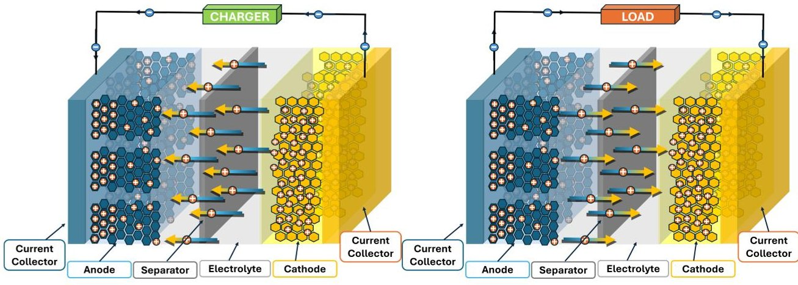

(a)

(b)

Figure 1. Li-ion motion during the charge (a) and discharge (b) process.

## 2.2. Micro Degradation Mechanisms

Energy conversion through the intercalation and deintercalation of lithium ions within electrode materials leads to side reactions that irreversibly affect the battery performances [17]. Two main microscale degradation modalities can be identified: Loss of Lithium Inventory (LLI) and Loss of Active Material (LAM) [16]. Both phenomena are driven by distinct yet interrelated electrochemical and mechanical processes.

Loss of Lithium Inventory represents a significant cause of degradation in lithium ion batteries, primarily occurring through irreversible side reactions that gradually consume lithium during charge and discharge cycles. The loss of available lithium is mainly caused by the following:

- The formation of a Solid Electrolyte Interface (SEI):When lithium reacts with the electrolyte, a solid layer forms on the electrode. This consumes some of the lithium ions, reducing the total amount available for intercalation. This leads to electrode isolation and deactivation, ultimately reducing capacity [26].

- Electrolyte decomposition during the charge and discharge cycles, particularly at the electrode interface, leads to reduction reactions, consuming both the electrolyte and its solvent [15]. Moreover, this process can generate impurities in the electrolyte that usually catalyze the occurrence of side reactions further aggravating lithium loss [25].

- Another key mechanism is lithium plating, where instead of intercalating into the electrode, lithium forms a metallic layer on its surface. While some plated lithium may be stripped off during discharge, a portion often reacts with the electrolyte, forming more SEI that isolates the metal lithium that is no longer available for cycling [27].

- While LLI focuses on the irreversible consumption of lithium ions, LAM refers to the gradual degradation and loss of the electrode material itself, rendering portions of the electrode incapable of participating in the electrochemical process. This process can be caused form different reasons, including the following:

- Particle cracking within the electrode is induced by the repeated expansion and contraction of active material particles during cycling. Over time, this mechanical fatigue leads to fractures in the electrode, reducing the number of active sites available for lithium-ion intercalation [27]. Moreover, the fracturing of electrode particles exposes fresh surfaces that exacerbate lithium consumption, contributing to both further SEI formation and lithium plating.

- Another type of LAM can occur when the active material begins to peel away due to mechanical stress. This process reduces the surface area available for lithium intercalation, contributing to a gradual loss of capacity [17].

<!-- PDF_PAGE: 6 -->

## 2.3. Space Environment and Macro Degradation Mechanisms

The mission profile and the impact of the harsh space environment play a critical role in the degradation of lithium-ion batteries used in satellites. During its life cycle, an Earth-orbiting satellite experiences shadow phases in which the use of batteries is required. The duration of these phases varies depending on the satellite's orbital altitude, which is determined by the mission type [22].

These orbits are generally classified into three types: Low Earth Orbit (LEO), Medium Earth Orbit (MEO), and Geostationary Earth Orbit (GEO). LEO satellites, which complete rapid orbital cycles, approximately 65 min in sunlight and 35 min in eclipse, go through frequent shallow charge and discharge phases, with a Depth of Discharge (DOD) below 40% [3]. MEO satellites remain in sunlight for most of their orbit but encounter daily eclipses of up to 70 min during equinoxes. In contrast, GEO satellites are exposed to sunlight almost continuously, except during brief daily eclipses near the equinoxes (approximately 70 min per orbit). During these short intervals, the batteries undergo deep discharges (60-80% DOD), which places significant stress on them [28]. The different operational conditions of the LEO, MEO, and GEO satellites lead to notable contrasts in battery degradation and performance. Moreover, each space mission is also characterized by unique mission profiles, which cause different long-term degradation modes of the batteries. Several critical macro-level factors, including charge/discharge rate, DOD, and cut-off voltage, impact the performance and lifespan in specific ways. In addition, environmental conditions also significantly influence battery degradation in space, due to factors such as radiation, vacuum, extreme temperatures, and vibrations [23]. The key macro factors that contribute to the micro degradation mechanism are the following:

- Radiation: It can impact the cathode materials, resulting in an increase in grain size due to irradiation, enforcing the capacity loss. Furthermore, the radiation-induced electrolyte decomposition may also play a role in the degradation process. Experiments on Li-ion batteries show cathode grain coarsening and electrolyte decomposition under high irradiation, with capacity losses of up to 8-10% at doses of several Mrad [29,30]

- Vacuum: This condition significantly impacts battery performance, leading to electrolyte leakage and outgassing phenomena [22]. Outgassing involves gas formation within the battery, which can escape and contaminate sensitive satellite components. Additionally, batteries can suffer from electrolyte leakage or swelling, particularly in pouch cells, when exposed to vacuum conditions [31]. Thermal-vacuum tests at $ 1 0^{-3}-1 0^{-6} $ Pa typically show negligible mass variation and capacity changes within 5% [23].

- Temperature: High temperatures can exceed the tolerance limits of most commercial lithium-ion batteries [32], leading to processes such as lithium loss, active material reduction, and SEI film formation [33]. Conversely, the extremely low temperatures in space can compromise battery functionality by lowering electrolyte conductivity, causing electrode passivation, lithium-ion depletion, and slowing electrochemical reactions [34,35]. Research indicates that low temperatures affect battery life more intensively than high temperatures.

In particular, sub-zero cycling has been reported to significantly shorten battery lifetime compared with elevated temperature conditions [35]. For instance, cycling at low temperature can increase the aging rate by about one order of magnitude compared to room temperature, significantly reducing service life [36].

- Vibrations: During satellite launch, vibrations constitute another factor that can impact battery functionality, inducing LAM or mechanical damage to battery packs. Orientation-dependent tests reported capacity losses up to 9.5% in cylindrical cells

<!-- PDF_PAGE: 7 -->

under radial-axis vibration, while prismatic and pouch formats showed smaller but non-negligible degradation [23,37].

- Charge/Discharge Rate: High-rate discharges increase the formation of passivation films, elevate internal resistance, and cause more heat generation, which accelerates ageing [38,39]. Moreover, if the battery experiences high charging rates, which can lead to uneven SEI formation, the lithium consumption is increased [40]. Research on various loading modes for lithium-ion storage batteries has revealed that the charge/discharge cycle at a current of 1 C is the most resource-efficient, with test results indicating that this mode best preserves battery life compared to others [41].

- Depth of Discharge (DOD): Higher DOD (percentage of a battery's capacity used during each cycle) can lead to localized damage due to phase transitions in the battery materials. Lowering the DOD can reduce stress on the battery, extending its life [42]. However, the effects of DOD are relatively minor compared to other factors like temperature and charge rate [43].

- Cut-off voltage: High charging cut-off voltages (overcharging) cause irreversible degradation by promoting lithium metal deposition and reducing electrode capacity due to excessive polarization [35]. Low discharge cut-off voltages (over-discharge), lead to an increase in side reactions and a decrease in the active material of the battery, which accelerates the ageing [17]. In some cases, adjusting the cut-off voltage led to significantly better capacity retention after numerous cycles, extending the service life [44].

The mission profile combined with the space environment conditions can induce unique failure modes or contribute simultaneously to broader degradation processes [45], underscoring the importance of a comprehensive understanding to better manage battery health and optimize operational conditions.

## 2.4. Li-Ion Battery Anomalies

In the context of lithium-ion batteries, especially those employed in high-stakes environments such as space missions, understanding and classifying anomalies is crucial for ensuring performance, safety, and longevity. A classification is proposed linking each anomaly type to potential causes rooted in micro and macro degradation mechanisms:

- Capacity fade refers to the gradual decline in a lithium-ion battery's ability to hold a charge [46]. This phenomenon can be significantly influenced by several factors. When a battery experiences overcharging, overdischarging, or high temperatures, lithium plating, SEI film formation, and side reactions occur [46-48]. These processes lead to irreversible Loss of Active Material and faster capacity degradation. Conversely, when the battery operates under undercooling conditions, the lithium diffusion in the graphite can be decreased, causing a quick fade in capacity [49]. Moreover, increased cycling rates can accelerate capacity degradation due to the Loss of Lithium Inventory and the growth of the SEI layer on the electrode surface [47]. Also, vacuum and radiation can cause a discharge capacity reduction in battery cells. To assess battery suitability for space, a leak test is typically performed [50,51].

- Increased Internal Resistance hinders efficient charge and discharge cycles, reducing overall battery performance [46]. In the charging and discharging processes, excessive working temperatures can result in increased internal resistance if the rate of heat generation significantly outpaces the rate of heat dissipation [32]. The over-discharge affects electron transport and hides the deintercalation of the lithium ions, resulting in a progressive increase in the internal resistance [52]. Furthermore, SEI thickening and lithium plating at the microlevel impede ion and electron flow within the battery [53].

<!-- PDF_PAGE: 8 -->

- Thermal Runaway is a critical anomaly in lithium-ion batteries characterized by an uncontrollable self-sustaining exothermic reaction. This phenomenon typically triggered by internal short circuits, overcharging, high-rate cycling, or exposure to elevated external temperatures. Once initiated, it involves electrolyte decomposition, SEI breakdown, cathode degradation, and flammable gas release, which accelerate heat generation and can ultimately result in fires, explosions, and catastrophic failure of the cell [44]. Recent research has advanced the understanding of thermal runaway mechanisms, thermal stability of cell components, and mitigation strategies, including flame-retardant electrolytes, high-resistance separators, and external protection layers. Experimental studies have shown that these materials can delay thermal runaway onset and safety valve rupture, significantly enhancing emergency response [54,55].

- Internal Short Circuits can occur as a result of lithium plating, which promotes the growth of lithium dendrites [46]. As the battery temperature rises, it further activates side reactions such as SEI film decomposition and cathode material degradation, potentially leading to sudden failures like internal short circuits [56]. Additionally, high-rate charging and discharging can generate exothermic side reactions that heighten the risk of internal short circuits [44,46]. The risks of internal short circuits within cells are also enforced by the vibrational environment that characterizes space applications.

It is essential to recognize that a single fault can arise from multiple degradation mechanisms, while a single degradation mechanism can lead to various anomalies, as shown in Figure 2. In space missions, lithium-ion batteries are exposed to multiple simultaneous stressors, including low and high temperatures, high charge/discharge rates, vacuum, radiation, and thermal cycling. The combination of these factors can drastically accelerate degradation. Low temperatures coupled with high C-rates promote lithium plating, SEI instability, and increased internal resistance, leading to faster capacity fade [57]. Similarly, vacuum and thermal cycling exacerbate structural deformation, irreversible lithium loss, and internal temperature gradients [58], while radiation exposure further damages electrolyte, binder, and electrode interfaces, increasing polarization and side reactions [59]. High-temperature and overcharge conditions can also accelerate electrolyte decomposition and SEI thickening, raising the risk of thermal runaway. Data from CubeSat missions show that chemistries such as NMC (nickel-manganese-cobalt) and NCA (nickel-cobalt-aluminum) are particularly sensitive to these coupled environmental constraints, whereas LFP (lithium iron phosphate) cells demonstrate greater resilience [60]. These synergistic multi-factor effects are critical to consider in the management of space batteries, as they can significantly reduce lifespan compared to single-stressor scenarios.

A summary of such interconnections, underscoring the complexity of battery behavior, is reported in Table 1.

Table 1. Relationships between causes, mechanisms, and anomalies in lithium-ion battery degradation.

<table border="1"><tr><td>Cause</td><td>Degradation Mechanism</td><td>Effect</td></tr><tr><td>Radiation</td><td>Cathode grain growth and electrolyte decomposition</td><td>Capacity fade, accelerated aging</td></tr><tr><td>Vacuum</td><td>Electrolyte leakage and outgassing; swelling or deformation of pouch cells</td><td>Capacity fade, contamination of satellite subsystems</td></tr><tr><td>High Temperature</td><td>Accelerated SEI growth, lithium loss, and active material</td><td>Capacity fade, increased internal resistance, risk of thermal runaway, and internal shot circuit</td></tr></table>

<!-- PDF_PAGE: 9 -->

Table 1. Cont.

<table border="1"><tr><td>Cause</td><td>Degradation Mechanism</td><td>Effect</td></tr><tr><td>Low Temperature</td><td>Reduced electrolyte conductivity, electrode passivation, sluggish electrochemical reactions</td><td>Increased internal resistance, lithium loss, rapid capacity degradation</td></tr><tr><td>Vibration</td><td>Mechanical stress causing electrode particle cracking and delamination</td><td>Internal short circuits, capacity loss, reduced reliability</td></tr><tr><td>C\D Rate</td><td>Lithium Loss, SEI formation,the lithium consumption and the formation of passivation films are increased</td><td>Capacity fade,higher resistance,risk of thermal runaway and internal short circuit</td></tr><tr><td>DOD</td><td>Particle cracking and phase transitions, worsening SEI formation</td><td>Capacity fade,possible internal short circuits</td></tr><tr><td>Over Charge</td><td>Lithium metal deposition, excessive polarization,SEI breakdown,and cathode degradation</td><td>Capacity fade,internal short circuits,thermal runaway</td></tr><tr><td>Over Discharge</td><td>Increase in side reactions and a decrease in the active material</td><td>Increased resistance,accelerated degradation,risk of thermal runaway</td></tr></table>

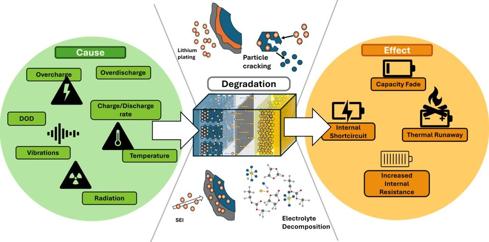

Figure 2. Degradation mechanisms and their cause and effects in lithium-ion batteries.

## 3. Digital Twin in Space Battery Management

## 3.1. Battery Management System Description

A Battery Management System is a vital technology responsible for monitoring and controlling the performance of battery systems [21]. BMS technology plays a crucial role in various applications, ranging from electric vehicles to renewable energy systems, portable electronics, and satellites. Although BMS configurations may differ depending on the application, their core functionalities ensure optimal operating conditions and stabilize battery operations by processing data from sensors and implementing control algorithms in real time [61]. The BMS enables the tracking of the SOC and SOH of batteries, diagnoses

<!-- PDF_PAGE: 10 -->

potential faults, manages thermal conditions, and balances cell charges by continuously analyzing voltage, current, temperature, and other parameters. Together, these features, summarized in Figure 3, ensure efficient energy use, enable predictive maintenance, and enhance the reliability and lifespan of batteries.

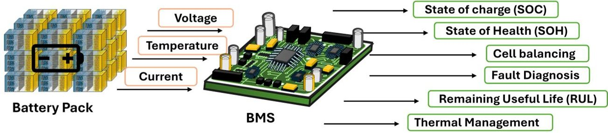

Figure 3. Battery Management System (BMS) key features.

- State of Charge (SOC): This index represents a measure of the stored charge. SOC is generally defined as follows:

$$
\mathrm {SOC} = \frac {A h _ {cur}}{A h _ {full}} \times 100 \%
$$

where $ A h_{cur} $ represents the battery's capacity in its current state, while $ A h_{full} $ denotes the capacity when the battery is fully charged. Accurate SOC monitoring is crucial for maintaining optimal battery performance and efficiently managing charging, ensuring battery longevity and reliability [21].

- State of Health (SOH): An index that measures the degradation state of the battery with respect to the beginning of life (BOL) conditions. Typically, end of life (EOL) is reached when the battery's SOH decreases to 80% [21]. SOH can be mathematically defined as follows:

$$
\mathrm {SOH} = \frac {A h _ {f u l l}}{A h _ {n o m}} \times 100 \%
$$

where $ A h_{full} $ represents the current full charge capacity and $ A h_{nom} $ denotes the battery's nominal capacity. Accurate SOH estimation is essential for several reasons: it aids in predicting RUL, and it informs adaptive charging strategies that help prevent further degradation [21]. Several definitions of SOH exist, including capacity-based, internal resistance-based [15], and many others depending on the definition of the Heath Index (HI) [62-65]. The capacity-based SOH definition is usually adopted as the primary metric due to its ability to reflect usable energy and the overall aging of the battery. Internal resistance- and HI-based SOH definitions can be used as complementary metrics for real-time monitoring or the early detection of degradation when direct capacity measurement is not feasible.

- Remaining Useful Life (RUL): The index refers to the number of charge/discharge cycles remaining until the battery reaches its end of life [21]. Continuous charging and discharging lead to capacity degradation, eventually requiring battery replacement when the capacity falls to 70-80% of its initial value [66]. Estimating RUL is critical for ensuring reliable and safe operation for proactive maintenance, minimizing unexpected breakdowns, and enhancing the overall lifespan of the battery system. A graphical representation of the RUL is reported in Figure 4.

- Fault Diagnosis: The BMS is responsible for the detection and control of faults by means of different integrated algorithms [67]. The system prevents overcharging, deep discharging, short circuits, and thermal runaway by monitoring key parameters and incorporating controllers, actuators, and sensors [68,69].

<!-- PDF_PAGE: 11 -->

- Thermal Management: Temperature plays a significant role in the battery's lifespan [70], as operating outside the recommended thermal range can degrade the battery's materials and reduce its efficiency. By maintaining a balanced temperature, as determined by the manufacturer, the system helps preserve battery life and functionality.

- Cell balancing: This comprises balancing circuitry and a control strategy to maintain charge uniformity among cells. The balancing process can be either passive, dissipating excess charge as heat, or active, transferring energy from high to low SOC cells. Effective cell balancing optimizes battery capacity utilization, prolongs lifespan by reducing uneven wear, enhances safety by preventing overcharging and overheating, ensures consistent performance, and reduces maintenance needs by promoting balanced cell usage throughout the pack [21].

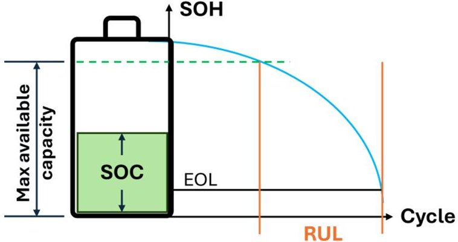

Figure 4. Schematic representation of a battery's Remaining Useful Life (RUL), indicating the number of charge/discharge cycles remaining until and of life State of Health (SOH) value is reached.

## 3.2. The Digital Twin Concept

Digital Twins are sophisticated technological frameworks that represent a physical system through a virtual counterpart, enabling continuous monitoring and predictive insights [71]. Initially introduced by NASA and the U.S. Air Force for aerospace applications, specifically for enhancing the safety and reliability of Air Force vehicles [72], DT applications have significantly expanded across various industries and sectors, playing a vital role in real-time operations that inform engineering and operational decisions. Unlike a single technology or model, the DT's scheme encompasses diverse modeling methods, each adapted to the requirements of specific scenarios. Such a comprehensive scheme aims to mirror every observable feature of the physical asset, allowing it to capture all data obtainable through direct inspection [73]. In fact, despite the various available definitions and interpretations of DT underscoring its versatility and adaptability, they all converge on the core function of accurately emulating a physical entity to monitor its current state and predict future behavior [74]. To describe the structure of a DT, it is essential to understand its purpose: creating a real-time, accurate link between the physical and virtual worlds. A typical DT scheme, shown in Figure 5, comprises three primary components:

- The physical layer is the real-world object or system monitored by the DT, typically equipped with sensors and other monitoring devices to capture real-time data. These sensors track various attributes—such as temperature, pressure, or motion—and enable comprehensive data collection and processing, forming the data foundation of the DT [75]. Moreover, the physical entity continuously sends updated status data to the DT, which returns diagnostic insights and optimized commands, ensuring the physical side adapts to changes in real time [76].

- The virtual layer is the digital replica of the physical entity, consisting of several models which replicate the state and behavior of the physical layer, using the recorded data

<!-- PDF_PAGE: 12 -->

for dynamic reconfiguration and model coupling [77]. The virtual component performs data processing and analysis, making it the intelligence core of the DT, enabling diagnosis, fault detection, and RUL prediction. Virtual models can be constructed using physics-based methods or data-driven models powered by Machine Learning (ML) and AI, which are essential for quick adaptation and analysis in data-rich environments [47,78].

- The communication layer between the physical and virtual layers operates bidirectionally, allowing a continuous exchange of information. Real-time condition data from the physical layer is transmitted to the digital layer, allowing it to dynamically mirror the state of its physical counterpart and support advanced diagnostic and prognostic functions. Conversely, the digital layer can send feedback or optimization parameters back to the physical layer, facilitating predictive maintenance, performance adjustments, and system optimization based on analyzed data. Therefore, the bidirectional data connection is a fundamental feature of the communication layer, ensuring real-time synchronization and an accurate reflection of operational conditions [71].

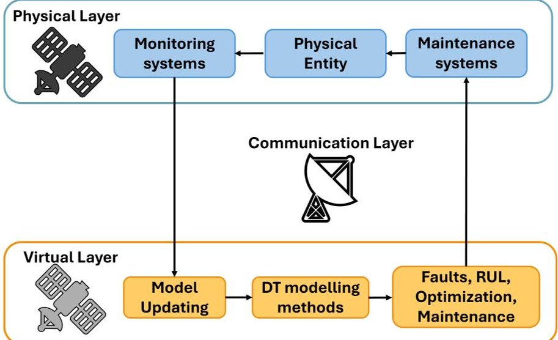

Figure 5. Digital Twin (DT) closed-loop scheme.

Broadly, a DT functions as a "living" model, constantly updating to reflect real-time conditions through a dynamic loop of communication with its physical twin. This closed-loop interaction empowers the DT to perform critical tasks. The DT uncovers hidden patterns within system data, aiding in predictive and prescriptive strategies for fault prevention and operational improvements [47]. Throughout the entire lifecycle of the physical asset, DTs play a vital role. In the design phase, they simulate potential design impacts, pinpoint structural weaknesses, and explore deterioration prevention strategies. During production, they perform diagnostics to preempt faults and ensure optimal operation. In service, DTs provide predictive models that deliver accurate state estimations, enabling efficient, data-driven maintenance [79].

## 3.3. Applications of Digital Twin in BMSs

The adoption of lithium-ion batteries as the third generation of satellite power storage devices marked a significant advancement in space missions. However, as explained in Section 2, LIBs experience performance degradation due to capacity fading and complex irreversible electrochemical reactions. This degradation, compounded by repeated charge discharge cycles and the unique mission conditions, can compromise operational safety and even lead to catastrophic failures if unmitigated. A comprehensive statistical analysis of 1584 Earth-orbiting satellites between 1990 and 2008 underscores the influence of battery failures on overall satellite reliability [80]. The study reveals an increase in battery-related failures over time, with cumulative battery failure contributions to satellite malfunctioning

<!-- PDF_PAGE: 13 -->

reaching 4% in the first 30 days of satellite operation, 2% in the first year of operation, 10% in 5 years of operation, 6% in 10 years of operation, and 14 % in 15 years of operation. Satellite failure data shows a clear need to enhance battery reliability and longevity. Therefore, a well-equipped BMS is essential to accommodate the unique challenges posed by the harsh and variable space environment.

Despite significant advancements in terrestrial BMS technologies and a growing interest in the development of efficient and innovative BMSs tailored for space applications, their use in spacecraft remains limited. Currently, onboard BMS systems primarily serve as general-purpose controllers rather than specialized tools designed to fully optimize battery performance [81]. For this reason, the European Space Agency's (ESA) Technology Development Elements (TDE) program has introduced a novel BMS concept designed specifically for spacecraft. This advanced system goes beyond conventional monitoring and measurement functions to include parameter calculations that can effectively extend the lifespan of spacecraft batteries through active management. In this context, the scientific community has increasingly focused on advanced battery monitoring techniques for various space applications. Due to the constraints in computing power and data storage, a common trend is the development of novel intelligent algorithms to perform advanced optimization tasks to ensure safety and reliability. In particular, researchers have intensified their focus on integrating DT technology into a BMS, which represents a significant advancement over traditional approaches to battery monitoring and management, especially in cases where resources are limited, such as on space missions. A primary benefit of DTs lies in their ability to digest vast amounts of historical and real-time sensor data, such as voltage, current, and temperature readings, allowing to dynamically update and refine predictive models. Conventional BMS approaches, typically based on equivalent circuit or empirical models, offer stable control and fault protection but have limited capability in predictive maintenance, particularly under the complex conditions of space operation. Single-model predictive methods can achieve accurate short-term predictions but often lack robustness when operating beyond the conditions represented in their calibration datasets [82]. In contrast, a DT-based BMS integrates real-time data acquisition, bidirectional communication, allowing the virtual twin to continuously adjust its parameters to reflect actual operating conditions. This integration improves monitoring accuracy, enhances prediction reliability, and ensures adaptability to radiation, vacuum, and thermal cycling typical of orbital environments. Through online learning and adaptive modeling, DTs provide a better battery life estimation, improved fault detection and optimized maintenance strategies under varying operating conditions [21]. This approach enables enhanced operational assessments compared to conventional models, which often rely on fixed parameters and fail to capture the complex nonlinear and coupled behaviors intrinsic to lithium-ion batteries [8,9].

Additionally, DTs overcome the computational limitations of onboard BMSs by employing algorithms that leverage cloud infrastructure or other external resources, thus enabling more accurate state estimations that traditional BMS processors, constrained by limited memory and CPU capacity, cannot feasibly implement [7]. Furthermore, Digital Twins can act as surrogate models, enabling forecasting and evaluation of different operational strategies while significantly reducing computational costs. This is particularly valuable when dealing with applications—as in the space field—where real-time decision-making and resource efficiency are essential for performance, reliability, and longevity [83]. An advanced multi-layer networked architecture for BMSs that coordinates cloud, edge, and device-level operations are proposed in [8] to overcome the limitations of conventional BMSs, allowing the use of high-performance algorithms. Additional effort has been dedicated to developing a novel method for predicting lithium-ion battery discharge capabilities through a practical Digital Twin model that integrates ML with semi-empirical

<!-- PDF_PAGE: 14 -->

structures [9]. Digital Twins have also been designed for the CubeSats electrical power system [10]. Its accuracy has been confirmed through real-time comparisons with the physical system, demonstrating the feasibility of using Digital Twins to simulate CubeSat behavior throughout a full orbital cycle. Finally, the Digital Twin-based fault diagnosis and health management approach for satellite systems has also been addressed [11]. These approaches support the creation of a space-ground platform for monitoring, diagnosing, and maintaining satellite power systems, underscoring the potential of Digital Twins in satellite health management. Despite the scarcity of DT applications for space BMSs showcased in the literature, numerous successful implementations of the Digital Twin technology can be found in BMSs of other fields. These applications highlight the versatility and effectiveness of Digital Twins in enhancing system performance and reliability.

## 4. Classification of Methods for DT of BMSs

In the evolving landscape of Battery Management Systems, understanding the mechanisms of degradation in lithium-ion batteries is essential for developing an efficient Digital Twin. The estimation of key parameters, SOC, SOH, and RUL, plays a crucial role in optimizing battery performance and longevity. The following section categorizes these methods into four primary groups: experimental, model-based, data-driven, and fusion. Given the core capability of Digital Twins to continuously update models, a review of the main updating methodologies is presented. The objective of this section is indeed to provide a comprehensive overview of how different techniques contribute to the understanding and management of battery degradation, assessing their effectiveness on the DT of the BMS.

## 4.1. Experimental Methods

The degradation mechanisms of lithium-ion batteries can be evaluated through dedicated laboratory testing, which provides insights into their aging behavior under controlled conditions. These experimental methods can be categorized into direct and indirect measurement techniques.

## 4.1.1. Direct Measurements

The direct measurement method is used to characterize the degradation mechanism by measuring the battery health state indicators directly. The direct measurement technique can be applied in several ways:

- Internal Resistance: The degradation process is reflected by an increasing trend in internal resistance. Therefore, tracking the changes in resistance over time is well suited to real-time SOH monitoring due to its low computational demands [84-86]. In Figure 6b, the increasing trend of the internal resistance over the cycles is reported. Techniques such as pulse current tests further refine resistance measurements by assessing ohmic and polarization resistances under various conditions, thus capturing the impact of temperature and SOC [87,88].

- Coulomb counting, or ampere-hour (Ah) counting: Following the capacity behavior over the cycles (see Figure 6a), it is possible to characterize the degradation mechanism. SOH and SOC can be estimated by measuring the total charge transferred into or out of the battery [89]. The Coulomb counting method has limitations and potential errors in practical applications. Factors such as temperature, charge and discharge rates, and usage patterns can impact its accuracy. Consequently, it is often necessary to combine coulometric counting with other evaluation methods for a more reliable assessment of battery life [17]. Recent improvements include integrating Coulomb counting with Differential Voltage Analysis (DVA) for more accurate, real-time SOH estimation and combining it with weighted ampere-hour methods to enhance precision [90].

<!-- PDF_PAGE: 15 -->

- Cycle number counting estimates SOH by comparing the manufacturer's specified total life cycle count with the current cycle count. This method mainly records complete discharges. For partial cycles, conversion coefficients are used to standardize different depths into equivalent full cycles, which can be obtained through experimental testing [91]. To address the partial cycles, Saxena et al. [92] propose a model which analyzes capacity loss in relation to mean SOC and $ \Delta $ SOC.

- Electrochemical Impedance Spectroscopy (EIS) is a strong laboratory tool to study the electrochemical process inside the battery, and it can be used as a diagnostic tool [93,94]. However, its utility is limited by cost, calibration complexity, and testing requirements, which restrict potential use onboard spacecraft [17]. To overcome these challenges, alternative real-time impedance measurement methods are emerging, including techniques based on initial charging voltage responses and SOH estimation through impedance-related indicators [62,95,96]. Recent advances also focus on optimizing EIS test parameters and adopting faster diagnostic methods [97].

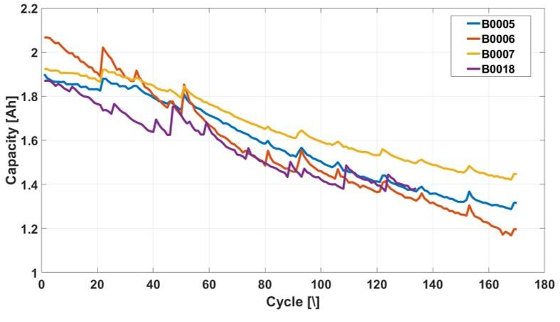

(a)

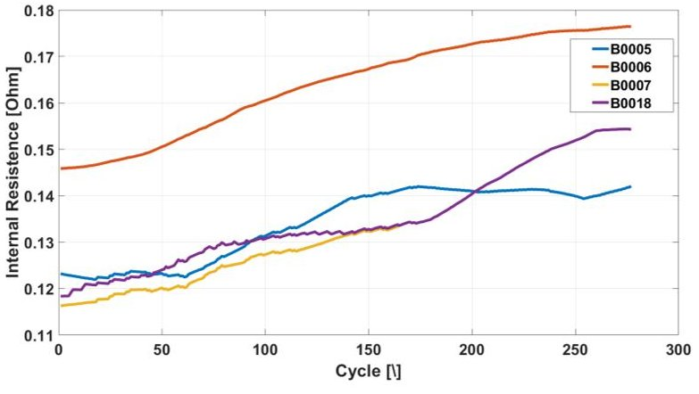

(b)

Figure 6. Trends of capacity (a) and internal resistance (b) over cycles for cells B0005, B0006, B0007, and B0018 from the NASA lithium-ion battery dataset [98].

## 4.1.2. Indirect Measurements

Indirect measurement techniques can determine degradation paths by extrapolating health indices derived from direct measurements. Indirect methods encompass various advanced techniques:

- Incremental Capacity Analysis (ICA) is valuable for diagnosing battery SOH by correlating peak features with battery capacity, particularly in high-current and random usage patterns [99,100]. In Figure 7a, the incremental capacity as a function of voltage shows the decreasing behavior of the curve as the number of cycles increases. The ICA's dependence on low-noise, constant-current profiles limits real-world applicability. To counter this, methods such as model-free fitting and high current-rate

<!-- PDF_PAGE: 16 -->

adaptations enable ICA under noisy conditions, enhancing accuracy in Battery Management Systems [101-105].

- Sample Entropy (SE) is used to assess battery health by quantifying the complexity and predictability of time-series data. Recent enhancements include improved capacity estimators using voltage sequences under the Hybrid Pulse Power Characterization (HPPC) profile [106]. Additionally, sample entropy is utilized to estimate the remaining capacity of lithium-ion batteries by analyzing surface temperature dynamics during the charging process [107]. To reduce the computational demands of the sample entropy technique, various approaches have been proposed, including a fuzzy entropy-based SOH estimator [108] and a method utilizing fusion weights from multi-scale sample entropy [109].

- Q(V) Curve analysis is another method for SOH estimation, focusing on the evolution of the capacitance-voltage Q(V) curve across cycles; Figure 7a. In this context, Deng et al. [110] propose a voltage segmentation strategy that incorporates filtering techniques for non-monotonic curves, resulting in low estimation errors.

- Charging/Discharging Curve: As batteries degrade, their charging and discharging curves change, serving as valuable indicators for SOH evaluation. Many researchers have focused on constant-voltage (CV) charging data, finding a strong correlation with the SOH [111,112]. In [113], a novel SOH estimator that utilizes partial CV charging data is proposed. This approach incorporates a curve reconstruction method to accurately predict the capacity. Additionally, a dynamic characteristic of the charging current has been shown to be a robust parameter related to battery aging [114]. Another approach focuses on health indicators derived from discharge curves, examining the effects of depth-of-discharge, current, and temperature on the health indicator [64].

- Differential Voltage Analysis (DVA): The distance between curves in the DV curves (Figure 7c) quantifies electricity participation in two-phase transitions, aiding capacity fading analysis [93]. Innovative techniques use the DV curve to accurately detect degradation mechanisms and the end of life of cells in efficient online applications [115,116]. DVA can be combined with other experimental techniques, such as the Coulomb counting method for precise SOH calculation [90], or ICA to improve the reliability of SOC estimation [117].

To investigate the aging behavior of batteries, extensive laboratory testing is essential. However, many experimental procedures face challenges in real-world applications, primarily due to the need for sophisticated equipment and the significant differences between controlled laboratory environments and actual operating conditions. Despite these limitations, laboratory experiments represent an invaluable resource for studying aging mechanisms, as they provide a theoretical foundation.

## 4.2. Model-Based Methods

Model-based methods rely on battery models that represent the internal electrochemical dynamics of the battery, making assumptions based on these models to estimate essential battery management system parameters. Techniques within this category include Equivalent Circuit Models and electrochemical methods.

<!-- PDF_PAGE: 17 -->

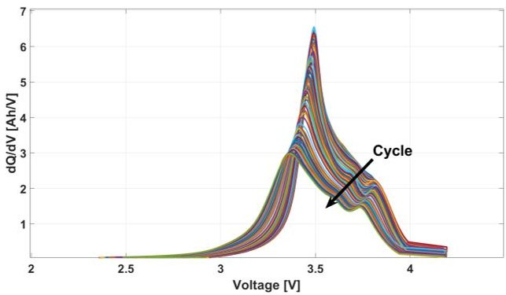

(a)

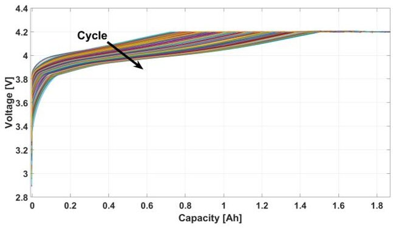

(b)

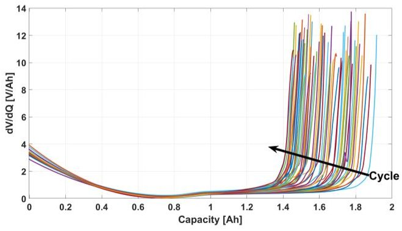

(c)

Figure 7. Incremental Capacity Analysis (ICA) (a), capacitance-voltage curve (b), and Differential Voltage Analysis (DVA) (c) over cycles for cell B0005 from the NASA lithium-ion battery dataset [98].

## 4.2.1. Electrochemical Methods (EMs)

The electrochemical model primarily investigates the electrochemical reactions within the battery. These models offer a sophisticated means of simulating lithium-ion battery behaviors, which is essential for predicting the state of the battery. The Pseudo-Two-Dimensional (P2D) model conceptualizes a lithium battery as a system comprising positive and negative electrodes, a separator, and an electrolyte containing numerous spherical solid particles. The P2D model, widely recognized for its detailed representation of battery processes, utilizes partial differential equations to capture charge and mass conservation in both the solid and electrolyte phases. Due to its high accuracy, this model has seen extensive application across various studies [118-121]. Despite its high accuracy, the P2D model is computationally intensive, presenting challenges for real-time applications. This has led to the development of simplified models like the Single Particle Model (SPM), which reduces computational demands by approximating each electrode as a single spherical particle and assuming uniform lithium-ion concentration in the electrolyte [122-124]. However, the SPM's neglect of electrolyte dynamics and mechanical responses can reduce its accuracy, a limitation that has been addressed by incorporating additional degradation mechanisms such as Solid Electrolyte Interphase layer formation, lithium plating, particle cracking, and active material losses. For instance, models integrating these degradation phenomena have been shown to significantly enhance predictive capabilities [125-127]. Furthermore, incorporating temperature dynamics into models has been proven to greatly enhance prediction accuracy and capture true degradation patterns [128-131]. In Figure 8, a representation of the P2D model and SPM model is reported.

<!-- PDF_PAGE: 18 -->

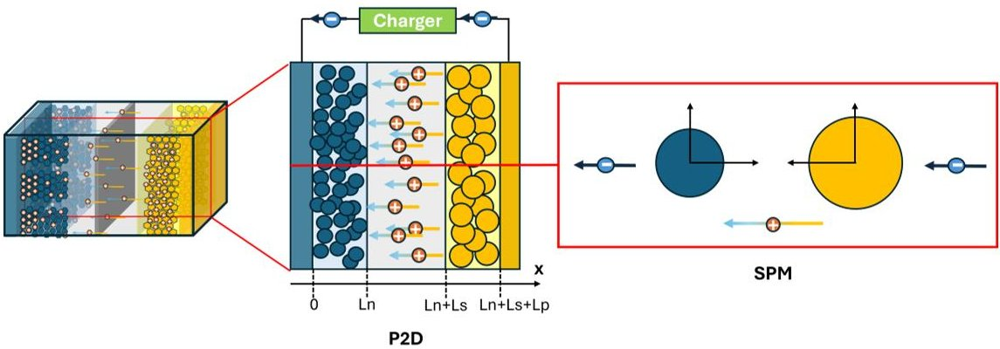

Figure 8. Representation of the Pseudo-Two-Dimensional (P2D) model and Single Particle Model (SPM).

## 4.2.2. Equivalent Circuit Models (ECMs)

Model-based techniques employing Equivalent Circuit Models (ECMs) are pivotal in managing lithium-ion batteries, balancing computational efficiency with accuracy. ECMs simplify the complex electrochemical processes within batteries into a network of resistors, capacitors, and voltage sources, allowing for the real-time estimation of crucial parameters such as SOC, capacity, and internal resistance. Several ECM configurations, including the Resistance-Capacitance (RC) model, Thevenin model, and Rint model (see Figure 9 and their modified versions, have been developed to capture various dynamic behaviors of Li-ion batteries [132]. By modeling the battery with essential components like resistors, inductors, and capacitors, the ECM framework effectively captures the electrochemical dynamics crucial for monitoring battery condition. Its simplicity lends itself to real-time applications, allowing online parameter updates that reflect the battery's evolving state under various operating conditions [133]. Several enhancements to classical ECM approaches have been proposed in the literature. For instance, a multi-time scale RC model combined with wavelet analysis advances the accuracy of battery dynamic characterization across varying operational state [134]. Additionally, recursive estimation methods allow targeted parameter adjustments to capture distinct fast and slow battery dynamics [135]. Further refinements to ECMs address SOH tracking by employing algorithms like Kalman and particle filters, which iteratively update model parameters to adapt to real-time performance variations. These adaptive filter-based methods provide a powerful approach to SOH and SOC estimation, allowing automatic adjustments that keep up with aging processes and operational changes [136-139]. The online capabilities of ECMs have increased interest in applications like satellite systems. In space applications, where maintaining consistent telemetry quality is challenging, ECMs have been adapted to account for variable temperature conditions and limited sample resolution [131,140,141]. More advanced ECMs, such as the half-cell model, attempt to increase the physical interpretability of the model by representing individual electrode characteristics, yielding detailed information on battery aging. Further refinements include a Pseudo-Two-P2D approach, linking ECM parameters with electrochemical characteristics for more precise modeling under diverse conditions [142]. However, these approaches introduce additional computational demands, highlighting a compromise between model granularity and efficiency that is critical in applications requiring real-time responsiveness [143].

In conclusion, the model-based approaches offer valuable insights into how electrochemical degradation impacts battery health over time. Although model-based methods provide significant advantages, including lower data requirements and resilience to external conditions, their inherent complexity, due to the intricate physical and mathematical modeling required, makes implementation demanding.

<!-- PDF_PAGE: 19 -->

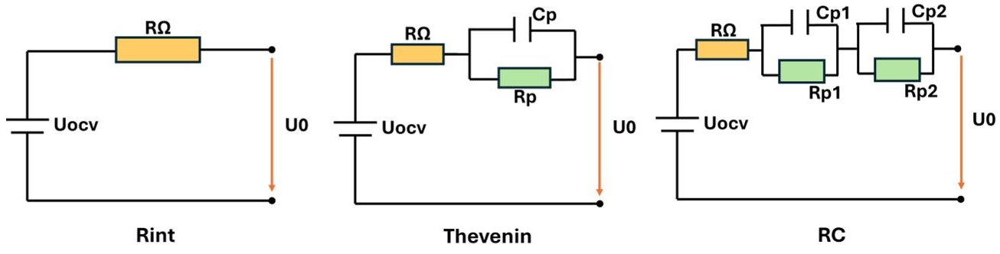

Figure 9. Schematic representation of Equivalent Circuit Models (ECMs). The Rint model includes a resistor $ R\Omega $ to represent the internal resistance. The Thevenin model adds an additional resistor (Rp) and capacitor (Cp) to account for transient effects. Finally, the RC model employs multiple RC branches to capture more complex transient dynamics [132].

## 4.3. Data-Driven Methods

Data-driven methods rely on the use of historical data to build a representation of the battery state. Many recent studies in the literature have adopted data-driven approaches, and four main categories have emerged: Statistical, Empirical, Vector Machine, and Machine Learning.

## 4.3.1. Statistical Methods

In the field of lithium-ion battery degradation modeling, statistical data-driven approaches have proven effective for predicting states by leveraging their ability to handle uncertainty and variability in experimental data. A primary probabilistic technique included in Bayesian Methods is the Gaussian Process Regression (GPR). GPR, a non-parametric Bayesian technique, can model complex, nonlinear relationships, making it especially useful for applications in diverse fields [144-146]. Studies demonstrate the application of GPR for SOH estimation in battery systems, where it quantifies uncertainty and enhances reliability [147-149]. Additionally, GPR enables accurate predictions for RUL, underscoring its adaptability and precision in forecasting battery lifespan under various conditions [150]. A variant of Bayesian techniques is the Wiener processes, used in [151] to develop a framework of lithium-ion battery capacity degradation assessment and RUL prediction. Hidden Markov Models (HMMs) are another set of methods used to capture the stochastic relationships inherent in battery degradation processes. In [152], Piao et al. propose an HMM to model the relation between health states and internal resistance changes. Similarly, Niri's work combines HMMs with a wavelet decomposition approach to address both long- and short-term load predictions, enhancing prediction accuracy under fluctuating operational conditions [153]. Zhao's work extends the utility of HMMs by integrating a belief rule base to improve SOH prediction accuracy [154]. The Monte Carlo Simulation provides another versatile method for handling the probabilistic nature of lithium-ion battery degradation. By generating multiple simulation scenarios, these techniques capture the variability in battery behavior under different conditions [155,156].

## 4.3.2. Empirical Methods

Empirical models in battery research are essential for analyzing experimental data to construct mathematical relationships that effectively characterize battery performance and aging behavior. These models typically utilize polynomial and exponential functions to map the aging process, focusing on key parameters such as voltage, aging time, temperature, discharge rate, and depth of discharge [157,158]. The representation of capacity degradation is a critical aspect of these empirical models, often expressed as a function of cycle count. For example, Yu [159] adopts a bi-variate regression to model the relationship between features extracted from controlled charging data and capacity, enhancing the accuracy

<!-- PDF_PAGE: 20 -->

of capacity predictions. In addition to capacity modeling, research has also focused on developing resistance models that assess battery power capability and health state [160,161]. These models reveal that performance indicators, particularly capacity and resistance, are sensitive to different aging types, including calendar aging (affected by temperature and state-of-charge), cycling aging (influenced by temperature and cycle depth), and radiation aging [162]. To maintain accuracy in the face of dynamic aging processes and fluctuating operational conditions, it is essential for empirical models to be regularly updated. This need is addressed by incorporating various filtering algorithms alongside empirical models to enhance predictions of SOH and RUL, thus improving estimation reliability amid changing parameters [163-167]. These approaches not only contribute to effective battery prognosis, but also align well with the empirical framework, as they leverage techniques to refine health indicators based on the evolving state of the battery.

## 4.3.3. Vector Machine Methods

The degradation monitoring and prediction of lithium-ion batteries can be formulated as a regression problem. Regression techniques can process large datasets to identify relationships between dependent and independent variables, thereby enabling the construction of predictive models. [168]. Support Vector Regression (SVR), a variant of Support Vector Machines (SVMs), has emerged as a pivotal technique in the estimation of the SOH and RUL of lithium-ion batteries. The effectiveness of SVR is largely attributed to its ability to handle high-dimensional data and perform well in nonlinear regression scenarios, making it particularly suited for complex battery health assessments. Fewer unknown parameters and high sparsity characterize the method [169]. Several studies have underscored the effectiveness of the use of the SVR in conjunction with health indicators. For instance, Z. Chen et al. [170] utilized charging voltage and current data to derive critical features such as energy signals and charge durations, employing SVR to achieve robust SOH predictions. Similarly, Q. Zhao et al. [171] focused on real-time measurable HIs, specifically the time intervals of equal charging and discharging voltage differences, to establish a relationship model between these indicators and battery capacity. Petkovski's [172] work highlighted the advantage of combining features extracted from different observables. This multifaceted approach enhances the robustness of predictions made using SVR. Furthermore, Pang [173] addressed the challenge of limited sample sizes in satellite applications by proposing an online RUL prediction method based on SVR, establishing a clear relationship between health indicators and battery capacity. Various optimization techniques such as Coyote Optimization Algorithm (COA) and Particle Swarm Optimization (PSO) have been proposed to refine the model's parameters and enhance the accuracy and computational efficiency of SVR [174-176]. Moreover, the adaptability of SVR in complex operational environments has been a focal point in recent research. In [177], the authors develop a self-adaptive health state assessment method that employs Least Squares Support Vector Machines (LS-SVMs), which enable efficient real-time assessments of battery health. Z. Liu [178] proposes a modified SVR kernel designed to handle changes in battery performance over time. Furthermore, studies have sought to enhance estimation strategies through advanced techniques. D. Zhang [179] proposes an integration of Grid Search Cross-Validation with particle filtering and SVR, yielding improved SOH estimations for satellite batteries. Another vector machine technique is the Relevance Vector Machine (RVM). Its foundation in sparse Bayesian theory provides several advantages over traditional SVMs, particularly in handling sparse datasets and controlling overfitting. Research by Widodo et al. [180] highlighted a comparison between SVMs and RVMs, demonstrating that while SVMs are known for their operational simplicity and high accuracy, they suffer from limitations in generalization. In contrast, RVMs demonstrated superior adaptability and robustness,

<!-- PDF_PAGE: 21 -->

enabling model parameters to be adapted based on operational results. For instance, a method proposed in [181] utilized RVMs alongside a three-parameter capacity degradation model to make reliable extrapolations to failure thresholds with confidence intervals. Zhang [182] et al. proposed a prediction method of battery SOH based on an optimized RVM model for the online application. A method combining dynamic grey correlation with RVM regression prediction demonstrated improved long-term prediction capabilities by updating model parameters in response to new data [183]. Similarly, Song [184] proposes a method involving the RVM and Kalman filter to refine RUL estimates, addressing some of these concerns by allowing the model to dynamically adjust its predictions as new data becomes available.

## 4.3.4. Neural Network

Artificial Neural Networks (ANNs) are a powerful algorithmic framework that learn from data and generalize this learning to new situations, making them crucial for solving complex problems. Recent advancements in ANNs have significantly enhanced the prediction of the SOH, RUL, and SOC of lithium-ion batteries through various data-driven approaches. A typical ANN is structured into three main layers: an input layer, one or more hidden layers, and an output layer. The input layer receives the data, which is then passed through the hidden layers. Each neuron in these hidden layers performs computations based on a weighted linear combination of the input data, followed by an activation function that introduces nonlinearity. This iterative process continues until the output layer generates the final prediction or result. In Figure 10a, a typical representation of an NN structure is depicted. ANNs can be categorized into two primary types based on their architecture: traditional neural networks and DL algorithms. Traditional neural networks include Feedforward Neural Networks (FFNNs), which typically consist of a single hidden layer, as well as their variants, such as Backpropagation Neural Networks (BPNNs) and Extreme Learning Machines (ELMs). They have a relatively simple structure yet possess strong learning capabilities, allowing them to model nonlinear relationships by adjusting the number of neurons and hidden layers [15].

- Feed-Forward Neural Networks are one of the most fundamental and simple types of ANNs. In these networks, information flows in a single direction: from the input layer, through more hidden layers, to the output layer—without any feedback connections. Due to their ability to model complex nonlinear relationships, FFNNs are widely used for monitoring and predicting the performance of lithium-ion batteries. For example, You et al. developed a real-time RUL estimation method using FFNNs based on historical battery data [185]. A notable study used data from a constant current constant voltage (CC-CV) charging experiment to train battery models, achieving accurate SOH predictions [186]. Furthermore, Driscoll employs an FFNN to estimate the SOH of the battery, using the extraction of characteristics from the voltage, current, and temperature profiles observed during charging [187]. In a related effort, Bonfitto introduced an FFNN prediction method combining SOH and SOC estimations, demonstrating that the interdependence of these factors within a recursive framework significantly improves prediction accuracy [188].

- Backpropagation Neural Networks (BPNNs) are FFNNs trained with a backpropagation algorithm. BPNNs are often enhanced by incorporating optimization algorithms for selecting optimal weights. For instance, H. Li [189] proposed an intelligent Digital Twin model for BMSs, using a BPNN and a whale optimization algorithm (WOA) to estimate and diagnose battery health by leveraging historical battery data from real scenarios. Additionally, M. Wu [190] employed a BPNN in combination with PCA and PSO to optimize the model for more accurate SOH predictions.

<!-- PDF_PAGE: 22 -->

- The Extreme Learning Machine (ELM) is a type of single hidden-layer feedforward neural network (SLFN). ELM uses a fast, closed-form solution for the output layer weights, making it computationally efficient. These ANNs are suitable for regression problems in which indirect health indicators that show a strong correlation with capacity are used for estimation [191,192].

- Deep learning algorithms incorporate multiple hidden layers (Figure 10b); one or more activation functions pass through these layers as data. This multi-layer approach enhances their ability to extract intricate features from data, making DNNs particularly effective for complex prediction tasks [18]. The foundational structure of DL is the Deep Neural Network (DNN), which encompasses various network architectures such as Deep Belief Networks (DBNs), Convolutional Neural Networks (CNNs), and Recurrent Neural Networks (RNNs).

- Deep Belief Networks (DBNs) consist of multiple layers of restricted Boltzmann machines (RBMs), followed by a layer of backpropagation neural networks (BPNNs). The stacked RBMs are used to extract significant information from the data, while the BPNN is employed for making predictions. In the study by Cao [25], 17 health indicators are extracted during the charging process. These indicators include metrics like charge capacity and sample entropy, which effectively represent the internal thermodynamic reactions of the batteries. The extracted HIs are then employed for capacity estimation using a DBN model.

- Convolutional Neural Networks (CNNs) are structured with convolutional layers, pooling layers, and fully connected layers, distinguishing themselves from traditional fully connected networks by their ability to automatically extract features from raw data. The architecture allows for efficient computation and the handling of large datasets [193]. In the context of SOC estimation, Bhatta [194] demonstrated that a CNN could achieve competitive performance by optimizing hyperparameters such as the number of filters in the convolutional layers. Additionally, J.Yao [195] proposed a CNN method leveraging partial segments of charging and discharging data for capacity estimation, effectively minimizing discrepancies between different battery types and improving accuracy. Despite their advantages, CNNs require a substantial amount of training data and can be computationally intensive. For instance, B. Zhou [196] introduced an attention mechanism within a CNN to enhance prediction accuracy by allowing the model to focus on specific sequence parts. This method proved both time-efficient and accurate in RUL prediction, utilizing a sliding window technique for processing raw data.

- Recurrent neural networks (RNNs) are a class of neural networks designed to process sequential data by incorporating feedback connections. This structure allows the network to retain information from previous time steps, which it uses to influence current predictions. However, when the effective information interval is long, the reverse propagation of the RNN network will produce the phenomenon of gradient disappearance or explosion. To solve these two problems, some scholars propose a long short-term memory (LSTM) neural network, gated recurrent unit (GRU) neural network, Bi-LSTM neural network, and Evolving Elman neural network (EENN) [197]. In this context, different studies propose an LSTM-based approach to RUL and SOH estimation, achieving impressive results, considering the aging characteristics extracted from the voltage, current, and temperature [198-202]. In reference [203], a GRU is established to evaluate the SOC. Additionally, S.Seol et al. [204] employ two recurrent neural network models, LSTM and GRU, evaluating the improvement in SOH estimation accuracy when synthetic data is added to the original dataset. Moreover, S.Yun [205] proposes a Bi-LSTM for SOC estimation, dealing with limited access to

<!-- PDF_PAGE: 23 -->

the current and voltage data in satellite applications. In another approach, Hong [206] integrates Bi-LSTM with an attention mechanism to predict SOH and compare RUL estimation performance under varied initial conditions. For satellite applications, D. Zhang [207] developed an SOH estimation strategy based on the Evolving Elman Neural Network (EENN) by using the in-orbit discharging voltage data.

Recent research has increasingly centered on the comparative analysis of various neural network methodologies for estimating the SOH and RUL of lithium-ion batteries [208,209]. Venugopal evaluates several models and concludes that DNNs are superior for SOH estimation, whereas LSTM networks are more effective for predicting RUL [210]. Pohlmann enhances SOC estimation through data augmentation techniques, identifying CNNs as the most efficient model in this context [211].

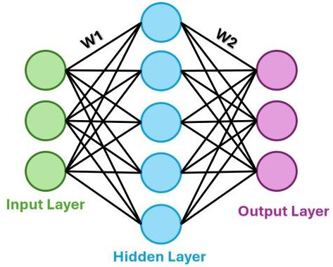

(a)

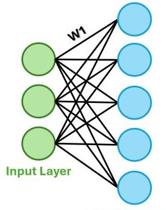

Hidden Layer 1

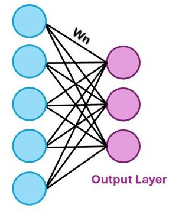

(b)

Figure 10. Typical structures of Artificial Neural Network (ANN) (a) and Deep Neural Network (DNN) (b).

Data-driven methods are powerful tools for developing very accurate estimation and prediction models. Using extensive aging data bypasses the need to directly account for intricate electrochemical changes and fluctuations in active materials within lithium-ion batteries. However, these methods have some limitations in the context of battery health assessments. They require large datasets for effective training and are highly dependent on data quality, making them prone to overfitting, especially when a physical battery model is not incorporated.

## 4.3.5. Fusion Methods

In recent years, research on monitoring and prediction for lithium-ion batteries has increasingly recognized the benefits of combining various methods to leverage their individual strengths. Two distinct fusion techniques have been prominently highlighted in the literature:

- Data-Data Fusion: This combines multiple data-driven algorithms to improve SOC, SOH, and RUL estimations. Moreover, studies [212-215] combine the CNN with the LSTM used as a typical encoder-decoder. In [216], the authors take fusion by integrating CNN with LSTM for assessing the battery's RUL and boosting prediction precision within a reasonable computation time. The CNN is also used in combination with the GRU, enabling the model to effectively extract significant local features while emphasizing their importance during training. For example, Y. Liu [217] uses CNNs to estimate the maximum discharging capacity, which is then used by a GRU to deduce the RUL. To maximize the strengths of each model, Fan et al. [218] proposed a GRU-CNN hybrid model to estimate the SOH under various discharge conditions. Other methodologies, including statistical models, demonstrate powerful results when combined with neural networks. Gao et al. [219] employ an Elman neural network and GPR to model battery aging, with a Bi-LSTM component for capacity error

<!-- PDF_PAGE: 24 -->

correction. Liu's [220] research uses LSTM for long-term dependency capture and GPR to assess uncertainty, effectively addressing capacity regeneration phenomena. Che [221] integrates GPR to optimize the health indicator extraction and applies an RNN to directly forecast RUL. Uncertainty quantification is further refined in Kim's [222] work with a variational LSTM (VarLSTM) model using Monte Carlo dropout to predict battery degradation and RUL with reliable uncertainty estimates.

Model-Data Fusion: Approaches that fuse model-based and data-driven methods have become central to advancing lithium-ion battery health and life predictions. One prominent fusion strategy involves embedding physical constraints directly within neural networks to guide model training and enhance interpretability; Figure 11. For example, J. Ye's [223] Physics-Informed Neural Network (PINN) incorporates specific physical relationships between health indicators and SOH, creating constraints that guide the learning process and improve prediction accuracy. Similarly, S. Singh [224] embeds Fick's diffusion law into a PINN, integrating partial differential equations of battery chemistry into the network. This approach allows the model to capture electrochemical dynamics accurately, translating these constraints into the network's optimization function, which supports SOC and SOH predictions that are rooted in physical principles. Similarly, Y. Wang's [225] Physics-Informed Recurrent Neural Network (PIRNN) introduces electrochemical impedance constraints in the NN loss function, allowing the network to capture the diffusion dynamics of lithium-ion cells. Another approach focuses on combining physics-based simulated data with experimental observations in a hybrid data structure. T. Hofmann's [226] study, for instance, trains an LSTM model on a dataset that fuses outputs from a P2D model, lab experiments, and field data from electric vehicles. This hybrid dataset captures various SOH stages, enabling the model to align internal battery states with measurable SOH indicators. Lastly, methods utilize statistical fusion within hybrid architectures to incorporate both physical models and data-driven filtering for noise reduction and uncertainty management. For example, Z. Lyu's [227] Model-Data Fusion framework integrates a Thevenin model with GPR and particle filtering to estimate SOH dynamically.

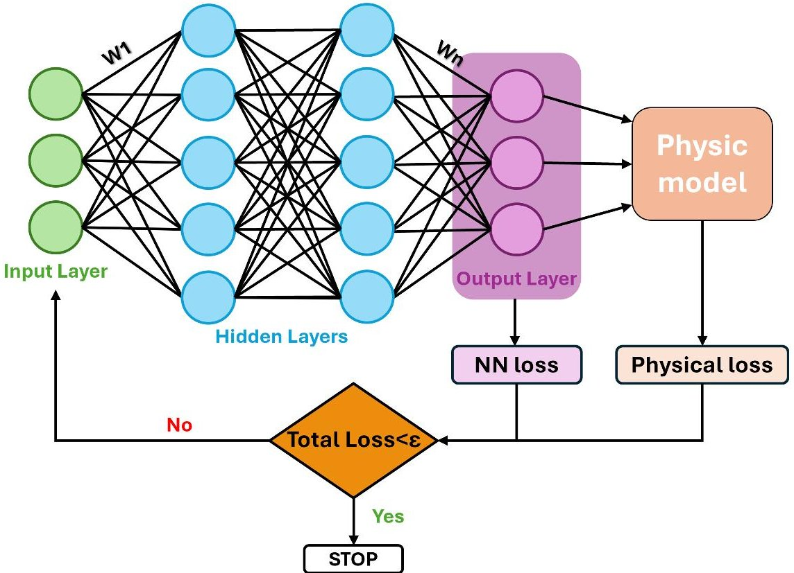

Figure 11. Structure of Physics-Informed Neural Network (PINN) incorporating physical principles into the loss function.

<!-- PDF_PAGE: 25 -->

To improve accuracy and reliability, many researchers now use hybrid approaches that combine the strengths of different techniques. While some methods offer simplicity and ease of implementation, others provide robustness and resilience to parameter fluctuations; however, they may require extensive datasets or precise calibration. A more versatile and effective prediction model, better suited to real-world operating conditions, can be developed using a fusion strategy [15].

The methodologies used to estimate key parameters such as SOC, SOH, and RUL have been categorized into four primary classes, representing the first level of the classification. Each class is further divided into different approaches, which form the second level of the classification. For each approach, various algorithms are presented, highlighting their common features and differences, forming the third level of the classification. A flowchart in Figure 12 summarizes the classification. Table 2 lists the different approaches, providing a comparison by outlining their respective advantages and disadvantages. Additionally, the possible outputs for each algorithm are specified.

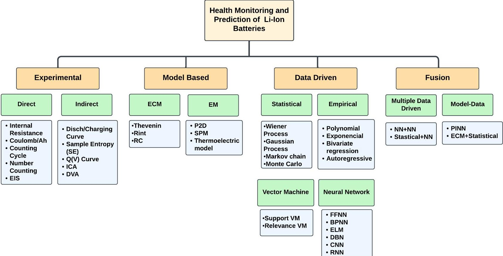

Figure 12. Classification of methods and algorithms for health monitoring and prediction in Li-ion batteries.

<!-- PDF_PAGE: 26 -->

Table 2. Classification and comparison of health monitoring and prediction of Li-ion batteries.

<table border="1"><tr><td>Methodology</td><td></td><td>Pro</td><td>Cons</td><td>Algorithm</td><td>Outputs</td></tr><tr><td rowspan="9">Exp.</td><td rowspan="5">Indirect</td><td rowspan="5">Easy to implement with good accuracy; suitable real-time monitoring; highly accurate in lab environments.</td><td rowspan="5">Requires specific conditions often unavailable in real scenarios; temperature variations and incomplete cycles reduce accuracy.</td><td>C/D Curve</td><td>SOH: [64,113,114]</td></tr><tr><td rowspan="2">DVA</td><td>SOH: [115,116]</td></tr><tr><td>SOC: [117]</td></tr><tr><td>ICA</td><td>SOH: [99-105]</td></tr><tr><td>Q(V)</td><td>SOH: [110,228]</td></tr><tr><td rowspan="5">Direct</td><td rowspan="5">Simple, fast, and accurate in lab settings with low computational complexity; provides detailed degradation data.</td><td rowspan="5">Need frequent recalibration; sensitive to incomplete charge cycles, temperature; requires advanced instruments.</td><td>C/Ah count</td><td>SOH: [90]
SOC: [89]</td></tr><tr><td>Cycle Number</td><td>SOC: [92]</td></tr><tr><td>IR</td><td>SOH: [84-86]</td></tr><tr><td>EIS</td><td>SOH: [62,93-96]
SOC: [94]</td></tr><tr><td rowspan="5">Model-Based</td><td rowspan="3">EM</td><td rowspan="3">Provides insights into battery chemical processes; high prediction accuracy when well calibrated.</td><td rowspan="3">Complex and computationally intensive; difficult parameter identification; real-time limitations.</td><td>P2D</td><td>SOH: [120]</td></tr><tr><td rowspan="2">SPM</td><td>SOH: [123-125,127]
SOC: [122]
RUL: [123,125]</td></tr><tr><td>TEM</td><td>SOH: [126]</td></tr><tr><td rowspan="2">ECM</td><td rowspan="2">Few parameters and simple equations; high computational efficiency and ease implementation.</td><td rowspan="2">Poor accuracy, limited ability to capture degradation mechanisms; requires precise parameter initialization.</td><td>Thevenin</td><td>SOH: [133,141,143]
SOC: [133,138]</td></tr><tr><td>RC</td><td>SOH: [140]
SOC: [135-137,139,142]</td></tr><tr><td rowspan="4">Data-Driven</td><td rowspan="3">Statistical</td><td rowspan="3">High scalability; wide range of applications; high accuracy; provides confidence intervals.</td><td rowspan="3">Relies on the accuracy of the model; needs comprehensive data; large amount of calculation and complex super parameters.</td><td>Bayesian</td><td>SOH: [145-147,149,150]
RUL: [144,148,149,151]</td></tr><tr><td>MC</td><td>RUL: [155,156]</td></tr><tr><td>HMM</td><td>SOH: [152-154]</td></tr><tr><td rowspan="2">Empirical</td><td rowspan="2">Less battery knowledge required; simple mathematical structure with fast calculations; easy to establish with promising results.</td><td rowspan="2">Requires large datasets and is highly sensitive to data quality; low generalization ability; the degradation mechanism is not explicitly defined.</td><td>Exponential</td><td>SOH: [165]
RUL: [162-167]</td></tr><tr><td>Polynomial</td><td>SOH: [158]
RUL: [159]</td></tr></table>

<!-- PDF_PAGE: 27 -->

Table 2. Cont.

<table border="1"><tr><td>Methodology</td><td></td><td>Pro</td><td>Cons</td><td>Algorithm</td><td>Outputs</td></tr><tr><td rowspan="8">Data-Driven</td><td rowspan="2">Vector Machine</td><td rowspan="2">Simple to operate with flexible parameter control; requires fewer samples and involves a small amount of computation.</td><td rowspan="2">Kernel function parameters are sensitive and may lead to overfitting; poor stability in long-term estimation accuracy.</td><td>SVM</td><td>SOH: [169-172,176,177,179]SOC: [168,178,229]RUL: [171,174,229]</td></tr><tr><td>RVM</td><td>SOH: [180]RUL: [175,181-184]</td></tr><tr><td rowspan="6">Neural Network</td><td rowspan="6">Battery knowledge not required; only requires data for training; highly accurate operation, capable of modeling complex relationships in battery performance.</td><td rowspan="6">Computationally intensive; requires large datasets for training; overfitting and poor generalization are common; highly dependent on the quality of training data.</td><td>FNN</td><td>SOH: [185-188]SOC: [188]</td></tr><tr><td>BPNN</td><td>SOH: [189,190]SOC: [189]</td></tr><tr><td>ELM</td><td>SOH: [192]RUL: [25]</td></tr><tr><td>CNN</td><td>SOC: [194,195]RUL: [193,196]</td></tr><tr><td>RNN</td><td>SOH: [204,207-209]SOC: [203,205,211]RUL: [198-202,206,210]</td></tr><tr><td rowspan="4">Fusion</td><td rowspan="2">Data-Data</td><td rowspan="2">Provides high accuracy and reliability of estimation results.</td><td rowspan="2">High complexity; computationally intensive; performance heavily relies on the quality and compatibility of the combined data.</td><td>NN+NN</td><td>SOH: [212,214,218]SOC: [215]RUL: [212,213,216,217]</td></tr><tr><td>Statistical+NN</td><td>SOH: [222]RUL: [219-221]</td></tr><tr><td rowspan="2">Model-Data</td><td rowspan="2">High accuracy and reliability; enhances predictive performance by leveraging the physical interpretability of models with the adaptive precision of data-driven techniques.</td><td rowspan="2">High complexity; computationally intensive; challenging to implement and requires careful integration of both data-driven and model-based methods.</td><td>PINN</td><td>SOH: [223,224,226]SOC: [224,225]</td></tr><tr><td>ECM+Statistical</td><td>SOH: [227]RUL: [227]</td></tr></table>

<!-- PDF_PAGE: 28 -->

## 4.3.6. Datasets

In recent years, various open-source datasets have been made available to aid in the development of battery management system (BMS) state estimation techniques, enabling researchers to test and validate their models. These datasets, often collected under controlled laboratory conditions or field tests, offer valuable information on battery performance across different usage and environmental scenarios. In Table 3, some of the most popular open-source datasets that are commonly used in BMS research are reported.

Table 3. Some public datatsets used in different studies for SOC, SOH, and RUL estimations.

<table border="1"><tr><td>Database</td><td>Description</td><td>Observables</td><td>Ref.</td></tr><tr><td>NASA</td><td>Cylindrical 18650 lithium-ion cells(34 cells) tested at 24℃43℃and4℃.The charging protocol used a CC of either1A or5A up to4.2V,followed by a CV phase until0.02A. Discharges were performed at CC of2A,4A,and1A;additional tests used a square wave discharge at4A or multiple CC discharge patterns.</td><td>Voltage,Current,Temperature,Capacity,EIS impedance.</td><td>[98]</td></tr><tr><td>NASA-Randomized Usage</td><td>28 cylindrical 18650 lithium-ion cells tested at25℃40℃.Charging was performed under a CC mode at2Auntil4.2V,followed byCV until0.02A. Discharge involved randomized selection of current loads varyingbetween0.5A and5A.</td><td>Voltage,Current,Temperature,Capacity,EIS Impedance.</td><td>[230]</td></tr><tr><td>CALCE</td><td>Cylindrical 18650 cells,as well as prismatic and pouch cells,tested at0℃25℃and45℃.Charging protocols includeCC at2Aor0.5A up to4.2V,followed byCV phase until0.02A. Discharge modes includeCC at0.1Aand differentdynamic current profiles,including standardized drivecycles and real-world usage simulations.</td><td>Voltage,Current,Capacity,Impedance,Internal Resistance.</td><td>[231]</td></tr><tr><td>Oxford</td><td>Long-term cycling of eight pouch lithium-ion cells tested at40℃.Charging employed a CC-CV protocol.The discharge followed the Urban Artemis Driving Profile.</td><td>Voltage,Current,Temperature,Capacity,EIS.</td><td>[232]</td></tr><tr><td>Bird Constellation</td><td>On-orbit data from four1U CubeSats,focusing onEPSdata under space conditions.</td><td>Voltage,Current,Temperature.</td><td>[233]</td></tr><tr><td>Toyota</td><td>Data from124 cylindricalLFP/graphite batteries cycled at30℃.Charging protocols include one or two step fastCCprotocol. Discharge modes includeCC at4C.</td><td>Voltage,Current,Temperature,Capacity,Internal Resistance.</td><td>[234]</td></tr></table>

In addition to the datasets listed in the table, further datasets related to lithium-ion batteries are summarized in the works of [235]. These references provide a review of over 30 publicly available datasets, categorized by experimental testing mode, test variables, and the data provided.

## 4.4. Model Updating Methods

The concept of model updating plays a crucial role in enhancing the accuracy and reliability of predictive models in real-time applications. Specifically, a two-way dynamic correlation between a Digital Twin model and the actual battery allows for continuous and secure battery management throughout its entire lifespan. This is achieved through online learning or model updating, enabling the model to adapt and improve based on real-time data, ensuring that predictions reflect the actual condition and behavior of the battery.

<!-- PDF_PAGE: 29 -->

## 4.4.1. Statistical Filters

In this context, statistical filtering is a key technique for tracking and predicting system behavior. It continually updates the model's parameters based on new observations, thereby enhancing the precision of system state estimations over time. Two prominent methods in statistical filtering are Kalman filtering (KF) and particle filtering (PF).

- Kalman Filter typically involves a two-step process: first, the filter predicts the output parameters, and then it updates the identified battery parameters to refine accuracy [236]. However, for highly nonlinear systems such as lithium-ion batteries, standard KF may struggle to achieve the desired precision under real operational conditions, limiting its standalone use. Enhanced methods like Unscented Kalman filter (UKF) [237,238], extended Kalman filter (EKF) [239], and adaptive extended Kalman filter (AEKF) [240] were thus introduced to better manage these nonlinearities and improve the accuracy of estimations. Furthermore, a double-extended Kalman filter (DEKF) approach, combined with an ECM, has shown robust performance in lithium-ion applications by offering improved reliability compared to traditional KF methods [241]. Some authors have integrated Kalman filtering with feature extraction techniques. For example, a method using ICA and a weighted Kalman filter has demonstrated enhanced prediction accuracy for lithium-ion battery SOH by building Gaussian nonlinear feature mappings based on extracted health factors [242]. Further improvements have explored joint filtering techniques, such as combining an H-infinity filter with UKF for online parameter updates, yielding higher robustness and estimation accuracy in battery applications [243]. In recent advancements, Kalman filtering has also been combined with AI techniques to improve battery state estimation. For instance, an integration of a GRU with the AKF is proposed to enhance the estimation of the SOC across varying temperatures [244]. This model initially estimates SOC with a GRU, followed by refinement using an adaptive KF to enhance robustness.

- Particle Filter (PF) leverages Bayesian estimation and the Monte Carlo method, using particle sets to represent the probability density function in any state-space model [15]. PF does not require data to follow a Gaussian distribution, making it ideal for nonlinear, non-Gaussian filtering. To improve robustness, variations in PF address issues like particle scarcity and noise disturbances. The Unscented Particle Filter (UPF), for example, is used to refine SOC estimation with improved accuracy [245]. Other improved approaches combine H-infinity filtering (HIF) with PF, offering better tolerance to model inaccuracies and noise uncertainties, providing high robustness for SOC estimations [246,247]. In recent advancements, a hybrid approach combining Gaussian Process Regression with PF has shown effective SOH and RUL estimation for lithium-ion batteries. These models suppress noise in online battery data, allowing PF to track capacity degradation and predict RUL with high accuracy [227,248]. Despite its benefits, PF is computationally demanding, requiring extensive processing time, especially for complex environments with large sample sets, which limits its real-time prediction capabilities. To improve stability and reduce computation time, scholars have proposed using different time scales for state and parameter estimation, which prevents the recurrent alteration of system variables, a common cause of destabilized predictions and extended response times [14]. Additionally, in [249], the authors emphasize the importance of carefully selecting sample sizes to balance calculation speed and accuracy for battery state estimation using two different PF models.

Statistical Filters provide effective frameworks for refining model predictions in real time by integrating live data. These methodologies rely on computational strategies that strike a balance between accuracy and processing complexity. However, as environmental complexity grows, a larger set of sample parameters is required to align prediction outcomes

<!-- PDF_PAGE: 30 -->

with posterior probability density. This significantly raises the computational demand and complexity, diminishing the timeliness of online prediction algorithms.

## 4.4.2. Transfer Learning

In addition to filtering methods, the Transfer Learning technique has emerged as a powerful approach in the field of battery health prognostics and state estimation, providing an effective solution for adapting pre-trained models to new, domain-specific datasets with minimal re-training. It primarily encompasses two strategies: fine-tuning and domain adaptation [250].

- Fine-tuning involves retraining some layers of a pre-trained model with a small amount of data from the target domain, assuming that the relationships between input parameters and output states are consistent across domains. A graphical representation of the fine-tuning algorithm is reported in Figure 13. This approach is particularly useful when limited data is available from the target domain, as it allows models to be quickly adjusted for specific tasks. For instance, Deng et al. used data on early ageing to recognise degradation patterns and then applied fine-tuning to improve the accuracy of SOH evaluations in a specific domain [110]. Similarly, Yao [195] proposed a method where a model trained on a large battery dataset was fine-tuned with limited target data (only a small segment of charge/discharge cycles), significantly enhancing capacity estimation. In this contest, CNNs have also been widely used in conjunction with Transfer Learning to improve battery health estimation, particularly when dealing with limited data [251]. LSTM networks have also found application in Transfer Learning for battery health prediction, particularly for SOH estimation. Tan proposed an LSTM model, showing superior prediction accuracy across various datasets. Their Transfer Learning-based LSTM approach, fine-tuned on domain-specific data, outperformed other models, highlighting its robustness in handling battery health estimation [252]. Kim [222] developed a VarLSTM-TL model for RUL prediction, demonstrating how fine-tuning can reduce the effort required to gather extensive data, making it effective for new battery types with minimal data.

- Domain adaptation focuses on minimizing the feature distribution gap between the source and target domains to improve model generalization and accuracy. Techniques such as symmetric feature transformation and the integration of domain discrepancy losses are employed to align the source and target domains, ensuring the model adapts better to the new domain. Che et al. [221] applied domain adaptation with a GRU to predict RUL under fast-charging conditions. They used online model self-correction and threshold adjustment to adapt the model during operational cycles. Furthermore, Shen et al. [253] demonstrated the use of deep CNNs and domain adaptation for capacity estimation, refining the model using data from a source domain before adapting it to the target domain.

Transfer Learning has proven to be a valuable approach for addressing the limitations of insufficient or costly data, enabling models to adapt efficiently to new tasks and domains. By utilizing knowledge from analogous batteries or operating conditions, Transfer Learning facilitates faster model adaptation and boosts predictive accuracy. Despite these advancements, one key issue is negative transfer, where knowledge from unrelated source domains adversely affects performance in the target domain. Recent research focuses on developing optimal transfer strategies to selectively incorporate relevant knowledge, thereby improving performance in target domains. In Figure 14, the classified updating methodologies are summarily described.

<!-- PDF_PAGE: 31 -->

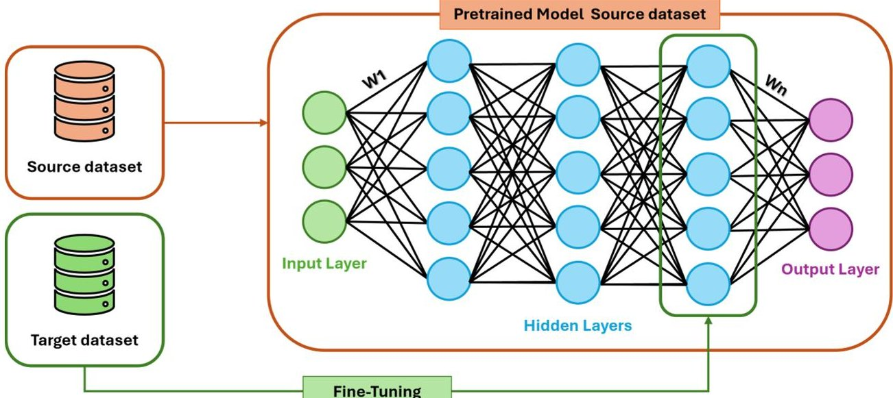

Figure 13. Structure of a neural network with fine-tuning of the final layer using a target dataset.

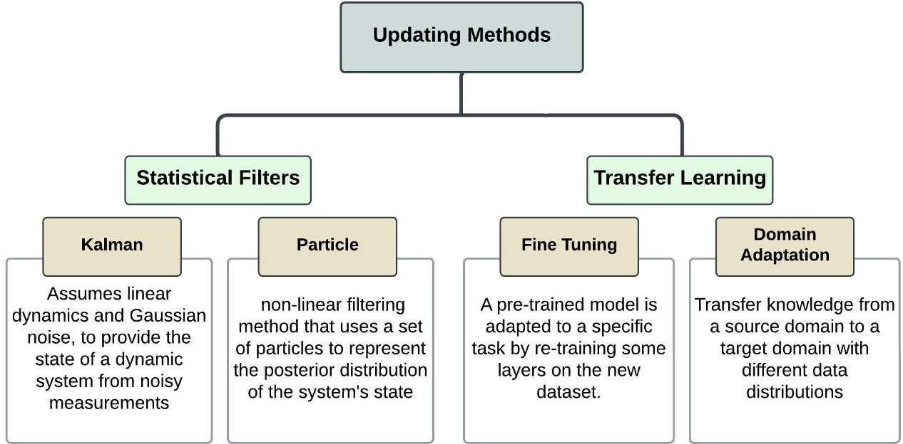

Figure 14. Classification and description of the model updating methods in health monitoring and prediction of Li-ion batteries.

## 5. Discussions

The implementation of Digital Twin technology in Battery Management Systems requires the careful selection of methodologies that balance accuracy, versatility, adaptability, and computational efficiency. This review has classified the available techniques into four categories (experimental, model-based, data-driven, and fusion), evaluating their effectiveness across three critical tasks: SOC estimation, SOH monitoring, and RUL prediction. The findings highlight distinct trade-offs among these methodologies, reflecting their suitability for different tasks and contexts. The choice of the methodology to be considered for DT applications, therefore, depends on the specific task and operational context. In this section, the classified methodologies are compared and analyzed, assessing their suitability for the integration into a DT framework. Additionally, challenges and future trends are discussed.

## 5.1. Comparison and Analysis

The classification and analysis of existing methodologies reveal their suitability for Digital Twin implementations in Battery Management Systems. This is determined not only by the strengths and limitations of each method, but also by their capacity to support real-time updates and estimate critical battery parameters such as SOC, SOH, and RUL.

<!-- PDF_PAGE: 32 -->

Experimental techniques provide robust insights into battery behavior and aging mechanisms. These methods are particularly valuable for SOH estimation, as they enable precise assessment of degradation and aging processes through direct and indirect approaches. Direct methods, such as internal resistance and capacity tests, are computationally efficient and easy to implement, making them suitable for regular offline diagnostics. Indirect methods expand their applicability by extracting useful degradation information even in incomplete charge/discharge cycles, although with reduced accuracy under real-world conditions. However, experimental methods lack updating capabilities. Their results are tied to fixed experimental setups, limiting their relevance in dynamic or real-time DT systems. Additionally, while experimental methods can provide high accuracy for SOH, their scalability to tasks like SOC estimation or RUL prediction is limited, further constraining their use in comprehensive DT frameworks.

Model-based techniques are well regarded for their interpretability and ability to simulate battery behavior based on physical and chemical principles. Electrochemical models excel in capturing internal mechanisms and degradation phenomena, offering high accuracy across SOC, SOH, and RUL when accurately parameterized. However, their computational intensity and difficulty in generalizing across varying conditions limit their applicability in real-time DT applications. Equivalent Circuit Models, on the other hand, prioritize simplicity and computational efficiency, making them suitable for realtime SOC and SOH estimation and rapid implementation in operational systems. One of the key advantages of model-based approaches is the possibility of model updating, resorting to techniques such as Statistical Filters. These filters allow the model parameters to be dynamically adjusted in response to new data, enhancing adaptability to real-world variations. Despite this capability, the performance of these models heavily depends on the accuracy of their initial parameterization and the availability of high-quality data for tuning.

Data-driven methods have become prominent for their adaptability and capability to handle complex, non-linear relationships in battery behavior. They are particularly effective for RUL prediction, where their ability to learn from historical patterns enables robust extrapolation of future performance. Additionally, these methods are well suited for SOH monitoring, capturing subtle degradation trends that are difficult to model explicitly. Their flexibility extends to SOC estimation, where ML models such as neural networks and vector machines deliver high accuracy under dynamic conditions. One of the defining features of data-driven techniques is their capability for updating through methods such as Transfer Learning and Statistical Filters. Transfer Learning, for instance, allows pre-trained models to be adapted to new datasets with minimal additional training, making them highly adaptable in dynamic environments. However, their reliance on large, high-quality datasets for training poses challenges, as does their black-box nature, which limits interpretability. Despite these strengths, their high computational demands and dependency on data quality remain significant barriers to their broader adoption in resource-constrained DT systems.

Fusion methods integrate the strengths of different approaches, enhancing the estimation of SOC, SOH, and RUL. These methods can significantly enhance performance by overcoming the limitations of individual approaches, offering more robust and adaptable solutions. The advantages of data fusion include high accuracy and reliability in estimation, as well as improved performance through the integration of diverse data-driven techniques. However, these methods are computationally intensive and require careful integration of different methods, with performance heavily reliant on the quality of the data. On the other hand, Model-Data Fusion approaches provide reliable and interpretable results by incorporating the system's physical constraints. Moreover, by leveraging physical models, these methods require less data to achieve accurate and robust predictions. However,

<!-- PDF_PAGE: 33 -->

they tend to be more complex and involve high computational costs. An advantage of hybrid approaches is their ability to support updating, leveraging both Statistical Filters and Transfer Learning to dynamically refine predictions based on new data. This capability positions fusion methods as highly adaptable solutions for DT implementations. However, their computational complexity and the challenges of harmonizing diverse methodologies can hinder seamless integration. Despite their potential, fusion methods are still in the early stages of development, with ongoing challenges in harmonizing different methodologies.

Given the heterogeneity of the analyzed methodologies for DT in BMSs, with varying assumptions, computational requirements, data dependencies, and performance metrics, a fully quantitative comparison is not feasible. For these reasons, an overall evaluation of methodological categories can be conducted through a qualitative analysis. Five parameters, derived from a synthesis of the reviewed literature, provide a comprehensive framework for assessing the suitability of different approaches. Each parameter is defined on a scale from 0 to 1, where a score of 1 is assigned to the best-performing method for that specific criterion:

- Accuracy: Quantification of the deviation between predicted and actual values in estimating SOC, SOH, and RUL. Experimental methods, rooted in precise laboratory measurements, achieve the highest accuracy (1.0) due to their direct observation of battery parameters. Model-based approaches follow with a slightly lower score (0.75), as their accuracy depends on the fidelity of the underlying physical models. Data-driven techniques, assigned a score of 0.85, can achieve high accuracy when trained on high-quality datasets. Fusion approaches, which integrate physical models with data-driven learning, achieve a balance between theoretical consistency and empirical adaptability, yielding an accuracy score of 0.9.

- Adaptability: Represents the ability of a method to integrate real-time data and adjust its predictions dynamically. Considering the two macro categories of model updating reported in Section 4.4, Statistical Filters and Transfer Learning, each category is assigned a score of 0.5 if it has been used in the literature in conjunction with one of these updating methods. For instance, experimental methods are static and receive a score of 0 due to their inability to adapt to new data. Model-based approaches improve on this by incorporating Statistical Filters, and are therefore a score of 0.5 is assigned. Data-driven and fusion techniques achieve the highest adaptability, as they leverage both Statistical Filters and Transfer Learning to continuously refine predictions based on new data, earning them a score of 1.0.

- Versatility represents the ability of a method to estimate multiple key battery parameters: SOH, SOC, and RUL. The method's versatility is quantified based on the number of outputs it can reliably predict, with a score of 0.33 assigned per output identified in the literature. Experimental methods (0.66) primarily focus on direct measurement and are typically used to estimate SOH and SOC, but they lack the capability to predict RUL. Model-based approaches (1.0) can estimate SOH, SOC, and RUL. Data-driven and fusion techniques (1.0) offer the highest versatility, as they can be trained to estimate SOC, SOH, and RUL simultaneously, provided they have access to sufficient historical and operational data.

- Computational efficiency evaluates the computational resources required by each method, considering both algorithmic complexity and processing demands. Experimental methods, which primarily rely on direct measurements, have no significant computational burden and thus receive the highest score (1). Model-based approaches exhibit a range of computational requirements. Equivalent Circuit Models (ECMs) are relatively lightweight (0.7) due to their simplified mathematical representations, whereas Electrochemical Models are computationally intensive (0.3) due to their need for solving complex partial differential equations. Consequently, the overall score

<!-- PDF_PAGE: 34 -->

for model-based approaches is set at 0.5, reflecting an average between these two subcategories. Data-driven techniques, while computationally expensive during training due to large-scale optimization and neural network processing, tend to be more efficient during inference. Given this trade-off, they are assigned a score of 0.5. Fusion approaches, which integrate both physical models and data-driven techniques, further increase computational demands by incorporating physics-based constraints into the loss function during training. While this enhances model accuracy and robustness, it also results in greater complexity, leading to an overall score of 0.7.

- Reliability evaluates a method's robustness to uncertainties, including noisy data, variations in operational conditions, and sensitivity to initial parameters. Experimental methods achieve a moderate score (0.5) because, while they are reliable in controlled environments, they lack adaptability to real-world conditions. Modelbased approaches demonstrate slightly better reliability (0.65) as they incorporate well-established physical principles, but their performance is dependent on accurate parameterization and can degrade under real-world uncertainties. Data-driven techniques (0.75) are sensitive to data quality and availability, although advanced preprocessing and robust training strategies can mitigate some of these issues. Fusion approaches, which combine physical modeling with adaptive data-driven techniques, achieve the highest reliability (1.0). By leveraging the strengths of both methodologies, they compensate for the weaknesses of purely data-driven methods while improving the adaptability of physics-based models, resulting in superior robustness to varying operational conditions and uncertainties.

The qualitative analysis is depicted in Figure 15. In summary, the analysis reveals that no single methodological category is universally optimal. Experimental methods are indispensable for calibration and validation, but are limited by their lack of adaptability and versatility. Model-based approaches provide a balance between accuracy and adaptability but require substantial parameter tuning. Data-driven techniques offer high versatility and adaptability, although at the cost of data dependency. In this context, the emerging role of fusion techniques further underscores the need for integrative approaches that capitalize on the strengths of multiple methodologies to achieve balanced performance across all DT requirements. Especially in the case of Model-Data Fusion, the model-based components offer robust estimations grounded in physical principles, which can enhance the interpretability and reliability of DT systems when combined with data-driven elements. The potential in combining the interpretability of model-based techniques with the adaptability of data-driven models makes the Model-Data Fusion method a promising candidate for future DT applications in Battery Management Systems.

## 5.2. Practical Implementation Considerations for Space-Oriented Digital Twin BMSs

Due to the variability of space missions and the interaction of multiple degradation mechanisms in challenging orbital environments, it is important to use multiscale DT models that include orbit-specific operational parameters. These parameters include eclipse duration (typically 35 min in LEO, 70 min in MEO and GEO), discharge depth profiles (typically < 40% in LEO and up to 80% in GEO), temperature variations, charge/discharge rates, and accumulated radiation dose rates. These parameters strongly influence battery ageing and thermal behavior [254].

<!-- PDF_PAGE: 35 -->

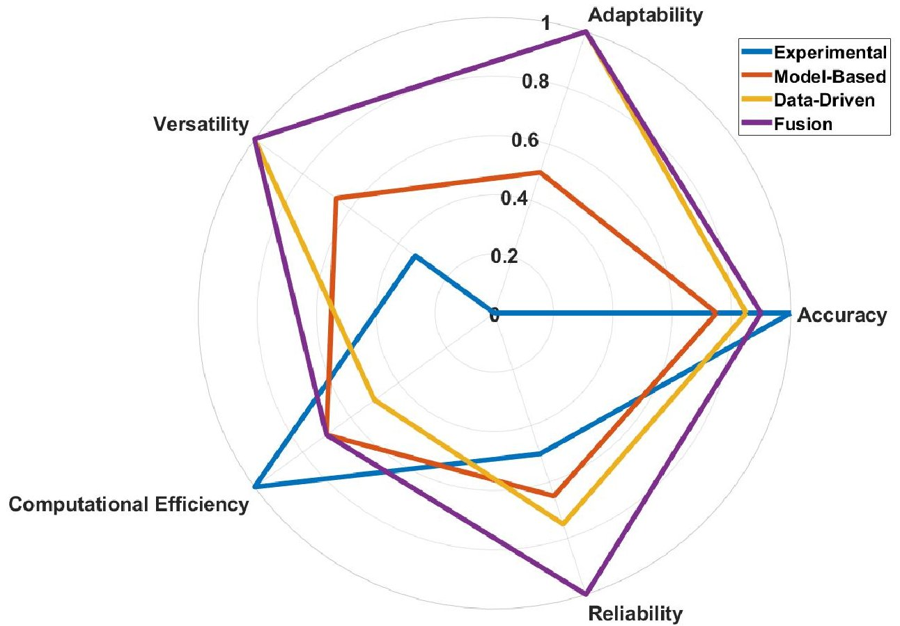

Figure 15. Comparison of methodologies for health monitoring and prediction of lithium-ion batteries using diverse metrics.

Given the complexity of coupled nonlinear degradation pathways, the careful selection and integration of appropriate data types is also crucial. Field experiments are essential for the implementation of an effective DT-based BMS, as they establish a solid baseline for training and validation. Laboratory tests that replicate mission-relevant conditions, including radiation exposure, thermal vacuum cycles, and representative charge/discharge profiles, provide vital datasets for current, voltage, and temperature. These datasets are used to train the data-driven component of the DT and ensure the interpretability of the model-based counterpart under different scenarios. The trained DT can then be refined using historical mission data to improve its adaptability to the physical layer. For in-orbit validation, the minimum dataset should include current, voltage, and temperature measurements, as well as environmental monitoring (thermal and radiative).

Once the physical layer is operational, the communications layer is essential for synchronizing the physical and virtual twins. Telemetry links typically exhibit latencies ranging from around 50 ms in LEO to 600 ms in GEO, with data sampling rates limited to a few seconds or minutes, depending on power and bandwidth availability. Adaptive compression, prioritization, and buffering strategies are commonly employed to optimize limited downlink capacity whilst maintaining effective synchronization [255]. In practice, the DT synchronization update rate should strike a balance between telemetry constraints and the dynamics of the monitored processes. CubeSats may require update intervals of a few minutes (sufficient to capture slowly varying SOH trends), whereas GEO satellites can support updates in the sub-minute range to track rapid voltage, current, or temperature transients.

Due to the adaptability characteristics of the DT, it is fundamental to have reliable and accurate real-time measurements. The impact of sensor calibration drift under prolonged radiation exposure and vacuum conditions on data integrity for Digital Twin models must be regularly evaluated. Detailed reporting of these parameters and system-level implementation choices is essential for faithful DT precise environmental adaptation and robustness.

Finally, the DT framework can be integrated into real BMS architectures as a supervisory layer. While the conventional BMS provides core safety functions (over/under-voltage,

<!-- PDF_PAGE: 36 -->

over-current protection), the DT enhances higher-level capabilities such as predictive analytics, anomaly detection, and Remaining Useful Life RUL estimation. This layered architecture ensures that DTs are not only replicable in research but also operationally deployable in space-qualified battery systems.

## 5.3. Challenges and Future Prospects

The integration of Digital Twin technology into Battery Management Systems could revolutionize the way in which batteries are monitored, diagnosed, and managed. However, significant challenges remain that must be addressed to fully realize the potential of this technology. One of the primary challenges lies in acquiring high-quality data. Often, the available data is scarce, noisy, or incomplete, making accurate model calibration difficult. Another major hurdle is the integration of multiphysics and multiscale dynamics. Batteries operate under coupled electrochemical, thermal, and mechanical phenomena across multiple scales, ranging from microscopic reactions to macroscopic system behaviors. Modeling these dynamics simultaneously poses significant computational and methodological difficulties. Bridging the gap between laboratory and field data is another critical challenge. Laboratory testing offers controlled and precise datasets but often fails to capture the variability and external factors present in real-world conditions. Conversely, while field data is rich and diverse, it introduces noise, inconsistencies, and lacks the control of laboratory settings. Additionally, computational resource constraints present a challenge, particularly for onboard implementation.

Despite these challenges, emerging trends point toward promising solutions. In this sense, operational data standardization and sharing are becoming pivotal in advancing battery research. Open datasets and standardized methodologies accelerate model development and validation while bridging the gap between laboratory findings and real-world applications. Furthermore, Transfer Learning, which leverages knowledge from related domains, addresses the scarcity of labeled training data. This approach enables the development of high-performing models with reduced resource demands, offering opportunities for adapting the DT to different scenarios. Fusion model approaches, which combine data-driven and physics-based methods, are gaining traction. Physics-based ML, which embeds physical laws into data-driven approaches, ensures interpretability and accuracy. Efforts are also being directed toward addressing multiphysics learning. By initially modeling the interaction of different physical phenomena, it can enhance computational feasibility and gain deeper insights into coupled battery dynamics in the operative conditions. Uncertainty quantification methods are also gaining importance, enhancing the robustness and safety of battery systems. These methods help identify worst-case scenarios and mitigate risks. Cloud-based integration improves real-time monitoring by incorporating network solutions by providing scalable platforms for real-time data collection, processing, and storage. These frameworks facilitate the seamless integration of sensor data with computational algorithms, enabling advanced analytics and remote diagnostics. If properly consolidated, the BMS within the DT framework could also play a significant role in the design process of spacecraft. By integrating the BMS into this virtual environment, it would be possible to accurately estimate the effective duration and lifespan of the designed battery pack. This approach helps avoid overdesigning the subsystems, particularly the heavier components, thus reducing unnecessary weight. The reduction in weight can lead to substantial cost savings for the mission, making the design more efficient and optimized. Furthermore, once the DT framework for maintenance and monitoring is developed, it is easily scaled to other subsystems within the spacecraft. This scalability offers the possibility of creating a comprehensive, interconnected system where each subsystem is modeled and monitored through its own Digital Twin. By integrating the Digital Twins of different subsystems, it

<!-- PDF_PAGE: 37 -->

can be possible to achieve a cyber-physical system that mirrors the entire satellite. This integration allows for real-time monitoring and predictive maintenance across all components, enhancing reliability, minimizing unplanned downtime, and improving overall mission success. The cyber-physical system formed by interconnected Digital Twins provides several advantages, including increased operational efficiency, proactive fault detection, and better resource allocation. It also facilitates continuous optimization through data-driven insights, enabling more informed decision-making throughout the satellite's lifecycle. This approach marks a shift towards more sustainable, cost-effective, and reliable space missions.

Together, these trends and innovations promise to overcome the current challenges, paving the way for more efficient, scalable, and accurate Battery Management Systems. As these solutions mature, they will significantly enhance the reliability and longevity of batteries across various applications.

## 6. Conclusions

This review provides a comprehensive analysis of methodologies for monitoring and predicting the behavior of lithium-ion batteries. In particular, it examines the suitability of these methods for integration into the Digital Twin framework. The degradation mechanisms of lithium-ion batteries are examined in the context of the space operational environment, highlighting typical anomalies that can impact the battery performance. This underscores the critical role of the BMS in monitoring, assessing, and predicting battery degradation. A definition of the Digital Twin is presented, comprising three main components: a physical entity, a virtual entity, and a connection layer.

The physical layer provides the essential observables (current, voltage, temperature) through embedded sensors, which are crucial for monitoring battery behavior under mission-relevant conditions. The communication layer maintains the bidirectional data exchange between the physical system and its virtual counterpart, ensuring that the digital model can be continuously synchronized in different orbital regimes. The virtual layer integrates these inputs into multi-scale models, allowing the dynamic representation of battery states and supporting functions such as fault detection, SOC and SOH tracking, and RUL prediction.

Within this framework, the review focuses on the virtual entity and classifies health monitoring and prediction methodologies into four primary groups: experimental, modelbased, data-driven, and fusion approaches. In addition, the review examines the core capability of Digital Twins to continuously update their models. A detailed analysis of the primary updating methodologies is presented, providing insights into how these techniques contribute to the understanding and management of battery degradation. By employing a qualitative parametric analysis, different methodology categories are compared to evaluate their adaptability within the DT framework. Fusion techniques, in particular, are emphasized as they demonstrate the importance of integrative approaches that leverage the strengths of multiple methodologies to meet the diverse requirements of Digital Twins. Despite substantial progress, to fully utilize the predictive potential of Digital Twins in next-generation space BMSs, several challenges must be addressed. These include the high computational cost of multi-scale physics-based models under onboard hardware limitations, strong environmental stressors like radiation-induced sensor drift, and the scarcity of in-orbit ground truth data. Therefore, future studies should concentrate on lightweight hybrid modeling strategies that combine low-power implementation with physics-informed machine learning, standardized open-access datasets from orbital missions for benchmarking, and adaptive telemetry frameworks that dynamically balance mission resources with synchronization fidelity.

<!-- PDF_PAGE: 38 -->

As the field advances, the fusion of innovative computational frameworks, advanced sensing technologies, and robust data integration techniques promises to unlock the full potential of DT-enabled BMSs, paving the way for more efficient and reliable energy systems in space. These advancements promise not only to optimize performance and reduce mission risks but also to align with broader objectives of cost efficiency and sustainability in space exploration. The ongoing refinement and implementation of DT-enabled BMSs will undoubtedly play a pivotal role in shaping the future of satellite technology.

Author Contributions: Conceptualization: R.G.S., M.P., G.C., D.d.I. and N.P.; methodology: R.G.S., M.P., D.d.I. and N.P.; formal analysis: R.G.S.; investigation: R.G.S.; writing—original draft preparation: R.G.S.; writing—review and editing: R.G.S., M.P., G.C., D.d.I. and N.P.; supervision: M.P., G.C., D.d.I. and N.P.; project administration: M.P., G.C., P.G. and C.C.; funding acquisition: M.P. and C.C.; visualization: R.G.S. All authors have read and agreed to the published version of the manuscript.

Funding: This research was co-funded by Thales Alenia Space Italia S.p.A. through the Aerospace Engineering PhD program of Sapienza University of Rome.

Data Availability Statement: No new data were created or analyzed in this study.

Acknowledgments: The work presented in this paper is part of a PhD position co-funded by PNRR M4C2 "Dalla Ricerca all'Impresa", Investimento 3.3 "Introduzione di dottorati innovativi che rispondono ai fabbisogni di innovazione delle imprese e promuovono l'assunzione dei ricercatori dalle imprese", (ref. D.M. n. 117/23), CUP: B53C23001270004.

Conflicts of Interest: Authors Davide di Ienno and Carlo Ciancarelli are employed by the Thales Alenia Space Italy S.p.A. The research was carried out with the financial support and collaboration of the Thales Alenia Space Italia S.p.A. company, which had a role in the collaboration and support of the research work as well as in the decision to publish the results.

## References

1. Uno, M.; Tanaka, K. Spacecraft electrical power system using lithium-ion capacitors. IEEE Trans. Aerosp. Electron. Syst. 2013, 49, 175-188. [CrossRef]

2. Wang, J.; Wen, X. Research status and progress of fault diagnosis technology for spacecraft. Aero Weapon. 2016, 5, 71-76.

3. Pathak, A.D.; Saha, S.; Bharti, V.K.; Gaikwad, M.M.; Sharma, C.S. A review on battery technology for space application. J. Energy Storage 2023, 61, 106792. [CrossRef]

4. Lelie, M.; Braun, T.; Knips, M.; Nordmann, H.; Ringbeck, F.; Zappen, H.; Sauer, D.U. Battery management system hardware concepts: An overview. Appl. Sci. 2018, 8, 534. [CrossRef]

5. Soon, J.J.; Chia, J.W.; Aung, H.; Lew, J.M.; Goh, S.T.; Low, K.S. A photovoltaic model based method to monitor solar array degradation on-board a microsatellite. IEEE Trans. Aerosp. Electron. Syst. 2018, 54, 2537-2546. [CrossRef]

6. Lim, T.M.; Cramer, A.M.; Lumpp, J.E.; Rawashdeh, S.A. A modular electrical power system architecture for small spacecraft. IEEE Trans. Aerosp. Electron. Syst. 2018, 54, 1832-1849. [CrossRef]

7. Naseri, F.; Gil, S.; Barbu, C.; Çetkin, E.; Yarimca, G.; Jensen, A.; Larsen, P.G.; Gomes, C. Digital twin of electric vehicle battery systems: Comprehensive review of the use cases, requirements, and platforms. Renew. Sustain. Energy Rev. 2023, 179, 113280. [CrossRef]

8. Wang, Y.; Xu, R.; Zhou, C.; Kang, X.; Chen, Z. Digital twin and cloud-side-end collaboration for intelligent battery management system. J. Manuf. Syst. 2022, 62, 124-134. [CrossRef]

9. Nair, P.; Vakharia, V.; Shah, M.; Kumar, Y.; Woźniak, M.; Shafi, J.; Fazal Ijaz, M. AI-Driven Digital Twin Model for Reliable Lithium-Ion Battery Discharge Capacity Predictions. Int. J. Intell. Syst. 2024, 2024, 8185044. [CrossRef]

10. Casado, P.; Torres, C.; Blanes, J.M.; Garrigós, A.; Marroquí, D. Implementation of a 6U CubeSat Electrical Power System Digital Twin. Aerospace 2024, 11, 688. [CrossRef]

11. Shangguan, D.; Chen, L.; Ding, J. A digital twin-based approach for the fault diagnosis and health monitoring of a complex satellite system. Symmetry 2020, 12, 1307. [CrossRef]

12. Lipu, M.H.; Ansari, S.; Miah, M.S.; Meraj, S.T.; Hasan, K.; Shihavuddin, A.; Hannan, M.; Muttaqi, K.M.; Hussain, A. Deep learning enabled state of charge, state of health and remaining useful life estimation for smart battery management system: Methods, implementations, issues and prospects. J. Energy Storage 2022, 55, 105752. [CrossRef]

<!-- PDF_PAGE: 39 -->

13. Zhao, J.; Zhu, Y.; Zhang, B.; Liu, M.; Wang, J.; Liu, C.; Hao, X. Review of state estimation and remaining useful life prediction methods for lithium-ion batteries. Sustainability 2023, 15, 5014. [CrossRef]

14. Pradhan, S.K.; Chakraborty, B. Battery management strategies: An essential review for battery state of health monitoring techniques. J. Energy Storage 2022, 51, 104427. [CrossRef]

15. Yao, L.; Xu, S.; Tang, A.; Zhou, F.; Hou, J.; Xiao, Y.; Fu, Z. A review of lithium-ion battery state of health estimation and prediction methods. World Electr. Veh. J. 2021, 12, 113. [CrossRef]

16. Tian, J.; Xiong, R.; Shen, W. A review on state of health estimation for lithium ion batteries in photovoltaic systems. ETransportation 2019, 2, 100028. [CrossRef]

17. Xiao, Y.; Wen, J.; Yao, L.; Zheng, J.; Fang, Z.; Shen, Y. A comprehensive review of the lithium-ion battery state of health prognosis methods combining aging mechanism analysis. J. Energy Storage 2023, 65, 107347. [CrossRef]

18. Kurucan, M.; Özbaltan, M.; Yetgin, Z.; Alkaya, A. Applications of artificial neural network based battery management systems: A literature review. Renew. Sustain. Energy Rev. 2024, 192, 114262. [CrossRef]

19. Massaoudi, M.; Abu-Rub, H.; Ghrayeb, A. Advancing lithium-ion battery health prognostics with deep learning: A review and case study. IEEE Open J. Ind. Appl. 2024, 5, 43-62. [CrossRef]

20. Renold, A.P.; Kathayat, N.S. Comprehensive Review of Machine Learning, Deep Learning, and Digital Twin Data-Driven Approaches in Battery Health Prediction of Electric Vehicles. IEEE Access 2024, 12, 43984-43999. [CrossRef]

21. Shi, D.; Zhao, J.; Eze, C.; Wang, Z.; Wang, J.; Lian, Y.; Burke, A.F. Cloud-based artificial intelligence framework for battery management system. Energies 2023, 16, 4403. [CrossRef]

22. Chapel, L.; Picot, A.; Lacressonniere, F.; Maussion, P. Contribution to a review of lithium-ion batteries diagnostic methods for space applications. In Proceedings of the 2023 IEEE 14th International Symposium on Diagnostics for Electrical Machines, Power Electronics and Drives (SDEMPED), Chania, Greece, 28-31 August 2023; IEEE: Piscataway, NJ, USA, 2023; pp. 63-69.

23. Knap, V.; Vestergaard, L.K.; Stroe, D.I. A review of battery technology in CubeSats and small satellite solutions. Energies 2020, 13, 4097. [CrossRef]

24. Pistoia, G. Lithium-Ion Batteries: Advances and Applications; Elsevier: Amsterdam, The Netherlands, 2013.

25. Cao, M.; Zhang, T.; Wang, J.; Liu, Y. A deep belief network approach to remaining capacity estimation for lithium-ion batteries based on charging process features. J. Energy Storage 2022, 48, 103825. [CrossRef]

26. An, S.J.; Li, J.; Daniel, C.; Mohanty, D.; Nagpure, S.; Wood III, D.L. The state of understanding of the lithium-ion-battery graphite solid electrolyte interphase (SEI) and its relationship to formation cycling. Carbon 2016, 105, 52-76. [CrossRef]

27. Luo, G.; Zhang, Y.; Tang, A. Capacity Degradation and Aging Mechanisms Evolution of Lithium-Ion Batteries under Different Operation Conditions. Energies 2023, 16, 4232. [CrossRef]

28. Halpert, G.; Frank, H.; Surampudi, S. Batteries and fuel cells in space. Electrochem. Soc. Interface 1999, 8, 25. [CrossRef]

29. Qiu, J.; He, D.; Sun, M.; Li, S.; Wen, C.; Hattrick-Simpers, J.; Zheng, Y.F.; Cao, L. Effects of neutron and gamma radiation on lithium-ion batteries. Nucl. Instrum. Methods Phys. Res. B 2015, 345, 27-32. [CrossRef]

30. Tan, C.; Leung, K.Y.; Liu, D.X.; Canova, M.; Downing, R.G.; Co, A.C.; Cao, L.R. Gamma radiation effects on Li-ion battery electrolyte in neutron depth profiling for lithium quantification. J. Radioanal. Nucl. Chem. 2015, 305, 675-680. [CrossRef]

31. Jeevarajan, J.A.; Darcy, E.C. Crewed Space Vehicle Battery Safety Requirements; Technical Report; NASA Johnson Space Center: Houston, TX, USA, 2014.

32. Ma, S.; Jiang, M.; Tao, P.; Song, C.; Wu, J.; Wang, J.; Deng, T.; Shang, W. Temperature effect and thermal impact in lithium-ion batteries: A review. Prog. Nat. Sci. Mater. Int. 2018, 28, 653-666. [CrossRef]

33. Waldmann, T.; Wilka, M.; Kasper, M.; Fleischhammer, M.; Wohlfahrt-Mehrens, M. Temperature dependent ageing mechanisms in Lithium-ion batteries-A Post-Mortem study. J. Power Sources 2014, 262, 129-135. [CrossRef]

34. Fleischhammer, M.; Waldmann, T.; Bisle, G.; Hogg, B.I.; Wohlfahrt-Mehrens, M. Interaction of cyclic ageing at high-rate and low temperatures and safety in lithium-ion batteries. J. Power Sources 2015, 274, 432-439. [CrossRef]

35. Shchurov, N.I.; Dedov, S.I.; Malozyomov, B.V.; Shtang, A.A.; Martyushev, N.V.; Klyuev, R.V.; Andriashin, S.N. Degradation of lithium-ion batteries in an electric transport complex. Energies 2021, 14, 8072. [CrossRef]

36. Sun, B.; Qi, X.; Song, D.; Ruan, H. Review of low-temperature performance, modeling and heating for lithium-ion batteries. Energies 2023, 16, 7142. [CrossRef]

37. Awan, U.S.; Ghabraie, K.; Zolfagharian, A.; Eftekharnia, M.; Rolfe, B. Comparative Study of Vibrational Behaviour of Lithium-Ion Batteries Under Different Axis Orientations; Elsevier: Amsterdam, The Netherlands, 2025.

38. Ning, G.; Haran, B.; Popov, B.N. Capacity fade study of lithium-ion batteries cycled at high discharge rates. J. Power Sources 2003, 117, 160-169. [CrossRef]

39. Wong, D.; Shrestha, B.; Wetz, D.A.; Heinzel, J.M. Impact of high rate discharge on the aging of lithium nickel cobalt aluminum oxide batteries. J. Power Sources 2015, 280, 363-372. [CrossRef]

40. Lu, P.; Li, C.; Schneider, E.W.; Harris, S.J. Chemistry, impedance, and morphology evolution in solid electrolyte interphase films during formation in lithium ion batteries. J. Phys. Chem. 2014, 118, 896-903. [CrossRef]

<!-- PDF_PAGE: 40 -->

41. Yen, J.Y.; Hwu, J.G. Enhancement of silicon oxidation rate due to tensile mechanical stress. Appl. Phys. Lett. 2000, 76, 1834-1835. [CrossRef]

42. Guena, T.; Leblanc, P. How depth of discharge affects the cycle life of lithium-metal-polymer batteries. In Proceedings of the INTELEC 06-Twenty-Eighth International Telecommunications Energy Conference, Providence, RI, USA, 10-14 September 2006; IEEE: Piscataway, NJ, USA, 2006; pp. 1-8.

43. Niehoff, P.; Kraemer, E.; Winter, M. Parametrisation of the influence of different cycling conditions on the capacity fade and the internal resistance increase for lithium nickel manganese cobalt oxide/graphite cells. J. Electroanal. Chem. 2013, 707, 110-116. [CrossRef]

44. Gao, Y.; Jiang, J.; Zhang, C.; Zhang, W.; Ma, Z.; Jiang, Y. Lithium-ion battery aging mechanisms and life model under different charging stresses. J. Power Sources 2017, 356, 103-114. [CrossRef]

45. Attia, P.M.; Bills, A.; Planella, F.B.; Dechent, P.; Dos Reis, G.; Dubarry, M.; Gasper, P.; Gilchrist, R.; Greenbank, S.; Howey, D.; et al. "Knees" in lithium-ion battery aging trajectories. J. Electrochem. Soc. 2022, 169, 060517. [CrossRef]

46. Zou, B.; Zhang, L.; Xue, X.; Tan, R.; Jiang, P.; Ma, B.; Song, Z.; Hua, W. A review on the fault and defect diagnosis of lithium-ion battery for electric vehicles. Energies 2023, 16, 5507. [CrossRef]

47. Li, X.; Wang, Q.; Xu, C.; Wu, Y.; Li, L. Survey of Lithium-Ion Battery Anomaly Detection Methods in Electric Vehicles. IEEE Trans. Transp. Electrif. 2024, 11, 4189-4201. [CrossRef]

48. Lindgren, J.; Lund, P.D. Effect of extreme temperatures on battery charging and performance of electric vehicles. J. Power Sources 2016, 328, 37-45. [CrossRef]

49. Bandhauer, T.M.; Garimella, S.; Fuller, T.F. A critical review of thermal issues in lithium-ion batteries. J. Electrochem. Soc. 2011 158, R1. [CrossRef]

50. ESA-ESTEC. Space Engineering Li-Ion Battery Testing Handbook (ECSS-E-HB-20-02A); ESA Requirements and Standards Division: Noordwijk, The Netherlands, 2015; pp. 1-31.

51. ESA-ESTEC. Space Product Assurance Thermal Vacuum Outgassing Test for the Screening of Space Materials, (ECSS-Q-ST-70-02C). 2012. Available online: http://esmat.esa.int/ecss-q-st-70-02c.pdf (accessed on 15 June 2025).

52. Zheng, Y.; Qian, K.; Luo, D.; Li, Y.; Lu, Q.; Li, B.; He, Y.B.; Wang, X.; Li, J.; Kang, F. Influence of over-discharge on the lifetime and performance of LiFePO 4/graphite batteries. RSC Adv. 2016, 6, 30474-30483. [CrossRef]

53. Han, X.; Lu, L.; Zheng, Y.; Feng, X.; Li, Z.; Li, J.; Ouyang, M. A review on the key issues of the lithium ion battery degradation among the whole life cycle. ETransportation 2019, 1, 100005. [CrossRef]

54. Chen, Y.; Zhu, M.; Chen, M. Comprehensive experimental research on wrapping materials influences on the thermal runaway of lithium-ion batteries. Emerg. Manag. Sci. Technol. 2025, 5, e007. [CrossRef]

55. Wang, J.; Yu, K.; Xiao, P.; Li, L.; Wang, C.; Wang, Z.; Guo, D.; Richard, Y.K.K.; Lu, Y. Killing two birds with one stone strategy inspired advanced batteries with superior thermal safety: A comprehensive evaluation. Chem. Eng. J. 2025, 515, 163272. [CrossRef]

56. Liu, Y.; Liu, Q.; Li, Z.; Ren, Y.; Xie, J.; He, H.; Xu, F. Failure study of commercial LiFePO4 cells in over-discharge conditions using electrochemical impedance spectroscopy. J. Electrochem. Soc. 2014, 161, A620. [CrossRef]

57. Kumar, K.; Rithvik, G.; Mittal, G.; Arya, R.; Sharma, T.K.; Pareek, K. Impact of fast charging and low-temperature cycling on lithium-ion battery health: A comparative analysis. J. Energy Storage 2024, 94, 112580. [CrossRef]

58. Liu, H.; Chen, X.; Sun, Q.; Zhao, C. Cycle performance characteristics of soft pack lithium-ion batteries under vacuum environment. Energy Storage Sci. Technol. 2022, 11, 1806.

59. Leita, G.; Bozzini, B. Impact of space radiation on lithium-ion batteries: A review from a radiation electrochemistry perspective. J. Energy Storage 2024, 100, 113406. [CrossRef]

60. Cook, R.; Swan, L.; Plucknett, K. Failure mode analysis of lithium ion batteries operated for low Earth orbit CubeSat applications. J. Energy Storage 2020, 31, 101561. [CrossRef]

61. Xiong, R.; Li, L.; Tian, J. Towards a smarter battery management system: A critical review on battery state of health monitoring methods. J. Power Sources 2018, 405, 18-29. [CrossRef]

62. Ning, J.; Xiao, B.; Zhong, W.; Xiao, B. A rapid detection method for the battery state of health. Measurement 2022, 189, 110502. [CrossRef]

63. Wang, T.; Yang, J.; Lei, H.; Gu, M.; Leng, S.; Meng, Y. State of Health Estimation for Satellite Batteries Based on the Charge Curves. In Proceedings of the 2021 2nd China International SAR Symposium (CISS), Shanghai, China, 3-5 November 2021; IEEE: Piscataway, NJ, USA, 2021; pp. 1-4.

64. Yang, J.; Du, C.; Liu, W.; Wang, T.; Yan, L.; Gao, Y.; Cheng, X.; Zuo, P.; Ma, Y.; Yin, G.; et al. State-of-health estimation for satellite batteries based on the actual operating parameters-Health indicator extraction from the discharge curves and state estimation. J. Energy Storage 2020, 31, 101490. [CrossRef]

65. Song, Y.; Liu, D.; Peng, Y.; Yang, C.; Wu, W. Self-adaptive indirect health indicators extraction within prognosis of satellite lithium-ion battery. In Proceedings of the 2017 Prognostics and System Health Management Conference (PHM-Harbin), Harbin, China, 9-12 July 2017; IEEE: Piscataway, NJ, USA, 2017; pp. 1-7.

<!-- PDF_PAGE: 41 -->

66. Ansari, S.; Ayob, A.; Hossain Lipu, M.S.; Hussain, A.; Saad, M.H.M. Data-driven remaining useful life prediction for lithium-ion batteries using multi-charging profile framework: A recurrent neural network approach. Sustainability 2021, 13, 13333. [CrossRef]

67. Kaplan, H.; Tehrani, K.; Jamshidi, M. A fault diagnosis design based on deep learning approach for electric vehicle applications. Energies 2021, 14, 6599. [CrossRef]

68. Hannan, M.A.; Hoque, M.M.; Hussain, A.; Yusof, Y.; Ker, P.J. State-of-the-art and energy management system of lithium-ion batteries in electric vehicle applications: Issues and recommendations. IEEE Access 2018, 6, 19362-19378. [CrossRef]

69. Lipu, M.S.H.; Mamun, A.A.; Ansari, S.; Miah, M.S.; Hasan, K.; Meraj, S.T.; Abdolrasol, M.G.; Rahman, T.; Maruf, M.H.; Sarker, M.R.; et al. Battery management, key technologies, methods, issues, and future trends of electric vehicles: A pathway toward achieving sustainable development goals. Batteries 2022, 8, 119. [CrossRef]

70. Wang, X.; Wei, X.; Dai, H. Estimation of state of health of lithium-ion batteries based on charge transfer resistance considering different temperature and state of charge. J. Energy Storage 2019, 21, 618-631. [CrossRef]

71. You, Y.; Chen, C.; Hu, F.; Liu, Y.; Ji, Z. Advances of digital twins for predictive maintenance. Procedia Comput. Sci. 2022, 200, 1471-1480. [CrossRef]

72. Glaessgen, E.; Stargel, D. The digital twin paradigm for future NASA and US Air Force vehicles. In Proceedings of the 53rd AIAA/ASME/ASCE/AHS/ASC Structures, Structural Dynamics and Materials Conference 20th AIAA/ASME/AHS Adaptive Structures Conference 14th AIAA, Honolulu, HI, USA, 23-26 April 2012; p. 1818.

73. Grieves, M.; Vickers, J. Mitigating Unpredictable, Undesirable Emergent Behavior in Complex Systems (Excerpt); Florida Institute of Technology: Melbourne, FL, USA, 2016.

74. Barricelli, B.R.; Casiraghi, E.; Fogli, D. A survey on digital twin: Definitions, characteristics, applications, and design implications. IEEE Access 2019, 7, 167653-167671. [CrossRef]

75. Cimino, C.; Negri, E.; Fumagalli, L. Review of digital twin applications in manufacturing. Comput. Ind. 2019, 113, 103130. [CrossRef]

76. Rosen, R.; Von Wichert, G.; Lo, G.; Bettenhausen, K.D. About the importance of autonomy and digital twins for the future of manufacturing. Ifac-Papersonline 2015, 48, 567-572. [CrossRef]

77. Yang, W.; Zheng, Y.; Li, S. Application status and prospect of digital twin for on-orbit spacecraft. IEEE Access 2021, 9, 106489- 106500. [CrossRef]

78. Rathore, M.M.; Shah, S.A.; Shukla, D.; Bentafat, E.; Bakiras, S. The role of ai, machine learning, and big data in digital twinning: A systematic literature review, challenges, and opportunities. IEEE Access 2021, 9, 32030-32052. [CrossRef]

79. Semeraro, C.; Aljaghoub, H.; Abdelkareem, M.A.; Alami, A.H.; Dassisti, M.; Olabi, A. Guidelines for designing a digital twin for Li-ion battery: A reference methodology. Energy 2023, 284, 128699. [CrossRef]

80. Castet, J.F.; Saleh, J.H. Satellite reliability: Statistical data analysis and modeling. J. Spacecr. Rocket. 2009, 46, 1065-1076. [CrossRef]

81. Xing, Y.; Ma, E.W.; Tsui, K.L.; Pecht, M. Battery management systems in electric and hybrid vehicles. Energies 2011, 4, 1840-1857. [CrossRef]

82. Balasingam, B.; Ahmed, M.; Pattipati, K. Battery management systems—Challenges and some solutions. Energies 2020, 13, 2825. [CrossRef]

83. Antonello, F.; Daniele Segneri, V.R. Surrogate model-based calibration of a flying Earth observation satellite. Adv. Space Res. 2024, 79, 1925-1935. [CrossRef]

84. Chen, L.; Lü, Z.; Lin, W.; Li, J.; Pan, H. A new state-of-health estimation method for lithium-ion batteries through the intrinsic relationship between ohmic internal resistance and capacity. Measurement 2018, 116, 586-595. [CrossRef]

85. Haifeng, D.; Xuezhe, W.; Zechang, S. A new SOH prediction concept for the power lithium-ion battery used on HEVs. In Proceedings of the 2009 IEEE Vehicle Power and Propulsion Conference, Dearborn, MI, USA, 7-10 September 2009; IEEE: Piscataway, NJ, USA, 2009; pp. 1649-1653.

86. Remmlinger, J.; Buchholz, M.; Meiler, M.; Bernreuter, P.; Dietmayer, K. State-of-health monitoring of lithium-ion batteries in electric vehicles by on-board internal resistance estimation. J. Power Sources 2011, 196, 5357-5363. [CrossRef]

87. Barai, A.; Uddin, K.; Widanage, W.D.; McGordon, A.; Jennings, P. A study of the influence of measurement timescale on internal resistance characterisation methodologies for lithium-ion cells. Sci. Rep. 2018, 8, 21. [CrossRef]

88. Schweiger, H.G.; Obeidi, O.; Komesker, O.; Raschke, A.; Schiemann, M.; Zehner, C.; Gehnen, M.; Keller, M.; Birke, P. Comparison of several methods for determining the internal resistance of lithium ion cells. Sensors 2010, 10, 5604-5625. [CrossRef]

89. Ng, K.S.; Moo, C.S.; Chen, Y.P.; Hsieh, Y.C. Enhanced coulomb counting method for estimating state-of-charge and state-of-health of lithium-ion batteries. Appl. Energy 2009, 86, 1506-1511. [CrossRef]

90. Zhang, S.; Guo, X.; Dou, X.; Zhang, X. A rapid online calculation method for state of health of lithium-ion battery based on coulomb counting method and differential voltage analysis. J. Power Sources 2020, 479, 228740. [CrossRef]

<!-- PDF_PAGE: 42 -->

91. Wognsen, E.R.; Haverkort, B.R.; Jongerden, M.; Hansen, R.R.; Larsen, K.G. A score function for optimizing the cycle-life of battery-powered embedded systems. In Proceedings of the Formal Modeling and Analysis of Timed Systems: 13th International Conference, FORMATS 2015, Madrid, Spain, 2-4 September 2015; Proceedings 13; Springer: Berlin/Heidelberg, Germany, 2015; pp. 305-320.

92. Saxena, S.; Hendricks, C.; Pecht, M. Cycle life testing and modeling of graphite/LiCoO2 cells under different state of charge ranges. J. Power Sources 2016, 327, 394-400. [CrossRef]

93. Galeotti, M.; Cinà, L.; Giammanco, C.; Cordiner, S.; Di Carlo, A. Performance analysis and SOH (state of health) evaluation of lithium polymer batteries through electrochemical impedance spectroscopy. Energy 2015, 89, 678-686. [CrossRef]

94. Sauvant-Moynot, V.; Bernard, J.; Mingant, R.; Delailille, A.; Mattera, F.; Mailley, S.; Hognon, J.L.; Huet, F. ALIDISSI, a research program to evaluate electrochemical impedance spectroscopy as a SoC and SoH diagnosis tool for Li-ion batteries. Oil Gas Sci. Technol. Rev. L'Institut Fr. Pet. 2010, 65, 79-89. [CrossRef]

95. Cui, Y.; Zuo, P.; Du, C.; Gao, Y.; Yang, J.; Cheng, X.; Ma, Y.; Yin, G. State of health diagnosis model for lithium ion batteries based on real-time impedance and open circuit voltage parameters identification method. Energy 2018, 144, 647-656. [CrossRef]

96. Locorotondo, E.; Cultrera, V.; Pugi, L.; Berzi, L.; Pierini, M.; Lutzemberger, G. Development of a battery real-time state of health diagnosis based on fast impedance measurements. J. Energy Storage 2021, 38, 102566. [CrossRef]

97. Pulido, Y.F.; Blanco, C.; Ansean, D.; García, V.M.; Ferrero, F.; Valledor, M. Determination of suitable parameters for battery analysis by Electrochemical Impedance Spectroscopy. Measurement 2017, 106, 1-11. [CrossRef]

98. Saha, B.; Goebel, K. Experiments on Li-Ion Batteries: Charging and Discharging at Different Temperatures, Recording Impedance as the Damage Criterion, NASA Ames Prognostics Data Repository. 2007. Available online: https://www.nasa.gov/intelligent systems-division/discovery-and-systems-health/pcoe/pcoe-data-set-repository/ (accessed on 9 April 2025).

99. Albuquerque, L.; Lacressonniere, F.; Roboam, X.; Forgez, C. Incremental Capacity Analysis as a diagnostic method applied to second life Li-ion batteries. In International Conference of the IMACS TC1 Committee; Springer: Berlin/Heidelberg, Germany, 2021; pp. 451-463.

100. Agudelo, B.O.; Zamboni, W.; Monmasson, E. Application domain extension of incremental capacity-based battery SoH indicators. Energy 2021, 234, 121224. [CrossRef]

101. He, J.; Wei, Z.; Bian, X.; Yan, F. State-of-health estimation of lithium-ion batteries using incremental capacity analysis based on voltage-capacity model. IEEE Trans. Transp. Electrif. 2020, 6, 417-426. [CrossRef]

102. Liang, T.; Song, L. On-Board State of Health Estimation of Lithium Ion Batteries With Incremental Capacity Analysis Based on Gaussian Function. In ASME International Mechanical Engineering Congress and Exposition; American Society of Mechanical Engineers: Little Falls Township, NJ, USA, 2018; Volume 52071, p. V06AT08A058.

103. Tang, X.; Wang, Y.; Liu, Q.; Gao, F. Reconstruction of the incremental capacity trajectories from current-varying profiles for lithium-ion batteries. Iscience 2021, 24, 103103. [CrossRef]

104. Maures, M.; Capitaine, A.; Delétage, J.Y.; Vinassa, J.M.; Briat, O. Lithium-ion battery SoH estimation based on incremental capacity peak tracking at several current levels for online application. Microelectron. Reliab. 2020, 114, 113798. [CrossRef]

105. Tang, X.; Liu, K.; Lu, J.; Liu, B.; Wang, X.; Gao, F. Battery incremental capacity curve extraction by a two-dimensional Luenberger Gaussian-moving-average filter. Appl. Energy 2020, 280, 115895. [CrossRef]

106. Hu, X.; Li, S.E.; Jia, Z.; Egardt, B. Enhanced sample entropy-based health management of Li-ion battery for electrified vehicles. Energy 2014, 64, 953-960. [CrossRef]

107. Li, J.; Lyu, C.; Wang, L.; Zhang, L.; Li, C. Remaining capacity estimation of Li-ion batteries based on temperature sample entropy and particle filter. J. Power Sources 2014, 268, 895-903. [CrossRef]

108. Sui, X.; He, S.; Meng, J.; Teodorescu, R.; Stroe, D.I. Fuzzy entropy-based state of health estimation for Li-ion batteries. IEEE J. Emerg. Sel. Top. Power Electron. 2020, 9, 5125-5137. [CrossRef]

109. Che, Y.; Foley, A.; El-Gindy, M.; Lin, X.; Hu, X.; Pecht, M. Joint estimation of inconsistency and state of health for series battery packs. Automot. Innov. 2021, 4, 103-116. [CrossRef]

110. Deng, Z.; Hu, X.; Lin, X.; Xu, L.; Che, Y.; Hu, L. General discharge voltage information enabled health evaluation for lithium-ion batteries. IEEE/ASME Trans. Mechatronics 2020, 26, 1295-1306. [CrossRef]

111. Wei, J.; Dong, G.; Chen, Z. Remaining useful life prediction and state of health diagnosis for lithium-ion batteries using particle filter and support vector regression. IEEE Trans. Ind. Electron. 2017, 65, 5634-5643. [CrossRef]

112. Yun, Z.; Qin, W. Remaining useful life estimation of lithium-ion batteries based on optimal time series health indicator. IEEE Access 2020, 8, 55447-55461. [CrossRef]

113. Ruan, H.; He, H.; Wei, Z.; Quan, Z.; Li, Y. State of health estimation of lithium-ion battery based on constant-voltage charging reconstruction. IEEE J. Emerg. Sel. Top. Power Electron. 2021, 11, 4393-4402. [CrossRef]

114. Yang, J.; Xia, B.; Huang, W.; Fu, Y.; Mi, C. Online state-of-health estimation for lithium-ion batteries using constant-voltage charging current analysis. Appl. Energy 2018, 212, 1589-1600. [CrossRef]

<!-- PDF_PAGE: 43 -->

115. Wang, L.; Pan, C.; Liu, L.; Cheng, Y.; Zhao, X. On-board state of health estimation of LiFePO4 battery pack through differential voltage analysis. Appl. Energy 2016, 168, 465-472. [CrossRef]

116. Berecibar, M.; Garmendia, M.; Gandiaga, I.; Crego, J.; Villarreal, I. State of health estimation algorithm of LiFePO4 battery packs based on differential voltage curves for battery management system application. Energy 2016, 103, 784-796. [CrossRef]

117. Zheng, L.; Zhu, J.; Lu, D.D.C.; Wang, G.; He, T. Incremental capacity analysis and differential voltage analysis based state of charge and capacity estimation for lithium-ion batteries. Energy 2018, 150, 759-769. [CrossRef]

118. Laue, V.; Röder, F.; Krewer, U. Practical identifiability of electrochemical P2D models for lithium-ion batteries. J. Appl. Electrochem. 2021, 51, 1253-1265. [CrossRef]

119. Xu, M.; Wang, R.; Zhao, P.; Wang, X. Fast charging optimization for lithium-ion batteries based on dynamic programming algorithm and electrochemical-thermal-capacity fade coupled model. J. Power Sources 2019, 438, 227015. [CrossRef]

120. Xiong, R.; Li, L.; Li, Z.; Yu, Q.; Mu, H. An electrochemical model based degradation state identification method of Lithium-ion battery for all-climate electric vehicles application. Appl. Energy 2018, 219, 264-275. [CrossRef]

121. Li, R.; Hassan, A.; Gupte, N.; Su, W.; Zhou, X. Degradation Prediction and Cost Optimization of Second-Life Battery Used for Energy Arbitrage and Peak-Shaving in an Electric Grid. Energies 2023, 16, 6200. [CrossRef]

122. Liu, Y.; Ma, R.; Pang, S.; Xu, L.; Zhao, D.; Wei, J.; Huangfu, Y.; Gao, F. A nonlinear observer SOC estimation method based on electrochemical model for lithium-ion battery. IEEE Trans. Ind. Appl. 2020, 57, 1094-1104. [CrossRef]

123. Sadabadi, K.K.; Jin, X.; Rizzoni, G. Prediction of remaining useful life for a composite electrode lithium ion battery cell using an electrochemical model to estimate the state of health. J. Power Sources 2021, 481, 228861. [CrossRef]

124. Lyu, C.; Song, Y.; Zheng, J.; Luo, W.; Hinds, G.; Li, J.; Wang, L. In situ monitoring of lithium-ion battery degradation using an electrochemical model. Appl. Energy 2019, 250, 685-696. [CrossRef]

125. Shao, J.; Li, J.; Yuan, W.; Dai, C.; Wang, Z.; Zhao, M.; Pecht, M. A novel method of discharge capacity prediction based on simplified electrochemical model-aging mechanism for lithium-ion batteries. J. Energy Storage 2023, 61, 106788. [CrossRef]

126. Allam, A.; Onori, S. Online capacity estimation for lithium-ion battery cells via an electrochemical model-based adaptive interconnected observer. IEEE Trans. Control. Syst. Technol. 2020, 29, 1636-1651. [CrossRef]

127. Li, J.; Adewuyi, K.; Lotfi, N.; Landers, R.G.; Park, J. A single particle model with chemical/mechanical degradation physics for lithium ion battery State of Health (SOH) estimation. Appl. Energy 2018, 212, 1178-1190. [CrossRef]

128. Jang, S.; Yang, H. A real-time scheduling approach to mitigation of Li-ion battery aging in low earth orbit satellite systems. Electronics 2021, 10, 86. [CrossRef]

129. Wang, D.; Huang, H.; Tang, Z.; Zhang, Q.; Yang, B.; Zhang, B. A lithium-ion battery electrochemical-thermal model for a wide temperature range applications. Electrochim. Acta 2020, 362, 137118. [CrossRef]

130. Wang, Y.; Zhou, C.; Chen, Z. Optimization of battery charging strategy based on nonlinear model predictive control. Energy 2022, 241, 122877. [CrossRef]

131. Jang, S.; Yang, H. Temperature Variation Aware Li-ion Battery Aging Simulator for Satellite Systems. In Proceedings of the 2020 International Conference on Information and Communication Technology Convergence (ICTC), Jeju, Republic of Korea, 21-23 October 2020; IEEE: Piscataway, NJ, USA, 2020; pp. 185-187.

132. Zhang, X.; Zhang, W.; Lei, G. A review of li-ion battery equivalent circuit models. Trans. Electr. Electron. Mater. 2016, 17, 311-316. [CrossRef]

133. Ouyang, T.; Xu, P.; Lu, J.; Hu, X.; Liu, B.; Chen, N. Coestimation of state-of-charge and state-of-health for power batteries based on multithread dynamic optimization method. IEEE Trans. Ind. Electron. 2021, 69, 1157-1166. [CrossRef]

134. He, X.; Sun, B.; Zhang, W.; Fan, X.; Su, X.; Ruan, H. Multi-time scale variable-order equivalent circuit model for virtual battery considering initial polarization condition of lithium-ion battery. Energy 2022, 244, 123084. [CrossRef]

135. Zhang, C.; Allafi, W.; Dinh, Q.; Ascencio, P.; Marco, J. Online estimation of battery equivalent circuit model parameters and state of charge using decoupled least squares technique. Energy 2018, 142, 678-688. [CrossRef]

136. Wassiliadis, N.; Adermann, J.; Frericks, A.; Pak, M.; Reiter, C.; Lohmann, B.; Lienkamp, M. Revisiting the dual extended Kalman filter for battery state-of-charge and state-of-health estimation: A use-case life cycle analysis. J. Energy Storage 2018, 19, 73-87. [CrossRef]

137. Dong, G.; Wei, J.; Chen, Z.; Sun, H.; Yu, X. Remaining dischargeable time prediction for lithium-ion batteries using unscented Kalman filter. J. Power Sources 2017, 364, 316-327. [CrossRef]

138. Chen, Z.; Sun, H.; Dong, G.; Wei, J.; Wu, J. Particle filter-based state-of-charge estimation and remaining-dischargeable-time prediction method for lithium-ion batteries. J. Power Sources 2019, 414, 158-166. [CrossRef]

139. Wang, Y.; Chen, Z. A framework for state-of-charge and remaining discharge time prediction using unscented particle filter. Appl. Energy 2020, 260, 114324. [CrossRef]

140. Song, Y.; Peng, Y.; Liu, D. Model-based health diagnosis for lithium-ion battery pack in space applications. IEEE Trans. Ind. Electron. 2020, 68, 12375-12384. [CrossRef]

<!-- PDF_PAGE: 44 -->

141. Knap, V.; Beczkowski, S.M.; Stroe, D.I. Development of a Model-Based Approach to Capture Battery Parameter Degradation in Satellites. ECS Trans. 2020, 99, 341. [CrossRef]

142. Zhang, X.; Lu, J.; Yuan, S.; Yang, J.; Zhou, X. A novel method for identification of lithium-ion battery equivalent circuit model parameters considering electrochemical properties. J. Power Sources 2017, 345, 21-29. [CrossRef]

143. Ma, Z.; Wang, Z.; Xiong, R.; Jiang, J. A mechanism identification model based state-of-health diagnosis of lithium-ion batteries for energy storage applications. J. Clean. Prod. 2018, 193, 379-390. [CrossRef]

144. Huang, W.; Andrada, R.; Borja, D. A framework of big data driven remaining useful lifetime prediction of on-orbit satellite. In Proceedings of the 2021 Annual Reliability and Maintainability Symposium (RAMS), Orlando, FL, USA, 24-27 May 2021; IEEE: Piscataway, NJ, USA, 2021; pp. 1-7.

145. Boussouf, L.; Barreyre, C.C.A. Satellite battery degradation prognostic based on data analytics and big data infrastructure. In Proceedings of the 10th International Symposium on NDT in Aerospace, Dresden, Germany, 24-26 October 2018.

146. Jiang, Z.; Fang, H.; Wang, X.; Fan, H. Health Evaluation Method of Satellite Battery Based-On Bayesian Network. In Proceedings of the 2019 International Conference on Sensing, Diagnostics, Prognostics, and Control (SDPC), Beijing, China, 15-17 August 2019; IEEE: Piscataway, NJ, USA, 2019; pp. 552-556.

147. Richardson, R.R.; Birkl, C.R.; Osborne, M.A.; Howey, D.A. Gaussian process regression for in situ capacity estimation of lithium-ion batteries. IEEE Trans. Ind. Inform. 2018, 15, 127-138. [CrossRef]

148. Chehade, A.A.; Hussein, A.A. A collaborative Gaussian process regression model for transfer learning of capacity trends between li-ion battery cells. IEEE Trans. Veh. Technol. 2020, 69, 9542-9552. [CrossRef]

149. Jia, J.; Liang, J.; Shi, Y.; Wen, J.; Pang, X.; Zeng, J. SOH and RUL prediction of lithium-ion batteries based on Gaussian process regression with indirect health indicators. Energies 2020, 13, 375. [CrossRef]

150. Yang, D.; Zhang, X.; Pan, R.; Wang, Y.; Chen, Z. A novel Gaussian process regression model for state-of-health estimation of lithium-ion battery using charging curve. J. Power Sources 2018, 384, 387-395. [CrossRef]

151. Jin, G.; Matthews, D.E.; Zhou, Z. A Bayesian framework for on-line degradation assessment and residual life prediction of secondary batteries inspacecraft. Reliab. Eng. Syst. Saf. 2013, 113, 7-20. [CrossRef]

152. Piao, C.; Li, Z.; Lu, S.; Jin, Z.; Cho, C. Analysis of real-time estimation method based on hidden Markov models for battery system states of health. J. Power Electron. 2016, 16, 217-226. [CrossRef]

153. Niri, M.F.; Dinh, T.Q.; Yu, T.F.; Marco, J.; Bui, T.M.N. State of power prediction for lithium-ion batteries in electric vehicles via wavelet-Markov load analysis. IEEE Trans. Intell. Transp. Syst. 2020, 22, 5833-5848. [CrossRef]

154. Zhao, D.; Zhou, Z.; Tang, S.; Cao, Y.; Wang, J.; Zhang, P.; Zhang, Y. Online estimation of satellite lithium-ion battery capacity based on approximate belief rule base and hidden Markov model. Energy 2022, 256, 124632. [CrossRef]

155. Xiong, R.; Zhang, Y.; Wang, J.; He, H.; Peng, S.; Pecht, M. Lithium-ion battery health prognosis based on a real battery management system used in electric vehicles. IEEE Trans. Veh. Technol. 2018, 68, 4110-4121. [CrossRef]

156. Zhang, Y.; Xiong, R.; He, H.; Pecht, M.G. Lithium-ion battery remaining useful life prediction with Box-Cox transformation and Monte Carlo simulation. IEEE Trans. Ind. Electron. 2018, 66, 1585-1597. [CrossRef]

157. Hu, X.; Xu, L.; Lin, X.; Pecht, M. Battery lifetime prognostics. Joule 2020, 4, 310-346. [CrossRef]

158. Xu, Z.; Xie, N.; Diao, H. Lithium-ion battery state of health monitoring based on an adaptive variable fractional order multivariate grey model. Energy 2023, 283, 129167. [CrossRef]

159. Yu, B.; Yao, L.; Zhang, T. Residual life prediction of satellite lithium-ion batteries in orbital environment. In Proceedings of the 2018 International Conference on Sensing, Diagnostics, Prognostics, and Control (SDPC), Xi'an, China, 15-17 August 2018; IEEE: Piscataway, NJ, USA, 2018; pp. 125-130.

160. Schmalstieg, J.; Kabitz, S.; Ecker, M.; Sauer, D.U. A holistic aging model for Li (NiMnCo) O2 based 18650 lithium-ion batteries. J. Power Sources 2014, 257, 325-334. [CrossRef]

161. Baghdadi, I.; Briat, O.; Delétage, J.Y.; Gyan, P.; Vinassa, J.M. Lithium battery aging model based on Dakin's degradation approach. J. Power Sources 2016, 325, 273-285. [CrossRef]

162. Knap, V.; Kjelgaard Vestergaard, L.; Gismero, A.; Stroe, D.I. Evaluation of the battery degradation factors for nano-satellites at LEO. In Proceedings of the 71st International Astronautical Congress (IAC)-The CyberSpace Esition, Online, 12-14 October 2020.

163. Duong, P.L.T.; Raghavan, N. Heuristic Kalman optimized particle filter for remaining useful life prediction of lithium-ion battery. Microelectron. Reliab. 2018, 81, 232-243. [CrossRef]

164. Zhang, L.; Mu, Z.; Sun, C. Remaining useful life prediction for lithium-ion batteries based on exponential model and particle filter. IEEE Access 2018, 6, 17729-17740. [CrossRef]

165. Hong, S.; Qin, C.; Lai, X.; Meng, Z.; Dai, H. State-of-health estimation and remaining useful life prediction for lithium-ion batteries based on an improved particle filter algorithm. J. Energy Storage 2023, 64, 107179. [CrossRef]

166. Wu, T.; Zhao, T.; Xu, S. Prediction of remaining useful life of the lithium-ion battery based on improved particle filtering. Front. Energy Res. 2022, 10, 863285. [CrossRef]

<!-- PDF_PAGE: 45 -->

167. Song, Y.; Liu, D.; Yang, C.; Peng, Y. Data-driven hybrid remaining useful life estimation approach for spacecraft lithium-ion battery. Microelectron. Reliab. 2017, 75, 142-153. [CrossRef]

168. Luo, X.; Zhang, B.; Huang, X.; Huo, C. Estimation of lithium battery SOC based on SVM. J. Telecom Power Technology 2016, 40, 287-290.

169. Feng, X.; Weng, C.; He, X.; Han, X.; Lu, L.; Ren, D.; Ouyang, M. Online state-of-health estimation for Li-ion battery using partial charging segment based on support vector machine. IEEE Trans. Veh. Technol. 2019, 68, 8583-8592. [CrossRef]

170. Chen, Z.; Sun, M.; Shu, X.; Xiao, R.; Shen, J. Online state of health estimation for lithium-ion batteries based on support vector machine. Appl. Sci. 2018, 8, 925. [CrossRef]

171. Zhao, Q.; Qin, X.; Zhao, H.; Feng, W. A novel prediction method based on the support vector regression for the remaining useful life of lithium-ion batteries. Microelectron. Reliab. 2018, 85, 99-108. [CrossRef]

172. Petkovski, E.; Marri, I.; Cristaldi, L.; Faifer, M. State of Health Estimation Procedure for Lithium-Ion Batteries Using Partial Discharge Data and Support Vector Regression. Energies 2023, 17, 206. [CrossRef]

173. Pang, B.; Feng, W.; Zhao, H.; Li, W.; Chen, S. Research on Modeling Method of Life Prediction for Satellite Lithium Battery Based on SVR. In Proceedings of the 2018 Prognostics and System Health Management Conference (PHM-Chongqing), Chongqing, China, 26-28 October 2018; IEEE: Piscataway, NJ, USA, 2018; pp. 1004-1009.

174. Abdelghafar, S.; Goda, E.; Darwish, A.; Hassanien, A.E. Satellite lithium-ion battery remaining useful life estimation by coyote optimization algorithm. In Proceedings of the 2019 Ninth International Conference on Intelligent Computing and Information Systems (ICICIS), Cairo, Egypt, 8-10 December 2019; IEEE: Piscataway, NJ, USA, 2019; pp. 124-129.

175. Gao, D.; Huang, M. Prediction of remaining useful life of lithium-ion battery based on multi-kernel support vector machine with particle swarm optimization. J. Power Electron. 2017, 17, 1288-1297.

176. Song, Z.; Gao, J.; Pan, L.; Xi, J. Lithium-ion battery health status prediction based on principal component analysis and improved support vector machine. Automot. Technol 2020, 11, 21-27.

177. Liu, D.; Song, Y.; Li, L.; Liao, H.; Peng, Y. On-line life cycle health assessment for lithium-ion battery in electric vehicles. J. Clean. Prod. 2018, 199, 1050-1065. [CrossRef]

178. Liu, Z.; Zhao, J.; Wang, H.; Yang, C. A new lithium-ion battery SOH estimation method based on an indirect enhanced health indicator and support vector regression in PHMs. Energies 2020, 13, 830. [CrossRef]

179. Zhang, D.; Li, W.; Han, X.; Bo, C.; Zhang, Q.; Qiao, L. State-of-Health Estimation of Satellite Lithium-Ion Batteries Using Improved Particle Filtering. In Proceedings of the 2021 CAA Symposium on Fault Detection, Supervision, and Safety for Technical Processes (SAFEPROCESS), Chengdu, China, 17-18 December 2021; IEEE: Piscataway, NJ, USA, 2021; pp. 1-5.

180. Widodo, A.; Shim, M.C.; Caesarendra, W.; Yang, B.S. Intelligent prognostics for battery health monitoring based on sample entropy. Expert Syst. Appl. 2011, 38, 11763-11769. [CrossRef]

181. Wang, D.; Miao, Q.; Pecht, M. Prognostics of lithium-ion batteries based on relevance vectors and a conditional three-parameter capacity degradation model. J. Power Sources 2013, 239, 253-264. [CrossRef]

182. Zhang, Z.; Huang, M.; Chen, Y.; Zhu, S. Prediction of Lithium-ion battery's remaining useful life based on relevance vector machine. SAE Int. J. Altern. Powertrains 2016, 5, 30-40. [CrossRef]

183. Zhou, J. A Method for Predicting the Residual Life of Lithium-Ion Batteries Based on RVM. Ph.D. Thesis, Harbin Institute of Technology, Harbin, China, 2013.

184. Yuchen, S.; Datong, L.; Yandong, H.; Jinxiang, Y.; Yu, P. Satellite lithium-ion battery remaining useful life estimation with an iterative updated RVM fused with the KF algorithm. Chin. J. Aeronaut. 2018, 31, 31-40. [CrossRef]

185. You, G.w.; Park, S.; Oh, D. Real-time state-of-health estimation for electric vehicle batteries: A data-driven approach. Appl. Energy 2016, 176, 92-103. [CrossRef]

186. Naha, A.; Han, S.; Agarwal, S.; Guha, A.; Khandelwal, A.; Tagade, P.; Hariharan, K.S.; Kolake, S.M.; Yoon, J.; Oh, B. An incremental voltage difference based technique for online state of health estimation of li-ion batteries. Sci. Rep. 2020, 10, 9526. [CrossRef]

187. Driscoll, L.; de la Torre, S.; Gomez-Ruiz, J.A. Feature-based lithium-ion battery state of health estimation with artificial neural networks. J. Energy Storage 2022, 50, 104584. [CrossRef]

188. Bonfitto, A. A method for the combined estimation of battery state of charge and state of health based on artificial neural networks. Energies 2020, 13, 2548. [CrossRef]

189. Li, H.; Kaleem, M.B.; Chiu, I.J.; Gao, D.; Peng, J.; Huang, Z. An intelligent digital twin model for the battery management systems of electric vehicles. Int. J. Green Energy 2024, 21, 461-475. [CrossRef]

190. Wu, M.; Zhong, Y.; Wu, J.; Wang, Y.; Wang, L. State of health estimation of the lithium-ion power battery based on the principal component analysis-particle swarm optimization-back propagation neural network. Energy 2023, 283, 129061. [CrossRef]

191. Meng, X.; Wang, W.; Cao, X.; Li, G.; Li, D. A RUL Prediction Method of Lithium-ion Battery Based on Extreme Learning Machine. J. Phys. Conf. Ser. 2023, 2492, 012026. [CrossRef]

192. Liu, W.; Xu, Y.; Feng, X. A hierarchical and flexible data-driven method for online state-of-health estimation of Li-ion battery. IEEE Trans. Veh. Technol. 2020, 69, 14739-14748. [CrossRef]

<!-- PDF_PAGE: 46 -->

193. Peng, J.; Zheng, Z.; Zhang, X.; Deng, K.; Gao, K.; Li, H.; Chen, B.; Yang, Y.; Huang, Z. A data-driven method with feature enhancement and adaptive optimization for lithium-ion battery remaining useful life prediction. Energies 2020, 13, 752. [CrossRef]

194. Bhattacharyya, H.S.; Yadav, A.; Choudhury, A.B.; Chanda, C.K. Convolution neural network-based SOC estimation of Li-ion battery in EV applications. In Proceedings of the 2021 5th International Conference on Electrical, Electronics, Communication, Computer Technologies and Optimization Techniques (ICEECCOT), Mysuru, India, 10-11 December 2021; IEEE: Piscataway, NJ, USA, 2021; pp. 587-592.

195. Yao, J.; Han, T. Data-driven lithium-ion batteries capacity estimation based on deep transfer learning using partial segment of charging/discharging data. Energy 2023, 271, 127033. [CrossRef]

196. Zhou, B.; Cheng, C.; Ma, G.; Zhang, Y. Remaining useful life prediction of lithium-ion battery based on attention mechanism with positional encoding. In IOP Conference Series: Materials Science and Engineering; IOP Publishing: Bristol, UK, 2020; Volume 895, p. 012006.

197. Zhao, J.; Tian, L.; Cheng, L. Review on State Estimation and Remaining Useful Life Prediction Methods for Lithium-ion Battery. Power Gener. Technol. 2023, 44, 1. [CrossRef]

198. Chinomona, B.; Chung, C.; Chang, L.K.; Su, W.C.; Tsai, M.C. Long short-term memory approach to estimate battery remaining useful life using partial data. IEEE Access 2020, 8, 165419-165431. [CrossRef]

199. Puente, D.; Amelibia, J.; Cumplido, I.; Hernandez, A.; Ugarte, I.; Duo, A. Data-Driven Methodology for Optimal Lithium-Ion Battery RUL Prediction; Research Square: Durham, NC, USA, 2023.

200. Hu, X.; Yang, X.; Feng, F.; Liu, K.; Lin, X. A particle filter and long short-term memory fusion technique for lithium-ion battery remaining useful life prediction. J. Dyn. Syst. Meas. Control 2021, 143, 061001. [CrossRef]

201. Xu, W.; Yan, C. Prediction of Lithium-ion Battery Remaining Useful Life Based on Long Short Term Memory. In Proceedings of the 2022 IEEE International Conference on Advances in Electrical Engineering and Computer Applications (AEECA), Dalian, China, 20-21 August 2022; IEEE: Piscataway, NJ, USA, 2022; pp. 942-948.

202. Wang, C.; Lu, N.; Wang, S.; Cheng, Y.; Jiang, B. Dynamic long short-term memory neural-network-based indirect remaining-useful-life prognosis for satellite lithium-ion battery. Appl. Sci. 2018, 8, 2078. [CrossRef]

203. Xiao, B.; Liu, Y.; Xiao, B. Accurate state-of-charge estimation approach for lithium-ion batteries by gated recurrent unit with ensemble optimizer. IEEE Access 2019, 7, 54192-54202. [CrossRef]

204. Seol, S.; Lee, J.; Yoon, J.; Kim, B. Improving SOH estimation for lithium-ion batteries using TimeGAN. Mach. Learn. Sci. Technol. 2023, 4, 045007. [CrossRef]

205. Yun, S.T.; Kong, S.H. Data-driven in-orbit current and voltage prediction using Bi-LSTM for LEO satellite lithium-ion battery SOC estimation. IEEE Trans. Aerosp. Electron. Syst. 2022, 58, 5292-5306. [CrossRef]

206. Chou, J.H.; Wang, F.K.; Lo, S.C. Predicting future capacity of lithium-ion batteries using transfer learning method. J. Energy Storage 2023, 71, 108120. [CrossRef]

207. Zhang, D.; Li, W.; Han, X.; Lu, B.; Zhang, Q.; Bo, C. Evolving Elman neural networks based state-of-health estimation for satellite lithium-ion batteries. J. Energy Storage 2023, 59, 106571. [CrossRef]

208. Goh, H.H.; Lan, Z.; Zhang, D.; Dai, W.; Kurniawan, T.A.; Goh, K.C. Estimation of the state of health (SOH) of batteries using discrete curvature feature extraction. J. Energy Storage 2022, 50, 104646. [CrossRef]

209. Wang, F.; Zhai, Z.; Liu, B.; Zheng, S.; Zhao, Z.; Chen, X. Open access dataset, code library and benchmarking deep learning approaches for state-of-health estimation of lithium-ion batteries. J. Energy Storage 2024, 77, 109884. [CrossRef]

210. Venugopal, P.; Shankar, S.S.; Jebakumar, C.P.; Agarwal, R.; Alhelou, H.H.; Reka, S.S.; Golshan, M.E.H. Analysis of optimal machine learning approach for battery life estimation of Li-ion cell. IEEE Access 2021, 9, 159616-159626. [CrossRef]

211. Pohlmann, S.; Mashayekh, A.; Kuder, M.; Neve, A.; Weyh, T. Data Augmentation and Feature Selection for the Prediction of the State of Charge of Lithium-Ion Batteries Using Artificial Neural Networks. Energies 2023, 16, 6750. [CrossRef]

212. Li, C.; Han, X.; Zhang, Q.; Li, M.; Rao, Z.; Liao, W.; Liu, X.; Liu, X.; Li, G. State-of-health and remaining-useful-life estimations of lithium-ion battery based on temporal convolutional network-long short-term memory. J. Energy Storage 2023, 74, 109498. [CrossRef]

213. Chen, D.; Zheng, X.; Chen, C.; Zhao, W. Remaining useful life prediction of the lithium-ion battery based on CNN-LSTM fusion model and grey relational analysis. Electron. Res. Arch. 2023, 31, 633-655. [CrossRef]

214. Li, W.; Li, Y.; Garg, A.; Gao, L. Enhancing real-time degradation prediction of lithium-ion battery: A digital twin framework with CNN-LSTM-attention model. Energy 2024, 286, 129681. [CrossRef]

215. Song, X.; Yang, F.; Wang, D.; Tsui, K.L. Combined CNN-LSTM network for state-of-charge estimation of lithium-ion batteries. IEEE Access 2019, 7, 88894-88902. [CrossRef]

216. Zraibi, B.; Okar, C.; Chaoui, H.; Mansouri, M. Remaining useful life assessment for lithium-ion batteries using CNN-LSTM-DNN hybrid method. IEEE Trans. Veh. Technol. 2021, 70, 4252-4261. [CrossRef]

217. Liu, Y.; Hou, B.; Ahmed, M.; Mao, Z.; Feng, J.; Chen, Z. A hybrid deep learning approach for remaining useful life prediction of lithium-ion batteries based on discharging fragments. Appl. Energy 2024, 358, 122555. [CrossRef]

<!-- PDF_PAGE: 47 -->

218. Fan, Y.; Xiao, F.; Li, C.; Yang, G.; Tang, X. A novel deep learning framework for state of health estimation of lithium-ion battery. J. Energy Storage 2020, 32, 101741. [CrossRef]

219. Gao, K.; Huang, Z.; Lyu, C.; Liu, C. Multi-scale prediction of remaining useful life of lithium-ion batteries based on variational mode decomposition and integrated machine learning. J. Energy Storage 2024, 99, 113372. [CrossRef]

220. Liu, K.; Shang, Y.; Ouyang, Q.; Widanage, W.D. A data-driven approach with uncertainty quantification for predicting future capacities and remaining useful life of lithium-ion battery. IEEE Trans. Ind. Electron. 2020, 68, 3170-3180. [CrossRef]

221. Che, Y.; Deng, Z.; Lin, X.; Hu, L.; Hu, X. Predictive battery health management with transfer learning and online model correction. IEEE Trans. Veh. Technol. 2021, 70, 1269-1277. [CrossRef]

222. Kim, S.; Choi, Y.Y.; Kim, K.J.; Choi, J.I. Forecasting state-of-health of lithium-ion batteries using variational long short-term memory with transfer learning. J. Energy Storage 2021, 41, 102893. [CrossRef]

223. Ye, J.; Xie, Q.; Lin, M.; Wu, J. A method for estimating the state of health of lithium-ion batteries based on physics-informed neural network. Energy 2024, 294, 130828. [CrossRef]

224. Singh, S.; Ebongue, Y.E.; Rezaei, S.; Birke, K.P. Hybrid modeling of lithium-ion battery: Physics-informed neural network for battery state estimation. Batteries 2023, 9, 301. [CrossRef]

225. Wang, Y.; Han, X.; Guo, D.; Lu, L.; Chen, Y.; Ouyang, M. Physics-informed recurrent neural networks with fractional-order constraints for the state estimation of lithium-ion batteries. Batteries 2022, 8, 148. [CrossRef]

226. Hofmann, T.; Hamar, J.; Rogge, M.; Zoerr, C.; Erhard, S.; Schmidt, J.P. Physics-informed neural networks for state of health estimation in lithium-ion batteries. J. Electrochem. Soc. 2023, 170, 090524. [CrossRef]

227. Lyu, Z.; Gao, R.; Chen, L. Li-ion battery state of health estimation and remaining useful life prediction through a model-data-fusion method. IEEE Trans. Power Electron. 2020, 36, 6228-6240. [CrossRef]

228. Severson, K.A.; Attia, P.M.; Jin, N.; Perkins, N.; Jiang, B.; Yang, Z.; Chen, M.H.; Aykol, M.; Herring, P.K.; Fraggedakis, D.; et al. Data-driven prediction of battery cycle life before capacity degradation. Nature Energy 2019, 4, 383-391. [CrossRef]

229. Peng, Y.; Zhang, X.; Song, Y.; Liu, D. A low cost flexible digital twin platform for spacecraft lithium-ion battery pack degradation assessment. In Proceedings of the 2019 IEEE International Instrumentation and Measurement Technology Conference (I2MTC), Auckland, New Zealand, 20-23 May 2019; IEEE: Piscataway, NJ, USA, 2019; pp. 1-6.

230. Bole, B.; Kulkarni, C.; Daigle, M. Batteries Cycled with Randomly Generated Current Profiles: Reference Charging and Discharging Cycles for State of Health Benchmarks, NASA Ames Prognostics Data Repository. 2014. Available online: https://www.nasa.gov/content/prognostics-center-of-excellence-data-set-repository (accessed on 9 April 2025).

231. Ren, D.; Hu, X.; Feng, F. Open Access Experimental Test Data on Lithium-Ion Batteries: Full and Partial Cycling, Storage, Dynamic Driving Profiles, and Impedance Measurements. CALCE Battery Research Group, University of Maryland. 2014. Available online: https://web.calce.umd.edu/batteries/data.htm (accessed on 9 April 2025).

232. Howey, D.; Birkl, C. Oxford Battery Degradation Dataset: Long-Term Battery Ageing Tests, University of Oxford, Department of Engineering Science. 2017. Available online: https://ora.ox.ac.uk/objects/uuid:03ba4b01-cfed-46d3-9b1a-7d4a7bdf6fac (accessed on 9 April 2025).

233. Jara, A.; Lepcha, P.; Kim, S.; Masui, H.; Yamauchi, T.; Maeda, G.; Cho, M. On-orbit electrical power system dataset of 1U CubeSat constellation. Data Brief 2022, 45, 108697. [CrossRef]

234. Toyota Research Institute. Battery Aging Dataset: Experimental Data for Lithium-Ion Battery Degradation Studies, Toyota Research Institute. 2019. Available online: https://data.matr.io/1/projects/5c48dd2bc625d700019f3204 (accessed on 9 April 2025).

235. Dos Reis, G.; Strange, C.; Yadav, M.; Li, S. Lithium-ion battery data and where to find it. Energy AI 2021, 5, 100081. [CrossRef]

236. Topan, P.A.; Ramadan, M.N.; Fathoni, G.; Cahyadi, A.I.; Wahyunggoro, O. State of Charge (SOC) and State of Health (SOH) estimation on lithium polymer battery via Kalman filter. In Proceedings of the 2016 2nd International Conference on Science and Technology-Computer (ICST), Yogyakarta, Indonesia, 16 March 2017; IEEE: Piscataway, NJ, USA, 2016; pp. 93-96.

237. Wang, Q.; Jiang, Y.; Lu, Y. State of health estimation for Lithium-ion battery based on D-UKF. Int. J. Hybrid Inf. Technol. 2015, 8, 55-70. [CrossRef]

238. Chen, Z.P.; Wang, Q.T. The Application of UKF Algorithm for 18650-type Lithium Battery SOH Estimation. Appl. Mech. Mater. 2014, 519-520, 1079-1084. [CrossRef]

239. Zou, Y.; Hu, X.; Ma, H.; Li, S.E. Combined state of charge and state of health estimation over lithium-ion battery cell cycle lifespan for electric vehicles. J. Power Sources 2015, 273, 793-803. [CrossRef]

240. He, H.; Xiong, R.; Guo, H. Online estimation of model parameters and state-of-charge of LiFePO4 batteries in electric vehicles. Appl. Energy 2012, 89, 413-420. [CrossRef]

241. Fang, L.; Li, J.; Peng, B. Online estimation and error analysis of both SOC and SOH of lithium-ion battery based on DEKF method. Energy Procedia 2019, 158, 3008-3013. [CrossRef]

242. Hong, S.; Yue, T.; Liu, H. Vehicle energy system active defense: A health assessment of lithium-ion batteries. Int. J. Intell. Syst. 2022, 37, 10081-10099. [CrossRef]

<!-- PDF_PAGE: 48 -->

243. Yu, Q.; Xiong, R.; Lin, C. Online estimation of state-of-charge based on the H infinity and unscented Kalman filters for lithium ion batteries. Energy Procedia 2017, 105, 2791-2796. [CrossRef]

244. Chen, J.; Zhang, Y.; Li, W.; Cheng, W.; Zhu, Q. State of charge estimation for lithium-ion batteries using gated recurrent unit recurrent neural network and adaptive Kalman filter. J. Energy Storage 2022, 55, 105396. [CrossRef]

245. Xie, C.; Fei, Y.; Zeng, C.; Fang, W. State estimation of vehicle lithium ion battery based on traceless particle filter. J. Electr. Technol. 2018, 33, 3958-3964.

246. Liu, C.Z.; Zhu, Q.; Li, L.; Liu, W.Q.; Wang, L.Y.; Xiong, N.; Wang, X.Y. A state of charge estimation method based on H infinity observer for switched systems of lithium-ion nickel-manganese-cobalt batteries. IEEE Trans. Ind. Electron. 2017, 64, 8128-8137. [CrossRef]

247. Chen, C.; Xiong, R.; Shen, W. A lithium-ion battery-in-the-loop approach to test and validate multiscale dual H infinity filters for state-of-charge and capacity estimation. IEEE Trans. Power Electron. 2017, 33, 332-342. [CrossRef]

248. Li, F.; Xu, J. A new prognostics method for state of health estimation of lithium-ion batteries based on a mixture of Gaussian process models and particle filter. Microelectron. Reliab. 2015, 55, 1035-1045. [CrossRef]

249. Schwunk, S.; Armbruster, N.; Straub, S.; Kehl, J.; Vetter, M. Particle filter for state of charge and state of health estimation for lithium-iron phosphate batteries. J. Power Sources 2013, 239, 705-710. [CrossRef]

250. Liu, K.; Peng, Q.; Che, Y.; Zheng, Y.; Li, K.; Teodorescu, R.; Widanage, D.; Barai, A. Transfer learning for battery smarter state estimation and ageing prognostics: Recent progress, challenges, and prospects. Adv. Appl. Energy 2023, 9, 100117. [CrossRef]

251. Bhattacharjee, A.; Verma, A.; Mishra, S.; Saha, T.K. Estimating state of charge for xEV batteries using 1D convolutional neural networks and transfer learning. IEEE Trans. Veh. Technol. 2021, 70, 3123-3135. [CrossRef]

252. Tan, Y.; Zhao, G. Transfer learning with long short-term memory network for state-of-health prediction of lithium-ion batteries. IEEE Trans. Ind. Electron. 2019, 67, 8723-8731. [CrossRef]

253. Shen, S.; Sadoughi, M.; Li, M.; Wang, Z.; Hu, C. Deep convolutional neural networks with ensemble learning and transfer learning for capacity estimation of lithium-ion batteries. Appl. Energy 2020, 260, 114296. [CrossRef]

254. Al-Hraishawi, H.; Alsenwi, M.; Lagunas, E.; Chatzinotas, S. Digital twin for non-terrestrial networks: Vision, challenges, and enabling technologies. arXiv 2023, arXiv:2305.10273. [CrossRef]

255. Hegarty, A.; Omerdic, E.; Trslić, P.; Tormey, D.; Dooly, G.; Toal, D. A Practical Comparison of GEO and LEO Satellite Communication Systems for Remote Presence Control of an ROV. In Proceedings of the OCEANS 2023-Limerick, Limerick, Ireland, 5-8 June 2023; IEEE: Piscataway, NJ, USA, 2023; pp. 1-10.

Disclaimer/Publisher's Note: The statements, opinions and data contained in all publications are solely those of the individual author(s) and contributor(s) and not of MDPI and/or the editor(s). MDPI and/or the editor(s) disclaim responsibility for any injury to people or property resulting from any ideas, methods, instructions or products referred to in the content.