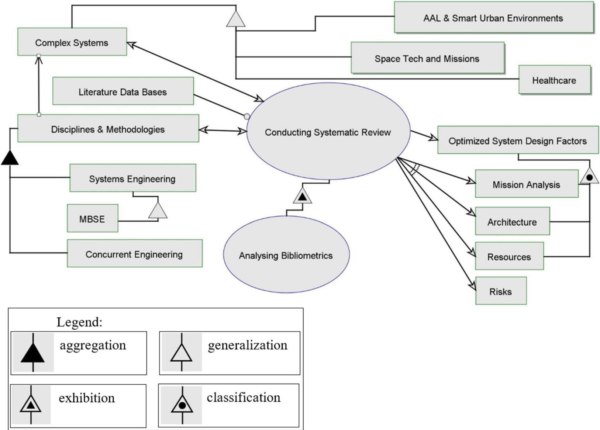
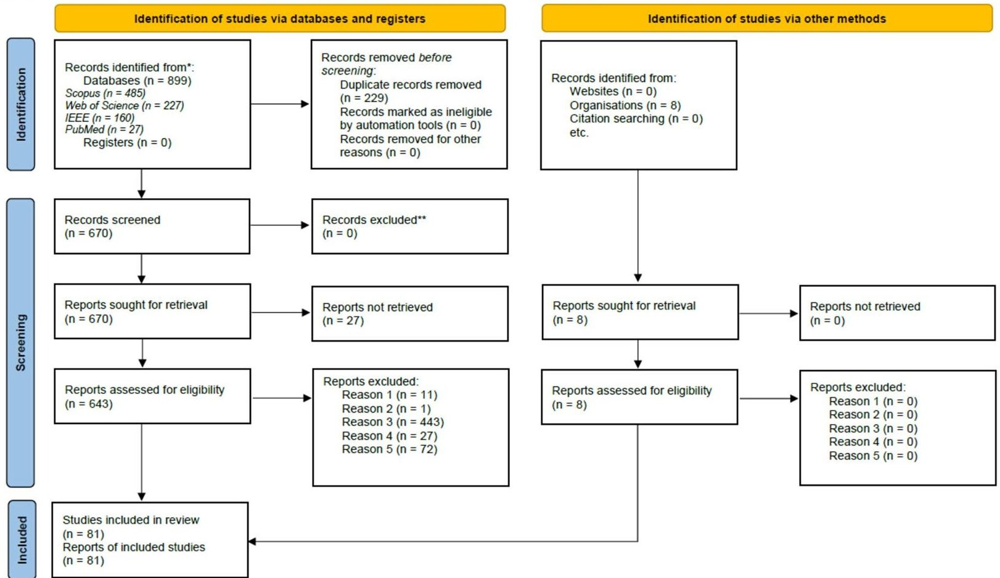
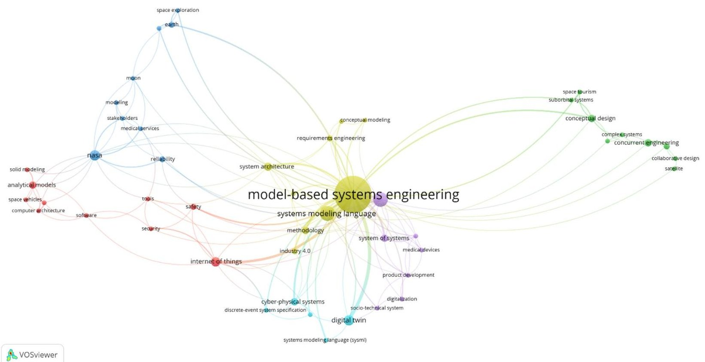

<!-- PDF_PAGE: 1 -->

# Optimizing early-stage efficiency in complex system development via model-based systems engineering (MBSE) and concurrent engineering (CE) integration

Cristian Vizitiu $ ^{1,2} $ · Adrian Cătălin Dinculescu $ ^{1} $ · Mihaela Gabriela Marin $ ^{1} $ · Alexandru Ion Nistorescu $ ^{1} $ · Kevin Alexander Dominey $ ^{1,3} $ · Dominic Mircea Kristály $ ^{4} $

Received: 29 November 2024 / Revised: 17 April 2025 / Accepted: 18 April 2025 / Published online: 21 May 2025 © The Author(s) 2025

## Abstract

The study conducted a systematic review with a bibliometric analysis to examine the extent of utilization and effectiveness of model-based systems engineering (MBSE) and concurrent engineering (CE) in managing and optimizing system design factors in complex systems across various domains, including space, healthcare, as well as active and assisted living and smart environments. The study aims to explore how MBSE and CE can address the inherent challenges in complex system definition and development, particularly focusing on their impact on system design factors such as mission analysis, system architecture, cost, schedule, and risk contingencies, which are commonly considered critical across the entire system lifecycle. By utilizing the PICO framework, the review formulates research questions and systematically searches multiple databases to identify relevant studies. The systematic review highlights that MBSE is prominently used in approximately 88% of the analyzed articles. These integrations enhance the methodologies' ability to manage complexity and improve efficiency across various stages of the system lifecycle. Specialized tools such as MagicDraw, Cameo Systems Modeler, and OPCAT play a crucial role in the technical implementation of MBSE and CE, providing detailed diagrams and models that represent system components with their interactions and behavior. The principal findings highlight how MBSE and CE support product systems engineering (PSE) in the early lifecycle stages of complex systems of interest. This support is particularly evident in optimizing system design, reducing time, costs, and technological risks, and enhancing the efficiency of business systems engineering through lifecycle management and quality management.

Keywords Complex systems Concurrent engineering Smart healthcare Space missions Systems architecture Systems engineering and theory Product systems engineering Business systems engineering

## 1 Introduction

Nowadays, the evolving systems, products, and services across various interrelated domains that benefit society are becoming increasingly complex. Consequently, architecting and engineering complex socio-technical systems cannot be done serendipitously, but must be rigorously focused on the early decisions that are critical to the system's future. These decisions determine the entire lifecycle from concept definition and system implementation to integration, operation, and disposal (Dori 2016; Vizitiu 2019). Product systems engineering (PSE) plays an essential role in guiding these early decisions by providing structured methodologies and

frameworks that enhance system design and performance; includes essential and resilient interfaces with related business processes in the realm of marketing, product lifecycle management (PLM), and quality assurance (Pyster et al. 2012); as well as contributing to sustainability of information systems engineering (ISE), as reflected in the opportunities and challenges outlined by van der Aalst et al. (2023) upon corporate digital responsibility, and furthermore, with impact on significant emerging social challenges (Mihale-Wilson et al. 2022).

The integration of model-based systems engineering (MBSE) and concurrent engineering (CE) into PSE has revolutionized how complex systems are developed, particularly in business sectors driven by innovation, high competition, and demanding customer expectations. By using models as the central tool throughout the system's

<!-- PDF_PAGE: 2 -->

lifecycle, MBSE enables businesses to manage complexity while aligning design, development, and operational goals with client needs. This model-centric approach ensures that requirements are fully understood and addressed early in the process, leading to more predictable outcomes. CE further enhances this by allowing multidisciplinary teams to work in parallel, accelerating product development cycles and improving collaboration. This combination not only streamlines engineering processes, but also supports business objectives such as reducing time to market, controlling costs, and maximizing return on investment. By focusing on system integration from the earliest stages, MBSE and CE may provide a structured framework for meeting the realworld demands of clients, ensuring that businesses remain competitive and responsive to market pressures (Vizitiu 2019).

According to Crawley, Cameron, and Selva (Crawley et al. 2016), a system is considered complex if it comprises numerous interrelated, interconnected, or intertwined entities and relationships, with complexity arising from the demands for increased function, performance, robustness, flexibility, and the necessity for systems to work together and interconnect. Baron and Daniel-Allegro (2020) also define complex systems as being embedded and connected systems with multiple and interrelated functions able to collect and process data, as well as transmit and perform real-time actions in the proposed ecosystems.

The complexity of modern engineered systems, especially within a system of systems (SoS) context, lies not only in their scale, but also in the unpredictable properties that emerge from the interactions between their constituent parts, and a wide range of activities must be carried throughout the development lifecycle of such systems. Shaked and Reich (2019) underscore the importance of addressing such complexity by emphasizing the role of abstraction, system views, and conceptual modeling in early design phases. In particular, the Concurrent Design Facility (CDF) proposed within an MBSE approach is oriented toward managing emergent behaviors by structuring the design process around explicit system concepts, relationships, and constraints. Regarding complexity, several non-exhaustive system design factors that support effective and efficient system-of-interest (SoI) development and operation, especially in the early phases of the lifecycle, can be outlined as in the following section.

Concept definition along with mission analysis and stakeholders needs and requirements (further referred to as mission analysis) initiates the lifecycle of the proposed SoI by analyzing the problem (opportunity) space via the socioeconomic and technological context, iteratively investigating the stakeholders' needs, expectations, and requirements (Pyster et al. 2012) as activities of utmost importance in triggering mission development and allocating resources.

Considering that to manage the system design factors from within complex projects and missions, international space agencies divide the mission lifecycle into multiple phases. For instance, ESA divides its mission development into Phase 0 (i.e., mission analysis), Phase A (i.e., feasibility), Phase B (i.e., preliminary definition), Phase C (detailed definition), Phase D (qualification and production), Phase E (operations/utilization), and Phase F (disposal) (ECSS ESA-ESTEC 2009). The first conceptual decisions, such as mission analysis, present a critical impact throughout the development of the SoI, as well on resource allocation in terms of cost and schedule feasibility (NASA/SP-2007-6105 Rev1 2007; NASA SP-2016-6105 Rev2 2016).

Another complex system design factor is system architecture, which inherently encompasses a huge amount of information that may be considered the most critical set of decisions with respect to the system entities, the interconnections among them, and the environment. Cameron and collaborators perceive system architecture as a decision-making process that "can dramatically change how early design activities are conducted" (Crawley et al. 2016): 326.

In the herein paper, the authors intend to systematically analyze the utilization of systems engineering (SE) and CE disciplines within the literature as well as to investigate the related methodological approaches for managing complexity within domains that tend to have increased technological challenges. The main goal is to evaluate the influence and impact of SE and/or CE on the system design factors considered to reflect both the early-stage relevance in system lifecycle and the clarity needed for defining the focus of the proposed review, such as mission analysis, system architecture, cost, schedule, risk contingency, as well as other factors that will be identified within the proposed study. While SE is introduced as the overarching discipline that offers the theoretical and methodological foundation for system-level thinking and structured development processes, the study's focus progressively narrows toward the role of MBSE and CE in optimizing performance under complex and multidisciplinary conditions.

As methodologies, SE and CE are considered complementary, as noted by Gardiner (1995). Moreover, when implemented together, their potential to optimize system design factors may accelerate the initial phases of the complex SoI lifecycle (Cerqueira et al. 2016).

The two main methodological perspectives investigated in the herein study may be defined as follows: "Systems Engineering's responsibility in the development of complex systems is the customer requirements analysis, system specification, definition of the top-level architecture and the support to the system verification and validation activities" (Muller et al. 2005), while concurrent engineering, despite not considered critical in the high-tech sector, has

<!-- PDF_PAGE: 3 -->

become a well-accepted methodology via its "team values of cooperation, trust and sharing in such a manner that decision making is by consensus, involving all perspectives in parallel, from the beginning of the product lifecycle" (Bandecchi et al. 1999): 329 for developing design concepts due to its ability to decrease development time, enhance quality, and meet customer requirements (Hambali et al. 2009; Wilson and Vasile 2023). In this dual perspective, it seems an integrated methodological view may benefit complex system definition and development, especially since approximately 80% of a system's sustainability is determined by Phase 0 and Phase A decisions (Wilson and Vasile 2023). Both SE and CE emphasize the importance of a unified framework for capturing and managing system requirements, which serves as a foundation for coordinated decision-making and traceability. This shared alignment around structured workflows and systems thinking acts as a catalyst for the transition toward an integrated, holistic engineering approach.

Building on the fundamental principles of SE, modelbased methodologies have emerged as essential tools for managing complexity in system development. Among these, MBSE stands out as one of the most widely adopted and recognized approaches, offering structured support for the rigorous design and analysis of complex systems. Developed by NASA's Jet Propulsion Laboratory (JPL), MBSE supports the organization, traceability, and reuse of systemic data by specifying functions, structure, and behavior of the SoI in a virtual model (Cerqueira et al. 2016). According to Estefan (2008), model-based methodologies may contain more processes on the lifecycle scale, more methods in terms of specific languages representing the entities and their relationships inside and outside the SoI, as well as a multitude of specific tools to implement system modeling.

To summarize, this systematic review examines the SE and CE approaches and methodologies within complex and challenging fields, assessing the role of MBSE in expanding model-based practices beyond the space sector, namely, also the healthcare and smart environments. Through a PSE perspective, the review explores the impact of these methodologies on optimizing system design factors across the lifecycle stages of complex SoIs. This analysis not only highlights the observed benefits of MBSE and CE within PSE, but also addresses implications for business and information systems engineering (BISE), where the integration of PSE principles can enhance lifecycle management, stakeholder collaboration, and overall system efficiency. The findings are grounded in methodological benefits and criteria further detailed in the following chapters. The selection of fields of increased complexity and technological challenge was initiated starting from the space domain (referred to as space technologies and missions), where the concepts of lifecycles and MBSE were first implemented, before expanding

to terrestrial domains, such as smart living (referred to as active and assisted living and smart environments) characterized by pervasive computing and Internet-of-things (IoT), and eventually reaching the healthcare domain where there are stringent requirements to implement advanced technologies while meeting stakeholder expectations and mitigating users' reluctance to adopt new technologies. A study architecture (see Fig 1), a diagram developed using Object-Process Methodology (OPM), part of the MBSE language family, and ISO19450 Publicly Available Specification (PAS) for modeling and knowledge representation.

The OPM diagram in Figure 1 illustrates the logical architecture and conceptual flow of the systematic review process conducted in this study. The central process, "Conducting the Systematic Review," is instrumentally supported by specialized literature databases, which serve as the primary resources for data collection. This process directly influences two key operands: the domains of application, including complex systems such as ambient assisted living (AAL) and smart environments, space technologies and missions, and healthcare systems, as well as the core disciplines and methodologies under investigation, namely MBSE and CE, particularly in the early phases of the system lifecycle.

The iterative interaction between the systematic review process, these domains, and the selected methodologies leads to the formulation of preliminary hypotheses. These hypotheses suggest that the influenced operands would converge toward a set of optimized system design factors, initially defined as mission analysis, system architecture, resource planning, and risk contingencies, which were identified at the outset as central to achieving successful outcomes in complex system development.

PSE, as the baseline for new product development process, including SE modeling standards and market analysis facing the elicitation and reluctance of the end-users' requirements (Pyster et al. 2012), is central to the successful development and market deployment of products, especially in high-stakes sectors such as space technology, healthcare, and smart environments. The present study explores how MBSE and CE methodologies can improve early-stage design efficiency in complex systems highlighting PSE's emphasis on quality, standards, and customer-focused outcomes, underscoring the potential for BISE to benefit from the application of PSE practices.

## 2 Objectives

The objective of this systematic review (SR) study is to perform a comprehensive literature review and bibliometric analysis investigating whether MBSE and CE methodologies

<!-- PDF_PAGE: 4 -->

Fig.1 Object-process methodology (OPM) study architecture

maximize efficiency during the early lifecycle stages of complex SoI's, optimizing system design factors minimizing risks and optimizing performance in the later stages of the project.

## 3 Methods

This section outlines the methodological framework adopted to conduct the systematic review and bibliometric analysis. The review process was organized into a series of structured stages to ensure the rigor and reproducibility of the results. These stages include the creation of the article database, selection and eligibility screening of studies, application of a quality scoring system, data extraction for synthesis, and a bibliometric co-occurrence analysis to identify thematic clusters and visualize keyword associations within the literature. Each of the following subsections describes in detail how these methods were applied to support the analysis presented in Section 4.

## 3.1 Database creation

Defining a clear and focused research question is a crucial first step in realizing an SR. A well-defined question helps guide the entire review process and ensures that the study is both manageable and relevant. PICO (Population, Intervention, Comparison, Outcome) is a conceptual framework and structured approach used in formulating research questions to guide the process of searching and selecting studies within an SR, as outlined by the Cochrane Library (Cochrane 2015). The segments of the PICO framework are defined as: Population (indicates the target on which the study is focused), Intervention (designates the intervention or exposure studied), Comparison (indicates the comparison target), and Outcome (specifies the results or effects measured in the study). A specific question of the proposed SR was established using the PICO structure (see Table 1).

The application of the PICO conceptual framework resulted in the question: "Are MBSE and CE methodologies efficient during the early stages of the lifecycle of complex

<!-- PDF_PAGE: 5 -->

Table 1 PICO framework for establishing a specific SR question and keywords identification

<table border="1"><tr><td>PICO element</td><td>Element definition for CE and MBSE</td><td>Example keywords (ordered alphabetically)</td></tr><tr><td>Population</td><td>Research and development projects in various stages of technological maturity</td><td>“assisted living”，“complex system*”，“countermeasure*”，“human spaceflight countermeasures”，“IoT”，“life science*”，“medical device”，“medical system”，“space application”，“space medicine”</td></tr><tr><td>Intervention</td><td>Implementation of MBSE and CE principles in the development of complex systems</td><td>“concurrent engineering”，“concurrent design”，“model-based systems engineering”，“MBSE”，“object process methodology”，“object process diagram”，“opcat”，“OPM”，“opd”，“integrated model”，“system* engineering”</td></tr><tr><td>Comparison</td><td>Traditional engineering practices without the use of MBSE and CD</td><td>Not directly searchable hereby; implied through contrast with intervention, namely in the field of document-based engineering approach</td></tr><tr><td>Outcome</td><td>Improved efficiency, collaboration and quality in the design and development of complex systems through better architecture, requirements, specifications, lower costs, and time</td><td>“architecture”，“complex*”，“cost*”，“mission analysis”，“requirement*”，“resource*”，“reliability”，“specification*”，“time”，“validation”，“verification”</td></tr></table>

SoI's, optimizing system design factors and helping to minimize risks when compared to traditional engineering and/or design practices?".

To define the search query of the publications in the databases (column "DB") , a record of the keywords corresponding to the PICO conceptual framework was made (see Tab. 2) along with the number of articles returned by the search engine (column "No.")

Searches were performed in four scientific databases: Institute of Electrical and Electronics Engineers (IEEE), United States National Library of Medicine (NLM),

Scopus, and Web of Science (WoS), using a query formula adapted to the search engine syntax of each individual database.

## 3.2 Study selection

A series of publication inclusion/exclusion criteria was established: exclusion of in extenso publications not written in the English language; exclusion of duplicate articles from searches in different databases; exclusion of articles in which the titles and/or abstracts are not relevant to the previously

Table 2 Identification of publications in databases

<table border="1"><tr><td>DB</td><td>Query</td><td>No.</td></tr><tr><td>IEEE</td><td>((“CONCURRENT ENGINEERING” OR“CONCURRENT DESIGN” OR“SYSTEM* ENGINEERING”) AND (“integrated model” OR“Model-based Systems Engineering” OR“MBSE” OR“Object Process Methodology” OR“OPM” OR“object process diagram” OR“opcat” OR“opd”) AND (“IoT” OR“assisted living” OR“medical device” OR“space medicine” OR“human spaceflight countermeasures” OR“countermeasure” OR“life science” OR“medical system” OR“space application” OR“complex system”) AND (“architecture” OR“mission analysis” OR“cost” OR“time” OR“resource” OR“reliability” OR“verification” OR“validation” OR“requirement” OR“specification” OR“complex”))</td><td>160</td></tr><tr><td>NLM</td><td> (“Concurrent Engineering” OR“concurrent design” OR“System* engineering”) AND (“integrated model” OR“Model-based Systems Engineering” OR“MBSE” OR“Object Process Methodology” OR“OPM” OR“object process diagram” OR“opcat” OR“opd”) AND (“IoT” OR“assisted living” OR“medical device” OR“space medicine” OR“human spaceflight countermeasures” OR“countermeasure” OR“life science” OR“medical system” OR“space application” OR“complex system”) AND (“architecture” OR“mission analysis” OR“cost” OR“time” OR“resource” OR“reliability” OR“verification” OR“validation” OR“requirement” OR“specification” OR“complex”))</td><td>27</td></tr><tr><td>Scopus</td><td>TITLE-ABS-KEY( (“Concurrent Engineering” OR“concurrent design” OR“System* engineering”) AND (“integrated model” OR“Model-based Systems Engineering” OR“MBSE” OR“Object Process Methodology” OR“OPM” OR“object process diagram” OR“opcat” OR“opd”) AND (“IoT” OR“assisted living” OR“medical device” OR“space medicine” OR“human spaceflight countermeasures” OR“countermeasure” OR“life science” OR“medical system” OR“space application” OR“complex system”) AND (“architecture” OR“mission analysis” OR“cost” OR“time” OR“resource” OR“reliability” OR“verification” OR“validation” OR“requirement” OR“specification” OR“complex”))</td><td>485</td></tr><tr><td>WoS</td><td>TS= (“Concurrent Engineering” OR“concurrent design” OR“System* engineering”) AND TS= (“integrated model” OR“Model-based Systems Engineering” OR“MBSE” OR“Object Process Methodology” OR“OPM” OR“object process diagram” OR“opcat” OR“opd”) AND TS= (“IoT” OR“assisted living” OR“medical device” OR“space medicine” OR“human spaceflight countermeasures” OR“countermeasure” OR“life science” OR“medical system” OR“space application” OR“complex system”) AND TS= (“architecture” OR“mission analysis” OR“cost” OR“time” OR“resource” OR“reliability” OR“verification” OR“validation” OR“requirement” OR“specification” OR“complex”))</td><td>227</td></tr></table>

<!-- PDF_PAGE: 6 -->

formulated question; exclusion of articles that could not be accessed in extenso; exclusion of extenso articles that were not relevant to the previously formulated question; inclusion of external sources known by the authors, independent of the database searches.

Centralization of the identified studies was performed using the web application Rayyan (Ouzzani et al. 2016), designed to improve the management of systematic reviews by simplifying the screening and selection of studies.

Designed specifically for researchers, Rayyan allows the import of studies from various sources, including bibliographic databases. Rayyan facilitates the systematic screening process by supporting the screening of the title and summaries/abstracts, as well as full-text screening, evaluating the activity of team members and can be used in two ways: blind on or blind off. Rayyan promotes effective teamwork among multiple reviewers by providing tools for tracking progress, resolving conflicts, and promoting discussion of study inclusion. Rayyan functions also extend to data mining and provide reporting and analysis functionality to help reviewers monitor progress and generate statistics on the screening process (i.e., study selection or rejection).

The steps of using the Rayyan platform were: importing libraries using RIS file extensions to transfer metadata about scientific publications between multiple platforms and software applications; extraction of RIS files from databases, or construction using the Zotero application (Takats et al. 2024), an open-source reference management software designed to help researchers collect, organize, cite, and share research materials; evaluation of each article by at least two evaluators; resolution of conflicts in special consensus sessions between evaluators; use of a waiting time of 2 weeks for requested access of publicly unavailable items.

According to the inclusion/exclusion criteria, the publications were evaluated as follows:

1. Inclusion of in extenso publications only in English (11 articles were excluded).

2. Exclusion of duplicate articles from searches in different databases (237 articles were excluded).

3. Exclusion of articles in which the titles and/or abstracts are not relevant to the previously formulated question (443 articles were excluded).

4. Exclusion of articles that could not be accessed in full (for 29 articles requests for full text were sent, only 2 articles were provided by the authors).

5. Exclusion of extenso articles that were not relevant to the previously formulated question (72 articles were excluded).

6. Inclusion of external sources known by the authors independent of the database searches (8 articles were included).

The illustration of study identification information flow from the different stages of the SR process was done using a PRISMA (Preferred Reporting Items for Systematic Reviews and Meta-Analyses) diagram (Page et al. 2021), (see Fig. 2). The PRISMA chart is a set of guidelines developed to improve the transparency and quality of SR reporting. The PRISMA diagram consists of a series of boxes and arrows that describe the flow of information from record identification through the various stages of the SR process. Key components of a PRISMA chart include: (a) identification: the total number of records identified from the literature search; (b) screening: the number of records checked based on titles and abstracts; (c) eligibility: the number of full-text articles evaluated for eligibility; (d) inclusion: the final number of studies included in SR; (e) exclusion: reasons for excluding studies in the full-text screening stage. The reasons mentioned in Figure 2 refer to: Reason 1: studies in other language than English; Reason 2: duplicate studies; Reason 3: not relevant titles and abstracts; Reason 4: studies that could not be accessed in extenso; Reason 5: studies evaluated in extenso as not relevant.

## 3.3 Quality scoring

A structured quality appraisal process was applied to the selected studies to ensure methodological rigor and consistency. For this purpose, a standardized scoring framework designed for non-empirical data evaluation was used, namely the "Quality Scoring for Non-Empirical Studies" rubric developed by Laws and Winnard (2019). The framework assigns a score ranging from 1 to 11 and consists of two parts, a hierarchical classification of evidence types (maximum 7 points) and a series of criteria assessing the rigor and clarity of the article (maximum 4 points). The hierarchical classification part assigns a single score based on study design, with meta-analyses and meta-syntheses of high-quality studies receiving the maximum score, while documents such as laws, regulations, and anecdotal recommendations receive a minimum score. The second part consists of four binary criteria (0 or 1 point each), which respectively evaluate whether the study possesses authenticity, transparently explains its methodology, clearly presents the information, and faithfully represents the cited sources. The scoring was performed independently by two reviewers, with the final quality score calculated as a mean of their total scores.

## 3.4 Data extraction

Data extraction was carried out by two reviewers. For situations where there were conflicting items, a special session was organized in which the reviewers participated together with a team leader for the parties to reach a

<!-- PDF_PAGE: 7 -->

PRISMA 2020 flow diagram for new systematic reviews which included searches of databases, registers and other sources

*Consider, if feasible to do so, reporting the number of records identified from each database or register searched (rather than the total number across all databases/registers).

**If automation tools were used, indicate how many records were excluded by a human and how many were excluded by automation tools.

Source: Page MJ, et al. BMJ 2021;372:n71. doi: 10.1136/bmj.n71.

This work is licensed under CC BY 4.0. To view a copy of this license, visit https://creativecommons.org/licenses/by/4.0/

Fig.2 The PRISMA flow diagram summarizing the screening process

consensus. Data extraction can be seen in the Appendix section, Table 7, and the columns of the table refer to the following criteria: A. concurrent methodology; B. technological solution—the way in which the methodology was technically implemented; C. the purpose of using the methodology—based on the need to use the specified technology and the degree of complexity of the model used; D. population—technological maturity levels represented as TRL (technology readiness level); E. application type and general characteristics; F. the benefits of using the concurrent methodology; G. quality scoring—score obtained by completing the questionnaire "Quality scoring nonempirical data".

## 3.5 Bibliometric analysis

To perform the bibliometric analysis, the software VOSviewer version 1.6.20 (Van Eck and Waltman 2010) was used on Windows 11 Pro Operating System (OS). Additionally, to extract and add metadata to the articles

collection and to export it as RIS file, the software Zotero version 6.0.36 was used on the same OS.

Rayyan.ai software was used to export an RIS file of the article collection to be included in Zotero. However checking in Zotero the keywords of each article, the authors noticed that they differed from those included in the publications. Considering this issue, the keywords were extracted manually. For three articles, the keywords could not be identified from the published article template or from the webpage that hosted it. Using Zotero software, the article collection with updated and verified data was exported as RIS file.

## 4 Results

This section presents the results derived from the systematic review and bibliometric analysis. The findings are organized according to key analytical dimensions

<!-- PDF_PAGE: 8 -->

that emerged from the data, including concurrent methodologies, technological solutions, methodological scope, population types, study design, application domains, and reported benefits. In addition, the results of the bibliometric analysis and quality scoring are reported to highlight key thematic clusters and assess the methodological robustness of the included studies. This structured presentation ensures traceability between the applied methods and the corresponding outputs, providing a coherent narrative for interpreting the state of the art.

## 4.1 Concurrent methodology

Model-based systems engineering (MBSE) was the prominently used concurrent methodology across many of the studies, implemented to streamline the development of complex systems. MBSE involves the use of comprehensive models to support system requirements, design, analysis, verification, and validation activities throughout the system's lifecycle. MBSE was identified as a primary methodology in approximatively 88% of the articles. The integration of MBSE was implemented in different ways following these proportions: Agile methodologies 5% of the articles (Alvarez and Roibas-Millan 2021; Papke 2017; Ramos et al. 2013; Romero et al. 2022), concurrent design engineering 8.5% of the articles (Alvarez and Roibas-Millan 2021; Bandecchi et al. 2000; Ivanov et al. 2010; Kim and Xirouchakis 2010; Salas Cordero et al. 2020; Verhoef et al. 2021; Xu et al. 2013), project product lifecycle management in one article (Sharon and Dori 2012), ARCADIA in one article (Baron et al. 2023) and model-based reliability, availability, maintainability, safety (RAMS) in Conroy et al. (2021). It was identified in a wide range of domains like IoT, industrial systems or healthcare. Thus, MBSE, often implemented in combination with other methodologies, tools, and/or facilities, is extensively used to manage the complexity and improve the efficiency of system development across various domains. CE improves development speed primarily by promoting parallelization of activities, real-time collaboration, and early integration of multi-disciplinary perspectives. Unlike traditional sequential approaches, EC organizes design efforts within structured environments—such as CDFs—where domain experts co-develop system elements simultaneously, enabling immediate feedback and early conflict resolution. This accelerates decision-making and significantly reduces the number of rework cycles. While MBSE and IS practices offer powerful tools for modeling and managing system complexity, EC

provides the operational framework to use those tools collaboratively and iteratively. EC complements MBSE by anchoring model creation and refinement within a synchronized design process, ensuring consistency across views (e.g., needs, architectures, operational modes) and enhancing verification and validation (V&V) through timely data sharing and simulation. This synergy enables engineers to navigate complexity more confidently and efficiently by unifying system modeling with co-located, co-timed engineering decisions.

## 4.2 Technological solution

The technical implementation of methodologies like MBSE involves using specialized software tools to create, analyze, and manage complex system models. These tools support the creation of detailed diagrams and models that represent various system components and their interactions. For instance, some of the more commonly used platforms include: MagicDraw in 12% of the articles (Amador et al. 2020; Jackson et al. 2012; McVittie et al. 2012; Mazeika et al. 2016; Patou et al. 2019; Lindsey et al. 2020; Cohen et al. 2022; Guo et al. 2022; Lopez and Akundi 2022; Horvath et al. 2023), Cameo Systems Modeler in 8% (Madni and Orellana 2018; Taha et al. 2018; Thomas et al. 2019; Huang et al. 2022; Lopez and Akundi 2022; Horvath et al. 2023; Lutfi and Valerdi 2023), Cameo Enterprise Architect in two articles (Papke 2017; Madni and Orellana 2018), or CAD software in 6% (Bandecchi et al. 2000; Holladay et al. 2019; Alvarez and Roibás-Millán 2021; Wu et al. 2021; Henares et al. 2022). As a result, it may be observed that 26% work on the same principle platform, while other important applications used are Microsoft Excel in 8.6% of the articles (Bandecchi et al. 2000; Kim and Xirouchakis 2010; Ivanov et al. 2010; Zeigler et al. 2018; Hanson et al. 2019; Cohen et al. 2022; Ahmad 2023), simulation software like MATLAB/MathWorks in 10% of the articles (Gurjao et al. 2016; Patou et al. 2019; Thomas et al. 2019; Jawale et al. 2020; Wu et al. 2021; Zhang et al. 2021; Yetkin et al. 2022; Lutfi and Valerdi 2023), IBM Rational in 5% (Hoffmann 2012; Hennig et al. 2015; Fischer et al. 2018; Evin and Uluda 2020), CAPELLA in 4% of the articles (Sango et al. 2019; Guo et al. 2022; Baron et al. 2023), and Agile Architecture in 5% of the articles (Ramos et al. 2013; Papke 2017; Alvarez and Roibás-Millán 2021; Romero et al. 2022).

In the implementation process, systems engineers define the requirements, structure, behavior, and validation criteria of the system within these tools using the Systems Modeling Language (SysML) in 50% of the articles. SysML is used for the visual representation of different diagram types to

<!-- PDF_PAGE: 9 -->

help break down the system into manageable parts, specifying interactions between components, and ensuring that all requirements are met.

OPM, on the other hand, provides a more holistic approach by creating combined object-process diagrams that illustrate both the structure and behavior of systems in a single unified model. OPM was only used in five articles (6%) (Sharon and Dori 2012; Ramos et al. 2013; Mordecai and Dori 2017; Menshenin and Crawley 2019; Kohen and Dori 2021). This methodology is particularly useful for systems in which understanding the interplay between various processes and objects is critical.

These tools may provide the digital infrastructure that supports PSE by enabling precise system design, facilitating real-time collaboration, and optimizing resource allocation across lifecycle stages. Through capabilities such as modelbased visualization, scenario simulation, and integration of cross-functional data, these platforms empower teams to address risks, improve accuracy, and streamline decisionmaking. This support not only enhances PSE's effectiveness, but also gains benefits to business processes and ISE needs improving lifecycle management, facilitating agile communication between stakeholders, and supporting informed decision-making, bridging technical and business objectives in complex systems.

## 4.3 Methodology scope

The purpose of using MBSE methodologies, particularly SysML, and OPM, is to effectively manage the complexity inherent in developing modern systems. These methodologies provide structured frameworks for integrating various components and stakeholder interests, ensuring that all aspects of a system are considered and accurately modeled. They are crucial for improving efficiency, reliability, and collaboration in system development processes.

MBSE and CE may influence significantly the PSE processes and framework implicitly the project-product lifecycle management (PPLM), with the scope to oversee and manage the entire lifecycle of a product from its initial conception through design, development, manufacturing, service, and disposal.

RAMS, on the other hand, has the role of ensuring that the system and its components function correctly, efficiently, and safely throughout their lifecycle, whereas AGILE is used to improve the flexibility and responsiveness of the software development process for high-quality products.

The analyzed articles revealed that in fields such as healthcare, industrial systems, aerospace, and assistive technologies, where systems are highly complex and require precise coordination among various subsystems and teams,

these methodologies can lead to a better handling of the challenges encountered.

For example, in the healthcare and medical field, in 16% of the articles analyzed (Pihera et al. 2013; Ciancia 2016; Gurjao et al. 2016; Mindock et al. 2017; Hanson et al. 2019; Sango et al. 2019; Amador et al. 2020; Hareland 2020; Jawale et al. 2020; Cohen et al. 2021, 2022; Khayal and McGovern 2021; Henares et al. 2022), the integration of MBSE helped to model and manage the interconnections between medical devices, patient data, and clinical workflows for more effective and reliable health monitoring systems. In aerospace, found in 16% of articles (Bandecchi et al. 2000; McVittie et al. 2012; Bhasin et al. 2013; Haveman and Bonnema 2013; Sindiy et al. 2013; Hennig et al. 2015; Fischer et al. 2018; Menshenin and Crawley 2019; Cohen et al. 2022; Fuchs et al. 2022; Huang et al. 2022; Brusa et al. 2023; Bussemaker et al. 2020), SysML allowed for the detailed modeling of spacecraft systems, and in assistive technologies and MBSE allowed developers to create systems that seamlessly integrate hardware, software, and user interaction components. In other domains like IoT and smart environment, identified in 12% of articles (McDermott et al. 2015; Hause et al. 2017; Papke 2017; Taha et al. 2018; Zeigler et al. 2018; Albers et al. 2018; Takai et al. 2020; Abdulhamid et al. 2023; Ahmad 2023), MBSE facilitated the integration and management of interconnected devices and systems, leading to more userfriendly and reliable solutions. All of this leads to more userfriendly and reliable solutions.

Digital twin applications were encountered in 7.4% of the articles analyzed (Lopez and Akundi 2022; Maleki et al. 2022; Romero et al. 2022; Brusa et al. 2023; Wilking et al. 2023; Zhang et al. 2023). Digital twins provide a dynamic, real-time digital counterpart to physical systems, allowing for continuous monitoring, simulation, and optimization. In the manufacturing sector, digital twins enable predictive maintenance, process optimization, and improved product lifecycle management by providing detailed insights and real-time data analysis. In smart cities, digital twins help in urban planning, traffic management, and infrastructure maintenance by creating accurate and interactive models of urban environments. By integrating IoT sensors and data analytics, digital twins can simulate various scenarios, predict potential issues, and optimize system performance, leading to increased efficiency and reduced operational costs.

MBSE may benefit PSE, through a structured, modelcentric approach to designing complex systems. Through visual modeling, MBSE supports stakeholder collaboration, helping to align product requirements with strategic business goals. In domains like space missions and healthcare, MBSE enables teams to better capture interdependencies and adjust to evolving needs. Positive implications on

<!-- PDF_PAGE: 10 -->

improved information integration and agile responses to changing market or operational demands enhance both the adaptability and effectiveness of organizational systems in the realm of both business processes and information systems engineering.

## 4.4 Population

The populations addressed in the reviewed studies encompass various sectors and technology readiness levels (TRLs). When analyzing articles with the highest quality score, 25% target early-stage research (TRL 1-3), such as Bajaj et al. (2011), which focuses on initial methodologies for complex systems, and Bayer et al. (2011), which identifies architectural patterns. Mid-development stages (TRL 4-6) are covered in 50% of the studies, including Amador et al. (2020) in medical systems for space missions, Baschin et al. (2023) in mechatronic engineering, and Holladay et al. (2019) for NASA projects. Advanced stages (TRL 7-9) are represented in 5% of the studies, such as Bandecchi et al. (2000) for space mission assessments at ESA and Jackson et al. (2012) for space mission support systems. This distribution highlights MBSE's adaptability across different stages and sectors, demonstrating its broad applicability and relevance to stakeholders, including academic researchers, industrial engineers, healthcare professionals, and aerospace designers.

## 4.5 Study design

The study designs in the reviewed literature on MBSE methodologies are diverse, reflecting various approaches of evaluating their efficiency and effectiveness. When looking at the highest scoring articles, 20% employ qualitative assessments. For example, Abdulhamid et al. (2023) analyzed IoT systems' safety and security and Baron et al. (2023) demonstrated ARCADIA/Capella's effectiveness in industrial settings. Case studies account for 30%, including Alvarez and Roibás-Millan (2021), in which AGILE methodologies were applied to space missions, and Amador et al. (2020), which reviewed SysML in medical system designs for space missions. Pilot projects were featured in 20%, with Patou et al. (2019) applying MBSE through SysML for designing a smartphone-based PoC diagnostic system and Horvath et al. (2023) developing a verification and validation framework for complex systems. Data analysis was used in 10%, such as Browning et al. (2022) modeling endoscopic technology development. Systematic approaches were applied in another 10%, including Ahmad (2023) conducting a bibliometric analysis of MBSE and IoT literature. Concurrent design engineering was used in

10%, for instance with Verhoef et al. (2021) developing an integrated model-based engineering environment for space systems. This study design variety highlights the robustness and versatility of MBSE methodologies.

## 4.6 Application type and general characteristics

The applications of MBSE methodologies span various domains, showcasing their broad applicability. The application are: aerospace (Bandecchi et al. 2000; Jackson et al. 2012; Fischer et al. 2018; Holladay et al. 2019; Huang et al. 2022), such as Fischer et al. (2018) integrating MBSE with SE tools for space missions and Jackson et al. (2012) managing the description of end-to-end information system (EEIS) architecture for human space flight programs; healthcare and medical systems (Pihera et al. 2013; Gurjao et al. 2016; Amador et al. 2020; Hareland 2020; Cohen et al. 2022), including Cohen et al. (2022) defining Concepts of Operations (ConOps) and Hareland (2020) integrating system dependability with systems architecture and design in medical system development; product design ideation (Gurjao et al. 2016; A. Albers et al. 2018), as in A. Albers et al. (2018) using the IoT Canvas for new product features and Gurjao et al. (2016) presenting a MATLAB/Simulink specification as an analytical model for automated external defibrillators (AEDs); educational tools, with Baron and Daniel-Allegro (2020) promoting systemic approaches through MOOCs to develop connected embedded systems; reliability engineering and system assurance, such as Lindsey et al. (2020) integrating MBSE with reliability engineering for NASA systems; lifecycle management in complex systems, exemplified by Sharon and Dori (2012) applying project-product lifecycle management (PPLM) for both system engineering of the product and the project or program delivering it; analytical model development, such as Gurjao et al. (2016) for automated external defibrillators (AEDs); verification and validation frameworks, with Huang et al. (2022) developing a framework for complex aerospace systems, and concurrent engineering applications, with Bandecchi et al. (2000) using concurrent design facilities for space mission assessments. This distribution underscores MBSE's comprehensive nature, capable of addressing complex engineering challenges and optimizing performance across various sectors. For instance, aerospace applications leverage MBSE to manage intricate system interactions and configurations, improving decision-making and communication among stakeholders. Healthcare applications utilize MBSE to enhance system dependability, ensuring safety and performance in critical medical systems. Product design ideation benefits from MBSE's ability to integrate system data and generate new features through structured

<!-- PDF_PAGE: 11 -->

methodologies like the IoT Canvas. Educational tools and reliability engineering further demonstrate MBSE's versatility in promoting systemic thinking and improving system assurance. Overall, the diverse application types highlight MBSE's potential to provide tailored solutions for different industry needs, supporting innovation and efficiency in complex systems engineering.

The focus on early and mid-development stages indicates that MBSE methodologies are predominantly utilized during the conceptualization and development phases of projects, benefiting from MBSE's ability to integrate various domain-specific inputs, providing detailed modeling capabilities, and facilitating collaboration among diverse teams. The relatively low percentage of studies in the advanced stages suggests that while MBSE is effective in the early and middle stages, its application in later stages, particularly in fully operational systems, may still be developing or is less frequently documented. The high percentage of middevelopment stage studies underscores the significance of MBSE in refining and validating systems through detailed simulations, functional decompositions, and system architecture models. For example, in the aerospace sector, studies like Huang et al. (2022) focus on the verification and validation of complex satellite systems, showcasing MBSE's role in enhancing traceability, logical coherence, and simulation capabilities. In summary, the population analysis reveals a strong emphasis on leveraging MBSE methodologies during the early to mid-stages of project development, with a growing interest in extending its benefits to later stages of implementation, underscoring the potential for MBSE to contribute significantly to minimizing risks and optimizing performance as projects progress from conceptualization to deployment and operation.

Qualitative assessments provide conceptual overviews and identify gaps, while case studies and pilot projects test these methodologies in real-world contexts, demonstrating practical applications and benefits. Historical data analyses and systematic approaches offer structured insights into the evolution and optimization of MBSE practices. Concurrent design engineering approaches further enhance collaboration and data integration, proving particularly useful in

Table 3 Methodological benefits of the articles

<table border="1"><tr><td>Methodological benefit</td><td>No of articles</td><td>Percentage</td></tr><tr><td>Efficient</td><td>37</td><td>45.7%</td></tr><tr><td>Collaboration</td><td>30</td><td>37.0%</td></tr><tr><td>Comprehensive</td><td>25</td><td>30.9%</td></tr><tr><td>Traceable</td><td>13</td><td>16.0%</td></tr><tr><td>Error reduction</td><td>13</td><td>16.0%</td></tr><tr><td>Time reduction</td><td>8</td><td>9.9%</td></tr><tr><td>Flexible</td><td>5</td><td>6.2%</td></tr></table>

complex, multidisciplinary projects. This diversity underscores the ability of MBSE methodologies to adapt to different research and practical scenarios, providing valuable insights into system optimization and risk mitigation.

## 4.7 Concurrent methodology benefits

In the 81 articles analyzed in this study, there were a total of seven methodological benefits identified that were common among many of the findings (see Table 3). Efficiency gains were identified in 37 articles (45.7%) ,representing articles that directly claimed improved total project efficiency, fewer design iterations needed to arrive at the final solution, and/or increased resource utilization efficiency. Increased collaboration potential was identified in 30 of the articles (37.0%) This represents articles that claimed increased potential for collaboration between experts of different engineering domains on a single project as well as increased general communication between stakeholders.

The comprehensiveness of the analyzed methodology was listed as a benefit in 25 articles (30.9%). This represents articles that claimed the integration of many different features in a single tool and overall completeness of the methodology to resolve SE problems without the need for additional resources. Traceability was listed as a benefit in 13 articles (16.0%) , defined as the ability to associate engineering requirements to stakeholder needs in a useful manner. Error reduction was listed as a benefit in 13 articles (16.0%) , representing a decrease in error frequency during the design phase compared to traditional engineering methodologies, usually leading to a smaller required number of design iterations at the early project stages. Time reduction was claimed in eight articles (9.9%) , defined as faster time to production and less time spent during the design phase when compared to traditional methodological alternatives. Finally, flexibility was mentioned in five articles (6.2%) , described as the ability to quickly adapt to change and to swiftly tailor specific methodological procedures to unexpected challenges as needed.

CE may benefit the PSE with substantial positive aspects in reducing design cycles and fostering real-time collaboration. Within PSE, CE encourages simultaneous multidisciplinary involvement, minimizing delays and enhancing efficiency. Complex sectors such as space exploration, healthcare, and smart and assistive environments with extreme dynamical system requirements align closely with business processes and information systems engineering, where real-time, cross-functional coordination can optimize business operations, ensuring that organizational responses to change are agile and well communicated and treated.

<!-- PDF_PAGE: 12 -->

Table 4 Keywords ordered by occurrences (occurrence higher than 4)

<table border="1"><tr><td>Keyword</td><td>Occurrence</td><td>Total link strength</td></tr><tr><td>Model-based systems engineering</td><td>55</td><td>98</td></tr><tr><td>Systems modeling language</td><td>13</td><td>32</td></tr><tr><td>Systems engineering</td><td>12</td><td>24</td></tr><tr><td>Digital twin</td><td>7</td><td>11</td></tr><tr><td>Nasa</td><td>7</td><td>17</td></tr><tr><td>Internet of things</td><td>6</td><td>17</td></tr><tr><td>System architecture</td><td>5</td><td>13</td></tr><tr><td>Analytical models</td><td>4</td><td>7</td></tr><tr><td>Conceptual design</td><td>4</td><td>11</td></tr><tr><td>Concurrent engineering</td><td>4</td><td>8</td></tr><tr><td>Cyber-physical systems</td><td>4</td><td>11</td></tr><tr><td>Methodology</td><td>4</td><td>10</td></tr><tr><td>System of systems</td><td>4</td><td>12</td></tr></table>

## 4.8 Bibliometric analysis

Co-occurrence analysis was performed to create keyword maps based on bibliographic data with full counting method setting. At the beginning of analysis, 322 keywords emerged when setting the occurrence at 1. The keywords were analyzed such that repetitions caused by the syntax did not appear. Keywords that belonged to lexical families (i.e., digital twin-digital shadow-digital model, etc.) were not

merged. Thus, a thesaurus file was created containing 31 replacement lines. After this step, 292 keywords remained in the list: 7 keywords met the threshold of five occurrences, 13 keywords met the threshold of four occurrences, 19 keywords met the threshold of three occurrences, and 49 keywords met the threshold of two occurrences. A detailed keywords list meeting a certain threshold setting greater than 2 is shown in Table 4.

Co-occurrence analysis was performed on 49 keywords that met the occurrence threshold of 2 and resulted in six clusters of 5-10 keywords (see Fig. 3 and Table 5).

## 4.9 Quality scoring

According to the scoring rubric (see Table 6), 17.3% of articles (14/81) were assessed to be of poor quality (score of 6.5 or below). This was due to various reasons including poor methodological quality, lack of clear informational value, and study type being less representative of large data sets. For example, many low-scoring papers were simple case studies that did not use empirical data-driven criteria to reach their conclusions or did not clearly explain the information presented in the study.

38. 3% (31/81) were found to be of medium quality, defined as having a quality score of between 7 and 9. These studies had also had points deducted for various reasons, like the low-quality studies, but to a lesser extent.

For example, neither Li (2023) nor Sango et al. (2019) had points deducted for poor methodological quality,

Fig. 3 Keywords network visualization

<!-- PDF_PAGE: 13 -->

Table 5 Keywords clustering

<table border="1"><tr><td>Cluster1</td><td>Cluster2</td><td>Cluster3</td><td>Cluster4</td><td>Cluster5</td><td>Cluster6</td></tr><tr><td>Red color</td><td>Green color</td><td>Blue color</td><td>Yellow color</td><td>Purple color</td><td>Cyan color</td></tr><tr><td>10 items</td><td>9 items</td><td>9 items</td><td>9 items</td><td>7 items</td><td>5 items</td></tr><tr><td>Analytical model</td><td>Collaborative design</td><td>Astronaut</td><td>Conceptual modeling</td><td>Digitalization</td><td>Complex adaptive systems</td></tr><tr><td>Computer architecture</td><td>Complex systems</td><td>Earth</td><td>Human systems integration</td><td>Healthcare</td><td>Cyber-physical systems</td></tr><tr><td>Internet of things</td><td>Conceptual design</td><td>Medical services</td><td>Industry 4.0</td><td>Product development</td><td>Digital twin</td></tr><tr><td>Safety</td><td>Concurrent design facility</td><td>Modeling</td><td>Methodology</td><td>Socio-technical system</td><td>Discrete-event system specification</td></tr><tr><td>Security</td><td>Concurrent engineering</td><td>NASA</td><td>Model-based systems engineering</td><td>System of systems</td><td>Systems modeling language</td></tr><tr><td>Solid modeling</td><td>Design structure matrix</td><td>Space exploration</td><td>Object-process methodology</td><td></td><td></td></tr><tr><td>Space vehicles</td><td>Satellite</td><td></td><td>Requirements architecture</td><td></td><td></td></tr><tr><td>Tools</td><td>Space tourism</td><td></td><td>System architecture</td><td></td><td></td></tr><tr><td>Unified modeling language</td><td>Suborbital systems</td><td></td><td>Systems modeling language</td><td></td><td></td></tr></table>

Table 6. Number and percentage of articles of each quality score

<table border="1"><tr><td>Quality score</td><td>No of articles</td><td>Percentage</td></tr><tr><td>11</td><td>6</td><td>7.4%</td></tr><tr><td>10.5</td><td>1</td><td>1.2%</td></tr><tr><td>10</td><td>26</td><td>32.1%</td></tr><tr><td>9.5</td><td>3</td><td>3.7%</td></tr><tr><td>9</td><td>10</td><td>12.3%</td></tr><tr><td>8.5</td><td>5</td><td>6.2%</td></tr><tr><td>8</td><td>8</td><td>9.9%</td></tr><tr><td>7.5</td><td>1</td><td>1.2%</td></tr><tr><td>7</td><td>7</td><td>8.6%</td></tr><tr><td>6.5</td><td>3</td><td>3.7%</td></tr><tr><td>6</td><td>6</td><td>7.4%</td></tr><tr><td>5.5</td><td>0</td><td>0.0%</td></tr><tr><td>5</td><td>4</td><td>4.9%</td></tr><tr><td>4.5</td><td>1</td><td>1.2%</td></tr></table>

authenticity, or clear informational value, but were considered as having weaker conclusions due to the fact that there were peer-reviewed standards with associated case studies, but not overarching meta-analyses of large data sets. Other papers, however, were considered to provide valuable input despite having moderate problems with methodological quality and clarity of information presented.

A total of 44.4% (36) were determined to be of high methodological quality, defined as having a quality score of 9.5 or higher. Of the high-quality studies, 16.7% (6/36) had no points deducted and were therefore determined to sufficiently fulfill all criteria from the scoring rubric. One single article (2.8%) had a score of 10.5, meaning that one reviewer gave it a perfect score and the other deducted 1 point. The second reviewer determined that the document lacked clear methodological quality. A total of 72.2% (26/36) of the

high-quality papers had a score of 10,with 92.3% of them (24/26) having a point deducted because the study type was not a meta-analysis or meta-synthesis,but still a well-designed controlled study that was found to consistently support a specific conclusion. Finally,a total of 8.3% (3/36) of high-quality studies had 1.5 points deducted for a total final score of 9.5. All three had points deducted because of study type,with one reviewer considering it to be a well-designed controlled study that was found to consistently support a specific conclusion, while the second reviewer considered it a qualitative, descriptive, or correlational study or a study with inconsistent results.

## 5 Discussions

## 5.1 Principal findings

The purpose of this study is to systematically examine the literature on the utilization of MBSE and CE disciplines and their associated methodologies as techniques to manage complexity in significant domains facing technological challenges. It seeks to highlight the impact of MBSE and CE on optimizing system design factors such as mission analysis, system architecture, cost, schedule, risk contingency, and requirements. Additionally, the review identifies SE and CE methodologies in complex and challenging domains, particularly by analyzing the expansion of MBSE beyond the space sector. It investigates the impact on complex elements throughout the lifecycle stages of SoIs, along with their benefits and other evaluation criteria.

At the beginning of the study, following the literature research, an investigation into the quality of the selected articles was conducted in which particular attention was

<!-- PDF_PAGE: 14 -->

paid to the strengths and weaknesses of the employed methodologies.

As mentioned in the results section, quality scoring, of the 81 articles analyzed, 36 (44.4%) had high-quality scores, defined as being between 9.5 and 11.31 articles (38.3%) had medium strength quality scores, defined as being between 7 and 9.14 articles (17.3%) had low-quality scores of 6.5 or less. The highest scoring articles had a score of 11, and there were six articles in this category (0.7 %). The lowest scoring article had a quality score of 4.5.

Of these papers, six (7%) were the most relevant to this study, based on their quality score and the effectiveness of SE and CE methodologies in managing complexity across various technological domains such as space technologies and missions, AAL, smart environments-characterized computing, and IoT and healthcare.

The primary findings of the systematic review detailed in the first paper, Hanson et al. (2019), reveal the significant advantages of employing SE and CE methodologies to manage complexity in technologically advanced domains. A critical insight is the effective application of MBSE to support the translation of medical needs from clinical contexts to engineering requirements, thus ensuring the robustness of future exploration of medical systems. The review emphasizes the utility of SE and CE in areas such as mission analysis, system architecture, and resource allocation, underscoring their complementary nature. By focusing on early design phases, these methodologies facilitate enhanced decision-making and resource efficiency. The study's findings demonstrate that MBSE's structured approach, exemplified through NASA's implementation, significantly improves traceability and integration of complex system elements throughout their lifecycle.

The primary findings of the systematic review presented in the second paper, Huang et al. (2022), demonstrate the successful application of MBSE using the Magic Grid framework to enhance the modeling and real-time simulation of satellite systems. The study specifically improved the Magic Grid framework to suit the complex structure of satellite systems, ensuring that all stages of system modeling, from requirement analysis to physical structure analysis, were comprehensively addressed. By using the SysML, the authors were able to create detailed models of the satellite's power subsystem, covering aspects such as demand analysis, behavior design, and constraint analysis. The implementation of real-time simulation monitoring verified the effectiveness and traceability of the modeling process, proving that this approach can significantly improve the design and development of complex satellite systems.

The principal findings of the systematic review presented in the third selected paper, Hareland (2020), underscore the critical integration of system dependability with systems architecture and design within MBSE. The study emphasizes that fault prevention, fault removal, and fault tolerance are essential for creating dependable medical systems. By focusing on these elements, the framework addresses the fundamental causes of faults and their propagation into system failures. This holistic approach demonstrates that robust system architecture cannot be compensated by component-level reliability engineering alone. The research highlights that integrating dependability modeling artifacts with behavioral and structural modeling in an SysML context enhances the overall dependability of the system. This integration provides a proactive approach to design, ensuring that safety, reliability, availability, maintainability, and security are thoroughly considered throughout the system development process.

The principal findings of the systematic review presented in the fourth selected paper, Abdulhamid et al. (2023), focused on the critical aspect of maintaining and securing IoT models, particularly in the context of safety and security frameworks. The study highlighted the importance of continuous monitoring and updating of IoT systems to address evolving security threats and maintain system integrity. By leveraging MBSE methodologies, the research demonstrated how systematic modeling and simulation could support the ongoing maintenance of IoT infrastructures. This approach ensures that the systems remain robust, secure, and efficient over time, adapting to new challenges and technological advancements.

The principal findings of the systematic review presented in the fifth selected paper, Henares et al. (2022), focused on the deployment of micro data centers (MDCs) for mobile healthcare monitoring systems within smart city environments. The study employed modeling and simulation techniques to analyze the power consumption and efficiency of various data center configurations in urban IoT scenarios. By using MBSE methodologies, the research provided a detailed evaluation of how MDCs can support real-time healthcare monitoring, emphasizing the importance of efficient data processing and storage solutions. The findings revealed that MBSE can significantly optimize the deployment and operational efficiency of IoT infrastructures in smart cities, thereby enhancing the overall performance and sustainability of healthcare monitoring systems.

The principal findings of the systematic review presented in the sixth selected paper, Zhang et al. (2021), investigated the application of MBSE methodologies to digital twin (DT) systems, emphasizing its importance for complex technology-intensive systems. The study demonstrated that

<!-- PDF_PAGE: 15 -->

MBSE could effectively address design quality, development efficiency, and risk management during the design phase of DT systems. Using a human-robot system as an example, the research showed that the application of MBSE, particularly through SysML, provided a reliable framework for building DT systems. This study underscores the importance of a structured, model-based approach in enhancing interdepartmental communication and reducing design costs, offering valuable insights for other researchers in the field of DT architecture. Digital twin technology demonstrates versatile applicability across various domains, including manufacturing, healthcare, smart cities, and aerospace, by creating precise virtual replicas of physical systems to optimize performance and predict outcomes.

These studies collectively highlight the effectiveness of MBSE methodologies in diverse domains, from digital twin systems and AAL IoT environments to smart city infrastructures, from the space sector to healthcare. By providing structured frameworks for design, development, and implementation, MBSE helps minimize risks and optimize performance, confirming its value in complex technology-driven projects.

To provide a clear overview of the main themes identified in the literature analysis, we have categorized the relevant studies into distinct clusters that were derived from the bibliometric co-occurrence analysis conducted using VOSviewer, as described in Section 3.5. This tool facilitated the identification of patterns and relationships among frequently co-occurring terms within the collected literature. By visualizing these term associations, VOSviewer enabled the creation of clusters that represent distinct, yet interconnected research themes. Each cluster highlights a specific area of interest, reflecting topics such as Analytical Models and Software Systems, Collaborative and Complex Systems Design, Space Exploration and Stakeholder Involvement, System Architecture and Methodologies, Digitalization and Socio-Technical Systems, and CyberPhysical Systems and Advanced Modeling Techniques. This organization enables a deeper understanding of the connections and trends shaping the intellectual landscape of the study under review.

Cluster 1: Analytical Models and Software Systems predominantly explores the utilization of analytical models and software tools in MBSE. The emphasis on keywords such as "analytical model," "software," and "unified modeling language" (UML) highlights the role of computational tools in designing and verifying complex systems. Specifically, the integration of safety and security measures, particularly in the context of "Internet of things" (IoT) and "space vehicles," reflects a critical concern for developing secure and reliable systems. The presence of these terms suggests a focus on employing analytical techniques and software architectures to enhance system dependability, especially in

domains where failure can have significant consequences, such as aerospace and defense. This cluster also points to the necessity for solid modeling techniques in the engineering process, enabling the simulation and optimization of physical systems before their actual deployment. The role of analytical software in PSE is particularly relevant to space and healthcare, where system reliability and performance are essential. Such modeling tools allow engineers to simulate different scenarios, enhancing system robustness especially within the early lifecycle stages, before deployment. The precision offered by PSE's analytical models provides a foundation also for business processes and ISE improving decision-support systems and performance metrics, enabling organizations to integrate data-driven insights into strategic processes.

Cluster 2: Collaborative and Complex Systems Design underscores the importance of collaborative efforts in the engineering design process, particularly through concurrent engineering practices. Terms like "concurrent design facility" and "design structure matrix" illustrate methodologies that facilitate the simultaneous development of different system components, enhancing efficiency and reducing time to-market. The inclusion of aerospace-specific terms such as "satellite," "space tourism," and "suborbital systems" indicates a particular interest in how these methodologies can be applied in the aerospace industry. The concurrent engineering approach not only allows for better integration of subsystems but also promotes a holistic view of complex system development, ensuring that all aspects are considered concurrently rather than sequentially. This integrated approach is important for handling the intricacies involved in developing advanced technological systems, where delays or oversights in one area can significantly impact the entire project. Collaboration may represent the foundation also to PSE, particularly when addressing complex systems with diverse requirements, thus, ensuring that system design aligns with user needs, enhancing functionality and accessibility, furthermore fostering more inclusive and effective information systems that support complex organizational objectives through enhanced disruptive technological innovations.

Cluster 3: Space Exploration and Stakeholder Involvement is characterized by its focus on space exploration and the involvement of key stakeholders. The inclusion of "NASA," "astronaut," and "space exploration" signifies an emphasis on the practical applications of MBSE in space missions. The term "reliability" within this context is of paramount importance, as it underscores the necessity for systems that can perform consistently in the harsh and unpredictable environment of space. The mention of "medical services" suggests a multidisciplinary approach, integrating healthcare considerations into space exploration which is critical for long-duration missions where the health

<!-- PDF_PAGE: 16 -->

of crew members is a priority. This cluster also touches upon the role of stakeholders, emphasizing the importance of their involvement in the planning and execution phases to ensure that all perspectives are considered, and the systems developed meet the broad spectrum of requirements. By focusing on stakeholder involvement, PSE enhance the quality and precision of complex projects, ensuring alignment with both technical and strategic needs, baseline and framework for business processes, and ISE best practices.

Cluster 4: System Architecture and Methodologies delves into the architectural and methodological frameworks that underpin modern SE practices. The prominent focus on "model-based systems engineering" (MBSE) and "objectprocess methodology" reflects a growing trend towards the adoption of formalized, model-based approaches to SE. These methodologies facilitate the comprehensive modeling of system components and their interactions, providing a clear and structured approach to system design. The mention of "Industry 4.0" signifies the relevance of these methodologies in the context of the fourth industrial revolution, where digital transformation and automation are key drivers. This cluster also includes "human systems integration," highlighting the importance of considering human factors in system design to ensure usability and efficiency. System architectures represent a paramount importance for PSE adaptability and scalability aligning products with evolving market and technical demands, implicitly enabling flexible, integrated information systems that improve operational agility and alignment with organizational processes.

Cluster 5: Digitalization and Socio-Technical Systems highlights the impact of digitalization and the integration of socio-technical systems, particularly in the healthcare sector. Keywords such as "digitalization," "healthcare," and "medical devices" suggest a focus on the role of MBSE in developing and deploying healthcare technologies. The inclusion of "socio-technical system" and "system of systems" indicates an awareness of the complexity involved in integrating multiple, interdependent systems, particularly in contexts where human and organizational factors play a significant role. This cluster emphasizes the importance of designing systems that are not only technically robust but also socially acceptable and operationally viable. The complexity, especially within space, healthcare, smart environments context expanded the ways in which technical systems interact with human users, introducing socio-technical considerations into design processes. Digital tools allow for more comprehensive integration of user needs, increasing system usability and acceptance, particularly in developing information systems that balance technological complexity with ease of use, thereby enhancing both user satisfaction and overall system efficiency.

Cluster 6: Cyber-Physical Systems and Advanced Modeling Techniques focuses on advanced modeling techniques, particularly in the context of "cyber-physical systems" (CPS) and "digital twin" technology. These concepts represent the cutting edge of MBSE, where digital models are used to simulate and interact with physical systems in real time. The term "complex adaptive systems" within this cluster indicates a focus on systems that can adapt and evolve in response to changing conditions, which is a critical capability in dynamic environments such as manufacturing and defense. The use of "discrete-event system specification" (DEVS) further underscores the advanced modeling capabilities required to accurately represent and manage complex systems interactions. Physical processes and computational elements integrated may deliver advanced functionality, whereas modeling techniques allows for simulation and prediction of complex systems; behavior, with benefit on PSE. Business and ISE may also gain from enhanced CPS and digital twin features, creating information systems that adapt to real-time changes and deliver high performance across dynamic operational environments.

Notably, CE and MBSE appear in two different clusters, indicating that despite their relationship, they occupy distinct conceptual and functional spaces in the literature. MBSE is primarily associated with system representation and formal modeling methodologies, serving as an architectural and documentation backbone for systems development. In contrast, CE is more related to collaborative workflows and process management, focusing on organizational and operational strategies that enable parallel task execution. The separation suggests that these two paradigms are often discussed independently, reflecting the current state of the literature in which CE and MBSE are applied in complementary but siloed ways—CE as a managerial approach and MBSE as a technical implementation mechanism. Despite this distinction, both CE and MBSE ultimately support similar objectives-improving design efficiency, enhancing communication across disciplines, and enabling more integrated, traceable, and agile system development processes.

## 5.2 Strengths and limitations

By means of a systematic review, this study attempts to find, evaluate, select, and synthesize relevant research evidence and to find relevant arguments to express to what extent MBSE methodologies are efficient during the definition and implementation of a complex solution, helping to minimize risks and optimize performance in the later stages of the project. Throughout the synthesis, essential information about concurrent methodology, technological solution, methodology scope, TRL, study design, application type,

<!-- PDF_PAGE: 17 -->

and benefits is analyzed along with the research evidence and methodological appraisal score. Thus, a strength of this study is the fact that it concisely evaluates relevant and upto-date features related to each study's respective field.

Another notable strength is related to the novel domains targeted by the study that are specific to the group of authors, namely the fields of space technology (e.g., human spaceflight countermeasures) and missions, assisted living, and smart environments via IoT solutions and healthcare.

Throughout the study, a noted strength is the fact that the research evidence was selected and evaluated in different stages by multiple reviewers (i.e., more than 2 reviewers in selection and data extraction phase) using up-to-date software developed specifically for this purpose (i.e., rayyan.ai, etc.). Regarding uncertainties and conflicts in those stages, the reviewers established consent through discussion in the selection phase and data extraction, although less so in the methodological quality appraisal domain where the scores were mediated mathematically.

Another strength of this study emerged due to the authors' expansion of the findings through a bibliometric analysis related to the most relevant keywords in the field, as well as an analysis of their interactions and the relevant author clusters that have published papers in the targeted fields discussed above.

Limitations are related to the fact that the selected research evidences were not experimentally tested and had a lack of quantitative data or instruments designed to assess the actual inclusion impact in the systematic review. However, relevant qualitative research evidence emerged and was valuable in evaluating the use of novel MBSE and concurrent design solutions and methodologies for the expressed scope of the study.

Another limitation is the fact that 27 items (4.25% of the articles) could not be retrieved. The authors considered two articles (1 conference paper and 1 journal paper) as duplicates during the screening stage, determining the text to be very similar and including only the single journal paper Menshenin and Crawley (2019).

A characteristic that made it difficult to develop the study is the relatively wide range of articles found due to the database search being performed without time restrictions and in a broad array of fields.

## 5.3 Future directions

Having completed an in-depth analysis of the selected paper from the point of view of the complex domains of space tech and missions, AAL and smart environments, and healthcare, several future directions and blueprints related to MBSE and CE utilization have been identified.

Future direction 1: MBSE methodology seems to be commonly used within the selected scientific papers,

especially via SysML and OPM system modeling methods and languages along with their specific tools. Although these methodologies are not equivalent, they do have complementary aspects. SysML, generated by Object Management Group (OMG) and the International Council on Systems Engineering (INCOSE) in 2003, stems from the Unified Modeling Language (UML) as a standardized language for modeling software systems and customized for engineering applications under the form of multiview language of nine different diagrams. OPM, with ISO 19450 main standard adopted recently in 2015, combines system structure with behavior on different hierarchy levels. Although SysML provides a very detailed approach to SE, it can be difficult to follow due to the separation of structure and behavior and the fact that the model is spread out over multiple diagrams. OPM, on the other hand, generates a holistic view on different hierarchical levels allowing for a more intuitive user experience, combining behavior and structure in such a way that closely resembles the real-world architecture of many systems. The downside, however, is that OPM cannot provide as detailed a view as SysML, which is able to pick apart the minute details of complex systems. Several studies exist within the scientific literature that propose possible solutions of combining the advantages of SysML and OPM languages. Considering that no SysML and OPM combined solution has yet been universally accepted due to a lack of seamless integration of principles and tools, a future direction of this paper would consist of a study analyzing cases in which the two languages have been attempted to be combined and to come with an effective and efficient solution definition, specification and implementation for a potential merging of the strengths of the two methodologies, creating a single modeling methodology that is simultaneously detailed, intuitive, and universal. Moreover, while SysML and OPM offer deep insights into system modeling and behavior, frameworks like UAF and DoDAF provide the structural and operational context needed for SE at a strategic level. The combination of these methodologies and frameworks can enhance system architecture, from detailed modeling (via SysML and OPM) to enterprise-wide integration (via Unified Architecture Framework—UAF and Department of Defense Architecture Framework—DoDAF).

Future direction 2: Another future direction in space technology and mission development includes the expanded use of MBSE closely integrated with concurrent engineering (CE) practices. The introduction of new European Cooperation for Space Standardization (ECSS) standards that formalize concurrent design within specialized digital engineering ecosystems has initiated the development of ecosystems such as the ESA Hub Pathfinder which enables the seamless connection of various tools, including COMET, simulation applications (MATLAB, Ecosim Pro, Astos), 3D

<!-- PDF_PAGE: 18 -->

CAD, systems architecting software (MagicDraw/Cameo Systems Modeler, Enterprise Architect, Capella), and other space-specific concurrent and collaborative ecosystems, as referred to in Verhoef et al. (2021). As a result, one may anticipate the growing utilization and proliferation of CDFs, particularly in the space sector, but also extending to other domains characterized by complex technology.

Future direction 3: Another promising future direction in space technology and mission development built upon the CDF concept integrating MBSE and CE would involve the development of advanced methods for leveraging existing data through intelligent AI-driven assistants, such as ChatGPT, to reutilize models, knowledge, principles, and past experiences. These AI-powered systems would serve as intelligent partners in the design process, capable of querying vast databases of previous projects, extracting relevant insights, and proposing optimized solutions. By integrating AI into CDFs, the efficiency and effectiveness of the design process can be significantly enhanced. This could lead to faster iterations, reduced costs, and improved accuracy in complex technological domains, both within the space sector and in other fields. The ability to quickly retrieve and adapt proven solutions would not only accelerate development timelines, but also foster innovation by allowing engineers to explore new design possibilities grounded in a rich repository of lessons learned from previously successful space missions.

Future direction 4: Building on the widespread adoption of MBSE across complex domains, another future direction lies in its application beyond space exploration, extending into terrestrial areas such as digital twin development for AAL and smart environments, as well as in healthcare. The perspective of MBSE is increasingly clear in the realm of deep tech utilization within precision medicine, where it can integrate multiple disciplines to enable real-time monitoring and predictive analysis of both physical and psychological stressors. This approach has the potential to enhance human performance and prevent performance degradation, mitigate the risk of injuries, and optimize recovery and rehabilitation processes. As MBSE continues to be one of the main tools in system architecture definition, its role in managing and harmonizing complex systems in healthcare and in AAL, as well as urban planning, is likely to expand, driving advancements in personalized medicine and smart infrastructure development.

## 6 Conclusions

This paper conducted a systematic literature review and bibliometric analysis of the use of MBSE methodologies in

complex engineering projects, with the scope of answering the question "Are MBSE and CE methodologies efficient during the early stages of the lifecycle of complex SoI's, optimizing system design factors and helping to minimize risks when compared to traditional engineering and/or design practices?". The findings of the study indicate that MBSE approaches consistently improve project outcomes by increasing efficiency, facilitating effective collaboration between different engineering disciplines, and reducing risks due to error, project time frame, and traceability issues.

The clusters identified in this bibliometric analysis provide a nuanced understanding of the current state and trends in concurrent design facilities via MBSE. They reflect a broad interest in advanced methodologies and tools that facilitate the efficient and effective design of complex systems across various domains, including aerospace, healthcare, and active and assisted living. The analysis reveals a strong emphasis on collaboration, reliability, and advanced modeling techniques, underscoring the evolving nature of MBSE as it adapts to the challenges posed by increasingly complex and interconnected systems.

This systematic review and bibliometric analysis highlight the ongoing shift toward more integrated and sophisticated approaches to engineering complex systems, driven by the need for improved efficiency, reliability, and adaptability in complex system development.

PSE serves as a foundational model that can significantly enhance BISE. The study of MBSE and CE within complex systems highlights the relevance of PSE principles in various domains, demonstrating how the methodologies developed in PSE can impact business processes, decision-making, and overall organizational effectiveness. Even though the relationship between PSE and BISE is peripheral, the advancements in PSE obviously influence businesses, shaping how organizations approach process optimization, technology integration, and strategic alignment.

By embracing the insights and practices of PSE with embedded MBSE and CE methodologies, BISE can streamline processes, improve outcomes across sectors as well enhance responsiveness and adaptability in an increasingly complex and interconnected world.

## Appendix A

See Table 7.

<!-- PDF_PAGE: 19 -->

Table 7 Data extraction from the studies included in review

<table border="1"><tr><td>Paper</td><td>A</td><td>B</td><td>C</td><td>D</td><td>E</td><td>F</td><td>G</td></tr><tr><td>Abdulhamid et al.2023</td><td>MBSE</td><td>Qualitative assessment</td><td>Evaluates systems&#x27;s safety and reliability in different domains</td><td>1</td><td>A review of classical and MBSE approaches for IoT systems&#x27;s safety and security analysis.</td><td>MBSE frameworks reducing human error, saving time, and integrating safety and security assessments</td><td>10</td></tr><tr><td>Ahmad2023</td><td>MBSE</td><td>BibExcel and VOSviewer software</td><td>Evaluating MBSE and IoT across health, manufacturing, and transportation</td><td>1</td><td>Bibliometric literature analysis of MBSE in IoT</td><td>MBSE has been proven to be successful in the manufacturing sector for industry4.0.</td><td>9</td></tr><tr><td>Albers et al.2018</td><td>MBSE</td><td>CONSENS</td><td>Workshop-based method that uses existing system models of reference products during product design ideation</td><td>3</td><td>Novel method for IoT feature ideation based on the system model of a reference product and strategic planning of new product iterations.</td><td>MBSE is effective to resemble the types of interactions a potential IoT device implements with the environment and various contexts.</td><td>6</td></tr><tr><td>Álvarez and Roibás-Millán,2021</td><td>CE, AGILE</td><td>CDF using software such as NASTRAN, PASTRAN, ESATAN_TMS, and CATIA</td><td>Showcase the evolution and enhancements in the application of CE by incorporating AGILE methodologies</td><td>3</td><td>The authors compared how well teams worked together using classical CE methods vs CDF with Agile methods.</td><td>Reduced development time, optimal solutions, eliminate waiting time, continuous optimization of the preliminary design process.</td><td>10</td></tr><tr><td>Amador et al.2020</td><td>MBSE</td><td>SysML, Magic Draw</td><td>Utilizing MBSE to enhance the development of systems engineering products used to advance medical system designs for exploration missions beyond Low Earth Orbit.</td><td>6</td><td>Tool suite for medical capabilities</td><td>Prioritize resources, identify a nearly optimal set of medical resources that meet all specified targets, balance the goal of maintaining crew health and safety with the limited resource capabilities.</td><td>10</td></tr><tr><td>Bajaj et al.2011</td><td>MBSE</td><td>SysML, SLIM</td><td>Development and deployment of a software environment SLIM using SysML to integrate inputs from differing domains</td><td>3</td><td>SLIM—a software environment for integrating MBSE</td><td>integration of many powerful already-existing modeling software into one unified model</td><td>6.5</td></tr><tr><td>Bandecchi et al.2000</td><td>CE</td><td>CDF, CATIA, Matrix X, IMAT, EUROSIM, and MS Excel</td><td>Definition of future space missions.</td><td>9</td><td>The CDF at ESTEC had been used for the assessment of several important ESA missions.</td><td>ESA CDF can deliver high-quality results efficiently and accelerate the preparation of new missions in their early conceptual phases</td><td>7</td></tr><tr><td>Baron et al.2023</td><td>MBSE</td><td>Capella</td><td>Reverse engineering or redesign with reduced effort, while ensuring the consistency of functional and architectural models</td><td>3</td><td>An overview of the significance of ARCADIA/Capella in projects</td><td>Arcadia is intuitive and flexible, provides comprehensive support for SE projects and creates consistent and coherent functional models</td><td>9.5</td></tr></table>

<!-- PDF_PAGE: 20 -->

Table 7 (continued)

<table border="1"><tr><td>Paper</td><td>A</td><td>B</td><td>C</td><td>D E</td><td>F</td><td>G</td></tr><tr><td>Baron and Daniel-Allegro2020</td><td>SE</td><td>MOOC(massive open online course)</td><td>MOOChas been designed and produced to promote the use of a systemic approach when developing connected embedded systems</td><td>5</td><td>The paper discusses how the MOOC on Systems engineering is structured</td><td>Systemic approach to understanding complex situations, integrating multiple disciplines, and fostering active learning</td><td>7.5</td></tr><tr><td>Baschin et al.2023</td><td>MBSE</td><td>InfoDataFramework</td><td>Support the collaborative development of complex technical systems in small and medium-sized enterprises</td><td>6</td><td>Implementation of SE in the development of small and medium-sized enterprises of mechatronic engineering industry</td><td>Improves the visibility of complex dependencies among technical contexts; facilitates informed decision-making and collaboration</td><td>6.5</td></tr><tr><td>Batista and Monsuez2020</td><td>MBSE</td><td>SysML</td><td>Architecture for a system engineering environment to operate in large scale projects using Artificial Intelligence(AI)</td><td>2</td><td>New architecture for a SE environment to operate in large scale projects; review of the current tooling ecosystem used by the SE community</td><td>Boost productivity and efficiency for systems engineers; reduce the lifecycle costs of the tooling environment.</td><td>7</td></tr><tr><td>Bayer et al.2011</td><td>MBSE</td><td>SysML</td><td>Identify architectural patterns of interest</td><td>2</td><td>Implementation of model-based practices as a replacement for traditional document-based practices for space missions</td><td>Deeper understanding, acceptance, and application of model-centric principles enhancing the efficiency and coherence of flight project development processes.</td><td>9</td></tr><tr><td>Bhasin et al.2013</td><td>MBSE</td><td>SysML</td><td>An improved comprehension of the interconnections between NASA&#x27;s stakeholders, internal organizations, and the effects on all related entities</td><td>2</td><td>Implementation of MBSE for the development of NASA&#x27;s space communication networks</td><td>MBSE streamlined the analysis of complex architectures by centralizing information and using common terminology, improving efficiency and the decision-making process</td><td>9.5</td></tr><tr><td>Binder et al.2021</td><td>MBSE</td><td>SysML,RAMI4.0</td><td>As traditional systems engineering methods reach their limit as projects become increasingly complex, RAMI4.0 attempts to improve capabilities.</td><td>6</td><td>RAMI4.0 has been developed to manage challenges using domain-specific architecture framework</td><td>Domain-specific architecture frameworks improve on traditional document-based SE approaches in their ability to handle complex systems interactions. Limitations and mitigations are presented.</td><td>9</td></tr></table>

<!-- PDF_PAGE: 21 -->

Table 7 (continued)

<table border="1"><tr><td>Paper</td><td>A</td><td>B</td><td>C</td><td>D E</td><td>F</td><td>G</td></tr><tr><td>Browning et al.2022</td><td>MBSE</td><td>SysML</td><td>Endoscopic technology was divided into categories through the application of systems architecture and systems thinking, allowing visualization of the advancements from its initial design to the current state-of-the-art over the system&#x27;s lifespan.</td><td>3</td><td>MBSE principles model historical iterations of endoscopy technology, explaining its development and progress, and are used to chart the future generation of endoscope technology.</td><td>Using MBSE architecture provided a comprehensive and structured framework that enables systematic tracking and visualization of technological trends and changes to endoscope systems throughout their development history.</td><td>10</td></tr><tr><td>Brusa et al.2023</td><td>MBSE</td><td>SysML</td><td>Analyze complex aerospace applications. Application of the MBSE methodology for a Digital Twin development.</td><td>2</td><td>Digital Twin development</td><td>facilitate the integration of various modeling tools and systems
Enhance the flexibility and modularity of the aircraft design process by overcoming compatibility issues and enabling continuous improvement.</td><td>9</td></tr><tr><td>Bussemaker et al.2020</td><td>MBSE</td><td>Architecture Design Space Graph(ADSG)</td><td>MBSE applied to the Apollo mission architecting.</td><td>2</td><td>New method for modeling the system architecture design space in a way that yields a semantic representation</td><td>Allows for systematic and automated exploration of design spaces, reducing expert bias and enabling the identification of optimal system architectures.</td><td>9</td></tr><tr><td>Ciancia et al.2016</td><td>MBSE</td><td>SysML</td><td>Application of a System of Systems(SoS) view to medical;J22define how close business analysts and system developers should work while defining scope and requirements of complex systems.</td><td>2</td><td>An iterative and recursive method for the application of a System of Systems(SoS) view to medical Product Development</td><td>Enhances traceability and alignment between business goals and system functionalities;efficient and targeted product development processes better suited to meet organizational needs and regulatory requirements.</td><td>5</td></tr><tr><td>Cohen et al.2022</td><td>MBSE</td><td>Object Management Group&#x27;s(OMG)SysML as implemented in 3DS MagicDrawTM,Excel</td><td>Define Concepts of Operations(ConOps) and identify generic requirements for medical systems based on generic crew and mission environment assumptions and guidance from NASA standards.</td><td>2</td><td>Shift the Medical System ConOps from a document-based approach to a model-centric system.</td><td>Quicker decision-making and improves communication with stakeholders regarding medical system requirements and ConOps content more efficient project management and execution within ExMC SE</td><td>10</td></tr></table>

<!-- PDF_PAGE: 22 -->

Table 7 (continued)

<table border="1"><tr><td>Paper</td><td>A</td><td>B</td><td>C</td><td>D E</td><td>F</td><td>G</td></tr><tr><td>Cohen et al. 2021</td><td>MBSE</td><td>Systems Modeling Language (SysML)</td><td>Create a HTML report in order for the stakeholders to understand how ExMC created the models for developing the medical system foundation</td><td>6</td><td>HTML report accessible for anyone with a web browser</td><td>The HTML report made SysML model information accessible to non-modeler stakeholders, eliminating the need for them to access the model, modeling tools, or understand SysML.</td><td>10</td></tr><tr><td>Conroy et al. 2021</td><td>MBSE</td><td>RAMS, SysML</td><td>Methodology to digitize RAMS model creation in distributed environments</td><td>2</td><td>An approach and methodology addressing technical management, configuration, analysis, data consistency, and future-proofing.</td><td>The adoption of a MBSE framework strengthens the reliability, availability, maintainability, and safety analysis</td><td>5</td></tr><tr><td>Evans et al. 2020</td><td>MBSE</td><td>SysML</td><td>Apply MBSE to Model Based Mission Assurance (MBMA)</td><td>2</td><td>MIAMI (Modernization Initiative)/MBMA collaboration</td><td>The alignment of assurance practices with MBSE yielded benefits such as lower error rates in code and the efficient synthesis of assurance products</td><td>6</td></tr><tr><td>Evin and Uluda 2020</td><td>MBSE</td><td>SysML and the IBM Rational Rhapsody software suite</td><td>MBSE methodology was applied for the design of a bioanalytical device</td><td>2</td><td>A model method that allows to create cyber-physical microfluidic systems (CPBS) model by using MBSE methodology</td><td>Fosters collaboration between scientists and engineers. Lays a solid foundation for developing bioanalytical devices. Allows for the incorporation of systems specialty engineering analysis</td><td>9</td></tr><tr><td>Fischer et al. 2018</td><td>MBSE</td><td>IBM&#x27;s Rational DOORS, Atlassian&#x27;s Jira</td><td>Approach of the European Space Agency to overcome problems, like paperless, in space missions ground segment engineering by adopting a MBSE paradigm</td><td>2</td><td>Define objectives of the paperless ground segment engineering framework</td><td>The strength of MBSE in enabling efficient and effective execution of engineering processes through digitalization, enhancing collaboration, and reducing reliance on traditional documentation.</td><td>10</td></tr></table>

<!-- PDF_PAGE: 23 -->

<table border="1"><tr><td>Paper</td><td>A</td><td>B</td><td>C</td><td>D E</td><td>F</td><td>G</td></tr><tr><td>Forte et al.2022</td><td>MBSE</td><td>SysML</td><td>Defines a System of Systems Engineering Lifecycle-based Reconfiguration Approach</td><td>2</td><td>System of Systems Engineering Lifecycle-based Reconfiguration Approach</td><td>The IoT-driven SoS Reconfiguration Approach effectively addresses the dynamic and changing requirements of smart product ecosystems, enabling real-time adaptability and enhanced functionality across diverse systems.</td><td>8</td></tr><tr><td>Fuchs et al.2022</td><td>MBSE</td><td>SysML</td><td>To build a model for the functional depiction of cabin systems in aviation systems and to link it to existing models of the conceptual cabin design process</td><td>2</td><td>A model for the functional depiction of cabin systems in aviation systems</td><td>Integration of different models to ensure consistency and traceability, which facilitates the early detection of design errors in the development of aircraft cabin systems</td><td>10</td></tr><tr><td>Gaydamaka2019</td><td>SE</td><td>Archimate language</td><td>Assess the applicability of the Archimate language to support the process of requirements engineering for complex technical systems</td><td>2</td><td>Demonstrating the applicability of the Archimate language for supporting the requirements engineering process in complex technical systems, highlighting its advantages and limitations.</td><td>The methodology leverages the Archimate language, which is simple yet expressive, effectively supporting the requirements engineering process by ensuring model consistency and completeness.</td><td>6</td></tr><tr><td>Guo et al.2022</td><td>MBSE</td><td>MagicGrid(MagicDraw), ARCADIA(Capella), and HarmonySE(Rhapsody)</td><td>Analyze mainstream MBSE methodologies such as MagicGrid, ARCADIA, and HarmonySE, using a step-by-step modeling practice based on official tutorials</td><td>2</td><td>a guidance for engineers transitioning from document-based systems engineering to model-based systems engineering</td><td>Ensures a comprehensive evaluation of each method&#x27;s utility and applicability, enhancing the engineers&#x27; ability to handle complex system developments more efficiently.</td><td>6</td></tr><tr><td>Gurjao et al.2016</td><td>MBSE</td><td>MATLAB/Simulink</td><td>MATLAB/Simulink specification as an analytical model for Automated External Defibrillators(AEDs) integrated with a MBSE approach</td><td>2</td><td>analytical model for Automated External Defibrillators(AEDs)</td><td>facilitates a structured and traceable approach to developing complex medical devices, ensuring compliance with rigorous safety standards, and enhancing the reliability and effectiveness of AEDs</td><td>9</td></tr></table>

<!-- PDF_PAGE: 24 -->

Table 7 (continued)

<table border="1"><tr><td>Paper</td><td>A</td><td>B</td><td>C</td><td>D</td><td>E</td><td>F</td><td>G</td></tr><tr><td>Hanson et al.2019</td><td>MBSE</td><td>SysML, Excel</td><td>To ensure timely input for the development of a robust crew health system capable of supporting human life during exploration missions, focusing on the integration of medical system requirements</td><td>2</td><td>System: Medical system for space exploration missions, including prevention, diagnosis, treatment, and long-term management of medical conditions.</td><td>Comprehensive integration of clinical and operational requirements, improved traceability, and justification for requirements.</td><td>11</td></tr><tr><td>Hareland2020</td><td>MBSE</td><td>SysML</td><td>Integrate system dependability(safety, reliability, availability, maintainability, security) with systems architecture and design in a medical system development.</td><td>6</td><td>Medical devices and systems that integrates dependability with systems architecture and design in an MBSE environment.</td><td>Reduced risk of failures, great fault mitigation, reliability, maintainability.</td><td>10</td></tr><tr><td>Hause et al.2017</td><td>MBSE</td><td>SysML, ThingWorx</td><td>To manage the complexity of designing, developing, and deploying IoT systems within smart city environments.</td><td>6</td><td>System: Smart city infrastructure including traffic management, emergency services, and public utilities.Characteristics include real-time data processing, connectivity, and distributed control systems.</td><td>offers controlled, planned, and engineered evolution; can be implemented in a wide range of applications</td><td>10</td></tr><tr><td>Haveman and Bonnema2013</td><td>MBSE</td><td>not specified</td><td>To create requirements for effective design space exploration, enhancing communication of design trade-offs and requirements.</td><td>2</td><td>Requirements document</td><td>Enhanced insight into design trade-offs, improved communication across disciplines</td><td>8.5</td></tr><tr><td>Henares et al.2022</td><td>MBSE</td><td>Mercury framework,Pedestrian Dynamics.</td><td>To analyze and optimize the deployment of micro data centers(MDCs) for mobile healthcare monitoring systems in urban IoT scenarios.</td><td>2</td><td>System: IoT-based mobile healthcare monitoring system.</td><td>Enhanced system performance, reduced energy consumption, improved patient monitoring accuracy.</td><td>10.5</td></tr><tr><td>Hennig et al.2015</td><td>MBSE</td><td>RATIONAL tool suite</td><td>To integrate multi-disciplinary data models into a cohesive conceptual data model for space systems engineering.</td><td>2</td><td>Model: Conceptual data models for space systems engineering.</td><td>Comprehensive integration of domain-specific models, support for early verification and validation, effective management of engineering data.</td><td>9</td></tr></table>

<!-- PDF_PAGE: 25 -->

Table 7 (continued)

<table border="1"><tr><td>Paper</td><td>A</td><td>B</td><td>C</td><td>D</td><td>E</td><td>F</td><td>G</td></tr><tr><td>Hoffmann 2012</td><td>MBSE</td><td>SysML, UML, IBM Rational tools (Doors, Rhapsody)</td><td>To streamline the development of complex systems by integrating systems engineering processes and workflows.</td><td>2</td><td>The result of the study was the development and validation of a comprehensive high-level model for complex systems</td><td>Comprehensive integration, effective traceability, improved decision-making.</td><td>7</td></tr><tr><td>Holladay et al. 2019</td><td>MBSE</td><td>SysML, CAD tools</td><td>To enhance systems engineering by integrating digital frameworks.</td><td>6</td><td>improved communication, reduced cost, schedule, and risk</td><td>Improved efficiency and accuracy, enhanced communication among stakeholders</td><td>10</td></tr><tr><td>Horvath et al. 2023</td><td>MBSE</td><td>Magicdraw, Cameo, OpenMBEE ecosystem Gamma Framework, UPPAAL, and Theta model checkers</td><td>To create a subset of the SysML language for which the practical semantic integrity of tools can be achieved and a cloud-based V&amp;V framework for this subset, lifting verification to an industrial scale</td><td>2</td><td>Verification and Validation Model of an automated V&amp;V workflow of industrial executable SysML models</td><td>Enhanced traceability and integration; Facilitates collaboration across tools and teams; Supports complex system design and verification</td><td>8</td></tr><tr><td>Huang et al. 2022</td><td>MBSE</td><td>Rhapsody, Cameo Systems Modeler, M-design</td><td>Verification and validation of complex models, focusing on aerospace applications using MBSE methodology to enhance the traceability, logical coherence, and simulation capabilities of complex satellite systems</td><td>6</td><td>The result of the study includes a comprehensive system model for the satellite power subsystem, verified and enhanced through real-time simulation.</td><td>Enhanced verification accuracy, scalable verification processes</td><td>11</td></tr><tr><td>Ivanov et al. 2010</td><td>CDF</td><td>Excel (with macros), STK, MySQL, Subversion</td><td>To provide a collaborative environment for systems engineering studies in space systems, aeronautics, mechanical engineering, and robotics.</td><td>6</td><td>System: Various applications including nanosatellites, sub-orbital planes, and hybrid motorcycles.</td><td>Enhanced design efficiency, reduced time to market, improved quality of education, effective multidisciplinary collaboration</td><td>10</td></tr><tr><td>Jackson et al. 2012</td><td>MBSE</td><td>MagicDraw</td><td>Implementing MBSE for managing the description of End-to-End Information System (EEIS) architecture for human space flight programs.</td><td>8</td><td>Systems and system-of-systems for space exploration missions</td><td>Rigorous framework, standardized analysis, improved stakeholder communication</td><td>10</td></tr></table>

<!-- PDF_PAGE: 26 -->

<table border="1"><tr><td>Paper</td><td>A</td><td>B</td><td>C</td><td>D</td><td>E</td><td>F</td><td>G</td></tr><tr><td>Jawale et al.2020</td><td>MBSE</td><td>SysML, MATLAB/Simulink, Python, and cloud-based collaborative environments such as OpenMBEE</td><td>They used the MBSE methodology to improve productivity, quality, understanding, and integration of systems engineering tasks</td><td>2</td><td>The result of the study was a scalable and integrated verification workflow for SysML models deployed in an industrial setting</td><td>The benefits of using the MBSE methodology include enhanced efficiency, reduced errors, improved decision-making, and better communication and traceability</td><td>8</td></tr><tr><td>Khayal2020</td><td>SE</td><td>discrete-event simulation techniques, Medicare claims data</td><td>To describe and visualize healthcare delivery systems dynamically, using big data to model healthcare utilization over time.</td><td>5</td><td>Healthcare delivery system a systematic approach and a dynamic model to describe and visualize healthcare utilization over time</td><td>Comprehensive modeling of healthcare systems, effective use of big data, dynamic.</td><td>8.5</td></tr><tr><td>Khayal and McGovern2021</td><td>MBSE</td><td>SysML</td><td>The methodology was chosen to address the complexity of integrating behavioral health into primary care, which involves multiple people, roles, interventions, sequences, and timing.</td><td>2</td><td>System: Integrated healthcare delivery system for behavioral health and primary care.</td><td>Patient-centered design, comprehensive integration of behavioral health, improved care coordination.The approach provides a detailed and systematic way to integrate complex behavioral health services into primary care.</td><td>8.5</td></tr><tr><td>Kim and Xirouchakis2010</td><td>Collaborative design</td><td>Microsoft Excel</td><td>To facilitate the conceptual design phase, focusing on design concept filtering and selection for complex systems</td><td>2</td><td>decision support system for collaborative design</td><td>Structured and systematic approach; Enhances multidisciplinary collaboration; Reduces design iterations</td><td>7</td></tr><tr><td>Kohen and Dori2021</td><td>MBSE</td><td>OPCloud</td><td>To improve systems development using standardized complex structures and constraints.</td><td>5</td><td>Implementation and validation of OPM stereotypes within the OPCloud environment.</td><td>Benefits include improved system development and error reduction</td><td>8</td></tr><tr><td>Li2023</td><td>MBSE</td><td>Design Structure Matrix(DSM)</td><td>The DSM methodology was used because lunar habitat design is a complex, multi-disciplinary project characterized by numerous internal iterations and intense task-coupling.</td><td>2</td><td>Lunar habitat design involving architectural, engineering, and environmental considerations.It integrates various subsystems and elements within the lunar habitat.</td><td>Clear visualization of dependencies, structured approach to complex design tasks, enhanced efficiency, enhanced coordination between disciplines.</td><td>8</td></tr><tr><td>Li et al.2022</td><td>MBSE</td><td>VOSViewer,BibliometriX</td><td>To provide a comprehensive bibliometric analysis of MBSE literature, identifying trends, key research teams, influential sources, and future directions.</td><td>1</td><td>Bibliometric analysis of MBSE literature spanning from 1993 to 2022, focusing on systems engineering,digitalization, and modeling languages.</td><td>Comprehensive data coverage, effective visualization of research trends, identification of influential research and future directions.</td><td>7</td></tr></table>

<!-- PDF_PAGE: 27 -->

<table border="1"><tr><td>Paper</td><td>A</td><td>B</td><td>C</td><td>D E</td><td>F</td><td>G</td></tr><tr><td>Lindsey et al.2020</td><td>MBSE</td><td>MADe SysML, MagicDraw</td><td>To integrate reliability engineering into MBSE for enhanced system assurance, risk assessment, and failure analysis.</td><td>3</td><td>Case study on reliability of complex NASA Systems with MBSE</td><td>Comprehensive integration of reliability analysis, improved decision-making</td><td>6.5</td></tr><tr><td>Lopez and Akundi2022</td><td>MBSE</td><td>SysML, Cameo Systems Modeler, MagicGrid</td><td>To optimize the design and development of digital twins by structuring complex system models and enhancing system interconnectivity and optimization.</td><td>2</td><td>Digital twin development for various domains</td><td>Enhanced system design and optimization, improved data interconnectivity, real-time monitoring, and decision-making capabilities.</td><td>4.5</td></tr><tr><td>Lutfi and Valerdi2023</td><td>MBSE</td><td>SysML, Cameo Systems Modeler (CSM), Unity, MATLAB</td><td>To integrate SysML models with VR environments for enhanced system modeling, early design evaluations, and immersive user experience.</td><td>4</td><td>Ground-based telescope system using VR</td><td>Enhanced user interaction and comprehension, increased visualization.</td><td>10</td></tr><tr><td>Madni and Orellana2018</td><td>MBSE</td><td>Cameo Enterprise Architecture (EA), IMPRINT, SysML</td><td>To integrate human factors early in the system architecture to enhance human-system performance, avoid costly redesigns, and improve system adaptability.</td><td>4</td><td>Aerial Unmanned Vehicle (AUV) to explore the benefits of using a Human System Integration Profile</td><td>Enhanced system performance, reduced human workload, improved adaptability</td><td>9.5</td></tr><tr><td>Maleki et al.2022</td><td>MBSE</td><td>Python (TensorFlow, NLTK), Computation Tree Logic (CTL)</td><td>To automate the creation, analysis, and evaluation of product requirement models and system architecture models using AI and machine learning algorithms.</td><td>2</td><td>Service for automatic creation, analysis and evaluation of product requirement models and automatic creation of system architecture models of products</td><td>Enhanced accuracy in requirements modeling, reduced manual effort, real-time feedback integration.</td><td>8.5</td></tr><tr><td>Mazeika et al.2016</td><td>MBSE</td><td>MagicDraw, SysML</td><td>To provide a structured approach for defining complex system requirements, design, analysis, and validation.</td><td>2</td><td>Hybrid plug-in gas/electric powered vehicle.</td><td>Improved system requirements definition, clear and structured modeling process, comprehensive traceability, and better integration of stakeholder needs.</td><td>10</td></tr><tr><td>McDermott et al.2015</td><td>MBSE</td><td>OpenSEAT, Jupyter Notebook, SysML, OPCAT4</td><td>Development of a design tool framework that combines qualitative evaluation and quantitative design aspects of a complex system into a common MBSE environment</td><td>2</td><td>Framework and case study on complex sociotechnical systems focusing on urban infrastructure and human capital development.</td><td>Comprehensive integration, effective visualization, supports multi-disciplinary collaboration.</td><td>8.5</td></tr></table>

<!-- PDF_PAGE: 28 -->

Table 7 (continued)

<table border="1"><tr><td>Paper</td><td>A</td><td>B</td><td>C</td><td>D</td><td>E</td><td>F</td><td>G</td></tr><tr><td>McVittie et al. 2012</td><td>MBSE</td><td>SysML, MagicDraw, IEEE 1471 Standard</td><td>To capture and analyze the end-to-end information systems supporting the first unmanned test flight of the Orion Multi-Purpose Crew Exploration Vehicle.</td><td>6</td><td>System: End-to-End Information System for the Orion Multi-Purpose Crew Exploration Vehicle (MPCV) covering launch, orbital, re-entry, descent, landing, and recovery systems.</td><td>Enhanced stakeholder communication, improved system integration, effective requirements analysis, and early detection of design issues.</td><td>11</td></tr><tr><td>Menshenin and Crawley 2019</td><td>MBSE</td><td>Object-Process Methodology (OPM), SysML</td><td>To develop and apply a model-based concept framework for capturing safety aspects in suborbital human spaceflight missions.</td><td>5</td><td>The result of the study is a comprehensive model-based concept framework that captures the conceptual information of suborbital space tourism concepts.</td><td>Comprehensive integration of safety aspects, rigorous conceptual framework, effective visual representation.</td><td>9</td></tr><tr><td>Mindock et al. 2017</td><td>MBSE</td><td>SysML</td><td>MBSE and SysML to develop and trace requirements from medical needs and scenarios, capturing stakeholder needs</td><td>3</td><td>Medical system capable of supporting human life during exploration missions</td><td>This process provides clear justification for requirements, which is vital to aid in negotiations anticipated through the space system maturation process</td><td>6</td></tr><tr><td>Mordecai and Dori 2017</td><td>MBSE</td><td>Object Process Methodology (OPM) as a model-based requirements elicitation framework.</td><td>To demonstrate the applicability of OPM framework in architecting a robotic baggage loading system for a leading international airport.</td><td>3</td><td>System architecture and System requirements for robotic baggage loading Device development</td><td>Positive impact during Architecting, elicit, analyze, and evolve the SysReqs, as these will radically affect the system&#x27;s performance, robustness, endurance and appeal.</td><td>10</td></tr><tr><td>Papke 2017</td><td>AGILE</td><td>SysML, Enterprise Architecture, Agile Architecture Framework</td><td>This paper presents an overview of agile systems architecture, using model-based systems engineering and enterprise architecture frameworks to address design and operating time features.</td><td>3</td><td>Design for system security within the IOT is a critical issue for Systems Engineering</td><td>Integration of systems security engineering into systems engineering increases the effectiveness of translating security needs to the traditional engineering community</td><td>10</td></tr><tr><td>Patou et al. 2019</td><td>MBSE</td><td>SysML, Magic Draw, MATLAB</td><td>To demonstrate that existing model-based development frameworks can be adopted early in the life-sciences instrumentation design process</td><td>5</td><td>A smartphone-based PoC diagnostic system</td><td>Design of safe and cost-efficient PoC devices, software and hardware codesign, trade-offs investigations involving elements of a biological nature.</td><td>11</td></tr></table>

<!-- PDF_PAGE: 29 -->

<table border="1"><tr><td>Paper</td><td>A</td><td>B</td><td>C</td><td>D</td><td>E</td><td>F</td><td>G</td></tr><tr><td>Pihera et al.2013</td><td>MBSE</td><td>SysML</td><td>Develop a structured process leveraging systems engineering best practices for development of a complex medical system.</td><td>3</td><td>Extracorporeal Membrane Oxygenation(ECMO)是a vital lifesaving therapy providing temporary life-saving heart and lung replacement when traditional methods are failing</td><td>The architecture models can then foster communication between medical staff and engineers, lay the groundwork for parametric models to perform trade space analysis for components,and be used to identify areas of future work for up-coming project teams</td><td>10</td></tr><tr><td>Ramos et al.2013</td><td>AGILE</td><td>SysML via Harmony SE,OPM/OPD via OPCAT,GRAPHITE tool</td><td>LITHE is designed to engineer large,complex,interdisciplinary systems of systems.It addresses the entire lifecycle of these systems,from conception to deployment and maintenance.</td><td>4</td><td>LITHE Methodology and GUILTE system</td><td>Provides a structured,human-centric approach to MBSE.Supports effective stakeholder communication and involvement.Rapid response to changes due to inclusion of agile principles.</td><td>11</td></tr><tr><td>Romero et al.2022</td><td>MBSE</td><td>AGILE, Digital Twin</td><td>The methodology covers the entire lifecycle of ATE systems,from design and development to deployment,operation,and sustainment,aiming to improve flexibility,and efficiency.</td><td>4</td><td>The methodology is used for the design,development,and maintenance of ATE systems,focusing on flexibility,modularity,and digital integration</td><td>Reduced overall cost,improves design,enables reuse of system information.Integrates advanced digital tools and methodologies for improved system design and lifecycle management.Enhances collaboration and efficiency</td><td>6</td></tr><tr><td>Salas Cordero et al.2020</td><td>MBSE</td><td>DSM,CEDESK software.</td><td>Covers the entire conceptual design stage of complex systems,particularly space systems,from early design phases to structured and efficient design iteration planning using DSM</td><td>4</td><td>Aimed at complex,interdisciplinary systems such as space missions.Emphasizes reducing design assumptions and improving iteration efficiency</td><td>Enhances early design phase efficiency by reducing unplanned iterations,minimizes design assumptions,and improves coordination among multidisciplinary teams.</td><td>10</td></tr><tr><td>Sango et al.2019</td><td>MBSE</td><td>Capella and Papyrus/Chess tools</td><td>the paper describes a Model-Based System,Safety and Security Co-Engineering(MB3SE) method and an associated toolchain for the design of medical devices</td><td>3</td><td>Medical device design with focus on automated closed-loop control systems for monitoring vital parameters.</td><td>Improved traceability,integration of safety and security risk management,and compliance with regulatory standards.</td><td>8</td></tr></table>

<!-- PDF_PAGE: 30 -->

Table 7 (continued)

<table border="1"><tr><td>Paper</td><td>A</td><td>B</td><td>C</td><td>D E</td><td>F</td><td>G</td></tr><tr><td>Sharon and Dori 2012</td><td>MBSE</td><td>Object Process Methodology(OPM)</td><td>Higher quality management of both the system engineering of the product and the project or program delivering it.</td><td>7</td><td>Supporting systems engineering management within large-scale projects aimed at developing complex systems</td><td>A combined project-product methodology that provides higher quality and shorter time-to-market</td><td>10</td></tr><tr><td>Sindiy et al. 2013</td><td>MBSE</td><td>SysML and Unified Modeling Language(UML)</td><td>MBSE Viewpoints, alignment with stakeholder needs, separating related data.</td><td>4</td><td>Methodology, software applied to aerospace-based applications and other engineering disciplines</td><td>Information visualization strengthens communication, enhances decision-making, and promotes accessibility in the context of model-based systems engineering.</td><td>10</td></tr><tr><td>Taha et al. 2018</td><td>MBSE</td><td>SysMLCameo System Modeler, Extended V-model</td><td>Development of a Low powered wireless IoT sensor network based on MBSE</td><td>5</td><td>Methodology, system; Developing a low powered wireless IoT sensor network based on MBSE</td><td>Precise outcome, interdisciplinary communication, reusability and future focus, a more transparent continuous traceable solution in comparison with the existing application</td><td>10</td></tr><tr><td>Takai et al. 2020</td><td>MBSE</td><td>SysML</td><td>Continuous modeling supports from business analysis to systems engineering in IoT development</td><td>3</td><td>GSN diagrams within the GQM+Strategies grid for IoT system development</td><td>Strengthens the connection between measurement goals and the corresponding measurement means achieved through IoT functionalities.</td><td>9</td></tr><tr><td>Thomas et al. 2019</td><td>MBSE</td><td>MATLAB/Similink integrated with Cameo System Modeler, SysML</td><td>Virtual Systems Integration(VSI) paradigm and its heritage from traditional hardware-in-the-loop(HIL) laboratory applications</td><td>5</td><td>Virtual Systems Integration(VSI) paradigm</td><td>Single source of truth, tailored products, shared understanding, expressive and understandable models, and extensibility and reusability.</td><td>10</td></tr><tr><td>Verhoef et al. 2021</td><td>CDF</td><td>OCDT, COMET, Digital Engineering Hub Domain Specific Tools, ECOSIM Pro</td><td>An overview of an integrated model-based engineering environment to support space system definition and feasibility assessment using concurrent engineering techniques</td><td>5</td><td>Integrated model-based engineering environment to support space system definition and feasibility assessment using concurrent engineering techniques</td><td>Improved data exchange, integrated engineering environment, support for highly iterative design evolutions, and enhanced communication between stakeholders</td><td>11</td></tr></table>

<!-- PDF_PAGE: 31 -->

<table border="1"><tr><td>Paper</td><td>A</td><td>B</td><td>C</td><td>D E</td><td>F</td><td>G</td></tr><tr><td>Vogelsang et al.2017</td><td>MBSE</td><td>UML, SysML</td><td>20 interviews with experts from 10 companies.</td><td>2</td><td>Provides a detailed understanding of the forces that drive and hinder MBSE adoption.</td><td>MBSE adoption has strong drivers and participants have high expectations mainly with respect to managing complexity, adhering to new regulations, and reducing costs.</td><td>7</td></tr><tr><td>Wilking et al.2023</td><td>MBSE</td><td>SysML, Digital Twins</td><td>MBSE is used to manage complexity of Digital Twins by leveraging system models, including SysML diagrams</td><td>3</td><td>This approach is designed for academic education, enabling students to learn about and work with Digital Twins and related technologies through hands-on projects</td><td>Combining system models with Digital Twins allows for modularity, better management of complexity, and practical, hands-on learning experiences for students</td><td>8</td></tr><tr><td>Wu et al.2021</td><td>MBSE</td><td>SysML, MetaGraph software, Simulink, MATLAB, AutoCAD</td><td>Proposes a new concept named Cognitive Thread(CT), which extends the digital thread with augmented semantic capabilities to support decision-making and management in the SoS.</td><td>4</td><td>The approach is designed for complex systems development, particularly in industrial enterprises, to enhance the integration and management of heterogeneous models and data</td><td>The CT improves development efficiency by providing cognitive capabilities for analyzing integrated information and supporting decision-making. Enhances traceability and understanding of SoS through semantic reasoning.</td><td>10</td></tr><tr><td>Xu et al.2013</td><td>CDF</td><td>Software for data propagation between models in real time, domain specific tools(including 3D design)</td><td>An overview of the background, history, and status of CDF development to proposed trends of CDF in the future</td><td>2</td><td>Methodology, data analysis</td><td>Concurrent engineering methodology is an effective and efficient approach to solve complex problems, rapid developing of new technologies</td><td>7</td></tr><tr><td>Yetkin et al.2022</td><td>MBSE</td><td>MBSE, SysML, Simulation Toolchain</td><td>Development of intersection assist(IA) function for driving safety, vehicle to everything(V2X) communication</td><td>4</td><td>The application targets the development of advanced driver assistance systems(ADAS) in urban environments, specifically focusing on intersection management through V2X communication</td><td>MBSE offers advantages in terms of interconnectedness and traceability, enhancing the design process of complex systems by providing a single source of truth and improving information consistency</td><td>10</td></tr><tr><td>Zavareh et al.2018</td><td>MBSE</td><td>SysML</td><td>MBSE as an emerging technology for product development, evaluating against identified criteria in the Technology Map</td><td>2</td><td>Methodology for product development, evaluating</td><td>Enhanced communication, system complexity management, knowledge recording and reuse, effective teaching, and learning</td><td>5</td></tr></table>

<!-- PDF_PAGE: 32 -->

<table border="1"><tr><td>Paper</td><td>A</td><td>B</td><td>C</td><td>D</td><td>E</td><td>F</td><td>G</td></tr><tr><td>Zeigler et al.2018</td><td>MBSE</td><td>Use of BibExcel and VOSviewer for bibliometric analysis</td><td>Analysis of publications from 2018 to 2022 focusing on MBSE of IoT</td><td>1</td><td>Review of IoT system design and development across various domains</td><td>Comprehensive analysis, limited to specific time frame and database, identification of research trends and future directions.</td><td>5</td></tr><tr><td>Zhang et al.2023</td><td>MBSE</td><td>SysML, multi-domain models and modular architecture in MWorks and Unity3D</td><td>Development and evaluation of a high-fidelity, dynamic, full-lifecycle digital twin model for industrial robots</td><td>6</td><td>Industrial robots with focus on comprehensive, modular digital twin systems applicable across various manufacturing scenarios</td><td>Improved reusability, scalability, and maintenance efficiency of digital twin systems. Strength in integrating multi-domain and multi-physics simulations.</td><td>8</td></tr><tr><td>Zhang et al.2021</td><td>MBSE</td><td>SysML for architecture design and MathWorks for multi-domain and integration with KUKA robots and HoloLens</td><td>Comprehensive process including requirements analysis, logical design, physical implementation, and integration/testing. It spans from system-level to subsystem/component-level architectures.</td><td>3</td><td>Focuses on human-robot interaction. Provides real-time monitoring, augmented reality-based control, simulation, prediction, and intelligent decision-making</td><td>Enhances design quality, development efficiency, and inter-departmental communication. Improves system traceability, variability, and reduces design risks and costs.</td><td>10</td></tr></table>

Acknowledgements This research was supported by the Romanian Ministry of Research, Innovation and Digitalization under Romanian National Core Program LAPLAS VII—contract no. 30N/2023.

Author contributions Conceptualization: C.V. and AC.D. Data extraction: C.V., AI.N, MG.M, AC.D, KA.D and DM.K. Analysis: C.V., AI.N, MG.M, KA.D, AC.D and DM.K. Manuscript drafting: C.V., AC.D. Manuscript review: C.V., KA.D., and AC.D.

Funding This research was supported by Romanian Ministry of Research, Innovation and Digitalization under Romanian National Core Program LAPLAS VII—contract no. 30N/2023.

Availability of data and material No datasets were generated or analysed during the current study.

## Declarations

Conflict of interest The authors declare no competing interests.

Ethical approval and consent to participate Not applicable.

Consent for publication Not applicable.

Open Access This article is licensed under a Creative Commons Attribution 4.0 International License, which permits use, sharing, adaptation, distribution and reproduction in any medium or format, as long as you give appropriate credit to the original author(s) and the source, provide a link to the Creative Commons licence, and indicate if changes were made. The images or other third party material in this article are included in the article's Creative Commons licence, unless indicated otherwise in a credit line to the material. If material is not included in the article's Creative Commons licence and your intended use is not permitted by statutory regulation or exceeds the permitted use, you will need to obtain permission directly from the copyright holder. To view a copy of this licence, visit http://creativecommons.org/licenses/by/4.0/.

## References

Abdulhamid A, Kabir S, Ghafir I, Lei C (2023) An overview of safety and security analysis frameworks for the internet of things. Electron Switz 12:3086

Ahmad E (2023) Model-based system engineering of the internet of things: a bibliometric literature analysis. IEEE Access 11:50642- 50658. https://doi.org/10.1109/ACCESS.2023.3277429

Albers A, Bernijazov R, Kaiser L, Dumitrescu R (2018) Internet of things canvas for ideation in model-based product generation planning. 2018 13th annual conference on system of systems engineering (SoSE). IEEE, Paris, pp 327-334

Alvarez JM, Roibás-Millán E (2021) Agile methodologies applied to integrated concurrent engineering for spacecraft design. Res Eng des 32:431-450. https://doi.org/10.1007/s00163-021-00371-y

Amador JR, Thompson WK, Mindock JA, et al (2020) Enabling space exploration medical system development using a tool ecosystem. In: IEEE Aerosp. Conf. Proc. IEEE Computer Society, ["Mei Technologies, 18050 Saturn Lane Suite 300, Houston, 77058, TX, United States", "Kbr, 2400 NASA Parkway, Houston, 77058, TX, United States", "Tietronix 1331 Gemini Ave Suite 300, Houston, 77058, TX, United States"]

Bajaj M, Zwemer D, Peak R, et al (2011) SLIM: Collaborative modelbased systems engineering workspace for next-generation complex systems. In: IEEE Aerosp. Conf. Proc.

<!-- PDF_PAGE: 33 -->

Bandecchi M, Melton S, Ongaro F (1999) Concurrent engineering applied to space mission assessment and design. ESA Bull Bull ASE Eur Space Agency 99.

Baron C, Daniel-Allegro B (2020) About adopting a systemic approach to design connected embedded systems: a MOOC promoting systems thinking and systems engineering. Syst Eng 23:261-280. https://doi.org/10.1002/sys.21513

Baron C, Grenier L, Ostapenko V, Xue R (2023) Using the ARCADIA/ capella systems engineering method and tool to design manufacturing systems—case study and industrial feedback. Systems. https://doi.org/10.3390/systems11080429

Baschin J, Schmidt R, Schneider D, et al (2023) Linking cross-domain information to support the development of complex systems. In: Proc. Des. Soc. Cambridge University Press, ["Tu Braunschweig, Germany", "Fme Ag"] , pp 2455-2464

Batista L, Monsuez B (2020) The conception of a large-scale Systems Engineering environment. In: 2020 AIAA/IEEE 39th digital avionics systems conference (DASC). IEEE, San Antonio, TX, pp 1-7

Bayer TJ, Bennett M, Delp CL, et al (2011) Update—Concept of operations for integrated model-centric engineering at JPL. In: IEEE Aerosp. Conf. Proc. NASA Jet Propulsion Laboratory, California Institute of Technology, Mail Stop 301-230, Pasadena, CA 9110, 4800 Oak Grove Drive, United States

Bhasin K, Barnes P, Reinert J, Golden B (2013) Applying model based systems engineering to NASA's space communications networks. In: SysCon—Annu. IEEE Int. Syst. Conf., Proc. National Aeronautics Space Administration, Glenn Research Center, Cleveland, OH, United States, pp 325-330

Binder C, Neureiter C, Luder A (2021) Towards a domain-specific approach enabling tool-supported model-based systems engineering of complex industrial internet-of-things applications. Systems 9(2):21. https://doi.org/10.3390/systems9020021

Browning CM, Cloutier R, Rich TC, Leavesley SJ (2022) Endoscopy lifetime systems architecture: scoping out the past to diagnose the future technology. Systems. https://doi.org/10.3390/systems10050189

Brusa E, Dagna A, Delprete C, Gentile R (2023) An orchestration method for integrated multi-disciplinary simulation in digital twin applications. Aerospace. https://doi.org/10.3390/aerospace1 0070601

Bussemaker JH, Ciampa PD, Nagel B (2020) System architecture design space exploration: an approach to modeling and optimization

Cerqueira C, Ambrosio A, Kirner C (2016) A model based concurrent engineering framework using ISO-19450 standard

Ciancia P (2016) An iterative and recursive Model-based System of Systems Engineering (MBSoSE) approach for Product Development in the medical device domain. In: Proceedings of the 2nd INCOSE italia conference on systems engineering

Cochrane (2025) PICO (Population, Intervention, Comparison, Outcome). Cochrane Library. https://www.cochranelibrary.com/ about-pico. Accessed 16 Apr 2025

Cohen JR, Arai S, Rakalina T, et al (2021) Presenting model-based systems engineering information to non-modelers. In: IEEE Aerosp. Conf. Proc. IEEE Computer Society, Nasa Johnson Space Center, Houston, 77058, TX, United States

Cohen J, Kaetzer MS, Lumpkins S, et al (2022) A model-based systems engineering journey to developing a concept of operations (ConOps). In: IEEE Aerosp. Conf. Proc. IEEE Computer Society, [Kbr, 2400 NASA Parkway, Houston, 77058, TX United States”, "Leidos, Inc., 555 Forge River Road, Webster, 77598, TX, United States”, "Mei Technologies, 18050 Saturn

Ln, Houston, 77058, TX, United States", "Nasa Johnson Space Center, 2101 NASA Parkway, Houston, 77058, TX, United States"]

Conroy P, Kim H-B, Tran K, Chan D (2021) Model-Based RAMS: optimizing model development in a distributed working environment. In: Proc. Annu. Reliab. Maintainability Symp. Institute of Electrical and Electronics Engineers Inc., PHM Technology

Crawley EF, Cameron B, Selva D (2016) System architecture: strategy and product development for complex systems. Pearson, Boston

Dori D (2016) Model-based systems engineering with OPM and SysML. Springer, New York

ECSS ESA-ESTEC (2009) Space project management. Project planning and implementation

Estefan J (2008) Survey of candidate model-based systems engineering (MBSE) methodologies, rev. 2. International Council on Systems Engineering (INCOSE), WA, USA

Evans JW, Cornford SL, Kotsifakis D, Crumbley T, Feather M (2020) Enabling assurance in the MBSE environment. In: 2020 Annual reliability and maintainability symposium (RAMS). IEEE, Palm Springs, CA, pp 1-7

Evin E, Uluda Y (2020) Bioanalytical device design with model-based systems engineering tools. IEEE Syst J 14:3139-3149. https:// doi.org/10.1109/JSYST.2020.2993377

Fischer D, Keck F, Wallum M, et al (2018) Leveraging MBSE for ESA ground segment engineering: Starting with the euclid mission. In: Int. Conf. Space Op. American Institute of Aeronautics and Astronautics Inc, AIAA, ["Ground Segment Engineering Department, European Space Agency, Darmstadt, Germany", "Telespazio Vega, Software Solutions Department, Darmstadt, Germany"]

Forte S, Dickopf T, Weber S, Göbel JC (2022) Towards sustainable systems reconfiguration by an IoT-driven system of systems engineering lifecycle approach. Procedia CIRP 105:654-659. https:// doi.org/10.1016/j.procir.2022.02.109

Fuchs M, Ghanjaoui Y, Abulawi J et al (2022) Enhancement of the virtual design platform for modeling a functional system architecture of complex cabin systems. CEAS Aeronaut J 13:1101-1117. https://doi.org/10.1007/s13272-022-00608-z

Gardiner GS (1995) Systems engineering and concurrent engineering: synonymous, complementary or contrary? IEE colloquium on systems engineering for profit. IEE, London, pp 6-6

Gaydamaka K (2019) Archimate-based approach to requirements engineering. Int J Math Eng Manag Sci 4:841-850. https://doi.org/ 10.33889/IJMEMS.2019.4.4-066

Guo Y, Zhao H, Qi K, et al (2022) Analysis of the mainstream MBSE methodologies from the modeling practice view. In: Front. Artif. Intell. Appl. IOS Press BV, China Helicopter Research and Development Institute, Tianjin, 300308, China, pp 146-154

Gurjao EC, Barbosa P, Medeiros Y, Albornoz L (2016) A model for architecture centric development of automated external defibrillators. In: Proc.—Braz. Symp. Comput. Syst. Eng., SBESC. Institute of Electrical and Electronics Engineers Inc., ["Electrical Engineering Department, Federal University of Campina Grande, Campina Grande, PB, Brazil”, "Nucleo de Tecnologias Estratégicas em Saúde - NUTES, Universidade Estadual da Paraíba, Campina Grande, PB, Brazil”, "Regulatory and Strategic Affairs, LIFEMED Industrial Equipmentos Médicos e Hosp. S.A., Pelotas, RS, Brazil"], pp 19-24

Hambali A, Salit MS, Ismail N, et al (2009) The important role of concurrent engineering in product development process

Hanson A, Mindock J, Okon S, et al (2019) a model-based systems engineering approach to exploration medical system development. In: IEEE Aerosp. Conf. Proc. IEEE Computer Society, ["NASA Johnson Space Center, Houston 2100 NASA, Parkway, 77058, TX, United States", "KBRWyle, 2400 NASA Parkway,

<!-- PDF_PAGE: 34 -->

Houston, 77058, TX, United States", "Tietronix, 1331 Gemini Ave, Suite 300, Houston, 77058, TX, United States"]

Hareland SA (2020) An integrated medical system dependability framework. In: Proc. Annu. Reliab. Maintainability Symp. Institute of Electrical and Electronics Engineers Inc., Medtronic Restorative Therapies Group, 7000 Central Ave NE, Minneapolis, 55432, MN, United States

Hause M, Hummell J, Grelier F, et al (2017) MBSE Driven IoT for Smarter Cities. In: Complex Syst. Des. Manag.—Proc. Int. Conf. Complex Syst. Des. Manag., CSD M Paris. CESAMES, ["Needham, MA, United States", "MBSE, Phoenix, AZ, United States", "Paris, France"] , pp 75-90

Haveman SP, Bonnema GM (2013) Requirements for high level models supporting design space exploration in model-based systems engineering. Procedia Comput Sci 16:293-302. https://doi.org/ 10.1016/j.procs.2013.01.031

Henares K, Risco-Martín JL, Ayala JL, Hermida R (2022) Efficient micro data centres deployment for mobile healthcare monitoring systems in IoT urban scenarios. J Simul 16:589-603. https://doi.org/10.1080/17477778.2022.2072782

Hennig C, Eisenmann H, Viehl A, et al (2015) On languages for conceptual data modeling in multi-disciplinary space systems engineering. In: MODELSWARD—Int. Conf. Model-Driven Eng. Softw. Dev., Proc. SciTePress, ["Intelligent Systems and Production Engineering, FZI Research Center for Information Technology, Karlsruhe, Germany", "TSOEC3, Space Systems, Airbus Defence and Space, Friedrichshafen, Germany", "Wilhelm-Schickard-Institute for Computer Science, Eberhard-Karls-University of Tübingen, Tübingen, Germany"] pp 384-393

Hoffmann H-P (2012) Streamlining the development of complex systems through model-based systems engineering. In: AIAA IEEE Dig Avionics Syst Conf Proc. IBM Rational Software, Littleton, MA, United States, pp 6E61-6E68

Holladay JB, Knizhnik J, Weiland KJ, et al (2019) MBSE infusion and modernization initiative (MIAMI): "Hot" Benefits for Real NASA Applications. In: IEEE Aerosp. Conf. Proc. IEEE Computer Society, ["NASA Engineering and Safety Center, Hampton, 23681, VA, United States", "Jacobs Technology Inc., Huntsville, 35812, AL, United States"]

Horváth B, Molnár V, Graics B et al (2023) Pragmatic verification and validation of industrial executable SysML models. Syst Eng 26:693-714. https://doi.org/10.1002/sys.21679

Huang Y, Hu B, Diao W, Xia Z (2022) Research on satellite modeling and real-time simulation monitoring based on MBSE. In: Proc. Asia-Pac. Conf. Commun. Technol. Comput. Sci., ACCTCS. Institute of Electrical and Electronics Engineers Inc., School of Information Science and Technology, Hangzhou Normal University, Hangzhou, China, pp 257-262

Ivanov A, Noca M, Borgeaud M, et al (2010) Concurrent design facility at the Space Center EPFL

Jackson MM, Fernandez MM, McVittie TI, Sindiy OV (2012) Architecting the human space flight program with systems modeling language (SysML). In: AIAA Infotech at Aerospace Conf. Exhib. 2012.

Jawale AK, Vidap AS, Sadachar SD, et al (2020) Using a model based systems engineering approach for aerospace system requirements management. In: AIAA IEEE Dig Avionics Syst Conf Proc. Institute of Electrical and Electronics Engineers Inc., ["Aerospace Eaton India Innovation Center, Pune, India", "Aerospace, Eaton, Grand Rapids, United States"]

Khayal IS, McGovern MP (2021) Implementing patient-centred behavioural health integration into primary care using model-based

systems engineering. Syst Res Behav Sci 38:246-256. https:// doi.org/10.1002/sres.2727

Kim DY, Xirouchakis P (2010) CO 2 DE: a decision support system for collaborative design. J Eng des 21:31-48. https://doi.org/10. 1080/09544820802132444

Kohen H, Dori D (2021) Improving conceptual modeling with objectprocess methodology stereotypes. Appl Sci Switz 11:1-23. https://doi.org/10.3390/app11052301

Laws J, Winnard A (2019) Tool for scoring the quality of non-empirical data sources- E.G: technical reports

Li S (2023) Design structure matrix approach applied to lunar habitat design. Buildings 13:1284. https://doi.org/10.3390/buildings1 3051284

Li Z, Wang G, Lu J, Broo DG, Kiritsis D, Yan Y (2022) Bibliometric analysis of model-based systems engineering: past, current, and future. IEEE Trans Eng Manage 71:2475-2492. https://doi.org/ 10.1109/TEM.2022.3186637

Lindsey NJ, Alimardani M, Gallo LD (2020) Reliability analysis of complex NASA systems with model-based engineering. 2020 Annual reliability and maintainability symposium (RAMS). IEEE, Palm Springs, CA, USA, pp 1-8

Lopez V, Akundi A (2022) A conceptual model-based systems engineering (MBSE) approach to develop Digital Twins. In: SysCon—Annu. IEEE Int. Syst. Conf., Proc. Institute of Electrical and Electronics Engineers Inc., ["University of Texas Rio Grande Valley, Complex Engineering Systems Laboratory, Department of Manufacturing and Industrial Engineering, Brownsville, TX, United States", "University of Texas Rio Grande Valley, Complex Engineering Systems Laboratory, Department of Informatics and Engineering Systems, Brownsville, TX, United States"]

Lutfi M, Valerdi R (2023) Integration of SysML and virtual reality environment: a ground based telescope system example. Systems. https://doi.org/10.3390/systems11040189

Madni AM, Orellana DW (2018) Extending model-based systems engineering to address human-systems integration considerations in the system life cycle. In: Annu. IEEE Int. Syst. Conf., SysCon—Proc. Institute of Electrical and Electronics Engineers Inc., Systems Architecting and Engineering and Astronautucs, University of Southern California, Los Angeles, CA, United States, pp 1-7

Maleki S, Jazdi N, Ashtari B, et al (2022) Intelligent digital twin in health sector: realization of a software-service for requirements- and model-based-systems-engineering. In: IFAC-PapersOnLine. Elsevier B.V., ["Institute of Industrial Automation and Software Engineering, Stuttgart, 70550, Germany", "Siemens Healthcare GmbH, Technology Excellence, Erlangen, 91058, Germany"] pp 79-84

Mazeika D, Morkevicius A, Aleksandraviciene A (2016) MBSE driven approach for defining problem domain. In: Syst. Syst. Eng. Conf., SoSE. Institute of Electrical and Electronics Engineers Inc., ["Department of Information Systems, Kaunas University of Technology, Kaunas, Lithuania", "Solutions Department, No Magic Europe, Kaunas, Lithuania"]

McDermott T, Folds D, Ender T, Bollweg N (2015) OpenSEAT: a computer framework to jointly model qualitative evaluation and quantitative design aspects of complex sociotechnical systems. In: IEEE Int. Symp. Syst. Eng., ISSE—Proc. Institute of Electrical and Electronics Engineers Inc., Georgia Tech Research Institute, Atlanta, 30318, GA, United States, pp 430-437

McVittie TI, Sindiy OV, Simpson KA (2012) Model-based system engineering of the Orion flight test 1 end-to-end information system. In: IEEE Aerosp. Conf. Proc. Jet Propulsion Laboratory,

<!-- PDF_PAGE: 35 -->

California Institute of Technology, Pasadena, CA 91109, 4800 Oak Grove Drive, United States

Menshenin Y, Crawley E (2019) Applying the model-based concept framework to capturing the safety aspects of the suborbital human spaceflight missions. J Space Saf Eng 6:235-247. https:// doi.org/10.1016/j.jsse.2019.10.008

Mihale-Wilson C, Hinz O, van der Aalst W et al (2022) Corporate digital responsibility. Bus Inf Syst Eng 64(2):127-132. https:// doi.org/10.1007/s12599-022-00746-y

Mindock J, Reilly J, Rubin D, et al (2017) Systems engineering for space exploration medical capabilities. In: Space Astronaut. Forum Expos. American Institute of Aeronautics and Astronautics Inc, AIAA.

Mordecai Y, Dori D (2017) Model-based requirements engineering: architecting for system requirements with stakeholders in mind. In: IEEE Int. Symp. Syst. Eng., ISSE—Proc. Institute of Electrical and Electronics Engineers Inc., Faculty of Industrial Engineering and Management, Technion—Israel Institute of Technology, Haifa, Israel

Müller R, Eisenmann H, Ried O (2005) Systems engineering methodology applied on a distributed system-on-chip development

NASA SP-2016-6105 Rev2 (2016) NASA Systems Engineering Handbook.

NASA/SP-2007-6105 Rev1 (2007) Systems Engineering Handbook.

Ouzzani M, Hammady H, Fedorowicz Z, Elmagarmid A (2016) Rayyan—a web and mobile app for systematic reviews. Syst Rev 5:210. https://doi.org/10.1186/s13643-016-0384-4

Page MJ, Moher D, Bossuyt PM et al (2021) PRISMA 2020 explanation and elaboration: updated guidance and exemplars for reporting systematic reviews. BMJ. https://doi.org/10.1136/bmj.n160

Papke BL (2017) Enabling design of agile security in the IOT with MBSE. In: Syst. Syst. Eng. Conf., SoSE. Institute of Electrical and Electronics Engineers Inc., No Magic Inc., Allen, TX, United States

Patou F, Dimaki M, Maier A et al (2019) Model-based systems engineering for life-sciences instrumentation development. Syst Eng 22:98-113. https://doi.org/10.1002/sys.21429

Pihera LD, Ender TR, Paden ML (2013) Extracorporeal membrane oxygenation (ECMO)a systems of systems engineering characterization. In: Proc. Int. Conf. Syst. Syst. Eng.: SoSE Cloud Comput. Emerg. Inf. Technol. Appl., SoSE 2013. ["Electronic Systems Laboratory, Georgia Tech. Research Institute, Atlanta, GA, United States”,"Dept. of Pediatric Critical Care, Children's Healthcare of Atlanta, Atlanta, GA, United States"], pp 243-248

Pyster A, Olwell DH, Hutchinson N, Enck S, Anthony JF, Henry D, et al (2012) Guide to the systems engineering body of knowledge (SEBoK) version 1.0. The Trustees of the Stevens Institute of Technology, Hoboken, NJ. https://www.sebokwiki.org/

Ramos AL, Ferreira JV, Barcelo J (2013) Lithe: an agile methodology for human-centric model-based systems engineering. IEEE Trans Syst Man Cybern Part ASystems Hum 43:504-521. https://doi.org/10.1109/TSMCA.2012.2207888

Romero KS, Boyden JJ, Headrick WJ (2022) Digital transformation for automated test systems. In: AUTOTESTCON Proc. Institute of Electrical and Electronics Engineers Inc., Lockheed Martin Corporation, Rotary and Mission Systems, Orlando, FL, United States

Salas Cordero SK, Fortin C, Vingerhoeds R (2020) Concurrent conceptual design sequencing for MBSE of complex systems through design structure matrices. In: Proc. Design Soc. Design Conf. Cambridge University Press, ["Skolkovo Institute of Science and Technology, Russian Federation", "ISAE-SUPAERO, University of Toulouse, France"] , pp 2375-2384

Sango M, Godot J, Gonzalez A, Nolasco RR (2019) Model-based system, safety and security co-engineering method and toolchain for medical devices design. In: Front. Biomed. Devices, BIOMED—Des. Med. Devices Conf., DMD. American Society of Mechanical Engineers (ASME), ["ALL4TEC Massy, France", "RGB Medical Devices, Madrid, Spain"]

Shaked R, Reich Y (2019) Managing system complexity: toward an MBSE approach for system of systems design. Res Eng des 30(2):189-206

Sharon A, Dori D (2012) Integrating the project with the product for applied systems engineering management. In: IFAC Proc. Vol. (IFAC-PapersOnline). IFAC Secretariat, ["Technion, Israel Institute of Technology, Haifa 32000, Israel", "Massachusetts Institute of Technology, Cambridge, MA, United States"] , pp 1153-1158

Sindiy O, Litomisky K, Davidoff S, Dekens F (2013) Introduction to information visualization (InfoVis) techniques for model-based systems engineering. In: Procedia Comput. Sci. Elsevier B.V., California Institute of Technology, Jet Propulsion Laboratory, Pasadena, CA 91109, 4800 Oak Grove Drive, United States, pp 49-58

Taha J, Salehi V, Abraham F (2018) Development of a low powered wireless iot sensor network based on mbse. In: IEEE Int. Symp. Syst. Eng., ISSE—Proc. Institute of Electrical and Electronics Engineers Inc., ["Department of Applied Sciences and Mechatronics, Munich University of Applied Science, Munich, Germany", "Mechanical Marine Engineering, University of Plymouth, Plymouth, United Kingdom"]

Takai T, Shintani K, Andoh H, et al (2020) Continuous modeling supports from business analysis to systems engineering in IoT development. In: Proc.—Int. Congr. Adv. Appl. Informatics, IIAI-AAI. Institute of Electrical and Electronics Engineers Inc., ["Change Vision Inc., Naist Tokyo, Nara, Japan", "Waseda University, Tokyo, Japan", "Ibm Japan Digital Services Company, Kyoto, Japan"] , pp 689-694

Takats S, Stillman D, Cheslack-Postava F et al (2024) Corporation for digital scholarship. Zotero 7:7

Thomas D, Aueron A, Lopez V, Bower A (2019) Virtual systems integration applied to advanced space systems. In: Propuls and Energy Forum and Expo. American Institute of Aeronautics and Astronautics Inc, AIAA, Department of Industrial and Systems Engineering and Engineering Management, University of Alabama in Huntsville, Huntsville, 35899, AL, United States

van der Aalst WMP, Hinz O, Weinhardt C (2023) Sustainable systems engineering. Bus Inf Syst Eng 65:1-6. https://doi.org/10.1007/ s12599-022-00784-6

Van Eck NJ, Waltman L (2010) Software survey: VOSviewer, a computer program for bibliometric mapping. Scientometrics 84(2):523-538. https://doi.org/10.1007/s11192-009-0146-3

Verhoef M, Gerene S, Vorobiev A et al (2021) Digital engineering hub pathfinder. 2021 ACM/IEEE international conference on model driven engineering languages and systems companion (MODELS-C). IEEE, Fukuoka, Japan, pp 467-476

Vizitiu C (2019) Systems engineering and organizational assessment solutions ensuring sustainability within telemedicine context. Springer Fachmedien Wiesbaden, Wiesbaden

Vogelsang A, Amorim T, Pudlitz F, Gersing P, Philipps J (2017) Should I Stay or Should I Go? On Forces that Drive and Prevent MBSE Adoption in the Embedded Systems Industry. https://doi.org/10.48550/arXiv.1709.00266

Wilking F, Behringer M, Fett M, et al (2023) Concept of a modular and system model driven digital twin for engineering education. In: Annu. Syst. Syst. Eng. Conf., SoSe. Institute of Electrical and Electronics Engineers Inc., ["Friedrich-Alexander-Universität

<!-- PDF_PAGE: 36 -->

Erlangen—Nürnberg, Engineering Design, Erlangen, 91058, Germany”, "Institute for Product Development and Machine Elements, Technical University Darmstadt, Darmstadt, 64287, Germany"]

Wilson AR, Vasile M (2023) Life cycle engineering of space systems: preliminary findings. Adv Space Res 72:2917-2935. https://doi.org/10.1016/j.asr.2023.01.023

Wu S, Lu J, Hu Z, et al (2021) Cognitive Thread Supports System of Systems for Complex System Development. In: Int. Syst. Syst. Eng. Conf., SoSE. Institute of Electrical and Electronics Engineers Inc., ["Beijing Institute of Technology, School of Mechanical Engineering, Beijing, China", "Epfl Sci-Sti-Dk, Station 9, Lausanne, CH-1015, Switzerland", "Shanghai Jiaotong University, School of Mechanical Engineering, Shanghai, China", "Beijing Zhongke Fengchao LtD, Beijing, China"] , pp 82-87

Xu D, Bil C, Cai G (2013) Overview on the development of concurrent design facility. In: 20th ISPE Int Conf Concurr Eng CE 2013 Proc 550-559. https://doi.org/10.3233/978-1-61499-302-5-550

Yetkin SK, Eren M, Zengin N, et al (2022) V2X communication based system development: application on intersection assist with cosimulation. In: IEEE Int. Conf. Sci. Techniques Autom. Control Comput. Eng., STA—Proc. Institute of Electrical and Electronics

Engineers Inc., AVL Research and Engineering, Istanbul, Turkey, pp 138-145

Zavareh MT, Sadaune S, Siedler C, Aurich JC, Zink KJ, Eigner M (2018) A study on the socio-technical aspects of digitization technologies for future integrated engineering work systems. In: Proceedings of Nord design: design in the era of digitalization. Nord Design

Zeigler BP, Mittal S, Traore MK (2018) MBSE with/out simulation: State of the art and way forward. Systems. https://doi.org/10. 3390/systems6040040

Zhang X, Wu B, Zhang X et al (2023) An effective MBSE approach for constructing industrial robot digital twin system. Robot Comput-Integr Manuf 80:102455

Zhang X, Wang H, Hu Y, et al (2021) Applying model-based system architecture process method for a human-robot digital twin system. In: Int. Conf. Cyber-Phys. Soc. Intell., ICCSI. Institute of Electrical and Electronics Engineers Inc., ["Huazhong University of Science and Technology, School of Mechanical Science Engineering, Wuhan, China", "Wuxi Little Swan Electric Appliance, Company of Little Swan Electric Appliance, Wuxi, China"]

## Authors and Affiliations

Cristian Vizitiu $ ^{1,2} $ · Adrian Cătălin Dinculescu $ ^{1} $ · Mihaela Gabriela Marin $ ^{1} $ · Alexandru Ion Nistorescu $ ^{1} $ · Kevin Alexander Dominey $ ^{1,3} $ · Dominic Mircea Kristály $ ^{4} $

Adrian Cătălin Dinculescu

adrian.dinculescu@spacescience.ro

Cristian Vizitiu

cristian.vizitiu@spacescience.ro

Mihaela Gabriela Marin

mihaela.marin@spacescience.ro

Alexandru Ion Nistorescu

alexnistorescu@spacescience.ro

Kevin Alexander Dominey kevin.dominey@spacescience.ro

Dominic Mircea Kristály

dominic.kristaly@unitbv.ro

$ ^{1} $ The Space Applications and Technologies Laboratory Institute of Space Science - INFLPR Subsidiary, 409 Atomistilor Street, 077125 Magurele, Ilfov, Romania

$ ^{2} $ Department of Automatics and Information Technology, Faculty of Electrical Engineering and Computer Science, Transilvania University of Brasov, 500024 Brasov, Romania

$ ^{3} $ National University of Science and Technology POLITEHNICA Bucharest, Splaiul Independentei Street, 313060042 Bucharest, Romania

4 Department of Automatics and Information Technology, Faculty of Electrical Engineering and Computer Science, Transilvania University of Brasov, 500024 Brasov, Romania

