<!-- PDF_PAGE: 1 -->

IAC-24-B5.IP.4

# ADVANCING DIGITAL TWIN IMPLEMENTATION FOR CUBESATS: INTEGRATING THEORETICAL INSIGHTS WITH REAL-WORLD APPLICATIONS

Leonhard Kessler $ ^{a *} $ , Vincenzo Messina $ ^{a} $ , Alessandro Golkar $ ^{a} $

$ ^{a} $ Chair of Spacecraft Systems, Department of Aerospace and Geodesy, Technical University of Munich, 85521 Ottobrunn, Germany, leonhard.kessler@tum.de, vincenzo.messina@tum.de, golkar@tum.de $ ^{*} $ Corresponding author

## Abstract

The evolution of CubeSats from a technical demonstrator to a reliable, low-cost platform for custom scientific and commercial missions has introduced a new era of space operations. This shift has heightened the demand for risk management, reliability, and predictable data delivery. The increasing competition in the aerospace industry has intensified the need for more efficient methods. Digital Twin presents a promising solution for streamlining the life cycle of a CubeSat, enabling accelerated development and more reliable operations. Despite its potential, limited research prevents broader application in the CubeSat sector.

This study delves into the unique and complex challenges of implementing a Digital Twin for a CubeSat, considering its short development cycles, high modularity, and limited resources. The theoretical considerations integrate insights from a comprehensive review of relevant literature and data collected through an industry survey, providing a holistic perspective on the subject matter. It offers insights into tailoring the Digital Twin process to the characteristics of CubeSats. The practical side showcases the hardware and software components utilized in the implementation, using a 6U-CubeSat as a case study. It focuses on early lifecycle data correlation of the payload power management, enhancing the understanding of the satellite's behavior and enabling early configuration optimization.

The industry survey analyzes the application of the Digital Twin in the satellite industry. It assesses the current state of implementations within the sector using a maturity model, highlighting the increasing interest in the topic and identifying the current techniques. Insights gained from the industry perspective are contextualized. This involves identifying key challenges and system requirements, emphasizing subsystem detail fidelity, and prioritizing modeling scope across the life cycle. A generic CubeSat Digital Twin framework is presented, which includes the central architecture, possible applications, and benefits for the system, enabling the application of a Digital Twin to future CubeSat missions. The focus is on understandability, effective data integration, and ensuring the accuracy and reliability of the Digital Twin. It shifts the approach from safety factor-based to instantiation-based designs, enabling informed decision-making through integrated data.

The exploration of the feasibility of practical implementation is demonstrated through the implementation of CubeSat Digital Twin in the CubeSat project of the Chair of Spacecraft Systems at the Technical University of Munich, the EventSat. This mission involves a 6U CubeSat designed to advance object detection in space using an event-based camera. The implementation strategy focuses on the power management of the satellite. It illustrates its practical application by developing a Digital Twin to mirror the satellite's behavior with an automated control loop. The system correlates real-world data with simulations and adapts the operation of the physical payload to changing parameters. This research identifies key strategies, limitations, and areas for improvement, utilizing insights obtained from industry perspectives through interviews and end-user feedback. It successfully bridges the gap between theoretical concepts and practical implementation, ensuring the effective application of Digital Twin technology in CubeSat development and operations.

Keywords: CubeSat, Digital Twin, Industry Survey, Questionnaire, Framework, Case Study

## 1. Introduction

The evolution of CubeSats over the past 25 years, transitioning from technical demonstrators to capable platforms for space research, has ushered in a new era of space operations. This progress empowers an increasing number of companies, start-ups, academic

institutions, and government agencies to build and launch satellites [1]. To be successful, however, this increase in satellite launches and the growing interaction with space also comes with numerous challenges. System safety measures and subsystems are critical design criteria [2]. Technology demonstrations,

<!-- PDF_PAGE: 2 -->

comprehensive test facilities, and enhancements in incorporating new technologies are crucial as more and more CubeSats are launched and designed to operate in Low-Earth Orbit and beyond [3]. The Digital Twin is a promising technology that supports a product throughout its lifecycle by simulating, analyzing, and optimizing its performance as a virtual representation of the physical system. It offers valuable insights into maintenance and reliability, helps maximize product performance, delivers data on new products, and enhances overall efficiency [4].

The Digital Twin concept originates from Grieves introduction of the "Mirrored Space Model" to enable product lifecycle management [5]. Defining it as comprising three elements: "real space, virtual space(s), and a linking mechanism, referred to as data and information/process connection between real space and virtual space(s)" [6]. The Digital Twin progressed from theoretical research to pragmatic implementations over the last 20 years and is currently undergoing a period of rapid development, with more than a thousand papers published per year concerning this topic [7]. In this research, various definitions have been published to represent the current state and specific domains, reflecting the progression and development of the Digital Twin concept. This has evolved into a mature, comprehensive definition applicable to multiple domains and types of Digital Twins published by the ISO/IEC organizations.

## The Digital Twin is defined as:

"digital representation of a target entity with data connections that enable convergence between the physical and digital states at an appropriate rate of synchronization" - with two entry notes:

"Note 1 to entry: Digital twin has some or all of the capabilities of connection, integration, analysis, simulation, visualization, optimization, collaboration,

## etc.

Note 2 to entry: Digital twin can provide an integrated view throughout the life cycle of the target entity. " [8]

The growing interest in Digital Twins has led to the perception that the concept is inaccessible and intangible, particularly in industries like the New Space sector, due to its association with the traditional space sector. This perception is reinforced by NASA's early involvement in Digital Twin research, which proposed an ambitious concept integrating a broad range of technologies into a singular focus. Consequently, the concept is linked to complex, expensive projects [9].

Replicas of spacecraft have been used in the aerospace sector since the 1960s [10]. Starting with mock-ups of spacecraft, these replicas are used to internalize procedures before launch and to test solutions and approaches during spaceflight. This allows for problem-solving and handling unscheduled events in a safe environment without risk to human beings [10]. This approach is adopted for satellites by creating non-flight versions of satellites for testing and verifying designs with engineering models.

While Digital Twins are applied in various aerospace applications, publications often focus on specific disciplines or single-example applications [11] [12]. Notably, the space sector, particularly CubeSats, shows insufficient research on Digital Twin applications, which remain nascent, with very few implemented examples in publications [13]. However, company announcements and industry contacts suggest ongoing development in this area.

This research addresses the existing gap by conducting an industry survey to gain deeper insights into the current state-of-the-art. This is used to clarify the challenges and approaches related to Digital Twins in the space sector. As a novel contribution, a methodology for the implementation of a CubeSat Digital Twin is presented and evaluated through a practical demonstration of its application.

The paper is structured as follows: first, an industry survey assesses the maturity of the satellite industry regarding Digital Twins, highlighting current developments and challenges. Second, a framework for a CubeSat Digital Twin is introduced, outlined throughout its lifecycle, and highlighting the unique aspects of a Digital Twin for a CubeSat. Next, the framework is applied in a case study involving a 6U CubeSat currently in development at the Technical University of Munich. An outlook is given on future research work and further developments. Finally, the last section will draw some conclusions.

## 2. Digital Twin Survey in the Space Industry

A survey has been conducted to expand the knowledge of Digital Twins in the satellite domain. It collects insights into the conception and understanding of the Digital Twin, its usage, and its relation to CubeSats in the industry. A quantitative, fully standardized questionnaire was used for the survey. This type of questionnaire consists of closed questions or statements with predetermined answer options, allowing respondents to select the most appropriate responses. Answering this highly structured format enabled the individual to answer by self-scheduling the response time discreetly and anonymously. Beyond the research conducted through the literature review, an empirical evaluation of the topic of Digital Twins in the satellite industry through a survey provides further insights into

<!-- PDF_PAGE: 3 -->

the state-of-the-art development. Additionally, it enables gathering the challenges companies face when considering implementing a Digital Twin. This gives further insights into current projects under development in institutions that do not publish their work, which is especially the case in the private industry or projects that have not reached the stage of development that brings novelty to the field of research [14].

The literature review has shown that only a few publications exist on Digital Twins for CubeSats. Thus, a clear hypothesis about a proposed CubeSat Digital Twin or its usage is missing. Therefore, the study has been approached in an explanatory manner to develop a hypothesis about the current status of the satellite industry regarding the Digital Twin and use this outcome to develop an optimized methodology. The survey aims to understand the current situation within a predefined population. Therefore, a cross-sectional study, in which a sample of the base population is asked at a single point in time, is entirely sufficient [15]. The study's target population is people involved in Digital Twin developments in any form and work in Digital Twins and the satellite industry. The lack of publicly available numbers of people counting to this population causes a challenge in selecting the correct population. Therefore, no fixed sample size can be determined. However, since the study is exploratory, a small, nonrandom sample size is sufficient [14]. Marshall et al. further emphasize that 20 to 30 interviews should generally be conducted for grounded theory qualitative studies [16]. The sample's representativeness should always be considered when interpreting the results. This does not imply that the study lacks value for the topic. However, it is crucial to recognize that only a non-representative sample has been collected. Consequently, the study results cannot be generalized to the entire satellite industry.

A snowball sampling approach has been employed, wherein initial respondents have been asked to recruit further potential experts for the study. This method inherently limits the ability to claim sample representativeness, as the sample is arbitrary and nonprobabilistic, making its representativeness for the target population unknown [14]. The goal of obtaining sufficient answers to draw meaningful conclusions has been met with 28 responses.

The scientific questionnaire is targeted to systematically generate numerical self-reports from respondents on selected aspects. It is designed to ensure that participants can answer the questionnaire regardless of whether they have implemented a Digital Twin in their organization. The questionnaire is divided into five sections, each with a specific focus and set of questions, ensuring a systematic approach to gathering information from respondents:

1. Questionnaire Introduction & Warm-Up - Aims to ease respondents into the survey, making them comfortable with the process before moving on to more specific topics.

2. General Digital Twin Assessment in the Satellite Sector - Focus on assessing the general understanding and broad insights from experts for the implementation of Digital Twin technology within the satellite sector.

3. Maturity Model Rating - Based on an adopted maturity model for aerospace by Medina [17], participants rate the implementations of their organization or an envisioned one. A featuring Yes/No Path allows the subsequent division of answers. The detailed questions help evaluate the progress and sophistication of Digital Twin implementations in various contexts.

4. Statistical Information - Collects demographic and statistical data to classify the respondents. These questions are crucial for analyzing the survey results in relation to the backgrounds and characteristics of the participants.

5. Feedback and Farewell - Prompts allow respondents to provide questionnaire feedback and conclude the survey.

All questions have been created to collect as many opinions as possible on the topic. After the development of the questionnaire, the logic and the questions were implemented into Typeform and shared with the participants [18].

The respondents indicate a high familiarity with the concept of digital twins and a moderate to high interest in Digital Twins for satellites. A significant difference in the answers for the most fitting terms indicates varied understandings among different players in the industry. There is a notable focus on dynamic digital representation, behavior monitoring, and integrated and predictive simulation. This focus suggests a need to involve physical systems more in simulations and correlate them to each other, providing a better understanding of system dynamics and minimizing emergent behaviors.

The applicability of Digital Twins is either associated with the earlier lifecycle phases or the operations and sustainment phases. This reflects the different approaches with lower costs associated with design changes earlier in the product lifecycle and a higher amount of data available on the physical product later in the lifecycle. However, the wide distribution of individual responses may also reflect the diverse disciplines of participants or differing views on the size and demands of Digital Twins for subsystems versus entire systems in operations. Most of the participants expect it to be likely that Digital Twins will be used in

<!-- PDF_PAGE: 4 -->

most projects over the next five years in the aerospace sector.

The satellite classes identified as most benefiting from Digital Twin technology are space exploration satellites, shortly followed by communication and earth observation satellites, and in terms of mass generally, medium to large spacecraft. Space exploration satellites, ranked highest in classification, require high reliability with long mission lifetimes. Communication satellites are associated with established companies operating multiple satellites, thus benefiting from higher sample rates and significant investment.

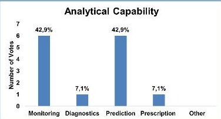

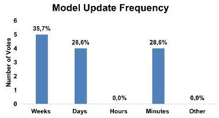

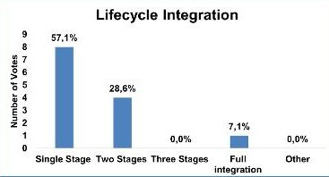

Data Collection Frequency

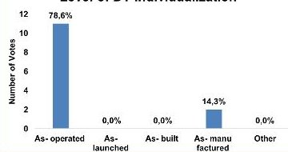

Business Level Affected

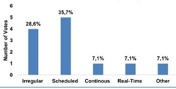

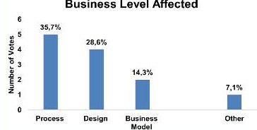

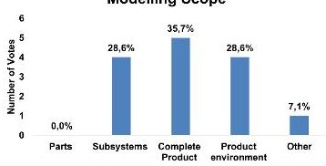

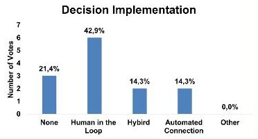

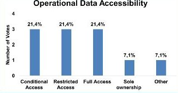

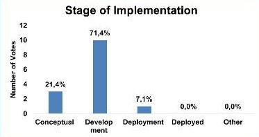

Figure 1: Ratings of the Maturity Model with a Digital Twin Implemented in their Organization

The assessment of the maturity levels of different Digital Twin implementations gives a comprehensive sectional image of the industry's status on the topic. The Yes/No Path illustrates the inherent contrast between the characteristics of an existing system and the aspirations for an envisioned future state. Despite this contrast, both groups recognize the importance of prediction, human involvement in decision-making, and a focus on development phases. Figure 1 displays the answers of participants with a Digital Twin implemented in more detail. Each chart reflects different dimensions of Digital Twin maturity, with the number

of votes and corresponding percentages indicating the prevalence of each level of maturity for this category. They focus on detailed and frequent updates, integration within a single lifecycle phase, and maintaining operational data accessibility. In comparison, participants without a Digital Twin desire potential broader business impacts and varying stages of the lifecycle. High responses should be acknowledged but interpreted cautiously, as it depends on the company's focus. This becomes evident in the radar chart in Figure 2, which compares the answers of three different companies to each other. It shows significant differences among companies, such as the Model Update Frequency and the Operational Data Accessibility. However, it also presents the similarity in focus to a high modeling scope that likely stems from satellite operations' highly challenging space environment.

The statistical assessment of the demographic and professional background of the survey participants shows an overall distributed coverage of the space sector. The prevalence of engineering/ technical and management roles indicates the importance of the topic's evolution from a technical abstraction to a relevant technique applicable in the industry. A solid educational background in technical disciplines is identified and highlights the respondents' expertise required. Respondents' experience ranges from none to 35 years, with an average of 10.8 years and a tendency toward fewer years. This further underscores the survey's depth of knowledge and diversity of perspectives, enriching the findings and insights gathered.

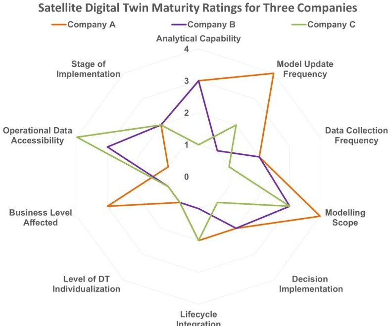

Figure 2: Radar Chart Illustration of a Comparative Assessment of Digital Twin Maturity for three Different Companies

<!-- PDF_PAGE: 5 -->

A follow-up interview was conducted with participants available to obtain scientifically qualified answers from experts in the fields of satellites and Digital Twins, bringing important insights into the topic in a more natural setting. The interviews revealed several key findings, underscoring gaps in the current methodology. The development and maintenance of Digital Twins, particularly for small-scale operations, are hindered by high complexity, financial constraints, and organizational challenges. Although Digital Twins offer potential reliability and accelerated development benefits, these advantages currently do not justify the costs and effort for smaller projects. Nonetheless, there is strong interest in future advancements, focusing on industry collaborations to establish common standards and repositories.

The industry evaluation, in general, provided an in-depth observation of the current practices and status of the Digital Twin industry. The high interest in the topic among respondents highlights its relevance and confirms the need for further research. The questionnaire has helped provide an overview, as it is aimed at the overall satellite sector, not only towards CubeSats. Sometimes, the lack of context in the responses raised additional questions that could have been clarified through an interview. Therefore, no clear hypothesis for implementing a CubeSat Digital Twin can be realized. Nevertheless, the study contributed to the knowledge of the relationship between satellites and Digital Twins and has created a basic understanding that can now be pursued further.

## 3. CubeSat Digital Twin Framework

This comprehensive overview of the state-of-the-art Digital Twin technology for CubeSats highlights the need for a structured framework to facilitate this technology's organized and effective implementation. The following section presents the systematic approach toward the framework, detailing its requirements, describing the architecture throughout the lifecycle, and showing the optimized elements for a CubeSat Digital Twin.

## 3.1 CubeSat Digital Twin Requirements

The requirements balance feasibility and fidelity, enabling implementation while maintaining data accuracy for comprehensive analysis. This approach addresses the challenges inherent to CubeSats and focuses on providing lifecycle-long support.

## 3.1.1 Fidelity and Simplicity

- The CubeSat Digital Twin shall fit the level of fidelity of a CubeSat, ensuring that the digital model accurately reflects the physical CubeSat's behavior and performance.

- The CubeSat Digital Twin shall be simple to implement initially, facilitating ease of understanding, assembly, and maintenance.

- The CubeSat Digital Twin shall follow a scalable approach, starting with reduced complexity and refining the model with additional details as needed.

## 3.1.2 Feasibility and Modularity

- The CubeSat Digital Twin shall consider the feasibility of component implementation, including using COTS components to reduce costs and improve accessibility.

- The CubeSat Digital Twin shall be modular, enabling easy upgrades, reconfiguration, and scalability of physical and digital components.

## 3.1.3 Simulation and Representation

- The CubeSat Digital Twin shall enable behavior simulation to reflect the CubeSat's real-world conditions and responses.

- The CubeSat Digital Twin shall support simulations of subsystems and payload disciplines, ensuring the modelling of their performance and interactions to provide a dynamic digital representation.

## 3.1.4 Predictive Analytics and Decision Support

- The CubeSat Digital Twin shall support the analysis of "What-if" scenarios to prepare for various mission conditions and unexpected events.

- The CubeSat Digital Twin shall enhance predictive analytics and decision-support capabilities, providing system performance, maintenance, and operational decision-making insights.

## 3.1.5 Testing and Validation

- The CubeSat Digital Twin shall include commanding capabilities to validate and test CubeSat operations before deployment.

- The CubeSat Digital Twin shall provide a controllable test environment to ensure reliable testing and validation of the CubeSat's functions and operations.

- The CubeSat Digital Twin shall prioritize reliability by incorporating robust fault tolerance mechanisms and redundancy.

## 3.1.6 Traceability and Iterative Improvement

- The CubeSat Digital Twin shall provide traceability of changes, allowing for precise documentation and analysis of modifications throughout the lifecycle.

- The CubeSat Digital Twin shall support iterative analysis to facilitate continuous improvement and refinement of digital and physical models.

<!-- PDF_PAGE: 6 -->

Defining and adhering to these specific requirements enables the effective implementation and further optimization of the CubeSat Digital Twin's unique characteristics and capabilities. The next step involves developing the Digital Twin's architecture.

## 3.2 Architecture of the CubeSat Digital Twin

The starting points for the architecture of the CubeSat Digital Twin Framework, displayed directly from the Digital Twin standard: the physical domain, the digital domain, and the control loop as a stand-alone element with one designated component for every direction of data exchange. This approach emphasizes the distinction between the virtual-to-physical and the physical-to-virtual connection in more detail. Additionally, the architecture illustrates the possible connections among different elements within each domain, enhancing the understanding of potential interactions and influences throughout the operation.

This architecture is crucial for understanding and optimizing functionalities, with its elements aligned to the ISO standards [8], making it a blueprint for implementation and integration.

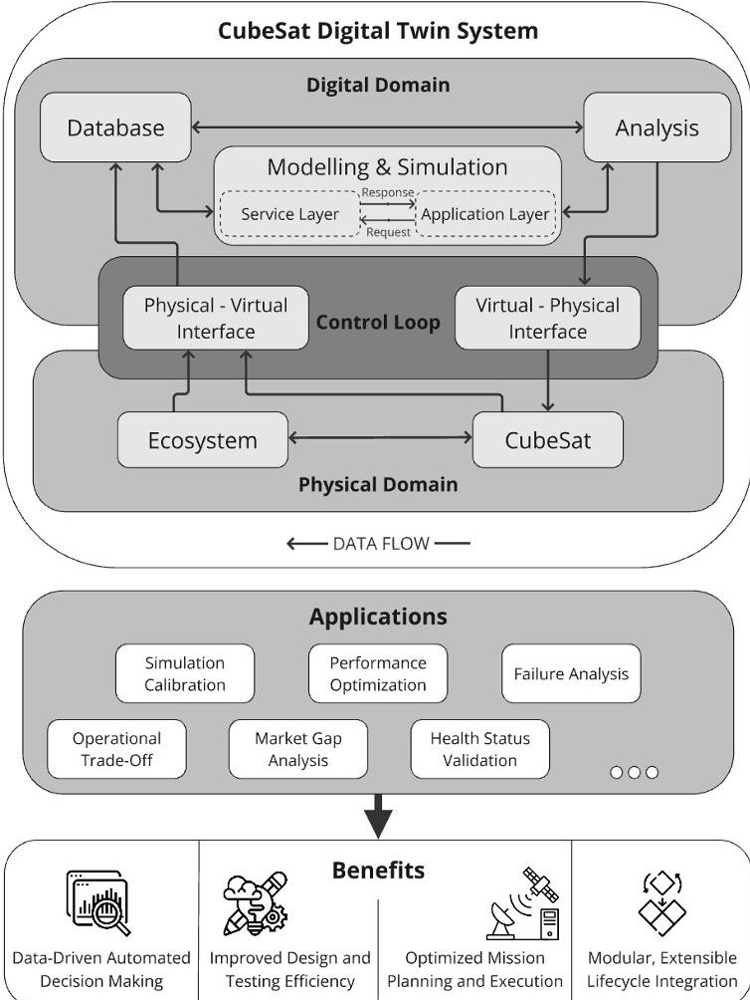

Figure 3: CubeSat Digital Twin Framework

## 3.2.1 Physical Domain

The physical domain encompasses the physical entities of the product and its surrounding environment. All these elements may be subject to modelling and simulation.

The ecosystem represents the environment in which the product operates. It comprises the infrastructure and services a network of organizations and stakeholders supports.

The target entity refers to the physical entity that is the subject of digital representation and serves a functional purpose in reality. This physical entity includes the product and its corresponding physical or digital components.

## 3.2.2 Control Loop

The control loop represents the connecting interface between the physical and digital domains. This connection and the information exchanged through it may vary significantly among different versions of Digital Twins. The key characteristics include the perception of data from the target entity and the ecosystem by the digital domain and the feedback of data to the target entity to modify its behavior.

The physical-to-virtual interface facilitates data transfer from the target entity to the digital domain and from the ecosystem to the digital domain. This interface encompasses all information collected about the physical domain.

The virtual-to-physical interface serves as the directive interface that transmits data from the digital domain to the physical domain through commands or updates, resulting in modifications to the target entity or the ecosystem. This enables the physical entity to change parameters, adjust behavior, or even undergo software updates/upgrades.

## 3.2.3 Digital Domain

The digital domain encompasses all digital entities involved in twinning the physical entity and its ecosystem. Despite its name, this domain also includes physical components, primarily computation and storage units. The digital domain may be operated by a human or automated. It consists of three main interconnected elements essential for mirroring the behavior of the physical domain: the database, the model and simulation, and the analysis.

The data provided by the physical domain and data from previous developments are stored and organized in the database. The database may facilitate graphical data visualization through graphs or networks, enhancing human interaction and comprehension.

The modelling & simulation element encompasses all digital models and simulations that describe the product. The model employs formal languages to create an abstract representation of the physical domain. In the

<!-- PDF_PAGE: 7 -->

simulations, an equivalent system replicates the physical domain, ensuring it behaves or appears like the actual system.

The analysis element of the digital domain utilizes the outcomes of simulations and data from the physical domain for decision-making, optimization, and prediction. This element provides feedback to the physical domain, allowing for parameter adjustments and behavioral changes to improve the physical entity. Additionally, it helps validate and refine the models and simulations.

## 3.2.4 Interfaces

All flows between elements in the CubeSat Digital Twin system are data-based. Even the interface between the target entity and the ecosystem can be described in terms of data exchange for each physical interaction in an abstract view. This is the most natural interface as the ecosystem surrounds the target entity and thus influences it in various ways. The two interfaces, which connect to the physical-to-virtual interface from the ecosystem and the target entity, can be described simultaneously since both transfer data from the physical domain to the control loop. This enables the synchronization of the physical domain with the digital domain. This synchronization is possible by relaying parameter updates from the physical-to-virtual interface to the database. The database has two output interfaces: it can provide data to the simulation as input for further simulations, and it can supply raw data to the analysis component to enable comparison with previous parameters and validate previous updates made by the analysis. The modelling and simulation component delivers its outputs to the analysis component, facilitating decision-making based on the simulation results. The connection between the virtual-to-physical interface enables updates to the physical domain by transferring data from the digital domain to the control loop. These updates are then divided into updates for the ecosystem and the target entity as a feedback loop to modify its behavior.

## 3.3 CubeSat Digital Twin Throughout the Lifecycle

The CubeSat Digital Twin is categorized throughout the lifecycle into the "As-Designed," "As-Built," and "As-Maintained" phases, summarizing two cycle phases of the CubeSat into one Digital Twin phase [19]. This categorization allows for showcasing the varying operations and components representing the different elements of the Digital Twin at each lifecycle phase. The following section systematically examines the lifecycle phases, moving from "As-Designed" to "As-Built" and finally to "As-Maintained."

## 3.3.1 As-Designed Phase

During the design and development phase, the CubeSat Digital Twin focuses on exploring components in various environments and scenarios, determining parameters without requiring high-fidelity mirroring, as many subsystems are still evolving. Emphasis is placed on the payload, a custom-developed, mission-critical component with a low Technology Readiness Level (TRL), unlike Components-of-the-Shelf (COTS) subsystems with well-documented behavior. The "As- Designed" phase incorporates physical components, prototypes, and digital entities, supported by a control loop for data flow between physical and digital domains. The process involves iterative design, simulation, and analysis to optimize the CubeSat's configuration, with data collection varying based on the system's needs.

## 3.3.2 As-Built Phase

In the "As-Built" phase, the final design of the CubeSat is developed, manufactured, and fully integrated, with a focus on ensuring all subsystems function together for mission success. This phase involves fewer iterations but more extensive data incorporation, as the complete system generates more complex interactions and emergent behaviors. The Digital Twin addresses these challenges with enhanced automation in the control loop and more advanced simulations covering the entire system. Data collection is more mature, though connectivity limitations may impact real-time updates. Figure 4 depicts this phase visually with example components assigned to the different elements of the CubeSat Digital Twin. This phase concludes with the CubeSat's launch into space.

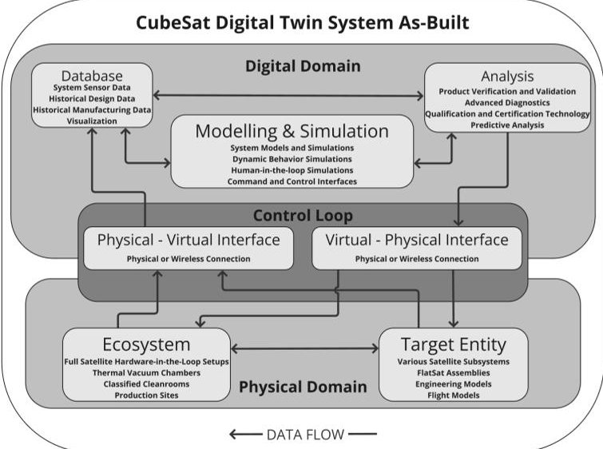

Figure 4: CubeSat Digital Twin: As-Built Phase covering Final Design, System Assembly until Launch

## 3.3.3 As-Maintained Phase

In the "As-Maintained" phase, the CubeSat operates in space until the end of its mission, with the Digital

<!-- PDF_PAGE: 8 -->

Twin's focus shifting from design and manufacturing to optimizing mission operations using collected data. The control loop transitions to up and downlink communication, while data availability depends on downlink opportunities. The digital domain now encompasses accumulated data, lifecycle analysis, and operational simulations, focusing on predicting future states and ensuring mission success. This phase concludes with the mission's decommissioning, emphasizing the need to capture all mission data for future use.

## 3.4 Modelling and Simulation

Optimizing the Digital Twin architecture for CubeSats requires emphasizing the unique characteristics that contribute to its success. By identifying and leveraging these features, the CubeSat Digital Twin can be enhanced to more effectively meet the specific needs of CubeSat developers in terms of accuracy and performance. Given that the digital domain is predominantly software-based, the characteristics of modular software architectures for CubeSats are emphasized. These features, as outlined by [20], can be summarized as follows:

- Modularity: Develop components independently, allowing updates without impacting others.

- Reusability: Use common components across projects to save time and reduce costs.

- Extensibility: Design for easy addition of new features as technologies evolve.

- Portability: Ensure models work across different software environments for collaboration.

- Re-Configurability: Allow simulation adjustments to reflect changing mission scenarios.

- Scalability: Prepare to handle increased complexity and data as the system grows.

- Fault Tolerance: Ensure reliability by handling errors and unexpected inputs.

- Autonomy: Automate decision-making based on real-time data, reducing human oversight.

The architecture of the modelling and simulation element is based on these features to be oriented closer to a highly modular software framework [20]. It follows a layered approach with two layers and a consistent communication interface. This minimizes error propagation and enhances portability and reusability for future missions. The first layer is the service layer, which offers reusable functionalities essential for CubeSat Digital Twin operations. The second layer is the application layer, in which application modules are designed to meet mission-specific requirements using reusable service modules. The communication between these two layers is organized by a modular and asynchronous request-response architecture, which

separates application and service modules, allowing seamless communication through defined interfaces. This is to ensure flexibility, scalability, and reliability.

## 3.4.1 Request and Response Communication

- Request: Contains command details such as ID, parameters, and priority.

- Response: Captures the result of requests, including status and any relevant data.

## 3.4.2 Service Layer

Each service is defined by the commands it provides, with each command uniquely identified within the service. These modules abstract hardware resources or perform common functional sequences necessary for the mission. They also define ground interfaces for operator interaction. Unlike application modules, service modules can communicate with each other through the same interfaces, improving system flexibility and integration. The reusability of the service modules offers the possibility of building a library of modules that can be reused for different projects later on.

## 3.4.3 Application Layer

Developers create application modules to send requests to service providers and handle the responses. Direct communication between application modules is generally avoided to maintain modularity and predictability. Therefore, when communication between mission modules is required, it is facilitated either through a routing service within the service layer or, in some instances, through direct interaction to support the operational fidelity of the Digital Twin.

This modular and extensible CubeSat Digital Twin framework provides a robust and flexible environment for developing, simulating, monitoring, and controlling a CubeSat throughout its lifecycle. The system supports various applications by integrating real-world data with advanced modeling and simulation techniques, enhancing decision-making, efficiency, and mission success.

## 4. Case Study EventSat

The CubeSat Digital Twin has been implemented as a case study into the first CubeSat mission of the Chair of Spacecraft Systems at the Technical University of Munich, the EventSat. The mission aims to advance autonomous object detection, classification, and identification techniques in space for enhanced space situational awareness and autonomous space operations through the technological demonstration of event cameras integrated with onboard AI. To achieve this, AI-based algorithms are developed, an event camera is selected, and a 6U CubeSat is designed and built to demonstrate the technology in orbit.

<!-- PDF_PAGE: 9 -->

Event-based vision is a cutting-edge technology that integrates various engineering disciplines. Inspired by biological systems, silicon retinas or "event cameras" represent an improvement in sensor technology, providing numerous benefits over conventional framebased cameras, including low latency, minimal power consumption, high speed, and a broad dynamic range. These features offer significant potential for advancements in computer vision [21].

The satellite bus mainly comprises COTS components with flight heritage. Additional components will be developed in-house by incorporating student theses.

The status of the mission can be classified as preliminary design and technology development, as especially the payload requires further investigation into the technology constraints and abilities to achieve the mission objectives. To assess if the CubeSat's design and configuration meet the payload's needs, an earlystage analysis was conducted using the software tool Valispace [22], accessing the first power and mass budgets. An AI computer, the NVIDIA Jetson Orin Nano Developer Kit, and an event-based camera, the Metavision Evaluation Kit 3 (EVK-3), were selected for the first payload calculations, as they are available at the university for experimentation and evaluation [23][24]. Preliminary budget calculations have shown that the amount of data produced by the payload can be very high rate, and thus require advanced downlink capabilities. The AI computer receives the data flow from the camera, is processed with filters and ranked with machine learning algorithms, transferred through the interface to the communication module, and is then downlinked over the antenna to the ground station.

The power budget for different modes showed that the power consumption of the payload based on the given data sheets revealed relatively high power consumption values while operating the payload. This would result in a very sparse average daily payload operation time of around 60 minutes. In general, this would not disrespect the initial mission requirements, as the mission is aimed at technology demonstration. Still, it would drastically lower the probability of detecting objects in space, as no long-term operation can be executed while operating the CubeSat.

Investigating the payload using a CubeSat Digital Twin presents an opportunity to optimize the component's operation and significantly enhance the mission's scientific value, as extended operational time allows for collecting more scientific data. Typically, the payload is the first technology to be explored, given that the CubeSat bus is designed to meet the specific needs of the primary payload to ensure mission success. Consequently, payload prototypes are usually the first subsystems available for testing, enabling design and performance evaluation under various conditions.

The CubeSat Digital Twin Case Study investigates the power budget assessment as a use case through early payload integration, aiding component selection and enhancing mission success. This power budget verification is applicable throughout the mission lifecycle, allowing connection with additional hardware components and analysis under various scenarios. It improves the understanding of power consumption and enables accurate estimation of payload operation time before launch, optimizing mission planning during operation.

The payload development kits are chosen for the first iteration of the CubeSat Digital Twin. This results in values different from those of the actual satellite, but it gives a baseline understanding of its behavior and eases the refinement of the Digital Twin once flight hardware is available. More hardware can be connected to and investigated throughout the lifecycle with different software versions.

Figure 5 displays the implementation setup assigned to the different elements of the CubeSat Digital Twin architecture.

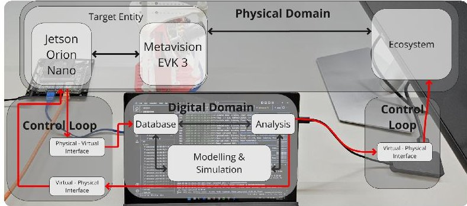

Figure 5: Setup of the CubeSat Digital Twin for the EventSat - Black Lines Depict the Internal Connections of the Elements, and Red Lines Depict the Connections among the Elements

## 4.1 Physical Domain

The physical domain covers the ecosystem and the target entity. The ecosystem is, on the one hand, the complete laboratory environment that surrounds the target entity and influences its behavior, e.g., if the temperature inside the laboratory rises, the temperature of the components increases. For this early investigation of the behavior of the target entity, there has been no aim to control the environment in detail, as this would have resulted in increased necessary resources. This could have led to an abort of the operation of the Digital Twin as it raised the entry barrier. An additional expense has been taken regarding the visual recognition of the target entity. Therefore, the field of view that the event camera covers has been covered by a screen on which videos can be displayed to enhance further comparability between different modes of the target entity during the various sessions.

<!-- PDF_PAGE: 10 -->

The target entity comprises the AI computer and the event-based camera. Both are currently not optimized for space operation but for early development, evaluation, and on-ground testing. An external power source powers the setup to ensure safe and reliable operation. As an operating system, Ubuntu 20.04.6 LTS is currently installed. For further development and access to the board, a screen and other peripherals like a keyboard and mouse can be connected via USB. In the test setup, the Jetson offers 4 GB of RAM, up to six CPUs, and one GPU. It also provides different predefined modes to switch between and adjust the computational power usage to the project's needs. For this version of the AI computer, three modes are available: 7W CPU, 7W AI, and 10W. As already indicated by the naming of the modes, the power consumption differs between these modes, which is achieved by restricting the number of available CPU cores and the frequencies of the processing units. Regarding the use case of the power budget, it is essential to mention that the NVIDIA Jetson Orin Nano is equipped with an internal power measuring unit, and the values are available to access via different software tools [23]. Via USB 3.0, the Metavision EVK-3 is connected to the AI computer. This evaluation kit has a SONY IMX 636 sensor integrated into a PCB with various mounting and data interfaces. The Jetson uses the open-source-based architecture provided by Prophesee "OpenEB" to access the functions of the camera and can record and save event-based videos [25].

## 4.2 Digital Domain

The digital domain is operated on a Windows Surface Pro 7, with 8 GB of RAM and eight logical CPU cores, running Windows 11 Home. The installed SSD, which has up to 256 GB of storage, represents the database. The modelling simulation and analysis elements work in a Python environment operated in Visual Studio Code. The different layers, the corresponding scripts, and the diagrams are saved in the same folder for more straightforward implementation and connected to a GitLab repository to enable version control.

## 4.3 Control Loop

As shown in Figure 5, the control loop is separated into two different elements in the application to access the ecosystem and the target entity with other connections. The virtual-to-physical interface from the digital domain to the ecosystem is realized as an HDMI connection, connecting the screen to the personal computer and displaying the videos for the camera to record. The other side of the control loop reflects the interfaces between the target entity and the digital domain. The digital domain is connected to the university's local WLAN network via a VPN, and the

NVIDIA Jetson Orin Nano is connected to the university network via the orange LAN cable. The communication of these two elements works with the SSH protocol for a secure network service operation.

## 4.4 Scenario

The scenario of the CubeSat Digital Twin implementation of the EventSat has been oriented on the possible known parameters for operation and the early stage of development. Therefore, some assumptions and considerations have been taken. This assumption mainly considered the amounts of events logged, the computation algorithms operated on the NVIDIA Jetson Orin Nano, and the orbit characteristics. For the orbital considerations, a simplified sun-synchronous orbit has been taken as a baseline for the simulation: 90 minutes of orbit time, 60 minutes in the sunlight, and 30 minutes of eclipse. This has been validated with a separate computation in orbit mechanics software. The communication window has been selected in a way that it communicates while operating in the sun to reduce the risk of a fallback in the safe mode. It has been decided to initiate the simulation for one orbit to observe the correct functionality of the simulation before the hardware connection is checked automatically and then operate the simulation for 170 orbits, as a trade-off between time to wait until the simulation finishes and giving the behavior of the component enough time to see a trend in operation.

The different modes' thresholds and safety factors were selected from the early mission power budget calculations. The component values of the satellite bus have been used from the mission's Valispace. The EventSat satellite team selected this configuration with the corresponding values. All values can be easily changed due to the architecture of the simulation based on the methodology.

As briefly introduced, the "OpenEB" architecture runs on the operating system Ubuntu 20.04.6 LTS of the NVIDIA Jetson Orin Nano to access the Metavision EVK-3 event-based camera. The "OpenEB" architecture comes with samples that enable easy access to the camera and are modified to resemble the operation of the payload in space. To measure the power of the NVIDIA Jetson Orin Nano accurately, the inbuilt power measuring devices of the different lines are used and accessed via a Python script with the jetson-stats package [26]. The simulation is designed to model the operations of a satellite's power and payload management over multiple orbits. It consists of three primary layers: the Application Layer, the Service Layer, and the Communication Interface, as depicted in Figure 6. Each layer contains modules that perform specific tasks, working together to simulate various operational scenarios:

<!-- PDF_PAGE: 11 -->

- Application Layer:

- main.py: Orchestrates the overall simulation.

- orbit_simulation.py: Runs detailed simulation scenarios.

- payload.py: Manages payload operations.

- conops.py: Defines operations concepts and scenarios.

- Service Layer:

power_config.py: Acts as a single source of truth for power values.

power_budget.py: Defines calculations for a power budget.

- battery.py: Defines simplified battery functions including charge and discharge.

- solar_panel.py: Simulates the charging phases.

- Communication Interface:

- request.py: Represents a command request characterized by a unique identifier, optional parameters, and a priority level for processing.

- response.py: Represents a command response characterized by a unique identifier, success status, and optional result or error message.

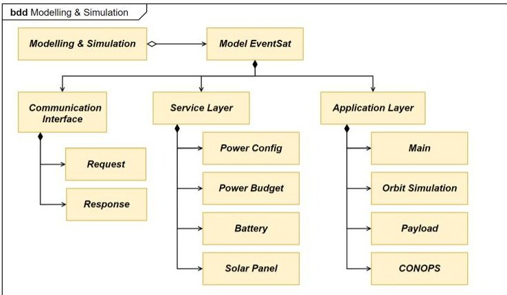

Figure 6: Block Definition Diagram of the Modelling and Simulation Element of the CubeSat Digital Twin System

The state machine in Figure 7 displays the Concept of Operations (ConOps), detailing the transitions between satellite operational modes in the simulation based on battery levels and other conditions.

Idle: Default mode when the satellite is powered on. Transitions to this state if it recovers from a failure or is not in another specific mode.

Science: Activated when the battery level is above a certain threshold, allowing the satellite to perform scientific operations.

Communication: Engaged during ground contact windows if the battery level is sufficient. Exits this mode when the ground contact window ends.

Safe: Entered during a failure or when the battery level is critically low, ensuring minimal power consumption to prevent complete power loss.

Off: End-of-life state when the satellite ceases operations permanently.

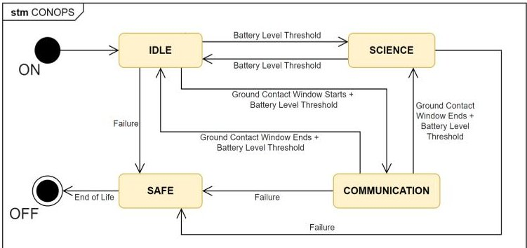

Figure 7: State Machine - ConOps

The detailed data-gathering process from the payload is illustrated in the sequence diagram of Figure 8. It shows the critical steps and interactions required to correlate hardware data with simulation values. The precise implementation of these steps ensures accurate simulation and analysis, highlighting the importance of integrating hardware interactions in the simulation workflow.

The simulation connects to the hardware once it can establish contact. Then, the payload operation on the Jetson is initialized. While this script is operating, the simulation runs at the clock time of the PC to reflect one minute in orbit as one minute for the payload and fetches the power data of the payload every second. After one minute of connection, the average of these values is taken to update the values of the simulation long-term, and the payload is disconnected again. This balances payload availability, simulation time, and accuracy. If the simulation keeps running in this slow mode, a long-term prediction would be unfeasible, and the payload would not be available for other operators. This trade-off has been accepted as this implementation serves only as a demonstration of the framework. After the disconnection, the simulation keeps running until the set limit of orbits is reached. During the whole simulation, the data and the debug output of the simulation, respectively, the power values with a corresponding timestamp, are saved in a log file and a CSV-Format file. This ensures proper simulation documentation over the lifecycle and enables manual analysis later.

<!-- PDF_PAGE: 12 -->

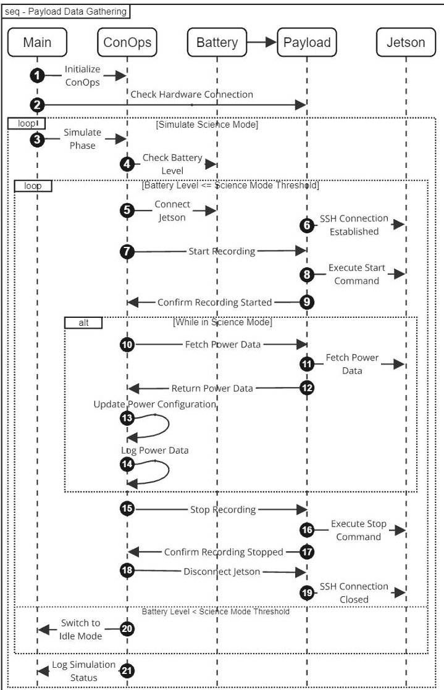

Figure 8: Sequence Diagram - Payload Data Gathering

Once the simulation is finished, the data will be handed over to the analysis element. The current setup evaluates the performance availability of the different operational modes, explicitly focusing on the science mode. It calculates the percentage of time spent in each mode, gives out the current status, and evaluates if a mode change is required by comparing the result to a threshold defined by the operator. If the hardware requires a change, the analysis element sends a mode change command to the hardware via the control loop and re-runs the simulation. The command changes the NVIDIA Jetson Orin Nano mode from the 10W to the 7W CPU mode. The performance availability is reevaluated, and the different simulations are compared against each other in the simulation output.

## 5. Results and Discussion

The work showed the significant need to explore the topic in more detail. The survey gave valuable insights into the industry's practices and underlined the applicability of Digital Twins in the satellite industry. A framework to follow has been presented to enable a common implementation and lower the topic's entry

barrier. This framework explores the needs for the CubeSat Digital Twin application and shows potential integrations throughout the lifecycle of a CubeSat and its corresponding Digital Twin. The implementation of the case study showed the application in a real-world scenario, ensuring the approach is valid for usage as a CubeSat Digital Twin concept. The approach highlights the incorporation of the payload as the main valuable component of a CubeSat and the imperative design of a CubeSat Digital Twin. The satellite bus subsystems have not been involved in the simulation, but a better understanding of the payload has been accomplished through simulating their values and behavior throughout the mission.

Table 1. Percentage Distribution of Different Mode Operations

<table border="1"><tr><td>Mode</td><td>10W</td><td>7W</td><td>No Hardware</td></tr><tr><td>Idle</td><td>13.11</td><td>0.59</td><td>42.78</td></tr><tr><td>Science</td><td>85.51</td><td>98.03</td><td>55.84</td></tr><tr><td>Communication</td><td>1.38</td><td>1.38</td><td>1.38</td></tr></table>

Table 1 displays the output values from the Jetson operating in various modes alongside the results obtained from a simulation using only datasheet values without hardware implementation. These outputs illustrate the correlation between the simulation and the payload inputs, revealing variations in simulation data that arise from mode changes initiated by the analysis element. Additionally, Figure 9 illustrates the average battery capacity across the orbit for the different modes of the Digital Twin implementation.

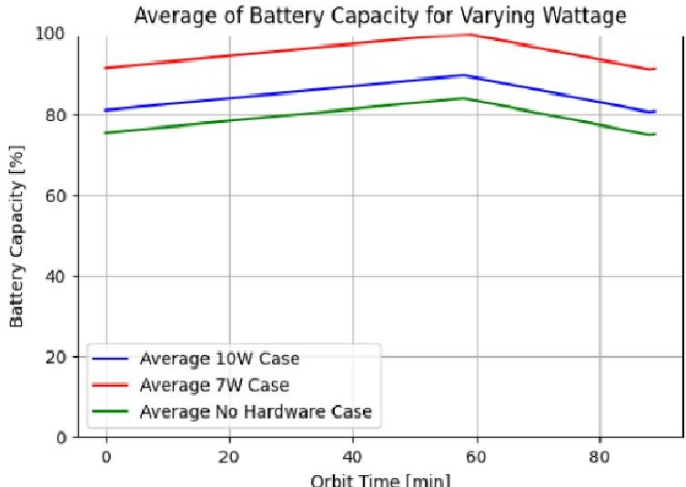

Figure 9. Battery Capacity in Percent over Orbit Time in Minutes as Average of the Different Operating Scenarios of the Digital Twin

This gives insights into the difference in performance of the different modes and how this affects the mission operation overall. This coupled loop of data gathering, correlating the simulation, and updating the hardware as

<!-- PDF_PAGE: 13 -->

a reaction to the simulation impacted the development of the CubeSat tremendously in various ways and demonstrated the successful implementation of the CubeSat Digital Twin according to the presented framework:

- Improved Performance: The analysis ensures enhanced performance by monitoring and adjusting the satellite's operational modes, particularly for critical tasks like scientific data collection.

- Real-Time Adaptation: The system can quickly respond to suboptimal conditions, adapting hardware configurations without manual intervention.

- Enhanced Simulation Accuracy: Integrating feedback from physical hardware into the simulation enhances the accuracy and reliability of the Digital Twin.

- Data-Driven Decisions: The analysis leverages simulation data to make informed decisions, improving the overall mission success rate.

## 6. Future Work

Future research should focus on refining the proposed framework and conducting more extensive industry evaluations to validate the findings. A more significant number of responses to the industry survey will include a broader range of stakeholders, providing more comprehensive insights into the need for CubeSat Digital Twin technology. This knowledge can be used with the observations collected in further implementations throughout the lifecycle to refine the framework. Predictive capabilities can be enhanced by incorporating advanced technologies like AI, machine learning, and IoT technologies. A library of reusable service modules should also be developed, with more experts involved to ensure the system's robustness.

An essential aspect in further developing this area is improving the understanding of the concept of Digital Twins. Standardizing terminology and frameworks is critical for broader industry adoption. Encouraging vendors to incorporate this technology into their systems will make data entry more seamless, reducing the reliance on manual input. It is vital that digital twin technology transitions to a concept that is understood and consistently applied across the industry.

## 7. Conclusion

This research identified key challenges in developing a CubeSat Digital Twin. Mainly, the lack of Digital Twin literature in the space sector and standardized frameworks for implementation limit the application. The industry survey and expert interviews revealed a strong interest in Digital Twin technology but highlighted gaps in knowledge regarding implementation processes.

The study focused on developing a CubeSat-specific Digital Twin framework to address these issues. A comprehensive set of CubeSat Digital Twin requirements was derived by concentrating on crucial characteristics of CubeSat components, such as feasibility, modularity, reusability, fidelity, and iterative improvement. The framework is designed to guide developers through the entire lifecycle of the Digital Twin, from early design stages to operation, promoting flexibility and scalability.

The methodology developed in this research was implemented in a 6U CubeSat project at the Technical University of Munich. The case study demonstrated the practical application of the Digital Twin, showcasing how real-world data can be correlated with simulations to optimize payload operations. This implementation highlighted the benefits of early lifecycle data correlation, improving the understanding of satellite behavior and enabling early configuration optimization to enhance the operational time of scientific missions.

This research fills a gap in the literature by presenting a novel methodology for CubeSat Digital Twins, integrating industry perspectives, and addressing the unique challenges of CubeSat development. The study contributes to the field by proposing a systematic approach to Digital Twin implementation, summarized in a framework emphasizing modularity, reusability, and scalability. The findings suggest that a well-designed Digital Twin can significantly enhance CubeSat development and operations, offering a promising solution to the industry's growing demand for efficient, reliable, and cost-effective satellite missions.

## Acknowledgment

The authors would like to thank all industry survey participants for their significant contribution to this study and appreciate the funding support by the Freunde der TUM e.V.

## References

[1] C. D. Burkhard and S. Weston. The Evolution of CubeSat Spacecraft Platforms. NASA Technical Reports Server, 2021. Available: https://ntrs.nasa.gov/api/citations/20210021348/downloads/Platforms_paper_final.pdf, accessed on 2024- 07-09.

[2] J. Bouwmeester, M. Langer, and E. Gill. Survey on the Implementation and Reliability of CubeSat Electrical Bus Interfaces. CEAS Space Journal, 9(2):163-173, 2017. DOI: 10.1007/s12567-016-0138-0.

[3] A. Poghosyan and A. Golkar. CubeSat Evolution: Analyzing CubeSat Capabilities for Conducting Science Missions. Progress in Aerospace Sciences,

<!-- PDF_PAGE: 14 -->

88:59-83, 2017.

10.1016/j.paerosci.2016.11.002.

[4] Gartner, Inc. Gartner Top 10 Strategic Technology Trends for 2018. Available: https://www.gartner.com/smarterwithgartner/gartner -top-10-strategic-technology-trends-for-2018, accessed on 2024-07-09.

[5] M.W. Grieves. Digital Twin: Manufacturing Excellence through Virtual Factory Replication Technical report, 2014. White Paper.

[6] M.W. Grieves. Product Lifecycle Management: The New Paradigm for Enterprises. International Journal of Product Development, 2(2), 2005.

[7] F. Tao, B. Xiao, Q. Qi, J. Cheng, and P. Ji. Digital twin modeling. Journal of Manufacturing Systems, 64:372-389, 2022. DOI: 10.1016/j.jmsy.2022.06.015.

[8] ISO and IEC. ISO/IEC 30173: Digital Twin: Concepts and Terminology. International Organization for Standardization, 2023.

[9] E. H. Glaessgen and D. S. Stargel. The Digital Twin Paradigm for Future NASA and U.S. Air Force Vehicles. In 53rd AIAA/ASME/ASCE/AHS/ASC Structures, Structural Dynamics and Materials Conference, 2012. DOI: 10.2514/6.2012-1818.

[10] M. W. Grieves and J. Vickers. Digital twin: Mitigating unpredictable, undesirable emergent behavior in complex systems. In Transdisciplinary Perspectives on Complex Systems: New Findings and Approaches, pages 85-113. Springer International Publishing, 2016. DOI: 10.1007/978-3-319-38756-7_4.

[11] D. Shangguan, L. Chen, and J. Ding. A Digital Twin-Based Approach for the Fault Diagnosis and Health Monitoring of a Complex Satellite System. Symmetry, 12(8), 2020. DOI: 10.3390/SYM12081307.

[12] M. Plattner, et al. Satellite Payload Design for Optimized Thermal Management Using a Distributed Processor System. In Forum on Specification and Design Languages, September 2023. DOI: 10.1109/FDL59689.2023.10272111.

[13] R. A. Borges, et al. The alfacrux cubesat mission description and early results. Applied Sciences (Switzerland), 12(19), 2022. DOI: 10.3390/app12199764.

[14] N. Döring. Forschungsmethoden und Evaluation in den Sozial- und Humanwissenschaften. Springer, Berlin, Germany, 6th edition, 2023. DOI: 10.1007/978-3-662-64762-2.

[15] R. Jacob, A. Heinz, and J. P. Décieux. Umfrage - Einfuhrung in die Methoden der Umfrageforschung. De Gruyter Studium, München: Oldenbourg Wissenschaftsverlag, 2019. DOI: 10.1515/9783110597387.

[16] B. Marshall, P. Cardon, A. Poddar, and R. Fontenot. Does sample size matter in qualitative research? A review of qualitative interviews in IS research. Journal of Computer Information Systems, 54(1):11-22, 2013. DOI: 10.1080/08874417.2013.11645667.

[17] F. G. Medina, A. W. Umpierrez, V. Martinez, and H. Fromm. A Maturity Model for Digital Twin Implementations in the Commercial Aerospace OEM Industry. In Proceedings of the 2021 10th International Conference on Industrial Technology and Management (ICITM), pages 149-156, 2021. DOI: 10.1109/ICITM52822.2021.00034.

[18] Typeform. Typeform, 2024. Available: https://www.typeform.com/.

[19] M. Eigner, A. Detzner, P. H. Schmidt, and R. Tharma. Definition des Digital Twin im Produktlebenszyklus. Zeitschrift für wirtschaftlichen Fabrikbetrieb, 114(6):345-350, 2019. DOI: 10.3139/104.112107.

[20] A. K. El Allam, et al. A highly modular software framework for reducing software development time of nanosatellites. IEEE Access, 9:107791-107803, 2021. DOI: 10.1109/ACCESS.2021.3097537.

[21] G. Gallego, et al. Event-based Vision: A Survey. IEEE Transactions on Pattern Analysis and Machine Intelligence, 2019. DOI: 10.1109/TPAMI.2020.3008413.

[22] Valispace. Valispace: The Engineering Data Management Platform for Hardware Projects. Available: https://www.valispace.com/, accessed on 2024-07-09.

[23] NVIDIA. Jetson Nano Developer Kit User Guide 2020. Version 1.3. Available: https://developer.nvidia.com/embedded/learn/jetsonorin-nano-devkit-user-guide/hardware_spec.html.

[24] Prophesee. Event-Based Vision Evaluation Kit EVK3 Documentation. Available: https://docs.prophesee.ai/stable/hw/evk/evk3.html accessed on 2024-07-10.

[25] Prophesee AI. OpenEB: Open-source event-based vision software. Available: https://github.com/prophesee-ai/openeb, accessed on 2024-07-10.

[26] R. Bonghi. jetson-stats: An API to Monitor and Control Your NVIDIA Jetson [e.g. Nano, Xavier NX, AGX Xavier]. Available: https://rnext.it/jetson_stats/, accessed on 2024-07-10.