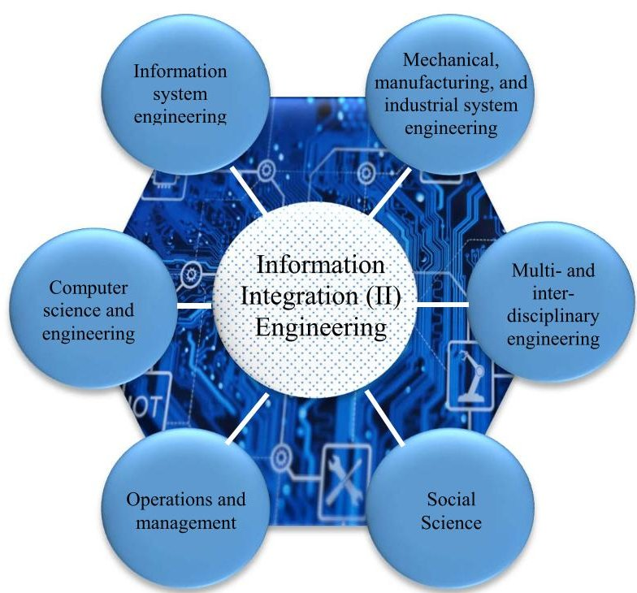
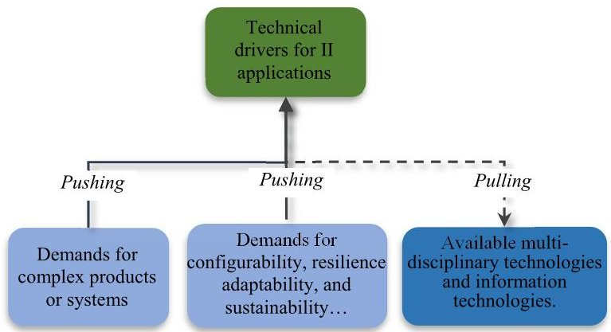
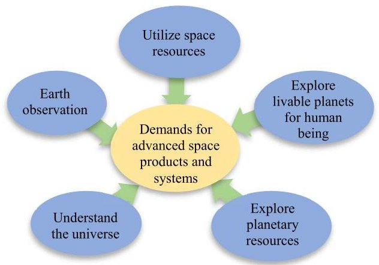
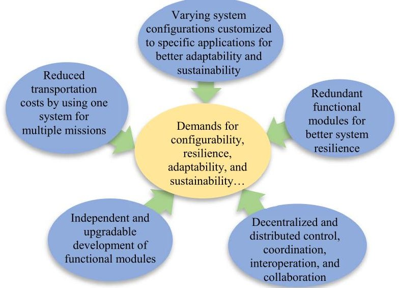
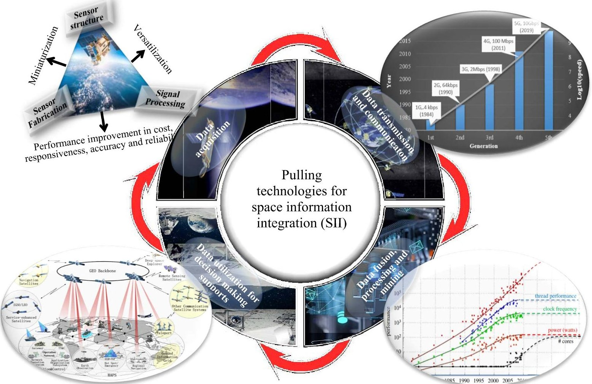
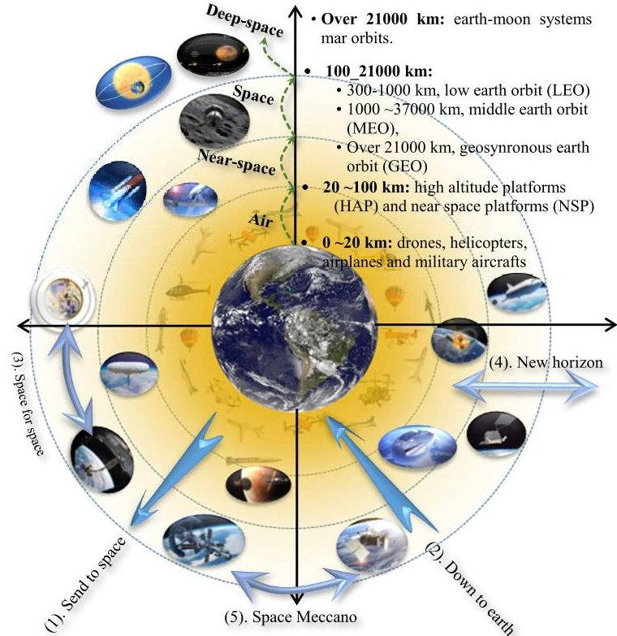
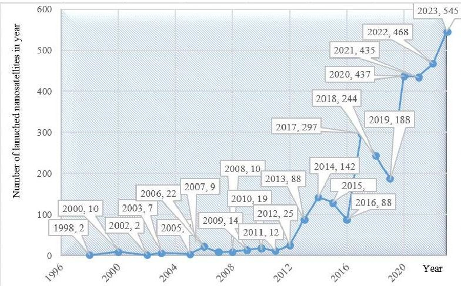
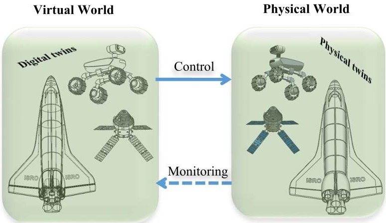
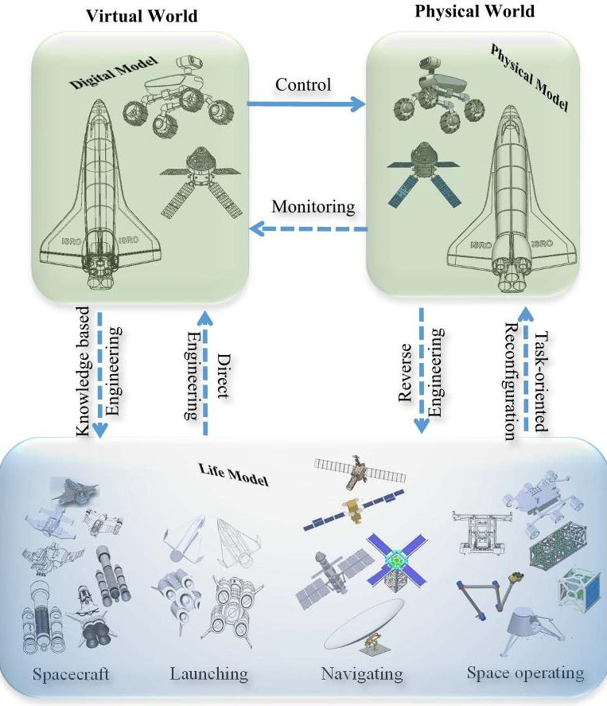

<!-- PDF_PAGE: 1 -->

Received 31 August 2022, accepted 12 October 2022, date of publication 17 October 2022, date of current version 21 October 2022. Digital Object Identifier 10.1109/ACCESS.2022.3215154

TOPICAL REVIEW

# The State of the Art of Information Integration in Space Applications

ZHUMING BI $ ^{1} $ , (Senior Member, IEEE), K. L. YUNG $ ^{2} $ ANDREW W. H. IP $ ^{2} $ , (Senior Member, IEEE), YUK MING TANG $ ^{2} $ CHRIS W. J. ZHANG $ ^{3} $ , (Senior Member, IEEE), AND Li Da Xu $ ^{4} $ , (Fellow, IEEE)

$ ^{1} $Civil and Mechanical Engineering, Purdue University Fort Wayne, Fort Wayne, IN 46805, USA $ ^{2} $Department of Industrial and Systems Engineering, The Hong Kong Polytechnic University, Kowloon, Hong Kong $ ^{3} $Department of Mechanical Engineering, University of Saskatchewan, Saskatoon, SK S7N 5A2, Canada $ ^{4} $Information Technology and Decision Science, Old Dominion University, Norfolk, VA 23529, USA

Corresponding author: Zhuming Bi (biz@pfw.edu)

This work was supported in part by the 2022-23 Indiana Space Grant Consortium (INSGC) Grant, and in part by the Research Center for Deep Space Explorations of The Hong Kong Polytechnic University.

ABSTRACT This paper aims to present a comprehensive survey on information integration (II) in space informatics. With an ever-increasing scale and dynamics of complex space systems, II has become essential in dealing with the complexity, changes, dynamics, and uncertainties of space systems. The applications of space II (SII) require addressing some distinctive functional requirements (FRs) of heterogeneity, networking, communication, security, latency, and resilience; while limited works are available to examine recent advances of SII thoroughly. This survey helps to gain the understanding of the state of the art of SII in sense that (1) technical drivers for SII are discussed and classified; (2) existing works in space system development are analyzed in terms of their contributions to space economy, divisions, activities, and missions; (3) enabling space information technologies are explored at aspects of sensing, communication, networking, data analysis, and system integration; (4) the importance of first-time right (FTR) for implementation of a space system is emphasized, the limitations of digital twin (DT-I) as technological enablers are discussed, and a concept digital-triad (DT-II) is introduced as an information platform to overcome these limitations with a list of fundamental design principles; (5) the research challenges and opportunities are discussed to promote SII and advance space informatics in future.

INDEX TERMS Information integration (II), space informatics, digital triad (DT-II), internet of digital-triad things (IoDTT), first-time right (FTR), space information integration (SII).

## I. INTRODUCTION

The development and applications of information technologies (IT) have been accelerated in the digital era rapidly; especially, the social and economic impacts of some newly developed technologies such as the sixth generation of wireless technology (6G), big data analytics (BDA), deep learning, autonomous vehicles, and blockchain technology (BCT), are far beyond the imagination of people just twenty years ago. Note that new technologies are conceptualized in six genres: i.e., means to interconnect peoples, discoveries for

The associate editor coordinating the review of this manuscript and approving it for publication was Mohammad Alshabi $ ^{ID} $ .

affordance of artefacts, artificial tools used to create new possibilities rather than industrialization, autonomous technologies, means to interconnect technological beings [1]. The majority of these technological genres rely heavily on the information integration of interconnected artefacts and peoples. Information integration (II) refers to the integration of concepts, theories, and methods in multiple disciplines, domains, and organizations. As shown in Fig. 1, II belongs to a multi-disciplinary study relevant to computer science and engineering, industrial systems engineering, information systems engineering, interdisciplinary engineering, operations and management, social science and other emerging disciplines [2], [3]. II encompasses both of hardware and

<!-- PDF_PAGE: 2 -->

FIGURE 1. Main disciplines relevant to II.

software systems, and most importantly, it emphasizes on the integration of information systems across the boundaries of functional units, components, and sub-systems [4]. The significance of ITs to modern industries has been clearly observed in various industry sectors where decision-making systems have continuously been informatized from isolated to networked automations and further to Internet of things (IoT) based applications. Smart systems require the integration of computer model theories, scientific computing, modelling and simulation as comprehensive solutions at all stages of system lifecycles [5]. In developing a train planning and scheduling system, Niu and Chen [6] collected and mined dynamic data collected from grids, trains, transportations and infrastructure systems. The integration of IoT and data analytics tools enhanced a train allocation system in terms of its smartness in dealing with uncertainties and changes. In spacecraft supply chain management, Zheng et al. [7] adopted blockchain technologies to share information and manage risks. Li et al. [8] used the similar concept in a system framework to manage the launching processes of rockets and satellites.

II has a different meaning in system development. Baron and Louis [9] indicated the integration relates to all of the required activities to validate a functioning 'ready-to-use' product or system once the developments of individual functional units are completed. Integration included the consistency verification of multiple software components and the correction of potential anomalies. Integration is a continuous process in which a software component has to be integrated as early as possible to ensure all of the constraints by others are satisfied. It is desirable to automate repetitive tasks to reduce new error sources.

With continuous increase of scale and complexity of advanced products and systems, II becomes mandatory in

designing, operating, and sustaining large-scale systems in various applications such as manufacturing, healthcare, services, transportations, defenses, and space industries. However, functional requirements (FRs) and design solutions (DSs) of II depend on the contexts of applied systems in terms of data acquisition, communication and networking, data processing and mining, and decision-making supports. Many literature surveys have been published for the studies on common subjects of information integration while none of them is especially for a thorough discussion on SII. Most relevant works on space systems have been summarized in a special issue of Enterprise Information Systems by Yung et al. [10]; however, the reported works emphasized the advances of certain enabling technologies rather than SI). Note that space information systems involve in some distinctive FRs such as heterogeneity, long-distance and asymmetric communication and networking, delays and latency, and critical needs of safety, security, and system resilience. In developing a space information system, it is necessary to understand existing capabilities in space missions, identify the technical challenges, and clarify promising directions of research and developments for efficient and sustainable space exploration [11]. This work aims to understand the state of the art of the technologies in developing integrated space information systems, discuss their limitations in addressing the aforementioned FRs, and exploring research opportunities in advancing space information systems. The rest of the paper is organized as follows. In Section II, technical drivers for SII are discussed and classified. In Section III, existing works in space system development are surveyed in terms of their contributions to space economy, divisions, activities, and missions. In Section IV, the enabling technologies for space informatics are explored at aspects of sensing, communication, networking, data analysis, and system integration. Fourthly, the importance of first-time right (FTR) for implementation of a space system is emphasized, the limitations of digital twin (DT-I) as the enabler are identified, and a new concept digital-triad (DT-II) is introduced as an information platform to overcome the identified limitations with a list of fundamental design principles. In Section V, the research challenges and opportunities are discussed to promote SII and advance space informatics in future. Finally, the presented work and main findings are summarized in Section VI.

## II. INFORMATION INTEGRATION - TECHNICAL DRIVERS

The continuously evolved disciplinary technologies and information technologies have created numerous opportunities for engineers to develop more or more complex products and systems with advanced functionalities and high-level system smartness in dealing with the changes and uncertainties in the time domain [12]. By all means, II plays its significant role in a complex system to connect, coordinate, and interact functional components and sub-systems to fulfill system-level functions. Therefore, technical drivers for II applications have been classified into three categories, i.e., (1) demands for complex products or systems, (2) demands

<!-- PDF_PAGE: 3 -->

for sustainable products or systems, and (3) available technological advancements as shown in Fig. 2. Note that a technical driver can be a 'push' or 'pull' driver.

## A. DEMANDS FOR COMPLEX PRODUCTS OR SYSTEMS

Human society relies on the technologies to make products to meet human being's needs for survival, socialization, and evolution. In other words, meeting human being's needs is the primary driver for technological development. The main technical trends in meeting today's human needs are to develop the solutions for shortage and scarce of natural resources, environmental deterioration, urbanization, globalization, rich and poor inequality, ageing workforces, personalized material needs, and sustainability. The space industry becomes a critical part of our modern human society, and the space industry has contributed greatly to the human society by for example of using satellites in navigation, telecommunications, meteorology, and earth observation. Space missions become highly competitive businesses where both of developed and developing nations are taking active roles to develop and utilize space technologies [13]. Space exploration affects the human society at many aspects such as to satisfy public curiosity of universe, create new employment opportunities, increase industrial competitiveness, promote international cooperation, and sustain economic development [14]. As shown in Fig. 3, space products and systems are advanced to meet human needs in utilizing space resources, observing the earth, understanding the universe, and exploring planetary resources and livable planets for human beings.

FIGURE 2. Technical drivers of II applications.

## B. DEMANDS FOR CONFIGURABILITY, RESILIENCE AND SUSTAINABILITY

The complexity of an information system can be quantified by the Shannon entropy, and the Shannon entropy depends on (1) the number of system elements, (2) the probabilities of interactions among system elements, and (3) dynamic changes of (1) and (2) over time [12]. As shown in Fig. 4, the complexity of modern products or systems has been continuously increased at all these three aspects to meet the following demands: (1) a space system is desirable to have

FIGURE 3. Demands of complex space products and systems as a technical driver of space II applications.

multiple functions so that one system can serve for different missions. (2) A space system should be reconfigurable to be customized to specific applications for better adaptability and sustainability. (3) A system should be resilient with redundant functions so that the system is still operational when one or a few of system elements are malfunctioned. (4) Functional elements should be controlled in decentralized and distributed modes for effective interaction and collaboration. (5) Functional elements should be ungradable and developed independently.

FIGURE 4. Demands for configurability, resilience adaptability, and sustainability.

System complexity can be dealt with three typical strategies: (1) a flexible component such as a robot is reprogramed to accommodate changes; (2) modularized architecture is used so that different modules can be selected and assembled to reconfigure system to meet changes; (3) flexible components are used in modularized system architecture so that system complexity can be addressed at both of hardware and software aspects. Both of strategies (2) and (3) require the information integrations in configuring a system for seamless interaction, coordination, interoperation, and collaboration of system elements.

<!-- PDF_PAGE: 4 -->

FIGURE 5. Pulling technologies for II [17], [20], [26], [28], [29].

## C. PULLING - CUTTING EDGE INFORMATION TECHNOLOGIES

Similar to a manufacturing system to transform raw materials into finished products through a series of manufacturing processes, an information system transforms raw data into wisdom, knowledge, information and decisions through a series of information processing activities such as data acquisition, data communication and networking, data cleaning, filtering, fusing and processing, and data utilization for decision-making supports. Therefore, the advance of II depends on the development of cutting edge information systems. Fig. 5 gives an overview of cutting-edge information technologies that are used in integrating information systems as whole in complex space applications.

## 1) SENSING TECHNOLOGIES FOR DATA ACQUISITION

Trustworthiness of decisions from an information system depends on abundances and sufficiency of raw data collected from environments and smart things [15], [16]. Raw data is collected by various sensors, and sensing technologies have been rapidly developed in past decades [17], [18]. According to Gartner, sensors were becoming ubiquitous, and over 26 billion sensors were used by 2020 from small appliances

to smart grids, cities, and to space systems. The growth of smart sensors had shown in most of industries such as consumer electronics, security, automation, surveillance, and space applications [19]. Sensing technologies were discussed from the aspects of sensor structure, sensor fabrication, and signal processing capabilities, and it was found that sensing technologies were rapidly developed in terms of miniaturization, versatilization and performance enhancement in accuracy, responsiveness, reliability, resilience, and cost-effectiveness [20]. Advanced sensing technologies provided numerous opportunities in space exploration. For examples, Gamba et al. [21] developed passive acoustic sensors to measure temperature in an aboard space platform remotely; no battery was needed to operate such sensors in extreme environment. Afshar et al. [22] developed a neuromorphic vision senor to detect events for space situational awareness. The developed sensor offered low bandwidth and low power consumption; it is particularly suitable to remote locating and space-based platforms. Balaban et al. [23] investigated the adverse impact of a malfunctioned sensor on a space system; sensor faults were classified into bias, scaling, dropout, and drifts, and the impact of a malfunctioned sensor on the system was simulated and analyzed by a neural network classifier. Magnes and Diaz-Michelena [24] discussed the

<!-- PDF_PAGE: 5 -->

sensing principles of magnetic sensors in space applications, and they argued that magnetic sensors became mature enough for vary large-scale integration (CVSI) for space applications. A space-borne lidar was designed by Yu et al. [25] for space applications including laser spectroscopy, communication, and interferometry.

## 2) NETWORKING TECHNOLOGIES FOR DATA TRANSMISSION, COMMUNICATION, STORAGE, AND INTEGRATION

Networking technologies provide information infrastructure to acquire, collect, transmit, exchange, process and mine data. Networking technologies have been evolved gradually from the first generation (1G) in 1984 to the fifth generation (5G) in 2019. Especially, 5G is operated in a ultra-wide band (UWB) network with a high band breadth at a low energy level; 5G supports 4000 Mbps which is 400 times faster than a 4G network. Therefore, 5G shows a number of advantages of ultra-low latency of 1 ms, a high energy efficiency of over 90%, and a high reliability of 99% at the data volume of 10 Tb. 5G leads to the next-generation standards of mobile telecommunication beyond current 4G Long Term Evolution (LTE) [26]. Space communication is mostly built upon wireless sensor network (WSN). Rashvand et al. [29] corresponded the development of WSN with the applications in space and extreme environments (SEEs), and they emphasized some uniqueness of space networking i.e., the characterization of SEEs, unconventional wireless sensing (UWS), and highly heterogeneity of space applications. Accordingly, existing applications were classified into size groups. Kraft et al. [30] gave an overview of distributed sensing systems for space situational awareness.

## 3) COMPUTING TECHNOLOGIES FOR DATA PROCESSING AND MINING

Any information activity can be formulated as a conversion of input to output data subjected to given constraints and computing resources. Therefore, the capabilities of a data processing and mining unit rely on available computing resources to support decision-making processes. Shaf [28] discussed the evolution on computing technologies. The Moore's law used to predict the trend of information technologies; it indicated that the performance and capability of computing electronics would be doubled roughly every 2 years given a fixed power, cost, and footprint. This prediction had led to a steady growth of information ecosystems in terms of scale, complexity, and adaptability. Note that conventional technologies are facing the bottleneck to align the prediction of Moore's law and the growth of computing capabilities would be flatten by 2025. There is an emerging need to seek new theories and new materials to sustain a continuous growth of computing technologies. In the space industry, two equivalent measures are the Kepler's law and the Rayleigh's Criterion. The Kepler's law relates to orbit parameters; it limits a revisit time and acquisition capability of one nadir-pointing satellite. The Rayleigh's criterion relates to the performance of EO

systems; it defines the best resolution of a specific observation instrument determined by diffraction. Assume that a wavelength is given, the larger an instrument is, the higher the resolution can achieve [31], [32].

## 4) DISCIPLINARY TECHNOLOGIES FOR DATA UTILIZATION

Every information system is a customized system tied to specific applications. In particular, space systems are mostly dynamic, complex, and multi-disciplinary, and the solutions to space systems depend on the synergies of technological developments in multiple disciplines such as materials, physics, computer engineering, manufacturing, sociology and economics. DoD [33] summarized the developments of the disciplinary technologies relevant of space information systems on electronic hardware, sensing technology, power supplies, automation, and artificial intelligences (AI). Leprince et al. [34] discussed the challenges in analytical frames, selection of insight-driven data, data-mining methods, and the development of benchmarked applications. They further developed a multi-dimensional framework and a stepwise procedure of using analytical techniques to automate the pattern filtering, comparison, and validations of building data. Space systems such as aircrafts are large mechatronic systems, and the design of a space system is very complex since the optimization of system solutions requires the integration and collaboration of functional components across disciplinary boundaries. From system perspective, multidisciplinary design and analysis requires to integrate, coordinate, and control disciplinary software tools, data sources, and other engineering resources as holistic solutions. System integration aims to overcome engineering inefficiency, incongruence and inconsistency off information caused by automation islands and synergize system components for system-level optimizations [35].

## III. SPACE APPLICATIONS

The first lunar landing Apollo's Lunar Module (LM) occurred a half century ago, and some basic principles in performing space missions remained the same; for examples, sending and returning astronauts safely to earth, developing technologies to create conditions for successes and attain reliability, avoiding unnecessary complexity, removing hierarchical barriers, and prioritizing innovations over schedules and costs, and integrating and sharing information [36]. Early satellites had a mass ranging from 84 kg to 6000 kg, which were too expensive, complex, and management overhead. A distributed space mission required hundreds of satellites to acquire real-time data from distributed sites and perform remote sensing to achieve scientific objectives. Low-cost mass-producible solution is lacked to implement such distributed space missions. Space-based sensors differed from ground-based sensors in terms of their unique survivability in hazard environment subjected to complex orbital dynamics.

Prioritizing the space exploration as nation-level strategy goes beyond developed nations. Developing countries in particular China have shown their competences at all main

<!-- PDF_PAGE: 6 -->

aspects of world-class space industry in designing and producing rockets, satellites, aircrafts, new materials and technologies for space missions. Aerospace has been identified as a strategic industrial sector in China to meet its great power ambition. China has developed its space industry upon the foundation by Soviet and USA [37]. The space economy has been increased from several space-faring countries to more than 60 countries worldwide, and more private and non-space specialized corporations become entwined in the space sector [38]. For example, Barnhard et al. [39] developed a sub-kilogram satellite with the techniques called satellite-on-a-chip (spaceChip) and satellite-on-a printed circuit board (PCBSat) to meet the requirements of lowcost and mass manufacturability with a unit cost less than $300. Verspieren et al. [40] introduced transparent and balanced research programs by the Philippine national space agency. It is never overemphasized that a space system is multidisciplinary and its development involves in information integration of relevant disciplines including mechanical, electronic, electrical, and computer engineering and controls. Zheng et al. [41] proposed a multidisciplinary interface model for seamless interactions of system components in an integrated system. Gent Rocca [42] developed a knowledge based approach for multidisciplinary design optimization, and the primary objective was to configure computational resources optimally for complex space systems.

## A. SPACE ECONOMY

Space programs were usually government-run programs, the managemenlts of programs, projects, and practices were rigid and linear as the first-order cybernetic systems; this lacked the flexibility to accommodate changes and uncertainties. Balint and Freeman [43] argued that a space agency such as NASA should be a living and dynamic organization; it should be autopoietic and self-sustainable. To achieve this, its system elements must interact effectively with the broader environment to maintain and continuously improve its processes in a sustainable way. The competition for commercial space dominance was begun, and this resulted in new space economy, the scale of the space industry was projected to reach $22 and $41 billion in 2024 and 2029, respectively. When the technology maturity for miniaturized satellites, space technologies have been expanded greatly in earth observation, space observation, and telecommunications [44]. Space exploration involves in massive budget; however, the significance of space exploration should be justified by both of long-term return of investment and social benefit to human being. Tachibana et al. [45] concluded that human space exploration would be socially significant and cost-effective efforts since space behavioral science might most likely help human to grasp useful and unique knowledge in addressing many social problems concerning terrestrial isolated and confined environments. Space communication and travels outside the atmosphere of the earth have been identified as critical issues in addressing global security challenges. Space exploration is paramount important but driven by political and

technological needs. By all means, space exploration has benefited the scientific society and the public greatly in identifying and tracking weather patterns and trajectories to deal with devastating natural disasters [46].

It is critical to make the space industry sustainable. Sustainability is critical to the businesses in all industries including space exploration. Eco-friendliness becomes a paramount requirement of today's space activities. Castiglioni et al. [47] emphasized the importance of assessing the sustainability of a ground-based space facilities, and their objectives were to ensure the compliance with the legislation, assessing the impact of space activities on sustainability, and establishing the foundation to advance space technologies by innovation. The recent effort of NASA since 2001 was to develop technologies to reduce the cost of planetary science missions. For examples, the developments of high-temperature advanced materials bipropellant rocket (AMBR) engines, the NASA's EvolutionaryXenonThruster ion thruster, and the aerocapture technology were carried out to reduce the cost of propulsions [48]. Cornell [49] discussed the development of American space industry in 1990s and 2000s, and observed that there were five moments in two years that the space industry has been reshaped significantly: (1) the merge of aerospace and defense industries in 1990, (2) the charge against Boeing and Loral for the violation of Arms Export Control Act and the International Traffic in Arms Regulation and the failures of satellite launches in 1995 and 1996, (3) the creation of SpaceX corporation in 2002, (4) the collision of Iridium 33 and Kosmos 2251 in 2009, and (5) the cancellation of NASA constellation program in 2010. These events were discussed in details and their impacts on the development of the space industry were analyzed. Paikowsky et al. [50] discussed some remarkable space activities and identified three trends of global space explorations as 1) geopolitical and 2) increasing of commercial space activities in comparison to traditional governmental efforts, and 3) ensuring sustainable and security space use in international collaborations.

## B. SPACE DIVISIONS

Space technologies play an important role in human society and human living environment. Space applications have a broad coverage from civic aviation to climate surveillance, natural security, and to space explorations for far-term human survivability in outer planets [51]. Fig. 6 shows a classification of space applications in terms of operational space altitudes [52]. Space applications are classified into (1) air applications up to an altitude of 30 km such as drones, hot balloons, airplanes, and military aircrafts, (2) near-space applications with an altitude ranging from 30 km to 100 km such as high altitude platforms (HAP) and near space platform (NSP), (3) space applications with an altitude over 100 km such as low earth orbits (LEO), middle earth orbits (MEO), and geosynronous earth orbits (GEO), and deep space applications such as earth-moon systems and Mar orbits. New space exploration includes the development of commercial space from start-ups and space ventures; especially, space

<!-- PDF_PAGE: 7 -->

FIGURE 6. Classification of space applications by space altitudes.

commercialization was initialized by space tourism, space access, the growth of commercial small satellites, and the start-ups and new space adventures have attracted the total investment of $21.8 billion from 2000 to 2018 [51], [53]. Adriaensen et al. [14] discussed the priorities and trends of national space strategies and space governance in European space agency (ESA) in regards to technology domains and sustainability and motivators of space explorations. ESA have twenty members with diversified structures, priorities and governance for their space programs. In particular, the sustainability has its broad coverages of environment, security, climate changes, resources, communications, energy and educations. A holistic assessment was made on strategic priorities and motivations for boosting space activities and space governance in European countries.

## C. SPACE ACTIVITIES

Denis et al. [32] classified space activities into five categories, 1) send system into space with minimized a launch cost and easy and affordable space access, 2) send data down to earth for earth observation by communication satellites and services, 3) space for space operations to cover all activities performed in space such as debris mitigation, in-orbit servicing (refueling, repairing, upgrading, space tugs services, and in-space manufacturing, 4) new horizon from earth to moon, Mars, to asteroids to cover disruptive space explorations such as asteroid mining, in situ resources utilization (ISRU), and journey to Mars, 5) space Meccano to organize space components (such as CubeSats, propulsion engines, antennas, communication terminals, software defined radios mission controllers, telemetry) for comprehensive missions; space Meccano requires the technologies on minimization,

standardization, supplies of specialized functional units, vertical integration, in-space manufacturing. While the global space industry is estimated to be worth $360B in 2018, 77% being generated by the commercial market.

Space applications was also broken down astrophysics, solar system exploration, earth science, life sciences, microgravity science, communication and information-systems research. The Electromagnetic (EM) systems was used in earth observation for climate changes, agriculture, environmental monitoring, geology, urban planning, frost surveys, hydrology, and ocean monitoring. Space exploration encompassed human-support and surface operations, and the required capabilities were power systems, in-situ resources utilization, planetary rovers, surface construction and habitats, regenerative life support, radiation protection, intra and extra vehicular activities, communications, information management, man-machine interactions, artificial gravity and medical protocols. NASA space systems included earth-orbiting platforms, space stations, and deep-space platforms. Accordingly, space missions were classified into earth based, in-flight, in-space, and planetary-surface based operations [54]. Boggs et al. [11] proposed a framework to drive capability gaps of space exploration. The space exploration by NASA was divided into 5 phases, i.e. initial human lunar landing, long-term presence on the moon, lunar sustainability, shakedown and Mars orbital, and Mars surface.

## D. TYPES OF SPACE MISSIONS

Three main types of space missions are (1) understanding universe, (2) acquiring and utilizing space resources, and (3) human present in space.

## 1) UNDERSTANDING UNIVERSE

Understanding universe is a primary goal of early space missions. Space is explored for humans to understand the development of matter, life, the earth and other planets in universe. Manned or unmanned satellites are used mainly in space missions and acquired data, information, energy and images were transferred and communicated by electromagnetic systems. Earth observation (EO) contributes to the earth science and earth-relevant scientific discoveries significantly. There is an emergent need of understanding the universe by various EO missions. Denis et al. [31] investigated the markets and technical trends of EO missions and found that (1) the numbers of EO systems by national governments, and public and private organizations have been increased dramatically to meet civic and defense needs and (2) next-generation EO systems were expected to achieve an observatory resolution better than 25-30 cm. More and more global space missions lead to publically accessible big space data, and this demands more computing capabilities to mine knowledge and information about the universe. Yao et al. [55] suggested using data cubes as basic functional modules in a spatial data infrastructure to analyze big space data, and they introduced data architecture and technologies for date storages, parallel processing, and accommodation

<!-- PDF_PAGE: 8 -->

of new data sources and types in the development of China data cubes. EO becomes critical to monitor and predict natural disasters; since the recent change of the global climate has led to an unprecedented rate of natural disasters. In the Asia-Pacific region, over 5,000 major disasters occurred in the past decade; these disasters caused more than 2 million fatalities and affected the lives of around 6 billion in the world. EO is being converged with information technologies to utilize space communication. Other than massive constellations for broadband internet, technologies for space communication aim to enhance resolutions and cooperate satellites for on-orbit servicing. For example, a positioning system was developed by Oumer et al. [56] to assist rendezvous or docking maneuver; this system required the cooperation of servicing and a targeting satellites to control the attitudes of objects that were subjected to small fluctuations.

A space consists of omnipresent and time-varying particles such as photons, ions, electrons, neutrons, protons, and other subatomic particles. These particles have different levels of energy that affect biological organisms differently. Biological science is developed to characterize radiobiological hazards, investigate radiation damages, verify and validate radiation-shielding materials and strategies. For example, Niosentinel spacecraft was designed to send terrestrial organisms to live beyond the radiation shield of earth's magnetic field and investigate the impact of a deep-space environment in suite on the growth of microorganisms [57]. Space life science is formed to study the impact of space activities on living systems. For example, Hines [58] placed small animals such as rats in a spacecraft with few artificial constraints in a long duration to assess the impact of a space microgravity environment on animals' behaviors.

## 2) UTILIZATION OF SPACE RESOURCES

Planets in space have matter that are rare and scarce on the earth; space is explored to acquire rare resources. For example, utilizing lunar in-situ resource is a key driver for long-term and sustainable space exploration; the finding of mineable water resources on the moon has led to commercial lunar payload services (CLPS) and human landing system (HLS) programs. To gain better understanding of the lunar environment, the swarms of low-mass and low-cost payloads were developed to collect environmental information at a lower cost per kilogram; note that payloads were survival subjected to high impact forces from different landing altitudes [59]. To assess the values of space matters, characterizing chemical composition in a volatile material or organic molecule is among the top priorities of space missions since the beginning of in-situ space exploration. The assessment helps people to understand the origin and evolution of the universal, explore the planets with potential habitability, and learn how the essential resources can be obtained in future habitations. Szopa et al. [60] discussed the history of the miniaturization of gas chromatography for space exploration, and they argued that there was the need to develop ultraminiaturized gas chromatography. To utilize space resources,

matters are taken from space and returned to the earth; however, searching and identifying objects of interest require evaluating and comparing the importance of countless objects effectively. Fleetwood and Thangavelautham [61] developed a library with predefined objects of interest; it was used for a space system to search, compare and identify objects in space automatically.

## 3) HUMAN PRESENCE IN SPACE

The ecological environment of the earth has been deteriorated over time due to numerous factors such as pollution, the growth of human population, and the increase of energy and land uses. Long-term space exploration aims to the feasibility of immigrating humans to other planets. The resurgence of lunar missions and expanding human presence in the solar system have been identified as two themes in the space industry. Lunar surface exploration was a continuum of early space activities in low earth orbit and the cislunar space. The capability-driven approach was used to identify technical gaps in reducing the risk in exploring deep space including Mars. Advanced space explorations from the earth, the moon, to the mars require the capabilities of performing complex operational activities to ensure the safety of humans, spacecraft, and exploration systems. To ensure the safety of human presence in space, NASA developed the strategic partnerships and collaborations with research institutes through eXploration Systems and Habitation (X-Hab) Academic Innovation Challenges. For example, the X-Hab program aimed at the innovative breakthroughs in in-suite fabrications, and plant growth, waste management and recycling, and atmosphere management in a space environment [62]. The concept of MoonVillage was proposed to investigate the technological feasibility of long-term human presence on moon, and the studies covered types, scales, and human activities, assistive technologies, potential participants and their roles, and the business models of sustainable growth. The conclusions by Sherwood [63], [64] included (1) the idea of MoonVillage was technical feasible but would be extremely complex and highly distributed than international space station; (2) numerical opportunities exist to recruiting volunteering participants for evolutionary scales and degree of commercialization; (3) space businesses should be mixed-used for sustainable growth and permanence while the growth depends of the exploration of lunar materials and space manufacturing; (4) industrial scale operations would be the foundation for lunar urbanism.

McGregor [65] argued that the wellness of astronauts is the key to the success of a manned space mission. Early monitoring systems measured psychological or physiological data respectively; however, the data from various sources must networked to monitor the state and adaptation response of astronauts in real-time. Discontinues physiological data samples were captured on site but sent back to the earth for retrospective down sampled analysis. A framework of big data analytics was proposed to capture and process physiological or other clinical data for real-time health monitoring.

<!-- PDF_PAGE: 9 -->

Technological advances have prolonged safe human presence in space, and the boundaries of manned explorations have been expanded from low earth orbit to deep space. However, the missions to the Moon and Mars become more complex in terms of objectives, risk levels, and challenges. The threats in a deep space exploration are classified into the categories environmental, technological, and health related threats. If physiological health conditions were discontinuously collected, it limits its applications for clinical decision-making supports in spacecraft. Environmental factors were characterized galactic cosmic rays (GCR), temperature variations, and lack of gravitational forces; these factors might affect physical, mental and social well-being of astronauts. Prysyazhnyuk et al. [66] and Prysyazhnyuk and McGregor [67] developed a big data framework to use stream computing to automate clinical decision making processes. Multi-source and multi-type data was integrated to assess health conditions and determine right compensatory actions of regulatory mechanisms. Mackin et al. [68] designed an information system, which was capable of supporting astronaut-compute interaction for extra-vehicle activities (EVAs). Medical capabilities must be increased for long duration space missions. Current practice of using disposable supplies needs re-evaluated to sanitize and reuse medical supplies. Duda et al. [69], [70] discussed the feasibility of developing a clod plasma sterilization system in spacecraft. Chabridon et al. [71] developed an augmented reliability approach to quantify the probability of failure of a complex space mission subjected to changes and uncertainties. Steiner et al. [72] focused on the impact of a microgravity environment on the long space duration of astronauts, and they developed a vision-assisted inertial navigation system to determine human's postures for the optimization of the net habitable volume (NHV). Francesconi et al. [73] discussed potential catastrophes when an orbital object hits debris or artificial object in space; they developed a collision simulation tool (CST) to assess the orbital impacts of large debris and satellites and predict the distribution of fragments when an object is crashed.

The moon was the starting point for human to explore the solar system beyond low-earth orbit. To reduce cost and risk of advanced space mission on Mars, lunar outposts can be used as testbeds to validate emerging technologies such as the technologies for power generation, transmission, and storage, water processes, space robots, and waste managements. Casini et al. [74] developed a virtual reality environment for a moon outpost to validate enabling technologies for space exploration. It was an integrated information system that is capable of visualizing spacecraft trajectory, analyzing virtual mock-up, developing kinematic models for space robots, performing simulation of rovers and landers, analyzing radiations, and displaying AR scenarios.

To explore the feasibility of moving humans to the Mars, the solutions should be available to perform the myriad logistical, maintenance and operational tasks in building and operating a colony. A colony was designed with in-situ

resource utilization to minimize the mission scale. The missions of construction, discovery, operations and risk management were emphasized. Stoick et al. [75] adopted the concept of system of systems to represent a prosperous space system to manage a complex colony on Mars. The system consisted of heterogeneous agents with customized functions and homogenous agents with generalized functions to organize the Mars colony.

## IV. ENABLING TECHNOLOGIES FOR SPACE INFORMATICS

IV. ENABLING TECHNOLOGIES FOR SPACE INFORMATICS Similar to other industry sectors, the space industry is facing fierce competition and highly segmented markets; effective information integration along a product or system lifecycle is critical to make a space mission successful. Conventional information integration has its limited capabilities in supporting effective interoperations of system components; this brings a hurdle for interactions and collaborations across the levels and domains of space systems [76]. Therefore, space systems have been evolving rapidly into more interconnected, more decentralized and distributed, and more complex system of systems (SoS).

An information system of space exploration should manage information and process services at all aspects including acquiring, transmitting, storing, interpreting, preserving, presenting, and visualizing information. An information system of space exploration is not well bounded; it encompasses ground base, onboard, surface system on planetary, communication infrastructure and information processes of other associated systems. The scope of a space information system was typically complicated and went far beyond the horizon of single mission [77]. In this section, the technologies used in space information systems are discussed as the aspects of sensing, communication, networking, data processing, security assurance, and integrated space applications.

## A. SENSING TECHNOLOGIES

A foreign planet is by all means dangerous, expensive and complicated to human being. Therefore, space explorations extremely reply on smart machines to sense a space environment and respond uncertainties and challenges autonomously. Wilson and Atkinson [78] indicated that space environments could be extremely harsh, and human presence in space could be affected by many environmental factors such as temperature, pressure, vibration, ionizing radiation, and chemical exposure. The success of a space mission depends on reliable, sufficient, and prompt data collected from target objects, residential environment and space systems. Sensing and acquiring data in a harsh environment poses great challenges to sensing technologies. Sensing technologies are critical to the success of space applications. Aviation and aerospace casualties caused by sensors or cognitions accounted for 76% of total US military aircraft losses; human factors were primary causes for two thirds of total US air force mishaps as well as 70 to 80% of civil and military aviation accidents. Errors in perceiving environments not

<!-- PDF_PAGE: 10 -->

only occurred to new users but also to highly experienced users [79].

Many space systems use sensing technologies to monitor the earth environment for various purposes such as nation's security, agricultural and environmental monitoring, surveying, and mapping. Sensors are needed to track observable artificial space objects in the near-earth environment continuously. Most sensing systems are geographically distributed and offer heterogonous means in transforming physical quantities from one to another. Sensors for the measurement of specific quantity are customized to given applications. For examples, Kovbasiuk et al. [80] discussed the measuring approaches in tracking space objects and structures. To optimize the segmentation of moon images, Hsu et al. [81] utilized histograms and mixture models to reduce the segmentation errors heuristically by the generic algorithm. Wang and Cai [82] proposed to combine X-ray pulsar measurement and inter-satellite ranging in locating an orbit autonomously where X-ray gave a reference direction and inter-satellite ranging refined the position of orbit accurately. Habev [83] proposed to use two identical systems to observe solar phenomena and generate 3-D stereoscopic images. The observing systems were integrated with uplink and downlink communications to decode commands, store and encode downlink data, and generate system interrupts. It used PCI backplane instead of PCI chipset for the connections of constituent boards. When an unmanned space system was deployed, it was critical to monitor its health condition dynamically of critical components to ensure safe and normal operations. Tang et al. [84] suggested using belief rules to assess health conditions of critical components in spacecraft; Shi et al. [85] introduced an integrated approach for fault diagnosis of spacecraft. Song et al. [86] discussed the correspondence of acquired data and the health conditions of spacecraft for the recognition of system health status. They further suggested the information integration for feature extractions and data mining in diagnosis and recognitions. Bussmann et al. [87] developed a wheel odometry to estimate post and self-locate planetary rovers with the compensation for slippage errors. Chen et al. [88] developed an integrated algorithm for celestial navigation using the information from the stellar spectrum in suite measurement; the targeted uncertainties were the absence of sustainable real-time and continuous measures of distances and speeds between spacecraft and celestial reference. Coluccia et al. [89] proposed compressed sensing to overcome the limitations of a space sensors in terms of onboard power, memory, data rate and computing for effective image acquisition and transmission. The light-weight camera by Yung's research group at the Hong Kong Polytechnic University was able to withstand about a temperature of 150 degrees Celsius to catch images in the nine-month journey between the earth and the mars and the operation on the surface of the mars [90], [91].

As far as human-machine interactions (HMI) are concerned, numerous tactile sensors enable humans' tactile situation awareness. Tactile technologies showed their

potentials to be integrated in manned space missions to improve reliability and sustain the performance of astronauts. For example, Olson [79] designed a wearable tactile belt with 24 tactile transducers and displays to improve the user's awareness about the workload and fatigue level of subject in human-machine interactions. Ma et al. [92] correlated the space observability to measuring approaches in deep space exploration; applicable measuring approaches included line of sight (LoS) of celestial bodies by optical images, measuring a velocity relative to a stable star by optical Doppler, and measuring a distance to the solar system by X-ray pulsar sources. To operate a space system such as a satellite, sensing technologies are needed to quantify various uncertainties such as geometries, operations, and environment changes; moreover, sensed data is used in the closed-up control of the space system to tackle with uncertainties reliably in a cost-effective way [93]. In designing a nano satellite, Taher et al. [94] prototyped a low power sensing unit to capture and process images; since power supply was main challenge, field-programmable gate array (FPGA) was used to reduce power consumption at its architectural level.

## B. COMMUNICATION

Space information is the primarily contribution of space explorations; while space exploration is required to develop complex and large-scale spacecraft and surface systems, and the demands of information in operating the spacecraft and surface systems also depends on the functionalities and level of automation, and requires responsiveness to users or remote controls. Hartenstein and Stephens [77] discussed space explorations from the perspective of information systems; they found it was most critical to develop integrated and effective information systems for successful space exploration missions. The variants of mobility, load, time delay of space objects brought the problems and challenges in transmitting data in connecting space objects to the ground [95].

Communication is primary for data changes, system integration and interaction. Since space explorations have been expanded from the earth to near space and further to a deep space such as Mars; such explorations will generate a significant amount of data to be sent back to the earth. Traditional transmission control protocols (TCPs) exhibit limited performance for the communication in an interplanetary internet due to significant propagation delays, asymmetrical bandwidth, blackouts, and link errors. Traditional communications are confined by window-based congestion controls, slow start algorithms, and errors of wireless connections [96]. Note that traditional communications are established among nodes; while individual nodes have the limits in storing and transmitting data, Moreover, the data to be transmitted can be lost or blocked due to some uncontrollable factors. Geng et al. [97] proposed an improved algorithm to find multiple paths to transmit data in parallel to ensure the reliability of communication. Messerschmitt and Morrison [98] discussed the types of end-to-end interstellar communication by radio or optical radiation, neutrinos, gravitational wave

<!-- PDF_PAGE: 11 -->

and other physical artifacts, and they showed a special interest in using radio frequencies for the communications in terrestrial and space missions. Wireless power transmission (WPT) was used to enable sensors in deep space explorations [99]. Similar to hardware systems, a space information system should be modularized so that different system configurations can be generated for different applications from a minimal set of system functional elements or components. Sterpone et al. [100] proposed a reconfigurable information processing infrastructure to integrate low-power computing devices as a space system with high computing capacities. The proposed infrastructure helped to improve the flexibility, performance, energy-efficiency, and fault tolerance of the space system.

Space communication plays an irreplaceable role in acquiring high-resolution observatory images about earth, navigating satellites and exploring deep-space. The amount of space data becomes big in terms of volume, variety, velocity, veracity, and value (5V). To support big data communication, there is the need for secure and reliable communication schemes. Therefore, space communications must be advanced to meet the growing needs of speeds, volumes, and real-time responsiveness of data. Xue and Xiao [101] proposed a new communication scheme to improve power efficiency in low signal-to-noisy ratio (SNR), validate transmitted information, and improve band efficiency for the balance of reliability and transmission rate. Communications for navigating satellites were characterized by a long delay and high bit error rate. In regards to communication speed, 6G exhibits superior performance in contrast to 5G. 6G is enabled by full-dimensional wireless coverage for all functions of information systems such as sensing, computing, communications, planning, controlling, navigating, and data mining. 6G was expected to satisfy emerging needs of communications in various applications including space exploration. Zhang et al. [102] discussed the visions, challenges, and application scenarios of 6G communications, and they proposed autonomous architecture with the integration of space, air, ground, and underwater for unlimited and ubiquitous wireless connectivity. AI and ML were applied in developing innovative air-interfaces. The promising 6G technologies include terahertz transmission, large-scale antenna array, large intelligent surfaces, orbital angular momentum, holographic beamforming, and advanced communications using visible lights, molecular, and quantum. Blockchain-based spectrum sharing, quantum computing, and Internet of Nano-things. Xu and Song [103] and Xu et al. [104] investigated the impact of solar scintillation on the communication of space exploration. The performance of communication was severely affected by solar scintillation; note that scintillation occurred in superior solar conjunction severely. The challenges to deal with solar scintillation in communication were to 1) model solar scintillation and its relation with BER, and 2) develop new techniques to alleviate the effects of solar scintillation. Xu et al. [105] proposed an optimal bitrate allocation algorithm to improve the efficiency of image

transmission in deep space exploration; conventionally, images were transmitted in a fixed compression ratio while images were non-uniform in sense that one image might include more information than others, and using the same compression rate for all images led to non-uniform distortions to images.

Mechatronic hardware systems are used to implement space communications. Traditional satellites with bent-pipe transponders showed their limited in generating high capacity throughput per spectrum use; this could be improved by using high gain multiple spot beams since the later supplied cost-effective bandwidth to users. Balasubramanian et al. [106] developed satellites with large-capacity transponders for onboard transmissions and telecommunications. The system architecture and payloads were designed to be upgradable to connect Indian broadband infrastructure with end-users, universities, and healthcare institutes for interactive services. With the emergence of new technologies, research institutions and universities are capable of designing their own satellites using comically off-the-shelf for space study and validation of new space technologies. Miniaturized satellites such as CubeSat and CanSat were introduced for cost-effective space researches. A cubeSat has less than 10-cm in size but include power supply, altitude sensors, controllers, and supports for on-board computing and communication. Since 2000, cubeSat were used exclusively in low earth orbits for the applications of remote sensing and for interplanetary missions. Mohd-Isah et al. [107] used Raspberry Pi as on-board computing resource to control a CubeSat for complex space missions. Moreover, a web application called CubeLink was developed to process data from CubeSat to obtain the information of altitude, longitude, latitude and pressure. Mungiguerra et al. [108] analyzed the aerodynamics of a small satellite with solar panels and aero-brake, the satellite was designed to perform de-orbiting maneuver from low-earth-orbit, and solar panels were deployable to generate more power along an orbital path. CubeSats are considered as ideal platforms to pioneer missions over low earth orbit. New development in nanosatellites has created new opportunities to access more space resources. Note that existing CubeSat platforms have the limitations in payload selections and power and data transfer capabilities [109]. The importance of CubSats was exhibited at the aspects of technological demonstrations, exploration activities, and scientific and educational studies. In particular, miniature satellites were used as low-cost development platforms for earth observations, planetary space exploration, and innovative technologies on laser communications, in-space propulsion, autonomous navigations, and power managements [110].

Some space missions need a smarm of autonomous systems for surveying, searching and rescuing, and hazard handling. Such a swarm must be capable of sensing spatiotemporal processes such as wave propagation and seismic activities with required positioning accuracy and responsiveness. Wireless communications are usually needed for sensing, self-localization, and data transmission and exchanges.

<!-- PDF_PAGE: 12 -->

Moreover, time must be synchronized to coordinate multiuser transmissions [111].

## C. NETWORKING

In a complex space system, system-level objectives are achieved by coordinating, collaborating and cooperating system components seamlessly. System components must be networked to support coordination, collaboration and cooperation. For example, UAVs can cooperate with each other to accomplish complex missions such as detecting intruders, monitoring natural disasters and automating geographic surveys. This requires the information integration for efficient feedbacks, local packet loss recovery schemes without a fixed base [112].

Space networks should be wireless. Developing a space wireless network requires the technologies for power supplies, wireless radio frequencies, communication protocols, and verification and valuations [113]; while the wireless networks by satellites have shown their limitations in inflexible network topologies, unstable quality of transmission, delays of transmission, high-bit error rates and poor connectivity. A satellite network can be characterized at the aspects of architecture, collaboration strategy and operating frequency [95]. The topology of a satellite network was dynamic and link lengths and on-off model are changed over time, satellite nodes should support a relay cooperation in multipoint interactions. It is desirable for future space networks to be multi-layer, flexible for spatial self-organizing, and compatible to comprehensive nodes with inter-satellite links and on-bard satellites. An interplanetary Network (IPN) would be capable of (1) providing the networked connectivity across the solar system and beyond when it is needed, (2) supporting transparent communications, services, scientific studies, navigations, and space operations for users to achieve their objectives, (3) advancing and incorporating newly developed technologies to expand space explorations and discoveries, and (4) ensuring the accessibility, security and efficiency of information access to public users [114].

FIGURE 7. Numbers of nanosatellites over years (Jiang et al.).

The variety and number of scientific payloads have been increased dramatically in recent years as shown in Fig. 7.

For example, Bellome et al. [109] gave the increase of nanosatellites from 1998 to 2023. Meaning while, this brings more and more constraints applied to payloads. Jiang and Xu [115] proposed a planner to deal with dynamic constraints among payloads. Telemetric remote controls were used to control detectors; however, some additional constraints on potentials interferences must be taken into consideration; however, it posed some challenges due to 1) the delay of control commands due to long distance travel, 2) the traditional open-loop offline control that does not tolerant to data loss or discrepancy from a plan, 3) no tolerance to any hardware failure since the commands must be executed in sequence. Autonomous planning technologies were needed for deep space detectors to use acquire and utilize local information to fulfill tasks in surrounding environment automatically.

Most recent network development based on CubeSats and PacketQubes were surveyed by Saeed et al. [44] and Silva [116]. A great deal of researches were ongoing to use CubeSats for earth remote sensing, space exploration, and rural connectivity. CubeSats were also used as pervasive Internet of things to connect global cyber-physical systems. The identified research directions on CubeSat communications were Internet of space things, low-power long range networks, and resource allocations by machine learning. Formation flying was involved in some advanced missions where multiple spacecraft are collaborated for complex tasks with minimal ground intervention in maneuver planning and scheduling. Flying spacecraft can be formed autonomously to perform collaborative tasks in distributed sites. This required the autonomous interaction and coordination of a set of flying objects with minimized human interventions, and one of main challenges was the communication among spacecraft in the same cluster and with others. Pakdeepinit et al. [117] developed a framework for spacecraft to share information about data rate, propagation delay reception signal strength, and bit error rate to establish and sustain the topological connections with optimized communication in a cluster and with others. To further collect information of lunar environment, swarms of low-mass payloads were used to cover wide areas at much lower costs per kilogram than conventional robotic missions; they should be survival subjected to high impact forces from different landing altitudes [59].

Networking is extremely helpful even to one space payload. Sufficient information must be acquired from space station to perform tasks on minimum net habitable volume (NHV). For example, measuring the position and orientation of astronauts in microgravity environment was critical to crew activities and habitability for design and deployment of future space vehicles such as international space stations. Physical sensors such as accelerometers and gyroscopes should be implemented as miniaturized inertial measurement unit (IMU) with less wires, light electronics or cameras [69], [70]. Przybylski et al. [118] proposed a wireless body area network (WBAN) to increase the awareness and safety of space missions. WBAN consisted of an android device for data

<!-- PDF_PAGE: 13 -->

integration and monitoring and a number of sensors with integrated microcontrollers, Bluetooth transceivers, and external antennas for data collections and transmissions. The advance of a space exploration system relies on abundant, reliable, and sufficient data to support its decision making activities. IoT is the vital technology to instrument space devices as smart things. Developing sensors for space exploration poses additional challenges due to the limitations on maintenance, weight, and cost. A space functional unit is based on structural support, power supply, on-board data processing and communication, and orbit and thermal control. Numerous sensors are required to enable a space device. Wireless power transmission (WPT) shows its advantage in supporting many low-power sensors with a single charge in long-term. Correia et al. [99] discussed passive sensors to integrate backscatter communication with WPT for space applications.

Early reconnaissance space missions were replaced by long-term observational outposts, space-landing vehicles, multi-spacecraft fleets and constellations; the explorations on Mars and other destinations became feasible. New space missions required an increase of data rate in orders of magnitude; moreover, the data communications among the earth, satellites, spacecraft, and designated plants should be automated and standardized, the procedures of mission operations should be responsive and transparent, and the acquired data and information from space missions should be transparent and accessible to the public they endorse. This required establishing a deep space interplanetary network for transmitting, networking, and processing big and distributed space exploration data [114]. The interconnection in future aerospace vehicles is needed to provide the connections with high bandwidth. IEEE 1394 was proposed as a high speed data bus and firstly implemented by the Lockheed Martin for aerospace vehicles; SAE AS5643 provided the standards for hardware of a high-speed network in supporting deterministic and real-time data communication [119]. Due to the continuous increase of size and complexity of inter center programs, NASA identified the needs in developing agency-wide standards to manage, coordinate, and assure the safety, reliability, and maintainability of research programs. Barr et al. [120] proposed the life-cycle management concept of the NASA space station programs with the goal of simplifying the documentations for specific applications and complexity.

With the spread of IoT and CPS in space exploration, more and more functional units were embedded systems that were traditional vulnerable to security attacks due to the importance of raw data and available access to the networks. Ensuring security of embedded system need a thorough consideration of all security constraints as well as the limited resources of power consumption and performances. Mitigation solutions should be implemented based on the functionalities, architectures, and potential attacks of systems [121].

## D. DATA ANALYSIS, PROCESSING, AND MINING

The industrial revolution has been accelerating with the adoption of newly developed ITs such as AI, IoT, and BCT.

The potentials of adopting cutting-edge ITs in space industry are far beyond an increase of return of investment (RoI). Alemanni et al. [122] assessed the benefits of adopting product lifecycle management (PLM) in an aerospace company based on a given set of key performance indicators (KPI); information integration along PLM helped the improvement of system configuration, changes, and documentation.

Space systems such as spacecraft were complex in terms of engineering designs, networks, systems, and constructions. An effective project management method should be able to deal with the identified changes and avoid disastrous failure of project [123]. AI uses computers to model decision-making processes and substitute human beings in understanding things and supporting decision-making activities. Zhang and Lu [124] discussed the AI developments from the perspectives of technological drivers, backgrounds, methodologies, applications and challenges. Most advanced AI was developed by centralized mega-corporations for the interests of their stakeholders. However, AI services were also highly demanded by small and medium sized enterprises (SMEs) who lacked the resources in developing own AI services; on the one hand, independent developers lacked the venues in understanding specific needs of users and the visibility for returns of investment. It would be unlikely to have interoperability standards between users and providers of AI. Montes and Goertzel [125] developed a platform based on distributed ledger technology to facilitate the trades in decentralized and democratized business environment. AI has been growth in unprecedented way beyond people's expectation. AI is closely related to other IT. For example, big data is a prerequisite for AI; it is one key factor to apply AI for designing and operating complex systems with dynamics and uncertainties. Aerospace companies are adopting more and more new information technologies in aerospace manufacturing. For examples, Li et al. [126] developed an integrated and data-driven health management system for predictive maintenance and prognostics of aircrafts. Big data analytics (BDA) create many new business opportunities in space industry and telecommunications. BDA consists of four pillars, i.e., information architecture/infrastructure, project governance, data governance, and people [127]. The global AI and BDA markets were projected at $47 and $203 billion in 2020, respectively. Taking into consideration of approximately 7 billion people in the world, every citizen shared $29 for the investment on AI. While around 10,000 coders in seven nationals were writing the code of AI applications; future AI technologies would be highly biased by a small minority [125], [138].

A successful space system usually balance bold concepts and careful engineering in particular on risk management [129]. The capability of the space system can be greatly improved by integrating AI or other technologies. AI was introduced in space realm in some successful missions such as the Remote Agent Experiment (RAX) in 1999, Autonomous Sciencecraft Experiment (ASE) in 2003, and the Earth Observing One (EO-1) platform; where machine

<!-- PDF_PAGE: 14 -->

learning as an AI tool was used to 1) detect and track events, interpret noisy and incomplete data, 2) automate planning to prioritize the targets for scarce observational resources, and 3) deal with anomalies in real-time execution systems. AI was used in space to process data and support decisionmaking activities. The challenges of using AI were reliability, robustness, enabled capabilities and response time [130]. Deep learning (DL), such as deep neural network (DNN), has proven its value in solving multidisciplinary problems across applications and domains such as autonomous navigation and image processing. Prabakaran et al. [131] proposed the BioNetExplorer framework as DNN architecture to process bio-signals in wearable devices. It could be used to search DNN based on specified output classes and attributes to reduce exploration time.

## E. INTEGRATED TECHNOLOGIES FOR SPACE MISSIONS

A space mission usually consists of some typical tasks such as spacecraft design, launching, navigating and controls, and robots for space operations.

## 1) SPACECRAFT DESIGN

Due to the high complexity of a space mission, spacecraft design is highly cross disciplinary; for example, design objectives and functional requirements are defined from the perspective of astronautics, and communication and networks are designed in communication engineering. To deal with the complexity, spacecraft structure should be modularized, and heuristic algorithms can be used for layout designs of complex space stations [132]. The concept of modularity is applicable to the development of any space system. For example, Sgambati et al. [133] developed a modular in-situ spectroscopy platform where no-biological and biological samples were exposed to an in-situ environment, and the further investigation was carried out when the samples were returned to the earth to understand the impact of space environments on no-biological and biological objects.

In designing a space system, structural response to atmospheric turbulence must be taken into consideration; main factors to affect extreme gust load cases were flight points, mass cases, gust shape, and lengths. Such an analysis for a large aircraft involved in over 50 million DOF for the computational fluid dynamics in aerodynamics. To tackle with the complexity of aircraft design, Bekemeyer and Timme [134] proposed a simplified model to analyze computational fluid dynamics of industrial gust load. It was based the assumption of modularized structure so that high-fidelity aerodynamics could be projected on structural degrees of freedom to take into consideration of dominant modal aerodynamics in multidisciplinary flight physics. To deal with the complexity in predicting transonic buffet aerodynamics of aircrafts, Zahn et al. [135] adopted a long short-term memory (LSTM) neural network in a reduced-order modeling (ROM) framework to capture time-delayed effect by unsteady aerodynamics, and the Monte-Carlo-based procedure was applied in training to estimate statistical errors. In selecting multi-stage

combined schemes for solid rockets, Meng et al. [136] used power generalized weighted aggregation in making a good trade-off of all critical attributes. Some special considerations of designs, reliability analysis, and manufacturing of space products as well as recent advances of reliability analysis methods have been thoroughly discussed by Yung et al. [137].

To reduce the mass of a pace system, deployable or inflatable structures are ideal for space habitats due to high volume-to-mass ratio, high packaging efficiency, the minimal need of on-site construction materials, and less secondary radiation effects. Note that using non-well known materials in a harsh environment often poses the challenge in maintaining a safe and sustainable working environment. Brandon et al. [138] proposed an integrated health management system of future habitats to monitor and maintain the integrity of deployable or inflatable structures in space environments. Space systems require lightweight and high-performance capability that increase the complexity of system structure and manufacturing processes. Tsushima et al. [139] argued that additive manufacturing should be adopted to make large flexible structures with geometrically nonlinear aeroelastic characteristics. To sense and respond a change in the space environment, sensing technologies (i.e., addressable and flexible sensor, thin film electronic matrix, and wireless sensor targets) and self-healing materials (i.e., microencapsulated elastomers) have been widely explored to meet some unique requirements of space habitats. A space system can be miniaturized to reduce weights of payloads by using more and more multifunctional modules such as power supplies, probes, sensors, actuators, and manipulators. On the other hand, adopting multifunctional modules allows to reduce the number of structural or electronic components such as chassis, cables, connectors, and required assembling processes. One example by US Air force showed that using multifunctional modules instead of conventional integral design had reduced the mass of system from 30 kg to 3 kg [140].

To support human space mission, it is helpful to assess behavioral health of astronauts to prolong spaceflights. Baltoiu et al. [141] developed an emotion assessment system and underlying algorithms to detect some key facial features called action units in video images, and a neural network was used to detect emotions based on AU values. Early human explorations focused on missions themselves for the optimization of mission criteria such as functionalities, masses and safety assurance. Mankins [142] suggested leveraging prospects and commercial space development, and he proposed a human Mars exploration architecture for the purpose of commercialization and cost reduction for space innovations. Survivability is a primary goal of sustainable space system; but it relies greatly on the design of system automation. Sterritt et al. [143] proposed an automated information management system based on an imitation of a human nervous system to implement system survivability of resistance, recognition, and recovery for essential functional sequences. A complex space system consists of thousands of components, and no component can be designed and

<!-- PDF_PAGE: 15 -->

fabricated perfectly without a probability of failure. A space mission should equipped with some mechanisms to detect and isolate a failure and sustain system operation with a damaged or recovered element. Carvajal-Godinez et al. [144] proposed agent-based faulty detection and recovery of gyroscopes used in measuring and controlling the attitude of a satellite, the developed algorithm was able to address the linear drift bias of gyroscope. The challenges for a spacecraft design should focus on the reliability of components, subsystems, and the integration of all accessible space components as whole [48].

## 2) LAUNCHING PROCESSING

The cost of a space system can be divided among spacecraft, launcher, and operation; the balance of the costs among these sub-systems is critical in minimizing the overall cost of space mission. From economic perspective, a space system should be cost-effective in sense that the capacity of its launching system matches that of space system such as a satellite. Ariane 5 Structure Payloads (ASAP-5) was introduced especially to launch small satellites to specified orbits [145]. Ullah et al. [146] proposed a space launching vehicle (SLV) to transport satellites from the earth to outer space, and they found 80% cost was spent at conceptual design phase. The technologies for engine ignitions and combustions were surveyed by Li et al. [8]; it was found that existing technologies have exposed their limitations in achieving a desired performance subjected to high altitude, high speed, low temperature, and low pressure. The plasma technology has showed its potential in improving the efficiency and stability of combustion, the quality of fuel distribution. Lim et al. [147] looked into the recent development of electric propulsion systems for multirotor-type aerial vehicles. They proposed a systematic method to design and analyze the multi-rotors tailored to user-defined missions. The proposed algorithm has been integrated in an electric propulsion system to assess system performance adequately.

Hydrogen used to be propellant and prime resources in cryogenic engines in large power systems such as rockets for short duration space missions. Meanwhile, terrestrial hydrogen technologies are currently considered as high power and high energy drivers for aviation, spacecraft, exploration mission, and next-generation high power telecommunication satellites, future earth observation satellites and space infrastructures [148]. Rendezvous and docking were critical functions to a spacecraft; successful rendezvous and docking operations are the foundation to a space mission. Wei et al. [149] developed an air-bearing testbed to simulate planar rendezvous and docking operations of a spacecraft for a spinning target, the collision avoidance of spacecraft and targeted object was focused in the controlling algorithm, the testbed was equipped with vision systems and wireless networks for data acquisition, transmission, processing, and information integration. Microgravity and sparse media properties are involved in deep space, this posed strict constraints to ensure safe landing. Zhao et al. [150] developed as asteroid

landing mechanism with three legs and damping mechanisms with the end-effector platform. It allowed a stable landing with the maximized landing velocity on a slope up to 30 degree.

## 3) NAVIGATION AND CONTROLS

The navigation for a conventional aircraft used a reference coordinate to determine geographic locations; however, the gravity field varies from one location to another due to nonuniform mass distribution of the earth, and its affects the accuracy of navigation for long-distance flights such as on-orbit maneuver over a wide envelope of flights by an aerospace vehicle. Zhao et al. [151] discussed accumulated errors of fixed gravity field and proposed an inertial navigation algorithm to navigate an aerospace vehicle with a better accuracy; the system implementation required the information integration of an inertial navigation system (INS), Communication, navigation and surveillance (CNS), and Global Positioning System (GPS). Gaudet et al. [152] developed a new guidance law capable of mapping line-of-sight angle directly to the thrust for the missile's divert thrusters without range estimation. It was implemented by reinforcement learning what was computationally efficient with a minimal memory need, and it was particular suitable to navigate a passive seeker. Optical navigation became the most commonly used navigating method due to its high accuracy and real-time response; Jia et al. [153] developed an integrated autonomous navigation system using optical camera and inter-spacecraft measurement for spacecraft to have pinpoint soft landing in space exploration on asteroids and comets. This helped to understand the formation of the universe and predict potential collision hazards to the earth. High accuracy navigation is the prerequisites and guarantees for the successes of asteroids or comet explorations such as the Rosetta comet exploration and C-type asteroid 162173 by Hayabusa 2 by NASA.

Space structures such as antennas and solar arrays are characterized with light and large bodies, and the controls of space structures are facing the challenges for stability and accuracy due to their low natural frequencies. Sabatin et al. [154] established a free-floating research platform to investigate the challenge of time-delayed control for the stability of a flexible space structure. Both of attitude and elastic vibrations were measured, and the flexible space structure was imitated by a composite material panel with an array of PZT sensors. Both of the finite spectrum approach and the high fidelity filter approach were validated to stabilize the flexible structure with an increased delay margin. Yucalan and Peck [155] discussed the challenges of navigating spacecraft beyond the solar system. When the space beyond the solar system was considered, spacecraft must be travel in a significant fraction of light speed to implement space missions in a reasonable period in comparison with human lifespan. Existing navigation technologies are earth-based with a limited resolution in determining the speed of spacecraft in interstellar medium; moreover, long travel times might preclude the information of spacecraft state for travel navigation. Therefore, on board

<!-- PDF_PAGE: 16 -->

navigation seems the only feasible option. Autonomous navigation relies on abundant data about spacecraft and environment. Jing et al. [156] integrated radio beacon and optimal camera to determine the speed and location of spacecraft in its autonomous navigation.

Controlling a space system requires reliable for high-performance on-board data processing using distributed multiple processors; however, the computing schemes to meet both of reliability and high-performance was lacked. A fault-tolerant distributed computing scheme was proposed to carry out on-board data processing, and the algorithms of prioritized time slot channel access and distributed task migration were implemented in the proposed fault-tolerant data processing [157]. Xhafa and Ip [158] surveyed the existing methods for scheduling and operations of satellites and spacecrafts, and they revealed the correspondence of scheduling optimizations with designs of spacecraft and small and low-cost satellites.

## 4) ROBOTS FOR SPACE OPERATIONS

Automated technologies help to reduce human presence in space explorations. Space missions rely greatly on autonomous systems, especially space robots. Conventional robots such as robtnaut by NASA and dextre by the Canadian Space Agency were sophisticated to certain task types that were incapable of reconfiguring itself from the hardware perspective for different types. In comparison with integral robots, a modular robotic system shows some distinguished advances in terms of portability, reconfigurability, adaptability, resilience, fault-tolerance, and cost-effectiveness for a large variety of tasks [159], [160], [161]. Post et al. [162] gave a thorough review on the development of modular robots for planetary exploration and on-orbit servicing. However, design of a modular robotic system differed from that of integral system, and existing modular systems were mostly designed intuitively, and a great deal of research is needed to design, implement, operate, and reconfigure a space robotic system.

Robots are generic automated machines that can be used in both of terrestrial and space environments; due to the limited human presence, robots become extremely important to space explorations. However, space environments bring more challenges in designing and operating robots. For examples, the dynamics of a space robot must take into consideration of varying gravity forces, orbital and attitude perturbations, and compliance of flexible structures subjected to large motions. The theories and methodologies for terrestrial robots should be expended greatly to tackle with space constraints [163]. Stantoli [164] emphasized the importance of autonomy of space robots, future space robots should be autonomous in sense that the raw data collected from the space environment should be transformed into information for robots to adjust their actions cogently. Orbital robots can provide safe, reliable and high-degree automation for space explorations. For example, space manipulators can be designed to handle, inspect, or assemble objectives in orbit. In comparison

with a ground robot, the control of a space robot in dealing with physical contacts is more complicated since the space robot and the targeted objects are free-floating. Cavenago et al. [165] developed an observer to detect contact forces by computing linear joint momentum residuals and estimate external forces on the floating base and joint torques by contacts. Rovers are special robots to travel, observe and analyze structural components on a planet. Probal et al. introduced a rover prototype, which could adapt different terrains and different weather conditions to make space exploration successful. It was equipped to travel, collect samples, measure temperature, wind speed, humidity and weight, detect harmful gas, and perform rescue operations when an astronaut of cosmonaut is in danger [166]. Tseng et al. [167] proposed a new approach to simultaneous locating and mapping in navigating a planetary rover.

Unmanned aerial vehicles (UAVs) are more and more popular in the past decade. Advanced technologies in robotics, electronics, artificial intelligence, and controls are widely used to expand the capabilities of UAVs, and this bright the need of integrating information and adopting integrated design methodologies to deal with design complexity. Zhu et al. [168] integrated computational fluid dynamics (CFD) to analyze aerodynamic behaviors of different system configurations for the maximization of thrust of an octocopter drone in low-speed subsonic operating conditions; main considered factors include rotor blade geometries, avoidance of interferences, and wind conditions.

## V. FIRST-TIME RIGHT (FTR) FOR SPACE INFORMATION INTEGRATION (SII)

From above survey, it is clear that the information integration of a space system is more urgent and essential than that of an information system in other sector such as manufacturing, healthcare, agriculture, and transportation. However, SII brings more challenges in sense that (1) a large number of system elements are involved and their behaviors are so highly coupled, interacted, and mutually constrained; this complicates an information system in terms of its Shannon's entropy [169], [170]; (2) communication and networking infrastructure is not available and it is an integrated part of space systems; (3) interplanetary communication possesses some unique characteristics such as long delays, asymmetric data bandwidth, random blackout, and high rate of communication errors; (4) human being has limited knowledge of space environments, and the application of a space system involves in numerous uncertainties and changes; therefore, the algorithms for data fusion, processing, and mining must support decision making activities effectively based on big space data from the harsh space environment. The information systems for future space exploration should meet the requirements of computational integrity, adaptability provision for task migration, scalability, resource sharing, wireless access, and inherently isolated inputs and outputs.

Space explorations are usually dynamic and involve in information integration horizontally across different business

<!-- PDF_PAGE: 17 -->

domains and vertically across different organizational levels [171]. The space industry deploys software and hardware systems with extremely high safety standards; since any failure might lead to the loss of human lives. Baron and Louis [9] discussed the development and safety certifications of software in avionics industry with the focus on the challenges of the compliances to the requirements of certifications in current industrial practices. They indicated the importance of integrating and upgrading certification requirements with software development processes, so that these requirements could be applicable and taken into considerations as early stages of software developments. The space industry has explored the feasibility of using anthropic materials; since the impact of fiber directions of wooden propellers on aeroelastic behaviors were modeled in structural tailoring; Binder et al. [172] analyzed the impact of active aeroelastic controls on passive structural tailoring of a free-flying flexible aircraft. The passive structural tailoring exhibited anisotropic properties that affected static and dynamic behaviors of aircraft. The reliability of basic electronic components contributed to the overall safety of a space system, and space environment involves in various radiations that might lead to malfunctions of electronic components. Many space programs use microprocessors in data processing and system controls; however, the microprocessors in space had low frequency and performance in comparison with their commercial analogs. Gorbunov [173] designed a type of fault-tolerant microprocessors for space applications, and silicon-on-insulator (SoI) and bulk COMS technologies were adopted to balance the objectives of fault-tolerance, performance, and power consumption. The conception, design and analysis as an integrated system were essential to achieve the operability and reliability of comprehensive space systems. The ever increasing and globalizing space missions requires information integration to make systems multi-functional, adaptive, reconfigurable, and resilience. There was the need to develop systematic engineering tools and platforms to support information integration. Space technology has evolved by allying newly developed information technologies as comprehensive solutions to space applications [174].

A space system is typically one-of-a-kind system; the first time right (FTR) rule is extremely important in implementing a virtual design as a successful physical space system. FTR was originated from production quality controls; it refers to a design process where every activity is performed in a right manner the first time for right requirements at every time. The concept of digital twins (DT-I) by Michael Grives was used to conceive a physical system as its digital counterpart that can be designed, simulated, and analyzed to predict the performance of physical system. As shown in Fig. 8, the first prototype of DT-I was developed for a spacecraft by NASA in 2012; DT-I were used to simulate and program their physical counterparts and ensure physical twins do right things before they were implemented. On the other hand, DT-I were interacted with physical twins for visualization and surveillance purposes when real-time data was collected

from the physical world in system operations [175], [176]. Nowadays, DT-I has been adopted and implemented widely in industry for design, production, manufacturing, and operations of products and systems. For example, DT-I has exhibited its great benefits in system maintenance and mission organization [43]. DT makes it possible to shift from reactive, to preventive, predictive, and finally to prescriptive system maintenance [177]. However, a space system is usually a system of systems. The functional requirements (FRs) of main system components such as satellites, spacecraft, space robots and rovers are highly complex. Therefore, FTR pose significant challenges in designing, manufacturing, assembling, integrating, verifying and validating, operating, and decommissioning a space product. Since space products usually involve in many uncertainties and changes, the interactions of digital and physical twins rely greatly on human experiences and quality of workmanship [13]. Due to a high computing demand, supercomputing could be used to implement DT-I. Smirnov et al. [178] provided a broad coverage of existing technologies and development trends of using digital technologies in solving real-world problems in the space industry. The mass parallel computing for complex information system was focused, and supercomputers were used to deal with big data analytics.

FIGURE 8. Concept of digital twins (DT-I) in space systems.

Since the time domain is not treated as a dimension in digital twins, the DT-I concept has shown its significant limitations in modelling and supporting system reconfigurations for varying missions in an extended system lifecycle. Note that the space industry strives to the environmental sustainability. Space missions such as in-orbiting activities are the new areas of implementing life cycle assessment (LCA), and LCA is identified as an important methodology to measure the environmental impact and support sustainable space exploration [179], [180]. The success of a space system depends on the effectiveness of collaborative activities along its lifecycle. Information integration and product lifecycle management (PLM) become essential to achieve effective coordination and management of space systems. Cantamessa et al. [181] analyzed the impact of PLM on process, organizational, and strategic levels in Italian aerospace industry.

<!-- PDF_PAGE: 18 -->

As shown in Fig. 9, Bi et al. [15], [16] proposed the concept of digital triads (DT-II) to deal with upgradability, adaptability, predictivity, sustainability, and resilience by system reconfiguration over time. A digital triad (DT-II) consists of a life model evolved over time (i.e., $ t\in(0,T) $ ), a digital model and its physical counterpart at certain time t, and DT-II emphasizes the seamless information integration of three models for long-term system optimization. The axiom design theory (ADT) has been proposed to manage the complexity of DT-II, and IoT can be integrated with DT-II to model high-level reconfigurations where DT-II are used as basic functional modules in a space system of systems. DT-II is expected to model system components, their interactions, and their evolutions in system lifecycle over time.

Virtual + Physical World

FIGURE 9. Concept of digital triad (DT-II) in space systems.

Five basic design principles of DT-II based space systems are (1) the system should be modularized so that the system can be reconfigured to meet changes and uncertainties by using different module types and assembling them in different ways. Moreover, system-level mission is achieved by the coordination, cooperation, and collaboration of distributed and decentralized modules and each module can be implemented and upgraded without affecting its interfaces with others. (2) The concurrent design methodology should be used at system-level design to deal with all of the constraints by tightly coupled multi-disciplinary behaviors simultaneously. (3) Other than the expected functional requirements (FRs), system evaluation should be emphasized on its adaptability, resilience, upgradability, and scalability in dealing with anticipated and un-anticipated changes

and uncertainties for long-term system survivability and sustainability. (4) Decision-making supports at system or module levels should be data-driven so that the system and its modules can respond to environmental changes adequately. (5) A systematic method such as axiomatic design theory (ADT) should be used to manage a system of systems by decomposing system-level FRs into a hierarchical structure of sub-FRs of sub-systems so that detailed technical solutions are feasible for the implementations of all sub-systems.

## VI. RESEARCH CHALLENGES AND OPPORTUNITIES

In comparison with industrial information integration in manufacturing, healthcare, agriculture, and financial systems, information integration of a space system becomes more necessary due to numerous factors such as (1) tightly-coupled multi-disciplinary missions, (2) high-level of uncertainties and changes in harsh space environment, (3) highly specialized solutions of individual systems, (4) data-driven system operations, and (5) the needs to achieve high-level system adaptability, resilience, scalability, and sustainability. While the integration of the cutting-edge IT such as IoT, CC, BDA, and blockchain technologies have been widely explored in decision-making information systems in other industries, the study on SII has been significantly lagged with a limited advancement in existing literature. In this section, the research challenges and opportunities are discussed from the perspective of IT solutions to meet some specific FRs of space information systems.

## A. SPACE SENSING

A space environment is generally harsh and involves in numerous unknowns that affect system operations, and light, compact, low-cost, and reliable sensing technologies are needed to acquire heterogeneous data from space objects and environment for a space system to respond anticipated and unanticipated changes appropriately. Note that sensing solutions are sophisticated and tailored to certain physical quantities to be measured. For examples, Krishen [54] expected that antenna technologies would incorporate advanced microstrips and superconductive materials and devices to acquire data (such as ranges, velocities, postures, surface roughness and dielectric properties) actively or passively in a near or far space. Stradtner et al. [182] discussed the need of reliable and efficient tools to collect and process big aerodynamic data to control unmanned combat aerial vehicles. The information was integrated to predict non-linear aerodynamic phenomena. To implement data-driven control, the data from multiple sources is collected, cleaned, processed, and fused to understand system states. Li et al. [183] proposed a method to diagnose the faults in fusing the data from stars, earth and sun; the correspondence of these sensors were analyzed to improve the accuracies of attitude measurement. In the rendezvous phase of an orbital servicing mission, the data of non-cooperative target satellites and reference guidance must be collected to navigate and control a space system; Benninghoff et al. [184]

<!-- PDF_PAGE: 19 -->

proposed hardware-in-the-loop tests to verify the navigation and controls of a space system using actual sensed data. Engine health prognostics ensures the safety and reliability of space systems. To perform engine health prognostics, Yu [185] used logistic regression with particular filtering to process the fused data; the logistic regression was capable of calculating the probability of engine failure.

## B. SPACE COMMUNICATION

Information and communication technologies (ICT) for space systems are more challenging than these for ground systems since physical distances become additional obstacles for space communication. Long distance separations must be compensated by advanced ICT. One of the identified studies in space communication is antennas and propagation; future space communication would be in a regime of frequency from 20 GHz to 1 THz. Antenna systems should be advanced to increase transmission rate by the polarization of laser-based photonic coherence. Space communication is often interplanetary with a mix of manned and unmanned system; therefore, the FRs of space communication include the solutions to remoteness from earth, synchronized operations, long-duration and complex missions, and simultaneous information infrastructure [77].

The challenges of space communication have been well discussed by others. For example, Akan et al. [96] predicted that next-generation technologies for space communication must address the issues of (1) delays by long-distance propagation: the communication in a deep space involves in significant delays due to extremely long propagations; it is estimated that the end-to-end round-trip time (RTT) of the earth and the mars varies from 8.5 to 40 min depending on the orbital location of planets; (2) high rate of link errors: the longer the communication link is, the higher bit-error rate is. The error rate of deep-space communication will likely on the order of 10; (3) blackouts: periodic outages occur to hardware components in space communication due to the uncertainties such as a loss of line-of-sight of moving planetary bodies and an interference to an asteroid; (4) asymmetry of bandwidth: the bandwidths for forward and reverse space communication is asymmetric, the ratio of communication capabilities between forward and reverse communications is in an order of 1000. In addition, communication protocols should be advanced to achieve high throughout and reliability in transmitting and exchanging data on deep-space links of an interplanetary Internet. Deep-space networks should be used to deliver scientific data to the earth and navigate orbiters and spacecraft reliably.

Iida et al. [186] explored the feasibility of creating a mirror database of the Earth's Internet search engine on the Mars. A distance from Earth to Mars ranges from 0.36 to 2.5 astronomical unit (AU), and the delay of two-way communication ranges from 6 to 42 minutes; it is impractical to use the Internet on earth from Mars. A mirror database of the Internet search engine should be established on Mars. It would be feasible only when communication infrastructure

would be better than using optical antennas with a diameter of 1.2 m, a receiver with the sensitivity of 0.3 photos/bit and in 1.55 $ \mu $ m wavelength band for a speed of 10 Gbps. From this perspective, virtual product or system models can be used to verify system performance in an interactive and immersive environment (Alarcon et al.).

## C. SPACE NETWORKING

Like any other complex information systems in industry 4.0, it is ideal for a space system that all of space objects are networked so that any type of data is available at any location and any time by any users. Space objects are networked to connect, transmit, save, exchange data and information effectively. In a space network, all objects must be identified uniquely and automatically so that data and information can be delivered appropriately plan and organize space activities, manage material flows, support virtual functions, and assist astronauts to fulfill strategic tasks [187].

Popov [188] stated that a primary goal of a network was no need to enter data twice and they proposed a centralized system to integrate data, experience, and information from the Mir station and international space station (ISS). Balasubramanian et al. [112] proposed an integrated platform to optimize on-board power, communication bandwidths and ground controlling systems. Despite of the distributed nature of space missions, centralized planning helped to integrate data for cost-effective decision-making supports and the developed holistic business model was used to plan space operations and facilitate the generation, acquisition, and dissemination of collaborative information globally.

Rashvand et al. [29] distinguished a space information network from conventional space communication network; a space information network not only delivers data and information, but also process and utilize data for decision making supports at all levels and domains. By all means, a space network also shares some FRs with a ground network in terms of promptness and reliability of communication. Newly advanced ITs have triggered a shift from a centralized to a service-oriented information architecture, and this requires the information integration to establish, support, and sustain an interoperation, interaction, and collaboration of space resources. Coutinho et al. [189] developed a concurrent design facility at the European space agency (ESA-CDF) to support seamless interactions of space objects subjected to environmental changes. Note that interaction, interoperation or collaboration is built upon the seamless exchanges of data and information over the network; these networking capabilities should be enabled by service oriented architecture (SoA), cloud computing (CC), model-driven interoperability (MDI), blockchain technologies, and service workflows [190], [191], [192], [193], [194].

## D. BIG SPACE DATA ANALYSIS

With the advance of observation technology, the astronomical survey data has been big and scaled up to petabytelevel. Stradtner et al. [182] gave an quantified example

<!-- PDF_PAGE: 20 -->

of big aerodynamic data in a high-dimensional design space; the design space consisted of many control variables such as Mach number, altitude, angle of attack, angle of sideslip, turn rates, and several control surfaces), and around 200,000 entries were recorded for each configuration in continuous morphing. Laufer et al. [195] introduced that an excessive increase of the satellite data at a distributed active archive center posed a big challenge to archive data, and process and utilize data efficiently; since the raw data from satellites required a large amount of computing and processing before the data became understandable to scientists, government officials and other end-users. Big space data analysis should be highly automated, while conventional technologies for information integration and data processing have shown their limitations for the needs of a great deal of manual intervention [196].

Chiarello et al. [197] discussed the critical needs of modern engineering design to identify technical solutions at the aspects of data sources, algorithms, and enabling tools. The research challenges of data science were classified in terms of their roles at different engineering design phases. The identified challenges of data science relevant to information integration were (1) develop data-driven tools in formulating engineering design problems, (2) integrate bottom-up and top-down processes in one AI system, (3) advance heuristic algorithms for design optimizations in terms of computation efficiency, applicability, and confidence level, (4) explore CAD results as new data sources, (5) facilitate effective communications and collaboration across design teams, (6) develop AI tools in assisting inventive processes, (7) integrate data science methods in design for X, and (8) exploit smart manufacturing data in designing sustainable products and systems.

Big space data analytics should be used to detect asteroids; note that some asteroids are dangerous that might cause catastrophic hazards to human beings or the earth. Huang et al. [198] developed a system to detect tracks of new possible asteroids using the Hough transform algorithm; MapRedue and Spark framework was used to process a large-scale astronomical data. Massive data sets were collected from astronomical observations, and the cloud technology was used to connect distributed computing resources as super computing power in detecting new asteroids.

The demand of information integration for concurrent design is another driver for big data analysis. Concurrent design helps to avoid or eliminate conflicts and deflects of system designs as the earliest possible time. Sanchez and Liscouet-Hanke [199] and Sanchez et al. [200] discussed potential thermal risk in designing aircraft equipment bays. With an increasing complexity of introducing more and more electric components in aerospace products, conventional thermal analysis led to significant delays and high cost due to repetitive design efforts and wastes in multiple iterations. Functional components should be integrated to assess and predict thermal risk at system-level as early as possible. Ma et al. [201] discussed the solutions to deal with fluid

structure interactions (FSI) since FSI was so many factors such as a vibration at hypersonic inlet and deflections of wings and rotors; computational fluid dynamics (CFD) and the finite volume method CFD were used to analyze FSI [202]. To predict the transition of freestream turbulence in different aerospace configurations, Halila et al. [203] identified a number of inflow turbulence variables and investigate their impact on drag forces in a cruise condition of jetliner aircrafts. Bemmami and David [204] proposed a model-based method to deal with the complexity of modern systems, the performance of system was verified by simulation.

Digitization, process automation, and other enabling technologies in industry 4.0 can be used to support seamless information integration and processing of space systems. Cisneros-Cabrera et al. [205] developed a decision-making system to integrate interaction tools, industry ontologies, and various multi-criterion decision-support techniques to select and compose collaborative teams to fulfill business requirements. Blockchain technology (BCT) has been considered as a potential solution to commercial aircraft leasing. In contrast to acquire aircrafts, leasing is preferable due to its high flexibility and low capital investment in meeting short-term demand spikes and long-term fleet strategies. BCT has its great potential in improving the security and efficiency of manufacturing businesses across organizations and domains [206].

## VII. SUMMARY

This paper aims to present a comprehensive and updated state of the art of information integration in space informatics. In general, rapidly developed IT, such as IoT, BDA, CC, SoA, blockchain technologies and service workflows, have been widely explored for information integration of complex systems in other industries such as manufacturing, agriculture, healthcare, finance, and service industries. However, it has been found that the study on SII has been lagged in comparison to those in other industries, and there are many research opportunities in incorporating cutting edge IT such as newly developed digital triads (DT-II) to address some unique challenges of space informatics in sensing, communication, networking, big data analytics, and integrated applications.

SII is driven by three main technical drivers, i.e., (1) the demands for highly complex space products and systems, (2) the demands of system configurability for high-level adaptability, upgradability, and resilience in harsh space environment, and (3) application-level readiness of information and communication technologies. The potentials of SII have been explored at the aspects of space economy, applicable divisions and regions, essential space activities, and types and varieties of space missions. The existing enabling technologies for SII have been explored at the aspects of sensing, communication, and networking, data acquisition, analysis, and utilization, and integrated system applications. The functional requirement for first-time right (FTR) is emphasized for SII, and it has been found that digital twins (DT-I) concept

<!-- PDF_PAGE: 21 -->

has shown its limitations in representing technical solutions for FTR when system adaptability, sustainability and survivability become most critical to space systems. The newly developed concept digital triads (DT-II) [15], [16] has been introduced so that (1) a life model is incorporated with digital and physical twins at specific time, (2) the enabling solutions of DT-II are emphasized for effective interaction and collaboration of three models and smooth evolutions of space systems over time, (3) modularized architecture is presented so that any level of complexity of a space system can be dealt with by selecting and reconfiguring a number of digital triads as a holistic system through Internet of digital triad things (IoDTT). The challenges and research opportunities of SII have been discussed and explored at the aspects of sensing, communication and networking, and mostly importantly, big data analytics for integrated space applications.

## REFERENCES

[1] S. Harwood and S. Eaves, "Conceptualising technology, its development and future: The six genres of technology," Technol. Forecasting Social Change, vol. 160, Nov. 2020, Art. no. 120174.

[2] L. Xu, Enterprise Integration and Information Architecture: A System Perspective on Industrial Information Integration. Boca Raton, FL, USA: Auerbach Publications, 2015.

[3] Y. Chen, "Industrial information integration—A literature review 2006-2015," J. Ind. Inf. Integr., vol. 2, pp. 33-64, Jun. 2016.

[4] L. D. Xu, "Industrial information integration—An emerging subject in industrialization and informatization process," J. Ind. Inf. Integr., vol. 17, Mar. 2020, Art. no. 100128.

[5] L. Zhang, L. Zhou, L. Ren, and Y. Laili, "Modeling and simulation in intelligent manufacturing," Comput. Ind., vol. 112, Nov. 2019, Art. no. 103123.

[6] F. Niu and Y. Chen, "Industrial information integration in track allocation optimization in high-speed train stations," J. Ind. Inf. Integr., vol. 21, Mar. 2021, Art. no. 100193.

[7] K. Zheng, Z. Zhang, Y. Chen, and J. Wu, "Blockchain adoption for information sharing: Risk decision-making in spacecraft supply chain," Enterprise Inf. Syst., vol. 15, no. 8, pp. 1070-1091, Sep. 2021.

[8] M. Li, Z. Wang, R. Xu, X. Zhang, Z. Chen, and Q. Wang, "Advances in plasma-assisted ignition and combustion for combustors of aerospace engines," Aerosp. Sci. Technol., vol. 117, Oct. 2021, Art. no. 106952.

[9] C. Baron and V. Louis, "Towards a continuous certification of safety-critical avionics software," Comput. Ind., vol. 125, Feb. 2021, Art. no. 103382.

[10] K. L. Yung, L. D. Xu, and C. Zhang, "Space informatics," Enterprise Inf. Syst., vol. 15, no. 8, pp. 1019-1021, 2021.

[11] K. G. Boggs, K. Goodliff, and D. Elburn, "Capabilities development: From international space station and the Moon to Mars," in Proc. IEEE Aerosp. Conf., Mar. 2020, pp. 1-10, doi: 10.1109/AERO47225.2020.9172532.

[12] Z. M. Bi and C. W. J. Zhang, Practical Guide to Digital Manufacturing: First-Time-Right for Design of Products, Machines, Processes and System Integration. Cham, Switzerland: Springer, 2021.

[13] R. Alarcon, F. Wild, C. Perey, M. M. Genesca, J. G. Martinez, J. X. R. Martí, M. J. S. Olmos, and D. Dubert, "Augmented reality for the enhancement of space product assurance and safety," Acta Astronaut., vol. 168, pp. 191-199, Mar. 2020.

[14] M. Adriaensen, C. Giannopapa, D. Sagath, and A. Papastefanou, "Priorities in national space strategies and governance of the member states of the European space agency," Acta Astronaut., vol. 117, pp. 356-367, Dec. 2015.

[15] Z. Bi, W.-J. Zhang, C. Wu, C. Luo, and L. Xu, "Generic design methodology for smart manufacturing systems from a practical perspective. Part I—Digital triad concept and its application as a system reference model," Machines, vol. 9, no. 10, p. 207, Sep. 2021.

[16] Z. Bi, W.-J. Zhang, C. Wu, C. Luo, and L. Xu, "Generic design methodology for smart manufacturing systems from a practical perspective. Part II—Systematic designs of smart manufacturing systems," Machines, vol. 9, no. 10, p. 208, Sep. 2021.

[17] Z. M. Bi and L. Wang, "Advances in 3D data acquisition and processing for industrial applications," Robot. Comput.-Integr. Manuf., vol. 26, no. 5, pp. 403-413, Oct. 2010.

[18] Z. Bi, Y. Liu, J. Krider, J. Buckland, A. Whiteman, D. Beachy, and J. Smith, "Real-time force monitoring of smart grippers for Internet of Things (IoT) applications," J. Ind. Inf. Integr., vol. 11, pp. 19-28, Sep. 2018.

[20] O. Kanoun and H.-R. Trankler, "Sensor technology advances and future trends," IEEE Trans. Instrum. Meas., vol. 53, no. 6, pp. 1497-1501, Dec. 2004.

[19] Bizshits. (2017). Connecting the Physical Worlds—Smart Sensors Technology: Ubiquitous—Transforming Industries, Organizations. [Online]. Available: https://bizshifts-trends.com/connecting-physicalworlds-smart-sensors-technology-truly-ubiquitous-transformingindustries-companies/

[21] P. Gamba, E. Goldoni, P. Savazzi, P. G. Arpesi, C. Sopranzi, J.-F. Dufour, and M. Lavagna, "Wireless passive sensors for remote sensing of temperature on aerospace platforms," IEEE Sensors J., vol. 14, no. 11, pp. 3883-3892, Nov. 2014.

[22] S. Afshar, A. P. Nicholson, A. van Schaik, and G. Cohen, "Event-based object detection and tracking for space situational awareness," IEEE Sensors J., vol. 20, no. 24, pp. 15117-15132, Dec. 2020.

[23] E. Balaban, A. Saxena, P. Bansal, K. F. Geobel, and S. Curran, "Modeling, detection, and disambiguation of sensor faults for aerospace applications," IEEE Sensors J., vol. 9, no. 12, pp. 1907-1917, Dec. 2009.

[24] W. Magnes and M. Diaz-Michelena, "Future directions for magnetic sensors for space applications," IEEE Trans. Magn., vol. 45, no. 10, pp. 4493-4498, Oct. 2009.

[25] A. W. Yu, E. Troupaki, S. X. Li, D. B. Coyle, P. Stysley, K. Numata, M. E. Fahey, M. A. Stephen, J. R. Chen, G. Yang, F. Micalizzi, S. A. Merritt, R. Lafon, S. Wu, A. Yevick, H. Jiao, Y. Bai, O. Konoplev, A. Vasilyev, and M. Mullin, "Orbiting and in-situ LiDARs for Earth and planetary applications," in Proc. IEEE Int. Geosci. Remote Sens. Symp. (IGARSS), Sep. 2020, pp. 3479-3482.

[26] M. Attaran, "The impact of 5G on the evolution of intelligent automation and industry digitization," J. Ambient Intell. Hum. Comput., pp. 1-17, Feb. 2021, doi: 10.1007/s12652-020-02521-x.

[27] J. Shaf, "The future of computing beyond Moore's law," Philos. Trans. Roy. Soc. A, vol. 378, Jan. 2019, Art. no. 20190061.

[28] Z. Qu, G. Zhang, T. Hong, H. Cao, and W. Zhang, "Architecture and network model of time-space uninterrupted space information network," IEEE Access, vol. 7, pp. 27677-27688, 2019.

[29] H. F. Rashvand, A. Abedi, J. M. Alcaraz-Calero, P. D. Mitchell, and S. C. Mukhopadhyay, "Wireless sensor systems for space and extreme environments: A review," IEEE Sensors J., vol. 14, no. 11, pp. 3955-3970, Nov. 2014.

[30] S. Kraft, A. Lupi, and J.-P. Luntama, "ESA's distributed space weather sensor system (D3S) utilizing hosted payloads for operational space weather monitoring," Acta Astronaut., vol. 156, pp. 157-161, Mar. 2019.

[31] G. Denis, A. Claverie, X. Pasco, J.-P. Darnis, B. de Maupeou, M. Lafaye, and E. Morel, "Towards disruptions in Earth observation? New Earth observation systems and markets evolution: Possible scenarios and impacts," Acta Astronaut., vol. 137, pp. 415-433, Aug. 2017.

[32] G. Denis, D. Alary, X. Pasco, N. Pisot, D. Texier, and S. Toulza, "From new space to big space: How commercial space dream is becoming a reality," Acta Astronaut., vol. 166, pp. 431-443, Jan. 2020.

[33] Department of Defense (DoD). (2001). DOD Space Technology Guide. [Online]. Available: https://www.hsdl.org/?view&did=450505

[34] J. Leprince, C. Miller, and W. Zeiler, "Data mining cubes for buildings, a generic framework for multidimensional analytics of building performance data," Energy Buildings, vol. 248, Oct. 2021, Art. no. 111195.

[35] C. Wang, "Insights from developing a multidisciplinary design and analysis environment," Comput. Ind., vol. 65, no. 4, pp. 786-795, May 2014.

[36] A. S. Erickson, "Lessons from the lunar module program: The director's conclusions," Acta Astronaut., vol. 177, pp. 514-536, Dec. 2020.

[37] A. S. Erickson, "China's space development history: A comparison of the rocket and satellite sectors," Acta Astronaut., vol. 103, pp. 142-167, Oct. 2014.

[38] D. K. R. Robinson and M. Mazzucato, "The evolution of mission-oriented policies: Exploring changing market creating policies in the U.S. and European space sector," Res. Policy, vol. 48, no. 4, pp. 936-948, May 2019.

<!-- PDF_PAGE: 22 -->

[39] D. J. Barnhart, T. Vladimirova, A. M. Baker, and M. N. Sweeting, "A low-cost femtosatellite to enable distributed space missions," Acta Astronaut., vol. 64, nos. 11-12, pp. 1123-1143, Jun. 2009.

[40] Q. Verspieren, G. Coral, B. Pyne, and H. Roy, "An early history of the Philippine space development program," Acta Astronaut., vol. 151, pp. 919-927, Oct. 2018.

[41] C. Zheng, J. Le Duigou, M. Bricogne, and B. Eynard, "Multidisciplinary interface model for design of mechatronic systems," Comput. Ind., vol. 76, pp. 24-37, Feb. 2016.

[42] I. van Gent and G. La Rocca, "Formulation and integration of MDAO systems for collaborative design: A graph-based methodological approach," Aerosp. Sci. Technol., vol. 90, pp. 410-433, Jul. 2019.

[43] T. S. Balint and A. Freeman, "Designing the design at JPL'S innovation foundation," Acta Astronaut., vol. 137, pp. 182-191, Aug. 2017.

[44] N. Saeed, A. Elzanaty, H. Almorad, H. Dahrouj, T. Y. Al-Naffouri, and M.-S. Alouini, "CubeSat communications: Recent advances and future challenges," IEEE Commun. Surveys Tuts., vol. 22, no. 3, pp. 1839-1862, 3rd Quart., 2020.

[45] K. Tachibana, S. Tachibana, and N. Inoue, "From outer space to Earth The social significance of isolated and confined environment research in human space exploration," Acta Astronaut., vol. 140, pp. 273-283, Nov. 2017.

[46] M. P. Goetz, "From weapons to wirebonds: How global security drives innovation, supply and demand," in Proc. Pan Pacific Microelectron. Symp. (Pan Pacific), Feb. 2018, pp. 1-6, doi: 10.23919/PanPacific.2018.8318732.

[48] D. J. Anderson, E. Pencil, D. Vento, T. Peterson, J. Dankanich, D. Hahne, and M. M. Munk, "Products from NASA's in-space propulsion technology program applicable to low-cost planetary missions," Acta Astronaut., vol. 93, pp. 516-523, Jan. 2014.

[47] A. G. Castiglioni, M. B. Bigdeli, C. Palamini, D. Martinoia, L. Frezza, B. Matassini, D. Pizzocri, and M. Massari, "Spaceship Earth. Spacedriven technologies and systems for sustainability on ground," Acta Astronaut., vol. 115, pp. 195-205, Oct. 2015.

[49] A. Cornell, "Five key turning points in the American space industry in the past 20 years: Structure, innovation, and globalization shifts in the space sector," Acta Astronaut., vol. 69, nos. 11-12, pp. 1123-1131, Dec. 2011.

[50] D. Paikowsky, G. Baram, and I. Ben-Israel, "Trends in space activities in 2014: The significance of the space activities of governments," Acta Astronaut., vol. 118, pp. 187-198, Jan. 2016.

[51] A. Wong, E. V. Burg, and C. Giannopapa, "Institutional patterns in the Austrian space sector," Acta Astronaut., vol. 142, pp. 201-211, Jan. 2018.

[52] W.-Q. Wang and D. Jiang, "Integrated wireless sensor systems via nearspace and satellite platforms: A review," IEEE Sensors J., vol. 14, no. 11, pp. 3903-3914, Nov. 2014.

[53] F. Santoro, A. D. Bianco, N. Viola, R. Fusaro, V. Albino, M. Binetti, and P. Marzioli, "Spaceport and ground segment assessment for enabling operations of suborbital transportation systems in the Italian territory," Acta Astronaut., vol. 152, pp. 396-407, Nov. 2018.

[54] K. Krishen, "Future trends in antennas and propagation for the US space program," IEEE Antennas Propag. Mag., vol. 36, no. 1, pp. 31-35, Feb. 1994.

[55] X. Yao, Y. Liu, Q. Cao, J. Li, R. Huang, R. Woodcock, M. Paget, J. Wang, and G. Li, "China data cube (CDC) for big Earth observation data: Lessons learned from the design and implementation," in Proc. Int. Workshop Big Geospatial Data Data Sci. (BGDDS), Sep. 2018, pp. 1-3, doi: 10.1109/BGDDS.2018.8626825.

[56] N. W. Oumer, G. Panin, Q. Mülbauer, and A. Tseneklidou, "Vision-based localization for on-orbit servicing of a partially cooperative satellite," Acta Astronaut., vol. 117, pp. 19-37, Dec. 2015.

[57] A. J. Ricco, S. R. S. Maria, R. P. Hanel, and S. Bhattacharya, "BioSentinel: A 6U nanosatellite for deep-space biological science," IEEE Aerosp. Electron. Syst. Mag., vol. 35, no. 3, pp. 6-18, Mar. 2020.

[58] J. W. Hines, "Medical and surgical applications of space biosensor technology," Acta Astronaut., vol. 38, nos. 4-8, pp. 261-267, Feb. 1996.

[59] J. W. Ehrlich, T. Cichan, A. M. Gebhardt, A. Marcinkowski, J. Fuller, and D. Western, "Exploring extreme lunar environments through in-flight swarm deployments," in Proc. IEEE Aerosp. Conf., Mar. 2021, pp. 1-9, doi: 10.1109/AERO50100.2021.9438173.

[60] C. Szopa, D. Coscia, M. Cabane, and A. Buch, "Miniaturized gas chromatography for space exploration: A 50 years history," in Proc. Symp. Design, Test, Integr. Packag. MEMS/MOEMS (DTIP), May 2017, pp. 1-4, doi: 10.1109/DTIP.2017.7984486.

[61] G. Fleetwood and J. Thangavelautham, "An information theoretic approach to sample acquisition and perception in planetary robotics," in Proc. NASA/ESA Conf. Adapt. Hardw. Syst. (AHS), Jul. 2017, pp. 117-124, doi: 10.1109/AHS.2017.8046367.

[62] J. Crusan, C. Galica, and T. Gill, "NASA's exploration systems and habitation (X-Hab) academic innovation challenge," Acta Astronaut., vol. 151, pp. 412-419, Oct. 2018.

[63] B. Sherwood, "Space architecture for MoonVillage," Acta Astronaut., vol. 139, pp. 396-406, Oct. 2017.

[64] B. Sherwood, "Principles for a practical Moon base," Acta Astronaut., vol. 160, pp. 116-124, Jul. 2019.

[65] C. McGregor, "A platform for real-time space health analytics as a service utilizing space data relays," in Proc. IEEE Aerosp. Conf., Mar. 2021, pp. 1-14, doi: 10.1109/AERO50100.2021.9438475.

[66] A. Prysyazhnyuk, R. Baevsky, A. Berseneva, A. Chernikova, E. Luchitskaya, V. Rusanov, and C. McGregor, "Big data analytics for enhanced clinical decision support systems during spaceflight," in Proc. IEEE Life Sci. Conf. (LSC), Dec. 2017, pp. 296-299, doi: 10.1109/LSC.2017.8268201.

[67] A. Prysyazhnyuk and C. McGregor, "Adaption-based analytics for assessment of human deconditioning during deep space exploration," in Proc. IEEE Aerosp. Conf., Mar. 2021, pp. 1-10.

[68] M. A. Mackin, P. T. Gonia, and J. A. Lombay-Gonzalez, "An information system prototype for analysis of astronaut/computer interaction during simulated EVA," in Proc. IEEE Aerosp. Conf., Mar. 2012, pp.1-8. [Online]. Available: https://ieeexplore.ieee.org/stamp/stamp.jsp?arnumber=6187352.

[69] K. R. Duda, T. J. Steiner, and P. A. DeBitetto, "Ground-based performance evaluation of a wearable vision+inertial navigation system for ISS net habitable volume estimation," in Proc. IEEE Aerosp. Conf., Mar. 2017, pp. 1-13, doi: 10.1109/AERO.2017.7943702.

[71] V. Chabridon, M. Balesdent, J. M. Bourinet, J. Morio, and N. Gayton, "Evaluation of failure probability under parameter epistemic uncertainty: Application to aerospace system reliability assessment," Aerosp. Sci. Technol., vol. 69, pp. 526-537, Oct. 2017.

[70] Z. Duda, J. Gaffney, C. Graves, Q. Moore, J. Watkins, and J. Nagel, "Medical sterilization system for NASA space exploration missions," in Proc. Syst. Inf. Eng. Design Symp. (SIEDS), Apr. 2017, pp. 277-282, doi: 10.1109/SIEDS.2017.7937731.

[72] T. J. Steiner, T. C. Endsley, and K. R. Duda, "A loop closure hierarchy to improve the robustness of a wearable vision+inertial navigation system," in Proc. IEEE Aerosp. Conf., Mar. 2018, pp. 1-7, doi: 10.1109/AERO.2018.8396434.

[73] A. Francesconi, C. Giacomuzzo, L. Olivieri, G. Sarego, M. Duzzi, F. Feltrin, A. Valmorbida, K. D. Bunte, M. Deshmukh, E. Farahvashi, J. Pervez, M. Zaake, T. Cardone, and D. de Wilde, "CST: A new semiempirical tool for simulating spacecraft collisions in orbit," Acta Astronaut., vol. 160, pp. 195-205, Jul. 2019.

[74] A. E. M. Casini, P. Maggiore, N. Viola, V. Basso, M. Ferrino, J. A. Hoffman, and A. Cowley, "Analysis of a Moon outpost for Mars enabling technologies through a virtual reality environment," Acta Astronaut., vol. 143, pp. 353-361, Feb. 2018.

[75] B. Stoick, Z. Luo, D. Tibrewal, K. Setterstrom, A. Jones, and J. Straub, "Developing a framework for autonomous control software for a human colony on Mars," in Proc. IEEE Int. Conf. Electro Inf. Technol. (EIT), May 2019, pp. 515-520, doi: 10.1109/EIT.2019.8833860.

[76] M. M. Ali, R. Rai, J. N. Otte, and B. Smith, "A product life cycle ontology for additive manufacturing," Comput. Ind., vol. 105, pp. 191-203, Feb. 2019.

[77] R. Hartenstein and E. Stephens, "The space exploration initiative— An information system perspective," in Proc. IEEE/AIAA 10th Digit. Avionics Syst. Conf., Oct. 1991, pp.198-202, doi: 10.1109/DASC.1991.177166.

[78] W. C. Wilson and G. M. Atkinson, "Passive wireless sensor applications for NASA's extreme aeronautical environments," IEEE Sensors J., vol. 14, no. 11, pp. 3745-3753, Nov. 2014.

[79] J. M. Olson, "Tactile display technologies as an enabler for space exploration operations," in Proc. IEEE Aerosp. Conf., Mar. 2007, pp. 1-12, doi: 10.1109/AERO.2007.352961.

[80] S. Kovbasiuk, M. Rakushev, O. Permiakov, and O. Lavrinchuk, "Outer space monitoring system: Purpose, tasks, structure and approaches to trajectory processing," in Proc. IEEE Int. Conf. Adv. Trends Inf. Theory (ATIT), Dec. 2019, pp. 154-160, doi: 10.1109/ATIT49449.2019.9030522.

<!-- PDF_PAGE: 23 -->

[81] C.-Y. Hsu, L.-J. Shao, K.-K. Tseng, and W.-T. Huang, "Moon image segmentation with a new mixture histogram model," Enterprise Inf. Syst., vol. 15, no. 8, pp. 1046-1069, Sep. 2021.

[82] S. Wang and P. Cui, "Autonomous orbit determination using pulsars and inter-satellite ranging for Mars orbiters," in Proc. IEEE Aerosp. Conf., Mar. 2018, pp. 1-7, doi: 10.1109/AERO.2018.8396767.

[83] J. Haber, "Using a commercial PCI IP core in space flight avionics: Lessons learned," in Proc. 22nd Digit. Avionics Syst. Conf., 2003, p. 7, doi: 10.1109/DASC.2003.1245890.

[84] X. Tang, X. Wang, M. Xiao, K. L. Yung, and B. Hu, "Health condition estimation of spacecraft key components using belief rule base," Enterprise Inf. Syst., vol. 15, no. 8, pp. 1107-1127, Sep. 2021.

[85] H.-B. Shi, D. Huang, L. Wang, M.-Y. Wu, Y.-C. Xu, B.-E. Zeng, and C. Pang, "An information integration approach to spacecraft fault diagnosis," Enterprise Inf. Syst., vol. 15, no. 8, pp. 1128-1161, Sep. 2021.

[86] S. Song, X. He, J. Gao, and H. Wang, "Research on the application of data driven classification and recognition technology in the health diagnosis of spacecraft," in Proc. Int. Conf. Identificat., Inf. Knowl. Internet Things (IIKI), Oct. 2016, pp. 443-448, doi: 10.1109/IIKI.2016.94.

[87] K. Bussmann, L. Meyer, F. Steidle, and A. Wedler, "Slip modeling and estimation for a planetary exploration rover: Experimental results from Mt. Etna," in Proc. IEEE/RSJ Int. Conf. Intell. Robots Syst. (IROS), Madrid, Spain, Oct. 2018, pp. 2449-2456.

[88] X. Chen, Z. Sun, Q. Huang, M. Liu, and W. Zhang, "Hardware in-the-Loop simulation of celestial angle and velocity measurement integrated navigation system," in Proc. 37th Chin. Control Conf. (CCC), Wuhan, China, Jul. 2018, pp. 4821-4826.

[89] G. Coluccia, C. Lastri, D. Guzzi, E. Magli, V. Nardino, L. Palombi, I. Pippi, V. Raimondi, C. Ravazzi, F. Garoi, D. Coltuc, R. Vitulli, and A. Z. Marchi, "Optical compressive imaging technologies for space big data," IEEE Trans. Big Data, vol. 6, no. 3, pp. 430-442, Sep. 2020.

[90] PolyU. PolyU Contributes to the Nation's First Mars Mission With the Mars Camera. Accessed: Aug. 28, 2022. [Online]. Available: https://www.polyu.edu.hk/feng/news-and-events/news/2020/20200723 polyu-contributes-to-the-nations-first-mars-mission-with-the-mars camera/

[91] PolyU. PolyU-Developed Space Instruments Complete Lunar Sampling for Chang'e 5. Accessed: Oct. 26, 2022. [Online]. Available: https://www.polyu.edu.hk/media/media-releases/2020/1208_polyu_space_instruments_complete_lunar_sampling_for_chang_e-5/

[92] X. Ma, X. Chen, J. Fang, G. Liu, and X. Ning, "Observability analysis of autonomous navigation for deep space exploration with LOS/TOA/velocity measurements," in Proc. IEEE Aerosp. Conf., Mar. 2016, pp. 1-9, doi: 10.1109/AERO.2016.7500663.

[93] A. Jafarsalehi, H. R. Fazeley, and M. Mirshams, "Conceptual remote sensing satellite design optimization under uncertainty," Aerosp. Sci. Technol., vol. 55, pp. 377-391, Aug. 2016.

[94] F. Taher, A. Zaki, and H. Elsimary, "Design of low power FPGA architecture of image unit for space applications," in Proc. IEEE 59th Int. Midwest Symp. Circuits Syst. (MWSCAS), Oct. 2016, pp. 1-4, doi: 10.1109/MWSCAS.2016.7870001.

[95] J. Liang, W. Liting, and D. Hao, "Summary of research on satellite cooperative transmission technology in space information network," in Proc. Int. Conf. Inf. Sci., Parallel Distrib. Syst. (ISPDS), Aug. 2020, pp. 56-58, doi: 10.1109/ISPDS51347.2020.00019.

[96] O. B. Akan, J. Fang, and I. F. Akyildiz, "TP-planet: A reliable transport protocol for interplanetary internet," IEEE J. Sel. Areas Commun., vol. 22, no. 2, pp. 348-361, Feb. 2004.

[97] R. Geng, X. Wang, and Y. Ning, "A reliable big data transmission algorithm for space information network," in Proc. IEEE Int. Conf. Internet Things (iThings) IEEE Green Comput. Commun. (GreenCom) IEEE Cyber, Phys. Social Comput. (CPSCom) IEEE Smart Data (SmartData), Dec. 2016, pp. 888-893, doi: 10.1109/iThings-GreenCom-CPSComSmartData.2016.183.

[98] D. G. Messerschmitt and I. S. Morrison, "Design of interstellar digital communication links: Some insights from communication engineering," Acta Astronaut., vol. 78, pp. 80-89, Sep. 2012.

[99] R. Correia, D. Belo, and N. B. Carvalho, "IoT/WPT developments in space exploration," in Proc. Asia-Pacific Microw. Conf. (APMC), Nov. 2018, pp. 79-81.

[100] L. Sterpone, M. Porrmann, and J. Hagemeyer, "A novel fault tolerant and runtime reconfigurable platform for satellite payload processing," IEEE Trans. Comput., vol. 62, no. 8, pp. 1508-1525, Aug. 2013.

[101] R. Xue and C.-L. Xiao, "A joint coded modulation scheme and its iterative receiving for deep-space communications," in Proc. 8th Int. Conf. Wireless Commun., Netw. Mobile Comput., Sep. 2012, pp. 1-4, doi: 10.1109/WiCOM.2012.6478295.

[102] Z. Zhang, Y. Xiao, Z. Ma, M. Xiao, Z. Ding, X. Lei, G. K. Karagiannidis, and P. Fan, "6G wireless networks: Vision, requirements, architecture, and key technologies," IEEE Veh. Technol. Mag., vol. 14, no. 3, pp. 28-41, Sep. 2019, doi: 10.1109/MVT.2019.2921208.

[103] G. Xu and Z. Song, "Effects of solar scintillation on deep space communications: Challenges and prediction techniques," IEEE Wireless Commun., vol. 26, no. 2, pp. 10-16, Apr. 2019.

[104] G. Xu, Z. Zheng, and W. Wang, "Dual-hop deep space-terrestrial FSO/RF communication under solar scintillation: Performance analysis and challenges," China Commun., vol. 17, no. 7, pp. 27-37, Jul. 2020.

[105] Y. Xu, J. Li, X. Lin, and F. Bai, "An optimal bit-rate allocation algorithm to improve transmission efficiency of images in deep space exploration," China Commun., vol. 17, no. 7, pp. 94-100, Jul. 2020.

[106] A. Balasubramanian, N. Mahalingam, R. Pragada, and P. Pietraski, "Group feedback protocols for UAV swarming applications," in Proc. IEEE Globecom Workshops (GC Wkshps), Dec. 2018, pp. 1-7, doi: 10.1109/GLOCOMW.2018.8644393.

[107] N. H. Mohd-Isah, N. I. R. Ruhaiyem, and N. Abdul-Latip, "Cube-Link system—An on board data handling (OBDH) for space exploration on miniaturized satellite," in Proc. 10th IEEE Int. Conf. Control Syst., Comput. Eng. (ICCSCE), Aug. 2020, pp. 33-36, doi: 10.1109/ICCSCE50387.2020.9204941.

[108] S. Mungiguerra, G. Zuppardi, L. S. Cuomo, and R. Savino, "Effects of solar panels on aerodynamics of a small satellite with deployable aerobrake," Acta Astronaut., vol. 151, pp. 456-466, Oct. 2018.

[109] A. Bellome, A. Nakhaee-Zadeh, G. Z. Prous, L. Leng, M. Coyle, S. D'Souza, S. Mummigatti, and Z. Serfontein, "Application of nanosatellites for lunar missions," in Proc. IEEE Aerosp. Conf., Mar. 2021, pp. 1-19, doi: 10.1109/AERO50100.2021.9438417.

[110] J. Crusan and C. Galica, "NASA's CubeSat launch initiative: Enabling broad access to space," Acta Astronaut., vol. 157, pp. 51-60, Apr. 2019.

[111] E. Staudinger, S. Zhang, R. Pohlmann, and A. Dammann, "The role of time in a robotic swarm: A joint view on communications, localization, and sensing," IEEE Commun. Mag., vol. 59, no. 2, pp. 98-104, Feb. 2021.

[112] E. P. Balasubramanian, N. P. Rao, S. Sarkar, and D. K. Singh, "Advanced payload concepts and system architecture for emerging services in Indian national satellite systems," Acta Astronaut., vol. 63, nos. 1-4, pp. 185-191, Jul. 2008.

[113] D. Sanz, A. Barrientos, M. Garzón, C. Rossi, M. Mura, D. Puccinelli, A. Puiatti, M. Graziano, A. Medina, L. Mollinedo, and C. de Negueruela, "Wireless sensor networks for planetary exploration: Experimental assessment of communication and deployment," Adv. Space Res., vol. 52, no. 6, pp. 1029-1046, Sep. 2013.

[114] W. J. Weber, R. J. Cesarone, D. S. Abraham, P. E. Doms, R. J. Doyle, C. D. Edwards, A. J. Hooke, J. R. Lesh, and R. B. Miller, "Transforming the deep space network into the interplanetary network," Acta Astronaut., vol. 58, no. 8, pp. 411-421, Apr. 2006.

[115] X. Jiang and R. Xu, "A constraint-programmed planner for deep space exploration problems with table constraints," IEEE Access, vol. 5, pp. 17258-17270, 2017.

[116] M. A. C. Silva, D. C. Guerrieri, A. Cervone, and E. Gill, "A review of MEMS micropropulsion technologies for CubeSats and PocketQubes," Acta Astronaut., vol. 143, pp. 234-243, Feb. 2018.

[117] P. Pakdeepinit, T. Yeophantong, T. Thumthawatworn, and P. Santiprabhob, "A link-state routing approach for formation flying spacecraft," in Proc. IEEE Aerosp. Conf., Mar. 2006, p. 13, doi: 10.1109/AERO.2006.1655843.

[118] T. Przybylski, P. Froehle, C. McDonald, M. Mirzaee, S. Noghanian, and R. Fazel-Rezai, "Wearable wireless body area network for aeronautical applications," in Proc. IEEE Int. Conf. Electro/Inf. Technol. (EIT), May 2015, pp. 563-568, doi: 10.1109/EIT.2015.7293398.

[119] H. Bai, "Analysis of a SAE AS5643 Mil-1394b based high-speed avionics network architecture for space and defense applications," in Proc. IEEE Aerosp. Conf., Mar. 2007, pp. 1-9, doi: 10.1109/AERO.2007.353094.

[120] C. P. Barr, E. D. Callender, and M. J. Steinbacher, "Life-cycle management and documentation concepts for the space station program," in Proc. Comput. Standards Evol., Impact Imperatives. Washington, DC, USA, 1988, pp. 32-40, doi: 10.1109/CSTAND.1988.4759.

<!-- PDF_PAGE: 24 -->

[121] L. Gressl, C. Steger, and U. Neffe, "Security driven design space exploration for embedded systems," in Proc. Forum Specification Design Lang. (FDL), Sep. 2019, pp. 1-8, doi: 10.1109/FDL.2019.8876944.

[122] M. Alemanni, G. Alessia, S. Tornincasa, and E. Vezzetti, "Key performance indicators for PLM benefits evaluation: The Alcatel Alenia space case study," Comput. Ind., vol. 59, no. 8, pp. 833-841, 2008.

[123] G. T. Jesus, S. N. Itami, T. Y. F. Segantine, and M. F. C. Junior, "Innovation path and contingencies in the China-Brazil Earth resource satellite program," Acta Astronaut., vol. 178, pp. 282-391, Jan. 2021.

[124] C. Zhang and Y. Lu, "Study on artificial intelligence: The state of the art and future prospects," J. Ind. Inf. Integr., vol. 23, Sep. 2021, Art. no. 100224.

[125] G. A. Montes and B. Goertzel, "Distributed, decentralized, and democratized artificial intelligence," Technol. Forecasting Social Change, vol. 141, pp. 354-358, Apr. 2019.

[126] R. Li, W. J. C. Verhagen, and R. Curran, "Toward a methodology of requirements definition for prognostics and health management system to support aircraft predictive maintenance," Aerosp. Sci. Technol., vol. 102, Jul. 2020, Art. no. 105877.

[127] M. Z. Kastouni and A. A. Lahcen, "Big data analytics in telecommunications: Governance, architecture and use cases," J. King Saud Univ. Comput. Inf. Sci., vol. 34, no. 6, pp. 2758-2770, 2022.

[128] L. Shen. (2017). Former U.S. CTO: The 'Robot Apocalypse' Could Happen. Here's How You Stop It. [Online]. Available: https://finance.yahoo.com/news/former-u-cto-robot-apocalypse- 001932785.html

[129] S. Chien, R. Doyle, and A. G. Davies, "The future of AI in space," IEEE Intell. Syst., vol. 21, no. 4, pp. 64-69, Jul./Aug. 2006.

[131] B. S. Prabakaran, A. Akhtar, S. Rehman, O. Hasan, and M. Shafique, "BioNetExplorer: Architecture-space exploration of biosignal processing deep neural networks for wearables," IEEE Internet Things J., vol. 8, no. 17, pp. 13251-13265, Sep. 2021.

[130] S. Kumar and R. Tomar, "The role of artificial intelligence in space exploration," in Proc. Int. Conf. Commun., Comput. Internet Things (IC3IoT), Feb. 2018, pp. 499-503.

[132] Z. Qian, Z. Bi, Q. Cao, W. Ju, H. Teng, Y. Zheng, and S. Zheng, "Expertguided evolutionary algorithm for layout design of complex space stations," Enterprise Inf. Syst., vol. 11, no. 7, pp. 1078-1093, Aug. 2017.

[133] A. Sgambati, M. Deiml, A. Stettner, J. Kahrs, P. Brozek, P. Kapoun, V. Latini, M. Mariani, E. Rabbow, P. Manieri, R. Demets, and A. Elsaesser, "SPECTROMODULE: A modular in-situ spectroscopy platform for exobiology and space sciences," Acta Astronaut., vol. 166, pp. 377-390, Jan. 2020.

[134] P. Bekemeyer and S. Timme, "Flexible aircraft gust encounter simulation using subspace projection model reduction," Aerosp. Sci. Technol., vol. 86, pp. 805-817, Mar. 2019.

[135] R. Zahn, M. Winter, M. Zieher, and C. Breitsamter, "Application of a long short-term memory neural network for modeling transonic buffet aerodynamics," Aerosp. Sci. Technol., vol. 113, Jun. 2021, Art. no. 106652.

[136] Y. Meng, L. Wang, and L. Wang, "A decision approach for multi-stage combined design of solid rocket," Enterprise Inf. Syst., vol. 15, no. 8, pp. 1179-1195, Sep. 2021.

[137] K.-L. Yung, Y.-M. Tang, W.-H. Ip, and W.-T. Kuo, "A systematic review of product design for space instrument innovation, reliability, and manufacturing," Machines, vol. 9, no. 10, p. 244, Oct. 2021.

[138] E. J. Brandon, M. Vozoff, E. A. Kolawa, G. F. Studor, F. Lyons, M. W. Keller, B. Beiermann, S. R. White, N. R. Sottos, M. A. Curry, D. L. Banks, R. Brocato, L. Zhou, S. Jung, T. N. Jackson, and K. Champaigne, "Structural health management technologies for inflatable/deployable structures: Integrating sensing and self-healing," Acta Astronaut., vol. 68, nos. 7-8, pp. 883-903, Apr. 2011.

[139] N. Tsushima, M. Tamayama, H. Arizona, and K. Makihara, "Geometrically nonlinear aeroelastic characteristics of highly flexible wing fabricated by additive manufacturing," Aerosp. Sci. Technol., vol. 117, Oct. 2021, Art. no. 106923.

[140] D. Lv, X. Wang, S. Zhu, G. Qiu, and J. Zhan, "The application of multifunctional structure in space transportation system," in Proc. IEEE Transp. Electrific. Conf. Expo, Asia-Pacific (ITEC Asia-Pacific), Aug. 2017, pp. 1-6, doi: 10.1109/ITEC-AP.2017.8080951.

[141] A. Baltoiu, L. Petrica, A. Dinculescu, and C. Vizitiu, "Framework for an embedded emotion assessment system for space science applications," in Proc. 6th IEEE Int. Conf. E-Health Bioeng. Conf. (EHB). Sinaia, Romania: Grigore T. Popa Univ. of Medicine and Pharmacy, Jun. 2017.

[142] J. C. Mankins, "Affordable Mars exploration architectures: Applying systems from the commercial development of space," Acta Astronaut., vol. 50, no. 1, pp. 27-37, Jan. 2002.

[143] M. H. Roy Sterritt, "Sustainable and autonomic space exploration missions," in Proc. 2nd IEEE Int. Conf. Space Mission Challenges Inf. Technol. (SMC-IT), Jul. 2006, p. 8, doi: 10.1109/SMC-IT.2006.78.

[144] J. Carvajal-Godinez, J. Guo, and E. Gill, "Agent-based algorithm for fault detection and recovery of gyroscope's drift in small satellite missions," Acta Astronaut., vol. 139, pp. 181-188, Oct. 2017.

[145] C. P. Chaloner, B. A. H. Olivier, and J. Howieson, "Advanced microsatellite mission—Deep space applications and constraints," Acta Astronaut., vol. 59, nos. 8-11, pp. 817-822, Oct. 2006.

[146] R. Ullah, D.-Q. Zhou, P. Zhou, M. Hussain, and M. A. Sohail, "An approach for space launch vehicle conceptual design and multiattribute evaluation," Aerosp. Sci. Technol., vol. 25, no. 1, pp. 65-74, Mar. 2013.

[147] D. Lim, H. Kim, and K. Yee, "Mission-oriented performance assessment and optimization of electric multirotors," Aerosp. Sci. Technol., vol. 115, Aug. 2021, Art. no. 106773.

[148] N. Frischauf, B. Acosta-Iborra, F. Harskamp, P. Moretto, T. Malkow, M. Honselaar, M. Steen, S. Hovland, B. Hufenbach, M. Schautz, M. Wittig, and A. Soucek, "The hydrogen value chain: Applying the automotive role model of the hydrogen economy in the aerospace sector to increase performance and reduce costs," Acta Astronaut., vol. 88, pp. 8-24, Jul. 2013.

[149] Z. Wei, H. Wen, H. Hu, and D. Jin, "Ground experiment on rendezvous and docking with a spinning target using multistage control strategy," Aerosp. Sci. Technol., vol. 104, Sep. 2020, Art. no. 105967.

[150] Z. Zhao, D. Li, B. Yuan, S. Gao, and J. Zhao, "Landing performance simulation of an asteroid landing mechanism," in Proc. IEEE Int. Conf. Inf. Autom., Aug. 2015, pp. 1914-1919, doi: 10.1109/ICInfA.2015.7279601.

[151] H. Zhao, Z. Xiong, L. Shi, F. Yu, and J. Liu, "A robust filtering algorithm for integrated navigation system of aerospace vehicle in launch inertial coordinate," Aerosp. Sci. Technol., vol. 58, pp. 629-640, Nov. 2016.

[152] B. Gaudet, R. Furfaro, and R. Linares, "Reinforcement learning for angleonly intercept guidance of maneuvering targets," Aerosp. Sci. Technol., vol. 99, Apr. 2020, Art. no. 105746.

[153] H. Jia, S. Zhu, and P. Cui, "Autonomous navigation for small body landing using optical and inter-spacecraft measurements," in Proc. IEEE Aerosp. Conf., Mar. 2020, pp. 1-9, doi: 10.1109/AERO47225.2020.9172562.

[154] M. Sabatin, G. B. Palmerini, M. Ribet, P. Gasbarri, and L. Lampani, "Effects of a high fidelity filter on the attitude stability of a flexible spacecraft," Acta Astronaut., vol. 151, pp. 360-369, Oct. 2018.

[155] D. Yucalan and M. Peck, "A static estimation method for autonomous navigation of relativistic spacecraft," in Proc. IEEE Aerosp. Conf., Mar. 2019, pp. 1-10, doi: 10.1109/AERO.2019.8741804.

[156] J. Yan, Z. Shengying, and W. Lina, "Autonomous optical navigation approach aided by radio beacon for deep space spacecraft," in Proc. Chin. Control Decis. Conf. (CCDC), May 2016, pp. 6354-6359, doi: 10.1109/CCDC.2016.7532142.

[157] M. Fayyaz and T. Vladimirova, "Survey and future directions of fault-tolerant distributed computing on board spacecraft," Adv. Space Res., vol. 58, no. 11, pp. 2352-2375, Dec. 2016.

[158] F. Xhafa and A. W. H. Ip, "Optimisation problems and resolution methods in satellite scheduling and space-craft operation: A survey," Enterprise Inf. Syst., vol. 15, no. 8, pp. 1022-1045, Sep. 2021.

[159] Z. M. Bi, W. A. Gruver, W. J. Zhang, and S. Y. T. Lang, "Automated modeling of modular robotic configurations," Robot. Auto. Syst., vol. 54, no. 12, pp. 1015-1025, Dec. 2006.

[160] Z. M. Bi, W. J. Zhang, I.-M. Chen, and S. Y. T. Lang, "Automated generation of the D-H parameters for configuration design of modular manipulators," Robot. Comput.-Integr. Manuf., vol. 23, no. 5, pp. 553-562, Oct. 2007.

[161] G. S. H. Matthew D. Hancher, "A modular robotic system with applications to space exploration," in Proc. 2nd IEEE Int. Conf. Space Mission Challenges for Inf. Technol. (SMC-IT), Jul. 2006, p. 8, doi: 10.1109/SMC-IT.2006.9.

[162] M. A. Post, X.-T. Yan, and P. Letier, "Modularity for the future in space robotics: A review," Acta Astronaut., vol. 189, pp. 530-547, Dec. 2021, doi: 10.1016/j.actaastro.2021.09.007.

[163] P. Santini and P. Gasbarri, "General background and approach to multibody dynamics for space applications," Acta Astronaut., vol. 64, nos. 11-12, pp. 1224-1251, Jun. 2009.

<!-- PDF_PAGE: 25 -->

[164] S. Santoli, "An innovative nanophotonic information processing concept implementing cogent micro/nanosensors for space robotics," Acta Astronaut., vol. 82, no. 2, pp. 257-262, Feb. 2013.

[165] F. Cavenago, A. M. Giordano, and M. Massari, "Contact detection, isolation and estimation for orbital robots through an observer based on a centroid-joints dynamics," Acta Astronaut., vol. 181, pp. 40-51, Apr. 2021.

[166] I. A. Probal, F. A. Hamim, M. A. Islam, and M. A. B. Siddik, "Mars rover and its strategic implementation," in Proc. Int. Conf. Inf. Commun. Technol. Sustain. Develop. (ICICT4SD), Feb. 2021, pp. 215-219, doi: 10.1109/ICICT4SD50815.2021.9396853.

[167] K.-K. Tseng, J. Li, Y. Chang, K. L. Yung, C. Y. Chan, and C.-Y. Hsu, "A new architecture for simultaneous localization and mapping: An application of a planetary rover," Enterprise Inf. Syst., vol. 15, no. 8, pp. 1161-1178, 2021.

[168] H. Zhu, H. Nie, L. Zhang, X. Wei, and M. Zhang, "Design and assessment of octocopter drones with improved aerodynamic efficiency and performance," Aerosp. Sci. Technol., vol. 106, Nov. 2020, Art. no. 106206.

[169] Z. Bi, C. W. J. Zhang, C. Wu, and L. Li, "New digital triad (DT-II) concept for lifecycle information integration of sustainable manufacturing systems," J. Ind. Inf. Integr., vol. 26, Mar. 2022, Art. no. 100316.

[170] Z. Bi, Y. Jin, P. Maropoulos, W.-J. Zhang, and L. Wang, "Internet of Things (IoT) and big data analytics (BDA) for digital manufacturing (DM)," Int. J. Prod. Res., pp. 1-18, Jul. 2021, doi: 10.1080/00207543.2021.1953181.

[171] D. Sagath, C. Vasko, E. van Burg, and C. Giannopapa, "Development of national space governance and policy trends in member states of the European space agency," Acta Astronaut., vol. 165, pp. 43-53, Dec. 2019.

[172] S. Binder, A. Wildschek, and R. De Breuker, "The interaction between active aeroelastic control and structural tailoring in aeroservoelastic wing design," Aerosp. Sci. Technol., vol. 110, Mar. 2021, Art. no. 106516.

[174] S. Ekpo and D. George, "A system-based design methodology and architecture for highly adaptive small satellites," in Proc. IEEE Int. Syst. Conf. Apr. 2010, pp. 516-519, doi: 10.1109/SYSTEMS.2010.5482323.

[175] M. Grieves. Digital Twin: Manufacturing Excellence Through Virtual Factory Replication. Accessed: Oct. 17, 2022. [Online]. Available: https://www.3ds.com/fileadmin/PRODUCTS-SERVICES/DELMIA/ PDF/Whitepaper/DELMIA-APRISO-Digital-Twin-Whitepaper.pdf

[173] M. S. Gorbunov, "Design of fault-tolerant microprocessors for space applications," Acta Astronaut., vol. 163, pp. 252-258, Oct. 2019.

[176] C. Semerato, M. Lezoche, H. Panetto, and M. Dassisti, "Digital twin paradigm: A systematic literature review," Comput. Ind., vol. 130, Sep. 2021, Art. no. 103469.

[177] I. Errandonea, S. Beltran, and S. Arrizabalaga, "Digital twin for maintenance: A literature review," Comput. Ind., vol. 123, Dec. 2020, Art. no. 100331.

[178] N. N. Smirnov, "Digital space physical science and technology," Acta Astronaut., vol. 181, pp. 530-536, Apr. 2021.

[179] T. Maury, P. Loubet, S. M. Serrano, A. Gallice, and G. Sonnemann, "Application of environmental life cycle assessment (LCA) within the space sector: A state of the art," Acta Astronaut., vol. 170, pp. 133-135, May 2020.

[180] L. D. Monte and L. Scatteia, "A socio-economic impact assessment of the European launcher sector," Acta Astronaut., vol. 137, pp. 482-489, Aug. 2017.

[181] M. Cantamessa, F. Montagna, and P. Neirotti, "An empirical analysis of the PLM implementation effects in the aerospace industry," Comput. Ind., vol. 63, no. 3, pp. 243-251, Apr. 2012.

[182] M. Stradtner, C. M. Liersch, and P. Bekemeyer, "An aerodynamic variable-fidelity modelling framework for a low-observable UCAV," Aerosp. Sci. Technol., vol. 107, Dec. 2020, Art. no. 106232.

[183] L. Yuqing, Y. Tianshe, L. Jian, F. Na, and W. Guan, "A fault diagnosis method by multi sensor fusion for spacecraft control system sensors," in Proc. IEEE Int. Conf. Mechatronics Autom., Aug. 2016, pp. 748-753, doi: 10.1109/ICMA.2016.7558656.

[184] H. Benninghoff, F. Rems, and T. Boge, "Development and hardware-in-the-loop test of a guidance, navigation and control system for on-orbit servicing," Acta Astronaut., vol. 102, pp. 67-80, Sep. 2014.

[185] J. Yu, "Aircraft engine health prognostics based on logistic regression with penalization regularization and state-space-based degradation framework," Aerosp. Sci. Technol., vol. 68, pp. 345-361, Sep. 2017.

[186] T. Iida, Y. Arimoto, and Y. Suzuki, "Earth-Mars communication system for future Mars human community: A story of high speed needs beyond explorations," IEEE Aerosp. Electron. Syst. Mag., vol. 26, no. 2, pp. 19-25, Feb. 2011.

[187] N. N. Maiorov, V. E. Taratun, and V. A. Fetisov, "Simulation the process of cargo distribution and identification for the space transport system based on CCSDS standards," in Proc. Wave Electron. Appl. Inf. Telecommun. Syst. (WECONF), Jun. 2020, pp. 1-6, doi: 10.1109/WECONF48837.2020.9131504.

[188] A. Popov, "Distributed mission planning and operations, data integration," in Proc. IEEE Aerosp. Conf., Mar. 2005, pp. 4076-4087, doi: 10.1109/AERO.2005.1559713.

[189] C. Coutinho, A. Cretan, and R. Jardim-Goncalves, "Sustainable interoperability on space mission feasibility studies," Comput. Ind., vol. 64, no. 8, pp. 925-937, Oct. 2013.

[190] M. Bachman, H. Aref, R. Lemeline, and A. Paduroiu. Modern Enterprise Data Pipelines. Accessed: Oct. 17, 2022. [Online]. Available: https://www.delltechnologies.com/asset/pt-pt/solutions/infrastructure solutions/industry-market/modern-enterprise-data-pipelines.pdf

[191] W. Viriyasitavat and Z. Bi, "Service selection and workflow composition in modern business processes," J. Ind. Inf. Integr., vol. 17, Mar. 2020, Art. no. 100126.

[192] W. Viriyasitavat, L. Da Xu, Z. Bi, and A. Sapsomboon, "Blockchainbased business process management (BPM) framework for service composition in industry 4.0," J. Intell. Manuf., vol. 31, no. 7, pp. 1737-1748, Oct. 2020.

[193] W. Viriyasitavat, L. D. Xu, Z. Bi, and V. Pungpapong, "Blockchain and Internet of Things for modern business process in digital economy The state of the art," IEEE Trans. Computat. Social Syst., vol. 6, no. 6, pp. 1420-1432, Dec. 2019.

[194] W. Viriyasitavat, L. D. Xu, Z. Bi, D. Hoonsopon, and N. Charoenruk, "Managing QoS of Internet-of-Things services using blockchain," IEEE Trans. Computat. Social Syst., vol. 6, no. 6, pp. 1357-1368, Dec. 2019.

[195] D. Laufer, D. Madaras, A. McAvoy, H. Naik, C. Pearce, L. Pirro, and W. Scherer, "A process modeling tool for systems analysis of NASA's distributed active archives centers," in Proc. IEEE Syst. Inf. Eng. Design Symp., Apr. 2006, pp. 19-24.

[196] P. A. Bernstein and L. M. Haas, "Information integration in the enterprise," Commun. ACM, vol. 51, no. 9, pp. 72-79, Sep. 2008, doi: 10.1145/1378727.1378745.

[197] F. Chiarello, P. Belingheri, and G. Fantoni, "Data science for engineering design: State of the art and future directions," Comput. Ind., vol. 129, Aug. 2021, Art. no. 103447.

[198] C.-S. Huang, M.-F. Tsai, P.-H. Huang, L.-D. Su, and K.-S. Lee, "Distributed asteroid discovery system for large astronomical data," J. Netw. Comput. Appl., vol. 93, pp. 27-37, Sep. 2017.

[199] F. Sanchez and S. Liscouët-Hanke, "Thermal risk prediction methodology for conceptual design of aircraft equipment bays," Aerosp. Sci. Technol., vol. 104, Sep. 2020, Art. no. 105946.

[200] F. Sanchez, S. Liscouët-Hanke, and A. Tfaily, "Improving aircraft conceptual design through parametric CAD modellers-A case study for thermal analysis of aircraft systems," Comput. Ind., vol. 130, Sep. 2021, Art. no. 103467.

[201] X. Ma, X. Ning, X. Chen, and J. Liu, "Geometric coplanar constraintsaided autonomous celestial navigation for spacecraft in deep space exploration," IEEE Access, vol. 7, pp. 112424-112434, 2019.

[202] L. Ma, G. N. Barakos, and Q. Zhao, "A 3D implicit structured multiblock grid finite volume method for computational structural dynamics," Aerosp. Sci. Technol., vol. 117, Oct. 2021, Art. no. 106980.

[203] G. L. O. Halila, E. D. V. Bigarella, A. P. Antunes, and J. L. F. Azevedo, "An efficient setup for freestream turbulence on transition prediction over aerospace configurations," Aerosp. Sci. Technol., vol. 81, pp. 259-271, Oct. 2018.

[204] K. E. Bemmami and P. David, "Managing the use of simulation in systems engineering: An industrial state of practice and a prioritization method," Comput. Ind., vol. 131, Oct. 2021, Art. no. 103486.

[205] S. Cisneros-Cabrera, G. Pishchulov, P. Sampaio, N. Mehandjiev, Z. Liu, and S. Kununka, "An approach and decision support tool for forming industry 4.0 supply chain collaborations," Comput. Ind., vol. 125, Feb. 2021, Art. no. 103391.

[206] P. Kuhle, D. Arroyo, and E. Schuster, "Building a blockchain-based decentralized digital asset management system for commercial aircraft leasing," Comput. Ind., vol. 126, Apr. 2021, Art. no. 103393.

<!-- PDF_PAGE: 26 -->

ZHUMING BI (Senior Member, IEEE) received the Ph.D. degree from the Harbin Institute of Technology, Harbin, China, and the University of Saskatchewan, Saskatoon, SK, Canada, in 1994 and 2002, respectively. He is currently the Harris Chair in wireless communications and applied research and a Professor at the Department of Civil and Mechanical Engineering, Purdue University Fort Wayne (PFW). He has authored or coauthored four books, including three of them on

Finite Element Analysis Applications, Computer Aided Design and Manufacturing, and Digital Manufacturing, respectively. In addition, he has published ten book chapters, 155 journal articles, and over 60 articles in conference proceedings. His research interests include the Internet of Things, enterprise systems, digital manufacturing, finite element analysis, machine designs, and robotics and automation.

K. L. YUNG received the B.Sc. degree in electronic engineering, the M.Sc. degree in automatic control systems, and the Ph.D. degree in microprocessor applications in process control, U.K., in 1975, 1976, and 1985, respectively. He became a Chartered Engineer (C.Eng. and M.I.E.E.), in 1981. He was working at the U.K. for companies, such as BOC Advanced Welding Company Ltd., the British Ever Ready Group, and the Cranfield Unit for Precision Engineering. In 1986, he returned to

Hong Kong to join the Hong Kong Productivity Council as a Consultant and subsequently switched to academia to join The Hong Kong Polytechnic University, where he is currently with the Department of Industrial and Systems Engineering. He has a wealth of experience in making sophisticated space tools for different depth space exploration missions. These include the Space Holinser Forceps for the MIR Space Station, the "Mars Rock Corer" for the European Space Agency's Mars Express Mission in 2003, the "Soil Preparation System" for the Sino-Russian Phobos-Grunt Mission, in 2011, and advanced precision robotic systems for the China Lunar Exploration Missions such as the Camera Pointing System used on the surface of the moon.

YUK MING TANG received the B.Sc., M.Phil., and Ph.D. degrees from The Chinese University of Hong Kong. He worked as a Postdoctoral Fellow at the Faculty of Medicine, CUHK, after graduation. He is currently a Senior Teaching Fellow at the Department of Industrial and Systems Engineering, The Hong Kong Polytechnic University. He is also the Lab-in-Charge at the Integrated Product Design Laboratory and the Deputy Lab-in-Charge at the Ng Tat Lun Digital Factory in the Department. His research interests include virtual reality, mixed reality, artificial intelligence, blockchain, digital-twin, sustainable management, technologies for industry 4.0, and healthcare applications.

CHRIS W. J. ZHANG (Senior Member, IEEE) received the Ph.D. degree from the Delft University of Technology, Delft, The Netherlands, in 1994. He is currently a Full Professor with the Department of Mechanical Engineering and the Division of Biomedical Engineering, University of Saskatchewan, Saskatoon, SK, Canada. He has authored/coauthored more than 280 technical articles in peer-refereed journals and more than 190 technical papers in peer-refereed conference

proceedings. His current research interests include informatics, design, modeling, control of micromotion systems, and modeling and management of large complex systems, such as socio-tech and physical-biological systems and human systems. He is a fellow of the Canadian Academy of Engineering owing to his outstanding work on resilience engineering. He was one of the most highly cited authors by Elsevier (China) in the area of IEEE for the multiple consecutive years, from 2015 to 2018. His H-index (Google Scholar) is 51. He is currently a Senior Editor of IEEE/ASME TRANSACTIONS ON MECHATRONICS and a Technical Editor of IEEE SYSTEMS JOURNAL.

ANDREW W. H. IP (Senior Member, IEEE) received the M.Sc. degree from Cranfield University, U.K., in 1983, the M.B.A. degree from Brunel University, U.K., in 1989, and the Ph.D. degree in manufacturing engineering from Loughborough University, U.K., in 1993. He is currently a Professor Emeritus at the University of Saskatchewan (UoS), Canada. He has over 30 years of experience in research, education, industry, and consulting. He is also an Adjunct Professor of mechanical

engineering at UoS; a Visiting Professor with South China Normal University, the Civil Aviation University of China, and the University of Electronic Science and Technology of China; an Honorary Fellow at WMG of the University of Warwick, U.K.; and a Principal Research Fellow with the Department of ISE, The Hong Kong Polytechnic University, China. He has over 1800 Web of Science citations with an H-index of 22 and over 5100 Google Scholar citations with an H-index of 37. He serves as the Editorin-Chief for Enterprise Information Systems and a Founding Editor for the International Journal of Engineering Business Management.

LI DA XU (Fellow, IEEE) receive d the B.S. and M.S. degrees in information science from the University of Science and Technology of China, in 1978 and 1981, respectively, and the Ph.D. degree in systems science and engineering from Portland State University, USA, in 1986. Currently, he is a Full Professor and Eminent Scholar at Information Technology and Decision Sciences of Old Dominion University. He is an Academician of the Russian Academy of Sciences (formerly the Academy

of Sciences of USSR), the Russian Academy of Engineering (formerly the Academy of Engineering of USSR), and the European Academy of Sciences Division of Engineering). He is a 2016-2021 Highly Cited Researcher in the field of engineering named by Clarivate Analytics (formerly Thomson Reuters Intellectual Property and Science).