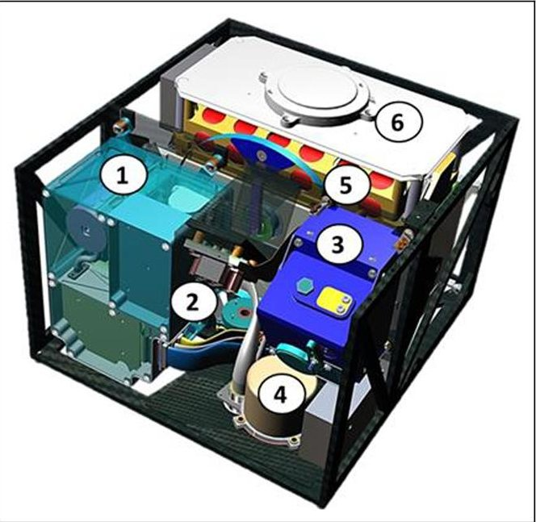
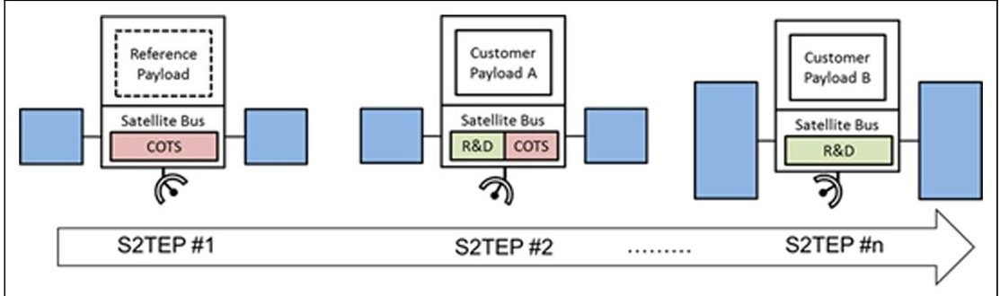
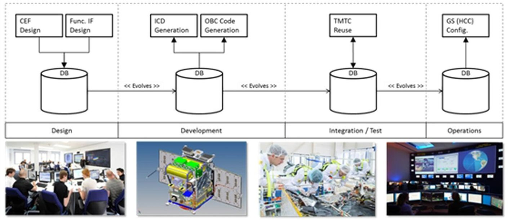
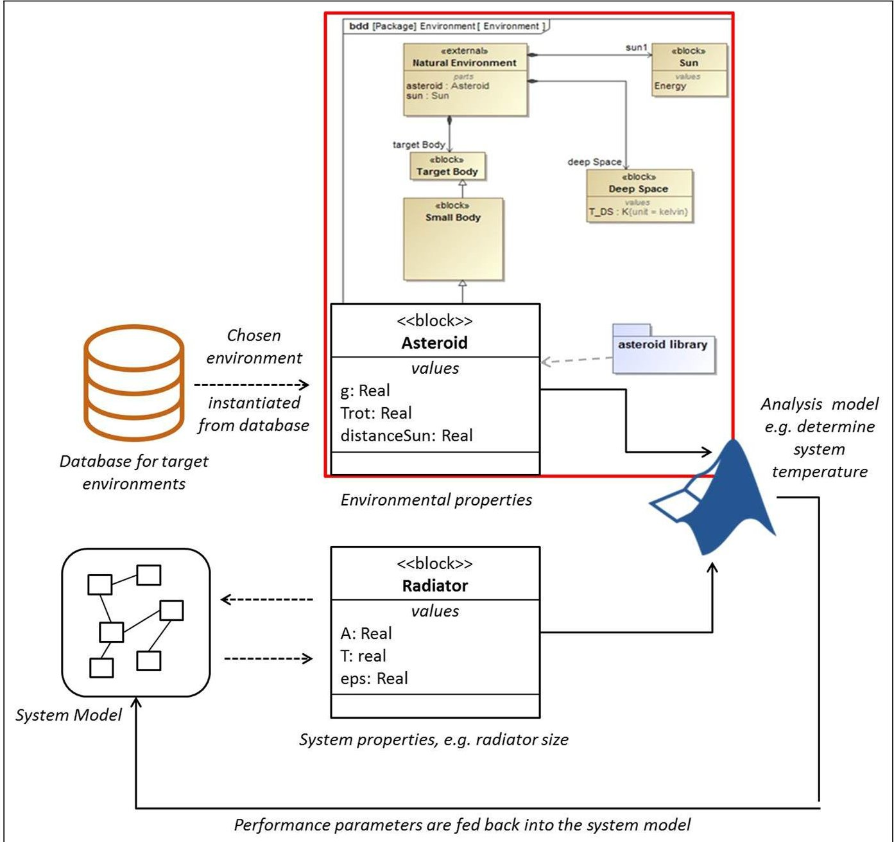
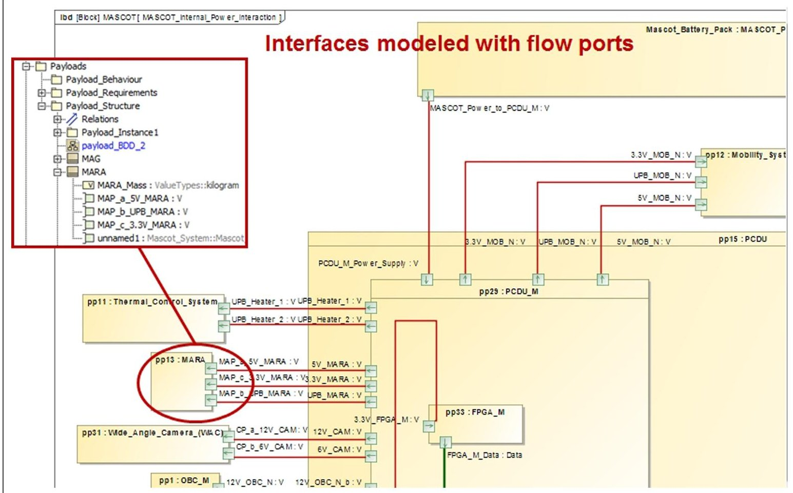
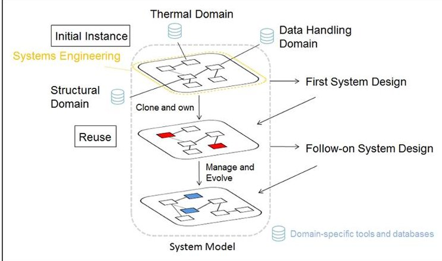

<!-- PDF_PAGE: 1 -->

# Systematic reuse and platforming: Application examples for enhancing reuse with model-based systems engineering methods in space systems development

Concurrent Engineering: Research and Applications 2018, Vol. 26(1) 77-92 $ \textcircled{c} $ The Author(s) 2017 Reprints and permissions: sagepub.co.uk/journalsPermissions.nav DOI: 10.1177/1063293X17736358 journals.sagepub.com/home/cer SAGE

Caroline Lange $ ^{1} $ , Jan Thimo Grundmann $ ^{1} $ , Michael Kretzenbacher $ ^{1} $ and Philipp Martin Fischer $ ^{2} $

## Abstract

Despite popular belief, space missions are not always one-of-a-kind, but are frequently benefiting from explicit or implicit reuse of different types. The Venus Express mission is one example of cost savings by reusing existing hardware in a new mission context. Other examples are based on the platform approach, popular, for example, in geostationary telecommunication satellites, which benefits from a pre-planned reuse and its application to a family of missions with commonality. While the latter is handled more strategically, promising more gain in its execution, the Venus Express example is more of an ad hoc nature. Given the increasing importance of design reuse, the practical question to be answered in this article is how to promote it using effective engineering methods and processes. Model-based systems engineering often advertises itself as especially beneficial to reuse projects and we provide a systematic review of the respective capabilities in this article. Furthermore, we describe two reuse application examples: an asteroid nanolander based on the Mobile Asteroid Surface Scout lander currently flying onboard Hayabusa2 and a Small Satellite Platform for Earth science missions. With Mobile Asteroid Surface Scout's heritage generating strong interest for future small body missions, this creates a case for what we call ad hoc reuse. Conversely, the Small Satellite Technology Platform, which is currently in its definition phase, can be classified as systematic reuse case with the aim of developing a commonality-based small satellite family, suitable for a set of rapidly recurring missions in low Earth orbit. Our study of the Mobile Asteroid Surface Scout-2 reuse case has provided insights into reuse requirements, which are mapped to typical model-based systems engineering features that create value beyond those offered by classical approaches. The article identifies key areas where model-based systems engineering provides benefits in reuse cases: requirements reuse, system context analysis as well as interface compatibility checking. It further outlines an overall approach regarding tools and development processes.

## Keywords

model-based systems engineering, reuse, platform, systems engineering, requirements, satellite, asteroid lander

## Introduction

## Current status quo regarding reuse approaches in space systems development

Reuse is one of the many key factors contributing to cost reduction in many industries and as such is not a new topic, not even in space business, although it has gained increased attention in the last years with the ever-increasing pressure to accomplish more with the given funds. This is especially true for the solar system

<!-- PDF_PAGE: 2 -->

science and exploration branch, where funds are not directly attributed to any return of investment, but rather to an advancement of the scientific body of knowledge which is not directly measurable in terms of money. A popular belief in this section is that deep space probes and missions are always one-of-a-kind unique productions, but this is not entirely true. One very successful counterexample has been the European Space Agency (ESA) Venus Express (VEX) mission. In 2001, ESA issued a call for ideas regarding proposals to reuse the Mars Express (MEX) flight spare model. The platform had to be used without modifications and had to incorporate readily available payloads, to guarantee that the project would be running up to full speed with release of the spare parts right after launch of the Mars orbiter in 2005. The conditions for reuse assumed given performance characteristics of MEX for attitude control, propulsion subsystem, data handling hardware (HW) and software (SW), power and thermal subsystem (McCoy, 2001). The items normally most prone to extensive redesign were kept constrained, for example, the structural concept and propulsion layout, the spacecraft (S/C) electrical architecture, the core functions of the SW and its operational modes. Also, the launcher was kept as a constant in order to avoid mechanical re-qualifications, for example, in sine and acoustic vibrations. Instruments were constrained to the existing mechanical envelopes, data and power interfaces as well as to what they could require regarding electromagnetic compatibility (EMC) or magnetic cleanliness. Particular points that would have to be clarified in the reuse case considering the individual environment and payload configuration were thermal envelopes, power generation, platform operations and experiment mounting and stability needs, among others. The winner after an initial study phase was VEX which was launched in November 2005 after a design and development phase of less than 3 years, as compared to the 5 years of development time for MEX which itself was already built more quickly than many other missions (ESA, 2001). In order to cope with the differences in environmental conditions as they would be encountered at Venus as compared to Mars, some minor modifications were introduced to the MEX system design, for example, the solar panel size was decreased due to the smaller distance to the Sun and the radiator sizes were increased to cope with the higher radiation input without risking system overheating and keeping the system within the existing thermal limits (European Space Agency, 2001). In general, the early years and fast growth and progress of spaceflight, especially in the planetary exploration segment, were mostly based on an aggressive ad hoc reuse of existing assets combined with visionary anticipation of strategic reuse at least of mission designs. As soon as computing

and thus SW development had to enter the realm of flight units, concepts of strategic reuse became vital to success, most prominently also visible in the Apollo missions (Hall, 1996).

In Earth orbital systems design, especially in the commercial market, the practical implementation of reuse is much more advanced. Often it leads to the development of so-called multi-mission platforms, that is, satellite platforms that are designed to provide flexibility and scalability in order to fulfil different mission objectives in the market segments of telecommunication, navigation and science. According to web statistics (Krebs, 2016), currently around 86 satellite platforms are available and in practical use around the globe ranging from micro-satellites such as the Astrium AstroSat-100 (Myriade; Maliet et al., 2008) satellite, the OHB Innosat (OHB Sweden, 2013) and the SN-50 from Sierra Nevada Corporation Space Systems (Sierra Nevada Corporation, 2015) to M- and L-Class platforms such as the SmallGEO/LUXOR platform (OHB; OHB System, 2010) or the PRIMA Bus (ASI; Galeazzi, 2000). Typically, the platforms are designed to cater to a list of basic requirements, that is, the commonality of the product family, with customization required for every mission to adapt to the mission-distinctive requirements.

In conclusion, reuse in itself is not a new topic, not even in space systems design. In fact, reuse is a natural thing in system design and engineering in general. Often when designing a new system, engineers select parts and components from a catalogue of tested and certified equipment, be it off-the-shelf or in-house equipment. The selection made is based on the specifications and requirements as solicited during the system decomposition. Only in case the requirements cannot be fulfilled at all, equipment is developed from scratch. Typically, the overall system is then built-up from these catalogue components, with the system performance emerging from the interplay of subsystems and their respective performances. At this point in time, systems become unique or distinct, with the distinctiveness determined by the combination of components and the complex systems emergent behaviour. Especially in planetary science and exploration system development, the resulting system-level emergent behaviour should fulfil the mostly unique mission and system-level requirements that have been derived from the main scientific objectives.

So evidently, reuse is a very complex term, prone to a more detailed systematic investigation. If used and described in literature, reuse is often discussed in either two areas: reusable systems, such as the reusable launch vehicles, and systems with design commonality, such as satellite platforms or studies on common Moon/Mars exploration architectures mentioned before.

<!-- PDF_PAGE: 3 -->

In this article, we intend to provide a more systematic review of the different aspects of reuse. The definition of reuse as per Dictionary.com provides a good starting point to do so:

Reuse is the 'act or process of using [knowledge, design artefacts or whole systems] again' (Dictionary.com 'reuse', 2016), which can occur in a new instance under the same or different conditions.

Reuse can have different dimensions and make use of different approaches.

A more theoretical analysis and classification of the different approaches is provided in section 'Classification of concepts of reuse', while the current status quo in space systems design is described thereafter.

## Classification of concepts of reuse

As established earlier, a more systematic classification and analysis of reuse approaches is required in order to identify the right tools and processes to tackle specific problems for each of the reuse concepts. In order to classify the approaches, it is eminent to take on different viewpoints for conceptual clustering.

Dusink et al. (1995) describe two essential viewpoints for reuse from a SW perspective, which can as well be applied to the more HW-focused domain of S/C systems engineering (SE) and helps starting to cluster the types of reuse. The viewpoints are as follows: (1) from the engineer's side defining the actions and processes to be taken in a certain reuse case (the 'how') and (2) from system's side, describing the artefacts (the 'what'). Reuse objects can be anything essentially starting from the reuse of hardware (HW) and software (SW), over documentary artefacts, to a reuse of underlying knowledge and processes in the different stages of the product lifecycle. The creation of knowledge databases and processes creates the reusable assets, whereas the market analysis helps in planning and managing the reuse thereby helping in generating the mentioned consistency and maintenance.

A viewpoint closely related to (1) is the level of preparedness of the actual reuse, as it determines the available options for actions and processed to be taken in a certain reuse case. Preparedness distinguishes among two different options: the ad hoc reuse and the systematic reuse. While ad hoc reuse is without prior preparation and planning, the systematic reuse approach assumes much more upfront investment and strategic planning of the reuse case already with the first instance of the system. Often ad hoc reuse makes use of the so-called clone-and-own approach (Gery and Scouler, 2014), meaning that one simply copies the original design and adapts it afterwards to the new use scenario.

Contrary to that, the upfront investment in systematic reuse thus is often also called 'design-for-reuse', as the suitability of the design for later reuse is already considered during the development. This requires a good understanding of current demands and trends in the market segment and how they drive the system design. Griss (1996) defines systematic reuse as an 'institutionalized organisational approach to product development in which reusable assets are purposely created or acquired, and then consistently used and maintained'. Dusink et al. (1995) also describe the transformation-based reuse, that is, automatic programming, which would analogously lead to automated design. In this type of reuse, the problem needs to be formulated such that a certain descriptive pattern can be used in each new instance to automatically (no humans involved) generate the outputs, that is, the system definition and design from a set of defined inputs. The work of Groß and Rudolph (2012), for example, concentrates on the usage of a graph-based design language in UML to solve a given satellite system design problem. The effort required to generate the transformation is currently deemed much too high for any system deviating from a standard system, especially for systems in planetary exploration, which is why we exclude this type of reuse for the time being.

Similar to (a) and preparedness, reuse artefacts can be reviewed from another viewpoint, which is the granularity of reuse. As described earlier, reuse can happen on different levels of system decomposition, that is, the breaking down of the system-level design problem into smaller chunks. The granularity plays an important role, as more and more emergent behaviour needs to be taken into account when moving upwards from simple components to whole systems. Reuse at component level, for example, based on heritage, is not necessarily simple, as different operating conditions can affect component behaviour; for example, in electronics, temperature influences many parameters, supply bias levels can modify radiation tolerance or radiation can modify device characteristics, and all are subject to production scatter. The understanding of this emergent behaviour is an important task in the reuse preparation and in the actual reuse case. On the other side of the scale, NASA defines commonality as one important design strategy among elements of the whole architecture, which is reused to an extent where the occurrence of a certain element is maximized in a system architecture in order to benefit from economies of scale and minimize risk. In order to cope with such cases, Crawley et al. (2010) have published a set of methods and tools providing commonality adopters with the means to enable strategic decisionmaking about commonality.

<!-- PDF_PAGE: 4 -->

With these viewpoints in mind, several questions can be derived as follows:

- What artefacts are going to be reused?

- How do you integrate them to generate good reuse results?

- What processes are going to be changed in the light of reuse throughout all the phases of systems development including definition, design, development, production, verification and operation?

We intend to answer these questions further in this article. In general, it can be said that chances for reuse and reuse design process efficiencies increase if the reuse is taken on systematically and if the respective reuse artefacts are readily available once the reuse case becomes acute. As we will show later, this is where model-based systems engineering (MBSE) will come into play by showing off its most prominent benefits.

## Reuse in the light of the system development process

The current system development process is streamlined to fulfil the needs of the different phases of the product development cycle which starts with the definition, proceeds along design, fabrication, integration and test and finishes with the operation of the system. Surely, it is of outmost importance to seek improvements in SE processes throughout all these phases, as more effective processes lay the foundation for cost and time savings, for example, the reuse of MEX spare parts and MEX design for VEX helped to reduce the development time by 40% from 5 down to 3 years.

Moreover, knowledge capture and reuse has been identified as an important aspect in SE throughout the product lifecycle. Davenport et al. (1997) define knowledge management (KM) as the management of a company's knowledge through a systematic and organized process. It includes processes from acquiring to sharing and retrieving both forms of knowledge, the tacit and the explicit knowledge. While explicit knowledge is the codification of facts stored in documents, databases and so on, tacit knowledge is the know-how, the type of knowledge that lies in the people and their experience. Undoubted, the former is easier to grasp and 'manage' than the latter. Still, many approaches exist in the space industry to preserve knowledge, for example, for longduration missions like Rosetta or whole exploration programs like the JPL Mars Program. The overarching aim is to learn from past mistakes. For this purpose, procedures based on lessons learned documentation but also risk-focused documentation and proper document storage are studied (NASA Jet Propulsion Laboratory, 2014; Olla and Holm, 2006).

Paris-Lopez et al. (2013) describe processes for managing explicit knowledge generated during the concurrent engineering (CE) process in a space systems research institute, with specific focus on documentation and CE study artefacts, while others such as Prasad and Rogers (2005) have described a knowledge-based SE process that makes use of explicit and tacit knowledge to support mechanical design of component assemblies. The approach based on part templates and given requirements is fully compatible with and implemented in CATIA V5 and includes a product development taxonomy that allows the transformation of input specifications to a product realization using knowledge stored in template descriptions. While this approach is similar to our approach in the general way of applying existing knowledge about the transformation from customer input to product embodiment, we intend to specifically look at reuse of the main critical artefacts that are generated during the mission and system definition of a S/C and their reuse, that is, including all the mission- and system-relevant views (scientific, mechanical, electrical, functional), but on a higher level than what has been described before. Our objective is to present options to improve SE methods throughout the first two phases of space mission design for the special case of design reuse and by applying methods of the newly arising discipline of MBSE. In order to do so, we first characterize the fundamental tasks in SE, including the relatively new concept of MBSE, and later on analyse the deviations in a specific reuse case.

## SE processes and the visionary concept of MBSE

Typically, SE aims at answering the questions of (1) are we building the right system? (i.e. requirements validation) and (2) are we building the system right? (i.e. system verification). In the early phases, this comprises task such as: requirements definition, mission architecting and mission concept determination, definition and analysis of typical performance measures, performance of trade studies for technical solutions, demonstration of the overall feasibility of the design, accompaniment of initial technology studies and breadboarding for critical technologies. These tasks produce a bunch of system-level documents ranging from requirements documents to design and interface descriptions throughout all the system lifecycle phases. A typical process model for the system lifecycle is the classical V-model, which is a good representation of the sequential system development and iterative refinement (International Council on Systems Engineering (INCOSE), 2015). The VeeModel depicts the classical steps in the system development lifecycle that are taken in order to realize the iterative refinement. This includes requirements

<!-- PDF_PAGE: 5 -->

engineering, system architecting, and detailed design and fabrication up to verification and deployment Especially, the first two elements are of high importance to the system lifecycle as they drive all upcoming phases and thus shall later be discussed more in detail regarding their part in the reuse process.

The MBSE approach as defined in INCOSE SE Vision 2020 (INCOSE, 2007) has been created with the vision of using models instead of documents as the formal resource for all the standard system engineering activities. In general, many types of system models (SMs) can be created ranging from physical breadboards, analytical models, behavioural models (e.g. state machines or functional flow diagrams) to whole computer simulations, but the MBSE approach aims to integrate all the above and link them with a coherent SM to which formal methods have been applied and which serves as the single and controlled source of information about the system. As Friedenthal et al. (2014) pointed out, MBSE can provide many benefits such as improved communications and increase in system technical management capabilities. In light of our theme, that is, the design reuse, MBSE promises benefits regarding the faster analysis of requirements changes and design change propagation. Long (2016) analyses the benefits and pitfalls of reuse in MBSE. A critical aspect is the model generalization for reuse, which as Long points out only creates overhead for which resources are not abundant in most cases. We have also realized that generalization of models is limited to a certain level, above which it requires more work to generalize the model than it requires creating a new model. Long, however, points out the usefulness of models in product lines, where one can efficiently reuse a high-fidelity model of a system for change impact analysis and 'elicitation of emergent behaviour'.

A number of methodologies are currently in use in the community, the Vitech MBSE methodology (Childers and Long, 1994), the Systems Modeling Toolbox (SYSMOD) approach (Weilkiens, 2007), the IBM Rational Harmony for Systems Engineering methodology (Hoffmann, 2011) and the INCOSE ObjectOriented Systems Engineering Method (OOSEM; Friedenthal et al., 2006), among others. Estefan (2008) provides an extensive overview of these methodologies and others. Of the mentioned methodologies, the OOSEM approach combines best foundational SE processes with OO processes, which is why this approach served as the starting point for our investigations. We have also used the Vitech tools and methodologies, which are presented elsewhere (Kretzenbacher et al., 2016). Finally, the German Aerospace Center's (DLR) internally developed Virtual Satellite (VirSat) is integrating MBSE into CE processes in DLR's Concurrent Engineering Facility (CEF; Schaus et al., 2010) and

now progressing towards a whole lifecycle support with respective methods being under development. MBSE insights gained with existing methodologies are used in order to support the VirSat evolution.

OOSEM is one of the many OO approaches, which originated in the SW world and is based on fundamental terms such as 'inheritance', that is, the propagation of general properties of types of components to the specific 'instantiation' another important concept of OO, which is essentially the reuse of the general concept in a specific setting. Approaches of inheritance can also be found in MBSE tools heavily used and developed within the space industry, such as ESA's Open Concurrent Design Tool (OCDT; Ferreira et al., 2014) for CE use cases as well as the Virtual Spacecraft Design (European Space Agency, 2016) for later phases. The aforementioned DLR's VirSat falls in the same categories and is a research tool at DLR and used within the DLR CE environment as well as for later phases. These tools allow defining the component specifications first. Later when defining the configuration of the S/C, the information already provided by the specifications can be inherited. As an example a type of reaction wheel is defined once but used four times in the S/C configuration. All four reaction wheels now inherit all properties as defined in the specification. This actually allows reuse by copying existing specifications into new projects and helps maintain consistency in the models when applying changes to the specification level. These approaches help deal with complex configuration control scenarios relevant for multi-mission platforms like Small Satellite Technology Platform (S2TEP), as described by Fischer et al. (2016b).

## Deviations in the process for reuse cases

Generally speaking, in the case of design reuse, the overarching chain of activities in the reuse case remains unchanged, that is to say, certain steps of the proven order of systems development will not be cut or orders will be reversed. This starts with the requirements engineering process, which can vary between simple cloning of the requirements and pasting of only relevant ones into a new requirements base, where the level of reuse initially depends on the goals of the new mission. The following task's extent, that is, the systems architecting and concepts development, is essentially depending on architectural similarity. In typical reuse cases we consider in this article, the architecting process is much reduced to local replacing of the architectural elements that cannot be taken over. In the development from MEX to VEX or from Mobile Asteroid Surface Scout (MASCOT) to MASCOT-2 and other follow-on studies, the system-level architecture was nearly identical, while environmental and science mission requirements

<!-- PDF_PAGE: 6 -->

were similar enough to allow almost complete reuse of the platform with minor modifications. This was not the case in the development from Rosetta to MEX or from Philae to MASCOT. In these cases, system architecture of the S/C itself, and in the case of the landers also the overlying architecture of the carrier mission, was substantially different, as well as the external environmental requirements influenced by the respective target body, which allowed only selected reuse of units or design experience from the earlier missions. Essentially, architectural similarity drives the reusability of the design. And with high similarity architecture reuse can be performed almost in a clone-and-own approach.

Essentially, the typical chain of activities as described earlier remains very similar comparing a high reuse and an entirely fresh design, although the weighting or effort of each individual step in this chain can vary to such a degree that some may appear to almost vanish (e.g. locally related system architecting), while others in relative contrast become entirely dominant (e.g. solution validity analysis) and new items may appear (e.g. local adaptation of system architecture to the reused solution). In this way, the general process of system development is overlaid with the principle processes of reuse as already described by Dusink et al. (1995) which comprises four steps: (1) finding the artefacts, (2) selecting the ones that are applicable for the reuse case, (3) understanding them and (4) adapting them if required. It is evident that an SE approach dominantly using MBSE methods can greatly benefit from what MBSE promises in each specific reuse case, but more so reuse is providing an excellent business case for MBSE with an increase in importance of using MBSE with increasing percentage of design reuse. Before we describe possible implementations of reuse processes using MBSE methodologies, we analyse typical reuse cases at DLR in two case studies in the chapter below.

## Reuse in the CE environment

The CE environment (as it is realized in DLR and ESA) is a tool with underlying methodology used during system definition phase. As such, it aims at producing the typical artefacts of this phase, that is, system functional and physical architecture, concept of operations, preliminary system budgets and so on, thus confirming feasibility of the mission. Once these artefacts are documented in the model, they could, in principle, be reused in a clone-and-own kind of mode. The suitability of this approach, however, depends on the similarity of the missions. As described by Kretzenbacher et al. (2016), the reuse of very specific descriptive architecture models to any new mission provides little benefit as too much remodelling is required. On the other hand, very

generic models provide little starting advantage. What could be useful is a set of descriptive subsystem models which are connected to underlying analysis models providing first order estimations, for example, for photovoltaic panel designs or other aspects, which could then be fine-tuned by the domain expert. What has also proven useful is a database of existing components (which was implemented as a database of pdf files), which could as well be modelled as pluggable descriptive model elements (e.g. batteries with defined mass and energy).

## Application examples

## Asteroid nanolander variants

Planetary exploration is a special field in space systems development, which is subject to its own specific set of rules. On one hand, most planetary exploration systems are developed at the very forefront of technological feasibility with some of the most demanding system requirements often implied by the extreme environmental conditions the systems have to endure. On the other hand, they are subject to even more increased risk awareness and testing effort as compared to Earth orbiting satellites due to their infrequent occurrence and extremely high cost (although it has to be noted here that risk minimization and cost increase are a positive feedback loop). One extreme example is the section of landing systems, in which DLR is and has been actively engaged with the Philae lander (Ulamec et al., 2006) and the MASCOT.

The MASCOT lander is currently carried by the Japanese Hayabusa2 S/C to its target asteroid Ryugu (formerly 1999JU3) and is scheduled to land on the asteroid in 2018. In light of the currently highly active small body exploration community, the lander system's heritage and concept generates strong demand regarding reuse of the design for future missions to other small body targets. As such, these MASCOT follow-on cases provide excellent possibilities for investment in systematic reuse methods. The original MASCOT mission's main objective is to perform scientific in situ measurements on the asteroid's surface and some of its subsurface properties, thus enhancing the Hayabusa2 main mission objective, which aims at returning a context-characterized sample of the asteroid back to Earth. The system is designed to fly piggyback on the main S/C. Once separated from its carrier, it performs a ballistic descent from the Hayabusa2 down to the target asteroid, where it is expected to operate over two asteroid days using primary batteries and passive thermal control. During this time, it acquires scientific data at one landing site at least, with each of its four scientific instruments measuring at least once. It transmits

<!-- PDF_PAGE: 7 -->

Figure I. The MASCOT lander with its four instruments: (1) MicrOmega, (2) MARA, (3) camera, (4) magnetometer and the bus equipment, (5) E-box and battery with attached mobility mechanism and (6) sub-radiator with mounted top antenna.

all generated data to Earth using the main S/C as a relay station, but in general operates autonomously that is, independent from ground-based command. The lander is a small and lightweight system (9.5 kg, size of a shoe box, see Figure 1) accommodating four scientific instruments predominantly designed for soil investigations and surface geophysics.

The MASCOT example has shown that low-cost exploration mission participation is possible. Design reuse, that is, the use of heritage systems and their designs, plays an important role if the MASCOT example is envisaged to be repeated. In fact, there is an actual business case or market existing for MASCOT type of systems to be carried along a bigger main S/C. The market is defined by two aspects: (1) the broad variety of rationales and scientific objectives that could be covered with a MASCOT type of lander and (2) the huge number of possible target bodies and their variety with respect to the environmental properties. As for the first aspect, a broad survey reveals that different rationales can lead to the addition of small landing packages to the main mission, ranging from surface context science for the larger mission via dedicated local scale investigations up to synergistic science between lander and orbiter, such as the subsurface radar imaging of the asteroid using low-frequency radar interaction between the lander and the orbiter (Kofman et al., 2015). The overarching science objectives trace down to further detailed mission, system and measurement requirements, which lead to different payload combinations being chosen and requirements being imposed upon the system, that is, regarding its lifetime or surface mobility.

Upfront investment in researching and documenting characteristics of target environments that influence the reuse feasibility and the performance parameters of the system in the reuse case is required in order to systematically building up an understanding of the implications of reuse in different scenarios. The same holds for possible future mission opportunities and respective deployment strategies. This research has to be made available in order to facilitate the design in the reuse case and can equally be used in the case of 'design-for-reuse' to, for example, strategically determine commonality and variety for a set of missions. Given that a model generated with MBSE methods and tools can store such design information much more effectively (as compared to documents) and decrease the effort to retrieving these information and considering that an existing, wellunderstood design so modelled can serve as a running start for the initial stage of any derivative design, for example, in a computer-aided design (CAD)-supported CE study, this is a first hint regarding how MBSE will foster reuse, which will be shown more in detail later. Also, the models as generated in an MBSE environment provide excellent opportunities to store generic and catalogue data, for example, of different mission contexts that can be used in each specific instantiation of a reused system.

As for the second aspect as mentioned above, the aspect of varying targets, several possible targets for a MASCOT type of system have been investigated regarding the environmental properties. The target bodies range from very small moons of binary asteroid systems, for example, as Didymoon and Didymos, to near-Earth asteroids of different types and sizes, up to the smaller moons of planets, for example, the Martian moons Phobos and Deimos, and even to the surface of the Moon. The target body actually greatly influences the system design, as together with the mission operations strategy of the mother S/C it determines, for example, the applicable landing strategy and consequently drives the system design. However, high similarity and thus reuse potential can be achieved for bodies which are similar in size and heliocentric distance. Using the MBSE model database provides new means of making information about the environment accessible and introducing new views and means of supporting the design process.

Without actual hands-on knowledge regarding reuse requirements, explicit determination of effective methods is only speculation. This is when a specific reuse project comes in handy, more specifically the MASCOT-2 case, whose design stems from the heritage MASCOT mission (Ho et al., 2016). By the beginning of 2015, the Asteroid Impact Monitoring (AIM) mission, the European part of the Asteroid Impact and Deflection Assessment (AIDA), had been gaining

<!-- PDF_PAGE: 8 -->

momentum in the community. One of the primary mission objectives of AIM was to deploy a small landing package onto the moon of Didymos in order to enhance the overall science case and provide unique science in light of monitoring a S/C (the NASA part called DART) impacting onto a small body. Despite the scientific and technological challenges of the mission itself, the reuse case was used in order to study the actual requirements of tools and methods in SE and design regarding reuse. Future MASCOT variants, some of which are already under discussion, provide excellent means to investigate the established tools and methods.

The MASCOT-2 characteristics in contrast with the heritage design are shortly described hereafter. The most important design modification was made to the power subsystem: the primary battery of MASCOT is replaced by a rechargeable secondary battery, and all outer surfaces of the lander box are covered by photovoltaics. This enabled a long-term survival of the system instead of the limited lifetime of its successor. Several other design modifications were made in order to cope with the overall mission objectives, including the exchange of the main instrument. The design approach for the MASCOT-2 system was deviating from the standard process as described before, as the overall goal was not only to determine a feasible design solution but also to identify one which would have the smallest change as compared to MASCOT, due to cost reduction reasons. To elicit the required changes from MASCOT to MASCOT-2, the two aforementioned aspects of the (1) changed mission context and the (2) changed instrumentation had to be taken into account and the change impact onto the system design had to be determined. In this sense, the MASCOT-2 study served as an exploratory research study to determine the requirements regarding design reuse processes. These later formed the basis for selecting specific features of the overall MBSE approach for further detailed investigation, for example, within the S2TEP project, one pressing example promoting the importance of modified SE process in reuse cases.

## Earth orbiting S2TEP

The DLR Institute of Space Systems is currently developing a technology-based approach to satellite platform design. The S2TEP (Dannemann and Jetzschmann, 2016) is a multi-mission endeavour envisioned to realize the long-term goals of DLR's space mission: cost-effective platforms in shorter development times based on in-house developed technology that fosters a deeper understanding and provides means to actively produce novelty in space systems and subsystems designs. The first S2TEP satellite instantiated will be a micro-satellite class technology demonstration mission, using DLR HW for onboard computing, power conditioning and distribution and communication. It is scheduled to launch in 2019 as piggyback option on an as yet to be defined launcher.

The design of the 50-kg satellite is adapted to the needs of an envelope of possible instruments for Earth orbital science and technology demonstration payloads, offering scalability in subsystems such as attitude and orientation control system (AOCS) solar array (sizing), batteries, thermal S/S (heaters configuration) and structural payload support. The required range of adaptability becomes apparent with the range of proposals in response to a request for information regarding payload and technology demonstration interest. As analysis of all proposed equipment suggests, data rate and volume as well as computing power requirements vary over many orders of magnitude, though each independently of any other resource parameter. S2TEP is designed with flexibility regarding launch opportunities in mind and able to function in a range of low Earth orbits. The anticipated design evolution is shown in Figure 2. While the first satellite will be based on off-the-shelf components, the final platform for satellite n shall rely only on the in-house technologies. This developed platform shall further on be used to fly a range of different payloads in missions in low earth orbit.

As the S2TEP project shall provide methods and process to systematically not only design satellite platforms but also plan and manage them, MBSE is an inherently important aspect of the ongoing work as it

Figure 2. S2TEP architecture and development approach based on DLR's avionics technologies (Fischer et al., 2016b).

<!-- PDF_PAGE: 9 -->

provides the means to reduce development effort for every new satellite that is going to be built. Engineering functionalities such as requirements management and interface control will be better handled, but also, for example, planning aspects that include the market analysis and the subsequent derivation of enveloping platform requirements including commonality and variety management. For each new instance of the satellite platform, that is, each new mission, the process to be followed in order to define its feasibility, the reuse factor and getting cost and effort approximations would be consisting of the steps as defined in Table 1.

## Reuse infrastructure provided by the MBSE framework

## General approach

The chosen modelling language SysML is a graphbased language developed by the Object Management Group (OMG, 2015). The language definition comes with a vocabulary, that is, a set of notations and their meaning and a grammar, that is, a set of rules that

specify relationships between the vocabulary elements. Together, vocabulary and grammar determine the information of the model. Delligatti (2014) promotes the modelling language as one of the three pillars of MBSE, next to the already described methods and tools. In fact, it is the more fundamental conceptualization of the model definition. SysML as a descriptive language is able to model the system structure and its behaviour, using several diagram types such as block definition diagrams, use case diagrams or activity diagrams. We have adopted this language in our investigations for these specific characteristics. Using parametric diagrams, SysML also allows the creation of analytical models directly in SysML or the linkage of heritage analytical models written in external applications such as MATLAB. In the following section, we discuss some aspects of the MBSE methodologies and how they facilitate reuse.

Besides SysML, more individual domain-specific languages can be developed, that is, the DLR's VirSat uses an internally developed semantic model. This model, referred to as conceptual data model (CDM) or meta-model, provides the language for definition of the

Table I. Steps in the design-with-reuse case including corresponding MBSE features and implementation comments for reuse.

<table border="1"><tr><td>Step</td><td>Corresponding MBSE features</td><td>Added value of MBSE</td><td>Implementation comments for reuse</td></tr><tr><td>1. Derive new science objectives and resulting top-level mission requirements (from the overall high-level scenario)</td><td>Use cases modelling, mission context modelling</td><td>Use existing model artefacts; connect use cases and mission context with later system design artefacts</td><td>-</td></tr><tr><td>2. Define new payload and check interfaces with system</td><td>Internal block diagrams used for interfaces modelling</td><td>Graphical interface verification possible, instead of comparing datasheets (manual check)</td><td>Automatic check requires additional tools</td></tr><tr><td>3. Browse mission and system-level requirements to check which ones can be copied, which need to be modified according to new objectives</td><td>Requirements database within the MBSE tool</td><td>Requirements verification can be done (partially) already in the model, for example, earlier in the project lifecycle</td><td>Requires a way to copy or instantiate requirements from a database</td></tr><tr><td>4. Perform system design gap and compatibility analysis according to the established requirements list</td><td>Full requirements model including traceability to system designEstablished relationship between system parameters (as defined in system description and performance analysis)</td><td>Traceability of system design to requirements</td><td>-</td></tr><tr><td>5. Perform (re-)design if required</td><td>Variant management functionalities</td><td>Enables model-based variant management in order to optimize the product portfolio</td><td>Variants of a system need to be managed in a coordinated way in order to facilitate reuse in subsequent instances</td></tr></table>

<!-- PDF_PAGE: 10 -->

Figure 3. Functionalities of the VirSat 4.0 to enable model reuse throughout the phases (Fischer et al., 2016b).

SM. Fischer et al. (2016a) describe the current state of the CDM, which as a modelling language is much more specific than SysML/UML, since it is based on the ECSS Technical Memorandum E-TM-10-25 (ESA- ESTEC Requirements & Standards Division, 2010) which explicitly describes recommendations for modelbased data exchange for the early phases of S/C engineering design. By virtue of this specialization, the application of the CDM over SysML reduces ambiguity, which will narrow down modelling possibilities and therefore focus the interpretation of the model. On the other hand, the CDM in its current state is also much more restricted than SysML. Similar to OCDT, it provides capabilities to capture the product structure of a system as well as key performance indicators of CE studies such as masses of equipment within the SM, but it is not yet available for behavioural modelling, a very useful feature of SysML and respective tools.

The MBSE environment has to provide tools to the engineers to use the language at hand (e.g. the CDM or SysML) to create a good representation of their design. Rather than focusing on SysML or UML as primary input language only, the use of an individual CDM allows defining the language artefacts actually needed and allows for a use case-specific tailoring. This is in particular important when using and reusing the model for on-the-fly analysis or artefact generation such as documents or code. VirSat's modularized CDM furthermore allows for tailoring and extension enabling new use cases for MBSE integration into a specific project as the needs arise. Since tools based on SysML and UML are considered well established in the MBSE field, it is intended to look at best practices and enable graphical modelling in VirSats where applicable. Still such diagrams in the VirSat world will focus on a

restricted language to avoid ambiguities in the SM later. The configurations of the VirSat according to the systems development phases are schematically shown in Figure 3, along with the main use cases valid for the respective phases.

## Analysis of reuse needs and mapping to MBSE

As mentioned earlier, the MASCOT-2 study was used to elicit requirements to being imposed on the reuse processes and tools. As such, the development process along the MASCOT-2 study was documented and analysed a posteriori to provide insights into the needs of reuse. The most relevant qualitative observations are summarized in Table 1 as a sequence of five steps that were performed sequentially and also iteratively. Corresponding interesting MBSE features were identified and implementation aspects defined based on the current knowledge about MBSE. Based on these insights, the following factors contributing to the success of the design reuse case have been established:

1. Complete, documented, browsable requirements from heritage system;

2. Existence and quality of traceability of requirements to subsystems and components;

3. Detailed and documented understanding of the implications of the environmental change onto the design;

4. Profound understanding of propagation of change through the system to correctly and early on estimate the required redesign effort;

5. Differentiation according to the level of detail needed at the current stage of the reusing project or study.

<!-- PDF_PAGE: 11 -->

In addition to the observations as documented in Table 1, the following overall observations were obtained:

- Rework. Work already done, sometimes in very detailed form, is redone, often at the basic level of initial study phases, due to insufficient and inconsistent documentation; finding information in very detailed documents is cumbersome, as the required information cannot be filtered out, also of overwhelming detail, and leads to situations where the design is simply redone on a blank sheet hoping that this would be shorter than reusing former artefacts.

- Quality of the solution. Often, it was unclear what documents reflect the as-built standard - inconsistencies in available documentation lead to erroneous assumptions and a lack of understanding of the propagation of change through the system leads to an underestimation of redesign effort.

- Information overload. Too much information and detail can complicate the design process in the early stage, which leads to the engineer's individual decision to better start new than trying to understand a complicated and detailed knowledge base. It could be an option to realize a kind of filter that filters the available information according to the respective design stage or maximum to the next detailed level.

Following the above-mentioned analysis, application studies with MBSE were being performed in order to evaluate the corresponding promises of MBSE features and derive application and implementation recommendations. In order to provide reusable artefacts, the system structure for sample application case has been modelled first and foremost using descriptive modelling. This allows the storage of design information of subsystems and their interfaces. Behavioural modelling is possible using activity and state machine diagrams, which are in turn linked to mathematical models that determine resources consumption. This way, a certain operational scenario, linked to properties of the system and its subsystem, can be assessed regarding its feasibility and linked to requirements for their validation. The mentioned features were readily available using MagicDraw with the respective MBSE plugins and built-in tools. Using the new VirSat tool currently allows establishing a descriptive model of the system's functional electrical architecture; future functionalities are being implemented according to the specific reuse case (see Table 1 and Figure 3). Other useful functionalities are being described below.

## Specific key functionalities

## Requirements elicitation

Requirements elicitation, typically a very important step in the system definition phase, can be greatly improved regarding its efficiency and effectiveness in case of design with reuse, as naturally the requirements do not need to be derived from scratch, but rather undergo a kind of screening and modification phase. The MASCOT-2 reuse case has shown that the quality of available requirements highly influences the reusability. Altogether, an estimated amount of 44% of the MASCOT-2 mission and system-level requirements were reused from MASCOT, partly as is and partly modified. The required quality improvements to the requirements identification as obtained and requested by the stakeholders of MASCOT-2 lead to a total of 69 new requirements, which will provide benefits to future instantiations of the MASCOT type of lander design. The requirements included mission, system-level and programmatic requirements. Using MBSE methods, the requirements identification process is actually improved, as the requirements are already a part of the model of the system that is to be reused or of the overall modelling framework. They are modelled using the SysML semantics in Requirements Diagrams or can be stored in tables, but the real power is in the linkage to the structure and behaviour of the system, that is, the traceability. If traceability is properly modelled using the SysML-specific notation (e.g. 'derived' or 'verifies'), this allows a kind of automatic verification of the requirements within the model and thus eases the design process and simplifies decision-making. In a specific reuse case, the existing requirements can be used in different ways, either by 'cloning and owning' them including their traceability or using so-called requirements ontologies. Research regarding this aspect has been performed by Antonini et al. (2014) and investigations are under way as to how to integrate these aspects into the existing MBSE environment.

## Mission and system context

The mission context defines the external boundaries of the system including all external actors interacting with the developed system. The modelling of the context thereby provides a means to capture influencing environmental parameters, such as the surface temperature or gravity of the asteroid in case of the asteroid lander and linking them to the respective behavioural and parametric analytic system performance models. Figure 4 shows a sample block definition diagram with the natural environment and target body influencing

<!-- PDF_PAGE: 12 -->

Figure 4. Process of connecting environmental behaviour with system properties to understand the system's performance in the new instantiation's context. The environmental context is defined in a SysML block diagram as shown in the upper part of the figure. The asteroid properties are the ones most relevant for the lander design.

parameters. This process is also depicted in Figure 4. In order to analyse the system performance, behavioural modelling is required that represents the different states that the system undergoes during its operation apart from the static system properties. An example would be a power consumption which is coupled to certain system and subsystem states. This behavioural modelling is coupled with the dynamical (time-dependent) analysis model. Performance characteristics are being fed back to the SM and can provide means to perform requirements compliance. Reuse of analysis models is more widespread in SE than of descriptive models. Properly parameterized, analysis models are maintained over long periods of a working life of a respective engineer or working group. The power of these parameterized models arises when they are connected

with and fed by the descriptive model, such as it is described in this section and shown in Figure 4.

## (Payload) Interface control

In traditional document-centric SE, interface descriptions are stored in documents, where they can mostly be found in drawings. This representation is, in principle, easy to capture, but complications arise when specifications will be updated and checked for consistency or in a reuse case, when the system platform design is supposed to be reused with a different payload. In this case, the modelling approach allows contrasting existing and required interfaces on both sides and analysing them regarding their compatibility. Thus, feasibility in case of system-level reuse can be assessed quickly. Typically,

<!-- PDF_PAGE: 13 -->

Figure 5. Interface modelling using MagicDraw and SysML enables consistency checking of an instrument's interface with the power bus.

tools provide model validation capabilities using pre- or user-defined rules. One of such rules could be to check the compatibility of interfaces, which could be as simple as checking whether both ends of the interface are of the same type or more complex, that is, checking for voltage level's compatibility between a power conditioning and distribution unit (PCDU) and payload. An example of how this could be done using MagicDraw is provided in Figure 5.

## Requirements for strategic reuse

The aforementioned aspects show how certain functionalities of MBSE can enhance each ad hoc reuse case. The full power of MBSE emerges in case of product platform developments such as the S2TEP satellite, which represents our second use case. Within the S2TEP project, we are currently producing the first SM, which not only will be used along the lifecycle of the first mission but also will be taken as reference for the next instantiation. The S2TEP platform is designed to provide flexibility and thus adaptability to a range of different missions and payloads, for example, by implementing a mix of scalability and modularity on subsystem level. While the use cases are similar to the presented MASCOT case, here the reuse is already intended at the design stage. Thus, the SM shall reflect

the flexibility of the system designed already identified with the first satellite instance. Later on, the established SM can be reused to decrease system design time and cost, for example, by setting the flexible parameters Naturally, further modifications to the system design will arise during upcoming missions, which will be reflected in the model. A whole set of models will evolve along the timeline of more missions to come (see Figure 6), which will have to be managed, maintained and evolved. Information consistency is an important aspect to keeping the model(s) up to date, thus technological modifications made to the platform in later instances need to be reflected in the common model. This brings up further interesting aspects such as variant modelling. Naturally, each reuse of the model will increase the efficiency of the systems design and development process, further attributing to the reduction in cost for future subsequent missions, which is the ultimate goal of the endeavour.

## Model suitability for reuse

The suitable version of the model depends on the question at hand. There are two aspects to be considered here: the build model with the respective data accuracy and the data model level of detail. The build model represents the actual HW pendant. Naturally, it makes

<!-- PDF_PAGE: 14 -->

Figure 6. A model evolution approach in a S2TEP satellite platform systematic reuse case.

most sense to use the flight model (FM) (e.g. physical) for interface compatibility checking, as only this one provides the as-built information, which is required to determine whether, for example, a new instrument would fit with the reused bus. Also, the FM should contain the most accurate data, which could make a difference, for example, for voltage-level compatibility issues. On the other hand, the level of detail of an FM could be too high and could lead to confusion when reusing it. For this, it is required to provide restricted views onto the model. MagicDraw, implementing SysML, provides these capabilities via the creation of specific diagrams which do not need to contain all information, but rather can be built to provide only the information required for a specific task (i.e. only power interfaces of a certain model element). Still, this capability provides an advantage as compared to having to read through, for example, the FM acceptance data package documentation in order to obtain the respective information.

## Conclusion and outlook

This article describes a first step to systematically approaching the topic of reuse and how to integrate different approaches regarding reuse in an MBSE framework. Based on the literature research presented, it is clear that design and direct HW reuse is a relevant topic and is and has been practiced already successfully, for example, in the VEX system design. It is evident that reuse of any kind saves time, if it is implemented correctly. Certain risks and problems exist and have been described, for example, based on the MASCOT-2 study in the article, consequently leading to the proposal of MBSE as a risk mitigation and problem prevention methodology. The MASCOT-2 study has shown the need for a systematic approach in reuse, which is based on the typical process model of the system lifecycle being adapted and overlaid with the reuse analysis and verification. The latter task for each step in the process

is different depending on the respective step. Some examples for how it is done during requirements elicitation and mission context analysis as well as throughout the phases for interface control have been shown in the article. This is an important first step and shall be followed by a broader verification of the given prescriptions. Based on the identified topics, the next step will be the verification and evaluation of processes using the proposed methods. This will enable us to analyse the factors that prohibit and contribute to success of reuse and thereby evaluating the real benefit of MBSE according to the documented use cases. At the current point in time, it is difficult to establish metrics for quantitative merit analysis. In general, the inclusion of metrics quantifying methodological improvements, of which project cost, duration, number of failures in a project and others could be candidates, requires carefully undertaken case studies on (ideally more than one) real projects which run for several years in order to determine cost and time improvement metrics. Still, a one-to-one comparison would not be possible as the established metrics could only be compared to similar but not identical projects. What is possible is to gather more sample use cases and qualitatively compare the two approaches, what we intended to provide exemplarily in this article and will further investigate more in detail in the future. If MBSE, as outlined in the INCOSE Vision 2020, becomes the future standard for practicing SE, the established benefits applicable to reuse cases can be used for every use case possible, and the gained knowledge and confidence with the available tools can be further expanded upon.

## Declaration of conflicting interests

The author(s) declared no potential conflicts of interest with respect to the research, authorship and/or publication of this article.

## Funding

The author(s) received no financial support for the research, authorship and/or publication of this article.

## References

Antonini K, Lange C, Kossmann M, et al. (2014) Applying OntoREM to a space mission: developing requirements for the MASCOT lander. In: INCOSE international symposium, Las Vegas, NV, 30 June-3 July, pp. 1-12. Hoboken, NJ: John Wiley & Sons.

Childers SR and Long JE (1994) A concurrent methodology for the system engineering design process. In: INCOSE international symposium, San Jose, CA, 10-12 August, vol. 4, pp. 226-231. Hoboken, NJ: John Wiley & Sons.

Crawley EF, Boas R, Hofstetter W, et al. (2010) A commonality toolkit focused on NASA applications. Available at:

<!-- PDF_PAGE: 15 -->

http://systemarchitect.mit.edu/docs/NASACommonality Toolkitv4.pdf

Dannemann F and Jetzschmann M (2016) Technology-driven design of a scalable small satellite platform. In: Proceedings of 4S symposium, Valletta, 30 May-3 June.

Davenport TH, Prusak L and Prusak L (1997) Working Knowledge: How Organizations Manage What They Know. Boston, MA: Harvard Business School Press.

Delligatti L (2014) SysML Distilled: A Brief Guide to the Systems Modeling Language. Boston, MA: Addison-Wesley.

Dictionary.com 'reuse' (2016) Dictionary.com Unabridged. New York: Random House, Inc. Available at: http:// www.dictionary.com/browse/reuse (accessed 17 November 2016).

Dusink L, Van Katwijk J, Dusink L, et al. (1995) Reuse dimensions. In: Proceedings of the 1995 symposium on software reusability (SSR '95), Seattle, WA, 29-30 April. New York: ACM Press.

ESA (2001) Frequently Asked Questions. Available at: http:// www.esa.int/Our_Activities/Space_Science/Mars_Express/ Frequently_asked_questions2 (accessed 10 October 2016).

ESA-ESTEC Requirements & Standards Division (2010) ECSS-E-TM-10-25A - engineering design model data exchange (CDF), European Cooperation for Space Standardization. Available at: http://ecss.nl/hbstms/ecss-e-tm 10-25a-engineering-design-model-data-exchange-cdf-20- october-2010/ (accessed 29 March 2017).

Estefan JA (2008) 2. Differentiating methodologies from processes, methods, and lifecycle models. In: Survey of ModelBased Systems Engineering (MBSE) Methodologies. Available at: http://www.omgsysml.org/MBSE_Methodology_Survey_RevB.pdf

European Space Agency (2001) Venus Express Mission Definition Report. Paris: European Space Agency.

European Space Agency (2016) Virtual spacecraft design Available at: http://www.vsd-project.org/ (accessed 16 November 2016).

Ferreira I, De Koning HP, Gerene S, et al. (2014) Open Concurrent Design Tool: ESA community open source ready to go! In: International systems & concurrent engineering for space applications conference, Stuttgart, 8-10 October.

Fischer PM, Deshmukh M, Maiwald V, et al. (2016a) Conceptual data model? A foundation for successful concurrent engineering. In: International systems & concurrent engineering for space applications conference, Madrid, 5-7 October.

Fischer PM, Lüdtke D, Lange C, et al. (2016b) Implementing model based system engineering for the whole lifecycle of a spacecraft. In: Deutscher Luft- und Raumfahrtkongress, Braunschweig, 13-15 September.

Friedenthal S, Moore A and Steiner R (2006) OMG systems Modeling Language (OMG SysML $ ^{\mathrm{TM}} $ ) tutorial. Available at: http://eng.umd.edu/~austin/enes489p/lecture-resources/ SysML-Friedenthal-Tutorial-INCOSE2006.pdf

Friedenthal S, Moore A and Steiner R (2014) A Practical Guide to SysML: The Systems Modeling Language. Burlington, MA: Morgan Kaufmann Publishers.

Galeazzi C (2000) PRIMA: a new, competitive small satellite platform. Acta Astronautica 46(2): 379-388.

Gery E and Scouler JL (2014) Strategic reuse and product line engineering. Available at: http://www.ibm.com/developerworks/rational/library/14/strategic-reuse/index.html

Griss ML (1996) Systematic software reuse: architecture, process and organization are crucial (Fusion Newsletter, HP Laboratories). Available at: http://martin.griss.com/pubs/fusion1.htm

Groß J and Rudolph S (2012) Generating simulation models from UML-a FireSat example. In: Proceedings of the 2012 symposium on theory of modeling and simulation-DEVS integrative M&S symposium, Orlando, FL, 26-30 March.

Hall EC (1996) Journey to the Moon the History of the Apollo Guidance Computer. Reston, VA: American Institute of Aeronautics and Astronautics.

Ho TM, Lange C, Grimm C, et al. (2016) A Mobile Asteroid Surface Scout for the AIDA mission. In: EGU general assembly, 17-22 April 2016, Vienna, p. 16163. Copernicus Publications.

Hoffmann H-P (2011) Systems engineering best practices with the rational solution for systems and software engineering (Deskbook release 3.1.2). Available at: http://www- 01.ibm.com/support/ docview.wss?uid = swg27023356&aid = 1

International Council on Systems Engineering (INCOSE) (2007) Systems Engineering Vision 2020. Seattle, WA: International Council on Systems Engineering.

International Council on Systems Engineering (INCOSE) (2015) INCOSE Systems Engineering Handbook: A Guide for System Life Cycle Processes and Activities 3.2.2. San Diego, CA: Wiley.

Kofman W, Herique A, Barbin Y, et al. (2015) Properties of the 67P/Churyumov-Gerasimenko interior revealed by CONSERT radar. Science 349(6247): aab0639.

Krebs G (2016) Spacecraft: platforms - Gunter's Space Page. Available at: http://space.skyrocket.de/directories/sat bus.htm (accessed 29 July 2016).

Kretzenbacher M, Lange C and Harvey D (2016) Practical application of model based systems engineering to early phase space system development. In: Proceedings of the 7th international conference on systems & concurrent engineering for space applications (SECESA), Madrid, 5-7 October.

Long D (2016) The fools errand of reuse in MBSE. Available at: http://community.vitechcorp.com/home/post/The Fools-Errand-of-Reuse-in-MBSE.aspx (accessed 16 November 2016).

Lopez RP, Lüdtke D, Deshmukh M, et al. (2013) Knowledge management tools integration within DLR's concurrent engineering facility. In: IEEE aerospace conference, Big Sky, MT, 2-9 March.

McCoy D (2001) Call for ideas for the re-use of the Mars Express platform - platform capabilities. In: ESA briefing presentation: Mars Express platform reuse. Available at: http://sci.esa.int/marsexpress/docs/23_03_01.pdf (accessed 23 August 2016).

Maliet E, Pawlak D, Koeck C, et al. (2008) The AstroSat production line: from AstroSat 100 to AstroSat 1000. In: Proceedings of the 4S symposium: small satellites systems and

<!-- PDF_PAGE: 16 -->

services, Rhodes, 26-30 May, article id 54200854, p. 660. Noordwijk: European Space Agency.

NASA Jet Propulsion Laboratory (2014) JPL knowledge management newsletter, issue 1. Available at: https:// oce.jpl.nasa.gov/ocko/JPL KM Newsletter (March 2014).pdf (accessed 17 July 2017).

OHB Sweden (2013) Innovative, low cost satellites mission feasibility report public summary. Available at: http:// www.snsb.se/Global/Publikationer/Public summary of Innovative satellites - Feasibility report ver 0.2.pdf (accessed 27 July 2016).

OHB System (2010) OHB system SmallGEO. Available at: https://www.ohb-system.de/small-geo-luxor-english.html (accessed 27 July 2016).

Olla P and Holm J (2006) The role of knowledge management in the space industry: important or superfluous? Journal of Knowledge Management 10(2): 3-7.

OMG (2015) OMG systems Modeling Language (OMG SysMLTM) version 1.4, p. 260. Available at: http:// www.omg.org/spec/SysML/1.2/PDF/

Prasad B and Rogers J (2005) A knowledge-based system engineering process for obtaining engineering design solutions. In: 25th computers and information in engineering conference, Long Beach, CA, 24-28 September, pp. 477- 488. New York: ASME.

Schaus V, Fischer P, Lüdtke D, et al. (2010) Concurrent engineering software development at German Aerospace Center - status and outlook. In: Proceedings of the 5th international conference on systems & concurrent engineering for space applications (SECESA), Lisbon, 17-19 October.

Sierra Nevada Corporation (2015) SNC's Spacecraft systems Overview Brochure: SN-50. Sparks, NV: Sierra Nevada Corporation.

Ulamec S, Espinasse S, Feuerbacher B, et al. (2006) Rosetta Lander - Philae: implications of an alternative mission. Acta Astronautica 58:435-441.

Weilkiens T (2007) Systems Engineering with SysML/UML. Burlington, MA: Morgan Kaufmann Publishers.

## Author biographies

Caroline Lange earned her diploma in aerospace engineering in 2008 from the University of Stuttgart. Since 2008, she is a research engineer in space systems engineering at the German Aerospace Center, Institute of Space Systems in Bremen. Currently she is a system engineer in the MASCOT asteroid lander project, as well as for the ROBEX (Robotic Exploration of Extreme Environments) Helmholtz Alliance, where she is responsible for concepts development for future exploration missions. Within her PhD and in the frame of the S2TEP project, Caroline is investigating the application of MBSE for systems engineering, design reuse and spacecraft platform development.

Jan Thimo Grundmann earned his diploma in mechanical/aerospace engineering at the RWTH ILR Institute of Aerospace Engineering, where he worked part-time in its Central Electronics Lab (ZELL). He's been working at the DLR Institute of Space Systems for over 10 years as electrical subsystems and systems engineer for several projects related to asteroid landers, small spacecraft, and solar sailing.

Michael Kretzenbacher earned his masters degree in space systems engineering at the Institut Supérieur de l'Aeronautique et de l'Espace (ISAE) in Toulouse, France in 2016. He worked as a systems engineer specialising in model based systems engineering (MBSE) for Shoal, in Adelaide Australia and is currently undertaking a young graduate trainee (YGT) position as a system engineer at the European Space Agency. For his professional theses both for his masters and bachelors degree he worked on MBSE for different applications at DLR Institute of Space Systems, Bremen.

Philipp Martin Fischer is a software engineer at DLR's Simulation and Software Technology Lab, where he is in charge of the 'Modelling and Simulation' group. In his past he has worked for Toyota Motorsports and Airbus Defense and Space. His research interests are in model based systems engineering (MBSE) and data modelling, as well as applying MBSE to the complete lifecycle of space systems. Philipp Martin Fischer earned his diploma degree in electrical and computer engineering from the Leibniz University Hannover in Germany in 2007.