<!-- PDF_PAGE: 1 -->

REVIEW ARTICLE OPEN ACCESS

# Model-Based Systems Engineering in Space Applications: A Comprehensive Literature Review

Rehobot Bekele Buruso $ ^{1} $ Sara Himmiche $ ^{2} $ Taiwo Tejumola $ ^{3} $ Yeshirun Alemayehu $ ^{4} $ Bertrand Rose $ ^{1} $

$ ^{1} $ICube Laboratory, University of Strasbourg, Strasbourg, France | $ ^{2} $SYMME Laboratory, Universite Savoie Mont Blanc, Annecy-Le-Vieux, France |

$ ^{3} $Astronautics Research Group, Department of Aeronautical and Astronautical Engineering, University of Southampton, Southampton, United Kingdom |

$ ^{4} $Ethiopian Space Science and Technology Institute (ESSTi), Addis Ababa, Ethiopia

Correspondence: Rehobot Bekele Buruso (bekeleburuso@etu.unistra.fr)

Received: 1 December 2023 Revised: 8 December 2025 Accepted: 19 February 2026

Keywords: digital engineering | MBSE tools | methods and methodologies | model-based systems engineering | space systems engineering | system development lifecycle | system modeling languages | system of systems

## ABSTRACT

The growing complexity of space engineering is driving the demand to embrace the adoption of Model-Based Systems Engineering (MBSE). Although the MBSE is well-practiced in the space industry, the level of effort and need required to obtain the benefits of MBSE vastly differ across enterprises; this disparity presents a significant challenge to adopting best practices and establishing a uniform standard procedure. This comprehensive review analyzes 126 studies published between 2011 and 2023 to examine current MBSE practices and their enablers (method, tool, and language) to identify the best strategies of application. This study proposes five phases of MBSE common in all applications: requirements management, model development, simulation and analysis, configuration management, and collaboration and communication, which are core systems engineering activities performed throughout the lifecycle of the system of interest. This review conducts a qualitative and quantitative analysis of MBSE enablers employed across each phase, assessing their frequency of utilization, and functional contributions to SE tasks. The findings reveal four archetypes of the MBSE methods as they evolve to meet different levels of mission complexity and organizational needs, four MBSE languages based on modeling and interactions, and seven groups of MBSE tools categorized by their capabilities and functions. The utilization of MBSE enablers across MBSE phases demonstrated a strong alignment with the development of lifecycle stages, providing better guidance for the practical implementation. Finally, the study identifies key opportunities and challenges for future research to advance MBSE practice further.

## 1 Introduction

Systems engineering (SE) for space applications is inherently demanding and complex disciplines, requiring the coordinated integration of highly specialized subsystems engineered for reliable operation under extreme and often hostile environmental conditions. Such space architectures must operate cohesively within broader systems or System-of-Systems (SoS), where mission success depends on synchronized operation, resilience, and traceable performance across life span of mission. To meet

these demands, rigorous SE process planning ensures the delivery of targeted mission-critical quality attributes and provide structured support for development aligned with enterprise strategies and mission objectives. Historically, space agencies have relied a document-centric SE approaches shaped by their acquisition models, and lifecycle development strategies such as the waterfall, Vee, and spiral model. These traditional practice SE approaches follow generic steps and procedural process that heavily rely on document-centric approaches [1]. However, the increasing complexity and interdisciplinary nature of

<!-- PDF_PAGE: 2 -->

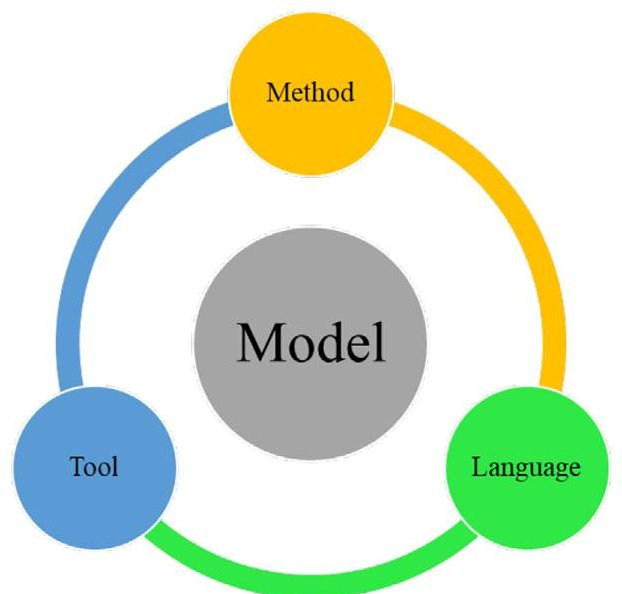

FIGURE 1 MBSE application and its pillars modified from [6].

modern space mission have driven the transformation of SE from document-centric to model-centric practice.

The foundational shift began with IEEE 1220 [2] which introduced the concept of model-driven system design by defining the key activities that must be performed in the SE process. This approach was later formalized by International Council on Systems Engineering (INCOSE) in 2007 as model-based systems engineering (MBSE). INCOSE formally defined MBSE as "the formalized application of modeling to support system requirements, design, analysis, and verification and validation (V&V) activities, beginning in the conceptual design phase and continuing throughout development and the later lifecycle" [3].

The INCOSE SE Vision 2020 emphasizes that maturing modeling standards critically influence MBSE adoption in improving semantic precision, tool automation, and architectural clarity [4, 5]. Following this guidance, the application of MBSE depends on three interdependent enablers as shown in Figure 1: (1) methodologies that define activities and work products, (2) modeling languages that express system concerns and notation, (3) supporting tools that implement the language and automate the method to enable continuous SE process in a digital environment. Furthermore, architectural frameworks, such as NAF/UAF, DODAF, MODAF, and ESA ECSS-E-TM-1025, have been introduced to facilitate enterprise and SoS modeling. These frameworks, along with application protocol and data exchange standards, enable governance viewpoints, conformance rules, and cross-tools interoperability. Together they orchestrate the coordination of MBSE enablers to ensure digital continuity across the system lifecycle. The transition toward a model-based practice is reinforced by leading contributors from systems and software engineering communities, particularly through the development of the Object Management Group's (OMG) Systems Modeling Language (SysML), a general-purpose modeling language designed to support the specification, analysis, design, and verification of complex systems that integrate both hardware and software components in accordance with engineering processes. The widespread adoption of MBSE has accelerated progress in hardware engineering disciplines and industrial by integrating digital engineering (DE) tools such as Product Lifecycle Management (PLM), Computer-Aided Design (CAD), and Computer-Aided Engineering (CAE) into the SE environment.

Depending on organizational framework and existing SE trends, the combination of MBSE enablers adopted results in different implementation approach among space agencies or enterprises. Agencies, such as NASA, the European Space Agency (ESA), and Japan Aerospace Exploration Agency (JAXA), have laid the foundation and roadmap for fundamental MBSE practices [7]. In particular, NASA and ESA efforts have been instrumental in setting the stage for sector-wide adoption of MBSE, systematically institutionalizing best practices to enhance quality assurance, strengthen safety engineering, and mission success across space missions. In 2012, the ESA initiated early discussion on the potential benefits of a model-based approach through its Concurrent Design Facility (CDF), assessing transition of Excel-based modeling into centralized digital tools to support collaborative mission design [8,9]. Then, in 2015, NASA began the MBSE Pathfinder efforts to study the identifying applications challenges and evaluating learning curve for engineers [10]. These efforts expanded into more extensive studies, known as the MBSE Infusion and Modernization Initiative (MIAMI), in collaboration with the JAXA to overcome technical and cultural barriers [11].

Furthermore, the Model-Based for System Engineering (MB4SE) advisory group was created in 2019 [12] to maximize the European ecosystem and ensure the governance of the conceptual data model (CDM). It is a collection of multiple collaborator organizations—namely Airbus, Ariane Group, Thales Alenia Space, Orbital Hochtechnologie Bremen (OHB), and space agencies, such as ESA, the Center National d'Études Spatiales' (CNES), the German Aerospace Center—Deutsches Center für Luft- und Raumfahrt (DLR), the Italian Space Agency (ASI), the United Kingdom Space Agency (UKSA), and Eutelsat. The primary objective of the MB4SE initiatives is to encourage the digital transformation of SE and establish best practices and a uniform approach as a facilitator of the deployment of MBSE in space projects [13, 14]. Meanwhile, MBSE has demonstrated its potential to transform space engineering by reducing documentation overhead, enhancing system understanding, enabling early fault detection, improving interdisciplinary collaboration, mitigating technical risk, and lowering development costs.

Recent literature highlights a growing trend in MBSE adoption across academia, government laboratories, commercial space ventures, and startups each applying with varying scope, maturity, and tool environments [15, 16]. In particular, utilization of various commercial-off-the-shelf (COTS) tools has contributed to a proliferation of divergent methodologies and inconsistent application workflows [17]. To visualize the evolving research trends and thematic focus areas in MBSE literature from 2014 to 2022, a keywords co-occurrence overlay map was generated by VOSviewer, as shown in Figure 2. This bibliometric network consists of 355 author keywords extracted from 251 peer-reviewed articles. Using full counting method, the analysis identified 5285 keyword co-occurrence links with a total link strength of 8263, resulting 15 thematic clusters. Between 2014 and 2016, MBSE application primarily focused on modeling languages, system function representation, modeling processes, the adoption of architecture frameworks, and high-level functional workflows.

<!-- PDF_PAGE: 3 -->

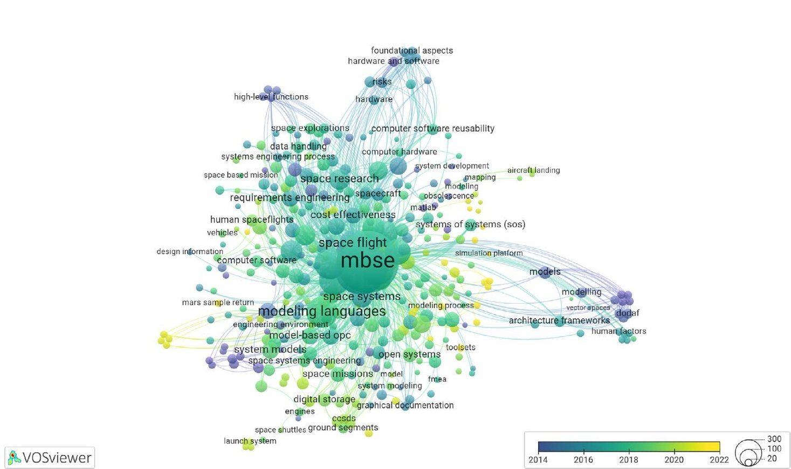

FIGURE 2 Co-occurrence network of keywords from MBSE literature in space industry (2014-2022).

These efforts contributed to the shift from traditional documentcentric practices to a model-based SE paradigm.

Since 2018, model-centric digitization has increasingly leveraged CDMs, reusable systems model libraries, and version-controlled digital repositories to enhance traceability and configuration management across development lifecycle. These advances have expanded MBSE's reach from early conceptual design into detailed design supporting techniques and capabilities such as functional flow modeling, trade space analysis, system health monitoring, multidisciplinary optimization, rapid prototyping, and integration with digital twin models. These enhancements have significantly increased model re-usability and reinforce the application of systems thinking methods to maximized capabilities and accelerated system realization. Consequently, MBSE has progressed further into later lifecycle stages also supporting synchronization with management approach, including agile development, digital systems safety, virtual satellite testbeds, and integration with artificial intelligence workflows [18-21]. In addition to advancement in MBSE methodologies, space missions increasingly integrate diverse DE tools alongside MBSE tools to support the System of Interest (SoI) as it matures through design, integration, and test phases. Despite the progress reflected in the literature, unifying MBSE tools and methods to consistently support all lifecycle stages remains an unresolved challenge.

In the following surveys [22-25], various MBSE challenges have been highlighted, including those related to scope definition, unclear use of the model, high investment in training and tool selection, a lack of confidence in the model, interoperability of tools, and the time required for modeling. To reinforce these findings, [26] emphasizes that developing a robust tool-chain is critical to support cross-domain integration and effective data management. In response to these challenges, space engineering demands MBSE implementation that guarantee the consistency and integrity of co-design, safety, and security across collaborative environments. This includes facilitating agreement process

between both intra- and interagency partners and enabling model-sharing between acquirer and suppliers. These needs are particularly acute in high-stakes missions that require robust mission assurance, fault tolerance, and rigorous validation protocols [27]. By contrast, CubeSats and Nanosatellite missions require lighter-weight MBSE implementations, owing to their lower complexity, reduced cost, and higher tolerance for risk [28].

NASA anticipates future MBSE bottlenecks will include inconsistent practices, the need for seamless global collaboration, and fragmented tool integration across organizations [10]. In addition, Lessons learned reports from NASA's Jet Propulsion Laboratory (JPL) and affiliated entities reveal that recurring technical challenges arise from numerous projects. These critical issues often arise from unmanaged system complexity, ambiguous lifecycle boundaries, and insufficient allocation of modeling resources [29, 30]. According to [6], the selection of MBSE tools is primarily driven by discipline-specific requirements, particularly emphasizing user needs and SoI characteristics. The MBSE best practices given in literature are often deeply embedded within organizational standards and shaped by agency-specific SE traditions. Still, these efforts to harmonize MBSE adoption across the sector continue to face challenges related to modeling fidelity, toolchain unification, and governance mechanisms. Consequently, this poses significant barriers for new adopters; attaining consistent implementation and realizing the full benefits of MBSE requires specialized technical expertise and organizational maturity [31].

Therefore, scalable and coherent MBSE adoption demands that core SE activities be integrated and continuous across the entire mission lifecycle. This includes mission planning, architecture definition to system design, simulation, V&V, production operations, maintenance, and human-systems integration while managing associated technical processes and programmatic constraints. At planning stage, defining coherent MBSE strategy and integrating with global view requires structured method that identifies where and why MBSE is needed for specific

<!-- PDF_PAGE: 4 -->

mission profiles. Tailoring MBSE implementation strategy either using a top-down approach or a bottom-up approach can be a challenging endeavor. To ease this issue, the application layer should consider a binding linkage between SE activities, artifacts, expected outcome, and capabilities of the selected tool and method. These elements help pinpoint the necessity and scope of MBSE for specific projects or space missions. This approach later facilitates the alignment of model utilization, management, and governance with the overall mission objective, whether applied as standalone solution (e.g., a CubeSat or segment-level) or as a enterprise-wide implementation involving multiple stakeholders. Hence, such a perspective guides the selection or development of the most appropriate combination of method, tool, and modeling language to ensure effective implementation.

This paper presents a literature review on MBSE applications for space SE, aiming to synthesize best practices and identify strategic patterns that support standardized adoption across diverse mission contexts. The review provides a comprehensive perspective on SE activities, capturing the objectives of MBSE as articulated in the literature, along with MBSE enablers methods, modeling languages, and tools utilized across lifecycle to achieve these objectives. Previous literature reviews on MBSE [17, 32, 33] focused on identifying and categorizing MBSE enablers. In contrast, this review further investigates how effectively the enablers' capabilities and function satisfy their intended roles in supporting specific SE tasks and targeted outcomes. This analysis offers a grounded basis for exploring the factors that influence MBSE effectiveness in space projects and consolidates insights from past practices to inform future strategies.

The remainder of this paper is organized as follows: Section 2 details the review methodology including inclusion criteria, and synthesis strategy; Section 3 presents statistical result and synthesis of RQs; Section 4 provides a detailed discussion of the findings based on proposed approach. Section 5 offers a broader discussion, highlights identified challenges, and outlines opportunities for future research; and Section 6 concludes the study and summarizes authors contributions.

## 2 Literature Review Method

The comprehensive literature review (CLR) was conducted using the PRISMA guidelines as reference for a review procedure [34]. This investigation focuses exclusively on the application of MBSE within domain of space system engineering. It includes a wide range of studies covering various mission types from CubeSats to complex crewed missions. Although, each case study employs a distinct organization framework and SE process, this review builds on the foundational systems lifecycle processes defined in ISO/IEC/IEEE 15288 and the three-dimensional MBSE-specific process outlined in ISO/IEC/IEEE 24641-2023 which describe how to plan, build, perform, and support MBSSE practice across a project or enterprise [35, 36]. While enterprise strategies for adopting MBSE in the space organization vary significantly, the operational and project-level implementations show consistent pattern across practical mission development scenarios. This paper addresses the application gap left open by these standards and examining how best practices implemented and prioritized in SoI-specific contexts.

## 2.1 Proposed Method

An enterprise approach was discussed as a solution to challenges to MBSE implementation, integrating strategic, operational, personnel, resource, project, and security perspectives into a unified framework [37]. Considering this, we propose an application layer based on objective-driven MBSE approach emphasizing on operational and project-level viewpoints. This approach focuses alignment MBSE enablers with specific lifecycles stages and SE tasks, with goal of maximizing the functional use of models and associated artifacts throughout the development process. The proposed method connects two dimensions of the MBSSE reference framework from ISO/IEC/IEEE 24641:2023 Annex A.3: logic dimension, which outlines the technical process to build and perform MBSSE and the system dimension, which reflects on engineering stages of system lifecycle [35]. The cognition dimension is excluded here as it involves organizational learning and technical management exploring beyond scope SoI-level application and remain open to practitioner interpretation. The proposed structure includes five fundamental SE lifecycle processes identified as anchors for MBSE implementation: Requirements Management, Model Development, Simulation and Analysis, Configuration Management, and Collaboration and Communication. These processes represent the most widely adopted MBSE practices across space programs and are grounded in definitions provided previously mention standards and the INCOSE Systems Engineering Handbook [38]. The following list describes each phase:

- Requirements management (RM): is translating, analysis, specification, allocation, and managing needs and requirements, maintaining bidirectional traceability between need across the lifecycle. It supports automated and verification criteria checks, scenario validation, and alignment of the architectural with defined mission objectives [38, 39].

- Model development (MD): focuses on building of the system models that represent logical, physical, and functional architecture from conceptual to detailed design. This phase supports abstraction consistency, changes propagation, system understanding, and model-reuse [40, 41].

- Simulation and Analysis (SA): addresses executing models for verification, validation, risk analysis, and performance optimization. This phase includes trade studies and support iterative V&V loop to confirm compliance with technical measures and refine system behavior to ensure operational feasibility [42, 43].

- Configuration Management (CM): involves maintaining artifacts traceability, version control, and formal change impact analysis throughout the system's lifecycle. It enforces formal governance mechanisms over evolving model data, ensuring consistency between the configuration of the system model and the physical system. In [44, 45], model-based CM aids process formalization and supports centralized model governance change control and model-based audits.

- Collaboration and communication (CC): enables crossdisciplinary integration and interaction, supporting semantic clarity across roles, tools, and views. It ensures that model data are interoperable and exchangeable in multirole, multitool environments [46, 47].

<!-- PDF_PAGE: 5 -->

The operational view of the MBSE described above neither prescribes a specific methodology nor relies on the particular method, tools, or language. Rather, it offers a modular approach guiding MBSE adoption answering two questions what needs to be achieved and how effectively do selected enablers support that objective. This allows teams to tailor their methods based on mission-specific needs, without enforcing top-down enterprise mandate. MBSE implementation often involves enterprise-level concerns such as governance, knowledge management, and business process integration, but this study is limited to the SoI layer scope, where practical implementation decisions are closely linked to engineering outcomes.

## 2.2 Research Questions

These research questions (RQ) investigate how MBSE methods, modeling languages, and tools are implemented in space system engineering, structured around five defined MBSE phases. The RQs to be addressed are as follows:

- RQ1: How have MBSE methodologies and their capabilities evolved? This question investigates the range of MBSE methods applied in space engineering and examines implementation patterns across the literature.

- RQ2: What MBSE modeling languages and syntax are employed and what roles do they play across the SE lifecycle? This question identifies the languages and syntax used in MBSE application and examines their roles in supporting specific SE tasks.

- RQ3: What tools are used to support MBSE implementation? This RQ retrieves MBSE tools referenced in the literature, analyzing their frequency utilization, and mapping their capabilities.

- RQ4: What are the relationship between the MBSE phases and enablers? This question investigates how combinations of MBSE enablers contribute to achieving targeted SE objective and clarifies the realization of MBSE phases across the system lifecycle.

- RQ5: What challenges are identified in the literature and how does the proposed method address them to improve MBSE application in space systems? This question explores the technical and methodological challenges observed in current practices and assesses how the proposed method offers opportunities for improved MBSE adoption and future research directions.

## 2.3 Information Sources and Search Strategy

The databases of selected literature are Google Scholar, Scopus, and Web of Science (WoS). The following keywords are used for these databases: "model-based systems engineering," "MBSE," and "space." In the WoS database, the keywords "MBSE" and "space" were used, yielding a total of 170 publications. As of December 31, 2022, this search extracted 170 articles. The extracted publications include the years 2011-2022. A Scopus search in February 2023 resulted in 191 articles extracted from conferences, proceedings, and journal articles. The search was

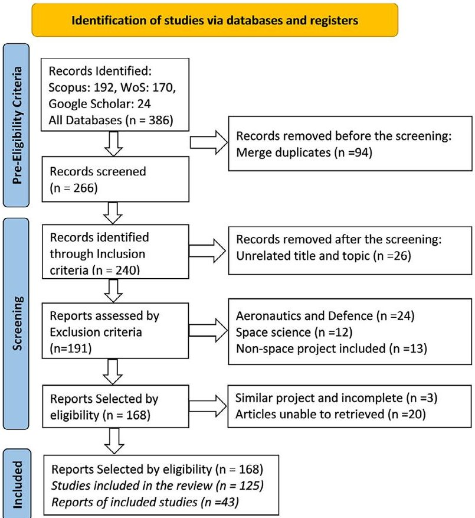

FIGURE 3 | Selection process inspired from PRISMA guidelines [34].

performed using the keywords "MBSE" AND "Space" OR "CubeSat." Unlike WoS, the exclusion of some keywords is applied in the Scopus search extraction. The queries are slightly modified due to the different dates of article extraction, and the queries for both databases are provided in Appendix A. A total of 24 reports are incorporated, comprising gray literature from MB4SE conference collections, ASCEND conferences, and NASA technical documents. Finally, the collection of all studies was consolidated into Mendeley and Zotero libraries. These tools managed references, removed duplicates, and filtered the initial pool of 386 articles from the general database.

## 2.4 | Selection Process

Figure 3 illustrates a structured approach to the paper selection process and includes a flow chart detailing the screening procedure. Following the pre-eligibility phase, 266 articles and reports were screened after eliminating duplicate studies. The application of inclusion and exclusion criteria was carried out based on title, publication year, keywords, and search exclusions. The rest of selection criteria required a detailed review of the study content.

## 2.4.1 Inclusion Criteria

This review focused on the implementation of MBSE in space engineering studies, and the inclusion criteria are as follows.

1. Included study types from all sources are reports, peer-reviewed journals, and conference papers

<!-- PDF_PAGE: 6 -->

TABLE 1 Template of data collection and synthesis.

<table border="1"><tr><td>Reference</td><td>Method</td><td>Language</td><td>Tool</td><td>Mission/Project</td><td>RM</td><td>MD</td><td>SA</td><td>CM</td><td>CC</td></tr><tr><td>[48]</td><td>Hybrid MBSE</td><td>SysML</td><td>MagicDraw</td><td>Mars Ascent Vehicle</td><td></td><td>x</td><td>x</td><td></td><td></td></tr><tr><td>[49]</td><td>Conceptual Model Re-use</td><td>UML/SysML</td><td>MATLAB, ModelCenter, MagicDraw</td><td>MAV</td><td>x</td><td></td><td>x</td><td>x</td><td></td></tr><tr><td>Total of 126</td><td>—</td><td>—</td><td>—</td><td>—</td><td>46</td><td>75</td><td>82</td><td>80</td><td>50</td></tr></table>

2. The research must contain space mission applications using MBSE.

3. Inclusive of all types and sizes of space missions (subsystems and space segment development, and existing missions).

## 2.4.2 Exclusion Criteria

After the selection process according to the inclusion criteria is complete, the exclusion criteria are applied as follows:

1. All studies published before 2011 are omitted; this was applied during the database search.

2. Antenna deployment, embedded system, and software development applications through MBSE are excluded, despite their development for space, as this study focuses on the core subsystems of the space segment.

3. Aeronautics, defense, and naval application studies are not considered in space engineering; therefore, 24 studies were excluded based on nonspace application criteria.

4. The study of MBSE in space science discussion on mission exploration: 12 studies are removed under this criteria

5. The studies presenting comparison and experience report, overviews of programs, or evaluation studies all are also eliminated: 13 studies are excluded.

6. The remaining 20 studies full content were inaccessible from source database.

## 2.5 Review Procedure and Data Collection

The authors formalized initial RQs to assess the progress of MBSE in the space industry by first conducting a systematic bibliographic analysis. The keywords co-occurrence analysis led to the identification of key concepts, which ultimately formed the basis of the literature review and subsequent RQs. The scope of the study, including the inclusion and exclusion criteria, was defined using the PRISMA guidelines as a reference, to ensure transparency and methodological rigor during the selection process. The review process was conducted step by step using multiple publication source. The initial search carried out in the WoS database yielded 170 articles, followed by a search in Scopus database on March 20, 2023, which identified 192 additional

articles. From April to December 2023, the comprehensive review analysis and manuscript preparation were complete. After applying the selection criteria, 126 articles and reports were selected for detailed review.

Initially, each study was mapped to one or more of the five MBSE phases to determine primary focus of the application, as summarized in Table 1. Then, the research questions RQ1, RQ2, and RQ3 were addressed by extracting and performing a quantitative analysis of the modeling languages, methods, and tools used in each study. For RQ4, a qualitative analysis was conducted to examine relationship MBSE phases and enablers across the overall system lifecycle, as described Section 2.1. RQ5 explored challenges and opportunities through qualitative synthesis and cross analysis derived from the prior RQs. In addition, supplementary statistical data such as publication year, country, affiliation, journal type, and publisher were also analyzed. Inter-rater reliability assessment was conducted to validate the consistency and reliability of article classification. The synthesis was carried out using Excel and full synthesis tables are provided in Appendices B-E.

## 2.6 Synthesis of the Research Questions

The analysis of RQ1, RQ2, and RQ3 extracts a dataset of 126 entries for each study, with five phases listed in columns and inquiries for three MBSE enablers to illustrate their contributions (Table 1). The basis for the synthesis of RQ1 is the VOSviewer analysis shown in Figure 2, which was employed to capture the archetypes of MBSE. These archetypes were then used as the basis for the classification of the MBSE application. Later, these classifications were studied corresponding to five phases to identify the correlation of SE activities with the selected method. A bottom-up, inductive approach was used for categorizing methods, justified by the absence of a uniform classification and the need to group novel techniques based on bibliometric and contextual similarity. In next step, the coding of MBSE languages was systematically mapped from the encapsulated tools and their interactions, as delineated in the literature. These classifications further investigated the function of languages in the representation of systems. In addition, the coding of the tools emphasizes their usage in modeling and implementation activities. This classification was adopted from the existing literature and modified to fit the MBSE tools well within the context of the corresponding MBSE phases. Table 2 presents coding and synthesis approach that led to the classifications described below.

<!-- PDF_PAGE: 7 -->

TABLE 2 Coding and synthesis approach (RQ1-RQ3).

<table border="1"><tr><td>Aspect</td><td>Coding approach</td><td>Synthesis basis</td><td>Unique items</td><td>Classifications</td><td>Phase analysis</td><td>Missing data(%)</td></tr><tr><td>Method</td><td>Bottom-up</td><td>Keyword clustering(VOSviewer)</td><td>126 methods</td><td>4 classifications:Pure,Enhanced,Extended,Integrated</td><td>Frequency utilization</td><td>0%</td></tr><tr><td>Tool</td><td>Top-down</td><td>Functionality(explicitly use)</td><td>68 tools</td><td>6 classifications:Modeling,Simulation/Design,Management,Framework,andDatabase</td><td>Frequency utilization</td><td>&lt;1%</td></tr><tr><td>Language</td><td>Top-down</td><td>Tool-referenced(literature relevance)</td><td>7 languages</td><td>4 classifications:General,Domain-Specific,System,Data</td><td>Frequency utilization</td><td>&gt;10%</td></tr></table>

TABLE 3 Inter-rater reliability results.

<table border="1"><tr><td>Aspect</td><td>Survey coverage(%)</td><td>Rater1(k1)</td><td>Rater2(k2)</td><td>Rater3(k3)</td><td>Fleiss’kappa(k1-k3)</td><td>Standard error</td></tr><tr><td>Method</td><td>10%(13/126)</td><td>1</td><td>—</td><td>0.69</td><td>0.79</td><td>0.1</td></tr><tr><td>Tool</td><td>19%(13/68)</td><td>0.73</td><td>0.73</td><td>—</td><td>0.72</td><td>0.1</td></tr><tr><td>Language</td><td>100%(9/9)</td><td>0.8</td><td>1</td><td>—</td><td>0.79</td><td>0.1</td></tr></table>

Agreement scale: >0.8 = Almost perfect, >0.6 = Substantial, >0.4 = Moderate, >0.2 = Fair, >0 = Slight, <0 = No agreement

We observed that some studies did not explicitly specify the MBSE tools and languages during the data extraction process. In many cases, especially in technical solution-oriented studies, the specific language used was omitted or not clearly distinguished. However, the omission rate for tools is minimal (less than 1%) which allowed languages to be inferred directly from the tools used. Overall, the classification includes 126 distinct methods, seven languages, and 68 tools.

## 2.7 Inter-Rater Reliability

Inter-rater reliability is a statistical method used to assess the consistency, stability, and dependability of a measurement criterion. It helps determine to what extent a measurement produces consistent and accurate results among raters. The validity of the study is evaluated by three external reviewers, who possess expertise in MBSE, the space industry, and academia, to avoid default agreement between the authors. The inter-rater reliability determines the agreement between the experts' and the author's classification in each section. Cohen's kappa value measures agreement between two raters while Fleiss kappa indicates the degree of agreement between multiple raters on dependent categorical samples.

## 2.8 Validity of CLR

This review performed both Cohen's Kappa and Fleiss' Kappa methods to ensure the validity and reliability of the findings. The

survey conducted covers 10% of the methods, all modeling languages and 20% of the tools from the total collected data rated by experts. Appendix G presents complete survey data, including the agreement measured between this study's classification and those of two independent raters. Table 3 shows a substantial to almost perfect agreement with Cohen's kappa (k) value of 0.69-1.00. The total reliability among all raters for methods, tools, and languages indicated a substantial level of agreement. Fleiss's kappa, ranging from 0.73 to 0.79, demonstrates the substantial consistency of the study's classification process. The assessment of reliability was used as feedback to identify and resolve classification ambiguity and to strengthen the credibility of the results. Reflecting on the lower level of agreement in the MBSE methodologies and tools, we have refined the classification scheme to eliminate ambiguity and adjust the process accordingly. In general, the review procedure followed showed transparency, repeatability, and meticulous data extraction and documentation.

## 3 Statistical Overview and Synthesis Analysis

This section provides a statistical overview of the publication sources and synthesis analysis of the RQs conducted. The first subsection provides insights based on the publication distribution across databases, mission categories, publication types, affiliation, publications years, and contributing countries. The second subsection elaborates on the structured synthesis preparation process, which supports the analysis of MBSE enablers and extrapolates how the classification was derived from the collected data.

<!-- PDF_PAGE: 8 -->

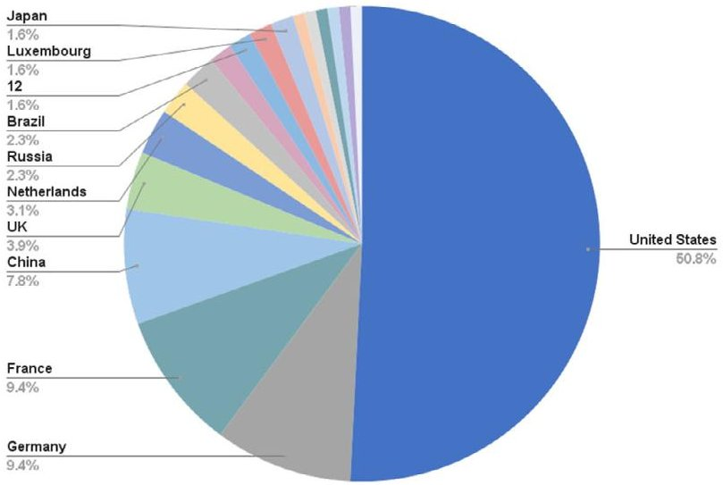

(a) Publication per countries

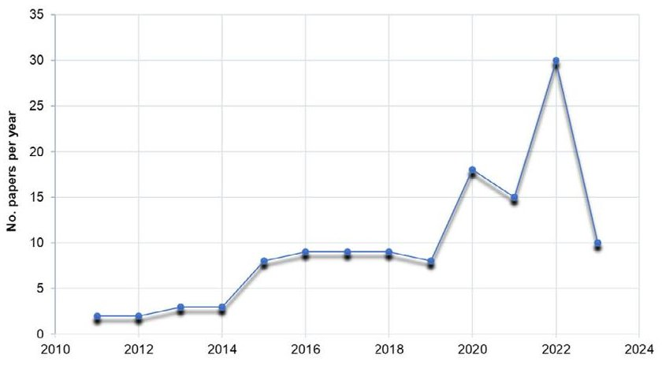

(b) Publication per year

FIGURE 4 Publication information.

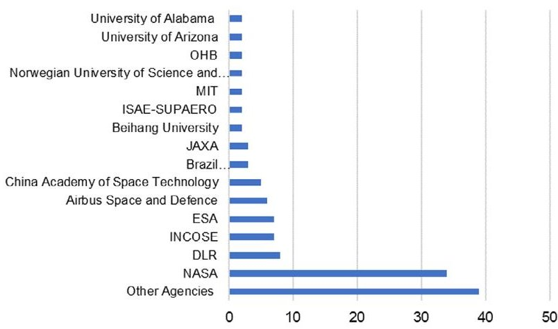

FIGURE 5 Affiliation of publication.

## 3.1 Statistical Results

According to statistical results, MBSE studies in the United States represent more than 50% of the research contributions, while those in Germany account for 9% and France and China account for 8% as shown in Figure 4a. Separately, between 2015 and 2020, the focus on MBSE implementation in space engineering experienced a threefold increase. And in 2022, there was an increase of 10 published articles compared to 2020, as shown in Figure 4b. Given that the review search ended in early 2023, it is expected to exceed the number of the previous year.

As illustrated in Figure 5, the research contributions from affiliations and research centers such as NASA's Glenn Research Center, JPL, and the ESA's CDF and Model Based Space Systems and Software Engineering generate a significant volume of studies. Also, publications from advisory groups of MB4SE, like DLR, Airbus Space and Defense, ISAE-SUPAERO, OHB, JAXA, and other organizations, have made significant contributions. In addition, university practitioners contributions, such as those from the Massachusetts Institute of Technology (MIT), the China Academy of Space Technology, and the Brazilian Space Agency have also contributed a substantial amount of research.

In Figure 6a, the prominence of journal articles and conferences in selected studies is outlined, highlighting the leading publishers as IEEE, Elsevier, Springer, AIAA, MDPI, and Wiley, listed in descending order. Significant parts of reports and collections are accepted from the MB4SE advisory group's report and the NASA archive. The review included 50% of proceedings and conference papers, as shown in Figure 6b, which originate from conferences, such as IEEE Aerospace Conference papers, AIAA Conferences and SCITECH forum, and the International Aeronautical Congress (IAC), as also shown in Figure 7. There are contributions that have been made by aerospace journals such as Recent Trends and Advances in MBSE, Acta Astronautica, and Aerospace Information Systems, and Systems and Software journals incorporated at least two studies. Also, journals articles of Procedia Manufacturing, Aerospace Reliability Engineering, CEAS Space and Space Safety Engineering are appeared twice.

## 3.1.1 Mission Categories

The distribution of space mission categories that have implemented MBSE in various stages of the lifecycle is presented as a percentage of publications, as illustrated in Figure 8. Studies focused on spacecraft subsystem development account for 34% followed by CubeSat missions at 23% and SmallSat missions at 21%. Larger missions are also represented, including crewed missions (11%), large missions (8%), and deep space exploration (3%), such as the Europa and James Webb Telescopes. As previously discussed MBSE could be adopted at multiple mission layers, SoS, and subsystem levels, and these projects generate multiple publications addressing different lifecycle stages. The highest representation of subsystem level application shows active involvement of private industry, where contractor and suppliers contribute to mission component. The disparity in mission type representation for CubeSats and Smallsat mission caused by their shorter development cycle, lower cost, and broader application domains including Earth observation, technology demonstration and support for complex missions. In general, this distribution highlights the need for further investigation into how MBSE frameworks can remain scalable and

<!-- PDF_PAGE: 9 -->

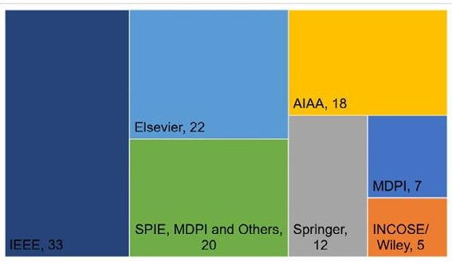

(a) Publisher

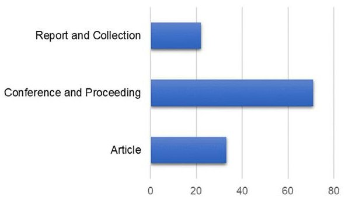

FIGURE 6 Data sources.

(b) Type of paper

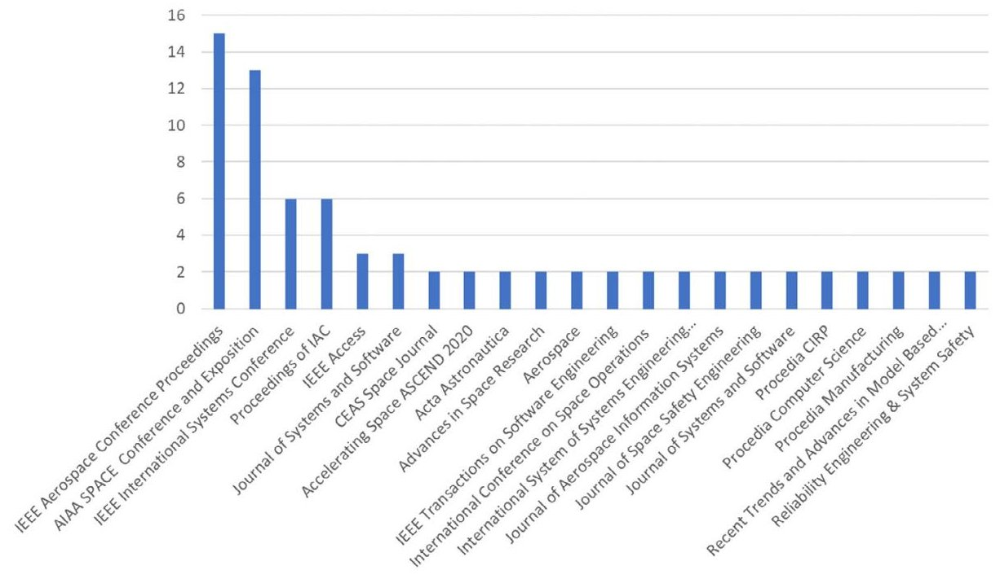

FIGURE 7 Distribution of journals and conferences.

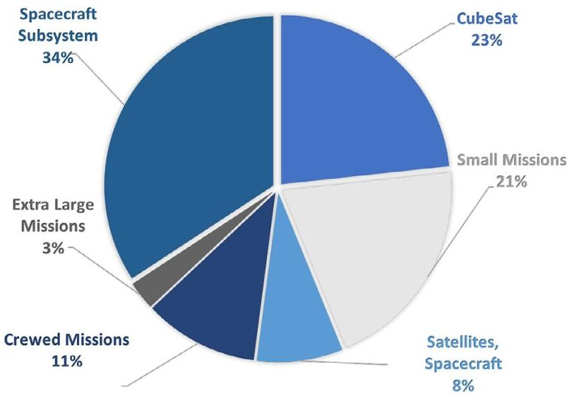

FIGURE 8 Total percentage of papers across space mission categories.

adaptable, capable of addressing demands of complex mission while remaining lightweight and cost effective for small-satellite development.

## 3.2 Synthesis Analysis

We synthesized 126 papers with five role of MBSE phases, where each MBSE specific process is described in terms of following attributes process name, purpose, inputs, outcomes, tasks, methods, and tool capabilities for performing these tasks effectively and efficiently [35]. This synthesizes the SE objectives addressed in each articles, defines the general boundary of SE activities targeted, and maps the capabilities of the corresponding MBSE enablers. Figure 9 presents the distinct purpose and outcomes associated with each MBSE phase, as observed in the literature, along the total number of studies.

Requirements management, as explored in 46 articles, is an essential activity ensuring traceability and coherence between needs and requirements across the entire lifecycle. These studies involve managing and maintaining traceability of stakeholder needs and high-level requirements to system elements and design inputs such as performance, safety, and other requirements. In complex mission contexts, requirement management is often addressed independently to emphasize change control and impact analysis. This phase is commonly studied in connection with model development, as observed in 75 articles. Model development

<!-- PDF_PAGE: 10 -->

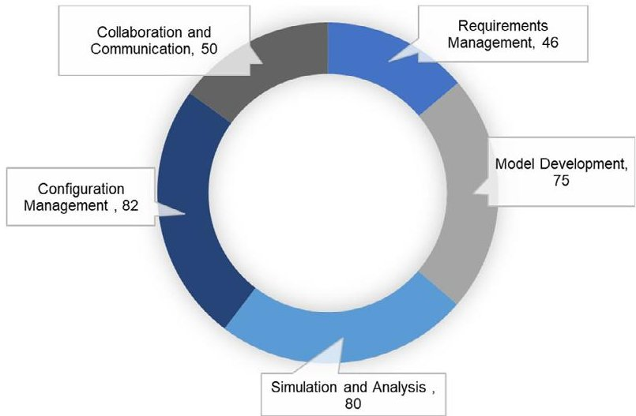

FIGURE 9 Total number of papers within phases of MBSE.

studies focus on creating model-based system architecture design definition aligned with defined requirements. These models capture system behavioral and structural views and are developed, integrated and deployed as digital system models for cross-domain collaboration. They support system decomposition from high-level abstractions to a detailed logical, physical, and functional elements of the SoI. These studies emphasize the role of the model-based approach in managing complexity, performing functional decomposition, exploring designs constraints, and producing holistic technical solutions to support concept exploration and preliminary design stages.

Simulation and analysis are studied in 82 papers supporting architecture definition, functional and behavioral analysis of the system through integrated system models and executable model. These studies discuss model-based V&V, trade analysis and optimization, risk assessment and mitigation, and design feasibility. This phase is essential to ensure the system meets the intended function and requirement by identifying potential risks associated with system behavior. Configuration management was investigated in 80 articles; these studies focus on supporting model-based system configuration, enabling change control, and addressing interoperability and interconnectivity of processes throughout the system lifecycle. An illustrative example is provided in [50], where object-oriented artifacts are reverseengineered into semantically equivalent conceptual models, also reinforcing model consistency during development. In parallel, the communication and collaboration phase, traditionally regarded as a generic function within MBSE, often employs general-purpose modeling tools and techniques to accomplish these objectives, as recorded in 50 studies. In the context of complex missions, a critical task is the explicit definition of communication mechanisms and effective management of stakeholder collaboration. Several notable initiatives highlighted in the literature such as MB4SE initiative, OpenCAESAR, and COMPASS demonstrate the importance of dedicated communication platforms and the interpretation of system models. These platforms enable multilayer and role-specific model views to facilitate interdisciplinary collaboration and stakeholder engagement.

## 3.2.1 MBSE Methodologies

In the context of this paper, an MBSE Methodology refers to the overarching philosophy, principles, and organizational

framework that encompasses multiple methods, techniques, and processes guiding the application of MBSE. Conversely, an MBSE Method denotes a specific procedural approach or technique employed within a single study or implementation instance. We recognize that the literature sometimes uses these terms interchangeably based on the scope of the application presented in the paper. Within this framing, MBSE practices in space agencies have progressed significantly over the past decade, improving process efficiency and adopting engineering approaches aimed at achieving a single source of truth for the entire lifecycle. The list of MBSE methods collected from the literature in Appendices B-E shows a heterogeneous set of implementation that collectively trace the evolution of broader methodological practices.

The survey [24] showed the improvement ranking in MBSE by efficiency in architecture and design, requirement analysis, decision support, and V&V. The authors in [51, 52] also grouped MBSE methods based on how well they work in specific areas, such as SE, aviation applications, their connection to modeling tools, and other methods. In this study, we adopt a complementary mechanism for assessing the evolution of the MBSE methodologies through the bibliography analysis. Considering the methodological diversity present in the literature, we analyze keywords not only for their co-occurrence but also for their functional association over time, as illustrated in Figure 2, which resulted a classification via a deductive approach. This evolution reflects how the advancement of the MBSE application was shaped by the integration of various engineering concepts, DE principles, toolchain maturity, design philosophies, and domaindriven industrial trends.

In addressing the RQ posed in RQ1, we explore the reasons behind the increasing diversification of MBSE applications in space missions. This trend can be attributed to several factors including increasing complexity of space systems, the need for efficient processes, the adoption of other quality-focused techniques, and the attributes of SE at specific lifecycle stages. The other aspect covers a significant portion of research efforts focused on enhancing the usability of the MBSE artifact lifecycle and the unified digital environment of MBSE in space missions. In general, this insight encompasses two key dimensions: the enhancement of the SE process and the expansion of the MBSE application boundaries across organizational and interdisciplinary domains, as shown in Figure 10. As a result, MBSE methodologies in literature can be classified into four layers based on their evolution and application scope: (1) transition of SE process document to model-based, (2) enhancing SE process and modeling in certain quality attributes, (3) expanded in scope of the lifecycle, and (4) integrated engineering strategies. These categories are explained in the following discussion.

Pure MBSE-1 refers to legacy or classical SE methods used to transform the document-centric process into a model-based approach. These approaches lay the basic steps of the SE frameworks that evolved from the V model, waterfall, and spiral models. According to [1], leading MBSE methods such as Harmony-SE, IBM Rational Unified Process, INCOSE OOSEM, and SYSMOD, have been presented as the foundational transformation from a document-centric to a model-based approach, which we refer to as Pure MBSE. These approaches are procedural that generally aligned with ISO/IEC/IEEE 15288, enterprise

<!-- PDF_PAGE: 11 -->

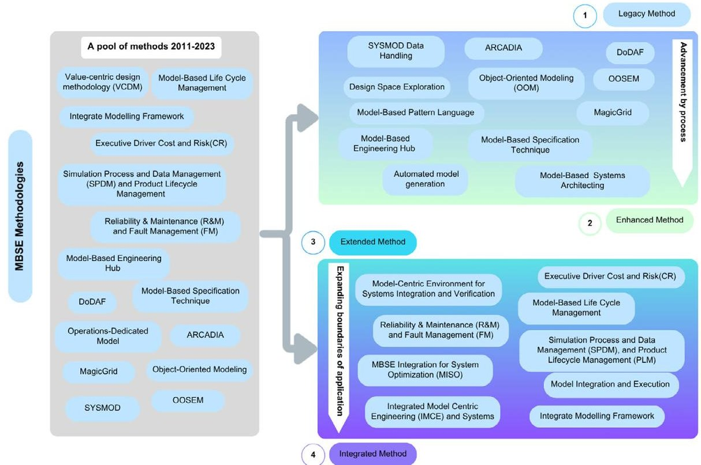

FIGURE 10 Evolutionary classification of MBSE methodologies based on functional association (2011-2023): Legacy, Enhanced, Extended, and Integrated Methods.

frameworks, and acquisition lifecycle models (see Appendix B). Architecture frameworks are foundation for forming MBSE methods selection, viewpoint structuring, and guiding process.

Enhanced MBSE-2 refers to methodologies built on the classical SE methods that target specific phases of the lifecycle in system development to improve the efficiency, flexibility, and reusability of model artifacts and modeling processes. These methods address the complexities of space development by treating targeted stages such as conception, design, optimization, and operation with specialized techniques tailored to each activity. The studies demonstrate enhancement of existing SE process in specific aspects and improve usability, as demonstrated in these studies [53-55] (see Appendix C).

Extended MBSE-3 are methods that extend the application of MBSE beyond the development and design of the system to the entire lifecycle [56]. As noted in [57], the concept of a total system model of MBSE referred to as an extended MBSE. It deals with lifecycle management beyond the scope of the engineering development stages, encompassing both system and product aspects within a model-based approach. For example, model-based risk management, model-based safety and regulation engineering, product line engineering, and digital manufacturing methodologies [58, 59] are considered extended MBSE approaches. These methods aim to maximize modeling capabilities and extend the digital thread throughout the mission lifecycle [60]; additional examples are listed in Appendix D.

Integrated MBSE-4 refers to methods that integrate diverse engineering tools and methods used to introduce unified features of the modeling process and management capabilities such as a CDM and Integrated Model-Centric Engineering (IMCE) [61, 62]. In practice, these methods are often realized by integrating proven engineering approaches across diverse domains via

associated tools and methods [63]. In [19], an integration of nonMBSE, MBSE, and extended MBSE approaches was examined to compare the efforts required and identify possible solutions they provide to build architecture of robotic space systems (see Appendix E).

These classifications primarily indicate how MBSE techniques are applied through integration, expansion, and enhancement, rather than attempting to offer a conclusive definition of MBSE. Each archetypes highlights the distinct strategies used to tackle domain-specific challenges in space SE. This classification underscores the importance of selecting techniques that are context-appropriate to effectively achieve the desired engineering outcome.

## 3.2.2 MBSE Languages

The comprehensive MBSE encompasses a variety of language types that are responsible for capturing, visualizing, analyzing, simulating, and managing systems throughout the acquisition lifecycle. To answer RQ2, our approach focuses on analyzing and classifying MBSE languages according to their role in system representation and the SE activities they support. The study on MBSE taxonomy [52] characterizes languages as nonformal, formal, and semi-formal based on syntax and semantics. We further expand on the classification by aligning with the defined MBSE phases. The classification distinguish a modeling language by its formalism, which defines the notation and semantics from other languages that support tool integration and model execution mechanisms. The latter enable interoperability, co-simulation, and automate analysis across tools.

Modeling languages are standardized syntax used to describe complex-to-simple systems into usable and manageable

<!-- PDF_PAGE: 12 -->

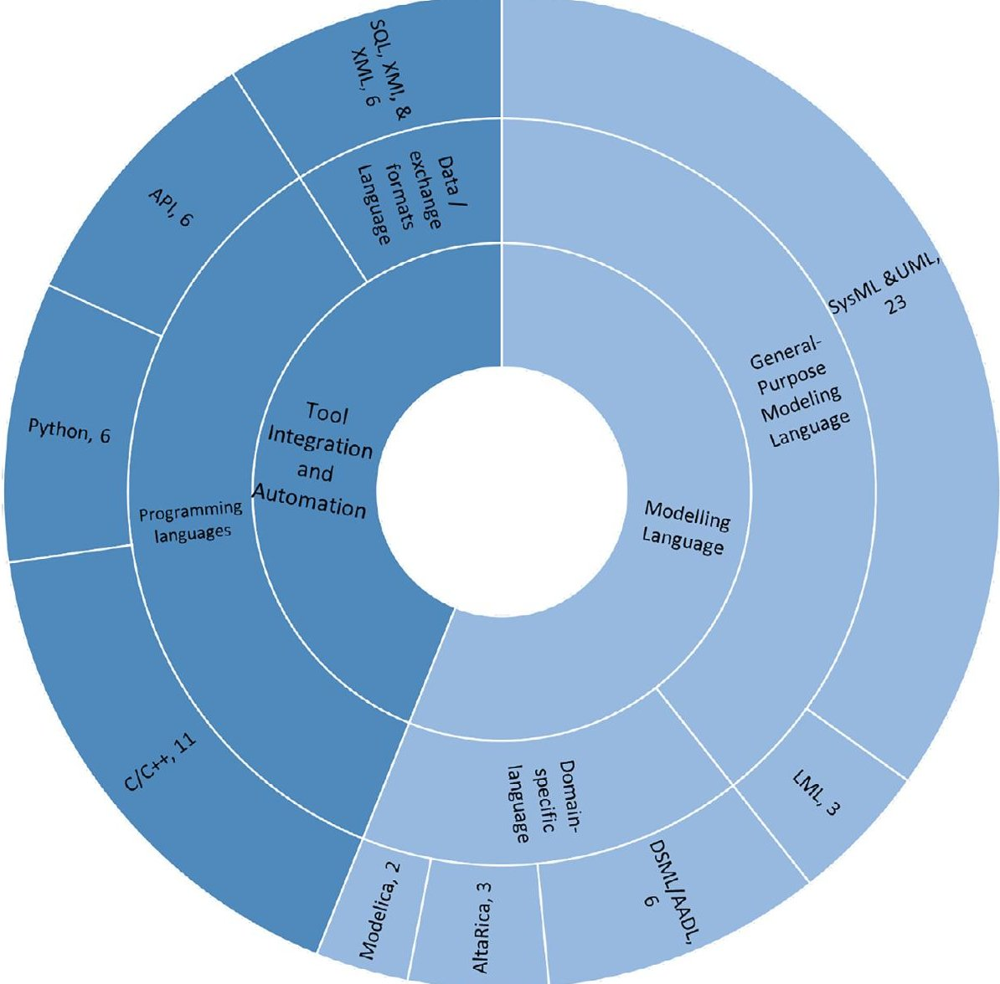

FIGURE 11 Taxonomy of MBSE Languages by representation versus integration (right side: Modeling Languages/formalisms & left side: tool integration and automation).

information. The Unified Modeling Language (UML) is a software-oriented modeling language capable of visualizing, constructing, and documenting system representations through both behavioral and structural sets of diagrams [50]. The Systems Modeling Language (SysML) is a standardized modeling language among SE practitioners developed by OMG as an extension of UML [64, 65]. SysML has four essential system representations, namely structure, behavior, parametrics, and requirements [5]. Hence, SysML is recommended by INCOSE as suitable for SE, supporting development from simple to highly complex hardware and integrated systems.

In addition, Lifecycle Modeling Language (LML) supports the SE as well as risk and project management, from conception and utilization to retirement stages, covering the complete lifecycle [66]. LML extends its capabilities from SysML and UML, supporting schedule, cost, and risk management for informed decision-making. General-purpose modeling languages encompass SysML, UML, and LML as categorized in [6]. Furthermore, emerging domain-specific languages (DSL/DSML) commonly used for the representation and analysis tethered to domain-specific tools such as those mechanical, thermal, and embedded systems include Modelica and AADL, as shown in Figure 11. Modelica is a nonproprietary equation-based language used

for physical modeling of complex and multidomain systems. AltaRica is object-oriented modeling (OOM) language powered with an AltaRica wizard specific to safety assessment and analysis that bridges multiphysics prototyping and simulation [67].

MBSE extends beyond modeling development to model execution, artifact generation, and configuration coordination with higher-order governance and management. Accordingly, MBSE languages must be broader than formal modeling language, they must take into account integration and exchanges of system artifacts with DE tools during the design, simulation, analysis, and validation. Specifically, programming languages (C/ C++ and Python) enable executable models, code generation, and system interfaces. Application Programming Interfaces (APIs) and Python are used in SE to facilitate tool interfaces, model validation, automation of the modeling process, and configuration management [68, 69]. In addition, C and C++ utilize model definitions and simulations including performing code generation for hardware systems, and component-level system programming [67, 70]. Moreover, data languages and exchange formats such as the Extensible Markup Language (XML) and XML Metadata Interchange (XMI) facilitate the exchange of metadata and conversion of file types [71, 72]. These formats support the exchange of information across various COTS tools used

<!-- PDF_PAGE: 13 -->

TABLE 4 Classification of MBSE tools.

<table border="1"><tr><td>Classification tool</td><td>Tools and reference</td></tr><tr><td>Modeling Tool</td><td>Cameo Systems Modeler,GENESYS[73],IBM Rhapsody,MagicDraw,PTC Integrity Modeler and Enterprise Architect[13],Papyrus[74],MapleMBSE[60],Innoslate,OSATE[75],Capella[76],Astah System Safety[77],OPAL</td></tr><tr><td>Design and Simulation Tool</td><td>MATLAB,STK[78],CAD(AutoCAD and SolidWorks)[79],SINDA/G[80],CREO,ADAMS,Nastran/Patran[81],Design Explorer</td></tr><tr><td>Model Simulator</td><td>COSYSMO[82],CORE[83],Trade space Analysis Tool(TAT-C)[84],MODELIO/OpenModelica[82],OpenMBEE[63],ModelCenter[85],NORMA,HoliDes,IMPACT,VAMOS,IMPACT[86],Model-based to Design Matrix(MB2DM)[28],General Mission Analysis Tool(GMAT),OPAL[87],ViewEditor,Dymola,[88],Python and PyTrees[67],SysPhS[89],SysML4Modelica</td></tr><tr><td>Management Tool</td><td>Valispace,Relex,PTC Windchill[90],Jira[91],Microsoft Excel,Helix,SLIM[92],System Health Management(ISHM)[16],Simulation Process and Data Management(SPDM)[93]</td></tr><tr><td>Framework</td><td>VirSat4 FDIR,INVITES Modeling Framework[94],CubeSat System Reference Model(CSRM)[78],OpenCAESAR,Eclipse Modeling Framework(EMF)[95],F-prime[96],COMPASS[97],OCDT[61],SSE4Space and Openflexo[98],COMET,and SysML4SatNetSim[27],OpenMDAO[99],OSLC[100],ISC-AF,Airbus Executable Model(AEM)[101]</td></tr><tr><td>Databases and Library</td><td>Neo4J[102],PostgreSQL,Design reuse Library,GitHub</td></tr></table>

in model development to execute domain-specific simulation and analysis.

In summary, the taxonomy of MBSE languages in Figure 11 overviews the right half groups using purpose of application into two categories: general-purpose modeling languages and domain-specific languages. The left half groups integration and automation-supporting languages categorized into two: programming languages and data syntax to enable executive models and seamless exchange of digital artifacts.

## 3.2.3 MBSE Tools

This review identified 68 tools, frameworks, and libraries used in the implementation of MBSE across various lifecycle stages and their function. A single study usually involves multiple tools used in one or more MBSE phases, depending to the specific SE tasks addressed. The overarching classification of the MBSE tools is based on their capabilities and functionalities in relation to the different MBSE phases, in investigation of RQ3. The author of [51] categorized the MBSE tools based on the formality of the language as editors, simulators, verification assistants, and code generators to demonstrate their capabilities. Also, a systematic review of classified MBSE tools shows how they support lifecycle activities [26]. We unify and refine these classification by analyzing functional roles, scope, and capabilities of the tools, such as design modeling, management, simulation, or data integration. This refinement leds to six categories, which are listed and described in Table 4.

Modeling tools support designing, visualizing, and validating system models and requirements throughout the lifecycle, mainly using SysML and UML languages. Some examples of these tools are MagicDraw, Cameo Systems Modeler, MapleMBSE, Enterprise Architect, Papyrus, and IBM Rhapsody. In addition, there

are modeling tools based on domain-specific languages, such as GENESYS, Innoslate, and Osate. Domain-specific modeling tools offer unique capabilities for real-time simulation, embedded system modeling and seamless integration of subsystems. Design and simulation software often operate alongside modeling tools to execute systems behavioral for validation, tradeoff studies, and optimization. The interaction of physical and logical architectures between system design tools such as MATLAB, Systems Tool Kit (STK), CAD, and CAE via API or C/C++ enables the creation of executable models [103, 104].

However, Model simulation tools are distingished by their ability to manipulate and analyze existing system models, supporting parameter optimization, trade-space exploration, and integration between tools. Some examples are the OpenModelica, OpenMBEE, ModelCenter, and Variant Modeling with SysML (VAMOS) [105] which also extend SysML-based models. On the other hand, model management tools cover lifecycle management and data management. PTC Windchill and Software Lifecycle Management (SLIM) help integrate lifecycle management and modeling processes [90, 106]. In addition, Valispace, Relex, and Jira provide PLM, risk management, and project management of the system through the MBSE model, respectively.

Frameworks are typically composed of multipurpose and multidisciplinary software suites designed to support the integrated MBSE approaches and organizational-specific tool customization. Some of these frameworks are OpenFlexo [99], an opensource framework for multidisciplinary design, analysis, and optimization (OpenMDAO) [100], Open Services for Lifecycle Cooperation (OSLC) [100], the Correctness, Modeling, and Performance of Aerospace Systems (COMPASS) tool set [107], and the Open Concurrent Design Tool (OCDT) [94]. These opensource frameworks are a refined use of multiple missions and have been enhanced with the input of experts at ESA, Airbus, and NASA. These tool sets offer compatibility with SysML and

<!-- PDF_PAGE: 14 -->

other languages used for system decomposition, requirement management, operational modeling, and simulation capabilities. While some studies might consider these frameworks as MBSE methods, we argue they represent integrated platforms composed of tools and techniques structured to execute a specific tasks. Similarly, databases and libraries play critical role in facilitating storage and exchange of models, which support management of information and handling large volumes of reusable model artifacts and components.

## 4 | Findings of the CLR

The previous section presents the relationship between methods, language, and tools by examining their differences and similarities in application independent of the MBSE phases. This section presents quantitative analysis that shows frequency and role of MBSE enablers within each phase, based on observed classification and the significance of use. The findings are discussed from the perspective of the individual studies that represent significant contributions within application context, followed by a general overview to highlight broader implications.

## 4.1 MBSE Methodologies in MBSE Phases

A total of 126 distinct MBSE methods were extracted from the reviewed articles and subsequently classified by their methodological maturity, diversity of applications, and degree customization to meet growing demand in the space industry. Here, the correlation analysis conducted to examine the relationship between MBSE method employed and the corresponding MBSE phase(s) addressed in the studies. This correlation discusses, based on the classification provided in Section 3.2.1, in details overview of some of the best practices in the literature addressing RQ1.

In the context of a complex mission, the contribution of enterprise architecture frameworks, such as DODAF, UAF, and Zachman, provides significant value by structuring enterprise modeling views and architectural perspectives. These frameworks enable the strategic alignment of defined processes, delivery, information flows, goals, and capabilities with mission outcomes, while considering multiple stakeholder viewpoints. Pure MBSE classifications were discussed in 22% of the studies, employing methods, such as Arcadia, OOSEM, and MagicGrid, which offer predetermined steps and a well-defined process. These methods emphasize transitioning from document-centric to model-based approaches, such as OOM, system architecture models, ontology analysis, and top-down engineering approaches, particularly targeting the early stages of system development. Their structured application process demonstrated effectiveness in federated and executable models, model-based contracts, Modeling Architectures and Parametrization for Spacecraft (MAPS), as well as in model-based design space, with a strong frequency observed in the RM and MD phases that dominate the early lifecycle. The maturity of these legacy methodologies makes them suitable for implementing MBSE at the enterprise or mission level, enabling alignments between organizational vision and process consistency, as shown by even distribution across phases in Figure 12.

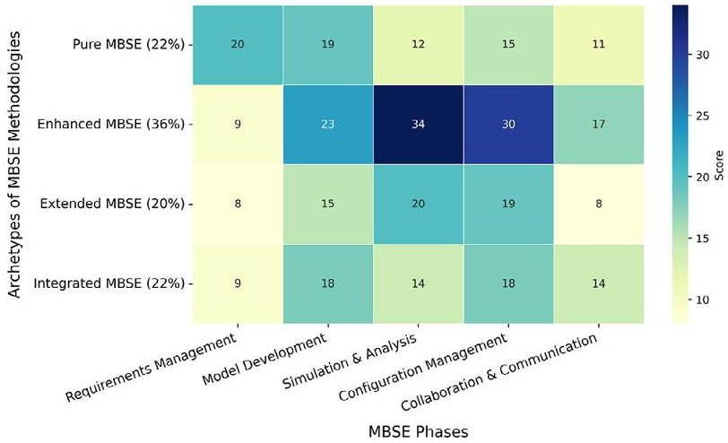

FIGURE 12 Distribution of MBSE methodology archetypes across MBSE phases.

Yet, these methods independently provide limited engineering support for complex missions with restricted process flows.

In contrast, Enhanced MBSE tackles the complexity of space missions by exploring an innovative concept that introduces adaptability and efficiency into specific engineering activities. These methods employ advanced techniques to achieve superior flexibility and efficiency in the modeling process, opening up new possibilities for developing complex space missions. The three phases (MD, SA, and CM) exhibit a higher distribution, showcasing the potential of these advances. To mention some impactful studies in model development, a hybrid of traditional and model-based SE [48], model-based concurrent design [108], model-based pattern language, model-based systems architecture [77], modeling integrated network infrastructure modeling [109], and model-based operation design [104]. These methodologies are driving a transformation within the SE process by leveraging MBSE artifacts to achieve the adaptability and reusability of the targeted design objective. The enhancements in MBSE approaches improve multithread decision-making, offering multiple design and operational solutions for effective mission planning.

Furthermore, Enhanced MBSE has shown particular strength in simulation and analysis phase, with 34 instances identifies across reviewed studies. This finding highlights clear prioritization in the literature, indicating central function of Enhanced MBSE in enabling reliability assessment and V&V activities (refer to Appendix C). These significant methods are model-based Fault Tree Analysis (FTA) and Failure Mode, Effects, and Criticality Analysis (FMECA) [110, 111], model-based reliability and Dynamic Flowgraph Methodology [112], as well as model-based safety analysis to perform reliability, availability, maintenance, and safety (RAMS) [113, 114]. To explain further, model-based RAMS operation is designed to uncover the probability of system failures, risk priorities, and critical modes using FMECA and FTA analysis. Both analyses can be automatically generated from the SysML structure, such as IBD and BDD, activity diagrams, system behavior, and state machines [66, 115]. The feasibility study of satellite refueling conducted using MBSE, providing a comprehensive cost and risk assessment, conceptual validation and enhance understanding for orbital fueling architectures [116]. In the same way, an automated risk-informed framework

<!-- PDF_PAGE: 15 -->

employed SysML to optimize crew maintenance time and space parts management [117]. In this phase, enhanced use of MBSE contributed significantly to V&V activities by integrating SysML artifacts improving precision, reliability, and safety of the mission.

Similarly, Enhanced MBSE enables a model-based CM that supports multi-trade optimization, and facilitates the seamless integration of heterogeneous toolchains. It also improves change control mechanisms effective for complex system development processes. These advancements are employed through a model-based approach, reinforcing configuration management to ensure consistent interactions among tools while maintaining data integrity and digital continuity [118]. Some of these approaches include SysML Executable Modeling Methodology (SEMM) [103], functional avionics [101], the Sapphire Model [87], virtual testbed [94], design reuse and model extraction as artifacts [96]. These efforts focus on design optimization and toolchain process acceleration, and enhancing flexibility and interoperability. To establish an Authoritative source of truth, MBSE methods must support interoperability of all important tools and efficient data exchange, between both hardware and software systems. These methods address multiple MBSE phases, emphasizing on traceability of digital threads to ensure usability, consistency, and accuracy throughout development.

On the other hand, Extended MBSE is described as the next generation of MBSE++ serving as a digital blueprint [57]. These methods demonstrated that systems modeling extends beyond system development and design, encompassing broader lifecycle management. Extended MBSE was featured in 20% of the reviewed studies, particularly in areas related to Safety and Mission Assurance (S&MA) [60], Model-Based Engineering Lifecycle Management (MELM) [61], and Model-Based Safety Assessment (MBSA) [119] related studies. Given that safety engineering is critical for human spaceflight, MBSE supports human factors analysis, lifespan evaluation, and crew health management. Crew Health and Performance system leverages MBSE to support a crew with research, wellness, and task performance, and subsystem coordination while facilitating stakeholders communication through data-informed mission planning [86].

Studies on Human Centered Design address the added complexity of human-in-the-loop systems, enabling effective control interfaces, crew safety tracking, and safety-based architectural concepts [83,120]. In [121], a collaborative command system was developed that integrates human factors with UAF perspectives and SysML model, assessing requirement coverage and human interaction for operator-centered design by addressing usability issues and guiding design refinement. In [122], a Model-Based reliability and maintenance analysis was applied to the Cascade Distillation System for future human exploration missions. The approach enabled automated generation of FMECA and FTA from SysML meta-models (IBD BDD and state machine) identifying numerous safety hazards and single-point failures.

Another emerging application is an AI-enabled security service, such as a quantum key distribution developed for encryption purposes to secure linked nanosatellites [123]. The coordination of agile processes and MBSE tools facilitates the development of encryption process standards by leveraging the behaviors of the system and subsystem [123]. Other extended approaches including the Quality Attribute SoS [124] and Additive Manufacturing (AM) [81] link requirements blocks and activity diagrams, which evaluate the set of solutions and control production and procurement processes. These advancements extended the prevalence of MBSE artifacts, optimizing their use to capture digital attributes of system boundaries in the iterative project management loops across the lifecycle development stage. These methods enable the orchestration of SE activities and processes through tradeoff analysis, enabling system optimization, quality management, and lifecycle management. The studies that employed this type of approach aimed to optimize costs and performance, accelerate schedules, and manage production and procurement in support of the overall mission.

Integrated MBSE methods account for 22% of the studies, bridging the gap between proven engineering practices and industrial trends in DE, fostering the adoption of MBSE in diverse applications. These methods often emerge from the maturity of MBSE methods, accumulated knowledge and expertise, integration with project management, a unified modeling platform, and collaborative development techniques. The Mars crewed mission study [125] showed that the integration of MBSE and DE increases the fidelity of the model, simulation capabilities, and improves understanding of the physical system breakdown. Furthermore, the integration of the digital twin spacecraft and the MBSA model enables autonomous measurement and diagnosis, fostering a continuous improvement loop through the interconnected mitigation-detection process [67].

Similarly, Integrate digital environment [126] is used to ensure that changes in habitat power subsystem are automatically traceable to dependencies in life-support consumption and vehicle budget. Integrated Modeling Environment [68], MBSE-Nanospace integration, Concurrent Engineering (CE), and MBSE Integration for System Optimization (MISO) [85, 127], MBSEaided Concurrent Assembly, Integration, and Verification (CAIV) [128], and Model-to-Text transformation (M2T) [74] are strong examples of an effort to assimilate principles, tailored tools, designated engineering processes, and data exchange techniques. These strategies embody the best practices in the space industry's implementation of MBSE, with a focus on enhancing engineering reliability and ensuring traceability. Additionally, Integrated MBSE emphasizes the inclusion of the operation, management, and development process in centralizing MBSE over the entire SE process. Evidently in [93, 129], these studies explored the association between OOSEM, the agile method, and data management to create a single source of authority for resolving data synchronization errors in lifecycle management.

Moreover, the development of highly collaborative and communication-oriented MBSE is facilitated by templates, digital libraries, and frameworks. The inclusion of model repository, documentation, and ontology-based modeling vocabularies yields the deeper integration of MBSE into a unified framework [88]. This integration considers the realization of the SoS from the perspective of personnel, security infrastructure, and resources. In [97, 98], studies presented a flexible architecture security framework, and model-based Human Systems Integration that facilitates interaction with external stakeholders, including operators, user-clients, and developers with systems to bridge usability and maintainability. Once again, NASA's human

<!-- PDF_PAGE: 16 -->

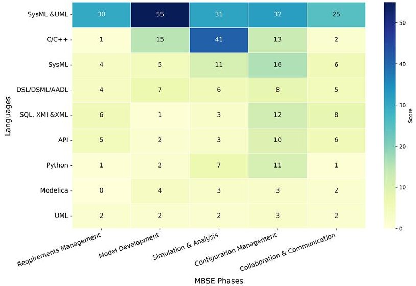

FIGURE 13 Distribution of system modeling languages across MBSE phases.

exploration mission to Mars complexity initiated developing new design environment capable of modeling complex system to ensure crew safety, asset assurance, and manage uncertainty. Integrated Modeling Frameworks was employed incorporating SysML-based model, a web-based modeling environment, and domain-specific language, such as Altarica and MATLAB for dynamic analysis, also Bayesian networks implemented using Python to handle systems complexity [130]. These integrated frameworks support continuous validation, systems architecture definition, robust configuration control, consideration of human factor and resource constraints enabling coordination across multidisciplinary teams via structured access points.

In summary, the classification of MBSE methods reflects on both the evolution and operational diversity of model-based practices in space SE, where Pure MBSE methods are foundational baselines for enterprise-level implementation, offering structured process-driven approaches suitable for early phase design and architectural clarity. Enhanced MBSE builds on foundation by introducing domain-specific flexibility and model reuse, particularly effective in high-fidelity simulation and configuration processes. Extended MBSE further amplifies these capabilities across the system lifecycle, addressing safety, quality assurance, and production through interconnected model artifacts. Integrated MBSE consolidates these advances into a cohesive digital ecosystem linking multidisciplinary engineering efforts with governance frameworks and multi-view collaborative support. In general, Integrated MBSE has shown superiority in managing end-to-end complexity of space missions, offering a pathway toward a scalable, interoperable, and lifecycle-resilient SE approach.

## 4.2 MBSE Language in MBSE Phases

The examination of MBSE language was conducted by analyzing the role of the respective tools within the MBSE applications and their interaction with the modeling tools across MBSE phases (RQ2), as shown in Figure 13. Given that numerous studies provide incomplete information on the languages used, the enumeration of languages and their respective distribution was derived from the tools employed within the MBSE applications. Appendix F contains a table listing languages and 63 tools, excluding databases and libraries, which are considered independent of the languages and serve to store model artifacts without necessitating conversion.

UML has played a significant role in studies by enabling the conceptualization of textual and object-oriented representations, specifically in the development of space system ontology, conceptual design, and model-driven engineering approaches [95]. It supports need analysis, visualization of the system architecture, ensures collaboration, and communication of stakeholders [87, 131]. In [94], the UML test profiles (UTPs) software testbed facilitated the development of an integrated system specification and verification and validation techniques for a complex Mars exploration mission. Thus, UML mainly support establishing traceability between requirements and the model elements, that are applicable across all phases of MBSE. SysML extends this focus by representing the system in terms of mission objectives, spacecraft architecture, and operational scenarios as a standard language. The SysML pattern language is suggested for implementing design reuse approaches to help create a reusable logical artifacts and reduce modeling time and validation as cited in [77]. In [132], different versions of SysML used in SENER projects to develop systems and subsystems were presented. In addition, in [133], SysML-based SE processes (SysML-SEPs) provided a description for hierarchical organization of project and subsystem-level requirements.

The distinction between UML, SysML, and combined SysML&UML aims to reflects the varying need of MBSE applications across domain, in software engineering, SE modeling and analysis as well as tool capabilities. A combination of UML and SysML is widely utilized in modeling tools, offering comprehensive support in all phases of MBSE, from concept design to mission operation, as seen in Figure 13. This combination enables the tools to be cohesive and integrated processes that facilitate software modeling and system development. The development of UML and SysML test profiles provided real-time simulation monitoring for a complex EuCROPIS mission [105,134]. In addition, LML supports cloudbased SysML integration in multiple phases, managing V&V and task processes, adopted in the Innoslate and GENESYS tools [90]. As a result, LML has shown to be a capable language that supports reusability for PLM, enabling effective failure analysis, without significant adjustment during complex system development [66].

However, the specialization of domain-specific languages, such as AADL and DSML, facilitates the computation of model parameters and the manipulation of system behavior. Domain-specific language capabilities have been demonstrated to improve accuracy, system reliability, and safety, particularly within domains such as thermal regulation, structural design, and electrical control systems [33, 75, 135]. Modelica enables the simulation of stochastic process input-output parameters and the evaluation of system behavior [136] with limitations in need analysis and requirements management. Conversely, the integration of design and simulation tools within MBSE environments is often supported through scripting languages and API, such as Java and C/C++. These languages enable executable models and active data exchange required for flight simulation, thermal analysis,

<!-- PDF_PAGE: 17 -->

aerodynamic modeling, and related applications. Both SA and MD phases exhibit the highest frequency due to their iterative design cycles, quantitative analysis capabilities, and executable model support [80, 103, 137]. Configuration Management has gained the most from automated scripting exchanges, thus ensuring consistency across design versions.

For the other system language category, Python serves a multifaceted role as a language and tool with diverse applications in SE. In [68], it has been utilized as a language to develop the Spacecraft Design Platform (SDP) framework and the MBRMA tradeoff algorithm. In addition, APIs enable parameter configuration and collaborative server to manipulate modeling of information and support visibility of dynamic parameter for better user interaction [108,138,139]. During the detailed design stage, exchange of simulation data and import/export of system model elements require standardized data syntax and formats. These data languages need to enable transfer, storage, and file-conversion processes, indicating increased utilization of XMI and XML in CM and SA phases. Thus, SQL, XMI, and XML are the most frequently used standards in data management, facilitating tool interoperability, change management, and interfacing model information and collaboration. However, they are not suitable for transferring SysML relationship information.

The challenge of achieving interoperability between modeling languages and various system programming and data languages is clearly shown in Figure 13. While general-purpose modeling languages offer substantial flexibility in manipulating artifacts, they are often inadequate for capturing the essential behaviors of highly intricate systems and the continuous interfacing required by such complexity. This deficiency can lead to reduced usability in extending to later development lifecycles stages, particularly during the operation and maintenance. Conversely, domain-specific languages are tailored to maximize functionality within complex mathematical frameworks specific to certain domains. Developing a toolchain or framework to integrate these languages might appear to be a viable solution, but it simultaneously presents significant interoperability challenges. As a result, the absence of a unifying modeling language within a top-down engineering methodology exacerbates the traceability gap, particularly during the transition from requirements to system simulation.

To sum up, general modeling languages provide significant advantages in parametric validation, high-level data exchange, and model interaction, which are critical to engaging in trade-offs and concept exploration. Furthermore, while data languages are infrequently employed during the modeling phases, they are crucial for extending or linking the system's attributes and behavior to support lifecycle management. Given the pronounced involvement of non-SysML-based tools in MBSE, their interaction should be managed through structured data storage, conversion, and interfacing using data syntax languages. In general, the distribution shown in Figure 13 not only illustrates the frequency of languages used in each phase, but also emphasizes their interconnection. The importance of addressing these issues is underscored by the risk of information loss during continuous development and the need to maximize the interdependability of the model and downstream tools.

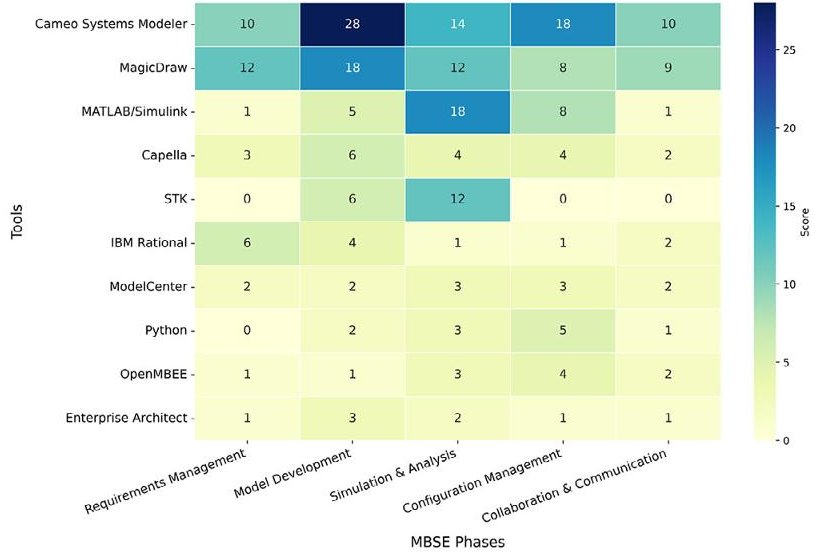

FIGURE 14 Distribution of DE tools employed across MBSE phases.

## 4.3 MBSE Tools in MBSE Phases

In this subsection, the functional capabilities and utility of individual tools within a specific MBSE process are examined, corresponding to the frequency of appearance across each MBSE phase (RQ3). The list of 68 tools includes COTS modeling tools, open-source software packages, and frameworks developed by various space agencies that have demonstrated effectiveness in previous space missions (refer Appendix F). Figure 14 highlights a subset of tools with higher frequencies of adaptability, selected from a broader list to illustrate the distribution of tools across MBSE phases.

The CubeSat reference model (CSRM) was studied, while the CubeSat mission undergoes a development stages in consecutive studies using several tools [92,140-142]. It serves as an exemplary instance of MBSE application, necessitating a diverse array of tools for modeling, design, simulation, management, and a collaborative framework toolchain and libraries throughout the various stages of the development lifecycle. Meanwhile, Cameo Systems Modeler is widely used in system design and requirements management, particularly for developing the decomposed system elements into block diagrams, state machines, and activity diagrams. Among the 41 studies using Cameo Modeler, it is predominantly used in the development of small satellite missions and space subsystems [100,115,143]. By contrast, MagicDraw has an even distribution across various phases owing to its code generation abilities and integration with Java and C++ tools. Yet, Cameo shows the highest utility in configuration management tasks by providing features such as collaborative workflows, OSLC integration, XMI compatibility, model traceability, and efficient management of external model modifications. Both tools are primarily employed in large and extra-large space missions, including Europa Clipper, Mars Ascent Vehicle (MAV), and NASA OSIRIS-Rex, where the need for comprehensive requirement traceability and cross-disciplinary collaboration is paramount [48,88,111,144].

Indeed, MagicDraw and Cameo Systems Modeler are licensed modeling tools widely applied in aerospace and defense SE for developing and managing complex system architectures.

<!-- PDF_PAGE: 18 -->

In contrast, Capella is an open-source modeling tool with the capability to enable the definition of complex architectures. It is a method-enabled tool that performs model-based safety analysis, hazard assessment, and RAM analysis [91]. It has been used for model development of SoS architectures, such as Lunar oxygen, Hall thruster, Lunar-lava tube, and Kenies constellation validation [145]. Despite its limited integration and interoperability with different languages, it helps capture high-level requirements and sophisticated architectural layers [46,56]. It performs V&V of the model throughout the development process [146].

In the context of an executable model, design and simulation tools perform a vital function by closely integrating the modeling environment with the processes of system design. Figure 14 indicates that MATLAB is predominantly employed during the SA phase, which can be attributed to its robust integration capabilities with models across various simulation and configurations. MATLAB has demonstrated the highest frequency for dynamically simulating space systems, determining optimal solutions, and evaluating system behavior, often aiding in modelbased verification and validation [103]. To add further, in [79], the integration of CAD and MagicDraw facilitates the verification of optimal physical architecture, performance analysis, and simulation architecture while ensuring continuous configuration management. In addition, NASA Structural Analysis (Nastran), CAD, and SysML models were integrated for the RS-25 engine test failure analysis to achieve affordability [81].

From another perspective, a crucial part of space SE involves ensuring system reliability and achieving an optimal mission outcome. The model simulation tools play a major role in this process by extending the practical value of MBSE within and beyond digital modeling to enable a direct link either through surrogate modeling or integration with physical systems. These endeavors are manifested through SysML extensions, via Physical Interaction, SysML Signal Flow Simulation (SysPhS), and SysML4Modelica, which facilitate system-level simulation and validation. These extensions support SysML integration for physical system interaction and testing. For instance, [89] demonstrates how SysPhS facilitates physical interaction and validation of the physical system using SysML.

Similarly, in [147], OpenModelica was used in conjunction with SysML models developed in Cameo modeler to conduct dynamic simulation, architecture validation, and parameter optimization. To further emphasize, SysML4Modelica enabled surrogate-based optimization by creating an executable simulation model for the quantitative evaluation of candidate architectures [99]. The integration of the functional mock-up interface (FMI) with OpenModelica and SysML-based tools further enables co-simulation and overall system validation accuracy. Also, the Constructive Systems Engineering Cost Model (COSYSMO) tool helps to determine the technical feasibility of the Artemis program, by employing multiple reuse-specific SysML constructs of model elements [82].

In similar note, model simulators have increasingly contributed to automate modeling process even within the context of autonomous DE. Tools such as Python, OpenMBEE, and Model Center have demonstrated substantial capabilities in facilitating bidirectional model interaction and integrating system behavior.

The interaction between Genesys, the robot operating system, and Python is organized to design autonomous lunar guidance, navigation, and control of lunar surface exploration. This integration aim to optimize decision-making in identifying highrisk parameters and architecture dependency [73]. In addition, Python and PyTrees are used to develop an autonomous modelbased diagnosis behavior tree from the description of system design to operate and maintain in-service spacecraft [67,148]. In a complex mission such as designing constellations, Python, in association with the Tradespace analysis tool, used to developed an executive driver that validates various logical and physical inputs [84]. Further OpenMBEE was adopted to support multidisciplinary collaboration by enabling paperless ground segment attempted to fulfill Euclid's mission [104]. ModelCenter facilitates optimization and automates trade analysis by linking simulation and modeling tools. Model simulators have been effectively applied to scenarios such as satellite constellation optimization, CubeSat performance simulation, and trade space generation [85].

Numerous specialized integrated platforms have been developed in the form of frameworks and toolchains by space agencies to address the intricate demands of space missions in the CM and SA phases. These integrated frameworks are designed to prioritize mission assurance and reliability engineering, while also maximizing collaborative capabilities. COMPASS is good example for co-engineering tools set, it provides a smooth transition between SysML and SLIM, allowing for extensive pre- and post-conceptual operational analysis [97, 127]. These integration link different categories of tool modeling, simulation, and management tools, including MATLAB, STK, ANSYS, Microsoft Excel, Visio, MagicDraw, and MySQL. Thus, enable the interoperability of the essential components of the system model and the relationships between phases [149, 150].

Moreover, ECSS standards-based open source collaborative tools, such as OSLC, OCDT, and Natural ORM Architect (NORMA), are also explored for purpose of model management and interoperability within various engineering domains. The OCDT is extensively utilized within the ESA concurrent design process to centralize digital threads, thereby ensuring enhanced flexibility. NORMA specifically obtains software modeling and OOM capabilities to develop a database-driven architecture for space launch vehicles [95]. On the contrary, the OSLC tool chain service facilitates the deployment of a deorbit satellite study to enhance the integration of lifecycle tools [100]. OpenMDOA analyzed and optimized a flexible system model for hybrid propulsion [99]. These collaborative tools shown capability to centralizing metadata exchange, optimization, lifecycle management, and cost-effective development.

Furthermore, MBSE practices are increasingly organized within frameworks empowered by cloud services and virtualized environments. This enables multi-user access; reusable applications and version-controlled model management are key features that support Integrated MBSE. For example, the Virtual Satellite framework exemplifies this trend by incorporating model-based reliability engineering, which facilitates the early phases of FDIR as well as FTA, improving system fault tolerance and recovery strategies through conceptual modeling. ViewEditors demonstrate multiple model management capabilities and interact in an

<!-- PDF_PAGE: 19 -->

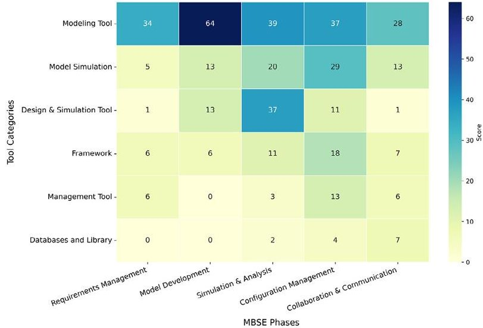

FIGURE 15 Distribution of MBSE tool categories across phases.

editable fashion to produce S&MA products, thereby enhancing the efficiency and effectiveness of the modeling process [27]. The FMI and Model-Oriented Software Automatic Interface Converter (MOSAIC) automate model exchange between various models and simulation standards, saving time and effort.

The OpenFlexo framework introduces a flexible architecture using the SSE4Space complex model library, which helps mitigate the risk of unauthorized access, while ensuring model security. The Eclipse Modeling Framework (EMF) and the F-prime model component library support modular, reusable, and configurable software design satellite architectures, fostering adaptability and robust system architecture. Lastly, regarding the role of management tools, Jira was shown to perform defect management and support paperless ground operations. At the same time, ValiSpace was presented for its capabilities in change tracking, requirements, project management, and AIT management [104,146,151]. Lifecycle management tools effectively supported centralizing the MBSE application and strongly facilitating the SA and CM phases. Tools such as SLIM, ModelCenter, and PTC WindChill demonstrated their better capability configuration management and model optimization across lifecycle stages [15,60].

Figure 15 illustrates the classification of tools, derived from the comprehensive list provided in Appendix F and categories outlined in Table 4. This strategic classification reflects the adaptability of modeling tools in coordinating with other DE tools across all MBSE phases to support the execution of the MBSE process. Simulation tools are highly interactive during the concept, design, and V&V stages in creating an continuity of digital threads to perform model-based RAMS and risk analysis. Although model simulation transforms system model into an executable model, it supports the SA and CM phases, where optimization, tradeoff analysis, and design changes are conducted. Nevertheless, the distribution of management tools was found to be limited within the RM, MD, and SA phases, indicating the potential to produce usable MBSE artifacts during the initial stages of modeling. Libraries and databases are web-based and powered by data syntax languages, which provide functionality for exchanging model information across phases and model artifacts, supporting instantaneous changes to ensure smooth communication and data transfer. Frameworks represent an organized integration of

several tools with interfacing techniques, serving the shared purpose of enabling emphasizing high-intensity data interoperability between modeling, simulation, and management tools. This location of tools within the same digital environment ensures data compatibility and minimizes data transfer errors during the MBSE process.

## 4.4 MBSE Phases Across NASA System Lifecycle

The findings from the literature synthesis confirms that our proposed approach aligns and can be coordinated with the MBSSE reference framework defined in ISO/IEC/IEEE 24641. This alignment supports strategic application of MBSE by anchoring SE activities along the logical dimension of the MBSSE reference framework. Once the objective and strategies for the MBSE application are defined ideally during early mission planning. These phases serves as an objective-driven guide that link the lifecycle mission needs to the goals of the downstream discipline teams. The following discussion presents the overlay relationship of MBSE phases and highlights key considerations introduced in the previous section RQ4. The description below refers to Figure 16 for a detailed illustration.

Requirements management focuses on interlinking mission analysis with verifiable system requirement definitions that meet stakeholder needs. It defines and maintains the system boundaries, captures stakeholder agreements, and creates an approved baseline of stakeholder needs and derived requirements. The process maintains complete traceability from needs to system and subsystem elements, interfaces, verification methods, and test cases. RM begins early in the lifecycle during mission planning, need analysis, concept definition and continues throughout the lifecycle to ensure requirements remain verifiable and flow down precisely through the SoI architectural hierarchy. This is enabled by a continual loop with configuration management to manage allocations, capture, and monitor versions, and communicate changes to all collaborators. These activities provide consistency for verification and validation of the system, and support impact analysis of changes on technical risk, cost, and schedule. In particular, a strong RM plan is crucial for achieving a single source of authoritative truth in practice, which depends on precise and unambiguous requirement definition.

For small missions, requirements can be managed as a formal process within modeling tools. However, complex missions often require mature organizational practices and robust tools, such as IBM Rational DOORS and Valispace, to translate stakeholder needs into sets of requirements including operational, functional, performance, physical requirements. The process of requirements elicitation is an inherently challenging process due to the semi-text-based nature of documentation, which is prone to ambiguity and incompleteness often relying on human interpretation. With continued advancement, the integration of modeling languages, natural programming languages, and machine learning is expected to alleviate these constraints while enabling dynamic impact analysis and automation of architecture generation. Additionally, these advancements support the realization and feasibility assessment of future space infrastructure, such as human habitation and smart architectures.

<!-- PDF_PAGE: 20 -->

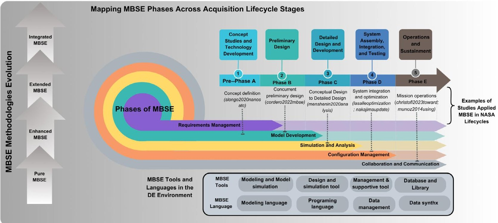

FIGURE 16 Phases of MBSE with MBSE enablers over lifecycle stages.

Model development phase directly supports systems architecture design and definition by enabling system decomposition, evaluation of design alternatives, and generation of coherent functional and logical models. This phase focuses on representing and analyzing behavioral and structural attributes of the maturing SoI as it progresses toward the development stage. It leverages modeling language-based tools and simulation environments to explore, synthesize, and validate system architecture often associated with requirement management. SysML provides formal semantics defining requirements, behavior, and structure, forming Authoritative source of truth for system design with traceability. When integrated with simulation and verification criteria, the system model supports digital thread execution, enabling early validation, design optimization, defect discovery, and performance assessment.

As demonstrated in the literature, model development capitalizes on maximizing the system's potential capabilities and identifying optimal solutions. Comprehensive modeling enables searches for system architectures that meet requirements and overcome systemic constraints, by facilitating early conceptual validation and trade-space analysis. Therefore, multiple application techniques are available, and arriving at the proper solution requires asking the question as What about the system of interest must MBSE resolve or unpack? This question drives discovery of the alternative solutions. These roles of steering the directions of the application from problem to solution space are embodied in MBSE methods. The findings detail the approach employed to address complexity, uncertainty, maximize capability, and explore novel designs. Integrate system design model attributes of the model can be extracted for analysis and concept validation leading to the design stage. Here, key considerations when selecting the modeling tool include system complexity, visualization support, and simulation capabilities.

Simulation and analysis are performed during the preliminary and detailed design stages, forming a continuous feedback loop

with model development during trade studies and optimization. These activities support the development of technical measures and detailed specifications by validating performance, refining designs and informing trade-offs. This phase optimizes the multidimensional application of MBSE, performs model-based RAMS that span from component-level to SoS validation. It also incorporates risk assessment, cost estimation, and quality assurance minimizing the likelihood of late-stage failures. In this phase, executable models help verify that system's MoP and MoE meet the defined functional requirements and expected behavioral attributes, particularly validating use cases at lower levels of abstraction. This iterative process between model development and simulation provides progressive refinement, where models are continuously updated until the optimal solution is obtained. Thereby, resulting robust design and reliable system realization before the progressing to the fabrication stage. This task is carried out using model simulators or discipline-specific tools, especially DSL and DSML, which enable precise behavioral modeling, parametric validation, and integration with physics-based models.

Enhanced MBSE is particularly effective in this phase, as they are intended to deliver engineering solutions targeting technical constraints, enhance design capability and performance improvements. By comparison, Extended MBSE facilitates a comprehensive analysis and management of system-wide attributes, including safety, risk, and quality assurance. System-wide assessment, management of system cost, risk, and solution engineering requires a substantial allocation of effort and resources that take into consideration management and technical measures. Generally, in SA phase, executable models are widely implemented to advance simulation, such as real-time system behavior testing and scenario-based simulation, which are essential for verifying performance in mission-specific conditions. This phase conducts loops of technical analysis and performing validation of define architecture and design integrated with other phases and automated for approved design in the V&V workflow. Therefore,

<!-- PDF_PAGE: 21 -->

it is critical to consider the compatibility of simulation and modeling tools to maximize the interdependence of data among DSL, data languages, and system simulation languages. These considerations help ensure the traceability of system parameters, maintaining the fidelity and reliability of the design.

Configuration management is identified as a central phase of the SE process for controlling, managing, and maintaining system consistency and integrity throughout the lifecycle. This phase establishes and preserves the interrelationship between the preceding three phases, becoming increasingly critical after the design stage. Configuration management ensures traceability from subsystem to system and throughout lifecycle phases, particularly in the assembly, integration, and testing stages (Phases A-C). The absence of a standard process for MBSE development presents a challenge, as there is no single method to address this issue comprehensively. Organizations typically resort to a mission-specific framework to maintain seamless processes and ensure digital continuity. For instance, the NASA JPL Europe Clipper team developed OpenCAESAR, which integrates multiple languages (OML, Python, C++, and Java API), COTS tools, and a Git repository, to facilitate an efficient and collaborative platform specifically tailored for these activities.

Centralizing the SE process facilitates not only the interaction between DE tools; but it also accounts for external contributors, multidisciplinary teams, and the managing multiple versions of systems throughout the lifecycle. As the literature indicates, the usefulness of MBSE is primarily concentrated in the initial phases of the lifecycle, configuration management frequently studied as a mechanism to ensure digital continuity and tool interoperability. However, the primary function of configuration management extends to ensuring compliance requirements and design by identifying and tracking configuration items, managing baselines, enforcing version control, and conducting verification audits. An effective CM phase must consider mechanisms for tracking changes, managing interoperability, and maintaining a synchronized model up-to-date using shared digital resources.

Collaboration and communication are integral to the entire MBSE, particularly in the ecosystem that follows collaborative-oriented applications such as concurrent engineering and Agile methods. This phase formulates strategies to optimize the interaction among multidisciplinary teams, enhance stakeholder engagement, and promote efficient information transfer. Concurrent facilities are often organized with collocated teams, scheduled changes, continuous collaboration, and streamlined workflow to drive engineering progress. This collaborative working environment, coordinated with MBSE configuration management further improves change management, interoperability, and managing system versions within a controlled ecosystem. Such efforts contributed to progress made to accelerating transition from problem definition to solution realization. Among the MBSE classifications, Integrated MBSE specifies the collaboration mechanism and organized data flow hierarchy to support modification, exchange and access. This collaborative-driven MBSE process empowers the concurrent team through centralized model repositories, offering collaborators with a multiview and multilayer bidirectional flow of information.

The inclusion of collaborative MBSE tools possesses built-in centralized storage, such as MBEHub and the C++ library, which facilitates the sharing of meta-models, allows for the exchange of model elements and introduces management layers. During the operation and maintenance phases, the mission model is used as a repository tool, to optimize operations and facilitate realtime diagnosis. It also supports various data formats, including SQL, XML, and XMI, and some are compatible with a web-based platforms. Studies in this phase emphasize the importance organizing strategic communication and streamlining collaboration throughout the project lifecycle. Particularly, MBSE application for complex missions focuses on developing effective collaboration and communication phases while also considering how to coordinate access to a unified system model that supports various layers of the enterprise, including strategic, operational, security, and other perspectives. These mechanisms accounted for layers of organizational or team structure with coordinated exchange to realize intended value and benefit.

In general, MBSE implementation through an enterprise approach considers the entire ecosystem to ensure comprehensive adoption. This strategy supports the alignment of MBSE phases with the project lifecycle, considering both operational and project-level views. The relationship discussed above between the phases and modeling enablers highlights the usability of MBSE artifacts and SE activities, providing significant value in determining whether objectives are met and results are actionable. For further reference, Appendices B-F provide detailed resources on language, tools, and methods used across MBSE phases, serving as practical guides for researchers and practitioners.

## 5 Global Discussion

Building upon the preceding analyses and findings, this section emphasizes a global view in which the objectives of MBSE applications can be generalized and structured to facilitate practical implementation. Several conditions closely influence its implementation, including organizational structure, decisionmaking processes, operations scale, investment levels, and management practices. These factors differ considerably between NewSpace entrants, SMEs, and legacy space institutions. Thus, the value and benefits of MBSE must be guided by clearly defined outcomes and control criteria established by governing and managing bodies.

Within the context of a defined SoI, the core purpose of MBSE is to align modeling efforts with targeted SE activities and support the execution of engineering processes throughout the system lifecycle. In this regard, the needs of a SoI must establish boundaries for the lifecycle scope, targeted quality attributes, and model usage of the intended application to ensure that the models are transformed into executable and actionable information. Therefore, when considering global MBSE implementation require upfront establishing governance, a defining metric for effectiveness, and identifying entrance and exit criteria. These elements are critical for assessing the MBSE maturity and evaluating the success of its outcomes. Although these aspects lie under scope cognitive dimensions of the present study, they are essential components for a complete enterprise-level and

<!-- PDF_PAGE: 22 -->

globally aligned MBSE implementation. The proposed method in this paper contributes to this need by offering a structured framework to support engineering activities from conception to retirement, detailing the distribution and function of enablers across defined phases.

Once the primary steps for tailoring MBSE approach are in place, the influencing factors that guide the selection of methods. These factors include defining the expected systems solution and how resulting outcomes are interpreted across mission timeline and so on. These considerations shape the necessity of MBSE based on mission complexity, resource availability, and program-specific constraints. As discussed in Section 4.1, this review offers a fourfold MBSE classification Pure, Enhanced, Extended, and Integrated MBSE reflecting these influencing factors and define the scope of implementation. Extended and Integrated MBSE approaches have shown flexible and broader lifecycle applicability but resource-intensive and time-consuming. In contrast, Enhanced MBSE yields effective results for discipline-focused experts, with expense of limited applicability and introduces heterogeneity when attempting to scale for lifecycle coverage.

NASA's Johnson Space Center promotes ontology-driven, adaptable, and tool-agonistic MBSE methods to accelerate the adoption. Once a MBSE methodology is selected, it guides the choices of tools and modeling languages required to support modeling objectives and carried out targeted SE tasks efficiently. MBSE tools serve interpret processes defined by methods, to visualize and perform design, integration, and verification tasks. The next practical consideration utilization of model artifacts to optimize efforts and ensuring responsiveness of project needs, governance of MBSE instigate the process or development cycles either in agile or iterative, concurrent, V-process with team. However, general-purpose MBSE tools, unless integrated in to cohesive DE environment, are insufficient to support and sustain lifecycle maturity and digital threading continuity.

While general-purpose MBSE tools are capable of modeling complex systems, they fall short of the precision and adaptability demanded by Enhanced and Extended MBSE. Consequently, multiple studies have reported adopting in-house tailored frameworks that demonstrate superior performance in complex SE tasks, collaboration network, integrated tools, unified data hubs, and structured workflows. These Integrated Modeling frameworks rely on simulation and DSL tools and modeling tools, and the integration mandates bidirectional information exchange and conversion formats. The proliferation of modeling language and data formats creates friction in traceability and parameters consistency. Python has been used in a few studies as a flexible scripting language for developing a models, manipulating and analyzing artifacts thereby reducing integration barriers. However, it lacks the semantic rigor and formal structure required to be reliable as a modeling backbone in MBSE applications. This is where SysML v2 introduces a tangible advancement by offering a formal, machine-readable syntax that supports programmable manipulation, parameterization, and integrated behavioral and structural analysis; regarding it as critical evolution in MBSE maturity.

The pattern observed in this review confirms that MBSE enablers exhibit distinct functional in engineering process. Therefore,

no single tool or method can optimize the MBSE adoption standalone; instead, their selection must be context-driven and matched to project needs and organizational objectives. Despite MBSE being widely endorsed by mainstream space agencies, practical adoption across space programs has remained within system understanding and architectural modeling. Compared to the rapid evolution of FEA, CAD, and DE tools, MBSE enablers have matured at a slower pace. This stagnation reduces MBSE's potential to act as ability a dynamic engineering asset. For MBSE to deliver on its promise, it must evolve from an architectural practice to serve as a DE backbone capable of justifying ROI through lifecycle value and informed decision-making.

## 5.1 Gaps and Challenges in Literature

A combination of analysis of both the quantitative distribution charts and the qualitative evaluation of MBSE phases and enablers revealed several recurring challenges in the current practice and literature of MBSE.

Quantitative assessment: The frequency of utilization of MBSE enablers across MBSE phases showed that when the MBSE method approach aimed to achieve wide coverage and flexibility, it came with the complexity of adopting diverse tools and languages. Targeted application MBSE focused on serving a particular SoI with Enhanced MBSE shows easier selection of MBSE enablers to perform tasks. As a result, the expected outcome of MBSE artifacts extracted, as well as their quality attributes, brought solutions that are direct and traceable. In contrast, extended and integrated MBSE approaches, covering a broader scope, demand coherent SE strategies and management practice. Their successful realization often depends on a cognitive maturity that evolves with experience and continuously improving knowledge systems empowered by ontology and digital libraries. Without these foundations, long-term benefits and continuous improvement efforts are harder to quantify, as a result, return on investment may remain unclear and untenable.

Tailored MBSE approaches offer value for specific mission needs but typically require additional resources for customization and integration relative to the scope they address. A considerable amount of literature references the utilization of multiple tools, a majority of which are designed to perform singular functions. Yet, a limited number of studies acknowledge the effort required to adapt these tools to varying mission scales and synchronization methodologies. The most widely available COTS modeling tools are geared toward internal system modeling and collaboration, but they fail to offer multidisciplinary integration and downstream usability. Also, COTS tools split functions into different packages, which hinders seamless toolchain integration and reduces engineers' ability to navigate problem and solution spaces holistically. Furthermore, the role of modeling languages is often overlooked, with many studies failing to specify the languages used. This omission restricts clarity on how MBSE artifacts interact across tools and phases. Without consistent data structures, MBSE implementations are exposed to manual transformation and conversion layers, which can introduce semantic misalignment, information loss, and weakened traceability.

<!-- PDF_PAGE: 23 -->

As a result, configuration management is often treated as data and model management in context of model-based rather than as a comprehensive lifecycle discipline. Within institutional space programs, formal CM practices such as interface control, traceability of configuration item, and model-based audits, which extends to later stage of lifecycle to support systems integration, testing, and verification. Despite their operational significance, these rarely detailed in the academic literature. This led to an under representation of MBSE artifacts that support audits, change tracking and integration, and validation during critical lifecycle stages.

Qualitative assessment: From a qualitative perspective, this review demonstrates that regardless of whether MBSE is implemented through a heterogeneous or homogeneous approach considerable studies acknowledge the applications' anecdotal value of its applications. On the contrary, one of the challenges identified is the lack of a value-driven application of MBSE, which emphasizes how values and artifacts are interpreted in relation to their intended use. While data, system models, and tools are often presented, they are not consistently aligned with mission objectives, which limits their utility in demonstrating impact on system performance or deliverables. Furthermore, although various tools are adopted, they often overlook communication mechanisms and how the interpretation of outputs supports technical reviews and decision-making. These challenges reduce the effectiveness of MBSE as a decision-support mechanism. It also raises a question: How can we quantify the degree of success in MBSE application to ensure its value and benefit? This topic requires further investigation in the future.

MBSE is commonly employed during early planning and development stages for design traceability and supporting feasibility studies within digital environments. However, the role of MBSE in later lifecycle stages, particularly during testing, integration, and verification, has poor visibility in literature, as indicated by the limited number of publications adequately reporting MBSE adoption Phases C and D. Executable models are beginning to expand these boundaries by enabling simulation and optimization in detailed design and fabrication stages, extending into Phases B and C. The ability of MBSE to support physical system development stages relies on enabling technologies like virtual reality, digital twins, surrogate models, and the internet of things. Although these practices are noted in a few studies, they are in an early maturity stage compared to the current trend of MBSE applications. This highlights a gap between operational MBSE capabilities and their representation in academic research, leaving important questions about how MBSE can support downstream engineering activities.

In context of NewSpace, the shift from document-centric to model-based approaches alone is insufficient to uphold the fundamental principles as customer-driven and accelerated time-to-market through traditional processes. These features raise the need for agile SE that is responsive to changing requirements, rapid design, and adaptive to self-organized teams, where quick decision-making and prioritization for actionable input are imperative. This is particularly salient for the implementation of CubeSat and university-led missions, which entail a disproportionate burden of cost and resources, rendering legacy MBSE

implementation impractical. The exploration of lightweight and scalable MBSE strategies that do not compromise potential benefits remains largely unexamined.

## 5.2 Opportunities and Future Research Direction

Considering the identified challenges, Table 5 summarizes key opportunities that this review contributes toward improving the value and effectiveness of MBSE adoption in space engineering. It outlines potential strategies to overcome persistent challenges in space missions development by leveraging structured MBSE practices tailored to diverse organizational needs and lifecycle stages.

## 5.3 Limitations of Literature Review

This study had a significant scope of coverage; however, it encountered several notable limitations. Access-restricted publications and the potential exclusion of relevant articles from databases outside primary sources and variant date search posed completeness of dataset. The inclusion criteria were deliberately focused on space engineering, emphasizing MBSE applications addressing highly sensitive and specialized space system designs issues. During synthesis, the marked (X) phases refer to a topic discussed in an individual study, but may not reflect the full extent of MBSE implementation, as some missions may have engaged in earlier or later phases not captured in paper. Additionally, ambiguity in the reported use of MBSE enablers, where methods, language, and tools were used interchangeably and loosely referred to as "MBSE," posed classification challenges. The classification of MBSE approaches was challenging due to the insufficient evidence regarding the depth or breadth of application within the papers studies. The tool capabilities described in this review are based solely on the tasks reported in the studies; some tools may offer broader or more functionalities than those stated. While the phases used in this review overlap with the system lifecycle and possess an interconnected relationship, this relationship map is incomplete due to the scope of this review being limited to the SoI layer. However, this does not invalidate their individual significance; rather, it reinforces the need for a simplified representation of MBSE activities and processes, leaves open the adoption of MBSE phases for further development.

## 6 Conclusion

In this comprehensive review, we analyzed 126 studies on space development to investigate the effectiveness and success of model-based system engineering applications in the space industry. To further examine the purpose and motivation of MBSE in space engineering, a state-of-the-art method was proposed linking SE activities across lifecycle stages into the following five MBSE phases: Requirements Management, Model Development, Simulation and Analysis, Configuration Management, and Collaboration and Communication. The literature indicates that, in addition government space agencies, the private and industrial sectors hold significant stakes in advancing and reaping the benefits of MBSE. Despite the general shift toward model-centric

<!-- PDF_PAGE: 24 -->

TABLE 5 Summary of gaps identified, opportunities provided by this paper, and future research directions.

<table border="1"><tr><td>Gap identified</td><td>Opportunities this paper provides</td><td>Future research direction</td></tr><tr><td>Lack of clear practical implementation pathways for new adopters, including assessing completion SE activities, maintaining clarity in objectives and process boundaries</td><td>The five phase MBSE anchor aligned with lifecycle stage provides a bounded structure that sequences activities and processes connections, and positions evaluation criteria.</td><td>Facilitate value-driven MBSE implementation providing an insight how to connect objective of application, extract MBSE artifacts for translation, and integrate evaluation criteria to control quality of model outcome across lifecycle stages.</td></tr><tr><td>Fragmented toolchains, lack of interoperability across tools and lifecycle stages</td><td>This paper maps MBSE phases to enablers guiding practical selection and identifying reusable toolchain, frameworks and open-source packages proven in the literature to support the corresponding SE activities</td><td>Advanced integrated digital engineering environments that unify modeling, simulation, and analysis tools ensuring model and syntax continuity in down-stream MBSE (NASA phases C/D) including readiness for software/hardware/system integration.</td></tr><tr><td>Resource mismatched MBSE frameworks for lightweight or small scale missions</td><td>This paper introduces a classification of MBSE approach (Pure, Enhanced, Extended, and Integrated) promoting tailored adoption for mission scale and maturity with example of open source tools.</td><td>Develop modular scalable MBSE frameworks and adoption playbooks for resource constrained missions (e.g., CubeSats), focusing on cost-effectiveness, rapid prototyping, and mission assurance trade-offs.</td></tr><tr><td>Lack of integration between MBSE artifacts, project governance and evidence for ROI</td><td>This review aligns MBSE phases with programmatic gates and critical design events (e.g., PDR, CDR), reinforcing traceability from artifacts to milestone decisions and system assurance.</td><td>Define model governance strategies and lifecycle traceability mechanisms that integrate MBSE artifacts with project deliverables, open-up a metric-based management and performance indicators linked to MBSE phases for value-realization frameworks.</td></tr><tr><td>Misalignment between MBSE strategies and the evolving demands of space industry</td><td>This paper contextualizes selective MBSE implementation strategies matching these needs, for instance, accounting for characteristics of NewSpace enterprises such as acceptable risk, rapid iteration, and distributed development teams</td><td>Investigate transition pathways from prototype to production in agile aerospace enterprises, refining MBSE to support in-house design, test, and manufacturing while preserving the rest of engineering process.</td></tr></table>

engineering, there is no clear convergence around a unified MBSE practice within space industry. This diversity of practices poses challenges establishing consistent evaluation criteria or shared framework for assessing MBSE effectiveness. This review identified objectives-driven perspectives that reveal the rationale behind MBSE adoption in different space mission profile. It also analyzed the capabilities of MBSE enablers (methods, languages, and tools) used in implementation. Through a combination of quantitative analysis of MBSE enables by frequency utilization and qualitative analysis of their functional role and alignment SE tasks, the study addressed RQs (RQ1 to RQ5) as outlined below.

The investigation into the evolution of the MBSE application resulted in an archetypal classification into pure, enhanced, extended, and integrated MBSE (RQ1). This finding shows that MBSE strategies evolve along mission complexity, system lifecycle needs, and organization maturity. This classification offers a mechanism for tailoring the MBSE application to maximize engineering value depending on the diversity of space programs. The RQ2 finding highlights that MBSE relies on general modeling languages such as SysML and UML by default. However, recent practice incorporates data, programming, and hardware languages to reduce fragmentation of MBSE during complex system lifecycles. Consequently, space agencies' initiatives have begun adopting MBSE frameworks including cloud-based platforms, centralized digital resources, and data-hubs to improve model executability and enable advanced engineering functionalities, as a result, the efficacy of the digital thread (RQ3). Exporting MBSE artifacts into management tools via compatible data syntax and script language further enhances usability, supports critical reviews and tracking project milestones. In addition to a strategic approach taken, the effectiveness of MBSE is primarily determined by how well-defined needs are aligned with selected MBSE enablers, and how effectively they implement the SE task and deliver quality solutions (RQ4). Finally, the underlying gap identified is that only a few studies explicitly demonstrate how MBSE supports the mission objectives. This lack of a targeted objective and the limited interpretation of the MBSE application may be a root cause for dispersed efforts and a lack of measurable outcomes (RQ5).

In conclusion, this review provides a global perspective on MBSE practices in the space industry and encourages practitioners to define clear objectives and align the acquisition lifecycle with SE

<!-- PDF_PAGE: 25 -->

activities. This alignment helps focus SE efforts on acquiring the targeted quality, producing timely and valuable MBSE artifacts. In future work, we aim to apply the proposed framework as an enterprise strategy to demonstrate measurable MBSE in agile environments, particularly within the NewSpace sector.

## Acknowledgments

The authors of this article would like to acknowledge the sources of research funding, namely the Ministry of Europe and Foreign Affairs of France, the ICUBE Lab, and Campus France and Schlumberger Foundation, which organized and facilitated the research. The authors express their sincere gratitude to Eric Bonjour, a professor at the University of Lorraine; Engineer Marcos Eduardo, a systems engineering and MBSE expert at Capgemini Engineering; and Dr. Boris Serget, a scholar at CENSUS, Paris Observatory, for their invaluable time and expertise in contributing to the survey. Their contributions have significantly enriched the reliability of this research. In addition, the authors would like to pass their gratitude to institute research partners at the Ethiopian Space Science and Technology Institute (ESSTi) for providing technical resources and facilities.

Open access publication funding provided by COUPERIN CY26.

## Funding

This work was supported by the Schlumberger Foundation, France Ministry of Europe and Foreign Affairs and ICube UMR 7357, University of Strasbourg.

## Conflicts of Interest

The authors declare no conflicts of interest.

## Data Availability Statement

The data that support the findings of this study are available from the corresponding author upon reasonable request.

## References

1. J. A. Estefan and T. Weilkiens, "Survey of Model-Based Systems Engineering (MBSE) Methodologies," INCOSE MBSE Focus Group 25 (2007): 1-12.

2. L. Baker, P. Clemente, B. Cohen, L. Permenter, B. Purves, and P. Salmon, "Foundational Concepts for Model Driven System Design," INCOSE Model Driven System Design Interest Group 16 (2000): 15-16.

3. H. Chrisp and W. Richard, Technical Operations International Council on Systems Engineering (INCOSE, 2007).

4. INCOSE. Systems Engineering Vision 2020. 2007. January 31, 2021, https://sdincose.org/wp-content/uploads/2011/12/SEVision2020_ 20071003_v2_03.pdf.

5. L. Delligatti, SysML Distilled: A Brief Guide to the Systems Modeling Language (Addison-Wesley, 2013).

6. A. Khandoker, S. Sint, G. Gessl, et al., "Towards a Logical Framework for Ideal MBSE Tool Selection Based on Discipline Specific Requirements," Journal of Systems and Software 189 (2022): 111306.

7. C. Coelho, L. Lica, K. Schneider, et al., "Towards a MBSE Best Practices Book for Space Projects," in Model Based Space Systems and Software Engineering (MBSE2021), (ESA, September 2021).

8. H. P. de Koning, H. Eisenmann, and M. Bandecchi, "Evolving Standardization Supporting Model Based Systems Engineering," in SECESA, vol. 1 (2010).

9. D. de Lange, J. Guo, and H. P. de Koning, Applicability of SysML to the Early Definition Phase of Space Missions in a Concurrent Environment. in Complex Systems Design & Management, eds. O. Hammami, D. Krob, and J. L. Voirin (Springer, 2012), https://doi.org/10.1007/978-3-642-25203-7_12D.

10. K. J. Weiland, Future Model-Based Systems Engineering Vision and Strategy Bridge for NASA, Technical Report 20210014025, NASA/TM; 20210014025(NASA, 2021).

11. J. R. Knizhnik, K. J. Weiland, T. A. Grondin, K. M. Jones-McDowall, and J. B. Holladay, "Realized Benefits From the Model-Based Systems Engineering Infusion and Modernization Initiative," in 63rd Space Sciences and Technology Conference (2019). NF1676L-33895.

12. R. De Ferluc and M. Panunzio, Experience Report: History and State of the Practice of Model-Based Software Engineering in Thales Alenia Space in France (ESA, 2020).

13. R. Ferguson, J. Marshall, and M. Guzman, "Adapting Progressive MBSE Development to Document Based Contracts," in 2020 IEEE Aerospace Conference (Big Sky, 2020), 1-11, https://doi.org/10.1109/AERO47225.2020.9172671.

14. S. Ulonska and T. Welo, "Need Finding for the Development of a Conceptional, Engineering-Driven Framework for Improved Product Documentation," Procedia Computer Science 16 (2013): 423-432, https:// doi.org/10.1016/j.procs.2013.01.044.

15. J. Gregory, L. Berthoud, T. Tryfonas, A. Rossignol, and L. Faure, "The Long and Winding Road: MBSE Adoption for Functional Avionics of Spacecraft," Journal of Systems and Software 160 (2020): 110453, https:// doi.org/10.1016/j.jss.2019.110453.

16. L. Wang, M. Izygon, S. Okon, H. Wagner, and L. Garner, "Effort to Accelerate MBSE Adoption and Usage at JSC," in AIAA (2016), 5542. https://doi.org/10.2514/6.2016-5542.

17. F. A. Halstenberg, K. Lindow, and R. Stark, "Leveraging Circular Economy Through a Methodology for Smart Service Systems Engineering," Sustainability 11, no. 13 (2019): 3517, https://doi.org/10.3390/su11133517.

18. S. Mazzini, E. Tronci, C. Paccagnini, and X. Olive, "A Model-Based Methodology to Support the Space System Engineering (MBSSE)," in ERTS2 (Embedded Real Time Software & Systems, 2010).

19. P. J. Younse, J. E. Cameron, and T. H. Bradley, "Comparative Analysis of Model-Based and Traditional Systems Engineering Approaches for Architecting a Robotic Space System Through Automatic Information Transfer," IEEE Access 9 (2021): 107476-107492, https://doi.org/10.1109/ ACCESS.2021.3096468.

20. W. Xu, L. Wang, H. Pan, and K. Lu, "Application of Model-Based Systems Engineering in Virtual Tests of the Spacecraft," in Proceedings of the International Astronautical Congress, IAC, vol. 3 (2017), 1359-1364. https://www.scopus.com/inward/record.uri?eid=2-s2.0-85051427807& partnerID=40&md5=831a60d073f13640dbfae703022a204b.

21. A. K. Raz, E. P. Blasch, C. Guariniello, and Z. T. Mian, "An Overview of Systems Engineering Challenges for Designing AI-Enabled Aerospace Systems," in AIAA Scitech 2021 Forum (2021), 0564, https://doi.org/10. 2514/6.2021-0564.

22. M. Chami and J.-M. Bruel, "A Survey on MBSE Adoption Challenges," in INCOSE EMEA Sector Systems Engineering Conference (INCOSE EMEASEC 2018) (2018).

23. J.-C. Chaudemar and P. de Saqui-Sannes, "MBSE and MDAO for Early Validation of Design Decisions: a Bibliography Survey," in 2021 IEEE International Systems Conference (SysCon) (Vancouver, BC, Canada, 2021), 1-8, https://doi.org/10.1109/SysCon48628.2021.9447140.

24. T. Huldt and I. Stenius, "State-of-Practice Survey of Model-Based Systems Engineering," Systems Engineering 22 (2019): 134-145, https://doi.org/10.1002/sys.21466.

25. R. Pinquié, V. Romero, and F. Noel, "Survey of Model-Based Design Reviews: Practices & Challenges?," Proceedings of the Design Society 2 (2022): 1945-1954, https://doi.org/10.1017/pds.2022.197.

<!-- PDF_PAGE: 26 -->

26. J. Ma, G. Wang, J. Lu, H. Vangheluwe, D. Kiritsis, and Y. Yan, "Systematic Literature Review of MBSE Tool-Chains," Applied Sciences 12, no. 7 (2022): 3431, https://doi.org/10.3390/app12073431.

27. S. L. Cornford, D. Kotsifakis, S. Beckman, M. S. Feather, and J. W. Evans, "NASA Quality Assurance in an MBSE World," in 2020 Annual Reliability and Maintainability Symposium (RAMS) (2020), 1-6, https:// doi.org/10.1109/RAMS48030.2020.915368.

28. S. S. Cordero, T. Gateau, and R. Vingerhoeds, "MBSE Challenges in the Concurrent Preliminary Design of CubeSats: Nanospace Study," in 2022 IEEE International Systems Conference (SysCon) (2022), 1-8, https://doi.org/10.1109/SysCon53536.2022.9773818.

29. J. B. Holladay, J. Knizhnik, K. J. Weiland, A. Stein, T. Sanders, and P. Schwindt, "MBSE Infusion and Modernization Initiative (MIAMI): "Hot" Benefits for Real NASA Applications," in 2019 IEEE Aerospace Conference (Big Sky, 2019), 1-14, https://doi.org/10.1109/AERO.2019. 8741795.

30. H. Jeffrey, Lessons Learned in Applying MBSE to the Development of Autonomous and Highly Secure Nanosatellites (ESA, 2022).

31. J. Kößler and K. Paetzold, "Integration of MBSE Into Existing Development Processes-Expectations and Challenges," in DS 87-3 Proceedings of the 21st International Conference on Engineering Design (ICED 17), vol. 3 (Product, Services and Systems Design, 2017), 051-060, https://doi.org/ 10.1016/j.procir.2021.05.003.

32. A. Akundi and V. Lopez, "A Review on Application of Model Based Systems Engineering to Manufacturing and Production Engineering Systems," Procedia Computer Science 185 (2021): 101-108, https://doi.org/ 10.1016/j.procs.2021.05.011.

33. M. Rashid and M. W. Anwar, "A Systematic Investigation of Tools in Model Based System Engineering for Embedded Systems," in 2016 11th System of Systems Engineering Conference (SoSE) (2016), 1-6, https://doi.org/10.1109/SYSOSE.2016.7542949.

34. M. J. Page, J. E. McKenzie, P. M. Bossuyt, et al., "The PRISMA 2020 Statement: An Updated Guideline for Reporting Systematic Reviews," International Journal of Surgery 88 (2021): 105906, https://doi.org/10.1136/bmj.n71.

35. 24641:2023(E)-ISO/IEC/IEEE International Standard - Systems and Software Engineering-Methods and Tools for Model-Based Systems and Software Engineering (ISO/IEC/IEEE, 2023), 1-98, https://doi.org/10. 1109/IEEESTD.2023.10123376.

36. ISO/IEC/IEEE International Standard - Systems and Software Engineering - System Life Cycle Processes, ISO/IEC/IEEE 15288, 1st ed. (2015) 1-118, https://doi.org/10.1109/IEEESTD.2015.7106435.

37. B. L. Papke, G. Wang, R. Kratzke, and C. Schreiber, "Implementing MBSE-an Enterprise Approach to an Enterprise Problem," INCOSE International Symposium 30, no. 1 (2020): 1550-1567, https://doi.org/10. 1002/j.2334-5837.2020.00803.x.

38. C. Haskins, K. Forsberg, and M. Krueger, Systems Engineering Handbook: A Guide for System Life Cycle Processes and Activities (INCOSE, 2011).

39. D. D. Walden, G. J. Roedler, and K. Forsberg, "INCOSE Systems Engineering Handbook Version 4: Updating the Reference for Practitioners," INCOSE International Symposium 25 (2015): 678-686.

40. M. Rodano and K. Giammarco, "A Formal Method for Evaluation of a Modeled System Architecture," Procedia Computer Science 20 (2013): 210- 215, https://doi.org/10.1016/j.procs.2013.09.263.

41. H. Liu, Z. Li, and Y. Xu, "Research and Application of MBSE Method to Lunar Extra-Vehicular Activities Mission," in 2nd International Conference on Mechanical, Electronics, and Electrical and Automation Control (METMS 2022), vol. 12244 (SPIE, 2022), 196-201, https://doi.org/10.1117/12.2635284.

42. D. Panson, K. Cade, and W. Robey, "Air Force Enterprise Modeling, Simulation and Analysis and the Digital Enterprise," in 2021 Virtual Simulation Innovation Workshop, SIW (2021), https://www.scopus.

com/inward/record.uri?eid=2-s2.0-85124067069&partnerID=40&md5= 90ebe635596aa9df40338251550e72b5.

43. Y. Nakajima, "Update on the Applications of Model-Based Systems Engineering for JAXA's Engineering Test Satellite-9 Project," in MBSE 2022/SECESA 2022 (2022).

44. M. L. Grande, A. S. Patel, L. D. Durbin, and D. A. DeLaurentis, "Modeling Architectures and Parameterization for Spacecraft," in AIAA Scitech 2020 Forum (2020), 0218, https://doi.org/10.2514/6.2020-0218.

45. E. L. Parrott, "A PPE Use Case on Configuration Management Approach for MBSE," in 2023 IEEE Aerospace Conference (IEEE, 2023), 1-8, https://doi.org/10.1109/AERO55745.2023.10116017.

46. S. P. Haveman and G. M. Bonnema, "Requirements for High-Level Models Supporting Design Space Exploration in Model-Based Systems Engineering," Procedia Computer Science 16 (2013): 293-302, https://doi.org/10.1016/j.procs.2013.01.031.

47. D. Inkermann, T. Huth, T. Vietor, A. Grewe, C. Knieke, and A. Rausch, "Model-Based Requirement Engineering to Support the Development of Complex Systems," Procedia CIRP 84 (2019): 239-244, https://doi.org/10. 1016/j.procir.2019.04.345.

48. I. Rountree, "MBSE Applications for the MSR SRC Mars Ascent Vehicle," in 2022 IEEE Aerospace Conference (AERO) (IEEE, 2022), 1-14. https://doi.org/10.1109/AERO53065.2022.9843502.

49. N. Phojanamongkolkij, K. Lee, S. T. Miller, et al., "Modeling to Mars: A NASA Model Based Systems Engineering Pathfinder Effort," in AIAA SPACE and Astronautics Forum and Exposition (2017), 5235, https://doi. org/10.2514/6.2017-5235.

50. K. Buitendijk and C. Arauco Flores, "Creating a Space System Ontology Using "Fact Based Modeling" and "Model Driven Development" Principles," in On the Move to Meaningful Internet Systems: OTM 2019 Workshops: Confederated International Workshops: EI2N, FBM, ICSP, Meta4eS and SIAnA 2019, Rhodes, Greece, October 21-25, 2019, Revised Selected Papers (Springer, 2020), 127-138, https://doi.org/10.1007/978-3-030-40907-4_13.

51. T. Weilkiens, A. Scheithauer, M. Di Maio, and N. Klusmann, "Evaluating and Comparing MBSE Methodologies for Practitioners," in 2016 IEEE International Symposium on Systems Engineering (ISSE) (2016), 1-8. https://doi.org/10.1109/SysEng.2016.7753174.

52. P. De Saqui-Sannes, R. A. Vingerhoeds, C. Garion, and X. Thirioux, "A Taxonomy of MBSE Approaches by Languages, Tools and Methods," IEEE Access 10 (2022): 120936-120950, https://doi.org/10.1115/DETC2021-69125.

53. A. E. Trujillo and A. M. Madni, Exploration of MBSE Methods for Inheritance and Design Reuse in Space Missions. in Recent Trends and Advances in Model Based Systems Engineering, eds. A. M. Madni, B. Boehm, D. Erwin, M. Moghaddam, M. Sievers, and M. Wheaton (Springer, 2022), https://doi.org/10.1007/978-3-030-82083-1_47.

54. R. Robert, E. Thompson, J. M. Colombi, J. Black, and B. J. Ayres, "Disaggregated Space System Concept Optimization: Model-Based Conceptual Design Methods," Systems Engineering 18, no. 6 (November 2015): 549-567, https://doi.org/10.1002/sys.21310.

55. C. L. Davis and R. Sega, "Using MBSE in Feasibility Study by Developing A Reference Architecture for a Deep Space Habitat," in AIAA SPACE and Astronautics Forum and Exposition, SPACE 2017 (2017).

56. A. Akundi, T.-L. B. Tseng, C. N. Almeraz, R. J. Lopez-Terrazas, and H. Luan, "A Novel Approach to Behavior Design for Model Based Systems Engineering Application Using Design Structure Matrix," in 2021 IEEE International Systems Conference (SysCon) (Vancouver, BC, Canada, 2021), 1-7, https://doi.org/10.1109/SysCon48628.2021.9447074.

57. M. Bajaj, D. Zwemer, R. Yntema, et al., "MBSE++ — Foundations for Extended Model-Based Systems Engineering Across System Lifecycle," INCOSE International Symposium 26 (2016): 2429-2445, https://doi.org/ 10.1002/j.2334-5837.2016.00304.x.

58. K. Diatte, B. O'Halloran, and D. L. Van Bossuyt, "The Integration of Reliability, Availability, and Maintainability Into Model-Based

<!-- PDF_PAGE: 27 -->

Systems Engineering," Systems 10 (2022): 101, https://doi.org/10.3390/ systems10040101.

59. S. Darpel, S. Beckman, T. Ferlin, M. Havenhill, E. Parrot, and K. Harcula, "Method for Tracking and Communicating Aggregate Risk Through the Use of Model-Based Systems Engineering (MBSE) Tools," Journal of Space Safety Engineering 7, no.1 (2020): 11-17, https://doi.org/ 10.1016/j.jsse.2020.01.001.

60. N. Waldram and S. Cornford, "Pathfinding Model-Based Mission Assurance: S&MA Representation & Interaction within MBSE," in 2020 IEEE Aerospace Conference (Big Sky, 2020), 1-9, https://doi.org/10.1109/AERO47225.2020.9172738.

61. P. M. Fischer, D. Lüdtke, C. Lange, et al., "Implementing Model-Based System Engineering for the Whole Lifecycle of a Spacecraft," CEAS Space Journal 9 (2017): 351-365, https://doi.org/10.1007/s12567-017-0166-4.

62. O. Sindiy, T. Mozafari, and C. Budney, "Application of Model-Based Systems Engineering for the Development of the Asteroid Redirect Robotic Mission," in AIAA (2016), 5312, https://doi.org/10.2514/6.2016-5312.

63. W. Wenyue, H. Junjie, M. Yinxuan, Jinjie, and L. Zhiang, "Application and Development of MBSE in Aerospace," Journal of Physics: Conference Series 2235 (2022): 012021, https://doi.org/10.1088/1742-6596/2235/1/012021.

64. A. N. M. C. Files, OMG Unified Modeling Language TM (OMG UML) (Object Management Group, 2013), 1-752.

65. M. Amissah, "A Framework for Executable Systems Modeling" (PhD diss., Engineering Management & Systems Engineering, Old Dominion University, 2018), https://doi.org/10.25777/f1h6-e712.

66. S. Alex Rambikur, K. Giammarco, and B. OHalloran, "Increasing System Failure Analysis Effectiveness Through Architecture Modeling," Procedia Computer Science 114, C (November 2017): 4-13, https://doi.org/ 10.1016/j.procs.2017.09.057.

67. N. Christofi and X. Pucel, "A Novel Methodology to Construct Digital Twin Models for Spacecraft Operations Using Fault and Behaviour Trees," in Proceedings of the 25th International Conference on Model Driven Engineering Languages and Systems: Companion Proceedings (2022), 473-480. https://doi.org/10.1145/3550356.3561550.

68. L. Rana, V. Bohlachov, and A. Hein, "Integrated Spacecraft Design: Demonstration of a Prototype Process and Platform for Satellite Design Application," in Proceedings of International Astronautical Congress (2022).

69. Y. Huang, B. Hu, W. Diao, and Z. Xia, "Research on Satellite Modeling and Real-Time Simulation Monitoring Based on MBSE," in 2022 2nd Asia-Pacific Conference on Communications Technology and Computer Science (ACCTCS) (IEEE, 2022), 257-262, https://doi.org/10.1109/ACCTCS53867. 2022.00060.

70. H. D. Gans and R. Cuellar, "Using a Model-Based Systems Engineering (MBSE) Variant Approach for Architecting Signal Processing in a Space-Based Sensor," in AIAA (2020), 4093, https://doi.org/10.2514/6. 2020-4093.

71. A. R. Kulkarni, D. Bansal, G. La Rocca, et al., "An MBSE Approach to Support Knowledge Based Engineering Application Development," in Aerospace Europe Conference: Joint 10th EUCASS-9th CEAS Conference (TU Delft, 2023), https://doi.org/10.13009/EUCASS2023-495.

72. A. Berriche, F. Mhenni, A. Mlika, and J.-Y. Choley, "Towards Model Synchronization for Consistency Management of Mechatronic Systems," Applied Sciences 10, no. 10 (2020): 3577, https://doi.org/10.3390/app10103577.

73. J. Rimani, S. Lizy-Destrez, J.-C. Chaudemar, and N. Viola, "MBSE Approach Applied to Lunar Surface Exploration Elements," in ASCEND 2020 (2020).

74. B. Tekinerdogan, "On the Notion of Digital Twins: A Modeling Perspective," Systems 11, no. 1 (2022): 15, https://doi.org/10.3390/systems11010015.

75. M. Munoz Fernandez, "Using AADL to Enable MBSE for NASA Space Mission Operations," in SpaceOps 2014 Conference (2014), 1755, https:// doi.org/10.2514/6.2014-1755.

76. P. Minacapilli and M. Lavagna, "Small Sats Lifecycle Management Through MBSE Aided Decision Making Tailored Tool," in International Astronautical Congress: IAC Proceedings (2021), 1-17.

77. B. Lohar and R. J. Cloutier, "Towards a Model-Based Pattern Language for New Space-Based Systems," preprint, August 2022, https://doi.org/10.20944/preprints202208.0177.v1.

78. D. Kaslow, P. T. Cahill, and B. Ayres, "Development and Application of the CubeSat System Reference Model," in 2020 IEEE Aerospace Conference (2020), 1-15, https://doi.org/10.1109/AERO47225.2020.9172714.

79. W. Zhang, Z. Liu, X. Liu, Y. Jin, Q. Wang, and R. Hong, "Model-Based Systems Engineering Approach for the First-Stage Separation System of Launch Vehicle," Actuators 11 (2022): 366, https://doi.org/10.3390/ act11120366.

80. G. Cataldo, M. B. Niedner, D. J. Fixsen, and S. H. Moseley, "Modelbased Thermal System Design Optimization for the James Webb Space Telescope," Journal of Astronomical Telescopes, Instruments, and Systems 3, no. 4 (2017): 044002, https://doi.org/10.1117/1.JATIS.3.4.044002.

81. S. L. Raghu, M. Tudor, L. D. Thomas, and G. Wang, "MBSE Utilization for Additive Manufactured Rocket Propulsion Components," in 2022 IEEE Aerospace Conference (AERO) (IEEE, 2022), 1-14, https://doi.org/10. 1109/AERO53065.2022.9843586.

82. A. Trujillo, O. L. De Weck, and A. M. Madni, "An MBSE Approach Supporting Technical Inheritance and Design Reuse Decisions," in AIAA (2020), 4167, https://doi.org/10.1007/978-3-030-27486-3_47-1.

83. Y. Menshenin and E. Crawley, "Applying the Model-Based Concept Framework to Capturing the Safety Aspects of the Suborbital Human Spaceflight Missions," Journal of Space Safety Engineering 6, no. 4 (2019): 235-247, https://doi.org/10.1016/j.jsse.2019.10.008.

84. S. Nag, S. P. Hughes, and J. Le Moigne, "Streamlining the Design Tradespace for Earth Imaging Constellations," in AIAA (2016), 5561, https://doi.org/10.2514/6.2016-5561.

85. J. Crane and L. Brownlow, "Optimization of Multi-Satellite Systems Using Integrated Model Based System Engineering (MBSE) Techniques," in 2015 Annual IEEE Systems Conference (SysCon) Proceedings (IEEE, 2015), 206-211, https://doi.org/10.1109/SYSCON.2015.7116753.

86. K. McGuire, B. Easter, J. Mindock, et al., "Using Systems Engineering to Develop an Integrated Crew Health and Performance System to Mitigate Risk for Human Exploration Missions," in 50th International Conference on Environmental Systems (2021).

87. S. Peters, C. Fortin, and G. McSorley, "Investigating the Effectiveness of a Causal MBSE Software Tool in Modelling Cubesat Conceptual Design Data," in IFIP International Conference on Product Lifecycle Management (Springer, 2021), 128-142, https://doi.org/10.1007/978-3-030-94399-8_10.

88. T. Bayer, J. Day, E. Dodd, et al., "Europa Clipper: MBSE Proving Ground," in 2021 IEEE Aerospace Conference (50100) (IEEE, 2021), 1-19, https://doi.org/10.1109/AERO50100.2021.9438186.

89. C. Nigischer, S. Bougain, R. Riegler, H. P. Stanek, and M. Grafinger, "Multi-Domain Simulation Utilizing SysML: State of the Art and Future Perspectives," Procedia CIRP 100 (2021): 319-324, https://doi.org/10.1016/j.procir.2021.05.073.

90. R. M. Perez, "Application of MBSE to Risk-Informed Design Methods for Space Mission Applications," in AIAA Space 2014 Conference and Exposition (2014), 4411, https://doi.org/10.2514/6.2014-4411.

91. J. LASALLE, I. HERNANDEZ, N. CORCORAL, and J. REY, "Optimization of kinéis (Nano-Satellites Constellation) System Tests Using MBSE Approach," in MBSE 2022 (2022).

92. D. Kaslow, L. Anderson, S. Asundi, et al., "Developing a CubeSat Model-Based System Engineering (MBSE) Reference Model-Interim Status," in 2015 IEEE Aerospace Conference (2015), 1-16, https://doi.org/10. 1109/AERO.2017.7943691.

<!-- PDF_PAGE: 28 -->

93. K. Latserus and A. Ivanov, "Analysis and Implementation of MBSE Approach to Select an Authoritative Source of Truth for Space Systems Lifecycle Management," in Proceedings of the International Astronautical Congress, IAC (2021), https://doi.org/10.1109/ACCESS.2021.3123348.

94. R. Bernijazov, M. Hillebrand, C. Bremer, L. Kaiser, and R. Dumitrescu, "Specification Technique for Virtual Testbeds in Space Robotics," Procedia Manufacturing 24 (2018): 271-277, https://doi.org/10.1016/j.promfg.2018.06.028.

95. K. Tiensuu, Development of Operations Complement to the Space System Ontology (Luleå University of Technology, Space Technology, 2022), https://doi.org/10.2514/6.2024-1445.

96. M. Halvorson and L. D. Thomas, "Architecture Framework Standardization for Satellite Software Generation Using MBSE and F Prime," in 2022 IEEE Aerospace Conference (AERO) (IEEE, 2022), 1-20, https://doi.org/10.1109/AERO53065.2022.9843358.

97. R. A. Sharples, "Implementation of Human System Integration (HSI) and 'Non-Functional Characteristics' Into the Systems Engineering Lifecycle - a Practical Approach at Airbus Defence and Space," Procedia Manufacturing 3 (2015): 1896-1902, https://doi.org/10.1007/978-3-319-41935-0_7.

98. T. Leclerc, S. Paul, J. Roberts, et al., "A Flexible and Robust Framework for the Secure Systems Engineering of Space Missions," in 17th International Conference on Space Operations 2023 (March 2023), https://hal.science/hal-04045293.

99. J. Bussemaker, P. D. Ciampa, and B. Nagel, "System Architecture Design Space Modeling and Optimization Elements," in International Council of the Aeronautical Sciences (ICAS-2021) (2021), https://doi.org/ 10.1007/s12567-025-00626-7.

100. S. Estable, T. Granger, T. Lochow, et al., "Systems Modelling and Simulation of the ESA e.Deorbit Space Debris Removal Mission," in Proceedings of the NAFEMs (2017), 1-41.

101. J. Gregory, L. Berthoud, T. Tryfonas, and A. Prezzavento, "Early Validation of the Data Handling Unit of a Spacecraft Using MBSE," in 2019 IEEE Aerospace Conference (2019), 1-15.

102. F. Schummer and M. Hyba, "An Approach for System Analysis With Model-Based Systems Engineering and Graph Data Engineering," Data-Centric Engineering 3 (2022): e33.

103. M. Lutfi and R. Valerdi, "Executable Modeling of a CubeSat-Based Space Situational Awareness System," (Springer, 2022), 475-484, https:// doi.org/10.1007/978-3-030-82083-1_40.

104. D. Fischer, F. Keck, M. Spada, M. Wallum, and T. Stoitsev, "Leveraging MBSE for ESA Ground Segment Engineering: Starting With the Euclid Mission," in 2018 SpaceOps Conference (2018), 2572, https://doi. org/10.2514/6.2018-2572.

105. T. Firchau, M. Jetzschmann, and F. Nohka, "Applying MBSE to Data Handling System Design of a Small Satellite Platform for Multiple Missions," in 2022 IEEE Aerospace Conference (AERO) (IEEE, 2022), 1-10, https://doi.org/10.1109/AERO53065.2022.9843471.

106. S. C. Spangelo, D. Kaslow, C. Delp, et al., "Applying Model Based Systems Engineering (MBSE) to a Standard cubesat," in 2012 IEEE Aerospace Conference (IEEE, 2012), 1-20, https://doi.org/10.1109/AERO63441.2025. 11068482.

107. A. Bombardelli, A. Bonizzi, M. Bozzano, et al., "COMPASTA: Integrating COMPASS Functionality Into Taste," ACM SIGAda Ada Letters 43 (2023): 54-57, https://doi.org/10.1145/3631483.3631489.

108. A. C. de Paula Silva and G. Loureiro, "Simultaneous and Collaborative Development of Satellites and Information Systems to Support Their Lifecycle Processes," Information Systems 111 (2023): 102125.

109. B. Barritt, W. Eddy, S. Matthews, and K. Bhasin, "Integrated Approach to Architecting, Modeling, and Simulation of Complex Space Communication Networks," in SpaceOps 2010 Conference Delivering on the Dream Hosted by NASA Marshall Space Flight Center and Organized by AIAA (2012), 1941.

110. J. Chong, H. Zhou, M. Wang, and Y. Chen, "A Design Framework for Complex Spacecraft Systems With Integrated Reliability Using MBSE Methodology," in Signal and Information Processing, Networking and Computers: Proceedings of the 8th International Conference on Signal and Information Processing, Networking and Computers (ICSINC) (Springer, 2022), 165-173.

111. P. Srivastava, I. Harris, V. Seth, B. Shockley, J. Williams, and X. Wang, "System Validation on the Europa Clipper Mission in Early Implementation Phase," in 2021 IEEE Aerospace Conference (50100) (2021), 1-9.

112. Y. Hu, Q. Peng, Q. Ni, X. Wu, and D. Ye, "Event-Based Safety and Reliability Analysis Integration in Model-Based Space Mission Design," Reliability Engineering & System Safety 229 (2023): 108866.

113. L. Bitetti, R. De Ferluc, D. Mailland, G. Gregoris, and F. Capogna, "Model Based Approach for RAMS Analyses in the Space Domain With Capella Open-Source Tool," in Model-Based Safety and Assessment: 6th International Symposium, IMBSA 2019, Thessaloniki, Greece, October 16-18, 2019, Proceedings (Springer, 2019), 18-31.

114. Y. Nakajima and T. Fukatsu, "MBSE-Driven Exploratory System Architecture Analysis Framework for the Engineering Test Satellite-9 Project," in AIAA (2022), 4385.

115. E. Honoré-Livermore and C. Haskins, "Model-Based Systems Engineering for CubeSat FMECA," (Springer, 2022), 529-540.

116. E. Rochford, "A Model-Based Systems Engineering Approach to Refueling Satellites," (Ph.D. thesis, University of Cincinnati, 2023).

117. A. Owens and O. de Weck, "Automated Risk and Supportability Model Generation for Repairable Systems," vol. 3 (International Astronautical Federation, 2024), 1-9, https://doi.org/10.1145/3685936.

118. J. H. Bussemaker, P. D. Ciampa, and B. Nagel, "System Architecture Design Space Exploration: An Approach to Modeling and Optimization," in AIAA Aviation 2020 Forum (2020), 3172, https://doi.org/10.2514/6.2020 3172.

119. R. de Ferluc, F. Capogna, G. Garcia, O. Rigaud, D. Demarquilly, and L. Bitetti, "Model Based Safety Assessment (MBSA) in the Space Domain With Capella Open-Source Tool," in Congrès Lambda Mu 21, "Maitrise des risques et transformation numérique: opportunités et menaces" (Thales Alenia Space, 2018), https://hal.science/hal-02064930.

120. V. Sundararajan, "Applied Model-Based Systems Engineering (MBSE) Design for the "Gaganyaan" Human Spaceflight Mission of India," in AIAA SCITECH (2023), https://doi.org/10.2514/6.2023-2222.

121. O. Carlson, S. Hohenstein, J. Bui, H. Tanquary, C. Fritz, and D. C. Gross, "Human Factors in the Unified Architecture Framework Applied to Space Situational Awareness," in 2019 IEEE International Systems Conference (SysCon) (2019), 1-7.

122. M. Izygon, H. Wagner, S. Okon, L. Wang, M. Sargusingh, and J. Evans, "Facilitating R&M in Spaceflight Systems With MBSE," in 2016 Annual Reliability and Maintainability Symposium (RAMS) (2016), 1-6.

123. D. McNeil, C. Aitken, C. Mercury, S. Mohapatra, H. Jeffrey, and D. Oi, "From Complex to Complicated: Development of a Model Based Systems Engineering and Cyber Security Approach for a Quantum Key Distribution Nanosatellite," in 54th IAA Symposium on Safety, Quality and Knowledge Management in Space Activities 2021 at the 72nd International Astronautical Congress, IAC 2021 (International Astronautical Federation, 2021).

124. T. Nelson, J. M. Borky, and R. M. Sega, "System-of-Systems Quality Attribute-Based Architectural Alternatives," IEEE Systems Journal 14, no. 3 (2019): 3844-3854.

125. M. Kirshner and R. Valerdi, "Integrating Model-Based Systems and Digital Engineering for Crewed Mars Mission Planning," Journal of Aerospace Information Systems 19, no.10 (2022): 668-676.

126. M. Kirshner, "Model-Based Systems Engineering Cybersecurity for Space Systems," Aerospace 10, no. 2 (2023): 116.

<!-- PDF_PAGE: 29 -->

127. C. Iwata, S. Infeld, J. Bracken, et al., "Model-Based Systems Engineering in Concurrent Engineering Centers," (2015), https://doi.org/10.2514/6. 2015-4437.

128. J. T. Grundmann, J.-G. Meß, J. Biele, et al., "Small Spacecraft in Small Solar System Body Applications," in 2017 IEEE Aerospace Conference (2017), 1-20, https://doi.org/10.1109/AERO.2017.7943626.

129. S. Infeld and B. Carter, "Model-Based Systems Engineering in Nasa Facility Requirements Development," in Proceedings of the International Astronautical Congress, IAC (2019).

130. J. W. Evans, F. Groen, L. Wang, et al., "Towards a Framework for Reliability and Safety Analysis of Complex Space Missions," International Journal of Human Factors Modelling and Simulation 6, no. 2-3 (2018): 203-227, https://doi.org/10.1504/IJHFMS.2018.093188.

131. W. A. Dos Santos, B. B. Leonor, and S. Stephany, "A Knowledge-Based and Model-Driven Requirements Engineering Approach to Conceptual Satellite Design," in International Conference on Conceptual Modeling (Springer, 2009), 487-500, https://dl.acm.org/doi/10.1007/978-3-642-04840-1_36.

132. L. Tarabini-Castellani, V. Gómez, J. Fombellida, et al., "Lessons Learned From the Use of SysML in Space Systems at Sener Aeroespacial," in Model Based Space Systems and Software Engineering (2020), https://docslib.org/doc/1522502/lessons-learned-from-the-use-of sysml-in-space-systems-at-sener-aeroespacial.

133. S. Chhaniyara, C. Saaj, B. Maediger, M. Althoff-Kotzias, and I. Ahrns, "Model Based System Engineering for Space Robotic Systems," in Proceedings of 11th Symposium on Advanced Space Technologies in Robotics and Automation (2011).

134. B. Cole, V. Mittal, S. Gillespie, N. La, R. Wise, and A. MacCalman, "Model-Based Systems Engineering: Application and Lessons From a Technology Maturation Project," Procedia Computer Science 153 (2019): 202-209.

135. O. F. Alaca, B. T. Tezel, M. Challenger, M. Goulao, V. Amaral, and G. Kardas, "AgentDSM-Eval: A Framework for the Evaluation of Domain-Specific Modeling Languages for Multi-Agent Systems," Computer Standards & Interfaces 76 (2021): 103513.

136. K. A. Cawasji and J. S. Baras, "SysML Executable Model of an Energy-Efficient House and Trade-Off Analysis," in 2018 IEEE International Systems Engineering Symposium (ISSE) (2018), 1-8.

137. S. Nag, C. K. Gatebe, D. W. Miller, and O. L. De Weck, "Effect of Satellite Formations and Imaging Modes on Global Albedo Estimation," Acta Astronautica 126 (2016): 77-97.

138. L. Timperley, L. Berthoud, C. Snider, T. Tryfonas, A. Prezzavento, and K. Palmer, "Towards Improving the Design Space Exploration Process Using Generative Design With MBSE," in 2023 IEEE Aerospace Conference (2023), 1-20.

139. C. Singh-Derewa and P. Srivastava, "Launch: A Model Based Systems Engineering Platform for Rapid Collaboration on NASA Launch-Flight System Integration Launch," in Proceedings of the International Astronautical Congress, IAC (2016), https://www.scopus. com/inward/record.uri?eid=2-s2.0-85016467598&partnerID=40&md5= 0d08ae216d376709ed5af49166b105b8.

140. D. Kaslow, A. Levi, P. T. Cahill, B. Ayres, D. Hurst, and C. Croney, "Mission Engineering and the CubeSat System Reference Model," in 2021 IEEE Aerospace Conference (50100), Big Sky, MT, USA (2021), 1-8, https://doi.org/10.1109/AERO50100.2021.9438168.

141. D. Kaslow, B. Ayres, P. T. Cahill, L. Hart, and R. Yntema, "A ModelBased Systems Engineering (MBSE) Approach for Defining the Behaviors of CubeSats," in 2017 IEEE Aerospace Conference (IEEE, 2017), 1-14. https://doi.org/10.1109/AERO.2017.7943865.

142. D. Kaslow, B. Ayres, P. T. Cahill, L. Hart, A. G. Levi, and C. Croney, "Developing an MBSE CubeSat Reference Model-Interim Status# 4," in 2018 AIAA SPACE and Astronautics Forum and Exposition (2018), 5328. https://doi.org/10.2514/6.2018-5328.

143. D. Nottage and S. Corns, "Application of Model-Based Systems Engineering on a University Satellite Design Team," Procedia Computer Science 8 (2012): 207-213, https://doi.org/10.1016/j.procs.2012.01.044.

144. D. R. Wibben and R. Furfaro, "Model-Based Systems Engineering Approach for the Development of the Science Processing and Operations Center of the NASA OSIRIS-REx Asteroid Sample Return Mission," Acta Astronautica 115 (2015): 147-159, https://doi.org/10.1016/j.actaastro.2015.05.016.

145. K. Lamboley, "System Architecture for Lunar Oxygen Production From regolith Using a Model-Based System Engineering Approach," in TRITA-SCI-GRU (2022).

146. P. Minacapilli, F. C. Zurita, S. C. Pérez, A. R. Pérez-Silva, and D. E. Lasheras, "Small Satellites Mission Design Enhancement Through MBSE and DDSE Toolchain," in Model Based Space Systems and Software Engineering (MBSE2022) (2022).

147. S. Gao, W. Cao, L. Fan, and J. Liu, "MBSE for Satellite Communication System Architecting," IEEE Access 7 (2019): 164051-164067, https:// doi.org/10.1109/ACCESS.2019.2952889.

148. N. Christofi, X. Pucel, C. Baron, M. Pantel, S. Guilmeau, and C. Ducamp, "Toward an Operations-Dedicated Model for Space Systems," Journal of Aerospace Information Systems 20, no. 4 (2023): 168-180.

149. J. Gregory, L. Berthoud, T. Tryfonas, A. Prezzavento, and L. Faure, "Investigating the Flexibility of the MBSE Approach to the Biomass Mission," IEEE Transactions on Systems, Man, and Cybernetics: Systems 51, no. 11 (2020): 6946-6961.

150. A. I. Anyanhun, A. Anzagira, and W. W. Edmonson, "Intersatellite Communication: An MBSE Operational Concept for a Multiorbit Disaggregated System," IEEE Journal on Miniaturization for Air and Space Systems 1, no.1 (2020): 56-65.

151. K. Latserus, P. Mukhachev, A. Ivanov, and A. Prokopeva, "ModelBased Approach for Requirements Management Connection With Verification Procedures Applied to Space Systems," in IAC 2020 (2020).

152. D. Yaghoubi and S. Maynor, "Integrated Design Results for the MSR SRC Mars Ascent Vehicle," in 2022 IEEE Aerospace Conference (AERO) (2022), 1-20.

153. A. C. Julio Filho, M. G. V. Ferreira, A. M. Ambrosio, and I. Grostner, "Model-Based System Engineering (MBSE) Applied to Ground Segment Development of Space Missions: New Challenges," in International Astronautical Congress, vol. 72 (IAF, 2021).

154. L. Pace, M. Pasquinelli, D. Gerbaz, et al., "Model-Based Approach for the Verification Enhancement Across the Lifecycle of a Space System," in INCOSE CIISE2014 (2014), 10.

155. D. Kaslow, G. Soremekun, H. Kim, and S. Spangelo, "Integrated Model-Based Systems Engineering (MBSE) Applied to the Simulation of a CubeSat Mission," in 2014 IEEE Aerospace Conference (IEEE, 2014), 1-14.

156. D. Kaslow, L. Hart, B. Ayres, et al., "Developing a CubeSat ModelBased System Engineering (MBSE) Reference Model Interim Status 2," in 2016 IEEE Aerospace Conference (2016), 1-16.

157. J. M. Gregory, J. S. Kang, R. Bruninga, et al., "Applying a ModelBased Approach to Develop a Standardized Template for CubeSat-Class Satellites," in 2020 IEEE Aerospace Conference (IEEE, 2020), 1-11.

158. D. Mazeika, A. Morkevicius, and A. Aleksandraviciene, "MBSE Driven Approach for Defining Problem Domain," in 2016 11th System of Systems Engineering Conference (SoSE) (IEEE, 2016), 1-6, https://doi.org/ 10.1109/SYSOSE.2016.7542911.

159. A. G. Slongo, L. Q. Mantovani, N. J. Schuch, et al., "NANOSATCBR3 Concept Design Using Model-Based Systems Engineering (MBSE)," in IAA Conference on University Statllite Missions and Cubesat Workshop (2020).

160. G. Dubos, S. Schreiner, D. A. Wagner, G. Jones, A. A. Kerzhner, and J. Kaderka, "Architecture Modeling on the Europa Project," in AIAA (2016), 5310, https://doi.org/10.2514/6.2016-5310.

<!-- PDF_PAGE: 30 -->

161. K. Young and N. Fellow, "Defense Space Application of Model-Based Systems Engineering (MBSE) - Closing the Culture Chasms," in AIAA SPACE 2015 Conference and Exposition (2015), https://doi.org/10.2514/6. 2015-4620.

162. S. Gao, Y. Cao, Z. Fang, and S. Xie, "Reusable MBSE Modeling and Simulation for Satellite Network," in 2021 16th International Conference of System of Systems Engineering (SoSE) (IEEE, 2021), 168-173, https://doi. org/10.1109/SOSE52739.2021.9497494.

163. L. Wang, P. Liu, Y. Liu, X. Meng, and X. Jia, "Research on Function Analysis and Architecture Design Method of Satellite Electrical Power System Based on SysML," vol. 12244 (SPIE, 2022), 1002-1009, https://doi.org/10.1117/12.2635209.

164. M. M. LaSorda, J. Borky, and R. Sega, "Model-Based Architecture Optimization for Major Acquisition Analysis of Alternatives," in 2018 IEEE Aerospace Conference (IEEE, 2018), 1-8, https://doi.org/10.1109/AERO.2018.8396526.

165. K. Marussy, O. Semerath, and D. Varró, "Automated Generation of Consistent Graph Models With Multiplicity Reasoning," IEEE Transactions on Software Engineering 48, no. 5 (2020): 1610-1629, https://doi.org/ 10.1109/TSE.2020.3025732.

166. M. Waseem and M. U. Sadiq, "Application of Model-based Systems Engineering in Small Satellite Conceptual Design-A SysML Approach," IEEE Aerospace and Electronic Systems Magazine 33, no. 4 (April 2018): 24-34, https://doi.org/10.1109/MAES.2017.180230.

167. M. Kretzenbacher, C. Lange, and D. Harvey, "An Exploration of MBSE Through the Modelling of the S2TEP Space System," INCOSE International Symposium 27, no.1 (2017): 257-272, https://doi.org/10.1002/j.2334-5837.2017.00358.x.

168. V. Sundararajan, "Understanding NASA-ESA Mars Sample Return (MSR) Campaign Concept by Model-Based Systems," (2022), https://doi. org/10.2514/6.2022-2134.

169. J. B. Holladay, T. Sanders, and D. A. Smith, "Enhanced Feasibility Assessment of Payload Adapters for NASA's Space Launch System," in 2019 IEEE Aerospace Conference, Big Sky, MT, USA (2019), 1-9, https:// doi.org/10.1109/AERO.2019.8742087.

170. A. Anyanhun, A. P. Adejokun, and M. Hause, "An MBSE Architectural Framework for Inter-Satellite Communication in a Multiorbit Disaggregated System," INCOSE International Symposium 32 (2022): 665-685, https://doi.org/10.1002/iis2.12956.

171. S. Qin, L. Ren, F. Chen, et al., "Research on Model-Based Method of Reliability Analysis for Space System," Proceedings of the 29th European Safety and Reliability Conference (ESREL) (2020), 2554-2561, https://doi.org/10.3850/978-981-11-2724-3_0179-cd.

172. J. H. Bussemaker and P. D. Ciampa, "MBSE in Architecture Design Space Exploration," in Handbook of Model-Based Systems Engineering, ed. Madni, A.M., Augustine, N., and Sievers, M., (Springer, 2022), https://doi. org/10.1007/978-3-030-27486-3_36-1.

173. T.-Y. Fung, Q. Shi, S. S. Roy, R. N. Schmitt, C. Guariniello, and D. A. DeLaurentis, "Conceptual Design for a Space Debris Orbital Recycling Station Utilizing MBSE Approach," in 2023 IEEE Aerospace Conference (2023), 1-16, https://doi.org/10.1109/AERO55745.2023.10115915.

174. A. Cervone, F. Topputo, V. Franzese, et al., "The Path towards Increasing RAMS for Novel Complex Missions Based on CubeSat Technology," CEAS Space J 16 (2024): 203-224, https://doi.org/10.1007/s12567-023-00517-9.

175. J. Gregory, L. Berthoud, T. Tryfonas, and L. Faure, "There's no 'I' in SEAM—An Interim Report on the 'Spacecraft Early Analysis Model'," in 2020 IEEE Aerospace Conference, Big Sky, MT, USA (2020), 1-14, https:// doi.org/10.1109/AERO47225.2020.9172702.

176. O. Borgue, "Modelling the Integration of Additive Manufacturing Technologies in Design for Space Components" (master's thesis, Chalmers Tekniska Hogskola, 2019).

177. A. D. P. Silva and G. Loureiro, "The Relationship Between the Model Based Systems Engineering Models and Information Systems to Support Space Products Lifecycle Processes," in International Astronautical Congress (2018).

178. M. W. Daniels and K. Pierre, "Integrating Reliability Engineering With Model Based Systems Engineering," in 2023 Annual Reliability and Maintainability Symposium (RAMS), Orlando, FL, USA (2023), 1-6, https://doi.org/10.1109/RAMS51473.2023.10088275.

179. Y. Menshenin, D. Knoll, Y. Brovar, and C. Fortin, "Analysis of MBSE/PLM Integration: From Conceptual Design to Detailed Design," in Product Lifecycle Management Enabling Smart X: 17th IFIP WG 5.1 International Conference, PLM 2020, Rapperswil, Switzerland, July 5-8, 2020, Revised Selected Papers 17 (Springer, 2020), 593-603.

180. A. Salado, "5.5.2 Efficient and Effective Systems Integration and Verification Planning Using a Model-Centric Environment," INCOSE International Symposium 23 (2013): 1159-1173, https://doi.org/10.1002/j.2334-5837.2013.tb03078.x.

181. S. Müller and A. Gerndt, "Towards a Conceptual Data Model for Fault Detection, Isolation and Recovery in Virtual Satellite," SECESA 2018 (German Aerospace Center (DLR), 2018), https://elib.dlr.de/122061/ 2/MUELLER_PPT.pdf.

182. R. Carvalho and S. Sawyer, "Model Based Systems Engineering (MBSE) for Low Cost Spacecraft Operations on IRIS," in AIAA SPACE 2015 Conference and Exposition (2015), 4619, https://doi.org/10.2514/6. 2015-4619.

183. S. I. Infeld, D. Goggin, K. Vipavetz, and T. Grondin, "A SysML Model Template for NASA Concurrent Engineering Studies," in 2018 AIAA SPACE and Astronautics Forum and Exposition (2018), 5392, https://doi. org/10.2514/6.2018-5392.

## Appendix A: Query

TABLE A1 Search queries for Scopus and Web of Science.

<table border="1"><tr><td>Database</td><td>Link</td></tr><tr><td>Scopus</td><td>TITLE-ABS-KEY("MBSE" AND "space" OR "CubeSat") AND PUBYEAR&gt;2011 AND PUBYEAR&lt;2023 AND(LIMIT-TO(SUBJAREA,"ENGI"))AND(LIMIT-TO(LANGUAGE,"English"))AND(EXCLUDE(EXACTKEYWORD,"Aviation")OR EXCLUDE(EXACTKEYWORD,"Aircraft")OREXCLUDE(EXACTKEYWORD,"EmbeddedSystems")OR EXCLUDE(EXACTKEYWORD,"Antennas")OREXCLUDE(EXACTKEYWORD,"ComputerSoftware"))</td></tr><tr><td>Web of Science</td><td>MBSE(All Fields)and space(All Fields)and2011-2022(Year Published)Web of ScienceQuery Link</td></tr></table>

<!-- PDF_PAGE: 31 -->

CC, collaboration and communication; CM, Configuration Management; MD, Model Development; RM, Requirements Management; SA, Simulation and Analysis

<table border="1"><tr><td></td><td></td><td></td><td></td><td></td><td colspan="5">Phases of MBSE</td></tr><tr><td></td><td></td><td></td><td></td><td></td><td>RM</td><td>MD</td><td>SA</td><td>CM</td><td>CC</td></tr><tr><td>1</td><td>[145]</td><td>ARCADIA and OOSEM</td><td>SysML, DSL</td><td>Python, Capella</td><td></td><td>x</td><td></td><td>x</td><td></td></tr><tr><td>2</td><td>[152]</td><td>Systems Requirements Cycle (SRC)</td><td>UML and SysML</td><td>Cameo Systems Modeler</td><td>x</td><td>x</td><td></td><td></td><td></td></tr><tr><td>3</td><td>[153]</td><td>Arcadia and OOSEM</td><td>SysML, XML, AADL</td><td>High Level Architecture, Capella</td><td>x</td><td>x</td><td></td><td>x</td><td></td></tr><tr><td>4</td><td>[46]</td><td>Design Space Exploration</td><td>DSEIR</td><td>Octopus</td><td>x</td><td></td><td></td><td></td><td>x</td></tr><tr><td>5</td><td>[154]</td><td>Model-Based Design Space Exploration</td><td>C++</td><td>MATLAB/Simulink</td><td></td><td></td><td>x</td><td>x</td><td></td></tr><tr><td>6</td><td>[106]</td><td>OOSEM-CubeSat Framework</td><td>SQL, XMI, and XML, SysML and UML</td><td>3D AGI, STK, SLIM</td><td></td><td>x</td><td>x</td><td></td><td>x</td></tr><tr><td>7</td><td>[141,155]</td><td>Model Integration and Execution</td><td>XMI, and XML, UML/SysML</td><td>MagicDraw, ModelCenter, STK, MATLAB/Simulink</td><td></td><td>x</td><td>x</td><td>x</td><td></td></tr><tr><td>8</td><td>[92,142,156]</td><td>Top-Down Approach OOSEM</td><td>XMI, XML, SysML, and UML</td><td>Cameo Systems Modeler, ModelCenter, STK, MATLAB, SLIM, IBM Rational Rhapsody, MagicDraw, CubeSat MBSE Design(CMDT)</td><td></td><td>x</td><td></td><td>x</td><td></td></tr><tr><td>9</td><td>[78,140]</td><td>CubeSat System Reference Model (CSRM)</td><td>C++, XMI, and XML, SysML and UML</td><td>Cameo Systems Modeler, ModelCenter, STK, MATLAB/Simulink</td><td></td><td>x</td><td>x</td><td>x</td><td></td></tr><tr><td>10</td><td>[44]</td><td>Discrete Agent Framework (DAF) and Value-Centric Design Methodology (VCDM)</td><td>UML/SysML, C++</td><td>General Mission Analysis Tool(GMAT), MagicDraw, MATLAB/Simulink</td><td></td><td>x</td><td></td><td>x</td><td></td></tr><tr><td>11</td><td>[49]</td><td>Conceptual Model Re-Use and Design Patterns</td><td>VTL, UML/SysML</td><td>Open API, MATLAB, ModelCenter, MagicDraw</td><td>x</td><td></td><td>x</td><td>x</td><td></td></tr><tr><td>12</td><td>[91]</td><td>ARCADIA, Sequence diagram, and Functional Chain</td><td>DSL</td><td>Capella, Jira</td><td></td><td></td><td></td><td>x</td><td>x</td></tr><tr><td>13</td><td>[144]</td><td>Onion-Model and Layered Concept</td><td>SysML</td><td>CORE, MagicDraw</td><td>x</td><td>x</td><td></td><td>x</td><td></td></tr></table>

(Continues)

<!-- PDF_PAGE: 32 -->

<table border="1"><tr><td></td><td></td><td></td><td></td><td></td><td colspan="5">Phases of MBSE</td></tr><tr><td></td><td></td><td></td><td></td><td></td><td>RM</td><td>MD</td><td>SA</td><td>CM</td><td>CC</td></tr><tr><td>14</td><td>[157]</td><td>CubeSat System Reference Model Template and CubeSat Model Library</td><td>SysML</td><td>Cameo Systems Modeler</td><td>x</td><td>x</td><td></td><td></td><td></td></tr><tr><td>15</td><td>[70]</td><td>Model-Based Approach and Develop Use Cases</td><td>C++, AADL</td><td>MATLAB/Simulink</td><td></td><td>x</td><td>x</td><td>x</td><td></td></tr><tr><td>16</td><td>[147]</td><td>OOSEM and Architecture Selection Analysis</td><td>SysML</td><td>Cameo Systems Modeler</td><td>x</td><td>x</td><td>x</td><td></td><td></td></tr><tr><td>17</td><td>[158]</td><td>Magic Grid</td><td>SysML</td><td>MagicDraw</td><td>x</td><td></td><td></td><td>x</td><td></td></tr><tr><td>18</td><td>[150]</td><td>MBSE Operational Concept Development</td><td>UML/SysML</td><td>Cameo Systems Modeler</td><td>x</td><td>x</td><td></td><td></td><td>x</td></tr><tr><td>19</td><td>[13]</td><td>Model-Based Requirements</td><td>SysML</td><td>MagicDraw, DataHub, SysML-metamodel extensions</td><td>x</td><td></td><td></td><td></td><td>x</td></tr><tr><td>20</td><td>[159]</td><td>Model-Centric Approach With Arcadia</td><td>SysML and OPM</td><td>Capella</td><td>x</td><td>x</td><td></td><td></td><td></td></tr><tr><td>21</td><td>[160]</td><td>Architecture Framework</td><td>C++, SysML</td><td>Mathematica, Cameo Systems Modeler</td><td>x</td><td>x</td><td></td><td></td><td>x</td></tr><tr><td>22</td><td>[133]</td><td>SysML-SEP Lifecycles OOSEM</td><td>SysML, C++</td><td>Matlab/Simulink, IBM Rhapsody</td><td>x</td><td>x</td><td></td><td></td><td></td></tr><tr><td>23</td><td>[161]</td><td>Functional Flow Block Diagrams and Model-Based Engineering (MBE)</td><td>UML/SysML</td><td>Cameo Systems Modeler, MATLAB/Simulink</td><td>x</td><td></td><td>x</td><td></td><td></td></tr><tr><td>24</td><td>[105]</td><td>SYSMOD Data Handling</td><td>UML/SysML</td><td>MagicDraw, SysML profile, VAMOS</td><td>x</td><td></td><td>x</td><td></td><td>x</td></tr><tr><td>25</td><td>[100]</td><td>Federated and Executable Data Models</td><td>UML/SysML, C++, XMI, and XML</td><td>OSLC, Cameo Systems Modeler, MATLAB/Simulink</td><td>x</td><td></td><td></td><td>x</td><td>x</td></tr><tr><td>26</td><td>[143]</td><td>Transition from documented to high-level models</td><td>SysML</td><td>Cameo Systems Modeler</td><td></td><td>x</td><td></td><td></td><td></td></tr><tr><td>27</td><td>[162]</td><td>OOSEM and Multi-Objective Optimization Paretoset</td><td>SysML, LML</td><td>SysML4SatNetSim,</td><td>x</td><td></td><td>x</td><td>x</td><td>x</td></tr><tr><td>28</td><td>[163]</td><td>Architecture Design and Function Analysis</td><td>C++, SysML</td><td>MagicDraw, MATLAB/Simulink</td><td>x</td><td>x</td><td></td><td></td><td>x</td></tr></table>

<!-- PDF_PAGE: 33 -->

<table border="1"><tr><td></td><td></td><td></td><td></td><td></td><td colspan="5">Phases of MBSE</td></tr><tr><td></td><td></td><td></td><td></td><td></td><td>RM</td><td>MD</td><td>SA</td><td>CM</td><td>CC</td></tr><tr><td>29</td><td>[164]</td><td>Multi-Objective Optimization, Application Programming Interface, Multidisciplinary Optimization (MDO)</td><td>API, SysML</td><td>ModelCenter and Darwin optimizer</td><td></td><td>x</td><td></td><td>x</td><td>x</td></tr><tr><td>30</td><td>[77]</td><td>Model-Based Systems Architecting (MBSA) and Model-Based Pattern Language</td><td>SysML</td><td>Cameo Systems Modeler, Astah System Safety</td><td></td><td>x</td><td></td><td>x</td><td></td></tr><tr><td>31</td><td>[113]</td><td>Model-Based RAMS (FTA &amp; FMEA) and Arcadia</td><td>DSL</td><td>Excel, Capella</td><td></td><td>x</td><td>x</td><td></td><td></td></tr><tr><td>32</td><td>[76]</td><td>ARCADIA, Tool-Chain Method and Automated Decision-Making</td><td>SysML</td><td>Cameo Systems Modeler</td><td></td><td></td><td>x</td><td>x</td><td>x</td></tr><tr><td>33</td><td>[48]</td><td>Hybrid MBSE Method</td><td>SysML</td><td>MagicDraw</td><td></td><td>x</td><td>x</td><td></td><td></td></tr><tr><td>34</td><td>[104]</td><td>Model-Based Operations Design, Paperless Ground Segment</td><td>SysML and UML</td><td>IBM Rational Rhapsody, Jira, OpenMBEE, Enterprise Architect</td><td>x</td><td>x</td><td>x</td><td>x</td><td></td></tr><tr><td>35</td><td>[95]</td><td>Model-Based Engineering Hub (MBEH)</td><td>XMI, ORM, UML</td><td>NORMA</td><td></td><td></td><td>x</td><td>x</td><td>x</td></tr><tr><td>36</td><td>[165]</td><td>Automated Model Generation</td><td>UML/SysML, DSL</td><td>Eclipse Modeling Framework</td><td></td><td></td><td></td><td>x</td><td></td></tr><tr><td>37</td><td>[111]</td><td>Top-Down System Validation</td><td>C++, UML/SysML</td><td>MagicDraw, MATLAB/Simulink, IBM Rational DOORS</td><td></td><td></td><td>x</td><td>x</td><td></td></tr><tr><td>38</td><td>[73]</td><td>Comprehensive Design Framework—STRATA</td><td>LML, Python</td><td>GENESYS 7.0, ROS, Simulink</td><td></td><td>x</td><td>x</td><td></td><td></td></tr><tr><td>39</td><td>[87]</td><td>SAPPhIRE Model</td><td>SysML</td><td>OPAL, OPCT, PostgreSQL</td><td></td><td></td><td>x</td><td>x</td><td>x</td></tr><tr><td>40</td><td>[166]</td><td>Hybrid OOSEM-Based and Model Repository</td><td>C++, SysML/UML</td><td>STK, MATLAB/Simulink, and Microsoft Excel</td><td></td><td></td><td></td><td>x</td><td>x</td></tr><tr><td>41</td><td>[109]</td><td>Modeling Integrated Network Infrastructure</td><td>SQL, XMI, and XML, SysML and UML</td><td>CORE, STK</td><td></td><td>x</td><td>x</td><td>x</td><td>x</td></tr></table>

(Continues)

<!-- PDF_PAGE: 34 -->

<table border="1"><tr><td></td><td></td><td></td><td></td><td>Tools</td><td>RM</td><td>MD</td><td>SA</td><td>CM</td><td>CC</td></tr><tr><td>42</td><td>[167]</td><td>Model-Based Techniques and Analytic Modeling Template Spacecraft</td><td>UML and SysML, Generic Systems Engineering Language</td><td>GENESYS, CORE</td><td>x</td><td>x</td><td>x</td><td></td><td></td></tr><tr><td>43</td><td>[168]</td><td>Model-Based Design Methods</td><td>SysML</td><td>Cameo Systems Modeler, Enterprise Architect</td><td>x</td><td></td><td>x</td><td></td><td></td></tr><tr><td>44</td><td>[75]</td><td>AADL-Based Modeling</td><td>AADL</td><td>OSATE</td><td></td><td></td><td></td><td>x</td><td>x</td></tr><tr><td>45</td><td>[169]</td><td>PLA Feasibility Assessment Approach</td><td>SysML</td><td>Cameo Systems Modeler</td><td></td><td></td><td>x</td><td></td><td></td></tr><tr><td>46</td><td>[83]</td><td>Model-Based Safety Engineering and Fault Tree Analysis (FTA)</td><td>SysML</td><td>MagicDraw</td><td></td><td></td><td>x</td><td>x</td><td></td></tr><tr><td>47</td><td>[94]</td><td>Virtual Test Bed and Model-Based Specification Technique</td><td>LML, UML, XMI, and XML</td><td>Papyrus, INVERTS, UML-Profile (UTP)</td><td>x</td><td>x</td><td>x</td><td></td><td></td></tr><tr><td>48</td><td>[108]</td><td>System Concurrent Engineering and Information System for AIT</td><td>UML, SysML, JAVA API</td><td>IBM Rational Rhapsody</td><td></td><td></td><td>x</td><td>x</td><td>x</td></tr><tr><td>49</td><td>[69]</td><td>Improved Magic Grid Methodology</td><td>SysML, JAVA</td><td>Cameo Systems Modeler</td><td>x</td><td></td><td>x</td><td></td><td></td></tr><tr><td>50</td><td>[96]</td><td>Standardized Architecture Framework and MBSE Artifact</td><td>SQL, SysML</td><td>F prime, MagicDraw</td><td></td><td>x</td><td></td><td>x</td><td>x</td></tr><tr><td>51</td><td>[170]</td><td>Multi-Orbit Disaggregated System concept</td><td>DSL, SysML</td><td>STK</td><td>x</td><td></td><td>x</td><td>x</td><td></td></tr><tr><td>52</td><td>[137]</td><td>Model-Based Tradespace Analysis</td><td>C++</td><td>STK, Trade-space Analysis Tool</td><td></td><td></td><td></td><td>x</td><td>x</td></tr><tr><td>53</td><td>[148]</td><td>Bridging MBSE and MBSA</td><td>SysML, C++</td><td>Cameo Systems Modeler</td><td></td><td>x</td><td>x</td><td>x</td><td></td></tr><tr><td>54</td><td>[55]</td><td>Model-Based Architecture and Model-Based Engineering</td><td>SysML</td><td>Cameo Systems Modeler</td><td></td><td>x</td><td></td><td>x</td><td></td></tr><tr><td>55</td><td>[54]</td><td>Model-Driven Architecture and Model-Based Design (MBD)</td><td>SysML</td><td>MagicDraw STK</td><td></td><td></td><td>x</td><td>x</td><td></td></tr><tr><td>56</td><td>[171]</td><td>FMEA and FTA</td><td>SysML</td><td>MagicDraw MATLAB/Simulink</td><td></td><td></td><td>x</td><td>x</td><td></td></tr><tr><td>57</td><td>[82]</td><td>Design Reuse Methodology</td><td>SysML, Modelica</td><td>openModelica, CAD, COSYSMO</td><td></td><td>x</td><td>x</td><td>x</td><td>x</td></tr></table>

(Continues)

<!-- PDF_PAGE: 35 -->

<table border="1"><tr><td></td><td></td><td></td><td></td><td></td><td colspan="5">Phases of MBSE</td></tr><tr><td></td><td></td><td></td><td></td><td></td><td>RM</td><td>MD</td><td>SA</td><td>CM</td><td>CC</td></tr><tr><td>58</td><td>[53]</td><td>Inheritance Design Reuse</td><td>C++,SQL,XMI,XML,and SysML</td><td>Cameo Systems Modeler,Design reuse Library</td><td></td><td>x</td><td></td><td>x</td><td>x</td></tr><tr><td>59</td><td>[103]</td><td>SysML Executable Modeling Methodology</td><td>SysML,C++</td><td>STK,and MATLAB</td><td></td><td></td><td>x</td><td>x</td><td>x</td></tr><tr><td>60</td><td>[114]</td><td>MBSE-Driven Systems Architecture Analysis</td><td>SysML</td><td>MagicDraw,R</td><td></td><td>x</td><td></td><td>x</td><td></td></tr><tr><td>61</td><td>[79]</td><td>MagicGrid,Modeling Framework</td><td>XMI and XML,C/C++,UML/SysML</td><td>Cameo Systems Modeler,MATLAB,ADAMS</td><td>x</td><td>x</td><td>x</td><td>x</td><td></td></tr><tr><td>62</td><td>[172]</td><td>Architecture Design Space Exploration</td><td>SysML</td><td>MagicDraw,SysPhS,and MATLAB/Simulink</td><td></td><td></td><td>x</td><td>x</td><td></td></tr><tr><td>63</td><td>[173]</td><td>Conceptual Design of ReHAB</td><td>—</td><td>House of Quality(HoQ)</td><td>x</td><td>x</td><td></td><td></td><td></td></tr><tr><td>64</td><td>[116]</td><td>Comprehensive Risk and Cost-Benefit Analysis—ARCADIA</td><td>DSL</td><td>Capella</td><td></td><td>x</td><td>x</td><td></td><td></td></tr><tr><td>65</td><td>[43]</td><td>Data-Driven Risk Analysis and RAMS Artifact</td><td>API,XMI,SysML</td><td>R,Cameo Systems Modeler</td><td></td><td>x</td><td>x</td><td></td><td></td></tr><tr><td>66</td><td>[80]</td><td>Design Optimization</td><td>JAVA API,C++</td><td>SINDA/G,MATLAB/Simulink</td><td></td><td></td><td>x</td><td>x</td><td></td></tr><tr><td>67</td><td>[115]</td><td>RAM-SE Framework and FMECA</td><td>SysML</td><td>Cameo Systems Modeler</td><td></td><td>x</td><td>x</td><td></td><td></td></tr><tr><td>68</td><td>[50]</td><td>Fact-Based Modeling and Model-Driven Development(MDD)</td><td>DSL,UML</td><td>Capella</td><td></td><td></td><td></td><td>x</td><td>x</td></tr><tr><td>69</td><td>[174]</td><td>GAFE Methodology</td><td>SQL,XMI and XML,SyML</td><td>Cameo Systems Modeler,COMPASSand TASTE,GAFE,COMET</td><td></td><td></td><td>x</td><td>x</td><td></td></tr><tr><td>70</td><td>[15,175]</td><td>Model-Based Avionics Engineering</td><td>UML/SysML</td><td>ModelCenter,IBMRational Rhapsody</td><td></td><td></td><td>x</td><td></td><td>x</td></tr><tr><td>71</td><td>[117]</td><td>Model-Based Fault Management Engineering</td><td>UML/SysML,</td><td>MagicDraw,IBMRational Rhapsody</td><td></td><td>x</td><td>x</td><td>x</td><td></td></tr><tr><td>72</td><td>[118]</td><td>Architecture Design and Optimization</td><td>Python,SysML</td><td>Design Explorer tool,Architecture Design Space Graph(ADSG)</td><td></td><td>x</td><td>x</td><td></td><td>x</td></tr><tr><td>73</td><td>[41]</td><td>Open System Architecture for Condition-Based Maintenance and OOM</td><td>C++,UML/SysML</td><td>MagicDraw,MATLAB/Simulink</td><td>x</td><td></td><td>x</td><td></td><td></td></tr></table>

<!-- PDF_PAGE: 36 -->

Appendix D: Extended MBSE Methods

<table border="1"><tr><td></td><td></td><td></td><td></td><td></td><td colspan="5">Phases of MBSE</td></tr><tr><td></td><td></td><td></td><td></td><td></td><td>RM</td><td>MD</td><td>SA</td><td>CM</td><td>CC</td></tr><tr><td>74</td><td>[99]</td><td>Surrogate-Based Optimization and Design of Experiments</td><td>SysML</td><td>SysML4Modelica, OpenMDAO</td><td></td><td>x</td><td>x</td><td>x</td><td></td></tr><tr><td>75</td><td>[139]</td><td>Model-Based Engineering Environment</td><td>SysML, JAVA</td><td>MagicDraw, Eclipse Integrated Development Environment (IDE), GitHub</td><td></td><td>x</td><td></td><td>x</td><td>x</td></tr><tr><td>76</td><td>[121]</td><td>Human-Factors and UAF SysML-BASED</td><td>UML and SysML</td><td>MagicDraw, MATLAB/Simulink; Enterprise Architect,</td><td>x</td><td></td><td>x</td><td>x</td><td>x</td></tr><tr><td>77</td><td>[136]</td><td>Functional Mock-Up Interface (FMI) Standard</td><td>SysML, Modelica</td><td>Cameo Systems Modeler, Simulink/Matlab, Dymola, GitHub</td><td></td><td>x</td><td>x</td><td>x</td><td>x</td></tr><tr><td>78</td><td>[119]</td><td>Model Based Safety Analysis (MBSA) and Model-Based Safety Assessment (MBSA)</td><td>XMI, XML, SysML Sys2RAMS, DSL</td><td>CFD, Capella</td><td></td><td></td><td>x</td><td>x</td><td></td></tr><tr><td>79</td><td>[110]</td><td>Model-Based FMEA and FTA-Spacecraft Reliability Analysis Profile</td><td>SysML</td><td>MagicDraw</td><td>x</td><td></td><td>x</td><td></td><td></td></tr><tr><td>80</td><td>[176]</td><td>Design for Additive Manufacturing (DfAM)</td><td>SysML</td><td>Python</td><td>x</td><td></td><td>x</td><td>x</td><td></td></tr><tr><td>81</td><td>[120]</td><td>Reference Architecture for Modeling Space Systems (RAMSS)</td><td>UML and SysML</td><td>MATLAB/Simulink, IBM Rational Rhapsody</td><td></td><td>x</td><td>x</td><td></td><td></td></tr><tr><td>82</td><td>[122]</td><td>Reliability &amp; Maintenance (R&amp;M)</td><td>XMI, XML, SysML, and UML</td><td>MagicDraw, Cascade Distillation System (CDS 2.0),</td><td></td><td></td><td>x</td><td>x</td><td></td></tr><tr><td>83</td><td>[177]</td><td>Product Lifecycle Software Engineering and System Structure Business Process Automation</td><td>SysML</td><td>IBM Rational Rhapsody</td><td>x</td><td>x</td><td></td><td></td><td>x</td></tr><tr><td>84</td><td>[124]</td><td>System-of-Systems Quality Attribute Balancing Approach</td><td>—</td><td>—</td><td></td><td></td><td>x</td><td>x</td><td></td></tr><tr><td>85</td><td>[112]</td><td>Model-Based Safety and Reliability &amp; Dynamic Flowgraph Methodology</td><td>SysML</td><td>MagicDraw, FMEA Profile and Library</td><td></td><td>x</td><td></td><td>x</td><td></td></tr><tr><td>86</td><td>[81]</td><td>Additive Manufacturing (AM)</td><td>C++, UML/SysML</td><td>Cameo Systems Modeler, Nastran/Patran, CAD</td><td></td><td>x</td><td>x</td><td>x</td><td></td></tr></table>

(Continues)

<!-- PDF_PAGE: 37 -->

<table border="1"><tr><td></td><td></td><td></td><td></td><td></td><td colspan="5">Phases of MBSE</td></tr><tr><td></td><td></td><td></td><td></td><td></td><td>RM</td><td>MD</td><td>SA</td><td>CM</td><td>CC</td></tr><tr><td>87</td><td>[60]</td><td>Model-Based Mission Assurance (MBMA) Spectrometer Hazard Decomposition</td><td>XMI, XML, UML/SysML, DSL</td><td>openMBEE, MagicDraw, Helix, ViewEditor and MapleMBSE</td><td></td><td></td><td>x</td><td>x</td><td>x</td></tr><tr><td>88</td><td>[84]</td><td>Cost Estimating Relationships (CER) and Cost Risk (CR) Module</td><td>Java API, SysML/UML, C++</td><td>Cameo Systems Modeler, Trade space Analysis Tool, AGI&#x27;s, STK</td><td>x</td><td></td><td>x</td><td>x</td><td></td></tr><tr><td>89</td><td>[178]</td><td>Reliability Engineering and Reliability Modeling Management</td><td>C++, XMI, SysML</td><td>MATLAB/Simulink, Excel, and Python, Cameo Systems Modeler</td><td></td><td>x</td><td>x</td><td>x</td><td></td></tr><tr><td>90</td><td>[138]</td><td>TRUTHS Trade-off Optimization</td><td>C++, Java, UML/SysML</td><td>Cameo Systems Modeler, MATLAB</td><td></td><td>x</td><td>x</td><td>x</td><td>x</td></tr><tr><td>91</td><td>[27]</td><td>S&amp;MA Domain SysML Models</td><td>SQL, XMI, XML, UML/SysML</td><td>MagicDraw, OpenMBEE, IBM Rational Rhapsody</td><td>x</td><td></td><td></td><td>x</td><td></td></tr><tr><td>92</td><td>[61]</td><td>Model-Based Engineering Lifecycle Management (MELM) and Concurrent Engineering</td><td>SQL, XMI, XML, UML/SysML</td><td>Cameo Systems Modeler, Open Concurrent Design (OCDT)</td><td></td><td></td><td>x</td><td>x</td><td>x</td></tr><tr><td>93</td><td>[149]</td><td>Airbus-Specific Methodology—MBA</td><td>XML, C++, UML/SysML</td><td>STK, Excel, Cameo Systems Modeler, MATLAB/Simulink</td><td></td><td>x</td><td>x</td><td>x</td><td></td></tr><tr><td>94</td><td>[151]</td><td>Simulation Process and Data Management and PLM</td><td>UML/SysML, C++, SQL, XMI</td><td>OpenMBEE, MagicDraw, ValiSpace and SPDM</td><td>x</td><td>x</td><td>x</td><td>x</td><td></td></tr><tr><td>95</td><td>[86]</td><td>Design and Integration System IMPACT Information Flow</td><td>SQL, XMI, SysML</td><td>IMPACT and Trade space analysis Tool</td><td></td><td></td><td>x</td><td>x</td><td>x</td></tr><tr><td>96</td><td>[28]</td><td>DSM Open-Source Nanospace Framework</td><td>Java API, SQL, XMI, SysML</td><td>MagicDraw, MB2DM</td><td></td><td>x</td><td></td><td>x</td><td></td></tr><tr><td>97</td><td>[146]</td><td>Extension of DDSE and MBSE, Agile Methodology—Arcadia</td><td>Python, DSL</td><td>Valispace, Capella, Python</td><td></td><td></td><td>x</td><td>x</td><td>x</td></tr><tr><td>98</td><td>[126]</td><td>Top-Level View of NIST Cyber Resiliency Framework</td><td>LML, SysML, and UML</td><td>STK, MATLAB, Cameo Systems Modeler, AGI</td><td>x</td><td>x</td><td>x</td><td></td><td>x</td></tr><tr><td>99</td><td>[123]</td><td>Quantum Key Distribution (QKD) and Agile-Based Framework</td><td>LML, SysML, and UML</td><td>GENESYS, Cameo Systems Modeler, IBM Rational Rhapsody</td><td>x</td><td>x</td><td>x</td><td></td><td></td></tr></table>

<!-- PDF_PAGE: 38 -->

<table border="1"><tr><td></td><td></td><td></td><td></td><td></td><td colspan="5">Phases of MBSE</td></tr><tr><td></td><td></td><td></td><td></td><td></td><td>RM</td><td>MD</td><td>SA</td><td>CM</td><td>CC</td></tr><tr><td>100</td><td>[97]</td><td>Human System Integration (HSI) and System of System (SoS) Architectural Framework</td><td>UML and SysML</td><td>HoliDes</td><td></td><td></td><td></td><td>x</td><td>x</td></tr><tr><td>101</td><td>[130]</td><td>Integrated Modeling Frameworks for Reliability and Maintainability (R&amp;M)</td><td>Python and SysML</td><td>MagicDraw, MATLAB/Simulink, and AltaRica, WebGME</td><td></td><td></td><td></td><td>x</td><td>x</td></tr><tr><td>102</td><td>[179]</td><td>Integration Object-Process Methodology (OPM), Core product model (CPM), and DSM</td><td>XML, SysML</td><td>Cameo Systems Modeler and N2 dependency</td><td></td><td>x</td><td></td><td></td><td>x</td></tr><tr><td>103</td><td>[180]</td><td>Model-Centric Environment for Systems Integration and Verification</td><td>SysML and XMI</td><td>Cameo Systems Modeler</td><td></td><td>x</td><td>x</td><td></td><td></td></tr><tr><td>104</td><td>[127]</td><td>MBSE Integration (CDE and Integrated design)</td><td>SysML and UML, XMI, XML</td><td>GLIDE, MagicDraw MATLAB/Simulink, Python, STK, Excel</td><td>x</td><td>x</td><td>x</td><td>x</td><td>x</td></tr><tr><td>105</td><td>[128]</td><td>MBSE-Aided Concurrent Assembly, Integration and Verification (CAIV)</td><td>SysML</td><td>MagicDraw, CORE</td><td></td><td>x</td><td>x</td><td></td><td></td></tr><tr><td>106</td><td>[61]</td><td>Conceptual Data Model (CDM) and Virtual Satellite</td><td>SQL, XMI, and XML, UML/SysML,</td><td>Cameo Systems Modeler, Product Data Management (PDM), Open Concurrent Design (OCDT)</td><td></td><td></td><td></td><td>x</td><td>x</td></tr><tr><td>107</td><td>[181]</td><td>Virtual Satellite (VirSat) Framework and CDM</td><td>UML and SysML, DSL</td><td>VirSat4 FDIR, STROM, SysML-Based</td><td>x</td><td>x</td><td></td><td></td><td></td></tr><tr><td>108</td><td>[63]</td><td>Enhance Integration of MBSE Process and Method</td><td>SysML/UML, SQL, XMI, and XML</td><td>API, Modelica, STK, Simulink, OpenMBEE</td><td>x</td><td>x</td><td>x</td><td></td><td>x</td></tr><tr><td>109</td><td>[90]</td><td>Cloud-Based MBSE, and Risk-Informed Design (RID)</td><td>LML, SysML</td><td>Relex, Windchill, Innoslate</td><td></td><td></td><td>x</td><td>x</td><td>x</td></tr><tr><td>110</td><td>[62]</td><td>Integrated Model-Centric Engineering (IMCE) and Systems &amp; Software Computer Aided Engineering (SSCAE)</td><td>SysML/UML, SQL, XMI, and XML,</td><td>MagicDraw, ViewEditor</td><td></td><td>x</td><td></td><td>x</td><td>x</td></tr></table>

<!-- PDF_PAGE: 39 -->

<table border="1"><tr><td></td><td></td><td></td><td></td><td>Tools</td><td colspan="5">Phases of MBSE</td></tr><tr><td>No.</td><td>Ref.</td><td>Methods</td><td>Languages</td><td>Tools</td><td>RM</td><td>MD</td><td>SA</td><td>CM</td><td>CC</td></tr><tr><td>111</td><td>[67]</td><td>Model-Based Safety Assessment(MBSA),Digital Twin,ODM RAMS</td><td>Python,C++</td><td>PyTrees,C-based library</td><td></td><td></td><td>x</td><td>x</td><td>x</td></tr><tr><td>112</td><td>[102]</td><td>Model based Failure Propagation Analyses,SysML-Graph Schema</td><td>SQL,XMI,and XML,SysML</td><td>MagicDraw to Neo4j,Python</td><td></td><td></td><td>x</td><td></td><td>x</td></tr><tr><td>113</td><td>[68]</td><td>Spacecraft Design Platform-Integrated Modeling Environment(IME)</td><td>SQL,XMI,and XML,SysML,C++</td><td>Python,COMET</td><td>x</td><td>x</td><td></td><td>x</td><td>x</td></tr><tr><td>114</td><td>[182]</td><td>Interface exchange model of Mission Operations System/Ground Data System(MOS/GDS)</td><td>UML and SysML</td><td>SysML-Tool,MagicDraw</td><td></td><td>x</td><td>x</td><td>x</td><td></td></tr><tr><td>115</td><td>[129]</td><td>SysML-Based,Top-Down,and Bottom-Up Agile Model Management</td><td>UML/SysML</td><td>IBM Rational Rhapsody</td><td>x</td><td>x</td><td></td><td>x</td><td></td></tr><tr><td>116</td><td>[16]</td><td>Advanced Engineering Environment</td><td>SQL,XML,SysML</td><td>Excel,CAD,System Health Management(ISHM),SysML-Builder</td><td></td><td>x</td><td></td><td>x</td><td>x</td></tr><tr><td>117</td><td>[101]</td><td>Mission Operations Concept Document(MOCD)</td><td>SysML</td><td>Cameo Systems Modeler,MATLAB/Simulink,Airbus Executable Model(AEM)</td><td>x</td><td>x</td><td>x</td><td>x</td><td></td></tr><tr><td>118</td><td>[88]</td><td>Science Traceability and Alignment Framework</td><td>OML,XML,XMI,Java API,UML/SysML</td><td>GitHub,MagicDraw,OpenCAESAR</td><td>x</td><td>x</td><td>x</td><td></td><td>x</td></tr><tr><td>119</td><td>[56]</td><td>Design Structure Matrix and Triangularization Algorithm—Arcadia</td><td>C++,DSL</td><td>Capella,MATLAB/Simulink</td><td></td><td>x</td><td></td><td>x</td><td></td></tr><tr><td>120</td><td>[74]</td><td>Digital Twin-Model-Driven Development,Model-to-Model transformation(M2M) and Model-to-Text transformation(M2T)</td><td>SysML and DSL</td><td>-</td><td></td><td>x</td><td></td><td>x</td><td></td></tr><tr><td>121</td><td>[98]</td><td>Secure Systems Engineering for Space(SSE4Space)</td><td>C++,SysML</td><td>SSE4Space framework,Openflexo</td><td></td><td></td><td>x</td><td>x</td><td></td></tr><tr><td>122</td><td>[93]</td><td>Trade Studies Decision Matrices and Authoritative Source of Truth</td><td>SQL,XMI,XML,C/C++,UML/SysML</td><td>Cameo Systems Modeler,Simulation Process and Data Management(SPDM) and PLM</td><td>x</td><td>x</td><td>x</td><td>x</td><td></td></tr></table>

(Continues)

<!-- PDF_PAGE: 40 -->

<table border="1"><tr><td></td><td></td><td></td><td></td><td></td><td colspan="5">Phases of MBSE</td></tr><tr><td>No.</td><td>Ref.</td><td>Methods</td><td>Languages</td><td>Tools</td><td>RM</td><td>MD</td><td>SA</td><td>CM</td><td>CC</td></tr><tr><td>123</td><td>[183]</td><td>Engineering Design Studio SysML-Template and Concurrent Engineering</td><td>SysML</td><td>MagicDraw, CREO/CAD, Excel</td><td></td><td></td><td></td><td>x</td><td>x</td></tr><tr><td>124</td><td>[19]</td><td>Extensive MBSE Approach</td><td>SysML</td><td>Cameo Systems Modeler, DSM, Template Pattern</td><td></td><td>x</td><td></td><td>x</td><td>x</td></tr><tr><td>125</td><td>[85]</td><td>Concurrent Engineering and MBSE Integration for System Optimization (MISO)</td><td>C++, Java API, SysML</td><td>MATLAB/Simulink, ModelCenter; MBSE Pak</td><td></td><td></td><td>x</td><td>x</td><td></td></tr><tr><td>126</td><td>[125]</td><td>Integrating DE and MBSE Tools</td><td>C++, UML/SysML</td><td>Cameo Systems Modeler, MATLAB, STK</td><td>x</td><td>x</td><td>x</td><td></td><td></td></tr></table>

Appendix F: Tool and Language

<table border="1"><tr><td>Types language</td><td>Language</td><td>Tools</td><td>RM</td><td>MD</td><td>SA</td><td>CM</td><td>CC</td><td>Types tools</td></tr><tr><td rowspan="18">General Purpose Modeling Language</td><td rowspan="3">LML</td><td>GENESYS</td><td>2</td><td>3</td><td>3</td><td>1</td><td>1</td><td>Modeling Tool</td></tr><tr><td>Innoslate</td><td>0</td><td>1</td><td>0</td><td>1</td><td>1</td><td>Modeling Tool</td></tr><tr><td>PTC Windchill</td><td>1</td><td>0</td><td>1</td><td>0</td><td>1</td><td>Management Tool</td></tr><tr><td rowspan="10">SysML</td><td>AEM template</td><td>0</td><td>0</td><td>0</td><td>1</td><td>0</td><td>Framework</td></tr><tr><td>Astah System Safety</td><td>0</td><td>0</td><td>1</td><td>0</td><td>0</td><td>Modeling Tool</td></tr><tr><td>CORE</td><td>1</td><td>0</td><td>2</td><td>3</td><td>2</td><td>Model Simulation</td></tr><tr><td>CSRM</td><td>2</td><td>3</td><td>3</td><td>2</td><td>2</td><td>Framework</td></tr><tr><td>MapleMBSE</td><td>0</td><td>0</td><td>1</td><td>1</td><td>0</td><td>Modeling Tool</td></tr><tr><td>MB2DM</td><td>0</td><td>0</td><td>0</td><td>1</td><td>0</td><td>Model Simulation</td></tr><tr><td>OCDT</td><td>0</td><td>0</td><td>0</td><td>2</td><td>0</td><td>Framework</td></tr><tr><td>OpenMBEE</td><td>1</td><td>1</td><td>3</td><td>4</td><td>2</td><td>Model Simulation</td></tr><tr><td>VAMOS</td><td>0</td><td>1</td><td>0</td><td>1</td><td>0</td><td>Model Simulation</td></tr><tr><td>VirSat4 FDIR</td><td>0</td><td>0</td><td>1</td><td>1</td><td>0</td><td>Framework</td></tr><tr><td rowspan="7">SysML and UML</td><td>Cameo Systems Modeler</td><td>10</td><td>28</td><td>14</td><td>18</td><td>10</td><td>Modeling Tool</td></tr><tr><td>Enterprise Architect</td><td>1</td><td>3</td><td>2</td><td>1</td><td>1</td><td>Modeling Tool</td></tr><tr><td>IBM Rational/DOORS</td><td>6</td><td>4</td><td>1</td><td>1</td><td>2</td><td>Modeling Tool</td></tr><tr><td>MagicDraw</td><td>12</td><td>18</td><td>12</td><td>8</td><td>9</td><td>Modeling Tool</td></tr><tr><td>OpenCAESAR</td><td>1</td><td>2</td><td>2</td><td>1</td><td>2</td><td>Framework</td></tr><tr><td>PTC Integrity Modeler</td><td>0</td><td>0</td><td>0</td><td>0</td><td>1</td><td>Modeling Tool</td></tr><tr><td></td><td>SysML4Modelica</td><td>0</td><td>0</td><td>0</td><td>2</td><td>0</td><td>Model Simulation</td></tr></table>

<!-- PDF_PAGE: 41 -->

<table border="1"><tr><td>Types language</td><td>Language</td><td>Tools</td><td>RM</td><td>MD</td><td>SA</td><td>CM</td><td>CC</td><td>Types tools</td></tr><tr><td rowspan="12">Domain-Specific Language</td><td rowspan="5">UML</td><td>IMPACT</td><td>0</td><td>0</td><td>0</td><td>1</td><td>1</td><td>Model Simulation</td></tr><tr><td>INVERTS</td><td>1</td><td>0</td><td>1</td><td>1</td><td>0</td><td>Framework</td></tr><tr><td>NORMA</td><td>1</td><td>1</td><td>0</td><td>0</td><td>1</td><td>Model Simulation</td></tr><tr><td>OPAL</td><td>0</td><td>0</td><td>0</td><td>1</td><td>0</td><td>Modeling Tool</td></tr><tr><td>Papyrus</td><td>0</td><td>1</td><td>1</td><td>0</td><td>0</td><td>Modeling Tool</td></tr><tr><td rowspan="2">Modelica</td><td>Dymola</td><td>0</td><td>1</td><td>0</td><td>1</td><td>1</td><td>Model Simulation</td></tr><tr><td>OpenModelica</td><td>0</td><td>3</td><td>3</td><td>2</td><td>1</td><td>Model Simulation</td></tr><tr><td rowspan="6">DSL/DSML</td><td>AltaRica</td><td>0</td><td>1</td><td>1</td><td>1</td><td>0</td><td>Model Simulation</td></tr><tr><td>Capella</td><td>3</td><td>6</td><td>4</td><td>4</td><td>2</td><td>Modeling Tool</td></tr><tr><td>ISHM</td><td>0</td><td>0</td><td>0</td><td>1</td><td>1</td><td>Framework</td></tr><tr><td>COMPASS</td><td>1</td><td>0</td><td>1</td><td>1</td><td></td><td>Framework</td></tr><tr><td>OSATE</td><td>0</td><td>0</td><td>0</td><td>1</td><td>1</td><td>Modeling Tool</td></tr><tr><td>Relex</td><td>0</td><td>0</td><td>1</td><td>1</td><td>0</td><td>Management Tool</td></tr><tr><td rowspan="6">Data Language</td><td rowspan="6">SQL, XMI, or XML</td><td>HoliDes</td><td>0</td><td>0</td><td>0</td><td>1</td><td>1</td><td>Model Simulation</td></tr><tr><td>ISC-AF</td><td>1</td><td>0</td><td>0</td><td>0</td><td>0</td><td>Framework</td></tr><tr><td>Microsoft Excel</td><td>0</td><td>0</td><td>0</td><td>4</td><td>2</td><td>Management Tool</td></tr><tr><td>OSLC</td><td>0</td><td>0</td><td>0</td><td>1</td><td>0</td><td>Framework</td></tr><tr><td>SLIM</td><td>1</td><td>0</td><td>0</td><td>2</td><td>1</td><td>Management Tool</td></tr><tr><td>TAT-C</td><td>0</td><td>0</td><td>2</td><td>2</td><td>0</td><td>Model Simulation</td></tr><tr><td rowspan="12">System Language</td><td rowspan="6">API</td><td>EMF</td><td>0</td><td>0</td><td>0</td><td>1</td><td>0</td><td>Framework</td></tr><tr><td>Helix</td><td>1</td><td>0</td><td>0</td><td>1</td><td>0</td><td>Management Tool</td></tr><tr><td>Jira</td><td>2</td><td>0</td><td>0</td><td>2</td><td>2</td><td>Management Tool</td></tr><tr><td>ModelCenter</td><td>2</td><td>2</td><td>3</td><td>3</td><td>2</td><td>Model Simulation</td></tr><tr><td>Openflexo</td><td>0</td><td>0</td><td>0</td><td>1</td><td>0</td><td>Framework</td></tr><tr><td rowspan="8">C/C++</td><td>ViewEditor</td><td>0</td><td>0</td><td>0</td><td>2</td><td>2</td><td>Model Simulation</td></tr><tr><td>CAD</td><td>0</td><td>2</td><td>2</td><td>0</td><td>0</td><td>Design &amp; Simulation Tool</td></tr><tr><td>COMET</td><td>0</td><td>1</td><td>2</td><td>1</td><td>1</td><td>Framework</td></tr><tr><td>CREO</td><td>0</td><td>0</td><td>1</td><td>0</td><td>0</td><td>Design &amp; Simulation Tool</td></tr><tr><td>F prime</td><td>0</td><td>0</td><td>0</td><td>1</td><td>0</td><td>Framework</td></tr><tr><td>GMAT</td><td>0</td><td>1</td><td>1</td><td>0</td><td>0</td><td>Model Simulation</td></tr><tr><td>MATLAB/Simulink</td><td>1</td><td>5</td><td>18</td><td>8</td><td>1</td><td>Design &amp; Simulation Tool</td></tr><tr><td rowspan="6">System Language</td><td rowspan="6">API</td><td>Nastran/Patran</td><td>0</td><td>0</td><td>2</td><td>2</td><td>0</td><td>Design &amp; Simulation Tool</td></tr><tr><td>SINDA/G</td><td>0</td><td>0</td><td>1</td><td>0</td><td>0</td><td>Design &amp; Simulation Tool</td></tr><tr><td>SSE4Space</td><td>0</td><td>0</td><td>1</td><td>0</td><td>0</td><td>Framework</td></tr><tr><td>STK</td><td>0</td><td>6</td><td>12</td><td>0</td><td>0</td><td>Design &amp; Simulation Tool</td></tr><tr><td>SysPhS</td><td>0</td><td>0</td><td>1</td><td>1</td><td>0</td><td>Model Simulation</td></tr></table>

(Continues)

<!-- PDF_PAGE: 42 -->

<table border="1"><tr><td>Types language</td><td>Language</td><td>Tools</td><td>RM</td><td>MD</td><td>SA</td><td>CM</td><td>CC</td><td>Types tools</td></tr><tr><td rowspan="7">Databases and Library</td><td rowspan="7">Language independent</td><td>ADAMS</td><td>0</td><td>0</td><td>1</td><td>1</td><td>0</td><td>Design&amp;Simulation Tool</td></tr><tr><td>COSYSMO</td><td>0</td><td>0</td><td>1</td><td>1</td><td>0</td><td>Model Simulation</td></tr><tr><td>OpenMDAO</td><td>0</td><td>0</td><td>0</td><td>1</td><td>0</td><td>Framework</td></tr><tr><td>Python</td><td>0</td><td>2</td><td>3</td><td>5</td><td>0</td><td>Model Simulation</td></tr><tr><td>PyTrees</td><td>0</td><td>0</td><td>1</td><td>1</td><td>0</td><td>Model Simulation</td></tr><tr><td>SPDM</td><td>1</td><td>0</td><td>1</td><td>2</td><td>0</td><td>Management tool</td></tr><tr><td>Design reuse Library</td><td>0</td><td>0</td><td>1</td><td>1</td><td>0</td><td>Databases and Library</td></tr><tr><td rowspan="3"></td><td rowspan="3">Language independent</td><td>GitHub</td><td>0</td><td>0</td><td>0</td><td>0</td><td>1</td><td>Databases and Library</td></tr><tr><td>PostgreSQL</td><td>0</td><td>0</td><td>0</td><td>3</td><td>5</td><td>Databases and Library</td></tr><tr><td>Neo4J</td><td>0</td><td>0</td><td>1</td><td>0</td><td>1</td><td>Databases and Library</td></tr></table>

Appendix G: Inter-Rater Reliability Survey

TABLE G1 Survey of ratings for MBSE methodologies.

<table border="1"><tr><td>Method</td><td>Author</td><td>Rater1</td><td>Rater2</td></tr><tr><td>Model-Based Engineering Hub</td><td>2</td><td>2</td><td>3</td></tr><tr><td>Improved Magic Grid</td><td>2</td><td>2</td><td>2</td></tr><tr><td>Model-Based Specification Technique</td><td>2</td><td>2</td><td>2</td></tr><tr><td>Operations-Dedicated Model</td><td>2</td><td>2</td><td>3</td></tr><tr><td>Reliability&amp;Maintenance and Fault Management</td><td>3</td><td>3</td><td>3</td></tr><tr><td>Cost and Risk(CR)和Tradespace Analysis</td><td>3</td><td>3</td><td>3</td></tr><tr><td>Conceptual Data Model and Integrated Approach</td><td>4</td><td>4</td><td>4</td></tr><tr><td>Extensive MBSE Approach(MBSAP,MagicGrid,and DSM)</td><td>4</td><td>4</td><td>1</td></tr><tr><td>PLM and Authoritative Source of Truth(AST)</td><td>4</td><td>4</td><td>4</td></tr><tr><td>ARCADIA</td><td>1</td><td>1</td><td>1</td></tr><tr><td>SYSMOD Data Handling</td><td>1</td><td>1</td><td>1</td></tr><tr><td>OOSEM</td><td>1</td><td>1</td><td>1</td></tr><tr><td>SysML-SEP</td><td>1</td><td>1</td><td>1</td></tr></table>

Nominal value: Pure MBSE = 1, Enhanced MBSE = 2

Extended MBSE = 3, Integrated MBSE = 4

<!-- PDF_PAGE: 43 -->

TABLE G2 Survey of ratings for modeling languages.

<table border="1"><tr><td>Language</td><td>Author</td><td>Rater1</td><td>Rater2</td></tr><tr><td>UML</td><td>1</td><td>1</td><td>1</td></tr><tr><td>LML</td><td>1</td><td>1</td><td>1</td></tr><tr><td>SysML</td><td>1</td><td>1</td><td>1</td></tr><tr><td>AADL</td><td>2</td><td>2</td><td>2</td></tr><tr><td>Modelica</td><td>2</td><td>2</td><td>2</td></tr><tr><td>C/C++</td><td>3</td><td>3</td><td>3</td></tr><tr><td>Java API</td><td>3</td><td>3</td><td>3</td></tr><tr><td>Python</td><td>2</td><td>3</td><td>2</td></tr><tr><td>SQL,XMI&amp;XML</td><td>4</td><td>3</td><td>4</td></tr></table>

Nominal value: General Modeling Language = 1, Domain-Specific

Language = 2, System Language = 3, Data Language = 4

TABLE G3 Survey of ratings for modeling tools.

<table border="1"><tr><td>Tool</td><td>Author</td><td>Rater1</td><td>Rater2</td></tr><tr><td>Cameo Systems Modeler</td><td>1</td><td>1</td><td>1</td></tr><tr><td>Capella</td><td>1</td><td>1</td><td>1</td></tr><tr><td>Design Reuse Library</td><td>5</td><td>5</td><td>5</td></tr><tr><td>Eclipse Modeling Framework</td><td>6</td><td>6</td><td>6</td></tr><tr><td>GENESYS</td><td>1</td><td>1</td><td>1</td></tr><tr><td>IBM Rhapsody</td><td>1</td><td>1</td><td>1</td></tr><tr><td>MagicDraw</td><td>1</td><td>1</td><td>1</td></tr><tr><td>MATLAB/Simulink</td><td>3</td><td>3</td><td>3</td></tr><tr><td>NORMA</td><td>2</td><td>3</td><td>3</td></tr><tr><td>Papyrus</td><td>1</td><td>1</td><td>1</td></tr><tr><td>Python</td><td>3</td><td>1</td><td>3</td></tr><tr><td>SPDM</td><td>4</td><td>4</td><td>4</td></tr><tr><td>Tradespace Analysis Tool</td><td>3</td><td>3</td><td>3</td></tr></table>

Nominal value: Modeling Tool = 1, Model Simulation = 2, Simulation Tool = 3,

Management Tool = 4, Framework = 5, Databases and Library = 6