<!-- PDF_PAGE: 1 -->

<div align="center">

# A Flexible Hardware Testbed for CubeSat Power System Resilience Testing

</div>

Savion Siner

A Thesis Presented to the Graduate Faculty in Partial Fulfillment of the Requirements for the Degree Master of Science in Engineering

University of Louisiana at Lafayette Spring 2026

## APPROVED:

Farzad Ferdowsi, Chair

Department of Electrical and Computer Engineering

Magdy A. Bayoumi Department of Electrical and Computer Engineering

Michael A. Pratt Department of Electrical and Computer Engineering

Mary Farmer-Kaiser Dean of the Graduate School

<!-- PDF_PAGE: 2 -->

$ \textcircled{c} $ Savion Siner ORCID: 0009-0005-1291-3776 2026 All Rights Reserved

<!-- PDF_PAGE: 3 -->

## Abstract

CubeSat Electrical Power Systems (EPS) are critical to mission success, yet remain a common source of failure due to limited validation under realistic operating conditions. This work presents the design, implementation, and validation of a modular CubeSat EPS architecture aimed at improving flexibility, efficiency, and system-level resilience. Notably, the proposed system employs a distributed maximum power point tracking (MPPT) approach and decouples energy harvesting from storage and load regulation. A combined simulation and experimental methodology is developed to evaluate system performance. A behavioral simulation model is implemented in MATLAB/Simulink to analyze control strategies and system dynamics, while a physical testbed is constructed to emulate CubeSat operating conditions using programmable solar inputs, configurable loads, and distributed sensing. This integrated approach supports the development of a digital twin framework for system validation. Results demonstrate that the proposed architecture achieves stable operation and effective power management under varying input and load conditions. The distributed MPPT approach improves performance under non-uniform illumination, while the decoupled architecture enhances control flexibility. Simulation results show strong agreement with steady-state experimental behavior, though limitations in transient modeling highlight the importance of hardware validation. This work establishes a practical framework for developing and validating CubeSat EPS designs, providing a foundation for future research in resilient and adaptable small-satellite power systems.

<!-- PDF_PAGE: 4 -->

## Acknowledgments

I would like to give thanks to Dr. Farzad Ferdowsi for his mentorship during the project, my family for their continued support, and Mr. Garth Likens for offering his lab and resources necessary to complete the work. I am very grateful to you all. Thank you.

<!-- PDF_PAGE: 5 -->

## Table of Contents

Abstract . . . . .

<!-- PDF_PAGE: 6 -->

4.1.6 Load Distribution 38

4.1.7 Data Acquisition 38

4.1.8 Control Scheme 41

4.1.9 Experimental Configuration 42

4.2 Simulation Methodology 44

4.2.1 Simulation Framework 44

4.2.2 Modeling Approach 45

4.2.3 System Architecture 46

4.2.4 Control and Signal Flow 47

4.2.5 Simulation Inputs and Outputs 48

4.2.6 Validation 49

5 Results and Discussion 51

5.1 Physical System Results 51

5.2 Simulation Results 59

5.3 Discussion 62

6 Conclusion 65

6.1 Summary of Work 65

6.2 Future Work 66

Bibliography 68

Biographical Sketch 70

<!-- PDF_PAGE: 7 -->

## List of Tables

**Table 1.** CubeSat Architecture Trade-Offs Summary ... 13

**Table 2.** CubeSat Power System Components Summary ... 30

**Table 3.** CubeSat Battery Hardware Summary ... 36

**Table 4.** CubeSat Battery Charging and Operation Summary ... 37

<!-- PDF_PAGE: 8 -->

## List of Figures

**Figure 1.** Technical Diagram of a Cubesat’s Power System Showing Key Subsystems . 3

**Figure 2.** Proposed CubeSat EPS Overview . 29

**Figure 3.** MPPT Converter Diode Layout . 32

**Figure 4.** MPPT Control Scheme Flow Diagram . 33

**Figure 5.** Intermediate Bus Overview . 35

**Figure 6.** Controller Code Example . 40

**Figure 7.** CubeSat PS Simplified Test Build . 42

**Figure 8.** Solar Converter Model . 49

**Figure 9.** Battery Charging Model . 50

**Figure 10.** Solar Face Performance Under Normal Conditions . 51

**Figure 11.** 9V Bus Performance Under Normal Conditions . 52

**Figure 12.** 5V Bus Performance Under Normal Conditions . 53

**Figure 13.** 3.3V Bus Performance Under Normal Conditions . 54

**Figure 14.** Solar Face Performance Under Increased Load Demand . 55

**Figure 15.** 9V Bus Performance Under Increased Load Demand . 56

**Figure 16.** 5V Bus Performance Under Increased Load Demand . 57

**Figure 17.** 3.3V Bus Performance Under Increased Load Demand . 58

**Figure 18.** Converter Response Over Time . 59

**Figure 19.** MPPT Response Over Time . 60

**Figure 20.** Battery Charging Response Over Time . 61

<!-- PDF_PAGE: 9 -->

## List of Abbreviations

EPS Electrical Power System

MPPT Maximum Power Point Tracking

PV Photovoltaic

COTS Commercial Off-The-Shelf

DT Digital Twin

DC-DC Direct Current to Direct Current

CC Constant Current

CV Constant Voltage

MCU Microcontroller Unit

ADC Analog-to-Digital Converter

DAC Digital-to-Analog Converter

I2C Inter-Integrated Circuit

GPIO General Purpose Input/Output

FB Feedback

SOC State of Charge

OR-ing Diode OR-ing Configuration

P&O Perturb and Observe

<!-- PDF_PAGE: 10 -->

## 1 Introduction

CubeSats were introduced as a low-cost, standardized platform for space missions, enabling rapid development and broader access to space through the use of commercial off-the-shelf (COTS) components Heidt et al., 2000; Puig-Suari et al., 2001. This standardization has led to significant growth in the CubeSat industry, supporting a wide range of applications in research, education, and technology demonstration Villela et al., 2019.

As the field has matured, mission priorities have evolved beyond cost minimization toward improved reliability and operational resilience. Despite these advancements, power system failures remain a leading cause of CubeSat mission failure, highlighting the importance of robust Electrical Power System (EPS) design and validation Bouwmeester et al., 2022; Swartwout, 2013.

A major challenge in addressing these issues lies in the limitations of existing ground-testing methodologies. Traditional testing approaches often struggle to accurately emulate on-orbit conditions, including dynamic power behavior, environmental variability, and fault scenarios. This limits the ability to fully validate system performance prior to deployment. Additionally, regulatory constraints such as the International Traffic in Arms Regulations (ITAR) restrict access to space-qualified hardware and complicate collaboration, further hindering the development and testing of advanced power system architectures Bureau of Industry and Security, 2014.

<!-- PDF_PAGE: 11 -->

These challenges motivate the need for improved validation methodologies that can bridge the gap between simulation and physical testing. In particular, there is a need for flexible and scalable approaches that enable realistic system evaluation while remaining accessible within typical research environments. This raises the central question addressed in this work: how can effective validation methods be developed to reduce the risk of EPS-related failures in CubeSat missions?

This paper is structured as follows. Section II presents a review of relevant literature, including CubeSat power system architectures, maximum power point tracking techniques, and system-level modeling approaches. Section III describes the proposed system architecture and design rationale. Section IV outlines the methodology, including both physical testbed implementation and simulation framework. Section V presents results and analysis, followed by conclusions and future work in Section VI.

<!-- PDF_PAGE: 12 -->

## 2.1 Overview of CubeSat Power Systems


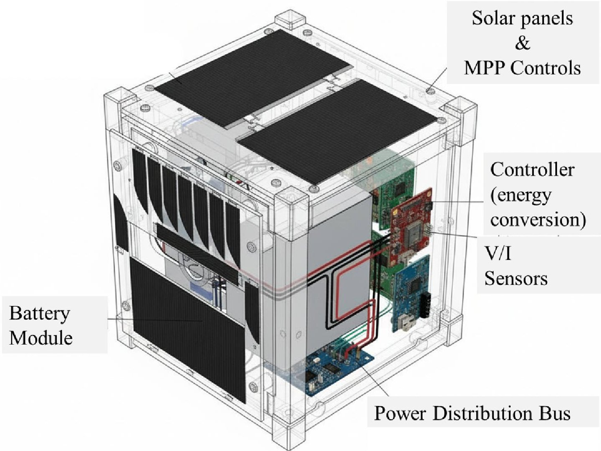


<div align="center">

Figure 1. Technical Diagram of a Cubesat's Power System Showing Key Subsystems

</div>

CubeSats (seen in Figure 1) are standardized nanosatellites composed of modular units (1U, 2U, 3U, etc.), designed to enable low-cost and rapid space missions while maintaining functional flexibility Heidt et al., 2000; Puig-Suari et al., 2001; Villela et al., 2019. This standardization has made them a widely adopted platform for research, technology demonstration, and educational missions.

<!-- PDF_PAGE: 13 -->

The Electrical Power System (EPS) is a critical subsystem responsible for power generation, energy storage, regulation, and distribution to all onboard components Acharya et al., 2019; Corpino et al., 2022. Its design directly impacts mission reliability, as all subsystems depend on continuous and stable power availability.

A typical CubeSat EPS consists of several key functional blocks:

- Power generation: Photovoltaic (PV) solar panels convert solar energy into electrical energy

- Power conditioning and conversion: DC-DC converters regulate and adapt voltage levels

- Energy storage: Batteries store energy for use during eclipse periods

- Power distribution: Regulated buses deliver power to subsystems and payloads These elements must work together to ensure continuous system functionality despite intermittent solar input Edpuganti et al., 2022; Yaqoob et al., 2022.

CubeSat EPS architectures are commonly categorized as centralized, distributed, or module-integrated. Each architecture presents trade-offs in efficiency, scalability, and reliability, with modular and distributed approaches generally offering improved fault tolerance and flexibility Hussein et al., 2022.

Due to orbital dynamics, CubeSats experience periodic eclipse phases where solar generation is unavailable. During these intervals, the EPS must rely entirely on stored energy to maintain uninterrupted operation, making battery management and system efficiency critical design considerations Acharya et al., 2019; Arnold et al., 2012.

<!-- PDF_PAGE: 14 -->

From a systems perspective, CubeSat EPS can be modeled as a constrained microgrid, where distributed generation, storage, and loads must be carefully coordinated under strict limitations in size, mass, and power availability Yaqoob et al., 2022. This perspective is particularly useful for analyzing system-level behavior and guiding architectural decisions.

## 2.2 Solar Energy Generation in CubeSats

Solar energy is the primary power source for CubeSats, typically harvested using photovoltaic (PV) panels mounted on the spacecraft surfaces. Due to strict constraints on size and available surface area, CubeSat solar arrays must maximize power density while operating under highly variable environmental conditions Edpuganti et al., 2022; Yaqoob et al., 2022.

CubeSat solar panels commonly utilize high-efficiency multi-junction cells, such as gallium arsenide (GaAs)-based devices, which offer significantly higher efficiency and voltage output compared to traditional silicon cells. These cells are designed to generate higher power per unit area, making them well-suited for space-constrained applications. For example, triple-junction cells can achieve efficiencies exceeding those of silicon while delivering higher operating voltages per cell.

Despite these advantages, the total power that can be generated is inherently limited by the small surface area of each CubeSat face. As a result, each panel contributes only a fraction of the total available power, and the overall generation capability is constrained by both geometry and mission configuration.

<!-- PDF_PAGE: 15 -->

Solar energy generation in CubeSats is further complicated by the spacecraft's orientation and orbital motion. As the satellite rotates or changes attitude, individual faces experience varying levels of solar irradiance. This leads to non-uniform and time-varying power generation, where some panels may be fully illuminated while others are partially shaded or completely inactive.

These effects introduce several important implications for EPS design:

- Non-uniform power generation: Each solar panel operates under different irradiance conditions, resulting in mismatched voltage and current characteristics across the array.

- Time-varying input conditions: Power availability changes continuously throughout the orbit due to rotation and eclipse cycles.

- Need for adaptive power extraction: Efficient operation requires dynamic techniques, such as maximum power point tracking (MPPT), to continuously extract the maximum available power from each panel.

These challenges motivate the use of distributed and adaptive power conversion strategies, where individual panels or groups of panels are independently controlled to maximize overall system efficiency.

<!-- PDF_PAGE: 16 -->

## 2.3 Maximum Power Point Tracking (MPPT) Techniques

Photovoltaic (PV) systems exhibit nonlinear current-voltage (I-V) characteristics, with a unique operating point known as the maximum power point (MPP) at which the product of voltage and current is maximized. This operating point varies with environmental conditions such as irradiance and temperature, making it necessary to continuously adjust the operating point of the system to ensure optimal power extraction. Maximum Power Point Tracking (MPPT) techniques are therefore essential components of CubeSat Electrical Power Systems Ayop and Tan, 2018; Elgendy et al., 2012.

Several MPPT algorithms have been developed, each with different levels of complexity and performance:

- Perturb and Observe (P&O): The operating point is periodically perturbed, and the resulting change in power is observed to determine the direction of the next adjustment. This method is simple and widely used but introduces steady-state oscillations around the MPP Elgendy et al., 2012.

- Incremental Conductance: This method compares incremental conductance （ $ dI/dV $ ） to instantaneous conductance （ $ I/V $ ）to determine the exact location of the MPP. It offers improved accuracy over P&O but at the cost of increased computational complexity.

- Fractional Open-Circuit Voltage / Current: These methods estimate the MPP as a fixed fraction of the open-circuit voltage or short-circuit current. While simple to implement, they are less accurate and require periodic interruption of normal operation.

<!-- PDF_PAGE: 17 -->

The selection of an MPPT technique involves several important trade-offs. Simpler methods such as P&O are easy to implement and require minimal computational resources but suffer from slower convergence and steady-state oscillations. More advanced methods, such as incremental conductance, provide faster and more accurate tracking but increase system complexity and computational requirements. As a result, designers must balance implementation cost with performance requirements based on mission constraints.

In addition to algorithm selection, MPPT can be implemented at different levels within the system architecture. Centralized MPPT applies a single tracking algorithm to the entire solar array, resulting in a simpler system but reduced efficiency under non-uniform illumination conditions. In contrast, distributed MPPT assigns independent tracking to individual panels or sections of the array, allowing each to operate at its own maximum power point. This approach improves overall energy harvesting performance, particularly in scenarios where panels experience different irradiance levels Edpuganti et al., 2022; Peng et al., 2017.

## 2.4 Power Converter Architectures

Power converters are a fundamental component of CubeSat Electrical Power Systems, responsible for regulating and adapting voltage levels between solar arrays, energy storage elements, and onboard loads. Due to the wide variation in input conditions and load requirements, DC-DC converters must be carefully selected and designed to ensure stable and efficient operation Edpuganti et al., 2022; Erickson and Maksimovic, 2007.

<!-- PDF_PAGE: 18 -->

Several common DC-DC converter topologies are used in CubeSat applications, each suited to different operating conditions:

- Buck converters: Step-down converters used when the input voltage is higher than the required output voltage.

- Boost converters: Step-up converters used when the input voltage is lower than the desired output voltage.

- Buck-boost converters: Capable of both stepping up and stepping down voltage, making them suitable for systems with wide input voltage variation.

The selection of a converter topology depends on several key design considerations. High efficiency is critical due to the limited available power in CubeSat systems, as losses directly reduce usable energy. Stability is equally important, as converters must maintain regulated outputs under dynamic conditions, including changing loads and fluctuating solar input. Additionally, CubeSat applications often require converters to operate over a wide input and output range, particularly when interfacing with variable solar sources and battery systems.

Control strategy plays a central role in converter performance. Voltage-mode control regulates the output voltage directly and is relatively simple to implement but may exhibit slower transient response. In contrast, current-mode control introduces an inner current loop, improving dynamic response and simplifying compensation at the cost of increased implementation complexity Erickson and Maksimovic, 2007. The choice of control method is therefore a trade-off between simplicity and performance.

<!-- PDF_PAGE: 19 -->

In practice, many CubeSat designs rely on commercial off-the-shelf (COTS) regulator integrated circuits, which provide compact, efficient, and well-characterized solutions. These devices typically incorporate internal control loops and protection features, reducing design complexity and development time. However, their fixed control structures can limit flexibility, motivating approaches that modify or augment feedback mechanisms to enable advanced functionality such as maximum power point tracking or adaptive control.

This combination of topology selection, control design, and practical implementation constraints defines the role of power converters within modern CubeSat EPS architectures.

## 2.5 Battery Charging and Power Path Management

Energy storage is a critical component of CubeSat Electrical Power Systems, enabling continuous operation during eclipse periods when solar generation is unavailable. Most CubeSats utilize lithium-ion (Li-ion) or lithium-polymer (Li-Po) battery configurations due to their high energy density, relatively low mass, and favorable charge-discharge characteristics Acharya et al., 2019; Tremblay and Dessaint, 2009.

Battery charging in CubeSat systems is typically implemented using a constant current / constant voltage (CC/CV) profile. In this approach, the battery is initially charged with a constant current until it reaches a predefined voltage threshold, after which the voltage is held constant while the charging current gradually decreases. This method ensures efficient charging while preventing overvoltage conditions and extending battery lifespan.

<!-- PDF_PAGE: 20 -->

Power path management defines how energy flows between the solar source, battery, and system loads. Two common architectural approaches are used:

- Direct battery bus: The battery is directly connected to the system bus, and all loads are powered from the battery voltage. This approach is simple but tightly couples load behavior to battery conditions.

- Regulated intermediate bus: A regulated bus is maintained between the power sources and the loads, decoupling system operation from battery voltage variations and enabling greater control flexibility.

In more advanced designs, bidirectional converters are employed to manage energy flow between the battery and the system bus. These converters allow both charging and discharging through a single power stage, enabling dynamic control of power distribution and improving overall system efficiency.

Despite these advancements, several challenges arise in battery charging and power path management. Load sharing between the solar input and battery must be carefully controlled to prevent undesirable interactions, particularly under rapidly changing conditions. Additionally, stability concerns can emerge due to the coupling between multiple power sources, converters, and dynamic loads. These interactions must be addressed through appropriate control strategies and system-level design considerations.

<!-- PDF_PAGE: 21 -->

## 2.6 System-Level Management Architectures

At the system level, CubeSat Electrical Power Systems can be organized using different architectural approaches that define how power is generated, processed, and distributed throughout the spacecraft. These architectures play a critical role in determining overall system performance, flexibility, and reliability Edpuganti et al., 2022; Hussein et al., 2022.

One of the primary distinctions in EPS design is between centralized and distributed architectures. A summary of the advantages and disadvantages of these approaches can be seen in Table 1. In centralized systems, power from all solar panels is combined and processed through a single regulation and control stage. This approach simplifies implementation but limits performance under non-uniform operating conditions. In contrast, distributed architectures assign independent control and conversion stages to individual panels or sections of the array, allowing each to operate under its own optimal conditions. This improves energy harvesting efficiency, particularly when panels experience different levels of irradiance Edpuganti et al., 2022; Peng et al., 2017.

A closely related consideration is the number of maximum power point tracking (MPPT) units employed within the system. Traditional designs often use a single MPPT controller for the entire array, which is simpler but susceptible to mismatch losses when panels operate under different conditions. Multi-MPPT architectures, where each panel or group of panels has its own MPPT controller, enable more efficient power extraction at the cost of increased system complexity and component count.

<!-- PDF_PAGE: 22 -->

<div align="center">

Table 1. CubeSat Architecture Trade-Offs Summary

</div>

<table border="1"><tr><td>Architecture Choice</td><td>Advantages</td><td>Disadvantages</td></tr><tr><td>Centralized MPPT</td><td>Simple implementationLower component countReduced system complexity</td><td>Poor performance under partial illuminationSingle operating point for entire array</td></tr><tr><td>Distributed MPPT</td><td>Per-panel optimizationHigher energy extractionBetter performance in dynamic conditions</td><td>Increased complexityHigher component count</td></tr><tr><td>Direct Battery Bus</td><td>High efficiencyFewer conversion stages</td><td>Bus voltage varies with batteryLess stable for loads</td></tr><tr><td>Regulated Bus</td><td>Stable system voltageDecouples generation and loadsImproved system control</td><td>Additional conversion lossesIncreased design complexity</td></tr></table>

Another key architectural decision involves bus regulation strategy. Two common approaches are used:

- Unregulated battery bus: The system bus is directly tied to the battery voltage, resulting in a simple design but limited control over load regulation and interaction between subsystems.

- Regulated intermediate bus: A controlled bus voltage is maintained between generation, storage, and loads, enabling decoupling between subsystems and improved stability and flexibility.

<!-- PDF_PAGE: 23 -->

Each of these architectural choices introduces trade-offs that must be carefully considered. Centralized systems and single-MPPT approaches offer simplicity and lower component count but may sacrifice efficiency under realistic operating conditions. Distributed and multi-MPPT systems improve performance and fault tolerance by isolating subsystems, but increase design complexity and control requirements. Similarly, regulated bus architectures provide greater control and stability, while unregulated approaches prioritize simplicity and efficiency.

## 2.7 Sensing and Telemetry

Accurate sensing and telemetry are essential components of CubeSat Electrical Power Systems, enabling real-time monitoring of system performance and supporting both control and validation functions. Key electrical parameters such as voltage, current, and power must be continuously measured to ensure proper operation and to provide feedback for control algorithms.

<!-- PDF_PAGE: 24 -->

Current sensing in CubeSat systems is commonly implemented using shunt-based methods, where a small resistor is placed in series with the current path and the resulting voltage drop is measured. This approach provides a simple and accurate means of measuring current, particularly when combined with amplification and analog-to-digital conversion. In addition, integrated power monitoring ICs are often used to simplify system design by combining current, voltage, and power measurement into a single device. These components typically include built-in ADCs and digital interfaces, enabling efficient data acquisition and communication with onboard controllers.

Sensing plays a critical role in several key aspects of EPS operation. In maximum power point tracking (MPPT), real-time measurements of voltage and current are used to compute power and determine the optimal operating point of the solar array. For system validation, telemetry data provides insight into performance under different operating conditions, allowing comparison between expected and measured behavior. Furthermore, continuous monitoring enables fault detection by identifying abnormal conditions such as overcurrent, undervoltage, or unexpected power deviations.

These capabilities make sensing and telemetry vital for both control and analysis in modern CubeSat power systems, particularly in architectures that rely on adaptive and distributed control strategies.

<!-- PDF_PAGE: 25 -->

## 2.8 Modeling and Simulation of Power Systems

Modeling and simulation play a crucial role in the design and validation of CubeSat Electrical Power Systems, allowing system behavior to be evaluated prior to hardware implementation. Tools such as MATLAB/Simulink are widely used to develop dynamic models of power converters, energy storage systems, and control algorithms, enabling designers to analyze performance under a wide range of operating conditions.

Two primary modeling approaches are commonly used in power system simulation: switching models and behavioral models. Switching models represent the detailed operation of power electronic devices, including high-frequency switching behavior, and provide high-fidelity results at the cost of increased computational complexity. In contrast, behavioral models approximate system dynamics using averaged or simplified representations, significantly reducing simulation time while preserving key system characteristics relevant to control design Erickson and Maksimovic, 2007.

Simulation is particularly important for validating control strategies and evaluating system-level interactions. Control algorithms, such as maximum power point tracking (MPPT) and battery charging control, can be tested and refined in a simulated environment before deployment. Additionally, system-level simulations allow designers to assess interactions between subsystems, including solar inputs, converters, batteries, and loads, under realistic operating scenarios.

<!-- PDF_PAGE: 26 -->

Despite these advantages, simulation-based approaches have inherent limitations. Behavioral models, while efficient, may not capture all nonlinearities and transient effects present in real hardware. Even detailed switching models rely on assumptions and idealizations that can lead to discrepancies between simulated and experimental results. As a result, simulation must be complemented with hardware validation to ensure accurate system performance.

## 2.9 Gaps in Existing Work

Despite significant advancements in CubeSat Electrical Power System (EPS) design, several important gaps remain in the existing literature. While prior work has explored system architectures, converter design, and power budgeting, relatively limited attention has been given to the integration of digital twin methodologies into CubeSat power system development. Recent studies have demonstrated the effectiveness of digital twins for modeling and validation of power systems, but their application to CubeSat EPS design remains limited and not fully explored Casado et al., 2024; Zhang et al., 2020.

In addition, many CubeSat EPS implementations continue to rely on single maximum power point tracking (MPPT) schemes, where a single controller governs the entire solar array. Although this approach simplifies system design, it is inherently suboptimal under non-uniform illumination conditions, which are common in CubeSat missions due to varying orientation and partial shading.

<!-- PDF_PAGE: 27 -->

While some research has investigated modular and distributed EPS architectures, there is still limited exploration of per-panel or per-face MPPT implementations in CubeSat systems Peng et al., 2017. Furthermore, existing designs often couple MPPT functionality directly with battery charging and power regulation, reducing system flexibility and making independent optimization of energy harvesting and storage more difficult.

Another key challenge identified in the literature is the integration of multiple power sources within a unified system. As CubeSat architectures become more complex, incorporating multiple solar inputs, energy storage elements, and dynamic loads, maintaining stable operation becomes increasingly difficult. Interactions between converters, batteries, and loads can introduce instability if not properly managed, particularly in distributed or modular architectures.

These limitations highlight the need for more flexible and modular EPS designs that decouple key system functions, support distributed control strategies, and incorporate advanced modeling and validation techniques such as digital twinning.

## 2.10 Research Contributions

This work proposes a modular CubeSat Electrical Power System (EPS) architecture designed to improve flexibility, efficiency, and system-level control. The proposed system incorporates several key features, including distributed maximum power point tracking (MPPT) implemented on a per-face basis, the use of a regulated intermediate bus to decouple system components, and a dedicated battery charging stage separated from the MPPT function. In addition, a simulation-based framework is developed as a preliminary step toward a digital twin of the power system, enabling system-level analysis and validation.

<!-- PDF_PAGE: 28 -->

The primary contributions of this work can be summarized as follows:

- Modular EPS architecture: A decoupled system design that separates energy harvesting, power conditioning, and battery management, enabling greater flexibility and scalability compared to traditional tightly coupled architectures.

- Feedback-based MPPT implementation: A control approach that leverages feedback manipulation within a DC-DC converter to achieve maximum power point tracking, providing an alternative to conventional MPPT algorithms.

- Integrated simulation and hardware validation: A combined methodology that utilizes system-level simulation alongside a physical testbed to validate performance, supporting the development of a digital twin framework for CubeSat power systems.

These contributions address key limitations in existing CubeSat EPS designs by enabling distributed control, improving adaptability to non-uniform operating conditions, and establishing a foundation for advanced system modeling and validation techniques.

<!-- PDF_PAGE: 29 -->

## 3 Component Selection and Design Rationale

## 3.1 Overview

This section presents the key hardware components selected for the proposed CubeSat Electrical Power System (EPS) and provides the rationale behind each design choice. The selection process is guided by system-level requirements, including efficiency, scalability, control flexibility, and compatibility with the overall modular architecture introduced in the previous section.

For each component, the discussion focuses on its functional role within the system, the relevant electrical and operational specifications, and the justification for its selection over alternative solutions. Emphasis is placed on how each component contributes to the overall system objectives, particularly in enabling distributed maximum power point tracking (MPPT), maintaining a regulated intermediate bus, and supporting a decoupled battery charging architecture.

This structured approach ensures that individual component choices are not considered in isolation, but rather as integral elements of a cohesive and optimized power system design.

## 3.2 Solar Energy Conversion

The DC-DC converter serves as the primary interface between the solar panels and the intermediate power bus, stepping down the variable solar input voltage to a controlled level suitable for downstream system components. In addition to voltage regulation, the converter provides a controllable operating point for maximum power point tracking (MPPT), allowing the system to dynamically adjust the operating conditions of the solar panels to maximize power extraction.

<!-- PDF_PAGE: 30 -->

The selected device, the TPS54538, is a buck converter designed for applications requiring efficient step-down conversion over a wide input voltage range. According to the datasheet, the device supports operation across a broad range of input voltages, making it well-suited for handling the variability inherent in solar panel output. It also integrates an internal control loop, reducing the need for external compensation components and simplifying overall system design. Furthermore, the converter is capable of supplying sufficient current to support the expected load and power levels of the system.

Firstly, since the system voltage requirements are lower than nominal array voltage, there will never be a reason to boost. The question then was which buck converter would fit best. The TPS54538 was selected based on several key considerations. Its internal feedback structure enables direct manipulation of the feedback node, making it compatible with the proposed feedback-based MPPT control approach. As a commercially available off-the-shelf (COTS) component, it offers a reliable and well-documented solution, reducing development complexity and risk. Additionally, the simplicity of its implementation, combined with its flexibility for control modification, makes it a strong candidate for use in a modular and distributed power architecture.

## 3.3 Battery and Energy Storage

The battery pack serves as the primary energy storage element in the CubeSat Electrical Power System, ensuring continuous operation during eclipse periods when solar power is unavailable. In addition to providing energy during these intervals, the battery also acts as a buffer, stabilizing the system by supplying or absorbing power as operating conditions change.

<!-- PDF_PAGE: 31 -->

The selected battery configuration is a two-cell series (2S) lithium-ion pack by Tenergy. This configuration provides a nominal voltage of 7.4 V and a maximum charge voltage of 8.4 V, with a total capacity of 2200 mAh. According to the datasheet, this voltage range aligns well with typical CubeSat power system requirements, offering sufficient headroom for regulation while remaining compatible with common converter and load specifications.

The choice of a 2S lithium-ion battery is driven by several factors. The voltage range closely matches the system's intermediate bus and load requirements, reducing the need for excessive voltage conversion. Lithium-ion chemistry offers a favorable balance between energy density and mass, which is critical in space-constrained applications. The lager capacity allows for more extensive testing with variable load profiles and charge/discharge cycles. Additionally, 2S configurations are widely used in small satellite systems, providing a well-understood and reliable solution. This combination of electrical compatibility, energy capacity, and practical implementation makes the selected battery pack well-suited for the proposed EPS architecture.

## 3.4 Battery Charging and Power Path

The battery charger IC is responsible for managing energy flow between the solar input, battery, and system loads. Its primary functions include implementing the constant current / constant voltage (CC/CV) charging profile for the battery, providing a regulated system output (VSYS), and enabling controlled power distribution under varying operating conditions. In addition, the device supports bidirectional power flow, allowing the battery to both store energy and supply power to the system when required.

<!-- PDF_PAGE: 32 -->

The selected device, the BQ25798, is a highly integrated buck-boost charger designed for systems with wide input and output voltage ranges. According to the datasheet, the device supports programmable charge current and voltage limits, enabling precise control over battery charging parameters. Its buck-boost topology allows it to operate efficiently across input voltages both above and below the battery voltage, which is particularly useful in systems with variable solar input. The IC also incorporates integrated power path management, allowing simultaneous system load support and battery charging without requiring additional external circuitry.

The BQ25798 was selected due to its ability to unify multiple power management functions within a single device. By supporting both charging and discharging through a single interface, it simplifies system design and reduces component count. Its integrated power path architecture enables effective decoupling of the battery from the main system bus, improving stability and control flexibility. Furthermore, the device is configurable via an $ \mathrm{I}^{2} \mathrm{C} $ interface, allowing system-level control and dynamic adjustment of operating parameters. These features make it well-suited for implementing a modular and decoupled power architecture in CubeSat applications.

## 3.5 Sensing and Measurement

Power monitoring is essential for enabling real-time observation of system behavior and supporting control functions within the CubeSat Electrical Power System. The sensing subsystem is responsible for measuring voltage, current, and power at key nodes, providing the data required for maximum power point tracking (MPPT), system validation, and performance analysis.

<!-- PDF_PAGE: 33 -->

The selected device, the INA219, is an integrated current and power monitoring IC that combines shunt-based current sensing with voltage measurement and digital processing. According to the datasheet, the device measures current by monitoring the voltage drop across an external shunt resistor, while simultaneously measuring bus voltage. It also performs real-time power calculations internally and communicates results via an $ \mathrm{I}^{2} \mathrm{C} $ interface, enabling efficient data acquisition by the system controller.

The INA219 was chosen for its ability to significantly simplify the sensing architecture. By integrating current, voltage, and power measurement into a single device, it reduces the need for external analog circuitry and minimizes design complexity. Its digital interface allows multiple devices to be deployed across the system, supporting distributed sensing at various points within the power architecture. Additionally, the availability of real-time measurement data enables implementation of MPPT algorithms and facilitates detailed system-level analysis, making the device well-suited for both control and validation purposes.

## 3.6 Embedded Control System

The microcontroller serves as the central control unit of the CubeSat Electrical Power System, coordinating system operation and enabling implementation of control algorithms. Its primary functions include executing the maximum power point tracking (MPPT) algorithm, managing system-level control decisions, and collecting and logging measurement data from the sensing subsystem.

<!-- PDF_PAGE: 34 -->

The selected device, the STM32G431, is a high-performance microcontroller based on the ARM Cortex-M4 core. According to the datasheet, it operates at high clock speeds and includes integrated analog and digital peripherals that are well-suited for real-time control applications. These include multiple analog-to-digital converters (ADCs) for signal acquisition, digital-to-analog converters (DACs) for generating control signals, and $ \mathrm{I}^{2} \mathrm{C} $ interfaces for communication with peripheral devices such as power monitors and charger ICs.

The STM32G431 was selected due to its ability to meet the real-time processing and control requirements of the system while minimizing external component count. The integrated DACs enable direct analog control of the DC-DC converters, which is essential for implementing the proposed feedback-based MPPT approach. Its ADC capabilities support high-resolution sensing of system variables, while the available communication interfaces allow seamless integration with distributed sensing and power management components. By consolidating control, sensing, and communication functions into a single device, the microcontroller simplifies system design and supports the modular architecture of the EPS.

## 3.7 Load Implementation

The load subsystem is used to emulate the electrical behavior of CubeSat onboard systems, enabling controlled testing and evaluation of the Electrical Power System. Rather than integrating actual flight hardware, representative loads are implemented to simulate power consumption under various operating conditions.

<!-- PDF_PAGE: 35 -->

Theсессуар The load implementation consists of both fixed resistive loads and a programmable electronic load. Resistive loads provide a simple and stable means of drawing constant power, making them useful for baseline testing and steady-state analysis. In contrast, the programmable electronic load allows dynamic control of current or power consumption, enabling the system to replicate time-varying load profiles that more closely resemble real CubeSat operation.

This approach was selected to provide flexibility and repeatability in testing. By using controllable loads, system behavior can be evaluated under a wide range of conditions including varying power demands and transient events. Additionally, the ability to dynamically adjust load conditions supports validation of control strategies, such as MPPT and power path management, under realistic and challenging scenarios.

## 3.8 Supporting Components

## 3.8.1 Passive Components

Passive components, including inductors, capacitors, and resistors, play a critical supporting role in the operation of the CubeSat Electrical Power System. These components are primarily used within the DC-DC converter stages and associated circuitry to enable energy transfer, filtering, and stable system behavior.

<!-- PDF_PAGE: 36 -->

Inductors are essential for energy storage and transfer in switching converters, directly influencing current ripple and overall converter efficiency. Capacitors are used for input and output filtering, helping to reduce voltage ripple and maintain stable bus voltages under dynamic load conditions. Resistors are employed in various roles, including feedback networks, current sensing, and biasing, contributing to accurate control and proper circuit operation.

The selection of passive components is guided by several key considerations. Efficiency is influenced by factors such as equivalent series resistance (ESR) in capacitors and winding losses in inductors, which must be minimized to reduce power loss. Thermal performance is also critical, as components must operate reliably under expected load and environmental conditions without excessive heating. Additionally, passive component values and characteristics directly impact system stability, particularly in feedback-controlled converters, where proper selection is required to ensure robust and well-damped responses.

## 3.8.2 System Protection

Protection measures are incorporated throughout the system to ensure reliable operation and proper interaction between subsystems. These elements serve to protect sensitive components, manage power flow, and condition signals for accurate control and measurement.

<!-- PDF_PAGE: 37 -->

Diodes are used for input isolation, particularly in configurations where multiple power sources are combined. By implementing diode-based OR-ing, individual sources can supply power to a common node without the risk of reverse current flow, preventing backfeeding between converters or power inputs. This is especially important in systems with multiple solar inputs or parallel converter stages. In this case, the diodes prevent conflicts between MPPT control signals for each face, as well as preventing isolated converters failure from causing a system wide collapse.

Additional interface circuitry is used to enable and control system operation. This includes signal lines for enabling or disabling converters and charger ICs, allowing coordinated control by the microcontroller. Proper interfacing ensures that system components operate in the correct sequence and respond appropriately to changing conditions. The ability for the system to automatically activate and deactivate different subsystems is a key part in making an autonomous, self-monitoring system.

Signal conditioning components are also employed to ensure that measured signals are compatible with the input requirements of sensing and control devices. These include filtering elements, voltage dividers, and buffering stages, which help reduce noise, scale signal levels, and improve measurement accuracy. These protection measures contribute to the robustness and reliability of the overall system.

<!-- PDF_PAGE: 38 -->

## 4 Methodology

## 4.1 Physical System

## 4.1.1 System Overview


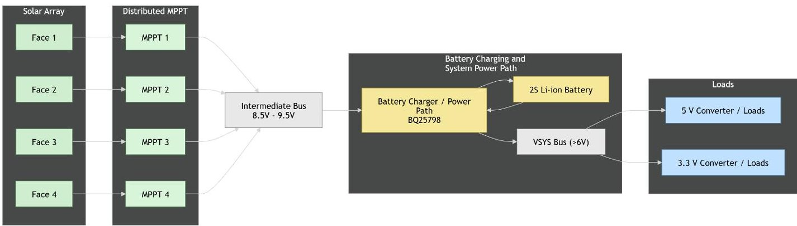


<div align="center">

Figure 2. Proposed CubeSat EPS Overview

</div>

The physical system is designed to validate the proposed CubeSat Electrical Power System (EPS) architecture under controlled laboratory conditions. Its primary purpose is to emulate key aspects of CubeSat operation, including dynamic load behavior and battery charge-discharge cycles, enabling realistic evaluation of system performance. This testbed provides a platform for assessing both steady-state operation and transient responses, ensuring that the proposed design functions as intended across a range of operating scenarios. A block diagram of the proposed system can be seen in Figure 2.

The implemented architecture follows a modular power flow structure in which solar inputs are processed through individual maximum power point tracking (MPPT) converters and combined onto an intermediate bus. This bus supplies a dedicated battery charging stage, which in turn interfaces with the system load rails. This configuration reflects the decoupled architecture proposed in this work, allowing independent control of energy harvesting, storage, and load regulation.

<!-- PDF_PAGE: 39 -->

Distributed sensing is incorporated throughout the system to provide real-time measurement of voltage, current, and power at multiple points within the power path. These measurements support control algorithms, such as MPPT, and enable detailed analysis of system behavior during testing. By combining modular power conversion with comprehensive sensing, the physical system serves as an effective platform to validate the proposed EPS design under representative operating conditions. The overall design will be explored in the following subsections, but a summary overview can be seen in Table 2.

<div align="center">

Table 2. CubeSat Power System Components Summary

</div>

<table border="1"><tr><td>Component</td><td>Specification</td><td>Notes</td></tr><tr><td>Solar Array &amp; Simulator</td><td>Spectrolab TASC(6S6P per face),IT-N2121 simulator,672mA@13.14V</td><td>2×silicon efficiency; fault injection capability</td></tr><tr><td>Power Conversion &amp; Buses</td><td>TPS54538 buck converters;9Vmain bus;5V&amp;3.3Voutputs</td><td>Sync buck, voltage feedback control</td></tr><tr><td>Battery System</td><td>Li-Ion,22Ah(162.8Wh),7.4V,BQ25798 controller</td><td>Radiation-resistant;2hrs@peak load</td></tr><tr><td>Sensors&amp;Controller</td><td>INA219 sensor(I2C);Raspberry Pi5(MPPT)</td><td>Real-timeV/I monitoring&amp;MPPT</td></tr><tr><td>System Power&amp;Orbit</td><td>5Wavg/8Wpeak;30min eclipse,90min orbit</td><td>LEO operation,8Wworst-case</td></tr></table>

## 4.1.2 Solar Input and Array

The solar input to the system is emulated using a combination of a solar emulator and programmable DC power supplies. The solar emulator used is the IT-N2121 Solar Array Simulator. This device can simulate the IV (current and voltage) characteristics of different solar array arrangements under different operating and environmental conditions. The advantage is that the emulator can mimic the solar output at specific temperatures and irradiance levels, as well as the behavior of the configured solar array under different fault conditions, such as partial shading. It can also show how the cells will behave as they age.

<!-- PDF_PAGE: 40 -->

Because the emulator only has one output, it is used to replicate the behavior of a single CubeSat face at a time. This still allows for controlled testing of the maximum power point tracking (MPPT) converters under realistic photovoltaic conditions, but the data collection between faces must be aggregated instead of simultaneous. Additional DC power supplies, configured as current-limited sources, are used to emulate the remaining faces of the solar array. This approach enables flexible testing of multi-face configurations without requiring multiple physical solar emulators.

The solar array model is based on Spectrolab Triangular Advanced Solar Cells (TASC), which are representative of high-efficiency multi-junction cells commonly used in space applications. These are same solar cells used in the study by Hernandez, 2018. According to the datasheet, these cells provide high power density and voltage output, making them suitable for CubeSat-scale systems.

The cells have an open circuit voltage of 2.52 volts and a short circuit current of 31 milliamperes. The maximum power voltage and current are 2.19 volts and 28 milliamperes, respectively. Each face of the array is configured as a 6-series, 6-parallel (6S6P) arrangement, which means there are 6 parallel strings composed of 6 series cells for each face. This gives an open circuit voltage and maximum power voltage of 15.12 volts and 13.14 volts, respectively, and a short circuit current and maximum power current of 186 milliamperes and 168 milliamperes, respectively. With four faces, the current at maximum power will be around 672 milliamperes. By combining realistic cell characteristics with flexible input emulation, the solar input setup enables comprehensive evaluation of the proposed architecture under varying operating conditions.

<!-- PDF_PAGE: 41 -->

## 4.1.3 Solar Converter Stage


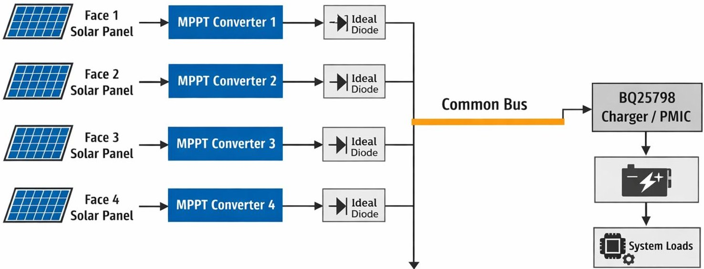


<div align="center">

Figure 3. MPPT Converter Diode Layout

</div>

Each solar array face is interfaced with an independent DC-DC converter stage based on the TPS54538, enabling distributed power conversion and control. This per-face configuration allows each input source to operate independently, supporting the implementation of distributed maximum power point tracking (MPPT) and improving overall energy harvesting under non-uniform conditions.

The converters are designed to operate over an input voltage range of approximately 9-15 V, corresponding to the expected output of the configured solar array. The converter outputs are combined onto an intermediate bus, which operates in the range of 8.5-9.5 V. Rather than enforcing a fixed output voltage, the effective operating point of each converter is dynamically adjusted through the MPPT control mechanism, allowing the bus voltage to vary within this range based on optimal power extraction conditions.

<!-- PDF_PAGE: 42 -->


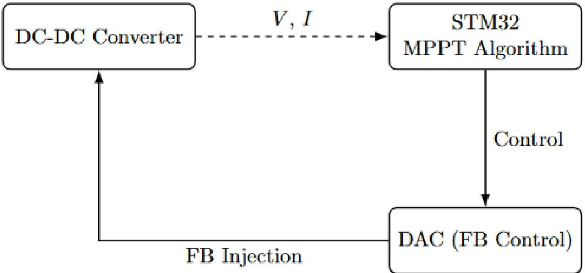


<div align="center">

Figure 4. MPPT Control Scheme Flow Diagram

</div>

MPPT is implemented by injecting a control signal into the feedback (FB) node of the converter. A digital-to-analog converter (DAC) output from the microcontroller is applied through an injection resistor, $ R_{inj} $ , to perturb the feedback voltage at the FB pin of the converter. This results in an analog adjustment of the converter's regulation point, effectively shifting the output voltage and enabling exploration of the power curve. By continuously adjusting this injected signal, the system is able to converge toward the maximum power point of the solar input. Figure 4 shows an overview of the MPPT scheme.

<!-- PDF_PAGE: 43 -->

To ensure proper operation of multiple parallel converter stages, input isolation is implemented using diode OR-ing. This can be seen in Figure 3. This layout prevents reverse current flow between sources and reduces signal interference between MPPT controllers operating on different inputs. As a result, each converter can independently track its respective maximum power point without destabilizing other stages. However, the use of diode OR-ing also introduces a limitation, as it prevents true simultaneous power extraction from all sources at identical operating points due to the inherent voltage drop and source selection behavior of the diodes.

Despite this limitation, the approach represents a practical trade-off for CubeSat applications. It offers improved performance compared to centralized or averaged MPPT methods under mismatched illumination conditions, while avoiding the complexity, size, and control overhead associated with fully distributed current-sharing architectures. This makes the scheme a suitable middle-ground solution that balances efficiency, simplicity, and implementation feasibility within the constraints of CubeSat power systems.

## 4.1.4 Intermediate Bus

The intermediate bus serves as the central node of the power system, interconnecting the solar converter stages, battery charger, and downstream load regulators. It functions as the primary energy aggregation point, where power from multiple converter outputs is combined and distributed to other subsystems. The intermediate bus connects the generation, distribution, and battery storage components of the system. The rest of this section will go into detail about this structure but an overview can be seen in Figure 5.

<!-- PDF_PAGE: 44 -->


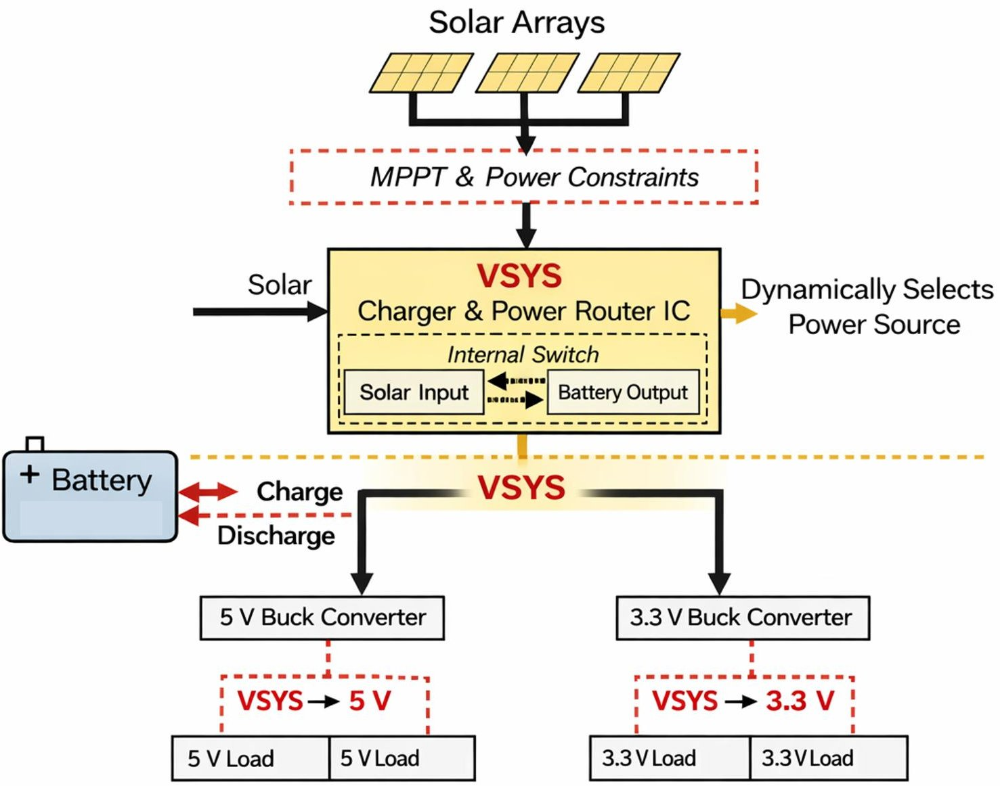


<div align="center">

Figure 5. Intermediate Bus Overview

</div>

The bus operates over an unregulated voltage range of approximately 8.5-9.5 V, which is determined by the operating points of the MPPT-controlled converters. Rather than maintaining a fixed voltage, the bus is allowed to vary within this range to accommodate optimal power extraction from the solar inputs. This approach enables the converters to prioritize maximum power transfer while still providing a suitable input for the battery charging stage and downstream regulation.

<!-- PDF_PAGE: 45 -->

By acting as a shared interface between generation, storage, and load subsystems, the intermediate bus facilitates decoupling of system functions. The battery charger draws power from this node independently of the MPPT converters, while downstream regulators derive stable supply rails for system loads. This separation improves system flexibility and reduces direct coupling between subsystems, contributing to more stable and modular operation.

## 4.1.5 Battery Charging Subsystem

The battery charging subsystem manages energy transfer between the intermediate bus, the battery pack, and the system loads. It is implemented using the BQ25798 bidirectional buck-boost charger, which enables both battery charging and system power support through a unified interface. This functionality is critical for maintaining stable operation under varying input and load conditions. A summary of the battery subsystem and charging seen can be seen in Table 3 and Table 4.

<div align="center">

Table 3. CubeSat Battery Hardware Summary

</div>

<table border="1"><tr><td>Battery</td><td>Charger IC(BQ25798)</td></tr><tr><td>2S Li-ion
7.4V nominal
8.4V maximum
~2200mAh capacity</td><td>Bidirectional buck-boost charger
NVDC power path
Regulated VSYS(≥6V)
Supports charge and discharge operation
I2C configurable
- $I_{in}$≈500mA
- $I_{chg}$≈500mA
- $V_{chg}$=8.4V
Integrated current, voltage,and temperature protections</td></tr></table>

<!-- PDF_PAGE: 46 -->

<div align="center">

Table 4. CubeSat Battery Charging and Operation Summary

</div>

<table border="1"><tr><td>Charging Profile</td><td>System Operation</td></tr><tr><td>Constant-current(CC)phase
- $I_{chg}$≈500mA
- $V_{bat}<8.0\text{ V}$
Transition region near regulation voltage
Constant-voltage(CV)phase
- $V_{bat}=8.4\text{ V}$
- Charge current decreases
Approx.0-80% SOC:CC-dominant
Approx.80-100% SOC:CV-dominant
Charge termination at low current(~0.1A)</td><td>Solar input powers the system when available
Excess solar power charges the battery
Battery supports the load during low or absent solar input
Seamless transition between solar and battery power
Dynamic power sharing through the NVDC power path</td></tr></table>

The system utilizes a two-cell series (2S) lithium-ion battery pack with a nominal voltage of 7.4 V and a maximum charge voltage of 8.4 V. The charger is configured with an input current limit of 500 mA and a charge current of 500 mA, providing controlled and predictable charging behavior. The battery regulation voltage is set to 8.4 V to match the maximum safe voltage of the battery pack, while the minimum system voltage is defined as $ V_{\mathrm{SYS,min}}=6 \mathrm{~V} $ to ensure reliable operation of downstream components.

The bidirectional nature of the charger allows the system to operate in two modes depending on power availability. In charge mode, energy from the intermediate bus is used to charge the battery while simultaneously supporting system loads. In supplement mode, the battery provides power to the system when solar input is insufficient, maintaining operation during transient conditions or reduced input availability. With integrated power path technology, the IC can dynamically and seamlessly switch between modes. This improves system stability and ensures continuous operation across a wide range of operating conditions.

<!-- PDF_PAGE: 47 -->

## 4.1.6 Load Distribution

The load distribution subsystem is responsible for delivering regulated power to the system loads from the intermediate bus. Dedicated voltage rails at 5 V and 3.3 V are derived from the intermediate bus using downstream regulation stages. These rails were chosen because most CubeSat loads operate at these voltages.

System loads are implemented using a combination of fixed resistive loads and a programmable electronic load. The resistive loads provide stable and predictable power consumption for baseline testing, while the programmable load enables dynamic adjustment of load conditions to simulate varying operational scenarios. This combination allows the system to be evaluated under both steady-state and transient conditions.

Instead of deriving the load busses from the intermediate bus, the system rail generated by the charging IC. By feeding the regulated rails from a separate system bus, the load distribution stage remains decoupled from upstream energy harvesting and battery management processes. This separation supports stable operation and allows independent evaluation of load behavior without directly influencing the performance of the MPPT or charging subsystems.

## 4.1.7 Data Acquisition

The data acquisition scheme is responsible for collecting real-time measurements from key points within the power system, enabling both control and performance analysis. Accurate and synchronized measurement of electrical parameters is essential for implementing control algorithms, such as maximum power point tracking (MPPT), and for validating overall system behavior.

<!-- PDF_PAGE: 48 -->

Sensing is primarily performed using INA219 current and voltage monitoring devices, which provide real-time measurements of bus voltage, current, and computed power. In addition, the battery charger IC provides internal measurements of key parameters, including battery voltage and charge/discharge current, further enhancing system observability.

Measurements are taken at multiple points throughout the system, including the solar inputs for each converter stage, the intermediate bus, the regulated load rails, and the battery subsystem. This distributed measurement approach enables detailed tracking of power flow and system efficiency across all stages of operation. Battery monitoring includes voltage and current measurements, with temperature monitoring incorporated where applicable to ensure safe operation.

All sensing and monitoring devices communicate with the microcontroller via an $ \mathrm{I}^{2} \mathrm{C} $ interface, providing a unified and efficient communication framework. This allows centralized data collection while maintaining a modular sensing architecture, supporting both real-time control and post-processing analysis.

<!-- PDF_PAGE: 49 -->

```matlab

function D_cmd = controller_pi(Vref_ss, Vfb_eff, enable, Ts)

% Behavioral PI controller for TPS54338 averaged model

%

% Inputs:

%    Vref_ss : soft-started reference (V)

%    Vfb_eff : effective feedback voltage (V)

%    enable   : 0 or 1

%    Ts       : controller sample time (s)

%

% Output:

%    D_cmd    : duty cycle command (0 to 0.98)

% Parameters

Kp = 2.0;

Ki = 2000.0;

Dmax = 0.98;

Dmin = 0.0;

% Persistent integrator state

persistent I_state

if isempty(I_state)

    I_state = 0;

end

if enable == 0

    I_state = 0;

    D_cmd = 0;

```

<div align="center">

Figure 6. Controller Code Example

</div>

<!-- PDF_PAGE: 50 -->

## 4.1.8 Control Scheme

The control scheme is centered around the STM32G431 microcontroller, which coordinates system operation and implements the primary control functions of the Electrical Power System. It serves as the central interface between sensing, power conversion, and energy management subsystems, enabling real-time monitoring and control. Control was implemented using MATLAB function blocks. A snipped of the code used for the microcontroller decision making can be seen in Figure 6.

The microcontroller communicates with peripheral devices using multiple interfaces. An $ \mathrm{I}^{2} \mathrm{C} $ bus is used to interface with the INA219 sensing devices and the battery charger IC, allowing acquisition of measurement data and configuration of charging parameters. A digital-to-analog converter (DAC) output is used to generate the control signal for maximum power point tracking (MPPT), which is injected into the feedback node of each converter stage. In addition, general-purpose input/output (GPIO) pins are used to control enable signals for various system components, allowing coordinated startup, shutdown, and fault handling.

The control scheme performs several key functions within the system. It executes the MPPT algorithm by adjusting the DAC output to perturb the converter operating point and track the maximum power condition. It also configures and manages the battery charger, including setting current limits and monitoring operating modes. Furthermore, the microcontroller collects and logs system data from all sensing points, supporting both real-time control decisions and post-experimental analysis.

<!-- PDF_PAGE: 51 -->


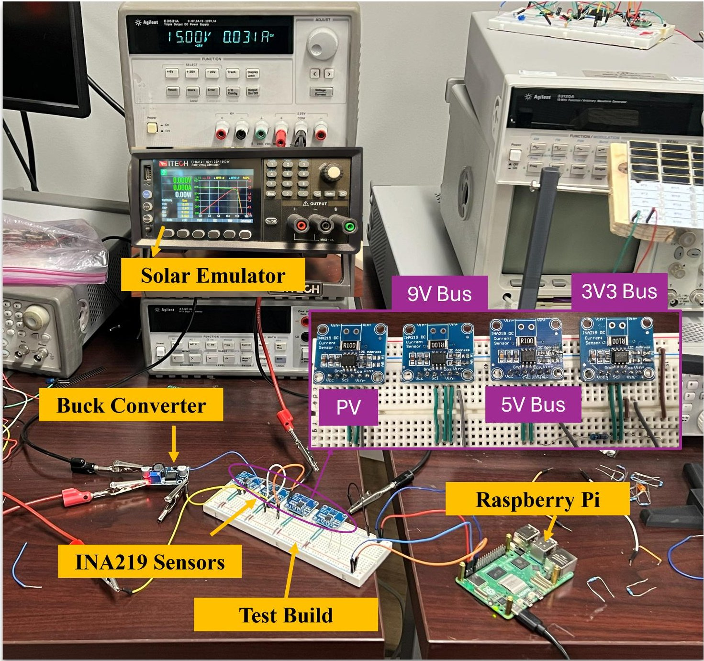


<div align="center">

Figure 7. CubeSat PS Simplified Test Build

</div>

## 4.1.9 Experimental Configuration

Several system parameters are configurable to allow flexible testing. Solar input conditions can be adjusted using the emulator and power supplies to replicate different irradiance levels and operating scenarios. Load conditions can be varied using both fixed resistive loads and a programmable load device, enabling evaluation under different power demands.

<!-- PDF_PAGE: 52 -->

In addition, parameters related to the maximum power point tracking (MPPT) algorithm and battery charger operation, such as tuning constants and current limits, can be modified to assess system sensitivity and performance under different control strategies.

Testing is conducted under both fixed and time-varying conditions. Fixed operating points are used to evaluate steady-state performance and verify expected behavior, while time-varying input profiles are used to simulate realistic operating scenarios, such as changing illumination and dynamic load conditions. This combination of test cases allows for comprehensive characterization of system performance across a range of operating environments.

The first physical test conducted used a prototype version of the full design proposed here. It 's purpose was to act as a proof of concept to validate the high-level architecture and data acquisition scheme. The test set up can be seen in Figure 7. With this set up, more complex subsystems, such as MPPT and battery charging were omitted for simplicity. For that reason, this test assumes the contributing panels are at their maximum power point and the battery is not being charged. This means that all available power is used to service the loads on the load busses. Additionally, a Raspberry Pi was used instead of the planned STM32.

<!-- PDF_PAGE: 53 -->

## 4.2 Simulation Methodology

## 4.2.1 Simulation Framework

The simulation framework is developed to provide a system-level behavioral model of the proposed CubeSat EPS, enabling analysis and validation prior to physical implementation. This was done using block level algebra and discrete function blocks. Simulation serves as a complementary tool to the experimental testbed, allowing controlled evaluation of system behavior under a wide range of operating conditions without the constraints of hardware limitations.

The primary purpose of the simulation framework is to validate control strategies, particularly the maximum power point tracking (MPPT) algorithm and battery charging behavior, before deployment in the physical system. By modeling system dynamics in a virtual environment, control performance can be assessed, tuned, and refined to ensure stable and efficient operation. In addition, simulation enables detailed analysis of system response to both steady-state and transient conditions.

The simulation is implemented using a behavioral modeling approach, where key subsystems are represented using simplified dynamic models rather than detailed switching implementations. This approach reduces computational complexity while preserving the essential characteristics required for control design and system-level analysis Erickson and Maksimovic, 2007.

<!-- PDF_PAGE: 54 -->

The objectives of the simulation framework include modeling the variability of solar input, the behavior of the DC-DC converters, and the dynamics of the battery system. By integrating these elements into a unified model, the framework allows evaluation of system stability, interaction between subsystems, and transitions between operating modes. This enables comprehensive assessment of system performance under controlled and repeatable conditions.

## 4.2.2 Modeling Approach

The simulation model is implemented using a behavioral, averaged representation of the power system, rather than a detailed switching model. This approach captures the dominant system dynamics while avoiding the computational complexity associated with high-frequency switching behavior. By focusing on averaged quantities such as voltage, current, and power, the model remains efficient and well-suited for system-level analysis and control design Erickson and Maksimovic, 2007.

A discrete-time implementation is used with a fixed-step solver to reflect the operation of the embedded control system. This allows the simulation to more accurately represent the timing and update behavior of the microcontroller, particularly for control algorithms such as maximum power point tracking (MPPT) and charger regulation. The use of a fixed-step solver also ensures consistent and repeatable simulation results, which is important for analyzing system stability and transient behavior.

<!-- PDF_PAGE: 55 -->

The modeling approach is designed to closely match the behavior of the physical system, particularly in terms of control execution and signal interaction. By aligning the simulation framework with the constraints and characteristics of the microcontroller-based implementation, the model provides a realistic platform for evaluating system performance and validating control strategies prior to hardware testing.

## 4.2.3 System Architecture

The simulation model is organized as a layered architecture within the Simulink environment, enabling modular representation of system functionality and clear separation of responsibilities between subsystems. This structured approach simplifies model development, debugging, and future expansion, while also reflecting the hierarchical nature of the physical system.

The model is divided into four primary layers, each representing a distinct aspect of system behavior:

- Layer 1 - Input Source: Represents the solar input or emulator, providing the system with variable voltage and current characteristics that mimic photovoltaic behavior.

- Layer 2 - Input Constraints: Enforces system-level limitations such as input voltage and current bounds, ensuring that downstream components operate within safe and realistic operating conditions.

- Layer 3- Charge Control Logic: Implements the battery charging control strategy, including constant current and constant voltage (CC/CV) behavior, using a state-based control structure.

<!-- PDF_PAGE: 56 -->

- Layer 4-Battery Model: Represents the dynamic behavior of the battery, capturing voltage response and state evolution during charging and discharging.

This layered architecture enables clear interaction between system components while maintaining separation between physical behavior and control logic. It also facilitates testing of individual subsystems in isolation, as well as integrated system-level analysis, supporting efficient development and validation of the overall simulation framework.

## 4.2.4 Control and Signal Flow

The control and signal flow within the simulation framework is designed to reflect the interaction between control objectives and physical system constraints. The primary charging strategy follows a constant current / constant voltage (CC/CV) approach, where the system initially operates in a current-regulated mode before transitioning to voltage regulation as the battery approaches its maximum charge level. This behavior is implemented through a state-based control structure within the simulation.

Several key signals are used to coordinate system operation and enforce control decisions. These include the input voltage $ ( V_{in} ) $ , the requested current $ ( I_{req} ) $ , the allowable current based on system constraints $ ( I_{allowed} ) $ , the resulting reference current $ ( I_{ref} ) $ , and the battery voltage $ ( V_{bat} ) $ . Together, these signals define the flow of information between system layers, enabling dynamic adjustment of operating conditions in response to both control commands and physical limitations.

<!-- PDF_PAGE: 57 -->

A central design principle of the control architecture is the separation of control objectives from physical constraints. Desired system behavior, such as maintaining a target charging profile, is defined independently from the limits imposed by the hardware, such as maximum input current or voltage bounds. These constraints are then applied through intermediate control layers, ensuring that the final system response remains both optimal and physically realizable. This structured signal flow enables clear interaction between subsystems while maintaining stability and flexibility, supporting accurate modeling of both control behavior and system dynamics.

## 4.2.5 Simulation Inputs and Outputs

Inputs to the model include both constant and time-varying source profiles, which emulate different solar operating conditions, as well as static and dynamic load scenarios that represent varying system demand. These inputs allow the simulation to replicate both steady-state and transient operating environments. The primary outputs of the simulation include key system variables such as battery voltage, battery current, input power, and overall system state. These outputs provide insight into system performance and enable direct comparison with experimental data obtained from the physical testbed. Performance evaluation is based on several key metrics, including system stability, convergence of control algorithms, and transient response to changing conditions. These metrics are used to assess the effectiveness of the control strategy and the robustness of the overall system design under a variety of operating scenarios.

<!-- PDF_PAGE: 58 -->

## 4.2.6 Validation

The simulation model is validated by comparing its outputs against both expected theoretical behavior and experimental data obtained from the physical testbed. Theoretical validation ensures that the model accurately represents known system characteristics, such as converter behavior, battery charging profiles, and control responses under ideal conditions.

Once the full physical system is deployed, simulation results will be compared directly with measurements from the physical implementation, including key variables such as voltage, current, and power at various points in the system. This comparison allows assessment of how well the behavioral model captures real-world dynamics and identifies any discrepancies between simulated and experimental performance.

In this case, converter and battery charging models were created and their performance was tested. The models can be seen in Figure 8 and Figure 9.


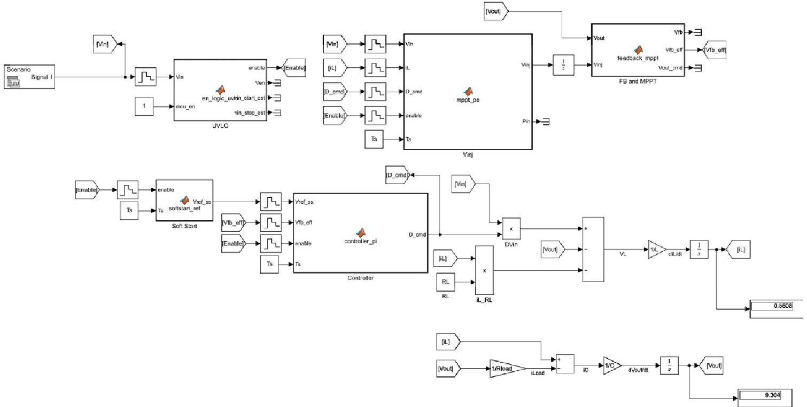


<div align="center">

Figure 8. Solar Converter Model

</div>

<!-- PDF_PAGE: 59 -->


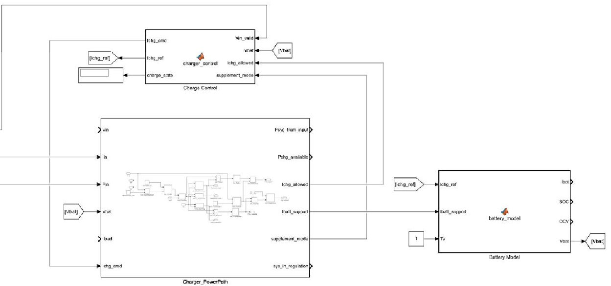


<div align="center">

Figure 9. Battery Charging Model

</div>

<!-- PDF_PAGE: 60 -->

## 5 Results and Discussion

## 5.1 Physical System Results


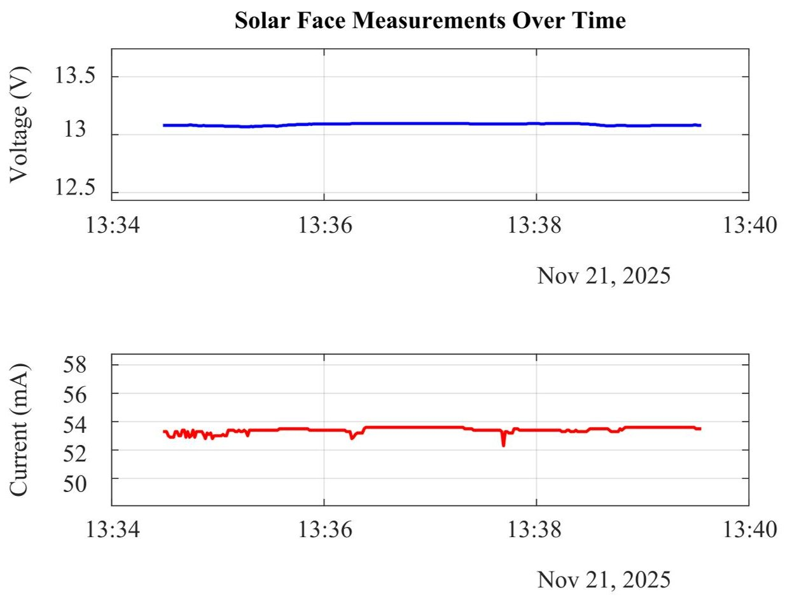


<div align="center">

Figure 10. Solar Face Performance Under Normal Conditions

</div>

<!-- PDF_PAGE: 61 -->


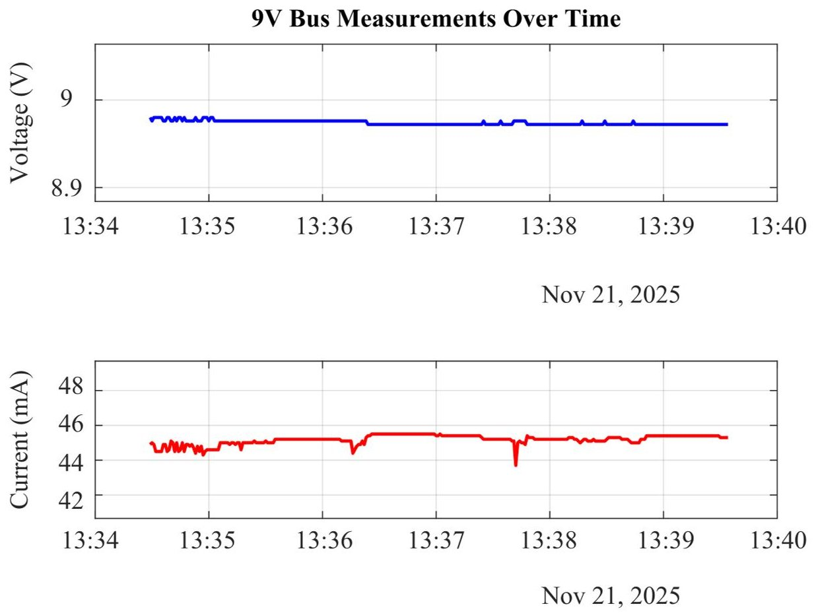


<div align="center">

Figure 11. 9V Bus Performance Under Normal Conditions

</div>

<!-- PDF_PAGE: 62 -->


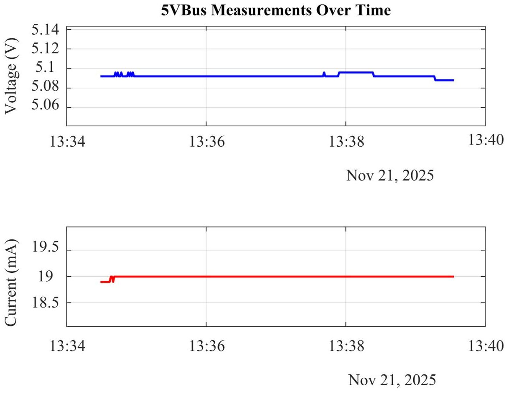


<div align="center">

Figure 12. 5V Bus Performance Under Normal Conditions

</div>

<!-- PDF_PAGE: 63 -->


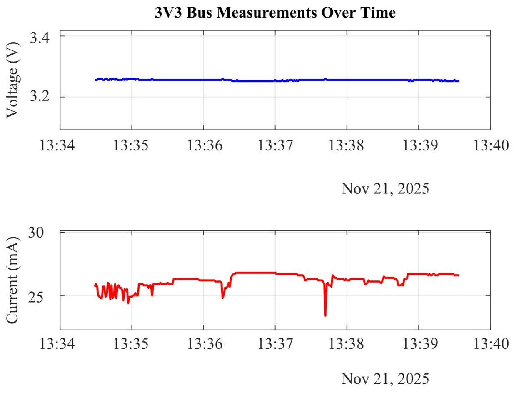


<div align="center">

Figure 13. 3.3V Bus Performance Under Normal Conditions

</div>

<!-- PDF_PAGE: 64 -->


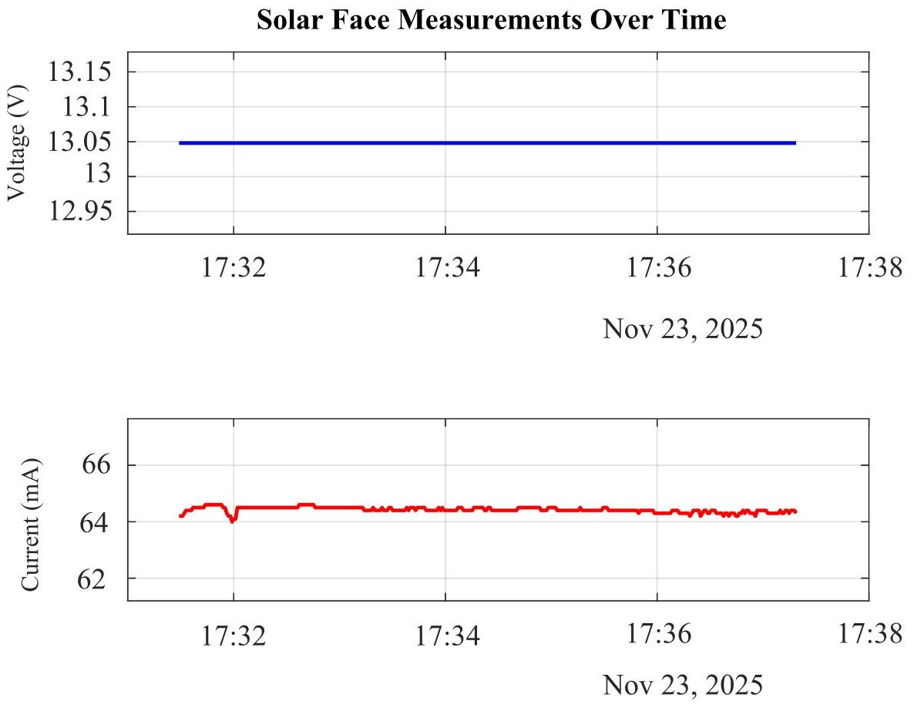


<div align="center">

Figure 14. Solar Face Performance Under Increased Load Demand

</div>

<!-- PDF_PAGE: 65 -->


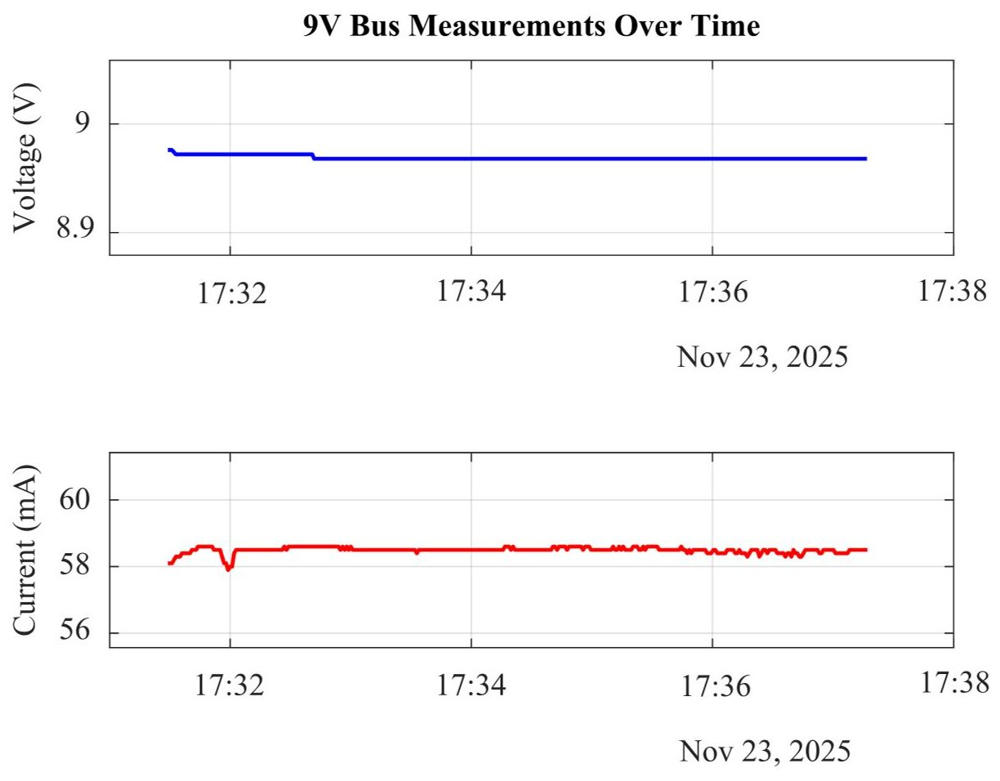


<div align="center">

Figure 15. 9V Bus Performance Under Increased Load Demand

</div>

<!-- PDF_PAGE: 66 -->


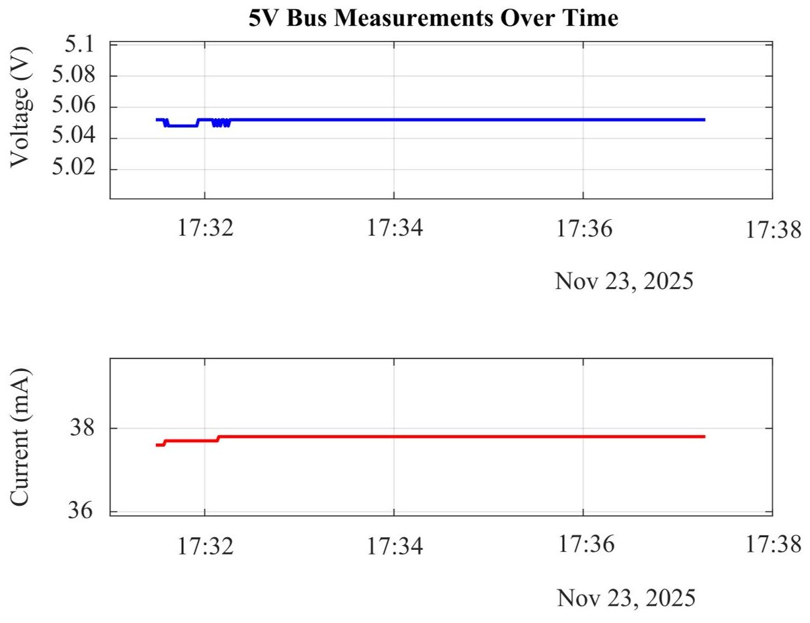


<div align="center">

Figure 16. 5V Bus Performance Under Increased Load Demand

</div>

<!-- PDF_PAGE: 67 -->


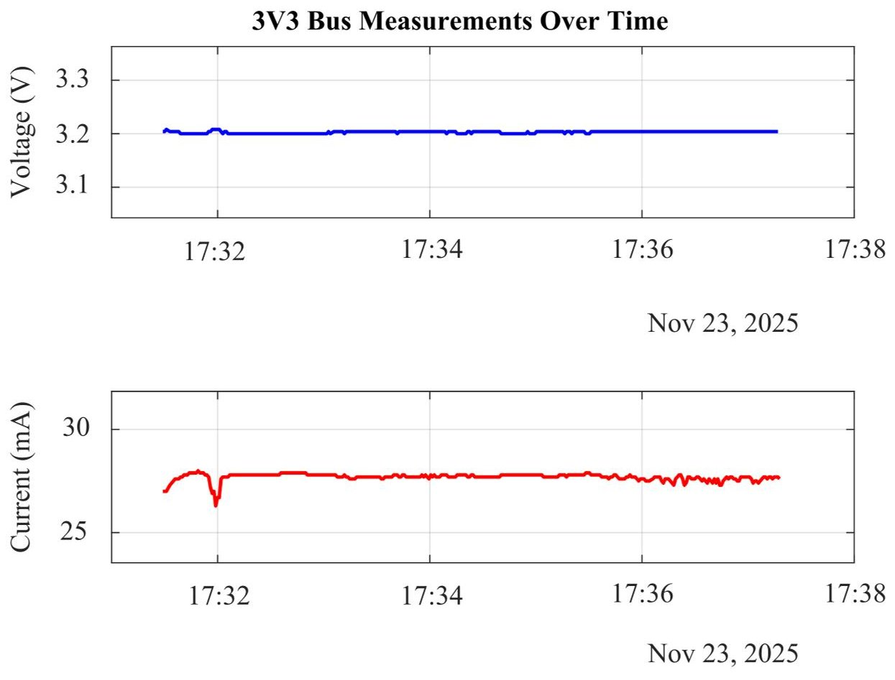


<div align="center">

Figure 17. 3.3V Bus Performance Under Increased Load Demand

</div>

<!-- PDF_PAGE: 68 -->

## 5.2 Simulation Results


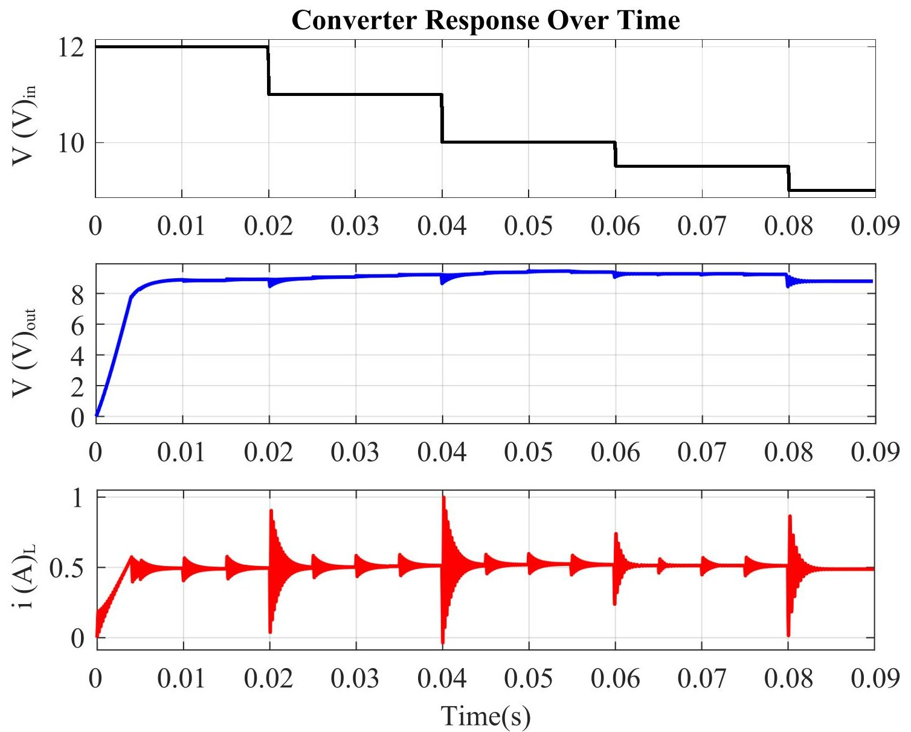


<div align="center">

Figure 18. Converter Response Over Time

</div>

<!-- PDF_PAGE: 69 -->


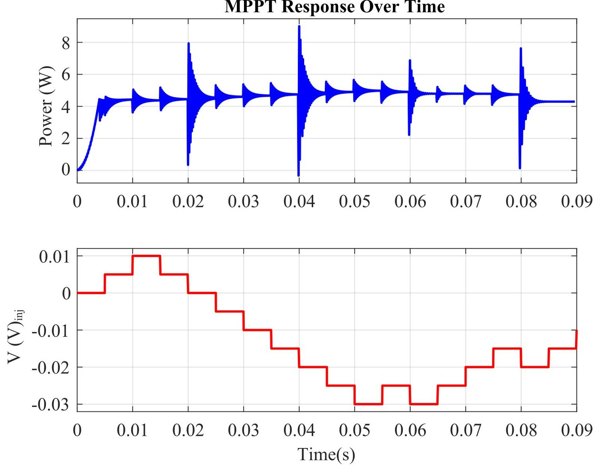


<div align="center">

Figure 19. MPPT Response Over Time

</div>

<!-- PDF_PAGE: 70 -->


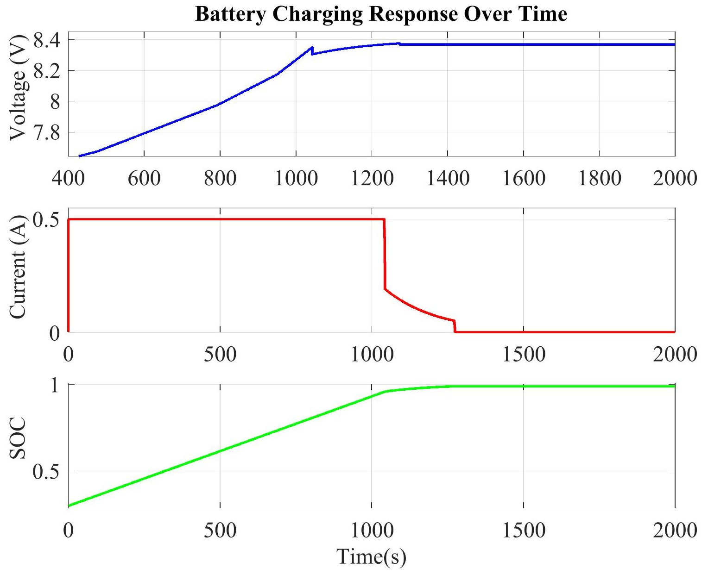


<div align="center">

Figure 20. Battery Charging Response Over Time

</div>

<!-- PDF_PAGE: 71 -->

## 5.3 Discussion

Because the physical system tested was simplified and the SIMULINK models were more reflective of the full design, a direct comparison could not be done.

For the physical system, we can see that the bus and load behaviors are as expected. In Figure 13, the 3.3 V load bus load current is considerable nosier than the other readings, but that is due to a loose connection that was fixed in later tests. Even still, we can see that the readings were close to expected under normal conditions. Under the increased load demand test in Figures 14-17, the load demand was doubled by halving the resistances of the connected loads. This, expectantly, caused the current draw for each bus to double as well. While it was impossible to recreate comparable 5W - 8W CubeSat power draw situations on the test build due to component tolerances, we can see the trend. If the load demand increased to a point that the solar array could supply enough current, it would cause a system-wide collapse.

The MATLAB/Simulink appears to be able to characterize steady state behaviors of the physical system. This can be seen in Figure 20 that showcases the battery characteristic curves. We can see the battery charging scheme functioning correctly. The battery charges from 30% SOC to full over the course of the test. Looking at the Figure, we see the current is constant at the maximum 0.5 A current the scheme allows until the battery reaches about 8.0 V. At that point we see the transition period where the current begins to taper as the system begins to prioritize constant voltage. And finally, as the battery charges fully and reaches the maximum 8.4 V, the current draw drops to zero as the system stops charging the battery. This indicates that the behavioral modeling approach is effective in capturing the dominant

<!-- PDF_PAGE: 72 -->

dynamics of the system and validating control strategies at a high level.

However, several limitations are observed in the simulation framework. The model is based on an idealized behavioral representation, which does not fully capture the nonlinear and high-frequency dynamics present in the physical system. In particular, the implementation of active maximum power point tracking (MPPT) through feedback perturbation introduces significant transient artifacts in the simulation. These manifest as large spikes during MPPT update cycles, which are not representative of the physical system behavior. This can be seen in Figure 18 and even more explicitly in Figure 19.

That being said, we can see that the MPPT scheme does work by looking at the input power from the array and the output voltage and inductor current of the converter. By performing the output calculation of voltage times current, we can see that the scheme is extracting maximum power. But again, the model's performance is hindered by transient errors.

These effects are primarily attributed to the interaction between discrete control logic and continuous system blocks within the simulation environment. The mismatch between discrete-time control updates and continuous-time system dynamics can introduce numerical inconsistencies, particularly when rapid perturbations are applied to the system. As a result, the simulation may exhibit exaggerated transient responses that do not accurately reflect real-world operation.

Additionally, the absence of high-fidelity switching dynamics limits the model's ability to capture early transient behavior and fine-scale system responses. This restricts its usefulness for detailed resilience analysis and for evaluating system performance under rapidly changing or fault conditions. It also means that the current model is not sufficient for

<!-- PDF_PAGE: 73 -->

digital twin matching, as it is not sophisticated enough to properly mimic the transient dynamics of the physical system.

So, while the simulation framework is effective for steady-state analysis and high-level control validation, its limitations highlight the need for more detailed modeling approaches to fully characterize system behavior, which will allow for complementary experimental testing.

<!-- PDF_PAGE: 74 -->

## 6 Conclusion

## 6.1 Summary of Work

This work presented the design, implementation, and high-level validation of a modular CubeSat Electrical Power System (EPS) architecture with a focus on improving flexibility, efficiency, and system-level control. The proposed system departs from traditional tightly coupled designs by introducing a decoupled architecture that separates energy harvesting, battery charging, and load regulation.

A distributed maximum power point tracking (MPPT) approach was implemented using individual DC-DC converter stages for each solar array face. This configuration enables improved power extraction under non-uniform illumination conditions, while maintaining a manageable level of system complexity. A feedback-based MPPT method was developed, leveraging analog injection at the converter feedback node to dynamically adjust operating points.

An intermediate bus architecture was employed to aggregate power from multiple sources and provide a unified interface to the battery charging subsystem and load regulators. The battery charging stage, implemented using a bidirectional buck-boost charger, enables controlled energy flow between the solar inputs, battery, and system loads, supporting both charging and discharge operation.

A comprehensive methodology was developed to validate the proposed architecture. This included both a physical testbed and a simulation framework. The physical system was designed to emulate CubeSat operating conditions using controlled solar inputs, configurable loads, and distributed sensing. In parallel, a behavioral simulation model was developed in

<!-- PDF_PAGE: 75 -->

MATLAB/Simulink to evaluate system dynamics and control performance under a range of operating conditions.

Experimental and simulation results demonstrated that the proposed system is capable of achieving stable operation and effective power management. While the simulation model showed strong agreement with steady-state behavior, limitations in modeling transient dynamics highlighted the importance of complementary hardware validation.

As a whole, this work establishes a practical and scalable approach to CubeSat EPS design, combining modular hardware architecture, flexible control strategies, and integrated validation methods.

## 6.2 Future Work

The first objective is the completion of the full physical testbed. While the design is complete, creation and implementation of the full physical testbed was not possible due to time constraints. A fully realized testbed will enable comprehensive evaluation of the system under realistic operating conditions and allow for deeper analysis of subsystem interactions.

Once the physical system is fully integrated, systematic benchmark testing should be performed to evaluate performance across a range of operating scenarios. This includes assessing efficiency, stability, and response to dynamic inputs and load conditions. If required, higher-fidelity sensing solutions may be integrated to capture more subtle system disturbances and transient behaviors that are not observable with the current measurement setup.

Another key area of future work is the development of a more complete digital twin framework. By leveraging data collected from the fully realized physical testbed, the simulation model can be refined and calibrated using quantitative comparison metrics. This

<!-- PDF_PAGE: 76 -->

will improve model accuracy and enable more reliable prediction of system behavior, particularly under non-ideal and transient conditions.

The establishment of a validated digital twin opens the door for implementing and testing advanced resilience strategies. These may include fault detection and mitigation techniques, adaptive control methods, and system reconfiguration approaches designed to maintain operation under adverse conditions. Such capabilities are increasingly important for CubeSat missions operating in unpredictable environments.

The ultimate goal of this work is to evolve the current testbed into a user-friendly, modular, and flexible platform for the development and evaluation of CubeSat and small-satellite power systems. By providing a configurable and extensible environment, this platform can support future research aimed at improving the robustness, efficiency, and adaptability of space-based power architectures.

<!-- PDF_PAGE: 77 -->

## Bibliography

Acharya, S., Alshehhi, F., Tsoupos, A., Khan, O., Elmoursi, M., Khadkikar, V., Zeineldin, H., & Al Hosani, M. (2019), "Modeling and design of electrical power subsystem for cubesats," 2019 International Conference on Smart Energy Systems and Technologies (SEST), 1-6. DOI: 10.1109/SEST.2019.8849042.

Arnold, S. S., Nuzzaci, R., & Gordon-Ross, A. (2012), "Energy budgeting for cubesats with an integrated fpga," 2012 IEEE Aerospace Conference, 1-14. DOI: 10.1109/AERO.2012.6187240.

Ayop, R., & Tan, C. W. (2018), "Design of boost converter based on maximum power point resistance for photovoltaic applications," Solar Energy, 160, 322-335. DOI: https://doi.org/10.1016/j.solener.2017.12.016.

Bouwmeester, J., Langer, M., & Gill, E. (2022), "Improving CubeSat reliability: Subsystem redundancy or improved testing?," Reliability Engineering and System Safety, 220, 108288. DOI: 10.1016/j.ress.2021.108288.

Bureau of Industry and Security. (2014). U.S. space industry deep dive assessment: Impact of U.S. export controls (tech. rep.). U.S. Department of Commerce.

Casado, P., Torres, C., Blanes, J. M., Garrigós, A., & Marroquí, D. (2024), "Implementation of a 6u cubesat electrical power system digital twin," Aerospace, 11(8). DOI: 10.3390/aerospace11080688.

Corpino, S., Caldera, M., Nichele, F., Masoero, M., & Viola, N. (2022), "CubeSat project: Experience gained and design methodology adopted for a low-cost electrical power system," Automatika, 63(3), 448-458. DOI: 10.1080/00051144.2022.2065420.

Edpuganti, A., Khadkikar, V., Moursi, M. S. E., Zeineldin, H., Al-Sayari, N., & Al Hosani, K. (2022), "A comprehensive review on cubesat electrical power system architectures," IEEE Transactions on Power Electronics, 37(3), 3161-3177. DOI: 10.1109/TPEL.2021.3110002.

Elgendy, M. A., Zahawi, B., & Atkinson, D. J. (2012), "Assessment of perturb and observe mppt algorithm implementation techniques for pv pumping applications," IEEE Transactions on Sustainable Energy, 3(1), 21-33. DOI: 10.1109/TSTE.2011.2168245.

Erickson, R. W., & Maksimovic, D. (2007), Fundamentals of power electronics, Springer Science & Business Media.

Heidt, H., Puig-Suari, J., Moore, A. S., Nakasuka, S., & Twiggs, R. J. (2000), "CubeSat: A new generation of picosatellite for education and industry low-cost space

<!-- PDF_PAGE: 78 -->

experimentation," 14th Annual AIAA/USU Conference on Small Satellites, SSC00-V-5.

Hernandez, D. T. (2018), "Cubesat power system design for high precision , solar observation,"

Hussein, B., Massoud, A. M., & Khattab, T. (2022), "Centralized, distributed, and module-integrated electric power system schemes in cubesats: Performance assessment," IEEE Access, 10, 55396-55407. DOI: 10.1109/ACCESS.2022.3176902.

Peng, J., Liu, H.-Y., Liu, R., Gao, Y., & Chen, C. (2017), "Design and validation of modular MPPT electric power system for multi-U CubeSat," 2017 IEEE 2nd Advanced Information Technology, Electronic and Automation Control Conference (IAEAC), 2430-2435. DOI: 10.1109/IAEAC.2017.8054463.

Puig-Suari, J., Turner, C., & Ahlgren, W. (2001), "The CubeSat: The picosatellite standard for research and education," AIAA Space 2001 Conference and Exposition. DOI: 10.2514/6.2001-4881.

Swartwout, M. (2013), "CubeSat database trends: Usage, success rate, orbits and reliability," 27th Annual AIAA/USU Conference on Small Satellites, SSC13-IX-2.

Tremblay, O., & Dessaint, L.-A. (2009), "Experimental validation of a battery dynamic model for ev applications," World Electric Vehicle Journal, 3(2), 289-298. DOI: 10.3390/wevj3020289.

Villela, T., Costa, C. A., Brandao, A. M., Bueno, F. T., & Leonardi, R. (2019), "Towards the thousandth CubeSat: A statistical overview," International Journal of Aerospace Engineering, 2019, 5063145. DOI: 10.1155/2019/5063145.

Yaqoob, M., Lashab, A., Vasquez, J. C., Guerrero, J. M., Orchard, M. E., & Bintoudi, A. D. (2022), "A comprehensive review on small satellite microgrids," IEEE Transactions on Power Electronics, 37(10), 12741-12762. DOI: 10.1109/TPEL.2022.3175093.

Zhang, H., Liu, Q., Chen, X., Zhang, D., & Leng, J. (2020), "A digital twin-based approach for the fault diagnosis and health monitoring of a complex satellite system," Symmetry, 12(8), 1307. DOI: 10.3390/sym12081307.

<!-- PDF_PAGE: 79 -->

## Biographical Sketch

Savion Siner earned his Master of Science in Engineering degree with a concentrtion in Electrical Engineering from the University of Louisiana at Lafayette in Spring 2026. His research focuses on improving resilience of space-based power systems, such as CubeSats and other small satellites. This work was done under the supervision of Dr. Farzad Ferdowsi at the Power System Control Advancement and Resilience Enhancement (PS-CARE) researc lab. His research involves digital twinning and the design of semi-autonomous systems, and his contributions include furthering research on modular CubeSat designs.

<!-- PDF_PAGE: 80 -->

ProQuest Number: 32699218

INFORMATION TO ALL USERS The quality and completeness of this reproduction is dependent on the quality and completeness of the copy made available to ProQuest.

ProQuest

Part of Clarivate

Distributed by ProQuest LLC a part of Clarivate (2026) Copyright of the Dissertation is held by the Author unless otherwise noted.

This work is protected against unauthorized copying under Title 17, United States Code and other applicable copyright laws.

This work may be used in accordance with the terms of the Creative Commons license or other rights statement, as indicated in the copyright statement or in the metadata associated with this work. Unless otherwise specified in the copyright statement or the metadata, all rights are reserved by the copyright holder.

ProQuest LLC 789 East Eisenhower Parkway Ann Arbor, MI 48108 USA