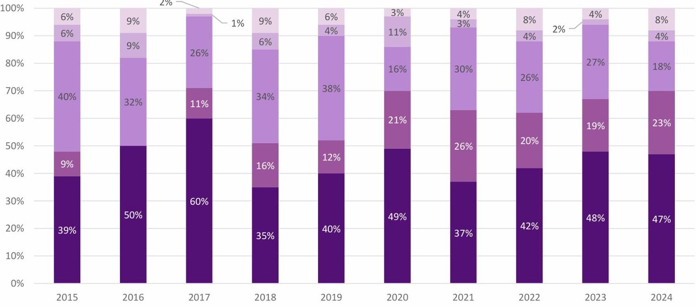
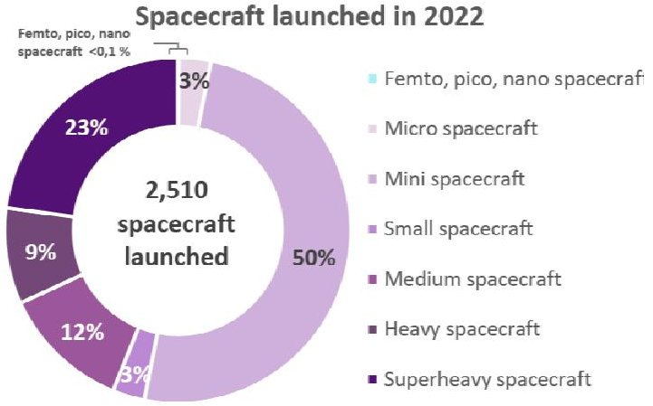
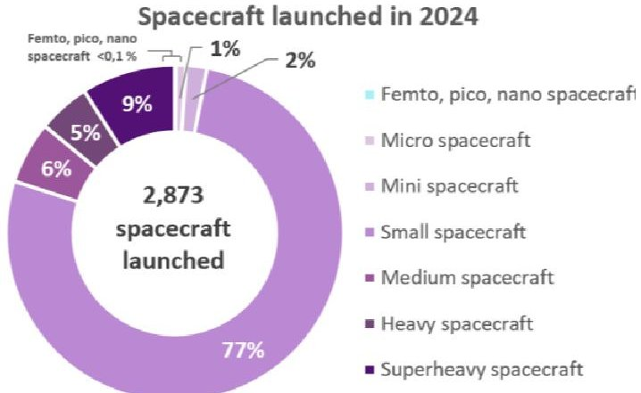
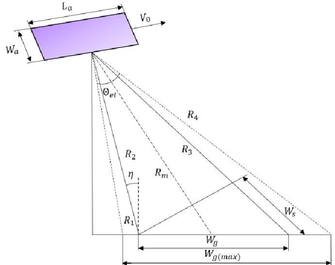
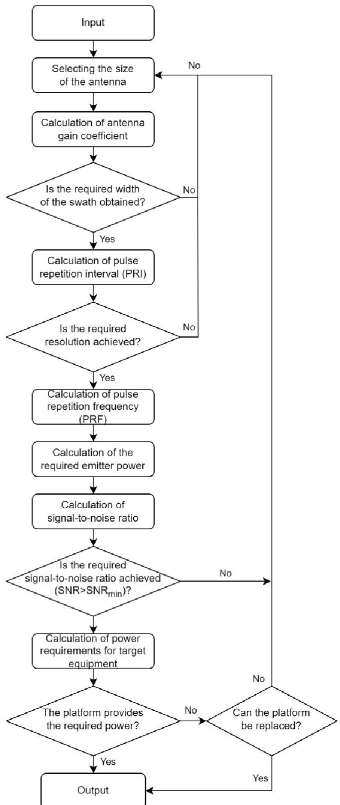
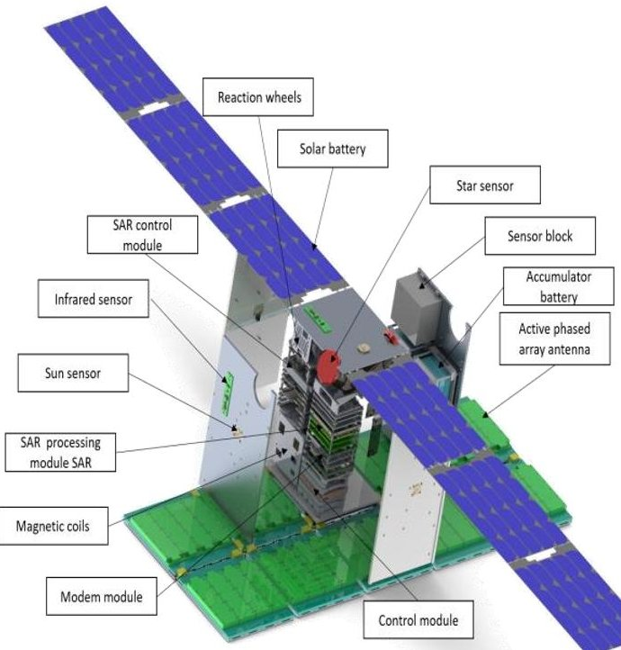

<!-- PDF_PAGE: 1 -->

# Algorithm for Calculating the Characteristics of a Small Earth Remote Sensing Radar Spacecraft Based on CubeSat

Olga D. Zhaldybina

Department of Space Engineering

Samara National Research University

Samara, Russia

Tatyana V. Starostina

zhaldybina.od@ssau.ru

ORCID: 0009-0002-0750-8192

Department of Flight Dynamics and Control Systems

Samara National Research University

starostina.tv@ssau.ru

ORCID: 0009-0000-5694-2281

Abstract —This paper presents a comprehensive analysis of current trends in the development of small Earth remote sensing spacecraft equipped with synthetic aperture radar systems. The study leverages launch data from 2015 to 2024 to demonstrate a clear upward trend in the share of small satellites within the overall launch portfolio. A detailed review of contemporary domestic and international small radar equipped spacecraft is conducted, revealing key design and operational characteristics. The X-band frequency range is identified as the most widely adopted in modern small synthetic aperture radar spacecraft. It is concluded that the spatial resolution of onboard observation equipment spans a broad range — from 0.16 m to 100 m, reflecting diverse mission requirements and technological trade-offs. To support the design of next-generation small synthetic aperture radar satellites, the paper proposes a dedicated algorithm for calculating spacecraft design parameters. The algorithm explicitly accounts for requirements imposed by the synthetic aperture radar payload, operational specifics of the spacecraft in orbit and design constraints inherent to the CubeSat standard. As a practical demonstration of the proposed methodology, the paper presents a detailed calculation of design parameters for a small synthetic aperture radar-equipped CubeSat of the 12U format. The results provide a foundation for further optimization and development of compact, high-performance Earth observation systems.

Keywords—small spacecraft, synthetic aperture radar, remote sensing of Earth, CubeSat, planar antenna array

## I. INTRODUCTION

Remote sensing of the Earth (RSE) represents one of the most critical functions performed by spacecraft, as it enables the acquisition of real-time data on the state of the environment and supports a wide range of applications, from climate monitoring to disaster management [1].

At present, two principal types of payloads are employed to address RSE objectives: optical-electronic systems and radar systems. Optical-electronic systems are designed for imaging in the visible and infrared wavelength ranges. Radar systems operate in the microwave region of the electromagnetic spectrum, typically within the wavelength range of 0.8-100 cm. This spectral range enables the development of RSE imaging instruments with significant penetration capabilities including the ability to operate day and night and to penetrate cloud cover, vegetation canopies, and, in some cases, the upper layers of soil or snow [1].

Satellites equipped with synthetic aperture radars (SAR) are capable of providing round-the-clock, all-weather observation of the Earth regardless of weather conditions and time of day [2]. The key advantage of SAR over optical Earth observation equipment is its low sensitivity to atmospheric conditions. The processing and subsequent interpretation of

data obtained from SAR is also of great importance. Data analysis methods are described in detail in the following works [3-5].

In recent years, a pronounced trend has emerged in the aerospace industry toward reducing the mass of spacecraft, lowering production costs, and expanding their functional capabilities. This evolution is primarily driven by significant advances in electronics miniaturization and the continuous improvement of space technologies. These technological breakthroughs have enabled small spacecraft (SC) to effectively perform complex mission objectives - previously achievable only with large, expensive platforms - at a substantially reduced cost [6]. The widespread adoption of the CubeSat standard has democratized access to space, enabling universities, research institutions, private companies, and even individual developers to participate in space missions [7].

This paper presents an analysis of data on spacecraft launches over the past 10 years and identifies a trend toward a reduction in the mass of spacecraft [8]. It reviews current achievements in the design of Earth observation spacecraft based on the SAR technology. Based on the analysis of global best practices in the development and operation of SAR-equipped spacecraft, the paper proposes a novel algorithm for calculating SAR system design parameters.

## II. ANALYSIS OF THE PROSPECTS FOR USING SMALL SPACECRAFT

In today's world of rapid development of space technologies, the small satellite segment is becoming increasingly important for solving a wide range of scientific, technical, and applied problems.

Fig. 1 shows the distribution of small satellites by intended application for the 2015-2024 period (in percentage terms), excluding the Starlink and OneWeb satellite constellations. The graph is based on data from BryceTech [9].

Analysis of the graph based on BryceTech data demonstrates the leading position of Earth remote sensing satellites in the structure of launched spacecraft. The share of devices in this class in the 2015-2024 period varied between 35% and 60% of the total number of launched spacecrafts indicating a steady demand for Earth remote sensing data.

There is a downward trend in the share of spacecraft designed for technological development (demonstration spacecraft) from 40% to 18% , while the share of scientific missions remains relatively stable at 4-9% [9].

Fig. 2 shows a diagram of small satellite distribution by mass for 2022 and 2024. Analysis of the diagrams suggests

<!-- PDF_PAGE: 2 -->

Spacecraft for remote sensing of the Earth Communication spacecraft Demonstration spacecraft Scientific spacecraft Other spacecraft

Fig.1. Distribution of small satellites by intended application for the 2015-2024 period (in percentages), excluding the Starlink and OneWeb satellite constellations, based on data from [9].

that satellite manufacturers are moving towards the widespread use of small satellites. This trend may be due to the following factors: a reduction in the cost of developing and launching small satellites; increased efficiency of small satellite orbital constellations; advances in the miniaturization of onboard equipment; and growing demand for operational space systems.

Fig. 2. Small satellite distribution by mass for 2022 and 2024, based on data from [9].

An analysis of data on spacecraft launches for the period 2022-2024 (fig. 2) shows changes in the structure of space activities. There is a trend towards an increase in the total number of spacecraft launched: while in 2022 there were 2,510 units, by 2024 this figure had increased to 2,873 units.

In 2022, medium-sized spacecraft dominated, accounting for 50% of the total number. In 2024, medium-sized spacecraft took the lead with a 77% share of launches.

Thus, it can be noted that the modern space industry is undergoing changes characterized by a transition to more economical and efficient solutions based on small satellite platforms.

## III. OVERVIEW OF MODERN RADAR SMALL SPACECRAFT

For several decades, both Russian and international scientists in the field of rocket and space technology have been actively advancing radar systems for Earth surface observation. Recent developments have seen a growing number of radar system implementations suitable for deployment on small satellite platforms. This trend is driven by significant improvements in the electronic component base and the enhanced reliability of small space platforms, which now meet the demanding requirements of long-duration orbital missions.

Spacecraft equipped with radar can provide continuous all-weather observation of the Earth's surface. The main advantage of radar equipment over optical equipment is its low sensitivity to atmospheric conditions, which allows it to provide visibility in areas covered by clouds [2].

Let us consider modern satellites with radar observation systems developed both in Russia and abroad. Today, Russia is creating a number of radar observation satellites, such as Obzor-R, which is designed to obtain remote sensing radar data. The satellite has a high-resolution radar system with a capture range of 15-700 m and a spatial resolution of 0.5 m [10]. The Kondor-FKA satellite with an SAR is designed to obtain high-detail Earth remote sensing information in the microwave range of the electromagnetic spectrum; the Kondor-E satellite's SAR has a capture range of 20-500 km and a radiometric resolution of no worse than 2-3 dB [11].

Radar satellites are also being developed abroad, such as the German TerraSAR-X satellite [12], designed for radar imaging of the Earth's surface. The satellite's radar equipment has a spatial resolution of 1-16 m, depending on the imaging mode, and an operating frequency range of 9.65 GHz. The

<!-- PDF_PAGE: 3 -->

satellite was launched on June 15, 2007, from the Baikonur Cosmodrome using a Dnepr carrier rocket. The main purpose of the ICEYE constellation is to monitor ice conditions; the ICEYE constellation has an azimuth resolution of 0.25-3 m, a range resolution of 0.5-1.5 m, and an operating frequency range of 9.65 GHz. The first ICEYE-X1 satellite was launched on January 12, 2018 [13], by a PSLV-XL launch vehicle. Currently, a constellation of 10 ICEYE-type satellites is operating in orbit. The first Capella test satellite was launched in December 2018; the PCA had an azimuth resolution of 0.5-1.2 m, a range resolution of 0.3-0.75 m, and an operating frequency range of 9.4-9.9 GHz [14]. The launch was carried out jointly with 63 other small satellites by SpaceX's Falcon-9 launch vehicle; the Capella satellite, like the ICEYE [15], formed the basis for the creation of a satellite constellation. Currently, the constellation consists of five units.

Table 1 presents the main characteristics of a number of small SAR spacecraft. Only spacecraft weighing below 1,000 kg were considered in the study. The data were obtained from open sources and the articles [6, 16].

Thus, it can be concluded that the X-band is one of the most commonly used frequency ranges for synthetic aperture radar (SAR) systems. Modern small SAR spacecraft have special resolution 0.16-100 m, weigh 27-1000 kg, operate on sun-synchronous orbit at 400-791 km altitude range and use spotlight and strip-map (route) imaging modes.

Several studies have evaluated the feasibility of integrating synthetic aperture radar (SAR) systems onto small-mass space platforms, including CubeSat configurations [17-21]. Such spacecraft have become a prevalent format for developing vehicles in the mass range from several kilograms to 1000 kg.

It should be noted that the standardization of CubeSat devices, while significantly contributing to their widespread

adoption and accessibility, also introduces inherent design constraints. The standardized dimensions of transport and launch containers impose strict limitations on the overall physical dimensions of CubeSats, which in turn indirectly constrain their mass. For radar Earth observation spacecraft equipped with SAR systems, these dimensional restrictions have a direct impact on the maximum achievable performance of the payload. Specifically, the performance is largely determined by the size of the antenna assembly a critical component whose dimensions are fundamentally limited by the available satellite volume. This relationship will be examined in detail in the following sections.

## IV. ALGORITHM FOR DETERMINING THE DESIGN PARAMETERS OF A SMALL SPACECRAFT, TAKING INTO ACCOUNT THE REQUIREMENTS FOR RADAR PAYLOAD

Let us consider the preliminary design process for a small satellite equipped with a synthetic aperture radar system featuring a planar antenna array, intended for Earth remote sensing tasks. This research considers a calculation method described in detail in [22-25]. The geometric configuration and key symbols are illustrated in Fig. 3. The planar SAR antenna, characterized by a length $ L_{a} $ and width $ W_{a} $ , is mounted on the satellite platform and moves at a velocity V perpendicular to the direction of flight. This motion enables the radar to provide coverage of a ground strip with a maximum width $ W_{g(max)}. $

The maximum width of the capture band is determined by the width of the antenna beam in the angular plane (elevation beamwidth), which in turn depends on the antenna's physical dimensions and the operating wavelength:

$$
W _ {g (m a x)} \approx \frac {\Theta_ {e l} R _ {m}}{\cos \eta} = \frac {\lambda R _ {m}}{W _ {a} \cos \eta}.
$$

TABLE I. SMALL SAR SATELLITE DESIGN CHARACTERISTICS

<table border="1"><tr><td>Spacecraft name</td><td>Orbit altitude,km</td><td>Mass,kg</td><td>Spatial resolution,m</td><td>Frequency range</td><td>Shooting modes</td></tr><tr><td>Aist-ST</td><td>400-600</td><td>27.75</td><td>2-10</td><td>X-band</td><td>Stripmap,Spotlight</td></tr><tr><td>Umbra 01-08</td><td>500-600</td><td>65</td><td>0.16-3</td><td>X-band</td><td>SpotLight,Stripmap</td></tr><tr><td>QPS-SAR</td><td>500</td><td>100</td><td>0.46-2</td><td>X-band</td><td>SpotLight,Stripmap</td></tr><tr><td>StriX-3,10</td><td>561</td><td>100</td><td>1-3</td><td>X-band</td><td>SpotLight,Stripmap</td></tr><tr><td>ICEYE</td><td>550</td><td>85-120</td><td>1-15</td><td>X-band</td><td>SpotLight,Stripmap</td></tr><tr><td>Capella-1-11</td><td>535-575</td><td>107</td><td>0.3-12</td><td>X-band</td><td>SpotLight,Stripmap</td></tr><tr><td>NeuSAR</td><td>561-572</td><td>155</td><td>0.5-3</td><td>X-band</td><td>SpotLight,Stripmap</td></tr><tr><td>EOS SAR-1</td><td>520-560</td><td>176</td><td>0.5-3</td><td>X-band</td><td>SpotLight,Stripmap,ScanSAR</td></tr><tr><td>Haisi-1</td><td>490-512</td><td>185</td><td>0.5-20</td><td>C-band</td><td>SpotLight,Stripmap,ScanSAR</td></tr><tr><td>TecSAR-1,2,3</td><td>405-580</td><td>260</td><td>1-8</td><td>X-band</td><td>SpotLight,Stripmap,ScanSAR</td></tr><tr><td>RISAT-2</td><td>561-580</td><td>300</td><td>1-8</td><td>X-band</td><td>-</td></tr><tr><td>Taijing-4(01)</td><td>530</td><td>350</td><td>1</td><td>X-band</td><td>SpotLight,Stripmap</td></tr><tr><td>Diamond-X</td><td>500-550</td><td>375</td><td>0.8-45</td><td>X-band</td><td>SpotLight,Stripmap,ScanSAR</td></tr><tr><td>NovaSAR-S</td><td>574-592</td><td>430</td><td>6-30</td><td>S-band</td><td>SpotLight,Stripmap,ScanSAR</td></tr><tr><td>Hai Yang-3 A&amp;B</td><td>778-791</td><td>442</td><td>1-10</td><td>X-band</td><td>SpotLight,Stripmap,ScanSAR</td></tr><tr><td>AstroSAR</td><td>500-525</td><td>450</td><td>1-30</td><td>X-band</td><td>SpotLight,Stripmap,ScanSAR</td></tr><tr><td>MapSAR</td><td>620</td><td>532</td><td>3-20</td><td>L-band</td><td>Stripmap</td></tr><tr><td>Asnaro-2</td><td>504</td><td>570</td><td>1-16</td><td>X-band</td><td>SpotLight,Stripmap,ScanSAR</td></tr><tr><td>RISAT-2B</td><td>561-580</td><td>615</td><td>1-8</td><td>X-band</td><td>-</td></tr><tr><td>Smotr-R</td><td>500-650</td><td>650</td><td>0.5-100</td><td>X-band</td><td>SpotLight,Stripmap,Highly Detailed Stripmap,ScanSAR</td></tr><tr><td>SAR-Lupe-4,5</td><td>480-490</td><td>770</td><td>0.5-1</td><td>X-band</td><td>SpotLight,Stripmap</td></tr><tr><td>HJ-1C(Huah Jing)</td><td>500</td><td>890</td><td>5-20</td><td>S-band</td><td>Stripmap,ScanSAR</td></tr><tr><td>HJ-2E,2F(S-SAR-01,02)</td><td>500</td><td>1000</td><td>5-20</td><td>S-band</td><td>Stripmap,ScanSAR</td></tr><tr><td>Condor-FKA</td><td>520</td><td>1000</td><td>1-30</td><td>S-band</td><td>Spotlight,Stripmap,ScanSAR</td></tr></table>

<!-- PDF_PAGE: 4 -->

where $ W_{g(max)} $ is the maximum width of the capture band; $ R_{m} $ - inclined distance; $ \Theta_{el} $ - half-power beamwidth (HPBW) of the antenna in the elevation plane, measured in radians; $ \lambda $ - wave length; $ \eta $ - inclination angle towards Earth.

Fig. 3. Simplified SAR satellite and its key geometric parameters.

The maximum azimuth resolution cannot exceed half the length of the antenna and is defined as

$$
\delta x \geq \frac {L a}{2}.
$$

Due to the fact that SAR is a pulse system, its design is complicated by the need to take into account uncertainties in both azimuth and range dimensions. When designing a pulse SAR system, it is necessary to carefully consider the limitations on the pulse repetition frequency (PRF). The upper limit of the PRF is determined by the requirement to avoid range ambiguity and is given by the expression:

$$
P R F < c / 2 \left(R _ {4} - R _ {2}\right),
$$

where $ R_{2} $ and $ R_{4} $ are near and far boundaries of the illuminated strip, c is the speed of ligh.

The lower limit of the pulse repetition frequency for the required azimuth resolution is defined as

$$
P R F > 2 V / L _ {a}.
$$

The width of the capture band of the angular plane can be related to the width of the capture band on the ground as follows

$$
W _ {s} = W _ {g} \sin \eta .
$$

For situations where you need to ensure maximum capture width at maximum resolution, you can use the expression

$$
\frac {W _ {s} (m a x)}{\delta x _ {(m a x)}} = 2 \frac {\lambda R _ {m}}{W _ {a}} \frac {t g \eta}{L _ {a}} < \frac {c}{2 V}.
$$

Thus, the required area of the SAR antenna, taking into account the safety factor K (usually from 1 to 3), is determined by the formula

$$
A _ {a} = \frac {K \cdot 4 V \lambda R _ {m}}{c} t g \eta
$$

It should be noted that expression (7) is valid only for the limiting characteristics of the antenna; in general, when the performance requirements for the SAR are relaxed, the determining characteristic is the speed $ V $ , as shown in expression (6).

In cases where lower resolution or narrower bandwidth is acceptable, it is possible to use smaller-sized SAR antennas relative to the dimensions obtained from expression (7). It is important to note that reducing the size of the antenna increases the Doppler frequency bandwidth, which in turn leads to an increase in the required pulse frequency:

$$
B _ {D} \approx 2 V / L _ {a}.
$$

A negative effect of reducing the antenna size is a decrease in the processed capture bandwidth, which is associated with the occurrence of significant anomalies in the reflected signal when the interpulse period exceeds the time required to process the reflected signal. This relationship can be expressed as

$$
P R F < \frac {c}{2 W _ {g} \sin \eta}.
$$

The use of a smaller antenna results in a reduction in the available processing bandwidth and a decrease in the signalto-noise ratio, which can be determined by the following relationship [23]:

$$
S N R _ {m a x} \propto \frac {P _ {t} L _ {a} W _ {a} ^ {2} \tau_ {p}}{B _ {n}},
$$

where $ P_{t} $ - peak transmit power; $ \tau_{p} $ - duration of the transmitted pulse; $ B_{n} $ - noise bandwidth of the radar receiver.

During the preliminary design stage, to ensure the required image quality, the condition $ SNR\geq SNR_{min} $ (usually between 0 and 6 dB, depending on the imaging mode) must be met [23].

Reducing the width of the antenna significantly increases the illuminated width of the viewing angle, but leads to a serious deterioration in the signal-to-noise ratio. Thus, there is a limit below which it is not advisable to reduce the size of the SAR antenna due to a significant deterioration in its characteristics.

Small satellite launches are typically characterized by the deployment of payloads either jointly with large spacecraft or as part of a dedicated rideshare mission involving multiple small satellites. This launch strategy significantly reduces launch costs compared to dedicated launches, making it economically advantageous for small satellite programs. However, joint deployment introduces inherent uncertainties in the parameters of the initial operating orbit.

Orbital characteristics have a direct impact on the key performance indicators of Earth observation equipment. In this regard, based on known experimental dependencies [22], an algorithm has been developed (presented in Fig. 4) that explicitly accounts for orbital uncertainty at the preliminary design stage.

The proposed algorithm allows evaluating how the operating parameters of the existing SAR will change to ensure the required capture band or resolution depending on the orbit altitude.

<!-- PDF_PAGE: 5 -->

Fig. 4. Algorithm for calculating the design parameters of a small spacecraft, taking into account the requirements for a SAR.

## V. APPLICATION OF THE DEVELOPED ALGORITHM

As part of this work, the design parameters of a SAR-equipped remote sensing small satellite were calculated using the proposed algorithm. The selected platform is a CubeSat in 12U configuration, deployed into a low Earth orbit with an altitude of 500 $ \pm $ 100 km. Table 2 shows the calculated values for two shooting modes.

The spacecraft body is a non-pressurized compartment in the shape of a rectangular parallelepiped, manufactured in accordance with the dimensions specified in the CubeSat 12U XL standard [26]. A general view of the spacecraft is shown in Fig. 5.

According to the calculations shown in Table 3, a synthetic aperture radar was designed for the developed small spacecraft shown in Fig. 5 (created in SolidWorks CAD). The total mass of the spacecraft was 24.64 kg, including a payload

mass of 7.9 kg. The dimensions of the small spacecraft were $ 2 1 6. 3 \times 2 3 5. 9 \times 3 6 0 $ mm, and those of the payload were $ 4 1 0 \times 1 0 3 9 \times 2 1. 7 $ mm.

TABLE III. CALCULATED VALUES FOR SHOOTING MODES

<table border="1"><tr><td>Parameter</td><td>Spotlight mode</td><td>Stripmap mode</td></tr><tr><td>Antenna length,m</td><td colspan="2">1</td></tr><tr><td>Antenna width,m</td><td colspan="2">0.4</td></tr><tr><td>Antenna area,m2</td><td colspan="2">0.4</td></tr><tr><td>Angled range,m</td><td>7.071$\cdot10^{5}$</td><td>7.071$\cdot10^{5}$</td></tr><tr><td>Aperture size,m</td><td>1.846$\cdot10^{5}$</td><td>2.192$\cdot10^{4}$</td></tr><tr><td>Time of synthesis,s</td><td>24.291</td><td>2.884</td></tr><tr><td>Azimuth/range resolution,m</td><td>0.059</td><td>0.5</td></tr><tr><td>Radiometric sensitivity,dB</td><td>-8</td><td>-12</td></tr><tr><td>Signal-to-noise ratio,dB</td><td>13.5</td><td>5.5</td></tr></table>

The mass budget for the developed small spacecraft is shown in Table 3.

TABLE II. THE MASS BUDGET OF THE DEVELOPED SMALL SPACECRAFT

<table border="1"><tr><td>Parameter</td><td>Mass.kg</td></tr><tr><td>1 Synthetic aperture radar</td><td>7.90</td></tr><tr><td>2 On-board support systems</td><td></td></tr><tr><td>2.1 Orientation and Stabilization System</td><td>2.24</td></tr><tr><td>2.2 Power supply system</td><td>10.12</td></tr><tr><td>2.3 Command-and-telemetry radio link</td><td>0.26</td></tr><tr><td>2.4 Support systems module</td><td>1.62</td></tr><tr><td>3 Structure and cable network</td><td>2.00</td></tr><tr><td>4 Balancing weight</td><td>0.30</td></tr><tr><td>5 General assembly components</td><td>0.20</td></tr><tr><td>6 Complete small spacecraft</td><td>24.64</td></tr></table>

The payload can operate for up to 5 minutes per working cycle, with a resolution of no less than 2 m for detailed shooting mode and no less than 10 m for route shooting mode.

## VI. CONCLUSION

The study presents an analysis of data on spacecraft launches over the past 10 years. The analysis demonstrates the leading position of Earth remote sensing satellites in the launch structure and reveals a steady downward trend in the average satellite mass.

In order to improve the efficiency of using satellites equipped with radar observation systems, a comprehensive review of modern radar Earth observation satellites was conducted. Based on this review, an algorithm was proposed for calculating the design parameters of a small spacecraft equipped with a synthetic aperture radar. The algorithm explicitly accounts for uncertainties in the orbital characteristics of the spacecraft during the preliminary design stage of the observation equipment. Using this algorithm, the design parameters for a CubeSat 12U satellite equipped with SAR were successfully calculated. The results demonstrate the feasibility of deploying high-resolution SAR systems on small satellite platforms while ensuring mission performance across a range of possible orbital conditions.

The results of the study can be used to determine the external appearance of small spacecraft with radars at the initial stages of design.

## DECLARATION

Generative artificial intelligence tools are not used in any part of this research. Generative artificial intelligence tools are not used in the writing of this paper.

<!-- PDF_PAGE: 6 -->

Fig. 5. SAR small spacecraft in operational configuration (render by SolidWorks).

## REFERENCES

[1] A. Flores-Anderson, K. Herndon, R. Thapa, and E. Cherrington, The SAR Handbook: Comprehensive Methodologies for Forest Monitoring and Biomass Estimation, 2019. doi: 10.25966/ez4f-mg98.

[2] A. M. Misbah, R. Farrukh, A. Furqan, and T. M. Usman, "Analysis and design of a synthetic aperture radar system," Department of Telecommunication Engineering, National University of Computer and Emerging Sciences, Final Year Project 2007-08, 2007.

[3] V. A. Fursov, "Images recognition with selection of informative subspaces by conjugacy criterion," Pattern Recognition and Image Analysis, vol. 32, pp. 528-532, 2022. doi: 10.1134/S1054661822030129.

[4] N. L. Kazanskiy, V. A. Fursov, E. Y. Minaev, and D. A. Zherdev, "Radar image modeling and recognition," In XVII International Scientific and Technical Conference "Optical Technologies for Telecommunications," vol. 11516, no. 115161J, May 2020. doi: 10.1117/12.2566467.

[5] V. A. Pavlov, A. A. Belov, S. V. Volvenko, and A. V. Rashich, "Application of convolutional neural networks trained on optical images for object detection in radar images," Computer Optics, vol. 48, no. 2, pp. 253-259, 2024. doi: 10.18287/2412-6179-CO-1316.

[6] S. V. Weston, C. D. Burkhard, J. M. Stupl, R. L. Ticknor, B. D. Yost, R. A. Austin, P. Galchenko, L. K. Newman, and L. S. Soto, "State-of the-Art Small Spacecraft Technology," Millennium Engineering and Integration Services, an Astrion Subsidiary. NASA Technical Management, NASA/TP—20250000142, 31 Jan. 2025.

[7] S. Liu, P. Theoharis, R. Raad, F. Tubbal, A. Theoharis, S. Iranmanesh, S. Abulgasem, M. U. Khan, and L. Matekovits, "A Survey on CubeSat Missions and Their Antenna Designs," Electronics, vol. 11, no. 13, pp. 1-46, Jun. 2022. doi: 10.3390/electronics11132021.

[8] A. Moreira, "Spaceborne Radar Technologies for Earth Remote Sensing," In International Radar Symposium (IRS), pp. 33-36, Sep. 2007.

[9] BryceTech, "Smallsats by the numbers," 2024. [Online]. Available: https://brycetech.com/reports [Accessed: Nov. 15, 2025].

[10] "User Guide for Remote Sensing Data Obtained from Space Complex "Obzor-R", [Online]. Available: https://www.roscosmos.ru/media/files/2023/July/rukovodstvo.pol.zov atela.dzz.ot.kk.obzor-r.dla.saita.pdf [Accessed: Jan. 30, 2026].

[11] "User Guide for Earth Remote Sensing Data Obtained by Space System "Kondor-FKA"," [Online]. Available: https://www.roscosmos.ru/media/files/2023/2023.02.17.rukovodstvo pol.zovatela.kondor-fka.dla.saita.pdf [Accessed: Jan. 30, 2026].

[12] "TerraSAR-X," [Online]. Available: https://www.dlr.de/en/researchand-transfer/projects-and-missions/terrasar-x [Accessed: Jan. 31, 2026].

[13] "Sovereign intelligence. From space," [Online]. Available: https://www.iceye.com/ [Accessed: Jan. 31, 2026].

[14] "Amplify Intelligence," [Online]. Available: https://www.capellaspace.com/ [Accessed: Jan. 31, 2026].

[15] E. N. Nafieva, I. V. Elizavetin, and A. N. Pirogov, "New radar space constellations Capella and ICEYE," Geoprofi, vol. 3, pp. 39-42, Jan. 2021.

[16] V. V. Kostrov, and A. V. Rakitin, "Radar space segment of remote sensing of the earth in 2023: Status and development trends," RTS Journal, no. 4, pp. 11-31, Oct. 2023.

[17] E. Peral, E. Im, L. Wye, S. Lee, S. Tanelli, Y. Rahmat-Samii, S. Horst, J. Hoffman, S.-H. Yun, T. Imken, and D. Kawkins, "Radar technologies for Earth remote sensing from CubeSat platforms," Proc. IEEE, vol. 106, no. 3, pp. 404-418, Feb. 2018. doi: 10.1109/JPROC.2018.2793179.

[18] K. N. Urata, J. T. S. Sumantyo, C. E. Santosa, and T. Viscor, "Development of an L-band SAR microsatellite antenna for Earth observation," Aerospace, vol. 5, no. 4, Dec. 2018. doi: 10.3390/aerospace5040128.

[19] N. Chahat, R. Hodges, J. Sauder, M. Thomson, E. Peral, Y. Rachmad, and Y. Rahmat-Samii, "CubeSat deployable Ka-band mesh reflector antenna development for Earth science missions," IEEE Trans. Antennas Propag., vol. 64, no. 6, pp. 2083-2093, Jun. 2016. doi: 10.1109/TAP.2016.2546306.

[20] N. Chahat, J. Sauder, M. Mitchell, N. Beidleman, and G. Freebury, "One-meter deployable mesh reflector for deep space network telecommunication at X- and Ka-band," IEEE Trans. Antennas Propag., vol. 68, no. 2, pp. 727-735, Sep. 2019. doi: 10.1109/TAP.2019.2943394.

[21] S. Abulgasem, F. Tubbal, R. Raad, P. Theoharis, S. Liu, and S. Iranmanesh, "Antenna designs for CubeSats: A review," IEEE Access, vol. 9, pp. 45289-45324, Mar. 2021. doi: 10.1109/ACCESS.2021.3066632.

[22] A. Freeman, W. T. K. Johnson, B. Honeycutt, R. L. Jordan, S. Hensley, P. Siqueira, and J. Curlander, "The myth of the minimum SAR antenna area constraint," IEEE Trans. Geosci. Remote Sens., vol. 38, no. 1, pp. 320-324, Jan. 2000. doi: 10.1109/36.823926.

[23] A. Freeman, "Design Principles for Smallsat SARs," In Small Satellite Conference 2018, pp. 1-10, Aug. 2018.

[24] A. Freeman, "On Ambiguities in SAR Design," In Proc. EUSAR 2006, Dresden, Germany, pp. 1-4, Jun. 2006.

[25] J. C. Curlander, and R. N. McDonough, Synthetic Aperture Radar Systems and Signal Processing. New York: Wiley, 1991.

[26] "CubeSat Design Specification (CDS) Rev. 13," [Online]. Available: https://static1.squarespace.com/static/5418c831e4b0fa4ecac1bacd/t/5 6e9b62337013b6c063a655a/1458157095454/cds_rev13_final2.pdf [Accessed: Nov. 25, 2025].