<!-- PDF_PAGE: 1 -->

Article

# An Efficient Design-to-Verification Framework for CubeSat ADCS: Application to INHA RoSAT

Hye-Eun Yoo ID, Chang-Oh Kim ID, Sung-Hoon Mok *ID, Jisoo Yu and Keeyoung Choi

Department of Aerospace Engineering and Program in Aerospace Systems Convergence, Inha University, Incheon 21999, Republic of Korea; hyeeunyoo@inha.edu (H.-E.Y.); cokim@inha.edu (C.-O.K.); yjs46854685@gmail.com (J.Y.); kchoi@inha.ac.kr (K.C.)

* Correspondence: shmok@inha.ac.kr; Tel.: +82-32-720-9022

## Abstract

CubeSats are increasingly adopted for space missions due to their low cost and short development cycles. However, their attitude determination and control systems (ADCS) often suffer from limited verification environments and constrained hardware configurations. This study addresses the development and verification of a flight-ready ADCS for the INHA RoSAT 3U CubeSat under realistic constraints in hardware, software, and test infrastructure. A model-based design (MBD) approach is adopted to construct an integrated development pipeline covering algorithm design, simulation, automatic C code generation, and integration with flight software (FSW). The generated code is embedded into a closed commercial onboard computer framework while preserving consistency across model-in-the-loop (MIL) and processor-in-the-loop (PIL) verification stages. To compensate for the lack of full hardware-in-the-loop (HIL) facilities, a FlatSat-based Sensor-to-Actuator test strategy is introduced to validate critical hardware-software interfaces including signal polarity, unit consistency, mounting orientation, and data flow using actual flight hardware. Furthermore, a fault-aware hierarchical attitude control scheme is defined in which the controller transitions to an alternative controller upon actuator fault indications. The presented approach demonstrates a practical ADCS development and verification strategy suitable for resource-constrained CubeSat missions, providing guidance for teams facing similar limitations in cost, resources, and test infrastructure.

Keywords: attitude determination and control system; automatic code generation; CubeSat; FlatSat verification; flight software; model-based design; processor-in-the-loop; sensor-to-actuator test

## Check for updates

Academic Editors: Marco Sabatini and Fanghua Jiang

Received: 6 January 2026

Revised: 31 January 2026

Accepted: 13 February 2026

Published: 16 February 2026

Copyright: 2026 by the authors. Licensee MDPI, Basel, Switzerland. This article is an open access article distributed under the terms and conditions of the Creative Commons Attribution (CC BY) license.

## 1. Introduction

CubeSats can be developed on shorter schedules and with lower development and launch costs than conventional medium- and large-scale satellites. Using commercial off-the-shelf (COTS) components and open-source resources, even teams with limited prior experience can develop CubeSat missions. Consequently, the demand for CubeSat missions has steadily increased. In addition to developing flight-ready attitude determination and control systems (ADCS), many studies have focused on improving algorithm performance under constraints imposed by low-performance sensors and actuators. Springmann et al. developed an ADCS that incorporates CubeSat sensor calibration methods [1] and demonstrated the effectiveness of these techniques using on-orbit results [2]. Carletta et al. proposed an attitude determination algorithm that uses only magnetometer measurements [3],

<!-- PDF_PAGE: 2 -->

while Sun-pointing strategies for low-cost CubeSats have also been reported [4]. Moreover because of their relatively low development cost, CubeSats are well suited for first-time on-orbit demonstrations of unproven technologies. Accordingly, ADCS research has considered mission concepts with requirements distinct from those of conventional satellites, such as missions employing low-thrust electric propulsion [5] and solar sails [6].

Traditionally, spacecraft flight software has been developed from requirements and design specifications in a document-based process, often by reusing heritage code validated in previous missions. In this workflow, functions are specified in documents and then implemented through manual coding. As a result, algorithm modifications or architectural changes require repeated revisions to both documentation and source code. CubeSat projects frequently adopt conventional satellite development workflows with minimal adaptation. Under the constrained human resources and schedules typical of small-satellite projects, this practice can lead to inconsistencies between documentation and implementation. Moreover, although heritage-code reuse can help to maintain reliability for missions with similar hardware and requirements, this can make it difficult to adapt rapidly to changes in sensors and actuators or to modifications in mission requirements.

Accordingly, CubeSat projects require development processes suitable for small teams operating under tight schedules, and agile methodologies based on short iterative development and verification cycles are a representative example [7]. However, in aerospace systems with strict safety and reliability requirements, there are limitations to the direct application of agile approaches. Instead, hybrid approaches that integrate traditional documentation and configuration management with agile practices are more appropriate. In particular, for ADCS development—where frequent design changes and repeated verification are common—model-based design and automated tools that integrate design, simulation, and verification have been shown to be effective [8] and related application cases have been reported [9].

Model-based design (MBD) has been increasingly adopted to address the limitations of document-based development. MBD maintains a consistent model structure throughout the development workflow, from system design and modeling to simulation, automatic code generation, and onboard software implementation. This consistency enables early error detection during development and facilitates continuous verification via model-in-the-loop (MIL), software-in-the-loop (SIL), and processor-in-the-loop (PIL) testing. By reducing reliance on manually written flight code through automatic code generation, development risk can be reduced and implementation efficiency improved, while enhancing reusability for other missions. Although the application of MBD to satellite ADCS design and development has been reported in [10,11], the literature describing general approaches for developing a complete MBD-based ADCS and integrating it into closed commercial flight-software (FSW) frameworks on onboard computers (OBCs) for actual flight missions remains limited.

Meanwhile, several studies have addressed the development of PIL and hardware in-the-loop (HIL) environments for CubeSat verification. A PIL simulation framework was presented in [12], a spacecraft attitude control testbed using a Helmholtz cage was developed in [13], and test environments for both PIL and HIL were described in [14]. However, CubeSat development teams may have difficulty using high-cost HIL facilities such as Helmholtz cages, solar simulators, and air-bearing platforms. Consequently, few studies have reported hardware-level validation of flight-ready ADCS in such constrained verification environments. In particular, few studies have described end-to-end cases that ensure reliability through continuous verification while maintaining consistency across design, implementation, and stepwise validation. Under these practical constraints, the INHA RoSAT mission developed a reusable ADCS software using an MBD-based approach

<!-- PDF_PAGE: 3 -->

with automatic code generation and integrated it into a closed commercial FSW framework. Furthermore, without a full HIL setup, a FlatSat-based sensor-to-actuator test architecture was proposed as an alternative verification approach, enabling hardware-software integration testing for flight-ready systems under constrained development resources.

This paper presents (1) an MBD-based pipeline for ADCS development and verification, (2) a sensor-to-actuator test procedure for essential functional verification between onboard flight-software and hardware in constrained environments, and (3) a hierarchical switching logic that selects an alternative control algorithm upon reaction-wheel failure in a two-reaction-wheel architecture. The proposed approach provides practical guidance for CubeSat development teams operating under similar resource and verification constraints.

## 2. INHA RoSAT Mission and System Overview

The INHA RoSAT mission is a 3U CubeSat with a total mass of approximately 4 kg, designed to demonstrate the on-orbit operability of rollable solar panels and components developed in-house. The rollable solar panels are stowed in a rolled configuration during launch and deployed on orbit, providing a larger solar array area than conventional body-mounted panels limited by the satellite form factor. This approach alleviates power constraints commonly faced in CubeSat missions and enables higher-power payload operations, representing a significant technical contribution.

The overall hardware configuration of INHA RoSAT is illustrated in Figure 1. In Figure 1, (a) presents the overall view of the 3U CubeSat structure, illustrating the ADCS assembly from various views and the body coordinate frame. The sensor placement is configured as shown in (b). The attitude determination system includes five fine Sun sensors. Four sensors are mounted on the side panels spaced 90 degrees apart, while the fifth sensor is mounted on the body -Y face. The actuator configuration is depicted in (c), which shows magnetic torquers aligned with the X, Y, and Z axes and reaction wheels mounted along the X and Y axes.

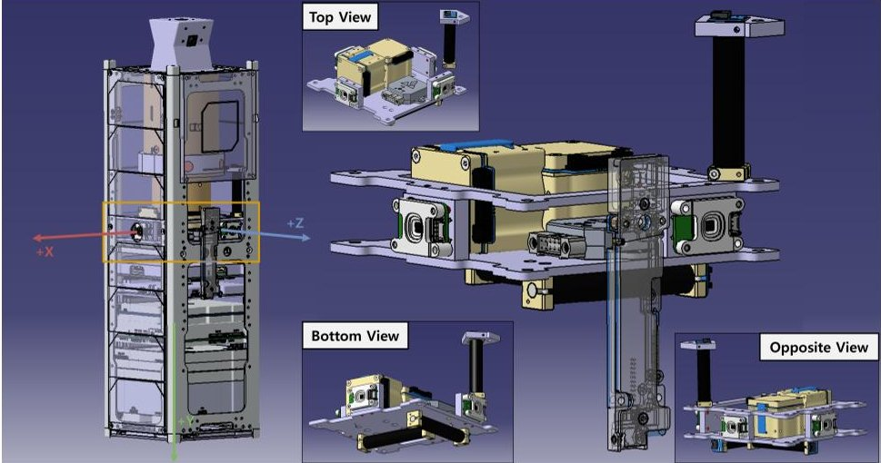

(a)

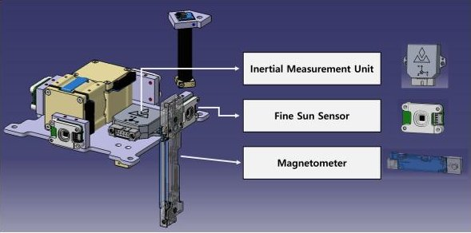

(b)

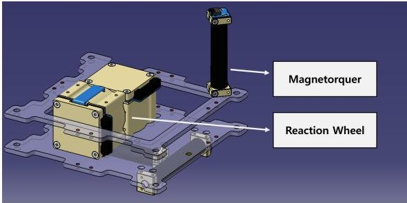

(c)

Figure 1. Hardware configuration of INHA RoSAT. (a) Overall view with body coordinate frame, (b) ADCS sensor layout, (c) ADCS actuator layout.

<!-- PDF_PAGE: 4 -->

For ADCS operation and system integration, the communication and power interfaces are designed as follows. Figure 2 illustrates the ADCS communication architecture. The main OBC interfaces with various sensors and actuators using standard communication protocols tailored to each device's data requirements, ensuring reliable command and telemetry exchange. The power distribution scheme is presented in Figure 3. The electrical power system (EPS) regulates and distributes power to the ADCS components via dedicated voltage lines, providing stable power suitable for the specific operational needs of sensors, logic circuits, and high-power actuators.

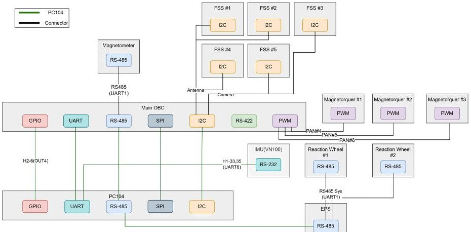

Figure 2. ADCS communication block diagram.

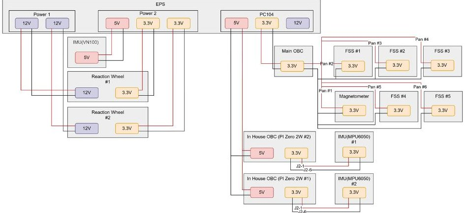

Figure 3. ADCS power block diagram. Red and black lines represent power supply and signal connections, respectively.

## 2.1. ADCS Hardware Components

The INHA RoSAT ADCS is equipped with commercial sensors and actuators for attitude determination and control. The ADCS hardware components are shown in Figure 4 and their specifications are summarized in Table 1. A CubeMag Gen2 Deployable magnetometer (CubeSpace, Stellenbosch, South Africa) is used for geomagnetic field measurements. Sun vector measurements are provided by FSS-15 fine Sun sensors (Tensor Tech, New Taipei City, Taiwan), and angular rate measurements are obtained from a VN-100 IMU (VectorNav, Dallas, TX, USA). To obtain position, velocity, and timing information, the spacecraft uses a OEM719 GNSS receiver (NovAtel, Calgary, AB, Canada) with a passive GNSS antenna integrated with the EnduroSat OBC (EnduroSat, Sofia, Bulgaria). The spacecraft is equipped with CubeSpace CubeTorquer Gen2 magnetorquers and two CubeSpace CubeWheel Gen2 reaction wheels as actuators. The specific configuration of reaction wheels on the X and Y axes was selected to optimize performance within the volume constraints of the 3U platform, considering the mission's orbital geometry. The Y-axis wheel is primarily responsible for the pitch maneuvers required to transition between Earth-pointing (Z-axis aligned) and Sun-pointing modes, while the X-axis wheel provides additional control authority for three-axis stabilization. The lack of a Z-axis reaction wheel is compensated

<!-- PDF_PAGE: 5 -->

for by the magnetic torquers, which provide the necessary control torque for the Z-axis and manage momentum dumping. This hybrid actuator configuration is sufficient to meet the mission's coarse pointing requirements for power generation and communication.

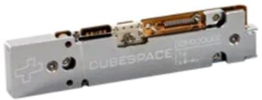

(a)

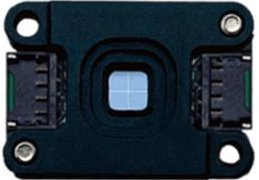

(b)

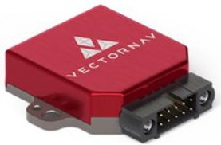

(c)

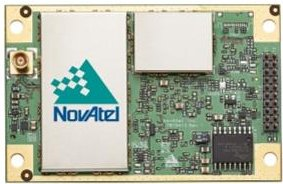

(d)

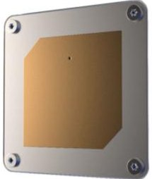

(e)

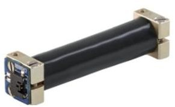

(f)

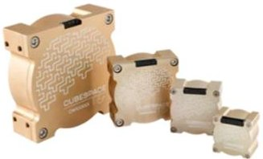

(g)

Figure 4. ADCS hardware components used in INHA RoSAT: (a) CubeMag Gen2 deployable; (b) FSS-15; (c) VN-100; (d) OEM719 GNSS receiver; (e) passive GNSS antenna; (f) CubeTorquer Gen2; (g) CubeWheel Gen2.

Table 1. ADCS hardware components of INHA RoSAT and performance specifications.

<table border="1"><tr><td>Category</td><td>Component</td><td>Manufacturer</td><td>Performance Specifications</td></tr><tr><td>Magnetometer</td><td>CubeMag Gen2 Deployable</td><td>CubeSpace(Stellenbosch, South Africa)</td><td>Noise:50nT(3$\sigma$)per channel</td></tr><tr><td>Fine Sun Sensor</td><td>FSS-15</td><td>Tensor Tech(New Taipei City,Taiwan)</td><td>FOV:$\pm 60^{\circ}$;Accuracy:0.3°</td></tr><tr><td>IMU</td><td>VN-100</td><td>VectorNav(Dallas,TX,USA)</td><td>Gyro range:$\pm 2000^{\circ}/s$;Bias instability:5-7$\cdot$/h(typ.);Noise density:0.0035$\cdot$/s/$\sqrt{\mathrm{Hz}}$</td></tr><tr><td>GNSS receiver</td><td>OEM719</td><td>NovAtel(Calgary,AB,Canada)</td><td>Position accuracy:1.5m(single-pointL1,RMS);Time accuracy:&lt;5ns(RMS);Reacquisition:&lt;0.5s(typ.)</td></tr><tr><td>GNSS antenna</td><td>Passive GNSS Antenna</td><td>EnduroSat(Sofia,Bulgaria)</td><td>Band:L1/E1;HPBW:88$\cdot$/Noise figure:&lt;1.4dB</td></tr><tr><td>Magnetorquer</td><td>CubeTorquer Gen2(CR0002/CR0003$\times$2)</td><td>CubeSpace(Stellenbosch,South Africa)</td><td>Minimum magnetic moment@5V:0.20/0.30A$\cdot$m2</td></tr><tr><td>Reaction wheel</td><td>CubeWheel Gen2(CW0017)$\times$2</td><td>CubeSpace(Stellenbosch,South Africa)</td><td>Momentum:1.7mNms@6000RPM;Saturation torque:0.23mNm</td></tr></table>

<!-- PDF_PAGE: 6 -->

## 2.2. ADCS Software Architecture and Integration

The commercial onboard computer used in the INHA RoSAT mission does not provide an interface for integrating user-defined ADCS modules. Consequently, ADCS algorithms must be implemented in C as custom modules and integrated into the existing FSW framework. In addition, an interface was required in order to exchange state information between the ADCS software and the core flight-software services (e.g., command handling, scheduling, and data management). The overall ADCS software architecture is illustrated in Figure 5. Each sensor acquisition task reads measurements from the corresponding device interface and stores them in a shared DataCache for use by other flight-software modules. The ADCS task reads the required input data (e.g., sensor measurements, spacecraft mode information, and predefined event flags) from the DataCache, executes the ADCS algorithms, and writes the computed actuator command outputs to the DataCache. Actuator tasks then read the stored commands and apply them to the corresponding hardware devices. This architecture maintains a coherent data flow within the FSW, from sensor acquisition through ADCS computation to the actuators. Moreover, by maintaining a consistent interface, the ADCS software can be reused for both PIL testing and sensor-to-actuator verification. This requires modifying only the sensor and actuator communication layers, thereby ensuring a continuous and consistent verification workflow throughout development.

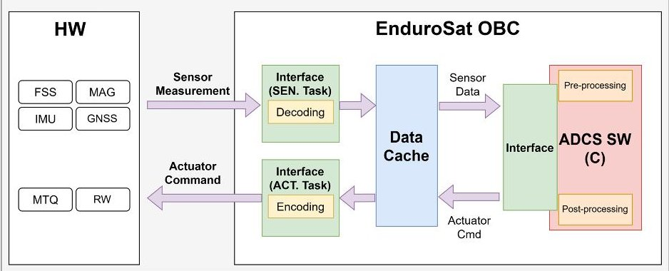

Figure 5. ADCS software architecture.

## 3. INHA RoSAT ADCS Requirements and Development Characteristics

The INHA RoSAT ADCS was designed to satisfy the spacecraft's fundamental operational requirements as well as additional requirements associated with the mission objective of verifying the rollable solar panels. The primary attitude control objectives are to damp the angular rates induced by launch separation and deployment events and to maintain Sun-pointing for adequate power generation and performance evaluation of the rollable solar panels. In addition, Earth-pointing for ground communications and a safe mode for contingencies are required for essential spacecraft operations. Accordingly, the ADCS was designed to satisfy these requirements in terms of algorithm architecture and operational modes.

## 3.1. ADCS Operational Modes

The ADCS operational modes are defined as idle, rate damping (RD), coarse Sunpointing (CSP), fine Sun-pointing (FSP), and Earth-pointing (EP). Mode transitions are triggered by predefined rules based on the spacecraft system mode and health status. This structure minimizes dependencies on the core flight-software while allowing the ADCS software to select alternative algorithms based on hardware availability and fault status. By exchanging only essential state variables with the FSW, the proposed approach simplifies integration with closed commercial FSW frameworks and makes it easier to apply to other

<!-- PDF_PAGE: 7 -->

missions. The hardware and software configurations associated with each ADCS mode are summarized in Table 2.

Table 2. HW/SW configuration for each ADCS operational mode.

<table border="1"><tr><td rowspan="2">Category</td><td rowspan="2">Item</td><td colspan="5">ADCS Operational Mode</td></tr><tr><td>IDLE</td><td>RD</td><td>CSP</td><td>FSP</td><td>EP</td></tr><tr><td rowspan="6">HW</td><td>MAG</td><td>●</td><td>O</td><td>O</td><td>O</td><td>O</td></tr><tr><td>SUN</td><td>●</td><td>●</td><td>O</td><td>O</td><td>O</td></tr><tr><td>IMU</td><td>●</td><td>●</td><td>O</td><td>O</td><td>O</td></tr><tr><td>GNSS</td><td>●</td><td>●</td><td>O</td><td>O</td><td>O</td></tr><tr><td>MTQ</td><td>-</td><td>O</td><td>O</td><td>O</td><td>O</td></tr><tr><td>RW</td><td>-</td><td>-</td><td>-</td><td>O</td><td>O</td></tr><tr><td rowspan="2">SW</td><td>Attitude Determination</td><td>-</td><td>-</td><td>TRIAD</td><td>EKF</td><td>EKF</td></tr><tr><td>Attitude Control</td><td>-</td><td>B-dot</td><td>MTQ-based Control</td><td>Quaternion Feedback</td><td>Quaternion Feedback</td></tr></table>

O: required, -: not used, ●: optional for monitoring.

The following describes the function of each ADCS operational mode. Idle mode disables both attitude determination and control and is entered when ADCS operation is temporarily disabled (e.g., due to insufficient power). Rate damping mode is primarily used immediately after launch separation or deployment to reduce the spacecraft's angular rates using a simplified sensor and actuator configuration. Coarse Sun-pointing mode achieves Sun-pointing using magnetorquers only, and is used when reaction wheel availability is uncertain, during initial stabilization prior to fine Sun-pointing, or under low-power conditions. Fine Sun-pointing mode uses both reaction wheels and magnetorquers to maintain Sun-pointing, and the spacecraft typically remains in this mode when not performing mission activities. In Earth-pointing mode, the spacecraft maintains an Earth-pointing attitude for S-band communications with the ground station using reaction wheels and magnetorquers.

## 3.2. System-Level Operational Modes

The spacecraft operational modes consist of early operations following launch, commissioning for initial on-orbit health checks, normal operation under nominal conditions, and emergency mode for contingencies. For each spacecraft system mode, a predefined set of allowable ADCS operational modes is specified, as summarized in Table 3. This predefined mode-mapping scheme maintains consistency between system-level and ADCS-level state management. Table 4 summarizes the attitude determination and control algorithms assigned to each ADCS operational mode along with their key characteristics. These assignments reflect the attitude requirements of each operational mode and the characteristics of the corresponding algorithms.

Table 3. ADCS operational modes assigned to each system operational mode.

<table border="1"><tr><td></td><td colspan="5">ADCS Operational Mode</td></tr><tr><td></td><td>IDLE</td><td>RD</td><td>CSP</td><td>FSP</td><td>EP</td></tr><tr><td>Early Operation</td><td>O</td><td>O</td><td>O</td><td>-</td><td>-</td></tr><tr><td>Commission</td><td>O</td><td>O</td><td>O</td><td>-</td><td>-</td></tr><tr><td>Normal Operation</td><td>O</td><td>O</td><td>O</td><td>O</td><td>O</td></tr><tr><td>Emergency</td><td>O</td><td>O</td><td>O</td><td>-</td><td>-</td></tr></table>

O: Applicable, -: Not applicable.

<!-- PDF_PAGE: 8 -->

Table 4. Algorithms and characteristics used in each ADCS operational mode.

<table border="1"><tr><td>Mode</td><td>Attitude Determination</td><td>Attitude Control</td></tr><tr><td rowspan="2">IDLE</td><td>-</td><td>-</td></tr><tr><td>-</td><td>-</td></tr><tr><td rowspan="2">RD</td><td>-</td><td>Bang-Bang-Based B-dot Control[15]</td></tr><tr><td>-</td><td>Angular rate damping using magnetometer measurements and magnetorquers; rapid rate reduction achieved by applying maximum magnetic dipole commands; residual oscillations may occur due to the bang-bang nature of the control.</td></tr><tr><td rowspan="2">CSP</td><td>TRIAD[15]</td><td>Magnetorquer-Based Control[15]</td></tr><tr><td>Static attitude determination based on instantaneous vector observations; does not explicitly account for sensor noise characteristics; suitable when high-precision attitude estimation is not required; commonly used as an initial attitude estimate for EKF initialization.</td><td>Attitude control using magnetorquers as the sole actuators; typically exhibits longer settling times than reaction-wheel-based control; pointing errors may arise due to geomagnetic-field coupling and disturbances.</td></tr><tr><td rowspan="2">FSP</td><td>Extended Kalman Filter(EKF)[16]</td><td>Quaternion Feedback Control[17]</td></tr><tr><td>Nonlinear attitude estimation considering sensor characteristics; recursive filtering minimizes estimation errors; provides higher estimation accuracy compared to TRIAD.</td><td>Explicitly considers maximum actuator torque and allowable angular rates; in the presented two-reaction-wheel architecture, magnetorquers are used as auxiliary actuators to compensate for underactuation; enables three-axis stabilization.</td></tr><tr><td rowspan="2">EP</td><td>Extended Kalman Filter(EKF)</td><td>Quaternion Feedback Control[18]</td></tr><tr><td>Nonlinear attitude estimation considering sensor characteristics; recursive filtering minimizes estimation errors; provides higher estimation accuracy compared to TRIAD.</td><td>By not explicitly accounting for body angular rates, the controller enables rapid target acquisition but may increase the risk of reaction-wheel saturation; in the presented two-reaction-wheel architecture, magnetorquers are used as auxiliary actuators to compensate for underactuation; enables three-axis stabilization.</td></tr></table>

## 3.3. Development Characteristics

The ADCS development for the INHA RoSAT mission is characterized by three key features: (1) a simplified development process enabled by automatic code generation, (2) sensor-to-actuator testing for hardware integration verification under constrained test environments, and (3) a hierarchical switching logic that selects an alternative control algorithm upon reaction-wheel failure in a two-reaction-wheel architecture. These features are introduced in this section and are described in detail in the subsequent sections.

For flight use, the ADCS algorithms must be implemented in a form that can be executed on the commercial onboard computer. Because the selected OBC FSW does not provide an interface for integrating user-developed ADCS modules, the entire ADCS softwarewas implemented as custom modules in C and integrated directly into the FSW framework, including attitude determination and control algorithms, mode transition logic, state monitoring, and command/telemetry handling. During each execution cycle, the ADCS software executes the sequence of steps shown in Figure 6.

<!-- PDF_PAGE: 9 -->

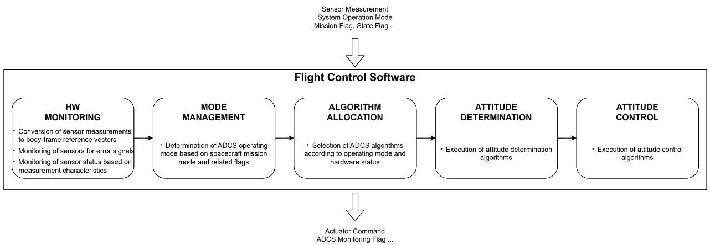

Figure 6. Functional block diagram of the ADCS Ssftware.

The ADCS algorithms and software functions are verified at the MIL stage using Simulink-based models. The validated Simulink models are then converted into C code using Simulink automatic code generation. In a typical development workflow, the generated code is verified via software-in-the-loop simulation on a host computer. However, the commercial OBC used for INHA RoSAT does not provide a hardware abstraction layer (HAL), imposing a constraint where the flight software is tightly coupled to the target hardware and cannot be executed in a non-OBC environment. Consequently, the standard SIL phase was impossible. Instead, to maintain verification continuity, the code generation process was validated by confirming functional equivalence between the Simulink models and the generated C code. The generated C code is used as the onboard software and integrated into the flight software. This enables PIL testing using the same implementation validated at the MIL. To conduct PIL testing, the ADCS input/output bus structure, the communication interfaces, the ADCS software execution method, and the data exchange mechanism with the FSW must be defined. Full hardware-in-the-loop simulation, which is often regarded as the final validation stage in a typical spacecraft development process, typically depends on high-cost test infrastructure for sensor/actuator I/O emulation, such as a Helmholtz cage, a solar simulator, and an air-bearing platform. However, in low-cost smallsatellite development environments, such facilities may not be accessible. Accordingly, for INHA RoSAT, a FlatSat-based sensor-to-actuator test was adopted as an alternative to a fully closed-loop HILS setup. The test supports final software-hardware verification by validating hardware I/O connectivity and polarity, verifying end-to-end data flow through the sensor and actuator interfaces in the flight software, and cross-checking units and sign conventions. By replacing only the hardware connection layer with flight-representative devices while keeping the remaining architecture identical to the PIL simulation, the sensor-to-actuator test can enhance verification reliability with only limited targeted verification. This approach provides a practical verification framework for on-orbit operation without relying on high-cost HIL simulation facilities.

Unlike conventional reaction-wheel configurations that employ four wheels to provide redundancy, INHA RoSAT carries only two reaction wheels to satisfy the required pointing performance within the platform's volume and cost constraints. With two wheels, three-axis control cannot be achieved using reaction wheels alone; therefore, three-axis attitude control is realized by combining the reaction wheels with magnetic torquers. In addition, because this architecture lacks actuator redundancy, a hierarchical definition of the control algorithm's structure and a switching logic were both implemented. As a result, when a reaction wheel fails, the spacecraft can continue the mission autonomously without ground intervention. This approach enables fault-tolerant mission operation despite the limited actuator configuration.

<!-- PDF_PAGE: 10 -->

## 4. Model-Based Design and Automatic Code Generation

The INHA RoSAT ADCS software was developed using Simulink. Implementing ADCS algorithms in Simulink allows design, simulation, and verification to be conducted within an integrated environment, thereby improving development efficiency. However, Simulink models cannot be used directly as flight software; therefore, they must be converted into C code that can be executed within the onboard computer flight software Traditionally, this conversion has often been performed by manually implementing C code based on the Simulink model. Such a manual approach is inefficient, can introduce human errors, and may lead to inconsistencies between the model and the implemented code. It also makes maintenance difficult when design changes occur.

To overcome these limitations, the automatic code generation capability provided by Simulink Embedded Coder was adopted. Automatic code generation from Simulink models offers several advantages. First, it substantially reduces the amount of manually written C code, thereby decreasing implementation errors and reducing inefficient manual work. Second, maintaining consistency between the model and the generated code enables a continuous verification process. Third, because algorithm updates can be made by modifying the model itself, maintainability and extensibility are improved. Finally, the model-based structure is easier to adapt to other missions, which enhances reusability.

The software development and verification process generally follows a systematic workflow to ensure the reliability of the flight software. As illustrated in Figure 7, the standard verification process consists of model-in-the-loop (MIL), software-in-the-loop (SIL), processor-in-the-loop (PIL), and hardware-in-the-loop (HIL) simulations. First, at the MIL step, the functional validity of the ADCS algorithms implemented in Simulink and their stability under representative operational scenarios are verified. The next step is SIL testing. In this phase, the converted C code is validated to ensure functional equivalence with the ADCS software from the MIL phase and to verify its integration with the FSW. Subsequently, PIL testing is conducted by loading the code onto the target processor (OBC). This step focuses on validating the execution of the algorithms within the actual hardware environment and ensuring real-time performance. Finally, HIL testing validates the software integrated with actual hardware components in a loop to verify system-level performance.

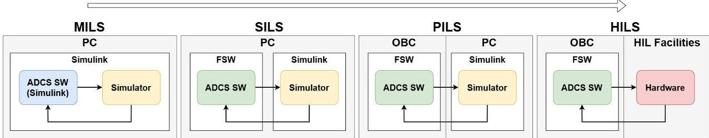

Figure 7. General software verification process.

To support these verification steps, a high-fidelity simulator is essential. As illustrated in Figure 8, the simulator consists of an orbit propagator, space environment models, and attitude dynamics models. It propagates the satellite's orbit and attitude states to generate simulated sensor measurements and reflects the attitude dynamics based on the torque commands received from the actuator models. This simulator architecture is utilized consistently across the MIL, SIL, and PIL stages to ensure coherent verification results.

By using automatic code generation within this verification procedure, it is possible to perform MIL, SIL, and PIL in a continuous and consistent way. In addition, when the design is modified, the same end-to-end verification chain can be repeated efficiently. This process demonstrates a practical CubeSat development approach that can achieve high reliability even under limited resources and schedule constraints.

<!-- PDF_PAGE: 11 -->

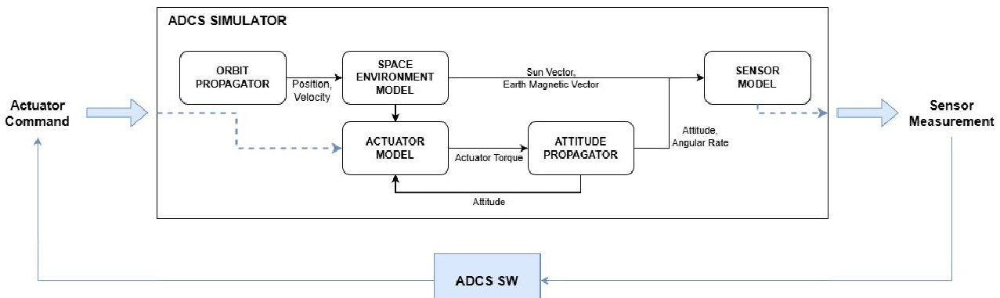

Figure 8. Architecture of the ADCS simulator.

Next, an application example of the proposed process to the actual development of INHA RoSAT is presented. While the continuous verification process based on MBD described above ensures efficiency and high reliability, the use of commercial off-the-shelf (COTS) components often imposes constraints on the development environment set by the manufacturer, making it difficult to strictly adhere to the procedure. In such cases, although the specific verification steps may be modified, the rigorousness of the verification targets must be maintained to ensure the continuity of the verification chain. The development of INHA RoSAT followed this adapted approach.

As mentioned in Section 3.3, the FSW of the OBC selected for INHA RoSAT lacks a hardware abstraction layer (HAL). This means that the FSW cannot be executed in a non-OBC environment; consequently, a typical SIL simulation could not be performed. Therefore, the verification tasks typically performed in SIL, specifically the validation of the converted C code and the verification of FSW integration, were redistributed to the equivalence test and PIL phases, respectively. Furthermore, due to the absence of HIL facilities, the HIL simulation was substituted by a sensor-to-actuator test using a FlatSat configuration, which will be described in detail in Section 5.

To address these constraints, we adapted the verification process shown in Figure 9. As depicted in the figure, C code generation was performed and an equivalence test was added to replace the SIL phase. This step verifies the functional equivalence between the Simulinkbased ADCS software and the generated C code by running both implementations with identical simulator inputs and comparing their outputs. As the next step, PIL testing was performed to verify FSW integration on the target hardware. Specifically, PIL simulation was conducted using the architecture illustrated in Figure 10. The communication between the PC and the OBC was established via a direct USB-to-UART cable connection. On the host PC side, communication was handled using the Serial Send and Serial Receive blocks from the Simulink Instrument Control Toolbox, while on the OBC side a custom DMA-based UART interface was implemented to ensure real-time performance. Through this PIL simulation, the validity of the software implementation on the target processor was confirmed. To complete the verification chain, the subsequent phase focuses on validating the physical integration with actual hardware components.

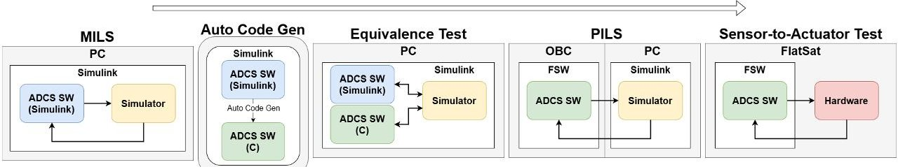

Figure 9. Software verification process applied to INHA RoSAT.

<!-- PDF_PAGE: 12 -->

Processor-in-the-Loop Simulation

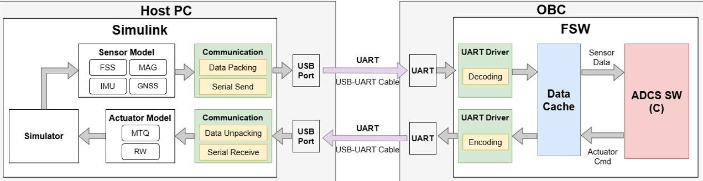

Figure 10. Architecture of processor-in-the-loop simulation.

## 5. Hardware Integration Verification via Sensor-to-Actuator Testing

In a typical spacecraft development process, final verification is performed through HIL. HIL is generally regarded as the most reliable verification approach because it enables closed-loop simulation of the sensor-dynamics-actuator environment using facilities such as a Helmholtz cage, a solar simulator, and attitude simulation equipment, allowing hardware-software interaction to be evaluated under conditions used in actual on-orbit operations. However, it may be difficult to access such facilities in low-cost small-satellite development environments such as CubeSat projects. In addition, integrating these facilities with flight-model (FM) hardware, which does not have spare units available, can increase the risk of hardware damage. As a result, performing a full HIL is frequently constrained in practice.

Considering these constraints, INHA RoSAT adopted a sensor-to-actuator test as a lightweight and essential function-oriented alternative to full HILS. In the preceding PIL, hardware-related values are provided as simulated data from the simulator. In contrast, the sensor-to-actuator test verifies the end-to-end process in which sensor measurements are fed into the ADCS software through the OBC FSW, and the resulting control commands are applied to actual actuators. In this way, the test confirms integration between flight software and real hardware. Because the sensor-to-actuator test operates as a form of open-loop verification, it cannot verify the dynamic attitude behavior over extended periods, which is achievable through the closed-loop simulation of a full HIL. However, this approach is designed based on the premise that the dynamic behavior and control stability have already been rigorously validated during the preceding phases. Since the flight software logic remains identical to that verified in the PIL stage, differing only in the activation of physical hardware interfaces, the reliability of the control algorithms is preserved.

Therefore, the primary objective of this test is to focus on validating the physical hardware-software integration, specifically targeting potential interface faults such as polarity inversions, wiring errors, and sensor coordinate misalignments. By confirming that the physical hardware produces the expected responses to given inputs, this test ensures that the verified software correctly interacts with the real-world hardware, thereby contributing to flight readiness within the constraints of the development environment. Functions related to hardware fault detection and recovery, including hardware state monitoring and initialization, can also be tested during this step.

The sensor-to-actuator test is conducted by defining intended conditions, predicting the expected outputs, and verifying them experimentally. Using a FlatSat, the continuous process is validated end-to-end: sensor measurements are fed into the ADCS software as inputs, then the resulting ADCS outputs (e.g., actuator commands) are applied to the corresponding actuators. Mounting angle consistency and polarity are also assessed in this process. Our FlatSat configuration used flight-model hardware and harnesses. The procedure is summarized as follows. First, based on the verification requirements for the

<!-- PDF_PAGE: 13 -->

sensor-to-actuator test, the verification items are categorized into four groups, as presented in Table 5, and the corresponding verification matrix is defined in Table 6.

Table 5. Definition of verification items for the sensor-to-actuator test.

<table border="1"><tr><td>Category</td><td>ID</td><td>Description</td></tr><tr><td rowspan="2">SW Data Handling Requirements</td><td>R1</td><td>Sensor measurement data are correctly transferred to the ADCS software through the DataCache.</td></tr><tr><td>R2</td><td>Actuator command outputs generated by the ADCS software are correctly transferred to the actuator tasks through the DataCache.</td></tr><tr><td rowspan="2">Sensor Interface Requirements</td><td>R3</td><td>Sensor measurement vectors are correctly converted into body-frame vectors by applying the predefined DCM within the ADCS software.</td></tr><tr><td>R4</td><td>Units of sensor measurements are consistent with the unit definitions used inside the ADCS software.</td></tr><tr><td rowspan="2">Actuator Operation Requirements</td><td>R5</td><td>The output direction of the magnetorquers matches the direction calculated by the control algorithm.</td></tr><tr><td>R6</td><td>The torque direction of the reaction wheels matches the direction calculated by the control algorithm.</td></tr><tr><td rowspan="2">FSW-HW Integration Requirements</td><td>R7</td><td>The FSW structure and data flow, except for the hardware connection layer, remain identical to those used in the PIL environment.</td></tr><tr><td>R8</td><td>Input and output interfaces of the ADCS software maintain consistency with those used in the PIL environment.</td></tr></table>

To convert sensor measurements from each sensor's coordinate frame to the spacecraft body frame, the ADCS software applies a sensor-to-body direction cosine matrix (DCM). This verification is a critical hardware-software interface check to confirm whether the input sensor data are transformed into correct body-frame vectors. The process is performed by examining the body-frame vectors output by the ADCS software using OBC FSW debugging tools, such as STM32CubeIDE, and confirming that the sensor data are transformed into the expected direction vectors. For the magnetometer, the Earth's geomagnetic field is used as a reference. By aligning each axis with geographic north, the geomagnetic vector transformed into the body frame is checked for consistency. Similarly, for the Sun sensors and angular-rate sensors, manual stimulation (e.g., illuminating specific faces or rotating the spacecraft about each axis) is used to verify that the corresponding body-frame components are correctly produced. This step ensures hardware interface characteristics that cannot be fully assessed in earlier simulation-based stages.

The attitude control algorithms (e.g., B-dot control for magnetorquers and momentum bias control for reaction wheels) generate commands to compensate for pointing and angular-rate errors. This enables the theoretical prediction of actuator output directions for specific sensor inputs. Because high-fidelity sensor values are difficult to produce in a FlatSat environment, fixed sensor inputs are applied to simulate intended conditions, assuming the sensor interface has been validated. For the INHA RoSAT project, the magnetorquer (MTQ) polarity was verified by setting a constant geomagnetic field vector and injecting an angular-rate vector to create a predictable torque condition. The resulting MTQ command generated by the FSW was then compared with the physical response observed via a magnetic compass. A similar approach was applied to the reaction wheels (RWs); by applying body angular-rate inputs aligned with the wheel mounting directions, we verified whether the corresponding wheel produced a control command to damp the rate.

<!-- PDF_PAGE: 14 -->

Table 6. Verification matrix for sensor-to-actuator test.

<table border="1"><tr><td>Requirement</td><td>Description</td><td>Test Item</td><td>Evaluation Criteria</td></tr><tr><td>R1</td><td>Sensor measurement data are correctly transferred to the ADCS software via the DataCache.</td><td>DataCache Input Path Test/Sensor Task Test</td><td>Sensor measurements(FSS,MAG,IMU) are fed to the ADCS task,and the received values are verified using variable monitoring in the STM32CubeIDE debugger.</td></tr><tr><td>R2</td><td>Actuator command outputs generated by the ADCS software are correctly transferred to the actuator tasks via the DataCache.</td><td>DataCache Output Path Test/Actuator Task Test</td><td>In a control-command generation scenario,the values produced by the ADCS task are verified to match those received by the actuator tasks via STM32CubeIDE debugger variable monitoring.</td></tr><tr><td>R3</td><td>Sensor measurement vectors are correctly converted into body-frame vectors by applying the predefined DCM within the ADCS software.</td><td>Sensor Measurement Vector Body-Frame Conversion Test</td><td>User-defined(synthetic) or actual sensor measurements(FSS,MAG,IMU) are applied,and the converted vectors are verified to match the expected body-frame vectors computed using a known DCM.</td></tr><tr><td>R4</td><td>Units of sensor measurements are consistent with the unit definitions used inside the ADCS software.</td><td>Sensor Measurement Unit Conversion Test</td><td>Actual sensor measurements(FSS,MAG,IMU) are applied,and the internal ADCS software variables are verified to conform to the predefined unit definitions,including separate checks for redundant sensors where applicable.</td></tr><tr><td>R5</td><td>The output direction of the magnetorquers matches the direction calculated by the control algorithm.</td><td>Magnetorquer Polarity Verification Test</td><td>Fixed sensor inputs are applied to generate predictable control commands,and the resulting magnetorquer command polarity is verified to match the theoretically expected polarity.</td></tr><tr><td>R6</td><td>The torque direction of the reaction wheels matches the direction calculated by the control algorithm.</td><td>Reaction Wheel Polarity Verification Test</td><td>Fixed sensor inputs are applied to generate predictable control commands,and the resulting reaction-wheel torque direction is verified to match the theoretically expected direction.</td></tr><tr><td>R7</td><td>The FSW structure and data flow,except for the hardware connection layer,remain identical to those used in the PIL environment.</td><td>FSW Structure Consistency Check</td><td>The ADCS software structure and data flow observed during the Sensor-to-Actuator test are verified to be consistent with those used in the PIL environment,excluding the hardware interface layer.</td></tr><tr><td>R8</td><td>Input and output interfaces of the ADCS software maintain consistency with those used in the PIL environment.</td><td>ADCS I/O Interface Consistency Check</td><td>The input and output interfaces of the ADCS software are verified to preserve functional equivalence and interface consistency with those used in the PIL environment.</td></tr></table>

By confirming that the physical hardware produces the expected responses (e.g., correct MTQ magnetic moment direction and RW rotation) to the given inputs, this test ensures that the verified software correctly interacts with the real-world hardware. Although the sensor-to-actuator test does not simulate the full on-orbit environment, it is a highly practical verification method for CubeSat development. It effectively prevents major risk factors for flight failure, including hardware-software interface errors, axis misalignment, unit inconsistency, and polarity inversion, within a constrained development schedule.

## 6. Hierarchical Control Algorithm Definition and Switching Logic Considering Reaction Wheel Failures

Reaction wheels are commonly installed in a four-wheel configuration to enable three-axis attitude control while providing actuator redundancy. However, CubeSats are subject to strict constraints in volume, power, and mass, and the required attitude control accuracy is often relatively relaxed compared to larger spacecraft. As a result, accommodating four reaction wheels may be inefficient for CubeSat missions.

<!-- PDF_PAGE: 15 -->

Accordingly, the INHA RoSAT spacecraft is equipped with only two reaction wheels aligned with the body x- and y-axes. This configuration inherently prevents the generation of control torque about the z-axis using reaction wheels alone. To address this limitation, magnetic torquers are used together with reaction wheels to control motion about the z-axis and to manage reaction-wheel momentum. Depending on the available actuator set, specifically the number of operational reaction wheels, different attitude control algorithms can be applied; based on the control objectives and the characteristics of each control strategy, a primary control algorithm is defined and a priority hierarchy among alternative algorithms is established. This hierarchy enables the system to transition to lower-priority algorithms when a reaction-wheel failure occurs, allowing the spacecraft to cope with failures of reaction wheels.

Even in the two-reaction-wheel configuration used in this mission, the attitude control algorithm computes a three-axis commanded torque vector $ \tau_{cmd} $ , following the conventional four-reaction-wheel formulation. Accordingly, the reaction-wheel allocation matrix A is reduced to a $ 2\times 3 $ matrix to distribute the commanded torque to the available wheels.

For the INHA RoSAT mission, reaction-wheel-based control is assigned the highest priority and a hierarchical control architecture is defined with three stages: combined use of two reaction wheels and magnetic torquers, use of the y-axis reaction wheel with magnetic torquers, and magnetic-torquer-only control. In this way, lower-level control algorithms are selected according to the reaction-wheel hardware status.

Using this hierarchical control structure, the ADCS is designed to operate with only two reaction wheels while explicitly accounting for potential reaction-wheel failures. Furthermore, the same concept is extended by defining the required hardware components for each control algorithm, resulting in a hierarchical algorithm structure that enables the ADCS to handle faults in various hardware components and to maintain mission operations under actuator failure conditions.

The hierarchical switching logic operates by continuously monitoring the health status of the ADCS hardware. Tables 7 and 8 outline the hierarchical switching logic applied to INHA RoSAT. This system follows a priority-based reallocation strategy in which Level 1 represents the highest-precision algorithm. After an algorithm is initially assigned based on the operational mode, the ADCS software verifies its feasibility against the current hardware health status. If a required sensor or actuator for the assigned algorithm is found to be unavailable, the logic autonomously transitions to a lower level algorithm capable of maintaining functionality with the remaining hardware. As defined in Table 8, Level 1 corresponds to quaternion feedback control, Level 2 to momentum bias control [19], Level 3 to MTQ-based control, and Level 4 indicates an uncontrollable or unavailable state. Regarding performance, each hierarchical level employs established classical control algorithms with proven stability and convergence characteristics. This design ensures that the satellite system can autonomously assess the level of performance degradation and sustain mission operations within acceptable error margins even in the event of hardware failure.

Table 7. Available attitude determination algorithms depending on sensor availability (-: irrelevant).

<table border="1"><tr><td>Level</td><td>MAG</td><td>SUN</td><td>IMU</td><td>GNSS</td><td>Algorithms</td></tr><tr><td>1</td><td>Available</td><td>Available</td><td>Available</td><td>Available</td><td>EKF</td></tr><tr><td>2</td><td>Available</td><td>Available</td><td>-</td><td>Available</td><td>TRIAD</td></tr><tr><td>3</td><td>-</td><td>-</td><td>-</td><td>-</td><td>None</td></tr></table>

<!-- PDF_PAGE: 16 -->

Table 8. Available attitude control algorithms depending on hardware availability (-: irrelevant).

<table border="1"><tr><td>Level</td><td>MAG</td><td>SUN</td><td>IMU</td><td>GNSS</td><td>MTQ</td><td>RW_x</td><td>RW_y</td></tr><tr><td>1</td><td>Available</td><td>Available</td><td>Available</td><td>Available</td><td>Available</td><td>Available</td><td>Available</td></tr><tr><td>2</td><td>Available</td><td>Available</td><td>Available</td><td>Available</td><td>Available</td><td>-</td><td>Available</td></tr><tr><td>3</td><td>Available</td><td>Available</td><td>Available</td><td>-</td><td>Available</td><td>-</td><td>-</td></tr><tr><td>4</td><td>-</td><td>-</td><td>-</td><td>-</td><td>-</td><td>-</td><td>-</td></tr></table>

## 7. Conclusions

This study has presented an MBD-driven development and verification framework for the ADCS of the INHA RoSAT CubeSat, with a focus on applicability under constrained hardware and software environments. The proposed approach maintains a consistent model structure throughout the entire development process from design and simulation to automatic code generation, software integration, and hardware-interfacing tests, thereby minimizing inconsistencies among documentation, design models, and implementation that commonly arise in conventional development processes. In particular, the use of Simulink-based automatic code generation enables rapid incorporation of algorithm modifications and enhanced software reusability, leading to improved development efficiency.

To address the limitations of resource-constrained development environments, a sensor-to-actuator test is proposed as a practical alternative to full HIL simulation. This approach enables verification of essential hardware-software interfaces without relying on high-cost facilities. By preserving the same software architecture as the PIL simulation and validating the actual input-output paths, from sensors through integrated flight software to actuators, the proposed test procedure ensures reliable interaction between the final flight software and the hardware. As a result, critical interface-related failure sources such as polarity errors, unit mismatches, mounting misalignments, and scaling inconsistencies can be identified prior to launch. This represents a practical and effective verification strategy for achieving flight readiness under limited development conditions.

To overcome the constraints associated with a two-reaction-wheel configuration, a hierarchical attitude control algorithm structure was designed with explicit consideration of reaction-wheel failure scenarios. In addition to nominal hybrid control using two reaction wheels and magnetic torquers, the proposed structure enables autonomous transitions to alternative control strategies such as momentum-biased control or magnetic-torqueronly control depending on the availability of individual reaction wheels. Through this hierarchical switching logic, the ADCS software can select appropriate control algorithms and maintain attitude control even in the presence of actuator failures.

In summary, this work contributes to CubeSat ADCS development by presenting an MBD-based ADCS development and verification pipeline, establishing a practical sensor-to-actuator verification approach applicable in constrained environments, and defining a fault-aware hierarchical attitude control logic for a two-reaction-wheel architecture.

These contributions provide a practical ADCS development strategy that is well suited to real-world CubeSat missions subject to resource and verification constraints. Future work will focus on analyzing on-orbit ADCS performance data following launch to experimentally assess the effectiveness of the proposed MBD-based development process and the sensor-to-actuator verification methodology.

Author Contributions: Conceptualization, H.-E.Y. and S.-H.M.; methodology, H.-E.Y. and S.-H.M.; software, H.-E.Y., C.-O.K., S.-H.M. and J.Y.; validation, C.-O.K.; investigation, H.-E.Y., C.-O.K. and J.Y.; writing—original draft preparation, H.-E.Y.; writing—review and editing, S.-H.M.; supervision, S.-H.M.; project administration, K.C. All authors have read and agreed to the published version of the manuscript.

<!-- PDF_PAGE: 17 -->

Funding: This research was supported by the National Research Foundation of Korea and the Korea Aerospace Research Institute through the 2022 Cube Satellite Competition (Grant No. 2022M1A3C2014567).

Data Availability Statement: The data presented in this study are available on request from the corresponding author.

Acknowledgments: The authors acknowledge Team InCuPion, especially Hyeri Ha, for FSW technical support and FlatSat setup.

Conflicts of Interest: The authors declare no conflicts of interest.

## Abbreviations

The following abbreviations are used in this manuscript:

ADCS Attitude Determination and Control System

COTS Commercial Off-the-Shelf

CSP Coarse Sun-Pointing

DCM Direction Cosine Matrix

EP Earth-Pointing

EPS Electrical Power System

FM Flight Model

FSP Fine Sun-Pointing

FSS Fine Sun Sensor

FSW Flight Software

GNSS Global Navigation Satellite System

HIL Hardware-in-the-Loop

I/O Input/Output

IMU Inertial Measurement Unit

MAG Magnetometer

MBD Model-Based Design

MIL Model-in-the-Loop

MTQ Magnetorquer

OBC Onboard Computer

PIL Processor-in-the-Loop

RD Rate Damping

RW Reaction Wheel

## References

1. Springmann, J.C.; Sloboda, A.J.; Klesh, A.T.; Bennett, M.W.; Cutler, J.W. The attitude determination system of the RAX satellite. Acta Astronaut. 2012, 75, 120-135. [CrossRef]

2. Springmann, J.C.; Cutler, J.W. Flight results of a low-cost attitude determination system. Acta Astronaut. 2014, 99, 201-214. [CrossRef]

3. Carletta, S.; Teofilatto, P.; Farissi, M.S. A magnetometer-only attitude determination strategy for small satellites: Design of the algorithm and hardware-in-the-loop testing. Aerospace 2020, 7, 3. [CrossRef]

4. Yoo, H.E.; Mok, S.H. A Study on Sun Search and Pointing Strategy for Low-cost CubeSat. J. Korean Soc. Aeronaut. Space Sci. 2025, 53, 207-218. [CrossRef]

5. King, J.T.; Kolbeck, J.; Kang, J.S.; Sanders, M.; Keidar, M. Performance analysis of nano-sat scale $ \mu $CAT electric propulsion for 3U CubeSat attitude control. Acta Astronaut. 2021, 178, 722-732. [CrossRef]

6. Yoo, Y.; Kim, S.; Suk, J.; Kim, J. Attitude control system design & verification for CNUSAIL-1 with solar/drag sail. Int. J. Aeronaut. Space Sci. 2016, 17, 579-592. [CrossRef]

7. Kanavouras, K.; Hein, A.M. Agile Development of sub-CubeSat Spacecraft. IEEE Eng. Manag. Rev. 2024, 53, 65-86. [CrossRef]

8. Buitrago-Leiva, J.N.; Mejia, J.J.; Puerta-Ibarra, J.F.; Acero-Niño, I.F.; Guarnizo-Saavedra, A.F.; Rodriguez-Ferreira, J.; Rojas-Rodriguez, L.; Hernández-Torres, F.L.; Arango-Cotacio, C.E.; Salazar-Morales, J.E.; et al. Preliminary design of satellite systems through the integration of model-based system engineering and Agile methodologies: Application to the 3ColStar Mission. Aerospace 2024, 11, 758. [CrossRef]

<!-- PDF_PAGE: 18 -->

9. Gracias, M.H.; Gallegos, E.E. Transitioning Perspectives: Agile and Waterfall Perceptions in the Integration of Model-Based Systems Engineering (MBSE) within Aerospace and Defense Industries. ITEA J. Test Eval. 2024, 45. [CrossRef]

10. Mok, S.H.; Cho, D.H.; Kim, C.; Yang, Y.; Yoo, H.E.; Kim, D.; Choi, K.; Kang, S.J.; Park, S.S.; Yoo, S.J. Model-based Flight Control Software Development in NASA cFS Framework. J. Korean Soc. Aeronaut. Space Sci. 2025, 53, 731-740.

11. Ticona Coaquira, F.J.; Wang, X.; Vidaurre Torrez, K.W.; Mamani Quiroga, M.J.; Silva Plata, M.A.; Luna Verdueta, G.A.; Murillo Quispe, S.E.; Auza Banegas, G.J.; Antezana Lopez, F.P.; Rojas, A. Model-based design and testbed for cubesat attitude determination and control system with magnetic actuation. Appl. Sci. 2024, 14, 6065. [CrossRef]

12. Haloua, M.; Guennoun, Z.; Moudden, Z. A framework for developing an attitude determination and control system simulator for cubesats: Processor-in-loop testing approach. Results Eng. 2024, 22, 102201.

13. Stromecki, M.; Younes, A.B. Spacecraft attitude testbed. Adv. Space Res. 2024, 74, 2239-2269. [CrossRef]

14. Kiesbye, J.; Messmann, D.; Preisinger, M.; Reina, G.; Nagy, D.; Schummer, F.; Mostad, M.; Kale, T.; Langer, M. Hardware-in-the- loop and software-in-the-loop testing of the move-ii cubesat. Aerospace 2019, 6, 130. [CrossRef]

15. Markley, F.L.; Crassidis, J.L. Correction to: Fundamentals of Spacecraft Attitude Determination and Control. In Fundamentals of Spacecraft Attitude Determination and Control; Springer: New York, NY, USA, 2014; pp. C1-C7.

16. Crassidis, J.L.; Junkins, J.L. Optimal Estimation of Dynamic Systems; Chapman and Hall/CRC: Boca Raton, FL, USA, 2004.

17. Wie, B.; Lu, J. Feedback control logic for spacecraft eigenaxis rotations under slew rate and control constraints. J. Guid. Control Dyn. 1995, 18, 1372-1379. [CrossRef]

18. Wie, B.; Weiss, H.; Arapostathis, A. Quarternion feedback regulator for spacecraft eigenaxis rotations. J. Guid. Control Dyn. 1989, 12, 375-380. [CrossRef]

19. Steyn, W.H.; Hashida, Y. An attitude control system for a low-cost Earth observation satellite with orbit maintenance capability. In Proceedings of the 13th Annual AIAA/USU Conference on Small Satellites, Logan, UT, USA, 23-26 August 1999.

Disclaimer/Publisher's Note: The statements, opinions and data contained in all publications are solely those of the individual author(s) and contributor(s) and not of MDPI and/or the editor(s). MDPI and/or the editor(s) disclaim responsibility for any injury to people or property resulting from any ideas, methods, instructions or products referred to in the content.