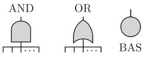
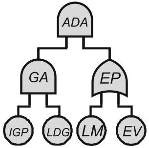
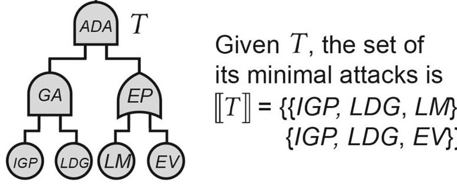
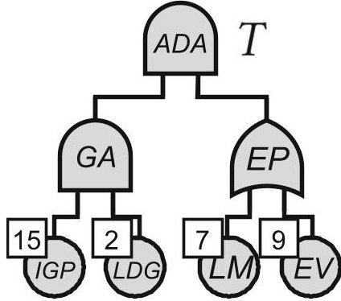
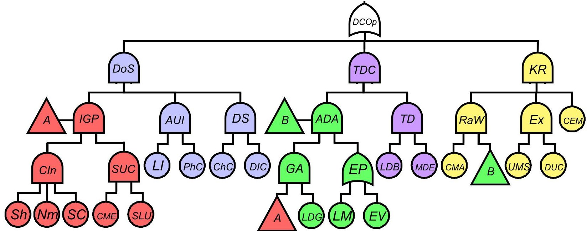
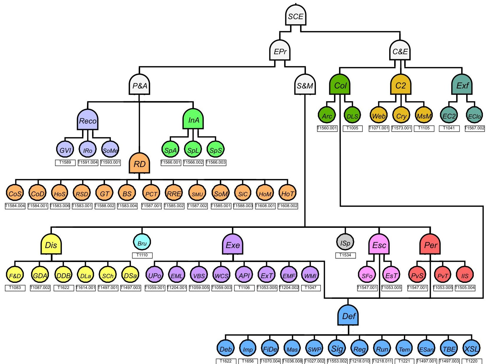

<!-- PDF_PAGE: 1 -->

SPECIAL SECTION PAPER

# ATM: a Logic for Quantitative Security Properties on Attack Trees

Stefano M. Nicoletti $ ^{1} $ iD · Milan Lopuhaä-Zwakenberg $ ^{1} $ iD · E. Moritz Hahn $ ^{1} $ iD · Mariëlle Stoelinga $ ^{1,2} $ iD

Received: 26 April 2024 / Revised: 19 August 2025 / Accepted: 9 September 2025 © The Author(s) 2025

## Abstract

Critical infrastructure systems for which high reliability and availability are paramount must operate securely. Attack trees (ATs) are hierarchical diagrams that offer a flexible modelling language used to assess how systems can be attacked. ATs are widely employed both in industry and academia but in spite of their popularity little work has been done to give practitioners instruments to formulate queries on ATs in an understandable yet powerful way. In this paper we fill this gap by presenting ATM, a logic to express quantitative security properties on ATs. ATM allows for the specification of properties involved with security metrics that include "cost", "probability" and "skill" and permits the formulation of insightful what-if scenarios. To showcase its potential, we apply ATM both to the case study of a CubeSAT and to a larger model, constructed from the real-life cyberespionage campaign Operation Dream Job, as recorded by the MITRE ATT&CK Database. We showcase property specification on the corresponding attack trees and propel usability of ATM by presenting LangATM a domain specific language for our logic. Finally, we present theory and algorithms based on binary decision diagrams to check properties and compute metrics of ATM-formulae.

Keywords Attack trees · Logic · Model checking · Aerospace · MITRE ATT&CK

## 1 Introduction

Critical infrastructure systems for which high reliability and availability are paramount must operate securely. Attack trees (ATs) [1] are a flexible modelling language used to assess how systems can be attacked. They operate by decomposing the attacker's goal into intermediate elements and basic attack steps that a malicious actor can take to reach said objective. ATs are widely employed both in industry and academia but in spite of their popularity

little work has been done to give practitioners instruments to formulate queries on ATs in an understandable yet powerful way. In this paper, we fill this gap by presenting a logic to express quantitative Metrics on ATs (ATM). ATM is a powerful language able to formulate structural queries on ATs that consider quantitative security properties, or security metrics, such as "cost" of an attack, "probability" of getting attacked and "skill" of a malicious actor. The ability to formulate these queries is essential to provide practitioners with an instrument to analyse what-if scenarios and to propel a more quantitatively-informed decision making process.

Attack trees Attack trees (ATs) are hierarchical diagrams that represent various ways in which a system can be compromised [1, 2]. Due to their popularity, ATs are referred to by many system engineering frameworks, e.g. UMLsec [3] and SysMLsec [4-7], and are supported by industrial tools such as Isograph's AttackTree $ ^{1} $ . The root — or top level element (TLE) — of an AT represents the attacker's goal, and the leaves represent basic attack steps (BASes): actions of the attacker that the analyst deems granular enough not to refine them any further. Intermediate nodes are labeled with gates (see Fig. 1) that determine how basic actions of the attacker can propagate to reach higher-complexity elements in the

<!-- PDF_PAGE: 2 -->

attack. ATs that do not capture dynamic behaviours present only OR and AND gates we call these static attack trees (SATs) but many extensions exist [7] to model more elaborate attacks. To build a solid and modular foundation for our framework, this paper focuses on SATs. It is important to note that despite their name ATs can be directed acyclic graphs (DAGs), i.e., graphs in which a node may have multiple parents. Them being DAGs or tree-structured has consequences on computations [2].

Example 1 Consider the AT in Fig. 2 (excerpt from Fig. 6). This AT represents different attacks to get access to the ground station database of a CubeSAT as admin. The TLE of this sub-tree is represented by the ADA AND-gate. For the attacker to reach ADA, they have to both gain access the GA AND-gate and escalate privileges the EP ORgate. Each of these gates is then refined by BASes: to gain access, an attacker must perform information gathering and a successful phishing attack the IGP BAS and login to the ground station database using phished credentials the LDG BAS. In addition, they have to either leverage misconfigurations the LM BAS or exploit vulnerabilities the EV BAS to escalate privileges. Note that IGP is represented here as a BAS but is further refined as an additional sub-tree in Fig. 6.

Metrics on attack trees ATs are often studied via quantitative analysis, during which they are assigned a wide range of security metrics [2]. Such metrics are key performance indicators that formalize how well a system performs in terms of security and are essential when comparing alternatives or making trade-offs. Typical examples of such metrics are the minimal time [8-11], minimal cost [12], or maximal probability [13] of a successful attack (see Table 1 for more examples).

## 1.1 Our approach

A logic for Attack Trees Metrics (ATM) To perform quantitatively informed decision making w.r.t. security of systems,

ACCESS GROUND STATION:

<table border="1"><tr><td>Access Ground DB as Admin</td><td>ADA</td></tr><tr><td>Gain Access</td><td>GA</td></tr><tr><td>Login to DB Ground Station</td><td>LDG</td></tr><tr><td>Escalate Privilege</td><td>EP</td></tr><tr><td>Leverage Misconfig.</td><td>LM</td></tr><tr><td>Exploit Vulnerabilities</td><td>EV</td></tr><tr><td>Info Gathering &amp; Phishing</td><td>IGP</td></tr></table>

Fig. 2 AT modelling access to ground station DB of a CubeSAT (excerpt from Fig. 6)

practitioners need the ability to analyse their models in a meaningful and thorough way. As such, they must be able to formulate meaningful queries and meaningful what-if scenarios. To cater for this need, this paper presents ATM, a logic for general Metrics on Attack Trees. ATM is a flexible language used to specify properties that take metrics such as "cost", "skill" and "probability" into account directly on ATs. ATM is structured on four Layers: these allow practitioners

a) to reason about successful/unsuccessful attacks;

b) to check whether metrics, such as the cost, are bounded by a given value on single attacks;

c) to compute metrics for a class of attacks and

d) to perform quantification.

Attack trees in practice To offer a concrete example, we utilise ATM to specify some properties on the AT model of a CubeSAT $ ^{2} $ from the literature [14] (see Fig. 6). This model exemplifies the effect of a security threat for the availability of a system by showcasing three ways in which a malicious actor could attack a CubeSAT: performing a denial of service attack, tampering with data on the database of the ground station or killing radio communications on the satellite. Our logic can be used to specify properties on the corresponding AT and to check whether the system under examination exhibits desired characteristics. Is it necessary to leverage misconfigurations to perform a successful attack on CubeSAT's communications? Is there an attack that ensures successful access to the ground station database while keeping the cost under a certain threshold? Is there an attack that ensures data tampering without exploiting vulnerabilities in the ground station system? To further showcase real-life usefulness of our approach, we construct an AT model from a real-life cyberespionage campaign on the aerospace sector Operation Dream Job as recorded by the MITRE ATT&CK Database $ ^{3} $ , a globally-accessible knowledge base of adversary tactics and techniques based on real-world observations. Can an attacker always establish presence in the network only by guaranteeing execution of all (sub)techniques for the resource development and discovery tactics? Is it sufficient to perform defense evasion techniques in order to achieve both privilege escalation and persistence? Is there a successful attack for the overall system that does not require to evade sandboxes? These are some of the properties that one could specify and check in the framework we present.

Model checking algorithms In addition, we present model checking algorithms to check properties specified with ATM and to efficiently compute metrics that appear in these properties. In particular, we provide algorithms to

<!-- PDF_PAGE: 3 -->

a) check whether an AT and an attack satisfy a formula;

b) compute all attacks that satisfy an AT and a formula;

c) check whether the metric of a formula is bounded by a user-specified threshold;

d) compute the metric value of formulae and

e) check whether a quantified ATM-formula holds true.

Building on previous work in the field [2,15,16], all these algorithms are based on construction and manipulation of binary decision diagrams (BDDs). This translation to BDDs constitutes a formal ground to address algorithmic procedures while integrating novel work presented in this paper with previously introduced frameworks.

This paper extends previous work [17]:

## Contributions of [17]:

1. We develop ATM, a logic to reason about general metrics on ATs. ATM allows for the specification of metrics properties that include "cost", "probability" and "skill" and for the formulation of insightful what-if scenarios.

2. We showcase ATM by applying it to the case study of a CubeSAT and by exemplifying properties specification.

3. We propose novel algorithms based on BDDs to perform model checking and to compute metrics on properties specified using ATM.

## Additional contributions of this version:

1. To showcase real-life usefulness of our approach, we apply ATM to a newly developed attack tree instance for the Operation Dream Job cyberespionage campaign, constructed from MITRE ATT&CK.

2. To propel usability, we define LangATM, a domain specific language for ATM.

3. Furthermore, we considerably extend our analysis of related work, taking other approaches for metrics computation on ATs into account.

## 1.2 Related work

Numerous logics describe properties of state transition systems, such as labelled transition systems (LTSs) and Markov models, e.g., CTL [18], LTL [19], and their variants for Markov models, PCTL [20] and PLTL [21]. State-transition systems are usually not written by hand, but are the result of the semantics of high-level description mechanisms, such as AADL [22], the hardware description language VHDL [23] or model description languages such as JANI [24] or

PRISM [25]. Consequently, these logics are not used to reason about the structure of such models (e.g. the placement of circuit elements in a VHDL model or the structure of modules in a PRISM model), but on the temporal behaviour of the underlying state-transition system. Similarly the majority of related work [26-29] on model checking on fault trees (FTs) a formalism that models failures' occurrence in a system exhibits significant differences: these works perform model checking by referring to states in the underlying stochastic models, and properties are formulated in terms of these stochastic logics, not in terms of elements in the given FT. In [30], the author provides a formulation of Pandora a logic for the qualitative analysis of temporal FTs. In [31] the authors investigate how fault tree analysis (FTA) results can be linked to software safety requirements by proposing the same system model for both. They introduce a duration calculus based on discrete time interval logic (ITL) [32] to give FTs formal semantics. In [15, 16] we present BFL a logic on FTs that reasons about them in Boolean terms and PFL its probabilistic counterpart. Our work is aligned in intentions to the latter two, as we develop a logic directly on ATs. As for FTs, our queries allow not only for qualitative analysis, but also quantitative analysis via metric queries; however, a large difference between FTs and ATs is that in security analysis one does not only consider the single probability metric, but a wide range of security metrics such as required attacker cost [33, 34], attack time [8, 10], attacker skill [2, 8], etc. While work exists that only considers one of these metrics, most work on AT analysis follows Mauw & Oostdijk [35] in phrasing AT metrics in terms of semirings, an algebraic structure consisting of a set and two operators, corresponding to AND- and OR-gates. As a framework, it is general enough to capture most metrics of interest, while having enough mathematical structure to allow for efficient computation.

A complicating factor for AT analysis, compared to FTs, is that there are multiple, noncompatible definitions of both AT semantics (i.e., what constitutes an attack) and AT metrics. More precisely, there are three approaches to AT semantics, and each comes with its own definition of how the structure of an AT and a semiring together define the AT's security value. An overview of the definitions of metrics, along with a category-based generalization that encompasses all of these, is given in [36]. We can roughly distinguish three approaches to semantics and metrics.

The first approach [35] assumes that Basic Attack Steps may need to be performed multiple times, once for every parent node it activates. $ ^{4} $ . Thus, an attack is a multiset of BASes,

<!-- PDF_PAGE: 4 -->

and the semantics are minimal multisets that activate the root. The associated metric value can be defined bottom-up, using the operators corresponding to the gate types. By definition this is very quickly computed, and it has been implemented in ADTool, a tool for attack-defense trees [38]. However, this approach cannot model situations in which attacker actions have multiple independent consequences, limiting its expressivity.

The second approach to semantics [37] needs only one BAS activation to trigger all its parents; consequently an attack is a set of BASes instead of a multiset, and the semantics is a set of sets that is computed bottom-up. The associated metric can be computed by detecting when a BAS is used multiple times, and counting each BAS only once in the metric computation. Unfortunately, this makes calculation more complicated: the existing approach works by splitting the extra appearances of BAS in so-called optional and necessary clones and accounting for this in the calculation; this process is exponential in the number of shared BASes.

A downside of the second approach is that the bottom-up defined semantics can contain some non-optimal attacks, skewing the metric computation. To address this fact, the third approach considers defines the set of minimal attacks from the structure function rather than bottom-up [2]. Metrics defined in this way can be computed by translating the AT to a BDD. BDDs are of worst-case exponential size, but there is a great amount of work on heuristics for BDD minimization [39]. As a result, BDDs from attack trees are often quite small in practice [2]. In this paper, we will follow this approach as it is expressive, and the BDD-based approach can be extended to more complicated logic queries.

Besides semiring-based definitions, metrics can also be defined/calculated by translating the AT into an automata model [8, 40, 41] and using tools such as UPPAAL [42] for metric calculation; this has been applied to metrics such as attack time, attack cost, and attack probability. The downside of this approach is that it does not generalize to arbitrary semirings. Furthermore, since a formal definition of the metric is lacking, the metric as calculated in this way can show undesired behaviour [43].

Several extensions of the AT framework exist. Some of the most prominent are: dynamic attack trees, in which the order of the BASes is expressed through sequential ANDgates [8, 43-45]; attack-fault trees, combining safety and security analyses in a single framework [40, 41]; and attack-defense trees, which incorporate countermeasures [37, 46- 48]. Quantitative analysis on these models is generally done by extending one of the four methods above; for dynamic attack trees and attack-defense trees see [36].

Structure of the paper Sec.2 covers background on ATs, Sec.3 presents syntax and semantics for ATM, Sec.4 showcases an application of ATM to a CubeSAT AT, Sec.5 further applies ATM to a more complex AT representing a real life cyberespionage campaign from the MITRE ATT&CK Database, Sec.6 presents LangATM-a domain specific language for ATM, Sec.7 presents model checking algorithms for ATM-formulae, Sec.8 discusses our approach w.r.t. applicability and efficiency, and Sec.9 concludes the paper and discusses future work.

## 2 Attack Trees

In this section we define attack trees and their metric as used in this paper. We follow the semantics of [2]; alternative semantics are discussed in Sec. 1.2.

Definition 1 An attack tree (AT) $ T $ is a tuple $ (N, E, t) $ where $ (N, E) $ is a rooted directed acyclic graph, and $ t: N \to $ {OR, AND, BAS} is a function such that for $ v \in N $ , it holds that $ t(v)=\mathrm{BAS} $ if and only if $ v $ is a leaf.

Moreover, ch: $ N \rightarrow \mathcal{P}(N) $ gives the set of children of a node and T has a unique root, denoted $ R_{T} $ . The subindex T is omitted if no ambiguity arises, e.g. an attack tree $ T=(N, E, t) $ defines a set BAS $ \subseteq N $ of basic attack steps. If $ u \in ch(v) $ then u is called a child of v, and v is a parent of u. We let $ v=\mathrm{AND}(v_{1},\dots,v_{n}) $ if $ t(v)=\mathrm{AND} $ and $ ch(v)=(v_{1},\dots,v_{n}) $ , and analogously for OR, denoting $ ch(v)=\{v_{1},\dots,v_{n}\} $ . Furthermore, we denote the universe of ATs by $ \mathcal{T} $ and call $ T \in \mathcal{T} $ tree-structured if for any two nodes u and v none of their children is shared, else we say that T is DAG-structured. If only AND- and OR-gates (or their derivatives) are present we say that T is a static attack tree (SAT). In this paper we focus our attention on SATs and thus use the term ATs interchangeably to denote them. The semantics of a AT is defined by its successful attack scenarios, in turn given by its structure function. First, the notion of attack is defined:

Definition 2 An attack scenario, or shortly an attack, of a static AT $ T $ is a subset of its basic attack steps: $ A\subseteq \mathrm{BAS}_{T}. $

We denote by $ \mathcal{A}_{T}=2^{\mathrm{BAS}_{T}} $ the universe of attacks of T. We omit the subscript when there is no confusion.

The structure function $ f_{T}(v,A) $ indicates whether the attack $ A\in\mathcal{A} $ succeeds at node $ v\in N $ of T. For Booleans we adopt $ \mathbb{B}=\{1,0\} $

<!-- PDF_PAGE: 5 -->

Fig.3 All minimal attacks for AT T modelling access to ground station DB of a CubeSAT (excerpt from Fig. 6)

Definition 3 The structure function $ f_{T} : N\times \mathcal{A}\rightarrow \mathbb{B} $ of a static attack tree T is given by:

$$
f _ {T} (v, A) = \left\{ \begin{array}{l l} 1 & \text {i f} t (v) = \mathrm {O R} \text {a n d} \exists u \in c h (v). f _ {T} (u, A) = 1, \\ 1 & \text {i f} t (v) = \mathrm {A N D} \text {a n d} \forall u \in c h (v). f _ {T} (u, A) = 1, \\ 1 & \text {i f} t (v) = \mathrm {B A S} \text {a n d} v \in A, \\ 0 & \text {o t h e r w i s e}. \end{array} \right.
$$

An attack A is said to reach a node v if $ f_{T}(v,A)=1 $ , i.e. it makes v succeed. If no proper subset of A reaches v, then A is a minimal attack on v. The set of minimal attacks on v is denoted $ \llbracket v \rrbracket $ . We define $ f_{T}(A)\doteq f_{T}(R_{T},A) $ , and attacks that reach the root of $ TR_{T} $ are called succesful w.r.t. T. Furthermore, the minimal attacks on $ R_{T} $ (i.e. the minimal successful attacks) are called minimal attacks. ATs are coherent [49], meaning that adding attack steps preserves success: if A is successful then so is $ A\cup\{a\} $ for any $ a\in\mathrm{BAS} $ . Thus, the suite of successful attacks of an AT is characterised by its minimal attacks.

Definition 4 The semantics of an AT T is its suite of minimal attacks $ \llbracket T \rrbracket $ .

The definition of the semantics $ \llbracket T \rrbracket $ follows [2]. In other works, attacks are multisets rather than sets [35], or the semantics are defined bottom-up rather than via the structure function [37]. The differences between these approaches, their impact on metrics, and our motivation for why we follow [2] are found in Sec. 1.2.

Example 2 Consider the AT in Fig. 3 representing ways to access the ground station database of a CubeSAT as admin: its suite of minimal attacks consists of { {IGP,LDG,LM}, {IGP, LDG,EV}}. That is, to mount a minimal attack a malicious actor needs to gain access performing information gathering and phishing IGP a BAS that is further refined in Fig. 6 and by logging into the DB of the ground station; to then either leverage misconfigurations LM or exploit vulnerabilities EV in the DB software to gain admin privileges. A non-minimal attack on this AT would include both LM and EV.

Table 1 AT metrics with attribute domains

<table border="1"><tr><td>Metric</td><td>V</td><td>$\nabla$</td><td>$\Delta$</td><td>$1_{\nabla}$</td><td>$1_{\Delta}$</td><td>$\preceq$</td></tr><tr><td>min cost</td><td>$\mathbb{N}_{\infty}$</td><td>min</td><td>+</td><td>$\infty$</td><td>0</td><td>$\leq$</td></tr><tr><td>min time (sequential)</td><td>$\mathbb{N}_{\infty}$</td><td>min</td><td>+</td><td>$\infty$</td><td>0</td><td>$\leq$</td></tr><tr><td>min time (parallel)</td><td>$\mathbb{N}_{\infty}$</td><td>min</td><td>max</td><td>$\infty$</td><td>0</td><td>$\leq$</td></tr><tr><td>min skill</td><td>$\mathbb{N}_{\infty}$</td><td>min</td><td>max</td><td>$\infty$</td><td>0</td><td>$\leq$</td></tr><tr><td>discrete prob.</td><td>[0,1]</td><td>max</td><td>·</td><td>0</td><td>1</td><td>$\leq$</td></tr></table>

## 2.1 Security metrics for attack trees

Security metrics such as the minimal time and cost among all attacks are essential to perform quantitative analysis of systems and to support more informed decision making processes. To enable this, i.e. computing security metrics, we adopt the well-established semiring framework. Semirings have vast applicability potential [50] and have been successfully used to construct attribute domains on ATs [2, 51, 52]. In this paper, we formulate linearly ordered unital semiring attribute domains where V is the value domain, $ \triangle $ is an operator to combine values of BASes in an attack, $ \nabla $ is an operator to combine values of different attacks and $ \preceq $ is an order to compare values. These linearly ordered unital semiring attribute domains provide a convenient way to define an ample class of metrics including "min cost", "min time" both with parallel or sequential attack steps - "min skill" and "discrete probability".

Definition 5 A linearly ordered unital semiring attribute domain (simply attribute domain or LOAD from now on) is a tuple $ L=(V,\nabla ,\Delta ,1_{\nabla},1_{\Delta},\preceq) $ where:

- V is a set;

- $ \nabla, \Delta \colon V^{2}\rightarrow V $ are commutative, associative binary operations on V;

- $ \triangle $ distributes over $ \nabla $ , i.e., $ x \triangle (y \nabla z) = (x \nabla y) \triangle (x \nabla z) $ for all x,y,z $ \in V $;

- $ \nabla $ is absorbing w.r.t. $ \triangle $ , i.e., $ x \nabla ( x \triangle y ) = x $ for all $ x, y \in V; $

- $ 1_{\nabla} $ and $ 1_{\Delta} $ are unital elements, i.e., $ 1_{\nabla}\nabla x=1_{\Delta}\triangle x=x $ for all $ x\in V $;

- $ \preceq $ is a linear order on V.

As anticipated, many relevant metrics for security analyses on ATs can be formulated as attribute domains. Table 1 shows examples, where $ \mathbb{N}_{\infty}=\mathbb{N}\cup\{\infty\} $ includes 0 and $ \infty. $ These example domains encode security metrics such as the min cost to perform an attack, the min time that an attacker would need to compromise the system - both considering attacks were steps are carried our sequentially or in parallel in addition to the min skill an attacker should have to mount an attack and the max probability of succesful compromise.

<!-- PDF_PAGE: 6 -->

Example 3 An example of a LOAD is $ (\mathbb{N}_{\infty},\min,+,\infty,0,\leq). $ Indeed, min and + are commutative, associative operations on $ \mathbb{N}_{\infty}. $ The distributive property amounts to the fact that $ x+\min(y,z)=\min(x+y,x+z), $ while the absorbing property can be stated as $ \min(x,x+y)=x. $ The units are given by $ 1_{\min}=\infty $ and $ 1_{+}=0 $ , and $ \leq $ is a linear order on $ \mathbb{N}_{\infty}. $ As we will discuss in Ex. 4, this LOAD corresponds to the min cost metric on ATs.

It is important to note that derived metrics such as stochastic analyses and Pareto frontiers can be represented by semirings. However, they do not fit in this framework not being LOADs [2]. Moreover, some meaningful metrics like the cost to defend against all attacks do fall outside this category (as seen in [2]). To render this framework functional, all BASes of ATs are enriched with attributes. More precisely, first an attribution $ \alpha $ assigns a value to each BAS; then a security metric $ \widehat{\alpha} $ assigns a value to each attack scenario; and finally the metric $ \check{\alpha} $ assigns a value to the set of minimal attacks. We then refer to LOADs to define AT metrics. Given a LOAD $ (V,\nabla ,\triangle ,1_{\nabla},1_{\triangle},\preceq) $ we assign to each BAS a an attribute value $ \alpha(a)\in V $ . The operators $ \nabla, \triangle $ are then used to define a metric value for T as follows:

Definition 6 Let T be an AT and let $ L=(V,\nabla ,\triangle ,1_{\nabla},1_{\Delta},\preceq) $ be a LOAD.

1. An attribution on T with values in L is a map $ \alpha\colon \mathrm{BAS}_{T}\rightarrow $ V;

2. Given such $ \alpha $ , define the metric value of an attack A by

$$
\widehat {\alpha} (A) = \bigwedge_ {a \in A} \alpha (a);
$$

3. Given such $ \alpha $ , define the metric value of T by

$$
\check {\alpha} (T) = \bigvee_ {A \in [ \llbracket T \rrbracket} \widehat {\alpha} (A) = \bigvee_ {A \in [ \llbracket T \rrbracket} \bigwedge_ {a \in A} \alpha (a).
$$

Note that the $ \preceq $ operator is not needed for metric computation, but it is however necessary for comparing elements in the LOAD, which is an operation needed in the logic (see Sec. 3).

Example 4 Consider L from Ex.3 representing the metric min cost, and let T be the AT in Fig. 4. To each BAS we attach a cost value, given by the attribution $ \alpha : \mathrm{B A S}_{T}\rightarrow V $ given by $ \{IGP\mapsto 15,LDG\mapsto 2,LM\mapsto 7,EV\mapsto 9\} $ . As in Ex. 2, T has two minimal attacks, $ A_{1}=\{IGP,LDG,LM\} $ and $ A_{2}=\{IGP,LDG,EV\} $ . Since $ \triangle =+ $ , We have $ \widehat{\alpha} (A_{1})=\alpha (IGP)+\alpha (LDG)+\alpha (LM)=15+2+7=24 $ ; this is the cost an attacker needs to spend to perform attack $ A_{1} $ . Similarly one finds $ \widehat{\alpha} (A_{2})=15+2+9=26 $ . We then calculate $ \check{\alpha} (T)=\min (\widehat{\alpha} (A_{1}),\widehat{\alpha} (A_{2}))=24 $ . Indeed, the minimal cost

incurred by an attacker to succesfully attack the system is by performing the cheapest minimal attack, which is $ A_{1} $

Note that in the definition of LOAD, we do not require any relation between $ \preceq $ and the operators $ \nabla $ $ \triangle $ . In principle, this means that it is possible that $ \widehat{\alpha} (A)>\widehat{\alpha} (B) $ for two attacks $ A\subset B $ ; in other words, minimal attacks may not be optimal. Nevertheless, we define our metrics and semantics the way we do for consistency with [2], and because most interesting metrics, including all metrics of Table 1, do not have this problem. Extra axioms that ensure minimal attacks are always optimal with respect to $ \preceq $ are discussed in [2]; we chose not to require these in this work because they are not needed for our model checking algorithms.

It should be noted that while Definition 6 defines $ \check{\alpha} ( T ) $ it does not present an efficient way of computing it, as finding all minimal attacks is computationally expensive [2]. In Section 7.5 we discuss the BDD-based method for metric calculation from [2], and apply it to more general logic queries.

When computing multiple metrics on a given AT, one can resort to multiple LOADs and coherently chosen attributions over its BASes. We thus define such an AT as follows:

Definition 7 An attributed AT is a tuple $ \mathsf{T}= ( T,\mathcal{L},\mathfrak{a}) $ where:

1. T is an attack tree;

2. $ \mathcal{L}=\{L_{1},\dots,L_{l}\} $ is a set of LOADs;

3. $ \mathfrak{a}=\{\alpha_{i}\}_{i=1}^{l} $ is a set of attributions on $ T $ , where each $ \alpha_{i} $ takes values in $ L_{i} $ .

## 3 A Logic for AT Metrics

## 3.1 Syntax of ATM

In the ATM Logic Syntax box (page 8), we present ATM, a logic for general Metrics on Attack Trees. ATM shares the objective of developing a language directly on tree-shaped models with [15, 16]. However, it extends the scope of these works to the security domain and allows for property specification that consider a large class of security metrics. The syntax of ATM is structured on four Layers. The first Layer, $ \phi $ , reasons about the status of elements (i.e., nodes) in an AT. Atomic formulae e represent elements in an AT and they can be combined with usual Boolean connectives. Furthermore, we can forcefully set the value of an element in a Layer 1 formula to either 0 or 1 with $ \phi $ [e $ \mapsto $ 0] and $ \phi $ [e $ \mapsto $ 1]. With MA( $ \phi $ ) we can check whether an attack is a minimal attack, i.e., a minimal attack successful for a given $ \phi $ . Layer 2 and 3 reason about metrics. Layer 2 formulae allow the user to check whether a given metric on a $ \phi $ formula is bounded by m $ (\mathbb{M}_{k}(\phi) \preceq_{k} m) $ and to forcefully set the attribution

<!-- PDF_PAGE: 7 -->

$$
G i v e n T a n d a n a t t r i b u t i o n o v e r B A S e s
$$

$$
\alpha : \{I G P \mapsto 1 5, L D G \mapsto 2, L M \mapsto 7, E V \mapsto 9 \},
$$

then min cost for T is calculated as follows:

$$
\check {\alpha} (T) = \widehat {\alpha} \left(\left\{I G P, L D G, L M \right\}\right) \nabla \widehat {\alpha} \left(\left\{I G P, L D G, E V \right\}\right)
$$

$$
= \widehat {\alpha} \left(\left\{I G P \triangle L D G \triangle L M \right\}\right) \nabla \widehat {\alpha} \left(\left\{I G P \triangle L D G \triangle E V \right\}\right)
$$

$$
= \min (1 5 + 2 + 7, 1 5 + 2 + 9) = \min (2 4, 2 6) = 2 4.
$$

Fig.4 Computing min cost for T: AT for accessing a ground station DB of a CubeSAT

of a given $ e\in\psi $ to an appropriate value $ \nu $ $ (\psi[e\mapsto^{k}\nu]) $ Boolean connectives are also allowed. Layer 3 formulae also allow the setting of attributions but simply return the value of a calculated metric $ (\mathbb{V}_{k}(\phi)) $ . Note that for the Layer 1, Layer 2 and Layer 3 formulae we usually assign values with $ \mapsto $ to $ e\in\mathrm{BAS} $ . We can however assign values to non-BAS elements if

1. e is a module [53], i.e., all paths between descendants of e and the rest of the AT pass through e, and

2. none of the descendants of e are present in the formula.

If so, we prune that (sub-)AT and treat occurring non-BAS elements as BASes. Finally, Layer 4 formulae allow us to perform quantification over Layer 1 and Layer 2 formulae. Given a set of LOADs $ \mathcal{L}=\{L_{1},\dots,L_{l}\} $ with $ L_{k}\in\mathcal{L} $ and $ m\in V_{k} $ the syntax is defined as follows:

ATM Logic Syntax

$$
\mathrm {L a y e r 1 :} \phi := e \mid \neg \phi \mid \phi \wedge \phi \mid \phi [ e \mapsto 0 ] \mid \phi [ e \mapsto 1 ] \mid \mathrm {M A} (\phi)
$$

$$
\text {L a y e r 2 :} \psi := \neg \psi \mid \psi \wedge \psi \mid \mathbb {M} _ {k} (\phi) \preceq_ {k} m \mid \psi [ e \mapsto^ {k} v ]
$$

$$
\text {L a y e r 3}: \xi := \mathbb {V} _ {k} (\phi) \mid \xi [ e \mapsto^ {k} v ]
$$

$$
\gamma := \neg \gamma \mid \exists (\phi \wedge \psi) \mid \forall (\phi \wedge \psi)
$$

Syntactic sugar We define the following derived operators, where formulae $ \theta $ are either Layer 1 or Layer 2 formulae.

$$
\theta_ {1} \vee \theta_ {2} := \neg (\neg \theta_ {1} \wedge \neg \theta_ {2})
$$

$$
\theta_ {1} \Rightarrow \theta_ {2} := \neg \left(\theta_ {1} \wedge \neg \theta_ {2}\right)
$$

$$
\theta_ {1} \Leftrightarrow \theta_ {2} := \left(\theta_ {1} \Rightarrow \theta_ {2}\right) \wedge \left(\theta_ {2} \Rightarrow \theta_ {1}\right)
$$

$$
\theta_ {1} \Leftrightarrow \theta_ {2} := \neg \left(\theta_ {1} \Leftrightarrow \theta_ {2}\right)
$$

## 3.2 Semantics of ATM

The semantics for our logic reflect objects needed to evaluate the four syntactical Layers. For the first Layer of ATM, formulae are evaluated on an attack A and on a tree T. Atomic

formulae e are satisfied by A and T if the structure function in Def. 3 returns 1 with A and e as input. Formally:

$$
A, T \models e \qquad \mathrm {i f f} f _ {T} (e, A) = 1
$$

$$
A, T \models \neg \phi \qquad \mathrm {i f f} A, T \not \models \phi
$$

$$
A, T \vDash \phi \wedge \phi^ {\prime} \quad \mathrm {i f f} A, T \vDash \phi \mathrm {a n d} A, T \vDash \phi^ {\prime}
$$

$$
\begin{array}{l} A, T \vDash \phi [ e _ {i} \mapsto 0 ] \quad \mathrm {i f f} A ^ {\prime}, T \vDash \phi \mathrm {w i t h} A ^ {\prime} = \left\{a _ {1} ^ {\prime}, \dots , a _ {n} ^ {\prime} \right\} \\ \mathrm {w h e r e} a _ {i} ^ {\prime} = 0 \mathrm {a n d} a _ {j} ^ {\prime} = a _ {j} \mathrm {f o r} j \neq i \\ \end{array}
$$

$$
\begin{array}{l} A, T \models \phi [ e _ {i} \mapsto 1 ] \quad \mathrm {i f f} A ^ {\prime}, T \models \phi \mathrm {w i t h} A ^ {\prime} = \left\{a _ {1} ^ {\prime}, \dots , a _ {n} ^ {\prime} \right\} \\ \mathrm {w h e r e} a _ {i} ^ {\prime} = 1 \mathrm {a n d} a _ {j} ^ {\prime} = a _ {j} \mathrm {f o r} j \neq i \\ \end{array}
$$

$$
A, T \vDash \mathrm {M A} (\phi) \quad \mathrm {i f f} A \in \llbracket \phi \rrbracket_ {T}
$$

With $ \llbracket \phi \rrbracket_{T} $ we denote the minimal satisfaction set of attacks for $ \phi $ , i.e., the set of minimal attacks that satisfy $ \phi $ given T. We define $ \llbracket \phi \rrbracket_{T} $ as follows: $ \llbracket \phi \rrbracket_{T} = \{A \mid A,T\models \phi \land \neq A^{\prime}\subseteq A.A^{\prime},T\models \phi \} $ . It is important to note that — with semantics defined as we did — we allow for fairly granular reasoning over ATs. In particular, we can evaluate whether an attack compromises a particular sub-AT without reaching the TLE. Semantics for the second and third Layer require attributed trees (see Def. 7). We can then define semantics for the second Layer:

$$
A, \mathsf {T} \models \neg \psi \qquad \mathrm {i f f} A, \mathsf {T} \not \models \psi
$$

$$
A, \mathsf {T} \models \psi \wedge \psi^ {\prime} \qquad \mathrm {i f f} A, \mathsf {T} \models \psi \mathrm {a n d} A, \mathsf {T} \models \psi^ {\prime}
$$

$$
A, \mathsf {T} \vDash \mathbb {M} _ {k} (\phi) \preceq_ {k} m \quad \mathrm {i f f} A, T \vDash \phi \wedge \widehat {\alpha} (A) \preceq_ {k} m
$$

$$
A, \mathsf {T} \models \psi \left[ e _ {i} \mapsto^ {k} v \right] \quad \mathrm {i f f} A, \mathsf {T} \left(\mathfrak {a} \left[ \alpha_ {k} \left(a _ {i}\right) \mapsto^ {k} v \right]\right) \models \psi
$$

For an attack A and an attributed tree T to satisfy $ \mathbb{M}_{k}(\phi)\preceq_{k} m $ both the attack A and the tree T must satisfy the inner Layer 1 formula and the security metric calculated on the attack must respect the given threshold. We let $ X_{1} $ be the set of Layer 1 formulae and we define a $ \phi $ -security metric to attribute a value to a Layer 1 formula:

<!-- PDF_PAGE: 8 -->

Definition 8 A $ \check{\alpha}^{\mathsf{T}} $ : $ X_{1} \rightarrow V $ defined as follows:

$$
\check {\alpha} ^ {\mathrm {T}} (\phi) = \bigvee_ {A \in [ \llbracket \phi \rrbracket_ {T}} \bigwedge_ {a \in A} \alpha (a).
$$

Note that in Def. 8 some occurrences can lead to the application of the $ \check{\alpha} $ function to the empty set, i.e., when $ \llbracket \phi \rrbracket_{T}=\emptyset $ To account for this, we resort to $ 1_{\nabla} $ and $ 1_{\Delta} $ for $ \nabla $ and $ \Delta $ (see Def. 5). Assuming the case in which $ \check{\alpha}^{\mathrm{T}}(\phi)\equiv\check{\alpha}(\emptyset) $ , we fix that $ \check{\alpha}^{\mathrm{T}}(\phi)=1_{\nabla} $ ; likewise for $ \widehat{\alpha} $ and $ 1_{\Delta} $ . Furthermore, with $ \check{\alpha}^{\mathrm{T}}_{k} $ : $ X_{1}\rightarrow V_{k} $ we denote a $ \phi $ - security metric whose domain and attribution are obtained appropriately from the k - est LOAD $ L_{k}\in\mathcal{L} $ . We then let $ \mathfrak{a}[\alpha_{k}(a_{i})\overset{k}{\mapsto}\nu] $ be the attribution on the element $ a_{i}\in A $ via $ \alpha_{k} $ to an arbitrary value $ \nu $ , chosen appropriately from the domain $ V_{k} $ of $ L_{k} $ . Consequently, we define semantics for the third Layer. Let $ \mathrm{Val}_{\mathrm{T}} $ : $ X_{3}\rightarrow V_{k} $ define an evaluation function of Layer three formulae in $ X_{3} $ :

$$
\operatorname {V a l} _ {\mathrm {T}} \left(\mathbb {V} _ {k} (\phi)\right) = \check {a} ^ {\mathrm {T} _ {k}} (\phi)
$$

$$
\operatorname {V a l} _ {\mathrm {T}} \left(\xi \left[ e _ {i} \mapsto^ {k} \nu \right]\right) = \operatorname {V a l} _ {\mathrm {T} \left(\mathfrak {a} \left[ \alpha_ {k} \left(a _ {i}\right) \mapsto^ {k} \nu \right]\right)} (\xi)
$$

Finally, we can define semantics for the fourth Layer containing quantifiers:

$$
\begin{array}{l} \mathrm {T} \models \neg \gamma \quad \mathrm {i f f} \mathrm {T} \not \models \gamma \\ \mathrm {T} \models \exists (\phi \wedge \psi) \quad \mathrm {i f f} \exists A. A, T \models \phi \mathrm {a n d} A, \mathrm {T} \models \psi \\ \mathrm {T} \models \forall (\phi \wedge \psi) \quad \mathrm {i f f} \forall A. A, T \models \phi \mathrm {a n d} A, \mathrm {T} \models \psi \\ \end{array}
$$

The semantics of ATM are closely tied to the definitions of AT semantics and metrics of Sec. 2. As a result, ATM will generally be incompatible with the other semantics discussed in Sec. 1.2. However, several situations in which the different semantics and metric definitions coincide have been identified [2,36,37]; in these cases some or all layers of ATM will be consistent with other semantics. In particular, ATM fits all semantics when the underlying graph of the AT is a tree [36]; and Layers 2-4 fit the set semantics of [37] when all associated LOADs are absorbing in the sense of [2].

## 4 Case Study: Attacking a CubeSAT

CubeSATs are a type of nanosatellite typically used for academic and educational purposes $ ^{5} $ : they are usually built in units (or "U") of $ 1 0 \mathrm{c m} \times 1 0 \mathrm{c m} \times 1 0 \mathrm{c m} $ and can be combined to form larger satellites. They are relatively inexpensive to design, build, and launch compared to traditional, larger

Fig. 5 Representation of orbiting CubeSATs

satellites and they are a popular choice among students, universities, technology pioneers, and crowd-sourced initiatives. To give a sense of the importance of CubeSATs in our orbital ecosystem, we provide a representation of orbiting CubeSATs as of March 2023 in Fig. 5 and an animation $ ^{6} $ . A total of 153 elements are plotted on the Earth, following data provided by the online database Celestrack $ ^{7} $ . The size of each sphere is exaggerated for visual purposes — a diameter of 500km for each element — and satellites are propagated using the Simplified General Perturbations 4 (SGP4) orbit propagator [54]. As CubeSATs are one of the platforms achieving more consensus in the context of the "New Space" [55], it is fundamental that security risks on these systems are not overlooked. To cater for this need, we showcase how ATM can be applied to specify useful properties on CubeSATs.

A CubeSAT AT In Fig. 6 (page 11), an AT represents three possible ways in which an attacker could compromise the availability of a CubeSAT. The scenario and the original ATs are taken from [14] and then slightly adapted to model a unique cohesive AT. The TLE in Fig. 6 and Table 2 represents the disruption of CubeSAT's operations the DCOp OR-gate. This gate is detailed by three children: DoS the indigo TLE of a sub-tree on the left presenting a denial of service attack TDC the violet TLE of the central sub-tree detailing a data tampering attack and KR the yellow TLE of the sub-tree on the right that presents an attack killing communications on the CubeSAT. For a denial of service to happen, the attacker must perform information gathering and a successful phishing attack detailed by the red IGP AND gate and use gathered intel to access the CubeSAT UI and disrupt the service. On the other hand, to perform a data tampering attack, one must access the ground control database as admin detailed by the green ADA AND-gate then modify database entries and tamper with data. Finally, to kill

<!-- PDF_PAGE: 9 -->

Fig. 6 An AT representing ways to attack a CubeSAT

Table 2 Abbreviations for the CubeSAT AT in Fig. 6

<table><thead><tr><th colspan="2">CubeSAT TLE:</th></tr></thead><tbody><tr><td>Disrupt CubeSAT Operations</td><td>DCOp</td></tr><tr><td colspan="2">DoS Attack:</td></tr><tr><td>Denial of Service</td><td>DoS</td></tr><tr><td>Access CubeSAT UI</td><td>AUI</td></tr><tr><td>Locate Interfaces</td><td>LI</td></tr><tr><td>Login with Phished Creds</td><td>PhC</td></tr><tr><td>Disrupt Service</td><td>DS</td></tr><tr><td>Change Config. Settings</td><td>ChC</td></tr><tr><td>Delete Items on CubeSAT</td><td>DIC</td></tr><tr><td>Steal User Credentials</td><td>SUC</td></tr><tr><td>Craft Malicious Email</td><td>CME</td></tr><tr><td>Send as Legit User</td><td>SLU</td></tr></tbody></table>

<table border="1"><tr><td>Info Gathering+Phish:</td><td></td><td>Data Tampering:</td><td></td></tr><tr><td>Info Gathering&amp;Phishing</td><td>IGP</td><td>Tamper Data from CubeSAT</td><td>TDC</td></tr><tr><td>Collect Information</td><td>CIn</td><td>Tamper with Data</td><td>TD</td></tr><tr><td>Shodan</td><td>Sh</td><td>Login to DB as Admin</td><td>LDB</td></tr><tr><td>NMAP</td><td>Nm</td><td>Modify Database Entries</td><td>MDE</td></tr><tr><td>Scrape Credentials</td><td>SC</td><td>Kill Comms on CubeSAT</td><td></td></tr><tr><td>Access Ground Station:</td><td></td><td>Kill Radio on CubeSAT</td><td>KR</td></tr><tr><td>Access Ground DB as Admin</td><td>ADA</td><td>Recon. and Weaponization</td><td>RaW</td></tr><tr><td>Gain Access</td><td>GA</td><td>Create Malicious App</td><td>CMA</td></tr><tr><td>Login to DB Ground Station</td><td>LDG</td><td>Exploit</td><td>Ex</td></tr><tr><td>Escalate Privilege</td><td>EP</td><td>Upload Malware to Server</td><td>UMS</td></tr><tr><td>Leverage Misconfig.</td><td>LM</td><td>Command for Upload</td><td>DUC</td></tr><tr><td>Exploit Vulnerabilities</td><td>EV</td><td>SAT Gets&amp;Exec. Malware</td><td>CEM</td></tr></table>

communications on the CubeSAT an attacker must perform reconnaissance and weaponization, crafting a malicious app, and also conduct the exploit uploading the malware on the CubeSAT via the ground station: executing this code on the satellite would cause communications to go offline. Due to the increasing complexity of these three different attacks, the AT in Fig. 6 presents several sub-trees that are shared. The red sub-tree for information gathering and phishing is shared by the denial of service attack and by the sub-tree that models getting access to the database on the ground station. Furthermore, this green sub-tree is itself shared between the tampering data attack and the more complex malware-based communication killing attack.

Properties ATM allows us to specify some properties on the AT in Fig. 6. As per semantics, properties 2 and 3 are evaluated w.r.t. a given attack. In order to posit some of these queries, we assume that the AT is attributed (see Def. 7).

1) What are all minimal attacks to achieve denial of service?

$$
[ \llbracket D o S \rrbracket ] _ {T}
$$

2) Are the cost of data-tampering and info gathering and phishing respectively lower than 20 and at most 5?

$$
\operatorname {C o s t} (T D C) < 2 0 \wedge \operatorname {C o s t} (I G P) \leq 5
$$

3) Are the probability of successfully attacking the TLE and the parallel time of attack lower than 0.05 and 45 respectively?

$$
\operatorname {P r o b} \left(D C O p\right) < 0. 0 5 \wedge \operatorname {P a r T i m e} \left(D C O p\right) < 4 5
$$

4) What is the min skill an attacker has to have to kill communications on the CubeSAT, assuming that one needs skill of 20 to perform info gathering and phishing?

<!-- PDF_PAGE: 10 -->

$$
\mathrm {S k i l l} (K R) [ I G P \mapsto 2 0 ]
$$

5) Is there an attack that ensures data tampering without exploiting vulnerabilities in the ground station system?

$$
\exists (T D C [ E V \mapsto 0 ])
$$

6) Is it necessary to leverage misconfigurations to perform a successful attack on CubeSAT's communications?

$$
\forall (K R \Rightarrow L M)
$$

7) Is there an attack that ensures successful access to the ground station DB while keeping the cost under 20?

$$
\exists \left(\operatorname {C o s t} (A D A) < 2 0\right)
$$

8) Do accessing the CubeSAT UI and disrupting service always imply that successful attacks to the TLE are strictly cheaper than 35 and strictly faster than 60 (when parallelized)?

## ParTime( DCOp) < 60))

$$
\forall ((A U I \wedge D S) \Rightarrow (\operatorname {C o s t} (D C O p) < 3 5 \wedge
$$

$$
\mathrm {M A} (D C O p) \wedge L M
$$

9) Is the current attack successful and minimal w.r.t. disrupting operations on the CubeSAT, while also leveraging misconfigurations?

10) Is the current attack achieving both denial of service under the assumption that one cannot login with phished credentials - and data tampering - under the different assumption that database entries cannot be modified?

$$
D o S [ P h C \mapsto 0 ] \wedge T D C [ M D E \mapsto 0 ]
$$

## 5 Case Study: an AT from MITRE ATT&CK

The MITRE ATT&CK database The MITRE ATT&CK database (MAd) is a globally-accessible knowledge base of adversary tactics and techniques based on real-world observations. The ATT&CK knowledge base is used as a foundation for the development of specific threat models and methodologies in the private sector, in government, and in the cybersecurity product and service community $ ^{8} $ . Campaigns from MAd offer a record of real life attacks via the ATT&CK Navigator: a matrix representation of a given cybercampaign, that organizes recorded (sub)techniques by dividing

them into tactics. (Sub)techniques represent the how of a given attack step - e.g., using Powershell (technique number T1059.001)- while tactics represent the stage of the attack in which techniques are used, i.e., the why: for example, using Powershell in order to perform Execution of a malicious task. The MAd provides a total of 14 cyberattack tactics:

1. Reconnaissance

2. Resource Development

3. Initial Access

4. Execution

5. Persistence

6. Privilege Escalation

7. Defence Evasion

8. Credential Access

9. Discovery

10. Lateral Movement

11. Collection

12. Command and Control

13. Exfiltration

14. Impact

Operation Dream Job We select Operation Dream Job as our candidate real-life cybercampaign affecting the aerospace sector. As reported in the MAd, Operation Dream Job $ ^{9} $ was a cyber espionage operation likely conducted by Lazarus Group $ ^{10} $ that targeted the defense, aerospace, government, and other sectors in the United States, Israel, Australia, Russia, and India.

Modelling assumptions In modelling Operation Dream Job as an AT, we treat every (sub)technique in the ATT&CK Navigator as a BAS: in Fig. 7 and Table 3, a small label for each BAS signals its respective (sub)technique according to the MAd nomenclature. Furthermore, we assume that embedding more fine-grained information will be more useful than selecting the coarse-grained equivalent. E.g., if the ATT&CK Navigator for tactic Reconnaissance presents both the Gather Victim Org Information technique (T1591) and its subtechnique Identify Roles (T1591.004) we keep the latter as an AT node and discard the former, due to Identify Roles (T1591.004) giving more information on the specifics of this attack step. Finally, we color code nodes (see legenda at page 12) in the AT following MAd's 14 tactics: note that MAd does not report any technique affiliated to the Impact tactic for this campaign.

Properties As seen in Sec. 4 for Fig. 6, we now employ ATM to specify some properties on the AT in Fig. 7. As done in Sec. 4, we assume here that our AT is attributed (see Def. 7). Note that the properties specified below are exemplary for how the logical framework of ATM can be used in

<!-- PDF_PAGE: 11 -->

Fig.7 An AT modelling MAd's Operation Dream Job (legenda on page 12)

a cybersecurity-oriented risk analysis. For a more concrete application of ATM to the domain of cybersecurity, we refer the reader to [56].

1) Is there a successful attack for TLE that does not require to Evade Sandboxes?

$$
\exists (S C E [ E S a n \mapsto 0 ])
$$

2) Can an attacker always establish presence in the network only by guaranteeing execution of all (sub)techniques for Resource Development and Discovery?

$$
\forall \left(E P r [ R D \mapsto 1, D i s \mapsto 1 ]\right)
$$

3) Is the probability of a successful Operation Dream Job below 0.075, assuming that an attacker can exfiltrate data over cloud with probability 0.015?

$$
\operatorname {P r o b} (S C E) < 0. 0 7 5 [ E C l o \mapsto 0. 0 1 5 ]
$$

4) What is the min (parallel) attack time to Spread & Maintain access through the network, assuming that an attacker needs 35 time units for (sub)techniques in Defense Evasion?

$$
\mathrm {P a r T i m e} (S \& M) [ D e f \mapsto 3 5 ]
$$

5) Is there an attack that ensures collection and exfiltration while keeping the cost under 100?

$$
\exists \left(\operatorname {C o s t} \left(C \& E\right) < 1 0 0\right)
$$

6) Is it sufficient to perform Defense Evasion in order to achieve both Privilege Escalation and Persistence?

$$
\forall (D e f \Rightarrow (E s c \wedge P e r))
$$

7) Can an attacker gain access without spearphishing via an email link and at the same time ensure that the proba-

<!-- PDF_PAGE: 12 -->

Table 3 Abbreviations for the MAd AT in Fig. 7

<table border="1"><tr><td colspan="2">Operation Dream Job TLE:</td></tr><tr><td>Success in Cyber Espionage</td><td>SCE</td></tr><tr><td>Establish Presence</td><td>EPr</td></tr><tr><td>Collect &amp; Exfiltrate</td><td>C&amp;E</td></tr><tr><td>Prep. &amp; Access</td><td>P&amp;A</td></tr><tr><td>Spread &amp; Maintain</td><td>S&amp;M</td></tr><tr><td colspan="2">Reconnaissance:</td></tr><tr><td>Reconnaissance</td><td>Reco</td></tr><tr><td>Gather Victim Info</td><td>GVI</td></tr><tr><td>Identify Roles</td><td>IRo</td></tr><tr><td>Social Media</td><td>SoMe</td></tr><tr><td colspan="2">Resource Devel.:</td></tr><tr><td>Resource Devel.</td><td>RD</td></tr><tr><td>Get Tools</td><td>GT</td></tr><tr><td>Buy Server</td><td>BS</td></tr><tr><td>Prepare Custom Tools</td><td>PCT</td></tr><tr><td>Register Rogue Email Addr.</td><td>RRE</td></tr><tr><td>Register Same Domain</td><td>RSD</td></tr><tr><td>Hosting Services</td><td>HoS</td></tr><tr><td>Compromise Domains</td><td>CoD</td></tr><tr><td>Compromise Servers</td><td>CoS</td></tr><tr><td>Sign Malware &amp; Utils</td><td>SMU</td></tr><tr><td>Social Media</td><td>SoM</td></tr><tr><td>Signing Certificates</td><td>SiC</td></tr><tr><td>Host Malware</td><td>HoM</td></tr><tr><td>Host Tools</td><td>HoT</td></tr><tr><td colspan="2">Initial Access:</td></tr><tr><td>Initial Access</td><td>InA</td></tr><tr><td>Spearphish. (Attachment)</td><td>SpA</td></tr><tr><td>Spearphish. (Link)</td><td>SpL</td></tr><tr><td>Spearphish. (Service)</td><td>SpS</td></tr></table>

<table border="1"><tr><td>Discovery:</td><td></td></tr><tr><td>Discovery</td><td>Dis</td></tr><tr><td>Files&amp;Dirs Scan</td><td>F&amp;D</td></tr><tr><td>Get Domain Accounts</td><td>GDA</td></tr><tr><td>Detect Debuggers</td><td>DDB</td></tr><tr><td>Detect System Language</td><td>DLa</td></tr><tr><td>System Checks</td><td>SCh</td></tr><tr><td>Detect Sandboxes</td><td>DSa</td></tr><tr><td>Execution:</td><td></td></tr><tr><td>Execution</td><td>Exe</td></tr><tr><td>Windows Command Shell</td><td>WCS</td></tr><tr><td>Execute via WMI</td><td>WMI</td></tr><tr><td>VB Malicious Macro</td><td>VBS</td></tr><tr><td>Use Powershell</td><td>UPo</td></tr><tr><td>Obtain User-Agent via API</td><td>API</td></tr><tr><td>Exec with Scheduled Tasks</td><td>ExT</td></tr><tr><td>Exec. via Malicious File</td><td>EMF</td></tr><tr><td>Exec. via Malicious Link</td><td>EML</td></tr><tr><td>Credential Access:</td><td></td></tr><tr><td>Brute Force Attacks</td><td>Bru</td></tr><tr><td>Lateral Movement:</td><td></td></tr><tr><td>Internal Spearphish.</td><td>ISp</td></tr><tr><td>Privilege Escalation:</td><td></td></tr><tr><td>Privilege Escalation</td><td>Esc</td></tr><tr><td>Escalate via Startup Folder</td><td>SFo</td></tr><tr><td>Escalate via Task Scheduler</td><td>EsT</td></tr><tr><td>Persistence:</td><td></td></tr><tr><td>Persistence</td><td>Per</td></tr><tr><td>Persist via Startup</td><td>PvS</td></tr><tr><td>Persist via Task Scheduler</td><td>PvT</td></tr><tr><td>IIS Components</td><td>IIS</td></tr></table>

<table border="1"><tr><td colspan="2">Defense Evasion:</td></tr><tr><td>Defense Evasion</td><td>Def</td></tr><tr><td>Debugger Evasion</td><td>Deb</td></tr><tr><td>Impersonation</td><td>Imp</td></tr><tr><td>File Deletion</td><td>FiDe</td></tr><tr><td>File Type Masquerade</td><td>Mas</td></tr><tr><td>Software Packing</td><td>SWP</td></tr><tr><td>Code Signing</td><td>Sig</td></tr><tr><td>Use Regsvr32</td><td>Reg</td></tr><tr><td>XSL Script Processing</td><td>XSL</td></tr><tr><td>Use Rundll32</td><td>Run</td></tr><tr><td>Template Injection</td><td>Tem</td></tr><tr><td>Evade Sandboxes</td><td>ESan</td></tr><tr><td>Time-Based Evasion</td><td>TBE</td></tr><tr><td colspan="2">Collection:</td></tr><tr><td>Collection</td><td>Col</td></tr><tr><td>Archive via Utility</td><td>Arc</td></tr><tr><td>Data from Local Sys.</td><td>DLS</td></tr><tr><td colspan="2">Command &amp; Control:</td></tr><tr><td>Command &amp; Control</td><td>C2</td></tr><tr><td>Web Protocols</td><td>Web</td></tr><tr><td>Symmetric Cryptography</td><td>Cry</td></tr><tr><td>Multistage Malware Ingress</td><td>MsM</td></tr><tr><td colspan="2">Exfiltration:</td></tr><tr><td>Exfiltration</td><td>Exf</td></tr><tr><td>Exfil over C2 Channel</td><td>EC2</td></tr><tr><td>Exfil over Cloud</td><td>EClo</td></tr></table>

bility of successfully attacking the TLE is at least 0.01?

$$
\exists \left(I n A [ S p L \mapsto 0 ] \wedge \operatorname {P r o b} (S C E) \geq 0. 0 1 [ S p L \mapsto 0 ]\right)
$$

8) Are the success probabilities for performing the Execution and Escalation tactics always at least 0.25 and 0.15, if we assume that the probability of successful Template Injection is 0.50?

$$
\forall ((\operatorname {P r o b} (E x e) \geq 0. 2 5 \wedge
$$

$$
\operatorname {P r o b} (E s c) \geq 0. 1 5) [ T e m \mapsto 0. 5 0 ])
$$

## 6 LangATM: A DSL for ATM

Design of LangATM To ease usability of our logic, we present LangATM, a Domain Specific Language (DSL) to specify properties in ATM. Defining languages and tools to specify properties and requirements is common: in [57] the authors capture high-level requirements for a steam boiler system in a human readable form with SADL, a controlled English requirements capturing language, and its tool suite ASSERT. Further controlled natural languages for knowledge representation include Processable English (PENG) [58], Controlled English to Logic Translation (CELT) [59] and Computer Processable Language (CPL) [60]. LangATM is constructed by following the same principles of LangPFL a domain specific language for FTs that we developed in previous work [16]. As for LangPFL, LangATM is inspired by

the PENG, CELT and CPL languages for their ease of use and close proximity to natural language. Furthermore, another notable source of inspiration is FRETish [61], a structured natural language capturing Linear Temporal Logic (LTL). FRETish was developed at NASA and is supported by the FRET tool [62]. Other than for its usability, FRETish inspired our DSL with the distinguishing way in which scope, conditions and components of specified properties are clearly separated from desired behaviours on timing and responses. LangATM expresses only a fragment of ATM: most notably, nesting of formulae is disallowed. By doing so, we retain most of the expressiveness of ATM while making property specification easier. In LangATM, AT elements are referred to with their label and each operator in ATM has a counterpart in the DSL: Boolean operators, not, and, or, impl...; setting the value of AT elements to Boolean or metrics values, set, set_prob, set_cost, set_time, set_skill; MAs, MA[...]; operators to check metrics thresholds/compute metrics values, Prob/ Cost/ParTime/SeqTime/Skill[...] $ \bowtie $ ..., and Prob/ Cost/ParTime/SeqTime/Skill[...] (where $ \bowtie $ $ \in $ {<, $ \leq $ =, $ \ge $ >}); and to perform quantification, i.e. exists/forall.

LangATM Templates One can specify properties in LangATM by utilizing operators inside structured templates. Assumptions on the status of AT elements can be specified under the assume keyword. These assumptions will be automatically integrated in the translated formula accordingly, e.g., set or set _ metric will be translated with the according operators to set evidence, while other assumptions will be the antecedent of an implication. A second keyword separates specified for-

<!-- PDF_PAGE: 13 -->

Table 4 Properties in natural language, ATM and LangATM for the CubeSAT AT in Fig. 6

<table border="1"><tr><td>Natural Language</td><td>Property in ATM</td><td>LangATM</td></tr><tr><td>What are all minimal attacks to achieve denial of service?</td><td>$[\text{DoS}]_{T}$</td><td>assume:computeall:MA[DoS]</td></tr><tr><td>Are the cost of data-tampering and info gathering and phishing respectively lower than 20 and at most 5?</td><td>Cost(TDC)＜20^Cost(IGP)≤5</td><td>assume:check:Cost[TDC]＜20andCost[IGP]≤5</td></tr><tr><td>Are the probability of successfully attacking the TLE and the parallel time of attack lower than 0.05 and 45 respectively?</td><td>Prob(DCOp)＜0.05^ParTime(DCOp)＜45</td><td>assume:check:Prob(DCOp)＜0.05andParTime(DCOp)＜45</td></tr><tr><td>What is the min skill an attacker has to have to kill communications on the CubeSAT, assuming that one needs skill of 20 to perform info gathering and phishing?</td><td>Skill(KR)[IGP]＞20</td><td>assume:set_skillIGP=20Skill[KR]</td></tr><tr><td>Is there an attack that ensures data tampering without exploiting vulnerabilities in the ground station system?</td><td>∃(TDC[EV]＞0])</td><td>assume:setEV=0exists TDC</td></tr><tr><td>Is it necessary to leverage misconfigurations to perform a successful attack on CubeSAT&#x27;s communications?</td><td>∀(KR⇒LM)</td><td>assume:check:forall KR impl LM</td></tr><tr><td>Is there an attack that ensures successful access to the ground station DB while keeping the cost under 20?</td><td>∃(Cost(ADA)＜20)</td><td>assume:check:exists Cost[ADA]＜20</td></tr><tr><td>Do accessing the CubeSAT UI and disrupting service always imply that successful attacks to the TLE are strictly cheaper than 35 and strictly faster than 60 (when parallelized)?</td><td>∀((AUI∧DS)⇒(Cost(DCOp)＜35^ParTime(DCOp)＜60))</td><td>assume:AUI and DScheck:forall Cost[DCOp]＜35 andParTime[DCOp]＜60</td></tr><tr><td>Is the current attack successful and minimal w.r.t. disrupting operations on the CubeSAT, while also leveraging misconfigurations?</td><td>MA(DCOp)＞LM</td><td>assume:check:MA[DCOp] and LM</td></tr><tr><td>Is the current attack achieving both denial of service - under the assumption that one cannot login with phished credentials - and data tampering - under the different assumption that database entries cannot be modified?</td><td>DoS[PhC]＞0]∧TDC[MDE]＞0</td><td>assume:@A1set PhC=0@A2set MDE=0check:@A1(DoS) and@A2(TDC)</td></tr></table>

<!-- PDF_PAGE: 14 -->

Table 5 Properties in natural language, ATM and LangATM for the MAd AT in Fig. 7

<table border="1"><tr><td>Natural Language</td><td>Property in ATM</td><td>LangATM</td></tr><tr><td>Is there a successful attack for TLE that does not require to Evade Sandboxes?</td><td>$\exists(SCE[ESan\mapsto0])$</td><td>assume:set ESan=0check:exists SCE</td></tr><tr><td>Can an attacker always establish presence in the network only by guaranteeing execution of all(sub)techniques for Resource Development and Discovery?</td><td>$\forall(EPr[RD\mapsto1,Dis\mapsto1])$</td><td>assume:set RD=1set Dis=1check:forall EPr</td></tr><tr><td>Is the probability of a successful Operation Dream Job below 0.075, assuming that an attacker can exfiltrate data over cloud with probability 0.015?</td><td>Prob(SCE)＜0.075[EClo＞0.015]</td><td>assume:set_prob EClo=0.015check:Prob[SCE]＜0.075</td></tr><tr><td>What is the min(parallel) attack time to Spread &amp; Maintain access through the network, assuming that an attacker needs 35 time units for(sub)techniques in Defense Evasion?</td><td>ParTime(S&amp;M)[Def＞35]</td><td>assume:set_time Def=35compute:ParTime[S&amp;M]</td></tr><tr><td>Is there an attack that ensures collection and exfiltration, while keeping the cost under 100?</td><td>$\exists(Cost(C&amp;E)＜100)$</td><td>assume:check:exists Cost[C&amp;E]＜100</td></tr><tr><td>Is it sufficient to perform Defense Evasion in order to achieve both Privilege Escalation and Persistence?</td><td>$\forall(Def\Rightarrow(Esc\landPer))$</td><td>assume:Defcheck:forall Esc and Per</td></tr><tr><td>Can an attacker gain access without spearphishing via an email link and at the same time ensure that the probability of successfully attacking the TLE is at least 0.01?</td><td>$\exists(InA[SpL\mapsto0] \landProb(SCE)\geq0.01[SpL\mapsto0])$</td><td>assume:set SpL=0set_prob SpL=0check:exists InA andProb[SCE]\geq0.01</td></tr><tr><td>Are the success probabilities for performing the Execution and Escalation tactics always at least 0.25 and 0.15, if we assume that the probability of successful Template Injection is 0.50?</td><td>$\forall((Prob(Exe)\geq0.25 \landProb(Esc)\geq0.15)[Tem\mapsto0.50])$</td><td>assume:set_prob Tem=0.50check:forall Prob[Exe]\geq0.25 andProb[Esc]\geq0.15</td></tr></table>

mulae from the assumptions and dictates the desired result: compute and computeall compute and return desired values, i.e., metrics values and lists of MAs respectively, while check establishes if a specified property holds.

Decorators We further enrich LangATM with constructs introduced in previous work [63]：decorators (coloured in red). These constructs enclose a set of assumptions and allow the user to specify which properties must abide to a specific set of statements that are declared under the assume keyword. In the last property of Table 4, we see decorators in action: @A1 and @A2 are two different decorators containing two different assumptions: for @A1 the assumption is that the AT node PhC must not be attacked, while for for @A2 the assumption is that MDE instead must not be attacked. Under the check keyword, each part of the formula that we want to check is decorated with either @A1 or @A2: assumptions in @A1 are applied to the former occurrence, that checks

whether the denial of service attack DoS can happen, while those in @A2 condition the second term of the conjunction, i.e., TDC, that checks whether data tampering can happen. Case studies In Table 4, page 13, and Table 5, page 14, we showcase ATM properties specified in Sec. 4 and Sec. 5 with their respective translation in LangATM.

## 7 Model Checking Algorithms

In this section we present model checking algorithms for ATM. As noted in [15, 16], some scenarios, especially in the Boolean domain, are trivial: e.g., checking if A, T $ \models\phi $ holds is trivial if $ \phi $ is a formula that does not contain a MA operator. In that case, we can simply substitute the values of A in the atoms of $ \phi $ and see if the Boolean expression evaluates to true. Non trivial scenarios arise if $ \phi $ contains a MA operator or if

<!-- PDF_PAGE: 15 -->

ATs are not tree-shaped. These require computations based on BDDs, introduced in Sec. 7.1: a coherent choice with the landscape of algorithms for FT logics [15, 16] and AT computation [2]. In this section we build upon these results and present algorithms to:

1) Obtain BDDs from Layer 1 formulae taking the structure of a given tree $ T $ into account (Sec. 7.2);

2) a) Check whether an attack A and a tree T satisfy a Layer 1 formula and

b) compute all the satisfying attacks A for a given tree T and Layer 1 formula (Sec. 7.3);

3) Check whether an attack A and an attributed tree T satisfy a Layer 2 formula (Sec. 7.4);

4) Compute the metric value of a given Layer 3 formula (Sec. 7.5);

5) Check whether an attributed tree T satisfies a Layer 4 formula (Sec. 7.6).

## 7.1 Binary Decision Diagrams (BDDs)

BDDs are directed acyclic graphs (DAGs) that compactly represent Boolean functions [64] by reducing redundancy. Depending on variable's ordering, BDD's size can grow linearly in the number of variables and at worst exponentially. In practice, BDDs are heavily used, including in AT analysis [2] and in their safety counterpart, FTs [15, 16, 65, 66]. Formally, a BDD is a rooted DAG $ B_{f} $ that represents a Boolean function $ f\colon \mathbb{B}^{n}\rightarrow \mathbb{B} $ over variables $ Vars=\{x_{i}\}_{i=1}^{n}. $ Each nonleaf w has two outgoing arrows, labeled 0 and 1, and a label $ Lab(w)\in Vars; $ furthermore, each leaf has a label 0 or 1. Given a b in $ \mathbb{B}^{n}, $ the BDD is used to compute $ f(b) $ as follows: starting from the top, upon arriving at a node w with $ Lab(w)=x_{i}, $ one takes the 0-edge if $ b_{i}=0 $ and the 1-edge if $ b_{i}=1. $ The label of the leaf one ends up in, is then equal to $ f(b). $ We let $ W_{t} $ be the subset of leaf nodes, also know as terminal nodes. A function f can be represented by multiple BDDs, but has a unique reduced ordered representative, or ROBDD [67, 68], where the $ x_{i} $ occur in ascending order, and the BDD is reduced as much as possible by removing irrelevant nodes and merging duplicates. This is formally defined below; we let $ Low(w) $ (resp. $ High(w)) $ be the endpoint of w's 0-edge (resp. 1-edge) and let $ R_{B} $ be the BDD root.

Definition 9 Let Vars be a set. A (RO)BDD over Vars is a tuple $ B=(W,H,Lab,u) $ where (W,H) is a rooted directed acyclic graph, and Lab: $ W \to Vars \sqcup \{0,1\}, u:H \to \{0,1\} $ are maps such that:

1. Every nonleaf w has exactly two outgoing edges h, $ h^{\prime} $ with $ u(h)\neq u(h^{\prime}) $ , and Lab(w) $ \in $Vars;

2. Every leaf w has Lab(w) $ \in\{0,1\} $

3. Vars are equipped with a total order, $ B_{f} $ is thus defined over a pair $ \langle Vars, < \rangle $;

4. the variable of a node is of lower order than its children, that is: $ \forall w \in W_{n}. Lab(w) < Lab(Low(w)) $ $ Lab(High(w)) $

5. the children of nonleaf nodes are distinct nodes;

6. nodes are uniquely determined by their label, low child and high child.

## 7.2 BDDs from ATs and Layer 1 formulae

The first step to enable further computations is to obtain BDDs from Layer 1 formulae taking the structure of a given tree T into account (for related procedures on FT logics see [15, 16]). Following, operations between BDDs are represented by bold operands e.g., $ \land $ , $ \lor $ . Where convenient notationally, we write $ B_{T}^{\phi} $ for $ B_{T}(\phi) $ , i.e., the BDD B of $ \phi $ , given T. Algorithms to conduct typical BDD operations such as RESTRICT can be found in [64, 67]. Given a set of variables $ Vars=\{x_{i}\}_{i=1}^{n} $ existential quantification can be defined as follows: $ \exists x. B=\mathrm{RESTRICT}(B,x,0)\vee\mathrm{RESTRICT}(B,x,1) $ and $ \exists Vars. B=\exists x_{1}.\exists x_{2}.\dots\exists x_{n}.B. $ Furthermore, we define a set of primed variables $ Vars^{\prime}=\{x_{i}^{\prime}\}_{i=1}^{n} $ and let $ B_{T}^{\phi}[Vars\curvearrowright Vars^{\prime}] $ be the BDD $ B_{T}^{\phi} $ in which every variable $ x_{i}\in Vars $ is renamed to its primed $ x_{i}^{\prime}\in Vars^{\prime}. $ Finally we let $ Vars^{\prime}\subset Vars\equiv(\bigwedge_{i}(x_{i}^{\prime}\Rightarrow x_{i}))\wedge(\bigvee_{i}(x_{i}^{\prime}\neq x_{i})) $

Definition 10 The translation function of an AT $ T $ is a function $ \mathfrak{f}_{T} $ $ N \to $ BDD that takes as input an element $ e \in N. $

$$
\mathrm {f} _ {T} (e) = \left\{ \begin{array}{l l} B (e) & \text {i f} e \in \mathrm {B A S} \\ \bigvee_ {e ^ {\prime} \in c h (e)} \mathrm {f} _ {T} \left(e ^ {\prime}\right) \text {i f} e \notin \mathrm {B A S} \text {a n d} t (e) = \mathrm {O R} \\ \bigwedge_ {e ^ {\prime} \in c h (e)} \mathrm {f} _ {T} \left(e ^ {\prime}\right) \text {i f} e \notin \mathrm {B A S} \text {a n d} t (e) = \mathrm {A N D} \end{array} \right.
$$

$$
B (e)
$$

$$
L o w (w) = 0
$$

$$
H i g h (w) = 1
$$

Algo. 1 computes $ B_{T}^{\phi} $ following semantics for Layer 1 formulae:

Algorithm 1 Compute $ B_{T}^{\phi} $ from T and $ \phi $

1: Input: AT T, formula $ \phi $

2: Output: BDD $ B_{T}^{\phi} $

3: Method:

4: if $ \phi = e $ then return $ \mathfrak{f}_{T}(e) $

5: else if $ \phi = \neg\phi^{\prime} $ then

6: return $ \neg\left(Algo.1(T,\phi^{\prime})\right) $

7: else if $ \phi = \phi^{\prime}\wedge\phi^{\prime\prime} $ then

8: return $ Algo.1(T,\phi^{\prime})\wedge Algo.1(T,\phi^{\prime\prime}) $

9: else if $ \phi = \phi^{\prime}[e_{i}\mapsto 0] $ then

10: return RESTRICT(Algo.1(T,$ \phi^{\prime} $), $ x_{i},0) $

11: else if $ \phi = \phi^{\prime}[e_{i}\mapsto 1] $ then

12: return RESTRICT(Algo.1(T,$ \phi^{\prime} $), $ x_{i},1) $

<!-- PDF_PAGE: 16 -->

13: **else** // $ \phi=\mathrm{MA}(\phi^{\prime}) $

14: **return** Algo. 1(T, $ \phi^{\prime} $ ) $ \wedge $ ( $ \neg\exists $Vars'.(Vars' $ \subset $Vars) $ \wedge $ Algo. 1(T, $ \phi^{\prime} $ )[Vars $ \curvearrowright $Vars'])

15: **end if**

## 7.3 Model checking Layer 1 formulae

Is an attack successful w.r.t. $ \phi $ ? Algo. 2 checks whether $ A,T\models\phi $ given an attack $ A $ , a tree $ T $ and a formula $ \phi $ . First, the BDD $ B_{T}^{\phi} $ for $ \phi $ given $ T $ is constructed via Algo. 1. Then, the algorithm walks the BDD path representing values of BASes in $ A $ . If it ends up in the terminal 0, then $ A,T\models\phi $ otherwise if the terminal node is 1-A, $ T\models\phi $

the algorithm walks the BDD path representing values of BASes in A. If it ends up in the terminal 0, then A, T $ \models\phi $ otherwise — if the terminal node is 1—A, T $ \models\phi $ .

Algorithm 2 Check if A, T $ \models\phi $

1: Input: attack A, attack tree T, formula $ \phi $

2: Output: true iff A, T $ \models\phi $ ; false otherwise.

3: Method:

4: $ B_{T}^{\phi}\leftarrow $ Algo. 1(T, $ \phi $); $ w_{i}=R_{B_{T}^{\phi}} $

5: while $ w_{i}\notin W_{t} $ do:

6: if $ a_{i}\notin A $ then $ w_{i}=Low(w_{i}) $

7: else if $ a_{i}\in A $ then $ w_{i}=High(w_{i}) $

8: end if

9: end while

10: if $ Lab(w_{i})=0 $ then return false

11: else // $ Lab(w_{i})=1 $

12: return true

13: end if

All successful attacks w.r.t. $ \phi $ . Our ability to construct a BDD $ B_{T}^{\phi} $ for Layer 1 formulae granted by Algo. 1 allows us to compute all attacks A such that A, T $ \models\phi $ . Algo. 3 performs this computation by applying the ALLSAT [64] algorithm to $ B_{T}^{\phi} $ : ALLSAT walks down the BDD and stores the paths that lead to the terminal node 1. These paths then represent satisfying attacks for $ \phi $ given T. Note that Algo. 3 can be used to compute all the minimal attacks of a given $ \phi $ by simply calling it on MA( $ \phi $ ).

Algorithm 3 Compute all A s.t. A, T $ \models\phi $

1: Input: AT T, formula $ \phi $

2: Output: $ \{A \mid A,T\models\phi\} $

3: Method:

4: $ B_{T}^{\phi}\leftarrow $ Algo. 1(T, $ \phi $); $ w_{i}=R_{B_{T}^{\phi}} $

5: $ \{A \mid A,T\models\phi\}\leftarrow $ ALLSAT($ w_{i} $)

6: return $ \{A \mid A,T\models\phi\} $

## 7.4 Model checking Layer 2 formulae

Algo. 4 presented in this subsection checks if an Layer 2 formula is satisfied, given an attack A and an attributed tree T.

Boolean connectives are resolved as usual via case distinction. To check whether A, $ \mathsf{T} \models \mathbb{M}_{k}(\phi) \preceq_{k} m $ , first the BDD $ B_{T}^{\phi} $ for the inner Layer 1 formula is constructed and Algo. 2 is emplyed to assess whether A, $ T \models \phi $ . If that is not the case, we return false. Otherwise, we compute the metric value for the given attack following the interpretation of $ \triangle $ taken from the k-est LOAD $ L_{k} $ of our attributed tree T. We store this value in metr_val, and we return the result of the comparison with $ \preceq_{k} m $ . To handle the case in which we set evidence for a specific atom $ e_{i} $ in a Layer 2 formula, we simply call the algorithm again and we make sure that the attribution $ \alpha_{k} $ of the corresponding $ a_{i} $ is mapped to the chosen value $ \nu $

Algorithm 4 Check if $A, \mathsf{T} \models \psi$

1: **Input:** attack $A$, attributed AT $\mathsf{T}$, formula $\psi$

2: **Output:** true iff $A, \mathsf{T} \models \psi$; false otherwise.

3: **Method:**

4: **if** $\psi = \neg \psi'$ **then return not** $Algo. 4(A, \mathsf{T}, \psi')$

5: **else if** $\psi = \psi' \wedge \psi''$ **then return** $Algo. 4(A, \mathsf{T}, \psi')$ **and**

$Algo. 4(A, \mathsf{T}, \psi'')$

6: **else if** $\psi = \mathbb{M}_k(\phi) \preceq_k m$ **then**

7: **if** $Algo. 2(A, T, \phi)$ returns true **then** // $A, T \models \phi$

8: $\mathrm{metr\_val} = \bigwedge_{a \in A} \alpha_k(a)$

9: **return** $\mathrm{metr\_val} \preceq_k m$

10: **else** // $A, T \not\models \phi$

11: **return** false

12: **end if**

13: **else** // $\psi = \psi' [e_i \xmapsto^k \nu]$

14: **return** $Algo. 4(A, \mathsf{T}(\mathfrak{a}[\alpha_k(a_i) \xmapsto^k \nu]), \psi')$

15: **end if**

## 7.5 Compute metrics for Layer 3 formulae

This subsection showcases an algorithm to compute a metric value for a specified $ \xi $ -formula. If $ \xi $ equals $ \mathbb{V}_{k}(\phi) $ , one approach would be to directly use the formula of Def. 8. However, directly finding all minimal attacks on $ \phi $ is computationally expensive [2]. Instead, we calculate metrics by applying the BDD-based method from [2]. This method exploits the fact that paths from the root to 1 in a BDD encode succesful attacks, and 1-labeled edges on such a path represent the BAS of these attacks. Assigning weight $ \alpha (Lab(w)) $ to an edge $ (w, High(w)) $ , the metric value can then be computed by a variant of the shortest path algorithm for DAGs. Note that the method in [2] is defined only for $ \phi=e $ , but the result readily generalizes. If $ \xi=\xi^{\prime}[e_{i}\overset{k}{\mapsto}\nu] $ , the algorithm is called again on $ \xi^{\prime} $ and the attribution $ \alpha_{k} $ on the corresponding $ a_{i} $ is set to $ \nu $ .

Algorithm 5 Compute metric for $ \xi $ -formula 1: Input: attributed AT T, formula $ \xi $

<!-- PDF_PAGE: 17 -->

2: Output: metric value for $ \xi $.

3: Method:

4: if $ \xi=\mathbb{V}_{k}(\phi) $ then

5: $ (W,H,Lab,u)\leftarrow Algo.1(T,\phi) $

6: $ W_{\mathrm{todo}}\leftarrow W $

7: while $ W_{\mathrm{todo}}\neq\varnothing $ do

8: Take $ w\in W_{\mathrm{todo}} $ without children in $ W_{\mathrm{todo}} $

9: if $ Lab(w)=0 $ then $ v(w)\leftarrow 1_{\nabla} $

10: else if $ Lab(w)=1 $ then $ v(w)\leftarrow 1_{\Delta} $

11: else

12: $ v(w)\leftarrow v(Low(w))\nabla(v(High(w))\Delta $

13: $ \alpha(Lab(w)) $

14: end if

15: $ W_{\mathrm{todo}}\leftarrow W_{\mathrm{todo}}\setminus\{w\} $

16: end while

17: return $ v(\mathrm{R}_{W,H,Lab,u}) $

18: else $ //\xi=\xi^{\prime}[e_{i}\overset{k}{\mapsto}\nu] $

19: return Algo.5( $ \mathsf{T}(\mathfrak{a}[\alpha_{k}(a_{i})\overset{k}{\mapsto}\nu]),\xi^{\prime} $ )

20: end if

## 7.6 Model checking Layer 4 formulae

We present an algorithm to check whether an attributed tree T satisfies a Layer 4 formula. The non-trivial cases of Algo. 6 check whether $ \mathsf{T}\models\exists(\phi\wedge\psi) $ and $ \mathsf{T}\models\forall(\phi\wedge\psi). $ In the former case, for each attack $ A_{i} $ in the set of satisfying attacks for $ \phi\mathrm{-}\{A\mid A,T\models\phi\} \leftarrow $ Algo. 3(T, $ \phi $ ) we check whether $ A_{i},\mathsf{T}\models\psi. $ If we find a fitting $ A_{i} $ , we return it alongside true. Otherwise, we return false. In the latter case, for each $ A_{i} $ in the set $ \mathcal{A}_{T} $ of all attacks for T we check whether either $ A_{i},T\not\models\phi $ or $ A_{i},\mathsf{T}\not\models\psi. $ If we find a counterexample $ A_{i} $ , we return it alongside false. Otherwise, we return true.

Algorithm 6 Check if $ \mathsf{T} \models\gamma $

1: **Input**: set of all attacks $ \mathcal{A}_{T} $ , attributed AT $ \mathsf{T} $ , formula $ \gamma $

2: **Output**: true iff $ \mathsf{T} \models\gamma $ ; false otherwise; (counter)example $ A_{i} $

3: **Method:**

4: **if** $ \gamma=\neg\gamma^{\prime} $ **then return not** $ \mathsf{A l g o}.6(A, \mathsf{T}, \gamma^{\prime}) $

5: **else if** $ \gamma=\exists(\phi\wedge\psi) $ **then**

6: **for** $ A_{i}\in\{A\mid A,T\models\phi\} \leftarrow\mathsf{A l g o}.3(T,\phi) $ **do**

7: **if** $ \mathsf{A l g o}.4(A_{i},\mathsf{T},\psi) $ returns true **then return** true, $ A_{i} $

8: **end if**

9: **end for**

10: **return** false

11: **else if** $ \gamma=\forall(\phi\wedge\psi) $ **then**

12: **for** $ A_{i}\in\mathcal{A}_{T} $ **do**

13: **if** $ \mathsf{A l g o}.2(A_{i},T,\phi) $ returns false $ \vee\mathsf{A l g o}.4(A_{i},\mathsf{T}, $ $ \psi) $ returns false **then**

14: **return** false, $ A_{i} $

15: end if

16: end for

17: return true

18: end if

## 8 Discussion

Computational efficiency AT metric computation being an NP-hard problem [2], implies that complexity is always going to be an inherent boundary for every approach that tackles this problem. We choose to use BDDs (Sec. 7.1), because typically models designed by humans contain many implicit symmetries which BDDs allow to take advantage of, both in terms of memory as well as runtime: BDDs have shown to be efficient and to scale well for realistic case studies [2, 66, 69, 70] and, precisely because of this reason, they have also been established as a valuable tool for static fault tree analysis [66], which have similar structural characteristics as static ATs.

Applicability of our approach The focus of this contribution is mainly presenting the theoretical and computational framework that allows for extended querying capabilities on ATs. We showcase how one could take advantage of this granular querying ability onto the presented case studies in Sec. 4 and Sec. 5. However, as a testimony to the practical need for greater expressivity, further work [56] explores adaptations of the ATM logical framework to the specific and concrete needs of cybersecurity practitioners. This need for further expressivity manifests especially when modelling and quantitatively comparing real-life cyberattack campaigns (explored in [56]) - like the one presented in the second case study section of this contribution (see Sec. 5) and taken from the MITRE ATT&CK database.

## 9 Conclusions

We presented ATM, a logic for general metrics on ATs that enables the construction of complex queries and insightful what-if scenarios. We showcased its usefulness with an application of ATM to the case study of a CubeSAT and to the model of a real-life cyberespionage campaign as recorded by the MITRE ATT&CK Database. Furthermore, we presented LangATM-a domain specific language to ease property specification in ATM. Specified properties can then be checked and metrics computed via model checking algorithms that we provided. Our work opens several relevant perspectives for future research. First, it would be interesting to extend ATM to consider timed behaviours: this would allow to further extend quantitative analysis capabilities. This step could be achieved by extending ATM to dynamic ATs that consider

<!-- PDF_PAGE: 18 -->

the sequential nature of attack steps, leveraging semantics for this kind of ATs as we previously proposed in [2] or, as an alternative to [2], as defined in [44]. To handle dynamic gates in dynamic ATs it would be very natural to have a logic that can express temporal properties, moving more in the direction of LTL [19] or CTL [18] or their timed variants TLTL [71] and TCTL [72]. Another notable extension of ATM could express and calculate Pareto fronts between metrics [2]. Moreover, it is foreseeable to extend the proposed framework to safety-security variants of ATs and FTs, e.g., to attack-fault trees (AFTs) [73], and to graphs that consider more general safety-security risks, in the sense of probability $ \times $ impact [74]. Lastly, implementing this logic could further propel usability of ATM by providing hands-on feedback from domain experts acquainted with threat modelling and vulnerability analysis.

Funding This work was partially funded by the NWO grant NWA. 1160.18.238 (PrimaVera), the European Union's Horizon 2020 research and innovation programme under the Marie Skłodowska-Curie grant agreement No 101008233, the ERC Consolidator Grant 864075 (CAESAR), and the ERC Proof of Concept grant 101187945 (RUBICON).

Acknowledgements The authors would like to thank Dr. Juan A. Fraire (http://orcid.org/0000-0001-9816-6989) (Inria, CONICET and Saarland University) for the insightful discussions about routing in space and for propagating and visualizing orbiting CubeSATs, resulting in Fig. 5 and in the animation referenced in Footnote.

Open Access This article is licensed under a Creative Commons Attribution 4.0 International License, which permits use, sharing, adaptation, distribution and reproduction in any medium or format, as long as you give appropriate credit to the original author(s) and the source, provide a link to the Creative Commons licence, and indicate if changes were made. The images or other third party material in this article are included in the article's Creative Commons licence, unless indicated otherwise in a credit line to the material. If material is not included in the article's Creative Commons licence and your intended use is not permitted by statutory regulation or exceeds the permitted use, you will need to obtain permission directly from the copyright holder. To view a copy of this licence, visit http://creativecommons.org/licenses/by/4.0/.

## References

1. Schneier, B.: Attack trees. Dr. Dobb's journal 24(12), 21- 29 (1999). https://www.schneier.com/academic/archives/1999/12/ attack_trees.html

2. Lopuhaa-Zwakenberg, M., Budde, C.E., Stoelinga, M.: Efficient and generic algorithms for quantitative attack tree analysis. IEEE Trans. Dependable Secure Comput. (2022). https://doi.org/10.1109/TDSC.2022.3215752

3. Jürjens, J.: UMLsec: Extending UML for secure systems development. In: UML 2002 — The Unified Modeling Language. LNCS, vol. 2460, pp. 412-425. Springer, Berlin Heidelberg (2002). https:// doi.org/10.1007/3-540-45800-X_32

4. Apvrille, L., Roudier, Y.: SysML-sec: A sysML environment for the design and development of secure embedded systems. In: APCOSEC (2013). http://www.eurecom.fr/publication/4186

5. Roudier, Y., Apvrille, L.: SysML-Sec: A model driven approach for designing safe and secure systems. In: MODELSWARD, pp. 655- 664. IEEE, USA (2015). https://ieeexplore.ieee.org/document/ 7323182

6. Lallie, H.S., Debattista, K., Bal, J.: A review of attack graph and attack tree visual syntax in cyber security. Computer Science Review 35, 100219 (2020) https://doi.org/10.1016/j.cosrev.2019.100219

7. Widel, W., Audinot, M., Fila, B., Pinchinat, S.: Beyond 2014: formal methods for attack tree-based security modeling. ACM Computing Surveys (CSUR) 52(4), 1-36 (2019). https://doi.org/ 10.1145/3331524

8. Kumar, R., Ruijters, E., Stoelinga, M.: Quantitative Attack Tree Analysis via Priced Timed Automata. In: FORTE. LNCS, vol. 9268, pp. 156-171. Springer, Berlin Heidelberg (2015). DOI: https://doi.org/10.1007%2F978-3-319-22975-1_11

9. Arnold, F., Hermanns, H., Pulungan, R., Stoelinga, M.: Time-dependent analysis of attacks. In: POST. LNCS, vol. 8414, pp. 285-305. Springer, Berlin Heidelberg (2014). https://doi.org/10. 1007/978-3-642-54792-8_16

10. Kumar, R., Schivo, S., Ruijters, E., Yildiz, B., Huistra, D., Brandt, J., Rensink, A., Stoelinga, M.: Effective Analysis of Attack Trees: A model-driven approach. In: FASE. LNCS, vol. 10802, pp. 56-73. Springer, Berlin Heidelberg (2018). https://doi.org/10.1007/978-3-319-89363-1_4

11. Lopuhaä-Zwakenberg, M., Stoelinga, M.: Attack time analysis in dynamic attack trees via integer linear programming. In: Ferreira, C., Willemse, T.A.C. (eds.) Software Engineering and Formal Methods, pp. 165-183. Springer, Cham (2023). https://doi.org/10.1007/978-3-031-47115-5_10

12. Arnold, F., Guck, D., Kumar, R., Stoelinga, M.: Sequential and Parallel Attack Tree Modelling. In: SAFECOMP. LNCS, vol. 9338, pp. 291-299. Springer, Berlin Heidelberg (2015). https://doi.org/ 10.1007/978-3-319-24249-1_25

13. Jhawar, R., Kordy, B., Mauw, S., Radomirović, S., Trujillo-Rasua, R.: Attack Trees with Sequential Conjunction. In: SEC. IFIPAICT, vol. 455, pp. 339-353. Springer, Berlin Heidelberg (2015). https:// doi.org/10.1007/978-3-319-18467-8_23

14. Falco, G., Viswanathan, A., Santangelo, A.: Cubesat security attack tree analysis. In: 2021 IEEE 8th International Conference on Space Mission Challenges for Information Technology (SMC-IT), pp. 68-76 (2021). https://doi.org/10.1109/SMC-IT51442.2021.00016 . IEEE

15. Nicoletti, S., Hahn, E., Stoelinga, M.: BFL: a Logic to Reason about Fault Trees. In: (DSN), pp. 441-452. IEEE/EUCA, USA (2022). https://doi.org/10.1109/DSN53405.2022.00051

16. Nicoletti, S.M., Lopuhaä-Zwakenberg, M., Hahn, E.M., Stoelinga, M.: PFL: A Probabilistic Logic for Fault Trees. In: 25th International Symposium on Formal Methods, FM 2023, pp. 199-221 (2023). https://doi.org/10.1007/978-3-031-27481-7_13 . Springer Nature

17. Nicoletti, S.M., Lopuhaa-Zwakenberg, M., Hahn, E.M., Stoelinga, M.: ATM: A Logic for Quantitative Security Properties on Attack Trees. In: International Conference on Software Engineering and Formal Methods, pp. 205-225 (2023). https://doi.org/10.1007/978-3-031-47115-5_12 . Springer

18. Clarke, E.M., Emerson, E.A.: Design and synthesis of synchronisation skeletons using branching time temporal logic. In: Logic of Programs, Proceedings of Workshop. Lecture Notes in Computer Science, vol. 31, pp. 52-71. Springer, Berlin Heidelberg (1981). https://doi.org/10.1007/BFb0025774

19. Pnueli, A.: The temporal logic of programs. In: 18th Annual Symposium on Foundations of Computer Science, Providence, Rhode Island, USA, 31 October - 1 November 1977, pp. 46- 57. IEEE Computer Society, USA (1977). https://doi.org/10.1109/SFCS.1977.32

<!-- PDF_PAGE: 19 -->

20. Hansson, H., Jonsson, B.: A logic for reasoning about time and reliability. Formal Aspects Comput. 6(5), 512-535 (1994). https:// doi.org/10.1007/BF01211866

21. Ognjanovic, Z.: Discrete linear-time probabilistic logics: completeness, decidability and complexity. J. Log. Comput. 16(2), 257-285 (2006). https://doi.org/10.1093/logcom/exi077

22. Bozzano, M., Cimatti, A., Katoen, J., Nguyen, V.Y., Noll, T., Roveri, M.: Safety, dependability and performance analysis of extended aadl models. Comput. J. 54(5), 754-775 (2011). https:// doi.org/10.1093/comjnl/bxq024

23. Déharbe, D., Shankar, S., Clarke, E.M.: Model checking VHDL with CV. In: Gopalakrishnan, G., Windley, P.J. (eds.) Formal Methods in Computer-Aided Design, Second International Conference, FMCAD '98, Palo Alto, California, USA, November 4-6, 1998, Proceedings. Lecture Notes in Computer Science, vol. 1522, pp. 508-514. Springer, Berlin Heidelberg (1998). https://doi.org/10. 1007/3-540-49519-3_33

24. Budde, C.E., Dehnert, C., Hahn, E.M., Hartmanns, A., Junges, S., Turrini, A.: JANI: Quantitative model and tool interaction. In: TACAS. LNCS, vol. 10206, pp. 151-168. Springer, Berlin Heidelberg (2017). https://doi.org/10.1007/978-3-662-54580-5_9

25. Kwiatkowska, M.Z., Norman, G., Parker, D.: PRISM 4.0: Verification of probabilistic real-time systems. In: CAV. LNCS, vol. 6806, pp. 585-591. Springer, Berlin Heidelberg (2011). https://doi.org/ 10.1007/978-3-642-22110-1_47

26. Thums, A., Schellhorn, G.: Model checking FTA. In: Araki, K., Gnesi, S., Mandrioli, D. (eds.) FME 2003. LNCS, vol. 2805, pp. 739-757 (2003). https://doi.org/10.1007/978-3-540-45236-2_40

27. Bieber, P., Castel, C., Seguin, C.: Combination of fault tree analysis and model checking for safety assessment of complex system. In: EDCC-4, vol. 2485, pp. 19-31. Springer, Berlin Heidelberg (2002). https://doi.org/10.1007/3-540-36080-8_3

28. Volk, M., Junges, S., Katoen, J.: Fast dynamic fault tree analysis by model checking techniques. IEEE Trans. Ind. Informatics 14(1), 370-379 (2018). https://doi.org/10.1109/TII.2017.2710316

29. Boudali, H., Crouzen, P., Stoelinga, M.: Dynamic fault tree analysis using input/output interactive markov chains. In: DSN, pp. 708-717. IEEE Computer Society, USA (2007). https://doi.org/ 10.1109/DSN.2007.37

30. Walker, M.D.: Pandora: a logic for the qualitative analysis of temporal fault trees. PhD thesis, The University of Hull (2009). https:// hull-repository.worktribe.com/OutputFile/4209347

31. Hansen, K.M., Ravn, A.P., Stavridou, V.: From safety analysis to software requirements. IEEE Trans. Software Eng. 24(7), 573-584 (1998). https://doi.org/10.1109/32.708570

32. Moszkowski, B.: A temporal logic for multi-level reasoning about hardware. Technical report, STANFORD UNIV CA (1982). https:// doi.org/10.1109/MC.1985.1662795

33. Buldas, A., Laud, P., Priisalu, J., Saarepera, M., Willemson, J.: Rational choice of security measures via multi-parameter attack trees. In: CRITIS. LNCS, vol. 4347, pp. 235-248. Springer, Berlin Heidelberg (2006). https://doi.org/10.1007/11962977_19

34. Jürgenson, A., Willemson, J.: Computing exact outcomes of multiparameter attack trees. In: OTM. LNCS, vol. 5332, pp. 1036-1051. Springer, Berlin Heidelberg (2008). https://doi.org/10.1007/978-3-540-88873-4_8

35. Mauw, S., Oostdijk, M.: Foundations of attack trees. In: Information Security and Cryptology-ICISC 2005: 8th International Conference, Seoul, Korea, December 1-2, 2005, Revised Selected Papers 8, pp. 186-198 (2006). https://doi.org/10.1007/11734727_17. Springer

36. Lopuha-Zwakenberg, M.: Attack tree metrics are operad algebras, 665-679 (2024) https://doi.org/10.1109/CSF61375.2024.00005

37. Bossuat, A., Kordy, B.: Evil twins: Handling repetitions in attack-defense trees. In: GraMSec. LNCS, vol. 10744, pp. 17-37.

Springer, Berlin Heidelberg (2018). https://doi.org/10.1007/978-3-319-74860-3_2

38. Kordy, B., Kordy, P., Mauw, S., Schweitzer, P.: Adtool: security analysis with attack-defense trees. In: International Conference on Quantitative Evaluation of Systems, pp. 173-176 (2013). Springer

39. Drechsler, R., Becker, B.: Binary Decision Diagrams: Theory and Implementation. Springer, Berlin Heidelberg (2013). https://doi.org/10.1007/978-1-4757-2892-7

40. Kumar, R., Stoelinga, M.: Quantitative security and safety analysis with attack-fault trees. In: 2017 IEEE 18th International Symposium on High Assurance Systems Engineering (HASE), pp. 25-32 (2017). https://doi.org/10.1109/HASE.2017.12 . IEEE

41. André, E., Lime, D., Ramparison, M., Stoelinga, M.: Parametric analyses of attack-fault trees. In: 2019 19th International Conference on Application of Concurrency to System Design (ACSD), pp. 33-42 (2019). https://doi.org/10.1109/ACSD.2019.00008 . IEEE

42. Behrmann, G., David, A., Larsen, K.G., Håkansson, J., Pettersson, P., Yi, W., Hendriks, M.: Uppaal 4.0 (2006) https://doi.org/10.1109/QEST.2006.59

43. Lopuhaa-Zwakenberg, M., Stoelinga, M.: Attack time analysis in dynamic attack trees via integer linear programming. In: International Conference on Software Engineering and Formal Methods, pp. 165-183 (2023). https://doi.org/10.1007/978-3-031-47115-5_10 . Springer

44. Jhawar, R., Kordy, B., Mauw, S., Radomirović, S., Trujillo-Rasua, R.: Attack trees with sequential conjunction. In: IFIP International Information Security and Privacy Conference, pp. 339-353 (2015). https://doi.org/10.1007/978-3-319-18467-8_23 . Springer

45. Ali, A.T., Gruska, D.P.: Dynamic attack trees. In: OVER-LAY@ GandALF, pp. 25-29 (2021). https://ceur-ws.org/Vol 2987/paper5.pdf

46. Kordy, B., Mauw, S., Radomirović, S., Schweitzer, P.: Foundations of attack-defense trees. In: Formal Aspects of Security and Trust: 7th International Workshop, FAST 2010, Pisa, Italy, September 16-17, 2010. Revised Selected Papers 7, pp. 80-95 (2011). https://doi.org/10.1007/978-3-642-19751-2_6 . Springer

47. Kordy, B., Widel, W.: On quantitative analysis of attack-defense trees with repeated labels. In: POST. LNCS, vol. 10804, pp. 325- 346. Springer, Berlin Heidelberg (2018). https://doi.org/10.1007/ 978-3-319-89722-6_14

48. Klioba, K., Kretinsky, J.: Quadtool: Attack-defense-tree synthesis analysis and bridge. In: Quantitative Evaluation of Systems and Formal Modeling and Analysis of Timed Systems: First International Joint Conference, QEST+ FORMATS 2024, Calgary, AB, Canada, September 9-13, 2024, Proceedings, vol. 14996, p. 52 (2024). https://doi.org/10.1007/978-3-031-68416-6_4 . Springer Nature

49. Barlow, R.E., Proschan, F.: Statistical Theory of Reliability and Life Testing: Probability Models. Intl. series in decision processes. Holt, Rinehart and Winston, Berlin Heidelberg (1975). http://www.jstor.org/stable/1402928

50. Golan, J.S.: Semirings and Their Applications. Springer, Berlin Heidelberg (2013). https://doi.org/10.1007/978-94-015-9333-5

51. Horne, R., Mauw, S., Tiu, A.: Semantics for specialising attack trees based on linear logic. Fund. Inform. 153(1-2), 57-86 (2017). https://doi.org/10.3233/FI-2017-1531

52. Kordy, B., Pouly, M., Schweitzer, P.: Probabilistic reasoning with graphical security models. Information sciences 342, 111-131 (2016) https://doi.org/10.1016/j.ins.2016.01.010

53. Dutuit, Y., Rauzy, A.: A linear-time algorithm to find modules of fault trees. IEEE Trans. Reliab. 45(3), 422-425 (1996). https://doi.org/10.1109/24.537011

54. Hejduk, M.D., Casali, S.J., Cappellucci, D.A., Ericson, N.L., Snow, D.E.: A catalogue-wide implementation of general perturbations orbit determination extrapolated from higher order orbital theory solutions. In: Proceedings of the 23rd AAS/AIAA Space

<!-- PDF_PAGE: 20 -->

Flight Mechanics Meeting, pp. 619-632 (2013). http://www. astrorum.us/ESW/Files/A_Catalogue-wide_Implementation_of_ General_Perturbations_Orbit_Determination_usw_2013.pdf

55. CORDIS, European Commission: Models in Space Systems: Integration, Operation, and Networking. https://cordis.europa.eu/ project/id/101008233 (2023)

56. Nicoletti, S.M., Lopuhaä-Zwakenberg, M., Stoelinga, M., Massacci, F., Budde, C.E.: How hard can it be? Quantifying MITRE attack campaigns with attack trees and cATM logic. arXiv preprint (2024) https://doi.org/10.48550/arXiv.2410.06692

57. Crapo, A., Moitra, A., McMillan, C., Russell, D.: Requirements capture and analysis in ASSERT (TM). In: 2017 IEEE 25th International Requirements Engineering Conference (RE), pp. 283-291 (2017). https://doi.org/10.1109/RE.2017.54 . IEEE

58. White, C., Schwitter, R.: An update on PENG light. In: Proceedings of the Australasian Language Technology Association Workshop 2009, pp. 80-88 (2009). https://aclanthology.org/U09-1011/

59. Pease, A., Murray, W.: An english to logic translator for ontology-based knowledge representation languages. In: International Conference on Natural Language Processing and Knowledge Engineering, 2003. Proceedings. 2003, pp. 777-783 (2003). https://doi.org/ 10.1109/NLPKE.2003.1276010 . IEEE

60. Clark, P., Harrison, P., Jenkins, T., Thompson, J.A., Wojcik, R.H. et al.: Acquiring and using world knowledge using a restricted subset of English. In: Flairs Conference, pp. 506-511 (2005). https:// aaai.org/papers/flairs-2005-083/

61. Conrad, E., Titolo, L., Giannakopoulou, D., Pressburger, T., Dutle, A.: A compositional proof framework for FRETish requirements. In: Proceedings of the 11th ACM SIGPLAN International Conference on Certified Programs and Proofs, pp. 68-81 (2022). https:// doi.org/10.1145/3497775.3503685

62. Giannakopoulou, D., Mavridou, A., Rhein, J., Pressburger, T., Schumann, J., Shi, N.: Formal requirements elicitation with FRET. In: International Working Conference on Requirements Engineering: Foundation for Software Quality (REFSQ2020) (2020). https://ntrs.nasa.gov/api/citations/20200001989/downloads/20200001989.pdf

63. Nicoletti, S.M., Lopuhaa-Zwakenberg, M., Hahn, E.M., Stoelinga, M.: Querying fault and attack trees: Property specification on a water network. In: 2024 Annual Reliability and Maintainability Symposium (RAMS), pp. 1-6 (2024). https://doi.org/10.1109/RAMS51492.2024.10457796 . IEEE

64. Andersen, H.R.: An introduction to binary decision diagrams. Lecture notes, available online, IT University of Copenhagen, 5 (1997). https://www.cmi.ac.in/~madhavan/courses/verification- 2011/andersen-bdd.pdf

65. Rauzy, A.: New algorithms for fault trees analysis. Reliability Engineering & System Safety 40(3), 203-211 (1993). https://doi.org/ 10.1016/0951-8320(93)90060-C

66. Basgöze, D., Volk, M., Katoen, J., Khan, S., Stoelinga, M.: Bdds strike back - efficient analysis of static and dynamic fault trees. In: Proceedings of the 14th International Symposium on NASA Formal Methods (NFM). LNCS, vol. 13260, pp. 713-732. Springer, Berlin Heidelberg (2022). https://doi.org/10.1007/978-3-031-06773-0_38

67. Ben-Ari, M.: Mathematical Logic for Computer Science. Springer, Berlin Heidelberg (2012). https://doi.org/10.1007/978-1-4471-4129-7

68. Brace, K.S., Rudell, R.L., Bryant, R.E.: Efficient implementation of a BDD package. In: 27th ACM/IEEE Design Automation Conference, pp. 40-45 (1990). https://doi.org/10.1109/DAC.1990. 114826

69. Lopuhaä-Zwakenberg, M.: Quantitative analysis of attack-fault trees via markov decision processes. arXiv preprint arXiv:2408.06914 (2024)

70. Copae, D.-V., Soltani, R., Lopuhaa-Zwakenberg, M.: Attack-defense trees with offensive and defensive attributes (with appendix). arXiv preprint arXiv:2504.12748 (2025)

71. Raskin, J.-F.: Logics, automata and classical theories for deciding real time languages. PhD thesis, Facultés universitaires Notre-Dame de la Paix, Namur (1999). https://www2.eecs.berkeley.edu/Pubs/TechRpts/1999/CSD-99-1074.pdf

72. Alur, R., Courcoubetis, C., Dill, D.: Model-checking in dense realtime. Inf. Comput. 104(1), 2-34 (1993). https://doi.org/10.1006/inco.1993.1024

73. Kumar, R., Stoelinga, M.: Quantitative security and safety analysis with attack-fault trees. In: Proceedings of the 18th IEEE International Symposium on High Assurance Systems Engineering (HASE 2017). HASE, pp. 25-32. IEEE, United States (2017). https://doi.org/10.1109/HASE.2017.12

74. Fumagalli, M., Engelberg, G., Sales, T.P., Oliveira, I., Klein, D., Soffer, P., Baratella, R., Guizzardi, G.: On the semantics of risk propagation. In: International Conference on Research Challenges in Information Science, pp. 69-86 (2023). https://doi.org/10.1007/978-3-031-33080-3_5. Springer

Publisher's Note Springer Nature remains neutral with regard to jurisdictional claims in published maps and institutional affiliations.

Stefano M. Nicoletti is a postdoc researcher at the University of Twente (NL) working on logics, query languages and model checking algorithms for risk assessment models, such as fault trees and attack trees. He received his PhD from the same university, working on the ERC-funded project CAESAR.

Milan Lopuhaa-Zwakenberg is an assistant professor at the University of Twente (NL), studying safety, security and privacy metrics and their interplay. Before, he was a postdoc at Eindhoven University of Technology (NL) and he received his PhD from Radboud University (NL) on arithmetic geometry.

<!-- PDF_PAGE: 21 -->

Ernst Moritz Hahn is an assistant professor at the University of Twente (NL), researching probabilistic model checking, efficient algorithms and Markov modelling. Before, he was a lecturer at Queen's University Belfast, a Marie Curie Fellow at the University of Liverpool and a research associate at the University of Oxford (UK). He received his PhD from Saarland University (DE).

Marielle Stoelinga is professor of risk management at the Radboud University and the University of Twente (NL). She received a prestigious ERC consolidator grant (CAESAR) and co-ordinates leading consortia projects on predictive maintenance (PrimaVera) and smart diagnostics (ZORRO). She holds a MSc and a PhD degree from Radboud University, and worked as a postdoc and visiting researcher at the University of California, Santa Cruz.

