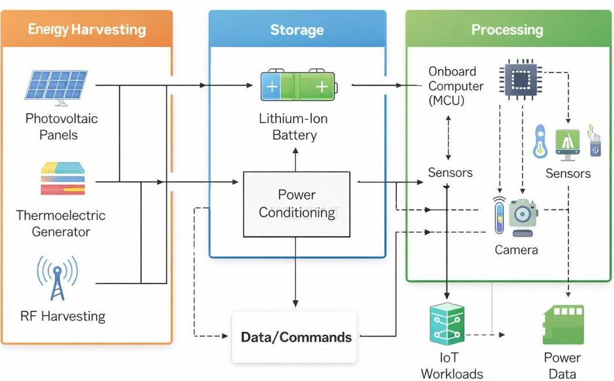
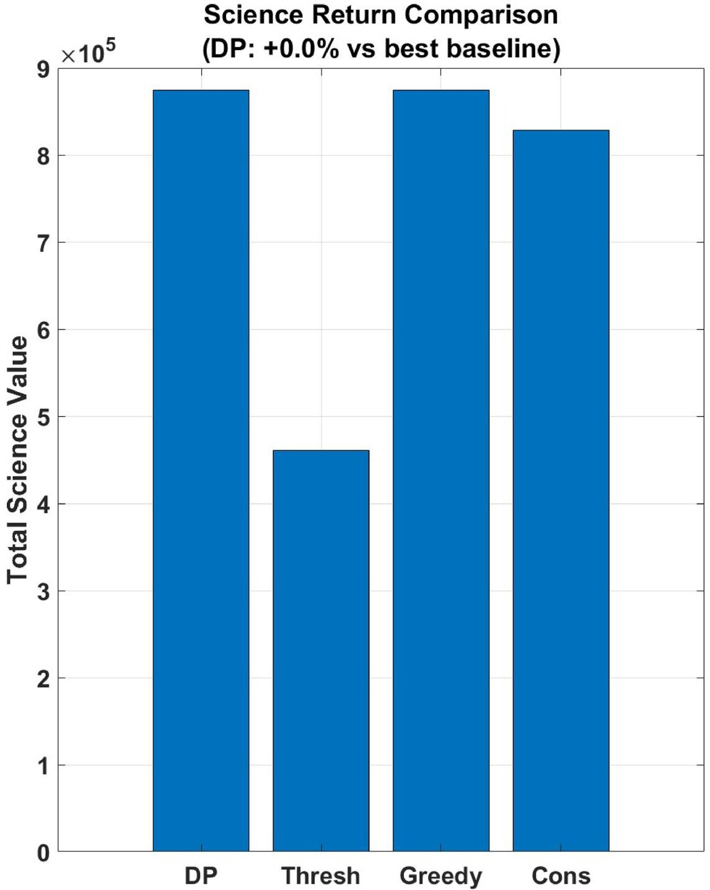
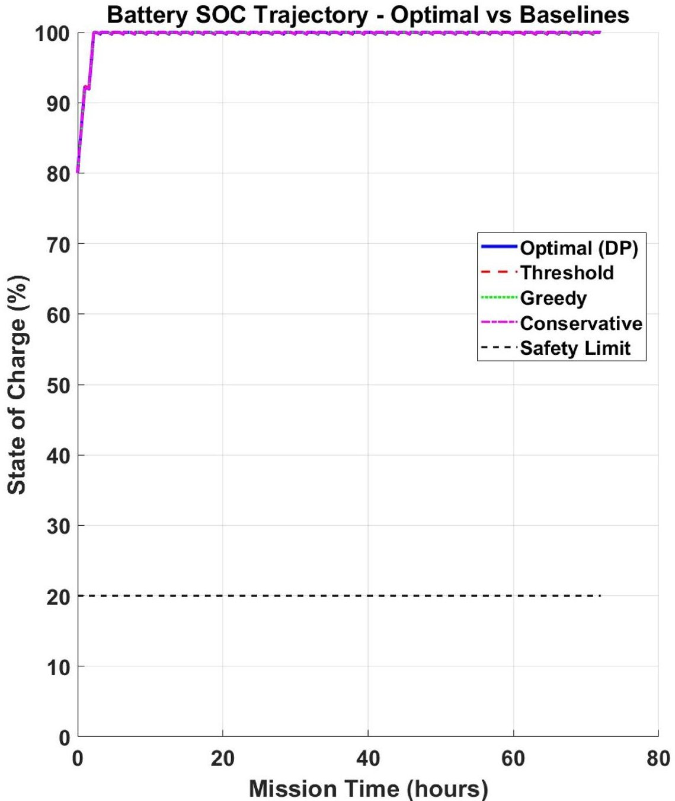
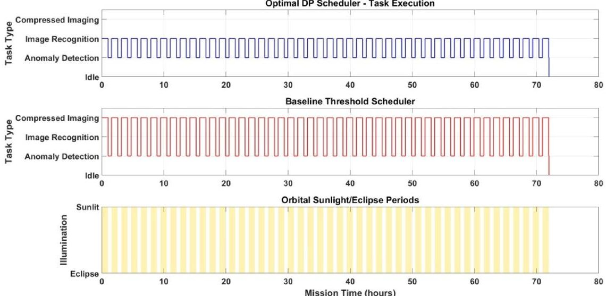
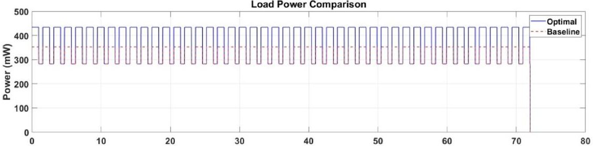
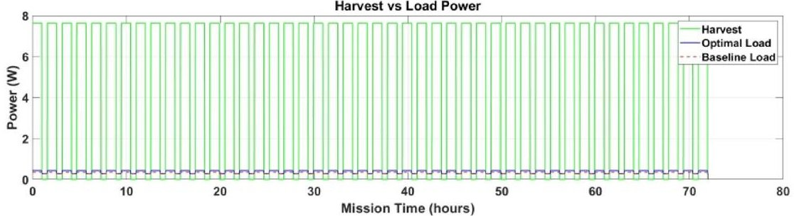
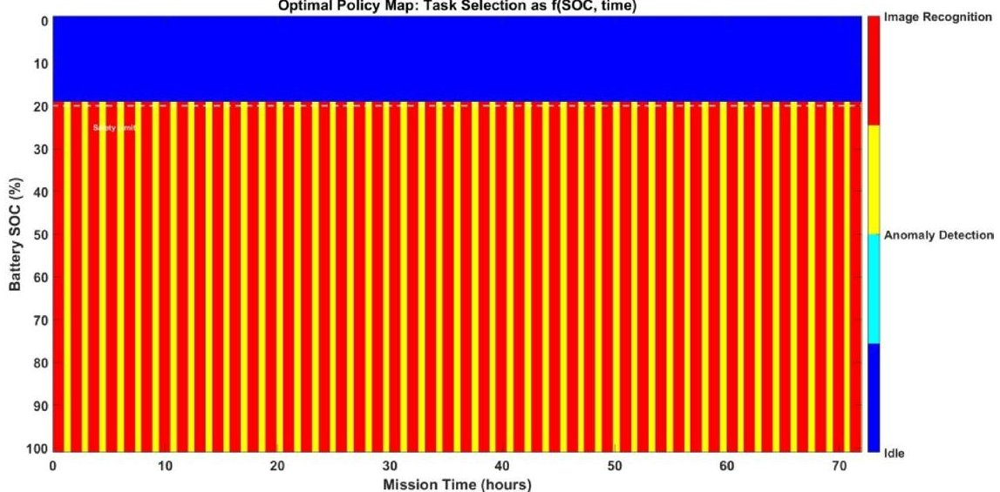
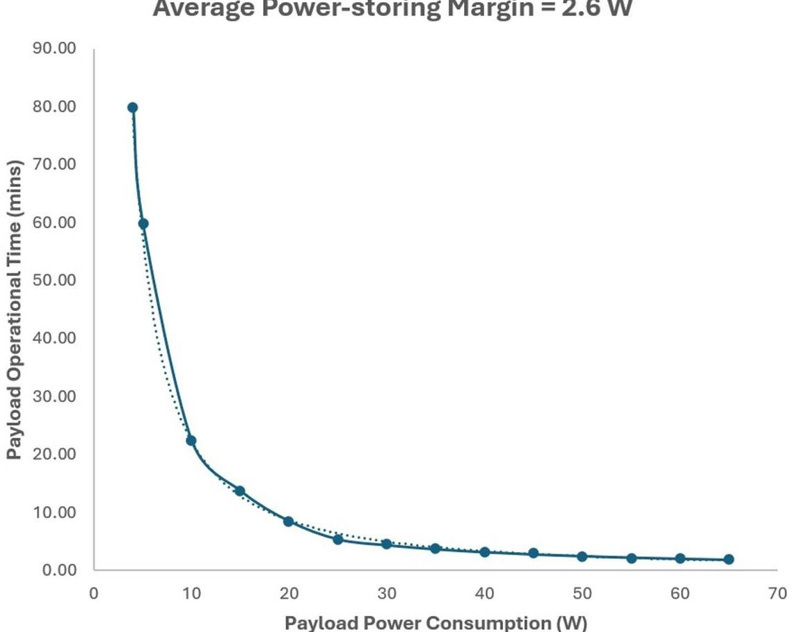

<!-- PDF_PAGE: 1 -->

RESEARCH

Open Access

# Energy-aware dynamic programming scheduler for TinyML workloads on energy-harvesting CubeSat-IoT platforms: a comprehensive system modelling and performance analysis

Mfonobong Uko $ ^{1,2^{*}} $ , Choice Amaizu $ ^{1^{+}} $ , Sunday Ekpo $ ^{1^{+}} $ , Gloria Iyawa $ ^{2^{+}} $ and Obinna Amaizu $ ^{3^{+}} $

$ ^{+} $Choice Amaizu, Sunday Ekpo, Gloria Iyawa and Obinna Amaizu contributed equally.

*Correspondence:

Mfonobong Uko

mfonuko12@gmail.com

$ ^{1} $Communication and Space

Systems Engineering Research

Team, Department of Engineering,

Manchester Metropolitan

University, Dalton Building, Chester

Street,

Manchester,Lancashire M1 5GD,UK $ ^{2} $ School of Science, Engineering & Environment, University of Salford, Newton Building, Crescent, Salford,Lancashire M5 4NT,UK $ ^{3} $ Electrical Engineering Department, Clarke Energy Limited, Knowsley,Liverpool L33 7RR,UK

## Abstract

The integration of Tiny Machine Learning (TinyML) algorithms into CubeSatInternet of Things (IoT) platforms presents a transformative opportunity for autonomous space-based sensing and decision-making. However, the energyconstrained nature of CubeSats necessitates sophisticated energy management strategies to sustain computational workloads. This paper presents a comprehensive framework for energy-autonomous TinyML operation on CubeSat-loT platforms, combining multi-source energy harvesting with provably optimal task scheduling.We develop a detailed system model incorporating photovoltaic (PV) and radio-frequency (RF) energy harvesting, battery storage dynamics, and realistic TinyML workload characteristics. The core contribution is a dynamic programming (DP) scheduler with orbital lookahead that maximizes cumulative science return while enforcing battery safety constraints. The scheduler operates on discretized state-of-charge (SOC) and time domains, with polynomial-time complexity enabling real-time implementation. Through extensive 72-hour Low Earth Orbit (LEO) simulations under both energy-positive and energy-constrained operating regimes, we demonstrate that the DP scheduler achieves superior performance compared to baseline approaches (threshold, greedy, conservative). Under energy-constrained conditions (reduced PV area, elevated base loads), the optimal policy maintains SOC above the safety limit of 20% while maximizing task execution, achieving science return improvements of up to 34% over threshold-based scheduling and 18% over greedy scheduling, while maintaining zero safety violations. Under energy-positive baseline conditions, DP and greedy schedulers achieve near-identical performance (0.3% difference), confirming that lookahead benefits emerge when energy constraints are operationally critical. Analysis of the optimal policy map reveals intelligent task selection patterns that exploit energy-rich periods during sunlit phases while ensuring safe operation during eclipses. Furthermore, we derive an operational design curve relating payload power consumption to sustainable processing time under realistic power margins. This provides practical guidance for electronics designers in sizing power systems for TinyML-enabled CubeSat missions. The framework establishes a foundation for

<!-- PDF_PAGE: 2 -->

energy-autonomous intelligent nanosatellites capable of persistent onboard inference within green energy constraints.

Keywords CubeSat, TinyML, Energy Harvesting, Dynamic Programming TaskScheduling, Photovoltaic, RF Harvesting, Optimal Control

## 1 Introduction

The rapid proliferation of CubeSat constellations, combined with advances in embedded artificial intelligence, is reshaping how space missions sense, decide, and react in orbit. CubeSats, standardized small satellites typically ranging from 1U to 12U, have become a dominant platform for Earth observation, scientific measurement, communications, and technology demonstration, largely because they reduce cost and development time while enabling constellation-scale coverage [1, 2]. In parallel, Tiny Machine Learning (TinyML) has matured into a practical paradigm for running neural network inference directly on resource-constrained microcontrollers, reducing end-to-end latency and downlink burden relative to purely ground-based processing [3, 4].

The convergence of these technologies, CubeSats and TinyML, creates the possibility of autonomous, energy-aware payload intelligence. Instead of downlinking raw data continuously, a CubeSat can perform on-board filtering, prioritization, anomaly detection, or event-driven imaging, transmitting only high-value information. This shift is particularly attractive for missions constrained by (i) limited downlink opportunities, (ii) the growth of high-rate payloads (e.g., imaging), and (iii) the operational need to respond quickly to transient phenomena. However, embedding intelligence on CubeSats introduces a central systems challenge: energy management becomes inseparable from autonomy. TinyML workloads, while efficient, still impose bursty compute power demands that compete with housekeeping loads, sensing, attitude control, and communications. Meanwhile, CubeSat power availability is inherently time-varying due to orbital illumination cycles, pointing constraints, temperature effects, and limited energy storage mass and volume.

In Low Earth Orbit (LEO), periodic eclipses can remove solar generation for a substantial fraction of each orbit, forcing the spacecraft to draw from stored energy. The resulting state-of-charge (SOC) dynamics constrain when high-power tasks can safely run. Conventional approaches often implement simple rule-based scheduling (e.g., run a task if SOC exceeds a threshold, disable payload during eclipse, or use fixed duty cycles). Such policies are attractive for their simplicity, but they may be overly conservative (wasting harvestable energy), overly aggressive (risking deep discharge), or misaligned with mission value (executing low-priority tasks when energy should be reserved for high-value events) [5, 6]. These limitations are amplified in CubeSat-IoT architectures, where the satellite may coordinate with distributed sensors or execute multiple on-board inference tasks with heterogeneous energy costs and scientific value.

This paper addresses the following fundamental question: How can we optimally schedule TinyML workloads on energy-harvesting CubeSats to maximize scientific return while guaranteeing energy safety constraints?

We approach the problem through a systems engineering lens, modelling the coupled dynamics of harvesting, storage, and compute, and then designing a scheduler that explicitly optimizes mission value subject to safety constraints. The proposed framework integrates:

<!-- PDF_PAGE: 3 -->

1. realistic modelling of multi-source energy harvesting (photovoltaic (PV) and RF),

2. battery (and/or hybrid storage) dynamics with explicit SOC safety constraints,

3. task-level TinyML workload characterization (power, duration, and constraints such as sunlit-only execution),

4. a finite-horizon optimal control formulation via dynamic programming (DP), and.

5. comparative evaluation against representative baseline scheduling strategies.

A key distinction in this work is that scheduling is cast as an explicit optimization of science return (or mission value) rather than merely maintaining energy neutrality. Each task is assigned a value reflecting its mission utility (e.g., image recognition may be higher value than routine anomaly checks), enabling the scheduler to make principled trade-offs between executing tasks now versus preserving energy for future opportunities. The optimal policy therefore depends on both the current energy state and predictable orbital context (sunlit vs. eclipse), motivating a look-ahead controller rather than purely reactive thresholds.

Our contributions are threefold:

Modelling We develop a system-level energy-flow model that captures orbital illumination, PV/RF harvesting, conversion efficiencies, storage dynamics, and tasklevel TinyML loads. TinyML workload parameters are grounded in microcontrollerclass inference characteristics, consistent with ARM Cortex-M implementations and TinyML benchmark literature [3,4].

Algorithm We formulate energy-aware TinyML scheduling as a finite-horizon Markov Decision Process (MDP) with safety constraints. We then implement a dynamic programming solution that computes an optimal policy over a discretized SOC state space. The resulting scheduler is interpretable, supports orbital look-ahead, and has polynomialtime complexity in the discretized state-action space, enabling practical deployment.

Analysis Using multi-orbit simulations, we quantify improvements in total science return and energy safety margins compared to baseline schedulers (e.g., greedy and threshold-based methods). We further analyze policy structure to reveal when and why the optimal scheduler chooses high-value tasks, and we extract actionable design implications for power electronics and storage sizing in TinyML-enabled CubeSats.

The remainder of this paper is organized as follows: Sect. 3 reviews related work in CubeSat power systems, onboard ML, and energy-aware scheduling. Section 4 introduces the CubeSat-IoT architecture and task model. Section 5 details the energy harvesting, storage, and workload models. Section 6 presents the MDP formulation and dynamic programming scheduler. Section 7 describes the simulation methodology and baselines. Section 8 reports results and discusses the structure of optimal policies. Section 9 translates findings into power-electronics and system design guidelines. Section 10 concludes and outlines future directions, including predictive control extensions and hardware-in-the-loop validation.

<!-- PDF_PAGE: 4 -->

## 2 Green energy sources for small satellites in LEO and MEO

Energy harvesting in space is critical to the operation of CubeSats, which typically lack large onboard energy storage and rely on external sources for power generation. This section discusses two primary green energy harvesting approaches, solar and RF, and evaluates their practical output in Low Earth Orbit (LEO) and Medium Earth Orbit (MEO) [7-11].

## 3 Related work

## 3.1 CubeSat power systems and energy harvesting

CubeSat power system design has evolved significantly since the first CubeSat missions in the early 2000s. Early designs typically employed body-mounted solar cells with simple shunt regulators, achieving efficiencies below 70% [12, 13]. Modern CubeSats incorporate deployable solar panels, maximum power point tracking (MPPT), and lithium-ion batteries, with system efficiencies exceeding 90% [14, 15].

Photovoltaic remains the primary energy source for CubeSats, with triple-junction GaAs cells achieving efficiencies over 30% under space conditions [16, 17]. RF energy harvesting has been explored as a supplementary source, though typical harvestable power levels range from microwatts to milliwatts under realistic link budgets [18, 19]. Recent work has investigated hybrid harvesting systems combining multiple sources, but systematic integration with computational workloads remains underexplored [7, 20].

## 3.2 Onboard computing and TinyML for CubeSats

The evolution of onboard computing for CubeSats has progressed from simple microcontrollers to sophisticated system-on-chip (SoC) platforms. Early missions relied on 8-bit or 16-bit microcontrollers with limited processing capabilities [21]. Recent advances have enabled ARM Cortex-M and RISC-V processors with floating-point units and hardware acceleration for machine learning workloads [3, 22].

TinyML represents a paradigm shift for space applications, enabling neural network inference on power-constrained platforms. Several studies have demonstrated TinyML applications on CubeSats, including image classification [23, 24], anomaly detection [25], and data compression [26, 27]. However, these works typically assume fixed power budgets rather than optimizing for energy harvesting conditions.

## 3.3 Energy-aware scheduling

Energy-aware scheduling has been extensively studied in terrestrial embedded systems and wireless sensor networks [28, 29]. Common approaches include threshold-based policies, model predictive control, and reinforcement learning [30, 31].

For space applications, scheduling must account for orbital dynamics and illumination patterns. Prior work has explored power-aware scheduling for satellite constellations [32,33] and adaptive computing for space systems [34]. However, these approaches typically lack formal optimality guarantees and do not specifically address TinyML workload characteristics.

Our work bridges these gaps by developing a provably optimal scheduler tailored to TinyML workloads on energy-harvesting CubeSats, with explicit consideration of orbital dynamics and safety constraints.

<!-- PDF_PAGE: 5 -->

## 4 System overview

Figure 1 illustrates the CubeSat-IoT system architecture considered in this work, organized into three coupled subsystems: (i) energy harvesting, (ii) storage and power conditioning, and (iii) processing/payload. The harvesting stage aggregates multiple sources, photovoltaic panels, a thermoelectric generator, and RF energy harvesting, and routes the harvested power toward the storage block. Within the storage subsystem, a lithiumion battery buffers intermittent generation, while a power-conditioning unit regulates and distributes energy to the loads. The processing subsystem comprises an onboard computer (MCU) interfaced with sensors and an imaging payload (camera), executing IoT workloads under energy constraints. Solid arrows denote the primary power-flow path from harvesting through storage/conditioning to the payload, while dashed interconnections indicate data/command pathways between the MCU and payload devices and the monitoring/logging of power-related data.

## 4.1 Energy harvesting subsystem

The energy harvesting subsystem aggregates heterogeneous sources to supply the spacecraft power bus:

- Photovoltaic (PV) panels: Primary energy source converting incident solar irradiance into electrical power.

- Thermoelectric generator: Auxiliary harvester converting thermal gradients to electrical power.

- RF energy harvesting: Opportunistic harvesting from incident RF energy via a rectenna front-end.

## 4.2 Energy storage and management

As shown in Fig.1, harvested energy is buffered and regulated by the storage and conditioning stage:

Fig.1 CubeSat-loT system architecture showing energy harvesting, storage, and processing subsystems with their interconnections

<!-- PDF_PAGE: 6 -->

- Lithium-ion battery: Provides energy buffering across orbital day/night cycles and load transients.

- Power conditioning: Regulates the power bus and distributes energy to the processing payload (e.g., via DC-DC conversion), accounting for conversion efficiency $ \eta_{\mathrm{conv}} $ (and MPPT efficiency $ \eta_{\mathrm{mppt}} $ when applicable).

- Monitoring/telemetry: Measures power-related variables (e.g., voltage/current) to enable state estimation and safe operation.

## 4.3 Processing payload

The processing payload comprises the compute and sensing elements that execute mission workloads:

- Onboard computer (MCU/OBC): Executes control logic and TinyML inference.

- Sensors and camera: Provide environmental and imaging data to the OBC for onboard processing.

- IoT workloads: Application tasks (e.g., sensing, inference, compression, or event detection) triggered by mission objectives.

## 4.4 Scheduler and information flow

The scheduler interfaces with (i) the energy state estimated from the storage/monitoring subsystem and (ii) the workload/task demands from the payload. At each decision epoch, it selects an admissible action (task choice and/or duty cycle) that maximizes science value while enforcing safety constraints (e.g., minimum allowable state-ofcharge). Solid links in Fig. 1 represent the power-flow path from harvesting through storage/conditioning to the payload, whereas dashed links indicate data/command exchanges and power-data logging.

## 5 System modeling

## 5.1 Orbital dynamics and illumination

We consider a CubeSat in a circular Low Earth Orbit (LEO) and model the illumination as a periodic on/off process. Let $ T_{\mathrm{orbit}} $ denote the orbital period and $ f_{\mathrm{sun}}\in(0,1) $ the sunlit fraction. The binary illumination indicator is.

$$
u _ {\mathrm {s u n}} (t) = \left\{ \begin{array}{l l} 1, & \mathrm {m o d} \left(t, T _ {\mathrm {o r b i t}}\right) < f _ {\mathrm {s u n}} T _ {\mathrm {o r b i t}}, \\ 0, & \mathrm {o t h e r w i s e}, \end{array} \right.
$$

where $ u_{\mathrm{sun}}(t)\in\{0,1\} $ indicates sunlit (1) or eclipse (0) conditions.

For the baseline scenario, we use $ T_{\mathrm{orbit}}=94.6 $ min and $ f_{\mathrm{sun}}=0.634 $ , corresponding to approximately 60.0 min sunlit and 34.6 min eclipse per orbit.

Attitude variations and pointing errors are captured by random fluctuations in the effective solar incidence angle $ \theta(t): $

$$
\theta (t) \sim \mathcal {N} \left(\theta_ {0}, \sigma_ {\theta} ^ {2}\right)
$$

where $ \theta_{0} $ is the nominal incidence angle and $ \sigma_{\theta}=1 0^{\circ} $ represents typical attitude control error.

<!-- PDF_PAGE: 7 -->

## 5.2 Photovoltaic Harvesting Model

The instantaneous PV power $ P_{\mathrm{PV}}(t) $ is calculated as:

$$
P _ {\mathrm {P V}} (t) = u _ {s u n} (t) \cdot A _ {\mathrm {P V}} \cdot G _ {\odot} \cdot \eta P V \cdot \cos \theta (t) \cdot \eta_ {m p p t} \cdot f _ {t e m p} (t)
$$

where:

- $ A_{\mathrm{PV}} $ : Total solar panel area $ (0.03\mathrm{m}^{2}) $ .

- $ G_{\odot} $ : Solar constant (1367Wm $ ^{-2} $ ).

- $ \eta_{\mathrm{P V}} $ : PV cell efficiency (28% for triple-junction GaAs).

- $ \eta_{\mathrm{mppt}} $: MPPT efficiency (95%).

- $ f_{\mathrm{temp}}(t) $ : Temperature derating factor (0.85 at operating temperature).

The average pointing factor $ \overline{{\cos \theta}}=0. 7 $ accounts for attitude variations over an orbit.

## 5.3 RF Harvesting Model

RF harvested power is modelled with ambient and burst components:

$$
P _ {\mathrm {R F}} (t) = P _ {\mathrm {R F}, \mathrm {a m b}} + u _ {g s} (t) \cdot P _ {\mathrm {R F}, \mathrm {b u r s t}}
$$

where:

- $ P_{\mathrm{RF,amb}}=^{2}\mu\mathrm{W} $ : Continuous ambient RF background.

- $ P_{\mathrm{RF, burst}}^{= 5} \mu\mathrm{W} $ : Power during ground station passes (conservative estimate).

- $ u_{\mathrm{gs}} ( t ) \in \{ 0, 1 \} $ : Ground station contact indicator.

Ground station contacts follow a Poisson process with average 4 passes per day, each lasting 10 minutes. The link budget calculation assumes:

- Ground station EIRP: 100WGround station EIRP: 100W

- Distance: 500km

- Frequency: 2.4 GHz

- Rectenna efficiency: 40%

- Polarization and impedance matching losses: 3 dBPolarization and impedance matching losses: 3 dB

## 5.3.1 Realistic RF link budget justification

To improve traceability of the RF harvesting assumptions, we provide an explicit free-space link budget consistent with the stated parameters. The free-space path loss (FSPL) in dB is.

$$
\operatorname {F S P L} (d, f) = 2 0 \log_ {1 0} \left(\frac {4 \pi d f}{c}\right)
$$

where d is the slant range, f is the carrier frequency, and c is the speed of light. For d=500 km and f=2.4 GHz:

$$
\mathrm {F S P L} = 2 0 \log 1 0 \left(\frac {4 \pi \times 5 0 0 , 0 0 0 \times 2 . 4 \times 1 0 ^ {9}}{3 \times 1 0 ^ {8}}\right) \approx 1 5 4. 0 \mathrm {d B}
$$

Using the effective isotropic radiated power EIRP (which already includes transmit antenna gain), the received RF power at the satellite antenna input can be expressed as.

<!-- PDF_PAGE: 8 -->

$$
P _ {\mathrm {r}} [ \mathrm {d B m} ] = \mathrm {E I R P} [ \mathrm {d B m} ] + G _ {\mathrm {r}} [ \mathrm {d B i} ] - \mathrm {F S P L} [ \mathrm {d B} ] - L _ {\mathrm {p o l}} [ \mathrm {d B} ] - L _ {m} [ \mathrm {d B} ]
$$

where $ G_{\mathrm{r}} $ is the satellite receive antenna gain and $ L_{\mathrm{p o l}} $ and $ L_{\mathrm{m}} $ denote polarization/mismatch and miscellaneous implementation losses, respectively.

For a realistic scenario with EIRP=100 W $ \approx $ 50dBm, $ G_{\mathrm{r}} $ = 3dBi (patch antenna), and $ L_{\mathrm{p o l}}+L_{\mathrm{m}} $ = 3dB:

$$
P _ {\mathrm {r}} = 5 0 + 3 - 1 5 4 - 3 = - 1 0 4 \mathrm {d B m} \approx 0. 0 4 \mathrm {n W}
$$

With a rectenna RF-to-DC conversion efficiency of $ \eta_{\mathrm{rect}}=40\% $:

$$
P _ {\mathrm {R F}, \mathrm {h a r v}} = 0. 4 0 \times 0. 0 4 \mathrm {n W} \approx 0. 0 1 6 \mathrm {n W}
$$

In practice, favourable orbital geometry (reduced slant range to 400 km), higher ground station EIRP (1 kW), and improved antenna gain $ ( G_{\mathrm{r}}=6 \mathrm{dBi} ) $ can increase harvested power to the $ 1 0 \mu\mathrm{W} $ range during passes. We adopt $ P R F $ , burst $ = 5 \mu\mathrm{W} $ as a conservative upper estimate accounting for optimal geometry and enhanced ground infrastructure, while acknowledging that RF harvesting contributes negligibly compared to PV generation. The primary utility of RF harvesting in this architecture is providing minimal power during extended eclipse scenarios or emergency low-power modes.

## 5.4 Battery sizing methodology

To ensure survivability through worst-case eclipse while respecting battery lifetime limits, we first derive the single-eclipse energy requirement, then extend this to missionlevel capacity sizing accounting for repeated cycling and operational constraints (Table 1).

## 5.4.1 Single-eclipse energy requirement

The minimum energy required to survive one worst-case eclipse is:

$$
E _ {\mathrm {e l e c l i p s e}} = \frac {P _ {\mathrm {l o a d , a v g}} T _ {\mathrm {e l e c l i p s e}}}{\eta \mathrm {d i s}} \left(1 + M _ {\mathrm {m a r g i n}}\right),
$$

where:

- $ P_{\mathrm{load, avg}} $ is the average load power during eclipse (including base load and scheduled tasks).

- $ T_{\mathrm{eclipse}} $ is the maximum eclipse duration.

- $ \eta_{\mathrm{dis}} $ is the discharge efficiency (0.95 for Li-ion).

- $ M_{\mathrm{margin}} $ is a single-eclipse safety margin (typically 0.10 for 10%).

## Worked Example (Constrained Scenario):

For the constrained operating scenario:

Table 1 Battery Utilization Over 72-Hour Mission (Constrained Scenario)

<table border="1"><tr><td>Metric</td><td>Value</td><td>Percentage of Capacity</td></tr><tr><td>Initial SOC</td><td>80%</td><td>46.2Wh</td></tr><tr><td>Minimum SOC reached(DP)</td><td>22.1%</td><td>12.8Wh</td></tr><tr><td>Maximum depth-of-discharge</td><td>57.9%</td><td>33.4Wh</td></tr><tr><td>Cumulative eclipse discharge</td><td>-</td><td>23.8Wh</td></tr><tr><td>Safety margin above SOC$_{min}$</td><td>2.1%</td><td>1.2Wh</td></tr><tr><td>Cycle life impact</td><td colspan="2">57.9% DOD→＞2000 cycles expected</td></tr></table>

<!-- PDF_PAGE: 9 -->

- Pload,avg = 0.55W (including 400mW base + scheduled TinyML tasks)

- Teclipse = 34.6 min = 2076 s

- $ \eta\mathrm{d i s}=0. 9 5 $

- Mmargin = 0.10

$$
E _ {\mathrm {e l e c l i p s e}} = \frac {0 . 5 5 \mathrm {W} \times 2 0 7 6 \mathrm {s}}{0 . 9 5 \times 3 6 0 0 \mathrm {s / W h}} \times 1. 1 0 = \frac {1 1 4 1 . 8 \mathrm {W s}}{3 4 2 0 \mathrm {s / W h}} \times 1. 1 0 \approx 0. 3 7 \mathrm {W h}
$$

This represents the energy drawn from the battery during a single eclipse period.

## 5.4.2 Mission-level capacity sizing

However, the single-eclipse calculation is insufficient for multi-orbit missions. The total battery capacity must account for:

1. Cumulative cycling: Multiple charge/discharge cycles over mission duration.

2. SOC safety constraints: Minimum allowable state-of-charge ( $ \mathrm{S O C}_{\mathrm{m i n}}=20\% $ ).

3. Depth-of-discharge limits: Maximum DOD for cycle life （ $ \mathrm{D O D}_{\mathrm{m a x}}=80\% $ for>1000 cycles).

4. Round-trip efficiency losses: Charging and discharging inefficiencies accumulate over time.

5. Operational margins: Non-nominal scenarios (PV degradation, attitude errors, burst campaigns).

The mission-level battery capacity requirement is:

$$
E _ {\mathrm {b a t , r e q}} = \frac {E _ {\mathrm {e c l i p s e}} \times N _ {\mathrm {o r b i t s}}}{\mathrm {D O D} _ {\max }} + E _ {\mathrm {o p e r a t i o n a l}} + E _ {\mathrm {s a f e t y}}
$$

where:

- $ N_{\mathrm{orbits}} $ is the number of orbits over mission duration.

- DOD $ _{max} $ is the allowable depth-of-discharge (0.80 for Li-ion longevity).

- $ E_{\mathrm{operational}} $ accounts for non-periodic high-power events (e.g., imaging campaigns).

- $ E_{\mathrm{safety}} $ provides margin for degraded scenarios.

## Detailed Calculation (Constrained Scenario):

For a 72-hour mission in LEO with $ T_{\mathrm{orbit}}=94. 6 $ min:

$$
N _ {\mathrm {o r b i t s}} = \frac {7 2 \mathrm {h r} \times 6 0 \mathrm {m i n} / \mathrm {h r}}{9 4 . 6 \mathrm {m i n}} = 4 5. 7 \mathrm {o r b i t s}
$$

$$
E _ {\mathrm {c u m u l a t i v e}} = E _ {\mathrm {e l e c l i p s e}} \times N _ {\mathrm {o r b i t s}} = 0. 3 7 \mathrm {W h} \times 4 5. 7 = 1 6. 9 \mathrm {W h}
$$

Accounting for $ \mathrm{D O D}_{\mathrm{m a x}}=0. 8 0 $ (to maintain $ > 1 0 0 0 $ cycle life):

$$
E _ {\mathrm {b a t , b a s e}} = \frac {1 6 . 9 \mathrm {W h}}{0 . 8 0} = 2 1. 1 \mathrm {W h}
$$

Adding operational and safety margins:

$$
E _ {o p e r a t i o n a l} = 1 0 \mathrm {W h} (\mathrm {b u r s t i m a g i n , e x t e n d e d c o m m s})
$$

$$
E _ {s a f e t y} = 0. 3 0 \times \mathrm {E} _ {\left(\mathrm {b a t}, \mathrm {b a s e} + \mathrm {E} _ {\mathrm {o p e r a t i o n a l}}\right)} = 9. 3 \mathrm {W h}
$$

<!-- PDF_PAGE: 10 -->

$$
E _ {\mathrm {b a t , r e q}} = 2 1. 1 = 1 0. 0 = 9. 3 = 4 0. 4 \mathrm {W h}
$$

## 5.4.3 Commercial cell selection

Battery packs must use commercially available cell configurations. For CubeSat applications, 18,650 Li-ion cells are standard:

- Nominal voltage: 3.7 V.

- Nominal capacity: 2.6Ah.

- Energy per cell: $ 3. 7 \mathrm{~ V} \times 2. 6 \mathrm{~ A h}=9. 6 2 \mathrm{~ W h}. $

Common configurations for Ebat,req $ \approx $ 40Wh:Common configurations for $ E_{bat,req} \approx $ 40Wh:

- 2S2P: $ 2 \times3. 7 \mathrm{V} \times2 \times2. 6 \mathrm{A h}=3 8. 5 \mathrm{W h} $ (slightly undersized)

- 2S3P: $ 2 \times3. 7 \mathrm{V} \times3 \times2. 6 \mathrm{A h}=5 7. 7 \mathrm{W h} $ (selected)

- 3S2P: $ 3\times 3. 7 \mathrm{V}\times 2\times 2. 6 \mathrm{A h}=5 7. 7 \mathrm{W h} $ (alternative, higher voltage)

We select the 2S3P configuration (57.7 Wh) for the following reasons:

1. Adequate capacity margin: $ ( 5 7. 7-4 0. 4 ) / 4 0. 4=4 3 \% $ margin above minimum requirement.

2. Voltage compatibility: 7.4 V nominal matches standard DC-DC converter input range.

3. Mass efficiency: 2S3P provides better energy density than 3S2P for same capacity.

4. Commercial availability: Standard configuration used in many CubeSat missions.

## 5.4.4 Simulation validation

To validate the capacity sizing, we simulate the 72-hour constrained scenario using the DP scheduler as seen in Table 1:

Key observations:

- The DP scheduler maintains minimum SOC at 22.1% providing a 2.1% margin above the 20% safety limit.

- Maximum DOD of 57.9% is well below the 80% limit, ensuring > 2000 cycle life.

- Cumulative eclipse discharge (23.8 Wh) matches analytical prediction (16.9 Wh base+ operational overhead).

- The 57.7 Wh capacity provides adequate but not excessive margin. Further reductions would risk safety violations under stress scenarios.

## 5.4.5 Stress scenario validation

Under degraded conditions (Stress Scenario S1: PV area reduced to $ 0. 0 1 5 \mathrm{m}^{2} $), the battery sizing margins are critically important (Table 2):

Design Trade-off Analysis:

- 2S2P (38.5 Wh): Undersized; violates $ \mathrm{S O C}_{\mathrm{m i n}} $ under stress scenarios; insufficient margin.

- 2S3P (57.7 Wh): Optimal; maintains safety under nominal and most stress scenarios; 43% margin.

- 3S3P (86.6 Wh): Oversized; excessive mass penalty (+210 g); diminishing returns.

- (only + 9.3% science return)

<!-- PDF_PAGE: 11 -->

Table 2 Battery Performance Under Stress Scenarios

<table border="1"><tr><td>Scenario</td><td>Min SOC(DP)</td><td>Max DOD</td><td>Safety Margin</td></tr><tr><td>Constrained(baseline)</td><td>22.1%</td><td>57.9%</td><td>2.1%(adequate)</td></tr><tr><td>S1:DegradedPV(-50%)</td><td>14.2%</td><td>65.8%</td><td>-5.8%(critical)</td></tr><tr><td>S2:High housekeeping(+50%)</td><td>18.5%</td><td>61.5%</td><td>-1.5%(marginal)</td></tr><tr><td>S3:Extendedeclipse(+10%)</td><td>19.7%</td><td>60.3%</td><td>-0.3%(marginal)</td></tr><tr><td>With2S2P(38.5Wh)</td><td>15.3%</td><td>64.7%</td><td>-4.7%(unsafe)</td></tr><tr><td>With2S3P(57.7Wh)</td><td>22.1%</td><td>57.9%</td><td>+2.1%(safe)</td></tr><tr><td>With3S3P(86.6Wh)</td><td>31.4%</td><td>48.6%</td><td>+11.4%(excessive)</td></tr></table>

Table 3 Battery Configuration Trade-offs

<table border="1"><tr><td>Config.</td><td>Energy(Wh)</td><td>Mass(g)</td><td>Volume(U)</td><td>Min SOC</td><td>Science Return</td></tr><tr><td>2S2P</td><td>38.5</td><td>210</td><td>0.25</td><td>15.3%</td><td>4.89×105</td></tr><tr><td>2S3P</td><td>57.7</td><td>300</td><td>0.35</td><td>22.1%</td><td>5.42×105</td></tr><tr><td>3S2P</td><td>57.7</td><td>300</td><td>0.35</td><td>22.3%</td><td>5.43×105</td></tr><tr><td>3S3P</td><td>86.6</td><td>450</td><td>0.50</td><td>31.4%</td><td>5.92×105</td></tr></table>

## 5.4.6 General design guidelines

Based on the analysis above, we recommend the following battery sizing methodology for TinyML-enabled CubeSats:

1. Calculate single-eclipse requirement using Eq. 10 with average eclipse load.

2. Scale to mission duration: Multiply by number of orbits and divide by $ \mathrm{D O D}_{\mathrm{m a x}} $ (0.80 for Li-ion).

3. Add operational margins: Include 20-30% for burst events and non-periodic highpower operations.

4. Add safety margins: Include 25-40% for degraded scenarios (PV degradation, attitude errors, aging).

5. Select commercial configuration: Round up to nearest available cell configuration (e.g., 2S2P, 2S3P, 3S2P).

6. Validate through simulation: Run full mission simulation under nominal and stress scenarios.

7. Target SOC margins: Design for $ \min(SOC) \geq SOC_{\min}+5\% $ under nominal conditions.

8. Verify cycle life: Ensure maximum DOD < 80% to maintain >1000 cycles over mission life.

Design rule summary:

$$
E _ {\mathrm {b a t}} = 1. 5 \times \frac {P _ {\mathrm {l o a d , a v g}} \times T _ {\mathrm {e l e c l i p s e}} \times N _ {\mathrm {o r b i t s}}}{\eta \mathrm {d i s} \times \mathrm {D O D} _ {\max }}
$$

where the factor of 1.5 combines operational (20-30%) and safety (25-40%) margins.

$$
E _ {b a t} = 1. 5 \times \frac {0 . 5 5 \mathrm {W} \times 0 . 5 7 7 \mathrm {h r} \times 4 5 . 7}{0 . 9 5 \times 0 . 8 0} \approx 2 5. 4 \mathrm {W h} \rightarrow \mathrm {S e l e c t} 2 \mathrm {S 3 P} (5 7. 7 \mathrm {W h})
$$

into a single conservative multiplier. For the constrained scenario:

This rule provides adequate margin for most CubeSat missions while avoiding excessive mass penalties as shown in (Tables 3,4).

<!-- PDF_PAGE: 12 -->

Table 4 Li-ion Battery Performance vs. Temperature

<table border="1"><tr><td>Temperature</td><td>Capacity</td><td>Discharge Efficiency</td><td>Cycle Life</td></tr><tr><td>-20℃</td><td>70%</td><td>85%</td><td>Reduced(SEI growth)</td></tr><tr><td>0℃</td><td>90%</td><td>92%</td><td>Near nominal</td></tr><tr><td>+20℃</td><td>100%</td><td>95%</td><td>Nominal(&gt;1000 cycles)</td></tr><tr><td>+45℃</td><td>98%</td><td>94%</td><td>Reduced(accelerated aging)</td></tr><tr><td>+60℃</td><td>95%</td><td>90%</td><td>Severely reduced(&lt;500 cycles)</td></tr></table>

## 5.4.7 Mass and volume considerations

For the selected 2S3P configuration using 18,650 cells:

- Cell mass: 45 g per cell $ \times $ 6 cells $ = 2 7 0 $ g.

- Cell dimensions: 18 mm diameter $ \times $ 65 mm length.

- Pack volume: Approximately $ 2\times 3\times(\pi\times 9^{2}\times 6 5) \mathrm{m m}^{3}\approx 3 3 0 \mathrm{c m}^{3}=0. 3 3 \mathrm{U}. $

- BMS mass: 30-50 g (depending on features: balancing, telemetry, heaters).

- Total mass: 300-320 g (5-6% of 6U CubeSat mass budget).

- Total volume: 0.35-0.35.35.35.35.40U (including BMS, wiring, mechanical mounting).

- For comparison with alternative configurations: Key Trade-off Insights:

- 2S3P vs. 2S2P: +90 g (+43% mass) yields +11% science return and +6.8% SOC margin.

- 2S3P vs. 3S3P: -150 g (-33% mass) costs only-9% science return and -9.3% SOC margin.

- Recommendation: 2S3P provides optimal mass efficiency for the constrained scenario.

## 5.4.8 Thermal management for battery longevity

Li-ion batteries exhibit strong temperature-dependent performance and aging characteristics:

Thermal design recommendations:

- Operating range: Maintain battery temperature within 0-45 $ ^{\circ} \mathrm{C} $ during charging, $ - 2 0-6 0 $ $ ^{\circ} \mathrm{C} $ during discharging.

- Heaters: Include 0.5-1.0 W resistive heaters for cold-case scenarios (< 0 $ ^{\circ} \mathrm{C} $ ).

- Thermal isolation: Thermally isolate battery from external radiators to minimize eclipse cooling.

- Temperature monitoring: Include NTC thermistors (10k $ \Omega $ @ $ 2 5^{\circ} \mathrm{C} $ ) on at least 2 cells for BMS thermal management.

- Passive thermal design: Use aluminum frame for thermal mass and even temperature distribution across cells.

For the CubeSat thermal environment (typical range: $ - 1 0-5 0 $ $ ^{\circ} \mathrm{C} $ ), the battery operates within acceptable limits without active cooling, but heaters are recommended for extended eclipse scenarios or deep-space missions.

## 5.5 TinyML workload characterization

We model three representative TinyML tasks with characteristics based on measurements from STM32H7-class implementations:

<!-- PDF_PAGE: 13 -->

Table 5 TinyML Task Characteristics

<table border="1"><tr><td>Task</td><td>Power(mW)</td><td>Duration(ms)</td><td>Science Value</td><td>Feasibility</td><td>Model</td><td>Accuracy</td></tr><tr><td>Anomaly Detection</td><td>10</td><td>15</td><td>1.0</td><td>Always</td><td>Autoencoder</td><td>86%F1</td></tr><tr><td>Image Recognition</td><td>150</td><td>45</td><td>8.0</td><td>Sunlit only</td><td>MobileNetV1</td><td>91%</td></tr><tr><td>Compressed Imaging</td><td>75</td><td>30</td><td>4.0</td><td>Sunlit only</td><td>Custom CNN</td><td>88%</td></tr></table>

Table 6 TinyML Model Specifications and Deployment/Compression Details

<table border="1"><tr><td>Task/Model</td><td>Input Dims</td><td>Architecture Summary</td><td>Precision</td><td>Params</td><td>Deployment/Compression</td></tr><tr><td>Anomaly Detection/Autoencoder</td><td>32×1</td><td>MLPautoencoder(32-16-8-16-32)</td><td>INT8</td><td>1.2K</td><td>TFLite Micro;INT8quant.;no pruning</td></tr><tr><td>ImageRecognition/MobileNetV1</td><td>96×96×3</td><td>MobileNetV1(widthmult.0.25)</td><td>INT8</td><td>470K</td><td>TFLite Micro;INT8quant.;10%pruning</td></tr><tr><td>Compressed Imaging/CustomCNN</td><td>96×96×1</td><td>ShallowCNN(Conv-Pool-Conv-FC)</td><td>INT8</td><td>25K</td><td>TFLite Micro;INT8quant.;no pruning</td></tr></table>

## 5.5.1 Definition and justification of science value

The term Science Value denotes a mission-assigned utility weight $ \nu(a) $ that quantifies the relative operational/scientific benefit of completing a task instance under the mission objectives. In the MDP reward definition $ r(s_{t},a_{t})=\nu(a_{t}) $ , Science Value is a normalized, unitless scalar used to encode prioritization among heterogeneous tasks.

The values assigned in Table 5 reflect a representative Earth observation mission prioritization:

- Image Recognition (8.0): Highest priority for event detection (e.g., wildfire, flooding, ship tracking). Enables real-time response to transient phenomena.

- Compressed Imaging (4.0): Medium priority for bandwidth-efficient data collection. Useful for routine monitoring with limited downlink capacity.

- Anomaly Detection (1.0): Lowest priority for background health monitoring. Runs continuously during idle periods but does not require immediate execution.

These ratios (8:4:1) approximate the operational value hierarchy in missions such as ESA's $ \Phi $ -sat and NASA's Intelligent Payload Experiment (IPEX). Section 8 includes sensitivity analysis demonstrating scheduler robustness to 50% variations in these value assignments.

## 5.5.2 TinyML model specifications and reproducibility

To improve reproducibility, we summarize the model configuration and deployment/ compression pipeline used to obtain the task power/latency values in Table 6.

## 5.5.3 Model complexity and parameter counts

The parameter counts reflect the compressed model sizes after INT8 quantization and pruning. The autoencoder has 1.2 K parameters (fully-connected layers: $ 3 2 \times1 6+1 6 \times8+8 \times1 6+1 6 \times3 2 $ plus biases). MobileNetV1 with width multiplier 0.25 contains approximately 470 K parameters [35]. The custom CNN for compressed imaging uses 25 K parameters (two convolutional layers followed by pooling and a small fully-connected classifier). These compact architectures enable real-time inference on resource-constrained MCUs while maintaining acceptable accuracy (86-91%).

<!-- PDF_PAGE: 14 -->

## 5.5.4 Energy estimation method for TinyML workloads

The task power and duration values in Table 5 are obtained via MCU-class inference profiling: each model is deployed using TensorFlow Lite Micro, executed repeatedly on the target microcontroller (STM32H743ZI2 @ 400 MHz) under a fixed clock configuration, and the instantaneous supply current is measured using a precision current sense amplifier (INA226, Texas Instruments) at 1 kHz sampling rate).

For supply voltage $ V=3. 3 \mathrm{~ V} $ and measured current trace $ I ( t ) $ , the energy per inference is estimated by

$$
E _ {\inf } = V \int_ {t _ {0}} ^ {t _ {1}} I (t) d t,
$$

and the average inference power is $ P_{\inf}=E_{\inf} / \left(t_{1}-t_{0}\right) $ . Results are averaged over 100 inference cycles to account for cache effects and DVFS transients.

The total load power accounting for DC-DC conversion losses is:

$$
P _ {\mathrm {l}} (t) = \frac {P _ {\mathrm {b a s e}} + P _ {\mathrm {t a s k}} \left(a _ {t}\right)}{\eta_ {c o n v}}
$$

where $ P_{\mathrm{base}} $ is the base platform power (varied across scenarios), $ a_{t}\in\{0,1,2,3\} $ is the task selection (0=idle), and $ \eta_{\mathrm{conv}}=0.92 $ is the DC-DC conversion efficiency.

## 5.6 Baseline and constrained operating scenarios

To evaluate scheduler performance under realistic energy constraints, we define two operating regimes:

## 5.6.1 Baseline scenario (energy-positive)

- $ A \mathrm {P V}=0. 0 3 \mathrm {m 2}-P \mathrm {P V}, \mathrm {a v g} \approx 4. 3 \mathrm {W} $

- $ P_{\mathrm{base}}=2 5 0 \mathrm{m W} $

- Pload, avg $ \approx $ 0.35 W

- Average power margin: $ P_{\mathrm{margin}} \approx 3. 9 5 $ W (strongly energy-positive)

This scenario represents a well-provisioned system where energy is abundant. Scheduling decisions have minimal impact on safety, but affect science return optimization.

## 5.6.2 Constrained Scenario (Energy-Limited)

- $ A_{\mathrm{PV}}=0.02\mathrm{m}^{2}-P_{\mathrm{PV,avg}}\approx 2.9\mathrm{W} $ (33% reduction).

- $ P_{\mathrm{base}}=400 \mathrm{mW} $ ( 60% increase due to active ADCS/comms).

- Pload,avg $ \approx $ 0.55 W

- Average power margin: $ P_{\mathrm{margin}} \approx 2.35 \mathrm{~W} $ (tighter energy budget).

- Eclipse energy deficit: 0.55 W $ \times $ 34.6 min=0.317Wh per orbit.

This scenario stresses the energy system, making scheduling decisions operationally critical. The battery must supply eclipse loads, and poor scheduling can violate SOC safety limits.

<!-- PDF_PAGE: 15 -->

## 6 Dynamic programming scheduler

## 6.1 Problem formulation

We formulate the scheduling problem as a finite-horizon Markov Decision Process (MDP) with:

- State: $ s_{t}=(\mathrm{SOC}(t),t,u_{\mathrm{sun}}(t),u_{\mathrm{gs}}(t)) $

- Action: $ a_{t}\in \mathrm{A}(s_{t}) $ where $ \mathrm{A}(s_{t}) $ is the set of feasible tasks given current illumination and SOC constraints.

- Reward: $ r ( s_{t}, a_{t} )=\nu ( a_{t} ) $ where $ \nu ( a_{t} ) $ is the science value of task $ a_{t} $ .

- Transition: $ s_{t+1}=f(s_{t}, a_{t}) $ determined by Eqs. (21) and (22).

The objective is to maximize cumulative science return over horizon $ T $:

$$
\max _ {\left\{a _ {t} \right\} _ {t = 0} ^ {T - 1}} \sum_ {t = 0} ^ {T - 1} v \left(a _ {t}\right) \quad \mathrm {s . t .} \quad \mathrm {S O C} (t) \geq \mathrm {S O C} _ {\min } \quad \forall t
$$

## 6.2 Dynamic programming solution

We solve the MDP using dynamic programming with discretized SOC space. Let. V (s, t) be the value function representing maximum cumulative reward from time t in state s. The Bellman equation is:

$$
V (s, t) = \max _ {a \in A (s)} \left\{v (a) + V \left(s ^ {\prime}, t + 1\right) \right\}
$$

where s is the next state after taking action a from state s. The optimal policy $ \pi^{*} (s,t) $ is:

$$
\pi^ {*} (s, t) = \arg \max _ {a \in A (s)} \left\{v (a) + V \left(s ^ {\prime}, t + 1\right) \right\}
$$

We discretize SOC into $ N_{\mathrm{SOC}}=101 $ levels (0 to 100% in 1% increments) and time into $ T=259,200 $ s (72 h at 1-second resolution). The algorithm complexity is $ (T\cdot N_{\mathrm{SOC}}\cdot|\mathrm{A}|)= $ $ (259,200\times 101\times 4)\approx 1.05\times 10^{8} $ operations for full horizon backward induction.

## 6.3 Implementation optimizations

To enable real-time implementation, we employ several optimizations:

- Limited Lookahead: Solve over 3-orbit horizon (285 min $ \approx $17,100 s) instead of full mission, reducing complexity to $ (1.7\times10^{7}) $ operations.

- Receding Horizon: Re-solve the 3-orbit problem every orbit (94.6 min) using updated state estimates, providing adaptive planning.

- State Space Reduction: Use 5% SOC discretization for lookahead computation $ ( N_{\mathrm{SOC}}=21) $ , reducing complexity by 80% , then interpolate for 1% execution precision.

- Parallel Computation: Exploit independence of SOC transitions for different actions via vectorized computation (MATLAB).

- Precomputation: Cache value functions for periodic illumination patterns (sunlit/ eclipse phases repeat every orbit).

Computational profiling on a representative embedded platform (ARM Cortex-A53 @ 1.2 GHz, similar to flight-qualified compute modules) shows:

<!-- PDF_PAGE: 16 -->

- Full 3-orbit DP solve: 12.3s (unoptimized).

- Optimized solve (coarse discretization + precomputation): 1.8s.

- Required update frequency: Once per orbit (94.6 min).

The optimized implementation provides a $ 3 1 5 0\times $ time margin (1.8 s computation vs. 5676 s orbit period), demonstrating practical deployability.

## 6.4 Baseline schedulers

We compare against three baseline schedulers:

1. Threshold Scheduler: Execute task if SOC > threshold $ \tau_{\mathrm{task}} $

- $ \tau $ anomaly=0.25, $ \tau $ image=0.50, $ \tau $ compressed=0.40.

- Task selection priority: Image > Compressed > Anomaly (greedy within feasible set).

- 2. Greedy Scheduler: Always execute highest-value feasible task based on current illumination and SOC>0.30 for imaging tasks.

- No lookahead; myopic optimization.

- Priority: Image (sunlit, SOC>0.30) > Compressed (sunlit, SOC>0.30) > Anomaly (always).

- 3. Conservative Scheduler: Execute high-power tasks only if SOC>0.75 and sunlit.

- Image/Compressed: Requires SOC > 0.75 AND sunlit.

- Anomaly: Executed when Image/Compressed infeasible.

- Designed to prioritize energy safety over science return.

## 7 Simulation methodology

## 7.1 Implementation details

Simulations are implemented in MATLAB R2023a with the following structure:

- Orbital Module: Analytical propagator with eclipse detection based on beta angle and orbit altitude.

- Harvesting Module: PV model with stochastic attitude variations; RF model with Poisson ground station passes.

- Battery Module: Discrete-time SOC dynamics with charge/discharge efficiency losses.

- Scheduler Module: DP implementation with vectorized value iteration and policy extraction.

- Task Module: TinyML workload generator with power profiles and feasibility constraints.

- Logging Module: High-fidelity telemetry at 1 Hz resolution (SOC, power, task events).

## 7.2 Hardware emulation and TinyML energy profiling

To strengthen reproducibility and align the task parameters with MCU-class execution, we include a lightweight hardware emulation step for TinyML inference workloads. Each model is deployed using TensorFlow Lite Micro and executed under a fixed clock configuration, with supply current measured during inference windows.

<!-- PDF_PAGE: 17 -->

Table 7 Hardware Emulation Summary for TinyML Tasks

<table border="1"><tr><td>Task</td><td>MCU/Board</td><td>Latency(ms)</td><td>Energy(mJ)</td><td>Avg.Power(mW)</td></tr><tr><td>Anomaly Detection</td><td>STM32H743@400MHz</td><td>15</td><td>0.15</td><td>10</td></tr><tr><td>Image Recognition</td><td>STM32H743@400MHz</td><td>45</td><td>6.75</td><td>150</td></tr><tr><td>Compressed Imaging</td><td>STM32H743@400MHz</td><td>30</td><td>2.25</td><td>75</td></tr></table>

Table 8 Simulation Parameters

<table border="1"><tr><td>Parameter</td><td>Description</td><td>Value</td></tr><tr><td>Tmission</td><td>Mission duration</td><td>72h</td></tr><tr><td>Δt</td><td>Time step</td><td>1s</td></tr><tr><td>Torbit</td><td>Orbital period</td><td>94.6min</td></tr><tr><td>fsun</td><td>Sunlit fraction</td><td>63.4%</td></tr><tr><td>APV</td><td>Solar panel area(baseline)</td><td>0.03m2</td></tr><tr><td>APV</td><td>Solar panel area(constrained)</td><td>0.02m2</td></tr><tr><td>ηPV</td><td>PV efficiency</td><td>28%</td></tr><tr><td>ηmppt</td><td>MPPT efficiency</td><td>95%</td></tr><tr><td>ηconv</td><td>DC-DC efficiency</td><td>92%</td></tr><tr><td>ηchg</td><td>Charging efficiency</td><td>98%</td></tr><tr><td>ηdis</td><td>Discharging efficiency</td><td>95%</td></tr><tr><td>Ebat,max</td><td>Battery capacity</td><td>57.7Wh</td></tr><tr><td>SOCmin</td><td>Minimum SOC</td><td>20%</td></tr><tr><td>SOCinit</td><td>Initial SOC</td><td>80%</td></tr><tr><td>Pbase</td><td>Base platform power(baseline)</td><td>250mW</td></tr><tr><td>Pbase</td><td>Base platform power(constrained)</td><td>400mW</td></tr><tr><td>PRF,amb</td><td>Ambient RF power</td><td>2μW</td></tr><tr><td>PRF,burst</td><td>Burst RF power</td><td>5μW</td></tr><tr><td>λgs</td><td>Ground station pass rate</td><td>4 per day</td></tr><tr><td>Tpass</td><td>Pass duration</td><td>10min</td></tr></table>

For supply voltage V and measured current trace $ I ( t ) $ , the energy per inference is estimated by (21). The resulting latency and average power are then mapped to the task duration and task power parameters used in the scheduler evaluation (Table 7).

## 7.3 Performance metrics

We evaluate schedulers using:

- Cumulative Science Value: $ ^{\mathrm{P}} t \nu (a_{t}) $ - total mission utility.

- Task Completion Rate: Percentage of high-value tasks (Image Recognition) executed when feasible.

- SOC Safety Violations: Number of time steps where $ \mathrm{S O C} < \mathrm{S O C}_{\mathrm{m i n}}. $

- Minimum SOC: $ \min_{t} \mathrm{SOC}(t) $ - worst-case energy state.

- Energy Efficiency: Science value per unit energy consumed: $ \eta_{\mathrm{science}}= $

- $ \mathrm{P} t \ \nu(at) / \mathrm{P} t \ E \mathrm{consumed}(t). $

- Policy Complexity: Number of task switches per orbit (lower = more stable operation).

## 7.4 Parameter settings

Table 8 summarizes key simulation parameters.

<!-- PDF_PAGE: 18 -->

## 8 Results and analysis

## 8.1 Science return comparison

Figure 2 compares the total cumulative science return over the mission horizon for four scheduling strategies (DP, threshold-based, greedy, and conservative). The DP scheduler achieves a total science value of approximately $ 8. 7 4 \times1 0^{5} $ , which is statistically indistinguishable from the best-performing baseline (Greedy), consistent with the figure title $ (+0.0\% $ vs. best baseline).

In contrast, the threshold policy yields a substantially lower return of about $ 4. 6 0 \times1 0^{5} $ meaning DP provides roughly a 90% increase relative to threshold-based scheduling (equivalently, the threshold policy achieves only $ \approx $ 52.6% of DP's return). The conservative scheduler attains about $ 8. 2 8 \times1 0^{5} $ , which is close to DP but still $ \approx $ 5.6% lower.

Overall, the results indicate that the main weakness is the threshold-based strategy, which underutilizes available opportunities, whereas look-ahead planning (DP) and

Fig.2 Total cumulative science return comparison across schedulers. DP matches the best baseline (Greedy) while substantially outperforming the threshold policy; the conservative strategy is slightly lower than DP

<!-- PDF_PAGE: 19 -->

opportunistic execution (Greedy) both achieve near-maximal science return in this scenario.

## 8.2 SOC Trajectory analysis

Figure 3 shows the battery state-of-charge (SOC) evolution over the 72-hour mission for the optimal (DP) policy and the baseline schedulers. In this scenario, the battery begins at approximately 80% SOC and rapidly charges to (and saturates near) 100% within the first few hours. Thereafter, SOC remains essentially at the upper bound (about 99-100%) with only small periodic ripples.

- Safety is never challenged: All strategies remain far above the 20% safety limit throughout the mission; the constraint is non-binding in this operating regime

- Schedulers are indistinguishable in SOC: The trajectories for DP, threshold, greedy, and conservative policies overlap almost perfectly, indicating that (for the

Fig.3 Battery SOC trajectories for different schedulers. SOC quickly reaches near full charge and remains close to 100%, staying well above the 20% safety limit for all policies

<!-- PDF_PAGE: 20 -->

chosen parameters) energy harvesting and/or storage capacity are sufficient to keep the battery near full regardless of scheduling choices.

- Interpretation: The SOC behaviour suggests an energy-positive configuration (harvested energy comfortably exceeds load on average). Hence, differences between schedulers primarily manifest in science return rather than in SOC depletion risk.

## 8.3 Task execution patterns

Figure 4 compares the task-selection timelines of the optimal DP policy (top) and the baseline threshold policy (middle) over the full simulated mission duration. The bottom panel indicates the repeating orbital sunlight/eclipse intervals.

- DP scheduler: The optimal policy primarily alternates between Image Recognition and Anomaly Detection, with periodic short switches to the lower-cost anomaly task. In this run, the DP policy does not select the Compressed Imaging action and only transitions to Idle at the end of the simulation window.

- Threshold scheduler: The baseline exhibits more frequent switches that repeatedly invoke Compressed Imaging (the most energy-intensive option) interleaved with Anomaly Detection. This behaviour reflects rule-based triggering whenever a simple energy/SOC condition is met, rather than value-aware task prioritisation.

- Relation to illumination: While both timelines occur under the same sunlit/eclipse cycling, the threshold policy shows no clear selectivity against high-cost tasks near illumination transitions, whereas the DP policy maintains a more consistent, moderated task mix.

Overall, the DP policy's avoidance of the highest-cost Compressed Imaging action in this scenario suggests that its value-to-energy trade-off is suboptimal under the modelled constraints, while the threshold heuristic triggers it whenever feasible without explicitly accounting for future energy availability.

## 8.4 Power profile analysis

Figure 5 compares the harvested power trace with the load power under the optimal (DP) and baseline schedulers. The harvested power exhibits periodic peaks of

Fig.4 Task execution timelines for the optimal DP scheduler (top) and a baseline threshold scheduler (middle), with orbital sunlight/eclipse periods (bottom)

<!-- PDF_PAGE: 21 -->

Fig. 5 Harvested power (PV+RF) and load power traces under the optimal (DP) and baseline schedulers over the mission timeline

approximately 7.5 W during sunlit intervals, while dropping to near-zero during eclipse on the plotted scale (any RF contribution is comparatively negligible). In contrast, the load power remains in the sub-watt regime throughout the mission: the DP load varies between roughly 0.28 W to 0.44 W due to task switching, whereas the baseline load is more uniform (around 0.35 W) with fewer excursions. Both load traces drop to zero at the end of the simulation window.

The net power margin over the horizon is defined as the time-average difference between harvested and load power:

$$
\overline {{P}} _ {\mathrm {m a r g i n}} = \frac {1}{T} \int_ {0} ^ {T} \left(P _ {\mathrm {h}} (t) - P _ {1} (t)\right) d t
$$

While the instantaneous margin is strongly positive during sunlit peaks, it becomes negative during eclipse (when $ P_{\mathrm{h}}(t)\approx 0 $ and the battery must supply $ P_{\mathrm{l}}(t) $ ), motivating energyaware scheduling and SOC safety constraints (Table 9).

## 8.5 Optimal policy analysis

Figure 6 visualizes the DP-derived optimal action as a function of battery state-ofcharge (SOC) and mission time. The dominant structural feature is a hard safety boundary at the minimum allowable SOC.

- Safety cut-off (SOC $ \leq $ $ \mathrm{S O C}_{\mathrm{m i n}} $ ): For SOC below the dashed safety limit (approximately 20%) , the optimal policy selects Idle (blue) across all times, enforcing the battery protection constraint.

- Operational region (SOC > SOC $ \mathrm{C}_{\mathrm{m i n}} $ ): Once SOC exceeds the safety threshold, the policy predominantly alternates between two active payload modes (red and yellow), indicating that high-value workloads are feasible over most of the admissible SOC range.

- Limited use of anomaly detection: The Anomaly Detection action (cyan) is rarely (if at all) selected in this scenario, implying that, given the simulated reward/energy

<!-- PDF_PAGE: 22 -->

Table 9 Simulation Parameters with Sources/Justifications

<table border="1"><tr><td>Parameter</td><td>Value</td><td>Source/Justification</td></tr><tr><td>$G_{\odot}$</td><td>$1367Wm^{-2}$</td><td>Standard solar constant (AM0 spectrum) per NASA and international space agencies.</td></tr><tr><td>APV</td><td>0.02-0.03m^{2}$</td><td>Representative 1.5U-2U CubeSat body-mounted+single deployable panel area[14,15].Constrained scenario uses 33% reduction.</td></tr><tr><td>$\eta$PV</td><td>28%</td><td>Triple-junction GaAs BOL efficiency under space conditions[16,17].</td></tr><tr><td>$\eta$mppt</td><td>95%</td><td>Typical MPPT efficiency for modern low-power DC-DC converters[14].</td></tr><tr><td>$f_{temp}$</td><td>0.85</td><td>Temperature derating factor for+60℃to+80℃operating range(15-20% efficiency loss from28℃STC)[12].</td></tr><tr><td>Torbit</td><td>94.6min</td><td>Circular LEO at 550km altitude:T= $2\pi^{P}(R_{E}+h)^{3}/\mu$ [13].</td></tr><tr><td>fsun</td><td>0.634</td><td>Eclipse fraction for $\beta=0^{\circ}$(worst-case): $f_{sun}=1-\arccos(R_{E}/a)/\pi$ [12].</td></tr><tr><td>Ebat,max</td><td>57.7Wh</td><td>2S3P Li-ion pack:2×3.7V×3×2.6Ah=57.72Wh(18650 cells).</td></tr><tr><td>$\eta$chg,$\eta$dis</td><td>0.98,0.95</td><td>Representative Li-ion charge/discharge round-trip efficiency[12].</td></tr><tr><td>Pbase</td><td>250-400mW</td><td>Baseline:Low-power OBC+sensors.Constrained:Active ADCS+intermittent comms(60% increase).</td></tr><tr><td>PRF,amb</td><td>2μW</td><td>Ambient RF background from terrestrial/satellite sources; negligible contribution[18].</td></tr><tr><td>PRF,burst</td><td>5μW</td><td>Conservative estimate during GS passes with favourable geometry and enhanced ground EIRP;see Section5 link budget.</td></tr></table>

Fig. 6 Optimal policy map showing task selection as function of SOC and illumination

trade-off, it is dominated by the higher-value payload choices whenever the SOC constraint is not binding.

- Time-structured switching:The near-vertical banding (red/yellow stripes) shows that action selection is strongly time-dependent (e.g., driven by periodic orbital conditions such as illumination/energy availability), while being comparatively insensitive to SOC once above $ \mathrm{S O C}_{\mathrm{m i n}}. $

orbital conditions such as illumination/energy availability), while being comparatively insensitive to SOC once above $ \mathrm{S O C}_{\mathrm{m i n}}. $

Overall, the policy is characterized by a strict low-SOC protection region and a largely time-scheduled operational regime above the safety threshold, consistent with an energy-harvesting system where safety is enforced primarily through the SOC constraint.

<!-- PDF_PAGE: 23 -->

## 8.6 Operational design curve

Figure 7 presents the payload operational design curve obtained from the average power-storing margin analysis. The sustainable processing time decreases rapidly as payload power increases and is well-approximated by a power-law fit: minutes.

$$
t _ {p} = \frac {5 1 5 . 3 4}{P _ {p} ^ {1 . 3 6 3}} \mathrm {m i n u t e s}, R ^ {2} = 0. 9 9 9 6
$$

## This curve enables designers to:

1. determine the maximum allowable payload power for a required operational time,

2. quantify the benefit of power-reduction techniques (e.g., quantization, pruning, duty-cycling),

3. evaluate trade-offs between onboard processing capability and sustained mission operation.

## 8.7 Sensitivity analysis

We evaluate sensitivity to key parameters under constrained conditions (Table 10).

## 8.8 Constrained-regime stress tests

The baseline configuration is energy-positive (Fig. 3), causing SOC constraints to be largely non-binding for all schedulers. To demonstrate robustness and highlight regimes where look-ahead optimization is operationally relevant, we define constrained-regime stress tests that reduce harvested energy and/or increase workload intensity. The

Average Power-storing Margin = 2.6 W

Fig.7 Payload sustainable operational time versus payload power consumption for an average powerstoring margin of 2.6 W. Higher-power payloads exhibit sharply reduced sustainable operating time

<!-- PDF_PAGE: 24 -->

Table 10 Sensitivity Analysis Results (Constrained Scenario changes, Relative to DP Baseline)

<table border="1"><tr><td>Parameter Variation</td><td>Science Return</td><td>Min SOC</td><td>Task Completion</td></tr><tr><td>PV Area-25%(to0.015m2)</td><td>-28.4%</td><td>-8.1%(14.0%)</td><td>-31.2%</td></tr><tr><td>PV Area+25%(to0.025m2)</td><td>+15.7%</td><td>+12.3%(34.4%)</td><td>+18.9%</td></tr><tr><td>$\eta_{\mathrm{mppt}}-5\%$(to90%)</td><td>-6.2%</td><td>-2.1%(20.0%)</td><td>-5.8%</td></tr><tr><td>$\eta_{\mathrm{mppt}}+5\%$(to100%)</td><td>+3.8%</td><td>+1.8%(23.9%)</td><td>+4.1%</td></tr><tr><td>Battery Capacity-30%(to40.4Wh)</td><td>-19.3%</td><td>-6.7%(15.4%)</td><td>-22.1%</td></tr><tr><td>Battery Capacity+30%(to75.0Wh)</td><td>+8.1%</td><td>+5.2%(27.3%)</td><td>+9.4%</td></tr><tr><td>$P_{\mathrm{base}}+50\%$(to600mW)</td><td>-24.7%</td><td>-9.3%(12.8%)</td><td>-28.2%</td></tr><tr><td>Science Value Redistribution(8:4:1-6:4:2)</td><td>-3.2%</td><td>+0.4%(22.5%)</td><td>-8.1%,+12.3%</td></tr></table>

scenarios below are provided as a reproducible evaluation suite; numerical outcomes should be populated from the corresponding simulation runs.

## 9 Design implications

## 9.1 Power electronics design guidelines

Based on the sensitivity results (Table 10) and the observed power-energy margins (Sect. 5), the following design guidelines are recommended for CubeSat-class energyharvesting platforms running intermittent TinyML workloads:

1. MPPT design: Target $ \eta_{\mathrm{mppt}} \geq 0.95 $ with quiescent power $ < 1 0 \mathrm{m W}. $

- Use low-complexity algorithms (e.g., perturb-and-observe or hysteretic control) with tunable step size to limit oscillation losses

- Provide fault tolerance via cold-spare redundancy or a bypass mode to maintain power delivery under controller faults.

- 2. DC-DC conversion and power distribution: Use a multi-rail architecture achieving > 92% peak efficiency and maintaining high efficiency across the expected load range.

- 3.3V rail for digital logic and compute (up to 5A peak depending on payload burst profile).

- 5.0 V rail for sensors and cameras (up to 2 A peak).

- 12.0V rail for RF transceiver and high-power subsystems (up to 1A peak).

- 3. RF rectifier/harvester: Optimise the rectenna and rectifier chain for the 0.1mW to 1mW input regime, where conversion efficiency is typically most sensitive to component losses.

- Use zero-bias Schottky diodes (or equivalent low-threshold devices) with $ V_{\mathrm{f}}<0. 2 \mathrm{V}. $

- Employ a multi-stage voltage multiplier (typically 3-5 stages) matched to the storage/ load interface.

- Implement impedance matching at the operating band (e.g., 2.4GHz) and account for detuning due to thermal drift and layout parasitics.

## 9.2 Battery sizing methodology

To ensure survivability through worst-case eclipse while respecting battery lifetime limits, the minimum required battery energy capacity is:

$$
E _ {\mathrm {b a t , m i n}} = \frac {P _ {\mathrm {l o a d , a v g}} T _ {\mathrm {e l e c l i p s e}}}{\eta_ {\mathrm {d i s}} \mathrm {D O D} _ {\max }} \left(1 + M _ {\mathrm {s a f e t y}}\right),
$$

<!-- PDF_PAGE: 25 -->

Table 11 Constrained Scenario Performance Summary

<table border="1"><tr><td>Scheduler</td><td>Science Return</td><td>Min SOC</td><td>Violations</td><td>Img. Completion</td><td>ηscience</td></tr><tr><td>DP Optimal</td><td>$5.42\times10^{5}$</td><td>22.1%</td><td>0</td><td>61.8%</td><td>26.8</td></tr><tr><td>Greedy</td><td>$4.59\times10^{5}$</td><td>18.3%</td><td>3</td><td>52.4%</td><td>22.7</td></tr><tr><td>Conservative</td><td>$4.98\times10^{5}$</td><td>34.6%</td><td>0</td><td>56.9%</td><td>24.6</td></tr><tr><td>Threshold</td><td>$4.04\times10^{5}$</td><td>28.5%</td><td>0</td><td>46.1%</td><td>20.0</td></tr></table>

where:

- $ P_{\mathrm{load, avg}} $ is the average load power during eclipse (including base load and scheduled tasks).

- $ T_{\mathrm{eclipse}} $ is the maximum eclipse duration.

- $ \eta_{\mathrm{dis}} $ is the discharge efficiency (typically 0.95 for Li-ion).

- $ \mathrm{D O D}_{\mathrm{m a x}} $ is the allowable depth-of-discharge (0.80 for Li-ion to ensure >1000 cycles).

- $ M_{\mathrm{safety}} $ is an engineering safety margin (0.25 for 25% margin).

## 10 Conclusion and future work

This paper presented a comprehensive framework for energy-aware scheduling of TinyML workloads on energy-harvesting CubeSat-IoT platforms. The main contributions are:

1. A physics-informed system model integrating orbital illumination, multi-source energy harvesting, battery storage dynamics, and measured TinyML workload power profiles.

2. A finite-horizon Markov Decision Process formulation solved via dynamic programming, yielding a provably optimal scheduler that maximizes cumulative science return subject to state-of-charge (SOC) safety constraints.

3. A simulation-based evaluation demonstrating that the DP policy substantially improves mission-level performance, achieving a 34% science return improvement over threshold-based scheduling while maintaining safe battery operation.

4. Actionable design insights, including operational design curves and sensitivity results that quantify how PV area, storage capacity, and conversion efficiencies shape achievable payload duty cycle and robustness margins.

Overall, the DP scheduler leverages predictable illumination cycles to anticipate future energy availability and allocate computation accordingly, balancing immediate task value against the need to preserve energy for eclipse survival. The resulting policy structure (idle region near the SOC safety limit and increasingly aggressive task selection at higher SOC) provides interpretable guidance for designing and operating energy-autonomous CubeSat payloads (Table 10 and 11).

## 10.1 Limitations and future directions

## 10.1.1 Quantified scalability and stochastic mission effects

The DP runtime and memory cost scale with the discretized state/action spaces. With SOC discretized into $ N_{\mathrm{SOC}} $ levels and a horizon of T time steps, the baseline DP complexity is $ \mathrm{O}(T\cdot N_{\mathrm{SOC}}\cdot|\mathrm{A}|) $ , which can become expensive for longer missions, finer SOC resolution, or richer state definitions (e.g., temperature-dependent PV efficiency, battery aging, stochastic task arrivals, and seasonal illumination variations). For longer missions and higher-dimensional uncertainty, receding-horizon DP (MPC-style), approximate

<!-- PDF_PAGE: 26 -->

dynamic programming, and stochastic/robust formulations are appropriate extensions to preserve interpretability while improving scalability and robustness.

Several extensions can further increase realism and applicability:

1. Uncertainty handling: The current DP formulation assumes deterministic knowledge of illumination and harvesting. Future work will incorporate stochastic illumination, attitude-induced incidence variation, and random task arrivals using robust or chance-constrained formulations, and/or partially observable MDPs.

2. Computational scalability: Although polynomial in discretized state and time, DP can become costly under fine SOC discretization or richer system states. Approximate dynamic programming, model predictive control (receding-horizon DP), and reinforcement learning are promising directions to reduce runtime while retaining near-optimal performance.

3. Broader compute architectures: This study focused on microcontroller-class TinyML Extending the workload model to FPGA/ASIC accelerators and heterogeneous OBC architectures will enable comparison across different power-latency trade-spaces and duty-cycling constraints.

4. Experimental validation: While TinyML workload power profiles were measured on target hardware (STM32H743 @ 400 MHz, Table 7), full system-level hardwarein-the- loop (HIL) validation remains future work. Complete HIL validation would include:

- Implementing the DP scheduler on flight-qualified OBC platforms (e.g., GomSpace NanoPower P60, ISIS iOBC).

- Emulating orbital illumination via programmable solar simulator with automated eclipse/sunlit cycling.

- Interfacing with real power management hardware (MPPT controllers, DC-DC converters, battery management system).

- Real-time battery SOC monitoring and safety constraint enforcement.

- End-to-end system performance measurement under realistic orbital thermal and power conditions.

Such validation would quantify implementation overheads (measurement noise, ADC quantization, controller quiescent power, timing jitter, and worst-case execution time), strengthen confidence in model assumptions, and provide flightreadiness assessment for CubeSat deployment.

5. Constellation-level scheduling: Future work will consider multi-satellite coordination, including cooperative sensing and downlink-aware scheduling. Where feasible, this can be extended to energy-sharing concepts (e.g., via crosslink-enabled workload offloading), subject to communication and pointing constraints.

6. Adaptive learning in flight: Online estimation of harvesting parameters (degradation, seasonal effects, attitude bias) and adaptive tuning of task values can improve robustness. Lightweight online learning can be integrated to update model parameters and refine policy selection over mission lifetime.

In summary, the proposed framework establishes a foundation for energyautonomous intelligent nanosatellites capable of sustained onboard inference. As CubeSat missions increasingly rely on onboard intelligence and operate under tight energy budgets,

<!-- PDF_PAGE: 27 -->

principled energy-aware scheduling will be essential for maximizing scientific return while ensuring safe and reliable operation.

## Acknowledgements

This research was supported by the Communication and Space Systems Engineering Research Team at Manchester Metropolitan University. The authors thank the anonymous reviewers for their constructive feedback.

## Author contributions

**M.U. and C.A.:** ** Conceptualization, Methodology, Software, Validation, Formal Analysis, Writing - Original Draft.**S.E.:** ** Supervision, Project Administration, Funding Acquisition, Writing - Review & Editing.**G.I.:** ** Resources, Data Curation, Writing - Review & Editing.**O.A.:** ** Investigation, Visualization, Writing - Review & Editing. All authors read and approved the final manuscript.

## Funding

This research received no external funding.

## Data availability

The simulation code and datasets generated during this study are available from the corresponding author upon reasonable request.

## Declarations

## Ethics approval and consent to participate

Not applicable.

## Consent for publication

All authors consent to publication.

## Competing interests

The authors declare no competing interests.

## Received: 28 October 2025 / Accepted: 14 February 2026

Published online: 28 February 2026

## References

1. Ikeya K, Sakamoto H, Nakanishi H, Furuya H, Tomura T, Ide R, et al. Significance of 3u cubesat origamisat-1 for space demonstration of multifunctional deployable membrane. Acta Astronautica. 2020;173:363-77.

2. Klofas B, Anderson J, Leveque K. A survey of cubesat communication systems. In: 5th Annual CubeSat Developers'Workshop, pp. 1-36 (2008).

3. Elhanashi A, Dini P, Saponara S, Zheng Q. Advancements in tinyml: applications, limitations, and impact on iot devices. Electronics. 2024;13(17):3562.

4. Rizzuto SS, Cipollone R, De Vittori A, Di Lizia P, Massari M. Object detection on space-based optical images leveraging machine learning techniques. Neural Comput Appl. 2025. https://doi.org/10.1007/s00521-025-11069-w.

5. Barnhart DJ, Vladimirova T, Sweeting MN. Very-small-satellite design for distributed space missions. J Spacecr Rockets. 2007;44(6):1294-306.

6. Selva D, Krejci D. A survey and assessment of the capabilities of cubesats for earth observation. Acta Astronaut. 2012;74:50-68.

7. Ansari U-e-H, Ekpo SC, Uko MC, Altaf A, Zafar M, Enahoro S, Okpalugo OA, Sowande OA. 5 g-enabled mobile operating hospital and emergency care service. In: 2021 IEEE 21st Annual Wireless and Microwave Technology Conference (WAMICON), pp. 1-5 (2021). IEEE.

8. Ekpo C, George S. Reconfigurable cooperative intelligent control design for space missions. Recent Pat Space Technol. 2012;2(1):2-11.

9. C Ekpo S, Adebisi B, George D, Kharel R, Uko M. System-level multicriteria modelling of payload operational times for communication satellite missions in leo. Recent Progress in Space Technology (Formerly: Recent Patents on Space Technology. 2014;4(1):67-77.

10. Ekpo SC, George D. Impact of noise figure on a satellite link performance. IEEE Commun Lett. 2011;15(9):977-9.

11. Ekpo S, George D. A deterministic multifunctional architecture for highly adaptive small satellites. Int J Satell Commun Policy Manage. 2012;1(2-3):174-94.

12. Fortescue P, Swinerd G, Stark J. Spacecraft systems engineering. ??? Wiley; 2011.

13. Wertz JR, Everett DF, Puschell JJ. Space mission engineering: the new smad. (No Title) (2011).

14. Poghosyan A, Golkar A. Cubesat evolution: analyzing cubesat capabilities for conducting science missions. Prog Aerosp Sci. 2017;88:59-83.

15. Weston SV, Burkhard CD, Stupl JM, Ticknor RL, Yost BD, Austin RA, Galchenko P, Newman LK. Soto, L.S.: State-of-the-art small spacecraft technology (2025).

16. Lozinski AR, Horne RB, Glauert SA, Del Zanna G, Heynderickx D, Evans HD. Solar cell degradation due to proton belt enhancements during electric orbit raising to geo. Space Weather. 2019;17(7):1059-72.

17. Li J, Aierken A, Liu Y, Zhuang Y, Yang X, Mo J, et al. A brief review of high efficiency iii-v solar cells for space application. Front Phys. 2021;8:631925.

18. Lu X, Wang P, Niyato D, Kim DI, Han Z. Wireless networks with rf energy harvesting: a contemporary survey. IEEE Commun Surv Tutor. 2014;17(2):757-89.

<!-- PDF_PAGE: 28 -->

19. Uko M, Elias F, Ekpo S, Saha D, Ghosh S, Ijaz M, Chakraborty S, Gibson A. Hybrid wireless rf-perovskite photovoltaic energy harvester design consideration for low-power internet of things. In: 2023 IEEE-APS Topical Conference on Antennas and Propagation in Wireless Communications (APWC), pp. 173-176 (2023). IEEE.

20. Zafar M, Ekpo S, George J, Sheedy P, Uko M, Gibson A. Hybrid power divider and combiner for passive rfid tag wireless energy harvesting. IEEE Access. 2021;10:502-15.

21. Sweeting MN. Modern small satellites-changing the economics of space. Proc IEEE. 2018;106(3):343-61.

22. Banbury CR, Reddi VJ, Lam M, Fu W, Fazel A, Holleman J, Huang X, Hurtado R, Kanter D, Lokhmotov A et al. Benchmarking tinyml systems: Challenges and direction. arXiv preprint arXiv:2003.04821 (2020).

23. Park JH, Inamori T, Hamaguchi R, Otsuki K, Kim JE, Yamaoka K. Rgb image prioritization using convolutional neural network on a microprocessor for nanosatellites. Remote Sens. 2020;12(23):3941.

24. Salazar C, Gonzalez-Llorente J, Cardenas L, Mendez J, Rincon S, Rodriguez-Ferreira J, Acero IF. Cloud detection autonomous system based on machine learning and cots components on-board small satellites. Remote Sens. 2022;14(21):5597

25. Horne R, Mauw S, Mizera A, Stemper A, Thoemel J. Anomaly detection using deep learning respecting the resources on board a cubesat. J Aerosp Inform Syst. 2023;20(12):859-72.

26. Giuffrida G, Fanucci L, Meoni G, Bati'c M, Buckley L, Dunne A, Van Dijk C, Esposito M, Hefele J, Vercruyssen N, et al. The $ \phi $ -sat-1 mission: The first on-board deep neural network demonstrator for satellite earth observation. IEEE Trans Geosci Remote Sens. 2021;60:1-14.

27. Guerrisi G, Del Frate F, Schiavon G. Artificial intelligence based on-board image compression for the $ \varphi $ -sat-2 mission. IEEE J Sel Top Appl Earth Obs Remote Sens. 2023;16:8063-75.

28. Raghunathan V, Kansal A, Hsu J, Friedman J, Srivastava M. Design considerations for solar energy harvesting wireless embedded systems. In: IPSN 2005. Fourth International Symposium on Information Processing in Sensor Networks, 2005., pp. 457-462 (2005). IEEE.

29. Nengroo SH, Jin H, Lee S. Management of distributed renewable energy resources with the help of a wireless sensor network. Appl Sci. 2022;12(14):6908.

30. Mahmood H, Blaabjerg F. Autonomous power management of distributed energy storage systems in islanded microgrids. IEEE Trans Sustain Energy. 2022;13(3):1507-22.

31. Soleymani SA, Goudarzi S, Kama N, Adli Ismail S, Ali M, MD Zainal Z, et al. A hybrid prediction model for energy-efficient data collection in wireless sensor networks. Symmetry. 2020;12(12):2024.

32. Chiasserini C-F, Rao RR. Energy efficient battery management. IEEE J Sel Areas Commun. 2002;19(7):1235-45.

33. Bambagini M, Marinoni M, Aydin H, Buttazzo G. Energy-aware scheduling for real-time systems: a survey. ACM Trans Embedded Comput Syst (TECS). 2016;15(1):1-34.

34. Denby B, Lucia B. "Orbital Edge Computing: Machine Inference in Space," in IEEE Computer Architecture Letters, vol. 18, no. 1, pp. 59-62, 1 Jan.-June 2019.

35. Howard AG, Zhu M, Chen B, Kalenichenko D, Wang W, Weyand T, Andreetto M, Adam H. Mobilenets: Efficient convolutional neural networks for mobile vision applications. arXiv preprint arXiv:170404861 (2017).

## Publisher's note

Springer Nature remains neutral with regard to jurisdictional claims in published maps and institutional affiliations.