<!-- PDF_PAGE: 1 -->

# Evaluating Metamodel Quality of the CubeSat System Reference Model (CSRM) to Improve Domain-specific Languages (DSL)

Sarah Rudder Colorado State University 200 W. Lake Street Ft. Collins, CO 80523 sarah.rudder@colostate.edu

David Kaslow DEKaslow Consulting Newtown Square, PA 19073 david.kaslow@gmail.com

Jim Adams Colorado State University 200 W. Lake Street Ft. Collins, CO 80523 jim.adams@colostate.edu

Abstract—This paper investigates the CubeSat System Reference Model (CSRM) to objectively evaluate quality metrics Incorporating the CSRM into systems engineering (SE) processes can strengthen communication and collaboration across the enterprise. Providing domain-specific additions to the Systems Modeling Language (SysML), the CSRM profile establishes specialized model elements meant to facilitate mission architectures for CubeSats using a model-based systems engineering (MBSE) approach. Its development is an ongoing effort led by the International Council of Systems Engineering (INCOSE) Space Systems Working Group (SSWG), with a beta specification published by the Object Management Group (OMG). The working group aims to standardize the CubeSat system design across the industry and improve transparency in product development. Domain analysis realizes that external groups affected by CubeSats include governments, regulatory organizations, space agencies, research institutions, aerospace manufacturers, launch services providers, and various end users. With such a wide variety of invested individuals, eliciting quality requirements directly has proven to be an arduous task. Instead, the Quality Model for Metamodels (QM4MM) framework and associated metrics will be used to define verifiable requirements. Evaluating these metrics will provide CSRM contributors with guidance to address weaknesses in robustness and improve the specification. By leveraging the metamodel to quantify measurements, this study supports the next iteration of the CSRM and mitigates potential quality concerns. This research is anticipated to complement best practices for the greater technical community when creating new domain-specific languages (DSL) in MBSE environments.

## TABLE OF CONTENTS

1. INTRODUCTION ... 1

2. TECHNICAL CONCEPTS ... 1

3. INDUSTRY CHALLENGES ... 2

4. METAMODEL QUALITY ANALYSIS APPROACH ... 3

5. METAMODEL QUALITY ANALYSIS APPLICATION ... 5

6. RESEARCH RESULTS ... 6

7. CONCLUSIONS AND FUTURE WORK ... 6

APPENDICES ... 7

A. ADDITIONAL INFORMATION FOR THE CSRM ... 7

ACKNOWLEDGEMENTS ... 7

REFERENCES ... 7

BIOGRAPHY ... 10

## 1. INTRODUCTION

This paper proposes a way to evaluate the quality of domain-specific modeling languages (DSML) by investigating the CubeSat Reference Model (CSRM) profile and its accompanying metamodel. A CubeSat is a nano-satellite that conforms to a rigorous set of requirements, allowing the mass production of standardized parts [59]. In alignment with the modularity and low-cost CubeSat design and build, the International Council on Systems Engineering (INCOSE) Space Systems Working Group (SSWG) initiated the development of a reference model utilizing a model-based systems engineering (MBSE) approach. The CSRM is developed to meet domain-specific language (DSL) requirements based on a space mission ontology that can be re-used for various mission-specific purposes. Fig. 1 illustrates the significance of DSLs as an input into the metamodel, which is then used to complete the logical and physical architectures.

## 2. TECHNICAL CONCEPTS

## Model-based Systems Engineering (MBSE)

Model-based systems engineering (MBSE) is defined by [25] as the formalized application of SE processes in a digital environment throughout the project lifecycle. It has emerged as a relatively new paradigm that places models at the center of systems engineering (SE) processes to reliably manage emergent behavior [60]. The exponential increase in system complexity raises new challenges for system design that may be alleviated by MBSE implementation [61]. Ramos, et al., 2012 [62], identify potential advantages of an MBSE approach as the enhanced communications between various

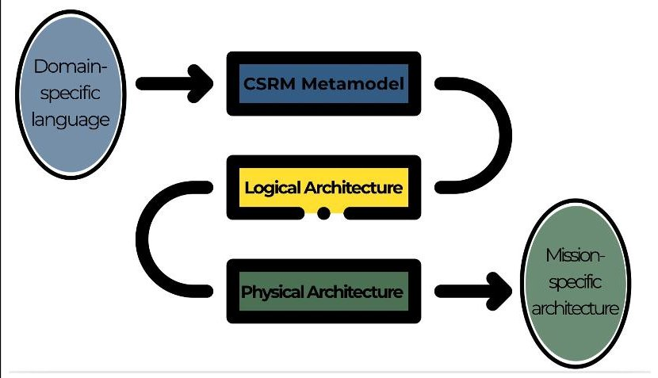

Figure 1. CSRM Development Process

<!-- PDF_PAGE: 2 -->

stakeholders, a common understanding of the domain, improved knowledge capture, well-defined information traceability, and increased reuse of artifacts. Delligatti, 2014, [45] describes the three (3) pillars of successful MBSE as a language, approach, and tool.

Metamodeling—Metamodels define modeling languages by providing concepts, the relationships between them [50], and the infrastructure for managing information and interface specifications within a distributed environment [34]. Metamodeling involves modifying a modeling language to improve the comprehensibility of the vocabulary or the suitability for a specific domain [26]. It is a widely applied technique in the construction of DSLs to specify semantics [63] and constrain the structure of system design [64].

Concept Modeling-A concept model describes an entity and connections between constructs [36] to improve domain understanding [38] and enable stakeholders to communicate with each other [27]. These models contain the critical information needed for organizational processes and knowledge management [39] while providing a solid foundation for the design and implementation of systems [42]. As a formal description used in early stages of system development [43], concept models represent the structure that clarifies a language metamodel [44].

Reference Model-A reference model is composed of a collection of different perspectives that provides a high-level view of the domain space with abstractions, relationships, and entities to represent what a system model could be [48]. They typically have a narrow scope with in-depth characterization of domain-specific elements that reinforce model organization [48].

Ontologies—An ontology is an explicit specification of a common language described by a set of representational terms [28] that can also be defined as the concepts, relations, attributes, and hierarchies present for a domain [29]. Ontologies include concept definitions that indicate domain structure and constrain possible interpretations of a language [28].

To evaluate the quality of ontologies, semantic reasoners are used to infer logical consequences from a set of asserted axioms to facilitate key tasks such as querying [16] and to describe the heuristics rule application [8]. They are capable of measuring consistency and of performing ontology classification, which is the computation of a concept hierarchy [16]. Such reasoning is essential for ensuring logical consistency and to extract inferred knowledge of ontologies [19]. An inconsistent ontology may result in false semantic understanding and knowledge representation [67]. Fig. 2 illustrates the main components of a semantic reasoner.

## 3. INDUSTRY CHALLENGES

## Model-based Systems Engineering (MBSE) Challenges

The Systems Modeling Language (SysML) is a versatile, general-purpose language designed to address a broad spectrum of SE challenges [5]. SysML provides a standardized and expressive language that enables stakeholders to communicate system elements via requirements, structure, behavior, and parametric views [45]. It extends the Unified Modeling Language (UML) to include notations specific to the SE domain [6] and can also model DSLs with concept models. In the context of current MBSE practices, Kohen & Dori, 2021 [23], propose that successful MBSE requires

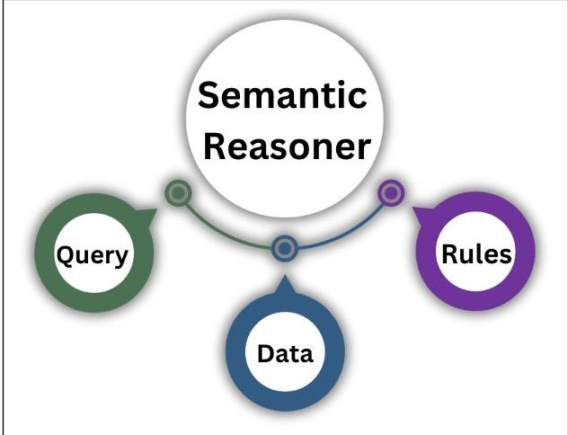

Figure 2. Components of a Semantic Reasoner

a rigorous concept modeling methodology that includes a universal ontology as illustrated in Fig. 3.

## Space Systems Ontology

Modern ontologies aim to clarify DSLs, enable the reuse of domain knowledge, and to systematically analyze this knowledge [30]. However, in practice, different organizations are producing varying ontologies for similar purposes [72]. A challenge in creating a collaborative and re-usable domain-specific ontology (DSO) is the lack of a formalized organization to socialize available information. Work is often a result of disconnected efforts exemplified by Yang, et al., 2021 [13], Orellana & Madni, 2014 [14], and van Ruijven, 2013 [15].

## Challenges of Domain-specific Languages (DSL) Metamodels

Van deursen et al., 2000 [32], define DSLs as small, declarative languages that offer expressive power focused on, and restricted to, a particular problem domain and are unavoidable when considering all necessary design aspects. The absence of standardized metamodel development techniques leads to unreliable and inaccurate results that are likely propagated downstream [49]. DSLs are a formal means of communication which give unambiguous meaning to model elements

Figure 3. Modern MBSE Pillars

<!-- PDF_PAGE: 3 -->

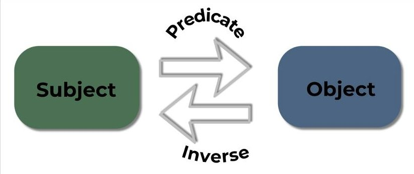

Figure 4. SPO Approach

[45] and are the preferred choice when defining structural aspects of a particular domain [20]. Further, Wise & Zimmer, 2024 [48], state that metamodels are an underdeveloped area even though they are necessary to establish the coherency and consistency of a DSL.

## 4. METAMODEL QUALITY ANALYSIS APPROACH

1. Data Model - represents classes and the relationships between them

This section describes the approach for the CSRM metamodel and ontology construction and subsequent quality analysis.

## CSRM Metamodel

Building on the authors' previous work, a CSRM metamodel is created using the subject-predicate-object (SPO) approach. The CSRM specification published by OMG is to construct a concept model within an MBSE tool that represents the domain metamodel. It is composed of the following:

2. Process Model - captures predicates between subjects and objects as classes

This research focuses on the data model using SPO semantics represented by Fig. 4. Predicates correspond to bi-directional associations that represent the relationship and its inverse. For example, the predicate inverse of "refines" is "refined by".

## CSRM Ontology

The DSO is built in accordance with the Web Ontology Language (OWL) using Protégé, an open-source ontology editor. Fig. 5 shows a subset of OWL superclasses and subclasses that aligns with the CSRM metamodel view in Fig. 7. The CSRM ontology is created as a proof-of-concept to verify import and mapping capabilities of an OWL file into the metamodel.

## Evaluating CSRM Quality

The quality analysis will leverage the empirical scale proposed by Yao et al., 2005 [53], through an evaluation by ontologists regarding quality metrics. The extrapolation of previous quality analyses is shown for metamodels in Table 1. The resulting quality scores will define the following aspects:

- Cohesiveness

- Conciseness

- Specificity

- Clarity

- Learnability

Table 1. Quality Metric Evaluation

<table border="1"><tr><td>Quality Metric Value</td><td>Quality Score</td></tr><tr><td>0-0.25</td><td>Low</td></tr><tr><td>0.25-0.50</td><td>Moderate</td></tr><tr><td>0.50-0.75</td><td>High</td></tr><tr><td>0.75-1.0</td><td>Excellent</td></tr></table>

It should be noted that this scale is reversed when lower values are ideal for a particular metric (e.g., Cohesiveness). The QM4MM metrics support the quality characteristics illustrated in Fig. 6. The main entities and relationships of a domain must be identified for proper development of a DSL [58]. Kudo et al., 2020 [1], define metamodel quality as the degree to which it provides value to a modeling activity. A metamodel is considered of quality if it contains the elements that represent domain concepts, built using technically-sound principles [58]. The schema for these concepts should have at a minimum the fundamental quality properties of syntactic and semantic correctness, relevance, and completeness [21]. Ensuring a metamodel that is utilized for creating a DSL with regard to domain specification(s) ensures high quality [66]. Fig. 7 shows an example of CSRM metamodel classes, superclasses, and subclasses. The generalization relationship between these classes conveys inheritance and is read as the Spacecraft is a type of System. Selecting the proper metrics requires a deep understanding of the modeling goals and the logical foundations of the ontology so that a metric framework can guide the effort [65]. Bertoa & Vallecillo, 2010 [68] refine ISO/IEC 9126:2011 - Software Engineering

- Product Quality (replaced by ISO/IEC 25010:2011[55]) processes based on specific metamodel attributes and propose the Quality Model for Metamodels (QM4MM) framework with the following key properties:

- Cohesiveness - all information is related to a single domain calculated by Eq.1 [69]

- Coupling - measures data structures and the degree of relatedness between classes [70] calculated by Eq. 3 [72]

- Correctness - elements and the relationships between them are accurate. This determination requires the input of domain subject matter experts (SME).

- Consistency - classes have the same structure, format, and precision measured by a semantic reasoner. This can also be conducted as an internal evaluation based on the correct usage of OWL primitives [10].

- Conciseness - model preciseness is measured by the relationship diversity (RD) calculated by Eq. 4 [54]

- Specificity - extent to which the metamodel is general or specific which can be measured by the schema deepness

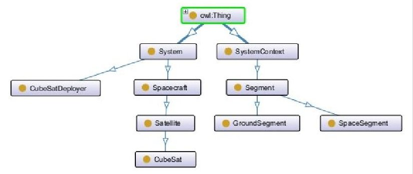

Figure 5. Example View of CSRM OWL "Thing" with Ontograf.

<!-- PDF_PAGE: 4 -->

(SD) calculated by Eq. 5 [54]

- Clarity - determines whether the context of terms is clear [40] as a ratio calculated by Eq. 6 [35]

- Learnability - documentation is provided for each class measured by Eq. 7 [1]

Cohesiveness- Originally a software measure, there have been a multitude of proposed metrics and frameworks to evaluate cohesion for systems such as the ratio of cohesive interactions (RCI) and the lack of cohesion methods (LCOM), an inverse metric where a value closer to one (1) represents a low cohesion [69]. Cohesion represents the number of connected components in the metamodel to measure the independence of the elements [72]. A low LCOM value represents a metamodel with unrelated classes while high cohesion is desirable due to the relatedness of classes [37]. This metric refers to the degree to which the elements in a model belong together [53] and is calculated by Eq.1.

$$
L C O M = \frac {n o n C o h e s i v e C l a s s e s}{c o h e s i v e C l a s s e s}
$$

Cohesive classes share at least one attribute with another class as an inheritance property [69]. Non-cohesive classes are those without a superclass or subclass. These properties are disjoint, therefore Eq. 2 can be used to determine the number of cohesive classes.

$$
c o h e s i v e C l a s s e s = c l a s s e s - n o n C o h e s i v e C l a s s e s \tag {2}
$$

Because the LCOM value is an inverse quality metric, a result closer to zero (0) is required.

Coupling—The stronger the coupling between objects (CBO), the more difficult the data is to understand, change, and correct [52]. Therefore, a low value is desired to ease future updates. Eq. 3 shows the calculation used to determine coupling within the CSRM metamodel.

$$
C B O = \frac {s u b C l a s s e s}{(c l a s s e s - s u p e r C l a s s e s)}
$$

Superclasses have at least one (1) subclass while Subclasses are related to at least one (1) superclass. Based on the OQuaRE evaluation criteria, the CBO should be within the acceptable range shown in Table 2 where a quality score of one (1) is not acceptable, three (3) is minimally acceptable, and five (5) is exceptional [72]. The quality result has been modified to define quality scores between two (2) and four (4) to be acceptable. This means that any CBO value less than eight (8) is considered acceptable for this evaluation.

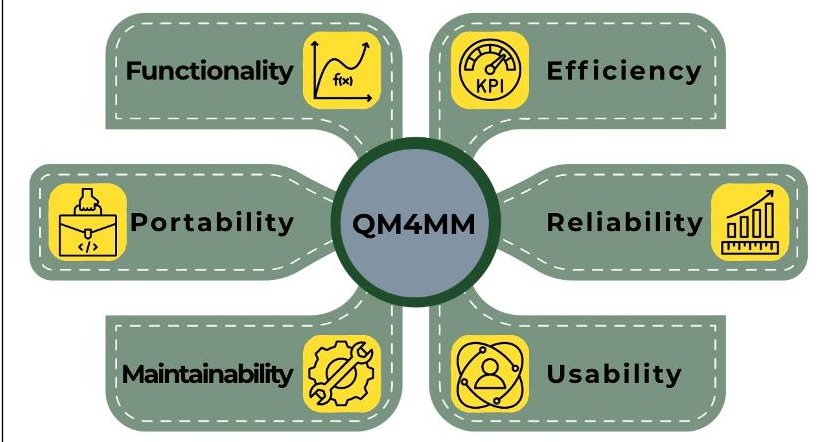

Figure 6. QM4MM Quality Characteristics

Table 2. CBO Quality Score Evaluation

<table border="1"><tr><td>CBO Value Range</td><td>Quality Score</td><td>Quality Result</td></tr><tr><td>1-2</td><td>5</td><td>Exceptional</td></tr><tr><td>2-4</td><td>4</td><td rowspan="3">Acceptable</td></tr><tr><td>4-6</td><td>3</td></tr><tr><td>6-8</td><td>2</td></tr><tr><td>&gt;8</td><td>1</td><td>Not Acceptable</td></tr></table>

Correctness- This quality aspect accounts for the formal correctness of the ontological knowledge and primitives used in a data repository [72].

Conciseness—The RD value conveys the amount of inheritance within the database in order to describe metamodel conciseness. A low RD score represents a metamodel that has a surplus of inheritance relationships which indicates there is less information than if the value closer to one (1) [54] as calculated by Eq. 4.

$$
R D = \frac {s u b C l a s s e s}{o b j e c t P r o p e r t i e s}
$$

Specificity—The SD represents the class distribution across all levels of abstraction to convey the metamodel specificity. A knowledge base with a low SD is considered to have a vertical distribution while a high SD represents a horizontal distribution. A horizontal SD distribution indicates a DSL with a wide range of knowledge and a low level of detail while a vertical distribution indicates robust coverage for a specific domain. A balanced SD distribution supports DSL quality as determined by Eq. 5 [54].

$$
S D = \frac {s u b C l a s s e s}{c l a s s e s}
$$

By calculating the fraction of subclasses within the total number of classes, the concept of inheritance is evaluated, which describes the relationships between generalization and specialization, in which which the superclasses (i.e., base elements) describe the common set of features, properties, operations for all subclasses (i.e., derivative elements) [17]. For this study, an SD value between 0.25 and 0.75 defines a balanced SD distribution.

Clarity—Metamodel clarity generally refers to stakeholder consensus regarding semantic interpretation of a language based on semiotic theory [40]. Semiotics is the study of graphical representations that convey the meaning of a DSL

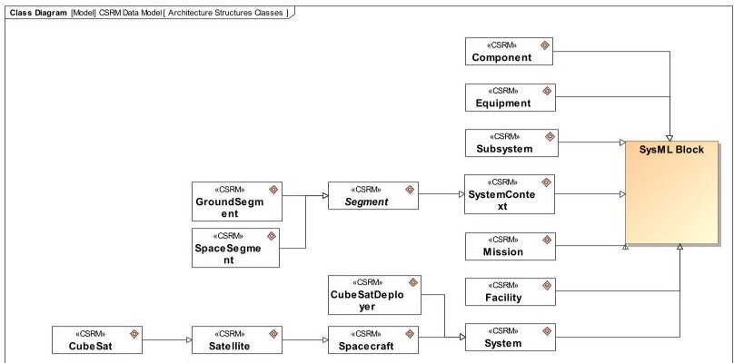

Figure 7. Example View of CSRM Metamodel Classes

<!-- PDF_PAGE: 5 -->

[11]. To achieve ideal semiotic clarity, interpretation mapping must have a 1:1 ratio between DSO concepts and an element within the DSL metamodel [35]. Therefore, the semiotic clarity ratio (SCR) should be one (1) based on Eq. 6.

$$
S C R = \frac {e q u i v a l e n t C l a s s e s}{c l a s s e s}
$$

The number of «Equivalent Class» relationships created between DSO and DSL elements is the numerator input value.

Learnability—To evaluate the learnability of the CSRM specification, the user guide completeness (ULe) is calculated [1] by Eq. 7. A value close to one (1) indicates a welldocumented and re-usable architecture.

$$
U L e = \frac {d o c u m e n t e d C l a s s e s}{c l a s s e s}
$$

The documented classes represent the number of classes within the metamodel that have descriptions.

## 5. METAMODEL QUALITY ANALYSIS APPLICATION

Fig. 8 shows requirements for quantitative metrics of the metamodel and the value properties that «satisfy» each. This relationship creates constraints that enable the modeling tool to validate the requirement has been met by executing SysML parametrics. Based on Tables 1 and 2, initial requirements contain hypothesized thresholds for each quality aspect. Customized validation rules within the MBSE tool reduce errors and improve model quality by checking for accuracy and consistency [51]. The inclusion of a «MetricSuite», is another potential way to determine basic model metrics. The following four (4) SysML classes were incorporated in the CSRM metamodel to convey inheritance [3]:

- «Block»

- «Requirement»

- «Verify»

- 《Trace》

Four (4) UML metaclasses were leveraged as superclasses to CSRM elements [3]:

- 《Behavior》

- «Comment»

- «Operation»

- 《Property》

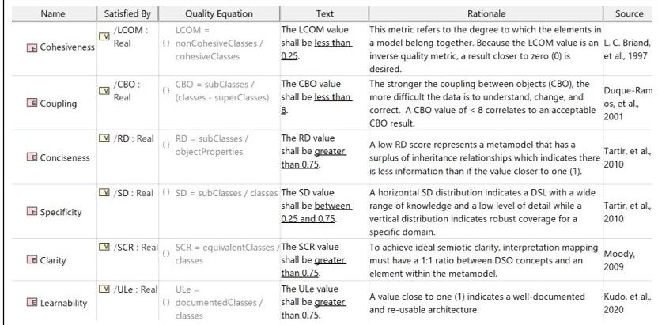

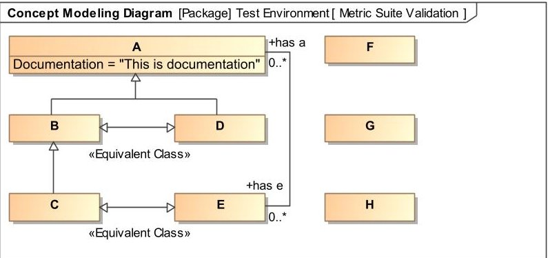

Figure 9. Metric Suite Validation

Figure 10. CSRM Data Model Basic Metrics

Figure 8. Metamodel Quality Requirements

The custom MetricSuite"Counts" is built to determine the MetricDefinition s. Each MetricDefinition gives an automated count of a particular model element leveraging structured expressions, a tool-specific capability used to query the model. To validate the accuracy of the MetricDefinition counts, a simple test environment is evaluated shown in Fig. 9. In this example of eight (8) classes, "B", "C", and "D" are the three (3) subclasses; "A" and "B" are the two (2) superclasses. By this logic, "B" is both subclasses and superclasses. Only class "A" has documentation in the metamodel. "F", "G" and "H" represent the three (3) non-cohesive classes. There are two (2) Equivalent Class relationships. The six (6) object properties are found by adding all relationships: one (1) association, three (3) generalizations, and two (2) Equivalent Classes]. Fig. 10 demonstrates the custom MetricSuite is capable of accurately counting the input variables for the applicable quality metrics. Fig. 11 shows the mathematical expressions that form executable SysML parametric diagrams and verify quality requirements are met. Fig. 12 provides an example of a functional SysML parametric used to calculate advanced metamodel metrics. Fig. 13 shows the advanced quality metric results as calculated by the SysML parametrics using the test environment as the instance scope. Executable parametrics were constructed for each quality equation. Table 3 verifies the SysML parametrics are correctly calculating advanced model metrics. Protégé has several semantic reasoners that ensure compliance with OWL and can validate consistency of the DSL. Fig. 14 shows verification that CSRM ontology is determined to be semantically correct and consistent. After transforming the CSRM metamodel into a Cameo Concept Model (CCM), the OWL file is imported into the CCM for interpretation mapping. The SCR value should always be one (1).

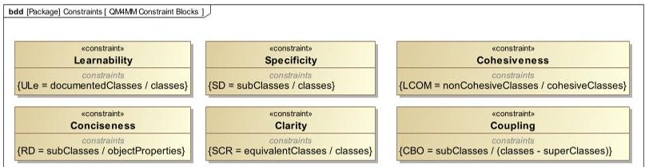

Figure 11. Metamodel Quality Constraints

<!-- PDF_PAGE: 6 -->

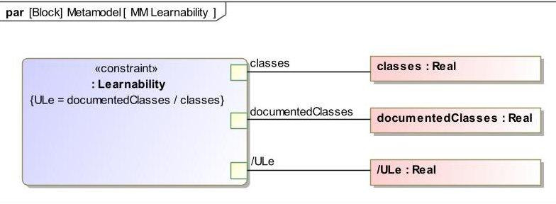

Figure 12. Metamodel Learnability SysML Parametric Diagram

## 6. RESEARCH RESULTS

This section elaborates upon the results of the CSRM metamodel quality analysis to provide recommendations for the CSRM specification and profile. Fig. 15 shows the basic counts for the CSRM data model. The requirement bounds in Fig. 8 were selected based on the quality ranges shown in Fig. 1. The parameters are estimates that necessitate further refinement as additional DSL case studies are completed and objectives become evident. Fig. 16 compares the final values for the CSRM metamodel quality aspects and results from SysML parametrics. Based on the calculated values of quality aspects and semantic reasoning, the CSRM metamodel meets the initial goals for DSL correctness, cohesiveness, coupling, specificity, and learnability.

There is currently no comprehensive approach that evaluates the quality of DSLs, since frameworks have historically been disparate from actual metrics. This research contributes toward defining a novel methodology for evaluating DSL quality based on the underlying metamodel.

## Significance of Results

## Research Limitations

Although a framework is carefully chosen for the purpose of assessing a DSL metamodel, this research is not comprehensive due to the abundance of metrics that assess quality characteristics. This research did not consider the process model in the quality analysis. Based on the assumption that domain SMEs constructed the CSRM with due diligence, evaluation of the metamodel knowledge correctness is not empirically conducted.

<table border="1"><tr><td>#</td><td>Name</td><td>LCOM:Real</td><td>CBO:Real</td><td>RD:Real</td><td>ULe:Real</td><td>SD:Real</td><td>SCR:Real</td></tr><tr><td>1</td><td>Test</td><td>0.6</td><td>0.5</td><td>0.5</td><td>0.125</td><td>0.375</td><td>0.25</td></tr></table>

Figure 13. SysML Parametric Results

Table 3. Manual metric results vs SysML parametric results.

<table border="1"><tr><td>Quality Metric</td><td>Manual Solution</td><td>Parametric Result</td></tr><tr><td>LCOM</td><td>=3/5=0.6</td><td>0.6</td></tr><tr><td>CBO</td><td>=3/(8-2)=0.5</td><td>0.5</td></tr><tr><td>RD</td><td>=3/6=0.5</td><td>0.5</td></tr><tr><td>SD</td><td>=3/8=0.375</td><td>0.375</td></tr><tr><td>SCR</td><td>=2/8=0.25</td><td>0.25</td></tr><tr><td>ULe</td><td>=1/8=0.125</td><td>0.125</td></tr></table>

## Research Result Discussion

This section discusses the results of CSRM metamodel quality metrics. The eight (8) UML and SysML elements and their relationships with the CSRM metamodel were included in the Counts. The discrepancies this introduces into the metrics are explained in this section.

Cohesiveness—For complete cohesiveness within the CSRM profile, it is recommended to relate the «ConcernOf» to another model element, such as a SysML «Dependency», since it is the only non-cohesive class.

Coupling—The CBO value of the CSRM metamodel received an exceptional quality score in alignment with the coupling evaluation criteria in Table 2.

Conciseness-To improve the CSRM conciseness, generalizations between concepts should be more explicit. For example, a SME should consider the appropriateness of showing a Satellite" is a" System". The absence of this relationship is demonstrated by Fig. 17. Increasing the number of object properties will decrease the RD value to an acceptable level. However, effects on other quality aspects must also be considered with these changes.

Specificity—The SD value of the CSRM metamodel shows a horizontal distribution. Removing subclasses in the language would reduce the metric, showing that domain knowledge is more specific to CubeSats, but is not necessarily recommended as this change will negatively affect the DSL conciseness. For future applications, the specificity requirement should be adjusted with respect to the original goal of the DSL.

ClarityBased on this case study, a 1:1 SCR ratio represents a "perfectly clear" language given the mapping between OWL classes and metamodel classes. This research demonstrated a proof-of-concept for the SCR evaluation; however, a mature DSO should be leveraged to evaluate the true quality implications of this characteristic.

Learnability—All classes within the CSRM metamodel are documented, providing the maximum level of DSL learnability with a ULe value of one (1). This differs slightly from the results due to the inclusion of SysML classes.

## 7. CONCLUSIONS AND FUTURE WORK

This paper has demonstrated a quality-based approach for DSL metamodel evaluation using CSRM as a singular case study. Although in its infancy, many of these methods lay the foundation for a viable framework that can be leveraged to

Figure 14. Verification of CSRM Consistency

Figure 15. CSRM Data Model Basic Metrics

<!-- PDF_PAGE: 7 -->

<table border="1"><tr><td>Name</td><td>Value</td><td>Requirement</td></tr><tr><td>documentedClasses:Real</td><td>53.0000</td><td></td></tr><tr><td>equivalentClasses:Real</td><td>53.0000</td><td></td></tr><tr><td>/LCOM:Real</td><td>0.0167</td><td>2-“TheLCOMvalue shall be less than0.25.”</td></tr><tr><td>nonCohesiveClasses:Real</td><td>1.0000</td><td></td></tr><tr><td>objectProperties:Real</td><td>161.0000</td><td></td></tr><tr><td>/RD:Real</td><td>0.3230</td><td>1-“TheRDvalue shall be greater than0.75.”</td></tr><tr><td>/SCR:Real</td><td>0.8689</td><td>5-“TheSCRvalue shall be greater than0.75.”</td></tr><tr><td>/SD:Real</td><td>0.8525</td><td>3-“TheSDvalue shall be between0.5and0.75.”</td></tr><tr><td>subClasses:Real</td><td>52.0000</td><td></td></tr><tr><td>superclasses:Real</td><td>19.0000</td><td></td></tr><tr><td>/ULe:Real</td><td>0.8689</td><td>6-“TheUlevalue shall be greater than0.75.”</td></tr></table>

Figure 16. CSRM Quantitative Metric Results

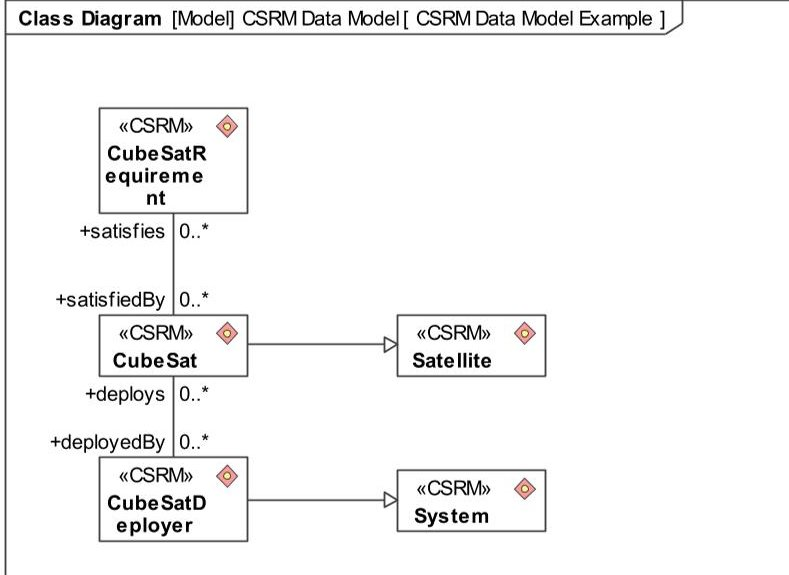

Figure 17. Example of CSRM Object Properties

address the quality of ontologies, metamodels, DSL specifications, and SysML profiles. By considering cohesiveness coupling, conciseness, specificity, clarity, and learnability there are many implications about the usefulness of DSLs for the greater technical community that can be deduced.

The INCOSE SSWG is presented with the opportunity to iteratively improve the CubeSat DSL based on objective measurements while maintaining a high level of domain expertise. The ability to track the iterative CSRM metamodel metrics may uncover additional ways to compare DSL versions and identify design patterns based on data trends. Future work will compare the CSRM metamodel quality results to modeling languages specific to other domains.

## APPENDICES

## A. ADDITIONAL INFORMATION FOR THE CSRM

This appendix is excerpted from the authors' previous work [71] with additional information as it pertains to the CSRM metamodel. The CSRM Profile is created using a graphical modeling tool to support the CubeSat Mission Model by using SysML stereotypes. The CSRM metamodel aligns with the syntax in the profile to capture classes and the allowable relationships between them. Use of the CSRM elements and architecture levels enables common baselines for comparing and evaluating different mission-specific implementations, for assessing completeness of design, and for the sharing and reuse of design elements. The CSRM provides definitions for these elements and provides requirements traceability

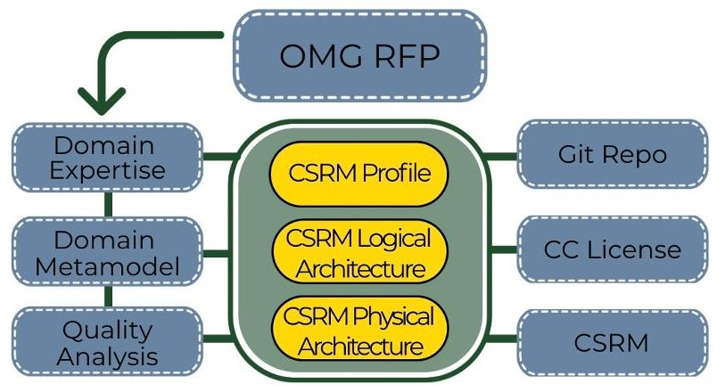

Figure 18. CSRM Overview

from stakeholders, behaviors, and technical measures down to subsystems and components and then to validation and verification activities illustrated in Fig. 18.

## ACKNOWLEDGEMENTS

The authors' would like to acknowledge the members of the INCOSE SSWG for their domain knowledge and expertise regarding the CSRM specification, their feedback during this research, and their willingness to assist in constructing a novel quality analysis of DSLs.

## REFERENCES

[1] T. N. Kudo, R. F. Bulcão-Neto, and A. M. R. Vincenzi, "Metamodel Quality Requirements and Evaluation (MQuaRE)," 2020.

[2] https://github.com/ObjectManagementGroup/CSRM/

[3] Object Management Group. CubeSat System Reference Model Profile (CSRM) (Version 1.1). (2023). https://www.omg.org/spec/CSRM/1.1/Beta1/PDF

[4] INCOSE Systems Engineering Handbook, 4th ed., INCOSE-TP-2003-002-04 2015.

[5] Object Management Group. Systems Modeling Language $ ^{TM} $ (SysML $ ^{\circledR} $ ) (Version 1.7). (2024).

[6] Object Management Group. Unified Modeling Language (Version 2.5.1). (2017).

[7] NASA Systems Engineering Handbook, rev. 1, December 2007, NASA/SP-2007-6105 Rev1.

[8] T. Slimani, "Ontology Development: A Comparing Study on Tools, Languages and Formalisms," Indian Journal of Science and Technology, vol. 8, no. 24, Sept. 2015, doi: 10.17485/ijst/2015/v8i1/54249.

[9] B. Glimm, I. Horrocks, B. Motik, G. Stoilos, and Z. Wang, "HermiT: An OWL 2 Reasoner," J Autom Reasoning, vol. 53, no. 3, pp. 245-269, Oct. 2014, doi: 10.1007/s10817-014-9305-1.

[10] T. D. Wang, "Gauging Ontologies and Schemas by Numbers," 2005.

[11] C. M. Krishna, K. Ruikar, and K. N. Jha, "Determinants of Data Quality Dimensions for Assessing Highway Infrastructure Data Using Semiotic Framework," Buildings, vol. 13, no. 4, p. 944, Apr. 2023, doi: 10.3390/buildings13040944.

<!-- PDF_PAGE: 8 -->

[12] D. W. Orellana and A. M. Madni, "Human System Integration Ontology: Enhancing Model Based Systems Engineering to Evaluate Human-system Performance," Procedia Computer Science, vol. 28, pp. 19-25, 2014, doi: 10.1016/j.procs.2014.03.003.

[13] L. Yang, K. Cormican, and M. Yu, "Ontology Learning for Systems Engineering Body of Knowledge," IEEE Trans. Ind. Inf., vol. 17, no. 2, pp. 1039-1047, Feb. 2021, doi: 10.1109/TII.2020.2990953.

[14] D. W. Orellana and A. M. Madni, "Human System Integration Ontology: Enhancing Model Based Systems Engineering to Evaluate Human-system Performance," Procedia Computer Science, vol. 28, pp. 19-25, 2014, doi: 10.1016/j.procs.2014.03.003.

[15] L. C. van Ruijven, "Ontology for Systems Engineering," Procedia Computer Science, vol. 16, pp. 383-392, Jan. 2013, doi: 10.1016/j.procs.2013.01.040.

[16] K. Dentler, R. Cornet, A. Ten Teije, and N. De Keizer, "Comparison of reasoners for large ontologies in the OWL 2 EL profile," Semantic Web, vol. 2, no. 2, pp. 71-87, 2011, doi: 10.3233/SW-2011-0034.

[17] M. Krótkiewicz, K. Wojtkiewicz, and M. Jodłowiec, "Towards Semantic Knowledge Base Definition," in Biomedical Engineering and Neuroscience, W. P. Hunek and S. Paszkiel, Eds., Cham: Springer International Publishing, 2018, pp. 218-239.

[18] J.R. Wertz, D. Everett, and J. Puschell, Eds., Space Mission Engineering: The New SMAD, (Space Technology Library, Volume 28), Hawthorne, CA, Microcosm Press, 2011.

[19] Y.-B. Kang, S. Krishnaswamy, W. Sawangphol, L. Gao, and Y.-F. Li, "Understanding and improving ontology reasoning efficiency through learning and ranking," Information Systems, vol. 87, p. 101412, Jan. 2020, doi: 10.1016/j.is.2019.07.002.

[20] D. D. Walden et al., Eds., INCOSE SYSTEMS ENGINEERING HANDBOOK A GUIDE FOR SYSTEM LIFE CYCLE PROCESSES AND ACTIVITIES, Fifth. John Wiley & Sons Ltd., 2023.

[21] D. Aguilera, C. Gómez, and A. Olive, "A Method for the Definition and Treatment of Conceptual Schema Quality Issues," in Conceptual Modeling, P. Atzeni, D. Cheung, and S. Ram, Eds., Berlin, Heidelberg: Springer Berlin Heidelberg, 2012, pp. 501-514.

[22] D. Kaslow and A. M. Madni, "Validation and Verification of MBSE-Compliant CubeSat Reference Model," in Disciplinary Convergence in Systems Engineering Research, A. M. Madni, B. Boehm, R. G. Ghanem, D. Erwin, and M. J. Wheaton, Eds., Cham: Springer International Publishing, 2018, pp. 381-393. doi: 10.1007/978-3-319-62217-0_27.

[23] H. Kohen and D. Dori, "Improving conceptual modeling with object-process methodology stereotypes," Applied Sciences, vol. 11, no. 5, p. 2301, 2021.

[24] T. N. Kudo, R. F. Bulcao-Neto, and A. M. R. Vincenzi, "Metamodel Quality Requirements and Evaluation (MQuaRE)," 2020.

[25] "INCOSE Systems Engineering Vision 2020." INCOSE, 2007. Accessed: Nov. 25, 2022. [Online]. Available: https://sdincose.org/wp content/uploads/2011/12/SEVision2020_20071003_v2_0

[26] J. Krogstie, G. Sindre, and H. Jørgensen, "Process models representing knowledge for action: a revised quality

framework," Eur J Inf Syst, vol. 15, no. 1, pp. 91-102 Feb. 2006, doi: 10.1057/palgrave.ejis.3000598.

[27] D. W. Embley and B. Thalheim, Eds., Handbook of Conceptual Modeling: Theory, Practice, and Research Challenges. Berlin, Heidelberg: Springer Berlin Heidelberg, 2011. doi: 10.1007/978-3-642-15865-0.

[28] T. R. Gruber, "A translation approach to portable ontology specifications," Knowledge Acquisition, vol. 5, no. 2, pp. 199-220, Jun. 1993, doi: 10.1006/knac.1993.1008.

[29] M. N. Asim, M. Wasim, M. U. G. Khan, W. Mahmood, and H. M. Abbasi, "A survey of ontology learning techniques and applications," Database, vol. 2018, Jan. 2018, doi: 10.1093/database/bay101.

[30] G. R. Roldan-Molina, J. R. Mendez, I. Yevseyeva, and V. Basto-Fernandes, "Ontology Fixing by Using Software Engineering Technology," Applied Sciences, vol. 10, no. 18, p. 6328, Sep. 2020, doi: 10.3390/app10186328.

[31] E. Honoré-Livermore, R. G. Rovik, and C. Haskins, "Academic application of trade-off studies to support a CubeSat project," INCOSE International Symposium, vol. 32, no. 1, pp. 92-104, 2022, doi: 10.1002/iis2.12919.

[32] A. Van Deursen, P. Klint, and J. Visser, "Domain-specific languages: an annotated bibliography," SIGPLAN Not., vol. 35, no. 6, pp. 26-36, Jun. 2000, doi: 10.1145/352029.352035.

[33] S. Staab, R. Studer, H.-P. Schnurr, and Y. Sure, "Knowledge processes and ontologies," IEEE Intell. Syst., vol. 16, no. 1, pp. 26-34, Jan. 2001, doi: 10.1109/5254.912382.

[34] D. Karagiannis and H. Kühn, "Metamodelling Platforms," in E-Commerce and Web Technologies, vol. 2455, K. Bauknecht, A. M. Tjoa, and G. Quirchmayr, Eds., in Lecture Notes in Computer Science, vol. 2455. Berlin, Heidelberg: Springer Berlin Heidelberg, 2002, pp. 182-182. doi: 10.1007/3-540-45705-4_19.

[35] D. Moody, "The 'Physics' of Notations: Toward a Scientific Basis for Constructing Visual Notations in Software Engineering," IIEEE Trans. Software Eng., vol. 35, no. 6, pp. 756-779, Nov. 2009, doi: 10.1109/TSE.2009.67.

[36] E. Jaakkola, "Designing conceptual articles: four approaches," AMS Rev, vol. 10, no. 1-2, pp. 18-26, Jun. 2020, doi: 10.1007/s13162-020-00161-0.

[37] A. M. Orme, H. Yao, and L. H. Etzkorn, "Indicating ontology data quality, stability, and completeness throughout ontology evolution," J. Softw. Maint. Evol.: Res. Pract., vol. 19, no. 1, pp. 49-75, Jan. 2007, doi: 10.1002/smr.341.

[38] A. Gemino and Y. Wand, "A framework for empirical evaluation of conceptual modeling techniques," Requirements Eng, vol. 9, no. 4, pp. 248-260, Nov. 2004, doi: 10.1007/s00766-004-0204-6.

[39] H. J. Nelson, G. Poels, M. Genero, and M. Piattini, "A conceptual modeling quality framework," Software Qual J, vol. 20, no. 1, pp. 201-228, Mar. 2012, doi: 10.1007/s11219-011-9136-9.

[40] A. Burton-Jones, V. C. Storey, V. Sugumaran, and P. Ahluwalia, "A semiotic metrics suite for assessing the quality of ontologies," Data & Knowledge Engineering, vol. 55, no. 1, pp. 84-102, Oct. 2005, doi: 10.1016/j.datak.2004.11.010.

<!-- PDF_PAGE: 9 -->

[41] A. Lozano-Tello and A. Gomez-Perez, "ONTOMETRIC: A Method to Choose the Appropriate Ontology," Journal of Database Management, vol. 15, no. 2, pp. 1-18, Apr. 2004, doi: 10.4018/jdm.2004040101.

[42] G. Poels and G. Dedene, Measures for Assessing Dynamic Complexity Aspects of Object-Oriented Conceptual Schemes. 2000, p. 512. doi: 10.1007/3-540-45393-8_36.

[43] J. Evermann and Y. Wand, "Towards Ontologically Based Semantics for UML Constructs," in Conceptual Modeling ER 2001, vol. 2224, H. S.Kunii, S. Jajodia, and A. Sølvberg, Eds., in Lecture Notes in Computer Science, vol. 2224. , Berlin, Heidelberg: Springer Berlin Heidelberg, 2001, pp. 354-367. doi: 10.1007/3-540-45581-7_27.

[44] L. Yang, K. Cormican, and M. Yu, "Ontology-based systems engineering: A state-of-the-art review," Computers in Industry, vol. 111, pp. 148-171, Oct. 2019, doi: 10.1016/j.compind.2019.05.003.

[45] L. Delligatti, SysML Distilled: A Brief Guide to the Systems Modeling Language. Pearson Education, Inc., 2014.

[46] M. Hause and L. Kihlström, "An Elaboration of Service Views within the UAF," INCOSE International Symposium, vol. 31, pp. 728-742, Jul. 2021, doi: 10.1002/j.2334-5837.2021.00865.x.

[47] K. Baclawski et al., "Ontology summit 2020 communique: Knowledge graphs," AO, vol. 16, no. 2, pp. 229-247, Apr. 2021, doi: 10.3233/AO-210249.

[48] R. Wise and R. Zimmer, "Empowering Model-Based Systems Engineering Through Metamodeling," 2024.

[49] J. J. López-Fernández, J. S. Cuadrado, E. Guerra, and J. De Lara, "Example-driven meta-model development," Softw Syst Model, vol. 14, no. 4, pp. 1323-1347, Oct. 2015, doi: 10.1007/s10270-013-0392-y.

[50] R. Pérez-Castillo, A. Delgado, F. Ruiz, V. Bacigalupe, and M. Piattini, "A method for transforming knowledge discovery metamodel to ArchiMate models," Softw Syst Model, vol. 21, no. 1, pp. 311-336, Feb. 2022, doi: 10.1007/s10270-021-00912-y.

[51] D. R. Herber, J. B. Narsinghani, and K. Eftekhari-Shahroudi, "Model-Based Structured Requirements in SysML," in 2022 IEEE International Systems Conference (SysCon), Montreal, QC, Canada: IEEE, Apr. 2022, pp. 1-8. doi: 10.1109/SysCon53536.2022.9773813.

[52] A. M. Orme, H. Tao, and L. H. Etzkorn, "Coupling metrics for ontology-based system," IEEE Softw., vol. 23, no. 2, pp. 102-108, Mar. 2006, doi: 10.1109/MS.2006.46.

[53] H. Yao, A. M. Orme, and L. Etzkorn, "Cohesion Metrics for Ontology Design and Application," J. of Computer Science, vol. 1, no. 1, pp. 107-113, Jan. 2005, doi: 10.3844/jcssp.2005.107.113.

[54] S. Tartir, I. B. Arpinar, and A. P. Sheth, "Ontological Evaluation and Validation," in Theory and Applications of Ontology: Computer Applications, R. Poli, M. Healy, and A. Kameas, Eds., Dordrecht: Springer Netherlands, 2010, pp. 115-130. doi: 10.1007/978-90-481-8847-5_5.

[55] ISO/IEC 25010:2011, "Systems and software engineering Systems and software Quality Requirements and Evaluation (SQuaRE) System and software quality models," International Organization for Standardization, Geneva, Switzerland, 2011

[56] C. Welty and W. Andersen, "Towards OntoClean 2.0: A framework for rigidity," 2005.

[57] S. Tartir, I. B. Arpinar, and A. P. Sheth, "Ontological Evaluation and Validation," in Theory and Applications of Ontology: Computer Applications, Dordrecht: Springer Netherlands, 2010, pp. 115-130. doi: 10.1007/978-90-481-8847-5_5.

[58] A. Vázquez-Ingelmo, A. García-Holgado, F. J. García-Penalvo, R. Therón, and R. Colomo-Palacios, "Content validation questionnaire of a meta-model to ease the learning of data visualization concepts," CEUR Workshop Proceedings, 2022.

[59] "CubeSat 101: Basic Concepts and Processes for First- Time CubeSat Developers." NASA CubeSat Launch Initiative, 2017.

[60] A. M. Madni and M. Sievers, "Model-Based Systems Engineering: Motivation, Current Status, and Needed Advances," in Disciplinary Convergence in Systems Engineering Research, A. M. Madni, B. Boehm, R. G. Ghanem, D. Erwin, and M. J. Wheaton, Eds., Cham: Springer International Publishing, 2018, pp. 311-325. doi: 10.1007/978-3-319-62217-0_22.

[61] J. Duprez, "An MBSE modeling approach to efficiently address complex systems and scalability," INCOSE International Symposium, vol. 28, no. 1, pp. 940-954, 2018, doi: 10.1002/j.2334-5837.2018.00526.x.

[62] A. L. Ramos, J. V. Ferreira, and J. Barcelo, "ModelBased Systems Engineering: An Emerging Approach for Modern Systems," IEEE Transactions on Systems, Man, and Cybernetics, Part C (Applications and Reviews), vol. 42, no. 1, pp. 101-111, Jan. 2012, doi: 10.1109/TSMCC.2011.2106495.

[63] S. Sobernig, B. Hoisl, and M. Strembeck, "Requirements-Driven Testing of Domain-Specific Core Language Models Using Scenarios," in 2013 13th International Conference on Quality Software, Najing, China: IEEE, Jul. 2013, pp. 163-172. doi: 10.1109/QSIC.2013.56.

[64] J. Sprinkle, B. Rumpe, H. Vangheluwe, and G. Karsai, "3 Metamodelling: State of the Art and Research Challenges," in Model-Based Engineering of Embedded RealTime Systems, vol. 6100, H. Giese, G. Karsai, E. Lee, B. Rumpe, and B. Schatz, Eds., in Lecture Notes in Computer Science, vol. 6100. , Berlin, Heidelberg: Springer Berlin Heidelberg, 2010, pp. 57-76. doi: 10.1007/978-3-642-16277-0_3.

[65] A. Reiz and K. Sandkuhl, "An Ontology for Ontology Metrics: Creating a Shared Understanding of Measurable Attributes for Humans and Machines:," in Proceedings of the 14th International Joint Conference on Knowledge Discovery, Knowledge Engineering and Knowledge Management, Valletta, Malta: SCITEPRESS - Science and Technology Publications, 2022, pp. 193-199. doi: 10.5220/0011551500003335.

[66] J. J. López-Fernández, E. Guerra, and J. de Lara, "Combining unit and specification-based testing for meta-model validation and verification," Information Systems, vol. 62, pp. 104-135, Dec. 2016, doi: 10.1016/j.is.2016.06.008.

[67] S. Abburu, "A Survey on Ontology Reasoners and Comparison," International Journal of Computer Applications, vol. 57, no. 17, 2012, doi: 10.1093/database/bay101.

<!-- PDF_PAGE: 10 -->

[68] M. F. Bertoa and A. Vallecillo, "Quality Attributes for Software Metamodels," 2010.

[69] L. C. Briand, J. W. Daly, and J. Wust, "A unified framework for cohesion measurement in object-oriented systems," in Proceedings Fourth International Software Metrics Symposium, Albuquerque, NM, USA: IEEE, 1997, pp. 43-53. doi: 10.1109/metric.1997.637164.

[70] S. Oh, H. Y. Yeom, and J. Ahn, "Cohesion and coupling metrics for ontology modules," Inf Technol Manag, vol. 12, no. 2, pp. 81-96, Jun. 2011, doi: 10.1007/s10799-011-0094-5.

[71] D. Kaslow, D. Brookshier, A. Levi, and S. A. MacLaird, "CubeSat System Reference Model (CSRM) as an OMG Specification," 37th Annual Small Satellite Conference, 2023.

[72] A. Duque-Ramos, J. T. Fernandez-Breis, R. Stevens, and N. Aussenac-Gilles, "OQuaRE: A SQuaRE-based Approach for Evaluating the Quality of Ontologies," Journal of Research and Practice in Information Technology, vol. 43, no. 2, 2011.

## BIOGRAPHY

Sarah Rudder is a systems engineer for Enola Technologies. Her previous roles were with industry leaders such as Raytheon Technologies and Northrop Grumman. She has an M.S. in Industrial and Systems Engineering from the University of Tennessee and is a current PhD candidate at Colorado State University. Sarah is a registered Professional Engineer (PE), Certified Systems

Engineering Professional (CSEP), and OMG SysML Certified Model Professional.

David Kaslow has thirty-four years of experience at Lockheed Martin in both the technical and management aspects of developing ground mission capabilities. He has five years of experience at Analytical Graphics including pursuing Model Based Systems Engineering. Dave is a co-author of four chapters Cost-Effective Space Mission Operations. He is Co-Chair for the INCOSE

Space Systems Working Group. Dave has participated in the Space Systems MBSE Challenge Team since its founding in 2007 and is the lead for the CubeSat System Reference Model.

Jim Adams has 20+ years of systems engineering experience in Department of Defense, satellite and aircraft systems, and, in-process, diameter and thickness gauging systems. He is an INCOSE Certified Systems Engineering Professional (CSEP). Dr. Adams was a Systems Engineer with Lockheed Martin Corporation working primarily at the Boulder-area facilities on the Overhead

Persistent Infrared (OPIR) ground segments (Space Based Infra-Red Satellite (SBIRS) and Next Generation OPIR). He also supported other Lockheed Martin programs for the

Space Defense Agency and NOAA. He retired from Lockheed Martin in 2023 and is currently a professor of Systems Engineering at Colorado State University.