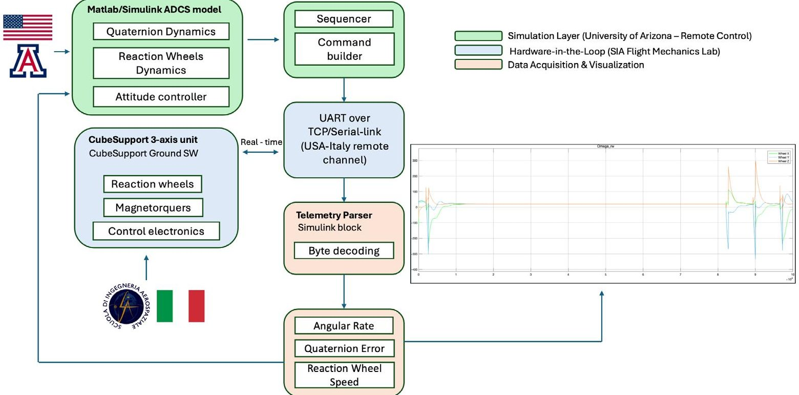
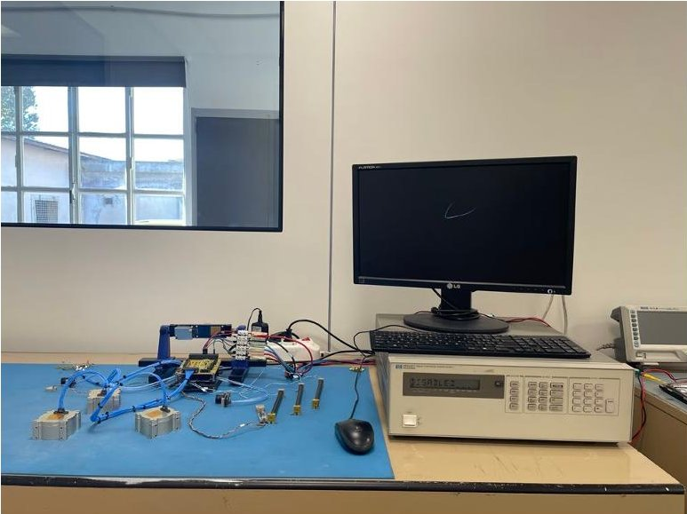

<!-- PDF_PAGE: 1 -->

# Mission Design and Enabling Technologies for a LEO-to-MEO Dual-Phase CubeSat Mission: The BOREALIS Platform

Lorenzo Nardi $ ^{1,2,a,*} $ , Fabio Curti $ ^{2} $ , Stefano Carletta $ ^{1} $ , Parsa Abbasrezaee $ ^{1} $ Lorenzo Thomas Contessa $ ^{1} $ , A. Di Serafino $ ^{1} $ , Vahid Omrani $ ^{1} $ , Domenico Caputo $ ^{3} $ Giovanni Palmerini $ ^{1} $ , Nicola Lovecchio $ ^{3} $ , Sahithi Sriramoju $ ^{1} $ VS Siva Sankaram Emani $ ^{1} $ , Nunzio Burgio $ ^{3} $ , Giulia Petrucci $ ^{3} $ , Riccardo Mazzotti $ ^{1} $ Mara Mirasoli $ ^{4} $ , Fabio Lorenzini $ ^{5} $ , Matteo Merge $ ^{6} $ , and Augusto Nascetti $ ^{1} $

$ ^{1} $School of Aerospace Engineering, Sapienza University of Rome, Via Salaria 851, I-00138 Rome, Italy

$ ^{2} $Department of Systems and Industrial Engineering,The University of Arizona,1127 E. James E. Rogers Way,Tucson AZ, USA

$ ^{3} $Department of Information Engineering, Electronics and Telecommunications, Sapienza University of Rome, Via Eudossiana 18, I-00184 Rome, Italy

$ ^{4} $Department of Chemistry "Giacomo Ciamician", Alma Mater Studiorum-University of Bologna, Via Piero Gobetti 85, I-40129 Bologna, Italy

$ ^{5} $Kayser Italy S.r.l., Via di Popogna 501, I-57128 Livorno, Italy

$ ^{6} $ASI, Italian Space Agency, Via del Politecnico, 00133 Rome, Italy

*lorenzo.nardi@uniroma1.it

Keywords: CubeSat, Orbit Transfer, Biofilm, Propulsion System, ADCS, Space Biology, LEO-to-MEO, Radiation Effects, Model-Based Design, Hardware-in-the-Loop

Abstract. BOREALIS - Biofilm Onboard Radiation Exposure Assessment Lab In Space is a 6U CubeSat mission developed under the Italian Space Agency's ALCOR program. It introduces a dual-phase orbital profile enabling biological experimentation in both Low Earth Orbit (LEO) and Medium Earth Orbit (MEO), making BOREALIS one of the first CubeSat missions to attempt a LEO-to-MEO orbital transfer. This paper focuses on the mission's engineering innovations that make this transfer feasible, particularly the propulsion subsystem based on a water-fueled pulsed plasma thruster and the Attitude Determination and Control System (ADCS), validated through numerical and Hardware-in-the-Loop (HIL) experiments. Conducted in collaboration between the School of Aerospace Engineering of Rome and the University of Arizona, the tests demonstrated that a commercial ADCS can maintain sub-degree pointing during long-duration thrust operations when integrated within a closed-loop Simulink environment.

## Introduction

BOREALIS (Biofilm Onboard Radiation Exposure Assessment Lab In Space) is a 6U CubeSat mission developed under the Italian Space Agency's ALCOR program through a consortium including the School of Aerospace Engineering (SIA) at Sapienza University of Rome, the Interdepartmental Centre for Industrial Aerospace Research (CIRI-Aerospace) of the University of Bologna, and Kayser Italia S.r.l. The mission pioneers a dual-phase orbital profile that enables biological experimentation in both Low Earth Orbit (LEO) and Medium Earth Orbit (MEO), representing one of the first CubeSats to attempt an autonomous orbit transfer between these regimes. The payload, a miniaturized lab-on-chip integrated with a fluorescence microscope, allows in-situ monitoring of microbial biofilms to study their survival, adaptation, and gene

<!-- PDF_PAGE: 2 -->

expression response to ionizing radiation, including the effects of a purpose-designed radiation shield.

The orbital architecture consists of an initial 650 km circular LEO phase dedicated to biological experiment activation and baseline environmental data collection, followed by a transfer to a 2050 km MEO orbit for exposure to an enhanced radiation environment. This profile enables comparative biological analysis across two distinct radiation regimes using a single payload, an uncommon capability within the CubeSat class. To achieve this ambitious goal, BOREALIS integrates two enabling technologies: a water-fed Pulsed Plasma Thruster (PPT) providing specific impulse around 4800 s and thrust of 37.5 mN, and a commercial Attitude Determination and Control System (ADCS) capable of maintaining sub-degree pointing during extended thrust operations.

The spacecraft design required a deep tradeoff between propulsion, power, and attitude control architectures. The adopted PPT allows incremental burns ranging from 600 to 3000 seconds, while the ADCS ensures stable boresight (i.e. thrust axis) stabilization and robust detumbling performance through quaternion-based feedback control and magnetorquer-assisted desaturation. The mission development followed a model-based systems engineering approach supported by MATLAB/Simulink simulations and GMAT trajectory analyses, incorporating higher order gravitational perturbations. This paper focuses on the engineering innovations behind the orbitraising maneuver, highlighting the integrated propulsion-ADCS design and the test campaign performed using the HIL testbed developed at the School of Aerospace Engineering, accessed remotely from the University of Arizona.

## Mission architecture and propulsion design

A model-based trade study was conducted to evaluate candidate propulsion architectures: coldgas, monopropellant, and electric systems [1]. The selected water-based PPT provides ~37.5 mN thrust, specific impulse of ~4800 s, and total $ \Delta\mathrm{v}\approx150\mathrm{m/s} $ , enabling the orbit transfer in several burns of increasing duration (from 600 s to 3000 s). Orbit propagation and thermal analyses were performed using GMAT and MATLAB, including gravitational perturbations and aerodynamic drag. Table 1 summarizes the propulsion options.

Table 1. BOREALIS propulsion options during trade-off analysis [2].

<table border="1"><tr><td>Type</td><td>Thrust</td><td>Specific impulse</td><td>Max cont. firing time</td></tr><tr><td>Monopropellant thruster</td><td>1000mN</td><td>215s</td><td>600s</td></tr><tr><td>Hall-effect thruster</td><td>5mN</td><td>1000s</td><td>900s</td></tr><tr><td>RF ion-thruster</td><td>0.4mN</td><td>2200s</td><td>2500s</td></tr></table>

## ADCS architecture and simulation model

The BOREALIS ADCS is based on the CubeSpace CubeADCS 3-Axis unit [3], integrating three orthogonal reaction wheels (maximum torque 3.0 mN $ \cdot $ m, inertia $ 1.3\times10^{-6} $ kg $ \cdot $ m $ ^{2} $ , and maximum speed 6000 rpm) and three magnetorquers with dipole moments up to 0.2 A $ \cdot $ m $ ^{2} $ . The sensor suite includes fine and coarse sun sensors, a Nadir sensor, double-redundancy three-axis magnetometers, and a MEMS gyroscope, providing attitude estimation accuracy down to $ 0.1^{\circ} $ . The ADCS can be accessed via UART interface. A HIL testbed, developed using Simulink and connected to the ADCS, was developed at the School of Aerospace Engineering and allows remote access from the University of Arizona for HIL testing. In this setup, Simulink runs on a host PC and it simulates the satellite attitude and orbital dynamics and commands the ADCS setup, that is monitored in real-time to provide a feedback on the actual torque produced over time, injected into

<!-- PDF_PAGE: 3 -->

the Simulink model to close the loop. In the experiments discussed in this paper, telemetry and command exchange were achieved via a TCP/IP bridge from the University of Arizona, allowing real-time supervision from the U.S. laboratory during SIA-led control experiments.The attitude kinematics follow the quaternion differential equation [4]:

$$
\mathrm {q} = 1 / 2 \Omega (\omega) \mathrm {q}
$$

where q is the spacecraft quaternion and $ \Omega (\omega) $ is the skew-symmetric angular rate matrix.

The control law is formulated using the quaternion error vector, which directly expresses the attitude error between the current spacecraft quaternion $ q_{s} $ and the target quaternion $ q_{t} $ . The quaternion error is defined as: [5]:

$$
q _ {\mathrm {e}} = q _ {\mathrm {t}} ^ {*} \otimes q _ {\mathrm {s}}
$$

where $ q_{t^{*}} $ is the conjugate of the target quaternion and $ \otimes $ denotes quaternion multiplication.

Let $ q_{e}=[ q_{e4} \quad q_{e1} \quad q_{e2} \quad q_{e3} ]^{T}=[ s \quad e^{T} ]^{T} $ where s= $ q_{e4} $ is the scalar part and e= $ [ q e1 q_{e2} q_{e3} ]^{T} $ is the vector part.

To ensure the shortest rotation path, the vector error is defined as:

$$
\hat {e} = \operatorname {s i g n} (s) e
$$

The quaternion-based PD control torque can then be written as:

$$
T _ {c x} = 2 K _ {p} q _ {e 1} q _ {e 4} + K _ {d} \omega_ {x}
$$

$$
T _ {c y} = 2 K _ {p} q _ {e 2} q _ {e 4} + K _ {d} \omega_ {y}
$$

$$
T _ {c z} = 2 K _ {p} q _ {e 3} q _ {e 4} + K _ {d} \omega_ {z}
$$

or, in compact vector form:

$$
\tau_ {c} = 2 K _ {p} \hat {e} - K _ {d} \omega
$$

with gain matrices $ \mathrm{K_{p}=0.12 I_{3\times 3}} $ and $ \mathrm{K_{d}=0.015 I_{3\times 3}} $ . These values were tuned accounting for $ \pm 15\% $ inertia uncertainty and disturbance torques below $ 2\times 10^{-6} \mathrm{N}\cdot \mathrm{m} $ . The controller ensures robust pointing during thrusting maneuvers and stable detumbling following deployment.

Reaction wheel dynamics are modeled as first-order systems with a time constant of $ \tau=0. 0 5 $ s consistent with analytical formulations in REF [6]:

$$
J _ {w} \dot {\omega} _ {w} = T _ {c} - T _ {f}
$$

where $ \mathrm{T_{f}} $ includes viscous and Coulomb friction terms. A continuous latent desaturation algorithm modulates the magnetic dipole mm to unload reaction wheel momentum via the cross-product interaction with the geomagnetic field [7]:

$$
m = k _ {d} \left(H _ {w} \times B\right)
$$

<!-- PDF_PAGE: 4 -->

where $ \mathrm{H_{w}} $ is the total wheel momentum and B the geomagnetic field vector. This approach follows the continuous momentum-dumping framework by Hogan and Schaub [8], enabling autonomous control without discrete unloading events.

The simulator uses ephemerides from GMAT, propagating position, velocity, and local field vectors along the orbit. Under nominal conditions, the model achieves $ < 1^{\circ} $ steady-state pointing error for detumbling, thrust-alignment modes, and maintains wheel momentum within $ \pm 5\% $ during simulated PPT burns. Figure 1 illustrates the integrated Simulink-hardware communication and feedback loop scheme.

Figure 1. Integrated Simulink-hardware communication and feedback loop. The ADCS simulator developed at the University of Arizona exchanges real-time telecommands and telemetry with the ADCS testbed hosted at SIA Flight Mechanics Laboratory.

## Hardware-in-the-loop experimental setup

The HIL campaign was performed collaboratively between the School of Aerospace Engineering (hardware site) and the University of Arizona (control and data processing). Using the remotely-controlled testbed discussed in a previous section the ADCS testbed located in Rome was commanded in real time from Tucson, ensuring data latency <100 ms via UART. Telemetry was parsed with a custom Simulink function compliant with the CubeSpace ICD, automatically updating wheel speed, torque, and magnetorquer current. Polling frequency was 2 Hz, and realtime command packets were generated every 0.5 s. The control loop managed mode transitions (enable, set-speed, poll, off) via a deterministic sequencer with time-indexed states. During thrustmode simulation (3000 s equivalent burn), the reaction wheels reached $ \sim 4 2 0 0 $ rpm while maintaining a pointing error below $ 2^{\circ} $ . The magnetic desaturation loop executed every 250 s without oscillations. The revised telemetry parser with time-based watchdog successfully forced rpm reset within 1 s of wheel stop.

<!-- PDF_PAGE: 5 -->

Figure 2. ADCS testbed and Host PC at SIA Flight Mechanics Lab connected to the control terminal at University of Arizona

## Results and discussion

Simulink and HIL results exhibited good consistency, with less than 5% deviation in angular velocity profiles and torque command tracking. Table 2 summarizes key performance metrics. The experiment validated the stability of the attitude control algorithm under long-duration torque commands representative of low-thrust maneuvers.

Table 2 - ADCS performance metrics for preliminary tests.

<table border="1"><tr><td>Parameter</td><td>Simulation</td><td>HIL Test</td><td>Requirement</td></tr><tr><td>Pointing Error [max]</td><td>1.1</td><td>1.8</td><td>&lt;2.0</td></tr><tr><td>Wheel Speed Max [rpm]</td><td>4300</td><td>4200</td><td>6000</td></tr><tr><td>Desaturation Period [s]</td><td>240</td><td>250</td><td>&lt;300</td></tr><tr><td>Telemetry Latency [s]</td><td>0.5</td><td>0.6</td><td>&lt;1.0</td></tr></table>

All parameters meet mission requirements with consistent margins between simulation and HIL results for the attitude control up to the burn moment (2000s into the simulation). Minor differences are due to hardware latency, sensor noise, and friction losses in the ADCS testbed unit. The pointing error refers to the maximum attitude deviation during thrust-pointing, and telemetry latency to the command-feedback delay. Overall, results confirm stable control and communication performance under representative LEO conditions. These findings confirm that a small-satellite-class ADCS can support orbit-raising maneuvers when tightly coupled with precise modeling and continuous ground verification. The combination of real-time telemetry, quaternion-based control, and remote HIL capability sets a precedent for distributed academic collaboration in spacecraft testing.

## Conclusions

The BOREALIS CubeSat demonstrates how advanced ADCS and propulsion subsystems can extend the scientific reach of small spacecraft to inter-orbital research. Through the joint effort between the School of Aerospace Engineering of Sapienza University of Rome and the University of Arizona, the HIL testbed for BOREALIS ADCS and orbit control system was modeled, integrated, and validated in a cross-continental HIL campaign. Results confirm sub-degree pointing performance during simulated thrust operations and efficient desaturation management.

<!-- PDF_PAGE: 6 -->

## References

[1] CubeSpace, CubeADCS Gen 2 — Product Description, CubeSpace Satellite Systems (Pty) Ltd., Stellenbosch, South Africa, 2023. Available at: https://www.cubespace.co.za.

[2] Nardi, L., Carletta, S., Abbasrezaee, P., Omrani, V., Caputo, D., Palmerini, G., Lovecchio, N., Mirasoli, M., Lorenzini, F., Merge, M., and Nascetti, A., "BOREALIS: A Dual-Phase LEO-MEO CubeSat for Space Biology and Radiation Shielding Experiments," International Astronautical Congress (IAC), IAC-24-A1.5.7, Milan, Italy, 2024. Available at: https://iafastro.directory/iac/paper/id/83842/summary/ (accessed Nov. 2025).

[3] Hogan, E. A., and Schaub, H., "Three-Axis Attitude Control Using Redundant Reaction Wheels with Continuous Momentum Dumping," Journal of Guidance, Control, and Dynamics, Vol. 38, No. 10, 2015, pp. 1865-1871. https://doi.org/10.2514/1.G000812 AIAA Journal

[4] Schaub, H., and Junkins, J. L., Analytical Mechanics of Space Systems, 2nd ed., AIAA Education Series, American Institute of Aeronautics and Astronautics, Reston, VA, 2009. https://doi.org/10.2514/4.867231 AIAA Journal+2.

[5] Crassidis, J. L., and Junkins, J. L., Optimal Estimation of Dynamic Systems, 2nd ed., Chapman and Hall/CRC, Boca Raton, FL, 2011. https://doi.org/10.1201/b11154 Taylor & Francis.

[6] Sidi, M. J., Spacecraft Dynamics and Control: A Practical Engineering Approach, Cambridge Aerospace Series 7, Cambridge University Press, Cambridge, U.K., 1997. https://doi.org/10.1017/CBO9780511815652 Cambridge University Press & Assessment.

[7] Steyn, W. H., "Comparison of Low-Earth-Orbit Satellite Attitude Controllers Submitted to Controllability Constraints," Journal of Guidance, Control, and Dynamics, Vol. 17, No. 4, 1994, pp. 795-804. https://doi.org/10.2514/3.21269 AIAA Journal+1.

[8] Hogan, E. A., and Schaub, H., "Continuous Momentum Management with Redundant Reaction Wheels," AIAA Guidance, Navigation, and Control Conference, 2015.