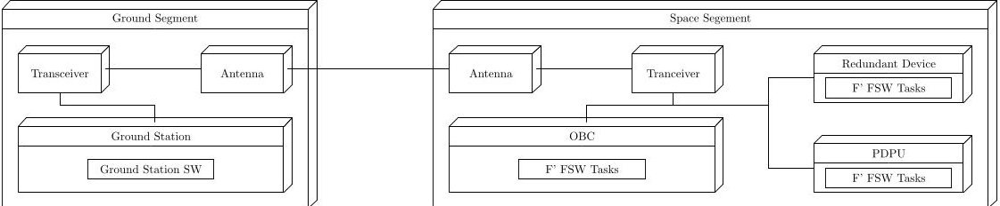
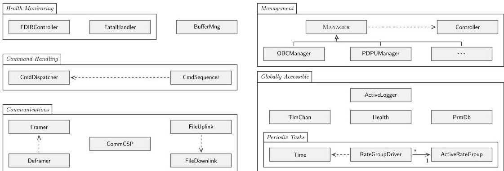
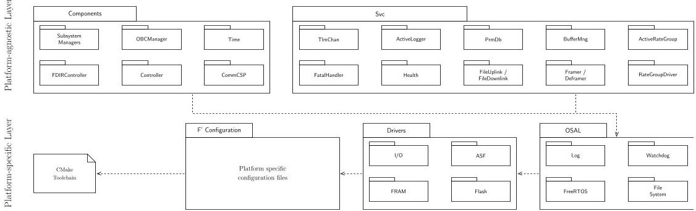
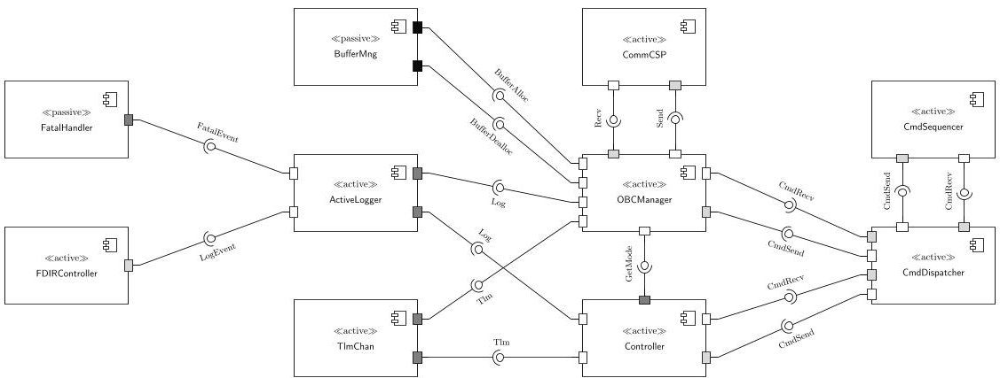
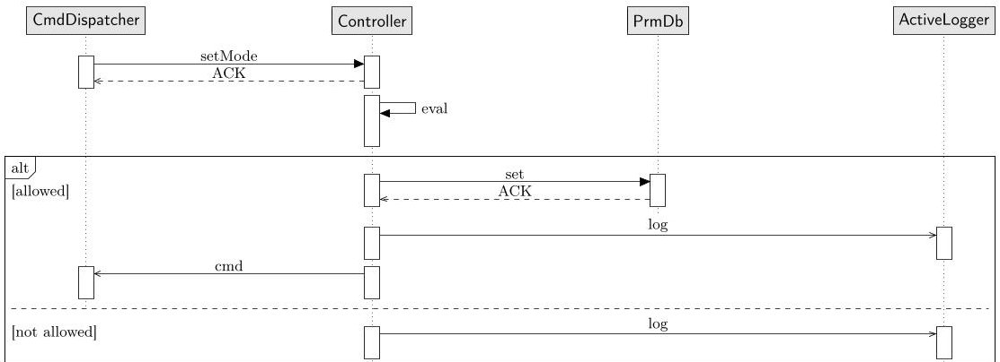
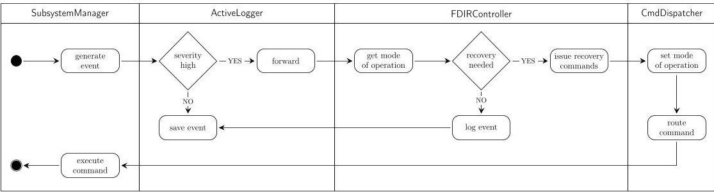

<!-- PDF_PAGE: 1 -->

# Nanosatellite Flight Software: A Rigorous Software Architecture Perspective

Christoforos Vasilakis, Alexandros Tsagkaropoulos, Angelos Motsios, Christos Tsigkanos and Dionysios Reisis

University of Athens, Greece

Abstract. Engineering of flight software architectures for nanosatellite missions presents significant challenges due to constrained on-board computational resources, stringent reliability requirements and complex mission-specific operational demands. Despite the advancements of the New Space era, designs and architectural documentation are seldomly available, largely due to intellectual property restrictions. To address this gap, this paper illustrates the flight software architecture for a nanosatellite mission as per the 4+1 view model. By deconstructing the on-board software system into its physical, logical, development, process and scenario views, we offer an in-depth analysis of the architectural decisions, trade-offs, and design rationales that guided development. The design presented extends beyond typical reliability and safety to emphasize deployability, integrability, modifiability, and testability design drivers. This experience report intends to advocate rigorous software architecture principles in software engineering for space software, by sharing insights and providing detailed architectural documentation with the overall goal of advancing a novel research agenda within the community.

Keywords: Flight Software · Architectural Views · Experience Report.

## 1 Introduction

The engineering of flight software (FSW) architectures for nanosatellite missions involves a constellation of complex challenges inherent to the domain of on-board space systems. Constraints imposed by limited on-board computational resources, the imperative for high reliability in the unforgiving space environment, and intricate operational demands of each mission require sophisticated and well thought-out architectural designs while software size and complexity are further typical constraints [6]. The body of knowledge spanning architecture, requirements, specification and implementation of software on spacecraft and their payloads [9] is vast and such engineering know-how has long been a core component of specialized teams within institutional space organizations. Recently, the emergence of low-cost, powerful on-board computers on contemporary small-scale flight- and space- craft [32], has led to wide availability of platforms and lowered the barrier to entry, often referred to as New Space [22]. However, designs and architectural documentation are often not available to

<!-- PDF_PAGE: 2 -->

the research community due to intellectual property restrictions that inhibit the dissemination of detailed design information across the aerospace industry.

We seek to address this gap by providing a comprehensive perspective of the FSW of the ERMIS3 mission from a software architecture lens and in particular through Kruchten's 4+1 architectural view model [19]. The ERMIS3 mission, a component of Greece's inaugural nanosatellite constellation, is designed to demonstrate high-throughput laser optical downlinking achieving data rates of up to 1 Gbps and hyperspectral imaging for Earth observation. By deconstructing the on-board software system into its Physical, Logical, Development, Process, and Scenario views, we report an in-depth analysis of our experience; namely the architectural decisions, trade-offs, and design rationale that inform the development process of the flight software architecture at hand.

Naturally, FSW engineering for a space mission is tied to (and begins with also due to the waterfall process typical in the domain) particular mission requirements. However, broad design goals do apply and guide the architecture development, reliability and safety being at the forefront due to the criticality of the space domain. As such, the design we present is crafted to satisfy certain design goals beyond mission requirements we select in particular deployability integrability, modifiability, and testability as design drivers. By leveraging the principle of modularity and sticking to standardized interfaces, the FSW facilitates efficient deployment and seamless integration with the various subsystems on-board (such as sensors, payloads, etc). We advocate loose coupling and high cohesion within the architecture to support straightforward code modifications, accommodating often evolving mission objectives with minimal impact on existing components. Comprehensive testability is achieved through embedded testing interfaces, utilization of automated build and simulation environments, and adherence to rigorous verification protocols, something typical in the aerospace domain. We work on top of F Prime (F') [2], a cutting-edge open-source framework developed by the Jet Propulsion Laboratory. Our choice is motivated by its notable real-world applications [3,18], and rigorous application of software engineering practices (e.g., components with typed port connections, and object-oriented design). Supplementary artifacts consist of further documentation of the software architecture as open-source assets.

In this paper, we seek to bring the attention of the community to space software, by presenting detailed architectural documentation. Specifically, our contributions are as follows:

- We advocate a rigorous approach for applying software architecture principles to the design of a nanosatellite software architecture;

- We report in-depth our experience including architectural decisions, tradeoffs, and rationale that informed the design;

- We present detailed architectural documentation of the software design, following Kruchten's 4+1 view model.

The rest of this paper is structured as follows. Section 2 outlines the design drivers for the FSW architecture. Section 3 describes the architectural design per the 4+1 view model, while Sec. 4 elaborates on design rationale and trade-offs

<!-- PDF_PAGE: 3 -->

including in particular a reflection on the design drivers informing the architecture. Related work is considered in Sec. 5, and Sec. 6 concludes the paper along with an outlook to a research agenda.

## 2 Flight Software Design Drivers

Naturally, numerous software requirements are identified as part of any space mission, in typically extensive requirements processes involving high stakeholder engagement. In the following, we maintain a birds-eye view excluding mission particularities and distill design goals that drive the architectural design. Those comprise essentially quality attributes, functionality and constraints, and were identified with the following methodological steps:

1. Key quality attributes were identified through consultations with mission partners, hardware-providers and stakeholders.

2. An iterative feedback loop was used to refine these to design drivers, ensuring alignment with institutional oversight and mission partners.

3. The 4+1 View Model was selected for representation due to its clarity and effectiveness in supporting both technical validation and team on-boarding.

4. The flight software system was deconstructed and mapped to the views to clearly represent structure and behavior, and used for validating the design.

The methodological steps above yielded design drivers (as architectural goals), selected to the stringent and particular operational demands of our working context the FSW must not only function correctly but also adapt to evolving mission parameters and potential anomalies.

(D1) Deployability. The FSW design shall be deployable in terms of appropriate allocation of the software to on-board compute elements, as the runtime execution environments that support integration with various subsystems.

(D2) Integrability. The FSW design shall ensure that its software elements can interact and function together in a cohesive manner.

(D3) Modifiability. The FSW design shall support modifiability in order to support software changes with minimal risk, in order to accommodate updates or addition of new functionality.

(D4) Testability. The FSW design shall support testability in order to ensure that functions behave as expected and meet the appropriate space mission reliability and safety requirements.

Observe that each driver addresses a specific concern. Deployability (D1) ensures efficient allocation across heterogeneous on-board computing resources, vital for resource-constrained environments and redundancy demands (aligning with flexibility in ISO/IEC 25010). Integrability (D2) aims for seamless interaction between software elements, minimizing interface errors that can propagate system-wide failures (interoperability per 25010). Modifiability (D3) addresses the need for in-flight updates and feature enhancements, crucial for extending mission lifecycles or responding to unforeseen circumstances, while minimizing regression risks. Testability (D4) is naturally paramount for validating adherence to reliability and safety of a specific class of mission [10].

<!-- PDF_PAGE: 4 -->

## 3 Architectural Views as per 4+1

In the following, we elaborate on the architecture using the 4+1 architectural view model [19]. Our selection of 4+1 stems from its long-recognized ability to comprehensively address the multifaceted nature of complex software systems. This structure supports thorough analysis and promotes clear communication across interdisciplinary teams, which are typical in scientific missions. Additionally, it aids on-boarding by presenting the system in accessible, role-specific views. Although the model's merits have been long-recognized in the community, we note the absence of a comprehensive FSW architectural design in the public domain. For elaborating a FSW architecture, we believe that it is highly appropriate in its provision of multiple perspectives. In our case, perspectives are tailored to specific concerns (from on-board compute elements, to development, to fault management techniques), ensuring that the architecture is understood and validated from various angles. Accordingly, we detail the architecture according to the following views:

1. Physical: Representing the system engineer's perspective, this view describes the on-board hardware topology and the various execution environments of the FSW.

2. Logical: Representing the end-user perspective, this view describes the organization of on-board software components and their functionalities.

3. Development: From the programmer's perspective, this view concerns the arrangement of modules in a topology as well as the development workflow.

4. Process: From the integrator's perspective, this view illustrates task interactions and execution flows within the FSW system.

The Scenario View serves as the " +1 " component, integrating the four primary views through a series of scenarios that demonstrate key system functionalities to illustrate such a scenario, we select particularly a fragment of the fault detection and isolation mechanism [16] often deemed cross-cutting as it involves activations of different parts of the software architecture. We adopt UML2 diagrams to illustrate the 4+1 views [24].

## 3.1 Physical View

The Physical View illustrated in Fig.1 consists of two primary components: the ground segment and the space segment, reflecting the typical perspective of space system engineers. Communication between the ground station and the nanosatellite is facilitated by each segment's transceivers, which ensure data exchange through the ground and satellite antennas, establishing a communication link between the segments during 5-minute windows that occur every 12 hours.

In the ground segment, the primary interface for operators comprises the ground software $ ^{1} $ . Its core functions include monitoring the satellite's health by collecting telemetry beacon data and issuing operational commands controlling

<!-- PDF_PAGE: 5 -->

Fig.1. Deployment diagram illustrating the hardware aspects of the system and software modules running on each hardware component.

the spacecraft. Within the space segment, onboard communication between subsystems takes place over a shared Controller Area Network (CAN) bus. The mission's FSW operates on two processing units: the On-Board Computer (OBC), specifically the GOMspace Nanomind A3200, which utilizes an Atmel AVR32 microcontroller unit (MCU), and the Payload Data Processing Unit (PDPU), the Nanomind HP MK3, which integrates a Xilinx Zynq 7000 system-on-chip.

The FSW deployed on these processing units is responsible for executing mission specific tasks, including system configuration, command execution, event logging, telemetry management, health monitoring, and task scheduling. Due to the limited duration of the communication windows with the ground station, the software is designed for autonomous operation, transmitting collected data only on request when the satellite is within range of the ground station's antennas. Additionally, the PDPU handles the compression of data acquired from the mission's on-board hyperspectral camera and transmits the processed output to a high-speed laser communication system.

Observe that in the design presented, both the OBC and the PDPU function in a multi-master configuration, where the OBC serves as the primary system controller. While the OBC is the primary execution context of the FSW as is typical in missions, we highlight an important deployment aspect of the developed architecture: All FSW components are also deployed on the PDPU to ensure continued operation in the event of an OBC failure, demonstrating the system's deployability and fault tolerance. This redundancy is illustrated in Fig.1, where the redundant device represents the OBC functionalities that the PDPU can assume, in addition to its nominal role in managing payload operations.

## 3.2 Logical View

The Logical View of the proposed FSW architecture focuses on realizing its functional requirements. We opted for the class diagram of Fig. 2 to describe the objects of the architecture and the static relationships that exist among them. It is divided into functionality areas [24] that encompass classes providing the same functionality.

The Communications area facilitates the communication with other satellite subsystems and the ground station uniformly (D2). The CubeSat Space Protocol (CSP) is a proven low-footprint and modular choice [20] that encapsulates networking information (D3). The CommCSP class encapsulates the networking functionality: it receives (or forwards) packets' content from the Framer class

<!-- PDF_PAGE: 6 -->

Fig.2. Class diagram representing the Logical View of the FSW architecture it categorizes classes based on their functional areas and explicitly illustrates significant relationships among them. Dashed arrows express dependency, solid arrows denote association and solid hollow arrows indicate generalization, following UML2 notation.

(or the Deframer class). The Framer class undertakes the encryption of the payload of the packet that results from the issuance of a command or file transfer. The Deframer decrypts the packet's payload and either routes commands to the CmdDispatcher class or forwards the file contents to the FileUplink class. The FileUplink class assembles parts to complete a file, while the FileDownlink class is responsible for fragmenting file contents into CSP packets.

Following the third (3rd) rule proposed by Hinchey [17], the BufferMng class manages memory statically to mitigate the unpredictability of dynamic allocation, something typical in critical flight software. The centralized memory management allows: (a) straightforward modification of memory allocation strategy without impacting other classes of the FSW (D3); (b) controlled testing scenarios and more robust verification of memory usage (D4).

The Command Handling area consists of two classes, the CmdDispatcher and the CmdSequencer. The CmdDispatcher handles the routing of issued commands to their destination and the return of their status to the source after completion. Moreover, it encapsulates how the class instances communicate with commands in the runtime environment using the mediator design pattern [11]. The CmdSequencer class complements the functionality of the CmdDispatcher class by supporting in-order execution and scheduling of command groups.

Certain classes provide functionality globally accessed by all components. The Periodic Tasks sub-area consists of three classes: Time, RateGroupDriver and ActiveRateGroup. The Time class shares the system's time with other classes and can synchronize the system's time to that of the ground station. The time can be retrieved from either GPS, FRAM RTC or the MCU's system clock. The RateGroupDriver handles periodic signaling of the ActiveRateGroup by sourcing its timing information from the Time class. When the ActiveRateGroup gets signaled, it will perform sequentially the actions with which it has been configured. Although the RateGroupDriver is a singleton [11] class, the ActiveRateGroup supports multiple instances. The PrmDB class utilizes non-volatile memory storage to persist configuration parameters, while the TlmChan class is responsible for

<!-- PDF_PAGE: 7 -->

storing telemetry in non-volatile memory (ROM) in a serialized form suitable for downlink to ground. The ActiveLogger class stores the generated events from the FSW components in a non-volatile memory (ROM/FRAM); using configurable filtering functionality (D3), it forwards filtered events to FDIRController and fatal ones to FatalHandler. The Health class implements a software watchdog timer tailored for FSW components, effectively realizing the Ping/Echo architectural tactic described in [1]. If a periodic ping sent from the Health class is not returned in a timely manner, a fatal event will be raised. Note that both telemetry and events are optionally and periodically downlinked.

The Health Monitoring area comprises classes that handle and respond to events from the ActiveLogger class. The FDIRController class reacts to filtered events with pre-configured and tested procedures. It enables early mitigation of predefined high-risk events to ensure quick system response and prevent mission failure. The FatalHandler class manages fatal events and reboots the system after a configurable amount of time if one is received. Section 4 elaborates on the reasoning behind these two classes that handle events.

Spacecraft operation typically involves several so-called modes, which encompass the various planned phases of the mission. Each mode has specific objectives and operational requirements, and the nominal mode is the standard state with all systems functional. When significant anomalies occur, the spacecraft may autonomously enter safe mode, a minimal configuration focused on survival. Critical mode signifies a severe failure demanding immediate action to prevent mission loss. The Satellite's Management area includes the subsystem's managers and the operational mode management. The Manager abstract class provides the basic common interface, used by concrete manager classes to realize their own. Each satellite subsystem OBC, Attitude Determination and Control System (ADCS), Electrical Power System (EPS), etc. is assigned a dedicated manager. The basic common interface includes: (a) tracking the subsystem's state, (b) managing peripherals, and (c) validating the operational mode to execute the corresponding command that was received. The Controller class encapsulates the spacecraft modes and the transitions between them through a hierarchical structure of Finite State Machines (FSMs). A top-level FSM manages the mode of operation (e.g., nominal, safe, critical), while each is further decomposed into substates, implemented as nested sub-FSMs, to capture more granular system behavior. The class also provides entry, exit and guard functions at each mode and an interface to change the mode from ground or other FSW component.

## 3.3 Development View

The development process includes two phases: the initial project setup and the component-based decomposition. The setup phase establishes foundational elements including compilers, build systems, hardware drivers, and the Operating System Abstraction Layer (OSAL). Subsequently, the development process decomposes the system into modular components. The design of these components targets their generic functionality and their reusability. We opted to present the Development View using two UML diagrams: (i) a package diagram (Fig. 3) illustrating the fundamental building blocks, and (ii) a component diagram (Fig. 4)

<!-- PDF_PAGE: 8 -->

detailing the interconnection of the framework components. These are known as Service Components (Svc) and mission-specific Components and are designed to meet the functionality specifications of the OBC FSW. To maximize reuse of flight-proven code we leverage F' facilities as much as possible [2].

Fig. 3. Package diagram illustrating the platform-specific layer (top) and platformagnostic layer (bottom). Arrows denote dependency, following the UML2 notation.

Platform Porting: Porting is essential and requires adaptation of the component-based workflow, involving cross-compilation of the framework in the AVR32 toolchain $ ^{2} $ . Platform-specific constraints and capabilities such as the number of buffers, their size and the maximum number of concurrent commands, are specified in the F' Configuration. The F' platform layer also includes Drivers needed for the hardware of the A3200 board like the NOR Flash, FRAM and I/O interfaces, while the platform specific development concludes with the OSAL, which consists of the RTOS, the File System, Watchdogs and Log format of the system $ ^{3} $ . After configuring the platform-specific layer, later component development is hardware-agnostic, enabling the same FSW codebase to be deployed across different platforms (D1); observe that components such as Health and FatalHandler are connected to hardware and the OSAL of the architecture, pointing to additional platform-specific adaptation. Figure 3 distinguishes the upper layer as platform-specific and the lower layer as platform-agnostic.

Component architecture: For an effective modular system, the FSW design relies on building blocks termed components, which encapsulate discrete portions of the system's functionality. This component-based architectural principle enhances testability significantly by enabling independent unit testing and integration testing through scenario-based evaluation, typically employed at final process stages in the domain (D4). We use F' ports to create communication channels between components; F' ports are base classes that represent welldefined interfaces (D2) and are categorized as either input (receiving data) or output (invoking an input port by sending data to it). Components and ports collectively form the core functionality of the FSW, enabling the system to execute its intended mission objectives, as illustrated in Fig. 4.

<!-- PDF_PAGE: 9 -->

Fig. 4. Fragment of a Component diagram of the FSW architecture. The ports are type-designated: (a) output ports in white; (b) asynchronous ports in light gray; (c) synchronous ports in dark; (d) guarded ports in black. The complete Component diagram is available in the anonymized accompanying material.

## 3.4 Process View

From the integrator's perspective, FSW components can be classified as either active or passive. Active components include their own execution thread and contain a queue to store incoming data prior to processing. In contrast, passive components operate within the context of the caller's thread. The communication ports between the components are categorized as either asynchronous or synchronous. Asynchronous ports enable non-blocking communication by operating independently on the thread of execution of their component. Conversely, synchronous ports function akin to traditional function calls, executing their functionality within the thread of the invoking component. A subtype of synchronous ports, known as guarded ports, ensures single-threaded access, thereby preventing race conditions among calling threads. The BufferMng component exemplifies the practical utility of guarded ports in ensuring thread-safe operations. This component is responsible for managing the system's limited pool of statically allocated buffers. To prevent race conditions during buffer transmission and reception which could otherwise compromise system stability the component exclusively utilizes guarded ports for synchronization and safe access control.As a result, active components may include both synchronous and asynchronous ports, whereas passive ones which do not correspond to a thread of their own, are limited to synchronous ports. Figure 4 illustrates the classification of ports within our architecture alongside the corresponding component types.

Figure 5 depicts a representative example of process communication; it illustrates the Process View of the mode change mechanism. In short, inherent functionality in Fig. 5 entails the following. The CmdDispatcher thread is responsible for forwarding mode change commands to the Controller component, which controls the satellite's operational mode. The CmdDispatcher thread places the command in the queue of the Controller component. As an active component, the Controller has a dedicated execution thread. Once the command is dequeued, the Controller thread first issues an acknowledgment of its reception. It then evaluates

<!-- PDF_PAGE: 10 -->

whether the requested transition is permissible. This evaluation step is crucial for ensuring system stability, preventing unsafe mode transitions, thus maintaining operational constraints. The assessment considers factors such as the current subsystem states, ongoing mission tasks, and predefined mode transition rules

all of which are encapsulated within the Controller's logic. If the transition is evaluated as valid, the Controller thread enqueues the new mode data into the queue of the PrmDb component. As an active component, PrmDb processes the new mode data using its execution thread to update the parameter representing the current operational mode in FRAM storage; it then notifies the Controller thread of the result of the mode change. Subsequently, the Controller thread suspends execution until the ActiveLogger task completes logging the event in the ROM and FRAM. Since the input port of ActiveLogger is a synchronous port, it operates within the execution context of the calling thread in this case, the Controller thread. Upon a successful mode transition, any additional commands required for execution are forwarded to the CmdDispatcher thread, which routes them to the appropriate components as part of the new mode's entry function. Conversely, if the mode change request is evaluated as invalid, the Controller component logs an event and takes no further action.

Fig. 5. Sequence diagram presenting the Process View of the mode change mechanism. Filled arrows indicate asynchronous calls, unfilled arrows denote synchronous calls and alternative (alt) frame models conditional execution, following UML2 notation.

## 3.5 Scenario View

To complete the Kruchten's view model and showcase the combination of the primary 4 views, in the following paragraph we present the critical scenario of Fault Detection, Isolation, and Recovery (FDIR) [16]. The FDIR mechanism onboard a spacecraft is a critical autonomous system that identifies anomalies, pinpoints their source, and executes pre-programmed actions to restore nominal operations. It ensures mission survival by mitigating effects of hardware or software failures through rapid response and corrective measures, minimizing downtime and potential damage. As such, we select a fragment of FDIR, particularly because it involves different parts of the overall architecture.

The (use case) scenario in Fig. 6 demonstrates a high-level view on the system's autonomous fault management capability. The procedure begins when

<!-- PDF_PAGE: 11 -->

a subsystem manager (OBCManager, EPSManager, etc.) component raises an event. Such events are collected by the ActiveLogger component, which categorizes them based on severity. Lower-severity events (trace, debug, info) are logged for later inspection by ground operators, whereas higher-severity events (warning, error) are both logged and forwarded to the dedicated FDIRController component. The response of the FDIRController component depends on the satellite's mode of operation. As an example, if the satellite operates in image_capture mode and the EPS battery level falls below a critical threshold, the system will deactivate the hyperspectral camera unit. In the other case, if the same battery event occurs in compression mode, the PDPU unit will be deactivated (instead of the hyperspectral camera). To determine the appropriate action, the FDIRController component queries the Controller component for the current operational mode and sends the required command to the CmdDispatcher for routing to the relevant component. In the case of the previous example, the EPSManager component receives a command to cut the power of the activated payload. Additionally, if a change in the spacecraft's mode of operation is required, the corresponding command will be sent to the Controller to save the new mode. This autonomous monitoring and response process operates continuously at runtime, ensuring that the system detects and reacts to critical conditions.

Fig. 6. Activity diagram illustrating the FDIR use case scenario, following UML2.

## 4 Discussion & Lessons Learned

The FSW architecture presented in this paper is the result of a series of deliberate design decisions and trade-offs aimed at satisfying the stringent requirements of the mission at hand. Our experience in designing this architecture has led us to several key observations and insights, which we detail below.

Among the primary design drivers was the need for deployability in order to ensure efficient allocation of software across the heterogeneous on-board compute hosts (OBC/PDPU) and meet the redundancy demands of the mission. Beyond the flight environment, deployability was also critical to the development workflow, particularly in supporting continuous integration (CI) processes, where build and testing (at unit, integration, and hardware-in-the-loop levels) are supported across various pipeline stages. Given that these activities occur on different hardware architectures, i.e., development on x86, testing on x86/AVR/hardware-in-the-loop, and deployment on AVR—deployability was deemed important to be seamless, despite the inherent complex technicalities.

<!-- PDF_PAGE: 12 -->

Integrability was another key focus, aiming to minimize interface errors that could propagate system-wide failures, as exemplified in the FDIR use case. This was achieved by limiting dependencies, promoting encapsulation, and defining narrow interfaces with ports serving as the sole communication channels between components. To dictate the execution flow, these components are categorized into active and passive types. This separation allows certain operations to progress concurrently, while others executed on the caller's thread of control lead to a finer-grained management and monitoring of the system's state. Additionally, the architecture emphasizes loose coupling and high cohesion, e.g., as exemplified by the CmdDispatcher; this component employs the mediator pattern to prevent others from sending direct commands to each other, thereby ensuring that command dispatching is mediated through a centralized entity. Finally, careful resource management was achieved through static allocation with the BufferMng serving as an intermediary entity enforcing, prioritization, safety, and fairness in memory—a critical and scarce resource.

Modifiability was also a crucial consideration, as in-flight updates and feature enhancements are often necessary to extend the mission lifecycle or respond to unforeseen circumstances. By adhering to loose coupling and high cohesion principles, we ensured that modifications could be implemented with minimal risk of regression. For instance, the Time class encapsulates the system's time source, allowing straightforward time source modifications. Additionally, the proposed architecture balances flexibility and efficiency in fault handling by incorporating both a FatalHandler and an FDIRController. While the FDIRController is an active component requiring a thread context switch and incurring greater overhead; the FatalHandler is passive and executes on the caller's thread with minimal delay. More broadly, the modularity of the proposed architecture enhances modifiability by enabling component updates and replacements with minimal effort, thereby streamlining both development and maintenance.

Finally, testability was paramount, as it is essential for validating adherence to the stringent reliability and safety standards of space missions. This was achieved by incorporating dedicated testing interfaces, leveraging F' primitives and workflows to facilitate structured validation, and utilizing automated simulation environments alongside continuous integration to streamline testing across different stages of development. Additionally, rigorous verification protocols inspired by common practice [10] were followed to ensure the system meets its requirements, further enhancing reliability and robustness.

The trade-offs of the proposed design reflect the balance between the four competing requirements and the constraints of development time and resources. These time limitations are inherent in the overall endeavor given a relatively short mission timeline of a few months from the project's start to launch typical in New Space nanosatellite missions [4,25]. Our design rationale was guided by a combination of mission requirements, industry best practices, and lessons learned from hitherto space software development efforts. These lessons include:

- Although meeting the mission's redundancy demands introduced a level of managerial and technical complexity that was initially underestimated, the

<!-- PDF_PAGE: 13 -->

adoption of standardized interfaces and modularity as principles were essential for realization.

- The interdisciplinary nature of the mission requiring collaboration among different fields (e.g., physics, computer science, aerospace engineering) highlighted the need for architecture and process phases capable of accommodating diverse domain-specific concerns and various approaches to solutions. The architecture's inherent modifiability was instrumental in supporting this adaptability, especially given the mission's accelerated development timeline.

- Due to the mission-critical implications of fatal events, the software system was designed to preserve error state information promptly and initiate timely reboots to prevent further damage. This capability was made possible through the use of a dedicated passive component (FatalHandler), to enable error state preservation and system recovery with minimized overhead.

- The decision of following component-based design was also instrumental. While loose coupling introduces additional complexity in terms of intercomponent communication, it supports key non-functional requirements such as modifiability and integrability.

Similarly, although loose coupling supports integrability and modifiability, it can impact performance at runtime, e.g., due to increased function calls and higher memory usage which requires careful design and assessment.

However, we underline that the approach of following a rigorous architectural design through the 4+1 model provided a comprehensive and multifaceted representation of the system, supported stakeholder communication and enabled architecture understanding and validation from various angles.

## 5 Related Work

We advocated a FSW architecture and described our experience in its design; consequently, we classify related work into two major categories. First, we discuss software architectures in other spacecraft contexts, positioning our work within a major application area. Subsequently, we consider other, but architecturally relevant works from a wider software engineering perspective.

Forms of layered and component-based architectures are typical in FSW architectures, often largely comprising of the operating system abstraction, communication/interfaces, middleware, and functional software [5,7,31]. Often cited as key goals include availability, extensibility, flexibility, reusability and reliability [20,26]. The utilization of component-based architectures emerges as a prominent trend—lately including adoption of F'. Rosemurg et al. [28] detail the integration of the Interplanetary Overlay Network mission with F', demonstrating its adaptability and test-related component-level features. Rizvi et al. [27] further highlight the reusability and modularity of F' components through their deployment on the Lunar Flashlight and NEA Scout missions. Eshaq et al. [8] propose a ground-up FSW design emphasizing modularity and reusability through an app-based, service-oriented architecture with a command-line interface and

<!-- PDF_PAGE: 14 -->

script engine, an approach that aligns with the principle of abstraction as a cornerstone of robust FSW design. Latest endeavors have employed model-based engineering and adoption of UML (or variants, such as SysML) —see [15] for a notable approach. A taxonomy of architecture styles is outlined in [23] with respect to the CubETH satellite.

Advanced software engineering techniques have also seen use in spacecraft missions in the following, we highlight key ones that we deem architecturerelevant for our context. Wang et al. [29]'s decomposition of system requirements into distinct architectural layers, coupled with the implementation of heterogeneous backup modes, exemplifies a systematic approach to addressing complex mission objectives. Similarly, the LADEE mission FSW [13] highlights MBSE from requirements to automated code generation we highlight the emphasis on performance-related test drivers and formal verification techniques. Advanced requirements techniques such as goal modeling are developed in GOPRIME [21], a framework for monitoring a goal model (from individual requirements to satisfaction of higher-level goals) integrated within the FSW architecture with according executable instrumentation. Due to the modularity inherent in the architecture presented and use of F', integration of such reasoning could be a conceptual next step in our design and highly relevant to FDIR activities. Gonzalez et al. [12] apply software visualization techniques for FSW quality monitoring illustrated over the SUCHAI satellite series along with a FSW architecture based on the command design pattern, while also adopting fuzz testing [14]. Fuzz testing is also employed for automated vulnerability analysis in [30] with an empirical analysis over the FSW for ESTCube-1, OPS-Sat, and Flying Laptop, without over-reliance on extensive human expertise.

## 6 Conclusions and an Emerging Research Agenda

In this paper, we illustrated the FSW architecture for the ERMIS3 nanosatellite mission as per the 4+1 architectural view model. By deconstructing the on-board software system into its Physical, Logical, Development, Process and Scenario Views, we highlighted the architectural description and distilled architectural decisions, trade-offs, and design rationales that guided development. This experience report intends to advocate rigorous software architecture principles in software engineering for space software, by sharing insights and providing detailed architectural documentation with the overall goal of advancing a novel research agenda within the community. Thereupon, we identify key directions that comprise an emerging research agenda.

Firstly, development of a comprehensive reference software architecture as per ISO/IEC WD4 42010, similarly to those that have been proposed in similar contexts but for FSW is highly desirable; drawing inspiration from established architectures, this has potential to consolidate state-of-the-art research of the community in a common platform. For instance, the architecture presented implements fault tolerance at the architectural level to the scale required by the standards of the class of mission; considerations of other classes may dictate

<!-- PDF_PAGE: 15 -->

other mechanisms. Secondly, formal verification at the FSW architecture layer, with techniques such as model checking that can be embedded at the architectural (i.e., versus code) level can aim for guaranteeing correctness and reliability especially with respect to component interactions and interfacing (which yield runtime behaviors). Finally, we believe a careful assessment of which variation points in the architecture should be reconsidered in order to enable architectural technology transfers to other on-board space systems can provide a systematic way forward to architectural developments by the community.

Data Availability Statement: Further architectural documentation can be accessed at: software.aerospace.uoa.gr/ecsa25-ermis-arch.

Acknowledgements: Partially supported by HFRI Project 15706/RV4THINGS.

## References

1. Bass, L., Clements, P., Kazman, R.: Software Architecture in Practice, 3rd Edition. Carnegie Mellon University, Software Engineering Institute's Digital Library (2012)

2. Bocchino, R., Canham, T., Watney, G., Reder, L., Levison, J.: F': An open-source framework for small-scale flight software systems. 31st AIAA Space Conf. (2017)

3. Canham, T.: The mars ingenuity helicopter - a victory for open-source software. In: 2022 IEEE Aerospace Conference (AERO), pp. 01-11 (2022)

4. De, R., Abegaonkar, M.P., Basu, A.: Enabling Science With CubeSats—Trends and Prospects. IEEE Journal on Miniaturization for Air and Space Systems (2022)

5. de Souza, K., Bouslimani, Y., Ghribi, M.: Flight Software Development for a CubeSat Application. IEEE J. on Miniaturization for Air and Space Systems (2022)

6. Dvorak, D.: NASA Study on Flight Software Complexity. In: Infotech@Aerospace Conf. American Institute of Aeronautics and Astronautics (2009)

7. El Allam, A.K., Jallad, A.H.M., Awad, M., Takruri, M., Marpu, P.R.: A Highly Modular Software Framework for Reducing Software Development Time of Nanosatellites. IEEE Access 9 (2021)

8. Eshaq, M., Al-Midfa, I., Al-Shamsi, Z., Atalla, S., Al-Mansoori, S., Al-Ahmad, H.: Flight Software Design and Implementation for a CubeSat. In: Advances in Science and Engineering Technology International Conferences (ASET) (2023)

9. European Cooperation for Space Standardization: ECSS-E-HB-40A: Software engineering handbook (5 December 2011)

10. European Cooperation for Space Standardization: ECSS-E-ST-40C: Space Engineering - Software (6 March 2009)

11. Gamma, E. (ed.): Design Patterns: Elements of Reusable Object-Oriented Software. Addison-Wesley, Boston, Mass. Munich (2011)

12. Gonzalez, C.E., Rojas, C.J., Bergel, A., Diaz, M.A.: An Architecture-Tracking Approach to Evaluate a Modular and Extensible Flight Software for CubeSat Nanosatellites. IEEE Access 7, 126409-126429 (2019)

13. Gundy-Burlet, K.: Validation and Verification of LADEE Models and Software. In: 51st Aerospace Sciences. American Inst. of Aeronautics and Astronautics (2013)

14. Gutierrez, T., Bergel, A., Gonzalez, C.E., Rojas, C.J., Diaz, M.A.: Systematic fuzz testing techniques on a nanosatellite flight software for agile mission development. IEEE Access 9, 114008-114021 (2021)

15. Halvorson, M., Dale Thomas, L.: Architecture Framework Standardization for Satellite Software Generation Using MBSE and F'. In: IEEE Aerospace (2022)

<!-- PDF_PAGE: 16 -->

16. Hanmer, R.: Patterns for Fault Tolerant Software. Wiley Publishing (2007)

17. Hinchey, M.: The Power of Ten—Rules for Developing Safety Critical Code. In: Software Technology: 10 Years of Innovation in IEEE Computer. IEEE (2018)

18. Kolhof, M., Rawson, W., Yanakieva, R., Loomis, A., Lightsey, E.G., Peet, S.: Lessons learned from the gt-1 1u cubesat mission. In: 35nd AIAA/USU Conference on Small Satellites (2021)

19. Kruchten, P.: The 4+1 View Model of architecture. IEEE Software 12(6) (1995)

20. Latachi, I., Rachidi, T., Karim, M., Hanafi, A.: Reusable and Reliable Flight- Control Software for a Fail-Safe and Cost-Efficient Cubesat Mission: Design and Implementation. Aerospace 7(10), 146 (2020)

21. Li, J., Tsigkanos, C., Li, N., Tei, K.: Instrumenting Runtime Goal Monitoring for F' Flight Software. In: 2024 IEEE 48th Annual Computers, Software, and Applications Conference (COMPSAC), pp. 1300-1309 (2024)

22. Martin, G.: Newspace: The emerging commercial space industry (2017). NASA Ames Research Center

23. Mavridou, A., Stachtiari, E., Bliudze, S., Ivanov, A., Katsaros, P., Sifakis, J.: Architecture-Based Design: A Satellite On-Board Software Case Study. In: Formal Aspects of Component Software, pp. 260-279 (2017)

24. Muchandi, V.: Applying 4+1 View Architecture with UML 2. Technical, FCG Software Services (FCGSS) (2007)

25. Osman, D.A.M., Mohamed, S.W.A.: Hardware and software design of Onboard Computer of ISRASAT1 CubeSat. In: 2017 Intl. Conf. on Communication, Control, Computing and Electronics Engineering, pp. 1-4 (2017)

26. Quiros-Jimenez, O.D., d'Hemecourt, D.: Development of a flight software framework for student CubeSat missions. Revista Tecnología en Marcha 32(8) (2019)

27. Rizvi, A., Ortega, K.F., He, Y.: Developing Lunar Flashlight and Near-Earth Asteroid Scout Flight Software Concurrently using Open-Source F Prime Flight Software Framework. In: Small Satellite Conference (2022)

28. Rosemurgy, P., Gao, J., DeBaun, S., Starch, M., Levison, J., Castano, R.: Enabling DTN in Spaceflight Systems: Integration of ION with the F Prime Flight Software Framework. In: 2024 IEEE Aerospace Conference, pp. 1-8 (2024)

29. Wang, W., Tian, H., Lei, Y., Li, X., Fan, D., Jiang, Y., Zhang, Q., Li, Y.: Software System Design and Implementation of Remote Sensing SAR Satellite. In: IEEE 11th Joint Intl. Information Technology and Artificial Intelligence Conf. (2023)

30. Willbold, J., Schloegel, M., Göhler, F., Scharnowski, T., Bars, N., Wörner, S., Schiller, N., Holz, T.: Scaling Software Security Analysis to Satellites: Automated Fuzz Testing and Its Unique Challenges. In: 2024 IEEE Aerospace Conference

31. Yao, Y., Chang, L., Yu, X., Zhang, H.: Application-Oriented On-Board Software Management System for Micro-Nano Satellite. In: IEEE International Geoscience and Remote Sensing Symposium (2024)

32. Yost, B., Weston, S., Benavides, G., Krage, F., Hines, J., Mauro, S., Etchey, S., O'Neill, K., Braun, B.: State-of-the-art small spacecraft technology. Tech. rep., Small Spacecraft Systems Virtual Institute, Ames Research Center, 2021 (2021)