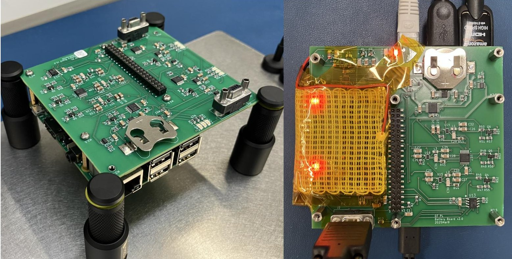
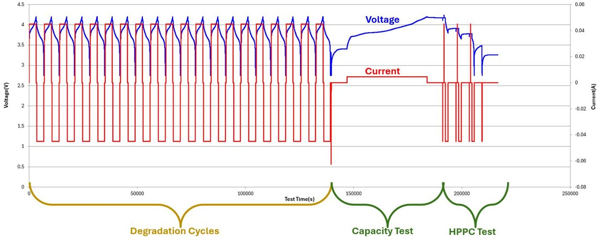
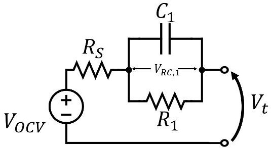
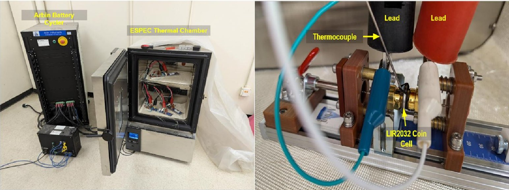
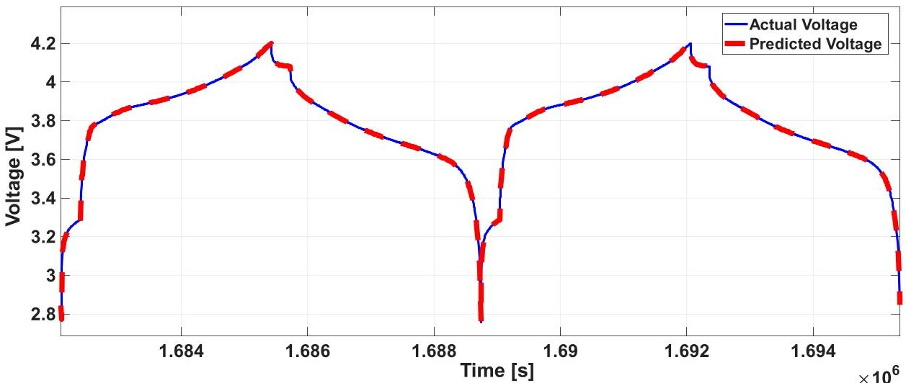
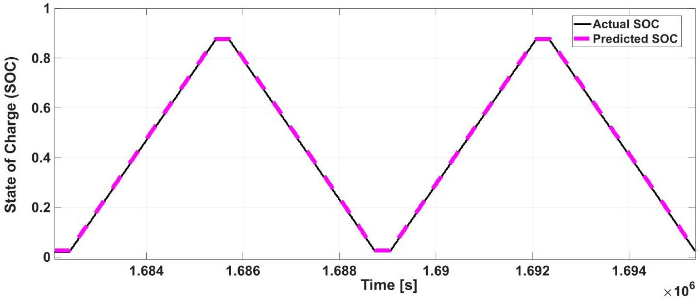
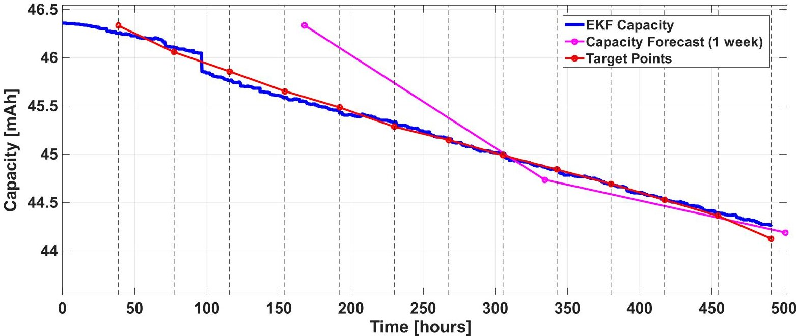

<!-- PDF_PAGE: 1 -->

# On-Orbit Digital Twin for Spacecraft Battery State and Health Estimation

Ayush Patnaik $ ^{*} $ , Jackson Fogelquist $ ^{\dagger} $ , Adam Zufall $ ^{\ddagger} $ , Stephen K. Robinson $ ^{\S} $ and Xinfan Lin $ ^{\#} $ University of California, Davis, California - 95616

Lithium-ion batteries are mission critical for nearly every modern spacecraft, yet their on-orbit management remains dominated by conservative, heuristic flight rules that sacrifice usable energy and operational flexibility to avoid degradation. This paper presents a lightweight battery digital-twin framework built around a dual extended Kalman filter (Dual-EKF) coupled with an equivalent-circuit model. A fast filter tracks state of charge (SOC) at every measurement sample, while a slow filter estimates capacity for real-time state-of-health (SOH) monitoring. On-board battery capacity forecasts are correlated with periodic reference performance tests (RPTs) and compared to the digital twin prediction. The framework is validated in the laboratory on EEMB LIR-2032 coin cells and currently on orbit aboard the Proteus Space Mercury One spacecraft, which carries a dedicated cycling payload with three Li-ion coin cells. Ground testing achieves voltage-prediction RMSE below 5 mV and capacity estimation within 2% of RPT-derived values; preliminary on-orbit results show consistent SOC convergence, capacity-fade trends in line with ground priors, and graceful behavior under telemetry dropouts. We also outline a short future-work direction: a Gaussian-process-based lithium plating detector that would add degradation-mechanism awareness to the digital twin, enabling operators to distinguish aging from damaging plating events.

## Nomenclature

BMS Battery Management System

CC Constant Current

COTS Commercial Off-the-Shelf

$ C_{n} $ Nominal battery capacity, mAh

DEKF Dual Extended Kalman Filter

DT Digital Twin

ECM Equivalent Circuit Model

EKF Extended Kalman Filter

GEO Geostationary Earth Orbit

GP Gaussian Process

HPPC Hybrid Pulse Power Characterization

ICA Incremental Capacity Analysis

LEO Low Earth Orbit

OCV Open-Circuit Voltage

$ R_{0} $ Ohmic (series) resistance, $ \Omega $

RPT Reference Performance Test

SOC State of Charge

SoC System on a Chip

SOH State of Health

$ V_{t} $ Terminal voltage, V

<!-- PDF_PAGE: 2 -->

## I. Introduction

LITHIUM-ion batteries are the dominant energy-storage technology for modern spacecraft, valued for their high specific energy, long cycle life, wide operating-voltage range, and low self-discharge rate [1,2]. On nearly every Earth-orbiting satellite, the battery is the sole source of electrical power during eclipse and the buffer that decouples instantaneous load demand from solar-array supply when sunlit. A satellite in low-Earth orbit (LEO) typically completes roughly 15 orbits per day, with each orbit comprising approximately 55-65 minutes of sunlight and 25-35 minutes of eclipse [3]. Over a multi-year mission, this rhythm accumulates tens of thousands of partial charge-discharge cycles, each one incrementally decreasing the battery's usable capacity.

Battery degradation, principally through capacity fade and ohmic resistance growth, directly limits mission duration, available energy margin, and operational flexibility. A comprehensive statistical analysis of 1,584 Earth-orbiting satellites operating between 1990 and 2008 found that battery-related anomalies account for a steadily growing share of satellite malfunctions over time, reaching approximately 14% of cumulative failures at 15 years of operation [3,4]. Beyond outright failure, battery aging carries a substantial operations cost: as the battery degrades, ground operators must progressively tighten flight rules, reduce permissible depth-of-discharge, and, in some cases, curtail science operations during eclipse to extend remaining life. The cumulative cost in lost science return, increased operator workload, and earlier-than-planned end of mission is significant for both small and flagship missions alike.

Despite the critical role of the battery, on-orbit battery management remains largely rule-based. Operators define static flight rules like fixed voltage cutoffs, depth-of-discharge limits, temperature gates below which charging is prohibited, and conservative charge-current profiles derived from pre-flight ground testing and generic manufacturer data [3,5]. Telemetry is downlinked, trended on the ground, and compared against these limits by operations personnel. This approach is robust and flight-proven, but it has several intrinsic limitations. First, the rules are set for worst-case cells and worst-case conditions, leaving a substantial energy margin untapped for nominal operations. Second, the rules do not evolve as the battery ages: a flight rule that was appropriate at the beginning of life may be either too conservative or insufficiently protective ten years into the mission. Third, ground-in-the-loop monitoring is fundamentally reactive, only responding to anomalous trends after telemetry has been downlinked, parsed, and reviewed by an analyst, which can take hours to days. For LEO missions with only a handful of short ground-station passes per day, this latency is operationally constraining. Fourth, conservative flight rules push power-management decisions toward the easy-to-execute end of the trade space (e.g., long heater duty cycles, reduced charge rates), forfeiting the energy and time savings that more adaptive strategies could provide.

If the real-time health of each cell were known with calibrated confidence, operators could dynamically adjust charge and discharge limits, schedule maintenance cycles more efficiently, and extend mission life potentially by years on long-duration missions. The technical challenge is that the most informative quantities (state of charge, capacity, internal resistance) cannot be measured directly; they must be estimated from voltage, current, and temperature telemetry using a model of the cell. A second technical challenge is that cells in flight are in near-constant use and the discharge current is set by external factors (i.e., mission operations), so observations across a range of state-of-charge and current levels cannot be manipulated for data collection.

The concept of a digital twin, a dynamic virtual model that mirrors the state of its physical counterpart through continuous sensor feedback, offers a systematic path toward adaptive, condition-based battery management [6,7]. Although the term originated with NASA's Apollo-era practice of maintaining ground-based replicas of flight hardware [8], modern digital twins are software constructs that fuse first-principles models with real-time sensor data, run state and parameter estimation, and project the system's future behavior. In this paper, "digital twin" is the on-board software that pairs an equivalent-circuit model of the Li-ion cell with a recursive dual-EKF based estimator that fuses voltage and current measurements to track internal states and slowly-varying parameters, and uses the resulting parameter trajectory to forecast future capacity. Periodic Reference Performance Tests (RPTs) are completed to obtain independent ground-truth measurements against which the on-board estimates and forecasts can be correlated and assessed. The framework is deliberately lightweight: the entire estimation and forecasting pipeline is designed to run on a small-satellite SoC using only commercial-off-the-shelf (COTS) sensors.

While all parts of the framework, namely the equivalent-circuit model and the Kalman-filter estimator, have been studied extensively in terrestrial settings, their integration into an autonomous, on-board, on-orbit system is covered in this work. We develop a Dual-EKF implementation tailored to the computation, memory, and telemetry constraints of small-satellite avionics, coupled to an on-board capacity-fade forecaster whose predictions are independently assessed against periodic RPTs. We characterize the framework end-to-end through a ground-testing campaign on representative coin cells, establishing accuracy baselines and tuning priors before flight. We then demonstrate the full pipeline on the Proteus Space Mercury One spacecraft, which carries a dedicated payload with three EEMB LIR-2032 Li-ion coin

<!-- PDF_PAGE: 3 -->

cells, and report preliminary on-orbit results that, to our knowledge, constitute the first flight demonstration of a closed estimation-and-forecasting battery digital twin running autonomously on a satellite. Finally, we sketch a forward-looking extension in which Gaussian-process-based differential analysis is used to detect lithium plating, a next-level diagnostic layer that we are currently validating in the laboratory and intend to integrate into a future mission.

## II. Background and Related Work

## A. Spacecraft Battery Monitoring Practices

Spacecraft battery management has historically rested on three pillars: flight rules, operational limits, and trending [2,5]. Flight rules are mission-specific operational constraints, written by the battery engineering team and approved during pre-flight reviews, which prescribe, for example, minimum cell temperature for charging, maximum charge current as a function of state of charge, and maximum allowable depth of discharge per orbit. Operational limits are hard envelopes on measured telemetry (voltage, temperature, current) that, if violated, trigger automated safing or operator intervention. Trending is the post-hoc analysis of downlinked telemetry against historical baselines to detect drift, divergence between cells, or anomalous behavior.

This rule-and-trend approach has flown successfully on countless missions and has clear advantages: it is simple, flight-heritage-rich, requires minimal on-board compute, and degrades gracefully under sensor failure. Its disadvantages are equally clear: it is conservative (set for worst-case cells), static (does not adapt to aging), and reactive (relies on ground analysis after the fact). Recent reviews of spacecraft battery health-management practice [3,5] note a growing recognition that more adaptive, model-based approaches are needed, particularly for longer-duration missions, large constellations where per-asset operator attention is impractical, or small satellites that have little battery margin.

The transition from rule-based to model-based battery management has progressed rapidly in terrestrial applications (e.g., electric vehicles, grid storage, consumer electronics), but adoption in space has lagged for several reasons: flight-software certification is expensive, on-board computing is limited, radiation-hardened processors are several generations behind commercial parts, and the consequences of an estimator failure on orbit can be catastrophic. Closing this gap requires demonstrating that lightweight, well-tuned model-based estimators can run reliably within the constraints of a real spacecraft.

## B. SOC and SOH Estimation Approaches

The two internal quantities of greatest operational interest in a battery cell are its state of charge (SOC) and its state of health (SOH). SOC describes the present energy content of the cell relative to its current usable capacity, while SOH describes how that usable capacity and the cell's ability to deliver power has changed relative to its beginning-of-life condition. Neither quantity can be measured directly with sensors; both must be inferred from voltage, current, and temperature telemetry through a model of the cell. SOC varies on the timescale of a single charge-discharge cycle (seconds to hours), whereas SOH evolves on the timescale of tens to hundreds of cycles (days to weeks); this separation of timescales motivates the dual-filter architecture adopted later in this work.

Whereas SOC has a single canonical definition, SOH is conventionally expressed through one or both of the underlying battery parameters that degrade with age: the cell capacity $ C_{n} $ , which decreases as active materials and cyclable lithium are lost, and the internal resistance $ R_{0} $ , which grows as the solid-electrolyte interphase thickens and impedances increase. Estimating SOH therefore reduces to tracking these slowly varying battery parameters online, which is precisely what the parameter filter in a dual-EKF architecture is designed to do. In this work we focus on capacity-based SOH, and the on-board parameter filter described in Section V estimates $ C_{n} $ at periodic intervals, with the resulting trajectory used both to correct the SOC estimate (since SOC depends on $ C_{n} $ through Coulomb counting) and to feed the on-board capacity-fade forecaster.

Estimation approaches for SOC and the underlying battery parameters divide broadly into three families: direct / empirical methods, model-based observers, and data-driven methods. The simplest SOC estimator is Coulomb counting, which integrates measured current over time [1]:

$$
\mathrm {S O C} (t) = \mathrm {S O C} (0) - \frac {1}{C _ {n}} \int_ {0} ^ {t} \eta I (\tau) d \tau ,
$$

where $ C_{n} $ is the capacity of the cell, $ \eta $ is the charging efficiency, and $ I ( t ) $ is the current over time. Coulomb counting is computationally simple but introduces error from open-loop drift due to current-sensor bias, changes in charging

<!-- PDF_PAGE: 4 -->

efficiency with SOC and temperature, unknown initial SOC, and uncertainty in $ C_{n} $ , which decreases with age. Opencircuit-voltage (OCV) lookup is a complementary direct method: when the cell has been at rest sufficiently long, the measured terminal voltage equals the OCV, which maps monotonically to SOC via a calibrated curve. OCV lookup is accurate but requires the cell to actually be at rest, which is rare for spacecraft in continuous operation.

Model-based methods use a dynamic model of the cell, either an equivalent-circuit model (ECM) or a physics-based electrochemical model, together with an observer (e.g., Kalman filter) that fuses the model prediction with voltage measurements to produce a corrected SOC estimate [9,10]. Equivalent-circuit models represent the cell as an OCV source in series with an ohmic resistance and one or more parallel RC pairs that capture polarization and short-time-constant diffusion dynamics; their parameters can be identified offline from pulse tests (HPPC) or online via recursive least squares. Physics-based models, most notably the Doyle-Fuller-Newman pseudo-two-dimensional (P2D) model and its single-particle reductions, resolve electrode-level concentration and potential fields and can capture mechanisms (e.g., lithium plating, SEI growth) that ECMs cannot, at the cost of substantially higher computational expense [11,12]. For on-board execution on a resource-constrained spacecraft processor, the ECM is the practical choice; we adopt a first-order Thévenin ECM in this work.

The Kalman-family observers, i.e., linear Kalman filter, extended Kalman filter (EKF), unscented Kalman filter (UKF), and their adaptive variants, have become the workhorses of model-based battery estimation. The seminal three-part series by Plett [1,9,13] established the ECM-EKF paradigm for lithium-ion polymer cells, covering the mathematical background, model derivation and parameter identification, and joint state and parameter estimation. Plett's "enhanced self-correcting" (ESC) model augments the basic ECM with hysteresis and instantaneous-voltage terms, and remains a widely cited reference for high-fidelity ECM-based estimation. Numerous extensions have since been developed. Sun et al. [14] introduced an adaptive UKF for SOC estimation with online noise covariance tuning. Comparative studies have benchmarked EKF against UKF, square-root variants, and cubature filters across drive cycles and chemistries [10,15]. Adaptive and robust filtering techniques, such as adaptive Kalman filters with online noise estimation, $ H_{\infty} $ filters, or particle filters, address robustness to model mismatch and unknown noise statistics [16].

## C. EKF and Dual-EKF for Joint State-Parameter Estimation

State estimation alone is insufficient for a digital twin: the model parameters themselves drift as the cell ages and an estimator that assumes fixed parameters will produce increasingly biased state estimates. The natural solution is joint state-parameter estimation, where slow-varying parameters (capacity, resistance) are tracked alongside the fast states (SOC, polarization voltage).

Two KF-based architectures are popular in practice. Joint EKF concatenates the state and parameter vectors into an augmented state space and runs one filter on the augmented model. This is conceptually simple but suffers from numerical conditioning issues when state and parameter time scales differ by orders of magnitude. Dual EKF (DEKF), formalized for general nonlinear systems by Wan and Nelson [17] and applied to batteries by Plett [13], runs two coupled filters at different time scales: a fast state filter and a slow parameter filter, each with its own covariance and update rate. DEKF avoids the conditioning issues of joint EKF and maps cleanly to the different time scales in battery aging.

DEKF and its variants have been extensively studied for terrestrial battery applications. Qiao et al. [18] introduced a bias-compensated recursive-least-squares DEKF that achieves SOC RMSE under 2.7% and SOH RMSE under 0.8% on dynamic stress test profiles. Duan et al. [19] developed a multi-timescale double Kalman filter that combines an EKF for parameters at the macro scale with an adaptive UKF for SOC at the micro scale, achieving SOC RMSE within 1%. Bizeray et al. [11] provided a critical analysis of DEKF reliability across SOH stages, highlighting the importance of appropriate process-noise tuning to avoid capacity-estimate drift under incorrect initialization. Recent work has integrated DEKF with data-driven components: hybrid LSTM-UKF architectures [20], Kolmogorov-Arnold network compensators [21], and Gaussian-process-based health forecasters [22].

Despite the maturity in laboratory and other settings, DEKF has rarely been deployed in space. The closest analogues in the spacecraft literature are CubeSat power-system digital twins validated against hardware-in-the-loop testbeds [23], ground-based digital-twin platforms for spacecraft battery degradation assessment [3], and digital-twin fault-diagnosis frameworks for GEO satellite power systems [24]. None of these report autonomous, on-board state and health estimation running on a satellite in flight.

## III. Flight Demonstration Overview (Mercury One Payload)

The digital-twin framework is demonstrated as a hosted payload aboard the Proteus Space Mercury One spacecraft, a small satellite operating in a sun-synchronous low-Earth orbit launched on 28 November 2026 on the Transporter 15

<!-- PDF_PAGE: 5 -->

mission onboard a SpaceX Falcon-9 rocket. The mission context imposes several operational constraints that drive the payload design. Telemetry bandwidth is limited and intermittent, with ground-station passes that are short and infrequent, making on-board logging and decimation essential. On-board computation is constrained: the payload processor operates within a tight power and thermal envelope typical of hosted satellite payloads, ruling out heavyweight algorithms and motivating the lightweight Dual-EKF formulation adopted in this work. Activation of the payload is shared with other spacecraft activities, so it must operate autonomously between brief operator commands and gracefully tolerate interruptions, dropouts, and resets.

## A. Payload Hardware

Fig.1 The Mercury One payload during development. The lower board is a COTS interface board for the CM4; the upper board is the custom PCB carrying the three EEMB LIR2032 coin cells, battery sensors, cycling components, and heater. Two cells are housed on the underside of the board, not visible. Although the third cell is not in direct physical contact with the heater, testing showed that the third cell maintains operational temperatures due to its proximity to the payload computer, which is functionally a second heater.

The cycling payload carries three EEMB LIR-2032 lithium-ion coin cells with graphite $ \| \mathrm{L i C o O_{2}} $ chemistry and a nominal capacity of 45 mAh, distributed across three independent channels on a custom printed circuit board (PCB). Each channel integrates its own Li-ion charge management controller, a resistor-and-voltage-regulator discharge circuit, per-cell voltage measurement through a dedicated ADC channel, current sensing through a precision shunt resistor, and a thermistor placed in close physical proximity to the cell. Programmable potentiometers provide closed-loop feedback control of both the charge and discharge currents. A Raspberry Pi Compute Module 4 (RPi CM4), nominally drawing 3 W, hosts the cycling firmware, the Dual-EKF estimator, and a serial interface to the spacecraft bus for command, telemetry, and data downlink; a 5 W resistive heater is used to maintain cell temperature within the operating envelope. Voltage, current, and temperature are sampled at 1 Hz during regular cycling and at 10 Hz during the pulse phase of reference performance tests, where higher temporal resolution is needed to resolve transient features such as the instantaneous voltage step at the onset of an HPPC pulse.

## B. Cycling Protocol and Thermal Limits

The payload follows a continuous 1C constant-current charge-discharge protocol. Each cycle consists of constant-current charging up to the upper cutoff voltage of 4.20 V, 5 minutes of rest, constant-current discharging at 1C down to the lower cutoff voltage of 2.75 V, and another 5-minute rest before the next cycle, as shown in Fig. 2. The operation is

<!-- PDF_PAGE: 6 -->

Fig. 2 Representative test sequence (1C at $ 2 5^{\circ} \mathrm{C} $ ) showing the complete protocol used for experiments. Degradation cycles consisting of repeated constant-current charge/discharge cycles (left), followed by a Reference Performance Test (RPT) consisting of a low-rate capacity test and Hybrid Pulse Power Characterization (HPPC) pulses (right). Blue = voltage (left axis); red = current (right axis).

subject to changes governed by a tiered set of temperature limits enforced in firmware. Hard safety limits on voltage, temperature, and current cannot be overridden by the estimation algorithm.

## C. Reference Performance Test (RPT)

A Reference Performance Test is executed once every 100 cycles (approximately weekly on-orbit) and provides an independent ground-truth measurement of cell health against which the on-board estimator and forecast can be compared. Each RPT consists of two phases. The first is a slow-rate capacity test in which the cell is discharged at C/10 and then charged at C/5 with 2-hour rests. The second is an HPPC pulse train consisting of 1C 10-second pulses (one discharge, one charge) with 10-minute rests between pulses, executed at 100%, 65%, and 30% SOC, and used to extract the ohmic resistance from the instantaneous voltage step and the polarization parameters from the subsequent relaxation [9]. The resulting capacity and resistance values are not fed back into the on-board filter as corrections; instead, they are downlinked alongside the raw RPT data record and used in offline analysis to assess the on-board estimates and forecasts and to track long-term degradation trends. A 100-cycle RPT cadence balances the value of frequent independent health checks against the operational disruption of running a low-rate cycle.

## IV. Battery Model for On-Board Estimation

Fig. 3 First-order Thévenin equivalent-circuit model of the lithium-ion cell used by the on-board estimator. The ideal voltage source $ V_{\mathrm{OCV}} $ represents the SOC-dependent open-circuit voltage, the series resistance $ R_{s} $ captures instantaneous ohmic losses, and the parallel $ R_{1}-C_{1} $ branch (with voltage $ V_{RC,1} $ across it) models the charge-transfer and short-time-constant diffusion polarization. The terminal voltage $ V_{t} $ is the measured cell voltage at the external terminals and serves as the measurement input to the Dual-EKF.

<!-- PDF_PAGE: 7 -->

We adopt a first-order Thévenin equivalent-circuit model as shown in Fig. 3, comprising an open-circuit voltage source $ V_{\mathrm{OCV}} $ (SOC) that represents the equilibrium cell potential, a series resistance $ R_{s} $ that captures instantaneous ohmic losses, and a single parallel RC pair $ (R_{1}, C_{1}) $ that represents short-term polarization dynamics such as diffusion. The terminal voltage is given by:

$$
V _ {t} = V _ {\mathrm {O C V}} (\mathrm {S O C}) - V _ {1} - R _ {s} I,
$$

where $ V_{1} $ is the polarization voltage across the RC pair. The state of charge evolves by Coulomb counting with respect to the (estimated) capacity $ C_{n} $

$$
\mathrm {S O C} _ {k + 1} = \mathrm {S O C} _ {k} - \frac {\Delta t}{C _ {n}} I _ {k},
$$

and the polarization voltage is propagated via an exact zero-order hold through the first-order linear RC dynamics,

$$
V _ {1, k + 1} = e ^ {- \Delta t / \tau_ {1}} V _ {1, k} + R _ {1} \left(1 - e ^ {- \Delta t / \tau_ {1}}\right) I _ {k},
$$

with $ \tau_{1}=R_{1} C_{1} $ . The sample period during regular cycling is $ \Delta t=1 $ s.

All three ECM parameters are treated as functions of both state of charge and current direction, reflecting the charge-discharge asymmetry observed in the EEMB coin cells. Independent lookup tables (one table for charging and one for discharging) for $ R_{s} $ (SOC), $ R_{1} $ (SOC), and $ C_{1} $ (SOC) are constructed offline from pulse-discharge characterization at $ 25^{\circ} \mathrm{C} $ , using methodology developed in [25]. At each step, the sign of the measured current selects the appropriate table, and the parameters are interpolated linearly at the current SOC estimate. This switching scheme is also applied to the open-circuit voltage curve: separate fifth-order polynomial fits, $ V_{\mathrm{OCV}}^{charge} $ (SOC) and $ V_{\mathrm{OCV}}^{discharge} $ (SOC), are constructed from the slow-rate (C/10) charge and discharge segments of the baseline RPT, and the corresponding curve is selected based on current direction. Carrying two OCV curves is a pragmatic, low-overhead way to accommodate the hysteresis between charging and discharging equilibrium voltages without introducing an explicit hysteresis state into the filter. The polynomial form is preferred over a tabulated OCV because it admits an analytic derivative, $ dV_{\mathrm{OCV}}/dSOC $ , that the EKF requires for its measurement Jacobian and that would otherwise have to be approximated by finite differences on a noisy lookup grid.

## V. Digital-Twin Functionality and Configuration

The digital twin is implemented as a Dual-EKF: a fast filter tracks the state vector $ x=[\mathrm{SOC}, V_{1}]^{\top} $ at every sample, using the first-order Thévenin ECM of Section IV as its process model and the measured terminal voltage as its measurement. A slow filter tracks the capacity $ C_{n} $ as a random walk, updated every 2100 seconds (35 minutes) to reflect the slow timescale of battery aging and to keep the parameter filter's compute cost bounded. The two filters are coupled: the state filter uses the latest capacity estimate when propagating SOC, and the parameter filter uses the latest state estimate and innovation when forming its measurement Jacobian. Both filters are initialized from pre-flight ground calibration, with covariances tuned on ground-test data. When booting after a payload reset, the state filter starts from the last saved state and parameter values; the covariance grows naturally to reflect the increased uncertainty, and as operations resume the innovation sequence rapidly re-anchors the estimate.

On top of the parameter filter's continuously updated capacity estimate, a simple linear fade-rate model, fit by least-squares regression over the recent capacity history, extrapolates the trajectory one week into the future. The forecasting layer is intentionally simple: a more sophisticated physics-informed degradation model could be substituted, but the linear model has proven adequate over the timescales spanned by the ground-test data as shown in Fig.6.

## VI. Ground Testing and Pre-Flight Validation

Pre-flight testing was performed on EEMB LIR2032 coin cells identical to the units integrated onto the Mercury One payload. Cells were cycled in an ESPEC temperature chamber using an Arbin cycler under the same protocols planned for orbit. The aging matrix spanned constant-current charge rates of 1C, 0.8C, 0.6C, 0.4C, and 0.2C across chamber temperatures from $ - 5^{\circ} \mathrm{C} $ to $ + 40^{\circ} \mathrm{C} $ , providing a wide envelope of operating conditions, with discharge following manufacturer limits. Reference Performance Tests (a C/10 capacity test plus HPPC pulses at multiple SOC levels) were executed at $ 25^{\circ} \mathrm{C} $ at baseline and periodically interspersed with the aging cycles, providing the ground-truth capacity trajectory against which the on-board estimator was benchmarked. Voltage, current, and chamber/cell-shell temperature were logged at 1 Hz during aging and at 10 Hz during RPTs.

<!-- PDF_PAGE: 8 -->

Fig. 4 Lab test setup. Left: Arbin battery cycler interfaced with the ESPEC thermal chamber housing the cells under test, enabling controlled-temperature aging across the full operating envelope. Right: Close-up of an EEMB LIR2032 coin cell mounted in a test fixture, with a thermocouple in direct contact with the cell shell for accurate temperature measurement.

Pre-flight characterization produced the parameter priors used by the on-board filter. Two open-circuit-voltage curves, $ V_{\mathrm{OCV}}^{charge} $ (SOC) and $ V_{\mathrm{OCV}}^{discharge} $ (SOC), were extracted from the slow-rate (C/10) charge and discharge segments of the baseline RPT and fit independently with fifth-order polynomials, preserving the small but non-negligible hysteresis between charge and discharge equilibrium voltages. Ohmic and polarization parameters were identified from the HPPC pulse data: $ R_{s} $ was extracted from the instantaneous voltage step at the onset of each pulse, and the RC pair $ (R_{1}, C_{1}) $ was fit to the subsequent voltage relaxation by nonlinear least squares [9]. Because the EEMB cells exhibit a marked asymmetry between charging and discharging dynamics, this identification was performed separately for the two current directions, yielding two independent SOC-indexed lookup tables for $ R_{s}, R_{1} $ , and $ C_{1} $ . The OCV polynomials and the lookup tables together constitute the static portion of the cell model, and the RPT-derived capacity at baseline serves as the initial value for the on-board parameter filter.

The Dual-EKF was then applied offline to the ground-test data to validate its performance before flight integration. The results of which are shown in Figs. 5.

The voltage prediction follows the measured terminal voltage closely across the full charge-discharge cycle, with a max RMSE of 5 mV and the largest residuals appearing near the cutoff voltages where the OCV slope is steepest. Under intentional SOC initialization offsets, the filter converges within the first charge cycle after re-initialization, demonstrating robustness to unknown initial conditions: a property that matters for power-on after telemetry gaps or safe-hold events on orbit. For operating conditions that do not induce lithium plating (to be discussed in details in the next section), the Dual-EKF's capacity estimate tracks the RPT-derived ground truth within 2% across the aging matrix, confirming that the parameter-filter tuning carried over from the laboratory dataset is appropriate for the cells and protocols. In conditions prone to plating, such as high-C-rate charging at low temperatures, the cells exhibit rapid, discontinuous capacity loss that outpaces the random-walk assumption of the parameter filter; the EKF still follows the trend but with a larger residual against the RPT reference.

Prior to integration with the host spacecraft, the payload was subjected to typical environmental testing. Vibration testing was conducted at the NASA Ames Research Center to mimic the loads seen during launch, ensuring the epoxy used to secure the batteries was sufficient and that no components would be damaged during launch. Thermal vacuum (TVAC) testing was performed in a weak vacuum (approximately 1 kPa) chamber with a cold case of $ 0^{\circ} \mathrm{C} $ and hot case of $ 40^{\circ} \mathrm{C} $ . The payload was operated continuously to determine the steady-state temperatures of the cells and payload computer under both conditions, as well as the efficacy of the battery heater. The final subsystem level test was a mission simulation consisting of 48 hours of continuous operations while communicating with a stand-in for the satellite computer. During mission sim, every payload function was exercised, including the ability to recover from both planned and unplanned resets. Following subsystem level testing, the payload was integrated onto the host spacecraft, where additional vibration and TVAC tests were performed. Although the system-level TVAC test was to lower pressures, the

<!-- PDF_PAGE: 9 -->

Fig. 5 Dual-EKF tracking performance on representative ground-test cycles. Top: Predicted terminal voltage (blue) compared against the measured cell voltage (red dashed) over a representative charge-discharge segment, spanning the full operating range from 2.7 V to 4.2 V. Bottom: Estimated state of charge (blue) compared against the Coulomb-counted reference computed using the constant nominal capacity (red dashed); small offsets near the SOC extrema reflect the EKF's ongoing correction for capacity fade.

payload was not active during the system-level test. Passing these tests provided certainty that the payload would behave properly on-orbit.

## VII. Future Vision: Lithium Plating Detection

The Dual-EKF digital twin tells operators how much capacity has been lost, but not why. A natural next step is to identify specific degradation mechanisms, namely lithium plating. Lithium plating is one of the most severe and safety-critical side reactions in Li-ion cells, particularly relevant for spacecraft batteries charged at low temperatures [26, 27]. When a cell is charged under plating-prone conditions, the anode potential is locally driven toward or below 0 V, causing the $ \mathrm{L i / L i^{+}} $ to favor metallic lithium deposition on the graphite surface rather than intercalation.

Recent operando studies have shown the onset of plating manifests during charging as an additional high-voltage feature in the differential capacity curve dQ/dV. The tell-tale sign of Lithium plating is a secondary peak typically between 4.0 to 4.1 V, distinct from the main intercalation peak complex and directly linked to the transition from intercalation to nucleation and growth of metallic lithium on the graphite surface [28, 29]. Crucially, the presence or absence of this feature does not follow a simple rate-temperature rule; it reflects the local electrochemical state at the anode and can appear even at room-temperature 1C charging while being absent at more "aggressive" conditions, making it a more faithful indicator of plating onset than operating-envelope heuristics alone. Detecting the dQ/dV peak using COTS sensors is, however, challenging because numerical differentiation of noisy voltage-current measurements amplifies sensor noise, masking the signature. Conventional smoothing, such as Savitzky-Golay, trades variance for bias, potentially shifting or attenuating the very feature of interest [30].

<!-- PDF_PAGE: 10 -->

Fig. 6 Dual-EKF capacity tracking and on-board forecast over the full ground-test aging campaign at $ 2 5^{\circ} \mathrm{C} $ . The solid blue trace shows the EKF capacity estimate, updated continuously throughout cycling. The red line marks the RPT-derived target capacity for each aging block, with red circles indicating the discrete RPT measurement points; vertical dashed lines delineate boundaries between aging segments. The magenta line shows the capacity forecast with a one-week horizon.

Our recent work [31] addresses this challenge with a Gaussian Process (GP) framework that directly models the charge-voltage relationship $ Q (V) $ as a stochastic process with calibrated uncertainty, leveraging the property that the derivative of a GP is itself a GP jointly distributed with the original process [32, 33]. Differentiating the kernel yields the cross-covariances needed to infer $ d Q / d V $ analytically and probabilistically from the posterior, avoiding finite differencing entirely and providing credible intervals around the inferred peaks. Experimental validation on the same EEMB LIR-2032 coin cells used in this work, spanning C-rates from 0.2C to 1C and temperatures from $ 0^{\circ} \mathrm{C} $ to $ 40^{\circ} \mathrm{C} $ demonstrated that the GP-based method reliably resolves a distinct secondary peak above 4.0 V under plating-prone conditions and correctly reports no feature in benign cases, with post-mortem optical microscopy providing independent physical confirmation. The GP-identified signature showed both sensitivity (catching plating onset at conditions such as 0.2C at $ 0^{\circ} \mathrm{C} $ where bulk capacity-fade metrics remained near non-plating levels) and specificity (correctly returning no feature for a 1C at $ 10^{\circ} \mathrm{C} $ case whose capacity fade was instead traced to electrolyte decomposition).

We envision this GP plating detector as a diagnostic overlay on the Dual-EKF digital twin. After each charge cycle, the GP would analyze the Q(V) trajectory and return a plating confidence score based on the presence and magnitude of a secondary peak above 4.0 V together with its credible interval. This score could trigger operational responses on-orbit: reducing the charge current, extending low-temperature rest periods, or alerting operators. Combined with the Dual-EKF's capacity tracking, the digital twin would then provide both state awareness (SOC, SOH) and mechanism awareness (plating vs. non-plating aging pathways), a significant step toward truly autonomous battery management in space. This extension is currently at the laboratory validation stage and is not yet implemented on the Mercury One payload; on-board deployment is planned for a future mission.

## VIII. Conclusions and Future Work

We have presented a lightweight battery digital-twin framework based on a Dual-EKF architecture coupled with a first-order Thévenin equivalent-circuit model and demonstrated it both on ground-test data representative of the Mercury One flight payload and as a hosted payload on the Proteus Space Mercury One spacecraft. The Dual-EKF tracks state of charge at every sample using a fast filter and capacity (the principal indicator of state of health) at a slower cadence using a parameter filter, with a simple linear fade-rate forecaster extrapolating the capacity trajectory one week into the future. Periodic Reference Performance Tests provide independent ground-truth measurements that are downlinked and used in offline analysis to assess the on-board estimates and forecasts, rather than fed back as corrections.

The preliminary results of this work are that a Dual-EKF estimator running on-board with COTS sensors can track

<!-- PDF_PAGE: 11 -->

SOC and SOH with accuracy adequate for operational decision support, within the resource budget of a small-satellite hosted payload. For non-plating operating conditions, the capacity estimate tracks RPT-derived ground truth within 2% across the full ground-test aging matrix, with voltage prediction RMSE below 5 mV based on ground testing data.

The digital-twin payload is designed for and integrated onto Mercury One. Flight data collection and analysis are ongoing; results will be reported in subsequent publications as the dataset matures. Future work will pursue the on-board implementation of the Gaussian-process-based lithium plating detector described in Section VII, targeting deployment in a future mission iteration to add mechanism-level diagnostic awareness alongside the existing state and health estimation.

## Acknowledgments

This material is based upon work supported by the Air Force Research Laboratory/AFWERX under Contract No FA864924P1117 (Proteus Space).

## References

[1] Plett, G. L., "Extended Kalman filtering for battery management systems of LiPB-based HEV battery packs: Part 1. Background," Journal of Power Sources, Vol. 134, No. 2, 2004, pp. 252-261. https://doi.org/https://doi.org/10.1016/j.jpowsour.2004.02.031 URL https://www.sciencedirect.com/science/article/pii/S0378775304003593.

[2] Ratnakumar, B., Smart, M., and Surampudi, S., "Effects of SEI on the kinetics of lithium intercalation," Journal of Power Sources, Vol. 97-98, 2001, pp. 137-139. https://doi.org/https://doi.org/10.1016/S0378-7753(01)00682-6. URL https://www.sciencedirect.com/science/article/pii/S0378775301006826. proceedings of the 10th International Meeting on Lithium Batteries.

[3] Sbarra, R. G., Pasquali, M., Coppotelli, G., Gaudenzi, P., di Ienno, D., Ciancarelli, C., and Picci, N., "Digital Twins for Space Battery Management Systems: A Comprehensive Review of Different Approaches for Predictive Maintenance and Monitoring," Energies, Vol. 18, No. 21, 2025. https://doi.org/10.3390/en18215858, URL https://www.mdpi.com/1996-1073/18/21/5858.

[4] Tafazoli, S., "A study of on-orbit spacecraft failures," Acta Astronautica - ACTA ASTRONAUT, Vol. 64, 2009, pp. 195-205. https://doi.org/10.1016/j.actaastro.2008.07.019.

[5] Bugga, R., Smart, M., Whitacre, J., and West, W., "Lithium Ion Batteries for Space Applications," 2007 IEEE Aerospace Conference, 2007, pp. 1-7. https://doi.org/10.1109/AERO.2007.352728.

[6] Grieves, M., and Vickers, J., Digital Twin: Mitigating Unpredictable, Undesirable Emergent Behavior in Complex Systems, Springer International Publishing, Cham, 2017, pp. 85-113. https://doi.org/10.1007/978-3-319-38756-7_4, URL https://doi.org/10.1007/978-3-319-38756-7_4.

[7] Tao, F., Zhang, H., Liu, A., and Nee, A., "Digital Twin in Industry: State-of-the-Art," IEEE Transactions on Industrial Informatics, Vol. 15, 2019, pp. 2405-2415. https://doi.org/10.1109/TII.2018.2873186.

[8] Liu, W., Wu, M., Wan, G., and Xu, M., "Digital Twin of Space Environment: Development, Challenges, Applications, and Future Outlook," Remote Sensing, Vol. 16, No. 16, 2024. https://doi.org/10.3390/rs16163023, URL https://www.mdpi.com/2072- 4292/16/16/3023.

[9] Plett, G. L., "Extended Kalman filtering for battery management systems of LiPB-based HEV battery packs: Part 2. Modeling and identification," Journal of Power Sources, Vol. 134, No. 2, 2004, pp. 262-276. https://doi.org/https://doi.org/10.1016/jjpowsour.2004.02.032, URL https://www.sciencedirect.com/science/article/pii/S037877530400360X.

[10] Hu, X., Li, S., and Peng, H., "A comparative study of equivalent circuit models for Li-ion batteries," Journal of Power Sources, Vol. 198, 2012, pp. 359-367. https://doi.org/https://doi.org/10.1016/j.jpowsour.2011.10.013. URL https://www.sciencedirect com/science/article/pii/S0378775311019628.

[11] Bizeray, A. M., Kim, J., Duncan, S. R., and Howey, D. A., "Identifiability and Parameter Estimation of the Single Particle Lithium-Ion Battery Model," IEEE Transactions on Control Systems Technology, Vol. 27, No. 5, 2019, pp. 1862-1877. https://doi.org/10.1109/TCST.2018.2838097.

[12] Hein, S., Danner, T., and Latz, A., "An Electrochemical Model of Lithium Plating and Stripping in Lithium Ion Batteries," ACS Applied Energy Materials, Vol. 3, No. 9, 2020, pp. 8519-8531. https://doi.org/10.1021/acsaem.0c01155, URL https://doi.org/10.1021/acsaem.0c01155.

<!-- PDF_PAGE: 12 -->

[13] Plett, G. L., "Extended Kalman filtering for battery management systems of LiPB-based HEV battery packs: Part 3. State and parameter estimation," Journal of Power Sources, Vol. 134, No. 2, 2004, pp. 277-292. https://doi.org/https://doi.org/10.1016/j.jpowsour.2004.02.033, URL https://www.sciencedirect.com/science/article/pii/S0378775304003611.

[14] Sun, F., Hu, X., Zou, Y., and Li, S., "Adaptive unscented Kalman filtering for state of charge estimation of a lithium-ion battery for electric vehicles," Energy, Vol. 36, No. 5, 2011, pp. 3531-3540. https://doi.org/https://doi.org/10.1016/j.energy.2011.03.059 URL https://www.sciencedirect.com/science/article/pii/S0360544211002271.

[15] Zhang, S., Zhang, C., Jiang, S., and Zhang, X., "A comparative study of different adaptive extended/unscented Kalman filters for lithium-ion battery state-of-charge estimation," Energy, Vol. 246, 2022, p. 123423. https://doi.org/https://doi.org/10.1016/j energy.2022.123423, URL https://www.sciencedirect.com/science/article/pii/S036054422003267.

[16] Wang, S., Fernandez, C., Fan, Y., Feng, J., Yu, C., Huang, K., and Xie, W., "A novel safety assurance method based on the compound equivalent modeling and iterate reduce particle-adaptive Kalman filtering for the unmanned aerial vehicle lithium ion batteries," Energy Science & Engineering, Vol. 8, No. 5, 2020, pp. 1484-1500. https://doi.org/https://doi.org/10.1002/ese3.606 URL https://scijournals.onlinelibrary.wiley.com/doi/abs/10.1002/ese3.606.

[17] Wan, E. A., and Nelson, A. T., Dual Extended Kalman Filter Methods, John Wiley & Sons, Ltd, 2001, Chap. 5, pp. 123-173. https://doi.org/https://doi.org/10.1002/0471221546.ch5, URL https://onlinelibrary.wiley.com/doi/abs/10.1002/0471221546.ch5.

[18] Qiao, J., Wang, S., Yu, C., Shi, W., and Fernandez, C., "A novel bias compensation recursive least square-multiple weighted dual extended Kalman filtering method for accurate state-of-charge and state-of-health co-estimation of lithium-ion batteries," International Journal of Circuit Theory and Applications, Vol. 49, No. 11, 2021, pp. 3879-3893. https://doi.org/https://doi.org/10.1002/cta.3115. URL https://onlinelibrary.wiley.com/doi/abs/10.1002/cta.3115.

[19] Duan, W., Song, C., Chen, Y., Xiao, F., Peng, S., Shao, Y., and Song, S., "Online Parameter Identification and State of Charge Estimation of Battery Based on Multitimescale Adaptive Double Kalman Filter Algorithm," Mathematical Problems in Engineering, Vol. 2020, 2020, pp. 1-20. https://doi.org/10.1155/2020/9502605.

[20] Song, Y., Lu, J., Zhang, H., and Liu, G., "SOC and SOH Prediction of Lithium-Ion Batteries Based on LSTM-AUKF Joint Algorithm," Energy Science & Engineering, Vol. 13, No. 1, 2025, pp. 240-254. https://doi.org/https://doi.org/10.1002/ese3.1992 URL https://scijournals.onlinelibrary.wiley.com/doi/abs/10.1002/ese3.1992.

[21] Wang, R., Mu, X., and Zhang, J., "A SOC and SOH Estimation Method for Energy Storage Batteries Based on the Fusion of a Reference Difference Model and Kolmogorov-Arnold Networks," Energy Storage, Vol. 8, No. 1, 2026, p. e70324. https://doi.org/https://doi.org/10.1002/est2.70324, URL https://onlinelibrary.wiley.com/doi/abs/10.1002/est2.70324, e70324 6243885.

[22] Richardson, R. R., Osborne, M. A., and Howey, D. A., "Gaussian process regression for forecasting battery state of health," Journal of Power Sources, Vol. 357, 2017, pp. 209-219. https://doi.org/https://doi.org/10.1016/j.jpowsour.2017.05.004, URL https://www.sciencedirect.com/science/article/pii/S0378775317306250.

[23] Stevens, R., "Digital Twin for Spacecraft Concepts," 2023 IEEE Aerospace Conference, 2023, pp. 1-7. https://doi.org/10.1109/AERO55745.2023.10115665.

[24] Shangguan, D., Chen, L., and Ding, J., "A Digital Twin-Based Approach for the Fault Diagnosis and Health Monitoring of a Complex Satellite System," Symmetry, Vol. 12, No. 8, 2020. https://doi.org/10.3390/sym12081307, URL https://www.mdpi.com/2073-8994/12/8/1307.

[25] Lin, X., Perez, H. E., Mohan, S., Siegel, J. B., Stefanopoulou, A. G., Ding, Y., and Castanier, M. P., "A lumped-parameter electro-thermal model for cylindrical batteries," Journal of Power Sources, Vol. 257, 2014, pp. 1-11.

[26] Petzl, M., and Danzer, M. A., "Nondestructive detection, characterization, and quantification of lithium plating in commercial lithium-ion batteries," Journal of Power Sources, Vol. 254, 2014, pp. 80-87. https://doi.org/https://doi.org/10.1016/j.jpowsour 2013.12.060.

[27] Campbell, I. D., Marzook, M., Marinescu, M., and Offer, G. J., "How Observable Is Lithium Plating? Differential Voltage Analysis to Identify and Quantify Lithium Plating Following Fast Charging of Cold Lithium-Ion Batteries," Journal of The Electrochemical Society, Vol. 166, No. 4, 2019, p. A725. https://doi.org/10.1149/2.0821904jes.

[28] Ma, B., Agrawal, S., Gopal, R., and Bai, P., "Operando Microscopy Diagnosis of the Onset of Lithium Plating in Transparent Lithium-Ion Full Cells," ACS Applied Materials & Interfaces, Vol. 14, No. 49, 2022, pp. 54708-54715. https://doi.org/10.1021/acsami.2c16090.

<!-- PDF_PAGE: 13 -->

[29] Chen, Y., Chen, K.-H., Sanchez, A. J., Kazyak, E., Goel, V., Gorlin, Y., Christensen, J., Thornton, K., and Dasgupta, N. P., "Operando video microscopy of Li plating and re-intercalation on graphite anodes during fast charging," Journal of Materials Chemistry A, Vol. 9, No. 41, 2021, pp. 23522-23536. https://doi.org/10.1039/D1TA06023F.

[30] Savitzky, A., and Golay, M. J. E., "Smoothing and Differentiation of Data by Simplified Least Squares Procedures." Analytical Chemistry, Vol. 36, No. 8, 1964, pp. 1627-1639. https://doi.org/10.1021/ac60214a047.

[31] Patnaik, A., Fogelquist, J., Zufall, A. B., Ji, Y., Robinson, S. K., Bai, P., and Lin, X., "Machine Learning Detection of Lithium Plating in Lithium-ion Cells: A Gaussian Process Approach," Proceedings of the American Control Conference (ACC), 2026. URL https://arxiv.org/abs/2509.26234, accepted, in press.

[32] Rasmussen, C. E., and Williams, C. K. I., Gaussian Processes for Machine Learning, The MIT Press, 2005-11. https://doi.org/10.7551/mitpress/3206.001.0001.

[33] Solak, E., Murray-smith, R., Leithead, W., Leith, D., and Rasmussen, C., "Derivative Observations in Gaussian Process Models of Dynamic Systems," Advances in Neural Information Processing Systems, Vol. 14, edited by S. Becker, S. Thrun, and K. Obermayer, MIT Press, 2001.