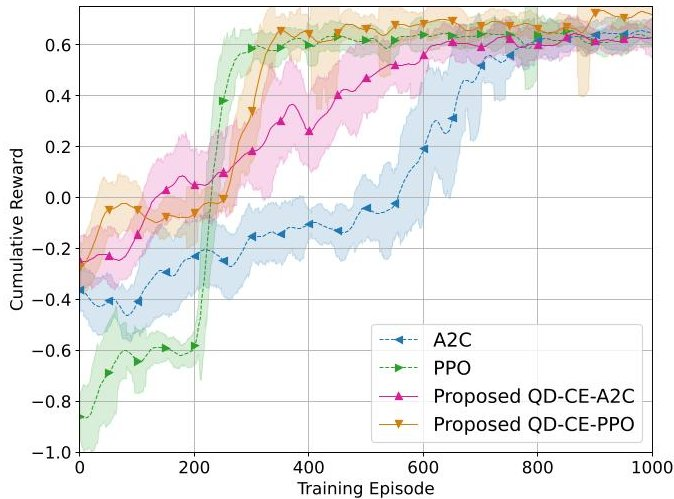
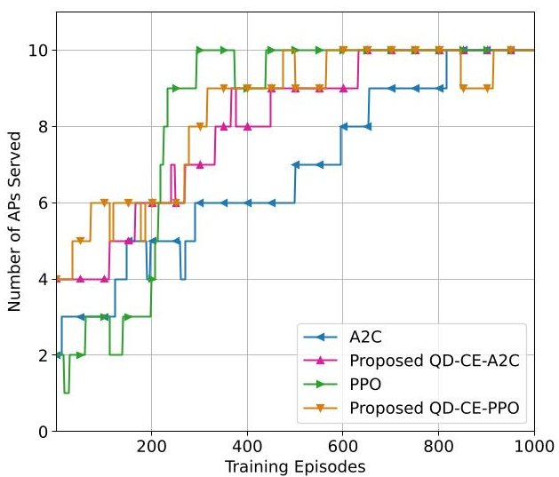
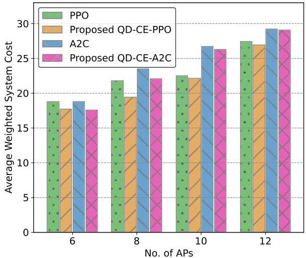
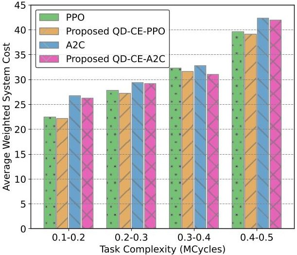
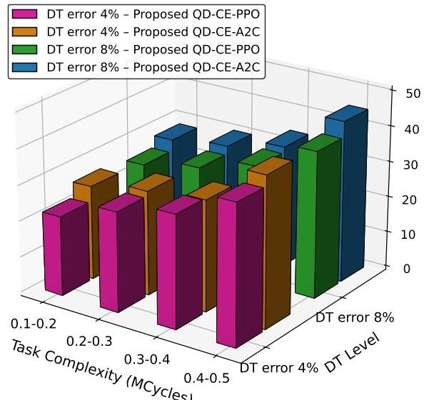
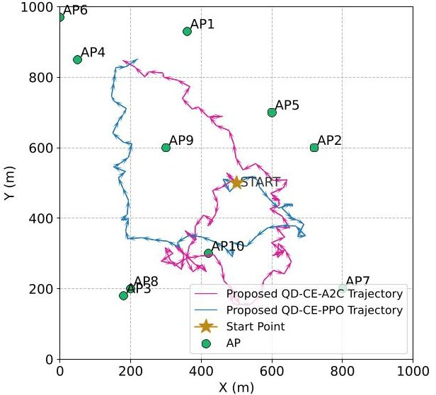

<!-- PDF_PAGE: 1 -->

# Quantum Machine Learning for Wireless-Powered UAV Positioning in 6G Digital Twin SAGIN with Cooperative Nano-Satellite Constellations

Sasinda C. Prabhashana, Student Member, IEEE, Minh-Hien T. Nguyen, Member, IEEE, Vishal Sharma, Senior Member, IEEE, Thang X. Vu, Senior Member, IEEE, Berk Canberk, Senior Member, IEEE, Hyundong Shin, Fellow, IEEE, and Trung Q. Duong, Fellow, IEEE

Abstract—Energy-efficient space-air-ground integrated networks (SAGINs) are vital for sustainable communications. This study presents an energy-aware SAGIN framework that utilizes a uncrewed aerial vehicle (UAV)-mounted mobile edge computing (MEC) platform enhanced by digital-twin technology, UAV energy harvesting via wireless power transfer, and a nano-satellite constellation with MEC facilities. We formulate a joint optimization problem for UAV trajectory planning, task offloading, computational resource allocation, and satellite load balancing as a mixedinteger nonlinear programming (MINLP) problem that minimizes the weighted system cost while satisfying energy and latency constraints. To address this complex problem, two quantum-driven deep reinforcement learning (QD-DRL) algorithms namely quantum-driven cost-effective advantage actor-critic (QD-CEA2C) and quantum-driven cost-effective proximal policy optimization (QD-CE-PPO) are proposed. These algorithms employ

angle encoding with learnable parameters and variational quantum neural networks to enhance policy exploration and accelerate convergence. Simulation results demonstrate that the proposed QD-DRL approaches achieve superior cost efficiency and ensure effective service to all access points within the defined mission duration. Moreover, QD-DRL approaches achieved higher cumulative rewards and faster convergence compared to classical DRL baselines. Consequently, the proposed frameworks provide a scalable and intelligent paradigm for cost-efficient resource management in future 6G-enabled SAGINs.

Index Terms—6G networks, space-air-ground integrated networks, satellite networks, digital twin, quantum neural networks, quantum deep reinforcement learning.

## I. INTRODUCTION

OVER the past few decades, wireless communication has undergone continuous transformation. It evolved from first-generation analog systems to the high-speed digital era of fifth-generation (5G) networks [1]. Thus, each generation brought about substantial enhancements in the areas of data transmission, connectivity, and service quality [2]. With 5G, the focus moved from human-centric communication to a wider range of applications, such as enhanced mobile broadband, ultra-reliable low-latency communication (URLLC), and extensive machine-to-machine communication [3]. These capabilities opened doors for applications such as smart cities, intelligent connected vehicles, industrial automation, and remote healthcare [2]. However, 5G networks still exists number of drawbacks. These include inadequate latency and throughput for new real-time and immersive services, limited support for extreme mobility, and limited worldwide coverage [4]. Therefore, in order to meet these rising demands and overcome from these limitations, researchers and industry have started exploring the designs and architectures of sixth-generation (6G) wireless networks.

Moreover, global connectivity is also a key objective of future 6G communication systems [5]. To achieve this, 6G networks will integrate terrestrial, aerial, maritime, and satellite components in a coordinated manner [6]. Such an architecture can provide seamless coverage. It will also enable real-time data exchange across remote regions, deep rural areas, and high-altitude airspaces [4]. Furthermore, these capabilities are realized through space-air-ground integrated networks (SAGIN). SAGINs act as the core architectures and bring together terrestrial and non-terrestrial infrastructures into one unified

<!-- PDF_PAGE: 2 -->

framework [5]. Moreover, they rely on satellite links for broad area communication, airborne platforms for adaptive relaying and monitoring, and ground stations for high-throughput backhaul connectivity [7]. This multi-layered framework enhances resilience. It also ensures continuous data transmission. In addition, it supports situational awareness and enables realtime coordination across geographically distributed users [8]. Thus, managing energy consumption while ensuring low latency is critical for layered architectures. By harvesting energy within the network, these systems can become more selfsustaining and energy-efficient. Wireless power transmission (WPT) can further support this by powering devices without external sources. This will enable edge nodes to harvest energy and operate longer without frequent battery replacements [9].

Recently, low Earth orbit (LEO) satellites have gained major attention in global communication networks. Their dense deployment provides low latency and high-capacity coverage [10]. However, this rapid growth also creates challenges. The orbital surface is limited, and only a certain number of satellites can be maintained within the same layer [7]. Therefore, it is essential to manage the satellite resources effectively in order to improve the network performances. In addition, deploying LEO satellites involves significant costs and complex challenges related to launch and maintenance. As a practical alternative, CubeSats have emerged as a cost-effective solution. CubeSats are compact, standardized satellites that can be deployed in larger numbers. Their modular design and small size make them ideal for rapid testing, scientific research, and expanding communication networks [11]. In particular, nano-satellites, a subclass of CubeSats, have attracted attention for their lightweight design, affordability, and ease of deployment. Their scalability and support for ubiquitous connectivity make them well suited for modern space-based networks [11]. Integrating mobile edge computing (MEC) into satellite systems introduces a major shift [8]. MEC enables localized communication, computation, and content caching. This brings edge services closer to end users and reduces dependence on ground infrastructure. As a result, it decreases backhaul traffic and improves response time [6]. Such improvements are critical for latency-sensitive applications in remote zones. Therefore, satellite-MEC integration supports fast, adaptive, and resilient services where traditional networks cannot perform effectively [8].

Furthermore, uncrewed aerial vehicles (UAVs) are becoming an essential part of SAGINs [8]. They provide coverage in areas where terrestrial infrastructure is limited or unavailable. UAVs operate at high altitudes, which creates line-of-sight (LoS) communication with users. This reduces signal blockage caused by obstacles on the ground [12]. Moreover, their mobility also allows dynamic repositioning to maintain stable connectivity [13]. However, UAVs face constraints in range and energy. Therefore, efficient trajectory planning is required to ensure reliable links and low latency [14]. On the other hand, digital twin (DT) technology is also expected to play a pivotal role in the development of 6G networks [15]. A DT serves as a high-fidelity virtual replica of a physical system, maintained

through continuous real-time data streams and bidirectional updates [16]. The interaction between the digital and physical domains enables predictive analysis. It also supports smarter decision-making and more efficient operations, especially in wireless networks [15].

Although deep reinforcement learning (DRL) provides notable performance for resource allocation in wireless networks, it faces challenges arising from high-dimensional state and action spaces [14]. Moreover, it requires numerous training episodes to achieve convergence. These issues significantly restrict its scalability in large and heterogeneous SAGIN environments [8]. In order to mitigate such limitations, quantum computing (QC) emerges as a promising solution. With its ability to exploit parallelism and exponential state-space representation, QC enables more efficient handling of complex optimization problems [17]. Unlike classical methods, QC can deliver significant performance improvements with fewer data and training episodes [16]. Especially, quantum circuits allow classical data to be encoded into quantum states, enabling DRL agents to explore larger solution spaces while consuming fewer computational resources [18].

Moreover, this integration of QC into DRL accelerates learning ability of DRL agents. Despite these advantages, current progress in QC remains limited by hardware constraints. Most implementations rely on noisy intermediate-scale quantum (NISQ) devices, which face noise sensitivity, limited qubit counts, and decoherence issues that restrict large-scale deployment [19]. Although hybrid quantum-classical learning has shown promising potential for solving complex optimization and control problems, practical implementation on real NISQ hardware remains challenging. Existing quantum devices are limited by restricted qubit connectivity, finite coherence time, gate imperfections, and measurement noise, all of which can affect the reliable execution of parameterized quantum circuits. In addition, repeated circuit evaluations are required to estimate expectation values during learning, which increases the effect of noise and measurement uncertainty [20], [21]. The trainability of quantum circuits can also be affected when circuit depth becomes larger, since optimization may become more challenging and stable gradient updates may be harder to maintain. These limitations are especially important in reinforcement learning settings, where policy and value updates depend on repeated and consistent circuit evaluations. Therefore, simulation-based emulation provides a practical way to study hybrid quantum-classical learning under controlled conditions while taking current NISQ limitations into account. Hence, it is essential to advance the study of quantum-driven DRL (QD-DRL) models in order to fully realize the capabilities of quantum-driven learning frameworks.

Accordingly, advancing this direction will enable intelligent, scalable, and real-time resource management in future wireless communication networks [15], [17]----[19], [21].

## A. Related Works

Recently, SAGINs have attracted attention as a practical way to extend coverage beyond the limits of traditional terrestrial

<!-- PDF_PAGE: 3 -->

systems. By linking satellites, aerial platforms, and ground networks, they can offer broader service areas and more reliable connectivity [4], [5], [7], [8], [10]. However, managing them in an energy-efficient manner remains a critical challenge. Therefore, these networks can be designed to harvest energy internally. Thus, WPT can be used to power edge devices without requiring external power supplies, making the network more self-sufficient [9], [12] $ - [14] $ , [22], [23]. In [22], a WPT-aided federated learning framework was introduced. Here, mobile devices harvest radio frequency energy during local training to maintain continuous operation. The study formulated a total utility maximization problem by jointly optimizing charging duration, computation allocation, and local iterations. The improved Lagrangian sub gradient method was used to solve it efficiently. The results showed faster convergence and higher utility than baseline models. In [13], a UAV-enabled wirelessly powered MEC network was proposed. It aimed to maximize the long-term computation rate under dynamic task arrivals and channel variations. The problem was solved using a exploration-enhanced DRL approach, where the upper layer optimized UAV trajectory and the lower layer managed WPT and offloading. In addition, a UAV-assisted MEC system with simultaneous wireless information and power transfer was proposed in [12]. It focused on maximizing the minimum remaining energy of devices through joint optimization of UAV trajectory, beamforming, and power-splitting. Besides, in [9], an online partial offloading scheme was designed for wireless-powered MEC networks, where Lyapunov optimization was combined with DRL to adapt WPT duration and offloading ratios. In particular, a full-duplex wireless-powered MEC architecture was introduced to enhance spectral and energy efficiency in [14]. The problem was divided into offloading optimization using policy-gradient DRL and resource allocation using convex methods. Consequently, it achieved near-optimal computation rates with much lower complexity. Furthermore, in [23], a Lyapunov-guided convolutional neural network-based DRL framework was proposed to improve long-term energy efficiency in wireless-powered MEC systems. The method separated binary offloading and continuous resource allocation, ensuring queue stability. Overall, these studies highlight that integrating WPT and energy-harvesting mechanisms into computing and communication frameworks significantly enhances network sustainability. Consequently, in SAGIN environments, such energy-aware designs can make the system more resilient, self-powered, and adaptive across the space, air, and ground layers. These features collectively form a strong foundation for sustainable 6G communication networks.

With the rapid evolution of communication networks, various advanced technologies have been developed to enhance network performance and efficiency. In this context, integrating QC into communication networks has emerged as a transformative approach [17]. For example, a quantum proximal policy optimization framework was proposed for UAV assisted maritime networks with 6G DT support in [16]. The model aimed to minimize latency under energy and computation constraints. The proposed method was showed significant performance

gains over its traditional counterpart, especially under limited data conditions. Moreover, in [24], a hybrid quantum double deep Q-learning (DDQN) model was used to optimize edge cloud selection and bandwidth allocation in satellite-terrestrial networks. The hybrid approach showed faster convergence and achieved higher rewards compared with classical DDQN. In addition, in [18], a quantum DRL method was considered to evaluate and enhance energy sustainability in wireless networks. The model treated sustainability optimization as a sequential decision process with short and long term objectives. The QD-DRL approach achieved faster convergence and higher energy efficiency than traditional DRL methods. According to the studies, quantum DRL frameworks demonstrate better performance in resource allocation for wireless networks. Moreover, a layerwise QD-DRL framework was incorporated for joint UAV trajectory planning and resource allocation in [19]. The model used layerwise quantum embedding with local loss to improve trainability and avoid barren plateaus. It aimed to maximize UAV energy efficiency by jointly optimizing trajectory, user grouping, and power allocation. In [15], a digital twin-aided vehicular edge network was utilized for large-scale task offloading optimization under URLLC constraints, where a QD-DRL framework was integrated with LSTM and DTs to enhance predictive decision-making. According to the results, the QD-DRL approach outperformed classical DRL methods in terms of efficiency and convergence. Collectively, these works indicate that quantum computing enhances the decision-making capability of DRL agents. This improvement arises from quantum mechanical principles such as superposition and entanglement, which enable the agents to explore multiple states simultaneously and learn complex patterns more efficiently through quantum neural networks. As a result, QD-DRL achieves better actions and outcomes in large-scale wireless networks. These properties make it a promising advancement for future intelligent communication systems [15] [19], [21], [24].

Furthermore, recent studies have shown that quantumenhanced deep reinforcement learning can improve learning performance in complex optimization and control problems through hybrid quantum-classical architectures [17], [19]. In these frameworks, parameterized quantum circuits are commonly used as compact trainable function approximators within policy or value learning modules. Different studies have explored quantum data encoding, variational circuit design, and hybrid actor-critic structures in order to improve state representation and learning efficiency. At the same time, the practical use of such approaches is still influenced by current NISQ limitations, including restricted qubit resources, noisy measurements, limited circuit depth, and training difficulty in variational quantum models. Therefore, current research in quantum DRL is mainly focused on simulation-based or hybrid implementations, where the learning behavior of quantumenhanced models can be examined under controlled settings [25].

<!-- PDF_PAGE: 4 -->

## B. Motivation and Contributions

Despite recent progress in the development of SAGINs, existing resource-management frameworks still face major challenges when operating in highly dynamic and heterogeneous 6G environments. The coexistence of multiple layers, frequent topology changes, and strict latency and energy requirements make it difficult for conventional optimization and DRL methods to scale effectively. To overcome these limitations, a QD-DRL framework is introduced for efficient resource optimization in SAGINs. The framework leverages quantum superposition and entanglement to speed up policy learning and improve decision-making efficiency compared to traditional DRL methods. This proposed system integrates a UAV with dual-battery energy storage, WPT, and DT support, cooperating with a nano-satellite constellation for distributed computation. The problem is formulated as a mixed-integer nonlinear programming (MINLP) problem that aims to minimize the overall system cost by jointly optimizing UAV trajectory, task offloading, computational power allocation and satellite load distribution under URLLC and energy-causality constraints. The formulated MINLP problem addressed using quantum-enhanced actor-critic algorithms. The main contributions of this paper can be summarized as follows:

- We develop a SAGIN system model that integrates a UAV with MEC capability and a nano-satellite constellation coordinated by a master satellite. The UAV collects URLLC-constrained data from multiple ground access points (APs), processes part of it locally, and offloads computation-intensive tasks to the nano-satellite layer. A base station with WPT supports energy harvesting at the UAV, providing power for task transmission and processing to ensure sustainable operation.

- We formulate the joint trajectory planning, task scheduling, computation offloading, and satellite load distribution problem as a MINLP problem aimed at minimizing the overall system cost, subject to latency and energy constraints within the SAGIN framework.

- We propose two QD-DRL algorithms namely quantum-driven cost-effective proximal policy optimization (QD-CE-PPO) and quantum-driven cost effective advantage actor-critic (QD-CE-A2C) and to efficiently manage discrete and continuous decision variables for joint optimization across SAGIN layers.

- The proposed framework is evaluated through extensive simulations. Simulation results show the QD-DRL methods outperform traditional DRL. They reduce system cost, improve energy efficiency, and lower latency. These results prove the potential of QD-DRL for scalable and intelligent resource management in future 6G SAGIN networks.

It is important to note that this study is evaluated under a simulation-based emulation setting rather than direct execution on physical quantum hardware. In practice, a future hardware realization would require quantum devices with sufficient qubit connectivity, longer coherence time, and lower gate and

measurement error rates in order to support reliable variational circuit execution. These requirements become especially important in hybrid DRL settings, where repeated circuit evaluations are needed for policy and value updates during training.

## C. Paper Structure and Notations

The structure of this paper is organized as follows. Section II describes the proposed system model and the problem formulation, including communication channel modelling, UAV trajectory, data processing and transmission model, and the formulation of the MINLP-based optimization problem. Section III presents the proposed QD-DRL solutions designed for the solving the formulated MINLP optimization problem. Section IV presents the simulation results along with detailed analysis to evaluate the effectiveness of the proposed methods. Section V concludes the paper by summarizing the key findings and future research directions.

Notations: In this paper, lowercase letters represent scalar values, bold lowercase letters represent vectors. The length of a vector $ \mathbf{x} $ is denoted by $ |\mathbf{x}| $ , and the set of complex numbers is written as $ \mathbb{C} $ . The variable $ x_{\mathrm{m,r}}(t) $ refers to the value linked to the m-th transmitter and r-th receiver at time slot t . Moreover, the notation $ \mathbf{x}\sim \mathcal{CN}(\mu ,\sigma^{2}) $ means that $ \mathbf{x} $ follows a complex Gaussian distribution with mean $ \mu $ and variance $ \sigma^{2} $ , while $ \mathbf{x}\sim \mathcal{N}(\mu ,\sigma^{2}) $ denotes a normal distribution with mean $ \mu $ and variance $ \sigma^{2} $ . The symbols $ (\cdot)^{T} $ and $ (\cdot)^{H} $ refer to the transpose and the complex-conjugate transpose, respectively. Furthermore, $ ||\cdot|| $ denotes the Euclidean norm of the vector. The tensor product between quantum states is shown by $ \otimes $ . Throughout the paper, the above notations are adopted consistently for clarity.

## II. SYSTEM MODEL

Fig. 1: An illustration of 6G-enabled space-air-ground integrated network with nano-satellite constellation for mission critical applications.

In this paper, we consider a 6G-enabled SAGIN with nanosatellite constellations, as illustrated in Fig. 1. The ground

<!-- PDF_PAGE: 5 -->

layer consists of M APs, denoted by $ \mathcal{M}=\{1,2,\dots,M\} $ . Each AP collects data packets from registered users, and transmits them under URLLC constraints to the UAV, where a UAV with MEC capabilities performs computation. The UAV uses K antennas to communicate with APs and it flies over the ground layer to collect tasks from each AP using the UAV's primary battery storage. However, due to multifunctional operations, the UAV experiences substantial energy consumption and faces significant challenges in managing task-request overflow during peak times. Therefore, a base station (BS) with WPT is used for powering the UAV's secondary battery storage. Moreover, the UAV offloads excess tasks to a LEO nanosatellite network which is in the space layer. This network is a swarm of nano-satellites, consisting of a master nanosatellite (MNS) and four slave nano-satellites (SNS), denoted by $ \mathcal{I}=\{1,2,3,4\} $ . Each SNS is equipped with a single antenna and MEC capabilities. The MNS coordinates and manages computational load distribution among the SNSs. Upon receiving computation intensive and latency sensitive data from APs, the UAV transmits a portion of this data to the MNS, which then distributes it to SNSs for processing with load balancing.

This network is modeled using a three-dimensional (3D) Cartesian coordinate system. The APs are located on the ground at $ \ell_{\mathrm{m}}=(x_{\mathrm{m}},y_{\mathrm{m}},0)\in\mathbb{R}^{3} $ , for m $ \in\mathcal{M} $ , while the UAV operates at a fixed altitude H with position $ \ell_{\mathrm{u}}(t)=(x_{\mathrm{u}}(t),y_{\mathrm{u}}(t),H)\in\mathbb{R}^{3} $ . In the space layer, the MNS is positioned at $ \ell_{\mathrm{ms}}(t)=(x_{\mathrm{ms}}(t),y_{\mathrm{ms}}(t),R)\in\mathbb{R}^{3} $ , where R denotes the LEO orbit altitude. The four SNSs are arranged at the corners of a square centered around the MNS, each at an equal distance. Moreover, the BS with WPT is located at $ \ell_{\mathrm{bs}}=(x_{\mathrm{bs}},y_{\mathrm{bs}},h)\in\mathbb{R}^{3} $ , where h is the height of the BS above the ground. In this system model, we assume continuous satellite coverage due to the dense deployment of LEO satellites. Furthermore, we assume that the Doppler effect in channel modeling is compensated at the receivers.

## A. Channel Modeling

1) Channel between AP and UAV: The channel vector between the m-th AP and UAV at time t can be denoted as [3]

$$
\mathbf {g} _ {\mathrm {m}, \mathrm {u}} (t) = \sqrt {h _ {\mathrm {m , u}} (t)} \tilde {\mathbf {g}} _ {\mathrm {m , u}} (t) \in \mathbb {C} ^ {K \times 1},
$$

where $ \tilde{\mathbf{g}}_{\mathrm{m,u}}(t) $ is the small-scale fading which follows the complex random variable with $ \mathbb{E}\left[|\tilde{\mathbf{g}}_{\mathrm{m,u}}(t)|^{2}\right]=1 $ . Furthermore, $ h_{\mathrm{m,u}}(t) $ is the large-scale channel coefficient, which can be calculated as [26]

$$
h _ {\mathrm {m}, \mathrm {u}} (t) = \left(\frac {4 \pi f _ {c} d _ {\mathrm {m , u}} (t)}{c}\right) ^ {- \alpha} 1 0 ^ {- \frac {\kappa_ {\mathrm {m , u}} ^ {\mathrm {l o s}} (t) \eta^ {\mathrm {l o s}} + \kappa_ {\mathrm {m , u}} ^ {\mathrm {n l o s}} (t) \eta^ {\mathrm {n l o s}}}{1 0}},
$$

where $ f_{c} $ is the carrier frequency and $ c $ denotes the speed of light. Moreover, $ \alpha $ is the path loss exponent and $ d_{\mathrm{m,u}}(t) $ is the distance between m-th AP and the UAV at time t. It can be calculated as $ d_{\mathrm{m,u}}(t) = \left(\left(x_{\mathrm{u}}(t)-x_{\mathrm{m}}\right)^{2}+\left(y_{\mathrm{u}}(t)-y_{\mathrm{m}}\right)^{2}+H^{2}\right)^{1/2}. $

Furthermore, $ \kappa_{\mathrm{m,u}}^{\mathrm{los}}(t) $ is the probability of the LoS component which can be calculated as

$$
\kappa_ {\mathrm {m}, \mathrm {u}} ^ {\mathrm {l o s}} (t) = \left(1 + \mu_ {1} \exp \left[ - \mu_ {2} \left(\arctan \left(\frac {H}{d _ {\mathrm {m , u}} ^ {\mathrm {h d}} (t)}\right) - \mu_ {1}\right) \right]\right) ^ {- 1},
$$

where $ \mu_{1} $ and $ \mu_{2} $ coefficients depend on the environment. $ d_{\mathrm{m,u}}^{\mathrm{hd}}(t) $ is the horizontal distance between the m-th AP and the UAV which can be calculated as $ d_{\mathrm{m,u}}^{\mathrm{hd}}(t) = \left(\left(x_{\mathrm{u}}(t)-x_{\mathrm{m}}\right)^{2}+\left(y_{\mathrm{u}}(t)-y_{\mathrm{m}}\right)^{2}\right)^{1 / 2} $ . Moreover, the probability of the NLoS component can be calculated $ \kappa_{\mathrm{m,u}}^{\mathrm{nlos}}(t)=1-\kappa_{\mathrm{m,u}}^{\mathrm{los}}(t). $ $ \eta^{\mathrm{los}} $ and $ \eta^{\mathrm{nlos}} $ represent the excessive path loss for LoS and NLoS components respectively.

2) Channel between UAV to MNS: The channel vector between the UAV and MNS at time t can be denoted as [26]

$$
\mathbf {g} _ {\mathrm {u}, \mathrm {m s}} (t) = \left[ \begin{array}{l l l l} \mathrm {g} _ {1} (t) & \mathrm {g} _ {2} (t) & \dots & \mathrm {g} _ {K} (t) \end{array} \right] \in \mathbb {C} ^ {1 \times K}.
$$

Here, each component $ \mathrm{g_{k}}(t) $ is characterized by the shadowed-Rician fading model, which can be expressed as $ \mathrm{g_{k}}(t)=\sqrt{h_{\mathrm{k}}(t)} d_{\mathrm{u,ms}}^{-\alpha/2}(t). $ Where $ d_{\mathrm{u,ms}}(t) $ is the distance between the UAV and the MNS, which can be calculated as $ d_{\mathrm{u,ms}}(t)=\left((x_{\mathrm{ms}}(t)-x_{\mathrm{u}}(t))^{2}+(y_{\mathrm{ms}}(t)-y_{\mathrm{u}}(t))^{2}+(R-H)^{2}\right)^{1/2}. $ Furthermore, $ h_{\mathrm{k}}(t) $ follows a shadowed-Rician distribution, which can be denoted as $ h_{\mathrm{k}}(t)\sim \mathrm{SR}(\Omega_{\mathrm{k}},\Delta_{\mathrm{k}},\epsilon_{\mathrm{k}}), $ where $ \Omega_{\mathrm{k}} $ is the average power of the direct signal, $ \Delta_{\mathrm{k}} $ is the half-average power of the scattered multipath component, and $ \epsilon_{\mathrm{k}} $ represents the Nakagami- m fading parameter.

3) Channel Between MNS to SNS: The channel between the MNS and the i-th SNS at time t can be expressed as [26]

$$
\mathbf {g} _ {\mathrm {m s}, \mathrm {s s} (\mathrm {i})} (t) = \sqrt {h _ {\mathrm {m s}, \mathrm {s s} (\mathrm {i})} (t)} \tilde {g} _ {\mathrm {m s}, \mathrm {s s} (\mathrm {i})} (t) \in \mathbb {C} ^ {1 \times 1},
$$

where $ h_{\mathrm{ms,ss(i)}}(t) $ is the large-scale path loss, which can be calculated as $ h_{\mathrm{ms,ss(i)}}(t) = 10^{-\frac{\kappa_{\mathrm{ms,ss(i)}}(t)}{10}} $ . Here, $ \kappa_{\mathrm{ms,ss(i)}}(t) $ is the free-space path loss, which can be calculated as $ \kappa_{\mathrm{ms,ss(i)}}(t) = 1 0 \alpha \log_{1 0} \left( \frac{4 \pi f_{c} d_{\mathrm{ms,ss(i)}}(t)}{c} \right) $ , where $ d_{\mathrm{ms,ss(i)}}(t) $ is the distance between the MNS and the i-th SNS, which can be calculated as $ d_{\mathrm{ms,ss(i)}}(t) = \left( \left( x_{\mathrm{ms}}(t) - x_{\mathrm{ss(i)}}(t) \right)^{2} + \left( y_{\mathrm{ms}}(t) - y_{\mathrm{ss(i)}}(t) \right)^{2} \right)^{1 / 2} $ . Moreover, $ \tilde{g}_{\mathrm{ms,ss(i)}}(t) $ is the small-scale fading which can be characterized as $ \tilde{g}_{\mathrm{ms,ss(i)}}(t) \sim \mathcal{CN} (0,1) $ .

## B. Communication Modeling

1) Communication between AP and UAV: The data from each AP is received by the UAV. The rate of data transmission between the m-th AP and UAV under URLLC constraints can be calculated as [16]

$$
\mathcal {R} _ {\mathrm {m}} ^ {\mathrm {u}} (t) \approx \mathcal {B} \left(\log_ {2} \left(1 + \gamma_ {\mathrm {m}} ^ {\mathrm {u}} (t)\right) - \sqrt {\frac {V _ {\mathrm {m}} ^ {\mathrm {u}} (t)}{N}} \frac {Q ^ {- 1} \left(\epsilon_ {\mathrm {m}} ^ {\mathrm {u}}\right)}{\ln 2}\right),
$$

where $ \mathcal{B} $ is the system bandwidth. N is the length of the block. The parameter $ \epsilon_{\mathrm{m}}^{\mathrm{u}} $ corresponds to the probability of decoding errors. The function $ Q^{-1}(\cdot) $ refers to the inverse of the function Q, which is defined as $ Q(x)=\frac{1}{\sqrt{2\pi}}\int_{x}^{\infty}\exp \left(-\frac{t^{2}}{2}\right) d t. $ $ V_{\mathrm{m}}^{\mathrm{u}}(t) $ represents the channel dispersion, which is given by $ V_{\mathrm{m}}^{\mathrm{u}}(t)=1-\left[ 1+\gamma_{\mathrm{m}}^{\mathrm{u}}(t)\right]^{-2}, $ where $ \gamma_{\mathrm{m}}^{\mathrm{u}}(t) $ is the signal-to-noise

<!-- PDF_PAGE: 6 -->

ratio which can be calculated as $ \gamma_{\mathrm{m}}^{\mathrm{u}}(t)=p_{\mathrm{m}}\frac{\left|\mathbf{g}_{\mathrm{m},\mathrm{u}}(t)\right|^{2}}{\sigma_{\mathrm{u}}^{2}(t)}, $ where $ p_{\mathrm{m}} $ represents the transmission power of the m-th AP and $ \sigma_{\mathrm{u}}(t) $ is the instantaneous noise power, characterized by a complex Gaussian distribution $ \sim \mathcal{CN}\left(0,\sigma^{2}\right) $ [3].

2) Communication between UAV and MNS: The data rate from the UAV to the MNS can be calculated as

$$
\mathcal {R} _ {\mathrm {u}} ^ {\mathrm {m s}} (t) = \mathcal {B} \log_ {2} \left(1 + p _ {\mathrm {u}} \frac {\left| \left| \mathbf {g} _ {\mathrm {u , m s}} (t) \right| \right| ^ {2}}{\sigma_ {\mathrm {m s}} ^ {2} (t)}\right),
$$

where $ p_{\mathrm{u}} $ is the transmission power of the UAV. Moreover, $ \sigma_{\mathrm{ms}}(t) $ is the instantaneous noise power, followed by a complex Gaussian distribution $ \sim \mathcal{CN}\left(0,\sigma^{2}\right) $ [10].

3) Communication between MNS and SNS: The data rate from the MNS to i-th SNS can be expressed as

$$
\mathcal {R} _ {\mathrm {m s}} ^ {\mathrm {s s} (\mathrm {i})} (t) = \mathcal {B} \log_ {2} \left(1 + p _ {\mathrm {m s}, \mathrm {s s} (\mathrm {i})} \frac {\left| \mathbf {g} _ {\mathrm {m s , s s} (\mathrm {i})} (t) \right| ^ {2}}{\sigma^ {2} _ {\mathrm {s s} (\mathrm {i})} (t)}\right),
$$

where $ p_{\mathrm{ms,ss(i)}} $ is the transmission power of the MNS to i-th SNS. $ \sigma_{\mathrm{ss(i)}}(t) $ is the instantaneous noise power, characterized by a complex Gaussian distribution $ \sim \mathcal{CN}\left(0,\sigma^{2}\right) $ [10].

## C. Mobility of UAV

To model the mobility of the UAV, we divide its total flying time into T discrete time slots. Each time slot has a duration of $ \tau_{t} $ , and the set of time slots is denoted by $ \mathcal{T}=\{1,2,\cdots,T\} $ . Moreover, the UAV flies at a fixed altitude H. At time t, the UAV movement is determined by the displacement components $ d_{x}(t) $ and $ d_{y}(t) $ along the x-axes and y-axes, respectively. Therefore, the UAV position from time slot t to t+1 can be calculated as [13]

$$
x _ {\mathrm {u}} (t + 1) = x _ {\mathrm {u}} (t) + d _ {\mathrm {x}} (t) + \Delta x _ {\mathrm {u}} (t),
$$

$$
y _ {\mathrm {u}} (t + 1) = y _ {\mathrm {u}} (t) + d _ {\mathrm {y}} (t) + \Delta y _ {\mathrm {u}} (t),
$$

where $ \Delta x_{\mathrm{u}}(t) $ and $ \Delta y_{\mathrm{u}}(t) $ are small random disturbances due to wind, modeled as $ \sim \mathcal{N}(0,\sigma^{2}) $ . The instantaneous velocity $ v_{\mathrm{u}}(t) $ of the UAV at time t is given by $ v_{\mathrm{u}}(t)=d_{\mathrm{x y}}(t) / \tau_{t} $ where $ d_{\mathrm{x y}}(t)=(d_{\mathrm{x}}^{2}(t)+d_{\mathrm{y}}^{2}(t))^{1 / 2} $ . Consequently, the UAV's power consumption can be expressed as

$$
\begin{array}{l} P \left(v _ {\mathrm {u}} (t)\right) = \chi_ {1} \left(1 + \frac {3 v _ {\mathrm {u}} (t) ^ {2}}{w _ {\mathrm {t i p}} ^ {2}}\right) + \\ \chi_ {2} \left(\sqrt {1 + \frac {v _ {\mathrm {u}} (t) ^ {4}}{4 w _ {0} ^ {4}}} - \frac {v _ {\mathrm {u}} ^ {2} (t)}{2 w _ {0} ^ {2}}\right) ^ {1 / 2} + \\ \frac {1}{2} \tau \rho \Upsilon A v _ {\mathrm {u}} ^ {3} (t), \\ \end{array}
$$

where A is the rotor disc area, $ \Upsilon $ denotes the rotor solidity, $ \rho $ denotes the air density, and $ \tau $ is the fuselage drag coefficient. Moreover, $ w_{0} $ represents the average rotor-induced flow in hover, while $ w_{\mathrm{tip}} $ denotes the tip speed of the rotor blades. The coefficients $ \chi_{1} $ and $ \chi_{2} $ represent the blade profile power and the induced power required in hover, respectively. Therefore, the total energy consumption per slot can be calculated as $ E_{\mathrm{u}}^{\mathrm{fly}}(t)=P(v_{\mathrm{u}}(t))\tau_{t} $ [17]. The required flying energy over the total flying duration T is supplied by the UAV's primary battery

storage. Therefore, the primary battery energy is exclusively allocated to cover the flying energy consumption. Thus, the primary battery energy storage update can be expressed as

$$
E _ {\mathrm {u}} ^ {\mathrm {b a t t}} (t + 1) = E _ {\mathrm {u}} ^ {\mathrm {b a t t}} (t) - E _ {\mathrm {u}} ^ {\mathrm {f l y}} (t),
$$

where $ E_{\mathrm{u}}^{\mathrm{batt}}(t) $ is the battery energy status at time t, and $ E_{\mathrm{u}}^{\mathrm{fly}}(t) $ is the flying energy consumption of the UAV during time slot t.

## D. Task Acceptance, Transmission and Processing Model

We consider that each AP collects data from registered users associated with the AP at time t. This collected data is formed as a data packet (a.k.a. task), which can be denoted as $ J_{\mathrm{m}}=\{D_{\mathrm{m}},Q_{\mathrm{m}},T_{\mathrm{m}}^{\mathrm{max}}\} $ , where $ D_{\mathrm{m}} $ represents the data size, $ Q_{\mathrm{m}} $ represents the computational complexity, and $ T_{\mathrm{m}}^{\mathrm{max}} $ represents the maximum latency requirement. To model task acceptance, we define a binary variable $ \pi_{\mathrm{m}}(t)\in\{0,1\} $ , which indicates whether the UAV accepts the task from the m-th AP. A task is transmitted only if the AP is within the UAV's communication range, which can be denoted as $ d_{\mathrm{m,u}}^{\mathrm{hd}}(t)<d^{\mathrm{max}} $ . When multiple APs fall under the UAV's coverage, the UAV selects one AP for admission in the current slot, while the remaining APs may be admitted in subsequent slots. The received tasks are then stored in a queue $ q(t) $ at the UAV and scheduled for processing in subsequent time slots. Accordingly, the energy consumption for transmitting a task from the m-th AP at time t can be expressed as $ E_{\mathrm{m,u}}^{\mathrm{trans}}(t)=\pi_{\mathrm{m}}(t)\frac{p_{\mathrm{m}}D_{\mathrm{m}}}{R_{\mathrm{m}}^{\mathrm{u}}(t)} $ . Moreover, the UAV processes a fraction of the task locally and offloads the rest to the MNS. Let $ \delta_{\mathrm{m}}(t)\in[0,1] $ represent the continuous variable which determines the offloaded fraction to the MNS. Therefore, the task processing energy at the UAV can be calculated as

$$
E _ {\mathrm {m}, \mathrm {u}} ^ {\mathrm {p r o c}} (t) = \xi_ {\mathrm {u}} \left(1 - \delta_ {\mathrm {m}} (t)\right) Q _ {\mathrm {m}} \left(f _ {\mathrm {m}} ^ {\mathrm {u}} (t) - \hat {f} _ {\mathrm {m}} ^ {\mathrm {u}} (t)\right) ^ {2},
$$

where $ \xi_{\mathrm{u}} $ is the energy coefficient of the UAV's processor, which depends on the CMOS circuit. Furthermore, we define the DT service at the UAV as $ \mathbf{D T}_{\mathrm{m}}^{\mathrm{u}} $ . This service can be expressed as $ \mathbf{D T}_{\mathrm{m}}^{\mathrm{u}}=\{f_{\mathrm{m}}^{\mathrm{u}}(t),\hat{f}_{\mathrm{m}}^{\mathrm{u}}(t)\} $ , where $ f_{\mathrm{m}}^{\mathrm{u}}(t) $ and $ \hat{f}_{\mathrm{m}}^{\mathrm{u}}(t) $ denote the estimated processing rate and the processing rate deviation value of the UAV in its DT, respectively. Then, the energy consumption at time t for offloading the remaining fraction of the task from the UAV to the MNS can be expressed as $ E_{\mathrm{u,ms}}^{\mathrm{trans}}(t)=p_{\mathrm{u}}\delta_{\mathrm{m}}(t)\frac{D_{\mathrm{m}}}{R_{\mathrm{u}}^{\mathrm{ms}}(t)} $ . Concurrently, the MNS distributes the received fraction to the SNSs using the load-balancing variable $ \theta_{\mathrm{m,i}}(t)\in[0,1] $ . Therefore, the energy consumption for transmitting the offloaded fraction of the task from the MNS to the i-th SNS at time t can be calculated as

$$
E _ {\mathrm {m s}, \mathrm {s s} (i)} ^ {\mathrm {t r a n s}} (t) = \theta_ {\mathrm {m}, \mathrm {i}} (t) p _ {\mathrm {m s}, \mathrm {s s} (i)} \delta_ {\mathrm {m}} (t) \frac {D _ {\mathrm {m}}}{\mathcal {R} _ {\mathrm {m s}} ^ {\mathrm {s s} (i)} (t)}.
$$

Furthermore, the processing energy consumption for the received portion of the task at the i-th SNS at time t can be denoted as $ E_{\mathrm{ss}(i)}^{\mathrm{proc}}(t)=\theta_{\mathrm{m,i}}(t)\xi_{\mathrm{ss}(i)}Q_{\mathrm{m}}\delta_{\mathrm{m}}(t)(f^{\mathrm{ss}(i)})^{2}, $ where $ \xi_{\mathrm{ss}(i)} $ and $ f^{\mathrm{ss}(i)} $ are the energy coefficient and computational frequency of the i-th SNS, respectively. Thus, the total space layer energy consumption at time t can be calculated as

<!-- PDF_PAGE: 7 -->

$ E_{\mathrm{ms,ss}}^{\mathrm{total}}(t)=\sum_{i=1}^{4}\left(E_{\mathrm{ms,ss}(i)}^{\mathrm{trans}}(t)+E_{\mathrm{ss}(i)}^{\mathrm{proc}}(t)\right). $ Then, the total energy consumption of the m-th AP task across all SAGIN layers at time t can be expressed as $ E_{\mathrm{m}}^{\mathrm{tot}}(t)=E_{\mathrm{m,u}}^{\mathrm{trans}}(t)+E_{\mathrm{m,u}}^{\mathrm{proc}}(t)+ $ $ E_{\mathrm{u,ms}}^{\mathrm{trans}}(t)+E_{\mathrm{ms,ss}}^{\mathrm{total}}(t). $

## E. Latency Model

When the UAV accepts a task from the m-th AP, the transmission latency from the m-th AP to the UAV at time t can be expressed as $ T_{\mathrm{m,u}}^{\mathrm{trans}}(t)=\pi_{\mathrm{m}}(t)\frac{D_{\mathrm{m}}}{R_{\mathrm{m}}^{\mathrm{u}}(t)}. $ Furthermore, the processing latency at the UAV for the m-th AP task at time t can be calculated as

$$
T _ {\mathrm {m}, \mathrm {u}} ^ {\mathrm {p r o c}} (t) = \left(1 - \delta_ {\mathrm {m}} (t)\right) \frac {Q _ {\mathrm {m}}}{\left(f _ {\mathrm {m}} ^ {\mathrm {u}} (t) - \hat {f} _ {\mathrm {m}} ^ {\mathrm {u}} (t)\right)}.
$$

Meanwhile, the transmission latency for the offloaded portion from the UAV to the MNS at time t can be expressed as $ T_{\mathrm{u,ms}}^{\mathrm{trans}}(t) = \delta_{\mathrm{m}}(t)\frac{D_{\mathrm{m}}}{\mathcal{R}_{\mathrm{u}}^{\mathrm{ms}}(t)}. $ Once the MNS receives the offloaded task from the UAV, it distributes the task portion among all the SNSs. Therefore, the transmission latency from the MNS to the i-th SNS at time t can be calculated as $ T_{\mathrm{ms,ss}(i)}^{\mathrm{trans}}(t) = \theta_{\mathrm{m,i}}(t)\delta_{\mathrm{m}}(t)\frac{D_{\mathrm{m}}}{\mathcal{R}_{\mathrm{ms}}^{\mathrm{ss}(i)}(t)}. $ Also, the corresponding processing latency at the i-th SNS at time t can be expressed as $ T_{\mathrm{ss}(i)}^{\mathrm{proc}}(t) = \theta_{\mathrm{m,i}}(t)\delta_{\mathrm{m}}(t)\frac{Q_{\mathrm{m}}}{f^{\mathrm{ss}(i)}}. $ Consequently, the total latency for the task of the m-th AP at time t can be calculated as $ T_{\mathrm{m}}^{\mathrm{total}}(t) = $ $ T_{\mathrm{m,u}}^{\mathrm{trans}}(t) + T_{\mathrm{m,u}}^{\mathrm{proc}}(t) + T_{\mathrm{u,ms}}^{\mathrm{trans}}(t) + \max_{i \in \mathcal{I}} \left( T_{\mathrm{ms,ss}(i)}^{\mathrm{trans}}(t) + T_{\mathrm{ss}(i)}^{\mathrm{proc}}(t) \right). $

## F. Wireless Power Transmission model

In this paper, we consider that the UAV harvests RF energy transmitted by the BS using WPT. This harvested power is used for task processing at the UAV and task transmission to the MNS. In order to model the wireless power transmission process, let the channel gain between the BS and the UAV at time t be denoted as $ h_{\mathrm{bs,u}}(t)\in \mathbb{C}^{1\times 1}. $ Thus, the channel gain can be modeled as [22]

$$
h _ {\mathrm {b s}, \mathrm {u}} (t) = G _ {\mathrm {b s}} G _ {\mathrm {u}} h _ {0} d _ {\mathrm {b s}, \mathrm {u}} ^ {- 2} (t),
$$

where $ h_{0} $ is the channel power gain at a reference distance. $ d_{\mathrm{bs},\mathrm{u}}(t) $ is the distance between the BS and the UAV, which can be calculated as $ d_{\mathrm{bs},\mathrm{u}}(t) = \left( \left( x_{\mathrm{u}}(t)-x_{\mathrm{bs}}(t)\right)^{2}+\left( y_{\mathrm{u}}(t)-y_{\mathrm{bs}}(t)\right)^{2}+\left( H-h\right)^{2}\right)^{1 / 2} $ . Here, the UAV employs a linear energy harvesting model to convert the received RF energy into electrical energy for battery recharging. Moreover, $ G_{\mathrm{bs}} $ and $ G_{\mathrm{u}} $ are the antenna gains at the BS and the UAV, respectively. Then, the energy harvested by the UAV in time slot t can be calculated as $ E_{\mathrm{u}}^{\mathrm{hav}}(t) = \eta_{\mathrm{u}}P_{\mathrm{bs}}h_{\mathrm{bs},\mathrm{u}}(t)\tau_{t} $ , where $ \eta_{\mathrm{u}}\in(0,1] $ is the energy harvesting efficiency of the UAV, which depends on its RF-to-DC conversion circuitry. $ P_{\mathrm{bs}} $ is the constant transmission power from the BS to the UAV [22]. This harvested energy is stored in a separate secondary battery storage carried by the UAV. Thus, the harvested energy storage update can be defined as $ E_{\mathrm{stored}}^{\mathrm{hav}}(t+1)=E_{\mathrm{stored}}^{\mathrm{hav}}(t)+E_{\mathrm{u}}^{\mathrm{hav}}(t)-\sum_{m=1}^{M}\left( E_{\mathrm{m,u}}^{\mathrm{proc}}(t)+E_{\mathrm{u,ms}}^{\mathrm{trans}}(t)\right) $ , where $ E_{\mathrm{stored}}^{\mathrm{hav}}(t) $ is the available harvested energy at time t in the secondary battery storage, and $ E_{\mathrm{u}}^{\mathrm{hav}}(t) $ is the energy harvested by the UAV at time t.

## G. Problem Formulation

In this paper, we jointly optimize the UAV's trajectory, task-offloading decisions, and satellite load distribution and UAV computational power allocation to minimize the weighted system cost across the SAGIN layers over T time slots. The weighted system cost combines UAV flying energy, taskrelated energy consumption, and task latency. The optimization ensures that all tasks from APs are completed within the UAV's trajectory time T. Accordingly, the objective function can be expressed as

$$
f (\Omega) = \sum_ {t = 1} ^ {T} w _ {1} E _ {\mathrm {u}} ^ {\mathrm {f l y}} (t) + \sum_ {t = 1} ^ {T} \sum_ {m = 1} ^ {M} \pi_ {\mathrm {m}} (t) \left(w _ {2} E _ {\mathrm {m}} ^ {\mathrm {t o t a l}} (t) + w _ {3} T _ {\mathrm {m}} ^ {\mathrm {t o t a l}} (t)\right)
$$

where $ \Omega \triangleq \{\pi, \delta, \theta, \mathbf{d}, \mathbf{f}^{\mathrm{u}}\} $ , with $ \pi \triangleq \{\pi_{\mathrm{m}}(t)\}_{\forall m,t}, \delta \triangleq \{\delta_{\mathrm{m}}(t)\}_{\forall m,t}, \theta \triangleq \{\theta_{\mathrm{m,i}}(t)\}_{\forall m,i,t}, \mathbf{d} \triangleq \{d_{\mathrm{x}}(t), d_{\mathrm{y}}(t)\}_{\forall t}, $ and $ \mathbf{f}^{\mathrm{u}} \triangleq \{f_{\mathrm{m}}^{\mathrm{u}}(t)\}_{\forall m,t}. $ $ w_{1}, w_{2}, w_{3} $ are the weighting factors. Thus, the optimization problem can be formulated as follows:

$$
\min _ {\{\pi , \delta , \theta , \mathbf {d}, \mathbf {f} ^ {\mathbf {u}} \}} f (\Omega)
$$

s.t.

$$
0 \leq \delta_ {\mathrm {m}} (t) \leq 1, \quad \forall m, t,
$$

$$
\pi_ {\mathrm {m}} (t) \in \{0, 1 \}, \quad \forall m, t,
$$

$$
T _ {\mathrm {m}} ^ {\mathrm {t o t a l}} (t) \leq T _ {\mathrm {m}} ^ {\max }, \mathrm {w h e n} \quad \pi_ {\mathrm {m}} (t) = 1, \quad \forall m, t,
$$

$$
0 \leq d _ {\mathrm {x y}} (t) \leq v ^ {\max } \tau_ {t}, \quad \forall t,
$$

$$
0 \leq x _ {\mathrm {u}} (t) \leq x ^ {\max }, \quad 0 \leq y _ {\mathrm {u}} (t) \leq y ^ {\max }, \quad \forall t,
$$

$$
\pi_ {\mathrm {m}} (t) d _ {\mathrm {m}, \mathrm {u}} ^ {\mathrm {h d}} (t) \leq d ^ {\max }, \quad \forall m, t,
$$

$$
\sum_ {i = 1} ^ {4} \theta_ {\mathrm {m}, \mathrm {i}} (t) = 1, \quad \forall m, t,
$$

$$
\sum_ {t = 1} ^ {T} \pi_ {\mathrm {m}} (t) \leq 1, \quad \forall m
$$

$$
0 \leq \theta_ {\mathrm {m}, \mathrm {i}} (t) \leq 1, \quad i \in \mathcal {I}, \quad \forall m, t,
$$

$$
\mathcal {R} _ {\mathrm {m}} ^ {\mathrm {u}} (t), \mathcal {R} _ {\mathrm {u}} ^ {\mathrm {m s}} (t), \mathcal {R} _ {\mathrm {m s}} ^ {\mathrm {s s} (\mathrm {i})} (t) \geq \mathcal {R} ^ {\min }, \quad \forall m, t,
$$

$$
\sum_ {t = 1} ^ {T} E _ {u} ^ {\mathrm {f l y}} (t) \leq E _ {\mathrm {u}} ^ {\mathrm {b a t t}},
$$

$$
f _ {\mathrm {m}} ^ {\mathrm {u}} (t) - \hat {f} _ {\mathrm {m}} ^ {\mathrm {u}} (t) \geq 0, \quad \forall m, t,
$$

$$
0 \leq f _ {\mathrm {m}} ^ {\mathrm {u}} (t) \leq f ^ {\max }, \quad \forall m, t,
$$

$$
E _ {\mathrm {u}} ^ {\mathrm {b a t t}} (t + 1) \geq 0, \quad \forall t \in \mathcal {T},
$$

$$
\sum_ {m = 1} ^ {M} \left(E _ {\mathrm {m}, \mathrm {u}} ^ {\mathrm {p r o c}} (t) + E _ {\mathrm {u}, \mathrm {m s}} ^ {\mathrm {t r a n s}} (t)\right) \leq E _ {\mathrm {s t o r e d}} ^ {\mathrm {h a v}} (t) + E _ {\mathrm {u}} ^ {\mathrm {h a v}} (t),
$$

$$
0 \leq E _ {\mathrm {s t o r e d}} ^ {\mathrm {h a v}} (t + 1) \leq E _ {\mathrm {s t o r e d}} ^ {\mathrm {h a v , m a x}}, \quad \forall t,
$$

As specified in (18), the objective function in (18a) minimizes the overall system cost by jointly optimizing the UAV's trajectory, task offloading, satellite load distribution, and UAV's computational power, while accounting for the UAV flying energy, task energy consumption, and task latency. Accordingly, constraints (18b)-(18d) regulate the task offloading fraction, enforce binary task admission decisions, and ensure that the

<!-- PDF_PAGE: 8 -->

latency requirements remain within the maximum tolerable bounds. Furthermore, (18e) restricts the UAV's displacement per slot according to the maximum velocity, whereas (18f) confines the UAV's trajectory within the designated operational region. In addition, (18g) guarantees AP-to-UAV connectivity whenever a task is admitted, while (18h) ensures that the workload offloaded to the SNSs is fully distributed across the available nodes. Consequently, constraint (18i) ensures that each AP is admitted at most once within the mission duration. Similarly, (18j) bounds the load distribution variable to remain within feasible values. Moreover, (18k) enforces the minimum data rate requirement across the communication links, thereby ensuring reliable transmissions under URLLC constraints. Constraint (18l) limits the cumulative flying energy to remain within the UAV's battery capacity, thereby maintaining longterm energy feasibility. Furthermore, (18m) guarantees that the effective processing rate remains non-negative, while (18n) ensures that the allocated CPU frequency at the UAV does not exceed its maximum computational capability. Constraint (18o) maintains the non-negativity of the UAV's main battery state at every slot. Additionally, (18p) ensures that the total energy consumed by the UAV for task processing and transmission to the MNS across all served APs does not exceed the available harvested energy in each time slot. Constraint (18q) guarantees that the harvested energy storage remains non-negative and within the maximum capacity at each time slot.

## III. PROPOSED SOLUTION

The optimization problem in (18a) is a MINLP problem involving both continuous and binary decision variables. These include the binary variable $ \pi_{\mathrm{m}}(t) $ , the continuous offloading fraction $ \delta_{\mathrm{m}}(t) $ , the satellite load distribution variable $ \theta_{\mathrm{m,i}}(t) $ , the UAV trajectory components $ d_{\mathrm{x}}(t) $ and $ d_{\mathrm{y}}(t) $ , and the UAV computational frequency allocation $ f_{\mathrm{m}}^{\mathrm{u}}(t) $ . The coexistence of discrete and continuous decision variables, together with the nonlinear coupling among energy, latency, and mobility constraints, makes the formulated problem highly challenging. Although traditional optimization methods can be applied to solve this problem, their implementation becomes difficult in a dynamic SAGIN environment due to the high-dimensional search space and strong variable interdependence. Classical deep reinforcement learning provides a practical alternative for such sequential decision-making problems. However, in this highly coupled state-action space, classical DRL may still face challenges in exploration efficiency, convergence speed, and learning quality. To address these challenges, we propose a QD-DRL frameworks that leverages quantum feature encoding to represent complex state-action spaces efficiently. Specifically, we employ QD-CE-A2C and QD-CE-PPO to jointly optimize discrete and continuous decision variables under coupled nonlinear constraints. By integrating quantum variational circuits with classical DRL backbones, the proposed framework improves exploration in combinatorial decision spaces and accelerates convergence toward near-optimal solutions. The objective is to dynamically minimize the weighted

system cost, defined as the combination of UAV flying energy task-related energy consumption, and end-to-end task latency thereby enabling scalable and efficient resource allocation in the 6G-enabled SAGIN.

Moreover, in the proposed framework, QD-CE-PPO is more suitable for scenarios where stable learning performance and reliable convergence are important. Its main advantage is that the clipped update mechanism which help to avoid large policy changes during training. This improves robustness and makes the learning process more stable. This is especially useful in complex environments where the state transitions are highly dynamic. However, this improved stability is achieved at the cost of higher update complexity. In contrast, QD-CE-A2C is more suitable for scenarios where a simpler learning structure and lower computational complexity are preferred. Its main advantage is its relatively simple actor-critic architecture, which allows faster and more straightforward updates. On the other hand, compared with PPO, A2C is generally more sensitive to reward fluctuations and may show lower convergence stability during training. Therefore, QD-CE-PPO is preferred when convergence stability is the main concern, whereas QD-CE-A2C is attractive when algorithmic simplicity and lower learning complexity are more important.

## A. Transformation to Quantum-Driven Deep Reinforcement Learning Framework

In this section, we propose QD-DRL algorithms to solve the formulated MINLP problem. As first, we transform MINLP problem into a constrained Markov decision process (MDP), which allows sequential decision making under uncertainty. The MDP formulation captures the dynamic nature of UAV trajectory, energy harvesting, task offloading, UAV computational resource allocation and satellite load distribution. This MDP formulation in QD-DRL framework can be fully described by three components, which are the action space, the observation space, and the reward function.

Action Space: The action space $ \mathcal{A} $ represents all feasible control decisions available to the agent at each time slot t. This defines the set of choices through which the agent influences the environment and drives future rewards. Accordingly, the action space in each time slot t can be defined as $ a(t)=\{\pi(t),\delta(t),\theta(t),d_{\mathrm{x}}(t),d_{\mathrm{y}}(t),f^{\mathrm{u}}(t)\} $ , where $ \pi(t) $ selects the AP index to admit for transmission to the UAV at slot t. Accepted tasks are stored in queue memory and processed in subsequent slots using their associated control variables. Moreover, $ \delta(t) $ is the fraction of the selected AP's task offloaded to the MNS. Furthermore, $ \theta_{i}(t) $ , with (18h), distribute the tasks across all SNSs. $ d_{\mathrm{x}}(t),d_{\mathrm{y}}(t) $ are the UAV's displacement variables in x and y directions respectively. Furthermore $ f^{\mathrm{u}}(t) $ is the computational frequency at UAV.

Observation Space: The observation space S defines the information available to the agent at each time slot t. This plays crucial role because it determines how the agent perceives the environment and what knowledge it can use to guide its actions. Therefore, the observation space s(t) at time t can be

<!-- PDF_PAGE: 9 -->

defined as $ s(t)=\{\{x_{\mathrm{u}}(t),y_{\mathrm{u}}(t)\},E_{\mathrm{u}}^{\mathrm{remain}}(t),AP_{\mathrm{served}}(t), $ $ \{\Delta x_{\mathrm{near}}(t),\Delta y_{\mathrm{near}}(t)\},E_{\mathrm{m}}^{\mathrm{tot}}(t),T_{\mathrm{m}}^{\mathrm{tot}}(t),q(t)/M\} $ where $ \{x_{u}(t),y_{u}(t)\} $ are the UAV's coordinates at time $ t,E_{\mathrm{u}}^{\mathrm{remain}}(t) $ is the normalized UAV's remaining primary battery energy at time $ t $ . Moreover, $ AP_{\mathrm{served}}(t)=\sum_{m=1}^{M}\pi_{m}(t)/M $ is the percentage of APs served at time $ t. \{\Delta x_{\mathrm{near}}(t),\Delta y_{\mathrm{near}}(t)\} $ are the relative coordinates to the nearest unserved AP. $ E_{\mathrm{m}}^{\mathrm{tot}} $ is the total energy consumption of m-th AP and $ T_{\mathrm{m}}^{\mathrm{tot}} $ denotes total end-to end latency for m-th AP task. Moreover, $ q(t)/M $ represents the normalized queue size at time $ t $ . To integrate this classical observation space into the quantum learning framework, it must be mapped into a quantum Hilbert space.

Reward Function: The reward function $ \mathcal{R} $ plays a key role in guiding the learning process of the QD-DRL agent. It provides feedback that evaluates the quality of the agent's actions. The reward function is designed to align the reinforcement learning objective of maximizing long-term rewards with the system goal of minimizing weighted system cost. Therefore, the reward function $ r ( t ) $ at time t can be expressed as:

$$
\begin{array}{l} r (t) = \frac {1}{W _ {S}} \left(- w _ {1} E _ {\mathrm {u}} ^ {\mathrm {f l y}} (t) - \sum_ {m = 1} ^ {M} \left(w _ {2} E _ {\mathrm {m}} ^ {\mathrm {t o t a l}} (t) + \right. \\ \left. w _ {3} T _ {\mathrm {m}} ^ {\mathrm {t o t a l}} (t)\right) \Bigg) + B (t) - P (t). \\ \end{array}
$$

where, $ W_{S} $ is the scaling factor of the reward function. In this formulation, the objective function is expressed as negative form so that minimizing weighted system costs is equivalent to maximizing the cumulative reward. Moreover, $ B(t) $ denotes the bonus function which can defined as $ B(t)=B(\mathrm{served})+B(\mathrm{all~served}) $ . Here B(served) is reward function if a AP is served at time t, and B(all served) is reward function if all APs are served; otherwise, $ B(t)=0 $ . This bonus function encourages the agent to prioritize successful service to all APs and system coverage. Furthermore, $ P(t) $ is the penalty functions designed to enforce the constraints (18b)-(18l). This is applied whenever predefined system constraints are not satisfied. Consequently, the reward function balances system cost minimization with task completion and constraint satisfaction. This ensures that the agent learns policies that are both energy and latency efficient while maintaining overall system reliability.

## B. Quantum Driven-Deep reinforcement Learning frameworks

In the proposed QD-DRL framework, the quantum component is used as a compact trainable module within the actor-critic structure. First, the classical environment state is projected into a lower-dimensional feature representation before entering the quantum circuit. This reduced feature vector is then encoded into the qubit system through angle encoding with learnable parameters. The RY, RZ rotational gates are used to map the classical features into a trainable quantum state representation. After the encoding stage, the variational quantum circuit applies trainable rotation layers together with entangling operations in order to transform the encoded state into a richer latent representation. The entangling

gates help model the coupling among different state variables which is important in the considered SAGIN environment. Finally, Pauli- Z expectation values are measured and mapped back to the classical domain, where they are used by the actor and critic modules for policy and value estimation. Accordingly, the quantum circuit serves as a compact hybrid representation module that supports effective policy learning under the considered setting.

## C. Quantum Driven-Cost Effective-Proximal Policy Optimization Algorithm

Data Encoding and QNN. In this section, the QD-CE-PFO framework is introduced as a model-free DRL strategy that incorporates a hybrid quantum-classical learning structure. The workflow begins by encoding classical observation space data into a quantum state representation in the Hilbert space. As the data encoding scheme, we consider a learned angle-based encoding strategy inspired by angle encoding with learnable rotations (AELP) [27]. This encoding is adopted since it provides a trainable and compact way to map classical features into a quantum state, while allowing the encoding layer itself to adapt during learning. At each time step t, the classical observation vector $ s(t)\in \mathbb{R}^{d_{s}} $ is processed through a trainable linear layer to generate a feature vector compatible with the input dimension of the quantum circuit. The transformation is expressed as $ y(t)=W^{\prime} s(t)+b, $ $ y(t)\in \mathbb{R}^{2^{n}} $ , where $ W^{\prime} $ and b are trainable parameters. The resulting vector is normalized to ensure unit length and numerical stability, $ \tilde{y}(t)=\frac{y(t)}{\|y(t)\|_{2}}. $ Then, the normalized vector $ \tilde{y}(t) $ drives an n-qubit quantum circuit initialized in the ground state $ |0\rangle^{\otimes n}. $ The encoding layer applies input-dependent quantum rotations, where each qubit undergoes RY and RZ gates. These gates are selected because they provide a simple and effective way to map classical features into trainable quantum rotations while keeping the circuit structure efficient. The rotation angles are determined by the normalized features and trainable encoding parameters. Accordingly, the encoding operation can be expressed as

$$
\begin{array}{l} \mathbb {U} _ {\mathrm {e n c}} \left(\tilde {y} (t)\right) = \prod_ {r = 1} ^ {n} \left[ \left(\bigotimes_ {j = 0} ^ {n - 1} \mathbf {R Y} \left(\theta_ {r, j} ^ {y} (t)\right) \mathbf {R Z} \left(\theta_ {r, j} ^ {z} (t)\right)\right) \right. \\ \left. \left(\prod_ {j = 0} ^ {n - 2} \mathbf {C N O T} _ {j, j + 1}\right) \right]. \\ \end{array}
$$

where $ \theta_{r,j}^{y}(t) $ and $ \theta_{r,j}^{z}(t) $ denote the input-dependent rotation angles applied to qubit j in the r-th encoding block. These angles are determined by the normalized feature vector $ \tilde{y}(t) $ together with trainable encoding parameters. This encoding consists of multiple encoding blocks, where each block injects a subset of the normalized feature vector into the quantum circuit through input-dependent rotations. Therefore, the resulting encoded quantum state can be denoted as $ |s_{q}(t)\rangle = \mathbb{U}_{\mathrm{enc}}(\tilde{y}(t))|0\rangle^{\otimes n} $ . Accordingly, this quantum state serves as the input to the QNN within the QD-CE-PPO framework. Following the encoding stage, the encoded quantum state

<!-- PDF_PAGE: 10 -->

$ | s_{q}(t)\rangle $ is processed by two QNNs. These circuits form the learning components of the quantum actor-critic framework. The first QNN functions as the actor network, which generates the policy. The second QNN serves as the critic network, which evaluates the value of each state to guide learning. Both circuits share the same structural design composed of L variational layers, while their parameter sets remain independent. This design is selected to provide a compact but expressive trainable representation for both policy and value learning. Each QNN performs a unitary transformation that can be represented as

$$
\mathbb {U} _ {\mathrm {p p o}} (\Phi , \Theta) = \prod_ {l = 1} ^ {L} \left[ \left(\bigotimes_ {i = 0} ^ {n - 1} \mathbf {R Y} \left(\Phi_ {i} ^ {(l)}\right) \mathbf {R Z} \left(\Theta_ {i} ^ {(l)}\right)\right) \left(\prod_ {i = 0} ^ {n - 2} \mathbf {C Z} _ {i, i + 1}\right) \right].
$$

Here, $ \mathbf{RY}(\Phi_{i}^{(l)}) $ and $ \mathbf{RZ}(\Theta_{i}^{(l)}) $ are single-qubit rotation gates operating on qubit i at layer l, and $ \mathbf{CZ}_{i,i+1} $ introduces entanglement between neighboring qubits. The use of local rotations together with nearest-neighbor entanglement allows the circuit to model coupled relationships among state variables while keeping the ansatz hardware-aware and relatively shallow.

In order to define the actor QNN, we define the unitary operator $ \mathbb{U}_{\mathrm{ppo}}^{\mathrm{actor}}(\Phi_{a},\Theta_{a}) $ , parameterized by $ \Phi_{a}=\{\Phi_{a,i}^{(l)}\} $ and $ \Theta_{a}=\{\Theta_{a,i}^{(l)}\} $ . These parameters are updated to optimize the policy that determines the agent's actions. In contrast, the critic QNN is defined by $ \mathbb{U}_{\mathrm{ppo}}^{\mathrm{critic}}(\Phi_{c},\Theta_{c}) $ , with parameters $ \Phi_{c}=\{\Phi_{c,i}^{(l)}\} $ and $ \Theta_{c}=\{\Theta_{c,i}^{(l)}\} $ . This circuit focuses on evaluating the expected return of each state to guide the policy updates. When the actor QNN $ \mathbb{U}_{\mathrm{ppo}}^{\mathrm{actor}}(\Phi_{a},\Theta_{a}) $ processes the encoded state $ |s_{q}(t)\rangle $ , measurements are performed in the Pauli-Z basis to obtain the expectation values $ \langle\pi_{\Phi_{a},\Theta_{a}}\rangle=\{\langle\mathbf{Z}_{i}\rangle\}_{i=0}^{n-1} $ . Then, the measured results are passed through a classical decoding function $ F_{\mathrm{actor}}^{\mathrm{decode}} $ , generating the policy distribution. The decoding function maps the quantum expectation values to the mean $ \mu $ of a normal distribution $ \mathcal{N}(\mu,\sigma) $ . A linear layer followed by a tanh activation produces $ \mu $ , while the standard deviation is defined as $ \sigma=\exp(\sigma_{\log}) $ . Similarly, the critic QNN $ \mathbb{U}_{\mathrm{ppo}}^{\mathrm{critic}}(\Phi_{c},\Theta_{c}) $ operates on the same quantum state $ |s_{q}(t)\rangle $ . Its Pauli-Z measurement results are processed by a linear decoder that estimates the scalar value function $ V(s(t)) $ . Then, the expectation values $ \langle v_{\Phi_{c},\Theta_{c}}\rangle=\{\langle\mathbf{Z}_{i}\rangle\}_{i=0}^{n-1} $ are obtained.

QD-CE-PPO Algorithm: Following the policy sampling, the agent executes the selected action a(t) in the SAGIN environment, receives an immediate reward r(t), and transitions to the next state s(t+1). Based on this interaction, the temporal difference (TD) target y(t) can be computed as

$$
y (t) = r (t) + \gamma V _ {\Phi_ {c}, \Theta_ {c}} [ s (t + 1) ],
$$

where $ V_{\Phi_{c},\Theta_{c}}[s(t+1)] $ denotes the state-value estimated by the critic QNN with parameters $ \Phi_{c},\Theta_{c} $ and $ \gamma $ represents the discount factor. Moreover, the advantage function, which measures the relative benefit of executing action $ a(t) $ in the current state, can be expressed as

$$
A (t) = r (t) + \gamma V _ {\Phi_ {c}, \Theta_ {c}} [ s (t + 1) ] - V _ {\Phi_ {c}, \Theta_ {c}} [ s (t) ],
$$

Algorithm 1 Proposed QD-CE-PPO Algorithm to Solve (18)

1: Initialize:

2: SAGIN environment with specified parameters.

3: Initialize $ \mathbb{U}_{\mathrm{ppo}}^{\mathrm{actor}}(\Phi_{a},\Theta_{a}) $ with parameters $ \Phi_{a},\Theta_{a} $.

4: Initialize $ \mathbb{U}_{\mathrm{ppo}}^{\mathrm{critic}}(\Phi_{c},\Theta_{c}) $ with parameters $ \Phi_{c},\Theta_{c} $.

5: Set Adam optimizer and hyperparameters.

6: for episode = 1 to E do

7: Reset environment; obtain initial state $ s_{0} $.

8: Initialize rollout buffer Rollout = $ \emptyset $.

9: Set time step $ t = 0 $.

10: while rollout not complete and $ t < T $ do

11: Encode $ s(t) $ into quantum state $ |s_{q}(t)\rangle $.

12: Apply actor QNN to get policy $ \pi_{\Phi_{a},\Theta_{a}}(a(t)|s(t)) $ via measurement and decoding.

13: Sample action $ a(t) \sim \pi_{\Phi_{a},\Theta_{a}}(\cdot|s(t)) $.

14: Execute $ a(t) $ in SAGIN; receive reward $ r(t) $ , next state $ s(t+1) $ , done flag $ d(t) $.

15: Store transition $ \{s(t),a(t),r(t),s(t+1),d(t)\} $ in Rollout.

16: Update $ s_{t} \leftarrow s(t+1) $ ; increment $ t \leftarrow t+1 $.

17: if $ d(t) = 1 $ then

18: break

19: end if

20: end while

21: Compute TD targets and advantages for transitions in Rollout using (22) and (23).

22: for update_iteration = 1 to K do

23: Sample minibatches from Rollout.

24: Compute actor loss gradient $ \nabla_{\Phi_{a},\Theta_{a}} \mathbf{L}_{\mathrm{actor}} $.

25: Compute critic loss gradient $ \nabla_{\Phi_{c},\Theta_{c}} \mathbf{L}_{\mathrm{critic}} $.

26: Update actor parameters:

$ \Phi_{a},\Theta_{a} \leftarrow \Phi_{a},\Theta_{a} + \alpha_{a} \nabla_{\Phi_{a},\Theta_{a}} \mathbf{L}_{\mathrm{actor}} $.

27: Update critic parameters:

$ \Phi_{c},\Theta_{c} \leftarrow \Phi_{c},\Theta_{c} + \alpha_{c} \nabla_{\Phi_{c},\Theta_{c}} \mathbf{L}_{\mathrm{critic}} $.

28: end for

29: end for

To optimize the policy, the actor loss $ \mathbf{L}_{\mathrm{actor}} $ can be computed as

$$
\begin{array}{l} \mathbf {L} _ {\mathrm {a c t o r}} = - \mathbb {E} \left[ \min \left(\frac {\pi_ {\Phi_ {a} , \Theta_ {a}} \left(a (t) \mid s (t)\right)}{\pi_ {\Phi_ {a} ^ {\mathrm {o l d}} , \Theta_ {a} ^ {\mathrm {o l d}}} \left(a (t) \mid s (t)\right)} A (t), \right. \\ \operatorname {c l i p} \left(\frac {\pi_ {\Phi_ {a} , \Theta_ {a}} \left(a (t) \mid s (t)\right)}{\pi_ {\Phi_ {a} ^ {\mathrm {o l d}} , \Theta_ {a} ^ {\mathrm {o l d}}} \left(a (t) \mid s (t)\right)}, 1 - \epsilon , 1 + \epsilon\right) A (t) \Bigg). \\ \end{array}
$$

where $ \epsilon $ is the clipping parameter that limits large policy updates to ensure training stability. The actor gradient $ \nabla_{\Phi_{a},\Theta_{a}} \mathbf{L}_{\mathrm{actor}} $ is then computed iteratively to update the parameters of the actor QNN. Moreover, the critic loss $ \mathbf{L}_{\mathrm{critic}} $ , which minimizes the mean squared error between the predicted and target values, can be expressed as

$$
\mathbf {L} _ {\mathrm {c r i t i c}} = \mathbb {E} \left[ \left(V _ {\Phi_ {c}, \Theta_ {c}} (s (t)) - y (t)\right) ^ {2} \right],
$$

Accordingly, the corresponding gradient can be computed as

$$
\nabla_ {\Phi_ {c}, \Theta_ {c}} \mathbf {L} _ {\mathrm {c r i t i c}} = \mathbb {E} \left[ 2 \left(V _ {\Phi_ {c}, \Theta_ {c}} (s (t)) - y (t)\right) \cdot \nabla_ {\Phi_ {c}, \Theta_ {c}} V _ {\Phi_ {c}, \Theta_ {c}} (s (t)) \right]
$$

Similarly, the critic network parameters are also updated. The detailed algorithm is described in Algorithm 1.

## D. Quantum Driven-Cost Effective-Advantage Actor Critic Algorithm

Data Encoding and QNN: Furthermore, we propose QDCE-A2C algorithm, a quantum-enhanced, model-free actorcritic DRL method. Similar to QD-CE-PPO, we use AELP for quantum data encoding. After the quantum state $ | s_{q}(t)\rangle $

<!-- PDF_PAGE: 11 -->

is obtained through the encoding stage, it is forwarded to two distinct QNNs. The actor QNN determines the actionselection policy from the current state, while the critic QNN evaluates the expected return to guide learning. Although both networks employ the same variational circuit structure with L layers, they maintain separate trainable parameters, allowing the policy and value functions to be optimized independently.

The quantum circuit within each QNN can be represented as

$$
\mathbb {U} _ {\mathrm {A 2 C}} (\Phi , \Theta) = \prod_ {l = 1} ^ {L} \left[ \left(\bigotimes_ {i = 0} ^ {n - 1} \mathbf {R Y} \left(\Phi_ {i} ^ {(l)}\right) \mathbf {R Z} \left(\Theta_ {i} ^ {(l)}\right)\right) \left(\prod_ {i = 0} ^ {n - 2} \mathbf {C Z} _ {i, i + 1}\right) \right],
$$

where $ \mathbf{RY}(\Phi_{i}^{(l)}) $ and $ \mathbf{RZ}(\Theta_{i}^{(l)}) $ are single-qubit rotation gates operating on qubit $ i $ in layer $ l $ , and $ \mathbf{CZ}_{i,i+1} $ introduces entanglement between neighboring qubits. Here, the actor QNN is parameterized by $ \mathbb{U}_{\mathrm{A2C}}^{\mathrm{actor}}(\Phi_{a},\Theta_{a}) $ , where $ \Phi_{a}=\{\Phi_{a,i}^{(l)}\} $ and $ \Theta_{a}=\{\Theta_{a,i}^{(l)}\} $ represent the trainable parameters. The critic QNN follows the same architecture which can be expressed as $ \mathbb{U}_{\mathrm{A2C}}^{\mathrm{critic}}(\Phi_{c},\Theta_{c}) $ , with parameters $ \Phi_{c}=\{\Phi_{c,i}^{(l)}\} $ and $ \Theta_{c}=\{\Theta_{c,i}^{(l)}\} $ When the actor QNN $ \mathbb{U}_{\mathrm{A2C}}^{\mathrm{actor}}(\Phi_{a},\Theta_{a}) $ processes the input state $ |s_{q}(t)\rangle $ , projective measurements are performed in the Pauli- $ \mathbf{Z} $ basis to obtain the expectation values $ \langle\pi_{\Phi_{a},\Theta_{a}}\rangle=\{\langle\mathbf{Z}_{i}\rangle\}_{i=0}^{n-1} $ . These values are averaged over $ N_{\mathrm{shot}} $ measurement shots to mitigate sampling noise, and the averaged results are decoded by the classical function $ F_{\mathrm{actor}}^{\mathrm{decode}} $ as:

$$
\pi_ {\Phi_ {a}, \Theta_ {a}} \left(a (t) \mid s (t)\right) \xleftarrow {\left. F _ {\mathrm {a c t o r}} ^ {\mathrm {d e c o d e}} \right.} \frac {1}{N _ {\mathrm {s h o t}}} \sum_ {k = 1} ^ {N _ {\mathrm {s h o t}}} \mathbf {M} \left(\langle \pi_ {\Phi_ {a}, \Theta_ {a}} \rangle\right).
$$

The decoding function maps the measured expectations to the mean $ \mu $ of a normal distribution $ \mathcal{N}(\mu, \sigma^{2}) $ through a linear layer and tanh activation, where the standard deviation is defined as $ \sigma=\exp(\sigma_{\log}) $ . Similarly, the critic QNN $ \mathbb{U}_{\mathrm{A2C}}^{\mathrm{critic}}(\Phi_{c},\Theta_{c}) $ acts on the same encoded state $ |s_{q}(t)\rangle $ , and Pauli-Z measurements yield the expectation vector $ \langle v_{\Phi_{c},\Theta_{c}}\rangle=\left\{\langle Z_{i}\rangle\right\}_{i=0}^{n-1} $ . These values are decoded through a linear layer $ F_{\mathrm{critic}}^{\mathrm{decode}} $ to estimate the scalar value function $ V_{\Phi_{c},\Theta_{c}}(s(t)) $ .

QD-CE-A2C Algorithm: After sampling an action $ a(t) $ from the actor policy $ \pi_{\Phi_{a},\Theta_{a}}(a(t)\mid s(t)) $ and executing it in the SAGIN environment, the agent receives a reward $ r(t) $ and transitions to the next state $ s(t+1) $ . Then the TD target can be computed as

$$
y (t) = r (t) + \gamma V _ {\Phi_ {c}, \Theta_ {c}} \left(s (t + 1)\right),
$$

where $ \gamma $ is the discount factor. The advantage function can then be defined as

$$
A (t) = r (t) + \gamma V _ {\Phi_ {c}, \Theta_ {c}} \left(s (t + 1)\right) - V _ {\Phi_ {c}, \Theta_ {c}} \left(s (t)\right).
$$

Thus, the actor loss for policy optimization can be formulated as

$$
\mathbf {L} _ {\mathrm {a c t o r}} = \mathbb {E} \left[ - \log \pi_ {\Phi_ {a}, \Theta_ {a}} \left(a (t) \mid s (t)\right) A (t) - C _ {e} H \left(\pi_ {\Phi_ {a}, \Theta_ {a}}\right) \right],
$$

where $ H(\pi_{\Phi_{a},\Theta_{a}}) $ denotes the entropy of the policy and $ C_{e} $ is the entropy coefficient. Moreover, the critic loss can be expressed as

$$
\mathbf {L} _ {\mathrm {c r i t i c}} = \mathbb {E} \left[ C _ {v} \left(V _ {\Phi_ {c}, \Theta_ {c}} (s (t)) - y (t)\right) ^ {2} \right],
$$

where $ C_{v} $ represents the value loss coefficient. The gradients of both QNNs are computed iteratively to update all trainable parameters. The detailed proposed QD-CE-A2C framework is in Algorithm 2.

Algorithm 2 Proposed QD-CE-A2C Algorithm to Solve (18)

1: Initialize:

2: SAGIN environment with specified parameters.

3: Initialize $ \mathbb{U}_{\mathrm{actor}}(\Phi_{a},\Theta_{a}) $ with parameters $ \Phi_{a},\Theta_{a} $.

4: Initialize $ \mathbb{U}_{\mathrm{critic}}(\Phi_{c},\Theta_{c}) $ with parameters $ \Phi_{c},\Theta_{c} $.

5: Set Adam optimizer other hyperparameters.

6: for episode = 1 to E do

7: Reset environment to obtain initial state $ s(t) $.

8: Initialize time step $ t=0 $.

9: while $ t < T $ and not done do

10: Encode state $ s(t) $ into $ |s_{q}(t)\rangle $.

11: Apply actor QNN: $ \mathbb{U}_{\mathrm{actor}}(\Phi_{a},\Theta_{a})|s_{q}(t)\rangle $ , measure, and decode to get policy $ \pi_{\Phi_{a},\Theta_{a}}(a(t) \mid s(t)) $.

12: Sample action $ a(t) $ from policy $ \pi_{\Phi_{a},\Theta_{a}}(a(t) \mid s(t)) $.

13: Execute $ a(t) $ in SAGIN; receive $ \{r(t),s(t+1),d(t)\} $.

14: Apply critic QNN on $ s(t) $: $ \mathbb{U}_{\mathrm{critic}}(\Phi_{c},\Theta_{c})|s_{q}(t)\rangle $ , measure and decode to get value estimate $ V_{\Phi_{c},\Theta_{c}}(s(t)) $.

15: Encode state $ s(t+1) $ into $ |s_{q}(t+1)\rangle $.

16: Apply critic QNN on $ s(t+1) $: $ \mathbf{U}_{\mathrm{critic}}(\Phi_{c},\Theta_{c})|s_{q}(t+1)\rangle $ , measure and decode to get value estimate $ V_{\Phi_{c},\Theta_{c}}(s(t+1)) $.

17: Compute TD target using (29).

18: Calculate advantage using (30).

19: Update actor parameters:

$ \Phi_{a},\Theta_{a} \leftarrow \Phi_{a},\Theta_{a}+\alpha_{a} \nabla_{\Phi_{a},\Theta_{a}} \mathbf{L}_{\mathrm{actor}} $.

20: Update critic parameters:

$ \Phi_{c},\Theta_{c} \leftarrow \Phi_{c},\Theta_{c}+\alpha_{c} \nabla_{\Phi_{c},\Theta_{c}} \mathbf{L}_{\mathrm{critic}} $.

21: Update state $ s(t) \leftarrow s(t+1) $ ; increment $ t \leftarrow t+1 $.

22: if $ d(t)=1 $ then

23: break

24: end if

25: end while

26: end for

1) Complexity Analysis: The computational complexity of the proposed QD-CE-PPO algorithm mainly originates from the qubit measurement and gradient evaluation of the actor and value QNNs. Each step includes the AELP with a complexity of $ O(Bn^{2}) $ , followed by QNN evolution through L layers computed as $ O(BL(3n-1)) $ , and measurement across n qubits with $ N_{\mathrm{shot}} $ shots, giving $ O(BnN_{\mathrm{shot}}) $ . The classical decoding process applies linear mappings for the action space $ O(n(d_{c}+d_{d})) $ and value estimation $ O(n) $ , summing to $ O(Bn(d_{c}+d_{d}+1)) $ . Gradient computation using the parameter-shift rule accounts an additional cost of $ O(BL(3n-1)) $ and $ O(Bn(d_{c}+d_{d}+1)) $ for decoding. Therefore, the per-step computational complexity can be expressed as $ O(Bn(L(3n-1)+N_{\mathrm{shot}}+d_{c}+d_{d}+1)) $ . Considering T steps, E episodes, and $ N_{e} $ epochs with experience rollouts, the total complexity becomes $ O(EN_{e}TBn(L(3n-1)+N_{\mathrm{shot}}+d_{c}+d_{d}+1)) $ . Moreover, proposed QD-CE-A2C computational complexity arises from the qubit measurement process and the gradient computation of the actor and value QNNs. Each step includes angle encoding with learnable parameters (AELP) of complexity $ O(Tn^{2}) $ , QNN evolution through L layers computed as $ O(TL(3n-1)) $ , and measurement across n qubits with $ N_{\mathrm{shot}} $ shots, leading to $ O(TnN_{\mathrm{shot}}) $ . The classical decoding phase applies linear mappings for the action space

<!-- PDF_PAGE: 12 -->

O(n(d $ c+d_{d} $)) and value estimation O(n), resulting in a total of O(Tn(d $ c+d_{d}+1 $)). Gradient computation using the parametershift rule adds a cost of O(TL(3n-1)) and O(Tn(d $ c+d_{d}+1 $)) for decoding. Hence, the per-step computational complexity can be represented as O(Tn(L(3n-1)+Nshot+d $ c+d_{d}+1 $)). Considering T steps and E episodes, the total complexity is given by O(ETn(L(3n-1)+Nshot+d $ c+d_{d}+1 $)).

## IV. NUMERICAL RESULTS AND DISCUSSIONS

## A. Simulation Settings

Simulations are performed using the TorchQuantum library, which enables classical hardware emulation of noisy NISQ devices [28]. All simulations are carried out on a classical computing platform with CUDA support, using an NVIDIA 4 GB GPU, 16 GB RAM and an Intel Core i5 processor. The adopted circuit settings are selected to remain consistent with the practical limitations of current small-scale quantum hardware, while still enabling meaningful evaluation of the proposed hybrid quantum-classical learning framework under emulation. Importantly, for a fair comparison, the proposed QD-CE-PPO and QD-CE-A2C methods, together with the classical A2C and PPO baselines, are evaluated under the same SAGIN environment, state and action definitions, reward structure, and training horizon. The baseline hyperparameters are selected to ensure stable learning behavior in the considered setting. Although an extensive hyperparameter tuning study is not carried out for all baseline methods, the same experimental conditions are maintained for all compared algorithms to provide a balanced evaluation. For QD-CE-PPO, both the actor and critic QNNs use a circuit depth of $ L=4 $ on 4 qubits with 1024 measurement shots. The actor learning rate is set to $ 1\times 10^{-3} $ , while the critic learning rate is set to $ 1\times 10^{-2} $ . The discount factor is $ \gamma=0.99 $ , the generalized advantage estimation coefficient is $ \lambda=0.99 $ , the PPO clipping parameter is $ \epsilon=0.2 $ , the gradient clipping norm is 0.5, the number of update epochs is $ N_{e}=10 $ , and the batch size is $ B=64 $ . For QD-CE-A2C, the actor and critic QNNs also use a circuit depth of $ L=4 $ on 4 qubits with 1024 measurement shots. The actor learning rate is $ 1\times 10^{-3} $ , while the critic learning rate is $ 1\times 10^{-2} $ . The discount factor is $ \gamma=0.99 $ , the entropy coefficient is 0.1, and the value-loss coefficient is $ C_{v}=1.0 $ . Training for both algorithms is conducted over E=1000 episodes. Each episode has a maximum horizon of 200 steps. However, it may terminate earlier if all APs are served or if the UAV's primary battery is depleted.

Moreover, the adopted DT error factor of 4% is used to capture the deviation between the DT estimation and the actual UAV computing CPU cycles. This deviation affects the effective UAV processing rate, which has a direct impact on local computing latency and UAV-side energy consumption. Specifically, a larger DT error reduces the precision of decision making, which may result in suboptimal resource allocation inefficient offloading, and an increase in the overall weighted system cost. On the other hand, a lower DT error improves the consistency between the virtual and physical entities. This

TABLE I: SAGIN environment parameters [3], [8], [22].

<table border="1"><tr><td>Parameter</td><td>Value</td></tr><tr><td>Number of APs(M)</td><td>10</td></tr><tr><td>UAV antennas(K)</td><td>8</td></tr><tr><td>Area(xmax,ymax)</td><td>(1000,1000)m</td></tr><tr><td>Altitudes(H,R)</td><td>(100m,300km)</td></tr><tr><td>Carrier&amp;bandwidth(fc,B)</td><td>(28GHz,20MHz)</td></tr><tr><td>Path-loss exponent(α)</td><td>2.0</td></tr><tr><td>Transmission powers[pm,pu,pms,ss]</td><td>[1,5,5]W</td></tr><tr><td>Computational powers[fumax,fsss]</td><td>[1,2]GHz</td></tr><tr><td>Processing energy coefficients(ξu,ξss)</td><td>1×10-27</td></tr><tr><td>Task size(Dm)</td><td>[1×104,2×104]bits</td></tr><tr><td>DT Error</td><td>4%</td></tr><tr><td>Task complexity(Qm)</td><td>[1×108,2×108]cycles</td></tr><tr><td>Max.UAV coverage and speed(dmax,vmax)</td><td>(200m,40m/s)</td></tr><tr><td>WPT settings(ηu,Pbs)</td><td>(0.99,10W)</td></tr><tr><td>Balancing factors(w1,w2,w3)</td><td>(5×10-4,0.5,0.5)</td></tr></table>

Fig. 2: Convergence performance of QD-DRL algorithms and their classical counterparts.

enables more accurate control decisions and better system performance. Hence, the 4% setting offers a practical tradeoff for evaluating the robustness of the proposed SAGIN framework under realistic DT conditions. Furthermore, SAGIN environment parameters are summarized in Table I.

## B. Numerical Results

In this section, we comprehensively evaluate the performance of the proposed QD-DRL algorithms and the system performances.

1) Convergence performance: We evaluate the convergence behavior of the proposed QD-CE-A2C and QD-CE-PPO algorithms in comparison with the conventional A2C and PPO frameworks, as shown in Fig. 2. All algorithms show an increasing trend in cumulative reward as training progresses. This indicates their ability to learn improved policies over time. Among the baseline methods, A2C shows a gradual but slower improvement. In contrast, PPO converges faster after the early training stage and reaches a higher reward level. The proposed QD-CE-A2C shows better convergence behavior than the classical A2C during most of the training process. It starts from a higher reward level and improves more steadily. It also reaches a competitive final reward with faster overall learning. This indicates that the proposed hybrid quantum-

<!-- PDF_PAGE: 13 -->

classical framework can effectively support policy learning in the considered SAGIN environment with fewer trainable QNN parameters. Similarly, the proposed QD-CE-PPO also performs strongly and maintains better reward performance than the classical PPO during a large part of the training process. This is more visible in the early and middle training stages. It reaches a high reward level much earlier, which shows its faster convergence behavior. In the later stage of training, both PPO-based methods reach close final reward values. This shows that the classical PPO also performs well in this setting. However, the proposed QD-CE-PPO still shows faster reward improvement over a large portion of the training horizon. This suggests that the proposed hybrid quantum-classical structure can provide an effective policy learning framework for the considered environment with fewer trainable QNN parameters. Accordingly, the results in Fig. 2 shows that the proposed QD-DRL methods achieve improved convergence behavior compared with their classical counterparts. In particular, QD-CE-A2C shows a clear improvement over A2C, while QD-CE-PPO shows faster reward improvement than PPO and achieves strong final performance. The shaded regions indicate the reward variation during training.

Fig. 3: Number of served APs with training episodes.

2) Number of served APs with training episodes: As illustrated in Fig. 3, all algorithms shows an upward progression in the number of APs served with training episodes which demonstrates continuous learning and policy refinement. The proposed QD-CE-A2C attains faster initial improvement compared to the classical A2C which indicates higher service levels in earlier stages. Similarly, the proposed QD-CE-PPO shows rapid learning and maintains stable behavior once convergence is reached. Both quantum-driven frameworks exhibits smoother transitions with fewer fluctuations that reflects stable and consistent policy adaptation. In contrast, the classical A2C require more episodes to achieve comparable service levels. Eventually, all algorithms converge to serve all available APs which indicates successful task completion and learning convergence. Overall, the proposed QD-DRL-based methods achieve faster and more stable convergence compared to their

conventional counterparts.

Fig. 4: Weighted average system cost with varying No. of APs

3) Weighted average system cost with varying No. of APs: We evaluate the effect of the number of APs on the average weighted system cost, as illustrated in Fig. 4. The weighted average system cost under varying number of APs obtained using the average values over the last 100 training episodes. This is considered in order to reflect the final stable learning performance of each method. It can be observed that all algorithms show an increasing trend in system cost as the number of APs grows. This is expected because a denser AP deployment creates higher coordination complexity and increases the overall resource demand in the network. As the number of APs increases, the system must handle more task arrivals, more communication links, and a heavier computation burden. Among the compared methods, the conventional A2C and PPO frameworks show a clear increase in cost as the AP density grows. The proposed QD-CE-A2C and QD-CE-PPO methods also follow the same overall trend. However, they maintain competitive and generally lower system cost than their classical counterparts across the evaluated settings. This suggests that the proposed QD-DRL frameworks are more effective in adapting to the stronger coupling among communication, computation, and resource allocation decisions under denser AP conditions. Also, it can be observed that the proposed methods preserve their learning effectiveness even when the system becomes more dense and the resource interactions become more complex. This is important since, in dense SAGIN scenarios, the algorithm respond not only to higher load levels but also to stronger interdependence among task acceptance, offloading, load balancing, and energy-related decisions. In such cases, a more effective policy learning structure can provide better decision making. Overall, the results in Fig. 4 illustrate that all methods are affected by increasing AP density. However, the proposed QD-CE-based algorithms maintain strong cost performance under different network conditions. This demonstrates their effectiveness for resource management in dense SAGIN environments.

4) Weighted average system cost with varying task complexities: Here, we evaluate the effect of task complexity

<!-- PDF_PAGE: 14 -->

Fig. 5: Weighted average system cost with varying task complexities.

on the average weighted system cost, as illustrated in Fig. 5. The weighted average system cost under different task complexity settings is obtained using the average values over the last 100 training episodes. It can be observed that all methods show an increasing trend in system cost as the task complexity increases. This behavior is expected since more complex tasks require higher computation resources, larger processing time, and more careful offloading and scheduling decisions across the SAGIN system. As the task complexity grows, the burden on the UAV-MEC and satellite computing layers also increases. This directly affects local processing, task offloading, and resource allocation decisions. At the same time, higher task complexity can increase delay and energy consumption, which leads to a higher overall weighted system cost. Therefore, the upward trend in all methods is consistent with the increasing difficulty of the considered optimization problem. Among the compared methods, the conventional A2C and PPO frameworks show a clear increase in system cost as the task complexity becomes higher. The proposed QD-CE-A2C and QD-CE-PPO methods also follow the same overall pattern. However, they maintain competitive and generally lower system cost than their classical counterparts across the evaluated settings. This indicates that the proposed QD-DRL frameworks can adapt more effectively to the stronger coupling between computation demand, communication burden, and task scheduling decisions under higher task complexity. Also, it can be observed that the proposed methods preserve strong cost performance even when the tasks become more demanding. This is important since, under higher task complexity, the learning algorithm has to make more efficient decisions on whether the task should be processed locally, offloaded, or balanced across available resources. In such cases, a better policy learning structure can help reduce unnecessary cost growth and improve the overall efficiency of the system.

5) Weighted average system cost with varying task complexities with DT error: As shown in Fig. 6, the average weighted system cost varies with task complexity under different DT error levels. The results are calculated using the average values

Fig. 6: Weighted average system cost with varying task complexities with DT uncertainty.

over the last 100 training episodes in order to reflect the final stable learning performance of each method. All configurations show a clear increase in system cost as the task complexity rises. This reflects the higher computation demand, communication burden, and resource allocation difficulty introduced by more complex tasks. When the DT error level is lower, both proposed algorithms maintain relatively lower system cost with more stable performance. In this case, the digital twin can provide a more accurate representation of the environment, which supports better decision making for task offloading, trajectory control, and resource allocation. However, when the DT error becomes higher, the system cost also increases for both methods. This happens because the reduced accuracy in system representation affects the quality of the learned decisions and makes efficient resource management more difficult. Between the two approaches, QD-CE-PPO shows better cost efficiency and smoother cost variation than QD-CE-A2C across all task complexity ranges. This suggests that QD-CE-PPO can adapt more effectively when the system faces both higher task demand and increased DT uncertainty. Although QD-CE-A2C also responds consistently to changes in task complexity and DT accuracy, its cost is more affected under the higher DT error setting. Thus, both proposed methods respond consistently to changes in DT accuracy and task complexity. However, QD-CE-PPO demonstrates stronger robustness against DT-induced uncertainty and achieves better overall cost performance.

6) UAV trajectories with QD-DRL algorithms: As shown in Fig. 7, the figure presents the optimal trajectories obtained by the proposed QD-CE-A2C and QD-CE-PPO algorithms. Both trajectories originate from the designated start position and progress through the service area to cover all AP locations. The UAV follows adaptive paths that ensure complete service coverage which confirms the effectiveness of the decision policies learned by the quantum-driven frameworks. The QD-CE-A2C exhibits a broader exploration pattern, whereas the QD-CE-PPO follows a more direct and stable route toward

<!-- PDF_PAGE: 15 -->

each AP. Both algorithms ultimately complete the service of all APs which demonstrates efficient trajectory optimization and reliable path planning performance.

Fig. 7: UAV trajectories with QD-DRL algorithms.

According to the simulation results, the performance improvement of the proposed quantum-driven algorithms mainly comes from the enhanced representation capability introduced by quantum feature encoding and variational quantum circuits. Since the considered SAGIN optimization problem involves strong nonlinear coupling among UAV trajectory control, task admission, task offloading, and satellite-side load distribution, an efficient state representation is important for accurate policy learning. In this work, the quantum-enhanced mapping helps the agent capture these complex relationships more effectively than a standard classical mapping. As a result, the learned policy becomes more informative, which improves exploration, supports faster convergence, and leads to higher cumulative rewards. This also helps the UAV serve all APs more effectively within the mission duration while satisfying the energy and latency requirements. Therefore, the role of quantum computing in the proposed framework is to strengthen the actor-critic learning process through better feature representation and decision making process.

demonstrated superior stability and adaptability under varying conditions which highlights the strength of quantum-enhanced policy optimization in dynamic 6G environments. Accordingly, future research can extend this work by incorporating multi-UAV and multi-satellite cooperation, exploring advanced quantum circuit structures to enhance policy expressiveness, and integrating distributed or multi-agent quantum learning for scalable coordination across the SAGIN layers.

## V. CONCLUSION AND FUTURE WORKS

In this paper, we investigate an energy-aware 6G-enabled SAGIN that incorporates a MEC-assisted UAV with energy harvesting capability and a nano-satellite constellation. The formulated MINLP problem jointly optimizes UAV trajectory, task offloading, computational resource allocation, and satellite load balancing to minimize the overall system cost while satisfying energy and latency constraints.The proposed MINLP problem is solved using QD-CE-A2C and QD-CE-PPO algorithms, which effectively handle the high-dimensional mixedinteger optimization by leveraging quantum feature encoding and variational learning. Simulation results confirmed that both quantum-driven frameworks achieved faster convergence higher cumulative rewards, and lower overall system cost compared to their classical counterparts. In particular, QD-CE-PPO

## REFERENCES

[1] Y. Lin, W. Feng, Y. Wang, Y. Chen, Y. Zhu, X. Zhang, N. Ge, and Y. Gao, "Satellite-MEC integration for 6G internet of things: Minimal structures, advances, and prospects," IEEE Open J. Commun. Soc, vol. 5, pp. 3886-3900, Jul. 2024.

[2] X. Yang, Z. Zhou, and B. Huang, "URLLC key technologies and standardization for 6G power internet of things," IEEE Commun. Stand. Mag., vol. 5, no. 2, pp. 52-59, Jun. 2021.

[3] D. V. Huynh et al., "Joint sensing, communications, and computing design for 6G URLLC service-oriented MEC networks," IEEE Internet of Things J., vol. 11, no. 20, pp. 32429-32439, October 2024.

[4] J. Yang, J. Shi, Y. Sun, and A. Men, "Task prediction based edge computing offloading of satellite-HAP-terrestrial integrated network," IEEE Netw. Lett., pp. 1-1, 2025.

[5] Y.-H. Hsu and T. T. T. Phan, "A DRL-based energy-efficient service caching and task offloading scheme for 6G MEC SAGINs," IEEE Trans. Commun., pp. 1-1, 2025.

[6] F. Tang, C. Wen, L. Luo, M. Zhao, and N. Kato, "Blockchain-based trusted traffic offloading in space-air-ground integrated networks (SAGIN): A federated reinforcement learning approach," IEEE J. Sel. Areas Commun., vol. 40, no. 12, pp. 3501-3516, Dec. 2022.

[7] W. Fan, Q. Meng, G. Wang, H. Bian, Y. Liu, and Y. Liu, "Satellite edge intelligence: DRL-based resource management for task inference in LEO-based satellite-ground collaborative networks," IEEE Trans. Mobile Comput., vol. 24, no. 10, pp. 10710-10728, Oct. 2025.

[8] Z. Shao, H. Yang, and Z. Xiong, "Intelligent latency-oriented optimization for multi-UAV-assisted mobile edge computing in space-air-ground integrated networks," IEEE Trans. Commun., pp. 1-1, 2025.

[9] L. Sun, R. Liang, L. Wan, K. Liu, Z. Ning, and J. Wang, "Online partial computation offloading optimization in wireless powered mobile edge computing network," IEEE Trans. on Cog. Commun. and Netw., pp. 1- 1, 2025.

[10] Y. Jiang, X. Tang, B. Li, R. Zhang, J. Liu, and N. Liu, "Energy-efficient UAV edge computing for space-air-ground integrated networks," in Proc. IEEE Wire. Commun. and Netw. Conf. (WCNC), Milan, Italy, Mar. 24-27 2025, pp. 1-6.

[11] G. S. Kim, Y. Cho, S. Park, S. Jung, and J. Kim, "Quantum multiagent reinforcement learning for joint cube-satellites and high-altitude long-endurance aerial vehicles in SAGIN," IEEE Trans. Aerosp. Electron. Syst., Apr. 2025, doi:10.1109/TAES.2025.3556050.

[12] X. Hu, P. Wen, H. Xiao, W. Wang, and K.-K. Wong, "Maximizing energy charging for UAV-assisted MEC systems with SWIPT," IEEE Trans. Veh. Technol., vol. 74, no. 5, pp. 8442-8447, May 2025.

[13] S. Zhu, B. Zhu, K. Chi, K. Yu, and S. Mumtaz, "Long-term computation rate maximization in UAV-enabled wirelessly powered MEC," IEEE Trans. Commun., pp. 1-1, 2025.

[14] S. Bao, S. Zhang, K. Chi, K. Yu, and S. Mumtaz, "A DRL-framework for full-duplex WPCN-enabled mobile edge computing," IEEE Trans. Veh. Technol., pp. 1-16, 2025.

[15] A. Paul, K. Singh, C.-P. Li, O. A. Dobre, and T. Q. Duong, "Digital twin-aided vehicular edge network: A large-scale model optimization by quantum-DRL," IEEE Trans. Veh. Technol., vol. 74, no. 2, pp. 2156- 2173, Feb. 2025.

[16] S. C. Prabhashana, D. V. Huynh, and T. Q. Duong, "Quantum DRL for UAV-RIS-aided maritime communications with 6G digital twin applications," in Proc. IEEE Int. Conf. Commun. Workshops (ICC Workshops), Montreal, Canada, Jun. 8-12 2025, pp. 396-401.

[17] Silviranti, B. Narottama, and S. Y. Shin, "UAV coverage path planning with quantum-based recurrent deep deterministic policy gradient," IEEE Trans. Veh. Technol., vol. 73, no. 5, pp. 7424-7429, May 2024.

<!-- PDF_PAGE: 16 -->

[18] B. Narottama, S. Aissa, and Z. Mohamed, "AI-enabled framework for energy sustainability evaluation and enhancement of wireless networks," IEEE Trans. on Green Commun. and Netw., pp. 1-1, 2025.

[19] Silviranti, B. Narottama, and S. Y. Shin, "Layerwise quantum deep reinforcement learning for joint optimization of UAV trajectory and resource allocation," IEEE Internet of Things J., vol. 11, no. 1, pp. 430- 443, Jan. 2024.

[20] B. Narottama and S. Y. Shin, "Quantum neural networks for resource allocation in wireless communications," IEEE Trans. Wireless Commun., vol. 21, no. 2, pp. 1103-1115, Feb. 2022.

[21] S. C. Prabhashana, D. V. Huynh, H. Jung, B. Canberk, S. L. Cotton, and T. Q. Duong, "Quantum deep reinforcement learning for URLLC satellite-air-ground integrated networks with digital twin applications," IEEE Internet Things J., vol. 13, no. 3, pp. 4230-4246, 2026.

[22] H. Zhou, J. Wang, L. Zhao, D. Meng, G. Feng, and R. Li, "Joint optimization of charging time and resource allocation in wireless power transfer aided federated learning," IEEE Internet of Things J., vol. 12, no. 17, pp. 35065-35077, Sep. 2025.

[23] B. Zhu, L. Huang, K. Chi, A. Alharbi, K. Yu, and M. Guizani, "Enhancing energy efficiency in wireless-powered MEC systems through lyapunov-guided deep reinforcement learning," IEEE Trans. Wireless Commun., vol. 24, no. 9, pp. 7563-7580, Sep. 2025.

[24] S. Huang, L. Wang, X. Wang, B. Tan, W. Ni, and K.-K. Wong, "Edge intelligence in satellite-terrestrial networks with hybrid quantum computing," IEEE Wire. Commun. Lett., vol. 14, no. 5, pp. 1341-1345, May 2025.

[25] T. Q. Duong, L. D. Nguyen, B. Narottama, J. A. Ansere, D. V. Huynh, and H. Shin, "Quantum-inspired real-time optimization for 6G networks: Opportunities, challenges, and the road ahead," vol. 3, pp. 1347-1359, August 2022.

[26] M.-H. T. Nguyen et al., "Real-time optimized clustering and caching for 6G satellite-UAV-terrestrial networks," IEEE Trans. Intell. Transp. Syst., vol. 25, no. 3, pp. 3009-3019, Mar. 2024.

[27] E. Ovalle-Magallanes, D. E. Alvarado-Carrillo, J. G. Avina-Cervantes, I. Cruz-Aceves, and J. Ruiz-Pinales, "Quantum angle encoding with learnable rotation applied to quantum-classical convolutional neural networks," Appl. Soft Comput., vol. 141, p. 110307, 2023.

[28] H. Wang, et al., "Quantumnas: Noise-adaptive search for robust quantum circuits," in Proc. IEEE Int. Symp. High Perform. Comput. Archit. (HPCA), Feb. 2022.