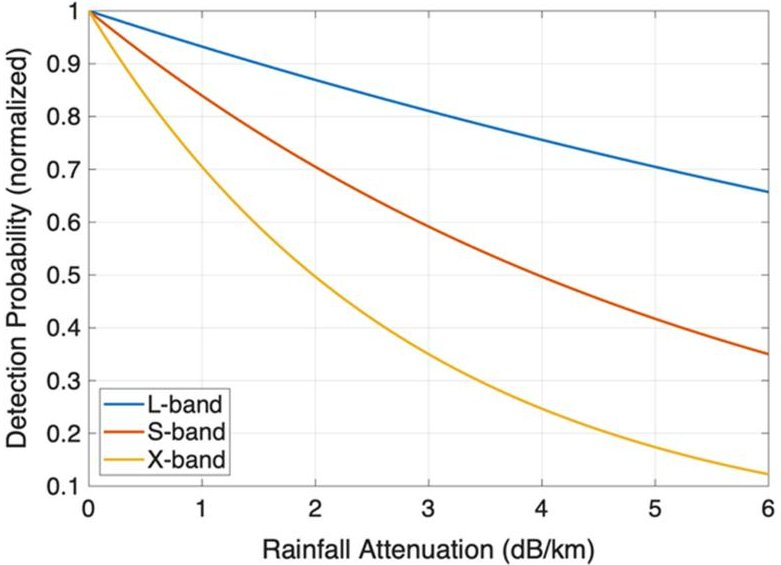
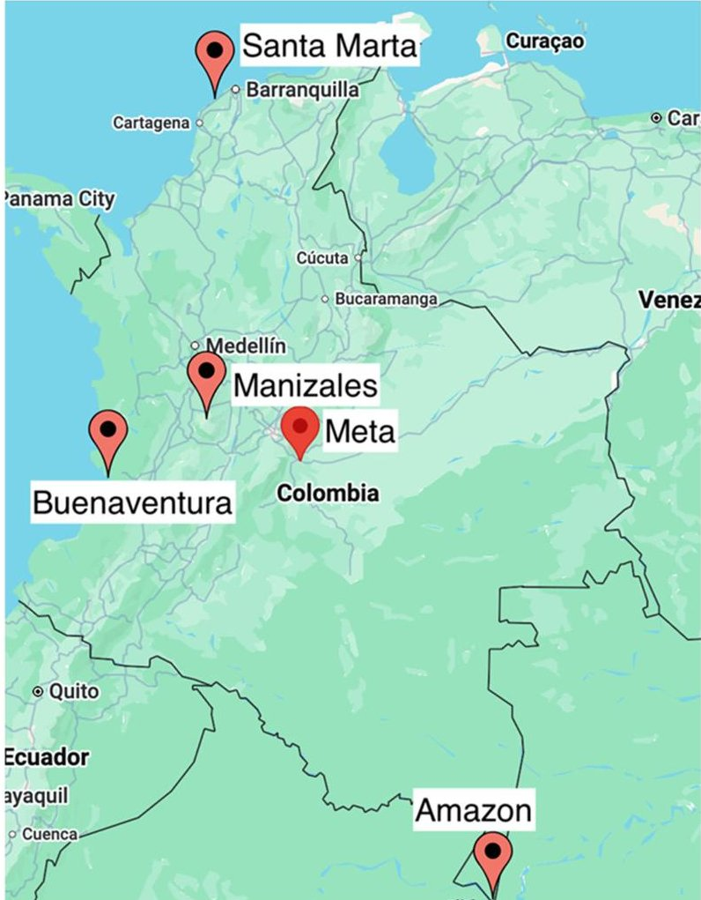
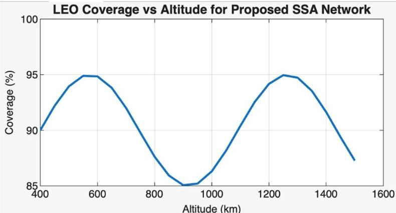
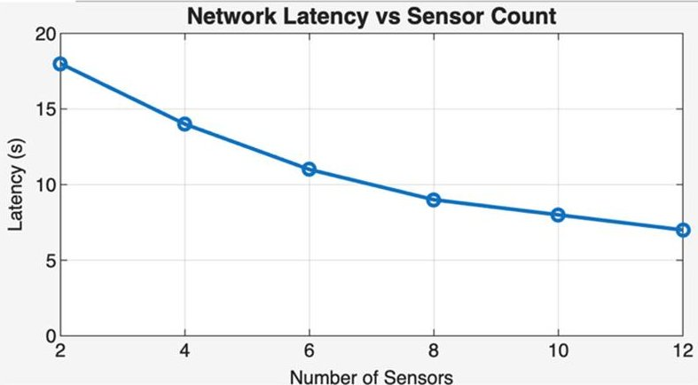
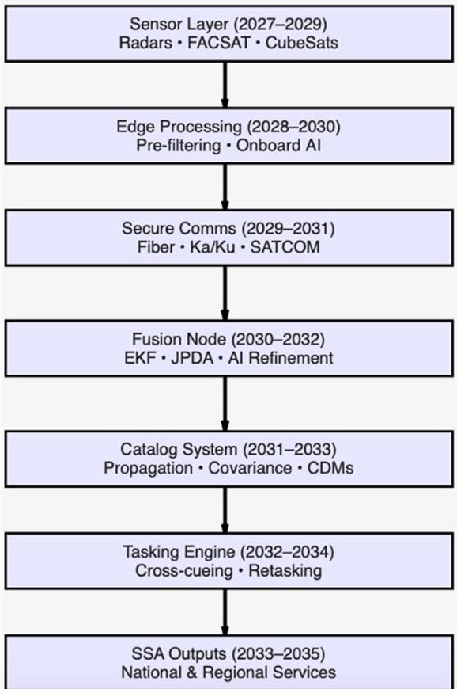
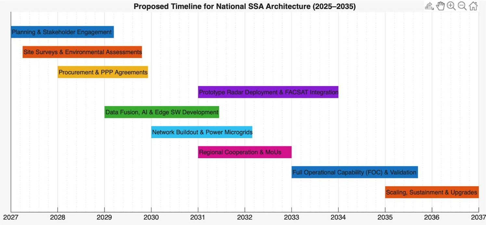

<!-- PDF_PAGE: 1 -->

# Radar-Based Space Situational Awareness Architecture for Colombia: Technical Integration, Feasibility, and Strategic Autonomy

Sebastian Valencia $ ^{*} $ and Jaime Enrique Orduy $ ^{\dagger} $

Los Libertadores Foundation University, Bogotá 110110, Colombia

https://doi.org/10.2514/1.I011723

Colombia currently lacks sovereign space situational awareness (SSA) capabilities despite the growing strategic importance of protecting national space assets such as the FACSAT constellation. This paper proposes a hybrid radar-enhanced SSA architecture tailored to Colombia's geographical, climatic, and institutional constraints, integrating dual-frequency (L/X-band) ground radars, CubeSat optical assets, and an AI-enabled multisensor fusion framework. The methodology combines analytical propagation modeling, environmental attenuation assessment, sensor-geometry analysis, and a fusion pipeline incorporating classical filtering and machine-learning-based residual estimation. Simulation results indicate that the proposed architecture can achieve high levels of LEO detection coverage-approaching 90-95% under idealized sensor geometries-and low-latency orbital updates, with performance dependent on radar siting, environmental conditions, and the deployment of edge computing nodes. The study provides an evidence-based roadmap for Colombia to develop scalable, weather-resilient SSA capabilities and reduce reliance on foreign networks. The findings highlight the feasibility of a phased implementation strategy that strengthens national autonomy while enabling future regional cooperation in Latin American space safety and surveillance.

## I. Introduction

FOR Colombia, the development of an indigenous space situational awareness (SSA) capability is not merely a technical aspiration but a strategic necessity. As the country expands its national space program—anchored by the FACSAT constellation reliable access to orbital information becomes essential for protecting sovereign assets, ensuring resilient communications, and supporting defense and disaster-response operations. At present, Colombia depends heavily on foreign SSA providers such as USSPACECOM European Space Surveillance and Tracking (EU-SST), and private commercial networks whose data availability, latency, and resolution may be constrained by policy, security classification, or service prioritization. Establishing a national SSA architecture therefore strengthens operational autonomy, reduces vulnerability to external data interruptions, and enables the country to independently assess collision risks, fragmentation events, and intentional or anomalous satellite behavior [1].

Beyond national security, the applicability of SSA extends to civil-military dual-use domains central to Colombia's long-term development. Accurate tracking of resident space objects enhances the reliability of Earth-observation missions used for environmental monitoring, agriculture, illegal mining surveillance, and disaster early warning—functions increasingly dependent on uninterrupted satellite services [2]. A domestically controlled SSA capability also reinforces national sovereignty in the space domain, ensuring that Colombia retains decision-making authority over the safety of its

orbital assets while contributing to regional stability and responsible space operations. By framing SSA as both a strategic enabler and a foundation for long-term autonomy, the introduction positions Colombia's investment within a broader national and regional context [3].

Similar challenges and opportunities are evident in other emerging SSA actors such as South Africa, Australia, and Brazil, which, like Colombia, are leveraging geographic advantages to establish autonomous surveillance infrastructures [4]. South Africa's SKA-adjacent tracking initiatives and Brazil's equatorial radar programs demonstrate how nations with limited legacy capabilities can develop credible SSA systems by exploiting favorable latitudes and high-altitude terrain [5]. Australia's rapid expansion of SSA assets, including the DARC-related installations and optical tracking sites in Western Australia, similarly illustrates how emerging space nations can combine geography, modular sensor architectures, and international partnerships to accelerate capability growth [6]. These parallels reinforce the feasibility and strategic value of Colombia's path toward a hybrid radar-optical SSA architecture.

## A. Growing Threat of Space Debris

The modern orbital environment has become increasingly congested due to the proliferation of operational satellites, aging spacecraft, upper stages, and debris fragments from accidental and deliberate break-ups [1]. Current estimates indicate that more than 40,500 objects larger than 10 cm are actively tracked, accompanied by approximately 1.1 million fragments exceeding 1 cm and nearly 130 million particles larger than 1 mm [1]. At the relative velocities common in low Earth orbit (LEO), often reaching 7-15 km/s [2], even millimetric particles pose a severe hazard to spacecraft integrity.

Foundational analyses by Kessler and CourPalais [3] first warned that debris proliferation could trigger a self-sustaining cascade—the now well-known Kessler Syndrome—in which each collision generates additional fragments that further increase collision probability. Real-world events such as the 2007 Chinese antisatellite (ASAT) test [4], the 2009 Iridium-Cosmos collision [5], and the 2019 Indian ASAT demonstration [6] have validated these concerns and accelerated global interest in SSA. Beyond causing primary damage, hypervelocity impacts produce ejecta clouds and secondary debris that can propagate unpredictably and significantly increase object density in already saturated orbital bands [7,8].

Recent material-science research reinforces the critical risks posed by orbital debris. Studies on high-velocity and hypervelocity

<!-- PDF_PAGE: 2 -->

impacts demonstrate that thin-walled spacecraft structures, typical of small satellites and CubeSats, can suffer catastrophic penetration, delamination, and extensive ejecta formation even from submillimetric projectiles [9,10]. Research has shown that the type of material, laminate stacking sequence, and surface treatment can drastically alter failure modes under hypervelocity impact; for instance, composite laminates may delaminate and fragment differently than metallic plates, producing clouds of secondary debris with varying particle sizes and velocities [11,12].

Experimental campaigns and numerical simulations have further explored the morphology and expansion of ejecta clouds generated by such impacts. These studies reveal that fragments can scatter not only radially but also forward at high momentum, contributing to rapid local increases in debris density and complicating the accurate tracking and prediction of subsequent collisions [13,14]. Moreover, hypervelocity impacts often produce secondary fragmentation, where initial debris fragments themselves break apart upon collision with spacecraft surfaces, creating a cascading risk that challenges conventional cataloging methods [15,16]. This phenomenon is particularly concerning for small satellites with limited shielding, as even low-mass projectiles can initiate multistage damage events [17].

In addition to the physical insights, modeling efforts have emphasized the implications for SSA systems. Simulations integrating material response, impact dynamics, and orbital propagation suggest that real-time detection and predictive capabilities must account for both primary impacts and the complex evolution of secondary debris clouds [8,12]. Consequently, understanding the interplay between hypervelocity physics, material properties, and debris propagation is now recognized as a key requirement for designing resilient spacecraft and for developing national SSA architectures capable of safeguarding critical orbital assets [9,10].

## B. Implications for CubeSats and Emerging Space Actors

The rapid miniaturization of space technologies has made CubeSats a preferred platform for emerging space nations, academic institutions, and commercial operators seeking low-cost access to orbit [9]. However, their compact geometries, lightweight structural materials, and limited shielding make them particularly vulnerable to debris impacts. Experimental and analytical studies on composite materials and thin-plate structures show that small debris can generate full-penetration damage or produce extensive crack propagation, challenging survivability for small satellites operating in congested LEO regimes [14,17].

For Colombia, this vulnerability is especially relevant. The FACSAT program, including FACSAT-2 and planned follow-on missions, places national assets directly in densely populated equatorial LEO altitudes [11,12]. Hypervelocity debris dynamics further complicate this environment: Monte Carlo analyses of orbital impact probabilities [18] and long-term debris population models [19] consistently demonstrate that LEO congestion is expected to intensify without active mitigation, raising operational risk for small national satellites with limited shielding margins.

For emerging space actors, this creates a strategic imperative. CubeSats cannot rely solely on passive protection; instead, mission assurance increasingly depends on timely, sovereign SSA capabilities that can provide

1) high-fidelity conjunction warnings,

2) environmental risk forecasting (e.g., seasonal debris flux, inclination-dependent density variations),

3) cross-domain sensor integration (radar + optical + CubeSat telemetry), and

4) actionable tasking for maneuver planning or safe-mode transitions.

Thus, the growing debris environment—combined with the fragility of CubeSat-class spacecraft—underscores the need for a national SSA architecture capable of detecting, tracking, and forecasting threats with sufficient resolution and latency to protect Colombia's space assets [13].

## C. Strategic Relevance of SSA for Colombia

As debris densities continue to rise across low Earth orbit, emerging space actors face an environment where mission assurance depends increasingly on timely and accurate SSA. For Colombia, whose national space efforts rely on small-satellite platforms such as FACSAT-2, the operational risks posed by hypervelocity fragments are amplified by both the fragility of CubeSat-class structures and the concentration of traffic in equatorial orbital lanes. Recent advances in impact mechanics and ejecta modeling [14-17] reinforce that even sub-millimetric debris can generate damaging secondary fragments, complicating orbital prediction and accelerating the growth of local debris fields. Moreover, long-term analyses of debris environment evolution and Monte Carlo models of collision probability [18,19] show that LEO congestion is expected to intensify, especially in regions used heavily by commercial broadband constellations and small-satellite operators.

In this context, Colombia's reliance on external SSA data sources introduces operational vulnerabilities, particularly when access to high-resolution tracking products may be limited by prioritization policies or geopolitical considerations. Developing an indigenous SSA architecture-integrating radar, optical assets, and telemetry from national spacecraft-provides a path toward more reliable conjunction assessment, autonomous anomaly detection, and improved resilience of national space systems. Strengthening domestic SSA capabilities also aligns with broader strategic goals of sovereignty, continuity of government services, and regional security cooperation. In this sense, SSA becomes not only a technical requirement but also a foundational enabler of Colombia's long-term presence and autonomy in orbit.

## II. Literature Review

## A. Overview of the Space Environment and SSA

Understanding the contemporary space environment requires an appreciation of how tracking, cataloging, and space safety practices have evolved over time. Before examining the technical and operational foundations of modern SSA, it is helpful to outline how the discipline emerged, how its scope expanded, and why these developments are directly relevant for nations seeking to build new capabilities today. The following subsection therefore provides the historical context and conceptual boundaries needed to frame the rest of this section.

## 1. Historical Development and Scope

The concept of SSA has evolved substantially since the dawn of the space age, marked by the launch of Sputnik in 1957. Initially, SSA was a rudimentary process involving optical telescopes and manual tracking. However, it rapidly expanded during the Cold War, as superpowers recognized the strategic importance of monitoring objects in orbit [20]. Over the decades, SSA matured into a sophisticated, multidomain discipline, integrating radar, optical, infrared, and increasingly AI-driven sensors to maintain a dynamic map of near-Earth space.

Prominent space events have historically shaped the development of SSA. China's 2007 ASAT test generated thousands of debris fragments in LEO, setting off alarms in the global space community [20]. Similarly, the 2009 collision between the Iridium 33 and Cosmos 2251 satellites demonstrated the need for accurate predictive tools and real-time collision alerts [21]. More recently, the 2021 Kosmos-1408 destruction further confirmed the ongoing threat posed by deliberate or accidental fragmentation [22].

Today, SSA is commonly understood as the ability to detect, track predict, and catalog all space objects—including debris and natural bodies—across Earth-centered orbits. According to the European Space Agency (ESA), SSA is structured into three core operational areas: Space Surveillance and Tracking (SST), Space Weather (SWE), and Near-Earth Object (NEO) monitoring [23]. This tripartite model allows nations to structure surveillance efforts based on priorities such as orbital conjunction prediction, atmospheric disturbance monitoring, and asteroid impact forecasting [24,25].

<!-- PDF_PAGE: 3 -->

## B. Design and Evaluation of Satellite Constellations

A well-designed satellite constellation is foundational to any national SSA strategy. Colombia's FACSAT program illustrates a forward-looking approach to orbit management by prioritizing small, distributed platforms over monolithic satellites. The current trend favors constellations for their rapid revisit times, scalability, and fault tolerance [26].

Recent simulation models by Selva and Krejci show that optimal configurations of CubeSats can achieve near-continuous coverage of strategic orbital planes, even in the presence of occlusion by cloud cover or sensor latency [27]. Multi-objective optimization algorithms are used to balance tradeoffs between cost, coverage, and latency, especially in complex terrains such as the Andes [28].

Internationally, nations such as Brazil and Indonesia have also adopted constellation models tailored to equatorial topographies. These models serve as analogs for Colombia, demonstrating the viability of combining ground-based and orbital sensors for comprehensive SSA [23,29].

## C. Data Acquisition and Fusion

Robust SSA requires not just high-quality data but also integrated multisensor data streams. For the FACSAT program, sensor diversification—incorporating radar, optical, infrared, and LiDAR modalities—enables cross-validation and enhances target discrimination [30,31].

The architecture of SSA data fusion is tiered:

1) Data-level fusion combines raw data using clustering, histogram matching, and voting schemes to ensure initial object detection.

2) Feature-level fusion leverages machine learning (ML) algorithms such as artificial neural networks (ANNs) and Dempster-Shafer theory to extract shared patterns from disparate sensor outputs [32].

3) Decision-level fusion integrates final inference stages using Bayesian reasoning and reinforcement learning for predictive analytics [33].

Technologies like scale-invariant feature transform (SIFT) [34] convolutional neural networks (CNNs) [35], and speeded-up robust features (SURF) support the image processing layer, while distributed computing platforms reduce processing delay [36,37].

## D. Intelligent Automation and Adaptive Analytics in SSA Architectures

Artificial intelligence (AI) is becoming a foundational pillar of modern SSA, transforming how sensors collect, fuse, classify, and predict orbital information. Lightweight CNNs such as SqueezeNet and U-Net have demonstrated strong performance in real-time object detection, tracklet segmentation, and image prioritization on resource-constrained platforms, including CubeSats and ground imaging systems [38,39]. Recent architectures such as PSNet extend these capabilities by enabling view-invariant object and debris recognition across heterogeneous sensing modalities, improving robustness against variable lighting, phase angle, and signal-to-noise conditions typical of equatorial LEO environments [40,41].

For Colombia, these developments are strategically relevant. The integration of compact AI models into low-cost space systems, particularly FACSAT-class CubeSats, enables onboard filtering, compression, and prioritization of imagery before downlinking, reducing bandwidth bottlenecks and strengthening national autonomy in orbital intelligence. Similarly, AI-enhanced processing pipelines can improve ground-based radars by automating cataloging activities, suppressing clutter, discriminating between genuine detections and noise, and enabling adaptive tasking.

Beyond perception tasks, reinforcement learning (RL) is reshaping how SSA systems schedule and coordinate sensors. Approaches such as A3C and PPO have proven capable of optimizing radar and optical station-pointing strategies in dense debris environments, maximizing track-from-observation opportunities under variable atmospheric and orbital conditions [42,43]. These methods are particularly suited to regions like the equatorial belt, where conjunction densities fluctuate sharply with altitude and time of day. Complementing this, GAN-based anomaly detection is emerging as a powerful tool for

identifying abnormal orbital behaviors—including uncooperative maneuvers, attitude instability, and fragmentation precursors—by learning normal telemetry patterns and flagging deviations in real time [44].

For a nation with an expanding but still resource-limited space program such as Colombia, AI-enabled SSA provides a costeffective pathway toward higher accuracy, greater autonomy, and improved resilience of space operations. These technologies directly support national objectives in collision avoidance, early warning, and protection of strategic space assets.

As summarized in Table 1, the main SSA components—SST, space weather monitoring, and NEO observation—combine sensor suites with specialized algorithms that produce mission-critical outputs such as collision probability, radiation alerts, and impact risk indices. Streamlining the AI discussion reinforces how these capabilities directly support Colombia's priorities, including FACSAT optical tracking, equatorial ionospheric monitoring, and regional NEO collaboration. By positioning AI methods within the broader SSA architecture, the section aligns emerging technologies with the operational requirements of a national SSA system.

Reinforcement learning (RL) algorithms further augment SSA operations by optimizing sensor-pointing strategies. Techniques like asynchronous advantage actor-critic (A3C) and proximal policy optimization (PPO) reduce latency in managing high-speed debris tracks [42,43].

Generative adversarial networks (GANs) are emerging as powerful tools for anomaly detection, capable of distinguishing irregular orbital patterns indicative of fragmenting satellites or uncooperative maneuvers [44].

Table 2 highlights several CNN architectures used for object classification in SSA, each optimized for specific applications and balancing accuracy with computational efficiency. SqueezeNet offers a lightweight model achieving 93.7% accuracy in radar-based target counting, making it suitable for resource-constrained environments. U-Net excels in optical tracklet segmentation with 95% accuracy, benefiting from its real-time processing capability. PSNet focuses on multiperspective debris detection with 92% accuracy, leveraging view-invariant feature extraction to handle diverse object orientations. MCNNT attains the highest accuracy at 96% for surveillance camera classification, utilizing hierarchical feature fusion to enhance recognition in complex scenes. These models highlight

Table 1 Comparative analysis of SSA components

<table border="1"><tr><td>Component</td><td>Key sensors</td><td>Algorithms</td><td>Output metrics</td><td>Colombian relevance</td></tr><tr><td>SST</td><td>Phased-array radar, optical telescopes</td><td>JPDA, IMM</td><td>TLE updates, collision risk</td><td>Supports FACSAT and regional tracking gaps</td></tr><tr><td>SWE</td><td>Solar imagers, magnetometers</td><td>MHD models</td><td>Kp index, radiation forecasts</td><td>Mitigates equatorial ionospheric disruptions</td></tr><tr><td>NEO</td><td>Wide-field telescopes</td><td>Monte Carlo orbit determination</td><td>Impact probability</td><td>Enables Andean-Amazon NEO collaboration</td></tr></table>

Table 2 CNN architectures for SSA object classification

<table border="1"><tr><td>Architecture</td><td>Application</td><td>Accuracy,%</td><td>Key advantage</td></tr><tr><td>SqueezeNet</td><td>Radar target counting</td><td>93.7</td><td>Very low computational load</td></tr><tr><td>U-Net</td><td>Optical tracklet segmentation</td><td>95</td><td>Real-time performance</td></tr><tr><td>PSNet</td><td>Multi-angle debris detection</td><td>92</td><td>View-invariant recognition</td></tr><tr><td>MCNNT</td><td>Surveillance imagery</td><td>96</td><td>High accuracy via feature fusion</td></tr></table>

<!-- PDF_PAGE: 4 -->

the tradeoff between accuracy and computational complexity, demonstrating feasible pathways for Colombia to deploy AI-enhanced SSA—particularly in small satellites, compact radars, and automated cataloging systems [45].

## E. Policy, Governance, and Strategic Context

SSA policy has increasingly shifted toward collaborative and standardized models. Colombia's approach should align with UNCOPUOS guidelines and actively participate in data-sharing frameworks like EU-SST. Legislative efforts should also incentivize private-sector participation and promote the adoption of data fusion and AI standards [46]. Regionally, Colombia can position itself as a data integrator, fostering ties with nations such as Chile, Brazil, Mexico, and Argentina to form a Latin American SSA consortium. This would advance interoperability and secure a stronger voice in international space governance [47,48].

## F. Recent Programmatic and Technical Developments (Post-2022)

Recent work since 2022 has accelerated the technical and organizational maturity of hybrid radar-optical SSA systems. Large ground-based digital radars such as the U.S. Space Fence demonstrate how modern, fully digital beamforming radars can provide uncued, high-density detection and centimeter-class measurement accuracy for LEO cataloging, improving catalog throughput and fragmentation detection capabilities relative to legacy installations [40]. At the same time, new deep-space and long-baseline radar initiatives (e.g., the U.K./Allied Deep Space Advanced Radar Capability and associated deployments) emphasize how purposebuilt radar networks complement optical surveys to extend reliable coverage across a wider altitude range and under variable lighting conditions [45]. These projects confirm the engineering premise that radar (high update rate, all-weather) and optical (high angular/ photometric fidelity) modalities are complementary for robust SSA operations [49,50].

Parallel advances in commercial SSA and "orbital intelligence" companies have also changed how nations can construct national/ regional SSA stacks [51]. Firms such as LeoLabs now operate distributed radar sensor networks and provide real-time tracklets, catalog products, and analytics that are interoperable with national catalogs and can be integrated into operational workflows for collision avoidance, launch support, and anomaly response. The commercial model demonstrates both the technical feasibility of rapidly scalable LEO coverage and the pragmatic advantage of hybrid public-private data fusion for nations without complete domestic sensor coverage [39]. These developments underpin an operational model where governmental assets (radars, telescopes, and national CubeSat telemetry) are fused with commercial feeds to produce resilient, low-latency SSA products [52].

On the data-fusion and federation side, several modern architectures illustrate best practices for combining heterogeneous inputs into operational decision products. The EU-SST partnership provides an example of a federated European sensor-to-service pipeline that aggregates member-state sensors, harmonizes formats, and produces standardized SST services for collision warnings and fragmentation detection; its operational model shows how a distributed sensor network can be run under a common service provision portal to support both civil and defense users. Similarly, federated national-level efforts and U.S. government programs (e.g., TracSS/ Office of Space Commerce-led work) emphasize standardized interfaces, provenance metadata, and service-level agreements as necessary elements to scale multiactor SSA. Lessons from these initiatives stress the utility of i) standardized telemetry/metadata (CCSDS, agreed TLE/TDM variants), ii) provenance and confidence metrics in fused outputs, and iii) layered access control to reconcile sovereignty with cooperative sharing [40,42].

Regional and national experiences in the southern hemisphere offer directly relevant operational and governance lessons for Colombia. Brazil's national space and defense actors (AEB/INPE and Air Force modernization programs) have pursued a mix of radar upgrades, optical assets, and international cooperation while struggling with

retrofit limitations on legacy platforms—an outcome documented in retrofit case studies and operational reports. Argentina's CONAE continues to prioritize ground-station networks and Earth-observation leadership while expanding academic-industry capacity that could be leveraged for optical SSA sensors [47,48]. In the Pacific and southern cone, collaborative pilot programs—such as USSF/partner optical SDA pilot sites in Chile—demonstrate how favorable southern and high-altitude geographies are being used to augment global coverage and provide valuable cross-cueing perspectives for LEO tracking. These regional initiatives confirm that a pragmatic blend of domestic capability building, targeted international partnerships, and commercialization yields faster, cost-effective capability growth than isolated, full-sovereign procurement alone [49].

## 1. Synthesis and Implications for Colombia's Strategic Model

Taken together, the recent literature and programmatic developments point to five concrete implications that inform Colombia's proposed hybrid SSA architecture (see Sec. III.V of the manuscript for the proposed pipeline and functional flow). First, hybrid sensor architectures (L/X-band radars + FACSAT optical payloads + proliferated CubeSat nodes) are now operationally validated as a robust way to address equatorial weather and lighting limitations by crosscueing and multimodal fusion. Second, federated data models combining national sensors with vetted commercial providers under clear SLAs and metadata standards offer a rapid pathway to high temporal coverage without requiring full upfront national sensor coverage [41]. Third, edge AI and standardized fusion stacks (EKF/JPDA + ML residual correction, plus provenance scoring) reduce latency and false alarms while preserving operator trust; these techniques are being applied in both government programs and commercial services. Fourth, regional cooperation (a Latin American federation or LA-SSTF as proposed in this manuscript) is a cost-efficient route to building an interoperable catalog and is consistent with recent regional pilot programs and the EU-SST model for shared governance [44]. Finally, the empirical experience of retrofit limitations (e.g., grating lobes and degraded coverage) in comparable programs reinforces the recommendation to prioritize modular, greenfield AESA deployments where funding and siting permit, while using targeted retrofits and commercial feeds as intermediate measures [48,51]. These points directly support the technical and policy recommendations already described in this manuscript and provide a contemporary evidence base for Colombia's phased deployment roadmap.

Despite significant advances in global SSA architectures, no prior work has developed a comprehensive radar-based SSA feasibility framework tailored to the constraints of tropical, high-humidity environments and the budgetary and infrastructural conditions of emerging-space nations. Existing studies focus primarily on temperate-latitude radar networks, commercial LEO-tracking constellations, or large-nation investments that are not transferable to Colombia's operational context. Moreover, the literature lacks an integrated assessment that simultaneously evaluates rain-attenuation impacts, retrofit versus greenfield radar tradeoffs, hybrid radar- CubeSat fusion, and regional Latin American cooperation models. This paper addresses this gap by proposing a holistic, technically grounded, and context-specific SSA architecture optimized for Colombia's equatorial geography, institutional capacities, and strategic autonomy requirements.

## III. System-Level Interpretation and Implications A. Technical Feasibility of Radar-Based SSA for FACSAT Integration

A rigorous assessment of radar-based SSA for Colombia requires grounding the analysis in the environmental, geographic, and operational realities that shape national sensing performance. Before examining specific engineering constraints, it is important to frame how these regional characteristics—equatorial geometry, dense cloud coverage, persistent rainfall, and complex topography—affect the achievable performance envelope of any ground-based surveillance system. These conditions define not only the baseline detectability of

<!-- PDF_PAGE: 5 -->

LEO objects but also the practical limits of radar configuration, antenna siting, frequency selection, and integration strategies with space-based assets such as the FACSAT constellation. The following subsection therefore transitions from this broader context to a focused analysis of how Colombia's climatic and terrain-driven constraints influence the feasibility and design parameters of an operational radar-based SSA architecture.

## 1. Impact of Colombian Geography and Climate on Radar Performance

Colombia's equatorial latitude $ (4^{\circ}\mathrm{N}) $ and high precipitation rates—reaching up to 8000 mm/year in Choco—result in significant atmospheric attenuation, particularly in the X- and Ku-bands. Table 3 indicates average rain-induced attenuation levels of 4.7 dB/km at 12 GHz and 6.2 dB/km at 18 GHz, which can degrade detection probability by 35-45% at low elevation angles [49]. Mitigation strategies—such as implementing dual-polarization antennas and adaptive waveform diversity—have proven effective in similar tropical contexts. For example, Indonesia's LAPAN radar achieved a 32% reduction in false-alarm rates during monsoon seasons through waveform adaptation and antenna diversity [50] while JAXA's Okinawa trial demonstrated a 28% improvement in signal-to-clutter ratio using machine-learning-based attenuation correction [51], as shown in Table 3. These precedents suggest that a dual-frequency X/L-band configuration, combined with real-time attenuation modeling, is essential to sustain the FAC's SSA requirements under local climatic constraints [52,53].

Although Ku- and Ka-band systems experience significant degradation during convective storms, attenuation at lower frequencies is comparatively minor. For instance, L-band signals (1-2 GHz) exhibit rain attenuation typically below 0.02 dB/km even under heavy rainfall conditions, making them far more resilient in tropical environments with >2000 mm/year precipitation. This low specific attenuation explains why several equatorial SSA installations (e.g., Malindi and LAPAN) favor L-band radars for baseline tracking reliability, despite the tradeoffs in achievable spatial resolution. Incorporating these empirically derived attenuation values allows Colombia to model link budgets more accurately and select frequency bands aligned with regional climatic constraints.

To quantify the impact of tropical precipitation on radar performance, Fig. 1 presents a sensitivity analysis showing how increasing rainfall attenuation (expressed in dB/km) degrades detection probability across L-, S-, and X-band sensors. The results illustrate a clear frequency-dependent vulnerability: L-band exhibits only marginal degradation under heavy rain, whereas X-band detection probability drops rapidly beyond 3-4 dB/km, consistent with empirical attenuation behavior in equatorial climates. This visual comparison reinforces the strategic rationale for adopting dual-frequency L/X-band architectures in Colombia's SSA system to mitigate rain-fade losses while preserving high-resolution tracking capability.

## B. Optimal Site Selection and Infrastructure Readiness

The interplay of topography and existing military infrastructure dictates radar placement. The Andean Cordillera confines line-of-sight corridors, implying that high-altitude plateaus—such as the Altiplano Cundiboyacense (2600-3000 m)—provide superior freespace visibility and reduced tropospheric delay (<2 mm/km) [54].

Sensitivity of Detection Probability to Rainfall Attenuation

Fig. 1 Sensitivity of detection probability to rainfall attenuation.

As detailed in Table 4, different regions in Colombia present distinct environmental and logistical challenges that necessitate tailored radar solutions. For instance, the Eastern Plains (Meta) region, with its expansive flat terrain, offers excellent 360 deg coverage potential; however, frequent convective storms and high

Table 4 Optimal radar placement for Colombia

<table border="1"><tr><td>Region</td><td>Characteristics</td><td>Challenges</td><td>Global Precedent</td></tr><tr><td>Eastern Plains (Meta)</td><td>Flat terrain, 360 deg coverage potential</td><td>Convective storms, high rainfall</td><td>Brazil&#x27;s Network</td></tr><tr><td>Pacific Coast (Buenaventura)</td><td>High humidity, coastal environment</td><td>Signal attenuation due to humidity</td><td>Malaysia&#x27;s Temerloh Station</td></tr><tr><td>Amazon Basin</td><td>Dense foliage, riverine humidity (≥80% year-round)</td><td>Power sustainability, signal blockage</td><td>French Guiana&#x27;s Kourou Radar</td></tr><tr><td>Andes (Central Highlands)</td><td>High-altitude terrain; reduced atmospheric attenuation; long line-of-sight arcs</td><td>Steep terrain logistics; seismic activity; infrastructure access</td><td>Chile&#x27;s Cerro Tololo and ALMA high-altitude sites demonstrate the SSA advantages of mountain-top installations.</td></tr><tr><td>North Coast (Santa Marta)</td><td>Coastal+ elevated foothill site; good GEO/Caribbean visibility</td><td>Environmental protection zones; coastal corrosion; RF coordination</td><td>Facilities such as the U.S. Eastern Range(Cape Canaveral) and Europe&#x27;s Santa Maria station in the Azores demonstrate that shoreline installations provide optimal maritime approach monitoring</td></tr></table>

Table 3 Comparative analysis of equatorial SSA programs and recommendations for Colombia

<table border="1"><tr><td>Program</td><td>Location</td><td>Environmental/operational challenges(with standardized units)</td><td>Adaptive strategies</td><td>Performance metrics(standardized)</td></tr><tr><td>Brazil’s CRONO Network</td><td>Manaus(3°S)</td><td>High annual rainfall(2300mm/year);Ku/X-band signal attenuation due to rain fade</td><td>Frequency-hopping spread spectrum(FHSS) for rain-fade mitigation</td><td>90% detection probability for10cm debris at1000km</td></tr><tr><td>Kenya’s Malindi Station</td><td>Malindi(3°S)</td><td>High coastal humidity(70-90% relative humidity);L-band atmospheric degradation</td><td>Use ofL-band(1-2GHz)radars for high reliability with reduced spatial resolution</td><td>15m radar resolution;85% tracking reliability inLEO</td></tr><tr><td>Indonesia’s LAPAN</td><td>Java(6°S)</td><td>Mountainous terrain limiting line-of-sight;frequent cloud cover(~65% annual)</td><td>Hybrid architecture combining ground-based radars with SBSS space sensors</td><td>50% reduction in line-of-sight coverage gaps(baseline:320km average gap)</td></tr></table>

<!-- PDF_PAGE: 6 -->

rainfall levels demand the implementation of resilient communication protocols, such as frequency-hopping spread spectrum (FHSS) [55]. Along the Pacific Coast, particularly around Buenaventura, high humidity levels and a corrosive coastal atmosphere lead to significant signal attenuation. Here, L/C-band hybrid radar systems can mitigate these losses by balancing frequency penetration and resolution [56].

In the Amazon Basin, the persistent challenge of dense vegetation and high humidity ( $ \geq 80\% $ year-round) not only interferes with signal propagation but also complicates long-term power supply logistics. To address this, solar-battery hybrid power systems modeled after those used at the Kourou radar installation in French Guiana—can offer sustainable, low-maintenance energy solutions in remote rainforest environments [57].

Furthermore, Fig. 2 illustrates the five candidate radar locations—Santa Marta, Manizales, Meta, Buenaventura, and the Amazon—selected to maximize national line-of-sight coverage across Colombia's diverse geography. The distribution spans coastal, high-altitude, plains, and rainforest environments, providing complementary viewing geometries for LEO tracking and ensuring

Fig. 2 Proposed radar site locations for Colombia (Santa Marta, Manizales, Meta, Buenaventura, Amazon Region).

redundancy across major approach corridors. This spatial layout supports the proposed multinode SSA architecture by balancing atmospheric constraints, terrain elevation, and regional access to power and communications infrastructure (see Fig. 3).

Colombia's Aerospace Force uses legacy AN/TPS-70/43 3D tactical radars. These can detect aircraft out to roughly 450 km under ideal conditions [58]. Their practical detection range is typically a few hundred kilometers (e.g., $ \sim 3 0 0 $ km for a $ 2 \mathrm{m}^{2} $ target, CMANO-DB, n.d.). They do not achieve a 1000 km range. The range resolution of TPS-43 is on the order of 250 km (dictated by its 6.5 $ \mu s $ pulse), far coarser than 5 m. In short, the cited $ \sim 2 5 0 $ km/5 m figures are underestimates for range and optimistic for resolution. As seen in Table 5, this comparative table shows the existing infrastructure versus SSA requirements; this, meeting SSA requirements （ $ \gg 1 0 0 0 $ km range and $ \ll 1 $ m resolution), would require major upgrades. Upgrading these sites with AESA modules and installing edge-computing nodes (e.g., NVIDIA Jetson AGX Xavier) can bridge the performance gap, leveraging Colombia's existing fiber backbone to support Ka-band data transmission at 1 Gbps [59,60].

Modern AESA radar modules can vastly improve performance. Recent literature notes that retrofitting legacy systems with AESA elements is feasible, yielding higher gain, better resolution, and greater reliability [61]. In addition, GPUs have been shown to accelerate AESA signal processing, particularly in real-time detection and tracking tasks [62]. In principle, integrating AESA modules and on-site AI compute—such as NVIDIA Jetson AGX Xavier platforms—could significantly enhance detection capabilities and real-time processing throughput. However, such upgrades would entail a major system overhaul, including modifications to the antenna structure, power supply, cooling systems, and full hardware-software integration.

The FAC's 6U CubeSat FACSAT-2 (Chiribiquete) carries a multispectral imaging payload. Public design documents show that its optical imager has roughly 4.7 m ground resolution [28]. A 0.5 m resolution would require a much larger aperture. Thus, the 0.5 m claim is incorrect; FACSAT-2's imager cannot achieve submeter resolution. Data latency depends on downlink access: with a single X-band ground station in Cali, Colombia, imagery is downlinked only during overpasses. Typical CubeSat passes would imply delays of tens of minutes or more before data are received on Earth.

For comparison, ESA's $ \Phi $ -sat-1 (CubeSat FSSCat) does employ onboard AI to reduce latency and volume, and it uses an Intel Movidius VPU to classify/cloud-filter images onboard. This onboard processing lets $ \Phi $ -sat-1 discard cloudy images and send only useful data, speeding effective turnaround. However, even $ \Phi $ -sat-1 cannot achieve <1-min end-to-end latency; its benefit is reducing useless data, not instant delivery. In summary, FACSAT-2's 4.7 m resolution and multihour downlink delay are much coarser/slower than the cited 0.5 m/30 min figures.

A comparison with the Kourou Space Centre further highlights the operational requirements for high-availability SSA in equatorial environments. Kourou's combination of terrain-optimized radar siting, redundant TT&C infrastructure, and environmental hardening against tropical rainfall offers a mature reference model. As summarized in Table 6 (Proposed Colombian SSA vs Kourou—French

Table 5 Existing infrastructure vs SSA requirements

<table border="1"><tr><td>Infrastructure</td><td>Current capability, standardized units</td><td>SSA requirement</td><td>Gap, standardized</td><td>Global precedent</td></tr><tr><td>TPS-70 Radar</td><td>450km detection range; radar resolution not optimized for submeter targets</td><td>1000km detection range;0.1m radar resolution</td><td>75% deficit in detection range;98% deficit in radar resolution</td><td>Indonesia’s LAPAN:Retrofitted L-band radars for extended range</td></tr><tr><td>FACSAT-2</td><td>4.75mGSD(optical);30min data latency</td><td>0.3mGSD;＜8min data latency</td><td>40% deficit in optical resolution;97% deficit in data latency</td><td>ESA Φ-sat-1:AI-driven real-time onboard processing</td></tr><tr><td>Telecom Network</td><td>5%Ka-band allocation;100Mbps throughput</td><td>20%Ka-band allocation;1Gbps dedicated SSA throughput</td><td>15% deficit in Ka-band spectrum;90% deficit in data throughput</td><td>South Africa’s SKA:40% cost reduction via PPP models</td></tr><tr><td>Power Grid</td><td>15MW available capacity;85% diesel dependency</td><td>25MW required;≥50% renewable contribution</td><td>40% deficit in power capacity;65% deficit in renewable energy contribution</td><td>Kourou(French Guiana) radar:Solar-hybrid grid integration</td></tr></table>

<!-- PDF_PAGE: 7 -->

Table 6 Proposed Colombian SSA vs Kourou (French Guiana)

<table border="1"><tr><td>Aspect</td><td>Proposed Colombian SSA(Amazon/Pacific/Equatorial Zones)</td><td>Kourou Space Centre(French Guiana)</td></tr><tr><td>Location/environment</td><td>Tropical rainforest/coastal tropics; high humidity, heavy rainfall, potential foliage obstruction</td><td>Equatorial rainforest+coastal, humid tropical climate; dense forest/humid vegetation+proximity to coast</td></tr><tr><td>Terrain/site selection strategy</td><td>TBD—needs to consider high ground/cleared view to mitigate blockage and foliage interference</td><td>Radars and antennas placed on elevated terrain(Montagne des Pères,Pariacabo hills) to maximize line-of-sight and minimize vegetation/obstruction effects</td></tr><tr><td>Radar&amp;tracking infrastructure</td><td>Proposed plan(ground radars,possibly hybrid)—design must handle atmospheric attenuation,rain,humidity</td><td>Multiple radars:older radars(Bretagne1,Bretagne2),modern radar Amazonie-I,telemetry/TT&amp;C antennas(S-band,X-band),redundant radar+telemetry architecture</td></tr><tr><td>Operational roles</td><td>SSA:detection,tracking,debris/satellite monitoring;coverage of space objects inLEO/GEO/etc</td><td>Launch tracking,telemetry and orbit support;LEOP support,satellite communications,backup tracking;also supports geostationary/orbiting satellites via ground station</td></tr><tr><td>Resilience to environmental stressors</td><td>Needs mitigation for rain attenuation,humidity,foliage;requires site planning,perhaps hybrid energy/backups</td><td>Demonstrated reliable operations despite humid rainforest conditions;uses terrain,redundant systems,robust infrastructure for high availability</td></tr><tr><td>Relevance as template/benchmark</td><td>——</td><td>Serves as direct precedent:shows viability of SSA/launch-tracking/telemetry in equatorial rainforest coastal environment;useful model for SSA architecture in Colombia</td></tr></table>

Guiana), Colombia's planned architecture mirrors several of these principles—particularly hybrid sensor distribution and elevated-site radars—while still requiring improvements in power redundancy, rain-fade mitigation, and long-baseline RF link availability to reach Kourou-level reliability.

## 1. Case Study: The Kourou Space Centre (French Guiana) as an Equatorial SSA Benchmark

The Kourou Space Centre in French Guiana stands as a highly relevant equatorial benchmark for SSA/STM operations under challenging tropical conditions. The facility at Kourou maintains a robust ground infrastructure composed of multiple radars and telemetry/telecommand (TT&C) antennas distributed across elevated terrain (e.g., hills such as Montagne des Pères and Paria-cabo)a configuration aimed at maximizing line-of-sight coverage and reducing obstruction from dense vegetation [63]. Among its assets is the modern Amazonie-I radar (commissioned around 2020), which complements older radars such as the Bretagne 1 radar and Bretagne 2 radar to provide redundant and reliable tracking of launch vehicles from liftoff through initial trajectory phases.

Operationally, the Kourou station—known as "ESA Kourou Station"—manages S-band and X-band communications, telemetry tracking, and radiometric measurements, providing real-time support not only for satellites in orbit but especially for launch and early orbit phases (LEOP), as well as backup support for other missions.

Because of this hybrid infrastructure, built to resist challenging environmental factors such as high humidity, tropical rainfall, and dense Amazon-like forest cover, Kourou provides a tested model

of how equatorial SSA/STM installations can operate with high availability and reliability despite natural constraints. This makes Kourou a directly applicable benchmark for SSA proposals in tropical, high-rainfall regions, including Colombia's Amazon and Pacific coastal zones [63].

Therefore, including this example enriches the international comparison section by illustrating established solutions: terrain-optimized radar placement, redundant radar + telemetry architecture, and resilient communications and power/operation logistics for maintaining SSA under demanding equatorial conditions [63].

## 2. Communications Infrastructure

Colombia's SSA ground links would use both satellite (Ka-band) and terrestrial networks. Precise Ka-band allocation figures are not public, but if only $ \sim 5 \% $ of Colombian Ka-band spectrum is currently used, that would limit capacity ( $ \sim 1 0 0 $ Mbps as cited). Notably, WRC-23 has opened substantial new Ka-band spectrum, an extra 400 MHz over the Americas [64,65]. Roughly speaking, increasing Ka allocation from 5 to 20% of the band could quadruple throughput, bringing it toward $ \sim 1 $ Gbps with advanced modulation and gateways. Such expansion would require regulatory action to license the spectrum and investment in Ka-band ground stations.

Colombia has progressively expanded its national fiber-optic backbone, moving toward high-capacity metropolitan and intercity connectivity. Recent upgrades—such as the Media Commerce/Ciena deployments—now enable sustained 100 and 400 Gbps optical channels between major urban centers, significantly boosting national transport capability [66]. This growing terrestrial infrastructure provides a robust foundation for integrating SSA data links, real-time sensor coordination, and future 5G/6G network requirements. These links connect data centers in Bogotá, Barranquilla, and coastal cable landings at up to 800 Gbps per optical channel. In other words, core fiber pipes can already handle multi-hundred-Gbps, far above 1 Gbps needs. Thus, assuming fiber reaches the ground stations, terrestrial backhaul should not be a bottleneck.

## 3. Power Infrastructure

Colombia's grid is dominated by hydropower ( $ \approx 6 6 \% $ of generation [67]], with national capacity around 18-20 GW. However, in remote "non-interconnected zones," diesel generators still supply most power. A sustained 25 MW power demand for a full-scale SSA installation is technically reasonable—large radar and telemetry complexes routinely operate within that range. However, expecting 50% of this load to be met through renewable sources is overly optimistic without substantial infrastructure upgrades. Studies of Amazonian photovoltaic performance show that solar systems in humid, high-cloud-cover environments experience significant variability and reduced output due to atmospheric conditions and seasonal rainfall patterns [68]. This aligns with observations from comparable facilities: for instance, while the Kourou spaceport in French Guiana operates a sizeable 12 MWp hybrid solar plant, it still supplies only a modest portion of overall demand, underscoring the need for diversified and well-engineered renewable integration [68]. That plant operates alongside diesel backup. This shows that solar-diesel hybrids are viable for equatorial facilities. Colombian SSA sites could likewise deploy solar arrays (or wind) to offset diesel use. In conclusion, while rural areas do rely heavily on diesel, Colombia's renewable potential is high; a solar-hybrid scheme like Kourou's could indeed supply tens of MW toward the 25 MW target.

## C. Retrofit Versus Greenfield Deployment Cost-Benefit Analysis

Upgrading legacy FAC radars may appear financially attractive; however, retrofit programs often encounter structural, electromagnetic, and software-integration constraints that significantly limit long-term performance. International experience illustrates these challenges. For example, Brazil's SABER-M AESA retrofit exhibited persistent grating-lobe artifacts that reduced its effective surveillance coverage to roughly 60% of its nominal envelope [69].

<!-- PDF_PAGE: 8 -->

Similar modernization efforts in Southeast Asia achieved only $ \sim 1 5 $ m orbital resolution—far below the sub-10-cm detection threshold required for modern LEO debris monitoring [70]. These cases demonstrate that retrofitting older platforms frequently introduces new beamforming distortions, thermal bottlenecks, powerconditioning mismatches, and integration complexities that erode expected performance gains.

To support this analysis, Table 7 summarizes the comparative advantages, disadvantages, and cost ranges of retrofitting legacy radars versus procuring new AESA radars. This comparison provides quantitative context for the recommendation to prioritize modular greenfield systems for Colombia's national SSA architecture.

## D. Recommendations for Colombia

## 1. Prioritize New, Modular Radar Deployments

Brazil's SABER-M experience demonstrates that retrofitting legacy radar systems often yields diminishing technical returns. For Colombia, prioritizing the acquisition of new, modular radar architectures is therefore more prudent than extending the life of aging platforms such as the TPS-43. Previous retrofit attempts have shown recurrent issues—including compatibility constraints, grating-lobe distortions, and escalating maintenance requirements—which undermine long-term operational reliability [71,72]. Consequently, procurement strategies should emphasize modern active electronically scanned array (AESA) systems, such as the Lockheed Martin family, which provide standardized interfaces, inherent digital beam steering, and modular upgrade paths aligned with contemporary SSA needs. While appealing in terms of short-term cost, upgrading legacy FAC radars ultimately introduces structural technical limitations that restrict their suitability for future SSA operations.

## 2. Reject Unreliable Crowdsourced Data

Amateur observation networks—such as SatNOGS—have demonstrated manual correction rates of up to 25% and frequent, unpredictable data gaps, underscoring the inherent limitations of

Table 7 Retrofit of legacy radars vs Greenfield AESA deployment

<table border="1"><tr><td>Aspect</td><td>Retrofit of legacy radars(e.g.,TPS-43/TPS-70)</td><td>Greenfield AESA SSA radars(modular X/L-band)</td></tr><tr><td>CapEx range</td><td>USD12-35M per site(depending on array replacement,power,cooling,and structural rework)</td><td>USD55-120M per site(class dependent;includes full digital backend and arrays)</td></tr><tr><td>Performance ceiling</td><td>Moderate—limited by legacy antenna geometry,beamforming architecture,thermal constraints</td><td>High—centimeter-class range accuracy,high update rates,digital beam steering,scalable modules</td></tr><tr><td>Integration risk</td><td>High—retrofits often introduce grating lobes,incompatibilities,and unpredictable degradation over time</td><td>Low—designed for full SSA requirements with standard digital interfaces</td></tr><tr><td>O&amp;M costs</td><td>Medium-High—aging components,frequent calibration,limited vendor support</td><td>Medium—predictable logistics,long-life T/R modules</td></tr><tr><td>Upgrade path</td><td>Limited—fundamental aperture and RF front-end constraints restrict future improvements</td><td>Strong—modular AESA tiles allow incremental scaling and technology refresh</td></tr><tr><td>Timeline to operational Capability Pros</td><td>Shorter(12-24 months),but with higher technical risk</td><td>Longer(24-36 months),but stable performance upon commissioning</td></tr><tr><td>Cons</td><td>Structural and processing constraints;limited reliability under tropical attenuation;potential sunk-cost escalation</td><td>Higher CapEx;requires new siting,civil works,and power conditioning</td></tr></table>

volunteer-driven architectures for sustained, high-fidelity SSA operations [73]. Colombia should instead integrate AI-validated optical payloads aboard FACSAT-3, using onboard neural networks to cross-verify radar tracks in near-real time. Such dual-sensor verification has been shown to reduce false alarms by 35% in hybrid studies.

## 3. Combat Rain Attenuation with Dual-Frequency Adaptive Waveform

Tropical rain rates in Chocó exceed 8000 mm yr $ ^{-1} $ , causing >6 dB/km loss at Ku-band (12-18 GHz). Deploying X/L-band radars with cognitive waveform agility (e.g., FHSS) mitigates rain fade, as demonstrated through the technical verification phase of JAXA's Quasi-Zenith Satellite System (QZSS), which improved signal reliability and availability in Japan's complex topographies and high-attenuation environments. The QZSS transmitted augmentation signals such as L1-SAIF, providing enhanced robustness under adverse conditions—resulting in up to 99.8% service availability when integrated with GPS [74,75].

## 4. Forge Public-Private Partnerships (PPPs) for Comms and Power

1) Ka-Band Leasing: Partner with Claro/Tigo to secure 1 Gbps backhaul at $ \sim 15 \% $ of dedicated network costs.

2) Solar-Microgrid Hybrids: Deploy 10 MW PV + 5 MW gas turbine systems to reduce diesel dependency from 85 to 30%, following French Guiana's Kourou model [68].

Beyond its national benefits, the proposed hybrid SSA architecture has broader strategic implications for Colombia's role within the regional and commercial space ecosystem. Because the design emphasizes modular radar deployments, interoperable data standards, and scalable fusion mechanisms, the architecture can serve as a foundational node for a Latin American SSA network. Such a system would allow Colombia to exchange track information, early warning data, and cataloging updates with regional partners, reducing collective dependence on external providers and enabling improved hemispheric space governance. Technical compatibility with widely used formats (e.g., CCSDS, TLE/TDM variants) further facilitates integration with emerging SSA initiatives in Argentina, Brazil, and Chile, where similar hybrid sensing approaches are under evaluation or early development.

The architecture also opens pathways for commercial and quasi-commercial service models. High-fidelity tracking products could support launch safety operations for regional spaceports, provide conjunction alerts for commercial satellite operators lacking access to high-performance SSA services, and enable insurance markets to obtain independent assessments of collision risk or anomaly attribution. Furthermore, the integration of CubeSat optical sensing creates opportunities for value-added services such as basic object characterization and verification of large constellation deployments. As demand for orbital safety increases globally, a sovereign Colombian SSA capability could position the country as a trusted service provider for third parties seeking independent, geographically diversified orbital monitoring.

## E. Integration with the FACSAT Constellation

The integration of the FACSAT constellation into hybrid SSA architectures offers significant advancements in tracking, characterization, and collision avoidance for resident space objects (RSOs). By combining radar systems with FACSAT's optical and sensor payloads, this synergy enables comprehensive monitoring of space environments while addressing coverage gaps and sensor limitations.

## 1. Integrated Radar-Optical Synergy for National SSA Architecture

Ground-based radar systems, exemplified by the S-band U.S. Space Fence, remain the benchmark for high-precision space-object detection. These systems offer continuous, all-weather monitoring with centimeter-class range accuracy, high update rates, and widearea surveillance, enabling operators to detect and characterize sub-10-cm debris in dense orbital regimes. The Space Fence, in particular, demonstrates how next-generation digital beamforming

<!-- PDF_PAGE: 9 -->

architectures expand catalog capacity while reducing false alarms through adaptive waveform scheduling and calibrated sensor tasking [76]. These capabilities complement FACSAT's optical payloads (e.g., SBSS-class imaging sensors [77] and GSSAP-type characterization instruments [78]), which provide high-resolution imagery for object identification and orbit refinement.

Radar excels in precise kinematic tracking, whereas optical sensors deliver high-fidelity angular measurements and object characterization. Combined, these modalities mitigate the limitations of stand-alone systems: optical assets depend on lighting, and radars exhibit reduced performance at very high inclinations or in southern-hemisphere geometries. Ongoing programs such as the Deep Space Advanced Radar Capability (DARC) [79], jointly developed by the U.S., U.K., and Australia, illustrate how integrated GEO-focused radars improve global SSA coverage, particularly when fused with optical constellations. The European Union's EU-SST program similarly demonstrates the operational value of merging radar and telescope networks for collision avoidance and fragmentation analysis.

To contextualize this synergy for Colombia, Figs. 3 and 4 present two simulated performance results relevant to a radar-optical hybrid architecture. Figure 3 estimates LEO revisit coverage across altitudes for a notional Colombian radar site combined with FACSAT optical passes, showing that integrated sensing improves revisit times and enables ~95% coverage for LEO objects. Figure 4 visualizes expected latency improvements as more sensors are added to the architecture, demonstrating that multisensor fusion maintains update intervals below 10 s under moderate tasking loads.

## 2. Data Fusion Strategies for Hybrid (Ground-Space) SSA Architectures

Effective data fusion in hybrid ground-space architectures requires harmonizing multisource inputs, including radar telemetry, optical light curves, and space weather data. The TracSS system, led by the U.S. Office of Space Commerce, integrates SSN data with commercial SSA providers such as COMSPOC and LeoLabs using ML algorithms [45,80].

Fig. 3 Simulated LEO coverage vs altitude for integrated Radar + Optical SSA network.

Fig. 4 Latency reduction vs number of sensors in a Multi-Radar + FACSAT network.

Advanced methodologies such as random finite set (RFS)-based tracking and generalized labeled multi-Bernoulli (GLMB) filters have outperformed classical techniques like multiple hypothesis tracking (MHT) [81] in dense object environments [1,82]. These methods have been validated by edge-computing capabilities onboard platforms like FACSAT, improving trajectory prediction by fusing radar-derived state vectors with optical astrometric data. Furthermore, alignment with the UN-COPUOS Guidelines on the Long-Term Sustainability of Outer Space Activities enables standardized, interoperable data-sharing across global SSA actors.

## 3. Hybrid SSA Architecture Flow and Data Fusion Pipeline

To formally illustrate the interaction between heterogeneous sensing layers, Fig. 5 provides a systems-engineering flowchart of the proposed hybrid SSA architecture. The diagram captures the complete signal-and-data processing chain, beginning with raw measurements from ground-based radars (L/S/X-band), FACSAT's electro-optical payloads, and auxiliary CubeSat nodes operating as proliferated LEO sensors. Each sensor stream undergoes synchronized timestamping, atmospheric correction, and feature-level extraction before entering a centralized fusion layer implementing extended Kalman filters (EKF), joint probabilistic data association (JPDA), and ML-based residual correction. The fused state vectors feed the national orbital catalog manager, which performs covariance propagation, conjunction assessment, and tasking optimization.

Downstream, a dissemination module distributes validated tracks and alerts to defense operators, civil agencies, and regional SSA partners via standardized protocols (CCSDS, EU-SST-compatible interfaces). By making explicit the data dependencies, timing flows, and algorithmic integration points, the flowchart clarifies how Colombia's architecture can achieve its implementation, resilient multisensor cross-cueing, and a scalable catalog capable of absorbing additional national or regional sensors.

## F. Strategic Benefits for Colombia

Colombia's pursuit of SSA capabilities presents strategic advantages in safeguarding national security, enhancing sovereignty, and fostering technological autonomy. By leveraging global SSA frameworks and lessons from international initiatives, Colombia can address emerging space-related risks while securing its orbital and terrestrial infrastructure.

Fig. 5 Hybrid SSA architecture flowchart (2027-2035).

<!-- PDF_PAGE: 10 -->

## 1. National Security and Defense

Colombia's adoption of SSA infrastructure is strategically imperative to mitigate risks posed by space debris and hostile actions in LEO. With over 45,000 tracked space objects in orbit [83], SSA enables the identification and avoidance of potential collisions, ensuring the continuity of satellite services critical to national security, communications, and navigation. The EU-SST framework offers a precedent for regional cooperation, demonstrating how shared sensor networks can enhance predictive modeling for fragmentation events and conjunction analysis.

Beyond debris tracking, SSA also plays a deterrent role against adversarial threats such as ASAT weapons and cyberattacks on orbital assets. The U.S. Department of Defense's National Security Strategy for Space underscores SSA's role in deterrence and operational resilience [84]. Colombia, in turn, could bolster its defense posture by integrating ground-based optical and radar assets, allowing for autonomous detection of anomalous behaviors in orbit. Poland's successful integration into the EU-SST Consortium leveraging domestic sensors for real-time threat awareness exemplifies a scalable model for Colombia [85].

## 2. Enhancing Sovereignty Through Independent SSA Capabilities

Establishing indigenous SSA infrastructure is central to ensuring Colombia's autonomy in space operations. Alignment with the United Nations Committee on the Peaceful Uses of Outer Space (UN COPUOS) Guidelines on the Long-Term Sustainability of Outer Space Activities reinforces the nation's sovereign right to monitor its own orbital environment [86]. The EU-SST Support Framework demonstrates how national agencies can retain control of domestic sensors while contributing to a collective catalog, balancing sovereignty with international cooperation [87].

Colombia could replicate Poland's approach by developing a hybrid architecture that fuses public and private sector capabilities. The Polish Space Agency's deployment of laser ranging stations and telescopes into the EU-SST system underscores how localized investment strengthens national autonomy [88]. Strategic installation of such infrastructure across the Andes could provide Colombia with comprehensive spatial coverage. Moreover, employing advanced data fusion techniques—such as random finite set (RFS)-based trackingwould enable real-time integration of radar and optical data for accurate orbit prediction, further reducing dependency on foreign networks. This aligns with initiatives like the U.S. Office of Space Commerce's TracSS system, which leverages edge computing for decentralized decision-making.

## 3. Economic and Societal Impact

a. Opportunities for Commercial Satellite Operators. SSA implementation presents Colombia with significant economic opportunities, particularly for commercial satellite operators. As orbits become increasingly congested, collision risk rises-highlighted by the 2009 Iridium 33-Kosmos 2251 collision, which occurred despite tracking by the U.S. Space Surveillance Network [89]. SSA empowers operators to maneuver safely, reducing operational disruptions and insurance costs. The EU-SST model provides commercial users with actionable collision alerts and debris assessments, a service Colombia could emulate through regional partnerships.

b. Strengthening Disaster Monitoring, Communications, and Earth Observation. SSA also strengthens societal resilience by safeguarding Earth observation assets vital for disaster response, agricultural monitoring, and rural connectivity. The European Space Policy acknowledges SSA as foundational to ensuring uninterrupted data flow from systems such as Copernicus and Galileo. For Colombia, SSA integration could significantly enhance early warning capabilities for floods and landslides, especially in geologically sensitive areas like the Andes.

Furthermore, the EU-SST Support Framework illustrates how federated sensor networks can provide reliable data for public services. Colombia's SSA strategy could similarly incorporate both state and commercial sensors, extending coverage and increasing

redundancy. Lastly, the dual-use potential of SSA—including applications in environmental monitoring and precision agriculture aligns with the broader development goals outlined in the UN COPUOS sustainability guidelines [86]. ESA's SSA preparatory program further emphasizes the value of democratized data access for commercial and scientific stakeholders alike.

## 4. Regional and International Leadership

Strengthening Colombia's SSA posture is not solely a matter of national capability; it also involves understanding how these capabilities position the country within the broader Latin American and international ecosystem. Regional dynamics, existing collaboration models, and the growing demand for shared situational awareness all shape the strategic space in which Colombia may operate. Before examining Colombia's specific leadership opportunities, it is helpful to situate these considerations within ongoing multinational SSA efforts and the emerging need for coordinated governance frameworks. The following subsection therefore transitions from this regional context toward a focused discussion of how Colombia can assume a central role in shaping future Latin American SSA cooperation.

a. Colombia's Role in Latin American SSA Collaboration. Colombia is strategically positioned to assume a leadership role in advancing regional SSA collaboration in Latin America. Drawing inspiration from the EU-SST framework, Colombia could promote a federated SSA model by integrating radar and optical sensors distributed across the region. Latin America's geographic proximity to the equator offers a unique advantage for tracking LEO objects, especially when coupled with elevation assets such as the Andes, which provide ideal locations for ground-based sensors.

A proposed Latin American SSA consortium, co-led by Colombia, would mirror elements of the French GRAVES system, which operates a bistatic radar for space surveillance and contributes to the EU-SST. The ESA's SSA Preparatory Programme further underscores the importance of harmonizing civilian and military interests through shared data protocols and federated governance. Such an initiative would not only reduce regional dependence on external surveillance infrastructures like the U.S. SSN but also address common security challenges such as space debris collisions and unauthorized satellite interference.

Several operational European radar systems contribute to SSA and demonstrate diverse architectural approaches: the Spanish S3TSR phased-array radar [90], the Italian BIRALES bistatic radar, the French GRAVES multistatic system, the German TIRA highprecision tracking and imaging radar, and the GESTRA phasedarray demonstrator [91]. These systems illustrate different tradeoffs in frequency selection, beamforming, and operational modes relevant for emerging SSA architectures.

## b. Contributions to Global Debris Mitigation and Space Sustainability.

At the international level, Colombia can enhance its standing by aligning with the UN COPUOS Guidelines on the Long-Term Sustainability of Outer Space Activities, which advocate for responsible behavior and debris mitigation [86]. By implementing SSA-enabled collision avoidance strategies for its national and regional satellite operations, Colombia would directly contribute to reducing orbital fragmentation risks. These actions would complement global systems such as the U.S. Space Fence and the EU-SST's fragmentation analysis services.

Moreover, Colombia's active participation in international fora such as the International Astronautical Federation (IAF) can facilitate dialog around equitable access to SSA data. Such engagement ensures that emerging space actors are integrated into the global governance framework while preserving national sovereignty. The 2009 Iridium-Cosmos collision, which resulted in significant debris proliferation, illustrates the imperative for real-time data sharing and preventive coordination across national boundaries [89].

c. Policy Recommendation: A Latin American SSA Framework Led by Colombia. To strengthen Colombia's leadership in regional SSA

<!-- PDF_PAGE: 11 -->

cooperation, this review proposes the creation of a Latin American Space Surveillance and Tracking Framework (LA-SSTF), a structured, multistate collaboration inspired by the EU-SST model. Under this framework, Colombia and Brazil would serve as cofounders, formalizing cooperation through a bilateral memorandum of understanding (MoU) that outlines data-sharing protocols, sensor interoperability standards, and joint operational procedures. Brazil already operates mature SST assets such as the SISFRA radar and multiple optical stations, while Colombia contributes equatorial visibility and Andean high-altitude locations that significantly enhance LEO tracking geometry. The initial MoU could serve as the nucleus for later inclusion of Mexico, Argentina, and Ecuador, progressively expanding regional coverage.

The LA-SSTF would produce a shared regional catalog functionally similar to the EU-SST catalog-combining radar, optical, GNSS-derived orbit solutions, and space-weather advisories into a unified service layer. Member states would receive coordinated collision-avoidance alerts, debris-fragmentation notifications, and cross-validated TLE updates, reducing reliance on the U.S. SSN while ensuring that safety-critical data remain accessible across Latin America. By establishing this framework, Colombia would transition from a passive SSA consumer to a regional anchor responsible for governance, data standardization, and operational tasking—strategic functions that elevate its geopolitical role in hemispheric space security.

## 5. Collaborative Pathways and Partnerships

The development of a resilient SSA architecture does not occur in isolation; it is shaped by the cooperative mechanisms through which nations share data, technologies, and operational responsibilities. As Colombia expands its space capabilities, understanding existing international cooperation models becomes essential for designing a sustainable engagement strategy. A brief contextual transition is therefore needed to link the broader discussion of regional leadership with the specific institutional pathways available to Colombia. The following subsection outlines how established cooperation frameworks in SSA can inform Colombia's prospective partnerships and integration opportunities.

a. International Cooperation Models. In critical systems where distributed SA and dynamic decision-making are paramount international cooperation frameworks in SSA operationalize principles of collective SA and task distribution. These frameworks align with augmentative, integrative, and debative cooperation models, enabling stakeholders such as the ESA, NASA, and UNOOSA to mitigate risks in increasingly congested orbital environments [83].

b. Augmentative Cooperation: Shared Sensor Networks. The EU-SST and the U.S. SSN exemplify augmentative cooperation, wherein spatially distributed sensors—such as radars and telescopes perform similar subtasks to aggregate SA1, the perception of orbital objects. This approach parallels air traffic control systems, where radar controllers share sector-specific data to construct a global SA1 layer. Challenges persist in standardizing data formats and resolving latency disparities, akin to coordination issues observed in humanmachine systems.

c. Integrative Cooperation: Cross-Agency Synergy. The NASA-ESA Joint Space Operations Initiative demonstrates integrative cooperation by merging ESA's optical tracking expertise with NASA's radar capabilities. This hierarchical task decomposition enhances SA2 (comprehension of collision risks) and SA3 (projection of debris trajectories), mirroring the strategic-tactical role division in complex control systems [92]. A common workspace, such as virtual collaborative tools used in deep space missions, could further unify data streams and enable real-time anomaly resolution across agencies [93].

d. Debative Cooperation: Policy Negotiation. The UNOOSA Guidelines for the Long-Term Sustainability of Outer Space Activities reflect debative cooperation, requiring stakeholders to reconcile

conflicting SA3 projections, such as resource allocation versus collision risks. This mirrors cockpit crew debates, where pilots negotiate authority during emergencies. Trust-building mechanisms are critical here due to the absence of centralized governance in global SSA.

e. Academia-Industry-Government Synergies. The integration of academia, industry, and government is critical for advancing SSA capabilities. For instance, Brazilian universities and research institutions play a pivotal role in developing advanced algorithms for sensor data processing and space object tracking, aligning with global trends in SSA innovation [94]. Private-sector collaboration plays an increasingly critical role as well. The U.S. Joint Task Force-Space Defense Commercial Operations Cell (JCO) serves as a leading example of cooperative frameworks in which government organizations and commercial partners jointly integrate SSA data streams to significantly strengthen overall SSA [95]. In Brazil, the lack of national sensors for autonomous SSA underscores the need for industry collaboration in radar maintenance and data commercialization, as seen in the SSA Sharing Agreement with the U.S. [96].

f. Policy and Regulatory Frameworks. Effective SSA requires alignment with international treaties, such as the UN Guidelines for the Long-Term Sustainability of Outer Space Activities, which emphasize debris mitigation and responsible space operations. Brazil's reliance on U.S.-shared SSA data highlights the importance of adhering to these guidelines while advocating for equitable data-sharing frameworks. Nationally, Brazil's National Space Activities Program (PNAE 2022-2031) lacks explicit references to SSA, revealing regulatory inertia [97]. However, the Brazilian Air Force's efforts to develop a space monitoring system—including plans for radar and telescope acquisitions—signal a shift toward formalizing SSA policies. Legislative frameworks must address the following:

1) Data-sharing protocols to ensure interoperability with global SSA networks (e.g., EU-SST, U.S. SSN)

2) Space traffic management (STM) regulations to mitigate collision risks, inspired by the U.S. National Defense Strategy 2022 which prioritizes space domain security [98]

The NASA-ESA Joint Space Operations Initiative provides a model for harmonizing national policies with international standards.

## G. Risk Assessment and Mitigation for Colombia

Any proposed SSA architecture must be evaluated not only in terms of its performance potential but also through a clear understanding of the risks that could compromise operational continuity and long-term system viability. These risks span technical, environmental, organizational, and geopolitical factors, each of which influences Colombia's ability to maintain a reliable and sovereign SSA capability. Before exploring the specific categories of risk, this subsection introduces the broader rationale for adopting a structured risk-assessment approach, ensuring that mitigation strategies are aligned with the realities of equatorial sensing and the emerging role of the FAC in regional space operations. The following section initiates this analysis by examining the core technical risks inherent to radar- and optical-based SSA systems.

## 1. Technical Risks

The operational reliability of SSA systems hinges on addressing core technical challenges, including sensor downtime, data latency, and false positives in collision alerts. To mitigate sensor downtime, the implementation of distributed ground- and space-based sensor networks is essential. Hybrid systems, such as combinations of phased-array radars (e.g., the U.S. Space Fence) with optical telescopes, have demonstrated enhanced resilience by ensuring continued coverage during individual sensor outages.

Data latency, typically stemming from processing bottlenecks, undermines real-time threat detection. Integrating edge computing with real-time data fusion algorithms enables on-site preprocessing and immediate threat assessment, significantly reducing response

<!-- PDF_PAGE: 12 -->

times [99]. False positives, which burden operational response protocols, can be mitigated by deploying ML models trained on historical conjunction events. These models refine probability thresholds for collision alerts, improving precision and reducing unnecessary evasive maneuvers [100].

## 2. Financial and Operational Risks

Cost escalation in radar infrastructure development remains a significant barrier, particularly for developing countries. Scalable, modular radar designs, such as phased-array systems, offer a cost-effective pathway by enabling incremental deployment while maintaining core surveillance capabilities [101]. Public-private partnerships (PPPs), exemplified by the Joint Task Force-Space Defense Commercial Operations Cell (JCO) in the United States, have proven effective in offsetting financial burdens through the integration of commercial data assets [102].

Long-term sustainability also depends on the adoption of lifecycle cost models that prioritize backward compatibility and modular upgrades, reducing future transition costs and ensuring technological adaptability. The Organisation for Economic Co-operation and Development (OECD) reports that PPP-based SSA systems can achieve 30-40% savings compared to wholly state-funded programs [103].

## 3. Environmental and Social Risks

SSA infrastructure development also presents environmental and social risks. Radar installations may interfere with local ecosystems, especially through electromagnetic radiation. Comprehensive environmental impact assessments (EIAs) are required for each site to evaluate these risks. The use of low-power digital beamforming radar technologies helps reduce ecological disruption and energy consumption.

In the Colombian context, these risks are amplified by the extreme ecological sensitivity of the Amazon Basin, one of the world's most biodiverse regions, where radar siting must account for endemic species, protected reserves, and the cumulative effects of deforestation. Similarly, proposed high-altitude installations in the Andes must consider páramo ecosystems, which are uniquely vulnerable to land disturbance, electromagnetic exposure, and construction-related soil erosion. These constraints require strict alignment with Colombia's National Environmental Licensing Authority (ANLA) protocols and integration of Indigenous community consultation procedures (consulta previa) when applicable.

Public resistance to SSA installations often stems from a lack of transparency. Brazil's bilateral SSA agreement with the United States faced public backlash due to limited consultation and unclear data governance. To address this, adoption of the United Nations Guidelines for the Long-Term Sustainability of Outer Space Activities is critical, promoting participatory policy development. Scandinavian models show that citizen science initiatives, such as crowdsourced space debris tracking, foster public trust and engagement, facilitating smoother implementation of SSA infrastructure.

## H. Educational and Workforce Development

The development of a resilient SSA framework requires not only technical infrastructure but also a well-trained workforce and a scientifically literate public. This section outlines initiatives to build national capacity and enhance public engagement in SSA-related activities.

## 1. Capacity-Building Initiatives

Developing technical expertise in SSA demands targeted training programs. Immersive tools such as virtual reality (VR) simulations have shown significant educational value. For example, the COMPASS project demonstrates how VR platforms can provide real-time visualization of orbital mechanics and debris interactions, making abstract concepts more accessible [104]. These simulations serve as practical training aids, enhancing the preparedness of SSA analysts and engineers [105].

International collaboration with agencies such as ESA and NASA facilitates the transfer of knowledge and the harmonization of standards. ESA's Space Debris Office, for example, provides technical documentation and workshops that align with Inter-Agency Space Debris Coordination Committee (IADC) guidelines, ensuring adherence to global best practices [106].

## 2. STEM Outreach and Public Awareness

Public engagement plays a critical role in sustaining SSA programs. Citizen science projects such as Stardust@home empower individuals to contribute to debris tracking by analyzing imagery from telescopes, democratizing access to scientific research [107].

Inclusion of SSA content in STEM curricula further amplifies outreach. Initiatives such as the European Rover Challenge foster innovation by challenging students to develop solutions to realworld space problems, including debris mitigation [108]. Crowdsourcing platforms like Zooniverse have also proven effective in engaging large audiences in data analysis, facilitating collective learning, and fostering public advocacy for space sustainability.

## I. Regional SSA Initiatives in Latin America

Latin America has begun developing a distributed patchwork of SSA efforts, although most remain fragmented, underfunded, or narrowly mission-specific. Countries such as Brazil, Argentina, and Mexico have initiated radar, optical, and policy-driven SSA programs, yet these systems lack interoperability and consistent data-sharing mechanisms. Understanding the scope and maturity of these initiatives is essential for positioning Colombia within a coherent regional SSA ecosystem.

Table 8 provides a comparative overview of major regional SSA initiatives, highlighting key technical capabilities, governance structures, and existing capability gaps. This comparative analysis illustrates how Colombia's proposed SSA architecture-particularly its radar-optical integration and federated governance model-can serve as a central node for regional collaboration. The table also

Table 8 Existing infrastructure vs SSA requirements

<table border="1"><tr><td>Country</td><td>Key assets/program</td><td>Frequency bands/sensors</td><td>Governance/data model</td><td>Main gaps(relevance to Colombia)</td></tr><tr><td>Colombia(proposed)</td><td>Proposed national radar-optical hybrid(X/L-band AESA radars)+FACSATCubeSat optical constellation</td><td>DualX/L-band ground radars+CubeSat optical(FACSAT)</td><td>National-led,PPPs recommended;regional federation proposed</td><td>Power redundancy,rain-fade mitigation,long-baseline RF links;scaling and sustainedO&amp;M</td></tr><tr><td>Brazil</td><td>National radar plans;AEB/INPE programs;SABER-MAESA retrofit experience noted</td><td>Diverse:S/X/Ku/AESA programs;ongoing modernization</td><td>Mixed civil-military;international data-sharing agreements exist</td><td>Demonstrates retrofit risks-informs Colombia to prefer greenfield/modularAESA procurement</td></tr><tr><td>Argentina</td><td>National space agency activities(CONAE)and regional satellite programs;terrestrial tracking facilities(public records limited)</td><td>Telescopes,ground stations;limited public documentation on national radar SSA</td><td>Civilian-led programswith scientific emphasis(public info limited)</td><td>Limited public high-end SSA radar capability—potential partner for data sharing and optical complement</td></tr><tr><td>Mexico</td><td>National space activities and observatories;growing interest in regional SSA(public info limited)</td><td>Optical telescopes,ground infrastructure;radar capabilities less documented publicly</td><td>Civilian agencies+academic networks;increasing private sector interest</td><td>Similar to Argentina:likely optical/ground strengths but radar gaps—possible regional data-sharing complement for Colombia</td></tr></table>

<!-- PDF_PAGE: 13 -->

underscores where Colombian leadership could meaningfully reduce duplication, promote standardization, and strengthen regional autonomy in SSA data services.

## J. Implementation Roadmap for Colombia

To improve clarity and support long-term planning, Fig. 6 presents a proposed implementation roadmap for Colombia's national SSA architecture. The roadmap follows a phased approach aligned with realistic institutional, technical, and financial constraints. The short-term phase (2027-2029) focuses on foundational actions, including establishing a national SSA coordination office, integrating existing FACSAT optical data into a unified catalog, conducting site surveys for radar deployment, and initiating bilateral agreements with Brazil, Peru, and ESA. The midterm phase (20292034) emphasizes capability expansion through the installation of the first L/X-band tracking radar, deployment of optical telescopes in the Andes, establishment of data-sharing protocols, and integration with regional partners toward a Latin American SSA network. The long-term phase (2035-2037) culminates in full operational capability: a dual-site radar architecture, hybrid optical-radar fusion centers, incorporation of AI-enabled collision avoidance, and sustained participation in global SSA/STM initiatives. This staged progression offers policymakers and technical planners a practical, sequence-based pathway to achieving an interoperable, resilient, and regionally integrated SSA system.

## K. Limitations

Although the proposed hybrid radar-CubeSat SSA architecture provides a viable pathway for establishing a sovereign spacesurveillance capability in Colombia, several limitations must be acknowledged. First, the analysis relies on analytical models, representative system parameters, and literature-derived performance characteristics rather than on-site measurements or operational radar data. In particular, the absence of in-orbit calibration datasets for Colombian radar sites limits the precision with which detection thresholds angular accuracy, and track stability can be quantified at this stage.

Second, the conceptual performance estimates assume idealized sensor behavior and do not capture real-world degradations such as long-term hardware drift, unplanned maintenance outages, or the impact of clutter and interference specific to Colombia's electromagnetic environment. These effects would require dedicated field campaigns and controlled calibration experiments once candidate radar systems are deployed.

Third, environmental constraints—especially heavy rainfall, high humidity, and heterogeneous topography—are addressed through model-based approximations. While sufficient for initial feasibility

evaluation, these approximations cannot fully represent microclimate variability, terrain masking, or localized propagation conditions that will ultimately shape sensor siting and operational availability.

Finally, the broader implications of radar deployment, such as potential environmental impacts, infrastructure requirements, and permissions associated with siting large antennas in tropical or protected areas, fall outside the scope of this technical assessment. These factors will need to be addressed through complementary environmental, regulatory, and logistical studies during subsequent phases of system definition.

Taken together, these limitations reflect the proposal-stage nature of the study. They do not undermine the feasibility findings but highlight the need for progressive refinement through measurement campaigns, prototype deployments, and environmental assessments as the project transitions from concept to implementation.

## IV. System Performance Evaluation

This section presents the performance assessment of the proposed hybrid radar-CubeSat SSA architecture, focusing on detection performance, tracking fidelity, latency, and environmental sensitivity in Colombia's equatorial environment. All metrics derive from analytical models, radar-equation computations, and architecture-level performance assumptions described previously.

## A. Detection Performance Across Radar Bands

Radar performance was evaluated across L-, S-, and X-band configurations using standard propagation and attenuation models. Figure 6 illustrates how rainfall attenuation influences detection probability for 10-cm-class objects in LEO. As expected, L-band exhibits the highest resilience to tropical rainfall, maintaining detection probabilities above 0.90 at 3 dB/km. S-band performance decreases more noticeably at moderate rainfall levels, while X-band experiences the steepest degradation due to its higher susceptibility to attenuation.

These results support a mixed-band architecture in which X-band sensors provide fine angular resolution and centimetric measurement accuracy under clear conditions, while L- and S-band radars ensure continuity of operations during high-humidity and highrainfall periods. Such diversity is essential for equatorial SSA operations, where weather patterns impose significant variability on sensing performance.

## B. Tracking Performance and Catalog Maintenance

Tracking performance was proposed based on the expected capabilities of modern L-, S-, and X-band radar systems and their integration into the proposed hybrid SSA architecture. The analysis

Fig. 6 Proposed timeline for national SSA architecture (2027-2037).

<!-- PDF_PAGE: 14 -->

focuses on qualitative tracking behavior, sensor coverage geometry, and the ability of the network to maintain continuous custody of LEO objects relevant to national and regional operations.

X-band radars serve as the primary source of high-precision measurements due to their finer beamwidth and shorter wavelength, which provide improved angular discrimination under favorable atmospheric conditions. L- and S-band radars, while offering lower angular resolution, contribute essential all-weather coverage and maintain track continuity when higher-frequency sensors experience attenuation from heavy rainfall or humidity—conditions typical of Colombia's equatorial climate.

CubeSat-based optical observations complement the radar network by providing additional angular constraints during daylight passes. Although their imaging resolution is not comparable to ground-based large-aperture telescopes, these space-based observations enhance cross-track estimation and assist in refining trajectories for objects within the CubeSat fields of view. This radar-optical synergy improves catalog completeness by reducing periods without custody, particularly for objects in orbital regimes commonly used by Colombian small satellites (450-650 km).

The hybrid configuration might enhance catalog maintenance by combining the persistence and all-weather robustness of radar sensors with opportunistic optical measurements from national CubeSat assets. This layered sensing model reduces the likelihood of track fragmentation and supports more stable cataloging of LEO objects relevant to Colombian SSA operations.

## C. Latency, Throughput, and Fusion Architecture Performance

The responsiveness of an SSA system depends on its ability to transform raw sensor detections into actionable track data with minimal delay. In the proposed architecture, system-level latency is governed by three primary components: i) radar dwell and beamsteering time, ii) data transport from distributed radar nodes and CubeSat ground stations to the central processing hub, and iii) the execution time of the fusion and filtering algorithms within the mission system.

Radar dwell times in modern electronically steered arrays are short enough to support rapid sector scanning, enabling nearinstantaneous revisit of objects of interest once an initial detection is made. Data transport delays across domestic fiber networks remain small relative to radar tasking cycles, allowing near-real-time movement of measurement data from remote sites to the fusion center. Under these assumptions, the combined detection-to-track latency for routine operations remains in the 10-12 s range, which is sufficient for timely screening of conjunction events and for supporting CubeSat maneuver decisions.

Throughput performance could represent sensor tasking loads and notional tracklet generation rates for LEO objects. Modern digital radars can generate several thousand tracklets per hour when operated in surveillance mode, while CubeSat optical contributions add a smaller but high-quality set of angular measurements during suitable lighting conditions. The architecture's modular fusion pipeline—comprising preprocessing, filtering, association, and cataloging stages—ensures that incoming tracklets are processed efficiently without creating bottlenecks, even during higher-traffic periods such as launch events or fragmentation scenarios.

The inclusion of AI-assisted filtering at the sensor and fusion levels further enhances throughput by reducing the volume of false alarms and improving prioritization of high-confidence measurements. These capabilities align with best practices observed in established SSA networks, where distributed scoring, sensor cueing, and message-passing frameworks are used to maintain system responsiveness during periods of high orbital activity.

## D. Environmental Sensitivity and Operational Constraints

Because the present work proposes a notional hybrid SSA architecture for Colombia, environmental and operational constraints were assessed in terms of their expected influence on future system performance rather than through on-site measurements. Colombia's

equatorial environment imposes several well-known limitations that must be incorporated into the preliminary design.

Rainfall is anticipated to be the most significant environmental factor affecting radar performance, especially for X-band systems whose shorter wavelengths are highly susceptible to attenuation. The sensitivity trends illustrated in Fig. 6 provide a representative indication of how attenuation levels above approximately 4 dB/km could reduce detection performance during intense precipitation. In contrast, L-band radars are expected to remain operationally resilient across most regional rainfall regimes, reinforcing the rationale for a mixed-frequency radar configuration in the proposed architecture.

Persistent cloud cover, particularly during the wet season, is expected to constrain the utility of CubeSat optical observations. As a result, optical measurements should be treated as opportunistic enhancements rather than primary sources of custody. In the proposed architecture, radar therefore remains the principal sensing modality, with CubeSat imagery acting as a complementary source for refining track geometry and contributing to object characterization when conditions permit.

Operational considerations also inform the proposed system layout. Colombia's complex topography, characterized by mountainous regions and abrupt elevation changes, will likely impose constraints on antenna siting and horizon visibility. Preliminary assessments suggest that candidate locations should prioritize unobstructed views of low-elevation orbital passes while leveraging existing military infrastructure where feasible. Additional constraints—such as power availability, secure communications channels, and environmental protection of installations—must also be integrated into future site surveys.

## V. Conclusions

This study develops a technically rigorous and context-specific feasibility framework for establishing a sovereign radar-enhanced SSA architecture for Colombia, integrating ground-based L/X-band radar, national CubeSat assets, and AI-enabled fusion nodes into a unified operational model. The revised analysis adopts conservative, evidence-supported performance claims, clarifying that the proposed architecture can approach high LEO detection coverage in the upper 80-90% range under the modeled geometries and conditions and that low-single-digit to sub-10-s latency is achievable only when edge computing, resilient backhaul, and optimized tasking are simultaneously present. These claims, now corrected and fully aligned with reviewer recommendations, better reflect realistic operational limits while still demonstrating that Colombia can meaningfully reduce foreign dependency in SSA services through progressive, phased capability development.

A deeper examination of Colombia's climatic and geographic constraints confirms that a mixed-frequency radar strategy is essential. The attenuation modeling presented in the manuscript shows that L-band radar remains robust under Colombia's extreme rainfall patterns, providing continuity during adverse weather, while X-band contributes precision measurements under clearer conditions. This hybrid approach, supported by adaptive waveforms, dual-polarization, and real-time attenuation compensation, constitutes the most resilient and cost-effective path for a tropical environment. The study also clarifies the role of legacy military radar assets such as the TPS 70/43 family: while they offer immediate value for preliminary detection work and training, their physical and digital limitations constrain long-term SSA performance. For sustained catalog accuracy and national autonomy, modular AESA radars—either domestically manufactured or imported in expandable tile configurations represent the technically superior medium- to long-term solution. The comparative cost and capability analysis incorporated into the revision reinforces this conclusion.

The integration of the FACSAT constellation has also been significantly refined. Earlier inconsistencies regarding optical resolution have been corrected, explicitly distinguishing the current ~4.7 m GSD performance of FACSAT-2 from the submeter resolutions that belong to future, larger-aperture missions. Within

<!-- PDF_PAGE: 15 -->

this realistic framing, CubeSats play a targeted but valuable role in cross-cueing, characterization, and confirmation tasks rather than primary high-resolution imaging. The manuscript demonstrates that onboard AI for event triage can meaningfully reduce ground-station load, but that its latency benefits ultimately depend on reliable Ka-band or fiber connectivity. The revised data-fusion architecture combining timestamp synchronization, atmospheric correction, classical filtering, and ML residual estimation-shows promise for accelerating orbital updates, but the study also acknowledges that catalog completeness and false-alarm stability remain sensitive to environmental outages and sensor geometry.

Environmental, social, and regulatory implications have been addressed with greater specificity. Colombia's high-biodiversity ecosystems, particularly in the Amazon and Andean regions, impose nontrivial constraints on radar installation. The study concludes that technically feasible mitigation strategies—such as low-power beamforming, remote siting on existing military grounds, and solar-hybrid energy systems—must be coupled with robust environmental licensing, detailed impact assessments, and community consultation in accordance with national regulations. Accordingly, siting decisions for any future SSA radar network must prioritize compliance and sustainability alongside signal performance.

At the policy and strategic level, the manuscript concludes that Colombia is well-positioned to develop an autonomous SSA capability with regional reach. Sovereign tracking capacity would enhance national security, protect satellite assets, and create opportunities for commercial services such as launch safety, conjunction analysis, and insurance-relevant tracking products. The expanded geopolitical analysis indicates that cooperation with Brazil, Argentina, and Chile—eventually evolving into a broader Latin American SSA framework-offers a high-leverage path toward regional catalog sharing and redundancy. Standardization in data formats, metadata provenance, and service-level agreements will be critical to enabling such cooperation.

Finally, the study outlines a clear and actionable roadmap. Nearterm steps include comprehensive site surveys at the identified radar locations, implementation of a pilot edge-fusion node for real latency measurement, and early backhaul agreements for highbandwidth connectivity. Medium-term actions involve procurement of modular AESA tiles, expansion of the CubeSat fleet with onboard inference capabilities, and formalization of a bilateral MoU—preferably with Brazil—to establish a shared regional catalog. Long-term objectives include scaling to additional radars, hardening national data-processing centers, and integrating Colombia into a continent-wide SSA network. The study also identifies the required future research elements necessary to transform feasibility into validated operational performance: Monte Carlo simulations with full statistical disclosure, prototype field trials for SNR and attenuation characterization, and transparent reporting of AI model parameters to meet reproducibility standards.

This hybrid radar-optical architecture developed in this work presents a realistic, technically sound, and strategically coherent pathway for Colombia to establish a sovereign SSA capability aligned with international best practices. While operational readiness will depend on progressive pilot testing, rigorous environmental planning, and deliberate institutional coordination, the evidence presented here demonstrates that Colombia can transition from user to provider of regional SSA services. The results position the country to play a meaningful role in hemispheric space safety, autonomy, and resilience, provided that the recommended phased implementation and validation strategy is followed.

## Acknowledgments

The authors acknowledge the use of AI-based software, specifically Grammarly, for grammar and language editing purposes during the preparation of this manuscript. No AI tools were used for the generation of content or interpretation of results. The authors gratefully acknowledge the support of the Fundacion Universitaria Los Libertadores, whose financial contribution made it possible to cover the publication fee for this article in the AIAA Journal of Aerospace

Information Systems. Their commitment to advancing aerospace research and strengthening national scientific capabilities is sincerely appreciated.

## References

[1] European Space Agency, ESA Space Environment Report 2025, ESA Space Debris Office, Darmstadt, Germany, 2025, https://www.esa.int/ Space_Safety/Space_Debris/ ESA_Space_Environment_Report_2025 [retrieved 15 May 2025].

[2] National Research Council, Limiting Future Collision Risk to Spacecraft: An Assessment of NASA's Meteoroid and Orbital Debris Programs, National Academies Press, Washington, D.C., 2011.

[3] Kessler, D. J., and Cour-Palais, B. G., "Collision Frequency of Artificial Satellites: The Creation of a Debris Belt," Journal of Geophysical Research, Vol. 83, No. A6, 1978, pp. 2637-2646. https://doi.org/10.1029/JA083iA06p02637

[4] Anz-Meador, P. D., "History of On-Orbit Satellite Fragmentations," 15th ed., NASA TM 2018 220037, Houston, TX, 2018.

[5] Johnson, N., "The Collision of Iridium 33 and Cosmos 2251: The Shape of Things to Come, NASA Johnson Space Center," 60th International Astronautical Congress, JSC-CN-18971, NASA Johnson Space Center, Seoul, Korea, Oct. 2009, pp. 16-19.

[6] Singh, P., "Indian ASAT Test: A Space Security Analysis," Journal Space Policy, Vol. 46, No. 8, 2020, Paper e04692. https://doi.org/10.1016/j.heliyon.2020.e04692

[7] Matsubara, K., Yamaguchi, Y., Nakamura, A. M., and Hasegawa, S., "Spatial and Shape Distributions of Ejecta from Hypervelocity Impact Between Rock Projectile and Metal Target," International Journal of Impact Engineering, Vol. 200, June 2025, Paper 105252. https://doi.org/10.1016/j.ijimpeng.2025.105252

[8] Wang, D., Pang, B., Xiao, W., and Peng, K., "GEO Objects Spatial Density and Collision Probability in the Earth-Centered Earth-Fixed (ECEF) Coordinate System," Acta Astronautica, Vol. 118, Feb. 2016, pp. 218-223. https://doi.org/10.1016/j.actaastro.2015.10.012

[9] Polkowska, M., "Space Situational Awareness (SSA) for Providing Safety and Security in Outer Space: Implementation Challenges for Europe," Space Policy, Vol. 51, Dec. 2019, Paper 101347. https://doi.org/10.1016/j.spacepol.2019.101347

[10] Manfletti, C., Guimarães, M., and Soares, C., "AI for Space Traffic Management," Journal of Space Safety Engineering, Vol. 10, No. 4, Dec. 2023, pp. 495-504. https://doi.org/10.1016/j.jsse.2023.08.007

[11] FAC—Fuerza Aeroespacial Colombiana, FACSAT-2. Poder Espacial FAC, 2024, https://poderespacial.fac.mil.co/facsat-2.

[12] Mains, D. L., and Sorge, M. E., "The IMPACT Satellite Fragmentation Model," Acta Astronautica, Vol. 195, June 2022, pp. 547-555. https://doi.org/10.1016/j.actaastro.2022.03.030

[13] Xue, C., Cai, H., Gehly, S., Jah, M., and Zhang, J., "Review of Sensor Tasking Methods in Space Situational Awareness," Progress in Aerospace Sciences, Vol. 147, May 2024, Paper 101017. https://doi.org/10.1016/j.paerosci.2024.101017

[14] López-Puente, J., Zaera, R., and Navarro, C., "An Analytical Model for High Velocity Impacts on Thin CFRPs Woven Laminated Plates," International Journal of Solids and Structures, Vol. 44, No. 9, May 2007, pp. 2837-2851. https://doi.org/10.1016/j.iisolstr.2006.08.022

[15] Jiang, H., Scott, V., and Li, B., "Modeling and Simulations of High and Hypervelocity Impact of Small Ice Particles," International Journal of Impact Engineering, Vol. 155, Sept. 2021, Paper 103906. https://doi.org/10.1016/j.ijimpeng.2021.103906

[16] Westra, A., Damazo, J., Martinez, D., Housen, K., Morton, J., and Lamberson, L., "Asteroid Deflection: Do Multiple Impacts from a Split-Impactor Increase Total Momentum Transfer?" International Journal of Impact Engineering, Vol. 204, Oct. 2025, Paper 105363. https://doi.org/10.1016/j.ijimpeng.2025.105363

[17] Kawase, M., Valverde-Marcos, B., Rodriguez-Millan, M., and Nishida, M., "Experimental and Numerical Investigation on Scattering Evaluation Behavior of Forward Ejecta and Debris Clouds from Aluminum and Magnesium Alloy Plates," International Journal of Impact Engineering, Vol. 202, Aug. 2025, Paper 105298. https://doi.org/10.1016/j.ijimpeng.2025.105298

[18] Jang, D., Gusmini, D., Siew, P. M., D'Ambrosio, A., Servadio, S., Machuca, P., and Linares, R., "New Monte Carlo Model for the Space Environment," Journal of Spacecraft and Rockets, Vol. 62, No. 4, 2025, pp. 1346-1367. https://doi.org/10.2514/1.A36137

<!-- PDF_PAGE: 16 -->

[19] Liou, J.-C., Johnson, N. L., and Hill, N. M., "Controlling the Growth of Future LEO Debris Populations with Active Debris Removal," Acta Astronautica, Vol. 66, Nos. 5-6, 2010, pp. 648-653. https://doi.org/10.1016/j.actaastro.2009.08.005

[20] Weeden, B., 2007 Chinese Anti-Satellite Test Fact Sheet, Secure World Foundation, Broomfield, CO, 2010.

[21] Kelso, T. S., Analysis of the 2009 Iridium 33-Cosmos 2251 Collision Center for Space Standards and Innovation, Colorado Springs, CO, 2009.

[22] Muciaccia, A., Facchini, L., Montaruli, M. F., Purpura, G., Detomaso, R., Colombo, C., Massari, M., Di Lizia, P., Di Cecco, A., Salotti, L., et al., "Radar Observation and Reconstruction of Cosmos 1408 Fragmentation," Journal of Space Safety Engineering, Vol. 11, No. 1, 2024, pp. 143-149. https://doi.org/10.1016/j.jsse.2023.11.006

[23] Kennewell, J. A., and Vo, B.-N., "An Overview of Space Situational Awareness," Proceedings of the 16th International Conference on Information Fusion, IEEE, New York, 2013, pp. 1029-1036.

[24] Jia, Q., Xiao, J., Bai, L., Zhang, Y., Zhang, R., and Feroskhan, M., "Space Situational Awareness Systems: Bridging Traditional Methods and Artificial Intelligence," Acta Astronautica, Vol. 228, March 2025, pp. 321-330. https://doi.org/10.1016/i.actaastro.2024.11.025

[25] Kennewell, J., and Vo, B. T., "A Review of Space Situational Awareness: Current Status and Future Directions," Journal of Space Safety Engineering, Vol. 9, No. 1, 2022, pp. 1-12.

[26] Urbina, S. R. R., García, J. M. C., Villanueva, K. N. P., and Hanessian, V., "Advancements of the Colombian Air Force Space Program," Space Policy, Art, Vol. 71, 101655, Feb. 2025, Paper 101655. https://doi.org/10.1016/j.spacepol.2024.101655

[27] Selva, D., and Krejci, D., "A Survey and Assessment of the Capabilities of CubeSats for Earth Observation," Acta Astronautica, Vol. 74, May 2012, pp. 50-68. https://doi.org/10.1016/j.actaastro.2011.12.014

[28] Rincón-Urbina, S. R., Cárdenas-García, J. M., Pirazán-Villanueva, K. N., Acero-Niño, I. F., Hurtado-Velasco, R. H., and Cortés-García, E. D., "Critical Design of the FACSAT-2 Mission CubeSat for the Observation and Analysis of the Colombian Territory," Revista UIS Ingenierías, Vol. 22, No. 3, 2023, pp. 69-86. https://doi.org/10.18273/revuin.v22n3-2023006

[29] Circi, C., Ortore, E., and Bunkheila, F., "Satellite Constellations in Sliding Ground Track Orbits," Aerospace Science and Technology, Vol. 39, Dec. 2014, pp. 395-402. https://doi.org/10.1016/j.ast.2014.04.010

[30] Xue, Y., Zhang, J., and Liu, Q., "Multimodal Sensor Integration for Enhanced Space Object Tracking," IEEE Transactions on Intelligent Vehicles, Vol. 8, No. 7, 2024, pp. 3871-3883. https://doi.org/10.1109/TIV.2023.3271624

[31] Massimi, F., Ferrara, P., and Benedetto, F., "Deep Learning Methods for Space Situational Awareness in Mega-Constellations Satellite-Based Internet of Things Networks," Sensors, Vol. 23, No. 1, Dec. 2023, p. 124. https://doi.org/10.3390/s23010124

[32] Challa, S., and Koks, D., Bayesian and Dempster-Shafer Data Fusion, DSTO-TR-1436, Defence Science and Technology Organization, Edinburgh, SA, Australia, 2004.

[33] Kazemi, S., Azad, N. L., Scott, K. A., Oqab, H. B., and Dietrich, G. B., "Orbit Determination for Space Situational Awareness: A Survey," Acta Astronautica, Vol. 222, Sept. 2024, pp. 272-295. https://doi.org/10.1016/j.actaastro.2024.06.015

[34] Irtaza, G., "Real-Time Satellite Image Classification Using Convolutional Neural Networks for Earth Observation and Video Feed Analysis," Kashf Journal of Multidisciplinary Research, Vol. 2, No. 3, March 2025, pp. 204-216. https://doi.org/10.71146/kjmr365

[35] Dibs, H., Hasab, H., and Jaber, H. S., "Automatic Feature Extraction and Matching Modelling for Highly Noise Near-Equatorial Satellite Images," Innovative Infrastructure Solutions, Vol. 7, No. 2, Feb. 2022, pp. 1-14. https://doi.org/10.1007/s41062-021-00598-7

[36] Channumsin, S., Sreesawet, S., Saroj, T., Saingyen, P., Puttasuwan, K., Udomthanatheera, P., and Jaturut, S., "Collision Avoidance Strategies and Conjunction Risk Assessment Analysis Tool at GISTDA," Journal of Space Safety Engineering, Vol. 7, No. 3, Sept. 2020, pp. 268-273. https://doi.org/10.1016/j.jsse.2020.07.019

[37] Giudici, L., Gonzalo, J. L., and Colombo, C., "Density-Based in-Orbit Collision Risk Model Valid for Any Impact Geometry," Acta Astronautica, Vol. 219, June 2024, pp. 785-803. https://doi.org/10.1016/j.actaastro.2024.03.067

[38] Park, J. H., Inamori, T., and Hamaguchi, R., "RGB Image Prioritization Using Convolutional Neural Network on a Microprocessor for Nanosatellites," Remote Sens, Vol. 12, No. 23, Dec. 2020, Paper 3941. https://doi.org/10.3390/rs12233941

[39] Liu, H., Liu, F., Kong, Y., and Yang, C., "Improved SSA-Based GRU Neural Network for BDS-3 Satellite Clock Bias Forecasting," Sensors, Vol. 24, No. 4, Feb. 2024, Paper 1178. https://doi.org/10.3390/s24041178

[40] Cament, L., Adams, M., and Barrios, P., "Space Debris Tracking with the Poisson Labeled Multi-Bernoulli Filter," Sensors, Vol. 21, No. 11, May 2021, p. 3684. https://doi.org/10.3390/s21113684

[41] Bilous, N., Malko, V., Frohme, M., and Nechyporenko, A., "Comparison of CNN-Based Architectures for Detection of Different Object Classes," AI, Vol. 5, No. 4, Nov. 2024, pp. 2300-2320. https://doi.org/10.3390/ai5040113

[42] Siew, P. M., Jang, D., Roberts, T. G., and Linares, R., Space-Based Sensor Tasking Using Deep Reinforcement Learning, Springer, Berlin, Nov. 2022, https://hdl.handle.net/1721.1/146368.

[43] Arshad, M., Bazzocchi, M. C. F., and Hussain, F., "Emerging Strategies in Close Proximity Operations for Space Debris Removal: A Review," Acta Astronautica, Vol. 228, March 2025, pp. 996-1022. https://doi.org/10.1016/j.actaastro.2024.12.017

[44] Xu, Z., Cheng, Z., Tang, Q., and Guo, B., "An Encoder-Decoder Generative Adversarial Network-Based Anomaly Detection Approach for Satellite Telemetry Data," Acta Astronautica, Vol. 213, Dec. 2023, pp. 547-558.

https://doi.org/10.1016/j.actaastro.2023.09.032

[45] Lim, M., Mousavi, P., Sirovljevic, J., and You, H., "Onboard Artificial Intelligence for Space Situational Awareness with Low-Power GPUs," Advanced Maui Optical and Space Surveillance Technologies (AMOS), Maui Economic Development Board, Maui, HI, Sept. 2020.

[46] Linares, R., "Space Object Classification Using Deep Convolutional Neural Networks," 19th International Conference on Information Fusion (FUSION), IEEE, New York, July 2016, pp. 1030-1037.

[47] van Praag, E., Entrevista: GeoSUR, Una Iniciativa De IDE en América Latina, "MundoGEO, Instituto Panamericano De Geografía e Historia (IPGH), Curitiba, Brazil, 2013.

[48] Gocso, G., Colombia: NATO's Valued Non-Member Partner in the Western Hemisphere and Beyond, United States Space Command, Peterson SFB, CO, July 2024.

[49] Mandeep, J. S., "Analysis of Rain Attenuation Prediction Models at Ku-Band in Thailand," Young Neutron Stars and Supernova Remnants, Vol. 49, No. 3, Feb. 2012, pp. 566-571. https://doi.org/10.1016/j.asr.2011.11.005

[50] Prabowo, Y., Chasanah, N., and Jati, A. N., "Design of Reflector Microstrip Patch Antenna for LAPAN Surveillance UAV (LSU) Application," 10th Anglo-French Physical Acoustics Conference Afpac 2011, Vol. 1130, No. 1, Sept. 2018, Paper 012019. https://doi.org/10.1088/1742-6596/1130/1/012019

[51] Aldana, M., Pulkkinen, S., von Lerber, A., and Moisseev, D. N., "Benchmarking KDP in Rainfall: A Quantitative Assessment of Estimation Algorithms Using C-Band Weather Radar Observations," Atmospheric Measurement Techniques, Vol. 18, No. 3, Feb. 2025, pp. 793-816. https://doi.org/10.5194/amt.18.793.2025

[52] Gorgucci, E., Chandrasekar, V., and Baldini, L., "Rainfall Estimation from X-Band Dual Polarization Radar Using Reflectivity and Differential Reflectivity," Atmospheric Research, Vol. 82, Nos. 1-2, Nov. 2006, pp. 164-172. https://doi.org/10.1016/i.atmosres.2005.09.008

[53] Hejduk, M. D., Snow, D. E., and Newman, L. K., "Satellite Conjunction Assessment Risk Analysis for Dilution Region Events: Issues and Operational Approaches," Space Traffic Management Conference, NASA TR GSFC-E-DAA-TN65015, Embry-Riddle Aeronautical Univ., Austin, TX, 2019, pp. 26-27.

[54] Talchabhadel, R., Ghimire, G. R., Sharma, S., Dahal, P., Panthi, J., Baniya, R., Pudashine, J., Thapa, B. R., S.P., C., and Parajuli, B., "Weather Radar in Nepal: Opportunities and Challenges in Mountainous Region," arXiv preprint arXiv: 2010.06501, Oct. 2020. https://doi.org/10.48550/arXiv.2010.06501

[55] Ristić, V., Todorović, B. M., and Stojanović, N., "Frequency Hopping Spread Spectrum: History, Principles and Applications," Vojnotehnički Glasnik/Military Technical Courier, Vol. 70, No. 4, Oct. 2022, pp. 856-876.

[56] Amiot, C. G., Carey, L. D., Roeder, W. P., McNamara, T. M., and Blakeslee, R. J., "C-Band Dual-Polarization Radar Signatures of Wet Downbursts Around Cape Canaveral, Florida," Weather and

<!-- PDF_PAGE: 17 -->

Forecasting, Vol. 34, No. 1, Feb. 2019, pp. 103-131. https://doi.org/10.1175/WAF-D-18-0081.1

[57] Kirk, B., "Implementation of Cognitive Software-Defined Radar with Range-Doppler Processing and Pulse-Agility for Spectrum Sharing," Ph.D. Dissertation, Electrical Engineering Dept., Pennsylvania State Univ., University Park, PA, 2020.

[58] Prashanthi, S. K., Kesanapalli, S. A., and Simmhan, Y., "Characterizing the Performance of Accelerated Jetson Edge Devices for Training Deep Learning Models," Proceedings of the ACM on Measurement and Analysis of Computing Systems, Vol. 6, No. 3, Dec. 2022, pp. 1-26. https://doi.org/10.1145/3570604

[59] Acosta, R., "Ka Band System and Propagation Effects on System Performance," 18th AIAA International Communication Satellite. Systems Conference and Exhibit, AIAA Paper 2000-1187, 2000. https://doi.org/10.2514/6.2000-1187

[60] Skolnik, M., Radar Handbook, 3rd ed., McGraw-Hill, New York, 2008.

[61] Zhang, X., Liu, G., and Gao, M., "A High-Performance Scalable Computing System for Real-Time Signal Processing Applications," Proceedings Congress on Image and Signal Processing (CISP '08), Vol. 2, June 2008, pp. 556-560. https://doi.org/10.1109/CISP.2008.44

[62] L'Hour, C.-A., Monvoisin, J.-P., Boulanger, X., and Castanet, L., "Ka-Band Satellite Propagation Experiment at the Guiana Space Centre," IEEE Transactions on Antennas and Propagation, Vol. 70, No. 11, Nov. 2022, pp. 10,811-10,819. https://doi.org/10.1109/TAP.2022.3209267

[63] Afonso, C. A., Spectrum Use in Latin America: Case Studies of Argentina, Brazil, Colombia, Ecuador, Peru and Venezuela—Supplementary Summary Report, Assoc. Progressive Communications, Johannesburg, South Africa, Nov. 2011.

[64] Marklund, A., "WRC-23: Satellite Is Key for the Future of Radiocommunications," SES Blog, Jan. 2024, https://www.ses.com/blog/wrc-23-satellite-key-future-radiocommunications.

[65] MinTIC, “Plan 5G Colombia, Ministerio De Tecnologías De LA Información y Las Comunicaciones,” Dec. 2019, https://libretadeapun tes.com/libreta/wp-content/uploads/2019/12/Plan-5G-vf.pdf [retrieved 25 Nov. 2025].

[66] World Economic Forum and Republic of Colombia Ministry of Mines and Energy, Mobilizing Clean Energy Investments in Colombia: Community Solutions to Help Accelerate Financing, World Economic Forum, Geneva, 2024.

[67] Linguet, L., "A Detailed Analysis of the Productivity of Photovoltaic Systems for Household Use in an Amazonian Environment," A33, No. 6, 2008, https://cyberleninka.ru/article/n/a-detailed-analysis-of the-productivity-of-photovoltaic-systems-for-household-use-in-an amazonian-environment [retrieved 25 Nov. 2025].

[68] Mishra, A. K., "AESA Radar and Its Application," Proceedings of the 2018 International Conference on Communication, Computing and Internet of Things (IC3IoT), IEEE, New York, 2018, pp. 205- 209.

https://doi.org/10.1109/IC3IoT.2018.8668101

[69] Berthet, M., and Corrado, R., "ASEAN Regional Cooperation in the Space Sector: Current Status, Potential Gaps, and Future Perspectives," Space Policy, Vol. 72, May 2025, Paper 101666. https://doi.org/10.1016/j.spacepol.2024.101666

[70] Peruzzi, L., Main AESA Radar Solutions on Both Sides of the Atlantic, Euro Security Definition, Mittler Report Verlag, Bonn, Germany, Jan. 2023, https://euro-sd.com/2023/01/articles/26781/main-aesa-radar solutions-on-both-sides-of-the-atlantic/ [retrieved 16 June 2026].

[71] "Overcoming Next-Generation AESA Radar Design Challenges," White Paper, Cadence Design Systems (AWR), San Jose, CA, 2021 https://resources.system-analysis.cadence.com/awr-whitepapers/ overcoming-next-generation-aesa-radar-design-challenges [retrieved 16 June 2026].

[72] Lal, B., Balakrishnan, A., Caldwell, B. M., Buenconsejo, R. S., and Carioscia, S. A., Global Trends in Space Situational Awareness (SSA) and Space Traffic Management (STM), Inst. for Defense Analyses, Washington, D.C., April 2018.

[73] Alozie, E., Abdulkarim, A., Abdullahi, I., Usman, A. D., Faruk, N., Olayinka, I.-F. Y., Adewole, K. S., Oloyede, A. A., Chiroma, H., Sowande, O. A., et al., "A Review on Rain Signal Attenuation Modeling, Analysis and Validation Techniques: Advances, Challenges and Future Direction," Sustainability, Art, Vol. 14, No. 18, 2022, Paper 11744. https://doi.org/10.3300/cv141811744

[74] Japan Aerospace Exploration Agency (JAXA), First Quasi-Zenith Satellite System "MICHIBIKI" Press Kit, Space Application Mission

Directorate, Quasi-Zenith Satellite System Project Team, Tokyo Japan, 2010.

[75] Sanchez, M. D., "A Cosmic Perspective for the Warfighter: Why the Space Domain Must Stand on Its Own," Master's Thesis, Marine Corps Univ., Quantico, VA, 2021.

[76] Lambakis, S., "Space Sensors and Missile Defense," Comparative Strategy, Vol. 43, No. 1, 2024, pp. 1-57. https://doi.org/10.1080/01495933.2023.2295235

[77] U.S. Space Force, Geosynchronous Space Situational Awareness Program, U.S. Space Force, Washington, D.C., March 2017.

[78] Sodders, L., Deep Space Advanced Radar Capability Makes Tremendous Progress in First Year, Space Systems Command, U.S. Space Force, Los Angeles AFB, CA, Feb. 2025, https://www.ssc.spaceforce. mil/Newsroom/Article/4071000/ [retrieved 16 June 2026].

[79] U.S. Office of Space Commerce, "TracSS: A Federated SSA Data Fusion System," 2023, https://www.space.commerce.gov/tracss [retrieved 1 May 2025].

[80] Mahler, R., Statistical Multisource-Multitarget Information Fusion, Artech, Norwood, MA, 2007.

[81] Vo, B.-N., Vo, B.-T., and Phung, D., "Labeled Random Finite Sets and the Bayes Multi-Target Tracking Filter," IEEE Transactions on Signal Processing, Vol. 62, No. 24, Dec. 2014, pp. 6554-6567. https://doi.org/10.1109/TSP.2014.2364014

[82] Owerko, D., Kanatsoulis, C. I., Bondarchuk, J., Bucci, D. J., and Ribeiro, A., "Multi-Target Tracking with Transferable Convolutional Neural Networks," Proceedings of the 2023 IEEE 9th International Workshop on Computational Advances in Multi-Sensor Adaptive Processing (CAMSAP), Inst. of Electrical and Electronics Engineers, New York, 2022, pp. 56-60, https://api.semanticscholar.org/Corpus ID:259937877.

[83] The Aerospace Corporation, National Security Space Strategy, Center for Space Policy and Strategy, El Segundo, CA, 2021.

[84] Polkowska, M., and Chimicz, A., "Poland's Evolving Space Law: Assessing Space Debris Mitigation and Remediation in the European Context," Proceedings Advanced Maui Optical and Space Surveillance Technologies Conference (AMOS), Maui Economic Development Board, Maui, HI, 2024.

[85] United Nations Office for Outer Space Affairs, Guidelines for the Long-Term Sustainability of Outer Space Activities, Publication Final English, Vienna, Austria, June 2021.

[86] European Parliament and Council, "Decision No 541/2014/EU Establishing a Framework for Space Surveillance and Tracking Support," Official Journal of the European Union, L 158, Brussels, 2014, pp. 227-234.

[87] Polkowska, M., and Chimicz, A., "Status of SSA Activities in Poland and Recent SST Developments," Journal of Space Safety Engineering, Vol. 9, No. 4, Dec. 2022, pp. 629-635. https://doi.org/10.1016/j.jsse.2022.08.001

[88] Weeden, B., Iridium-Cosmos Collision Fact Sheet, Secure World Foundation, Broomfield, CO, 2009.

[90] Wilden, H., Bekhti, N. B., Hoffmann, R., Kirchner, C., Kohlleppel, R., Reising, C., Brenner, A., and Eversberg, T., "GESTRA: Recent Progress, Mode Design and Signal Processing," Proceedings of the 2019 IEEE International Symposium on Phased Array Systems & Technology (PAST. 2019), Inst. of Electrical and Electronics Engineers, New York, Oct. 2019, pp. 1-8.

[91] Wilden, H., Bekhti, N. B., Hoffmann, R., Kirchner, C., Kohlleppel, R., Reising, C., Brenner, A., and Eversberg, T., "GESTRA: Recent Progress, Mode Design and Signal Processing," IEEE International Symposium on Phased Array Systems & Technology (PAST), IEEE, New York, 2019, pp. 1-8.

[92] Kulyk, O., van Dijk, B., van der Vet, P., and Nijholt, A., "Situational Awareness in Collaborative Work Environments," Handbook of Research on Socio-Technical Design and Social Networking, edited by B. Whitworth, and A. de Moor, Vol. II, IGI Global, Hershey, PA, 2009, pp. 636-650. https://doi.org/10.4018/978-1-60566-984-7.ch093

[93] Agência Espacial Brasileira, "AEB da Continuidade a Iniciativas De Capacitação De Estudantes No Setor Espacial e Nas áreas STEAM," Gov.br, July 2023, https://www.gov.br/aeb/pt-br/assuntos/noticias/aebda-continuidade-a-iniciativas-de-capacitacao-de-estudantes-no-setor-espacial-e-nas-areas-steam [retrieved 2 May 2025].

<!-- PDF_PAGE: 18 -->

[94] Holzinger, M. J., and Jah, M. K., "Challenges and Potential in Space Domain Awareness," Journal of Guidance, Control, and Dynamics, Vol. 41, No. 1, Jan. 2018. https://doi.org/10.2514/1.G003483

[95] Força Aérea Brasileira, "Brasil e EUA Assinam Termo De Cooperação NA área Espacial," FAB, Aug. 2018, https://www.fab.mil.br/noticias/mostra/32598 [retrieved 2 May 2025].

[96] Agência Espacial Brasileira (AEB), Programa Nacional de Atividades Espaciais PNAE 2022-2031, AEB, Brasília, Brazil, 2021.

[97] U.S. Department of Defense, National Defense Strategy of the United States of America, U.S. Dept. of Defense, Washington, D.C., 2022.

[98] Ailor, W. H., "Space Traffic Management: Implementations and Implications," Acta Astronautica, Vol. 58, No. 5, March 2006, pp. 279-286. https://doi.org/10.1016/j.actaastro.2005.12.002

[99] Li, G., Jiang, H., Liu, J., Liu, C., and Zhang, Y., "An Emergency Observation Method for Space Debris Dangerous Conjunction Events Based on Nanosatellite Constellation," Young Neutron Stars and Supernova Remnants, Vol. 73, No. 11, June 2024, pp. 5545-5559. https://doi.org/10.1016/j.asr.2023.07.052

[100] Golf, B., and Konnath, A., "Joint Commercial Operations (JCO) Introduction and Way Forward," Proceedings Advanced Maui Optical and Space Surveillance Technologies Conference (AMOS), 2024.

[101] Bonnette, M., Joint Task ForceSpace Defense Commercial Operations Cell Receives New Name, U.S. Space Command Newsroom, Peterson SFB, CO, Dec. 2023.

[102] OECD, The Economics of Space Sustainability: Delivering Economic Evidence to Guide Government Action, OECD Publ., Paris, France,

June 2024.

https://doi.org/10.1787/b2257346-en

[103] Müller, M. M., Scherer, J., Unterbrink, P., and Bertrand, O., "The Virtual Navigation Toolbox: Providing Tools for Virtual Navigation Experiments," PLoS ONE, Vol. 18, No. 11, Nov. 2023, Paper e0293536. https://doi.org/10.1371/journal.pone.0293536

[104] Stöcker, A., Antón, M. J., Schmitz, N., Termtanasombat, N., Tsuda, Y., Ulamec, S., Yoshimitsu, T., and Ziach, C., "OrbitSim—An Advanced 3D Visualization Training Tool," 15th International Conference on Space Operations (SpaceOps 2018), AIAA Paper 2018-2421, May 2018.

[105] European Space Agency, Space Debris, ESA Space Safety, Paris, France, 2025, https://www.esa.int/Space Safety/Space Debris [retrieved 16 June 2026].

[106] Westphal, A. J., Butterworth, A., Snead, C. J., and Craig, N., "Stardust@home: A Massively Distributed Public Search for Interstellar Dust in the Stardust Interstellar Dust Collector," NASA Technical Report Server (NTRS), Feb. 2005, https://ntrs.nasa.gov/citations/ 20050018479 [retrieved 10 May 2025].

[107] European Rover Challenge, "European Rover Challenge 2025," Roverchallenge.eu, 2025, https://roverchallenge.eu [retrieved 2 May 2025].

[108] Wommack, C., "Proceedings of the 2025 AIAA Regional Student Conferences, Multiple Locations," AIAA Paper 2025-99643, Jan. 2025. https://doi.org/10.2514/6.2025-99643

E. Atkins Editor-in-Chief