<!-- PDF_PAGE: 1 -->

# Supporting the Integration of Cyber-Physical Systems into Aerospace Assembly, Integration, and Testing

Matteo Marinacci, $ ^{*} $ Jacopo Rossi, $ ^{\dagger} $ and Michele Pasquali $ ^{\ddagger} $

Sapienza Università di Roma, 00185 Rome, Italy

Ala Arman $ ^{\S} $

Universita Telematica San Raffaele, 00166 Rome, Italy

Massimo Mecella and Paolo Gaudenzi** Sapienza Università di Roma, 00185 Rome, Italy

https://doi.org/10.2514/1.I011726

The Industry 4.0 paradigm is profoundly transforming aerospace assembly, integration, and testing (AIT) processes by fostering the integration of advanced digital technologies. This paper first introduces a novel framework that incorporates a domain-specific language (DSL) for structuring and standardizing assembly instructions, enabling automation, real-time adaptability, and reduced human error. This is complemented by advanced capabilities such as object recognition, tracking, and real-time sensor integration for contextual awareness and dynamic guidance. We then demonstrate the integration of cyber-physical systems (CPSs) and extended reality (XR) into aerospace AIT workflows, providing immersive, real-time support for operators. The framework is validated through the assembly of a CubeSat, in which 40 aerospace experts were divided into control and XR-assisted groups. Comparative evaluation demonstrated improvements in terms of efficiency, assembly accuracy, and overall usability. The XR-assisted group completed tasks more rapidly and with fewer errors, particularly in complex operations. Participants also reported higher satisfaction, perceiving the system as more intuitive and engaging than traditional methods. These results confirm the potential of XR- and DSL-driven CPS frameworks to enhance both operational performance and user experience in aerospace AIT.

## I. Introduction

THE global manufacturing landscape is undergoing a significant transformation with the advent of the fourth industrial revolution, commonly referred to as Industry 4.0. This paradigm shift is defined by the integration of advanced digital technologies into traditional manufacturing processes to enhance productivity, efficiency, and adaptability [1-3]. Industry 4.0 embodies the convergence of cyber-physical systems (CPSs), the internet of things (IoT), big data, and artificial intelligence to create intelligent and autonomous production environments [4-9].

At the core of this transformation lies the concept of smart manufacturing (SM), an approach that leverages real-time data, advanced analytics, and connected devices to dynamically adapt production systems to changing conditions and customer demands [11-13]. SM aims to optimize operational performance, minimize waste, reduce time-to-market, and improve the customization and quality of manufactured products [5,14-16]. These goals are achieved through a combination of flexible automation, real-time monitoring, and human-machine collaboration [17,18].

Key enabling technologies (KETs) for Industry 4.0 (cf. Fig. 1) underpin the SM paradigm by providing the technological infrastructure necessary for digital transformation. Among these, i) IoT facilitates seamless communication between devices; ii) extended reality (XR), including virtual and augmented reality (VR/AR), enables human-in-the-loop (HITL) processes, in which, rather than replacing human labor, the XR system augments it by offering intelligent, context-aware, and intuitive support throughout complex operational tasks; iii) digital twins (DTs) offer realtime digital representations of physical systems; and iv) CPSs integrate computational algorithms with physical processes through feedback loops and sensor networks [10]. These technologies work in synergy to create responsive, intelligent manufacturing environments.

Smart factories, powered by these technologies, represent a fundamental shift from centralized, rigid automation systems to decentralized, adaptive networks of devices and operators [19]. CPSs, in particular, play a pivotal role by enabling real-time interaction between digital and physical domains, leading to enhanced control, predictive maintenance, and system optimization [20].

The aerospace sector is among the most technologically demanding manufacturing domains, where product complexity, high-value components, and rigorous safety requirements impose significant challenges on production processes [21-23]. In particular, assembly integration, and testing (AIT) operations for spacecraft and aircraft demand high precision, traceability, and adaptability. These operations are traditionally labor-intensive, with assembly tasks requiring skilled human workers to perform complex procedures with minimal tolerance for error. Despite advancements in automation, many aerospace assembly tasks remain manual due to the need for flexibility, low production volumes, and the high cost of error or rework [24-29]. Extended reality (XR) technologies offer promising solutions by delivering intuitive, contextual guidance to operators through immersive displays, thus improving training, task execution, and situational awareness [30-34]. Moreover, the integration of CPSs in aerospace manufacturing can dramatically improve real-time monitoring and control. These systems incorporate sensors, actuators, and embedded

<!-- PDF_PAGE: 2 -->

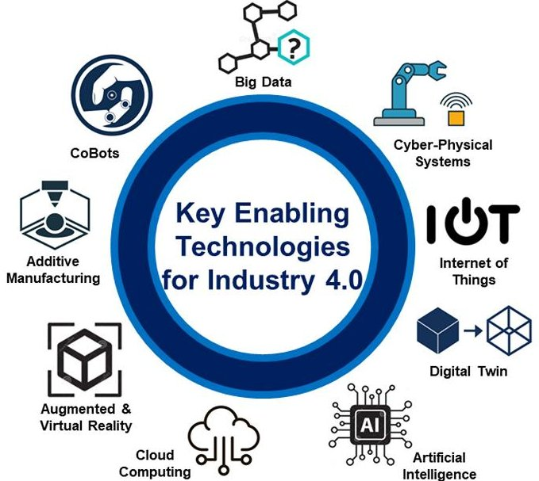

Fig.1 The key enabling technologies (KET) in smart manufacturing [10].

software to adapt to environmental and system changes, offering a pathway to semi-automated and fully adaptive assembly environments [35-37]. Figure 2 depicts the typical structure and workflow of a CPS, emphasizing its ability to bridge digital and physical domains.

However, several challenges hinder the widespread adoption of XR and CPS technologies in aerospace AIT. These include limited interoperability between systems, the lack of standardized frameworks for integration, insufficient responsiveness of XR interfaces, and the cognitive burden on operators navigating complex instructions [39-44].

The challenges of SM, together with the lack of standardized frameworks for integrating emerging technologies into AIT processes, highlight a broader question: How can advanced digital technologies be systematically integrated into manufacturing workflows to reduce waste, minimize errors, and improve overall productivity through more adaptive and context-aware assembly support? To address this question, the current paper proposes a novel XR-assisted CPS framework that leverages a domain-specific language (DSL) for the structured modeling of assembly tasks and contextual information flows. The framework supports real-time interaction between physical assembly processes and virtual guidance, enabling hands-free, adaptive instructions tailored to specific assembly contexts. This architecture is demonstrated through a representative case study involving the assembly of a CubeSat [45], showcasing improvements in operational efficiency, error reduction, and user experience. By bridging immersive interfaces with structured CPS workflows, the proposed solution represents a step forward in the realization of intelligent aerospace manufacturing systems. This work represents an extension of the preliminary paper [46] by presenting the general framework and architecture, providing a practical demonstration, and presenting the outcomes of a dedicated validation. For repeatability and openness of the research outcomes, all the artifacts (source code of the framework, models, DSL files, etc.) are available at the link https://github.com/ MizuNoMashu/Project_XR_Aerospace.

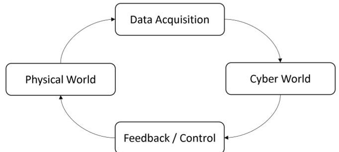

Fig. 2 The structure, workflow, and elements of a typical CPS [38].

## II. Related Work

In this section, we survey relevant literature across the main areas relevant to our work: i) the integration of CPSs into manufacturing assembly, integration, and testing (MAIT); ii) extended reality (XR), focusing on aerospace applications; iii) DSLs for technical workflows; and iv) evaluation methodologies of XR systems using standardized tools such as NASA-TLX, SUS, and ANOVA.

## A. Integrating CPSs and DTs in MAIT

The integration of CPSs into MAIT has been explored, with many studies focusing on immersive technologies such as XR and DT to support these processes. Several works emphasize the role of XR in strengthening CPS-driven workflows through improved visualization, interaction, and real-time guidance [32, 47-55]. For example, in [47], the authors present a CNC simulation system using AR and RGB-D cameras to visualize virtual workpieces for real-time code verification. In [48], AR and SM are combined to allow users to design 3D objects in an augmented space and fabricate them directly. The CPS in [49] integrates AR and DT for real-time monitoring of construction machinery through a digital-physical link and an AR interface. In [50], the authors propose a modular CPS architecture guided by standards such as IEC 62264 and RAMI 4.0 to orchestrate human-robot collaboration. The paper [51] introduces an AR-based spacecraft assembly system using HoloLens, gaze control, and optimization algorithms to suggest component placements. The research in [52] develops an AR-guided repair system using Unity and Vuforia, helping with composite repair through instructional overlays. In contrast, our proposed system offers a comprehensive and user-centered framework that tightly integrates XR with CPSs for aerospace AIT. Unlike broader approaches, it focuses specifically on aerospace needs, emphasizing practical application and strong human-computer interaction (HCI) foundations. The performed validation with real assembly tasks supports our claim.

In [53], a VR/MR-enhanced CPS framework supports simulation-based training for orthopedic surgery, featuring immersive VR with HTC Vive $ ^{\mathrm{TM}} $ [56] and MR using green screen technology within a cyber-physical system based on the internet of medical things (IoMT). Meanwhile, in Ref. [32], the authors present AeroVR, a VR environment for aerospace design that visualizes aerodynamic performance and geometry using interactive 3D models and parameter-space reduction techniques. In contrast, our framework takes a holistic approach to XR-CPS integration, specifically tailored for aerospace AIT. Demonstrated through a CubeSat case study with IoT support, it goes beyond previous work focused on surgical training or design visualization.

The authors in [54] propose a method for developing a cyberphysical-social metaverse system that fuses digital twins, XR, AI, and robotic/gaming technologies to deliver immersive, interactive cultural heritage experiences. In contrast, our work targets operational aerospace assembly, introducing a CPS-XR framework with a DSL, an object-recognition pipeline, and adaptive XR instructions supporting real AIT workflows. Compared to their metaverse-oriented, experience-driven CPS, our approach focuses on taskdriven, procedure-centric XR integration for precise and reliable physical assembly execution.

The study in [55] proposes a method that evaluates how different human-CPS interaction modalities-such as immersive VR, handgesture control, and voice commands-affect usability and task performance in a robotic construction-monitoring system. In contrast, our work focuses on aerospace assembly, introducing a CPS XR framework with a DSL, an object-recognition pipeline, and adaptive XR instructions to support precise AIT workflows. Compared to their human-interaction-centered evaluation, our approach provides task-driven, real-time XR guidance tightly integrated with CPS logic for operational assembly execution.

Research has explored the use of digital twins (DTs) to strengthen CPS integration for real-time monitoring, decision-making, and system optimization [57-62]. In [57], a DT-based framework combined with XR was applied to manufacture brake discs, improving coordination, reducing errors, and improving decision-making

<!-- PDF_PAGE: 3 -->

through real-time simulation. In [58] , the authors introduced a highaccuracy DT using virtual commissioning, with HIL/SIL simulations and DRL agents for dynamic scheduling. In [59] , the authors developed a DT for FDM printing, integrating real-time monitoring, MPC, and cybersecurity to optimize performance and prevent defects. In [63] , a WAAM DT architecture employed CNNs, 3D visualization, and secure data exchange for real-time monitoring and defect detection. In [60] , the authors proposed a DT shop floor model to enhance SM through real-time data acquisition, modeling, and AI-based coordination. Our framework stands out by tightly integrating XR and CPSs for aerospace AIT, focusing on real-time monitoring, improved user interaction, and validated performance. It offers a human-centered solution that increases efficiency, precision, and safety in aerospace assembly and testing.

The authors in [61] propose a method that integrates a live digital-twin-based system on the cloud with VR to create immersive and interactive manufacturing education environments, improving user understanding and troubleshooting abilities through real-time DT-VR coupling. In contrast, our work does not focus on education but on operational aerospace assembly, introducing a CPS-XR framework with a DSL, an object-recognition pipeline, and adaptive XR instructions tailored to AIT workflows. Compared to their work, our approach shifts from learning-oriented DT-VR experiences to workflow-embedded, task-driven XR support for precise assembly execution in the real world.

The study in [62] proposes a method that integrates digital twins with on-device AI to enable distributed intelligence, real-time decision-making, and adaptive lifecycle management for intelligent CPSs, validated through a microfactory testbed. In contrast, our work focuses on aerospace assembly support, introducing a CPS-XR framework with a DSL, an object-recognition pipeline, and adaptive XR guidance for AIT tasks. Compared to their systemlevel CPS-DT intelligence layer, our approach targets human-in-the-loop, task-driven XR assistance directly embedded in real-world assembly workflows.

## B. XR Applications in Aerospace

In recent years, immersive technologies such as XR-encompassing AR and VR—have emerged as promising tools in aerospace engineering, astronaut training, and industrial assembly domains. These technologies allow the creation of controlled, cost-efficient, and safe environments for training, design validation, and procedural testing.

VR has been successfully explored as an alternative or complement to traditional training methods. Guthridge and Clinton-Lisell [64] demonstrated that VR simulators provide comparable performance improvements to PC-based simulators for pilot training, particularly in visual maneuver accuracy. In [65], a VR-based training system for satellite assembly, integration, and testing (AIT) has been developed. Their study showed that VR can effectively reproduce cleanroom operations and significantly increase trainee confidence while reducing dependency on costly hardware. The astronaut domain has also benefited from immersive environments. For this purpose, in [66] the authors proposed the integration of mixed reality (MR) and digital twins for astronaut training, validating their approach through highly accurate orbital and telemetry simulations. Similarly, in [67], the authors provided a systematic review of immersive technologies in space research, identifying key applications in astronaut training mission planning, and health management.

AR and VR have also proven particularly effective in AIT contexts. The European Space Agency project described in [68] leveraged AR with AI-powered object detection and pose estimation (via YOLOv7 and GDRNPP) to support satellite assembly and integration tasks. This system, deployed on the Microsoft HoloLens 2, demonstrated high accuracy in real-time part recognition, annotation, and guidance enhancing operator efficiency and reducing human error.

NASA has compared VR to physical mock-ups for early spacecraft habitat design [69], showing that VR evaluations are strongly correlated with physical evaluations, while offering unique advantages such as better simulation of microgravity and a cost reduction compared to physical mock-ups. Although physical environments

remain necessary for tactile assessments, VR has demonstrated great effectiveness for rapid design iteration and preliminary configuration analysis.

Overall, AR and VR applications in aerospace and industrial contexts highlight their potential to improve training efficiency, reduce costs and risks, and provide realistic simulations of complex environments.

## C. Domain-Specific Languages for Smart Manufacturing in XR Workflows

In recent years, DSLs have become a central enabler for integrating XR technologies within industrial and aerospace contexts. Their adoption reflects a shift toward model-based and immersive engineering workflows, aimed at improving productivity, traceability, and human-system interaction across the entire lifecycle—from design to assembly and testing.

Early research in the aerospace sector demonstrated the potential of DSLs for concurrent and collaborative design environments. Cole et al. [70] introduced an approach to customize diagrams and language patterns for subsystem engineers involved in concurrent spacecraft design. Through domain-specific profiles, simplified notations, and direct connections to parameter databases, this work allowed engineers to engage in model-based systems engineering without needing deep domain expertise. It established usability principles, such as responsiveness, domain-oriented visual elements, and database integration, that continue to influence modern XR-driven tools. This vision of accessible, reusable model-based tooling was extended in [71] with a model-driven, low-code framework for ground support equipment (GSE) configuration and automated testing. By generating XML-based configuration files and validation procedures automatically, the proposed work significantly reduced the manual engineering effort in spacecraft verification and validation. Its structured, reusable approach provides a strong conceptual foundation for current XR environments that seek to overlay interactive testing and configuration workflows onto physical systems.

In this context, the evolution of DSLs and AR-enabled modeling is represented by a series of contributions [72,73]. These works introduced formal frameworks where AR acts in coordination with DSLs, allowing domain experts to visualize, configure, and manipulate elements directly within their physical environment. In [72], the authors demonstrate how no-code AR modeling makes it easier to deploy AR applications simply by specifying domain models. In [74], there is an integration of gesture and voice interactions, enabling engineers to interact naturally with digital twins, thereby bridging conceptual modeling and tangible industrial practice. Similarly, in [73], the authors expanded the approach by defining AR metamodels and interaction semantics, proving that physical-virtual integration can transform domain modeling into a context-aware, spatial activity that is directly linked to Industry 4.0 applications such as maintenance, logistics, and assembly planning. Parallel research [75] extends DSL applications to safety- and security-critical engineering, emphasizing that DSLs can bridge requirements engineering and automated verification through formalized, behavior-driven templates. Their use to define executable scenarios for IoT systems demonstrates how DSLs can ensure traceability and compliance-capabilities that are increasingly crucial in XR-assisted industrial training and validation contexts.

The practical implementation of these concepts in the aerospace field was introduced in our previous work [46], which proposed an Industry 4.0 framework for immersive satellite assembly and testing. The architecture integrates XR interfaces with a DSL that formalizes components, assembly procedures, and test logic. This approach enables operators to follow adaptive, AR-based work instructions that remain automatically aligned with evolving product configurations. By embedding DSL-driven logic within XR environments, the framework ensures flexible and error-resilient manufacturing workflows-particularly well suited to the complexity and precision demands of aerospace systems. The present paper extends and evaluates this foundational work.

Building on this trajectory, DSLs emerge as the semantic backbone of next-generation XR systems, unifying models, data, and

<!-- PDF_PAGE: 4 -->

human interactions into coherent, extensible, and verifiable digital engineering ecosystems.

## D. Evaluation Methodologies for AR/VR Systems

Evaluating immersive systems such as AR and VR requires a multidimensional methodological framework that integrates objective performance metrics with subjective user evaluations. Across the literature, both quantitative and qualitative tools have been systematically adopted to assess usability, cognitive load, learning efficacy, and user experience. The most prevalent methodologies include the system usability scale (SUS) for perceived usability, the NASA Task Load Index (NASA-TLX) for workload assessment, and statistical techniques such as ANOVA, t-tests, and regression analysis to determine the significance of observed effects.

Objective performance measures typically include task completion time, error count, and accuracy rate. In Ref. [76], the authors demonstrated that AR-based instructional overlays in object assembly tasks substantially reduced human error and cognitive demand compared to printed or screen-based manuals, using ANOVA to confirm statistical significance. Similar quantitative approaches were applied in a VR-based manufacturing training system [77], where participants trained in immersive VR achieved faster assembly times and lower error rates than those in traditional instruction. In aerospace maintenance contexts, in [78], the authors employed pre- and post-tests to show that AR training enhanced long-term memory retention compared to text-based methods. Comparable evaluation frameworks have been used in flight simulation studies: [64] applied ANOVA to compare performance metrics such as altitude precision, lateral deviation, and airspeed across VR, confirming significant improvements for both immersive and nonimmersive simulators.

Subjective assessment is equally crucial for understanding usability and workload. In [79], the authors utilized the SUS to evaluate VR technologies. In astronaut training, in [80], the authors combined SUS, the Smart Glasses User Satisfaction (SGUS) scale, and the QUIS questionnaire to assess AR-supported maintenance tasks. For cognitive workload analysis, Li et al. [81] investigated gesture versus voice interaction in AR cockpit interfaces using NASA-TLX and situational awareness scales, finding that gesture control increased mental and physical effort, while voice control reduced

frustration and improved awareness. Likewise, in [82], it is established that there is a strong inverse correlation between the severity of usability problems and SUS scores, showing that high-severity issues significantly elevate cognitive load. Integrating subjective and physiological data has become a recent trend: In [83], the authors correlated vocal sentiment with NASA-TLX frustration scores in collaborative VR tasks.

In summarizing these concepts, we converge on the idea that comprehensive evaluation requires the integration of objective measures (time, errors, accuracy) and subjective assessments (SUS NASA-TLX, ANOVA), supported by rigorous statistical validation.

## III. Case Study: AIT of a CubeSat's Structure

The proposed framework is illustrated through a case study focusing on a CubeSat [84]. Introduced in 1999 by Stanford and California Polytechnic State Universities, CubeSats are costeffective modular satellites widely adopted by academia, industry, and space agencies such as NASA [85] and ESA [86] and maintain standardized design specifications. Our case study examines the structural subsystem of a 1U (a cube measuring 10 cm $ \times $ 10 cm $ \times $ 10 cm) CubeSat from NPC Spacemind [87]. The structure comprises a primary structure, often called a frame or chassis, that carries the satellite's major loads. A chassis consists of upper and lower frames and four rails (see Fig. 3a). The secondary structure, which is designed to support internal components, includes four rods assembled inside (see Fig. 3b). The assembly procedure also considers an empty electronic board that mimics the CubeSat payload (see Fig. 3c). The CubeSat chassis is assembled using 16 screws, which mechanically secure the four rails to the upper and lower frames. In addition, the four internal rods are fastened with 8 screws and a spacer, ensuring structural integrity. Before integrating the CPS capabilities, a comprehensive analysis of the assembly process was performed, identifying 86 specific steps (see Table 1 and https://github.com/MizuNoMashu/Project_XR_Aerospace/blob/main/Documents/Montaggio\%20Cubesat.csv). Each step was meticulously documented, detailing the components used, required actions, precise positioning, and necessary tools. To streamline the assembly process, these steps were grouped into 10 macrosteps (see Table 2), which serve as the foundation for the

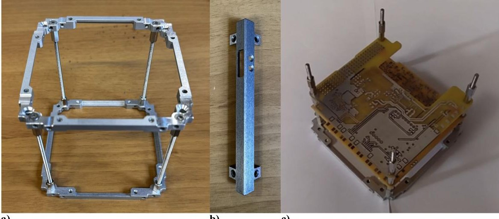

Fig. 3 The CubeSat's main components, including upper and lower frames and four rods (a), a single rail as part of the structural support of the chassis (b), and an empty electronic board representing the satellite's payload (c).

Table 1 Step-by-step breakdown of the CubeSat assembly process, detailing components, required actions, application points, and corresponding tools

<table border="1"><tr><td>ID</td><td>Item</td><td>Item detail</td><td>Action</td><td>Applied to</td><td>Tool</td><td>Tool detail</td></tr><tr><td>1</td><td>Frame 1</td><td>Head=Hexagonal Type=Lower</td><td>Place</td><td>Frame 1</td><td>——</td><td>——</td></tr><tr><td>2</td><td>Screw 1</td><td>Diameter=3(mm)Body=Hexagonal Length=11(mm)</td><td>Insert</td><td>Frame1Hole1</td><td>Screwdriver</td><td>Tip=CR-V2.0(mm)</td></tr><tr><td>3</td><td>Spacer 1</td><td>Threaded=True Diameter=3(mm)Length=10(mm)</td><td>Screw in</td><td>Screw1</td><td>Wrench</td><td>Diameter=3(mm)</td></tr><tr><td>$\vdots$</td><td>$\vdots$</td><td>$\vdots$</td><td>$\vdots$</td><td>$\vdots$</td><td>$\vdots$</td><td>$\vdots$</td></tr><tr><td>86</td><td>Screw28</td><td>Head=Torx Diameter=3(mm)</td><td>Screw in</td><td>Rail4-Hole4</td><td>Screwdriver</td><td>CR-VT8tip</td></tr></table>

<!-- PDF_PAGE: 5 -->

Table 2 Ten macrosteps of the CubeSat assembly procedure as implemented in the application $ ^{a} $

<table border="1"><tr><td>Step</td><td>ID</td><td>Details</td></tr><tr><td>1</td><td>1</td><td>The frame is removed from the component bench and positioned in front of the operator to ensure accessibility for the next step.</td></tr><tr><td>2</td><td>2-9</td><td>The first four hexagonal spacers are secured using the appropriate screws.</td></tr><tr><td>3</td><td>10-13</td><td>Secure the four rods, which will support the stacking of the CubeSat&#x27;s different layers.</td></tr><tr><td>4</td><td>14-29</td><td>Three washers and a hexagonal spacer are stacked onto each rod.</td></tr><tr><td>5</td><td>30-38</td><td>Insert the payload sheet, place the circular spacers, and secure the hexagonal spacers with screws.</td></tr><tr><td>6</td><td>39-47</td><td>Repeat the previous steps, but now insert the battery and PDI sheet.</td></tr><tr><td>7</td><td>48-56</td><td>Repeat the previous steps, but now insert the onboard computer.</td></tr><tr><td>8</td><td>57-61</td><td>Secure the upper frame with screws.</td></tr><tr><td>9</td><td>61-66</td><td>Secure the upper closure to the upper frame with screws.</td></tr><tr><td>10</td><td>67-86</td><td>Attach each of the four rails to the four corners using four appropriate screws.</td></tr></table>

$ ^{a} $Each macrostep consists of a sequence of the 86 previously identified operations (see Table 1), ensuring the complete assembly of the satellite's structure.

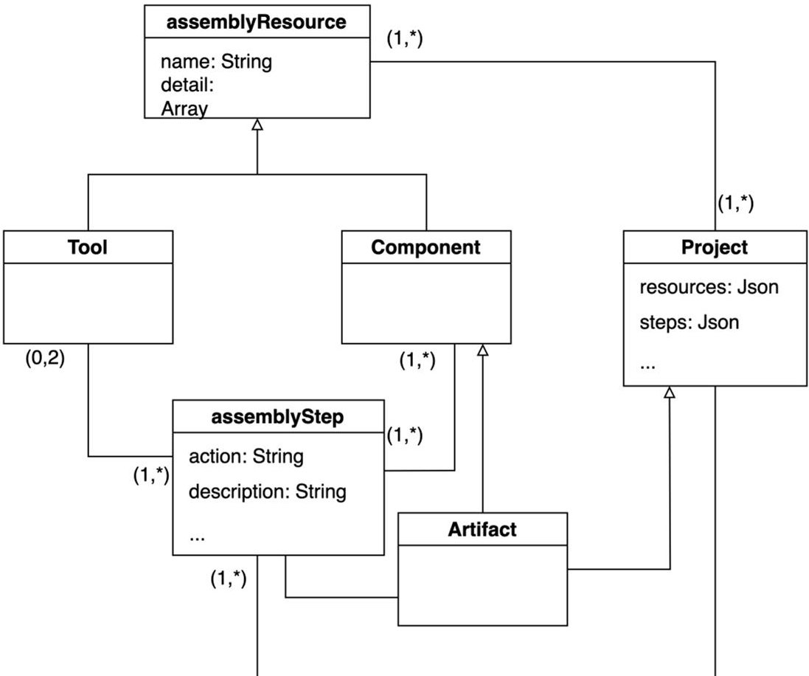

Fig. 4 High-level conceptual schema of the DSL for the extended reality [46].

proposed XR-assisted CPS framework to support assembly, integration, and testing (AIT) processes.

In our approach, we introduce a DSL to generate structured specifications from different sources (e.g., official assembly documentation, domain expert interviews) to standardize and configure assembly, integration, and testing (AIT) workflows in an XR-assisted environment. The goal is to demonstrate how the DSL integrates with CPSs to facilitate real-time monitoring, adaptive assembly guidance, and validation of component interactions, ensuring accuracy and efficiency in the CubeSat assembly process. By dynamically configuring assembly procedures and streamlining communication between XR interfaces, 3D model management, and sensor integration, the DSL is envisioned to improve system adaptability, reduce manual intervention, and allow continuous feedback for the precise execution of AIT operations. In the study at hand, the framework is developed using the Unity Graphics Engine [88] and uses the Microsoft HoloLens 2 visor [89] to display essential user information, such as menus, textual references, and 3D objects, which helps in the assembly or design process [90,91]. This class of visors, equipped with the Windows Mixed Reality Toolkit (MRTK) Software Development Kit (SDK) [92], provides an advanced hand-tracking system for seamless interaction with the virtual environment. Furthermore, the integration of the Vuforia AR SDK [93] enables the framework to recognize and track specific

objects in the real world, enhancing the accuracy and efficiency of the XR experience.

## IV. DSL for XR-Enabled AIT Support

We propose a DSL [94] to fulfill two primary objectives. First, it aims to ensure maintainability and clarity by serving as a specification language for extracting and designing structure and assembly data. Second, it is intended to support immersive assembly design by enabling a guided immersive reality environment where users can configure, align, and animate components, thereby facilitating the design of complex aerospace products such as CubeSats.

The DSL is designed as a conceptual model and is represented as a class diagram using the Unified Modeling Language $ ^{\ddagger \ddagger} $ (UML) (see Fig. 4). It is based on i) official documentation related to assembly specifications [95,96], and ii) several interviews with domain experts to retrieve relevant information. The elements extracted correspond to those explicitly identified by the experts in the domain during interviews, namely Tool, Component, assemblyStep, and Project. In contrast, the information deduced comprises inferred details or relationships that provide additional information from the interviews, categorized as assemblyResource and Artifact. The

<!-- PDF_PAGE: 6 -->

specification written in this DSL precisely encapsulates every aspect of the assembly process, ensuring alignment with expert expectations. Figure 4 shows how these elements are interconnected within the DSL. A Project is composed of multiple assemblyResources and assemblySteps. An assemblyResource could be either a Component or a Tool, while an assemblyStep involves at least one Component and at most two Tools. An Artifact is defined as an entity that combines the characteristics of both a Project and a Component; it can represent the assembled state of a project at any stage and can also be used as a component in subsequent assembly steps. These relationships define a structured representation of the assembly workflow, making explicit both the entities manipulated by operators and the logic that connects them.

To extract each distinct assembly step, the input data are further elaborated. Each extracted assembly step specifies key information, including the components and tools involved and corresponding characteristics such as materials and specifics (e.g., see column Item Detail in Table 1). It also contains a description of the assembly task, which is composed of the action to perform (e.g., screw in, insert) and, if necessary, a set of details (e.g., Place Frame 1 on the workstation) to take into account when performing the assembly step. In addition, when needed, the DSL must contain references to the position that new components must assume concerning those already assembled. This field is fundamental in orchestrating the assembly process more accurately, allowing the correct orientation and position of 3D objects in the virtual workspace. Furthermore, the DSL can also

include tests (e.g., continuity tests to verify an uninterrupted circuit) that must be performed to complete the assembly step.

The proposed DSL, which is specific for each assembly procedure, is provided in two versions: an external DSL (e.g., external_DSL.yml; see the extract in List 1 and the complete file at https://github.com/MizuNoMashu/Project_XR_Aerospace/blob/main/Documents/cubesat_external_DSL.yml), which is defined in a distinct language separate from the main programming language that it interacts with and is used for consulting purposes to ensure transparency, and an internal DSL (e.g., internal_DSL.yml; see List 2), which is embedded within the syntax of a general-purpose language and is used to assist workers in the assembly procedure. The external DSL has been structured in a schematic format to facilitate readability, allowing domain experts to make modifications easily in case of issues or adjustments. When a modification is made, it can be immediately reflected in the internal DSL, which is structured for easy parsing and seamless programmatic execution.

## V. XR-Assisted CPS Integration into AIT Workflows

Our framework enables the operator to design a new configuration of an aerospace product (in the present case, a CubeSat) by generating a new DSL, which will be stored for future simulations, or to modify an existing configuration. In addition, the user is supported during the assembly of a product by selecting a preexisting stored configuration.

Project: Cubesat

Resources Needed:

General Type Name: Screw_1

Quantity: 8

Instances:

- Screw 1

...

Assembly Steps:

Step number: 1

Description: Place Frame 1 on the Workstation

Involved Components: Frame 1, Frame 1

...

Resources Infos:

General Type Name: Screw_1

Head: Hexagonal

Diameter: 3mm

Length: 11mm

Quantity: 8

..

Listing 1 Example of an external DSL for the assembly procedure of the CubeSat project.

internal_DSL.yml

Step(0).loadModel(frame as frame_0).loadModel(rail as rail_0).loadModel(rail as

rail_1).animation(rail_0, avvitamento,rail_0.perno[0]=frame_0.perno[0]).animation(rail_1,

avvitamento, rail_1.perno[0]=frame_0.perno[1])

Listing 2 Example of an internal DSL for the assembly procedure of the CubeSat project.

<!-- PDF_PAGE: 7 -->

## A. Immersive Design Environment

The immersive design environment enables users to access multiple functionalities to create or customize complex aerospace products. It ensures design accuracy and system reliability by enabling the seamless integration of new components while maintaining consistency, as virtual components accurately replicate their physical counterparts. Additionally, the framework improves modularity by structuring each macrostep (see Table 2) within the design phase, while using DSL ensures easy maintainability. Figure 5 illustrates an example of the immersive design phase. The user can import a component (see Fig. 5a), mentioned in the DSL file, for use in the assembly (or download new components that are not explicitly contained in the DSL but are stored in the Objects repository), determine its alignment with existing components (see Fig. 5b), and specify the animation to be applied (see Fig. 5c). Each 3D object is embedded with red elements, called anchor points (see Fig. 6a), which remain invisible inside the virtual simulation until hovered over by a finger (see Fig. 6b). When the user selects points on two different objects, they can choose to join them and specify the animation to be displayed during the real assembly process. If the user decides to connect two objects, they automatically align according to the predefined allowed positions. It should be noted that, whenever a component is inserted, deleted, or modified, including its animations, the DSL associated with the selected product configuration is updated accordingly.

## B. Assembly, Integration, and Testing Phases

Figure 7 illustrates the architecture of the proposed framework. The architecture is organized into four different services, each with a dedicated role. In detail, the Orchestrator is the core service that is responsible for the interaction between the XR application and the other services by invoking their functionalities as needed, the Objects Server is responsible for handling all 3D and CAD models, the Sensors Server exposes access to any available sensor and associated functionalities, and the DSL Server handles the DSLs and corresponding task-related information. In this section, we outline the role of the proposed architecture in supporting the component assembly process. First, we discuss the real-time deployment of sensors (see Sec. V.B.1). Next, we examine object

recognition and tracking within the framework (see Sec. V.B.2). Finally, we present the front-end development and its implementation (see Sec. V.B.3). All the source code of the framework is available at https://github.com/MizuNoMashu/Project_XR_Aerospace/tree/main/Code.

## 1. Real-Time Sensor Deployment

The proposed framework integrates real-time sensor data to provide users with clear, XR-projected instructions and modular procedures. In our case study, it enables real-time sensor connectivity for performing an electrical continuity check on the CubeSat's electrical boards using a PeakTech 3445 Bluetooth digital multimeter, intended as an external sensor and chosen for its wireless capability to ensure seamless integration with other devices. The multimeter data are analyzed in three main steps, as detailed in the following (see Fig. 7):

1) Multimeter data acquisition and parsing: Based on the user sensor selection, the Orchestrator server forwards the request to the Sensors server, which retrieves the sensor data. The Sensors server then processes the multimeter data, converting it into an easily interpretable format, where each byte in the generated packets represents the start, end, unit, and measurement value.

2) Data transmission and reception: Once a multimeter packet is correctly formatted, it is transmitted to the Orchestrator server for final communication and processing and sent to the HoloLens 2 application.

3) Data visualization: The data received by the HoloLens 2 application are visualized through a panel created in Unity. This panel consists primarily of values and body text within the canvas object, which are dynamically updated upon receiving new data. Specifically, when the multimeter measures a value of 0L, indicating an open circuit, the message "Open circuit" is displayed. In contrast, when a value of $ 0 \Omega $ is detected, which means negligible electrical resistance, the message "There is electrical continuity" is displayed.

## 2. Marker-Less Object Recognition

Object recognition and tracking enable digital systems to interpret and interact with the physical world in real time. In our case study,

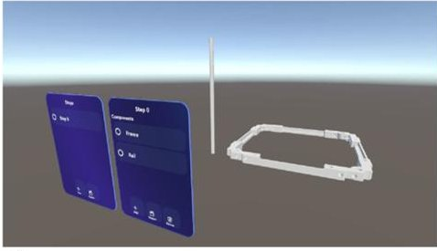

a)

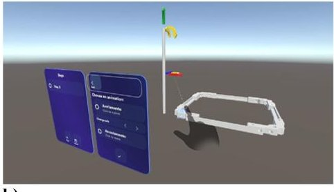

b)

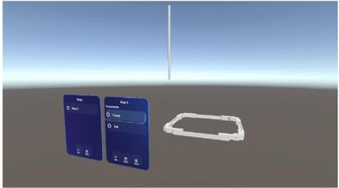

c)

Fig. 5 Example of design support: a) import component in the scene, b) selection of elements to align, and c) show alignment and animation.

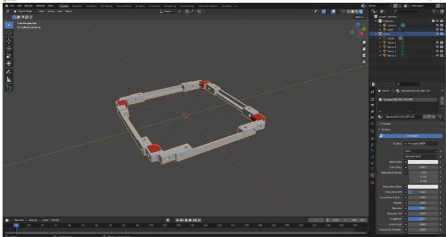

a)

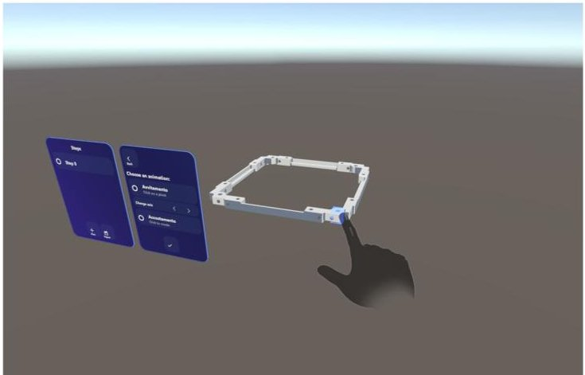

b)

Fig. 6 Example of an anchor point a) creation and b) activation on hover.

<!-- PDF_PAGE: 8 -->

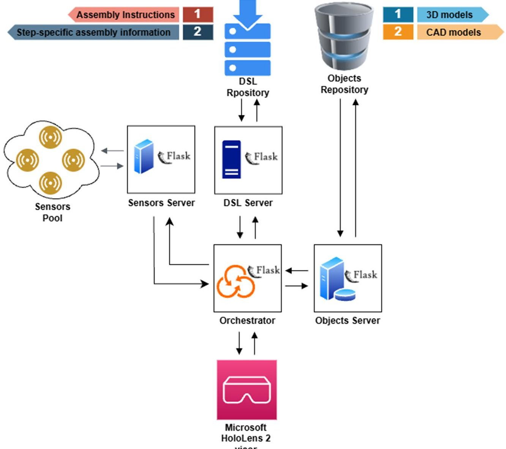

Fig. 7 The general architecture of the proposed framework.

object recognition is integrated with XR to identify and classify objects within the user environment. This process utilizes computer vision algorithms to analyze the input from the camera in the visor, comparing the detected patterns with a database of known objects. By doing so, the XR system can accurately overlay relevant digital information onto physical objects. Object tracking, on the other hand, ensures that recognized objects are continuously monitored, maintaining their position and orientation within the XR environment. Effective tracking is essential to maintain the proper alignment of augmented elements with the real world, ensuring a seamless and immersive user experience. This stability allows AIT users to interact with virtual content, regardless of changes in their viewpoint or the object's position.

Technologies that enable object recognition and tracking can be categorized into marker-based and marker-less. Marker-based tracking relies on predefined visual markers (e.g., QR codes) for easy identification, while marker-less tracking uses natural features within the environment, such as the shapes of the CubeSat's components in this case, to recognize and follow objects without requiring special markers. Given the general-purpose nature of the proposed approach, which is designed to adapt beyond the AIT of a specific aerospace system, marker-less tracking has been the chosen approach. To implement this approach, we used the Vuforia AR software development kit (SDK). Vuforia was selected not only for its marker-less object recognition and tracking capabilities but also for its seamless integration with the Unity environment, facilitated by a dedicated API.

For accurate object recognition and tracking, digital targets consisting of computer-aided design (CAD) models (see Fig. 8) and their GL transmission format binary (GLB) conversions-must be stored in a dedicated directory within the Objects repository service. This directory, specific to the selected assembly procedure,

enables the identification and tracking of the CubeSat structure and electronic circuit boards (see Fig. 3), as illustrated in the architecture of the system (see Fig. 7). For optimal recognition, CAD models must closely resemble the identified physical objects. To streamline this process and minimize the development time, free scanning technologies (e.g., Polycam) were initially explored but yielded unsatisfactory results. As a result, 3D models of the CubeSat structure and electronic circuit boards were manually created. This phase involved extensive reverse engineering to ensure that the CAD models accurately reflected the real components. The effectiveness of the object recognition and tracking system is evaluated based on three key criteria: a) speed and ease of recognition ensuring quick and effective identification from various perspectives; b) accurate positioning of digital objects relative to the target allowing seamless integration within Unity scenes based on the user's viewpoint; and c) tracking stability, ensuring that digital objects remain firmly anchored to the target without flickering or loss of recognition due to minor user movements.

Once the CAD models are created, the next step is generating the corresponding recognition targets. Careful consideration is given to selecting the optimal guide views (see Fig. 8b), ensuring that each part can be accurately recognized from a range of angles. This selection carefully balances two key factors: ensuring broad recognition across multiple viewing angles while preserving optimal target performance. With these considerations in mind, recognition targets are designed for all components and AIT steps (see Fig. 9).

## 3. Front-End

The user interface for the assembly support consists of three primary interfaces, designed for frequent user interaction and serving as gateways to various other interfaces, including the following:

<!-- PDF_PAGE: 9 -->

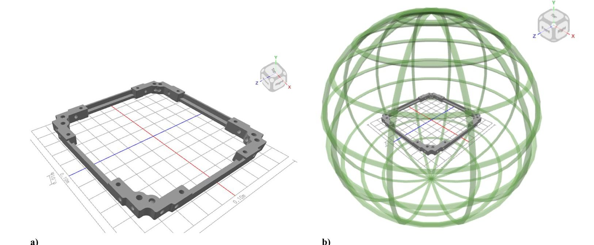

Fig. 8 Creation of 3D model-based targets for the CubeSat's parts: the original CAD model (a) and the adopted full 360 deg view guide (b) for the first step of the AIT process.

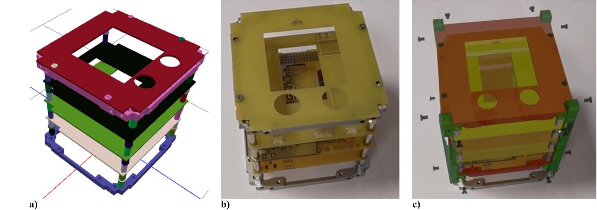

Fig. 9 The object recognition process in a CubeSat's AIT workflow: a) the 3D model-based target is created, b) the real object is identified and tracked, and c) an augmented reality (AR) animation overlays the assembly instructions, guiding the operator through the screw insertion and tightening process.

1) The Main Menu interface allows the user to access all other system functionalities (see Fig. 10a). It features a menu, which can be freely moved around the virtual simulation (i.e., draggable), with four buttons, each enabling navigation through the application. In particular, the Assembly Procedure button redirects the user to the corresponding interface to start the assembly simulation. Pressing the Objective button displays a panel with useful information about the simulator and the assembly of the current physical object. The Assembly Overview button leads the user to the associated main interface. Finally, the Tools button opens a panel that explains which tools will be used in the simulation and how to use them.

2) The Assembly Overview interface provides the user with the possibility to analyze the physical object and all its components (see Fig. 10b). Through this interface, the user can freely manipulate the object within the virtual environment, including the option to generate an exploded view to examine how its components are interconnected (see Fig. 10c). Moreover, the user can activate a panel in which all components are separated, with the possibility of moving them independently and retrieving their associated details. In addition, the user can also retrieve information regarding every single step needed to perform the assembly of the object.

3) The Assembly Procedure interface provides users with information and assistance for a step-by-step guided assembly of a physical object. Upon accessing the interface, users can select an assembly procedure and consult one of its assembly steps they need

assistance with. With the information contained in the DSL obtained through the Orchestrator, the user can retrieve CAD data (stored in the Objects repository) from the directory associated with the chosen assembly procedure, as well as the assembly instructions and step-specific information contained in the DSL located in a specific directory of the Objects server (see Fig. 7). The whole retrieved data are managed by the Orchestrator server, ensuring that the user can view the relevant details for the selected step of the selected assembly procedure. To enhance system performance and prevent information overload, previously displayed assistance data are removed from the scene with each new request. This is managed by ad hoc listeners that are in charge to efficiently destroy unused objects, load new ones, and modify content of active prefabricated objects according to the relevant data sent by the Orchestrator for a given step (see Fig. 10d). In our proposed framework, Unity prefabs [97] serve as modular assets that store all the essential data for each assembly step, including i) the actions required for the step, ii) a video demonstrating the correct assembly procedure, iii) a 3D visualization of the completed assembly step, and iv) 2D images of electrical boards or other components.

## VI. Validation

When developing applications based on XR technologies, it is essential to evaluate their operational effectiveness, particularly

<!-- PDF_PAGE: 10 -->

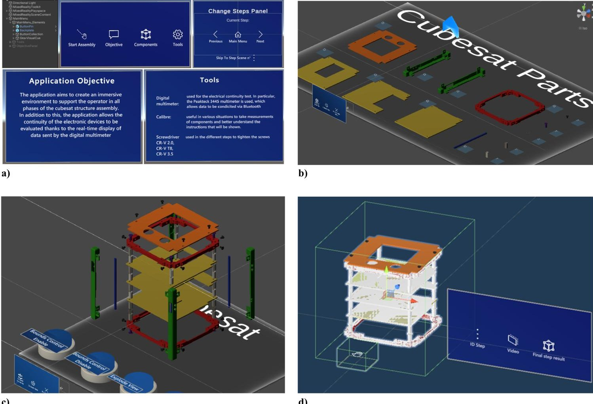

c)

d)

Fig. 10 Key elements of the front view: a) the main menu and its submenus, b) selectable CubeSat components for additional information, c) an interactive 3D model of the assembled satellite, and d) a prefab representing a single assembly step.

regarding their ability to support users in performing complex tasks, such as those typical of assembly processes in the aerospace sector [98,99]. Other than their technical feasibility, XR systems must be evaluated in terms of their actual impact on human performance, including improvements in task accuracy, reductions in cognitive workload, and enhancements in usability, learnability, and overall system acceptance. These aspects are especially relevant in safety-critical contexts, where the impact of support systems must be both measurable and reliable. In aerospace AIT operations, where procedures are complex and often constrained by strict quality standards, even minor improvements in operator guidance or situational awareness can lead to substantial gains in efficiency and error reduction.

We systematically evaluate the effectiveness of the developed framework compared with traditional assembly methods. To achieve this, an evaluation protocol was designed to collect both objective performance metrics (e.g., completion time, number of errors) and subjective perceptions (e.g., workload, usability, user preferences). The direct comparison between our XR-based framework and traditional approaches, conducted in a controlled environment, allows us to obtain valuable insights regarding the practical advantages and current limitations of XR-assisted assembly, contributing to the understanding of how immersive technologies can be effectively integrated into aerospace production and testing pipelines.

## A. Walkthrough

The behavior of each scene (i.e., the collection of virtual objects, environments, lights, and interactions currently displayed and available in the virtual environment) and object is first tested through a complete walkthrough of the AIT workflow, which the user follows to assemble the CubeSat structure. Each element within the application's menus is verified to interact correctly with the user, including opening panels in the expected location, handling interface transitions smoothly, and supporting object manipulation such as grabbing, repositioning, resizing, and rotating panels (see Fig. 11).

The interaction with the CubeSat model, designed to familiarize the user with the assembly components before the actual AIT process, is also validated. The system enables users to interact with 3D part models, including picking up, rotating, zooming in, and displaying exploded views of virtual components (see Fig. 12a). Through the virtual desktop, which provides access to all components of the CubeSat structure, users can open dedicated panels for each part, displaying relevant information (see Fig. 12b). In addition, prefab assemblies are confirmed to be instantiated correctly, maintaining proper object positioning, feature attributes, and removal when a new premade assembly is loaded.

All elements responsible for capturing and displaying digital objects function correctly, including the button positioned in front of the CubeSat's digital model, which enables or disables object manipulation. Figure 13 illustrates these results, showing that all elements appear in their correct positions. The assembly panel provides instructions for the seventh step of the AIT procedure, while the video information panel demonstrates the ninth step. These panels replace the menu when active and remain fully interactive, allowing users to manipulate them freely.

For assembly-related scenes, both object recognition and tracking and the interaction of target-related objects are assessed at each step of the AIT process, including interactions with nontarget elements (see Fig. 14). Recognition time and positioning improve significantly when the target is observed from a nonfrontal angle or has distinct asymmetrical features, with an average recognition time of just a few seconds. However, part tracking remains stable only when movements are controlled and kept within a certain speed threshold.

In the proposed framework, the user receives assistance through assembly instructions at each step of the AIT process and part identification to ensure that the correct components are selected. Specifically, the CPS can distinguish between electronic boards, allowing the user to identify and choose the appropriate one (see Figs. 15a and 15b). Finally, the electrical continuity of the CubeSat boards is verified. The Bluetooth-enabled multimeter successfully

<!-- PDF_PAGE: 11 -->

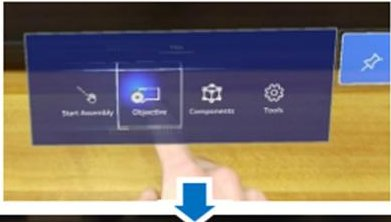

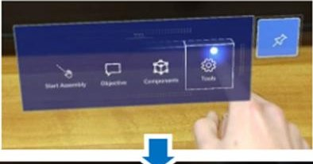

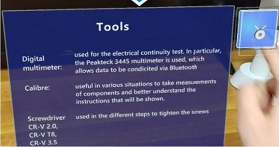

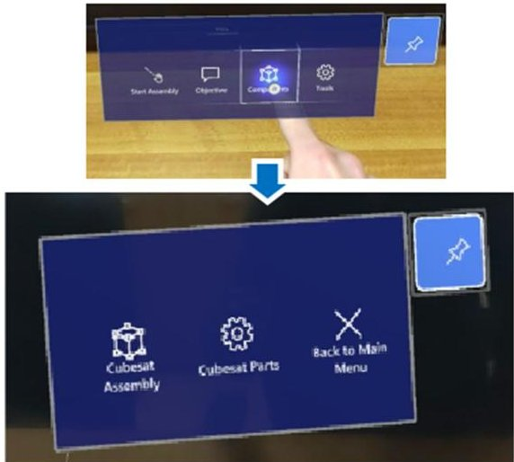

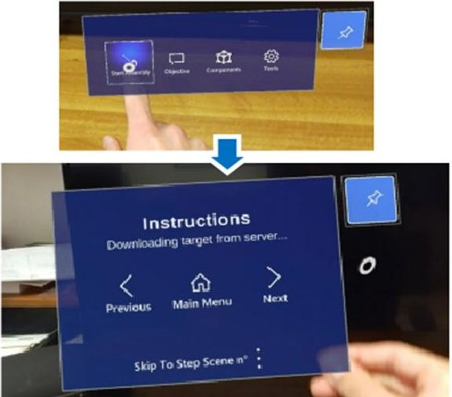

Fig. 11 Functionality testing of the application menus, demonstrating user interactions with different interface elements, including objective selection, tool descriptions, component access, and instructional guidance.

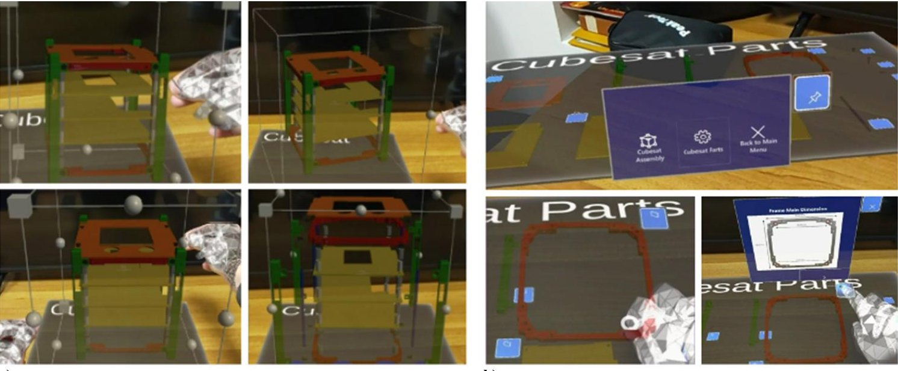

a)

b)

Fig. 12 The user can explore the CubeSat model before initiating the AIT process by virtually interacting with its components (a) and accessing additional information on the selected parts (b).

transmits data, ensuring accurate real-time monitoring. As shown in Fig. 16, the value displayed on the multimeter matches the digital panel, and the information message aligns with the received data, confirming proper functionality.

## B. Practitioners' Evaluation

We present the evaluation protocol used to assess the usability and effectiveness of the XR-based application for guided satellite assembly in comparison with traditional methods. The evaluation took place over three days and involved 40 M.Sc. students in aerospace engineering, aged between 22 and 28 years (see Table 3).

Participants were randomly assigned to one of two groups: the experimental group, which used the XR application, and the control group, which performed the tasks using conventional, paper-based documentation. To ensure the reliability of the results, the groups were balanced in terms of gender and age to minimize the influence of these variables. Each participant was tasked with completing identical satellite assembly activities, with the only difference being the form of support provided depending on their group.

In the first phase of the evaluation, each student was given time to familiarize themselves with the tools provided, with the goal of understanding how to use them effectively. For the control group,

<!-- PDF_PAGE: 12 -->

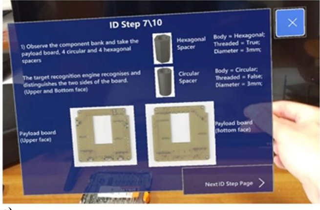

a)

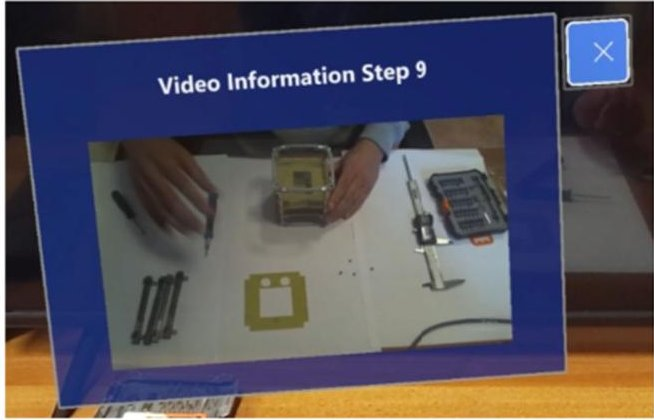

b)

Fig. 13 AIT step elements: a) an assembly panel providing instructions for the seventh step of the procedure, and b) a video information panel demonstrating how to perform the ninth step.

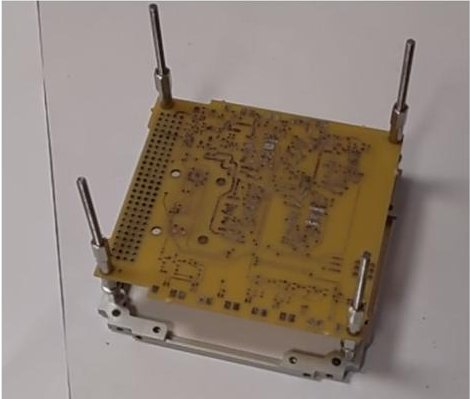

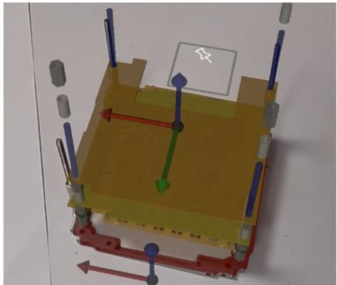

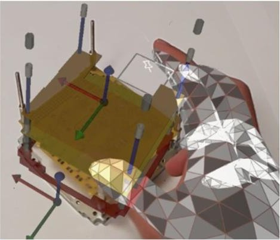

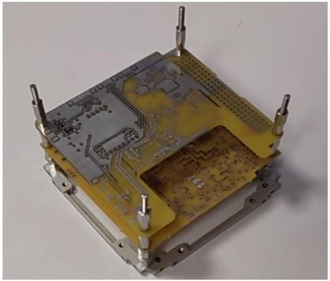

a)

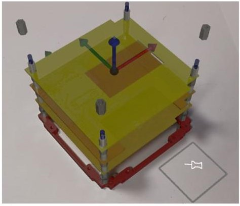

b)

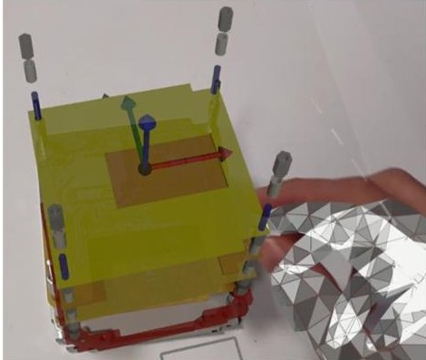

c)

Fig. 14 Recognition (a, b) and tracking (c) of CubeSat parts during different AIT steps.

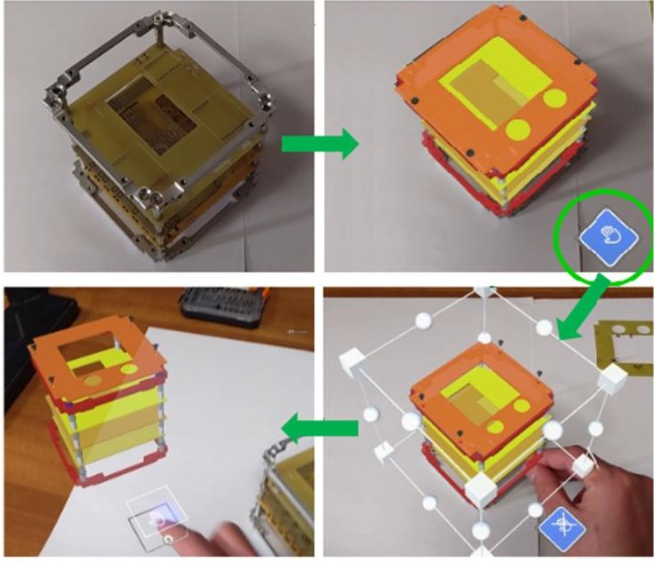

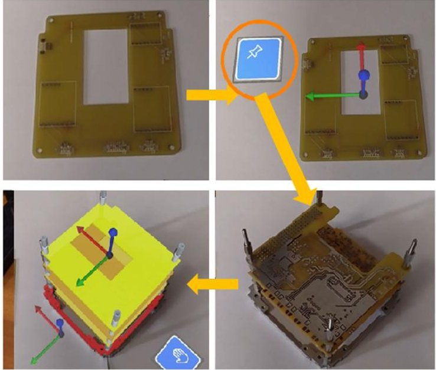

a)

b)

Fig. 15 Identification of the correct assembly step and the necessary components to continue the process. a, b) Different assembly steps that have been correctly identified.

<!-- PDF_PAGE: 13 -->

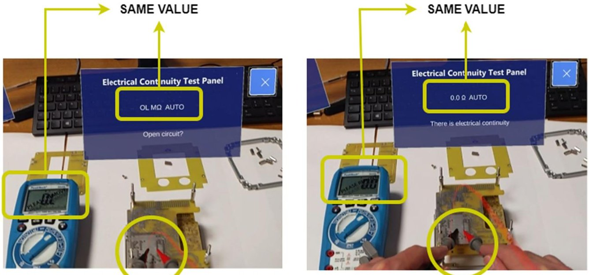

Fig.16 During the electrical continuity test for the CubeSat's electronic boards, sensor values from the physical interface are displayed virtually: the left image shows no contact between the terminals and the board, while the right image indicates confirmed contact.

Table 3 Group division and assigned tools

<table border="1"><tr><td>Group</td><td>Tools</td><td>Students</td></tr><tr><td>Experimental group</td><td>Calliper, XR-Headset</td><td>20(5,15)</td></tr><tr><td>Controlled group</td><td>Printed assembly instructions, list of components, photographs of components, calliper</td><td>20(5,15)</td></tr></table>

we provided printed documentation with assembly instructions, a list of components with specifications, detailed photos of each electronic board and component, and a calliper for potential measurements. For the experimental group, we provided a calliper and a virtual reality headset to explore gestures and available functionalities within the virtual simulation. It is important to highlight that the information provided was identical across both groups. The differentiation lay solely in the mode of delivery: static visual documentation for the control group versus dynamic, immersive visualization for the XR group, ensuring that any performance differences could be attributed to the interaction modality rather than content disparities.

During this phase, we recorded the time each participant took from the moment the tools were distributed to when they indicated that they were ready to begin the assembly task. This "readiness time" served as a preliminary metric for system intuitiveness and ease of onboarding. Results showed a 28.4% reduction in average preparation time for the XR group compared to the control group, suggesting a significantly faster acclimatization process facilitated by the immersive XR environment (see Table 4).

In the second phase of the evaluation, participants engaged directly with their assigned tools to perform a series of satellite assembly tasks. This practical phase was divided into two consecutive scenarios, each comprising different assembly steps of increasing complexity. In both scenarios, we recorded the task completion times and the number of errors committed during the procedure.

At the end of each scenario, participants were asked to complete a questionnaire designed to assess their subjective workload, providing insights into the perceived mental and physical demands of the task. The first scenario (i.e., T1) consisted of steps 3 and 4 from Table 2, while the second scenario (i.e., T2) consisted of step 5.

Table 4 Preparation time for each group

<table border="1"><tr><td>Group</td><td>Time</td></tr><tr><td>Experimental group</td><td>4.36 min</td></tr><tr><td>Controlled group</td><td>6.09 min</td></tr></table>

Upon completing both scenarios, each participant was required to fill out two final questionnaires: the first aimed at evaluating the usability of the method they employed (XR or traditional), and the second aimed at gathering feedback on their preference regarding the alternative method, following a brief demonstration of it. The evaluation relied on the following quantitative and qualitative metrics:

1) One-Way ANOVA: to analyze statistically significant differences between the two groups across the measured variables.

2) NASA Task Load Index (NASA-TLX): to measure subjective workload across multiple dimensions, including mental demand, physical demand, and temporal demand.

3) System Usability Scale (SUS): to assess the perceived usability of the respective support systems.

4) Likeability Test: to assess preference for the alternative method after its demonstration, following the use of the assigned one.

## 1. Performance Analysis

To evaluate each participant's performance during the satellite assembly tasks, we measured two key indicators: task completion time and number of errors in both scenarios. These indicators were used to test the following hypotheses:

1) $ H_{0} $ (Null Hypothesis): The XR assembly support system performs equally to the traditional approach.

2) $ H_{1} $ (Alternative Hypothesis): The XR assembly support system does not perform worse than the traditional approach.

A one-way ANOVA test was conducted on both indicators for each scenario, with the significance level set at $ \alpha=0. 0 5 $ (see Table 5).

In scenario T1 (see Fig. 17), the experimental group showed a statistically significant improvement in task completion time compared to the control group, with an F-value of 5.31 and a p-value of 0.027, allowing us to reject the null hypothesis. However, the number of errors did not show a statistically significant difference.

In scenario T2 (see Fig. 18), the experimental group again demonstrated significantly better performance in terms of task

Table 5 One-Way ANOVA results for performance metrics across scenarios $ (\alpha=0.05) $

<table border="1"><tr><td>Key indicator</td><td>F-value</td><td>p-value</td><td>Conclusion</td></tr><tr><td>T1: completion time</td><td>5.31</td><td>0.027</td><td>Reject $H_{0}$</td></tr><tr><td>T1: errors</td><td>1.09</td><td>0.304</td><td>Fail to reject $H_{0}$</td></tr><tr><td>T2: completion time</td><td>7.79</td><td>0.008</td><td>Reject $H_{0}$</td></tr><tr><td>T2: errors</td><td>9.09</td><td>0.005</td><td>Reject $H_{0}$</td></tr></table>

<!-- PDF_PAGE: 14 -->

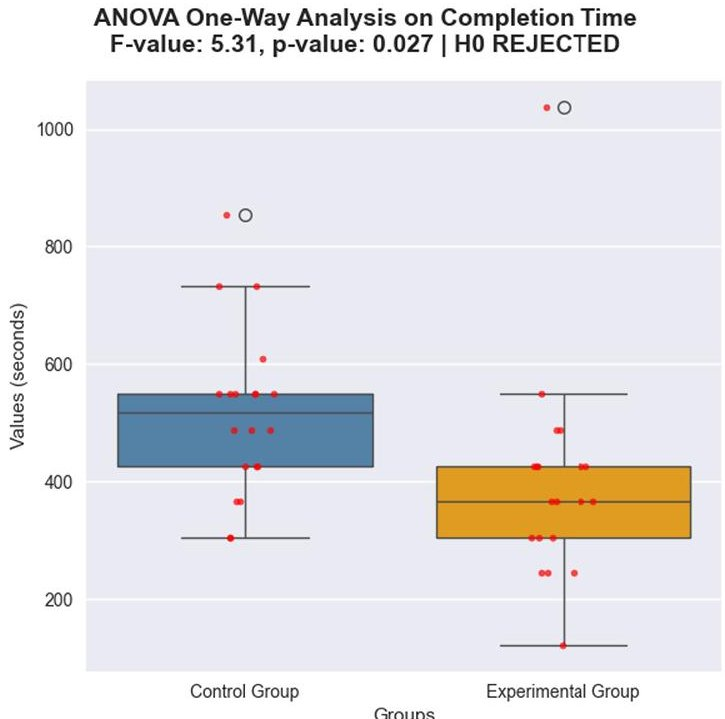

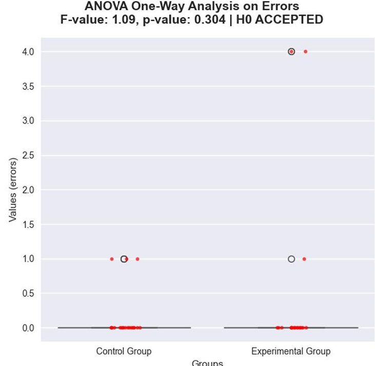

Fig. 17 Completion time and errors of each participant during task 1.

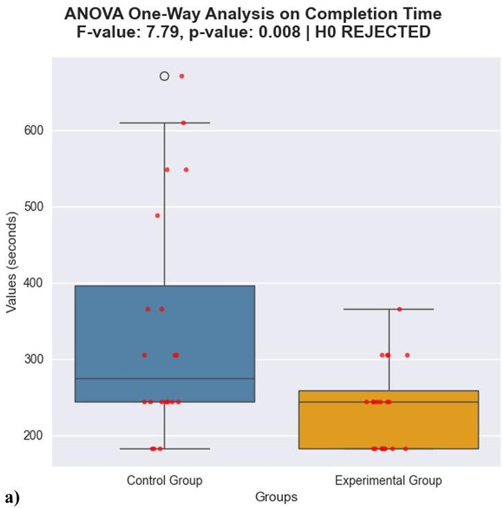

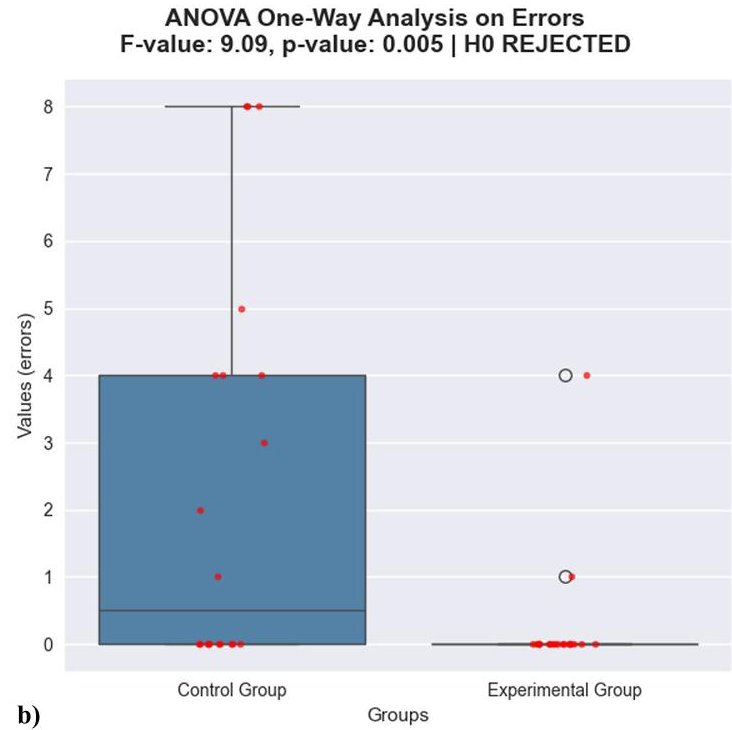

Fig. 18 Completion time and errors of each participant during task 2.

completion time, with an F-value of 7.79 and a p-value of 0.008, confirming the rejection of the null hypothesis. This time, the number of errors also showed a strong statistical difference, with the experimental group making significantly fewer errors than the control group (F-value = 9.09, p-value = 0.005), again allowing us to reject the null hypothesis. These results indicate that the XR-based assembly support system not only reduces task completion time in both scenarios but also improves accuracy in more complex tasks. While in the first scenario, the error rates were similar, the second scenario revealed a significant benefit in error reduction with XR, suggesting that immersive guidance becomes increasingly effective as task complexity increases.

## 2. Workload and Usability

To evaluate the subjective experience of each participant with the assigned support system, we employed two well-established evaluation instruments: NASA-TLX, for measuring perceived cognitive and physical workload, and SUS, for evaluating overall system usability. While the NASA-TLX test was administered at the end of each scenario to capture workload variations across tasks of

different complexity, the SUS questionnaire was given only at the end of both scenarios to evaluate the overall usability of the assigned system across both simple and complex tasks.

For the NASA-TLX test, we divided the results into five workload bands: 0-9 (low), 10-29 (medium), 30-49 (somewhat high), 50-79 (high), and 80-100 (very high) [100]. Table 6 shows the average NASA-TLX scores for each scenario, as well as the number of participants falling within each workload category. As shown, both groups reported a somewhat high level of workload across the two scenarios. The XR group exhibited a slightly lower workload in T1, while both groups showed nearly equivalent scores in T2. This suggests that task complexity may have leveled out perceived effort regardless of the support system used. However, the lower workload level in the experimental group confirms the potential of XR technologies for use in assembly operations.

For the SUS, we referred to the acceptability curve proposed by Sauro and Lewis [101], where a score of 68 serves as the threshold for acceptable usability (corresponding to a grade of "C" on a scale from A+ to F). Table 7 reports the average results for both the usability and learnability components, as well as the total SUS score

<!-- PDF_PAGE: 15 -->

Table 6 NASA-TLX results for each group and task

<table border="1"><tr><td>Group</td><td>Average</td><td>Low(0-9)</td><td>Medium(10-29)</td><td>Somewhat high(30-49)</td><td>High(50-79)</td><td>Very high(80-100)</td></tr><tr><td>T1:control group</td><td>32.71</td><td>0</td><td>8(40%)</td><td>11(55%)</td><td>1(5%)</td><td>0</td></tr><tr><td>T2:control group</td><td>32.25</td><td>0</td><td>10(50%)</td><td>8(40%)</td><td>2(10%)</td><td>0</td></tr><tr><td>T1:experimental group</td><td>31.50</td><td>0</td><td>10(50%)</td><td>8(40%)</td><td>2(10%)</td><td>0</td></tr><tr><td>T2:experimental group</td><td>32.00</td><td>0</td><td>9(45%)</td><td>9(45%)</td><td>2(10%)</td><td>0</td></tr></table>

Table 7 Results obtained from SUS test and associated score

<table border="1"><tr><td>Group</td><td>SUS</td><td>Learnability</td><td>Usability</td><td>Score</td></tr><tr><td>Control group</td><td>71.62</td><td>70.62</td><td>71.87</td><td>C+</td></tr><tr><td>Experimental group</td><td>77.25</td><td>75.62</td><td>77.66</td><td>B+</td></tr></table>

for both groups. The experimental group obtained a B+ grade, significantly outperforming the control group, which fell within the C+ range. For total SUS, as well as the usability and learnability subscales, the experimental group consistently outperformed the control group. This suggests that, in terms of both learnability and usability, the XR system provides a more intuitive and satisfying user experience.

## 3. System Likeability

To conclude the evaluation, we administered to participants a questionnaire of 13 items in order to assess their attitude toward the alternative support system (i.e., the one they did not use during the assembly tasks). These questions were designed to measure different aspects such as perceived usefulness, ease of use, enjoyment, output quality, and others. Each participant completed the questionnaire only after receiving a short, guided demonstration of the alternative method.

Figure 19 reports the average scores for each aspect, with responses from the control group (evaluating XR) and the experimental group (evaluating the traditional method). All scores were normalized on a 0-100 scale. The results showed that both groups gave a positive evaluation of the opposite method, indicating interest in its potential use. In particular, high scores were recorded for metrics such as Result Demonstrability, Computer Playfulness, Perceived Enjoyment, and Attitude Towards Technology. Specifically, the control group although they did not use the XR system during the actual assembly task, gave very high ratings to Enjoyment (86.25), Playfulness

(81.25), and Result Demonstrability (81.25). These results suggest that even minimal exposure to XR is sufficient to generate interest and openness to future use. Furthermore, they demonstrate that, although XR is a new and unfamiliar system, it is perceived as intuitive, effective, and usable.

The fact that the experimental group assigned higher values to the traditional method can be explained by a familiarity bias with commonly used tools and by the propensity of participants to feel more comfortable evaluating systems they have used directly rather than those they have only observed. However, the fact that the scores for both groups are well above the midpoint of the scale reinforces the idea that both systems were perceived as valid and potentially effective.

In conclusion, the likeability analysis supports the notion that XR-based systems are well received even by those who have not interacted with them directly, highlighting their potential for broader adoption in technical training and operational environments.

## VII. Conclusions

This paper presented a comprehensive framework that addresses critical challenges in the integration of CPS and XR technologies within aerospace Assembly, Integration, and Testing (AIT) workflows. By introducing a novel DSL, the framework enables structured, standardized, and immersive assembly procedures tailored for complex aerospace systems. This approach facilitates the dynamic configuration of workflows while maintaining assembly accuracy and improving operator performance.

A key innovation lies in the tight coupling of DSL-based specifications with immersive XR interfaces, supported by real-time sensor data, object recognition, and tracking. This integration enables step-by-step guidance and contextual information overlays that enhance the accuracy and efficiency of component identification, placement, and validation. The system's effectiveness was validated through a CubeSat case study, demonstrating improvements in

## Likeability Scores Comparison: Control vs Experimental Group

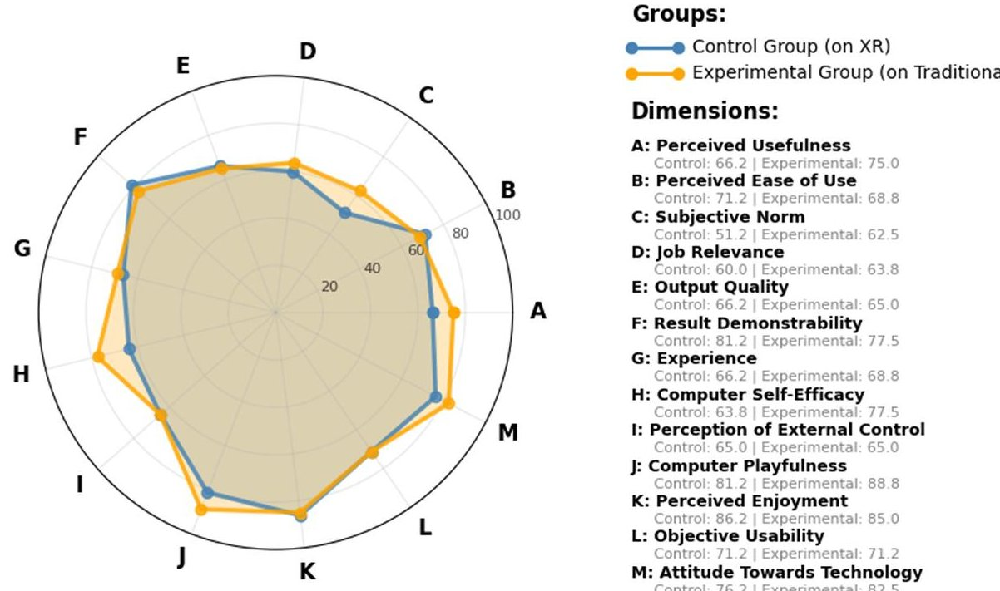

Fig.19 Comparison of results from likeability test for each group.

<!-- PDF_PAGE: 16 -->

assembly precision, workflow adaptability, and operator usability. Real-time electrical continuity checks, combined with intuitive 3D visualizations and prefab-based interaction design, showcase the framework's potential to streamline both training and operational execution in aerospace contexts. Moreover, the results from the functionality tests confirm the potential of using XR technologies over traditional documentation methods for assembly operations.

From a technological standpoint, the framework successfully demonstrates the feasibility of markerless AR tracking, Unity-based front-end integration, and bidirectional data flow between hardware sensors and virtual environments using Microsoft HoloLens 2 and Vuforia SDK. Moreover, the use of both internal and external DSL representations ensures transparency for domain experts while maintaining technical efficiency for system deployment.

Looking forward, several promising directions for future work emerge. One involves leveraging large language models (LLMs) to automate the extraction of procedural knowledge from technical documentation, thereby accelerating DSL generation and reducing the burden on subject matter experts. Another potential direction is the development of collaborative, multi-user environments that support synchronous XR interactions for distributed AIT operations.

## Acknowledgments

This study was partly supported by the Space It Up! project funded by the Italian Space Agency (ASI) and the Ministry of University and Research (MUR) under contract number 2024-5-E.0-CUP I53D24000060005. The work of Matteo Marinacci and Jacopo Rossi is also supported by Thales Alenia Space and Regione Lazio through the fellowships 35752-22066DP000000040-A0627S0030 "Utilizzo dell'Intelligenza Artificiale a supporto della progettazione e qualifica del prodotto spaziale" and 35757-22066DP000000041-A0627S0031 "Advanced Software Based on Cloud Computing and Machine Learning for Space Systems."

## References

[1] Gabsi, A. E. H., "Integrating Artificial Intelligence in Industry 4.0: Insights, Challenges, and Future Prospects-A Literature Review," Annals of Operations Research, 2024, pp. 1-28. https://doi.org/10.1007/s10479-024-06012-6

[2] Singh, J., Singh, A., Singh, H., and Doyon-Poulin, P., "Implementation and Evaluation of a Smart Machine Monitoring System Under Industry 4.0 Concept," Journal of Industrial Information Integration, Vol. 43, 2025, Paper 100746. https://doi.org/10.1016/j.jiii.2024.100746

[3] Kopeinig, J., Woschank, M., and Olipp, N., "Industry 4.0 Technologies and Their Implications for Environmental Sustainability in the Manufacturing Industry," Procedia Computer Science, Vol. 232, 2024, pp. 2777-2789. https://doi.org/10.1016/j.procs.2024.02.095

[4] Pesce, J., Carini, A., Marinacci, M., Rossi, J., Boscia, M., Pasquali, M., Eugeni, M., Arman, A., Leotta, F., Marzioli, P., et al., "Enhancing the MAIT of Aerospace Systems through AI-Based Immersive Technologies," Proceedings of the 75th International Astronautical Congress (IAC), 2024, pp. 1-11, https://iafastro.directory/iac/archive/browse/ IAC-24/D1/IPB/89552/.

[5] Phuyal, S., Bista, D., and Bista, R., "Challenges, Opportunities and Future Directions of Smart Manufacturing: A State of Art Review," Sustainable Futures, Vol. 2, 2020, Paper 100023. https://doi.org/10.1016/j.sftr.2020.100023

[6] Cristaldi, L., Esmaili, P., Gruosso, G., La Bella, A., Mecella, M., Scattolini, R., Arman, A., Susto, G. A., and Tanca, L., "The MICS Project: A Data Science Pipeline for Industry 4.0 Applications," 2023 IEEE International Conference on Metrology for eXtended Reality, Artificial Intelligence and Neural Engineering (MetroXRAINE), Inst. of Electrical and Electronics Engineers, New York, 2023, pp. 427431.

https://doi.org/10.1109/MetroXRAINE58569.2023.10405727

[7] Arman, A., Lombardo, A., Monti, F., and Mecella, M., "Supporting Smart Manufacturing in the Space Industry: A Case Study," Engineering Reports, Vol. 7, No. 1, 2025, Paper e13089. https://doi.org/10.1002/eng2.13089

[8] Javaid, M., Haleem, A., Singh, R. P., Rab, S., and Suman, R., "Significance of Sensors for Industry 4.0: Roles, Capabilities, and

Applications," Sensors International, Vol. 2, 2021, Paper 100110. https://doi.org/10.1016/j.sintl.2021.100110

[9] Javaid, M., Haleem, A., Singh, R. P., Rab, S., and Suman, R., "Exploring Impact and Features of Machine Vision for Progressive Industry 4.0 culture," Sensors International, Vol. 3, 2022, Paper 100132.

[10] Pesce, J., Carini, A., Marinacci, M., Boscia, M., Marzioli, P., Pasquali, M., Eugeni, M., Mecella, M., and Gaudenzi, P., "Cyber-Physical System Implementation for the AR-Assisted AIT of Aerospace Components," Poeceedings of the 34th Congress of the International Council of the Aeronautical Sciences (ICAS), International Council of the Aeronautical Sciences, 2024, pp. 1-17, https://www.icas.org/icas archive/icas2024/data/preview/icas2024 0672.htm.

[11] Xie, W., Zheng, D., Li, Z., Wang, Y., and Wang, L., "Digital Technology and Manufacturing Industrial Change: Evidence from the Chinese Manufacturing Industry," Computers & Industrial Engineering, Vol. 187, 2024, Paper 109825. https://doi.org/10.1016/j.cie.2023.109825

[12] Lu, Y., "The Current Status and Developing Trends of Industry 4.0: A Review," Information Systems Frontiers, Vol. 27, No. 1, 2021, pp. 215-234. https://doi.org/10.1007/s10796-021-10221-w

https://doi.org/10.1007/s10796-021-10221-w

[13] Lai, X., Hu, Q., Wang, W., Fei, L., and Huang, Y., "Adaptive Resource Allocation Method Based on Deep Q Network for Industrial Internet of Things," IEEE Access, Vol. 8, 2020, pp. 27,426-27,434. https://doi.org/10.1109/ACCESS.2020.2971228

[14] Zheng, P., Sang, Z., Zhong, R. Y., Liu, Y., Liu, C., Mubarok, K., Yu, S., and Xu, X., "Smart Manufacturing Systems for Industry 4.0: Conceptual Framework, Scenarios, and Future Perspectives," Frontiers of Mechanical Engineering, Vol. 13, No. 2, 2018, pp. 137-150. https://doi.org/10.1007/s11465-018-0499-5

[15] O'Donovan, P., Leahy, K., Bruton, K., and O'Sullivan, D. T. J., "An Industrial Big Data Pipeline for Data-Driven Analytics Maintenance Applications in Large-Scale Smart Manufacturing Facilities," Journal of Big Data, Vol. 2, No. 1, 2015, pp. 1-26. https://doi.org/10.1186/s40537-015-0034-z

[16] Lu, Y., Zheng, H., Chand, S., Xia, W., Liu, Z., Xu, X., Wang, L., Qin, Z., and Bao, J., "Outlook on Human-Centric Manufacturing Towards Industry 5.0," Journal of Manufacturing Systems, Vol. 62, 2022, pp. 612-627.

https://doi.org/10.1016/j.jmsy.2022.02.001

[17] Yang, J., Liu, Y., and Morgan, P. L., "Human-Machine Interaction Towards Industry 5.0: Human-Centric Smart Manufacturing," Digital Engineering, Vol. 2, 2024, Paper 100013. https://doi.org/10.1016/j.dte.2024.100013

[18] Hassan, A., Dutta, P. K., Gupta, S., Mattar, E., and Singh, S., Human-Centered Approaches in Industry 5.0: Human-Machine Interaction, Virtual Reality Training, and Customer Sentiment Analysis: Human-Machine Interaction, Virtual Reality Training, and Customer Sentiment Analysis, IGI Global, 2024.

[19] Zhang, Z., Li, X., Wang, X., and Cheng, H., "Decentralized CyberPhysical Systems: A Paradigm for Cloud-Based Smart Factory of Industry 4.0," Cybersecurity for Industry 4.0: Analysis for Design and Manufacturing, Springer, Berlin, 2017, pp. 127-171.

[20] Berti, N., Arman, A., Esmaili, P., Zeynivand, M., Battini, D., Bianchini, D., Cristaldi, L., De Giuli, L. B., Galeazzo, A., Gruosso, G., et al., "Sustainability and Resilience in the MICS SPOKE8 Project: The Role of the Digital Twin," 2024 IEEE International Conference on Metrology for eXtended Reality, Artificial Intelligence and Neural Engineering (MetroXRAINE), Inst. of Electrical and Electronics Engineers, New York, 2024, pp. 669-673. https://doi.org/10.1109/MetroXRAINE62247.2024.10797155

[21] Villarrazo, N., Sainz de la Maza, A., Caneda, S., Bai, L., Pereira, O., and Lopez de Lacalle, L. N., "Effect of Tool Orientation on Surface Roughness and Dimensional Accuracy in Ball End Milling of Thin-Walled Blades," International Journal of Advanced Manufacturing Technology, Vol. 136, No. 1, 2025, pp. 383-395. https://doi.org/10.1007/s00170-024-14523-6

[22] Zhang, C., "Research on Transparency and Optimization of Aviation Materials Supply Chain Based on Blockchain," Proceeding of IEEE 13th International Conference on Communication Systems and Network Technologies (CSNT), Inst. of Electrical and Electronics Engineers, New York, 2024, pp. 334-339. https://doi.org/10.1109/CSNT60213.2024.10546211

[23] Eugeni, M., Quercia, T., Bernabei, M., Boschetto, A., Costantino, F., Lampani, L., Marchetti Spaccamela, A., Lombardo, A., Mecella, M., Querzoni, L., et al., "An Industry 4.0 Approach to Large Scale Production of Satellite Constellations. The Case Study of Composite

<!-- PDF_PAGE: 17 -->

Sandwich Panel Manufacturing," Acta Astronautica, Vol. 192, 2022, pp. 276-290. https://doi.org/10.1016/j.actaastro.2021.12.039

https://doi.org/10.1016/j.actaastro.2021.12.039

[24] Chen, S., Li, T., and Jiang, Y., "Pose Measurement and Assembly of Spacecraft Components Based on Assembly Features and a Consistent Coordinate System," International Journal of Advanced Manufacturing Technology, Vol. 120, No. 3, 2022, pp. 2429-2442. https://doi.org/10.1007/s00170-022-08864-3

[25] de Mello, J. M. G., Trabasso, L. G., Silva, A. V. S., and de Oliveira, W. R., "Clamping Force Model Application on the Aircraft Structural Assembly," International Journal of Advanced Manufacturing Technology, Vol. 124, No. 5, 2023, pp. 1951-1969. https://doi.org/10.1007/s00170-022-10555-y

[26] Lester, C. L., and Nutt, S., "Composite Materials: Advantages and Cost Factors," Proceedings of the International Conference on Materials Science, Los Angeles, CA, 2018, pp. 1-8.

[27] U.S. Department of Energy, "Titanium Alloy Production," 2013, https://www.energy.gov/sites/prod/files/2013/11/f4/ titanium alloy production.pdf [retrieved 5 March 2025].

[28] NASA, "Artemis Program Overview," 2025, https://www.nasa.gov/ feature/artemis/ [retrieved 5 March 5 2025].

[29] Office of Inspector General, "Audit Report: NASA's Artemis Program Challenges," 2023, https://oig.nasa.gov/wp-content/uploads/2023/10/ ig-24-003.pdf [retrieved 5 March 2025].

[30] Okutsu, M., DeLaurentis, D., Brophy, S., and Lambert, J., "Teaching an Aerospace Engineering Design Course via Virtual Worlds: A Comparative Assessment of Learning Outcomes," Computers & Education, Vol. 60, No. 1, 2013, pp. 288-298. https://doi.org/10.1016/j.compedu.2012.07.012

[31] Li, L., Aslam, S., Wileman, A., and Perinpanayagam, S., "Digital Twin in Aerospace Industry: A Gentle Introduction," IEEE Access, Vol. 10, 2022, pp. 9543-9562. https://doi.org/10.1109/ACCESS.2021.3136458

[32] Tadeja, S. K., Seshadri, P., and Kristensson, P. O., "AeroVR: An Immersive Visualisation System for Aerospace Design and Digital Twinning in Virtual Reality," Aeronautical Journal, Vol. 124, No. 1280, 2020, pp. 1615-1635. https://doi.org/10.1017/aer.2020.49

[33] Regenbrecht, H., Baratoff, G., and Wilke, W., "Augmented Reality Projects in the Automotive and Aerospace Industries," IEEE Computer Graphics and Applications, Vol. 25, No. 6, 2005, pp. 48-56. https://doi.org/10.1109/MCG.2005.124

[34] Frigo, M. A., da Silva, E., and Barbosa, G. F., "Augmented Reality in Aerospace Manufacturing: A Review," Journal of Industrial and Intelligent Information, Vol. 4, No. 2, March 2016, pp. 125-130. https://doi.org/10.18178/jiii.4.2.125-130

[35] Yaacoub, J.-P. A., Salman, O., Noura, H. N., Kaaniche, N., Chehab, A., and Malli, M., "Cyber-Physical Systems Security: Limitations, Issues and Future Trends," Microprocessors and Microsystems, Vol. 77, 2020, Paper 103201. https://doi.org/10.1016/j.micpro.2020.103201

[36] Rajkumar, R., Lee, I., Sha, L., and Stankovic, J., "Cyber-Physical Systems: The Next Computing Revolution," Proceedings of the 47th Design Automation Conference (DAC), 2010, pp. 731-736. https://doi.org/10.1145/1837274

[37] Napoleone, A., Macchi, M., and Pozzetti, A., "A Review on the Characteristics of Cyber-Physical Systems for the Future Smart Factories," Journal of Manufacturing Systems, Vol. 54, 2020, pp. 305-335. https://doi.org/10.1016/j.jmsy.2020.01.007

[38] Thiede, S., Juraschek, M., and Herrmann, C., "Implementing CyberPhysical Production Systems in Learning Factories," Procedia CIRP, Vol. 54, 2016, pp. 7-12. https://doi.org/10.1016/j.procir.2016.04.098

[39] Jackson, K., Efthymiou, K., and Borton, J., "Digital Manufacturing and Flexible Assembly Technologies for Reconfigurable Aerospace Production Systems," Procedia CIRP, Vol. 52, 2016, pp. 274-279. https://doi.org/10.1016/j.procir.2016.07.054

[40] Phanden, R. K., Sharma, P., and Dubey, A., "A Review on Simulation in Digital Twin for Aerospace, Manufacturing and Robotics," Materials Today: Proceedings, Vol. 38, 2021, pp. 174-178. https://doi.org/10.1016/j.matpr.2020.06.446

[41] Pirker, J., "The Potential of Virtual Reality for Aerospace Applications," 2022 IEEE Aerospace Conference (AERO), Inst. of Electrical and Electronics Engineers, New York, 2022, pp. 1-8. https://doi.org/10.1109/AERO53065.2022.9843324

[42] Drouot, A., Zhao, R., Irving, L., Sanderson, D., and Ratchev, S., "Measurement Assisted Assembly for High Accuracy Aerospace

Manufacturing," IFAC-PapersOnLine, Vol. 51, No. 11, 2018, pp. 393-398. https://doi.org/10.1016/j.ifacol.2018.08.326

[43] Hänel, A., Schnellhardt, T., Wenkler, E., Nestler, A., Brosius, A., Corinth, C., Fay, A., and Ihlenfeldt, S., "The Development of a Digital Twin for Machining Processes for the Application in Aerospace Industry," Procedia CIRP, Vol. 93, 2020, pp. 1399-1404. https://doi.org/10.1016/j.procir.2020.04.017

[44] Eswaran, M., Gulivindala, A. K., Inkulu, A. K., and Raju Bahubalendruni, M. V. A., "Augmented Reality-Based Guidance in Product Assembly and Maintenance/Repair Perspective: A State of the Art Review on Challenges and Opportunities," Expert Systems with Applications, Vol. 213, 2023, Paper 118983. https://doi.org/10.1016/j.eswa.2022.118983

[45] Saeed, N., Elzanaty, A., Almorad, H., Dahrouj, H., Al-Naffouri, T. Y., and Alouini, M.-S., "CubeSat Communications: Recent Advances and Future Challenges," IEEE Communications Surveys & Tutorials, Vol. 22, No. 3, 2020, pp. 1839-1862. https://doi.org/10.1109/COMST.2020.2990499

[46] Marinacci, M., Carini, A., Eugeni, M., Pasquali, M., and Mecella, M., "An Industry 4.0 Framework for Immersive Reality During Assembly and Testing of Satellites," 2024 IEEE International Conference on Metrology for eXtended Reality, Artificial Intelligence and Neural Engineering (MetroXRAINE), Inst. of Electrical and Electronics Engineers, New York, 2024, pp. 487-492. https://doi.org/10.1109/MetroXRAINE62247.2024.10795817

[47] Wang, P. Y., Yang, W.-A., and You, Y. P., "A Cyber-Physical Prototype System in Augmented Reality Using RGB-D Camera for CNC Machining Simulation," Journal of Intelligent Manufacturing, Vol. 34, No. 8, 2023, pp. 3637-3658. https://doi.org/10.1007/s10845-022-02021-z

[48] Zhang, Y., and Kwok, T.-H., "Design and Interaction Interface Using Augmented Reality for Smart Manufacturing," Procedia Manufacturing, Vol. 26, 2018, pp. 1278-1286. https://doi.org/10.1016/j.promfg.2018.07.140

[49] Hasan, S. M., Lee, K., Moon, D., Kwon, S., Jinwoo, S., and Lee, S., "Augmented Reality and Digital Twin System for Interaction with Construction Machinery," Journal of Asian Architecture and Building Engineering, Vol. 21, No. 2, 2021, pp. 564-574. https://doi.org/10.1080/13467581.2020.1869557

[50] Traganos, K., Grefen, P., Vanderfeesten, I., Erasmus, J., Boultadakis, G., and Bouklis, P., "The HORSE Framework: A Reference Architecture for Cyber-Physical Systems in Hybrid Smart Manufacturing," Journal of Manufacturing Systems, Vol. 61, 2021, pp. 461-494. https://doi.org/10.1016/j.jmsy.2021.09.003

[51] Muhammad, A. S., Chandran, K., Albuquerque, G., Steinicke, F., and Gerndt, A., "A Suggestion-Based Interaction System for Spacecraft Design in Augmented Reality," Proceeding of IEEE Aerospace Conference, 2021, pp. 1-10. https://doi.org/10.1109/AERO50100.2021.9438526

[52] Yazdani Nezhad, H., Wang, X., Court, S. D., Thapa, B., and Erkoyuncu, J. A., "Development of an Augmented Reality Equipped Composites Bonded Assembly and Repair for Aerospace Applications," IFAC-PapersOnLine, Vol. 53, No. 3, 2020, pp. 209-215. https://doi.org/10.1016/j.ifacol.2020.11.034

[53] Gupta, A., Cecil, J., and Pirela-Cruz, M., "A Virtual Reality Enhanced Cyber Physical Framework to Support Simulation Based Training of Orthopedic Surgical Procedures," 2018 IEEE 14th International Conference on Automation Science and Engineering (CASE), Inst. of Electrical and Electronics Engineers, New York, 2018, pp. 433-438. https://doi.org/10.1109/COASE.2018.8560602

[54] Nisiotis, L., Nikolaou, C., Markov, N., and Hadjiliasi, A., "Developing a Cyber-Physical-Social Metaverse System for Interactive Cultural Heritage Experiences," 2025 IEEE 49th Annual Computers, Software, and Applications Conference (COMPSAC), Inst. of Electrical and Electronics Engineers, New York, 2025, pp. 654-663. https://doi.org/10.1109COMPSAC65507.2025.00088

[55] Halder, S., Afsari, K., and Reichard, G., "Effect of Human Interaction Modalities on the Usability and Performance of a Robotic CyberPhysical System for Construction Progress Monitoring," International Journal of Human-Computer Interaction, Vol. 41, No. 11, 2024, pp. 6589-6612. https://doi.org/10.1080/10447318.2024.2381931

[56] HTC Vive, "HTC Vive Official Website," 2025, https://www.vive. com [retrieved 5 March 2025].

[57] Catalano, M., Chiurco, A., Fusto, C., Gazzaneo, L., Longo, F., Mirabelli, G., Nicoletti, L., Solina, V., and Talarico, S., "A Digital

<!-- PDF_PAGE: 18 -->

Twin-Driven and Conceptual Framework for Enabling Extended Reality Applications: A Case Study of a Brake Discs Manufacturer," Procedia Computer Science, Vol. 200, 2022, pp. 1885-1893. https://doi.org/10.1016/j.procs.2022.01.389

[58] Xia, K., Sacco, C., Kirkpatrick, M., Saidy, C., Nguyen, L., Kircaliali, A., and Harik, R., "A Digital Twin to Train Deep Reinforcement Learning Agent for Smart Manufacturing Plants: Environment, Interfaces and Intelligence," Journal of Manufacturing Systems, Vol. 58, 2021, pp. 210-230. https://doi.org/10.1016/j.imsv.2020.06.012

[59] Hazrat Ali, M., Waqar Malik, A., Jyeniskhan, N., Arif Mahmood, M., Shehab, E., and Liou, F., "Development of Digital Twin for FDM Printer with Preventive Cyber-Attack and Control Algorithms," IEEE Access, Vol. 12, 2024, pp. 193,594-193,606. https://doi.org/10.1109/ACCESS.2024.3516827

[60] Tao, F., and Zhang, M., "Digital Twin Shop-Floor: A New Shop-Floor Paradigm Towards Smart Manufacturing," IEEE Access, Vol. 5, 2017, pp. 20,418-20,427. https://doi.org/10.1109/ACCESS.2017.2756069

[61] Yang, S., Mirahmadi, S. A., Zhu, E., and Solanki, B., "Live Digital Twin with Virtual Reality for Accessible and Immersive Manufacturing Education," International Journal of Advanced Manufacturing Technology, Vol. 136, Nos. 7-8, 2025, pp. 3577-3590. https://doi.org/10.1007/s00170-025-15078-w

[62] Barbone, A., Bicocchi, N., Martinelli, M., Morandi, R., and Picone, M., "On-Device AI and Digital Twins: A Synergistic Approach to Intelligent Cyber-Physical Systems," Future Generation Computer Systems, Vol. 175, 2026, Paper 108068. https://doi.org/10.1016/j.future.2025.108068

[63] Mahdi, M. M., Bajestani, M. S., Noh, S. D., and Kim, D. B., "Digital Twin-Based Architecture for Wire Arc Additive Manufacturing Using OPC UA," Robotics and Computer-Integrated Manufacturing, Vol. 94, 2025, Paper 102944. https://doi.org/10.1016/j.rcim.2024.102944

[64] Guthridge, R., and Clinton-Lisell, V., "Evaluating the Efficacy of Virtual Reality (VR) Training Devices for Pilot Training," Journal of Aviation Technology and Engineering, Vol. 12, No. 2, 2023, p. 1. https://doi.org/10.7771/2159-6670.1286

[65] Twigt, D., Mathot, L., den Exter, E., Daswani, M. L., Brouwer, S., Vos, C., Caso, S., and ten Hove, P., "ICARUS—Virtual Reality Based Training for Assembly, Integration and Testing," SmallSat, Amsterdam, NL, 2025.

[66] Piñal, O., and Arguelles, A., "Mixed Reality and Digital Twins for Astronaut Training," Acta Astronautica, Vol. 219, 2024, pp. 376-391. https://doi.org/10.1016/j.actaastro.2024.01.034

[67] Kuhail, M., et al., "A Review on the Use of Immersive Technology in Space Research," Telematics and Informatics Reports, Vol. 17, 2025, Paper 100191. https://doi.org/10.1016/j.teler.2025.100191

[68] Patricio, A., Valente, J., Dehban, A., Cadilha, I., Reis, D., and Ventura, R., "AI-Powered Augmented Reality for Satellite Assembly, Integration and Test," IEEE International Conference on Artificial Intelligence and eXtended and Virtual Reality (AIxVR), Inst. of Electrical and Electronics Engineers, New York, 2025, pp. 1-9.

[69] Litaker, H. L., Archer, R. D., Newton, C. E., Howard, R. L., Kennedy, K. J., Martin, C. S., and Montoya, B. D., "Evaluation Methodologies for Early Conceptual Design Using Virtual Reality and Physical Test Environments," NASA TM 2019-220301, 2019.

[70] Cole, B., Dubos, G., Banazadeh, P., Reh, J., Case, K., Wang, Y.-F., Jones, S., and Picha, F., "Domain-Specific Languages and Diagram Customization for a Concurrent Engineering Environment," 2013 IEEE Aerospace Conference, Inst. of Electrical and Electronics Engineers, New York, 2013, pp. 1-12.

[71] Montalvo, A., Polo, O. R., Parra, P., Carrasco, A., da Silva, A., Martinez, A., and Sanchez, S., "Model-Driven Engineering for Low-Code Ground Support Equipment Configuration and Automatic Test Procedures Definition," Acta Astronautica, Vol. 211, 2023, pp. 574-591. https://doi.org/10.1016/j.actaastro.2023.06.027

[72] Campos-López, R., Guerra, E., de Lara, J., Colantoni, A., and Garmendia, A., "Model-Driven Engineering for Augmented Reality," Journal of Object Technology, Vol. 22, No. 2, 2023, pp. 1-15. https://doi.org/10.5381/jot.2023.22.2.a7

[73] Brunschwig, L., Campos-Lopez, R., Guerra, E., and de Lara, J., "Towards Domain-Specific Modelling Environments Based on Augmented Reality," 2021 IEEE/ACM 43rd International Conference on Software Engineering: New Ideas and Emerging Results (ICSENIER), Inst. of Electrical and Electronics Engineers, New York, 2021, pp. 56-60.

[74] Ruiz-Rube, I., Baena-Perez, R., Mota, J. M., and Sánchez, I. A., "Model-Driven Development of Augmented Reality-Based Editors for Domain Specific Languages," Interaction Design and Architecture(s), Vol. 45, No. 45, 2020, pp. 246-263. https://doi.org/10.55612/s-5002-045-011

[75] Sklyar, V., and Kharchenko, V., "Domain Specific Modelling and Language for Safety-Critical and Security-Critical Requirements Engineering," 2022 12th International Conference on Dependable Systems, Services and Technologies (DESSERT), Inst. of Electrical and Electronics Engineers, New York, 2022, pp. 1-7.

[76] Chu, C.-H., and Ko, C.-H., "An Experimental Study on Augmented Reality Assisted Manual Assembly with Occluded Components," Journal of Manufacturing Systems, Vol. 61, 2021, pp. 685-695. https://doi.org/10.1016/j.imsv.2021.04.003

[77] Abidi, M. H., Al-Ahmari, A., Ahmad, A., Ameen, W., and Alkhalefah, H., "Assessment of Virtual Reality-Based Manufacturing Assembly Training System," International Journal of Advanced Manufacturing Technology, Vol. 105, No. 9, 2019, pp. 3743-3759. https://doi.org/10.1007/s00170-019-03801-3

[78] Macchiarella, N. D., and Vincenzi, D. A., "Augmented Reality in a Learning Paradigm for Flight Aerospace Maintenance Training," The 23rd Digital Avionics Systems Conference (IEEE Cat. No. 04CH37576), Inst. of Electrical and Electronics Engineers, New York, 2004, Paper 5-D.

[79] Webster, R., and Dues, J. F., "System Usability Scale (sus): Oculus Rift $ ^{\circ} $ dk2 and Samsung Gear Vr $ ^{\circ} $ , 2017 ASEE Annual Conference & Exposition, 2017.

[80] Helin, K., Kuula, T., Vizzi, C., Karjalainen, J., and Vovk, A., "User Experience of Augmented Reality System for Astronaut's Manual Work Support," Frontiers in Robotics and AI, Vol. 5, 2018, p. 106. https://doi.org/10.3389/frobt.2018.00106

[81] Li, W.-C., Zhang, J., Court, S., Kearney, P., and Braithwaite, G., "The Influence of Augmented Reality Interaction Design on Pilot's Perceived Workload and Situation Awareness," International Journal of Industrial Ergonomics, Vol. 92, 2022, Paper 103382. https://doi.org/10.1016/j.ergon.2022.103382

[82] Lima, I. B., Jeong, Y., Lee, C., Suh, G., and Hwang, W., "Severity of usability Problems and System usability Scale (Sus) Scores on Augmented Reality (Ar) User Interfaces," ICIC Express Letters, Part B: Applications, Vol. 12, No. 2, 2021, pp. 175-183.

[83] Moharana, B., Keighrey, C., and Murray, N., "Voices Unveiled: Quality of Experience in Collaborative VR via Assembly AI and NASA-TLX Analysis," 2024 16th International Conference on Quality of Multimedia Experience (QoMEX), Inst. of Electrical and Electronics Engineers, New York, 2024, pp. 15-21.

[84] NASA, "What are SmallSats and CubeSats?" 2025, https://www. nasa.gov/what-are-smallsats-and-cubesats/ [retrieved 5 March 2025].

[85] National Aeronautics and Space Administration, " NASA Official Website," 2025, https://www.nasa.gov/ [retrieved 23 May 2025].

[86] European Space Agency, "ESA Official Website," 2025, https:// www.esa.int/ [retrieved 23 May 2025].

[87] Spacemind, N., "NPC Spacemind Official Website," 2025, https:// www.npcspacemind.com/ [retrieved 5 March 2025].

[88] Unity Technologies, "Unity: Real-Time Development Platform," 2025, https://unity.com/ [retrieved 3 March 2025].

[89] Microsoft Corporation, "HoloLens 2," 2025, https://www.microsoft.com/it-it/d/hololens-2/91pnzzznzwcp [retrieved 3 March 2025].

[90] Evans, G., Miller, J., Iglesias Pena, M., MacAllister, A., and Winer, E., "Evaluating the Microsoft HoloLens Through an Augmented Reality Assembly Application," Proceeding SPIE, Degraded Environments: Sensing, Processing, and Display, edited by N. J. Sanders-Reed, and J. J. Arthur III, 2017, Paper 101970. https://doi.org/10.1117/12.2262626

[91] Wang, Z., Bai, X., Zhang, S., Billinghurst, M., He, W., Wang, P., Lan, W., Min, H., and Chen, Y., "A Comprehensive Review of Augmented Reality-Based Instruction in Manual Assembly, Training and Repair," Robotics and Computer-Integrated Manufacturing, Vol. 78, 2022, Paper 102407.

https://doi.org/10.1016/j.rcim.2022.102407

[92] Microsoft, "MRTK for Unity," 2025, https://learn.microsoft.com/en-us/ windows/mixed-reality/mrtk-unity/mrtk2/ [retrieved 3 March 2025].

[93] PTC Inc., "Vuforia Developer Portal," 2025, https://developer. vuforia.com/home [retrieved 3 March 2025].

[94] Fowler, M., Domain Specific Languages, 1st ed., Addison-Wesley Professional, Boston, MA, 2010.

[95] NASA CubeSat Launch Initiative, "CubeSat 101: Basic Concepts and Processes for First-Time CubeSat Developers," CSLI 101, National

<!-- PDF_PAGE: 19 -->

Aeronautics and Space Administration (NASA), 2017, https:www. nasa.govwp-contentuploads201703nasa_csli_cubesat_101_508.pdf.

[96] Pumpkin, Inc., "Pumpkin CubeSat Kit User Manual, Pumpkin, Inc., 2005, https: cubesatkit.comdocscubesatkitmanual.pdf.

[97] Technologies, U., "Unity Manual: Prefabs," 2025, https://docs.unity3d. com/Manual/Prefabs.html [retrieved 5 March 2025].

[98] Hily, A., Dupont, L., Arbelaez-Garces, G., Camargo, M., and Dinet, J., "Evaluation and Validation Process of Extended Reality Applications Developed in an Industrial Context: A Systematic Review," SN Computer Science, Vol. 4, No. 5, 2023. https://doi.org/10.1007/s42979-023-02089-1

[99] Rostami, M., Pradhan, P., Karki, N., Omorodion, J., Milani, P., Kamoonpuri, J., Liu, H. Y., and Chung, J., "A Comprehensive Review of Extended Reality and Its Application in Aerospace

Engineering," Progress in Aerospace Sciences, Vol. 157, 2025, Paper 101118.

https://doi.org/10.1016/j.paerosci.2025.101118

[100] Prabaswari, A. D., Basumerda, C., and Utomo, B. W., "The Mental Workload Analysis of Staff in Study Program of Private Educational Organization," IOP Conference Series: Materials Science and Engineering, Vol. 528, No. 1, 2019, Paper 012018. https://doi.org/10.1088/1757-899X/528/1/012018

[101] Lewis, J. R., and Sauro, J., "The Factor Structure of the System Usability Scale," Human Centered Design, edited by M. Kurosu, Springer, Berlin, 2009, pp. 94-103.

D. Selva

Associate Editor