<!-- PDF_PAGE: 1 -->

# Thermal control with digital twins for dimensional stability in CubeSat payloads

## PDF View PDF

## Highlights

- An onboard Digital Twin regulates temperature gradients in a CubeSat payload.

- Redundant electronics are used as controllable distributed heat sources.

- Online parameter updates improve the thermal model during operation.

- Mixed-integer predictive control maintains prescribed temperature differences.

- Experimental tests demonstrate the framework under laboratory conditions.

## Abstract

Small satellites are on the rise within the context of the so-called New Space industry, driven by the use of cost-efficient, off-the-shelf components as well as miniaturization, modularity, and scalability. While this opens many opportunities, especially in terms of accessibility to space, it also comes with its challenges. When high-precision optical sensors are employed, such as laser-based communication systems, payload temperature gradients often lead to optical aberrations due to the satellite's uneven thermal expansion. This reduces reliability and hinders the system's performance in certain stages of the mission. Moreover, traditional methods to alleviate temperature gradients, such as heat pipes, might be infeasible due to limited payload volume, and control routines might fail due to structural degradation and component wear. This paper presents an innovative approach to achieving thermal stability in a Dynamic Optical Ranging & Timing system by exploiting the waste heat of redundant electronic components. An Onboard Digital Twin is defined, composed of a satellite thermal model, model-predictive control to schedule the load of redundant electronic components, and a parameter updating scheme that accounts for time-variant internal and external deviations. The framework was executed off-board in a laboratory hardware-testing environment, with the measured control

<!-- PDF_PAGE: 2 -->

timings supporting the computational feasibility of future deployment on the target multi-processor onboard computer. During the hardware tests, the presented framework achieved a maximum relative temperature error of under 10% between model prediction and measurement data, and successfully maintained temperature differences between critical components below the required 5 K.

## Keywords

Digital twins; Thermal management; CubeSats; New space; Model predictive control; System identification

< Previous article in this issue

Next article in this issue >

## 1. Introduction

Satellites in Low Earth Orbit (LEO) are exposed to a dynamic thermal environment, making thermal control a persistent challenge. For payloads where temperature requirements are critical, the thermal design must account for multiple time-varying external heat inputs and for gradual changes in thermo-optical properties due to aging and degradation, which in turn affect the effectiveness of passive and active thermal-control elements [1], [2], [3], [4], [5]. Consequently, control algorithms must account for deviations with respect to the original design [5], [6], which is particularly challenging in CubeSats and SmallSats, where mass, volume, and power constraints severely limit available thermal control hardware [7], [8], [9].

## 1.1. Space thermal environment in low earth orbit

CubeSats in LEO are exposed to three main external heat sources: (i) Solar radiation: Having the greatest magnitude, the average heating power per unit surface is accepted at $ 1 3 6 6. 1 \mathrm{W m}^{-2}. $ Due to Earth's distance variations of $ \pm 1. 7 \% $ with respect to the Sun, the actual values range from $ 1 3 2 1. 6 \mathrm{W m}^{-2} $ at the aphelion to $ 1 4 1 2. 9 \mathrm{W m}^{-2} $ at the perihelion [10]. (ii) Earth's albedo: It is the amount of solar radiation reflected off a planet, its value depends strongly on orbit inclination. The coefficient a is defined as the fraction of reflected sunlight, and it varies significantly depending on whether a satellite drifts over surfaces covered by oceans, arctic poles, deserts, etc. According to the standard, an average value is taken at a=0.3 on Earth's sunlit side. Detailed models for the estimation of albedo's heating power can be found in [11], although simpler analytical models are provided in [10]. This heating source usually remains relevant for LEO and is not considered for wider orbits such as Geostationary. (iii) Planetary radiation: Being the heat emitted by Earth, mostly infrared, also depends on local time,

<!-- PDF_PAGE: 3 -->

presence of oceans, and orbit inclination. A detailed analysis of this source can be found in literature [4], with values for spacecraft ranging from 150 to $ 3 5 0 \mathrm{W m}^{-2} $ , and an average flux set to $ 2 3 0 \mathrm{W m}^{-2} $ measured at the Earth's surface [12]. Again, this heat source remains only relevant for LEO applications. For completeness, additional heat sources are present in the form of (iv) Charged particles in van Allen's belt: Extremely weak compared to the other, they might only be considered for very low temperature applications such as cryogenic radiators [13].

The aforementioned heat sources have been thoroughly studied for decades, and detailed models used for spacecraft thermal design are available, some of them being referenced in this section. When designing active thermal control systems, they might be thought of as foreseeable or predictable heating disturbances given a satellite trajectory. Yet, there are other factors that have a major impact on the thermal behavior of spacecraft and might exhibit an unpredictable, dynamic character that must be accounted for in both payload design and operational control. Mainly affecting external surfaces, the presence of contaminants, atomic oxygen (AO), ultraviolet radiation (UV), and charged particles leads to degradation of the optical, thermal, electrical, and mechanical properties of the payload. Moreover, not all orbital phenomena can be simulated in ground-based experiments due to irradiation intensity and exposure times (often spanning months or years) [7]. The effects of these environmental factors are varied, but they mainly modify the absorptivity of control surfaces with almost no effect on the emissivity, thus becoming a driving factor, among others, in radiator sizing [4]. Details on the influence of these factors on the optical properties of coatings and control surfaces can be found in [4], [12], [13], [14].

As shown in Fig.1, satellites are exposed to transient thermal conditions. There exist other elements that can deteriorate thermal control systems aside from control surfaces. Micrometeroids and space debris, even if not reactive, can induce severe impact damage to the payload. Although both are present, impact by debris is up to 10 times more frequent than micrometeoroids in LEO [4], resulting in faulty heat exchangers, heat pipes, and condensers, among others [13]. Also, in-orbit thermal fluctuations have proven to induce thermal warping, micro-cracking (particularly in composites), and deterioration of critical surfaces leading to higher AO exposures [13]. Studies in [15] show how thermal cycles affect the structural integrity of solar panels in micro-satellites, reducing system efficiency and increasing power fluctuations.

<!-- PDF_PAGE: 4 -->

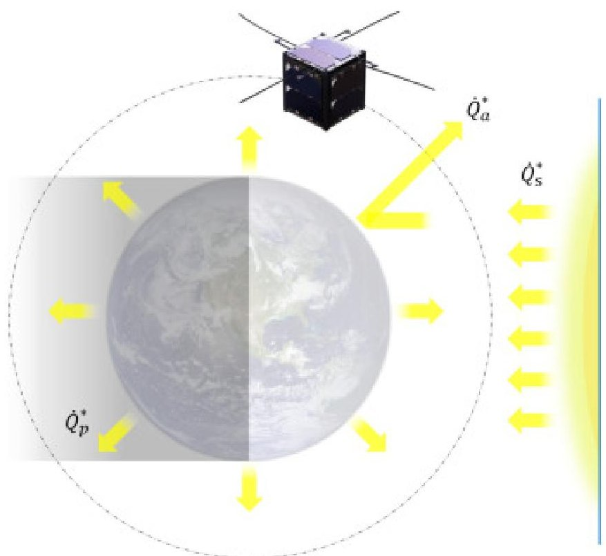

Download: Download high-res image (189KB)

Download: Download full-size image

Fig. 1. Main external heat sources seen by a CubeSat in LEO, being $ \dot{Q}_{s}^{*} $ the solar, $ \dot{Q}_{a}^{*} $ the albedo, and $ \dot{Q}_{p}^{*} $ the planetary radiation.

It can be seen how thermal control systems in CubeSats must not only deal with cyclic and unsteady heat sources, but also with changes in the thermal system itself, be it through changes in the optical properties of insulation layers or by damage and degradation of passive and active thermal elements. To tackle this, control routines have been developed depending on the application and mission requirements. The need for robust control and adaptability to a changing environment and thermal system becomes clear, for which different approaches and control frameworks have been developed.

## 1.2. Digital twins for spacecraft operation control

The development of Digital Twins (DT) is a key step in the digital transformation, high fidelity simulation, mission situational awareness, and autonomous operations of spacecraft [16]. Having its conceptual origins in Product Lifecycle Management (PLM) [17], the term was first mentioned in NASA's 2010 draft of the technological roadmap. Also referred to as 'Virtual Digital Fleet Leader', NASA established an early definition of the DT as an "integrated multi-physics, multi-scale, probabilistic simulation of a vehicle or system that uses the best available physical models, sensor updates, fleet history, etc., to mirror the life of its flying twin" [18]. Since then, and especially in recent years, the term has gained exponential interest to mirror physical processes [19], and several works have been published attempting to establish a common framework [20], [21], [22], [23], [24], [25], [26].

<!-- PDF_PAGE: 5 -->

In the aerospace field, the number and range of applications involving this technology is growing rapidly. One of the most prominent areas is strength assessment and Structural Health Monitoring (SHM). Relevant examples include the work of [27] where the inverse Finite Element Method (iFEM) is combined with Gaussian processes to correct online displacement estimation errors in load-bearing components such as wings and fuselages. Digital Twins are also proposed in [28] to update damage states based on multiple aircraft (fleet-level monitoring), utilizing a Physics-Decoded Variational Neural Network. An overview of different SHM approaches using Digital Twins can be found in [26], which proposes a five-layer architecture to achieve high-precision monitoring and loading control of complex structures. Along the lines with SHM, engine and propulsion performance monitoring can benefit from Digital Twin technology too, with [29] proposing a self-adaptive Digital Twin to track component degradation in turbofan engines. Due to the high thermomechanical complexity of propulsion systems, one can find publications investigating Model Order Reduction (MOR) for twinning aero-engines and gas turbines [30] as well as Recursive Neural Networks for modeling rocket engine reactions [31], both with promising results at speeding up computation times for prediction. There has been research conducted to optimize the status-tracking and model parameterization of on-orbit satellite subsystems, particularly relevant for the present work. Notably, [16] defines a self-evolving fleet replica representing state estimations with uncertainty for online model calibration, using Bayesian estimators to enrich purely optimization-based approaches. Investigations by [6] pursue the same goal by means of deep learning surrogates for spacecraft batteries during online operation, while [32] developed a frequency-domain model of a power conditioning unit that synchronizes with real-time data for model parameter prediction.

Overall, the reviewed Digital Twin efforts for spacecraft controls and monitoring are largely focused on maintaining high-fidelity replicas on ground-based computing infrastructure, based on telemetry data requiring operator oversight. While these approaches demonstrably improve representativeness, they assume continuous communications, sufficient onboard instrumentation, and the availability of dedicated engineering resources. For CubeSats, cost, volume, and power constraints might render extensive telemetry suites impractical while continuous ground monitoring and manual intervention for thermal control become infeasible, especially if considering CubeSat constellations. Against this background, there is a need for a deployable, computationally lightweight, Digital Twin-enabled thermal control routine that can autonomously respond in a dynamic environment and take necessary corrections without external monitoring. Accordingly, this paper presents the following main contributions:

1. Design of an Onboard Digital Twin (ODT) framework for CubeSat thermal control, enabling autonomous parameter update under constrained computational resources.

<!-- PDF_PAGE: 6 -->

2. Application to an optical communications payload, exploiting waste heat from electronic devices to regulate temperature gradients.

3. Validation and implementation of the proposed framework in a thermal testing environment.

The remainder of the paper is organized as follows: Section 2 introduces the use-case payload and frames the optimal control problem, Section 3 describes the implemented Digital Twin Framework, Section 4 shows the experimental setup and test environment, Section 5 contains the test results and their discussion, and finally in Section 6, the conclusions of this work are drawn.

## 2. Use-case payload: optics-based sensing and communications

The use case considered in this work is the DORT-Space payload, an optics-based sensing and communications system developed by MUnique Technology GmbH. Its purpose is to establish optical links between spacecrafts and thereby enable high-precision ranging, frequency and time transfer, and high-rate data exchange within distributed space systems [33] (see Fig. 2).

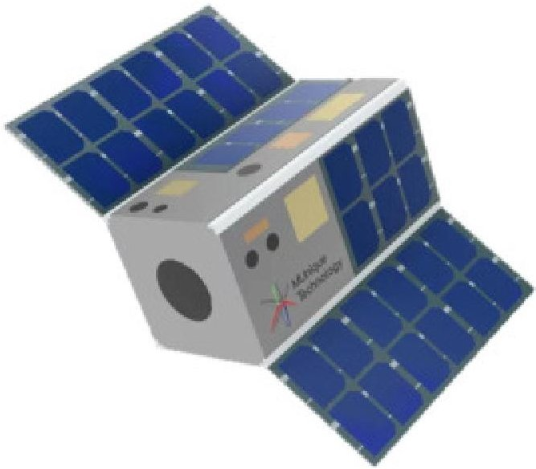

Download: Download high-res image (121KB)

Download: Download full-size image

Fig. 2. DORT-space 2U CubeSat [33].

In this context, the payload is treated as an opto-electronic assembly whose measurement and communication performance depend directly on the thermal uniformity of its supporting structure. Uneven temperature fields cause non-uniform thermal expansion of the mechanical interfaces that carry mirrors, lenses, and optical benches. Even small local deformations due to temperature gradients of 5 K across the payload mounting platform may alter alignment conditions, change effective focal lengths, and introduce optical aberrations, ultimately degrading both ranging accuracy and communication quality [34]. The control problem

<!-- PDF_PAGE: 7 -->

addressed in this paper is therefore to minimize temperature gradients in the vicinity of the optics attachments, where a nearly uniform temperature distribution is required for payload operation.

Instead of relying exclusively on dedicated thermal actuators, the present concept exploits the waste heat of onboard electronics as an additional control resource. In particular, the distributed processing unit developed by the industrial partner Engineering Minds Munich GmbH comprises three CPUs and dissipates approximately 10 W under nominal operation. Because this heat is generated at discrete locations inside the payload, the allocation of computational tasks becomes thermally relevant: redistributing the workload shifts the spatial position of the heat sources and, with it, the local temperature field in the payload structure (see Fig. 3).

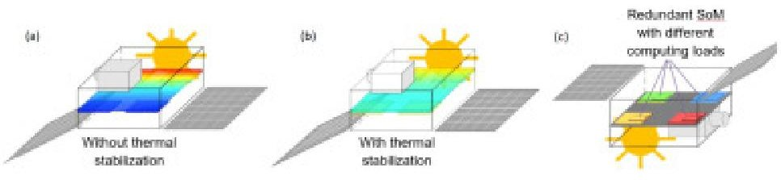

Download: Download high-res image (90KB)

Download: Download full-size image

Fig. 3. Temperature distribution (a) without waste-heat control, (b) with thermal stabilization and (c) displaying the redundant OBCs acting as thermal actuators.

This approach is enabled by a distributed multi-OBC architecture in which three interconnected computing nodes can exchange data and dynamically reassign processing responsibilities. Each OBC is based on a system-on-chip (Micron PolarFire SoC MPFS250T) [35], which integrates a multi-core RISC-V processing subsystem with FPGA fabric on a single device. External memory (Micron LPDDR4 SDRAM) [36] is used as local memory for each computing node.

Interconnection between the OBCs is realized through the FPGA high-speed transceiver ports rather than through a separate dedicated hardware component. Similarly, the synchronized memory functionality is implemented in the developed firmware and deployed on the FPGA. A key architectural feature is the synchronized memory concept. Rather than binding each processing task to the node where data are acquired, the memory content of each OBC is periodically copied to the others through high-speed interconnections, yielding a fully meshed, multi-master system. Each node stores a local copy of the operational-mode lookup table, while measurement data and mode information are mapped to shared memory regions accessible by both processor and FPGA resources. This makes the computational workload portable across the three nodes and allows the thermal controller to move activity from one processor location to another without interrupting the overall payload logic. From a thermal perspective, this

<!-- PDF_PAGE: 8 -->

architecture provides the physical means to transform computation into a controllable distributed heat input [37] (see Fig. 4).

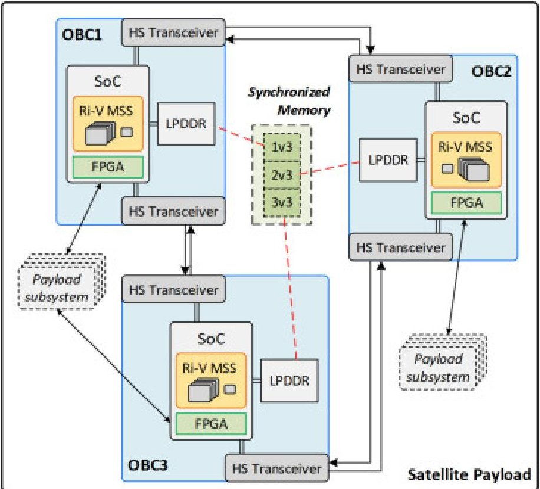

Download: Download high-res image (341KB)

Download: Download full-size image

Fig. 4. Distributed OBC System for the DORT payload [37].

The optical sensitivity of DORT-Space and the spatially distributed heat generation of the processing electronics define the central use case of this paper. The payload requires a homogeneous temperature field near the optical mounting points, while the multi-processor platform provides a set of movable internal heat sources whose activation can be optimized online. This coupling is the basis for the framework introduced in Section 3.

## 3. Onboard digital twin implementation

## 3.1. Proposed framework for thermal optimization

The proposed Onboard Digital Twin (ODT) is structured as a closed-loop interaction between the satellite (Physical Twin) and its digital counterpart. The core ODT elements are the Plant Model, the Operation Optimizer, the Model Update routine, the Predicted Disturbance signals, and the Reference. The framework is completed by the Physical Twin, the Realized Disturbances, and the Sensors. At each sampling instant, the Plant Model predicts the future thermal state of the payload from the current temperatures, the candidate operation mode, and the predicted external disturbances. The Operation Optimizer uses this model to determine the operation mode that minimizes the temperature differences at the Temperature-Sensitive Components (TSC) while satisfying power and actuator constraints. In parallel, the Sensors

<!-- PDF_PAGE: 9 -->

provide the measured payload temperatures from the Physical Twin. The mismatch between measured and predicted states is then processed by the Model Update block to correct the thermal parameters of the Plant Model. In this way, the ODT remains representative even when the thermal behavior deviates from the initial design (see Fig. 5).

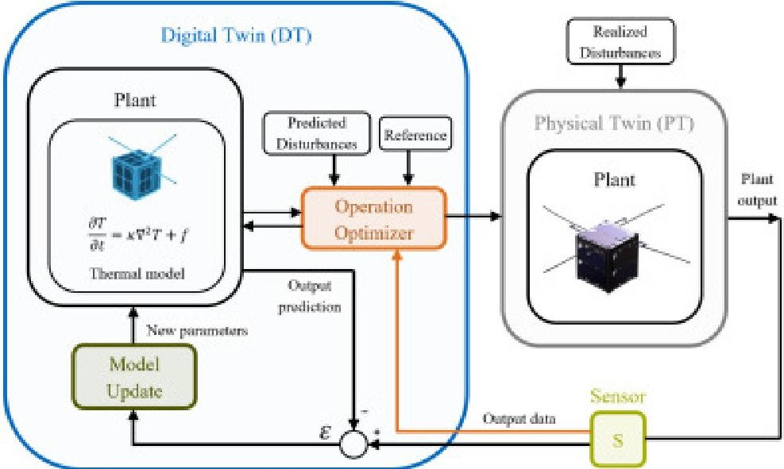

Download: Download high-res image (222KB)

Download: Download full-size image

Fig. 5. Proposed digital twin framework consisting of a plant model, operation optimizer, and model update routine.

## 3.2. Plant model

To allow for a computationally efficient control routine, the DORT payload is abstracted to form an arrangement of finite lumped thermal nodes. Each node stores heat through a thermal capacitance and exchanges heat with adjacent nodes through linear thermal resistances (see Fig. 6).

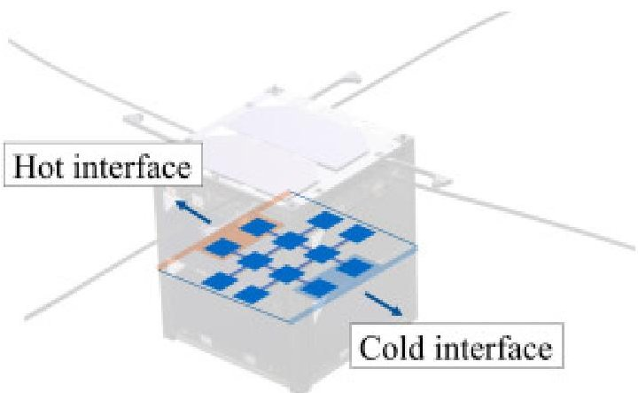

Download: Download high-res image (99KB)

Download: Download full-size image

Fig. 6. Discretization of the DORT payload to a set of lumped thermal masses coupled by linear thermal connectors. A "hot interface" and a "cold interface" are defined to model the Sun's heat input and payload cooling, respectively.

<!-- PDF_PAGE: 10 -->

Together with the multi-OBC unit introduced in Section 2, two additional redundant subsystems, denoted LED and IR, are added such that the internal heat-generating payload is represented by eight redundant, controllable elements. This abstraction defines the model governing linear equation

$$
\mathbf {C} _ {p} \dot {\mathbf {T}} (t) + \mathbf {R} _ {p} \mathbf {T} (t) = \dot {\mathbf {Q}} (t),
$$

which is later specialized to the DORT payload considering the heat source distribution and predefined quantities. The model contains 12 thermal nodes, and the temperature state vector is defined as

$$
\mathbf {T} (t) = \left[ T _ {1} (t), T _ {2} (t), \dots , T _ {1 2} (t) \right] ^ {\top}.
$$

Nodes 3-10 represent the payload interior and contain the heat-producing subsystems. In particular, these central nodes host the three OBC elements together with the redundant LED and IR elements. Nodes 4, 5, 8, and 9 define the set of Temperature-Sensitive Components, where the temperature differences must be minimized. Nodes 1, 2, 11, and 12 define the interface to the external environment. The upper boundary nodes 1 and 2 carry the Sun's external heat inputs $ \dot{Q}_{1} $ and $ \dot{Q}_{2} $ , defining the Neumann boundary conditions, whereas nodes 11 and 12 impose Dirichlet boundary conditions by fixing $ T_{11} $ and $ T_{12} $ . These fixed temperatures act as a heat sink and model the heat loss to the environment.

Operation modes $ \boldsymbol{\xi} ( t ) $ distribute the available waste heat over the heat-producing subsystems $ \dot{Q}_{3}-\dot{Q}_{10} $ . The operation for the redundant subsystems is modeled as

$$
\boldsymbol {\xi} (t) = \left[ \begin{array}{l} \boldsymbol {\xi} _ {\mathrm {L E D}} (t) \\ \boldsymbol {\xi} _ {\mathrm {I R}} (t) \\ \boldsymbol {\xi} _ {\mathrm {O B C}} (t) \end{array} \right],
$$

with

$$
\sum_ {i = 1} ^ {n _ {\mathrm {L E D}}} \xi_ {\mathrm {L E D}, i} (t) = 1, \quad \sum_ {i = 1} ^ {n _ {\mathrm {I R}}} \xi_ {\mathrm {I R}, i} (t) = 1, \quad \sum_ {i = 1} ^ {n _ {\mathrm {O B C}}} \xi_ {\mathrm {O B C}, i} (t) = 1,
$$

and

$$
\xi_ {\mathrm {L E D}, i} (t) \in \{0, 1 \}, \quad \xi_ {\mathrm {I R}, i} (t) \in \{0, 1 \}, \quad \xi_ {\mathrm {O B C}, i} (t) \in [ 0, 1 ].
$$

<!-- PDF_PAGE: 11 -->

Hence, LED and IR are binary activations, while the OBC load is continuously distributed among the three processors. The aforementioned constraints guarantee that always one LED and one IR are active to ensure uninterrupted DORT payload operation. The corresponding power allocation is

$$
\dot {Q} _ {\mathrm {L E D}, i} (t) = \left\{ \begin{array}{l l l} \dot {Q} _ {\mathrm {L E D}, \mathrm {t o t}} & \mathrm {i f} & \xi_ {\mathrm {L E D}, i} (t) = 1 \\ 0 & \mathrm {i f} & \xi_ {\mathrm {L E D}, i} (t) = 0 \end{array} \right.
$$

$$
\dot {Q} _ {\mathrm {I R}, i} (t) = \left\{ \begin{array}{l l l} \dot {Q} _ {\mathrm {I R}, \mathrm {t o t}} & \mathrm {i f} & \xi_ {\mathrm {I R}, i} (t) = 1 \\ 0 & \mathrm {i f} & \xi_ {\mathrm {I R}, i} (t) = 0 \end{array} \right.
$$

and

$$
\dot {Q} _ {\mathrm {O B C}, i} (t) = \xi_ {\mathrm {O B C}, i} (t) \dot {Q} _ {\mathrm {O B C}, \mathrm {t o t}}.
$$

with the following maximum waste heat allocation for each subsystem defined as:

$$
\dot {Q} _ {\mathrm {O B C , t o t}} = 1 0 \mathrm {W}, \quad \dot {Q} _ {\mathrm {I R , t o t}} = 8 \mathrm {W}, \quad \dot {Q} _ {\mathrm {L E D , t o t}} = 1 2 \mathrm {W}.
$$

With this, the Plant Model is defined and ready to be used by the Operation Optimizer to compute the optimal control sequence at the corresponding time steps during the satellite mission.

## 3.3. Operation optimizer

<!-- PDF_PAGE: 12 -->

The operation control is implemented by Model-Predictive Control (MPC) using a linear state-space representation. This choice is motivated by the characteristics of the thermal system and by the onboard implementation constraints. Thermal dynamics are slow, strongly coupled, and driven by disturbances that are partly foreseeable from the mission scenario. At the same time, the controller must respect power and activation limits and must operate with modest computational effort. Linear MPC is therefore suitable because it uses a compact predictive model, requires only moderate memory, allows efficient quadratic optimization, explicitly handles constraints, and can directly incorporate future disturbance predictions and reference trajectories. Still in continuous form, Eq. (1) can be rewritten as

$$
\mathbf {C} _ {p} \dot {\mathbf {x}} (t) + \left(\mathbf {R} _ {p} + \mathbf {H} _ {p}\right) \mathbf {x} (t) = \mathbf {u} (t) + \mathbf {v} _ {\dot {Q}} (t) - \mathbf {P} ^ {\top} \mathbf {R} _ {p} \mathbf {v} _ {B C} (t) + \mathbf {H} _ {p} \mathbf {v} _ {a m b} (t).
$$

Here, the state vector $ \mathbf{x} ( t ) $ represents the nodal temperatures of the free nodes $ [ T_{1} ( t ) , T_{2} ( t ) , \cdots , T_{1 0} ( t ) ] $ and the control vector $ \mathbf{u} ( t ) $ contains the operational modes of each subsystem defined in Eqs. (3) to (9). The vector $ \mathbf{v}_{\dot{Q}} ( t ) $ represents the predicted disturbances from the Sun's radiation, defining the heat input at nodes 1 and 2, $ \mathbf{v}_{BC} ( t ) $ contains the fixed-value boundary temperatures at nodes 11 and 12, which are mapped into the thermal network equation by the selector matrix P. The vector $ \mathbf{v}_{amb} ( t ) $ accounts for the linear heat transfer to the environment, in particular setting the ambient temperature. The nodal capacitances are collected in the diagonal matrix $ \mathbf{C}_{p} $ , the conductive couplings in $ \mathbf{R}_{p} $ , and the linear heat transfer coefficients to the surroundings in $ \mathbf{H}_{p} $ . This matrix denotes a lumped linear environmental coupling. Because the proof-of-concept tests were conducted under ambient laboratory conditions, this term is dominated by convection. As reported in Section 5.2, the maximum observed temperature difference between the thermal nodes and the environment was below 90 K. Considering the demonstrator's materials, geometry, and assuming natural convection, radiation power amounts at most to 2.6 % of the convective heat transfer; therefore the nonlinear term was neglected for the proposed model. Similarly, with respect to radiation between thermal nodes, their temperature differences were even lower than those between them and the environment (below 80 K) while the thermal network is dominated by conductive exchange through the mechanical interfaces and connectors. In this case, radiative heat transfer between nodes was estimated at 2.0 % of the conductive heat transfer. Possible nonlinearities would remain in the conductive coupling matrix $ \mathbf{R}_{p} $ , since contact resistances may vary with temperature and load. This is handled by the parameter update scheme introduced in Section 3.4, which runs sequentially after each control step and tunes the set of thermal resistances r and capacitances c based on measurement data. This provides the MPC with an updated effective linear model after each control interval. Thus, starting from Eq. (10), the continuous-

<!-- PDF_PAGE: 13 -->

time dynamics can be written as

$$
\begin{array}{l} \dot {\mathbf {x}} (t) \\ = \mathbf {C} _ {p} ^ {- 1} \left(- \left(\mathbf {R} _ {p} + \mathbf {H} _ {p}\right) \mathbf {x} (t) + \mathbf {u} (t) + \mathbf {v} _ {\dot {Q}} (t) - \mathbf {P} ^ {\top} \mathbf {R} _ {p} \mathbf {v} _ {B C} (t) + \mathbf {H} _ {p} \mathbf {v} _ {a m b} (t)\right). \\ \end{array}
$$

Using Euler-forward discretization with sampling time $ \Delta t $ , one obtains

$$
\mathbf {x} _ {k + 1} = \mathbf {x} _ {k} + \Delta t \mathbf {C} _ {p} ^ {- 1} \left(- \left(\mathbf {R} _ {p} + \mathbf {H} _ {p}\right) \mathbf {x} _ {k} + \mathbf {u} _ {k} + \mathbf {v} _ {\dot {Q}, k} - \mathbf {P} ^ {\top} \mathbf {R} _ {p} \mathbf {v} _ {B C, k} + \mathbf {H} _ {p} \mathbf {v} _ {a m b, k}\right).
$$

Rearranging terms yields the standard discrete state-space form

$$
\mathbf {x} _ {k + 1} = \mathbf {A} \mathbf {x} _ {k} + \mathbf {B} _ {u} \mathbf {u} _ {k} + \mathbf {B} _ {v} \mathbf {v} _ {k}, \quad \mathbf {y} _ {k} = \mathbf {C} \mathbf {x} _ {k} + \mathbf {D} \mathbf {u} _ {k},
$$

with

$$
\mathbf {A} = \mathbf {I} - \Delta t \mathbf {C} _ {p} ^ {- 1} \left(\mathbf {R} _ {p} + \mathbf {H} _ {p}\right), \quad \mathbf {B} _ {u} = \Delta t \mathbf {C} _ {p} ^ {- 1},
$$

$$
\mathbf {B} _ {v} = \Delta t \mathbf {C} _ {p} ^ {- 1} \left[ \mathbf {I} - \mathbf {P} ^ {\top} \mathbf {R} _ {p} \mathbf {H} _ {p} \right], \quad \mathbf {v} _ {k} = \left[ \begin{array}{l} \mathbf {v} _ {\dot {Q}, k} \\ \mathbf {v} _ {B C, k} \\ \mathbf {v} _ {a m b, k} \end{array} \right].
$$

The output matrix is chosen such that the control objective is formulated directly in terms of temperature differences at the Temperature-Sensitive Components. Since the relevant nodes are 4,5,8,and 9,a convenient output definition is the vector of pairwise temperature differences:

$$
\mathbf {y} _ {k} = \left[ \begin{array}{l} T _ {4, k} - T _ {5, k} \\ T _ {4, k} - T _ {8, k} \\ T _ {4, k} - T _ {9, k} \\ T _ {5, k} - T _ {8, k} \\ T _ {5, k} - T _ {9, k} \\ T _ {8, k} - T _ {9, k} \end{array} \right] = \mathbf {C x} _ {k},
$$

The matrix C is independent of the model parameters because it only selects and subtracts states. The matrix D is set to zero because the control cannot bypass the thermal state dynamics

<!-- PDF_PAGE: 14 -->

to produce the output. In the ideal case, the reference is simply

$$
\mathbf {y} _ {k} ^ {r e f} = \mathbf {0} _ {6 \times 1},
$$

which means that all selected temperature differences should be driven toward zero. For a prediction horizon of length N, the stacked output vector can be written as

$$
\mathbf {y} = \Theta \mathbf {x} _ {i n i t} + \Psi \mathbf {u} + \Phi \mathbf {v},
$$

where the lifted matrices are

$$
\Theta = \left[ \begin{array}{c} \mathbf {C} \\ \mathbf {C A} \\ \vdots \\ \mathbf {C A} ^ {N - 1} \end{array} \right],
$$

$$
\boldsymbol {\Psi} = \left[ \begin{array}{c c c c} \mathbf {D} & 0 & \dots & 0 \\ \mathbf {C B} _ {u} & \mathbf {D} & \dots & 0 \\ \mathbf {C A B} _ {u} & \mathbf {C B} _ {u} & \ddots & 0 \\ \vdots & \vdots & \ddots & \mathbf {D} \\ \mathbf {C A} ^ {N - 2} \mathbf {B} _ {u} & \mathbf {C A} ^ {N - 3} \mathbf {B} _ {u} & \dots & \mathbf {C B} _ {u} \end{array} \right],
$$

$$
\Phi = \left[ \begin{array}{c c c c} 0 & 0 & \dots & 0 \\ \mathbf {C B} _ {v} & 0 & \dots & 0 \\ \mathbf {C A B} _ {v} & \mathbf {C B} _ {v} & \ddots & 0 \\ \vdots & \vdots & \ddots & 0 \\ \mathbf {C A} ^ {N - 2} \mathbf {B} _ {v} & \mathbf {C A} ^ {N - 3} \mathbf {B} _ {v} & \dots & \mathbf {C B} _ {v} \end{array} \right].
$$

These matrices capture the influence of the initial state, the future control sequence, and the predicted disturbances over the horizon. Once they are constructed, the control problem can be written as a standard quadratic program. Using the lifted prediction model in Eq. (18), the cost function is reformulated as

$$
J _ {N} = \frac {1}{2} \mathbf {u} ^ {\top} \mathbf {H} \mathbf {u} + \mathbf {f} ^ {\top} \mathbf {u} + \mathrm {c o n s t},
$$

<!-- PDF_PAGE: 15 -->

with

$$
\mathbf {H} = \Psi^ {\top} \overline {{\mathbf {Q}}} \Psi + \overline {{\mathbf {R}}}, \quad \mathbf {f} ^ {\top} = \left(\Theta \mathbf {x} _ {i n i t} + \Phi \mathbf {v} - \mathbf {r}\right) ^ {\top} \overline {{\mathbf {Q}}} \Psi .
$$

The MPC weights were selected to keep the controller objective aligned with the payload requirements. Since all pairwise temperature differences between the Temperature-Sensitive Components were considered equally relevant, the output-weighting matrix Q was chosen as an identity matrix. No additional actuator preference was introduced, since no OBC, LED, or IR element was to be favored or penalized beyond the physical and operational constraints already defined in Eqs. (4) to (9). Therefore, the input-weighting matrix R was set to zero. For the same reason, no move-suppression term S was included; actuator switching was not penalized explicitly in the cost function. Thus, the weighting matrices are

$$
\begin{array}{l} \mathbf {Q} = \mathbf {I} _ {6}, \quad \overline {{\mathbf {Q}}} = \mathbf {I} _ {N} \otimes \mathbf {Q}, \\ \mathbf {R} = \mathbf {0} _ {8 \times 8}, \quad \overline {{\mathbf {R}}} = \mathbf {I} _ {N} \otimes \mathbf {R}, \\ \mathbf {S} = \mathbf {0} _ {8 \times 8}, \quad \Delta \mathbf {u} _ {k} ^ {\top} \mathbf {S} \Delta \mathbf {u} _ {k} = 0. \\ \end{array}
$$

The cost function penalized only deviations from the desired zero-gradient thermal state, while actuator admissibility and power-distribution constraints were handled explicitly through the constraints in Eqs. (4) to (9). The Hessian H and the linear term f depend explicitly on the state-space matrices and on the disturbance prediction. The quadratic form in Eq. (22) is the basis for fast numerical solution onboard. Therefore, the optimal control problem at hand is defined as

$$
\begin{array}{l} \min _ {\mathbf {u}} \quad \frac {1}{2} \mathbf {u} ^ {\top} \mathbf {H} \mathbf {u} + \mathbf {f} ^ {\top} \mathbf {u} \\ \mathrm {s . t .} \quad \mathbf {x} _ {k + 1} = \mathbf {A} \mathbf {x} _ {k} + \mathbf {B} _ {u} \mathbf {u} _ {k} + \mathbf {B} _ {v} \mathbf {v} _ {k}, \\ \mathbf {y} _ {k} = \mathbf {C x} _ {k} + \mathbf {D u} _ {k}, \\ \mathbf {e} _ {k} = \mathbf {y} _ {k} - \mathbf {r} _ {k}, \\ \mathbf {M u} _ {k} = \mathbf {p}, \\ \mathbf {u} _ {\min } \leq \mathbf {u} _ {k} \leq \mathbf {u} _ {\max }, \quad k = 0, \dots , N - 1, \\ \end{array}
$$

where the mapping matrix M and vector p ensure that the operational-mode constraints defined for $ \xi ( t ) $ in Eq. (4) are fulfilled. The lower and upper input bounds, $ \mathbf{u}_{\mathrm{min}} $ and $ \mathbf{u}_{\mathrm{max}} $ were set according to Eqs. (5) to (9) to enforce the maximum dissipated power of each subsystem. Following the payload arrangement shown in Fig. 7, the controller contains $ n_{\mathrm{LED}}=3 $ and $ n_{\mathrm{IR}}=2 $ binary control variables, as well as $ n_{\mathrm{OBC}}=3 $ continuous control variables per time step. As detailed later in Section 5.2, a control horizon $ N_{c} $ of 24 intervals was chosen, hence producing 120 binary and 72 continuous optimization variables per iteration.

<!-- PDF_PAGE: 16 -->

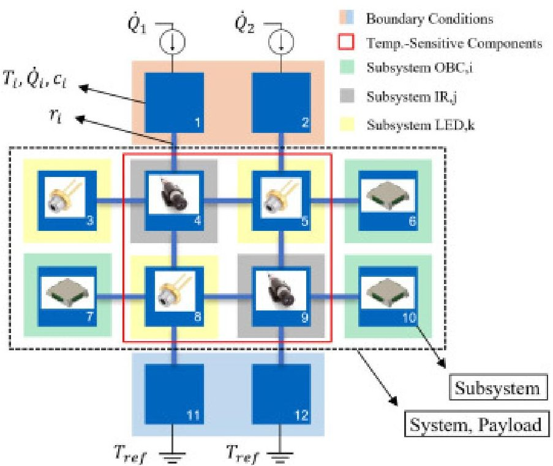

Download: Download high-res image (254KB)

Download: Download full-size image

Fig. 7. Detailed view of the DORT-Space array abstraction showing the boundary conditions, redundant subsystems, and locations of the temperature-sensitive components (TSCs).

The problem statement in (25) formalizes the central function of the ODT: from the current thermal state and the predicted disturbances, it solves the optimal activation sequence of the redundant electronics to minimize the TSC temperature differences. At every time step, u is obtained for a prediction horizon of length N. The optimizer of choice is MATLAB's Optimization Toolbox Branch-and-bound solver [38] because it can handle mixed-integer quadratic programming problems, which is the case at hand due to $ \xi_{LED,i} $ and $ \xi_{IR,i} $ belonging to the discrete set {0,1}.

## 3.4. Model update

The performance of the Operation Optimizer depends on the accuracy of the Plant Model. However, the thermal behavior of the payload may change during operation due to degradation, sensor drift, changing loads, modified interface conditions, or imperfect knowledge of the environment, as detailed in Section 1. Aside from aging and degradation, the initial assumption for the plant's thermal parameters might not match their actual values. Therefore, especially in the early mission stages, greater deviations between the physical plant and its thermal model are expected. A model update routine is therefore implemented to maintain prediction quality over time. There exist Systems Identification (SI) methods for linear systems that span from deterministic to stochastic approaches and can provide the state matrices A, B, C, and D from plant output measurement data [39]. In the present work, a sensitivity-based update method is proposed in which not only the state-space matrices are obtained but also the thermal

<!-- PDF_PAGE: 17 -->

parameters that define them. This is possible because the dependencies of the aforementioned matrices on the thermal parameters are known analytically, such that the system does not need to be seen as a black box. This approach preserves physical interpretability and remains computationally suitable for an onboard implementation (see Fig. 8).

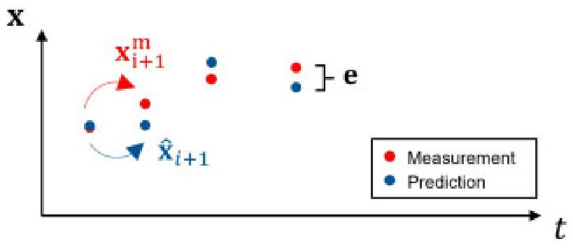

Fig. 8. Residual e between state measurement $ \mathbf{x}^{m} $ and prediction $ \widehat{\mathbf{x}}. $

Let $ \widehat{\mathbf{x}}_{i+1} $ denote the model prediction at time step i+1 and $ \mathbf{x}_{i+1}^{m} $ the measured state. The prediction residual is defined as

$$
\mathbf {e} _ {i + 1} = \mathbf {x} _ {i + 1} ^ {m} - \widehat {\mathbf {x}} _ {i + 1} = \mathbf {x} _ {i + 1} ^ {m} - \mathbf {A} (\mathbf {c}, \mathbf {r}) \mathbf {x} _ {i} ^ {m} - \mathbf {B} (\mathbf {c}) \mathbf {u} _ {i},
$$

and the unknown parameter vectors read

$$
\mathbf {c} = \left[ c _ {1}, \quad \dots , \quad c _ {1 0} \right] ^ {\top}, \quad \mathbf {r} = \left[ r _ {1}, \quad \dots , \quad r _ {1 2} \right] ^ {\top}.
$$

These vectors contain the nodal thermal capacitances and the thermal resistances of the connectors. Since A and B are functions of (c,r), correcting these parameters adjusts the prediction model itself. Accordingly, the cost function J(c,r) can be formulated as follows:

$$
J (\mathbf {c}, \mathbf {r}) = \frac {1}{2} \sum_ {i = 0} ^ {m - 1} \left\| \mathbf {x} _ {i + 1} ^ {m} - \widehat {\mathbf {x}} _ {i + 1} \right\| ^ {2},
$$

which can be used to define the following optimization problem:

$$
\begin{array}{l} \min _ {\mathbf {c}, \mathbf {r}} J (\mathbf {c}, \mathbf {r}) = \frac {1}{2} \sum_ {i = 0} ^ {m - 1} \mathbf {e} _ {i + 1} ^ {\top} \mathbf {e} _ {i + 1} \\ \mathrm {s . t .} \quad \mathbf {c} _ {\mathrm {m i n}} \leq \mathbf {c} \leq \mathbf {c} _ {\mathrm {m a x}} \\ \mathbf {r} _ {\mathrm {m i n}} \leq \mathbf {r} \leq \mathbf {r} _ {\mathrm {m a x}}. \\ \end{array}
$$

<!-- PDF_PAGE: 18 -->

Hence, the update routine minimizes the discrepancy between measured state transitions and model-predicted state transitions over a moving data window of length m.

The main advantage of this approach is that analytical sensitivities can be derived. This avoids repeated black-box numerical estimation of the gradients and full state matrices and leads to a faster update step, which is critical for embedded use. The gradients with respect to the capacitances and resistances are, respectively

$$
\frac {\partial J (\mathbf {c} , \mathbf {r})}{\partial \mathbf {c}} = \frac {1}{2} \sum_ {i = 0} ^ {m - 1} \left(\mathbf {e} _ {i + 1} ^ {\top} \frac {\partial \mathbf {e} _ {i + 1}}{\partial \mathbf {c}} + \frac {\partial \mathbf {e} _ {i + 1} ^ {\top}}{\partial \mathbf {c}} \mathbf {e} _ {i + 1}\right),
$$

and

$$
\frac {\partial J (\mathbf {c} , \mathbf {r})}{\partial \mathbf {r}} = \frac {1}{2} \sum_ {i = 0} ^ {m - 1} \left(\mathbf {e} _ {i + 1} ^ {\top} \frac {\partial \mathbf {e} _ {i + 1}}{\partial \mathbf {r}} + \frac {\partial \mathbf {e} _ {i + 1} ^ {\top}}{\partial \mathbf {r}} \mathbf {e} _ {i + 1}\right),
$$

with

$$
\frac {\partial \mathbf {e} _ {i + 1}}{\partial \mathbf {c}} = - \frac {\partial \mathbf {A} (\mathbf {c}, \mathbf {r})}{\partial \mathbf {c}} \mathbf {x} _ {i} ^ {m} - \frac {d \mathbf {B} (\mathbf {c})}{d \mathbf {c}} \mathbf {u} _ {i},
$$

and

$$
\frac {\partial \mathbf {e} _ {i + 1}}{\partial \mathbf {r}} = - \frac {\partial \mathbf {A} (\mathbf {c} , \mathbf {r})}{\partial \mathbf {r}} \mathbf {x} _ {i} ^ {m}.
$$

These expressions show that the update is obtained by propagating the sensitivity of the predicted state transition with respect to the underlying physical parameters. As mentioned, since the model structure is known, the derivatives can be computed analytically and used in a gradient-based optimization step. The problem stated in Eq. (29) was solved using Gradient Descent due to its simplicity, robustness, and low memory requirements for hardware deployment, which was executed at every time step sequentially after the MPC control stage. No additional regularization, statistical priors, filtering, or averaging over multiple fitting windows were used in the reported implementation. The update was instead initialized based on nominal parameters derived from the demonstrator geometry and material data, while physically admissible bounds on c and r were enforced during optimization vie projection, ensuring stability and physically meaningful convergence. Although first-order thermal networks, such as the one at hand, can exhibit correlations between capacitance and resistance,

<!-- PDF_PAGE: 19 -->

this ambiguity was considered limited in the present demonstrator due to known heat inputs, boundary conditions, transient excitation profiles, and full-state temperature measurements at all thermal nodes.

The proposed sensitivity approach keeps the thermal network structure intact, updates only the relevant physical quantities, and remains compatible with the ODT architecture introduced in Section 3.1. A practical onboard implementation stores the most recent measurements, applied control inputs, and updated parameter values in a small local memory. The update routine then operates on this local data buffer and periodically refreshes the parameter set used by the Plant Model. This allows the onboard DT to remain adaptive without requiring external intervention.

## 4. Experimental setup

## 4.1. Prototype design and manufacturing

The designed experimental platform reproduces the discrete architecture used by the ODT. This layout preserves the same node-based abstraction adopted in Section 3.2 and therefore enables direct comparison between model and hardware.

The prototype geometry and material selection were chosen to satisfy the thermal assumptions of the proposed model:

1. The functional nodes must behave as thermally lumped masses.

2. Internal temperature gradients within each node must remain negligible.

3. The connecting elements must provide consistent and quantifiable thermal couplings.

4. The thermal capacitance of the connecting elements must be negligible compared to that of the thermal nodes.

To achieve this, the thermal nodes were manufactured from copper, whereas the connecting bridges from aluminum. Copper was selected due to its high thermal conductivity and comparatively large thermal inertia, promoting nearly uniform node temperatures and making the nodes behave as lumped thermal masses. Aluminum was selected for the connectors because of its low thermal inertia and well-defined conductive coupling between adjacent nodes. The assembled structure was mechanically clamped and prepared by applying thermal tape (9876B-05) [40] to the contact surfaces. The same tape type, contact geometry, and assembly procedure were used for all interfaces, setting a tightening torque of 2.0 Nm for all M4 screws connecting the nodes. Higher tightening torques were not considered since the test

<!-- PDF_PAGE: 20 -->

structure was not mechanically loaded, and to avoid damaging the copper threaded holes. No statistical contact-resistance characterization was performed; remaining variations in contact conductance were accounted for by the online parameter-fitting routine defined in Section 3.4. A close-up view of the manufactured demonstrator can be seen in Fig. 9.

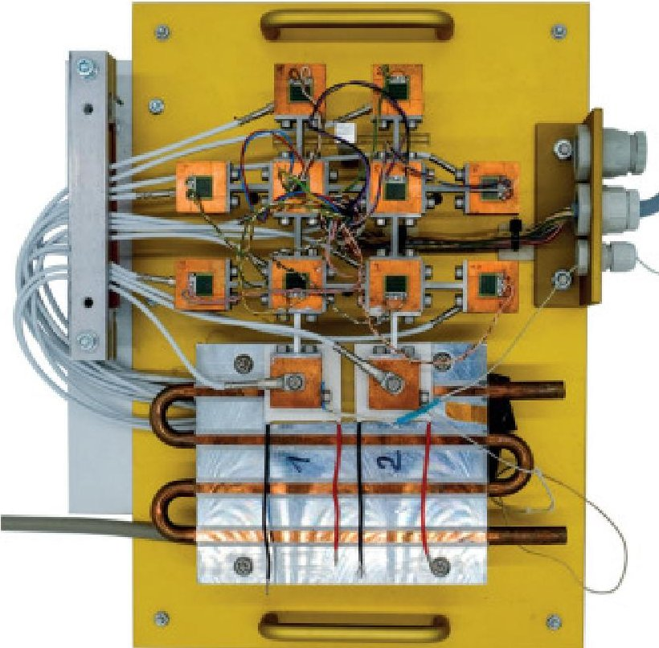

Download: Download high-res image (562KB)

Download: Download full-size image

Fig. 9. Manufactured DORT payload demonstrator.

Thermal actuation and sensing hardware were integrated directly on all prototype nodes. The payload elements and hot-interface boundary condition nodes were equipped with electrical resistance heaters rated at 20 W and 7.2 $ \Omega $ (GBR-618-12-20-2) [41]. These heaters acted as controllable heat sources during the experiments and represented the redundant electrical components producing waste heat in the payload. All thermal nodes were instrumented with cable-lug PT1000 sensors (Class A, 4-wire readout) [42], providing full-state temperature measurements of the demonstrator. The two lower boundary-condition nodes 11 and 12 were equipped with Peltier-effect modules (QC-161-1.6-15.0MS) [43], which were used to impose fixed reference temperatures and thereby emulate a thermal sink toward outer space. In this way, the laboratory prototype reproduced both payload's the internal heat generation and the boundary heat-transfer paths.

## 4.2. Laboratory thermal test setup

One can visualize the schematics of the test setup in Fig. 10. In the present experimental implementation, the Onboard Digital Twin software stack (plant model, model-predictive controller, and parameter-update routine) was executed on a host PC, as well as the mixed-

<!-- PDF_PAGE: 21 -->

integer optimization problem used to compute the actuation sequence in real time. The measured computation times will be used to assess the feasibility of a later onboard implementation on the target processing unit defined in Section 2. An ESP32 microcontroller (ESP32-S3-DevKitC-1) [44] was used as the embedded interface between the host PC and the experimental hardware via USB serial. The ESP32 sent the control sequence through a 12-bit $ I^{2} $ C-based driver/expander stage (PCA9685PW) [45], which interfaced the microcontroller with the heater actuation chain after a voltage amplifier matched the power requirements of each heater actuator based on Eq. 9. The analog outputs of the PT1000 sensors, together with the relevant heater-output channels, were routed to 24-bit ADC-based data-acquisition cards (ADS1256) [46], which were read by the ESP32 and transferred to the host PC. The ESP32, $ I^{2} $ C expander, and ADC acquisition cards were off-the-shelf components, while the heater actuator chain between the expander and the demonstrator was developed in-house.

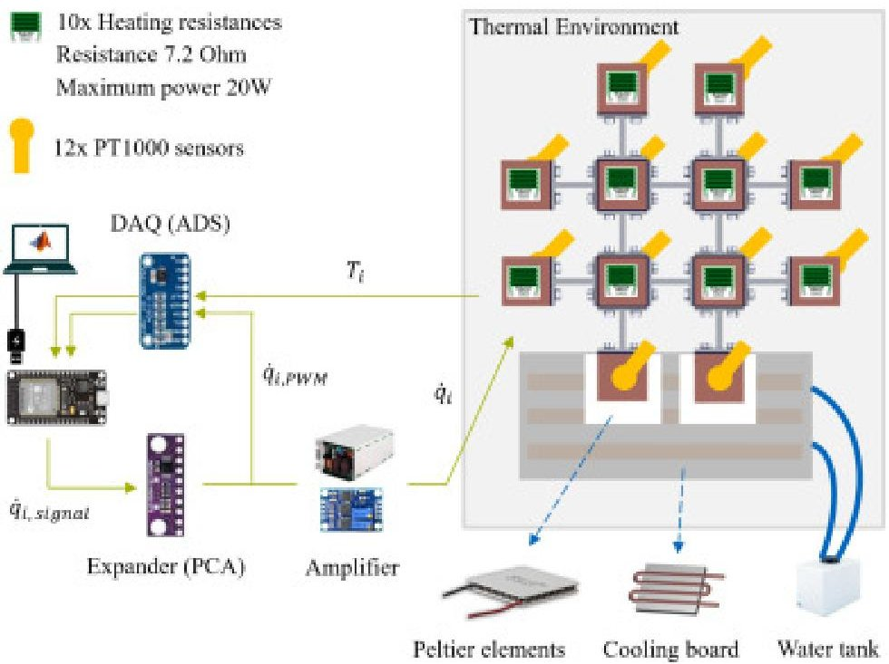

Download: Download high-res image (307KB)

Download: Download full-size image

Fig. 10. Experimental setup including the main measurement, control, and heating electronics as well as the cooling chain based on Peltier elements.

The temperature measurement range spanned from $ 0^{\circ} \mathrm{C} $ to $ 2 5 0^{\circ} \mathrm{C} $ . According to DIN EN 60751, the tolerance of Class A platinum resistance thermometers results in a maximum sensor tolerance of $ \pm 0. 6 5 \mathrm{~ K} $ at $ 2 5 0^{\circ} \mathrm{C} $ [47]. Each PT1000 sensor was provided with a constant current of 1 mA. The measured voltage was first converted to resistance, and the resistance-temperature characteristic was obtained based on the Callendar-Van Dusen equation. To obtain a computationally simple inverse conversion from resistance to temperature in $ ^{\circ} \mathrm{C} $ , the

<!-- PDF_PAGE: 22 -->

implemented measurement routine used a cubic fit between $ 0^{\circ} \mathrm{C} $ and $ 2 5 0^{\circ} \mathrm{C} $ in Horner form:

$$
T = r \left(2 5 5. 8 7 2 3 + r \left(9. 6 + 0. 8 7 8 r\right)\right), \quad r = \frac {R}{R _ {0}} - 1.
$$

For the considered temperature range, this approximation introduced a maximum deviation of 3 mK with respect to the standard characteristic curve. By conservatively adding the PT1000 sensor tolerance and the polynomial approximation error, the maximum measurement uncertainty at $ 2 5 0 \, ^ {\circ} \mathrm{C} $ was estimated as $ \pm 0. 6 5 3 \mathrm{~ K}. $ Regarding digitization, the ideal full-scale range of the 24-bit ADC for a differential measurement corresponds to a resistance increment of approximately 0.596 m $ \Omega. $ Propagating this through the cubic conversion provided an ideal temperature resolution of approximately $ 1. 5 \times 1 0^{-4} \mathrm{~ K} $ near $ 0 \, ^ {\circ} \mathrm{C} $ and $ 1. 6 \times 1 0^{-4} \mathrm{~ K} $ near $ 2 5 0 \, ^ {\circ} \mathrm{C}. $ In practice, this quantization contribution was considered negligible compared with the PT1000 Class A tolerance and the polynomial approximation error. Since 12 PT1000 signals were logged, four differential channels were acquired sequentially on two of the three ADS1256 acquisition boards, all operating at 30 kSPS. Also, communication with the ESP32 was performed using Simulink's Serial Send and Serial Receive blocks. Excluding the MIQP and model update solution time, the acquisition, communication, and actuation loop had an average duration of 97.4 ms and a 95th percentile of 109.4 ms.

A dedicated cooling loop was used for the Peltier-based boundary-condition nodes. The hot sides of the Peltier elements were attached to a cooling board, which was connected to a water tank operating in a closed cycle. The water loop removed the rejected heat from the Peltier devices and enabled the lower nodes to maintain a constant temperature. The Peltier elements themselves were regulated by external PID controllers and were therefore not part of the Digital Twin control loop.

The complete control electronics, including the ESP32, the driver boards, the data-acquisition cards, and the auxiliary interface hardware, were packaged in a separate electronics box in order to keep the prototype mechanically accessible. Fig. 10 provides a sketch of the equipment employed for testing, while Fig. 11 shows the actual lab-built hardware arrangement.

<!-- PDF_PAGE: 23 -->

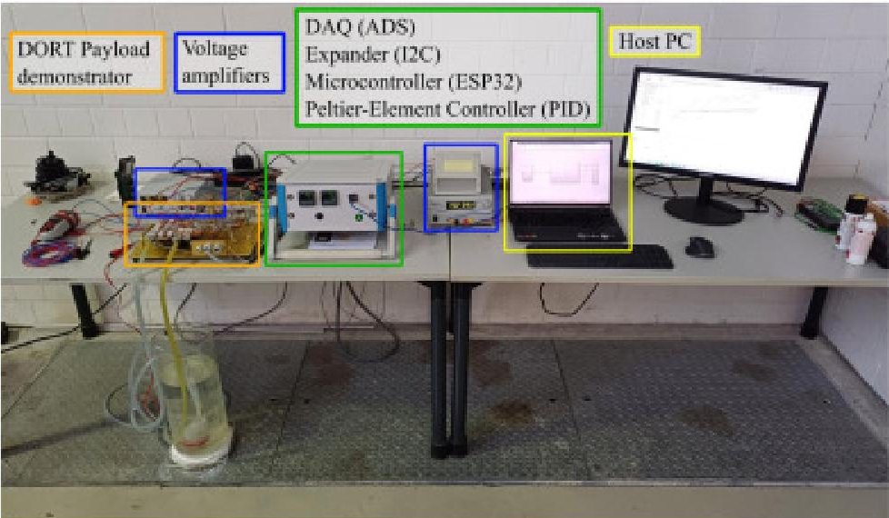

Download: Download high-res image (463KB)

Download: Download full-size image

Fig. 11. Assembled test setup in the LPL facilities displaying the payload demonstrator, control electronics box, power supply, and the host PC.

All experiments were conducted under laboratory conditions at room temperature. A thermal-vacuum validation of the complete demonstrator was not performed within the scope of this study. The OBC electronics detailed in Section 2 were tested separately under vacuum conditions by the industrial partner EMM GmbH. The focus of the present work was instead the experimental demonstration of the ODT, where operation under ambient laboratory conditions was considered sufficient, since the control approach is not intrinsically dependent on the surrounding pressure. Under ambient pressure, convective heat transfer contributes alongside radiation and conduction, whereas in vacuum, external heat exchange is dominated by radiation and conductive interfaces. This difference can be represented in the thermal plant model used by the MPC through the corresponding heat-transfer parameter matrix $ \mathbf{H}_{p} $ and appropriate linearization measures. A dedicated TVAC campaign is considered a subsequent qualification step for a flight-representative implementation, but was not required to validate the proposed control and model-update methodology.

## 5. Test results and discussion

The experimental campaign was divided into two main parts. The first part focused on model and parameter update validation, with the objective of assessing whether the discrete thermal model and the automated fitting routine were able to reproduce the response of the physical demonstrator. For this, the following was defined: Success Criterion (1): After the parameter update is executed for the produced dataset, the maximum relative temperature deviation between measurement and simulation shall not exceed 10% at any demonstrator node. This relative error value was seen to be sufficient from pre-test campaigns to produce a model with enough fidelity for the MPC to operate, although this requirement alone doesn't imply successful

<!-- PDF_PAGE: 24 -->

temperature control. Therefore, the second part of the test program addressed an LEO orbit simulation, in which the ODT controller was tested under orbital conditions. Being consistent with the temperature gradient requirements stated in Section 2, Success Criterion (2) was formulated: The maximum absolute temperature difference between Temperature-Sensitive Components shall not exceed 5 K.

## 5.1. Thermal model and parameter update validation test

In contrast to the closed-loop control scenario discussed later, this test was carried out as an open-loop experiment without feedback control. The purpose was therefore not to regulate the payload temperatures, but to verify whether the thermal model could reproduce the prototype's measured transient response and whether the automated parameter-update routine could identify a representative set of thermal resistances and capacitances. The validation test imposed pulse-like boundary conditions in order to deliberately excite the transient thermal dynamics of the demonstrator. This made the test especially suitable for validating not only the conductive couplings represented by the thermal resistances r, but also the thermal inertia of the copper nodes represented by the capacitances c. The definition of the nodal heat sources for the test is provided in Appendix A.

An initial guess on the model parameters was given, which was deliberately set to deviate from the nominal values $ \mathbf{r}_{a} $ and $ \mathbf{c}_{a} $ , computed from the thermal element's geometry and materials. The parameter update routine fitted the model offline such that the discrepancy between prediction and measurement was significantly reduced. Compared with the initial parameter set, the fitted model reproduced the transient evolution much more closely, reducing the maximum relative temperature error from 56.1 % to 9.8 %. This brought the model discrepancy just below the 10% threshold defined for validation and indicates that the discrete model is sufficiently representative of the dominant physics of the demonstrator, even under transient excitation. These results can be visualized in Fig. 12, where, at every node location, the pulse-like heat inputs are displayed. Below, the resulting model response is plotted over the actual measurements for the same heat inputs. The plot layout under label (b) shows the temperature time-series for the model at the poor initial guess, while the plots under label (c) highlight the improvement in model quality and its ability to represent the built demonstrator dynamics.

<!-- PDF_PAGE: 25 -->

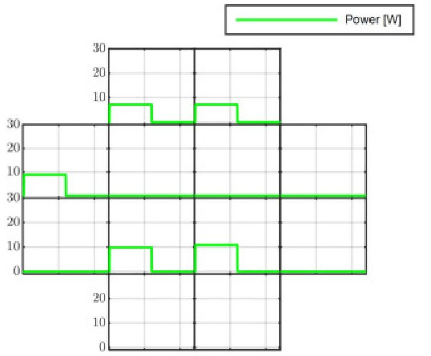

(a)

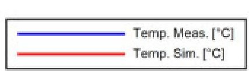

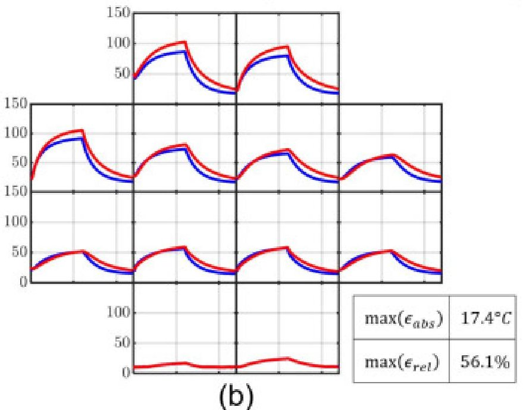

(b)

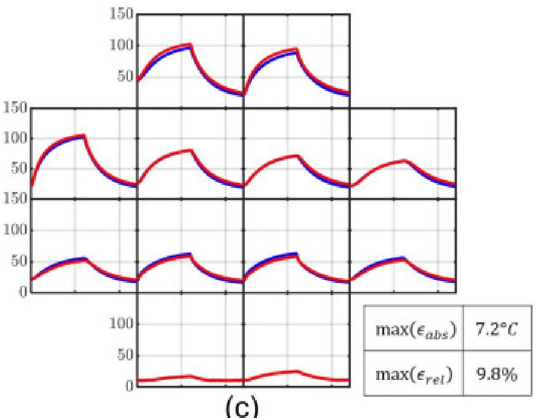

(c)

Download: Download high-res image (589KB)

Download: Download full-size image

<!-- PDF_PAGE: 26 -->

Fig. 12. Resulting time series for (a) the pre-defined heat inputs, (b) the predicted temperatures with the poorly tuned model, and (c) predicted temperatures after offline model fitting, both compared to the measured temperatures during the validation test. Each individual plot is arranged according to the array layout depicted in Fig. 7.

## 5.2. LEO orbit simulation test

After validating the model structure and the parameter fitting algorithm, the second part of the campaign considered a representative orbital operation. For this purpose, the external boundary conditions $ \dot{Q}_{1} $ and $ \dot{Q}_{2} $ were derived from a Low Earth Orbit reference scenario with an altitude of 215 km and an orbital period of 90 min. In this scenario, the satellite position along its orbit determines the solar heat input to the two external boundary nodes of the thermal model.

Referring to Fig. 13, the sources $ \dot{Q}_{1} $ and $ \dot{Q}_{2} $ were obtained from the orbital geometry and then mapped onto the corresponding nodes as a function of orbital position $ \alpha (t) $ . These quantities have been defined in Appendix B.

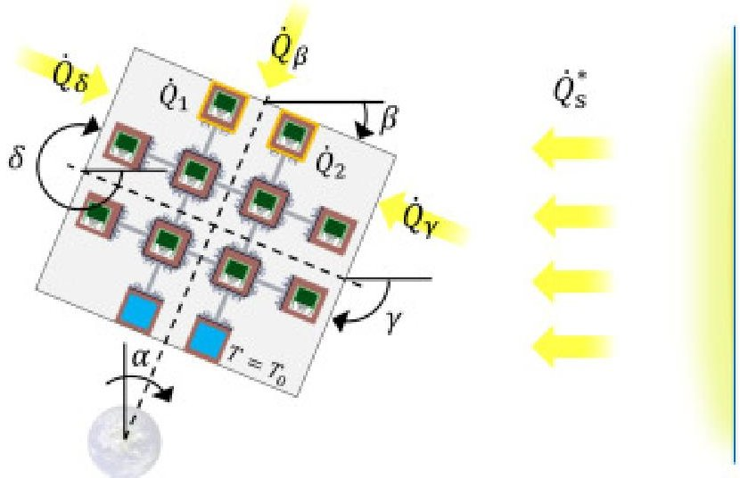

Download: Download high-res image (175KB)

Download: Download full-size image

Fig. 13. Mapping of the Sun's radiation power into $ \dot{Q}_{1} $ and $ \dot{Q}_{2} $ heat sources for the LEO orbit simulation test.

The prediction MPC horizon $ N_{p} $ was set to 120 intervals, while the control horizon $ N_{c} $ was set to 24 intervals. With a sampling time $ T_{s} $ of 5 s, this meant a prediction and control time spans of 600 s and 120 s, respectively. These choices were made based primarily on the satellite's transition between eclipse and Sun exposure, where a step-like disturbance excites the system. Still, this excitation acts on nodes 1 and 2, which damp the temperature increase before it propagates through the rest of the payload, resulting in a slow system response. The aforementioned values for $ N_{p}, N_{c} $ , and $ T_{s} $ proved sufficient in terms of controller performance during early simulations, while MPC solver computation time was kept well below the

<!-- PDF_PAGE: 27 -->

sampling time on the same host computer used later for hardware testing. As indicated in Section 3.3, forward Euler was used for time discretization because of its low computational cost and its direct compatibility with the linear MPC formulation. The sampling time was sufficiently small relative to the observed thermal dynamics; the measured and predicted temperature trajectories remained smooth and bounded during the experiments, and no numerical instability or divergence was observed. This provides empirical indication of stability for the tested parameter range, although it does not replace a formal eigenvalue-based analysis. For systems with shorter thermal time constants, stronger thermal coupling, or larger sampling intervals, implicit Euler or bilinear discretization is to be considered to improve numerical stability. Regarding the model update, the initial ODT model parameters $ \mathbf{r}_{0} $ and $ \mathbf{c}_{0} $ were set deliberately 50% off the nominal values. For this, m=32 data points for model fitting were set, meaning the first parameter update was executed after 160 s. This value was found to be the optimal balance between quality of fit and required data volume. More data points produced only marginal gains while increasing memory requirements and delaying the first model fit. The step size was set to 1% of the nominal $ \mathbf{r}_{a} $ and $ \mathbf{c}_{a} $ , while the convergence criterion was chosen based on the relative decrease with respect to the k-1 objective function value:

$$
\frac {\left| J ^ {l + 1} - J ^ {l} \right|}{\max \left(J ^ {l} , \epsilon\right)} < \varepsilon_ {J},
$$

with $ \epsilon=1 0^{-8}, \varepsilon_{J}=1 0^{-5} $ and a maximum of 200 iterations. The fitting window length m and optimization parameters were calibrated during development based on simulation and experimental observations, until robust convergence and sufficient predictive accuracy were consistently obtained. During testing, the Digital Twin ran on an AMD Ryzen 5 7520U CPU with a base speed of 2.80 GHz, whose resulting solve times for MPC control and model update optimizations have been reported in Table 1. The intended target hardware, based on a PolarFire SoC MPFS250T, provides a lower general-purpose CPU clock frequency than the host processor. However, the measured computation times are far below the selected sampling interval with a feasibility margin of roughly 4.7 s, considering the maximum logged timings and assuming the same delay induced by the test electronics. Therefore, these results indicate that the proposed routines are compatible with the selected sampling time, while final real-time confirmation will require deployment and benchmarking on the target flight processor.

Table 1. Measured computation times of the MPC and online parameter-update routines for the given test setup and host PC.

<!-- PDF_PAGE: 28 -->

<table border="1"><tr><td>Metric</td><td>MPC(ms)</td><td>Parameter update(ms)</td></tr><tr><td>Mean</td><td>10.104</td><td>22.136</td></tr><tr><td>95th percentile</td><td>13.548</td><td>34.144</td></tr><tr><td>Maximum</td><td>50.968</td><td>130.590</td></tr></table>

Fig. 14 shows the resulting time series for the Sun's radiation mapped into $ \dot{Q}_{1} $ and $ \dot{Q}_{2} $ the power distribution of the payload subsystems IR, LED, and OBC, as well as the temperatures and maximum temperature differences of the TSC nodes. Only one orbital period was simulated because early experiments showed the thermal response reaching periodic steady state within the first orbit. The absolute difference between the average nodal temperatures at t and $ t+t_{LEO} $ converged below an accepted value of 5 K at $ t=1410\mathrm{s} $ , which falls within the first third of the orbit. The maximum nodal temperatures also appeared already during the first orbit, peaking at $ 108.64^{\circ} \mathrm{C} $ on the upper boundary condition node 1. After the initial 160 s, during which the Operation Optimizer worked with unfitted model parameters, the Onboard Digital Twin was able to maintain the required thermal stability throughout the full orbit. From that point, the maximum temperature difference among the temperature-sensitive components remained below the specified threshold of 5 K. While the OBC and IR loads oscillated and distributed their activity comparatively evenly, the LED subsystem developed an imbalance over a substantial part of the orbit. In particular, one LED channel effectively carried 100 % of the LED workload during most of the interval from approximately $ t=1800\mathrm{s} $ to $ t=4800\mathrm{s} $ , while the other redundant LED remained largely inactive. Although this behavior did not prevent compliance with the test requirements, it indicates that thermal stabilization during this orbital segment relies strongly on a single actuator path. Consequently, if the affected element were degraded or unavailable, compliance with the thermal-gradient requirements could be compromised. The other subsystems alternated operation between their different elements. It was noted that the subsystem OBC mostly showed an on-and-off behavior, even though a continuous distribution was possible. This might have been due to the binary behavior of the other subsystems and the necessity for the OBC to exhibit similar behavior to compensate for neighboring heat sources. Aside from these observations, the LEO orbit simulation results were satisfactory and served as evidence of the ODT's ability to stabilize temperature gradients in a satellite payload.

<!-- PDF_PAGE: 29 -->

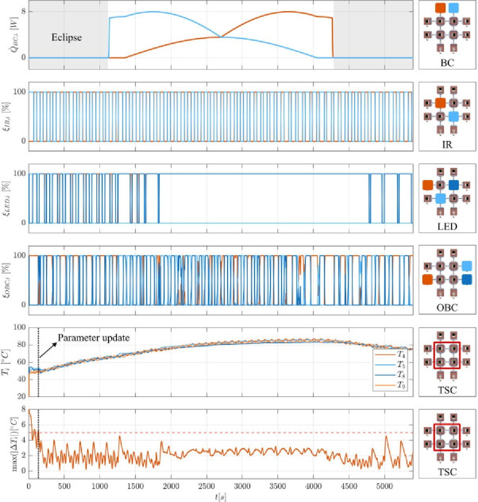

Download: Download high-res image (1MB)

Download: Download full-size image

Fig.14. Prescribed heat inputs, optimized control inputs, and resulting TSC temperatures in the LEO test. Legends on the right panels indicate which array nodes are displayed via color mapping. The first row shows the Sun's heat input mapped to nodes 1 and 2 on the payload's hot interface. The second, third, and fourth rows show the control units activation, meaning the redundant elements of the subsystems IR, LED, and OBC, respectively. The fifth row displays the measured temperatures at the TSCs, while the last row highlights the maximum pairwise temperature difference, to be kept below the required 5 K. This requirement is fulfilled after the ODT Parameter Update routine initializes at $ t=160\mathrm{s} $

## 6. Conclusions and future work

<!-- PDF_PAGE: 30 -->

The proposed Onboard Digital Twin framework combines a discrete thermal model, an automated parameter-update routine, and predictive control to regulate temperature gradients in a CubeSat payload. This work demonstrated how a simplified yet representative satellite architecture can be used to validate a thermal stabilization routine for laser-based communication systems. The experimental results show that, once sufficient data is available to fit the model parameters, the updated ODT represents the payload thermal behavior with sufficient accuracy and is able to keep temperature differences within the required limits. These results confirm that the approach is suitable for autonomous thermal management and that redundant electronics have potential as controllable heat sources for temperature gradient mitigation. At the same time, the test campaign highlighted some limitations. The platform is still affected by restrictions related to transient-model accuracy, the discrete operation of the available actuators, oscillatory control behavior, and, in some cases, an uneven or one-sided use of redundant subsystems, which might lead to premature component wear. The combination of slow thermal dynamics and fast control sequence optimization provided a substantial computational margin for onboard implementation. Future work will validate this by deploying the proposed ODT on the distributed OBC system developed by the industry partner EMM GmbH to evaluate the framework in the target OBC architecture. For more complex payloads or noisier onboard measurements, future implementations should include regularization around prior thermal parameters (e.g., Tikhonov [48]), robust loss functions (e.g., Huber [49]), as well as repeated-window fitting to improve parameter identifiability and reduce bias from sensor noise or data acquisition offsets. The thermal model will also be extended with an appropriate linearization of the radiative heat-transfer terms when radiation becomes the dominant heat-transfer mechanism between the payload and the environment during testing in a thermal vacuum chamber. While the proposed model update scheme proved sufficiently accurate and computationally efficient for the presented proof-of-concept demonstrator, a more systematic selection of the optimization hyperparameters, including the fitting window length, step size, and convergence tolerances will be conducted. Such an approach is expected to improve robustness and reproducibility while facilitating adaptation to different thermal models and operating conditions. Future implementations should also be able to detect the reduced availability or loss of individual control subsystems, update the internal prediction model accordingly, and continue operating with a reconfigured set of admissible control actions. Moreover, actuator-balancing strategies and longer mission-representative test profiles will be investigated.

## Funding

This work was supported by the Bavarian Ministry of Economic Affairs, Regional Development and Energy as part of the funding program BayVFP Förderlinie Mobilität - Raumfahrt [grant number MRF-2107-0007//RaFo21-012-B].

<!-- PDF_PAGE: 31 -->

## CRediT authorship contribution statement

Sergi Pagès: Writing - original draft, Visualization, Validation, Software, Methodology Investigation, Formal analysis, Conceptualization. Maximilian Amm: Validation, Software Resources, Investigation. Jintin Frank: Supervision, Project administration, Funding acquisition, Conceptualization. Markus Zimmermann: Writing - review & editing, Supervision, Project administration, Funding acquisition, Conceptualization.

## Declaration of competing interest

The authors declare that they have no known competing financial interests or personal relationships that could have appeared to influence the work reported in this paper.

Appendix A. Definition of heat sources for the model and parameter update validation test

The demonstrator heat sources have been defined as

$$
\begin{array}{l} \dot {Q} _ {1} (t) = \dot {Q} _ {2} (t) = 9 h (t), \\ \dot {Q} _ {3} (t) = \dot {Q} _ {8} (t) = \dot {Q} _ {9} (t) = 1 0 h (t), \\ \dot {Q} _ {4} (t) = \dot {Q} _ {5} (t) = \dot {Q} _ {6} (t) = \dot {Q} _ {7} (t) = \dot {Q} _ {1 0} (t) = 0, \\ \end{array}
$$

with

$$
h (t) = \left\{ \begin{array}{l l l} 0 & \mathrm {i f} & 0 \leq t < t _ {0} \\ 1 & \mathrm {i f} & t _ {0} \leq t < t _ {1} \\ 0 & \mathrm {i f} & t _ {1} \leq t < t _ {e n d} \end{array} \right.
$$

and

$$
t _ {0} = 3 0 \mathrm {s}, \quad t _ {1} = 1 2 0 0 \mathrm {s}, \quad t _ {e n d} = 2 4 0 0 \mathrm {s}.
$$

Appendix B. Definition of heat sources for the upper boundary conditions during the LEO test

<!-- PDF_PAGE: 32 -->

Considering the geometric aspects displayed in Fig. 13:

$$
\dot {Q} _ {1} (\alpha) = \left\{ \begin{array}{l l} \dot {Q} _ {\delta} + \frac {1}{2} \dot {Q} _ {\beta} & \mathrm {i f} - 1 4. 7 ^ {\circ} < \alpha < 1 9 4. 7 ^ {\circ}, \\ 0 & \mathrm {o t h e r w i s e (e c l i p s e)}, \end{array} \right.
$$

$$
\dot {Q} _ {2} (\alpha) = \left\{ \begin{array}{l l} \dot {Q} _ {\gamma} + \frac {1}{2} \dot {Q} _ {\beta} & \mathrm {i f} - 1 4. 7 ^ {\circ} < \alpha < 1 9 4. 7 ^ {\circ} \\ 0 & \mathrm {o t h e r w i s e (e c l i p s e)}, \end{array} \right.
$$

with

$$
\dot {Q} _ {\beta} (\alpha) = \left\{ \begin{array}{l l} \dot {Q} _ {s} ^ {*} A _ {s} \sin (\beta) & \mathrm {i f} \quad 0 ^ {\circ} < \beta < 1 8 0 ^ {\circ} \\ 0 & \mathrm {o t h e r w i s e (s h a d e d)} \end{array} \right.
$$

$$
\dot {Q} _ {\delta} (\alpha) = \left\{ \begin{array}{l l} \dot {Q} _ {s} ^ {*} A _ {s} \sin (\delta) & \mathrm {i f} \quad 0 ^ {\circ} < \delta < 1 8 0 ^ {\circ} \\ 0 & \mathrm {o t h e r w i s e (s h a d e d)} \end{array} \right.
$$

$$
\dot {Q} _ {\gamma} (\alpha) = \left\{ \begin{array}{l l} \dot {Q} _ {s} ^ {*} A _ {s} \sin (\gamma) & \mathrm {i f} \quad 0 ^ {\circ} < \gamma < 1 8 0 ^ {\circ} \\ 0 & \mathrm {o t h e r w i s e (s h a d e d)} \end{array} \right.
$$

and

$$
\beta = \alpha , \quad \delta = \alpha + 2 7 0 ^ {\circ}, \quad \gamma = \alpha + 9 0 ^ {\circ},
$$

where $ \dot{Q}_{s}^{*} $ is the solar irradiance in $ \mathrm{W m}^{-2} $ and $ A_{s} $ corresponds to the satellite's one-sided external surface area.

## Data availability

Data will be made available on request.

## References

[1] J. Liu, C.L. Wang, Y.Z. Li

<!-- PDF_PAGE: 33 -->

AMR, 1016 (2014), pp. 446-450, 10.4028/www.scientific.net/AMR.1016.446 View in Scopus Google Scholar

[2] J. Weerasinghe, K. Prasad, J. Mathew, E. Trifoni, O. Baranov, I. Levchenko, K. Bazaka Carbon nanocomposites in aerospace technology: a way to protect low-orbit satellites Nanomaterials, 13 (11) (2023), p. 1763, 10.3390/nano13111763 View in Scopus Google Scholar

[3] J. Zhao, J. Wu, S. Yan, J. Li, Y. Gu Dynamic modeling and motion precision analysis of spacecraft manipulator with harmonic drive considering the alternate thermal field in orbit Proc. Inst. Mech. Eng. G: J. Aerosp. Eng., 229 (1) (2015), pp. 135-148, 10.1177/0954410014527267 Google Scholar

[4] D.G. Gilmore, Spacecraft thermal control handbook, volume I: fundamental technologies, 2002. 10.2514/4.989117. Google Scholar

[5] H. Wang, J. Yang, Y. Shi, H. Huo, X. Ye

Review of the digital twin design of the smart satellite thermal control structure

Acta Astronaut., 239 (2026), pp. 491-521, 10.1016/j.actaastro.2025.11.014

View PDF View article View in Scopus Google Scholar

[6] F. Antonello, D. Segneri, V. Reggestad Surrogate model-based calibration of a flying Earth observation satellite Adv. Space Res., 73 (3) (2024), pp. 1925-1935, 10.1016/j.asr.2023.10.043 View PDF View article View in Scopus Google Scholar

[7] S. Tachikawa, H. Nagano, A. Ohnishi, Y. Nagasaka Advanced passive thermal control materials and devices for spacecraft: a review Int J. Thermophys., 43 (6) (2022), p. 91, 10.1007/s10765-022-03010-3 View in Scopus Google Scholar

[8] P. Hager, K. Janzer, Influence of orbit and thermal design parameters on the temperature behaviour of CubeSats - implications for thermal analysis and thermal hardware demands(2020). Google Scholar

<!-- PDF_PAGE: 34 -->

[9] S.-J. Kang, H.-U. Oh On-orbit thermal design and validation of 1 u standardized CubeSat of STEP cube lab Int. J. Aerosp. Eng., 2016 (1) (2016), Article 4213189, 10.1155/2016/4213189 View in Scopus Google Scholar

[10] ECSS-E-ST-10-04C Rev.1-Space environment (15 June 2020) | European Cooperation for Space Standardization. Google Scholar

[11] B.J. Anderson, C.G. Justus, G.W. Batts Guidelines for the Selection of Near-Earth Thermal Environment Parameters for Spacecraft Design Tech. rep. (2001) Google Scholar $ \rangle $

[12] J. Meseguer, I. Pérez-Grande, A. Sanz-Andrés

2 - space environment

J. Meseguer, I. Pérez-Grande, A. Sanz-Andrés (Eds.), Spacecraft Thermal Control, Woodhead Publishing (2012), pp. 15-38, 10.1533/9780857096081.15

View PDF View article Google Scholar

[13] J. Durcanin, D. Chalmers, J. Visentine The Definition of the Low Earth Orbital Environment and its Effect on Thermal Control Materials (1987), 10.2514/6.1987-1599 22nd Thermophysics Conference Google Scholar

[14] M. Iwata, A. Ohnishi, H. Hirosawa, F. Tohyama Measurement and evaluation of thermal control material with polyimide for space use J. Spacecr. Rockets, 38 (4) (2001), pp. 504-509, 10.2514/2.3733 View in Scopus Google Scholar

[15] G.F. Abdelal, A. Atef Thermal fatigue analysis of solar panel structure for micro-satellite applications Int. J. Mech. Mater. Des., 4 (1) (2008), pp. 53-62, 10.1007/s10999-008-9057-3 View in Scopus Google Scholar

<!-- PDF_PAGE: 35 -->

[16] C. Sgorlon Gaiatto, F. Antonello, D. Segneri, J. Eggleston, B. Sousa, B.A. Palacios, A. Schiavo, M. Bartesaghi, J. Maass, A. Inojosa Towards a robust calibration and model discrepancy reduction for digital twin spacecraft: application to european space agency (ESA) cluster mission Aerosp. Sci. Technol., 168 (2026), Article 110769, 10.1016/j.ast.2025.110769 View PDF View article View in Scopus Google Scholar

[17] M. Grieves Origins of the Digital Twin Concept (2016), 10.13140/RG.2.2.26367.61609 Google Scholar

[18] M. Shafto, M. Conroy, R. Doyle, E. Glaessgen, C. Kemp, J. LeMoigne, L. Wang, Modeling simulation, information technology and processing roadmap, 2010. https://www.researchgate.net/publication/280310295_Modeling_Simulation_Information_Technology_and_Processing_Roadmap.

[19] A. Thelen, X. Zhang, O. Fink, Y. Lu, S. Ghosh, B.D. Youn, M.D. Todd, S. Mahadevan, C. Hu, Z. Hu A comprehensive review of digital twin — part 1: modeling and twinning enabling technologies Struct. Multidisc Optim., 65 (12) (2022), p. 354, 10.1007/s00158-022-03425-4 View in Scopus Google Scholar

[20] J. Trauer, S. Schweigert-Recksiek, C. Engel, K. Spreitzer, M. Zimmermann WHAT is a digital twin?-definitions and insights from an industrial case study in technical product development Proc. Des. Soc.: Des. Conf., 1 (2020), pp. 757-766, 10.1017/dsd.2020.15 View in Scopus Google Scholar

[21] D. Jones, C. Snider, A. Nassehi, J. Yon, B. Hicks Characterising the digital twin: a systematic literature review CIRP J. Manuf. Sci. Technol., 29 (2020), pp. 36-52, 10.1016/j.cirpj.2020.02.002 View PDF View article View in Scopus Google Scholar

[22] J. Moyne, Y. Qamsane, E.C. Balta, I. Kovalenko, J. Faris, K. Barton, D.M. Tilbury A requirements driven digital twin framework: specification and opportunities IEEE Access, 8 (2020), pp. 107781-107801, 10.1109/ACCESS.2020.3000437 View in Scopus Google Scholar

[23] S.R. Newrzella, D.W. Franklin, S. Haider

<!-- PDF_PAGE: 36 -->

5-dimension cross-industry digital twin applications model and analysis of digital twin classification terms and models IEEE Access, 9 (2021), pp. 131306-131321, 10.1109/ACCESS.2021.3115055 View in Scopus Google Scholar

[24] W. Heindl, C. Stary Structured development of digital twins-A cross-domain analysis towards a unified approach Processes, 10 (8) (2022), 10.3390/pr10081490 Google Scholar

[25] H. Boyes, T. Watson Digital twins: an analysis framework and open issues Comput. Ind., 143 (2022), Article 103763, 10.1016/j.compind.2022.103763 View PDF View article View in Scopus Google Scholar

[26] K. Tian, Z. Xu, Z. Sun, X. Hu, P. Zhang, Z. Zhou A general digital twin modeling framework for full-field structural strength assessment and prediction Aerosp. Sci. Technol., 173 (2026), Article 111766, 10.1016/j.ast.2026.111766 View PDF View article View in Scopus Google Scholar

[27] Q. Chen, Y. Zhang, X. Dong, J. Cui, Y. Lu, P. Zheng, W. Liu A high-accuracy shape sensing method for deformation digital twin monitoring of thin-walled aircraft structures Aerosp. Sci. Technol., 168 (2026), Article 110960, 10.1016/j.ast.2025.110960 View PDF View article View in Scopus Google Scholar

[28] J. Xu, D. Dai, X. Zhou, M. Giglio, C. Sbarufatti, L. Dong Structural damage diagnosis and prognosis with fleet digital twin considering similarity of individual structural features Aerosp. Sci. Technol., 168 (2026), Article 110983, 10.1016/j.ast.2025.110983 View PDF View article View in Scopus Google Scholar

[29] S. Kim

A novel approach to self-adaptive digital twin performance model of turbofan engines for in-flight application

Aerosp. Sci. Technol., 166 (2025), Article 110620, 10.1016/j.ast.2025.110620

View PDF View article View in Scopus Google Scholar

[30] Z. Zhong, X. Hua, Z. Zhai, M. Ma

<!-- PDF_PAGE: 37 -->

# A novel tensor-based modal decomposition method for reduced order modeling and optimal sparse sensor placement

Aerosp. Sci. Technol., 155 (2024), Article 109530, 10.1016/j.ast.2024.109530

View PDF View article View in Scopus Google Scholar

[31] V.F. Nikitin, I.M. Karandashev, M.Y. Malsagov, E.V. Mikhalchenko Approach to combustion calculation using neural network Acta Astronaut., 194 (2022), pp. 376-382, 10.1016/j.actaastro.2021.10.034 View PDF View article View in Scopus Google Scholar

[32] L. Zhao, C. Wang, K. Zhao, D. Tarchi, S. Wan, N. Kumar Interlink: A digital twin-assisted storage strategy for satellite-terrestrial networks IEEE Trans. Aerosp. Electron. Syst., 58 (5) (2022), pp. 3746-3759, 10.1109/TAES.2022.3169130 View in Scopus Google Scholar

[33] MUnique Technology GmbH, DORT-space, Accessed on 2026-03-08. https://munique- technology.com/.

Google Scholar

[34] J. Young, S. Inlow, B. Bender Solving thermal control challenges for CubeSats: optimizing passive thermal design 2019 IEEE Aerospace Conference (2019), pp. 1-7, 10.1109/AERO.2019.8741754 ISSN: 1095-323X Google Scholar

[35] Microchip Technology Inc., MPFS250T PolarFire SoC FPGA, Accessed on 2026-07-08. Google Scholar

[36] Micron Technology, Inc., LPDDR4/4X, Accessed on 2026-06-30. Google Scholar

[37] M. Plattner, C. Fassi, F. Kreiner, J. Frank, P. Radecker, M. Zimmermann Satellite payload design for optimized thermal management using a distributed processor system 2023 Forum on Specification & Design Languages (FDL) (2023), pp. 1-7, 10.1109/FDL59689.2023.10272111 ISSN: 1636-9874 Google Scholar

<!-- PDF_PAGE: 38 -->

[38] The MathWorks,Inc., QP solvers for linear MPC, Accessed on 2026-03-08. Google Scholar

[39] P. Van Overschee, B. De Moor Subspace Identification for Linear Systems Springer US, Boston, MA (1996), 10.1007/978-1-4613-0465-4 Google Scholar

[40] 3M Deutschland GmbH, $ 3 \mathrm{M}^{\mathrm{TM}} $ Thermisch leitfähiges und wärmeverteilendes Klebeband 9876-10, Accessed on 2026-06-28. Google Scholar

[41] Transfer Multisort Elektronik, GBR-618-12-20-2 TELPOD - resistor: thick film; heating; glued; 7.2 Ohm; 20 W, Accessed on 2026-07-08. Google Scholar

[42] ThermaGmbH, Cable lug RTD | Teflon | Pt1000, a, Accessed on 2026-06-26. Google Scholar

[43] Quick-Ohm Kuepper & Co. GmbH, Peltier modul 40x40 mm | 165W | 19.0V | 15.0 A, Accessed on 2026-06-26. Google Scholar

[44] Espressif Systems, ESP32-S3-DevKitC-1, Accessed on 2026-07-03. Google Scholar

[45] NXP Semiconductors, PCA9685 LED controller | 16 channels of 12-bit PWM, Accessed on 2026-07-03. Google Scholar

[46] Texas Instruments, ADS1256 data sheet, Accessed on 2026-07-08. Google Scholar

[47] DIN Deutsches Institut fuer Normung e.V., Industrial platinum resistance thermometers and platinum temperature sensors, Accessed on 2026-07-08. Google Scholar

[48] A.I. Tikhonov, Solution of incorrectly formulated problems and the regularization method (1963). Google Scholar

[49] P.J. Huber

<!-- PDF_PAGE: 39 -->

Robust estimation of a location parameter

Ann. Math. Stat., 35 (1) (1964), pp. 73-101, 10.1214/aoms/1177703732 $ \rarr $

Google Scholar