<!-- PDF_PAGE: 1 -->

## DISSERTATION

# USING AN ONTOLOGY AND METAMODELS TO EVALUATE SYSTEMS ENGINEERING (SE) DOMAIN-SPECIFIC MODELING LANGUAGES (DSML)

Submitted by Sarah Rudder Department of Systems Engineering

In partial fulfillment of the requirements For the Degree of Doctor of Engineering Colorado State University Fort Collins, Colorado Spring 2026

Doctoral Committee:

Advisor: Daniel R. Herber

Jim Adams

Melissa Burt

Tim Coburn

Jeremy Daily

David Fields

<!-- PDF_PAGE: 2 -->

Copyright by Sarah Rudder 2026

All Rights Reserved

<!-- PDF_PAGE: 3 -->

## ABSTRACT

# USING AN ONTOLOGY AND METAMODELS TO EVALUATE SYSTEMS ENGINEERING (SE) DOMAIN-SPECIFIC MODELING LANGUAGES (DSML)

Advances in the technologies available to systems engineering (SE) have led to an increase in domain-specific modeling languages (DSML). These define concepts and the relationships between them with a metamodel that addresses the syntax and semantics of the DSML. While meant to enable specialized capabilities, this diversity introduces challenges regarding model interoperability and data translation. This research explores the relevance of a subset of prominent languages the Unified Modeling Language (UML) v2.5.1, Systems Modeling Language (SysML) v1.7, CubeSat Reference Model (CSRM) v1.0, Unified Architecture Framework Modeling Language (UAFML) v1.2, Comprehensive System Design Language (CSDL) v1, Lifecycle Modeling Language (LML) v2.0, and SysML v2.0 to the SE discipline. To evaluate the pertinent concepts of each DSML, it is necessary to have a deep understanding of SE, its processes, and its goals. To capture this foundational knowledge, a domain-specific ontology (DSO) is constructed by leveraging the normative reference ISO 15288:2023, the Web Ontology Language (OWL), and the open-source editor, Protégé. Both the DSML metamodels and the SE DSO are represented as concept models within an SE tool. This method facilitates the mapping of Equivalent Classes between DSML terms and ISO 15288. These mappings assist in the alignment of languages with core SE concepts and concludes with recommendations for DSML developers and practitioners. Finally, this work supports the organizational goals of Enola Technologies, LLC, by providing concrete evidence that assists with knowledgeably answering customer questions and alleviating their concerns.

<!-- PDF_PAGE: 4 -->

## DEDICATION

"I'd like to thank me" - Snoop Dogg' - Sarah Rudder

<!-- PDF_PAGE: 5 -->

## TABLE OF CONTENTS

ABSTRACT . . . . .

<!-- PDF_PAGE: 6 -->

## LIST OF TABLES

2.1 Methods to evaluate ontology quality. 20

2.2 Metamodel modeling layers of abstraction. 30

2.3 CBO quality score evaluation. 40

2.4 Mapping part-of-speech to terms used in this research. 42

2.5 SKOS integrity conditions. 44

3.1 Overview of research tools and languages. 49

3.2 ISO 15288 Section 3 terms and definitions. 53

3.3 Selected DSMLs for metamodeling. 62

B.1 UML v2.5.1 concrete classes and definitions in the data and process models. 130

B.2 SysML v1.7 concrete classes and definitions in the data model. 136

B.3 SysML v1.7 predicates and definitions in the process model. 138

B.4 CSRM v1.0 concrete classes and definitions in the data model. 138

B.5 UAFML v1.2 concrete classes and definitions in the data model. 140

B.6 SysML v2.0 concrete classes and definitions in the data model. 145

B.7 CSDL v1 classes and definitions in the data model. 150

B.8 CSDL v1 predicates and definitions in the process model. 152

B.9 LML v2.0 classes and definitions in the data model. 155

B.10 LML v2.0 predicates and definitions in the process model. 156

<!-- PDF_PAGE: 7 -->

## LIST OF FIGURES

2.1 Literature review topics. 3

2.2 Traditional MBSE pillars [9]. 5

2.3 Modern MBSE pillars [12]. 5

2.4 SysML v2.0 focus [20]. 6

2.5 KerML v2.0 semantics. 6

2.6 Rendering of the UAF grid [26]. 7

2.7 CSDL architecture framework [28]. 8

2.8 CSDL ERA mapping to natural language. 9

2.9 Fragment of LML classes and relationships [30]. 10

2.10 Ontological concept of nodes and edges. 11

2.11 Class diagram representing the BCGO subtypes of “cell”. 12

2.12 Composition of BFO continuants. 13

2.13 Ontological layers [57]. 14

2.14 SPO data model for triples. 15

2.15 Overview of the semantic web. 15

2.16 Ontology lifecycle stages [78]. 17

2.17 METHONTOLOGY life cycle phases [77]. 18

2.18 Four stages of LOT [85]. 18

2.19 NeON method support activities and «Equivalent Classes». 19

2.20 SysML block definition diagram (BDD) for semiotic quality aspects. 21

2.21 Semiotic quality aspects. 21

2.22 Definition of semiotic quality characteristics. 22

2.23 OQuaRE quality characteristics [95]. 23

2.24 OQuaRE “maintainability” sub-characteristics [95]. 23

2.25 OQuaRE “maintainability” sub-characteristic constraints. 24

2.26 OntoQA metrics for evaluating ontology quality. 25

2.27 OntoQA constraints for evaluating ontology quality. 25

2.28 Example SE DSO “fragment” [38]. 26

2.29 OPM example of ISO 15288 agreement processes [107]. 27

2.30 NLP processes. 28

2.31 Rendering of concept model mapping [113]. 28

2.32 Instantiations of a model [32]. 30

2.33 Subset of MOF metaclasses within a profile [131]. 31

2.34 EMOF constraints. 32

2.35 Definitions of ORCUS validation rules. 34

2.36 MQuaRE quality characteristics. 35

2.37 MQuaRE quality characteristic descriptions. 35

2.38 Requirements derived from mmSpec quality metrics. 36

2.39 QM4MM characteristics 38

2.40 Mapping QM4MM quality characteristics. 38

2.41 KG concepts. 43

<!-- PDF_PAGE: 8 -->

2.42 DL system for KGs. 43

2.43 Framework for quality goals [184]. 46

2.44 Subset of GSN stereotypes with documentation. 47

3.1 TWC configuration. 50

3.2 Concept modeling diagram example for the ISO 15288 “System” class. 51

3.3 Ontology construction process [119]. 52

3.4 Basic metrics as calculated within Protégé as a result of the (4) constructing the ontology task. 54

3.5 Example of ISO 15288 generalization relationships in a concept modeling diagram for the “System” class. 55

3.6 Comprehensive view of generalization relationships of the ISO 15288 ontology within CATIA MSOSA. 55

3.7 ISO 15288 basic ontology metrics as calculated within CATIA MSOSA. 56

3.8 Identifying OBO Foundry requirements using a structured expression within CATIA MSOSA [195]. 56

3.9 Descriptions of quality framework metrics that satisfy OBO Foundry requirements [156] [196]. 57

3.10 Relation map showing the decomposition of the "Functional Adequacy" OQuaRE quality characteristic. 57

3.11 Semiotic quality mapping to ontology metrics. 58

3.12 Ontology quality metrics and measures that satisfy semiotic quality aspects. 58

3.13 Definitions of ontology quality metrics used in this research. 59

3.14 ISO 15288 ontology basic counts shown as slot values for a SysML instance. 59

3.15 Relationships between metamodel and ontology quality metrics. 60

3.16 Quantitative result of the learnability metric within a SysML parametric diagram. 60

3.17 Confirming coherency and consistency of the ISO 15288 ontology using a semantic reasoner within Protégé. 61

3.18 Modification stability result within a SysML parametric diagram. 61

3.19 Metamodel class stereotypes. 63

3.20 DSML process [200]. 63

3.21 Comprehensive view of the UML v2.5.1 generalizations. 64

3.22 UML v2.5.1 metamodel example of the “Class” entity and its relationships. 65

3.23 SysML v1.7 “Block” related to UML v2.5.1 “Class” and ISO 15288 terms in a concept modeling diagram. 65

3.24 Generalizations of the SysML v1.7 and the UML v2.5.1 metamodels. 66

3.25 Example of object properties captured in the CSRM v1.1 metamodel. 67

3.26 Mapping of CSRM v1.1 «Equivalent Classes» to SysML v1.7 terms. 67

3.27 CSRM v1.1 generalizations within the language itself, SysML v1.7, and those inherited from UML v2.5.1. 68

3.28 Comprehensive view of UAFML v1.2 generalizations within the metamodel. 69

3.29 UAFML v1.2 metaconstraints and generalizations for the “Risk” class within the metamodel. 70

3.30 SysML v2.0 and KerML v2.0 generalizations where the columns represent superclasses and the rows are subclasses. 71

<!-- PDF_PAGE: 9 -->

3.31 SysML v2.0 “RequirementUsage” relationships within the metamodel. 72

3.32 CSDL v1 “Component” relationships within the metamodel. 72

3.33 CSDL v1 generalizations where columns represent the superclasses and the rows are subclasses. 73

3.34 LML v2.0 metamodel taxonomy leveraging the generalization relationship. 74

3.35 Relationships of the LML “Asset” class. 74

3.36 Content diagram showing the imported ISO 15288 ontology. 75

3.37 UML v2.5.1 metamodel mapped to the ISO 15288 ontological concepts with the «Equivalent Class» relationship. 76

3.38 Implied «Equivalent Class» relationships between the UML metamodel and the ISO 15288 concepts. 76

3.39 ISO 15288 terms that are not directly mapped to UML v2.5.1 classes. 76

3.40 SysML v1.7 mapping to the ISO 15288 ontology, including «Equivalent Class» relationships and implied generalizations. 77

3.41 UAFML v1.2 metamodel project usages within the TWC. 77

3.42 Example of UAFML v1.2 metamodel mapping to the ISO 15288 ontology shown by a concept modeling diagram. 78

3.43 UAFML v1.2 mapping of «Equivalent Classes» to the ISO 15288 ontology. 78

3.44 SysML v2.0 mapping of «Equivalent Classes» to the ISO 15288 ontology. 79

3.45 SysML v2.0 mapping of implied «Equivalent Classes» to the ISO 15288 ontology. 80

3.46 Example of SysML v2.0 metamodel mapping of «Equivalent Classes» to the UML v2.5.1 metamodel and the ISO 15288 ontology in a concept modeling diagram. 80

3.47 SE metamodel project usages for this research. 81

3.48 SysML 1.7 to UML v2.5.1 equivalent classes. 81

3.49 Example of CSDL v1 inverse predicates in a concept modeling diagram. 82

3.50 Example of LML v2.0 inverse predicates in a concept modeling diagram. 83

3.51 Example of «Equivalent Classes» between LML v2.0, CSDL v1, and SysML v1.7 predicates in a concept modeling diagram. 83

4.1 ISO 15288 ontology quality metric results for CBO and ULe. 84

4.2 Complete ISO 15288 ontology mapping to SE DSML «Equivalent Classes». 85

4.3 CSDL v1 mapping to ISO 15288 ontology «Equivalent Classes». 86

4.4 LML v2.0 mapping to ISO 15288 ontology «Equivalent Classes». 86

4.5 UML v2.5.1/SysML v1.7 mapping to KerML v2.0/SysML v2.0 «Equivalent Classes». 88

4.6 CSDL v1 «Equivalent Classes» in UML v2.5.1 and SysML v1.7. 89

4.7 LML v2.0 predicates, each inverse, and the mapping to both CSDL v1 and SysML v1.7 «Equivalent Classes». 90

4.8 LML v2.0 «Equivalent Classes» in UML v2.5.1, SysML v1.7, and CSDL v1. 93

4.9 ISO 15288 ontology “Stakeholder” class within a concept modeling diagram. 93

4.10 Additional ISO 15288 classes as subjects in the “Name” column, predicates as “Roles”, and “Object” of the SPO triples. 94

4.11 Example of inheritance within the updated ISO 15288 ontology. 94

4.12 LML v2.0 basic metrics as calculated within the CCM. 95

4.13 Relationships between LML classes shown within Protégé. 96

<!-- PDF_PAGE: 10 -->

## Chapter 1

## Introduction

The following sections introduce this research along with the motivation, objectives, and research questions to be answered.

## 1.1 Research Motivation

Enola Technologies, LLC provides training, services, and support for companies looking to transition from a document-based systems engineering (SE) approach to a model-based systems engineering (MBSE) methodology. As MBSE becomes increasingly prevalent across multiple industry applications, several domain-specific modeling languages (DSML) have been introduced to the technical community. As a language-agnostic company, Enola needs a way to reliably provide information between a variety of teams implementing different MBSE tools, languages, and approaches. For clear communication between individuals, an SE ontology that defines industry vocabulary is required. In addition, there is a need for metamodels that define DSML elements to support model transformation from one language to another.

## 1.2 Research Objectives

This research initiates the construction of an SE domain-specific ontology (DSO) to enhance communication among stakeholders with varying backgrounds while increasing collaboration, productivity, and innovation in the field. It introduces a methodology for interpretation mapping between DSMLs and ontologies using concept modeling techniques to determine how the terms relate to each other and to the SE domain knowledge.

## 1.2.1 Research Questions and Tasks

This section outlines the research tasks (RT) necessary to answer the research questions (RQ). RQ1: How can a high-quality SE ontology be created?

<!-- PDF_PAGE: 11 -->

- RQ1-RT1: Determine the corpus for an SE ontology

- RQ1-RT2: Create an ontology from the identified corpus

- RQ1-RT3: Evaluate the quality of the SE ontology

RQ2: Can the metamodels of SE DSMLs be mapped to the SE ontology?

- RQ2-RT1: Identify a subset of SE DSMLs to evaluate

- RQ2-RT2: Create metamodels for a subset of SE DSMLs

- RQ2-RT3: Map SE DSML metamodels to the SE DSO

RQ3: How can the SE DSMLs be mapped to one another to enable model transformations?

- RQ3-RT1: Map SE DSML data models to each other

- RQ3-RT2: Map SE DSML process models to each other

## 1.3 Research Benefits

The SE ontology and DSML metamodel mappings contribute to Enola's ability to assist customers in their digital transformation journeys by providing personalized responses based on a deeper understanding of modern approaches.

<!-- PDF_PAGE: 12 -->

## Chapter 2

## Literature Review

This chapter provides a literature review of technical concepts related to the research topics shown in Fig. 2.1.

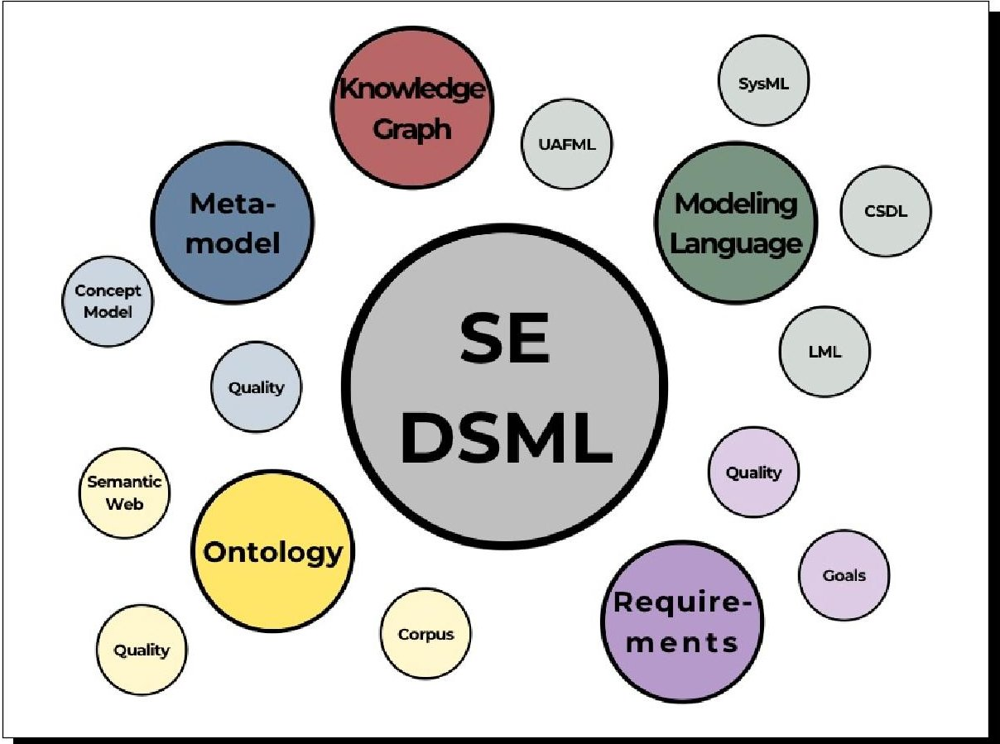

Figure 2.1: Literature review topics.

## 2.1 Model-Based Systems Engineering (MBSE)

Systems engineering aims to ensure complex design solutions satisfy stakeholder needs and expectations throughout the entire project lifecycle using a cross-disciplinary approach [1]. The discipline has been transitioning from a document-based approach to a digital environment since the International Council on Systems Engineering (INCOSE) coined the term "MBSE" in 2007 as the formalized application of SE processes in a digital environment throughout the project lifecycle [2].

<!-- PDF_PAGE: 13 -->

It has emerged as a relatively new paradigm that places models at the center of SE processes to reliably manage emergent behavior [3]. Common resources for SE practitioners include ISO 15288 and the INCOSE Systems Engineering Book of Knowledge (SEBoK) [4] [5]. Traditionally, the outputs produced by SE processes have been document-based artifacts [6]. The exponential increase in system complexity raises new challenges for system design that may be alleviated by MBSE implementation [7]. Potential advantages of an MBSE approach include enhanced communication between various stakeholders, a common understanding of the domain, improved knowledge capture, well-defined information traceability, and increased reuse of artifacts [6]. After a thorough literature review, a more comprehensive list of perceived benefits by the general SE community includes, but is not limited to [2]:

- Better requirements generation

- Improved system design

- Improved consistency

- Reduction in rework

- Better decision-making

- Earlier verification and validation within the lifecycle

The value of these aspects is realized by the central repository that stores all system-related information [3]. The emergence and maturation of MBSE DSMLs and information standards have accelerated the advancement and practical implementation of MBSE practices [1]. DSMLs are defined as small, declarative languages that offer expressive power focused on, and restricted to, a particular problem domain [8]. They are formal means of communication that give unambiguous meaning to model elements and are the preferred choice when defining structural aspects of a particular domain [9,10]. The influx of modeling options is likely a response to the need for specialized representations of systems and views for different domains [11]. The three (3) pillars of successful MBSE as a language, approach, and tool are shown in Fig. 2.2 [9]. However, it has been argued that MBSE requires a rigorous concept modeling methodology that includes a universal ontology [12]. A modern MBSE approach is shown in Fig. 2.3.

<!-- PDF_PAGE: 14 -->

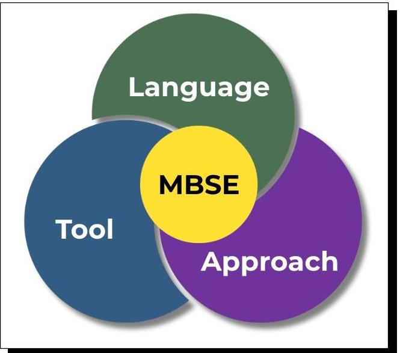

Figure 2.2: Traditional MBSE pillars [9].

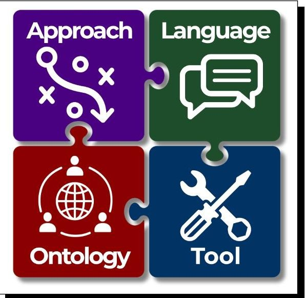

Figure 2.3: Modern MBSE pillars [12].

## 2.1.1 The Systems Modeling Language (SysML)

The Unified Modeling Language (UML) provides architects, engineers, and developers with the tools for analysis, design, and implementation of software-based systems, with a primary goal of advancing the state of the industry [13]. The INCOSE Model-Driven Design Working Group decided in 2001 to customize this software DSML for SE applications with the advent of Systems Modeling Language (SysML) [14]. The SysML specification was published in 2007 as an extension of UML to better suit SE applications [15]. It is a versatile DSML designed to address a broad spectrum of SE challenges across multiple processes [13]. SysML provides a standardized language that enables stakeholders to communicate critical system design elements such as requirements, structure, behavior, and parametrics [9]. In the context of current MBSE practices, SysML has become the most widely adopted industry standard [16]. The following are key abilities of SysML v1 [17]:

- Interconnection between systems, subsystems, and components

- System inputs, outputs, and related flows that provide insight into data and material exchanges

- Message exchanges between system parts

- System states and the transitions between them

- System properties including values and constraints

<!-- PDF_PAGE: 15 -->

However, a main concern with an industry de facto language is that it may be used because of its popularity without consideration of its correctness [18]. Recently, SysML v2.0 was published by the Object Management Group (OMG) to replace SysML v1, with the intent to improve the precision, expressiveness, interoperability, consistency, and integration of the language concepts relative to SysML v1 [19]. The robustness of this language is supported by the components of SysML v2.0 shown in Fig. 2.4.

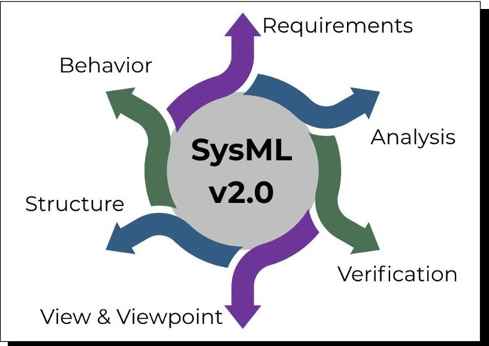

Figure 2.4: SysML v2.0 focus [20].

It is specified as a metamodel that extends the Kernel Modeling Language (KerML) v2.0, which is an application-independent modeling language that includes general semantic constructs used to represent system models using a textual syntax [21]. Figure 2.5 shows the KerML foundation.

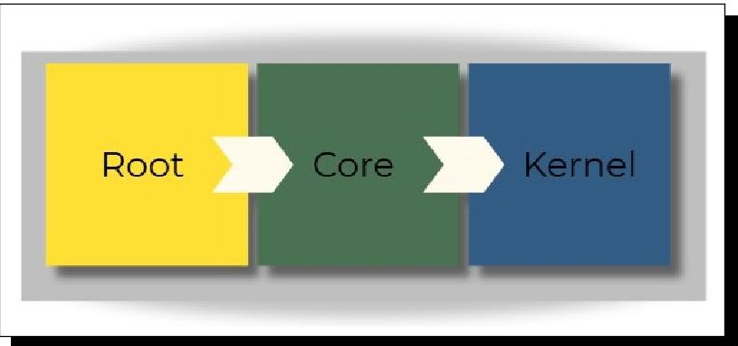

Figure 2.5: KerML v2.0 semantics.

<!-- PDF_PAGE: 16 -->

## 2.1.2 CubeSat Reference Model (CSRM) v1.1

The CubeSat Reference Model (CSRM) is a collection of logical elements that make up a CubeSat space-ground system based on MBSE principles and is SysML-compliant [22]. It tracks elements that facilitate CubeSat design, such as stakeholders, technical measures, behaviors, and requirements across architecture levels of the enterprise, space and ground segments, subsystems, and components [23].

## 2.1.3 Unified Architecture Framework Modeling Language (UAFML) v1.2

The Department of Defense Architecture Framework (DoDAF), Ministry of Defense Architecture Framework (MODAF), and North Atlantic Treaty Organization (NATO) Architecture Framework (NAF) were established to facilitate the planning and management practices of complex systems within the defense industry [24]. Because of this narrowed focus, the Unified Architecture Framework (UAF) was created by the OMG to unify the previous specifications for additional industry and commercial applications [25]. Figure 2.6 shows a rendering of the UAF grid.

<table border="1"><tr><td></td><td>Motivation Mv</td><td>Taxonomy Tx</td><td>Structure Sr</td><td>Connectivity Cn</td><td>Processes Pr</td><td>States St</td><td>Sequences Sq</td><td>Information If</td><td>Traceability Tr</td></tr><tr><td>Strategic St</td><td>St-Mv</td><td>St-Tx</td><td>St-Sr</td><td>St-Cn</td><td>St-Pr</td><td>St-St</td><td>-</td><td>St-If</td><td>St-Tr</td></tr><tr><td>Operational Op</td><td rowspan="4">Rq-Mv</td><td>Op-Tx</td><td>Op-Sr</td><td>Op-Cn</td><td>Op-Pr</td><td>Op-St</td><td>Op-Sq</td><td>Op-If</td><td>Op-Tr</td></tr><tr><td>Services Sv</td><td>Sv-Tx</td><td>Sv-Sr</td><td>Sv-Cn</td><td>Sv-Pr</td><td>Sv-St</td><td>Sv-Sq</td><td rowspan="3">Rs-If</td><td>Sv-Tr</td></tr><tr><td>Personnel Ps</td><td>Ps-Tx</td><td>Ps-Sr</td><td>Ps-Cn</td><td>Ps-Pr</td><td>Ps-St</td><td>Ps-Sq</td><td>Ps-Tr</td></tr><tr><td>Resources Rs</td><td>Rs-Tx</td><td>Rs-Sr</td><td>Rs-Cn</td><td>Rs-Pr</td><td>Rs-St</td><td>Rs-Sq</td><td>Rs-Tr</td></tr><tr><td>Security Sc</td><td>Sc-Mv</td><td>Sc-Tx</td><td>Sc-Sr</td><td>Sc-Cn</td><td>Sc-Pr</td><td colspan="3">-</td><td>Pj-Tr</td></tr><tr><td>Projects Pj</td><td>Pj-Mv</td><td>Pj-Tx</td><td>Pj-Sr</td><td>Pj-Cn</td><td>Pj-Pr</td><td colspan="3">-</td><td>Pj-Tr</td></tr><tr><td>Standards Sd</td><td>-</td><td>Sd-Tx</td><td>Sd-Sr</td><td colspan="5">-</td><td>Sd-Tr</td></tr></table>

Figure 2.6: Rendering of the UAF grid [26].

<!-- PDF_PAGE: 17 -->

Each row of the UAF represents a viewpoint (i.e., domain) and each column shows an aspect to be addressed. The intersection is a view specification composed of limited diagram kinds. For example, the intersection of the Strategic (St) viewpoint and the Motivation (Mv) aspect is referred to as the Strategic Motivation (St-Mv) view specification. The UAF supports enterprise architecture while leveraging the re-usability and traceability of elements that a model offers [26]. The Unified Architecture Framework Modeling Language (UAFML) supports this framework and is commonly used within an MBSE environment [27].

## 2.1.4 Comprehensive Systems Design Language (CSDL) v1

The CSDL is aligned with an incremental and iterative approach to design and development with end-to-end traceability throughout the project lifecycle. The language is supported by iterative and recursive strategic layers of system design [28]. SE processes are performed in the requirements, structural, and functional domains for each level of abstraction. Figure 2.7 shows the CSDL architecture framework that facilitates interdisciplinary communication and collaboration. CSDL follows an entity-relationship-attribute (ERA) approach to form and maintain a standardized vocabulary that leverages natural language semantics as shown in Fig. 2.8.

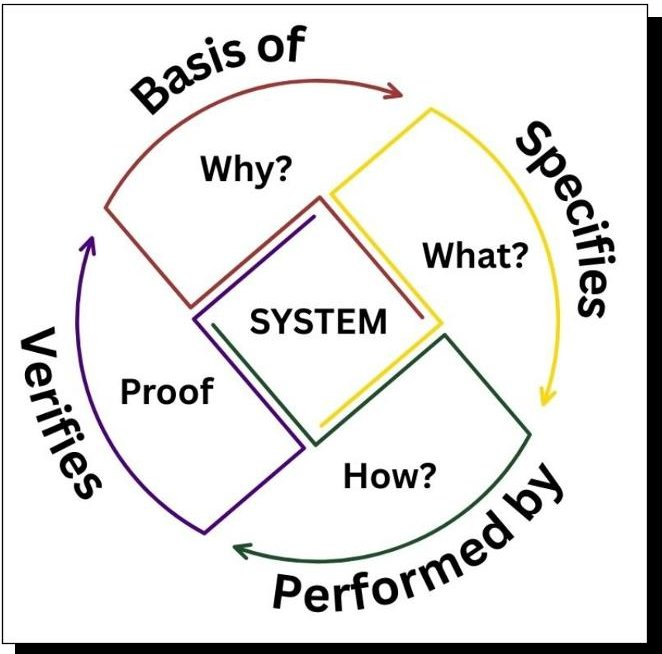

Figure 2.7: CSDL architecture framework [28].

<!-- PDF_PAGE: 18 -->

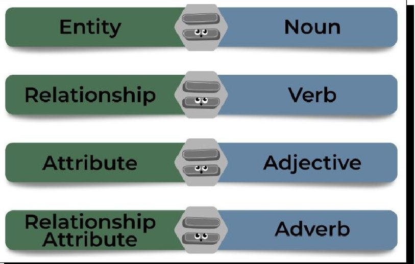

Figure 2.8: CSDL ERA mapping to natural language.

## 2.1.5 Lifecycle Modeling Language (LML) v2.0

The LML is an open-standard modeling language that supports the full product lifecycle and incorporates necessary functions, such as requirements, risk, and project management [29]. Supported by the Lifecycle Modeling Organization (LMO), LML leverages data-driven engineering into a standard that satisfies the following SE needs:

- Easy to understand

- Easy to extend

- Supports functional and object-oriented approaches

- Useful for stakeholders across the system lifecycle

- Supports all project lifecycle stages from concept to disposal

LML implementation seeks to address discrepancies inherent to modeling languages that were created without a foundational ontology. With the goal of overcoming complexities introduced by other industry standards, LML focuses on limited views that represent functional, physical, and traceability aspects of the system [30]. These fundamental concepts are decomposed to provide further detail of the solution architecture. The metamodel is constructed in alignment with the LML v2.0 specification, including the classes, their definitions, and the relationships between them. Fig. 2.9 shows a fragment of the relationships between the core LML classes.

<!-- PDF_PAGE: 19 -->

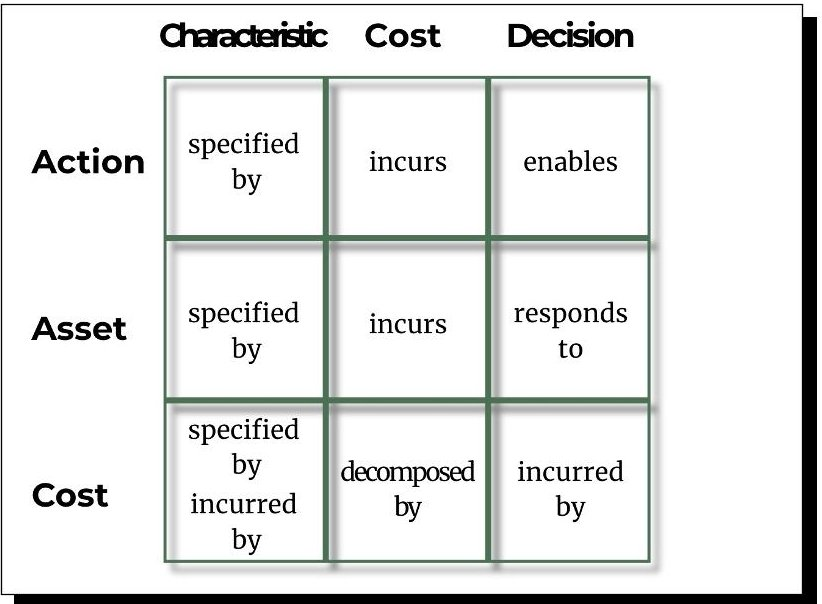

Figure 2.9: Fragment of LML classes and relationships [30].

The syntax in Fig. 2.9 shows SPO relationships for LML, with the row as the subject, the column as the object, and the grid intersection as the predicate. For example, an "Action incurs Cost". Without viewing the entire matrix, it is deduced that the inverse predicate reads as "Cost is incurred by Action". By adhering to this method, LML is simplified to address complex SE architecting.

## 2.1.6 SE DSML Limitations

System design efforts develop their own language over time because of the necessity to clearly communicate atypical concepts with graphical notations used to enhance textual styles [28] [31]. Although these generic languages facilitate communication within a single model, extending the profiles without a proper semantic definition increases the potential for misunderstanding between projects. Model constraints must be consistently applied to maintain interoperability of basic terminology [32]. Currently, there is little consideration for developing and reusing DSMLs across disparate modeling projects and platforms.

## 2.2 Ontologies

An ontology is an explicit specification of a common language described by a set of representational terms that are also defined as concepts, relations, attributes, and hierarchies present in a

<!-- PDF_PAGE: 20 -->

specific domain [33] [34]. Ontologies are logical theories encoded using knowledge representation languages [35]. They provide a way to achieve interoperability among digital information systems since they define natural language in a machine-readable format [36] [37]. To accurately exchange information, each entity and associated relationship must be identified and explicitly defined [38]. Every entity defined by a formal ontology is studied by multiple disciplines, which contributes to the challenges of defining object-specific transformations as an extension of the model [39]. The interdisciplinary nature of adopting a modeling approach creates language barriers between stakeholders [40]. A unanimous understanding of shared terminology assists in resolving these semantic obstacles. The formalization of ontologies emphasizes the machine-readable structured repository [41]. Additionally, ontologies include concept definitions that indicate domain structure and constrain possible interpretations of the language [33]. Modern ontologies aim to clarify domain-specific information structures, enable the reuse of domain knowledge, and systematically analyze this knowledge [42]. Figure 2.10 shows the concept of nodes and edges.

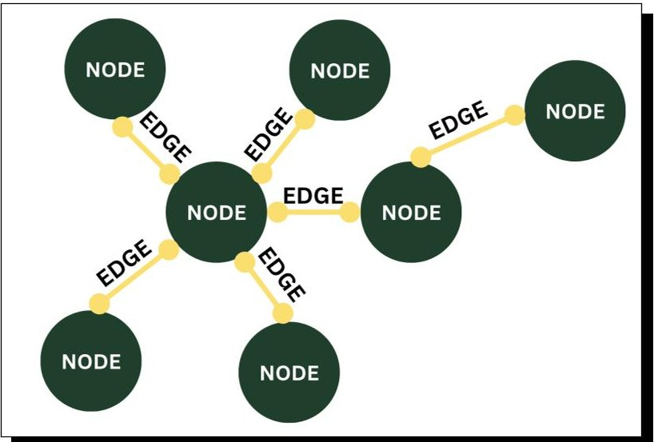

Figure 2.10: Ontological concept of nodes and edges.

Ontologies are viewed as the interface between the knowledge base and reality that guides information shareability, acquisition, and organization while improving the common understanding of DSMLs [43] [44]. As the primary component of the semantic web, reasons for ontology development include [45] [46]:

<!-- PDF_PAGE: 21 -->

- Create a common understanding

- Enable reuse of domain knowledge

- Define domain assumptions

- Analyze domain knowledge

A critical aspect of ontologies is the ability to execute data reasoners that produce semantic relationships, which is made possible with first-order logic (FOL) [47]. Formalized ontologies consist of classes, relations, and axioms [48]. The following inputs are required to generate an ontology [49]:

- Concept semantics

## Triple candidates

Ontologies are used for many different purposes [50]; however, they are prominent in the biomedical field, as exemplified by more than 700 biomedical ontologies published and governed by the Open Biological and Biomedical Ontology (OBO) Foundry. Figure 2.11 shows an example of the Beta Cell Genomics Ontology (BCGO) within a concept model.

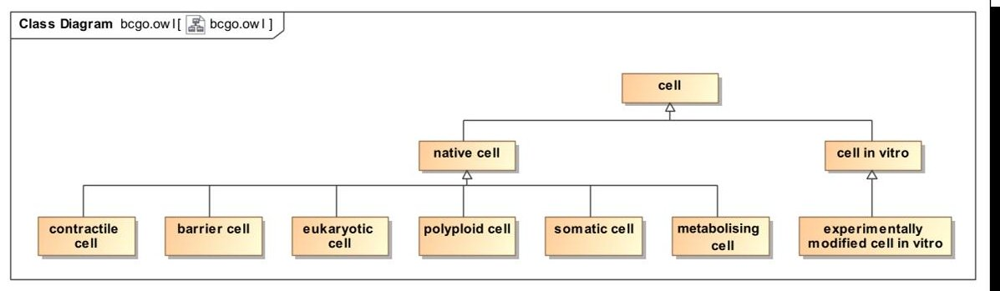

Figure 2.11: Class diagram representing the BCGO subtypes of "cell".

To meet BCGO ontology requirements, the following applications must be achievable [51]:

- Data annotation

- Data queries

- Automated classification

This contribution to the OBO Foundry community supports its principles for constructing ontologies.

<!-- PDF_PAGE: 22 -->

## 2.3 Semantic Web

The semantic web is an extension of the current World Wide Web where information is given well-defined meaning to enable people and machines to work collaboratively [52]. The Basic Formal Ontology (BFO) was developed and designed to categorize common themes in DSMLs [53]. This specification is the basis for modern ontology languages and captures representational primitives such as classes, attributes, and axioms [54]. BFO gives structure to domain-specific ontologies (DSO) and is comprised of:

1. Continuants - entities that continue or persist through time,

2. Occurrents - the events in which continuants participate As a detailed example, Fig. 2.12 shows the composition of BFO continuants.

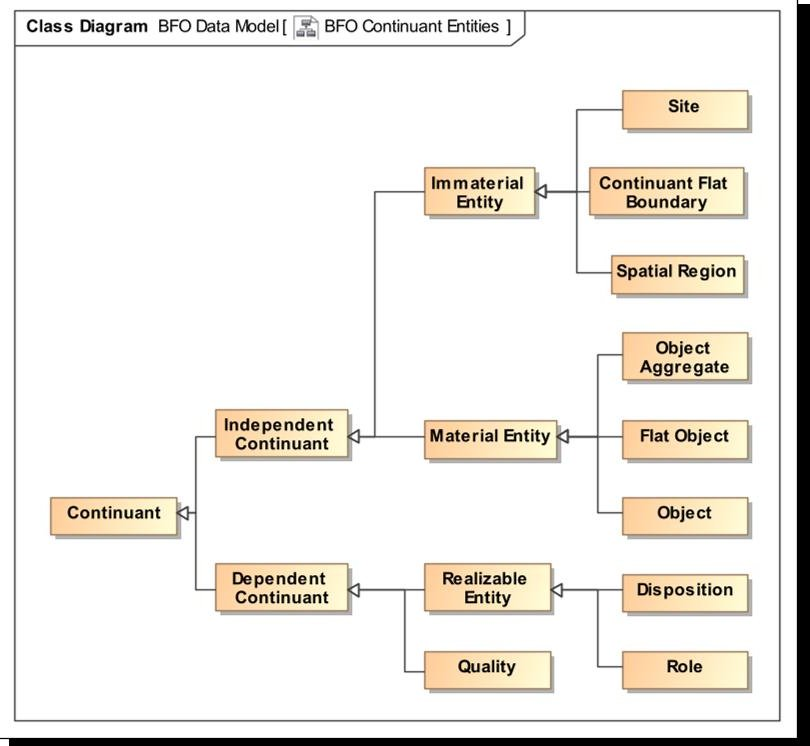

Figure 2.12: Composition of BFO continuants.

The Common Core Ontology (CCO) is a mid-level extension of BFO, designed to integrate taxonomies of generic classes and relations across all domains of interest [55] [56]. CCO is reusable across instances that provide vocabularies specific to a given domain's concepts, relationships, and activities [54]. Figure 2.13 shows a simplification of ontological layers.

<!-- PDF_PAGE: 23 -->

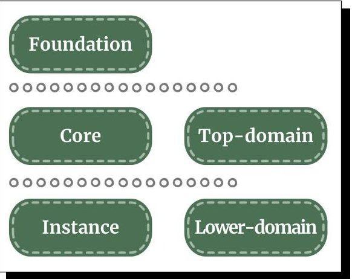

Figure 2.13: Ontological layers [57].

The Web Ontology Language (OWL) is a syntax-independent language that has several common representations [58]. According to the OWL specification developed by the World Wide Web Consortium (W3C), OWL ontologies map to Resource Description Framework (RDF) graphs and include annotations of classes and properties. OWL enhances both precision and accessibility, but it requires mediation to enhance model semantics and resolve conflicts [59]. RDF is used by all OWL syntaxes to provide a common approach for expressing information, which prevents data loss during exchanges [60]. Each entity is given a unique internationalized resource identifier (IRI) to ensure statements are machine-readable. Ontobee is the default server for many OBO Foundry ontology IRIs [61]. In accordance with graph theory, subjects and objects are represented as nodes (i.e., vertices) while predicates are shown as paths (i.e., edges) between them [62]. RDF defines all data as triples composed of a subject, predicate, and object (SPO) [63]. Each triple represents a statement (i.e., fact) of a relationship between the subject and the object [64]. Figure 2.14 shows how the SPO approach aligns with a graph-based data model that uses nodes and edges to convey domain structure.

<!-- PDF_PAGE: 24 -->

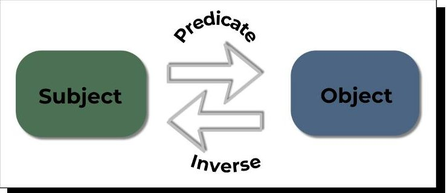

Figure 2.14: SPO data model for triples.

The concept of RDF graphs offers a flexible solution for modeling products and processes that has been proven useful for expressing SE information [38]. The eXtensible Markup Language (XML) represents formalized syntax, RDF defines vocabulary semantics, and OWL further extends this capability to domain knowledge. Figure 2.15 shows the relationship between OWL, XML, and RDF.

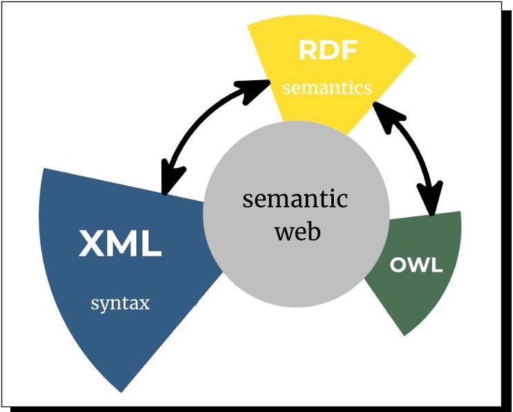

Figure 2.15: Overview of the semantic web.

The implementation of RDF instigates the need for validation constraints and an accompanying approach that determines semantic violations of language parameters [65]. The SPARQL Protocol and RDF Query Language (SPARQL) is used together with ontological information in the form of an RDF Schema or OWL axiom [66]. SPARQL queries are executed to calculate ontology metrics that are not automatically determined by the semantic reasoner. The Shapes Constraint

<!-- PDF_PAGE: 25 -->

Language (SHACL) specification was published by the World Wide Web Consortium (W3C) in 2017 to describe and validate RDF graphs with a standardized language to address limitations of linked-data structural constraints [67] [68].

## 2.3.1 Semantic Web and Reasoners

Semantic web concepts provide a more collaborative environment and often include mediator systems that federate and integrate data from disparate sources to elicit information that cannot otherwise be gathered [11] [69]. By applying heuristic rules to an ontology, semantic reasoners ensure logical consistency [48] [70]. The consistency tests construct data models for the knowledge base in accordance with description logic (DL) [71] [72]. DL supports semantic reasoners by formally defining domain-specific classes and relations in terms of concepts and roles [58] [73]. Reasoners query data repositories and leverage inference rules to derive ontological axioms and infer logical consequences. ELK v0.6.0 provides high-performance reasoning support for OWL ontologies with a focus on extensive coverage, extensibility, and use [74]. Pellet identifies, analyzes, and explains bugs within an OWL profile [75]. HermiT v1.4.3.456 supports all features of an OWL ontology and implements a classification algorithm that greatly reduces the number of consistency tests needed to compute class and property hierarchies [76]. By incorporating the "anywhere blocking" strategy, HermiT limits model size, which improves performance [71].

## 2.3.2 Ontology Engineering

Ontology engineering requires the definition and standardization of an ontology lifecycle along with methodologies and techniques that drive its development [77]. Figure 2.16 shows the lifecycle stages identified by [78].

<!-- PDF_PAGE: 26 -->

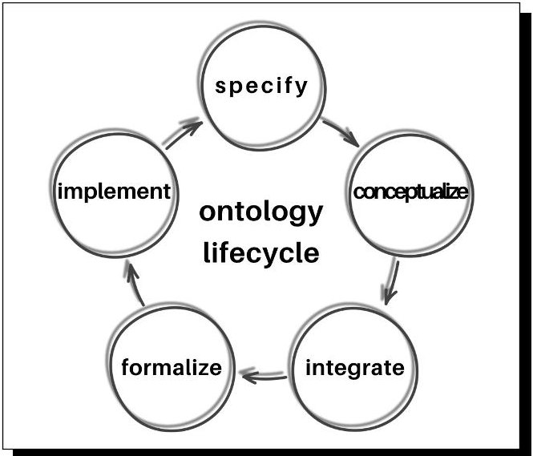

Figure 2.16: Ontology lifecycle stages [78].

## 2.3.3 Ontology Methodologies

Ontology refers to the shared understanding of some domain of interest, which may be used as a unifying framework [79]. These frameworks provide a way to represent, share, and manage domain knowledge through concept hierarchies, taxonomies, and relations [80]. A benefit of utilizing frameworks is that they are not attached to a particular language [81]. Although several ontology development approaches currently exist, there is no single correct method [82]. There are five (5) foundational constructs for domain-specific knowledge capture [83]:

- Classes - equivalent to an entity

- Properties - further describe attributes of classes

- Constraints - constrain the application of classes

- Axioms - sentences that are always true (i.e., facts)

- Instances - a single, concrete instantiation of a generic class

A systematic literature review concludes that METHONTOLOGY is the most mature method for ontology construction [45]. It is a structured approach that includes purpose, level of formality, and scope [78]. The METHONTOLOGY framework focuses on conceptualization with an objective to organize and structure knowledge with visual representations [84]. METHONTOLOGY phases, identified by [77], are shown in Fig. 2.17.

<!-- PDF_PAGE: 27 -->

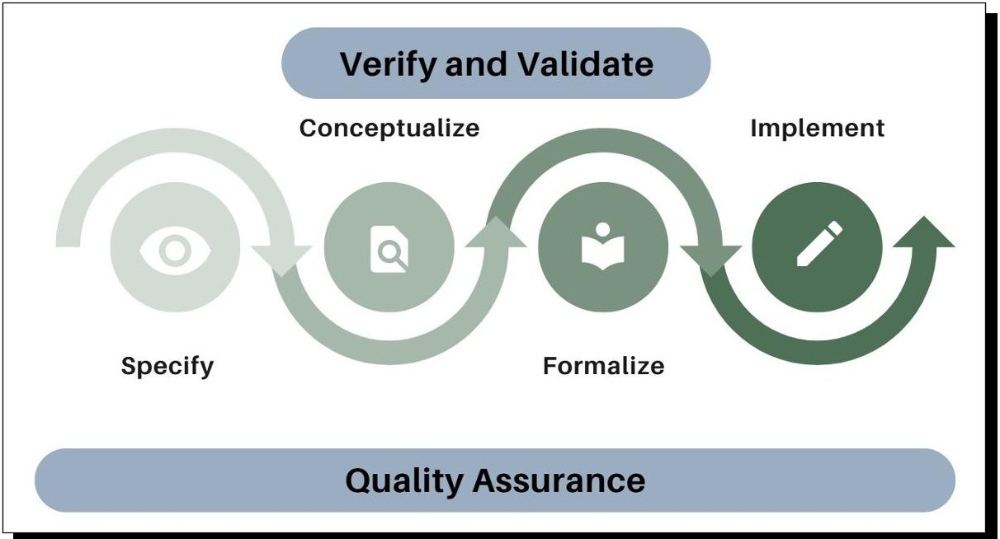

Figure 2.17: METHONTOLOGY life cycle phases [77].

The Linked Open Terms (LOT) ontology development guidelines address gaps in METHONTOL OGY by incorporating agile techniques. It builds on existing methodologies and is oriented toward semantic web development and technologies [85]. LOT is based on Linked Open Data (LOD) principles, which provide sets of semantically interlinked resources with defined meanings [86]. Due to its relative newness, there is limited research on the successful implementation of LOT. Figure 2.18 shows the four stages of LOT.

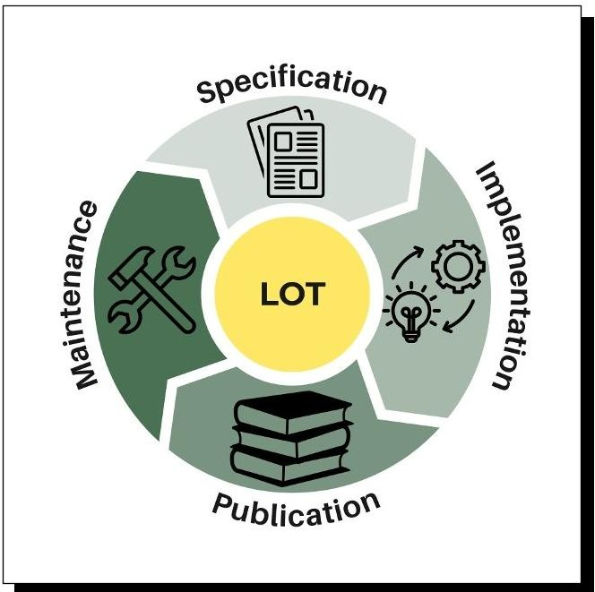

Figure 2.18: Four stages of LOT [85].

<!-- PDF_PAGE: 28 -->

NeON is a scenario-based ontology development methodology that addresses networks built collaboratively by distributed teams. The approach does not prescribe a rigid workflow and instead concentrates on knowledge reuse and dynamic evolution of networked ontologies [87]. NeON provides explicit direction for both project management and technical processes. It is described by multiple scenarios of ontology development that incorporate motivation, inputs, tools, techniques, and outputs for each use case [87]. Comparative analysis of ontology frameworks has touted NeON's capability to satisfy ISO 15288 project management and technical processes [4] [88]. Supporting activities of the NeON method are shown in Fig. 2.19.

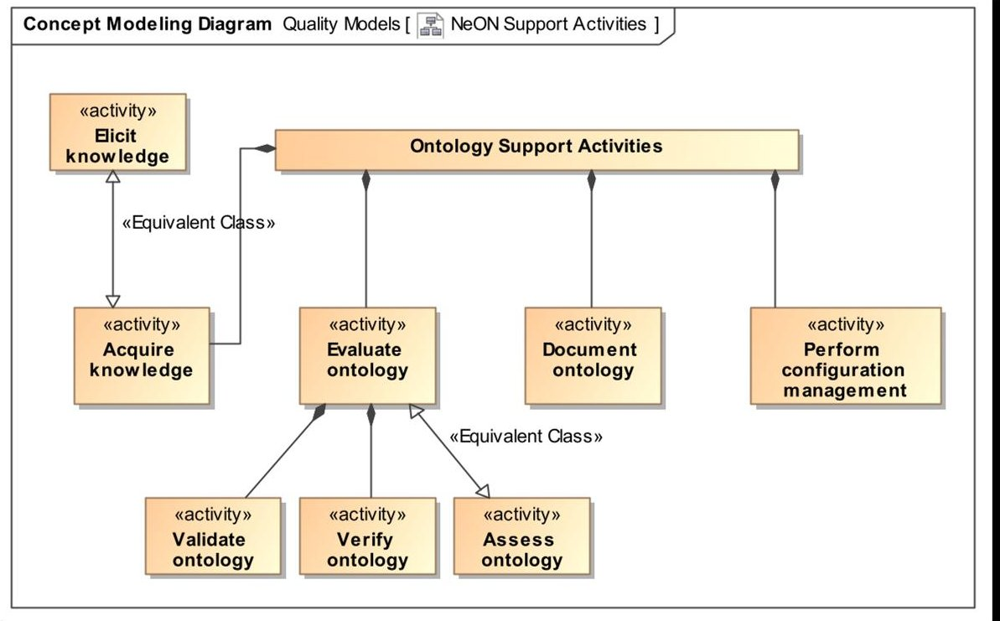

Figure 2.19: NeON method support activities and «Equivalent Classes».

## 2.3.4 Ontology Quality

Due to the complexity of ontologies, there is not a widely accepted foundation for the requirements, since verification is mostly subjective [89]. The metrics for a quality framework are vital to assess an ontology for reuse and performance [90]. These frameworks interpret measurements by associating results with quality dimensions [91]. Ontology quality affects collaboration between applications and domains [92]. Because of the flexibility of ontology construction, there is a need

<!-- PDF_PAGE: 29 -->

for dedicated evaluation metrics for performance that enable empirical assessment of ontologies instead of subjective opinions on effectiveness [91] [92] [93]. Determining the evaluation method for ontologies depends on the perspective of what needs to be considered [94]. The quality of an ontology can be determined by its degree of conformance to functional and non-functional requirements [95]. However, traditional qualitative and quantitative metrics are insufficient when assessing ontologies [42]. The purpose of ontology metrics is to assess and qualify an ontology [96]. Using ontologies without quality requirements might cause issues such as misunderstandings among people and software [97]. Necessary quality metrics include ontology content, correctness, identification, and reliability [92]. Selecting the proper parameters requires a deep understanding of the modeling goals and the logical foundations of the ontology guided by frameworks [91]. Methods that address ontology quality are summarized in Table 2.1.

Table 2.1: Methods to evaluate ontology quality.

<table border="1"><tr><td>Method</td><td>Description</td><td>Source</td></tr><tr><td>Forces of Change Assessment(FOCA)</td><td>An approach that utilizes goal quality metrics(GQM) for quantitative metrics based on the type of ontology being evaluated.</td><td>[98]</td></tr><tr><td>Full Ontology Evaluation(FOEval)</td><td>A methodology provides guidelines for product assessment throughout the system lifecycle.</td><td>[94]</td></tr><tr><td>OntoClean</td><td>A methodology for validating the adequacy of taxonomic relationships. OntoClean removes inaccurate links after checking for ontology inconsistencies and then organizes the information.</td><td>[92][99][100]</td></tr><tr><td>Ontology Quality Requirements and Evaluation(OQuaRE)</td><td>A general framework that applies aspects of ISO/IEC 25010:2023 to ontologies and demonstrates approaches for domain-specific needs.</td><td>[95]</td></tr><tr><td>OntoQA</td><td>A framework that evaluates ontology quality and its potential for knowledge representation</td><td>[101]</td></tr><tr><td>NeOntometric</td><td>A responsive, flexible, and scalable application with an inference engine based on HermiT to calculate quantitative metrics.</td><td>[91]</td></tr><tr><td>Semiotic Quality</td><td>A metric set derived from the theory of semiotics to assess syntactic, semantic, and pragmatic qualities of an ontology.</td><td>[102]</td></tr></table>

The remainder of this section details a select group of methodologies for evaluating ontology quality based on their relevance to the present research. Figure 2.20 shows the ten (10) quality aspects

<!-- PDF_PAGE: 30 -->

derived from the theory of semiotics that assess the syntactic, semantic, pragmatic, and social qualities of an ontology. These aspects answer the questions posed in Fig. 2.21.

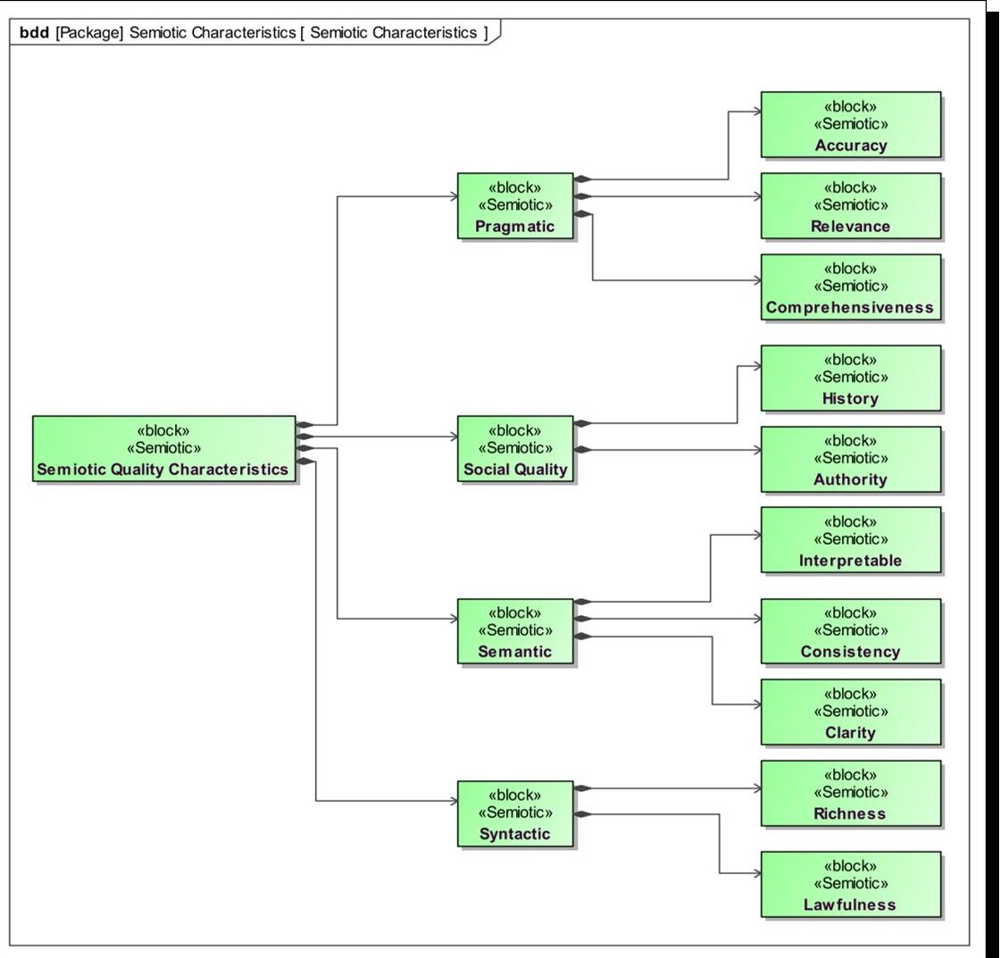

Figure 2.20: SysML block definition diagram (BDD) for semiotic quality aspects.

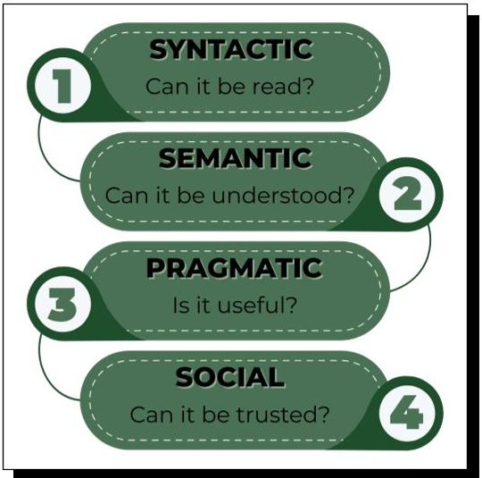

Figure 2.21: Semiotic quality aspects.

<!-- PDF_PAGE: 31 -->

Semiotics is a method of textual analysis that involves the theory of how things are signified through representational practices and systems [103]. This field also studies the graphical representations that convey the meaning of a DSML via interpretation mapping [104]. Definitions of the semiotic quality characteristics are shown in Fig. 2.22.

<table border="1"><tr><td>#</td><td>Name</td><td>Documentation</td></tr><tr><td>1</td><td>Accuracy</td><td>Accuracy of information</td></tr><tr><td>2</td><td>Authority</td><td>Extent to which other ontologies rely on it</td></tr><tr><td>3</td><td>Clarity</td><td>Average number of word senses</td></tr><tr><td>4</td><td>Comprehensiveness</td><td>Number of classes and properties</td></tr><tr><td>5</td><td>Consistency</td><td>Consistency of meaning of terms</td></tr><tr><td>6</td><td>History</td><td>Number of times ontology has been used</td></tr><tr><td>7</td><td>Interpretable</td><td>Meaningfulness of terms</td></tr><tr><td>8</td><td>Lawfulness</td><td>Correctness of syntax</td></tr><tr><td>9</td><td>Relevance</td><td>Relevance of information for a task</td></tr><tr><td>10</td><td>Richness</td><td>Breadth of syntax used</td></tr></table>

Figure 2.22: Definition of semiotic quality characteristics.

The syntactic level considers accuracy, conciseness, operability, consistency, integrity, and completeness as data quality dimensions, while semantics are concerned with credibility, interpretability, and understandability [104]. For a DSML to express true meaning, semantics must be established prior to defining syntax; otherwise, an element may not be suitable to properly implement semantics [19]. The Ontology Quality Requirements and Evaluation (OQuaRE) method defines elements required for ontology evaluation support, processes, and metrics, and provides linkages to quality dimensions such as reliability, operability, maintainability, compatibility, transferability, and functional adequacy as shown in Fig. 2.23 [95] [42] [91]. OQuaRE "maintainability" sub-characteristics are defined in Fig. 2.24 as an example. Figure 2.25 shows the equations that calculate OQuaRE "maintainability" sub-characteristic values.

<!-- PDF_PAGE: 32 -->

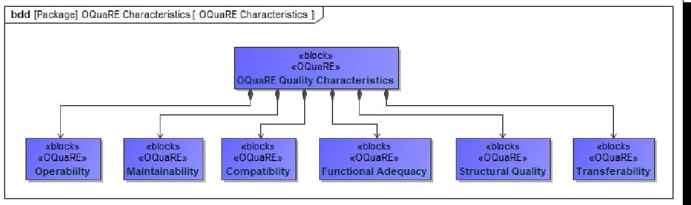

Figure 2.23: OQuaRE quality characteristics [95].

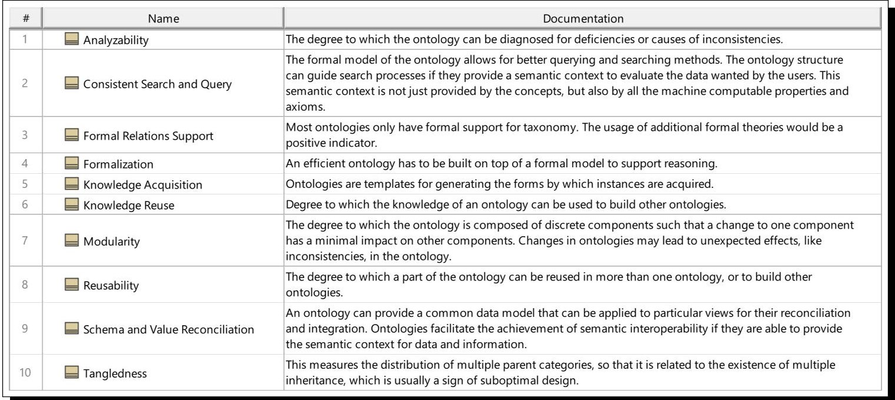

Figure 2.24: OQuaRE "maintainability" sub-characteristics [95].

<!-- PDF_PAGE: 33 -->

<table border="1"><tr><td>#</td><td>△ Name</td><td>Quality Equation</td><td>Quality Subcharacteristic</td></tr><tr><td>1</td><td>CBO</td><td>{} CBO = subClasses / (classes - superClasses)</td><td>AnalyzabilityReusabilityTestabilityChangeabilityModification StabilityModularity</td></tr><tr><td>2</td><td>DIT</td><td>{} DIT = max(lengthToRootClass)</td><td>ReusabilityAnalyzabilityTestabilityChangeability</td></tr><tr><td>3</td><td>LCOM</td><td>{} LCOM = nonCohesiveClasses / cohesiveClasses</td><td>TestabilityAnalyzabilityChangeabilityModification Stability</td></tr><tr><td>4</td><td>NOC</td><td>{} NOC = subclasses / classes</td><td>Modification StabilityChangeability</td></tr><tr><td>5</td><td>NOM</td><td>{} NOM = dataProperties / classes</td><td>ChangeabilityReusabilityAnalyzabilityTestability</td></tr><tr><td>6</td><td>RFC</td><td>{} RFC = (dataProperties + superClasses) / classes</td><td>AnalyzabilityReusabilityModification StabilityTestabilityChangeability</td></tr><tr><td>7</td><td>WMC</td><td>{} WMC = (dataProperties + objectProperties) / ontolo...</td><td>Modification StabilityChangeabilityTestabilityAnalyzabilityReusabilityModularity</td></tr></table>

Figure 2.25: OQuaRE "maintainability" sub-characteristic constraints.

Each OQuaRE quality characteristic receives a score dependent on the associated sub-characteristic metrics [105]. Another approach, OntoQA, proposes several metrics to measure the ontology, its specific classes, instances, and relations as shown in Fig. 2.26 [91]. This method provides users with valuable metrics to assess whether the ontology should be used as an authoritative source of information [42]. Figure 2.27 shows the mathematical expressions for each OntoQA aspect.

<!-- PDF_PAGE: 34 -->

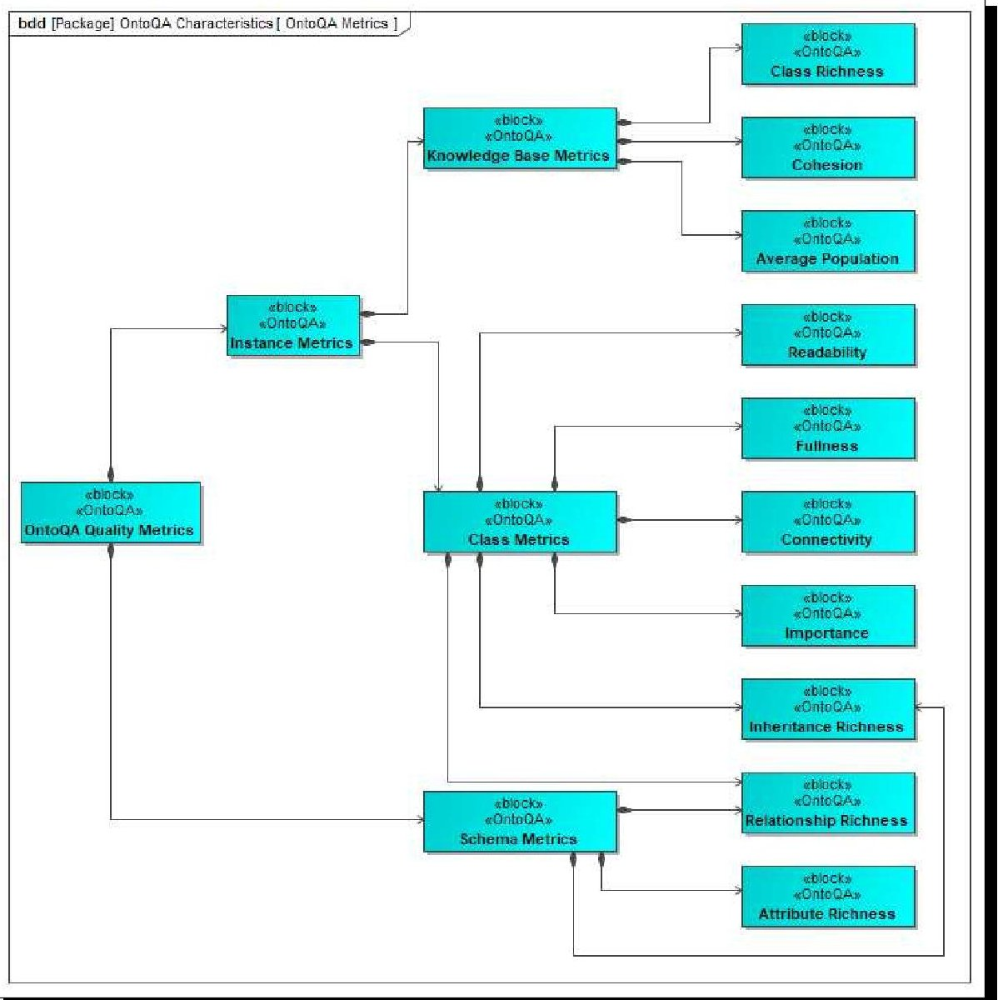

Figure 2.26: OntoQA metrics for evaluating ontology quality.

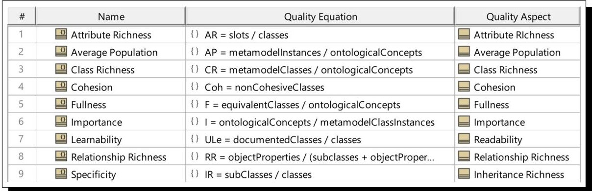

Figure 2.27: OntoQA constraints for evaluating ontology quality.

<!-- PDF_PAGE: 35 -->

## 2.3.5 SE Ontology

Research determines that ontologies benefit the SE discipline by providing a uniform and consistent basis for representing MBSE metamodels [106]. The method of inspecting "fragments" of processes described by several international standards and represented as flow diagrams moves towards an SE ontology, as shown in Fig. 2.28 [38]. Predicate triples are read in this example as a "port supports an interaction". However, many of these relationships lack inverse predicates.

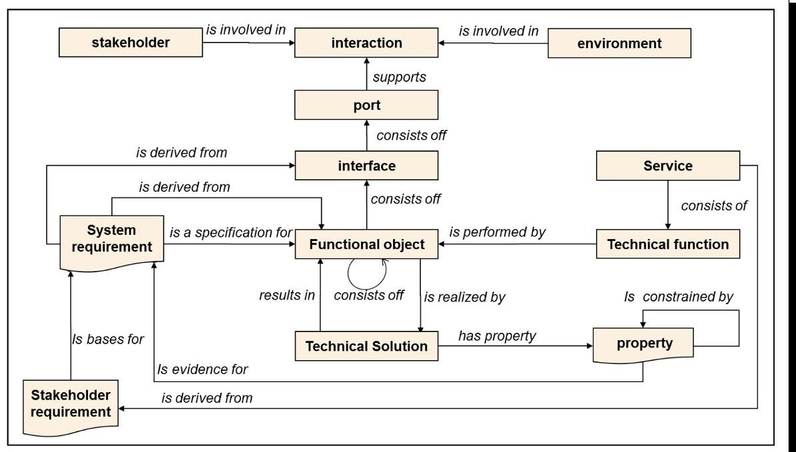

Figure 2.28: Example SE DSO "fragment" [38].

More recently, the case of an ontology that is based on ISO 15288:2023 using the Object Process Methodology (OPM), outlined in ISO 19450:2015 to balance SE processes [107] [108]. Figure 2.29 shows an Object Process Diagram (OPD) for the agreement processes outlined in ISO 15288 [4].

<!-- PDF_PAGE: 36 -->

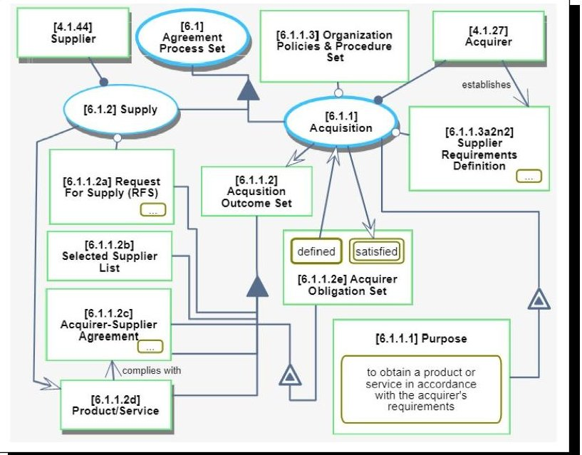

Figure 2.29: OPM example of ISO 15288 agreement processes [107].

An important consideration when constructing an ontology is the corpus on which it is built. The corpus is a reference document that represents domain knowledge and is used to evaluate the adequacy of ontological concepts [109]. Key quality characteristics regarding the relationships between the corpus and ontology include completeness and semantic consistency [36]. Although it is impossible to validate ontological completeness, the originating corpus should be evaluated in an objective way [87] [110]. Part-of-speech (POS) tagging is a grammatical classification used in natural language processing (NLP) to identify individual words as nouns, adjectives, verbs, etc [111]. An NLP token is a group of characters (i.e., a string) that represents a single meaning using the core processes shown in Fig. 2.30. The Natural Language Toolkit (NLTK) within Python is a platform that works with human-interpretable language libraries that support tokenization, parsing, and semantic reasoning [112].

<!-- PDF_PAGE: 37 -->

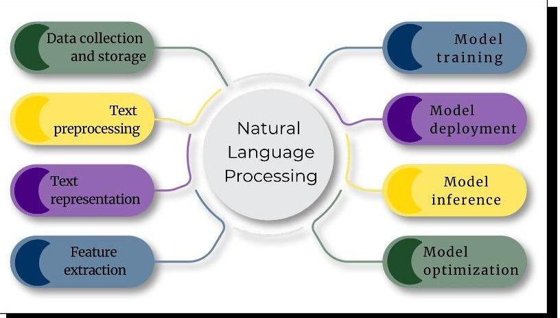

Figure 2.30: NLP processes.

## 2.4 Concept Models

A concept model describes an entity and the connections between constructs to improve domain understanding, enabling stakeholder communication [113] [114] [115]. They contain the critical information needed for organizational processes and knowledge management while providing a solid foundation for the design and implementation of systems [116] [117]. As formal descriptions of application domains that are used in the early stages of system development, concept models represent the structure that clarifies a language metamodel [118] [119]. Fig. 2.31 demonstrates the process of mapping concepts to DSOs and then to DSMLs.

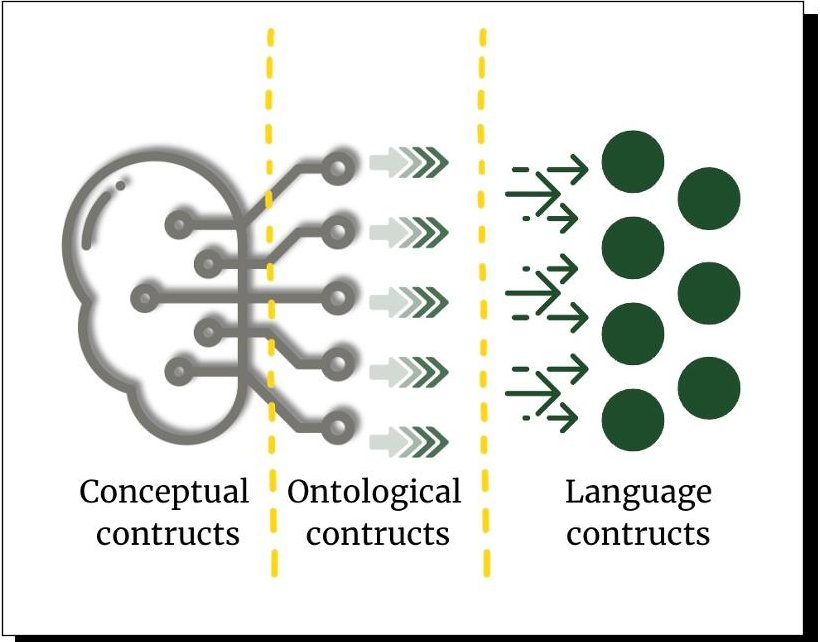

Figure 2.31: Rendering of concept model mapping [113].

<!-- PDF_PAGE: 38 -->

Concept modeling is the primary activity required for systems to be understood, designed, and managed [12]. They express DSML metamodels as high-level abstractions that enable stakeholder communication [79] [115]. Concepts may have either exact matches, similar meanings, or disjointedness [120]. Unlike ontologies, concept models are not meant to be complete descriptions of a domain [113]. While ontologies define terms that represent knowledge, a concept schema is restricted to defining relations between classes [33]. However, ontologies have proven to be an excellent basis for building concept models [117]. Ontology concept models describe the problem and solution in terms of domain vocabulary and are organized by taxonomies [78] [54]. These models are high-level abstractions that enable stakeholders to communicate with each other [115]. Within the context of ontology development, the concept model represents the structure that clarifies a DSML metamodel [119].

## 2.5 Metamodels

Metamodels are models that consist of statements about models [121]. Modeling languages represent a formalized ontology (i.e., internal logic) used to capture and connect relationships, along with the standards that facilitate data sharing between tools [29]. Metamodels describe the concepts of a DSML, the relationships between abstractions, and the rules that constrain model elements [122]. To represent domain concepts, concrete syntax within the metamodel must be carefully chosen [123]. A key issue with metamodels is the lack of application to engineering domains and methodology concepts [32]. Although metamodels define an infrastructure for managing information and interface specifications, they are an underdeveloped area that needs a means to establish coherency and consistency [32] [124]. The lack of available methods for metamodel development leads to unreliable and inaccurate results that are propagated downstream [125]. Metamodels embody a set of entities and the interaction rules between them that define DSMLs and all valid instances of them [126] [127] [128]. They capture the syntax for a set of models and allow users to design systems at a higher level of abstraction [129]. Metamodeling is a widely applied technique in the construction of DSMLs to constrain the semantics of all instantiations [123].

<!-- PDF_PAGE: 39 -->

Figure 2.32 shows the relationship between layers of modeling abstractions. Table 2.2 describes the metamodel layers of abstraction in relation to a model [130].

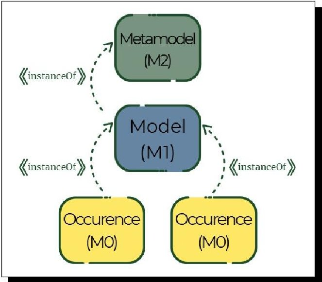

Figure 2.32: Instantiations of a model [32].

Table 2.2: Metamodel modeling layers of abstraction.

<table border="1"><tr><td>Level</td><td>Content</td><td>Explanation</td><td>Typical Items</td></tr><tr><td>M3</td><td>Meta-metamodel</td><td>A metamodel defining how metamodels on level M2 should be designed.</td><td>Metaclasses</td></tr><tr><td>M2</td><td>Metamodel</td><td>A metamodel defining how models on level M1 should be designed.</td><td>Metaclasses</td></tr><tr><td>M1</td><td>Model</td><td>A model defining executable model instances on level M0.</td><td>Classes</td></tr><tr><td>M0</td><td>Instantiation of a model</td><td>An executing instance of a model on level M1.</td><td>Objects</td></tr></table>

Specifying a DSML in a metamodel includes defining the abstract syntax, concrete syntax, wellformedness rules, and semantics [19]. During DSML development, the core linguistics are specified within the metamodel, and the foundational concepts for expressing a DSML are defined by establishing the abstract syntax using the Meta-Object Facility (MOF) standard [131] [41] [132]. Ontological metamodeling is concerned with describing what concepts exist in a certain domain

<!-- PDF_PAGE: 40 -->

along with their properties [121]. The ontological meaning of the metamodel can be mapped to concrete descriptions of the vocabulary [133].

## 2.5.1 Metamodel Modeling Languages

The MOF standard provides a basis for metamodel definitions and adds model management capabilities [131]. It assists designers in capturing the concepts of a DSML while expressing the importance of metamodels in forming valid models [134]. Central to metamodeling with MOF is the capability to describe models of various levels of abstraction that enable model transformations, but it does not precisely specify metamodel semantics [123] [135]. Figure 2.33 shows a subset of MOF metaclasses.

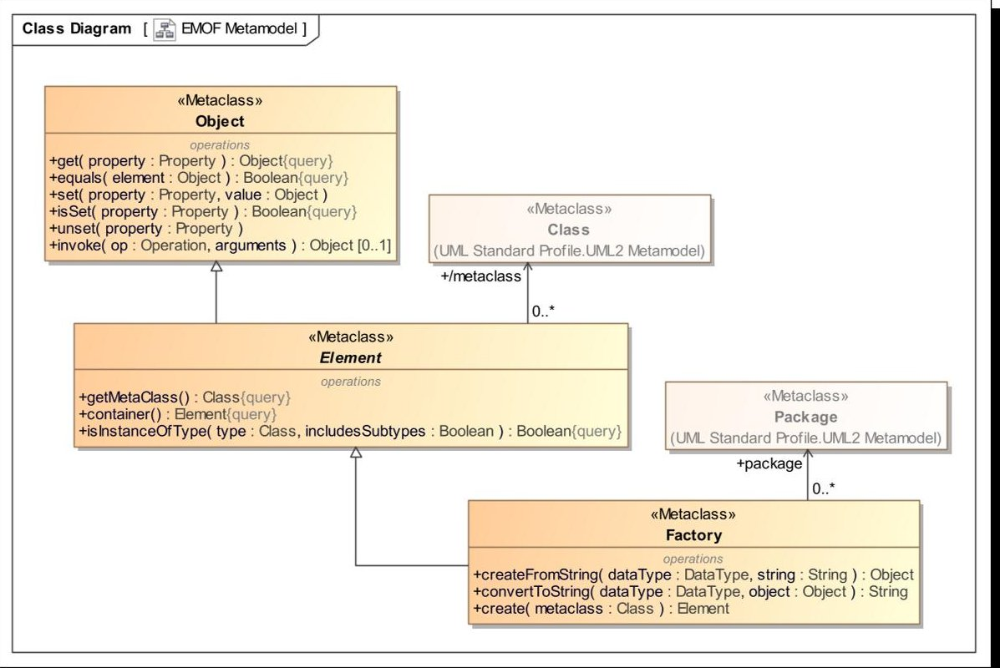

Figure 2.33: Subset of MOF metaclasses within a profile [131].

The Essential MOF (EMOF) makes use of the minimal set of elements required to model systems by reusing the UML metamodel for structure without any extensions, but includes additional constraints used with the Object Constraint Language (OCL) [131]. OCL is a declarative GPML that defines several kinds of expressions to complement the information in UML models [136]. Its semantics

<!-- PDF_PAGE: 41 -->

are based on formal metamodeling specifications that enforce various structural features such as multiplicities and allowable associations [129] [137]. Fig. 2.34 shows the EMOF constraints written with OCL.

<table border="1"><tr><td>#</td><td>Name</td><td>Specification</td><td>Constrained Element</td></tr><tr><td>1</td><td>LimExportableElementsAssoc</td><td>self.memberEnd->exists(e|not(e.owner=self))</td><td>Association</td></tr><tr><td>2</td><td>LimExportableElementsAssoc</td><td>self.memberEnd->forAll(me|not(me.owner=self))impliesme.owner.ocllsKindOf(Class))</td><td>Association</td></tr><tr><td>3</td><td>LimExportableElementsAssoc1</td><td>self.memberEnd->forAll(me|not(me.owner=self))implies(me.type.ocllsKindOf(Class)orme.type.ocllsKindOf(PrimitiveType)orme.type.ocllsKindOf(Enumeration))</td><td>Association</td></tr><tr><td>4</td><td>LimExportableElementsGeneral</td><td>self.general.ocllsKindOf(Class)和self.specific.ocllsKindOf(Class)</td><td>Generalization</td></tr><tr><td>5</td><td>LimExportableElementsOper</td><td>self.owner.ocllsKindOf(Class)</td><td>Operation</td></tr><tr><td>6</td><td>LimExportableElementsProp</td><td>self.owner.ocllsKindOf(Class)orself.owner.ocllsKindOf(Association)</td><td>Property</td></tr><tr><td>7</td><td>NonExportableElementsConstr</td><td>let e:Element=selfinfalse</td><td>Constraint</td></tr><tr><td>8</td><td>NonExportableElementsDType</td><td>self.ocllsKindOf(PrimitiveType)orself.ocllsKindOf(Enumeration)</td><td>DataType</td></tr><tr><td>9</td><td>NonExportableElementsElemIm</td><td>let e:Element=selfinfalse</td><td>ElementImport</td></tr><tr><td>10</td><td>NonExportableElementsExpr</td><td>let e:Element=selfinfalse</td><td>Expression</td></tr><tr><td>11</td><td>NonExportableElementsOpExpr</td><td>let e:Element=selfinfalse</td><td>OpaqueExpression</td></tr><tr><td>12</td><td>NonExportableElementsPkgIm</td><td>let e:Element=selfinfalse</td><td>PackageImport</td></tr><tr><td>13</td><td>NonExportableElementsPkgMrg</td><td>let e:Element=selfinfalse</td><td>PackageMerge</td></tr></table>

Figure 2.34: EMOF constraints.

Created with the intention of constraining UML, OCL is often considered the default language for metamodel queries [10]. However, it has been considered unreliable for the level of rigor that testing a metamodel requires [125]. As opposed to pattern constructs, OCL constraints do not affect core mechanisms, such as storage structure, referential integrity, and automatic layout [138].

An instance of MOF, the XMI model has the potential to transform system models without the constraint of UML, enabling it to cover a wide range of DSMLs [139]. Although it describes a formal syntax, XMI allows individuals to define and use their own tags; however, the language lacks a built-in mechanism to convey the meaning of these additional tags to other users, making it difficult to verify the reliability of output files [52] [140].

<!-- PDF_PAGE: 42 -->

## 2.5.2 Design Patterns (DP)

Design patterns (DP) are derived from architecture principles with the objective of identifying recurring behaviors and systematically classifying them [141] [142]. They describe common themes among object-oriented processes that are applicable to several domains, encapsulating ubiquitous design decisions and solutions that are customized to address distinct organizational needs [143] [144] [145]. Identifying patterns facilitates communication by describing trade-offs and fosters the reuse of knowledge. Although DSMLs are designed for specific domains, there are DPs that represent common features and challenges of a respective metamodel that are modified for reuse by similar design efforts [142] [146]. With the proliferation of DSMLs, there is a need for domain-specific DPs that offer solutions to recurring problems across domains. The Role-Based Metamodeling Language (RBML) is a specification that identifies and specifies domain-specific DPs [138]. It defines a structure of roles, where a role specifies properties that model elements must have to conform to that role. Each role is associated with a UML class, called the base [128].

## 2.5.3 Metamodel Profiles

A《Profile》is a specialized《Package》within a modeling project that contains reusable《Stereotypes》to extend a language and address domain-specific concerns [147]. Customized validation rules within the MBSE tool have been proven to reduce errors and improve model quality by checking for accuracy and consistency [148]. A《ValidationSuite》allows OCL constraints to be applied and automatically validates whether a DSML is compliant. The inclusion of a《MetricSuite》 is another way to determine basic metrics about a model. These are often driven by validation rules or created with structured expressions (i.e., model queries). The Metamodeling Validation 《Profile》is intended to validate metamodels against the applied rules. Johns Hopkins Applied Physics Lab (APL) built a tool for metamodel validation - Object Recognition for Compliance, Usability, and Sustainment (ORCUS) - that validates metamodel compliance using a rule set within a《Profile》meant to mitigate the tedious task of manually reviewing them [149]. Although ORCUS

<!-- PDF_PAGE: 43 -->

supplies documentation for the majority of the stereotypes, it lacks validation rules that ensure DSML compliance. Fig. 2.35 defines validation rules within the ORCUS profile.

<table border="1"><tr><td>#</td><td>Name</td><td>Metaclass</td><td>Documentation</td></tr><tr><td>1</td><td>ORCUS_AtLeastOneRelationship</td><td>Element</td><td>Use when connecting multiple relations to an individual presentation element and the existence of any of the relations satisfy the model requirement. Multiple existences of these relations are allowed, but if none are present then this is violated. [1,inf] is compliant.</td></tr><tr><td>2</td><td>ORCUS_CustomRule</td><td>Element</td><td>Use this for more complex rules. This allows specifying more exact number of relationships(to types or quantity of relationships) on an element. This ORCUS rule stereotype requires use of additional properties(tagged values) to define the rule.</td></tr><tr><td>3</td><td>ORCUS_Entity_Rule</td><td>Element</td><td></td></tr><tr><td>4</td><td>ORCUS_OnlyOneRelationship</td><td>Element</td><td>Use when connecting multiple relations to an individual presentation element and multiple existences of these relations are NOT allowed or to define that only one of a certain relation is allowed on this element type. If more than one relation is present, then this is violated; note that having none of the defined relations is considered compliant.([0,1] is compliant.)</td></tr><tr><td>5</td><td>ORCUS_Parent_Rule</td><td>Element</td><td>This stereotype does not get applied to model elements. This serves as the central source of ORCUS stereotype attributes such as RuleName that gets inherited by the other ORCUS stereotypes.</td></tr><tr><td>6</td><td>ORCUS_ProhibitedRelationship</td><td>Relationship</td><td>This relation with this source to this target is expressly prohibited. This does not prohibit the use of this relation with other source/target combinations.</td></tr><tr><td>7</td><td>ORCUS_ProhibitedRelationshipOnClass</td><td>Element</td><td>The specific combination relationship type, corresponding element on the other end of the relationship,and relationship direction is specifically prohibited. This does not limit the use of the relationship type on this element in other configurations(including use with other elements or opposite direction of the relationship).</td></tr><tr><td>8</td><td>ORCUS_Relationship_Rule</td><td>Element</td><td></td></tr><tr><td>9</td><td>ORCUS_RelationshipConstraint</td><td>Relationship</td><td>This relationship can only be used with the element types and orientation that this relationship defines.If this is used for multiple relationships of the same type then all defined combinations and orientations are allowed.</td></tr><tr><td>10</td><td>ORCUS_RequireAllRelationships</td><td>Element</td><td>All relations that exist on this presentation are required for every use of this element and in the same orientation (source/target end).Multiple existences of this relation are allowed.</td></tr></table>

Figure 2.35: Definitions of ORCUS validation rules.

## 2.5.4 Metamodel Quality

This section discusses metamodel quality frameworks and their metrics. Since metamodels are prone to extensions and modifications, the main entities and relationships must be identified to ensure proper development [150]. Metamodel quality is defined as the degree to which it provides value for a modeling activity [151]. The schema for these concepts should have, at a minimum, the fundamental quality properties of syntactic and semantic correctness, relevance, and completeness [152]. However, integrating quality-based metrics for a metamodel is difficult due to conflicting criteria [153]. A metamodel must be built using technically sound principles and contain the elements necessary to adequately represent the domain elements [150]. Validating a metamodel that is utilized for creating a DSML is necessary to ensure high quality [154]. The

<!-- PDF_PAGE: 44 -->

Metamodel Quality Requirements (MQR) and Evaluation (MQuaRE) framework has five (5) quality characteristics and ten (10) sub-characteristics [151], which are then decomposed into quality properties, as shown in Fig. 2.36.

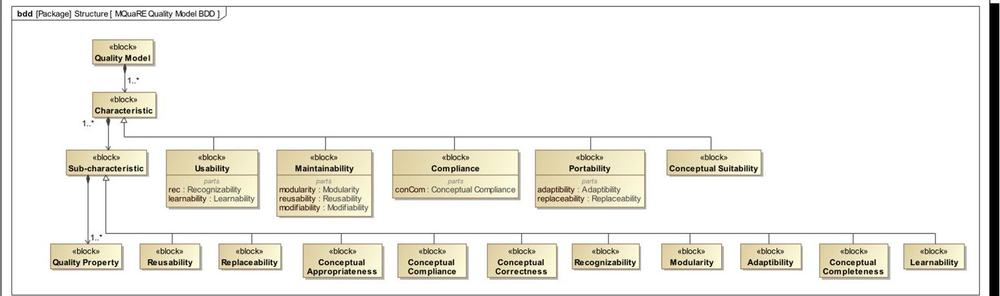

Figure 2.36: MQuaRE quality characteristics.

<table border="1"><tr><td>#</td><td>Name</td><td>Documentation</td></tr><tr><td>1</td><td>Adaptibility</td><td>The degree to which a metamodel can effectively and efficiently be adapted for different application domains.</td></tr><tr><td>2</td><td>Recognizability</td><td>The degree to which users can recognize whether a metamodel is appropriate for their needs or not.</td></tr><tr><td>3</td><td>Compliance</td><td>The degree to which a metamodel must comply with items, such as widely accepted and sound theories, regulations, standards, and conventions.</td></tr><tr><td>4</td><td>Conceptual Appropriateness</td><td>The degree to which the metamodel facilitates the accomplishment of modeling tasks, and for determining their adequacy for performing these tasks.</td></tr><tr><td>5</td><td>Conceptual Completeness</td><td>The degree to which the set of metamodel concepts covers all the specified requirements.</td></tr><tr><td>6</td><td>Conceptual Compliance</td><td>The degree to which the conceptual foundation of a metamodel complies with widely accepted and sound theories, regulations, standards, and conventions.</td></tr><tr><td>7</td><td>Conceptual Correctness</td><td>The degree to which the metamodel provides the correct modeling results with the needed degree of precision.</td></tr><tr><td>8</td><td>Learnability</td><td>The degree to which a metamodel can be used by specified users to achieve specified learning goals in a given context of use.</td></tr><tr><td>9</td><td>Maintainability</td><td>The degree of effectiveness and efficiency with which a metamodel can be modified by the intended maintainers.</td></tr><tr><td>10</td><td>Modifiability</td><td>The degree to which a metamodel can be effectively and efficiently modified without introducing inconsistencies or degrading existing metamodel quality.</td></tr><tr><td>11</td><td>Modularity</td><td>The degree to which a metamodel is composed of discrete concepts such that a change of one concept has minimal impact on other concepts.</td></tr><tr><td>12</td><td>Portability</td><td>The degree of effectiveness and efficiency with which a metamodel can be transferred from one application domain to another.</td></tr><tr><td>13</td><td>Replaceability</td><td>The degree to which a metamodel can replace another specified metamodel for the same purpose in the same application domain.</td></tr><tr><td>14</td><td>Reusability</td><td>The degree to which usage scenarios can be used in more than one metamodel.</td></tr><tr><td>15</td><td>Usability</td><td>The degree to which a metamodel can be used to achieve specific goals in a specified application domain.</td></tr></table>

Figure 2.37: MQuaRE quality characteristic descriptions.

<!-- PDF_PAGE: 45 -->

mmSpec is a testing framework used to verify metamodel quality metrics that are based on object-oriented design concepts [154]. Fig. 2.38 shows requirements derived from the mmSpec metrics and the constraints that satisfy each.

<table border="1"><tr><td>#</td><td>△Name</td><td>Text</td><td>Bounds</td><td>Satisfied By</td><td>Constraint</td></tr><tr><td>1</td><td>M-1</td><td>A class shall have a maximum of 10 attributes.</td><td>&lt;=10</td><td>Number of Properties</td><td>{}NOM=dataProperties/classes</td></tr><tr><td>2</td><td>M-2</td><td>A class shall reference five(5)or less classes.</td><td>&lt;=5</td><td>Ce:Real</td><td></td></tr><tr><td>3</td><td>M-3</td><td>A class shall be referenced by five(5)or less classes.</td><td>&lt;=5</td><td>Ca:Real</td><td></td></tr><tr><td>4</td><td>M-4</td><td>A metamodel hierarchy shall have five(5)or less levels of abstraction.</td><td>&lt;=5</td><td>Depth of Inheritance Tree</td><td>{}DIT=max(lengthToRootClass)</td></tr><tr><td>5</td><td>M-5</td><td>A class shall have ten(10)or less direct children.</td><td>&lt;=10</td><td>Number of Children</td><td>{}NOC=subclasses/classes</td></tr></table>

Figure 2.38: Requirements derived from mmSpec quality metrics.

Using these basic metrics, the metamodel instability is calculated using Eq. 2.1.

$$
I = \frac {C e}{C a + C e}
$$

where Ce is the efferent coupling determined by the number of outgoing dependencies of a class, and Ca represents the afferent coupling (i.e., incoming relationships) [155]. A class with a high instability rating is highly dependent on other classes, while one with low instability has little dependence on others [155]. The Best Fit $ ( R^{2} ) $ metamodeling approach was developed to create coherent and consistent views and to ensure conformance of a system model to the metamodel [32]. The sum of squared residuals (SSR), calculated by Eq. 2.3, represents the variance in the dependent variable that is not explained by the model.

- Coefficient of determination $ ( R^{2} ) $ - a statistical measure used to determine how well the independent variable(s) predict the dependent variable. The closer the value of $ R^{2} $ is to one (1), the better the model fits the data. Eq. 2.2 is used to calculate $ R^{2}. $

$$
R ^ {2} = 1 - \frac {S S R}{T S S}
$$

<!-- PDF_PAGE: 46 -->

The sum of squared residuals (SSR), calculated by Eq. 2.3, represents the variance in the dependent variable that is not explained by the model.

$$
S S R = \sum_ {i = 1} ^ {n} \left(y _ {i} - \hat {y} _ {i}\right) ^ {2}
$$

The total sum of squares (TSS), calculated by Eq. 2.4 represents the variance in the dependent variable.

$$
T S S = \sum_ {i = 1} ^ {n} \left(y _ {i} - \bar {y}\right) ^ {2}
$$

- Distribution - a function that shows how variables are distributed over a range of possible outcomes. This provides an understanding of the likelihood of individual results.

The Quality Model for Metamodels (QM4MM) framework is approach-agnostic and refines ISO/IEC 9126:2011 - Software Engineering — Product Quality processes based on specific metamodel attributes with the following key properties [122]:

- Cohesiveness - evaluates whether the information is related to a single domain, as calculated by Eq. 2.5 [135]

- Coupling - measures data structures and the degree of relatedness between classes, as calculated by Eq. 2.7 [156] [157]

- Correctness - assesses whether elements and the relationships between them are accurate. This determination requires the input of domain subject matter experts (SME)

- Consistency - determines whether classes have the same structure, format, and precision as measured by a semantic reasoner. This is conducted to verify the correct usage of OWL primitives [158]

- Conciseness - a metric that evaluates the relationship diversity, as calculated by Eq. 2.8 [101]

- Specificity - the extent to which the metamodel is general or specific, measured by the schema deepness, as calculated by Eq. 2.9 [101]

- Clarity - determines whether the context of terms is clear, as calculated by Eq. 2.10 [102] [159]

<!-- PDF_PAGE: 47 -->

- Learnability - ensures documentation is provided for each class, as calculated by Eq. 2.11 [151]

These metrics decompose the quality characteristics illustrated in Fig. 2.39. Figure 2.40 shows the relationships between QM4MM quality characteristics, the properties that define them, and the equations that measure them. This mapping demonstrates that the framework quality characteristics are allocated to the equations that are used to calculate each metric.

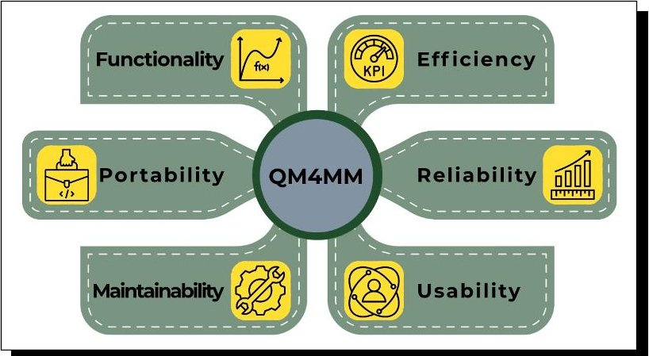

Figure 2.39: QM4MM characteristics

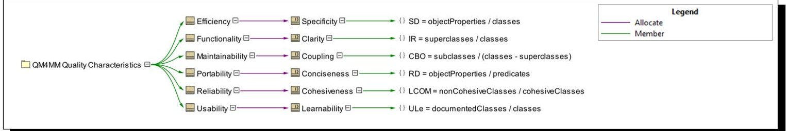

Figure 2.40: Mapping QM4MM quality characteristics.

Cohesiveness Originally a software measure, there have been a multitude of proposed metrics and frameworks to evaluate cohesion for systems, such as the ratio of cohesive interactions (RCI) and the lack of cohesion methods (LCOM), an inverse metric where a value closer to one (1) represents a low cohesion [135]. Cohesion describes the number of connected components that are in the metamodel to measure the independence of the elements [156]. A low LCOM value represents a metamodel with unrelated classes, while high cohesion is desirable due to the relatedness of

<!-- PDF_PAGE: 48 -->

classes [160]. This metric refers to the degree to which the elements in a model belong together, as calculated by Eq. 2.5 [161].

$$
L C O M = \frac {n o n C o h e s i v e C l a s s e s}{c o h e s i v e C l a s s e s}
$$

Cohesive classes share at least one attribute with another class as an inheritance property [135]. Non-cohesive classes are those without a superclass or subclass. These properties are disjoint; therefore, Eq. 2.6 is used to determine the number of cohesive classes. Because the LCOM value is an inverse quality metric, a result closer to zero (0) is desirable.

$$
cohesive Classes = classes - non Cohesive Classes
$$

Coupling The stronger the coupling between objects (CBO), the more difficult the data is to understand, change, and correct [162]. Therefore, a low value is desired to ease future updates. Eq. 2.7 shows the calculation used to determine coupling.

$$
C B O = \frac {s u b C l a s s e s}{(c l a s s e s - s u p e r C l a s s e s)}
$$

Superclasses have at least one (1) subclass, while subclasses are related to at least one (1) superclass. Borrowing from the OQuaRE evaluation criteria, the CBO should be within the acceptable range shown in Table 2.3, where a quality score of one (1) is not acceptable, three (3) is minimally acceptable, and five (5) is exceptional [156]. The quality result has been modified to define quality scores between two (2) and four (4) as acceptable. This means that any CBO value less than eight (8) is considered acceptable for this evaluation.

<!-- PDF_PAGE: 49 -->

Table 2.3: CBO quality score evaluation.

<table border="1"><tr><td>CBO Value Range</td><td>Quality Score</td><td>Quality Result</td></tr><tr><td>1-2</td><td>5</td><td>Exceptional</td></tr><tr><td>2-4</td><td>4</td><td rowspan="3">Acceptable</td></tr><tr><td>4-6</td><td>3</td></tr><tr><td>6-8</td><td>2</td></tr><tr><td>&gt;8</td><td>1</td><td>Not Acceptable</td></tr></table>

Correctness This quality aspect accounts for the correctness of the ontological knowledge and primitives used in a data repository [156].

Consistency There are several semantic reasoners inherent to ontology editors that ensure compliance with OWL and validate the consistency of a DSML.

Conciseness The RD value conveys the amount of inheritance within the database to describe metamodel conciseness. A low RD score represents a metamodel that has a surplus of inheritance relationships, which indicates there is less information than if the value were closer to one (1), as calculated by Eq. 2.8 [101].

$$
R D = \frac {s u b C l a s s e s}{o b j e c t P r o p e r t i e s}
$$

Specificity The SD represents the class distribution across all levels of abstraction to convey the metamodel specificity. A knowledge base with a low SD is considered to have a vertical distribution, while a high SD represents a horizontal distribution. A horizontal SD distribution indicates a DSML with a wide range of knowledge and a low level of detail, while a vertical distribution indicates robust coverage for a specific domain. A balanced SD distribution supports DSML quality, as determined by Eq. 2.9 [101]. By calculating the fraction of subclasses within the total number of classes, the concept of inheritance is evaluated, which describes the relationships between generalization and specialization, in which the superclasses (i.e., base elements) describe the common set of features, properties, and operations for all subclasses (i.e., derivative elements) [163]. For this study, an SD

<!-- PDF_PAGE: 50 -->

value between 0.25 and 0.75 defines a balanced SD distribution.

$$
S D = \frac {s u b C l a s s e s}{c l a s s e s}
$$

Clarity Metamodel clarity generally refers to stakeholder consensus regarding the semantic interpretation of a language based on semiotic theory [102]. Semiotics is the study of graphical representations that convey the meaning of a DSML [104]. To achieve ideal semiotic clarity, interpretation mapping must have a 1:1 ratio between DSO concepts and elements within the metamodel [159]. Therefore, the semiotic clarity ratio (SCR) should be one (1), based on Eq. 2.10, where the number of Equivalent Class relationships created between the DSO and DSML elements is the numerator.

$$
S C R = \frac {e q u i v a l e n t C l a s s e s}{c l a s s e s}
$$

Learnability To evaluate metamodel learnability, the user guide completeness (ULE) is calculated by Eq. 2.11, where documented classes represent the number of classes within the metamodel that have descriptions [151]. A value close to one (1) indicates a well-documented and reusable architecture.

$$
U L e = \frac {d o c u m e n t e d C l a s s e s}{c l a s s e s}
$$

Complexity There is a growing need to understand and manage complex systems; however, there is not a universally accepted definition of complexity, contributing to the challenge of appropriate mitigation strategies [164]. There are many theories that describe varying factors that contribute to system complexity, such as flexibility, emergent behavior, and robustness [164] [165] [166]. One way to quantify the complexity is to leverage the architecture complexity of a system, ACs, as defined by Eq. 2.12 [167], where:

- TDCs is the total dependency coefficient for the system as defined by Eq. 2.13

- DC is the dependency coefficient of a component

- TDCw is the total dependency coefficient for all components as defined in Eq. 2.14

<!-- PDF_PAGE: 51 -->

- P is the number of paths

- $ i $ is the Boolean value of an adjacency matrix

$$
A C s = \frac {T D C s}{T D C w}
$$

$$
T D C s = \sum_ {i = 1} ^ {n} D C (C i)
$$

$$
T D C w = n (n - 1) \sum_ {i = 0} ^ {n - 2} P ((n - 2), i)
$$

## 2.5.5 Knowledge Graphs (KG)

Knowledge mapping is a mandatory first step in creating an ontology, defining relationships between two terms, often referred to as a subject and object with a predicate between them [168] [169]. Knowledge graphs (KG) are a type of semantic network of cross-domain datasets that represent some form of knowledge in which entities are related to their attributes [170] [171]. They are data models that represent knowledge in the form of nodes, edges, and defined properties [172]. Table 2.4 shows the SPO and ERA ontological approaches mapped to natural language part-of-speech (POS) and then to OWL and KG terms.

Table 2.4: Mapping part-of-speech to terms used in this research.

<table border="1"><tr><td>Part-of-Speech</td><td>SPO Term</td><td>ERA Term</td><td>OWL Term</td><td>KG Term</td></tr><tr><td>Noun</td><td>Subject/Object</td><td>Entity</td><td>Class</td><td>Vertex, Node</td></tr><tr><td>Verb</td><td>Predicate</td><td>Relationship</td><td>Object Property</td><td>Edge, Arc</td></tr><tr><td>Adjective</td><td>N/A</td><td>Attribute</td><td>Data Property</td><td>Property</td></tr></table>

KGs deduce interrelationships by extracting information from multiple sources using a schema that supports various graph, search, and query interfaces to construct a knowledge base that aids in

<!-- PDF_PAGE: 52 -->

identifying DPs and trends [18]. They are considered a key element when several systems need to access the structured knowledge of a specific domain [173]. Fundamental KG concepts are shown in Fig. 2.41. Knowledge reasoning is a prominent feature of a KG used to infer new knowledge or distinguish incorrect knowledge [138]. The core components of the DL system for KGs are shown in Fig. 2.42 [174].

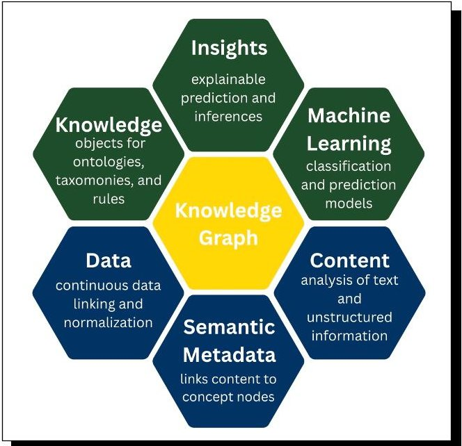

Figure 2.41: KG concepts.

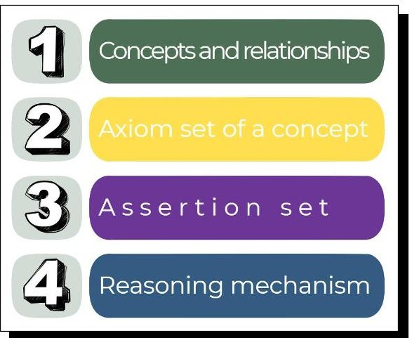

Figure 2.42: DL system for KGs.

A widely used language for the construction of KGs that is based on RDF syntax is the W3C Simple Knowledge Organization System (SKOS) standard. Because SKOS is not a formal knowledge

<!-- PDF_PAGE: 53 -->

representation language, it must be used alongside OWL to provide semantic structures [175]. However, the SKOS specification presents integrity conditions meant to evaluate design patterns that are considered analogous to quality aspects of a language [176]. These conditions are independent of strategic implementation and serve to establish consistency of the underlying data model [175]. Table 2.5 summarizes the SKOS integrity conditions and the quality aspects to which each relates, which are validated in a variety of ways, including SPARQL queries and OWL reasoning.

Table 2.5: SKOS integrity conditions.

<table border="1"><tr><td>Integrity Condition</td><td>Rationale</td><td>Quality Aspect</td></tr><tr><td>Incorrect Language Tags</td><td>Incorrect language tags in a SKOS vocabulary could unintentionally limit the result set of language-dependent queries</td><td>Correctness</td></tr><tr><td>Incomplete Language Coverage</td><td>The set of language tags used by the literal values linked with a concept should be the same for all concepts.</td><td>Completeness</td></tr><tr><td>Undocumented Concepts</td><td>Documented concepts enable usability.</td><td>Learnability</td></tr><tr><td>Label Conflicts</td><td>No two concepts should have the same label, so they can be distinguished from one another.</td><td>Learnability</td></tr><tr><td>Orphan Concepts</td><td>Concepts without semantic relations lack valuable context information.</td><td>Specificity</td></tr><tr><td>Weakly Connected Components</td><td>Weakly connected components negatively affect queries and navigation of the data model.</td><td>Coupling</td></tr><tr><td>Cyclic Hierarchical Relations</td><td>A cyclic hierarchical relationship is considered a logical contradiction.</td><td>Specificity</td></tr><tr><td>Valueless Associative Relations</td><td>Terms that share a common broader term should not be related associatively if they are siblings.</td><td>Clarity</td></tr><tr><td>Solely Transitively Related Concepts</td><td>Transitive hierarchical relations in SKOS are meant to be inferred by the vocabulary consumer.</td><td>Clarity</td></tr><tr><td>Omitted Top Concepts</td><td>The SKOS model provides concept schemes, which are a facility for grouping related concepts to provide access and to simplify the vocabulary.</td><td>Conciseness</td></tr><tr><td>Top Concept Having Broader Concepts</td><td>Top concepts should not have broader concepts</td><td>Conciseness</td></tr><tr><td>Missing In-Links</td><td>In-links of a concept indicate its importance.</td><td>Cohesiveness</td></tr><tr><td>Missing Out-Links</td><td>Out-links of a concept indicate its importance.</td><td>Cohesiveness</td></tr><tr><td>Broken Links</td><td>Broken links hinder navigability.</td><td>Cohesiveness</td></tr><tr><td>Undefined SKOS Resources</td><td>Undefined SKOS resources introduce unresolvable terms.</td><td>Correctness</td></tr></table>

<!-- PDF_PAGE: 54 -->

## 2.6 Requirements Engineering (RE)

Requirements engineering (RE) is a technical process that generates system requirements by understanding stakeholder needs to reflect their perspectives [5] [177]. ISO 15288:2023 states, "The purpose of the system requirements definition process is to transform the stakeholder, user-oriented view of desired capabilities into a technical view of a solution that meets the operational needs of the user." [4]. The International Council on Systems Engineering (INCOSE) Requirements Writing Guide (RWG) discusses fifteen (15) characteristics that well-formed requirements must exhibit [178]. There are similar and overlapping aspects of these characteristics, and organizations must choose how each is addressed. Requirements must exhibit the following attributes:

- Appropriate - The specific intent and amount of detail of the need or requirement statement are appropriate to the level of abstraction, organization, or system architecture for the entity to which it refers.

- Complete - Necessary information should not be missing from the requirement

- Conforming - Each requirement consists of a "shall" statement

- Correct - Each requirement must accurately describe the functionality to be delivered

- Feasible - It must be possible to implement each requirement within the known capabilities and limitations of the system and its environment

- Necessary - Each requirement should document a specific capability that the customer(s) have requested

- Singular - The requirement statement should state a single capability, characteristic, constraint, or quality factor

- Unambiguous - All readers of a requirement should have the exact same interpretation

- Verifiable - Requirements that are not consistent, feasible, or unambiguous are not verifiable Graphical modeling languages, such as SysML, provide a means of capturing functional requirements and design to align text with more formal methods; however, there are more specialized requirements modeling languages, such as the Soft Goal Interdependency Graph (SIG), tailored to represent and analyze non-functional requirements (NFR) [179]. NFRs are considered design

<!-- PDF_PAGE: 55 -->

characteristics that typically cover aspects such as performance, usability, safety, and maintainability [177].

## 2.6.1 System Quality Goals

Goals are the objectives that represent stakeholder needs and describe the functionality that the system of interest (SoI) must achieve [180] [181]. They provide the foundation of constraints and encourage additional iterations to further specify bounds as a system matures [182]. Quality aspects such as security, performance, flexibility, reliability, usability, scalability, and efficiency are typically considered non-functional requirements [183]. A quality goal is an unambiguous definition that may not be quantitatively verifiable since many quality characteristics are not tangible or measurable [184]. The key activity in Goal-Oriented RE (GORE) is the construction of the goal model, where goals are conceptualizations that elicit and analyze requirements by capturing alternatives and conflicts [180] [185]. The principal purpose of this structure is to show the decomposition until sub-goals are supported by architectural solutions [186]. Figure 2.43 shows a quality goal framework [184].

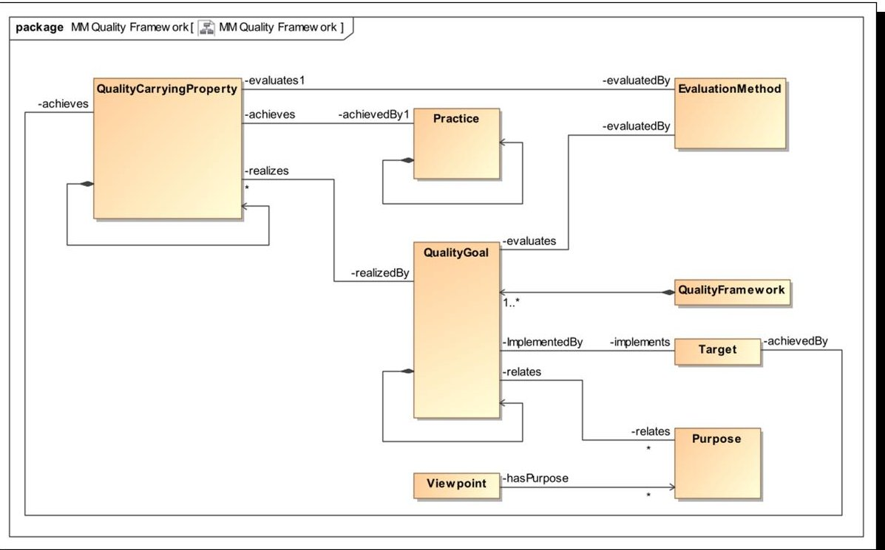

Figure 2.43: Framework for quality goals [184].

<!-- PDF_PAGE: 56 -->

Knowledge Acquisition in autOmated Specification (KAOS) is a GORE technique that consists of models for goals, responsibilities, objects, and operations [183]. The KAOS model is a semantic network in which the nodes are concepts and the connections between them are associations [187]. The goal model is the foundation for the KAOS method and represents a set of interrelated goal diagrams that capture system requirements as business objectives known as claims [183]. Within the model, goal decomposition is achieved with AND/OR hierarchies where AND links relate a goal to a sub-goal(s) and OR links relate a goal to alternative(s) [180]. The KAOS method is composed of a meta-level, domain level, and instance level that respectively correlate to the metamodel layer, model layer, and user layer of UML [187]. The Goal Structuring Notation (GSN) graphically represents arguments to confirm that a system operates as intended [188]. Arguments are a connected series of claims intended to establish an overall goal [185]. Figure 2.44 shows selective GSN classes and their respective descriptions.

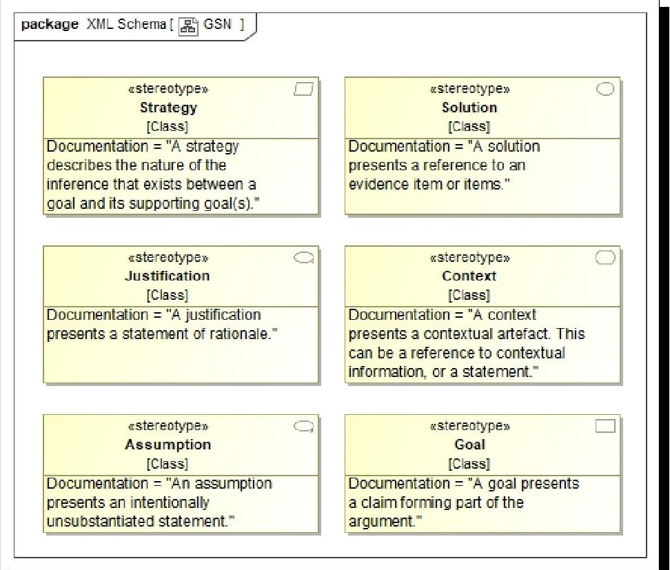

Figure 2.44: Subset of GSN stereotypes with documentation.

<!-- PDF_PAGE: 57 -->

## 2.7 Knowledge Gaps based on Current State

Although generic ontologies have been extensively studied and documented, there is significantly less research focused on modeling the concepts of engineering knowledge databases, and there is no standardized methodology. Modern ontologies aim to clarify DSMLs to enable the reuse of domain knowledge, and systematically analyze this knowledge [42]. However, in practice, different organizations are producing varying ontologies for similar purposes [156]. Inconsistent ontologies result in false semantic understanding and knowledge representation, which hinders the penultimate goal of sharing information between individuals with various backgrounds [75]. Another challenge in creating a collaborative and reusable domain-specific ontology (DSO) for SE is the lack of clear agreement on basic terminology and relationships, which makes the work susceptible to failure [3]. A challenge in creating a collaborative and reusable SE DSO is the lack of a formalized organization to manage the effort. Studies have laid the groundwork for an SE DSO, but these have all been disconnected efforts [106] [189] [190].

<!-- PDF_PAGE: 58 -->

## Chapter 3

## Research Approach

This chapter describes the tools and approaches used to complete each RT in Sec. 1.2.1.

## 3.1 Research Tools and Languages

Table 3.1 describes the tools and languages leveraged for this research.

## 3.1.1 Ontology Editor

Protégé, an open-source tool, is used as the ontology editor for this research since it supports BFO continuant and occurrent entity semantics [191]. It also provides a plug-and-play environment that makes it a flexible base for development of rapid iterations with version control capabilities [42]. In addition, Protégé defines classes and their hierarchies, variables, value restrictions, and the relationships between classes with object properties [192]. Although several ontology editing tools support knowledge engineering integrated with semantic reasoners, the ease of importing Protégé OWL files into a concept model proved most conducive to this research after assessing other common alternatives. Protégé has several semantic reasoners that ensure compliance with OWL and can validate the consistency of the DSML. HermiT v1.4.3.456 is used because it supports

Table 3.1: Overview of research tools and languages.

<table border="1"><tr><td>Name</td><td>Purpose</td></tr><tr><td colspan="2">Tool</td></tr><tr><td>Protégé</td><td>Ontology editor</td></tr><tr><td>Pellet</td><td>Ontology reasoner</td></tr><tr><td>CATIA MSOSA 2022x</td><td>SE modeling</td></tr><tr><td>Teamwork Cloud</td><td>Modeling collaboration</td></tr><tr><td colspan="2">Language</td></tr><tr><td>OWL</td><td>Ontology construction</td></tr><tr><td>MOF</td><td>Concept modeling/Metamodeling</td></tr><tr><td>UML</td><td>Class modeling</td></tr><tr><td>XML</td><td>Data exchange</td></tr></table>

<!-- PDF_PAGE: 59 -->

all features of an OWL ontology and implements a classification algorithm that greatly reduces the number of conformance tests needed to compute class and property hierarchies [76].

## 3.1.2 Systems Engineering Modeling Tool

Dassault Systèmes Computer Aided Three-Dimensional Interactive Application (CATIA) Magic System of Systems Architect (MSOSA) 2022x is identified as having the full suite of capabilities for concept modeling, importing OWL files, and project collaboration. The Cameo Concept Model (CCM) plug-in enables metamodel development and supports interpretation mapping to ontologies in a single project. Dassault Systèmes Teamwork Cloud (TWC) acts as a repository for all models to enable seamless project usages while providing version control. The general configuration of TWC is shown in Fig. 3.1.

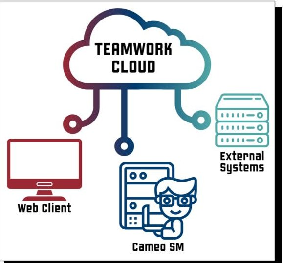

Figure 3.1: TWC configuration.

Figure 3.2 shows a concept modeling diagram that has been imported directly from a Protégé OWL file. This exemplifies how the initial iteration with basic relationships is represented within an MBSE environment.

<!-- PDF_PAGE: 60 -->

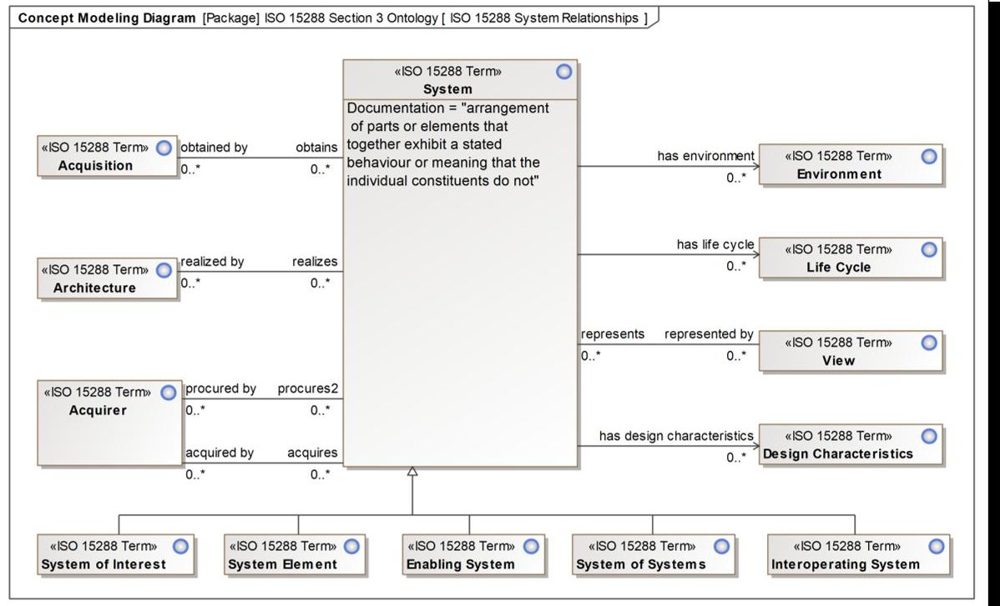

Figure 3.2: Concept modeling diagram example for the ISO 15288 "System" class.

The inverse predicate is shown on the adjacent association that is directed in the opposite direction, called roles. For example, it is shown that "System is obtained by Acquisition", and inversely, "Acquisition obtains System". The generalization between the "System" and the "Enabling System" shows the "Enabling System" is a subtype of "System". This corresponds to a subclass in Protégé. Semantically, the subtype inherits all attributes and properties from the supertype. Definitions and comments from Protégé are shown as "Documentation" shown within the "System" class in this example.

## 3.2 RQ1 Approach

This section describes the approach for each RT for RQ1 repeated here: "How can a high-quality SE ontology be created?" RQ1-RT1 states "Determine the corpus for an SE ontology". Although many types of ontologies exist, a DSO is created that is crucial for defining and coordinating terminologies, concepts, and their relationships to facilitate interoperability between applications [87] [193]. The normative reference ISO 15288 is chosen as the corpus for an SE ontology for the following reasons:

<!-- PDF_PAGE: 61 -->

- The International Organization of Standards (ISO) has been governing ISO 15288 since 2002

- The INCOSE SEBoK is derived from ISO 15288

- ISO 15288 has been updated as recently as 2025 to incorporate modern practices and lessons learned

- Previous iterations of SE DSOs have leveraged ISO 15288

ISO/IEC/IEEE 24765:2017, "Systems and software engineering - Vocabulary" was also considered, but determined to have too much detail and terms that are not typically used by engineers [194].

RQ1-RT2 states, "Create an ontology from the identified corpus". To date, SE ontology work has concentrated on the technical processes of ISO 15288. An SE ontology must focus on a specific domain knowledge area and outline a generic construction process shown in Fig. 3.3 [119].

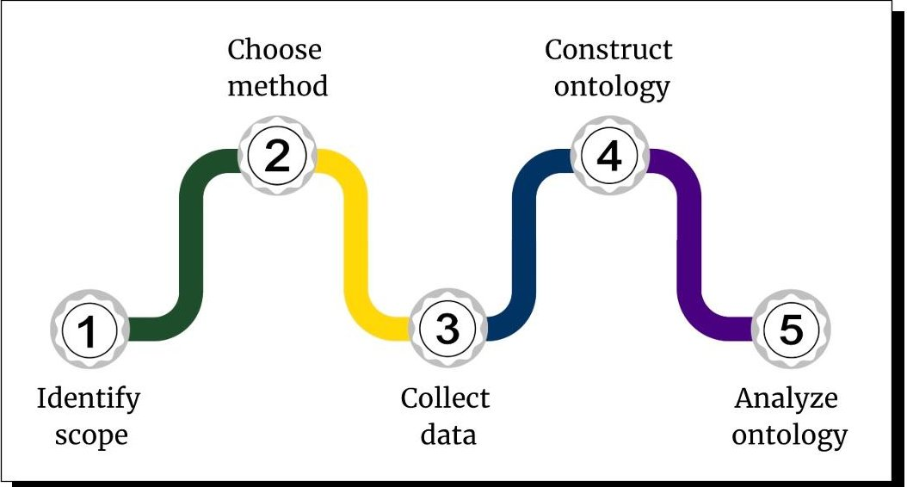

Figure 3.3: Ontology construction process [119].

The SE domain is the (1) scope of this research, and the (2) method is focused on the conceptualization phase described in Sec. 2.3.2. OWL is used to construct the ISO 15288 ontology due to its reliable cross-platform functionality. Table 3.2 represents the (3) data collection task for the ISO 15288 ontology. Figure 3.5 shows an example of ISO 15288 generalization relationships in a concept modeling diagram for the "System" class. The generalizations shown are based on the terms in Table 3.2. For example, an "Acquirer" is defined as a "stakeholder that acquires or procures a system, product or service from a supplier". Therefore, it is a subclass of "Stakeholder". Figure

<!-- PDF_PAGE: 62 -->

3. 6 summarizes all generalizations in the ISO 15288 ontology within CATIA MSOSA. Figure 3.7 shows the basic metric counts of the ISO 15288 ontology within a CCM that are used as inputs for quality metrics.

Table 3.2: ISO 15288 Section 3 terms and definitions.

<table border="1"><tr><td>Sec.</td><td>ISO 15288 Term</td><td>Definition</td></tr><tr><td>3.1</td><td>Acquirer</td><td>stakeholder that acquires or procures a system, product or service from a supplier</td></tr><tr><td>3.2</td><td>Acquisition</td><td>process of obtaining a system, product or service</td></tr><tr><td>3.3</td><td>Activity</td><td>set of cohesive tasks of a process</td></tr><tr><td>3.4</td><td>Agreement</td><td>mutual acknowledgment of terms and conditions under which a working relationship is conducted</td></tr><tr><td>3.5</td><td>Architecture</td><td>fundamental concepts or properties of a system in its environment and governing principles for the realization and evolution of this system and its related life cycle processes</td></tr><tr><td>3.6</td><td>Artifact</td><td>work product that is produced and used during a project to capture and convey information</td></tr><tr><td>3.7</td><td>Audit</td><td>independent examination of a work product or set of work products to assess compliance with specifications, standards, contractual agreements, or other criteria</td></tr><tr><td>3.8</td><td>Baseline</td><td>formally approved version of a configuration item, regardless of media, formally designated and fixed at a specific time during the configuration item&#x27;s life cycle</td></tr><tr><td>3.9</td><td>Concept of Operations</td><td>verbal and graphic statement, in broad outline, of an organization&#x27;s assumptions or intent in regard to an operation or series of operations of new, modified, or existing organizational systems</td></tr><tr><td>3.10</td><td>Concern</td><td>matter of interest or importance to a stakeholder</td></tr><tr><td>3.11</td><td>Configuration Item</td><td>item or aggregation of hardware, software, or both, that is designated for configuration management and treated as a single entity in the configuration management process</td></tr><tr><td>3.12</td><td>Customer</td><td>organization or person that receives a product or service</td></tr><tr><td>3.13</td><td>Design</td><td>specification of system elements and their relationships, that is sufficiently complete to support a compliant implementation of the architecture</td></tr><tr><td>3.14</td><td>Design Characteristics</td><td>design attributes or distinguishing features that pertain to a measurable description of a product or service</td></tr><tr><td>3.15</td><td>Enabling System</td><td>system that supports a system-of-interest during its life cycle stages but does not necessarily contribute directly to its function during operation</td></tr><tr><td>3.16</td><td>Environment</td><td>system context determining the setting and circumstances of all influences upon a system</td></tr><tr><td>3.17</td><td>Incident</td><td>anomalous or unexpected event, set of events, condition, or situation at any time during the life cycle of a project, product, service, or system</td></tr><tr><td>3.18</td><td>Information Item</td><td>separately identifiable body of information that is produced, stored, and delivered for human use</td></tr><tr><td>3.19</td><td>Interface</td><td>point at which two or more logical, physical, or both, system elements or software system elements meet and act on or communicate with each other</td></tr><tr><td>3.20</td><td>Interoperating System</td><td>system that exchanges information with the system-of-interest and uses the information that has been exchanged</td></tr><tr><td>3.21</td><td>Life Cycle</td><td>evolution of a system, product, service, project or other human-made entity from conception through retirement</td></tr><tr><td>3.22</td><td>Life Cycle Model</td><td>framework of processes and activities concerned with the life cycle which can be organized into stages, acting as a common reference for communication and understanding</td></tr><tr><td>3.23</td><td>Operational Concept</td><td>verbal and graphic statement of an organization&#x27;s assumptions or intent in regard to an operation or series of operations of a specific system or a related set of specific new, existing or modified systems</td></tr><tr><td>3.24</td><td>Operator</td><td>individual or organization that performs the operations of a system</td></tr><tr><td>3.25</td><td>Organization</td><td>person or group of people that has its own functions with responsibilities, authorities, and relationships to achieve its objectives</td></tr><tr><td>3.26</td><td>Problem</td><td>difficulty, uncertainty, or otherwise realized and undesirable event, set of events, condition, or situation that requires investigation and corrective action</td></tr><tr><td>3.27</td><td>Process</td><td>set of interrelated or interacting activities that transform inputs into outputs</td></tr><tr><td>3.28</td><td>Iteration</td><td>process repeating the application of the same process or set of processes on the same level of the system structure</td></tr><tr><td>3.29</td><td>Process Purpose</td><td>high level objective of performing the process and the likely outcomes of effective implementation of the process</td></tr><tr><td>3.30</td><td>Process Outcome</td><td>observable result of the successful achievement of the process purpose</td></tr><tr><td>3.31</td><td>Recursion</td><td>process repeating the application of the same process or set of processes to successive levels of system elements in the system structure</td></tr><tr><td>3.32</td><td>Product</td><td>output of an organization that can be produced without any transaction taking place between the organization and the customer</td></tr><tr><td>3.33</td><td>Project</td><td>endeavor with defined start and finish criteria undertaken to create a product or service in accordance with specified resources and requirements</td></tr><tr><td colspan="3">Continued on next page</td></tr></table>

<!-- PDF_PAGE: 63 -->

Table 3.2 - continued from previous page

<table border="1"><tr><td>Sec.</td><td>ISO 15288 Term</td><td>Definition</td></tr><tr><td>3.34</td><td>Quality Assurance</td><td>part of quality management focused on providing confidence that quality requirements will be fulfilled</td></tr><tr><td>3.35</td><td>Quality Characteristic</td><td>inherent characteristic of a product, service, process, or system related to a requirement</td></tr><tr><td>3.36</td><td>Requirement</td><td>statement which translates or expresses a need and its associated constraints and conditions</td></tr><tr><td>3.37</td><td>Resource</td><td>asset that is utilized or consumed during the execution of a process</td></tr><tr><td>3.38</td><td>Retirement</td><td>withdrawal of active support by the operation and maintenance organization, partial or total replacement by a new system, or installation of an upgraded system, or final decommissioning and disposal</td></tr><tr><td>3.39</td><td>Risk</td><td>effect of uncertainty on objectives</td></tr><tr><td>3.40</td><td>Safety</td><td>expectation that a system does not, under defined conditions, lead to a state in which human life, health, property, or the environment is endangered</td></tr><tr><td>3.41</td><td>Security</td><td>protection against intentional subversion or forced failure</td></tr><tr><td>3.42</td><td>Service</td><td>output of an organization with at least one activity necessarily performed between the organization and the customer</td></tr><tr><td>3.43</td><td>Stage</td><td>period within the life cycle of an entity that relates to the state of its description or realization</td></tr><tr><td>3.44</td><td>Stakeholder</td><td>individual or organization having a right, share, claim, or interest in a system or in its possession of characteristics that meet their needs and expectations</td></tr><tr><td>3.45</td><td>Supplier</td><td>organization or an individual that enters into an agreement with the acquirer for the supply of a product or service</td></tr><tr><td>3.46</td><td>System</td><td>arrangement of parts or elements that together exhibit a stated behaviour or meaning that the individual constituents do not</td></tr><tr><td>3.47</td><td>System Element</td><td>discrete part of a system that can be implemented to fulfil specified requirements</td></tr><tr><td>3.48</td><td>System-of-Interest</td><td>system whose life cycle is under consideration</td></tr><tr><td>3.49</td><td>System of Systems</td><td>set of systems or system elements that interact to provide a unique capability that none of the constituent systems can accomplish on its own</td></tr><tr><td>3.50</td><td>Systems Engineering</td><td>transdisciplinary and integrative approach to enable the successful realization, use, and retirement of engineered systems using systems principles and concepts and scientific, technological and management methods</td></tr><tr><td>3.51</td><td>Task</td><td>required, recommended, or permissible action, intended to contribute to the achievement of one or more outcomes of a process</td></tr><tr><td>3.52</td><td>Traceability</td><td>discernible association among two or more logical entities, such as requirements, system elements, verifications, or tasks</td></tr><tr><td>3.53</td><td>User</td><td>individual or group that interacts with a system or benefits from a system during its utilization</td></tr><tr><td>3.54</td><td>Validation</td><td>confirmation, through the provision of objective evidence, that the requirements for a specific intended use or application have been fulfilled</td></tr><tr><td>3.55</td><td>Verification</td><td>confirmation, through the provision of objective evidence, that specified requirements have been fulfilled</td></tr><tr><td>3.56</td><td>View</td><td>representation of a system from the perspective of a related set of concerns</td></tr><tr><td>3.57</td><td>Viewpoint</td><td>specification of the conventions for constructing and using a view</td></tr></table>

<table border="1"><tr><td colspan="2">Ontology metrics</td></tr><tr><td colspan="2">Metrics</td></tr><tr><td>Axiom</td><td>418</td></tr><tr><td>Logical axiom count</td><td>175</td></tr><tr><td>Declaration axioms count</td><td>91</td></tr><tr><td>Class count</td><td>57</td></tr><tr><td>Object property count</td><td>32</td></tr><tr><td>Data property count</td><td>2</td></tr><tr><td>Individual count</td><td>57</td></tr><tr><td>Annotation Property count</td><td>3</td></tr></table>

Figure 3.4: Basic metrics as calculated within Protégé as a result of the (4) constructing the ontology task.

<!-- PDF_PAGE: 64 -->

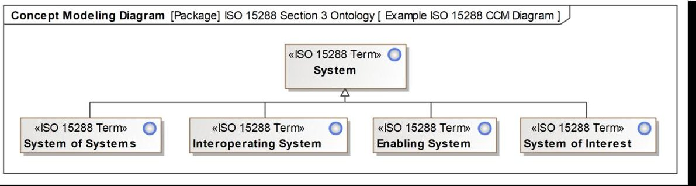

Figure 3.5: Example of ISO 15288 generalization relationships in a concept modeling diagram for the "System" class.

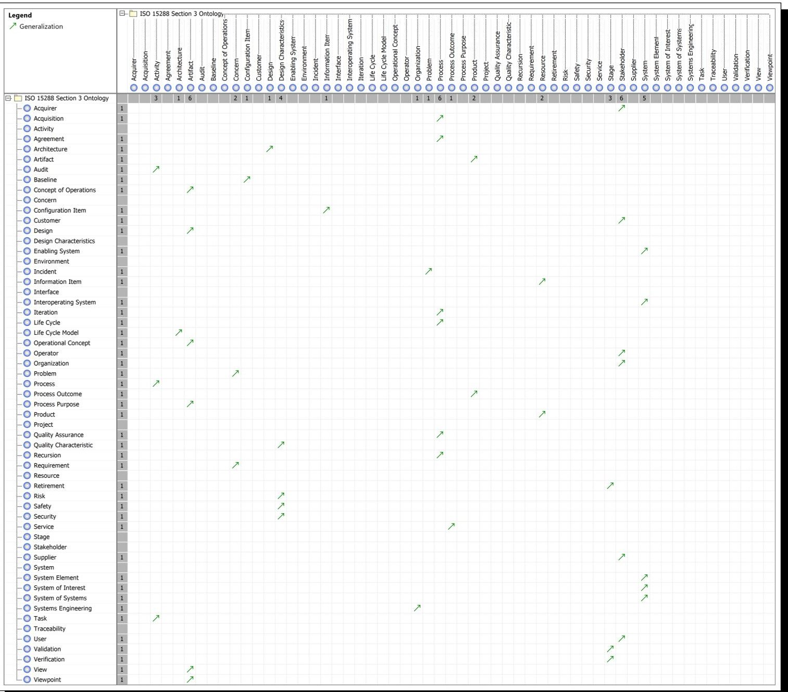

Figure 3.6: Comprehensive view of generalization relationships of the ISO 15288 ontology within CATIA MSOSA.

<!-- PDF_PAGE: 65 -->

<table border="1"><tr><td>#</td><td>Scope</td><td>Class Count</td><td>Subclass Count</td><td>Superclass Count</td><td>Non Cohesive Class Count</td></tr><tr><td>1</td><td>ISO 15288 Section 3 Ontology</td><td>57</td><td>49</td><td>19</td><td>0</td></tr></table>

Figure 3.7: ISO 15288 basic ontology metrics as calculated within CATIA MSOSA.

RQ1-RT3 states "Evaluate quality of the SE ontology". Inspections are conducted and documented for each OBO Foundry principle shown by Fig. 3.8, where red rows denote statements, the yellow represent suggestions, and the green rows identify requirements. A structured expression within the CCM identifies requirements as "must" statements. Each requirement is satisfied by an ontological quality aspect. The notable characteristics for applicable requirements are defined in Fig. 3.9. The OQuaRE characteristic "Functional Adequacy" is decomposed in Fig. 3.10.

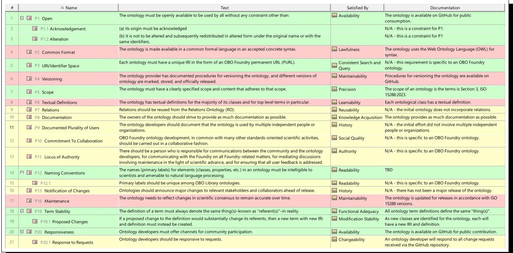

Figure 3.8: Identifying OBO Foundry requirements using a structured expression within CATIA MSOSA [195].

<!-- PDF_PAGE: 66 -->

<table border="1"><tr><td>#</td><td>Name</td><td>Documentation</td><td>Owner</td></tr><tr><td>1</td><td>Availability</td><td>The quality of being readily obtainable.</td><td>OQuaRE Characteristics</td></tr><tr><td>2</td><td>Functional Adequacy</td><td>An ontology is evaluated for this criterion according to the degree of accomplishment of functional requirements, that is, the appropriateness for its intended purpose according to Stevens and Lord(2009): reference ontology, controlled vocabulary, schema and value reconciliation, consistent search and query, knowledge acquisition, clustering and similarity, indexing and linking, results representation, classifying instances, text analysis, guidance and decision trees, knowledge reuse, inferencing, and precision.</td><td>OQuaRE Characteristics</td></tr><tr><td>3</td><td>Modification Stability</td><td>The degree to which the ontology can avoid unexpected effects from modifications of the knowledge(terms,classes,properties,etc.)</td><td>OQuaRE Characteristics</td></tr><tr><td>4</td><td>Precision</td><td>Mechanical or scientific exactness, accuracy</td><td>OQuaRE Characteristics</td></tr><tr><td>5</td><td>Readability</td><td>This metric indicates the existence of human readable descriptions in the ontology.such as comments,labels,or captions.</td><td>OntoQA Characteristics</td></tr></table>

Figure 3.9: Descriptions of quality framework metrics that satisfy OBO Foundry requirements [156] [196] .

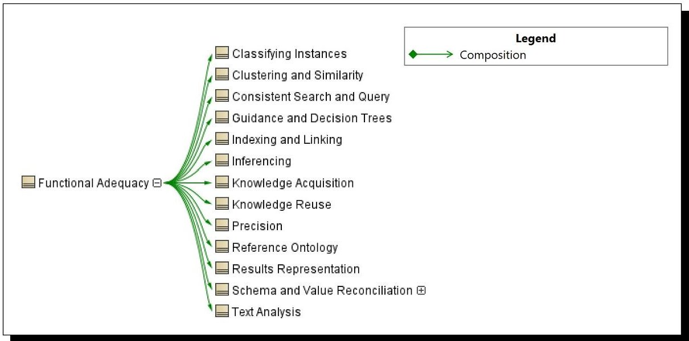

Figure 3.10: Relation map showing the decomposition of the "Functional Adequacy" OQuaRE quality characteristic.

This relation map suggests there are various ways to verify that this quality characteristic is met by a DSO. To fulfill the analyze phase in Fig. 3.3, the semiotic, OntoQA, and OQuaRE aspects and metrics discussed in Sec. 2 are utilized. The semantics and syntax of the ISO 15288 ontology information are evaluated to answer the questions in Fig. 2.21 [104]. Due to the isolation in which the SE DSO has been constructed, the "social quality" aspects are not considered (e.g., authority and history). Without direction for assessing quality, tracing to metrics is imperative. «Equivalent Class» relationships are created within a CCM between the semiotic characteristics and quality metrics

<!-- PDF_PAGE: 67 -->

defined in OQuaRE and OntoQA shown in Fig. 3.11, where the "Name" column represents semiotic quality characteristics. Each semiotic quality type can be measured by the aspects shown in Fig. 3.12. The metrics chosen for the pragmatic, semantic, and syntactic quality types of this ontology cover the quality aspects that are indicated in Fig. 3.11. The modification stability, readability, and consistency characteristics used to assess the semiotic quality types are defined in Fig. 3.13.

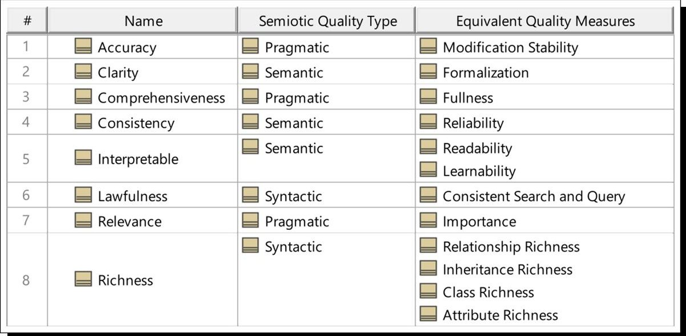

Figure 3.11: Semiotic quality mapping to ontology metrics.

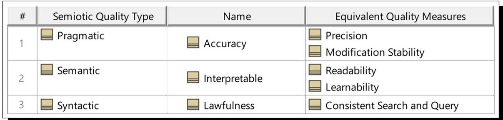

Figure 3.12: Ontology quality metrics and measures that satisfy semiotic quality aspects.

<!-- PDF_PAGE: 68 -->

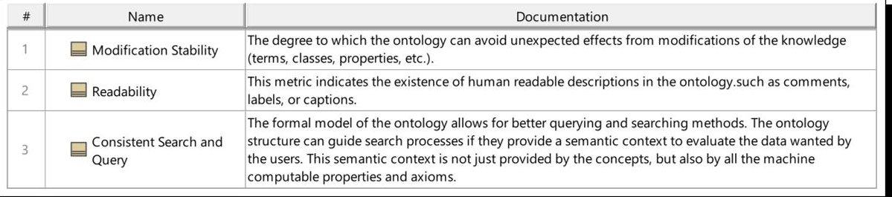

Figure 3.13: Definitions of ontology quality metrics used in this research.

An accurate, interpretable, and valid SE DSO provides a well-suited baseline for DSML mapping. Figure 3.14 shows the slot values for the ISO 15288 ontology instance obtained from the OWL file. Figure 3.15 shows the mapping between semiotic qualities and quantifiable metrics. The semantics, syntax, and pragmatism of the SE ontology are determined by:

- Pragmatic coupling between objects (CBO)

- The semantic user learnability (ULe) of the DSO

- Syntactic properties as described by the correctness of queries

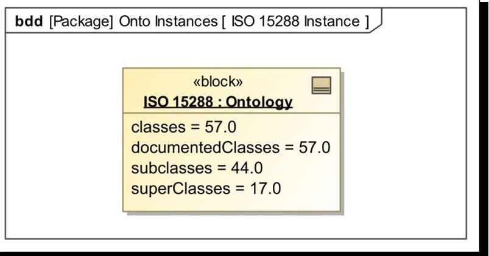

Figure 3.14: ISO 15288 ontology basic counts shown as slot values for a SysML instance.

<!-- PDF_PAGE: 69 -->

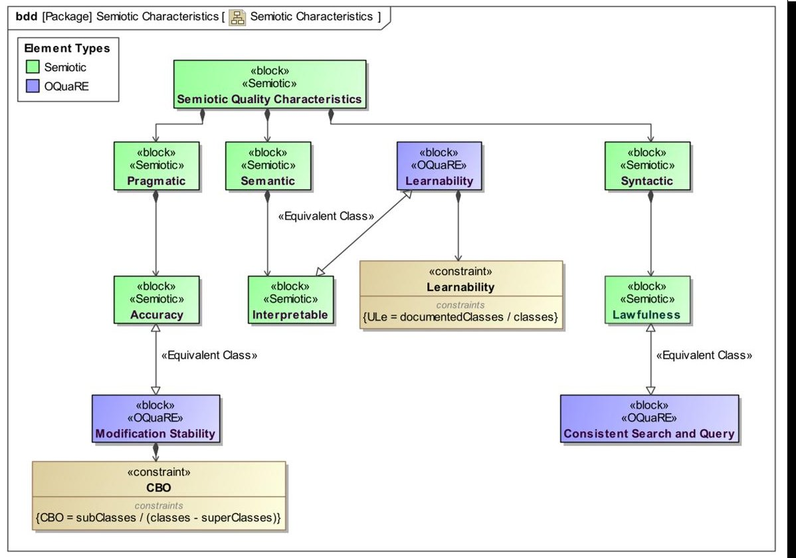

Figure 3.15: Relationships between metamodel and ontology quality metrics.

SysML v1.7 parametrics are constructed to evaluate quality metric values. To assess the semantic learnability and readability of the ISO 15288 ontology, the user guide completeness $ (ULe) $ is calculated [151]. Figure 3.16 shows the $ ULe $ result. The $ ULe $ value should always equal one (1) to indicate a well-documented and re-usable DSO. Figure 3.17 shows the syntactic adequacy of the ISO 15288 OWL ontology regarding coherency and consistency as determined by the HermiT v1.4.3.456 reasoner within Protégé.

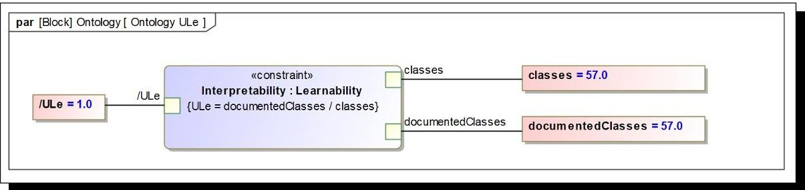

Figure 3.16: Quantitative result of the learnability metric within a SysML parametric diagram.

<!-- PDF_PAGE: 70 -->

Figure 3.17: Confirming coherency and consistency of the ISO 15288 ontology using a semantic reasoner within Protégé.

The stronger the coupling between objects (CBO), the more difficult the data is to understand, change, and correct. Therefore, a low value is desired to ease future updates and provide modification stability. The CBO is used to evaluate stability since coupling is a reliable indicator of the difficulty involved with data modifications [162]. Figure 3.18 shows the CBO result for the ISO 15288 ontology.

Figure 3.18: Modification stability result within a SysML parametric diagram.

## 3.3 RQ2 Approach

This section describes the approach for RQ2 repeated here: "Can the metamodels of SE DSMLs be mapped to the SE ontology?" RQ2-RT1 states "Identify a subset of SE DSMLs to evaluate". At the time of writing, the OMG has four (4) SE DSMLs:

<!-- PDF_PAGE: 71 -->

- EXPRESS Metamodel v1.1 - an information modeling language that specifies the content of a product description based on ISO 10303-11.2:2004, Product data exchange - EXPRESS Language Reference Manual [197]

- SysML v1.7-a DSML for SE applications that promises to improve communications among stakeholders

- SysML v2.0 - replaces SysML v1.7 with graphical and textual capabilities [198]

- SysML Extension for Physical Interaction and Signal Flow Simulation (SysPhS) v1.1- an extension of SysML that includes information needed to model physical interactions and signal flows [199]

The current SysPhS specification extends SysML v1.7 with two (2) additional model elements: "PhSVariable" and "PhSConstant". Determining quality metrics for a metamodel of such a small size will not provide conclusive evidence that supports this study. At the time of research, the EXPRESS modeling language was not considered current; therefore, only the SysML v1.7 metamodel was constructed from the OMG SE DSMLs. Based on a combination of relevance and availability, the metamodels for the DSMLs in Table 3.3 are constructed.

Table 3.3: Selected DSMLs for metamodeling.

<table border="1"><tr><td>DSML</td><td>Publication Date</td><td>Primary Domain</td></tr><tr><td>Comprehensive Systems Design Language(CSDL)v1</td><td>2016</td><td>Systems Engineering</td></tr><tr><td>CubeSat Reference Model(CSRM)v1.1</td><td>2025</td><td>Space Systems</td></tr><tr><td>LMLv2.0</td><td>2025</td><td>Systems Engineering</td></tr><tr><td>SysMLv1.7</td><td>2024</td><td>Systems Engineering</td></tr><tr><td>SysMLv2.0</td><td>2025</td><td>Systems Engineering</td></tr><tr><td>Unified Architecture Framework Modeling Language(UAFML)v1.2</td><td>2022</td><td>Enterprise Architecture</td></tr><tr><td>Unified Modeling Language(UML)v2.5.1</td><td>2017</td><td>Software Engineering</td></tr></table>

The CSDL v1 and LML v2.0 specifications external to the OMG are chosen to provide a different point of view for constructing an SE DSML. UAFML v1.2 is selected because it extends SysML v1.7, even though it is meant for enterprise architecture (EA) instead of solution architecture. Finally,

<!-- PDF_PAGE: 72 -->

the CSRM v1.1 metamodel is created because of its dependence on the SysML v1.7 specification as an extension of the modeling language. Figure 3.19 shows the customizations for each DSML.

Figure 3.19: Metamodel class stereotypes.

This UML profile diagram shows how elements of each modeling language are visually distinguished with customized《Stereotypes》. RQ2-RT2 states: "Create metamodels for a subset of SE DSMLs". Each DSML metamodel is created as a CCM project that adheres to the EMOF specification. The CSDL v1 metamodel captures the schema located within Vitech's GENESYS 2025 edition. The LML v2.0 metamodel is based on the specification published by the Lifecycle Modeling Organization (LMO) [30]. The CSRM v1.1, SysML v1.7, SysML v2.0, UAFML v1.2, and UML v2.5.1 metamodels are based on their respective OMG specifications. To accomplish this, the process shown in Fig. 3.20 is proposed [200].

Figure 3.20: DSML process [200].

<!-- PDF_PAGE: 73 -->

This research is focused on DSML implementation since it is evaluating previously published specifications. Each metamodel contains both a data model and a process model. The process model separates the predicates (i.e., verbs) from the subjects and objects used in triples, which are contained within the data model. The UML v2.5.1 metamodel is the first DSML created by team members at Enola Technologies. Table B.1 defines the concrete UML v2.5.1 classes. Figure 3.21 shows the UML v2.5.1 generalizations within the language. Figure 3.22 shows an example of relationships of the UML "Class" entity with other terms within the metamodel. Because the SysML v1.7 language specializes the UML metamodel, generalizations show UML elements that are more specific to the SE domain, summarized by Fig. 3.24.

Figure 3.21: Comprehensive view of the UML v2.5.1 generalizations.

The CSRM v1.1 is the exemplar metamodel «Profile» in this research. Even though the language extends SysML v1.7, the duplicate CSRM classes must be used due to the tooling complications of reusing CATIA MSOSA profiles. The CSRM v1.1 specification mentions the need to use its classes instead of the SysML v1.7 «Equivalent Classes» for tool compatibility. Figure 3.25 shows

<!-- PDF_PAGE: 74 -->

Figure 3.22: UML v2.5.1 metamodel example of the "Class" entity and its relationships.

Figure 3.23: SysML v1.7 "Block" related to UML v2.5.1 "Class" and ISO 15288 terms in a concept modeling diagram.

<!-- PDF_PAGE: 75 -->

<table border="1"><tr><td colspan="2">Legend
Generalization</td><td colspan="5">SysML Data Model</td><td colspan="16">UML2.5.1</td></tr><tr><td></td><td></td><td>AbstractRequirement</td><td>Block</td><td>extendedRequirement</td><td>External system</td><td>Requirement</td><td>System</td><td>AcceptEventAction</td><td>Activity</td><td>ActivityPartition</td><td>Actor</td><td>ChangeEvent</td><td>Class</td><td>Comment</td><td>Connector</td><td>ConnectorEnd</td><td>DataType</td><td>Diagram</td><td>DirectedRelationship</td><td>Feature</td><td>InformationFlow</td><td>InvocationAction</td><td>Port</td><td>Property</td><td>Trigger</td></tr><tr><td colspan="2">SysML Data Model</td><td>1</td><td>5</td><td>7</td><td>2</td><td>1</td><td>2</td><td>1</td><td>1</td><td>1</td><td>1</td><td>1</td><td>1</td><td>3</td><td>1</td><td>1</td><td>1</td><td>4</td><td>1</td><td>1</td><td>1</td><td>1</td><td>2</td><td>9</td><td>1</td></tr><tr><td>AcceptChangeStructuralFeature</td><td></td><td></td><td></td><td></td><td></td><td></td><td>1</td><td>$\uparrow$</td><td></td><td></td><td></td><td></td><td></td><td></td><td></td><td></td><td></td><td></td><td></td><td></td><td></td><td></td><td></td><td></td><td></td></tr><tr><td>Actuator</td><td>1</td><td></td><td></td><td></td><td>$\uparrow$</td><td></td><td>

Figure 3.24: Generalizations of the SysML v1.7 and the UML v2.5.1 metamodels.

<!-- PDF_PAGE: 76 -->

an example of CSRM object properties where multiplicities and role names are included for each association. These relationships are read as "Stakeholder concernedWith StakeholderConcern" and inversely, "StakeholderConcern concernOf Stakeholder" in accordance with the SPO approach. This DSML is not mapped to the ISO 15288 ontology since its intent is to specify the space domain. Figure 3.26 shows the mapping of CSRM terms to SysML v1.7 «Equivalent Classes», and Fig. 3.27 shows the complete generalizations of the CSRM.

Figure 3.25: Example of object properties captured in the CSRM v1.1 metamodel.

Figure 3.26: Mapping of CSRM v1.1 «Equivalent Classes» to SysML v1.7 terms.

Although an enterprise architecture (EA) language, UAFML v1.2 is chosen to further investigate because it uses the SysML v1.7 profile. The UAFML v1.2 metamodel presents a unique case as an EA modeling language that leverages SysML v1.7 in the profile. Table B.5 defines the UAFML classes. Figure 3.28 shows a comprehensive view of the UAFML v1.2 generalizations. Figure

<!-- PDF_PAGE: 77 -->

<table border="1"><tr><td>#</td><td>Name</td><td>Generalizations</td></tr><tr><td>1</td><td>Component</td><td></td></tr><tr><td>2</td><td>ComponentRequirement</td><td>ExtRequirement</td></tr><tr><td>3</td><td>CubeSat</td><td>Satellite</td></tr><tr><td>4</td><td>CubeSatDeployer</td><td>System</td></tr><tr><td>5</td><td>CubeSatRequirement</td><td>SatelliteRequirement</td></tr><tr><td>6</td><td>DeployerRequirement</td><td>ExtRequirement</td></tr><tr><td>7</td><td>Domain</td><td>Class
Domain</td></tr><tr><td>8</td><td>Equipment</td><td></td></tr><tr><td>9</td><td>Explanation</td><td></td></tr><tr><td>10</td><td>ExtRequirement</td><td>extendedRequirement</td></tr><tr><td>11</td><td>Facility</td><td></td></tr><tr><td>12</td><td>GroundSegment</td><td>Segment</td></tr><tr><td>13</td><td>GroundSegmentRequirement</td><td>SegmentRequirement</td></tr><tr><td>14</td><td>Group</td><td>ExtRequirement</td></tr><tr><td>15</td><td>HowTo</td><td></td></tr><tr><td>16</td><td>KPP</td><td></td></tr><tr><td>17</td><td>kppRequirement</td><td>performanceRequirement</td></tr><tr><td>18</td><td>kppSpecification</td><td>MeasurementSpecification</td></tr><tr><td>19</td><td>MeasurementSpecification</td><td></td></tr><tr><td>20</td><td>Mission</td><td></td></tr><tr><td>21</td><td>MissionConstraint</td><td>ExtRequirement</td></tr><tr><td>22</td><td>MissionNeed</td><td>ExtRequirement</td></tr><tr><td>23</td><td>MissionObjective</td><td></td></tr><tr><td>24</td><td>MissionRequirement</td><td>ExtRequirement</td></tr><tr><td>25</td><td>MoE</td><td></td></tr><tr><td>26</td><td>moeRequirement</td><td>performanceRequirement</td></tr><tr><td>27</td><td>moeSpecification</td><td>MeasurementSpecification</td></tr><tr><td>28</td><td>MoP</td><td></td></tr><tr><td>29</td><td>mopRequirement</td><td>performanceRequirement</td></tr><tr><td>30</td><td>mopSpecification</td><td>MeasurementSpecification</td></tr><tr><td>31</td><td>performanceRequirement</td><td>ExtRequirement
performanceRequirement</td></tr><tr><td>32</td><td>Satellite</td><td>Spacecraft</td></tr><tr><td>33</td><td>SatelliteRequirement</td><td>SpacecraftRequirement</td></tr><tr><td>34</td><td>Segment</td><td>SystemContext</td></tr><tr><td>35</td><td>SegmentRequirement</td><td>ExtRequirement</td></tr><tr><td>36</td><td>Spacecraft</td><td>System</td></tr><tr><td>37</td><td>SpacecraftRequirement</td><td>ExtRequirement</td></tr><tr><td>38</td><td>SpaceSegment</td><td>Segment</td></tr><tr><td>39</td><td>SpaceSegmentRequirement</td><td>SegmentRequirement</td></tr><tr><td>40</td><td>Stakeholder</td><td>Behavior
Stakeholder</td></tr><tr><td>41</td><td>StakeholderConcern</td><td>ExtRequirement</td></tr><tr><td>42</td><td>Subsystem</td><td>Class
Subsystem</td></tr><tr><td>43</td><td>SubsystemRequirement</td><td>ExtRequirement</td></tr><tr><td>44</td><td>System</td><td>Class
System</td></tr><tr><td>45</td><td>SystemContext</td><td>Class
System context</td></tr><tr><td>46</td><td>TPM</td><td></td></tr><tr><td>47</td><td>tpmRequirement</td><td>performanceRequirement</td></tr><tr><td>48</td><td>tpmSpecification</td><td>MeasurementSpecification</td></tr><tr><td>49</td><td>ValidationActivity</td><td></td></tr><tr><td>50</td><td>VerificationActivity</td><td></td></tr></table>

Figure 3.27: CSRM v1.1 generalizations within the language itself, SysML v1.7, and those inherited from UML v2.5.1.

<!-- PDF_PAGE: 78 -->

3. 29 shows an example of UAFML v1.2 relationships. The SysML v2.0 metamodel is constructed based on the graphical portion of the language. To enable mappings to the other SE DSMLs, the textual component is excluded. Table B.6 defines the concrete SysML v2.0 classes. Both the KerML v2.0 and SysML v2.0 metamodels are constructed for further analysis. Fig. 3.30 shows the generalizations within and between these two (2) specifications. Figure 3.31 shows an example of the SysML v2 relationships.

Figure 3.28: Comprehensive view of UAFML v1.2 generalizations within the metamodel.

The CSDL v1 metamodel is constructed using Vitech's GENESYS schema, including the attributes, parameters, and relationships of each class. Figure 3.32 shows an example of CSDL v1 predicates for the "Component" class, where a triple is read "Component exhibits state" and, inversely, "State exhibited by Component". Figure 3.33 shows the CSDL v1 generalizations based on the formal schema. Table B.7 defines the CSDL classes, and Table B.8 defines the CSDL predicates in the process model.

Figure 3.34 shows the LML v2.0 metamodel taxonomy leveraging the generalization relationship. Figure 3.35 shows an example of an LML predicate between the "Asset" class and other entities. An example SPO triple is "Asset performs Action" and its inverse "Action performed by Asset".

<!-- PDF_PAGE: 79 -->

Figure 3.29: UAFML v1.2 metacstraints and generalizations for the "Risk" class within the metamodel.

<!-- PDF_PAGE: 80 -->

Figure 3.30: SysML v2.0 and KerML v2.0 generalizations where the columns represent superclasses and the rows are subclasses.

<!-- PDF_PAGE: 81 -->

Figure 3.31: SysML v2.0 "RequirementUsage" relationships within the metamodel.

Figure 3.32: CSDL v1 "Component" relationships within the metamodel.

<!-- PDF_PAGE: 82 -->

<table border="1"><tr><td colspan="2">Legend
Generalization</td><td colspan="16">CSDL Data Model</td></tr><tr><td></td><td></td><td>ConnectingUnit</td><td>ContainerElement</td><td>DecomposibleElement</td><td>DocumentationElement</td><td>Element</td><td>ElementGroup</td><td>EngineeringElement</td><td>IDE_Element</td><td>ImplementationUnit</td><td>InformationUnit</td><td>LogicalModelElement</td><td>Nexus</td><td>ProcessingUnit</td><td>ProgramActivity</td><td>ProgrammaticElement</td><td>SupplementedElement</td><td>VerificationElement</td></tr><tr><td></td><td>CSDL Data Model</td><td></td><td>1</td><td>3</td><td>5</td><td>8</td><td>4</td><td>2</td><td>11</td><td>1</td><td>1</td><td>3</td><td>1</td><td>2</td><td>3</td><td>1</td><td>4</td><td>6</td><td>2</td></tr><tr><td></td><td>Category</td><td>1</td><td></td><td></td><td></td><td></td><td></td><td></td><td></td><td></td><td></td><td></td><td></td><td></td><td></td><td></td><td></td><td></td><td></td></tr><tr><td></td><td>ChangeRequestPackage</td><td>1</td><td></td><td></td><td></td><td></td><td></td><td></td><td></td><td></td><td></td><td></td><td></td><td></td><td></td><td></td><td></td><td></td><td></td></tr><tr><td></td><td>Component</td><td>1</td><td></td><td></td><td></td><td></td><td></td><td></td><td></td><td></td><td></td><td></td><td></td><td></td><td></td><td></td><td></td><td></td><td></td></tr><tr><td></td><td>ConnectingUnit</td><td>1</td><td></td><td></td><td></td><td></td><td></td><td></td><td></td><td></td><td></td><td></td><td></td><td></td><td></td><td></td><td></td><td></td><td></td></tr><tr><td></td><td>ConstraintDefinition</td><td>1</td><td></td><td></td><td></td><td></td><td></td><td></td><td></td><td></td><td></td><td></td><td></td><td></td><td></td><td></td><td></td><td></td><td></td></tr><tr><td></td><td>ContainerElement</td><td>1</td><td></td><td></td><td></td><td></td><td></td><td></td><td></td><td></td><td></td><td></td><td></td><td></td><td></td><td></td><td></td><td></td><td></td></tr><tr><td></td><td>ContainmentPackage</td><td>1</td><td></td><td></td><td></td><td></td><td></td><td></td><td></td><td></td><td></td><td></td><td></td><td></td><td></td><td></td><td></td><td></td><td></td></tr><tr><td></td><td>DecomposibleElement</td><td>1</td><td></td><td></td><td></td><td></td><td></td><td></td><td></td><td></td><td></td><td></td><td></td><td></td><td></td><td></td><td></td><td></td><td></td></tr><tr><td></td><td>DefinedTerm</td><td>1</td><td></td><td></td><td></td><td></td><td></td><td></td><td></td><td></td><td></td><td></td><td></td><td></td><td></td><td></td><td></td><td></td><td></td></tr><tr><td></td><td>DigitalThreadPackage</td><td>1</td><td></td><td></td><td></td><td></td><td></td><td></td><td></td><td></td><td></td><td></td><td></td><td></td><td></td><td></td><td></td><td></td><td></td></tr><tr><td></td><td>Document</td><td>1</td><td></td><td></td><td></td><td></td><td></td><td></td><td></td><td></td><td></td><td></td><td></td><td></td><td></td><td></td><td></td><td></td><td></td></tr><tr><td></td><td>DocumentationElement</td><td>1</td><td></td><td></td><td></td><td></td><td></td><td></td><td></td><td></td><td></td><td></td><td></td><td></td><td></td><td></td><td></td><td></td><td></td></tr><tr><td></td><td>DomainSet</td><td>1</td><td></td><td></td><td></td><td></td><td></td><td></td><td></td><td></td><td></td><td></td><td></td><td></td><td></td><td></td><td></td><td></td><td></td></tr><tr><td></td><td>ElementGroup</td><td>1</td><td></td><td></td><td></td><td></td><td></td><td></td><td></td><td></td><td></td><td></td><td></td><td></td><td></td><td></td><td></td><td></td><td></td></tr><tr><td></td><td>EngineeringElement</td><td>1</td><td></td><td></td><td></td><td></td><td></td><td></td><td></td><td></td><td></td><td></td><td></td><td></td><td></td><td></td><td></td><td></td><td></td></tr><tr><td></td><td>Event</td><td>1</td><td></td><td></td><td></td><td></td><td></td><td></td><td></td><td></td><td></td><td></td><td></td><td></td><td></td><td></td><td></td><td></td><td></td></tr><tr><td></td><td>Exit</td><td>1</td><td></td><td></td><td></td><td></td><td></td><td></td><td></td><td></td><td></td><td></td><td></td><td></td><td></td><td></td><td></td><td></td><td></td></tr><tr><td></td><td>ExternalFile</td><td>1</td><td></td><td></td><td></td><td></td><td></td><td></td><td></td><td></td><td></td><td></td><td></td><td></td><td></td><td></td><td></td><td></td><td></td></tr><tr><td></td><td>FullPort</td><td>1</td><td></td><td></td><td></td><td></td><td></td><td></td><td></td><td></td><td></td><td></td><td></td><td></td><td></td><td></td><td></td><td></td><td></td></tr><tr><td></td><td>Function</td><td>1</td><td></td><td></td><td></td><td></td><td></td><td></td><td></td><td></td><td></td><td></td><td></td><td></td><td></td><td></td><td></td><td></td><td></td></tr><tr><td></td><td>IDE_Element</td><td>1</td><td></td><td></td><td></td><td></td><td></td><td></td><td></td><td></td><td></td><td></td><td></td><td></td><td></td><td></td><td></td><td></td><td></td></tr><tr><td></td><td>ImplementationUnit</td><td>1</td><td></td><td></td><td></td><td></td><td></td><td></td><td></td><td></td><td></td><td></td><td></td><td></td><td></td><td></td><td></td><td></td><td></td></tr><tr><td></td><td>InformationUnit</td><td>1</td><td></td><td></td><td></td><td></td><td></td><td></td><td></td><td></td><td></td><td></td><td></td><td></td><td></td><td></td><td></td><td></td><td></td></tr><tr><td></td><td>Issue</td><td>1</td><td></td><td></td><td></td><td></td><td></td><td></td><td></td><td></td><td></td><td></td><td></td><td></td><td></td><td></td><td></td><td></td><td></td></tr><tr><td></td><td>Item</td><td>1</td><td></td><td></td><td></td><td></td><td></td><td></td><td></td><td></td><td></td><td></td><td></td><td></td><td></td><td></td><td></td><td></td><td></td></tr><tr><td></td><td>Link</td><td>1</td><td></td><td></td><td></td><td></td><td></td><td></td><td></td><td></td><td></td><td></td><td></td><td></td><td></td><td></td><td></td><td></td><td></td></tr><tr><td></td><td>LogicalModelElement</td><td>1</td><td></td><td></td><td></td><td></td><td></td><td></td><td></td><td></td><td></td><td></td><td></td><td></td><td></td><td></td><td></td><td></td><td></td></tr><tr><td></td><td>MitigationActivity</td><td>1</td><td></td><td></td><td></td><td></td><td></td><td></td><td></td><td></td><td></td><td></td><td></td><td></td><td></td><td></td><td></td><td></td><td></td></tr><tr><td></td><td>Mode</td><td>1</td><td></td><td></td><td></td><td></td><td></td><td></td><td></td><td></td><td></td><td></td><td></td><td></td><td></td><td></td><td></td><td></td><td></td></tr><tr><td></td><td>Nexus</td><td>1</td><td></td><td></td><td></td><td></td><td></td><td></td><td></td><td></td><td></td><td></td><td></td><td></td><td></td><td></td><td></td><td></td><td></td></tr><tr><td></td><td>Note</td><td>1</td><td></td><td></td><td></td><td></td><td></td><td></td><td></td><td></td><td></td><td></td><td></td><td></td><td></td><td></td><td></td><td></td><td></td></tr><tr><td></td><td>Organization</td><td>1</td><td></td><td></td><td></td><td></td><td></td><td></td><td></td><td></td><td></td><td></td><td></td><td></td><td></td><td></td><td></td><td></td><td></td></tr><tr><td></td><td>Package</td><td>1</td><td></td><td></td><td></td><td></td><td></td><td></td><td></td><td></td><td></td><td></td><td></td><td></td><td></td><td></td><td></td><td></td><td></td></tr><tr><td></td><td>PortDefinition</td><td>1</td><td></td><td></td><td></td><td></td><td></td><td></td><td></td><td></td><td></td><td></td><td></td><td></td><td></td><td></td><td></td><td></td><td></td></tr><tr><td></td><td>ProcessingUnit</td><td>1</td><td></td><td></td><td></td><td></td><td></td><td></td><td></td><td></td><td></td><td></td><td></td><td></td><td></td><td></td><td></td><td></td><td></td></tr><tr><td></td><td>Product</td><td>1</td><td></td><td></td><td></td><td></td><td></td><td></td><td></td><td></td><td></td><td></td><td></td><td></td><td></td><td></td><td></td><td></td><td></td></tr><tr><td></td><td>ProgramActivity</td><td>1</td><td></td><td></td><td></td><td></td><td></td><td></td><td></td><td></td><td></td><td></td><td></td><td></td><td></td><td></td><td></td><td></td><td></td></tr><tr><td></td><td>ProgramElement</td><td>1</td><td></td><td></td><td></td><td></td><td></td><td></td><td></td><td></td><td></td><td></td><td></td><td></td><td></td><td></td><td></td><td></td><td></td></tr><tr><td></td><td>ProgrammaticElement</td><td>1</td><td></td><td></td><td></td><td></td><td></td><td></td><td></td><td></td><td></td><td></td><td></td><td></td><td></td><td></td><td></td><td></td><td></td></tr><tr><td></td><td>Requirement</td><td>1</td><td></td><td></td><td></td><td></td><td></td><td></td><td></td><td></td><td></td><td></td><td></td><td></td><td></td><td></td><td></td><td></td><td></td></tr><tr><td></td><td>RequirementGroup</td><td>1</td><td></td><td></td><td></td><td></td><td></td><td></td><td></td><td></td><td></td><td></td><td></td><td></td><td></td><td></td><td></td><td></td><td></td></tr><tr><td></td><td>Resource</td><td>1</td><td></td><td></td><td></td><td></td><td></td><td></td><td></td><td></td><td></td><td></td><td></td><td></td><td></td><td></td><td></td><td></td><td></td></tr><tr><td></td><td>Review</td><td>1</td><td></td><td></td><td></td><td></td><td></td><td></td><td></td><td></td><td></td><td></td><td></td><td></td><td></td><td></td><td></td><td></td><td></td></tr><tr><td></td><td>Risk</td><td>1</td><td></td><td></td><td></td><td></td><td></td><td></td><td></td><td></td><td></td><td></td><td></td><td></td><td></td><td></td><td></td><td></td><td></td></tr><tr><td></td><td>Standard</td><td>1</td><td></td><td></td><td></td><td></td><td></td><td></td><td></td><td></td><td></td><td></td><td></td><td></td><td></td><td></td><td></td><td></td><td></td></tr><tr><td></td><td>State</td><td>1</td><td></td><td></td><td></td><td></td><td></td><td></td><td></td><td></td><td></td><td></td><td></td><td></td><td></td><td></td><td></td><td></td><td></td></tr><tr><td></td><td>SupplementedElement</td><td>1</td><td></td><td></td><td></td><td></td><td></td><td></td><td></td><td></td><td></td><td></td><td></td><td></td><td></td><td></td><td></td><td></td><td></td></tr><tr><td></td><td>TestConfiguration</td><td>1</td><td></td><td></td><td></td><td></td><td></td><td></td><td></td><td></td><td></td><td></td><td></td><td></td><td></td><td></td><td></td><td></td><td></td></tr><tr><td></td><td>TestItem</td><td>1</td><td></td><td></td><td></td><td></td><td></td><td></td><td></td><td></td><td></td><td></td><td></td><td></td><td></td><td></td><td></td><td></td><td></td></tr><tr><td></td><td>Text</td><td>1</td><td></td><td></td><td></td><td></td><td></td><td></td><td></td><td></td><td></td><td></td><td></td><td></td><td></td><td></td><td></td><td></td><td></td></tr><tr><td></td><td>Transition</td><td>1</td><td></td><td></td><td></td><td></td><td></td><td></td><td></td><td></td><td></td><td></td><td></td><td></td><td></td><td></td><td></td><td></td><td></td></tr><tr><td></td><td>UMLAssociation</td><td>1</td><td></td><td></td><td></td><td></td><td></td><td></td><td></td><td></td><td></td><td></td><td></td><td></td><td></td><td></td><td></td><td></td><td></td></tr><tr><td></td><td>UseCase</td><td>1</td><td></td><td></td><td></td><td></td><td></td><td></td><td></td><td></td><td></td><td></td><td></td><td></td><td></td><td></td><td></td><td></td><td></td></tr><tr><td></td><td>VerificationActivity</td><td>1</td><td></td><td></td><td></td><td></td><td></td><td></td><td></td><td></td><td></td><td></td><td></td><td></td><td></td><td></td><td></td><td></td><td></td></tr><tr><td></td><td>VerificationElement</td><td>1</td><td></td><td></td><td></td><td></td><td></td><td></td><td></td><td></td><td></td><td></td><td></td><td></td><td></td><td></td><td></td><td></td><td></td></tr><tr><td></td><td>VerificationEvent</td><td>1</td><td></td><td></td><td></td><td></td><td></td><td></td><td></td><td></td><td></td><td></td><td></td><td></td><td></td><td></td><td></td><td></td><td></td></tr><tr><td></td><td>VerificationRequirement</td><td>1</td><td></td><td></td><td></td><td></td><td></td><td></td><td></td><td></td><td></td><td></td><td></td><td></td><td></td><td></td><td></td><td></td><td></td></tr><tr><td></td><td>VerificationRequirementGroup</td><td>1</td><td></td><td></td><td></td><td></td><td></td><td></td><td></td><td></td><td></td><td></td><td></td><td></td><td></td><td></td><td></td><td></td><td></td></tr></table>

Figure 3.33: CSDL v1 generalizations where columns represent the superclasses and the rows are subclasses.

<!-- PDF_PAGE: 83 -->

Figure 3.34: LML v2.0 metamodel taxonomy leveraging the generalization relationship.

Figure 3.35: Relationships of the LML "Asset" class.

<!-- PDF_PAGE: 84 -->

RQ2-RT3 states: "Map SE DSML metamodels to the SE DSO". Because UML is the foundation for the majority of the DSMLs investigated in this research, the ISO 15288 OWL output from RQ1 is imported into the UML v2.5.1 metamodel for interpretation mapping, meant to determine if the terminology correlates to the domain knowledge base. These mappings are based on term definitions in support of a straightforward approach for comparing each DSML to the SE ontology. Implied generalizations are critical for SCR analysis. Figure 3.36 shows that the UML metamodel contains the imported "ISO 15288 Section 3 Ontology" and the UML v2.5.1《Concept Model》。 Table B.1 defines the UML classes. Figure 3.37 shows the tracing of UML《Equivalent Classes》to the ontology, which is the initial activity to support complete DSML metamodel mapping. Figure 3.38 includes the implied relationships between the UML v2.5.1 classes and the ISO 15288 terms. The ISO 15288 terms that are not directly mapped to UML v2.5.1 classes are shown in Fig. 3.39.

Figure 3.36: Content diagram showing the imported ISO 15288 ontology.

The remaining ISO 15288 terms are partially addressed by the SysML v1.7 extension of the UML. Figure 3.40 shows the gaps in «Equivalent Classes». This matrix demonstrates that the ISO 15288 terms "Project" and "Service" remain unaddressed by SysML v1.7. The UAFML v1.2 metamodel extends SysML v1.7 and, therefore, uses this profile. Figure 3.41 shows the UAFML v1.2 metamodel project usages. Figure 3.42 shows how the «UAFML» "System" class relates to the

<!-- PDF_PAGE: 85 -->

Figure 3.37: UML v2.5.1 metamodel mapped to the ISO 15288 ontological concepts with the «Equivalent Class» relationship.

Figure 3.38: Implied《Equivalent Class》relationships between the UML metamodel and the ISO 15288 concepts.

<table border="1"><tr><td>#</td><td>Name</td><td>Documentation</td></tr><tr><td>1</td><td>Environment</td><td>system context determining the setting and circumstances of all influences upon a system</td></tr><tr><td>2</td><td>Incident</td><td>anomalous or unexpected event, set of events, condition, or situation at any time during the life cycle of a project, product, service, or system</td></tr><tr><td>3</td><td>Problem</td><td>difficulty, uncertainty, or otherwise realised and undesirable event, set of events, condition, or situation that requires investigation and corrective action</td></tr><tr><td>4</td><td>Process Outcome</td><td>observable result of the successful achievement of the process purpose</td></tr><tr><td>5</td><td>Product</td><td>output of an organization that can be produced without any transaction taking place between the organization and the customer</td></tr><tr><td>6</td><td>Project</td><td>endeavour with defined start and finish criteria undertaken to create a product or service in accordance with specified resources and requirements</td></tr><tr><td>7</td><td>Requirement</td><td>statement which translates or expresses a need and its associated constraints and conditions</td></tr><tr><td>8</td><td>Resource</td><td>asset that is utilised or consumed during the execution of a process</td></tr><tr><td>9</td><td>Service</td><td>output of an organization with at least one activity necessarily performed between the organization and the customer</td></tr></table>

Figure 3.39: ISO 15288 terms that are not directly mapped to UML v2.5.1 classes.

<!-- PDF_PAGE: 86 -->

ISO 15288 ontology through the《Equivalent Class》relationship with the《SysML》“System”class. The remaining ISO 15288 terms unaccounted for by UML/SysML are linked to an《Equivalent Class》within the UAFML v1.2 specification as shown in Fig. 3.43. The UAFML is not mapped to LML or CSDL since it is an EA DSML and has unrelated goals.

<table border="1"><tr><td>Legend
Equivalent Class
Generalization (Implied)</td><td colspan="8">ISO 15288 Section 3 Ontology
Environment
Incident
Problem
Process Outcome
Product
Project
Requirement
Resource
Service</td></tr><tr><td>SysML Data Model</td><td></td><td>1</td><td>1</td><td>1</td><td>1</td><td></td><td>1</td><td>3</td><td></td></tr><tr><td>Block</td><td>2</td><td></td><td></td><td></td><td></td><td></td><td></td><td></td><td></td></tr><tr><td>Problem</td><td>2</td><td></td><td></td><td></td><td></td><td></td><td></td><td></td><td></td></tr><tr><td>Rationale</td><td>3</td><td></td><td></td><td></td><td></td><td></td><td></td><td></td><td></td></tr><tr><td>Requirement</td><td>1</td><td></td><td></td><td></td><td></td><td></td><td></td><td></td><td></td></tr><tr><td>System context</td><td>3</td><td></td><td></td><td></td><td></td><td></td><td></td><td></td><td></td></tr></table>

Figure 3.40: SysML v1.7 mapping to the ISO 15288 ontology, including «Equivalent Class» relationships and implied generalizations.

Figure 3.41: UAFML v1.2 metamodel project usages within the TWC.

SysML v2.0 is meant to replace, not extend, SysML v1.7 and provides both a graphical and textual language. Figure 3.44 shows the SysML v2.0《Equivalent Class》relationships with the SE DSO. This dependency matrix only shows the usage elements and does not consider the definition classes.

<!-- PDF_PAGE: 87 -->

Figure 3.42: Example of UAFML v1.2 metamodel mapping to the ISO 15288 ontology shown by a concept modeling diagram.

Figure 3.43: UAFML v1.2 mapping of «Equivalent Classes» to the ISO 15288 ontology.

<!-- PDF_PAGE: 88 -->

Figure 3.45 shows the implied generalization relationships between SysML v2.0 and the ISO 15288 ontology superclasses. This view demonstrates that the "Environment" and "Project" terms are not accounted for within SysML v2.0. Figure 3.46 shows an example concept modeling diagram of the 《SysML v2》“PartUsage” element. This view demonstrates the generalizations between 《SysML v2》 terms along with the 《UML》 and ISO 15288 ontology 《Equivalent Classes》. The CSDL v1 metamodel uses the SysML v.1.7 metamodel, and the LML v2.0 metamodel uses the CSDL v1 metamodel as shown in Fig. 3.47.

Figure 3.44: SysML v2.0 mapping of «Equivalent Classes» to the ISO 15288 ontology.

## 3.4 RQ3 Approach

This section describes the approach for each RT for RQ3 repeated here: "How can the SE DSMLs be mapped to one another to enable model transformations?"

RQ3-RT1 states "Map SE DSML data models to each other". To enable model transformations between SE DSMLs, mappings of model elements are constructed between the data and process models of SysML v1.7, SysML v2.0, CSDL v1, and LML v2.0. The first mapping accounts for the SysML v1.7 extension of the UML v2.5.1 elements. Figure 3.48 shows the UML classes that are replaced by SysML v1.7 elements.

<!-- PDF_PAGE: 89 -->

Figure 3.45: SysML v2.0 mapping of implied «Equivalent Classes» to the ISO 15288 ontology.

Figure 3.46: Example of SysML v2.0 metamodel mapping of «Equivalent Classes» to the UML v2.5.1 metamodel and the ISO 15288 ontology in a concept modeling diagram.

<!-- PDF_PAGE: 90 -->

Figure 3.47: SE metamodel project usages for this research.

<table border="1"><tr><td>#</td><td>SysML v1.7 Class</td><td>UML Equivalent Class</td></tr><tr><td>1</td><td>Block</td><td>Class</td></tr><tr><td>2</td><td>FlowProperty</td><td>Pin</td></tr><tr><td>3</td><td>ValueType</td><td>DataType</td></tr></table>

Figure 3.48: SysML 1.7 to UML v2.5.1 equivalent classes.

<!-- PDF_PAGE: 91 -->

However, the full UML metamodel is not mapped since it is part of the SysML v1.7 profile. The OMG's SysML v1 to SysML v2 Transformation forms the basis of «Equivalent Class» relationships between UML v2.5.1/SysML v1.7 classes and those in the KerML v2.0/SysML v2.0 specifications [201].

RQ3-RT2 states "Map SE DSML process models to each other". To fully form the process models for each SE DSML, the InverseOf relationship is leveraged to form links between predicates and their inverses for the CSDL v1 and LML 2.0 metamodels. The SysML v1.7 and SysML v2.0 process models do not define explicit inverse predicates. Figure 3.49 shows an example of CSDL v1 inverse predicates in a concept modeling diagram. Figure 3.50 shows an example of LML v2.0 inverse predicates in a concept modeling diagram. Figure 3.51 shows an example of mapping between LML v2.0, CSDL v1, and SysML v1.7 predicates in a concept modeling diagram.

Figure 3.49: Example of CSDL v1 inverse predicates in a concept modeling diagram.

<!-- PDF_PAGE: 92 -->

Figure 3.50: Example of LML v2.0 inverse predicates in a concept modeling diagram.

Figure 3.51: Example of «Equivalent Classes» between LML v2.0, CSDL v1, and SysML v1.7 predicates in a concept modeling diagram.

<!-- PDF_PAGE: 93 -->

## Chapter 4

# Research Results & Recommendations

This section discusses the results of RQs in Sec. 1.2.1 and subsequent recommendations.

## 4.1 RQ1 Results

This section provides results for RQ1 repeated here: "How can a high-quality SE ontology be created?" The SE DSO was constructed with the terms and definitions in Section 3 of the ISO 15288 standard. The 57 terms are represented as OWL classes with the definitions as OWL annotations within the Protégé ontology editor. The OWL file was imported into CATIA MSOSA CCM. Preliminary work towards an SE DSO has been accomplished; however, continued coordination among experts is imperative. There is no governing body for technical ontologies outside of the OBO Foundry, and this research exposes the non-existent governance of current endeavors. A minimal set of SE terms and definitions is sufficient to establish an ontology that is compliant with OWL semantics. Figure 4.1 shows an instance table for the ISO 15288 ontology that summarizes quality evaluation results for CBO and ULe.

<table border="1"><tr><td>#</td><td>Name</td><td>classes:Real</td><td>subclasses:Real</td><td>documented:Real</td><td>superClasses:Real</td><td>CBO:Real</td><td>ULe:Real</td></tr><tr><td>1</td><td>ISO15288</td><td>57</td><td>44</td><td>57</td><td>17</td><td>1.1</td><td>1</td></tr></table>

Figure 4.1: ISO 15288 ontology quality metric results for CBO and ULe.

The low CBO value of 1.1 has implications for:

- Modification stability and semiotic pragmatism of an ontology

- OQuaRE maintainability sub-characteristics in Fig. 2.25

This result is considered exceptional in accordance with the scoring criteria in Table 2.3. The ULe value of one (1) satisfies the learnability and readability of the SE DSO, and therefore, the semantics. The reasoner determined the syntax to be coherent and consistent in accordance with

<!-- PDF_PAGE: 94 -->

OWL. Although a lightweight quality analysis was performed, modern metrics for ontologies are insufficient. Although there is an abundance of information regarding quality frameworks, there is not consistent guidance for the application and how to determine many of the calculated values within a particular context. However, requirements still exist that are unverifiable, which allows too much flexibility in the construction of DSOs.

## 4.2 RQ2 Results

This section shows results for RQ2 repeated here: "Can the metamodels of SE DSMLs be mapped to the SE ontology?" Across the metamodels, elements from the UML v2.5.1, SysML v1.7, and UAFML v1.2 specifications are necessary to fully map to the ISO 15288 ontology. Figure 4.2 shows the Equivalent Class and implied generalizations between SE modeling language classes and ISO 15288 terms. The opposing directions of the implied generalizations in this matrix indicate the way each is modeled and are not reflective of a source/target relationship. Figure 4.3 shows the Equivalent Class relationships and implied generalizations between ISO 15288 terms and CSDL v1 model elements. Figure 4.4 shows the Equivalent Class relationships and implied generalizations between ISO 15288 terms and LML v2.0 model elements.

Figure 4.2: Complete ISO 15288 ontology mapping to SE DSML «Equivalent Classes».

<!-- PDF_PAGE: 95 -->

<table class="table table-bordered"><thead><tr><th>Legend</th><th colspan="25">ISO 15288 Section 3 Ontology</th></tr></thead><tbody><tr><td>Equivalent Class Generalization (Implied)</td><td>Activity</td><td>Artifact</td><td>Audit</td><td>Concept of Operations</td><td>Concern</td><td>Configuration Item</td><td>Customer</td><td>Design</td><td>Design Characteristics</td><td>Enabling System</td><td>Environment</td><td>Incident</td><td>Information Item</td><td>Interoperating System</td><td>Iteration</td><td>Life Cycle</td><td>Life Cycle Model</td><td>Operational Concept</td><td>Operator</td><td>Organization</td><td>Problem</td><td>Process</td><td>Process Outcome</td><td>Process Purpose</td><td>Product</td><td>Project</td><td>Quality Assurance</td><td>Quality Characteristic</td><td>Recursion</td><td>Requirement</td><td>Resource</td><td>Retirement</td><td>Risk</td><td>Safety</td><td>Security</td><td>Service</td><td>Stage</td><td>Stakeholder</td><td>Supplier</td><td>System</td><td>System Element</td><td>System of Interest</td><td>System of Systems</td><td>Systems Engineering</td><td>Task</td><td>Traceability</td><td>User</td><td>Validation</td><td>Verification</td><td>View</td><td>Viewpoint</td></tr><tr><td>CSDL Data Model</td><td>10</td><td>8</td><td></td><td></td><td>2</td><td></td><td></td><td></td><td></td><td>1</td><td></td><td></td><td>2</td><td></td><td>1</td><td></td><td></td><td></td><td></td><td>1</td><td>2</td><td>10</td><td></td><td></td><td>9</td><td></td><td></td><td></td><td>2</td><td>12</td><td></td><td></td><td></td><td>3</td><td>3</td><td></td><td>4</td><td>4</td><td></td><td></td><td></td><td>1</td><td>3</td><td></td><td>1</td><td></td></tr><tr><td>Category</td><td></td><td>

Figure 4.3: CSDL v1 mapping to ISO 15288 ontology «Equivalent Classes».

Figure 4.4: LML v2.0 mapping to ISO 15288 ontology «Equivalent Classes».

<!-- PDF_PAGE: 96 -->

## 4.3 RQ3 Results

This section shows results for RQ3 repeated here: "How can the SE DSMLs be mapped to one another to enable model transformations?" Figure 4.5 shows the mapping between UML v2.5.1/SysML v1.7 and KerML v2.0/SysML v2.0. This dependency matrix is not a complete mapping between the languages, as many UML v2.5.1/SysML v1.7 classes are not supported by KerML v2.0/SysML v2.0 and have been replaced by new concepts. Concepts without an Equivalent Class relationship are not shown. Figure 4.6 shows the CSDL v1 equivalent UML v2.5.1 and SysML v1.7 data model classes. Figure 4.7 shows an example of LML v2.0 predicates, each inverse, and the mapping to both CSDL v1 and SysML v1.7 Equivalent Classes]. The following CSDL terms are a product of using the GENESYS software schema in lieu of a formal language specification to construct the metamodel and are, therefore, not mapped to Equivalent Classes]:

- DefinedTerm

- Document

- ExternalFile

- Review

The CSDL "Risk" class is mapped to LML, but is not recognized in the CSDL metamodel because of the project usages. The «Equivalent Class» for a CSDL "Standard" element is contained within the UAFML specification. Figure 4.8 shows the complete mapping of LML v2.0 superclasses to the other DSMLs. The LML v2.0 "Task" class does not have an «Equivalent Class» in the other SE DSMLs because it is concerned with scheduling. However, it maps directly to the UAFML «EnduringTask» class, an element within the Project Viewpoint.

## 4.4 Research Limitations

This research is limited by the subset of SE DSMLs that are analyzed and the extensive amount of time that a full SE ontology requires. Once the initial OWL file is imported into a CCM, the updates must be completed in that environment, which constrains iterations of the domain

<!-- PDF_PAGE: 97 -->

Figure 4.5: UML v2.5.1/SysML v1.7 mapping to KerML v2.0/SysML v2.0 «Equivalent Classes».

<!-- PDF_PAGE: 98 -->

<table border="1"><tr><td>#</td><td>CSDL Class</td><td>UML Equivalent Class</td><td>SysML Equivalent Class</td></tr><tr><td>1</td><td>Category</td><td>Package</td><td></td></tr><tr><td>2</td><td>ChangeRequestPackage</td><td>Package</td><td></td></tr><tr><td>3</td><td>ConstraintDefinition</td><td></td><td>ConstraintBlock</td></tr><tr><td>4</td><td>ContainmentPackage</td><td>Package</td><td></td></tr><tr><td>5</td><td>DefinedTerm</td><td></td><td></td></tr><tr><td>6</td><td>DigitalThreadPackage</td><td>Package</td><td></td></tr><tr><td>7</td><td>Document</td><td></td><td></td></tr><tr><td>8</td><td>DomainSet</td><td></td><td>Domain</td></tr><tr><td>9</td><td>Event</td><td>Event</td><td></td></tr><tr><td>10</td><td>Exit</td><td>Activity</td><td></td></tr><tr><td>11</td><td>ExternalFile</td><td></td><td></td></tr><tr><td>12</td><td>Function</td><td>Activity</td><td></td></tr><tr><td>13</td><td>IDE_Element</td><td>Element</td><td></td></tr><tr><td>14</td><td>Issue</td><td></td><td>Problem</td></tr><tr><td>15</td><td>Item</td><td></td><td>ItemFlow</td></tr><tr><td>16</td><td>Link</td><td></td><td>InterfaceBlock</td></tr><tr><td>17</td><td>MitigationActivity</td><td>Activity</td><td></td></tr><tr><td>18</td><td>Mode</td><td>State</td><td></td></tr><tr><td>19</td><td>Note</td><td>Comment</td><td></td></tr><tr><td>20</td><td>Organization</td><td>Actor</td><td></td></tr><tr><td>21</td><td>Package</td><td>Package</td><td></td></tr><tr><td>22</td><td>FullPort</td><td></td><td>FullPort</td></tr><tr><td>23</td><td>PortDefinition</td><td>Port</td><td></td></tr><tr><td>24</td><td>Product</td><td></td><td>ValueType</td></tr><tr><td>25</td><td>ProgramActivity</td><td>Activity</td><td></td></tr><tr><td>26</td><td>ProgramElement</td><td>Element</td><td></td></tr><tr><td>27</td><td>Requirement</td><td></td><td>Requirement</td></tr><tr><td>28</td><td>RequirementGroup</td><td></td><td>Requirement</td></tr><tr><td>29</td><td>Resource</td><td></td><td>ValueType</td></tr><tr><td>30</td><td>Review</td><td></td><td></td></tr><tr><td>31</td><td>Risk</td><td></td><td></td></tr><tr><td>32</td><td>Standard</td><td></td><td></td></tr><tr><td>33</td><td>State</td><td>State</td><td></td></tr><tr><td>34</td><td>TestConfiguration</td><td></td><td>TestCase</td></tr><tr><td>35</td><td>TestItem</td><td></td><td>ItemFlow</td></tr><tr><td>36</td><td>Text</td><td>Comment</td><td></td></tr><tr><td>37</td><td>Transition</td><td>Transition</td><td></td></tr><tr><td>38</td><td>UMLAssociation</td><td>Association</td><td></td></tr><tr><td>39</td><td>UseCase</td><td>UseCase</td><td></td></tr><tr><td>40</td><td>VerificationActivity</td><td>Activity</td><td></td></tr><tr><td>41</td><td>VerificationEvent</td><td></td><td>TestCase</td></tr><tr><td>42</td><td>VerificationRequirement</td><td></td><td>Requirement</td></tr></table>

Figure 4.6: CSDL v1 «Equivalent Classes» in UML v2.5.1 and SysML v1.7.

<!-- PDF_PAGE: 99 -->

<table border="1"><tr><td>#</td><td>LML Predicate</td><td>LML Inverse Predicate</td><td>CSDL Equivalent Predicate</td><td>SysML/UML Equivalent Predicate</td></tr><tr><td>1</td><td>alternative</td><td>alternative of</td><td></td><td></td></tr><tr><td>2</td><td>alternative of</td><td>alternative</td><td></td><td></td></tr><tr><td>3</td><td>caused by</td><td>causes</td><td>caused by</td><td></td></tr><tr><td>4</td><td>causes</td><td>caused by</td><td>causes</td><td></td></tr><tr><td>5</td><td>connected by</td><td>connects to</td><td>connected to</td><td></td></tr><tr><td>6</td><td>connects to</td><td>connected by</td><td>connects to</td><td></td></tr><tr><td>7</td><td>consumed by</td><td>consumes</td><td>consumed by</td><td></td></tr><tr><td>8</td><td>consumes</td><td>consumed by</td><td>consumes</td><td></td></tr><tr><td>9</td><td>copied by</td><td>copies</td><td></td><td></td></tr><tr><td>10</td><td>copies</td><td>copied by</td><td></td><td>Copy</td></tr><tr><td>11</td><td>date resolved by</td><td>date resolves</td><td></td><td></td></tr><tr><td>12</td><td>date resolves</td><td>date resolved by</td><td></td><td></td></tr><tr><td>13</td><td>decided by</td><td>decision due</td><td></td><td></td></tr><tr><td>14</td><td>decision due</td><td>decided by</td><td></td><td></td></tr><tr><td>15</td><td>decomposed by</td><td>decomposes</td><td></td><td></td></tr><tr><td>16</td><td>decomposes</td><td>decomposed by</td><td></td><td></td></tr><tr><td>17</td><td>defined protocol by</td><td>defines protocol for</td><td></td><td></td></tr><tr><td>18</td><td>defined protocol for</td><td>defined protocol by</td><td></td><td></td></tr><tr><td>19</td><td>depends on</td><td>has dependent</td><td></td><td>Dependency</td></tr><tr><td>20</td><td>derived by</td><td>derives</td><td></td><td></td></tr><tr><td>21</td><td>derives</td><td>derived by</td><td></td><td>DeriveReqt</td></tr><tr><td>22</td><td>enabled by</td><td>enables</td><td></td><td></td></tr><tr><td>23</td><td>enables</td><td>enabled by</td><td></td><td></td></tr><tr><td>24</td><td>equation for</td><td>equation of</td><td></td><td></td></tr><tr><td>25</td><td>equation of</td><td>equation for</td><td></td><td></td></tr><tr><td>26</td><td>extend</td><td>extended by</td><td></td><td>Extend</td></tr><tr><td>27</td><td>extended by</td><td>extend</td><td></td><td></td></tr><tr><td>28</td><td>fetched by</td><td>fetches</td><td></td><td></td></tr><tr><td>29</td><td>fetches</td><td>fetched by</td><td></td><td></td></tr><tr><td>30</td><td>generated by</td><td>generates</td><td>generated by</td><td></td></tr><tr><td>31</td><td>generates</td><td>generated by</td><td>generates</td><td></td></tr><tr><td>32</td><td>has dependent</td><td>depends on</td><td></td><td></td></tr><tr><td>33</td><td>has variable</td><td>variable of</td><td></td><td></td></tr><tr><td>34</td><td>include</td><td>included by</td><td>includes</td><td>Include</td></tr><tr><td>35</td><td>included by</td><td>include</td><td>included in</td><td></td></tr><tr><td>36</td><td>incurred by</td><td>incurs</td><td></td><td></td></tr><tr><td>37</td><td>incurs</td><td>incurred by</td><td></td><td></td></tr><tr><td>38</td><td>instantiated by</td><td>instantiates</td><td></td><td></td></tr><tr><td>39</td><td>instantiates</td><td>instantiated by</td><td></td><td></td></tr><tr><td>40</td><td>joined by</td><td>joins</td><td></td><td></td></tr><tr><td>41</td><td>joins</td><td>joined by</td><td></td><td></td></tr><tr><td>42</td><td>located at</td><td>locates</td><td></td><td></td></tr><tr><td>43</td><td>locates</td><td>located at</td><td></td><td></td></tr><tr><td>44</td><td>made</td><td>made by</td><td></td><td></td></tr><tr><td>45</td><td>made by</td><td>made</td><td></td><td></td></tr><tr><td>46</td><td>mitigated by</td><td>mitigates</td><td>mitigated by</td><td></td></tr><tr><td>47</td><td>mitigates</td><td>mitigated by</td><td>mitigates</td><td></td></tr><tr><td>48</td><td>occurred by</td><td>occurs</td><td></td><td></td></tr><tr><td>49</td><td>occurs</td><td>occurred by</td><td></td><td></td></tr><tr><td>50</td><td>orbited by</td><td>orbits</td><td></td><td></td></tr><tr><td>51</td><td>orbits</td><td>orbited by</td><td></td><td></td></tr><tr><td>52</td><td>performed by</td><td>performs</td><td></td><td></td></tr><tr><td>53</td><td>performs</td><td>performed by</td><td>performs</td><td></td></tr><tr><td>54</td><td>produced by</td><td>produces</td><td>produced by</td><td></td></tr><tr><td>55</td><td>produces</td><td>produced by</td><td>produces</td><td></td></tr><tr><td>56</td><td>pushed by</td><td>pushes</td><td></td><td></td></tr><tr><td>57</td><td>pushes</td><td>pushed by</td><td></td><td></td></tr><tr><td>58</td><td>received by</td><td>receives</td><td></td><td></td></tr><tr><td>59</td><td>receives</td><td>received by</td><td></td><td></td></tr><tr><td>60</td><td>referenced by</td><td>references</td><td>referenced by</td><td></td></tr><tr><td>61</td><td>references</td><td>referenced by</td><td>references</td><td></td></tr><tr><td>62</td><td>refined by</td><td>refines</td><td>refined by</td><td></td></tr><tr><td>63</td><td>refines</td><td>refined by</td><td>refines</td><td>Refine</td></tr><tr><td>64</td><td>related to</td><td>relates</td><td>related to</td><td></td></tr><tr><td>65</td><td>relates</td><td>related to</td><td>relates to</td><td></td></tr><tr><td>66</td><td>represented in</td><td>represents</td><td></td><td></td></tr><tr><td>67</td><td>represents</td><td>represented in</td><td></td><td></td></tr><tr><td>68</td><td>resolved by</td><td>resolves</td><td></td><td></td></tr><tr><td>69</td><td>resolves</td><td>resolved by</td><td></td><td></td></tr><tr><td>70</td><td>responded by</td><td>responds to</td><td></td><td></td></tr><tr><td>71</td><td>responds to</td><td>responded by</td><td></td><td></td></tr><tr><td>72</td><td>result of</td><td>results in</td><td></td><td></td></tr><tr><td>73</td><td>results in</td><td>result of</td><td></td><td></td></tr><tr><td>74</td><td>satisfied by</td><td>satisfies</td><td></td><td></td></tr><tr><td>75</td><td>satisfies</td><td>satisfied by</td><td></td><td>Satisfy</td></tr><tr><td>76</td><td>scheduled by</td><td>scheduled</td><td></td><td></td></tr><tr><td>77</td><td>scheduled by</td><td>scheduled by</td><td></td><td></td></tr><tr><td>78</td><td>seized by</td><td>seizes</td><td></td><td></td></tr><tr><td>79</td><td>seizes</td><td>seized by</td><td></td><td></td></tr><tr><td>80</td><td>source of</td><td>sourced by</td><td></td><td></td></tr><tr><td>81</td><td>sourced by</td><td>source of</td><td></td><td></td></tr><tr><td>82</td><td>specified by</td><td>specifies</td><td>specified by</td><td></td></tr><tr><td>83</td><td>specified by</td><td>specified by</td><td>specified by</td><td></td></tr><tr><td>84</td><td>traced from</td><td>traced to</td><td>traced from</td><td></td></tr><tr><td>85</td><td>traced to</td><td>traced from</td><td>traces to</td><td>Trace</td></tr><tr><td>86</td><td>tracked by</td><td>tracks</td><td></td><td></td></tr><tr><td>87</td><td>tracks</td><td>tracked by</td><td></td><td></td></tr><tr><td>88</td><td>transferred by</td><td>transfers</td><td>transferred by</td><td></td></tr><tr><td>89</td><td>transfers</td><td>transferred by</td><td>transfers</td><td></td></tr><tr><td>90</td><td>variable of</td><td>has variable</td><td></td><td></td></tr><tr><td>91</td><td>verified by</td><td>verifies</td><td>verified by</td><td></td></tr><tr><td>92</td><td>verified by</td><td>verified by</td><td>verifies</td><td>Verify</td></tr></table>

Figure 4.7: LML v2.0 predicates, each inverse, and the mapping to both CSDL v1 and SysML v1.7 《Equivalent Classes》。

<!-- PDF_PAGE: 100 -->

knowledge. Although CATIA MSOSA 2022x supports the export of XMI files, they are not reliably imported back into Protégé. This lack of interoperability hinders further iterations of the ISO 15288 ontology after the initial CCM import. Until this issue is resolved, relationships between an OWL/XMI file and metamodel elements can only be created within a CCM to maintain complete traceability.

## 4.5 SE DSO Discussion

This research demonstrates the ability to produce a high-quality ontology for the SE domain of knowledge. With a robust evaluation of current frameworks for measuring the quality of ontologies, several aspects were chosen based on relevancy and the ability to gather input variables. This is a step towards a viable approach for calculating quality metrics that provide insight into improvements for DSOs. To support the discipline's future state as described in INCOSE's SE Vision 2035 [202], the ability to create an SE DSO is imperative for the global "megatrend" which predicts that formal, ontology-based representation of data will form the basis of system elements awareness of each other's states. The proof-of-concept ontology that is constructed as part of this research is a step towards a repeatable approach for subsequent iterations. The quality analysis that is conducted requires refinement and the assessment of additional ontologies to validate the adequacy of the chosen metrics. Monitoring the proposed metrics as the information in the ISO 15288 ontology expands will influence decisions regarding a useful quality framework for bodies of knowledge. Given there is currently a singular data point, Enola believes that the methodology is a solid foundation for constructing additional DSOs and evaluating the quality. Another consideration for the feasibility of a high-quality ISO 15288 ontology is the focus that the INCOSE SE Vision 2035 places on descriptive system models that leverage semantically rich standards to enable:

- Abstraction of system models

- End-to-end traceability

- Separation of views

<!-- PDF_PAGE: 101 -->

Enabling the envisioned system models with a high-quality ontology facilitates artificial intelligence (AI) and machine learning (ML) capabilities by providing machine-readable information.

## 4.5.1 ISO 15288 Ontology Recommendations

Although the ISO 15288 ontology technically meets NFRs and quality goals laid out in this research, it is not representative of the full body of domain knowledge. Recommendations for the next iteration are to analyze each ISO 15288 Section 3 key term definition to improve the ontology and build on the current CCM. For example, "Stakeholder" is defined as "An individual or organization having a right, share, claim, or interest in a system or in its possession of characteristics that meet their needs and expectations". Figure 4.9 shows an updated concept modeling diagram for the ISO 15288 ontology "Stakeholder" class with additional relationships. It also conveys the inheritance of these relationships by the "Stakeholder Expectation" class based on the Equivalent Class assertion. Figure 4.10 shows the same information in a tabular view.

It is also suggested that the ISO 15288 corpus modifies the definitions of certain key terms to provide a singular understanding and leverage the inheritance of properties between classes. For example, a "Stakeholder" is defined as an "individual or organization...” while a "Supplier" is defined as an "organization or an individual...". To improve the taxonomy of ISO 15288 terms, the "Supplier" and "Organization" should instead be defined as subclasses of "Stakeholder". This will result in properties being propagated to the subclasses as shown in Fig. 4.11.

## 4.6 DSML Metamodel Discussion

The DSML metamodels that are constructed for SysML v1.7, CSDL v1, LML v2.0, CSRM v1.1, and UAFML v1.2 contribute to the ability of organizations to transform models. The comprehensive concept models of the aforementioned modeling languages provide equivalent terms between them. This addresses gaps in organizations that regularly exchange data with customers and suppliers that utilize differing languages for MBSE efforts.

<!-- PDF_PAGE: 102 -->

Figure 4.8: LML v2.0 «Equivalent Classes» in UML v2.5.1, SysML v1.7, and CSDL v1.

Figure 4.9: ISO 15288 ontology "Stakeholder" class within a concept modeling diagram.

<!-- PDF_PAGE: 103 -->

<table border="1"><tr><td>#</td><td>Name</td><td>Role</td><td>Object</td></tr><tr><td>1</td><td> stakeholder needs</td><td>○-met by:Design Characteristics[0..*]</td><td>Design Characteristics</td></tr><tr><td>2</td><td>Design Characteristics</td><td>○-meet:stakeholder needs[0..*]</td><td> stakeholder needs
System</td></tr><tr><td>3</td><td>System</td><td>○-has design characteristics:Design Characteristics[0..*]</td><td>Design Characteristics</td></tr><tr><td>4</td><td>Stakeholder</td><td>○-has interest:interest[0..*]
○-has share:share[0..*]
○-has right:right[0..*]
○-has claim:claim[0..*]</td><td>claim
right
interest
share</td></tr></table>

Figure 4.10: Additional ISO 15288 classes as subjects in the "Name" column, predicates as "Roles", and "Object" of the SPO triples.

Figure 4.11: Example of inheritance within the updated ISO 15288 ontology.

<!-- PDF_PAGE: 104 -->

## 4.6.1 DSML Metamodel Recommendations

This section describes potential ways to improve SysML v1.7, CSDL v1, and LML v2.0. Because SysML v2.0 is in its infancy and is expecting a minor revision, recommendations are not provided. Based on the gaps identified between SysML v1.7 and the ISO 15288 ontology for the "Project" and "Service" classes, it is recommended to include these entities and pertinent relationships between the elements. Another improvement for the clarity is to define inverse predicates within the process model. Both the CSDL v1 and LML v2.0 metamodels have significant gaps when mapping to the ISO 15288 concepts. A formal specification that defines the CSDL v1 metamodel is recommended to improve clarity and usability. Documenting the language outside of the GENESYS tool promises to promote use and understanding by SEs. The CSDL classes that do not have equivalencies in other SE DSMLs should be considered for deletion. While intentionally concise, the language might consider a more robust taxonomy to further support SE needs. Additionally, the LML entities have a disproportionate amount of predicates that relate the classes shown as object properties in Fig. 4.12.

<table border="1"><tr><td>#</td><td>Scope</td><td>Class Count</td><td>Subclass Count</td><td>Superclass Count</td><td>Documentation Count</td><td>Non Cohesive Class Count</td><td>Equivalent Class Count</td><td>Object Property Count</td></tr><tr><td>1</td><td>LML Core Entities</td><td>24</td><td>13</td><td>8</td><td>24</td><td>0</td><td>0</td><td>172</td></tr></table>

Figure 4.12: LML v2.0 basic metrics as calculated within the CCM.

For the 24 LML v2.0 classes, there are 172 total predicates. Constraining the allowable relationships in the process model to a singular term between two (2) classes will improve both language clarity and usability. For example, a "Decision" is related to an "Asset" by the following:

- enabled by

- made by

- responded by

- result of

Figure 4.13 shows the resulting eight (8) predicates between these two (2) classes. This can be reduced to two (2) axioms by narrowing the relationship down to a single option, therefore decreasing the complexity of the LML.

<!-- PDF_PAGE: 105 -->

Figure 4.13: Relationships between LML classes shown within Protégé.

## 4.6.2 Summary of Results & Recommendations

The results of the ISO 15288 ontology (RQ1) are as expected, but require additional iterations with input from SMEs for the semantic correctness, as highlighted by the QM4MM approach. Comparisons to other ontologies, such as those provided by the OBO Foundry, will drive measurable requirements for application to any domain.

The recommendations are not conclusive, but provide examples of recurring instances for improvement within the SE DSO and each DSML metamodel. To fully construct an ontology based on ISO 15288, there must be regulatory oversight and an authoritative-source-of-truth located in an open-source repository such as Git.

<!-- PDF_PAGE: 106 -->

## Chapter 5

## Conclusion and Future Work

Because of this research, Enola Technologies has a better understanding of:

- Metamodeling languages (e.g., MOF, XMI)

- Concept modeling to implement ontologies and metamodels

- Ontology languages (e.g., BFO, OWL, RDF) and ontology editors

- Various DSMLs (e.g., CSRM for the space domain)

- Model transformations (e.g., SysML to CSDL)

This new knowledge enables Enola to provide customers with informed answers to frequently asked questions such as:

- Can current SE models be understood by internal and external reviewers?

- Which SE modeling language(s) should be implemented for this project?

- Is there an existing DSML that extends current SE models to a more specific domain?

- Should we transform our SE models from SysML v1.7 to SysML v2.0?

When gathering stakeholder needs regarding a new MBSE project, metamodels facilitate comparison of DSMLs and the derived requirements of the customer. Mapping between DSMLs highlights gaps and specializations of each. For example, LML has a "Task" class with a project management (PM) application through Gantt charts. SysML v1.7 and CSDL do not have an «Equivalent Class» for "Task", so if an SE language is required along with basic PM functionality, the Enola team makes a tailored recommendation that is supported by empirical facts. As an ongoing effort for Enola, RFPs are monitored to ensure the team's awareness of DSMLs in the OMG pipeline. Keeping current with industry activities enables us to provide recommendations for leveraging published and trusted DSMLs or determining if a new profile is necessary to satisfy customer requirements.

To compare only the SysML v1.7 and SysML v2.0 languages regardless of current tool capabilities, the visualization of the metamodel mapping reinforces Enola's recommendation to customers. These views provide non-technical decision makers with digestible evidence that one DSML may

<!-- PDF_PAGE: 107 -->

be preferred over another. This decision is especially crucial when evaluating desired long-term organizational capabilities. If a company is already proficient in SysML v1.7, converting to SysML v2.0 seems logical, but current projects should first be assessed. If the majority of an existing model relies on UML elements, Enola recommends maintaining the application of SysML v1.7 until a tool is available that automatically transforms UML classes into KerML in support of SysML v2.0 implementation. The graphical representation of the metamodel mappings provides the Enola team and customers with objective evidence as the foundation for Enola's recommendation when considering a customer's timeline for implementing SysML v2.0.

Ontologies are imperative to ensure contributors and reviewers understand an organization's internal SE models. An infrastructure that increases cross-disciplinary transparency and communication is formed by first constructing a high-quality SE DSO leveraging the ISO 15288 vocabulary. To ensure models are correctly interpreted by external stakeholders, additional iterations of the base SE DSO should be socialized. Future work includes identifying corpora for closely related disciplines such as human-factors engineering (HFE), security engineering, software engineering, and risk analysis to construct additional DSOs that map to the ISO 15288 terms. Planned activities also include gap analysis with relevant fields to determine the vocabularies most likely to improve general understanding of system models. This research has already begun in some areas, leveraging a more traditional approach, but the mapping of Equivalent Classes within a concept model provides a more comprehensive picture, promising to enhance communication between domains. In support of ongoing ontology mapping with the ISO 15288 ontology terms, the following domains are of particular interest:

- Project management

- Human factors

- Cybersecurity

Current EA frameworks include aspects of these domains, but lack a systematic approach to identifying relevant classes that is based on a domain body of knowledge.

<!-- PDF_PAGE: 108 -->

Another potential application of research is the comparison of DSOs and iteratively tracking the quality metrics to better understand what the results imply for a domain.

Metamodels that have been constructed, but are not included in the scope of this research include:

- Business Process Modeling and Notation (BPMN)

- Meta-object Facility (MOF)

- Risk Analysis and Assessment Modeling Language (RAAML)

This research presents a simplified, repeatable process for metamodeling that is applicable to DSMLS for any industry by leveraging concept modeling techniques.

Through the development of a high-quality SE ontology (RQ1), the mapping of DSML metamodels to that ontology (RQ2), and the alignment of DSMLs to enable model transformation (RQ3), this work provides a cohesive solution to the semantic fragmentation of SE DSMLs. Collectively, these contributions strengthen cross-domain knowledge integration and elevate the rigor of SE practices incorporated into Enola's digital engineering environment.

## Acknowledgments

In addition to the Colorado State University College of Systems Engineering, this research was made possible with support from the Enola Technologies, LLC team. Additional guidance for the construction of DSML metamodels was provided by the following individuals:

- Dr. Steven Dam, CEO of SPEC Innovations, President of the Lifecycle Modeling Organization (LMO)

- Brian Selvy, CTO of Vitech

- Dave Kaslow and the INCOSE Space Systems Working Group (SSWG)

<!-- PDF_PAGE: 109 -->

## Bibliography

[1] "INCOSE Systems Engineering Vision 2020," INCOSE, Tech. Rep. INCOSE-TP-2004- 004-02, Sep. 2007, url: https://sdincose.org/wp-content/uploads/2011/12/SEVision2020_ 20071003_v2_03.pdf.

[2] K. Henderson and A. Salado, "Value and benefits of model-based systems engineering (MBSE): Evidence from the literature," The Journal of The International Council on Systems Engineering, vol. 24, no. 1, pp. 51-66, Jan. 2021, doi: 10.1002/sys.21566.

[3] A. M. Madni and M. Sievers, "Model-based systems engineering: Motivation, current status, and research opportunities," Systems Engineering, vol. 21, no. 3, pp. 1-19, May 2018, doi: 10.1002/sys.21438.

[4] "ISO/IEC/IEEE 15288:2023 Systems and software engineering — System life cycle processes," 2023.

[5] D. D. Walden, T. M. Shortell, G. J. Roeddler et al., Eds., INCOSE Systems Engineering Handbook: A Guide for System Life Cycle Processes and Activities, 5th ed. John Wiley & Sons Ltd., 2023.

[6] A. L. Ramos, J. V. Ferreira, and J. Barceló, "Model-Based Systems Engineering: An Emerging Approach for Modern Systems," IEEE Transactions on Systems, Man, and Cybernetics, Part C (Applications and Reviews), vol. 42, no. 1, pp. 101-111, Jan. 2012, doi: 10.1109/TSMCC.2011.2106495.

[7] J. Duprez, "An MBSE modeling approach to efficiently address complex systems and scalability," in 28th Annual INCOSE International Symposium, vol. 28. Washington, D.C.: Wiley Online Library, Jul. 2018, pp. 940-954, doi: 10.1002/j.2334-5837.2018.00526.x.

[8] A. van Deursen, P. Klint, and J. Visser, "Domain-specific languages: an annotated bibliography," Association for Computing Machinery (ACM) Special Interest Group on

<!-- PDF_PAGE: 110 -->

Programming Languages (SIGPLAN) Notices, vol. 35, no. 6, pp. 26-36, Jun. 2000, doi: 10.1145/352029.352035.

[9] L. Delligatti, SysML Distilled: A Brief Guide to the Systems Modeling Language. Pearson Education, Inc., 2014.

[10] J. Cabot and M. Gogolla, "Object Constraint Language (OCL): A Definitive Guide," in Formal Methods for Model-Driven Engineering, M. Bernardo, V. Cortellessa, and A. Pierantonio, Eds. Springer, Berlin Heidelberg, 2012, vol. 7320, pp. 58-90, series Title: Lecture Notes in Computer Science. doi: 10.1007/978-3-642-30982-3_3.

[11] S. Jacobs, N. Wengrowicz, and D. Dori, "Defining Object-Process Methodology in Web Ontology Language for Semantic Mediation," in 2014 IEEE International Conference on Software Science, Technology and Engineering. Ramat Gan, Israel: IEEE, Jun. 2014, pp. 87-95, doi: 10.1109/SWSTE.2014.14.

[12] H. Kohen and D. Dori, "Improving conceptual modeling with object-process methodology stereotypes," Applied Sciences, vol. 11, no. 5, Mar. 2021, doi: 10.3390/app11052301.

[13] "Unified Modeling Language v2.5.1," Dec. 2017, url: https://www.omg.org/spec/UML/2.5.1/ PDF.

[14] T. Huldt and I. Stenius, "State-of-practice survey of model-based systems engineering," The Journal of The International Council on Systems Engineering, vol. 22, no. 2, pp. 134-145, Mar. 2019, doi: 10.1002/sys.21466.

[15] E. J. Vidal and E. R. Villota, "SysML as a Tool for Requirements Traceability in Mechatronic Design," in Proceedings of the 2018 4th International Conference on Mechatronics and Robotics Engineering. Valenciennes, France: Association for Computing Machinery, Feb. 2018, pp. 146-152, doi: 10.1145/3191477.3191494.

<!-- PDF_PAGE: 111 -->

[16] M. Hause and L. Kihlström, "An Elaboration of Service Views within the UAF," in INCOSE International Symposium, vol. 31. Wiley Online Library, Jul. 2021, pp. 728-742, doi: 10.1002/j.2334-5837.2021.00865.x.

[17] S. Friedenthal and R. Burkhart, "Evolving SysML and the System Modeling Environment to Support MBSE," INCOSE INSIGHT, vol. 18, no. 2, pp. 39-41, Aug. 2015, doi: 10.1002/inst.12020.

[18] K. Baclawski, M. Bennett, G. Berg-Cross et al., "Ontology summit 2020 communiqué: Knowledge graphs," Applied Ontology, vol. 16, no. 2, pp. 229-247, Apr. 2021, doi: 10.3233/AO-210249.

[19] N. Jansen, J. Pfeiffe, B. Rumpe, D. Schmalzing, and A. Wortmann, "The Language of SysML v2 under the Magnifying Glass," Journal of Object Technology, vol. 21, no. 3, pp. 1-15, Jul. 2022, doi: 10.5381/jot.2022.21.3.a11.

[20] M. Bajaj, S. Friedenthal, and E. Seidewitz, "Systems Modeling Language (SysML v2) Support for Digital Engineering," INCOSE INSIGHT, vol. 25, no. 1, pp. 19-24, Mar. 2022, doi: 10.1002/inst.12367.

[21] "Kernel Modeling Language (KerML)," 2025, url: https://www.omg.org/spec/KerML/1.0/ PDF.

[22] D. Kaslow, D. Brookshier, A. Levi, and S. A. MacLaird, "CubeSat System Reference Model (CSRM) as an OMG Specification," in 37th Annual Small Satellite Conference, Logan, UT, USA, Aug. 2023, url: https://digitalcommons.usu.edu/cgi/viewcontent.cgi?article=5667& context=smallsat.

[23] "CubeSat 101: Basic Concepts and Processes for First-Time CubeSat Developers," Oct. 2017. url: https://www.nasa.gov/wp-content/uploads/2017/03/nasa_csli_cubesat_101_508.pdf.

<!-- PDF_PAGE: 112 -->

[24] M. Torkjazi, A. J. Davila-Andino, A. Alghamdi, and A. K. Zaidi, "UAF Strategic Planning for Enterprises," IEEE Access, vol. 10, pp. 123549-123559, Nov. 2022, doi: 10.1109/ACCESS.2022.3224456.

[25] A. Morkevicius, A. Aleksandraviciene, D. Mazeika, L. Bisikirskiene, and Z. Strolia, "MBSE Grid: A Simplified SysML-Based Approach for Modeling Complex Systems," in INCOSE International Symposium, vol. 27, Adelaide, AUS, Jul. 2017, pp. 136-150, doi: 10.1002/j.2334-5837.2017.00350.x.

[26] J. N. Martin and D. P. O'Neil, "Enterprise Architecture Guide for the Unified Architecture Framework (UAF)," in INCOSE International Symposium, vol. 31. Wiley Online Library, Jul. 2021, pp. 242-263, doi: 10.1002/j.2334-5837.2021.00836.x.

[27] R. Gupta, C. Binder, N. Jansen et al., "Towards Enabling Domain-Specific Modeling Language Exchange between Modeling Tools," in International Conference on Model and Data Engineering, M. Mosbah, T. Kechadi, L. Bellatreche et al., Eds., vol. 2071. Springer, Cham, Mar. 2024, pp. 89-103, doi: 10.1007/978-3-031-55729-3_8.

[28] D. Long and Z. Scott, A Primer for Model-Based Systems Engineering, 2nd ed. Vitech Corporation, Oct. 2011.

[29] W. K. Vaneman, "Evolving Model-Based Systems Engineering Ontologies and Structures," in INCOSE International Symposium, vol. 28. Washington, D.C., USA: Wiley Online Library, 2018, pp. 1027-1036, doi: 10.1002/j.2334-5837.2018.00531.x.

[30] “LML Specification v2.0,” url: https://www.lifecyclemodeling.org/hubfs/LML% 20Specification%20v2.0-1.pdf?hsLang=en.

[31] F. Corradini, A. Ferrari, F. Fornari et al., "A Guidelines framework for understandable BPMN models," Data & Knowledge Engineering, vol. 113, pp. 129-154, Jan. 2018, doi: 10.1016/j.datak.2017.11.003.

<!-- PDF_PAGE: 113 -->

[32] R. Wise and R. Zimmer, "Empowering Model-Based Systems Engineering Through Metamodeling," in INCOSE International Symposium, vol. 34. Dublin, Ireland: Wiley Online Library, Jul. 2024, pp. 1616-1630, doi: 10.1002/iis2.13228.

[33] T. R. Gruber, "A translation approach to portable ontology specifications," Knowledge Acquisition, vol. 5, no. 2, pp. 199-220, Jun. 1993, doi: 10.1006/knac.1993.1008.

[34] M. N. Asim, M. Wasim, M. U. G. Khan, W. Mahmood, and H. M. Abbasi, "A survey of ontology learning techniques and applications," Database, vol. 2018, Jan. 2018, doi: 10.1093/database/bay101.

[35] I. Adeniran, C. Efunniyi, O. Osundare, and A. Abhulimen, "Enhancing security and risk management with predictive analytics: A proactive approach," International Journal of Scholarly Research in Engineering and Technology, vol. 4, no. 1, pp. 32-40, Sep. 2024, doi: 10.56781/ijsret.2024.4.1.0021.

[36] H. Cui, "Competency evaluation of plant character ontologies against domain literature," Journal of the American Society for Information Science and Technology, vol. 61, no. 6, pp. 1144-1165, Jun. 2010, doi: 10.1002/asi.21325.

[37] M. Mejhed Mkhinini, O. Labbani-Narsis, and C. Nicolle, "Combining UML and ontology: An exploratory survey," Computer Science Review, vol. 35, Feb. 2020, doi: 10.1016/j.cosrev.2019.100223.

[38] L. van Ruijven, "Ontology for Systems Engineering as a base for MBSE," in INCOSE International Symposium, vol. 25. Seattle, WA, USA: Wiley Online Library, Oct. 2015, pp. 250-265, doi: 10.1002/j.2334-5837.2015.00061.x.

[39] K. Munn and B. Smith, Applied Ontology: An Introduction. Walter de Gruyter, May 2013, vol. 9.

<!-- PDF_PAGE: 114 -->

[40] M. Lütjen, H.-J. Kreowski, M. Franke, K.-D. Thoben, and M. Freitag, "Model-driven Logistics Engineering - Challenges of Model and Object Transformation," Procedia Technology, vol. 15, pp. 303-312, Jan. 2014, doi: 10.1016/j.protcy.2014.09.084.

[41] S. Sobernig, B. Hoisl, and M. Strembeck, "Requirements-Driven Testing of Domain-Specific Core Language Models Using Scenarios," in 13th International Conference on Quality Software. Najing, China: IEEE, Jul. 2013, pp. 163-172, doi: 10.1109/QSIC.2013.56.

[42] G. R. Roldan-Molina, D. Ruano-Ordas, V. Basto-Fernandes, and J. R. Méndez, "An ontology knowledge inspection methodology for quality assessment and continuous improvement," Data & Knowledge Engineering, vol. 133, May 2021, doi: 10.1016/j.datak.2021.101889.

[43] D. Kang, J. Lee, S. Choi, and K. Kim, "An ontology-based Enterprise Architecture," Expert Systems with Applications, vol. 37, no. 2, pp. 1456-1464, Mar. 2010, doi: 10.1016/j.eswa.2009.06.073.

[44] R. d. A. Falbo, G. Guizzardi, and K. C. Duarte, "An Ontological Approach to Domain Engineering," in Proceedings of the 14th International Conference on Software Engineering and Knowledge Engineering. Ischia, Italy: Association for Computing Machinery, Jul. 2002, pp. 351-358, doi: 10.1145/568760.56882.

[45] A. Sattar, E. Salwana, M. Surin et al., "Comparative Analysis of Methodologies for Domain Ontology Development: A Systematic Review," International Journal of Advanced Computer Science and Applications, vol. 11, Jan. 2020, doi: 10.14569/IJACSA.2020.0110515.

[46] N. F. Noy and D. L. McGuinness, "Ontology Development 101: A Guide to Creating Your First Ontology," Stanford Knowledge Systems Laboratory, Technical Report KSL-01- 05SMI-2001-0880, 2001, url: https://course.ccs.neu.edu/cs5100f11/resources/noy01.pdf.

[47] M. Bravo, L. F. Hoyos Reyes, J. A. Reyes Ortiz, M. Bravo, L. F. Hoyos Reyes, and J. A. Reyes Ortiz, "Methodology for ontology design and construction," Contaduria y administración, vol. 64, no. 4, Dec. 2019, doi: 10.22201/fca.24488410e.2020.2368.

<!-- PDF_PAGE: 115 -->

[48] T. Slimani, "Ontology Development: A Comparing Study on Tools, Languages and Formalisms," Indian Journal of Science and Technology, vol. 8, no. 24, Sep. 2015, doi: 10.17485/ijst/2015/v8i1/54249.

[49] M. Alobaidi, K. M. Malik, and S. Sabra, "Linked open data-based framework for automatic biomedical ontology generation," BMC Bioinformatics, vol. 19, no. 1, p. 319, Sep. 2018, doi: 10.1186/s12859-018-2339-3.

[50] T. Albertsen and E. Blomqvist, "Describing Ontology Applications," in The Semantic Web: Research and Applications, ser. Lecture Notes in Computer Science, E. Franconi, M. Kifer, and W. May, Eds., vol. 4519. Springer, Berlin Heidelberg, Jun. 2007, pp. 549-563, doi: 10.1007/978-3-540-72667-8_39.

[51] J. Zheng, E. Manduchi, and C. J. S. Jr, "Development of an Application Ontology for Beta Cell Genomics Based On the Ontology for Biomedical Investigations," bioRxiv, Aug. 2025, doi: 10.1101/2025.08.18.670933.

[52] T. Berners-Lee, J. Hendler, and O. Lassila, "The Semantic Web," Scientific American, vol. 284, no. 5, pp. 34-43, 2001.

[53] R. Arp and B. Smith, "Function, Role, and Disposition in Basic Formal Ontology," Nature Precedings, Jun. 2008, doi: 10.1038/npre.2008.1941.1.

[54] V. R. Benjamins and A. Gómez-Pérez, "Knowledge-System Technology: Ontologies and Problem-Solving Methods," Department of Social Science Informatics, University of Amsterdam, The Netherlands, 2000, url: https://web-archive.southampton.ac.uk/twiki.pasoa.ecs.soton.ac.uk/pub/Challenge/ProblemSolvingMethods/ontologies-and-PSM.pdf.

[55] R. Rudnicki, "An Overview of the Common Core Ontologies," Feb. 2019.

[56] M. Jensen, G. De Colle, S. Kindya, C. More, A. P. Cox, and J. Beverley, "The Common Core Ontologies," in Frontiers in Artificial Intelligence and Applications, C. Trojahn, D. Porello, and P. P. F. Barcelos, Eds. IOS Press, Dec. 2024, doi: 10.3233/FAIA241292.

<!-- PDF_PAGE: 116 -->

[57] L. Olsina, "Applicability of a Foundational Ontology to Semantically Enrich the Core and Domain Ontologies," in Proceedings of the 13th International Joint Conference on Knowledge Discovery, Knowledge Engineering and Knowledge Management, vol. 0IC3K. SciTePress, Oct. 2021, pp. 111-119, doi: 10.5220/0010641000003064.

[58] N. Drummond, "A Practical Introduction to Protégé OWL," The University of Manchester, Feb. 2007, url: https://www.cs.man.ac.uk/~drummond/presentations/owlTutorial-2007-02-15.pdf.

[59] B. Kulvatunyou, N. Ivezic, Y. Lee, and J. Shin, "An analysis of OWL-based semantic mediation approaches to enhance manufacturing service capability models," International Journal of Computer Integrated Manufacturing, vol. 27, no. 9, pp. 803-823, Sep. 2014, doi: 10.1080/0951192X.2013.834477.

[60] "RDF 1.1 Primer," Jun. 2014, url: https://www.w3.org/TR/rdf-primer/.

[61] E. Ong, Z. Xiang, B. Zhao et al., "Ontobee: A linked ontology data server to support ontology term dereferencing, linkage, query and integration," Nucleic Acids Research, vol. 45, no. D1, pp. D347-D352, Jan. 2017, doi: 10.1093/nar/gkw918.

[62] J.-C. Fournier, Graph theory and applications: with exercises and problems. London: John Wiley & Sons, May 2009.

[63] D. Ernadote, "An ontology mindset for system engineering," in 2015 IEEE International Symposium on Systems Engineering (ISSE). Rome, Italy: IEEE, Sep. 2015, pp. 454-460, doi: 10.1109/SysEng.2015.7302797.

[64] R. Angles and C. Gutierrez, "Survey of graph database models," ACM Computing Surveys, vol. 40, no. 1, pp. 1-39, Feb. 2008, doi: 10.1145/1322432.1322433.

[65] J. Corman, J. Reutter, and O. Savković, "Semantics and Validation of Recursive SHACL," in The Semantic Web-ISWC 2018, ser. International Semantic Web Conference, D. Vrandecić,

<!-- PDF_PAGE: 117 -->

Ed., vol. 11136. Springer, Cham, Sep. 2018, pp. 318-336, doi: 10.1007/978-3-030-00671-6_19.

[66] "SPARQL 1.1 Overview," 2013, url: https://www.w3.org/TR/2013/REC-sparql11-overview 20130321/.

[67] "Shapes Constraint Language (SHACL)," Jul. 2017, url: https://www.w3.org/TR/shacl/.

[68] F. J. Ekaputra and X. Lin, "SHACL4P: SHACL constraints validation within Protégé ontology editor," in 2016 International Conference on Data and Software Engineering (ICoDSE). Denpasar, Indonesia: IEEE, Oct. 2016, pp. 1-6, doi: 10.1109/ICODSE.2016.7936162.

[69] B. Ludascher, A. Gupta, and M. Martone, "Model-based mediation with domain maps," in Proceedings 17th International Conference on Data Engineering. Heidelberg, Germany: IEEE, Apr. 2001, pp. 81-90, doi: 10.1109/ICDE.2001.914816.

[70] Y.-B. Kang, S. Krishnaswamy, W. Sawangphol, L. Gao, and Y.-F. Li, "Understanding and improving ontology reasoning efficiency through learning and ranking," Information Systems, vol. 87, p. 101412, Jan. 2020, doi: 10.1016/j.is.2019.07.002.

[71] R. Shearer, B. Motik, and I. Horrocks, "HermiT: A Highly-Efficient OWL Reasoner," in 5th International Workshop on OWL: Experiences and Directions (OWLED), vol. 432, Oct. 2008, pp. 91-101, url: http://www.cs.ox.ac.uk/boris.motik/pubs/smh08HermiT.pdf.

[72] K. Dentler, R. Cornet, A. ten Teije, and N. de Keizer, "Comparison of reasoners for large ontologies in the OWL 2 EL profile," Semantic Web: - Interoperability, Usability, Applicability, vol. 2, no. 2, pp. 71-87, Jan. 2011, doi: 10.3233/SW-2011-0034.

[73] A.-Y. Turhan, "Description logic reasoning for semantic web ontologies," in Proceedings of the International Conference on Web Intelligence, Mining and Semantics. Sogndal Norway: Association for Computing Machinery, May 2011, pp. 1-5, doi: 10.1145/1988688.1988696.

<!-- PDF_PAGE: 118 -->

[74] Y. Kazakov, M. Krötzsch, and F. Simančík, "ELK: A Reasoner for OWL EL Ontologies," Institute of Artificial Intelligence, Ulm University, Germany, System Description, 2012, url: https://www.uni-ulm.de/fileadmin/website_uni_ulm/iui.inst.090/Publikationen/2012/KazKroSim12ELK_TR.pdf.

[75] S. Abburu, "A Survey on Ontology Reasoners and Comparison," International Journal of Computer Applications, vol. 57, no. 17, pp. 33-39, Nov. 2012, doi: 10.1093/database/bay101.

[76] B. Glimm, I. Horrocks, B. Motik, G. Stoilos, and Z. Wang, "HermiT: An OWL 2 Reasoner," Journal of Automated Reasoning, vol. 53, no. 3, pp. 245-269, Oct. 2014, doi: 10.1007/s10817-014-9305-1.

[77] M. Blazquez, M. Fernandez, J. M. García-Pinar, and A. Gómez-Pérez, "Building Ontologies at the Knowledge Level using the Ontology Design Environment," in Proceedings of the 11th Banff Knowledge Acquisition for Knowledge-Based Systems Workshop (KAW'98), B. Gaines and M. Musen, Eds., vol. 2. Banff, Alberta, Canada: Ontology Engineering Group, Apr. 1998, url: https://oa.upm.es/6457/1/Building_Ontologies_at_the_K.pdf.

[78] M. Fernandez López, A. Gómez-Pérez, and N. Juristo, "Methontology: From Ontological Art Towards Ontological Engineering," in Proceedings of the Ontological Engineering AAAI-97 Spring Symposium Series. Stanford University, EEUU: AAAI, Mar. 1997, pp. 33-40, url: https://oa.upm.es/5484/1/METHONTOLOGY_.pdf.

[79] M. Uschold and M. Grüninger, "Ontologies: Principles, methods and applications," The Knowledge Engineering Review, vol. 11, no. 2, pp. 93-136, Jan. 1996, doi: 10.1017/S0269888900007797.

[80] T. A. El-Diraby, C. Lima, and B. Feis, "Domain Taxonomy for Construction Concepts: Toward a Formal Ontology for Construction Knowledge," Journal of Computing in Civil Engineering, vol. 19, no. 4, pp. 394-406, Oct. 2005, doi: 10.1061/(ASCE)0887-3801(2005)19:4(394).

<!-- PDF_PAGE: 119 -->

[81] O. Lindland, G. Sindre, and A. Solvberg, "Understanding quality in conceptual modeling," IEEE Software, vol. 11, no. 2, pp. 42-49, Mar. 1994, conference Name: IEEE Software. doi: 10.1109/52.268955.

[82] E. Femi Aminu, I. O. Oyefolahan, M. Bashir Abdullahi, and M. T. Salaudeen, "A Review on Ontology Development Methodologies for Developing Ontological Knowledge Representation Systems for various Domains," International Journal of Information Engineering and Electronic Business, vol. 12, no. 2, pp. 28-39, Apr. 2020, doi: 10.5815/ijieeb.2020.02.05.

[83] S. Lu, A. Tazin, Y. Chen, M. M. Kokar, and J. Smith, "Detection of Inconsistencies in SysML/OCL Models Using OWL Reasoning," Springer Nature Computer Science, vol. 4, p. 175, Jan. 2023, doi: 10.1007/s42979-022-01577-0.

[84] O. Corcho, M. Fernandez-Lopez, and A. Gomez-Perez, "Methodologies, tools and languages for building ontologies. Where is their meeting point?" Data & Knowledge Engineering, vol. 46, no. 1, pp. 41-64, Jul. 2003, doi: 10.1016/S0169-023X(02)00195-7.

[85] M. Poveda-Villalón, A. Fernández-Izquierdo, M. Fernández-López, and R. García-Castro, "LOT: An industrial oriented ontology engineering framework," Engineering Applications of Artificial Intelligence, vol. 111, p. 104755, May 2022, doi: 10.1016/j.engappai.2022.104755.

[86] K. Simov and A. Kiryakov, "Accessing Linked Open Data via A Common Ontology," in Proceedings of the Second Workshop on Natural Language Processing and Linked Open Data, P. Vossen, G. Rigau, P. Osenova, and K. Simov, Eds. Hissar, Bulgaria: INCOMA Ltd. Shoumen, Bulgaria, Sep. 2015, pp. 33-41, url: https://aclanthology.org/W15-5506.

[87] M. C. Suárez-Figueroa, A. Gómez-Pérez, and M. Fernández-López, "The NeOn Methodology for Ontology Engineering," in Ontology Engineering in a Networked World, M. C. Suárez-Figueroa, A. Gómez-Pérez, E. Motta, and A. Gangemi, Eds. Springer, Berlin Heidelberg, Dec. 2011, pp. 9-34, doi: 10.1007/978-3-642-24794-1.

<!-- PDF_PAGE: 120 -->

[88] M. Mora, F. Wang, J. M. Gómez, and G. Phillips-Wren, "Development methodologies for ontology-based knowledge management systems: A review," Expert Systems, vol. 39, no. 2, p. e12851, Feb. 2022, doi: 10.1111/exsy.12851.

[89] A. Agardi, "Attribute oriented ontology metrics," Production Systems and Information Engineering, vol. 11, no. 3, pp. 104-127, Nov. 2023, doi: 10.32968/psaie.2023.3.8.

[90] A. Verma, "An abstract framework for ontology evaluation," in 2016 International Conference on Data Science and Engineering (ICDSE). Cochin, India: IEEE, Aug. 2016, pp. 1-6, doi: 10.1109/ICDSE.2016.7823945.

[91] A. Reiz and K. Sandkuhl, "An Ontology for Ontology Metrics: Creating a Shared Understanding of Measurable Attributes for Humans and Machines," in Proceedings of the 14th International Joint Conference on Knowledge Discovery, Knowledge Engineering and Knowledge Management, vol. 2. Valletta, Malta: SCITEPRESS, 2022, pp. 193-199, doi: 10.5220/0011551500003335.

[92] W. Jaroslaw, "An Attempt to Knowledge Conceptualization of Methods and Tools Supporting Ontology Evaluation Process," in Procedia Computer Science, vol. 126. Elsevier, Ltd., Jan. 2018, pp. 2238-2247, doi: 10.1016/j.procs.2018.07.225.

[93] S. Tartir, I. B. Arpinar, and A. P. Sheth, "Ontological Evaluation and Validation," in Theory and Applications of Ontology: Computer Applications, R. Poli, M. Healy, and A. Kameas, Eds. Netherlands: Springer, Dordrecht, Aug. 2010, pp. 115-130, doi: 10.1007/978-90-481-8847-5_5.

[94] A. Bachir Bouiadjra and S. M. Benslimane, "FOEval: Full ontology evaluation," in 7th International Conference on Natural Language Processing and Knowledge Engineering, Tokushima, Japan, Nov. 2011, pp. 464-468, doi: 10.1109/NLPKE.2011.6138244.

<!-- PDF_PAGE: 121 -->

[95] A. Duque-Ramos, J. T. Fernandez-Breis, M. Iniesta et al., "Evaluation of the OQuaRE framework for ontology quality," Expert Systems with Applications, vol. 40, no. 7, pp. 2696-2703, Jun. 2013, doi: 10.1016/j.eswa.2012.11.004.

[96] R. Therón, J. García, and F. J. García-Peñalvo, "A Survey on Ontology Metrics," in Knowledge Management, Information Systems, E-Learning, and Sustainability Research, ser. Communications in Computer and Information Science, M. Lytras, P. Ordonez De Pablos, A. Ziderman, A. Roulstone, H. Maurer, and J. Imber, Eds., vol. 111. Corfu, Greece: Springer, Berlin Heidelberg, Sep. 2010, pp. 22-27, doi: 10.1007/978-3-642-16318-0_4.

[97] S. Aydin, U. Ünal, and M. Nafiz Aydin, "Open Data in Agriculture: Sustainable Model Development for Hazelnut farms using semantics," in The 6th International Conference on Control Engineering & Information Technology (CEIT). Istanbul, Turkey: IEEE, Jan. 2019, pp. 1-6, doi: 10.1109/CEIT.2018.8751875.

[98] J. Bandeira, I. I. Bittencourt, P. Espinheira, and S. Isotani, "FOCA: A Methodology for Ontology Evaluation," Sep. 2017, arXiv:1612.03353 [cs]. url: http://arxiv.org/abs/1612. 03353.

[99] C. Welty and W. Andersen, "Towards OntoClean 2.0: A framework for rigidity," Applied Ontology, vol. 1, no. 1, pp. 106-117, Feb. 2005, doi: 10.3233/APO-2005-000009.

[100] Z. Mahlaza and C. M. Keet, "OntoClean in OWL with a DL reasoner - A tutorial," Dept. Comput. Sci., Univ. Cape Town, Cape Town, South Africa, p. 9, 2019, url: https://people.cs.uct.ac.za/~mkeet/OEbook/ontocleantutorialOE19.pdf.

[101] S. Tartir and I. B. Arpinar, "Ontology Evaluation and Ranking using OntoQA," in International Conference on Semantic Computing (ICSC 2007). Irvine, CA, USA: IEEE, Sep. 2007, pp. 185-192, doi: 10.1109/ICSC.2007.19.

<!-- PDF_PAGE: 122 -->

[102] A. Burton-Jones, V. C. Storey, V. Sugumaran, and P. Ahluwalia, "A semiotic metrics suite for assessing the quality of ontologies," Data & Knowledge Engineering, vol. 55, no. 1, pp. 84-102, Oct. 2005, doi: 10.1016/j.datak.2004.11.010.

[103] D. Chandler, "Semiotics for Beginners," 2007, url: http://visual-memory.co.uk/daniel/ Documents/S4B/sem11.html.

[104] C. M. Krishna, K. Ruikar, and K. N. Jha, "Determinants of Data Quality Dimensions for Assessing Highway Infrastructure Data Using Semiotic Framework," Buildings, vol. 13, no. 4, p. 944, Apr. 2023, doi: 10.3390/buildings13040944.

[105] A. Duque-Ramos, M. Boeker, L. Jansen, S. Schulz, M. Iniesta, and J. T. Fernandez-Breis, "Evaluating the Good Ontology Design Guideline (GoodOD) with the Ontology Quality Requirements and Evaluation Method and Metrics (OQuaRE)," PLoS ONE, vol. 9, no. 8, p. e104463, Aug. 2014, doi: 10.1371/journal.pone.0104463.

[106] L. Yang, "Ontology Learning for Systems Engineering Body of Knowledge," Ph.D. dissertation, National University of Ireland, Galway, Ireland, Sep. 2020, doi: 10.1109/TII.2020. 2990953.

[107] D. Dori, "Model-based standards authoring: ISO 15288 as a case in point," The Journal of The International Council on Systems Engineering, vol. 27, no. 2, pp. 302-314, Mar. 2024, doi: 10.1002/sys.21721.

[108] "ISO 19450:2015 - Automation systems and integration — Object Process Methodology. International Organization for Standardization," 2015.

[109] M. Rospocher, S. Tonelli, L. Serafini, and E. Pianta, "Corpus-based terminological evaluation of ontologies," Applied Ontology, vol. 7, no. 4, pp. 429-448, Dec. 2012, doi: 10.3233/AO-2012-0114.

<!-- PDF_PAGE: 123 -->

[110] M. R. Bautista-Zambrana, "Creating Corpus-based Ontologies: A Proposal for Preparatory Work," in Procedia - Social and Behavioral Sciences, vol. 212. Madrid, Spain: Elsevier, Dec. 2015, pp. 159-165, doi: 10.1016/j.sbspro.2015.11.314.

[111] A. Chiche and B. Yitagesu, "Part of speech tagging: a systematic review of deep learning and machine learning approaches," Journal of Big Data, vol. 9, no. 1, p. 10, Jan. 2022, doi: 10.1186/s40537-022-00561-y.

[112] S. Bird, E. Klein, and E. Loper, Natural Language Processing with Python: analyzer text with the natural language toolkit, 1st ed., J. Steele and G. d'Entremont, Eds. Sebastopol, CA, USA: O'Reilly Media, Inc, Jun. 2009, url: https://tjzhifei.github.io/resources/NLTK.pdf.

[113] A. Gemino and Y. Wand, "A framework for empirical evaluation of conceptual modeling techniques," Requirements Engineering, vol. 9, no. 4, pp. 248-260, Nov. 2004, doi: 10.1007/s00766-004-0204-6.

[114] E. Jaakkola, "Designing conceptual articles: four approaches," AMS Review, vol. 10, no. 1-2, pp. 18-26, Jun. 2020, doi: 10.1007/s13162-020-00161-0.

[115] D. W. Embley and B. Thalheim, Eds., Handbook of Conceptual Modeling: Theory, Practice, and Research Challenges. Springer, Berlin Heidelberg, 2011, doi: 10.1007/978-3-642-15865-0.

[116] H. J. Nelson, G. Poels, M. Genero, and M. Piattini, "A conceptual modeling quality framework," Software Quality Journal, vol. 20, no. 1, pp. 201-228, Mar. 2012, doi: 10.1007/s11219-011-9136-9.

[117] G. Poels and G. Dedene, "Measures for Assessing Dynamic Complexity Aspects of Object-Oriented Conceptual Schemes," ser. Lecture Notes in Computer Science, vol. 1920. Springer, Berlin, Heidelberg, Oct. 2000, pp. 499-512, doi: 10.1007/3-540-45393-8_36.

[118] J. Evermann and Y. Wand, "Towards Ontologically Based Semantics for UML Constructs," in Conceptual Modeling - ER 2001, G. Goos, J. Hartmanis, J. Van Leeuwen, H. S.Kunii,

<!-- PDF_PAGE: 124 -->

S. Jajodia, and A. Sølvberg, Eds. Springer, Berlin Heidelberg, 2001, vol. 2224, pp. 354-367, series Title: Lecture Notes in Computer Science. doi: 10.1007/3-540-45581-7_27.

[119] L. Yang, K. Cormican, and M. Yu, "Ontology-based systems engineering: A state-of-the-art review," Computers in Industry, vol. 111, pp. 148-171, Oct. 2019, doi: 10.1016/j.compind.2019.05.003.

[120] A. Goknil, I. Kurtev, and K. Van Den Berg, "A Metamodeling Approach for Reasoning about Requirements," in Model Driven Architecture - Foundations and Applications, ser. Lecture Notes in Computer Science, I. Schieferdecker and A. Hartman, Eds., vol. 5095. Springer, Berlin Heidelberg, Jun. 2008, pp. 310-325, doi: 10.1007/978-3-540-69100-6_21.

[121] M. Jesusfeld, M. Jarke, and J. Mylopoulos, Eds., Metamodeling for Method Engineering, ser. Cooperative Information Systems. Cambridge, MA, USA: The MIT Press, Aug. 2009.

[122] M. F. Bertoa and A. Vallecillo, "Quality Attributes for Software Metamodels," in Proceedings of the Workshop on Quantitative Approaches to Object-Oriented Software Engineering (QAOOSE 2010), Málaga, Spain, Jul. 2010.

[123] J. Sprinkle, B. Rumpe, H. Vangheluwe, and G. Karsai, "Metamodelling: State of the Art and Research Challenges," in Model-Based Engineering of Embedded Real-Time Systems, H. Giese, G. Karsai, E. Lee, B. Rumpe, and B. Schatz, Eds. Springer, Berlin Heidelberg, Nov. 2007, vol. 6100, pp. 57-76, series Title: Lecture Notes in Computer Science. doi: 10.1007/978-3-642-16277-0_3.

[124] D. Karagiannis and H. Kühn, "Metamodelling Platforms," in E-Commerce and Web Technologies, G. Goos, J. Hartmanis, J. Van Leeuwen, K. Bauknecht, A. M. Tjoa, and G. Quirchmayr, Eds. Springer, Berlin Heidelberg, Sep. 2002, vol. 2455, p. 182, series Title: Lecture Notes in Computer Science. doi: 10.1007/3-540-45705-4_19.

[125] J. J. López-Fernández, E. Guerra, and J. de Lara, "Meta-Model validation and verification with MetaBest," in Proceedings of the 29th ACM/IEEE International Conference on

<!-- PDF_PAGE: 125 -->

Automated Software Engineering. Vasteras Sweden: Association for Computing Machinery, Sep. 2014, pp. 831-834, doi: 10.1145/2642937.2648617.

[126] H. Albin-Amiot and Y.-G. Guéhéneuc, "Meta-modeling design patterns: Application to pattern detection and code synthesis," in Proceedings of ECOOP Workshop on Automating Object-Oriented Software Development Methods, vol. 6. Maribor, Slovenia: Springer, Oct. 2001.

[127] D. Bork, D. Karagiannis, and B. Pittl, "A survey of modeling language specification techniques," Information Systems, vol. 87, p. 101425, Jan. 2020, doi: 10.1016/j.is.2019.101425.

[128] D.-K. Kim, R. France, and S. Ghosh, "A UML-based language for specifying domain-specific patterns," in Journal of Visual Languages & Computing, vol. 15, Jun. 2004, pp. 265-289, doi: 10.1016/j.jvlc.2004.01.004.

[129] H. Wu and M. Farrell, "A formal approach to finding inconsistencies in a metamodel," Software and Systems Modeling, vol. 20, no. 4, pp. 1271-1298, Aug. 2021, doi: 10.1007/s10270-020-00849-8.

[130] "Metamodeling UML-profile for Metamodels to be used in MetaModelAgent Version 4.6.1," Sep. 2023, url: https://www.metamodelagent.com/documentation/MetaModelAgent_ MetaModeling.pdf.

[131] "OMG Meta Object Facility (MOF) Core Specification Version 2.5.1," 2019, url: https://www.omg.org/spec/MOF/2.5.1/PDF.

[132] S. Staab, R. Studer, H.-P. Schnurr, and Y. Sure, "Knowledge processes and ontologies," IEEE Intelligent Systems, vol. 16, no. 1, pp. 26-34, Jan. 2001, doi: 10.1109/5254.912382.

[133] C. Atkinson and T. Kuhne, "Model-driven development: a metamodeling foundation," IEEE Software, vol. 20, no. 5, pp. 36-41, Sep. 2003, doi: 10.1109/MS.2003.1231149.

<!-- PDF_PAGE: 126 -->

[134] D. S. Kolovos, R. F. Paige, and F. A. C. Polack, "On the Evolution of OCL for Capturing Structural Constraints in Modelling Languages," in Rigorous Methods for Software Construction and Analysis, D. Hutchison, T. Kanade, J. Kittler et al., Eds. Springer, Berlin Heidelberg, 2009, vol. 5115, pp. 204-218, series Title: Lecture Notes in Computer Science. doi: 10.1007/978-3-642-11447-2_13.

[135] L. Briand, J. Daly, and J. Wust, "A unified framework for cohesion measurement in object-oriented systems," in Proceedings Fourth International Software Metrics Symposium. Albuquerque, NM, USA: IEEE, 1997, pp. 43-53, doi: 10.1109/metric.1997.637164.

[136] J. Cabot, R. Clarisó, and D. Riera, "UMLtoCSP: a tool for the formal verification of UML/OCL models using constraint programming," in Proceedings of the 22nd IEEE/ACM international Conference on Automated Software Engineering. Atlanta, GA, USA: Association for Computing Machinery, Nov. 2007, pp. 547-548, doi: 10.1145/1321631.1321737.

[137] K. Lano, Ed., UML 2 semantics and applications. Hoboken, N.J, USA: John Wiley & Sons, Oct. 2009, url: 10.1002/9780470522622.

[138] T. Levendovszky, L. Lengyel, and T. Mészáros, "Supporting domain-specific model patterns with metamodeling," Software & Systems Modeling, vol. 8, no. 4, pp. 501-520, Sep. 2009, doi: 10.1007/s10270-009-0118-3.

[139] "XML Metadata Interchange (XMI) Specification," 2015, url: https://www.omg.org/spec/ XMI/2.5.1/PDF.

[140] H. A. H. Handley, W. Khallouli, J. Huang, W. Edmonson, and N. Kibret, "Maintaining the Consistency of SysML Model Exports to XML Metadata Interchange (XMI)," in 2021 IEEE International Systems Conference (SysCon). Vancouver, BC, Canada: IEEE, Apr. 2021, pp. 1-8, doi: 10.1109/SysCon48628.2021.9447105.

<!-- PDF_PAGE: 127 -->

[141] R. Asaad and R. Abdulhakim, "The Concept of Data Mining and Knowledge Extraction Techniques," Qubahan Academic Journal, vol. 1, pp. 17-20, Mar. 2021, doi: 10.48161/qaj. v1n2a43.

[142] M. de Souza and M. Ferreira, "Designing reusable rule-based architectures with design patterns," Expert Systems with Applications, vol. 23, no. 4, pp. 395-403, Nov. 2002, doi: 10.1016/S0957-4174(02)00075-1.

[143] E. Gamma, R. Helm, R. Johnson, and J. Vlissides, "Design Patterns: Abstraction and Reuse of Object-Oriented Design," in ECOOP '93 Conference Proceedings, Springer-Verlag Lecture Notes in Computer Science. Springer, Berlin Heidelberg, Jul. 1993, pp. 406-431, doi: 10.1007/3-540-47910-4_21.

[144] B. Bafandeh Mayvan and A. Rasoolzadegan, "Design pattern detection based on the graph theory," Knowledge-Based Systems, vol. 120, pp. 211-225, Mar. 2017, doi: 10.1016/j.knosys.2017.01.007.

[145] Q. Wu, D. Gouyon, P. Hubert, and E. Levrat, "Towards Model-Based Systems Engineering (MBSE) Patterns to Efficiently Reuse Know-How," INCOSE INSIGHT, vol. 20, no. 4, pp. 31-33, Dec. 2017, doi: 10.1002/inst.12178.

[146] H. Cho and J. Gray, "Design patterns for metamodels," in Proceedings of the compilation of the co-located workshops on DSM'11, TMC'11, AGERE! 2011, AOOPES'11, NEAT'11, & VMIL'11. Portland, OR, USA: Association for Computing Machinery, Oct. 2011, pp. 25-32, doi: 10.1145/2095050.2095056.

[147] J. M. Colombi, T. W. Odom, and W. J. Connell, "A DoD Testing Profile: MBSE for Test and Evaluation Strategy," in 2023 IEEE International Systems Conference (SysCon). Vancouver, BC, Canada: IEEE, Apr. 2023, pp. 1-8, doi: 10.1109/SysCon53073.2023.10131109.

<!-- PDF_PAGE: 128 -->

[148] D. R. Herber, J. B. Narsinghani, and K. Eftekhari-Shahroudi, "Model-Based Structured Requirements in SysML," in 2022 IEEE International Systems Conference (SysCon). Montreal, QC, Canada: IEEE, Apr. 2022, pp. 1-8, doi: 10.1109/SysCon53536.2022.9773813.

[149] P. Morrison and J. Coe, "Object Recognition for Compliance, Usability, and Sustainment (ORCUS) User Manual," Laurel, MD, USA, 2024.

[150] A. Vazquez-Ingelmo, A. García-Holgado, F. J. García-Peñalvo, R. Therón, and R. ColomoPalacios, "Content-validation questionnaire of a meta-model to ease the learning of data visualization concepts," in CEUR Workshop Proceedings, Salamanca, Spain, 2022, url: https://repositorio.grial.eu/bitstreams/1b13c3da-35dc-4a53-8605-7d207eb50892/download.

[151] T. N. Kudo, R. F. Bulcão-Neto, and A. M. R. Vincenzi, "Metamodel Quality Requirements and Evaluation (MQuaRE)," arXiv preprint arXiv, Aug. 2020, url: https://arxiv.org/abs/2008.09459.

[152] D. Aguilera, C. Gómez, and A. Olivé, "A Method for the Definition and Treatment of Conceptual Schema Quality Issues," ser. Lecture Notes in Computer Science, P. Atzeni, D. Cheung, and S. Ram, Eds. Springer, Berlin Heidelberg, 2012, pp. 501-514, doi: 10.1007/978-3-642-34002-4_39.

[153] O. B. Sghaier, H. Sahraoui, and M. Famelis, "Metamodel Refactoring using Constraint Solving: a Quality-based Perspective," in 2021 ACM/IEEE International Conference on Model Driven Engineering Languages and Systems Companion (MODELS-C). Fukuoka, Japan: IEEE, Oct. 2021, pp. 797-806, doi: 10.1109/MODELS-C53483.2021.00126.

[154] J. J. López-Fernández, E. Guerra, and J. de Lara, "Combining unit and specification-based testing for meta-model validation and verification," Information Systems, vol. 62, pp. 104-135, Dec. 2016, doi: 10.1016/j.is.2016.06.008.

<!-- PDF_PAGE: 129 -->

[155] D. B. Santos, A. M. P. Resende, E. C. Lima, and A. P. Freire, "Software Instability Analysis Based on Afferent and Efferent Coupling Measures," Journal of Software, vol. 12, no. 1, pp. 19-34, Jan. 2017, doi: 10.17706/jsw.12.1.19-34.

[156] A. Duque-Ramos, J. T. Fernandez-Breis, R. Stevens, and N. Aussenac-Gilles, "OQuaRE: A SQuaRE-based Approach for Evaluating the Quality of Ontologies," Journal of Research and Practice in Information Technology, vol. 43, no. 2, pp. 159-176, May 2011, url: http://www.cs.man.ac.uk/~stevensr/papers/OQuareProof.pdf.

[157] S. Oh, H. Y. Yeom, and J. Ahn, "Cohesion and coupling metrics for ontology modules," Information Technology and Management, vol. 12, no. 2, pp. 81-96, Jun. 2011, doi: 10.1007/s10799-011-0094-5.

[158] T. D. Wang, "Gauging Ontologies and Schemas by Numbers," in EON@ WWW, Edinburgh, UK, May 2006, url: https://km.aifb.kit.edu/ws/eon2006/eon2006wang.pdf.

[159] D. Moody, "The "Physics" of Notations: Toward a Scientific Basis for Constructing Visual Notations in Software Engineering," IEEE Transactions on Software Engineering, vol. 35, no. 6, pp. 756-779, Nov. 2009, doi: 10.1109/TSE.2009.67.

[160] A. M. Orme, H. Yao, and L. H. Etzkorn, "Indicating ontology data quality, stability, and completeness throughout ontology evolution," Journal of Software Maintenance and Evolution: Research and Practice, vol. 19, no. 1, pp. 49-75, Jan. 2007, doi: 10.1002/smr.341.

[161] H. Yao, A. M. Orme, and L. Etzkorn, "Cohesion Metrics for Ontology Design and Application," Journal of Computer Science, vol. 1, no. 1, pp. 107-113, Jan. 2005, doi: 10.3844/jcssp.2005.107.113.

[162] A. Orme, H. Tao, and L. Etzkorn, "Coupling metrics for ontology-based system," IEEE Software, vol. 23, no. 2, pp. 102-108, Mar. 2006, conference Name: IEEE Software. doi: 10.1109/MS.2006.46.

<!-- PDF_PAGE: 130 -->

[163] M. Krótkiewicz, K. Wojtkiewicz, and M. Jodłowiec, "Towards Semantic Knowledge Base Definition," in Biomedical Engineering and Neuroscience, ser. Advances in Intelligent Systems and Computing, W. P. Hunek and S. Paszkiel, Eds., vol. 720. Springer, Cham, Feb. 2018, pp. 218-239, doi: 10.1007/978-3-319-75025-5_20.

[164] D. L. Alderson and J. C. Doyle, "Contrasting Views of Complexity and Their Implications For Network-Centric Infrastructures," IEEE Transactions on Systems, Man, and Cybernetics - Part A: Systems and Humans, vol. 40, no. 4, pp. 839-852, Jul. 2010, doi: 10.1109/TSMCA.2010.2048027.

[165] J. Fromm, The Emergence of Complexity. Kassel: Kassel Univ. Press, Mar. 2004, url: https://www.uni-kassel.de/upress/online/frei/978-3-89958-069-3.volltext.frei.pdf.

[166] D. Bonchev and G. A. Buck, "Quantitative Measures of Network Complexity," in Complexity in Chemistry, Biology, and Ecology, D. Bonchev and D. H. Rouvray, Eds. Springer, Boston, MA, USA, 2005, pp. 191-235, doi: 10.1007/0-387-25871-X_5.

[167] S. Alhazbi, "Measuring the complexity of component-based system architecture," in International Conference on Information and Communication Technologies: From Theory to Applications. Damascus, Syria: IEEE, Apr. 2004, pp. 593-594, doi: 10.1109/ICTTA.2004.1307902.

[168] D. Dori and M. Shpitalni, "Mapping Knowledge about Product Lifecycle Engineering for Ontology Construction via Object-Process Methodology," CIRP Annals, vol. 54, no. 1, pp. 117-122, 2005, doi: 10.1016/S0007-8506(07)60063-8.

[169] N. Matentzoglu, J. P. Balhoff, S. M. Bello et al., "A Simple Standard for Sharing Ontological Mappings (SSSOM)," Database, vol. 2022, pp. 1-14, May 2022, doi: 10.1093/database/baac035.

[170] D. Fensel, U. Şimşek, K. Angele et al., "Introduction: What Is a Knowledge Graph?" in Knowledge Graphs: Methodology, Tools and Selected Use Cases, D. Fensel, U. Şimşek,

<!-- PDF_PAGE: 131 -->

K. Angele et al., Eds. Springer, Cham, Feb. 2020, pp. 1-10, doi: 10.1007/978-3-030-37439-6_1.

[171] M. Mohammadi, C. Sun, R. Celebi, C. Brewster, and M. Dumontier, "Knowledge graph usage metadata: Insights from SPARQL log analysis," Semantic Web Journal, 2025, url: https://www.semantic-web-journal.net/system/files/swj3811.pdf.

[172] H. Li, G. Appleby, C. D. Brumar, R. Chang, and A. Suh, "Knowledge Graphs in Practice: Characterizing their Users, Challenges, and Visualization Opportunities," IEEE Transactions on Visualization and Computer Graphics, vol. 30, no. 1, pp. 584-594, Jan. 2024, doi: 10.1109/TVCG.2023.3326904.

[173] S. Tiwari, F. N. Al-Aswadi, and D. Gaurav, "Recent trends in knowledge graphs: theory and practice," Soft Computing, vol. 25, no. 13, pp. 8337-8355, Jul. 2021, doi: 10.1007/s00500-021-05756-8.

[174] X. Hao, Z. Ji, X. Li et al., "Construction and Application of a Knowledge Graph," Remote Sensing, vol. 13, no. 13, p. 2511, Jun. 2021, doi: 10.3390/rs13132511.

[175] "SKOS Simple Knowledge Organization System Primer," 2009, url: https://www.w3.org/ TR/skos-primer/.

[176] C. Mader, B. Haslhofer, and A. Isaac, "Finding Quality Issues in SKOS Vocabularies," in International Conference on Theory and Practice of Digital Libraries, ser. Lecture Notes in Computer Science, P. Zaphiris, G. Buchanan, E. Rasmussen, and F. Loizides, Eds., vol. 7489. Springer, Berlin Heidelberg, 2012, pp. 222-233, doi: 10.1007/978-3-642-33290-6_25.

[177] J. Dick, E. Hull, and K. Jackson, "Requirements Engineering in the Solution Domain," in Requirements Engineering, 4th ed. Springer International Publishing, Cham, Aug. 2017, pp. 135-158, url: 10.1007/978-3-319-61073-3_6.

[178] M. J. Ryan, L. S. Wheatcraft, and T. E. Katz, "INCOSE Needs and Requirements Manual: Needs, Requirements, Verification, Validation Across the Lifecycle," Nov. 2024.

<!-- PDF_PAGE: 132 -->

[179] A. AlShomar, S. Supakkul, T. K. Bao Pham, T. Hill, and L. Chung, "Teaching LLMs Non-Functional Requirements Modeling: A Grammar and RAG Approach," in 2025 IEEE International Conference on Software Services Engineering (SSE). Helsinki, Finland: IEEE, Jul. 2025, pp. 57-66, doi: 10.1109/SSE67621.2025.00016.

[180] C. Ponsard, P. Massonet, A. Rifaut, J. Molderez, A. Van Lamsweerde, and H. Tran Van, "Early Verification and Validation of Mission Critical Systems," Formal Methods in System Design, vol. 30, no. 3, pp. 233-247, Jun. 2007, doi: 10.1016/j.entcs.2004.08.067.

[181] S. Supakkul and L. Chung, "Extending Problem Frames to deal with stakeholder problems: An Agent- and Goal-Oriented Approach," in Proceedings of the 2009 ACM symposium on Applied Computing. Honolulu, HI, USA: Association for Computing Machinery, Mar. 2009, pp. 389-394, doi: 10.1145/1529282.1529366.

[182] M. T. Span, S. Rudder, and J. Daily, "A Model Based System Security Goal Elicitation Method Applied to a Space Traffic Management System," in 2025 IEEE Aerospace Conference. Big Sky, MT, USA: IEEE, Mar. 2025, pp. 1-10, doi: 10.1109/AERO63441.2025.11068700.

[183] M. Fatima, "KAOS: A Goal Oriented Requirement Engineering Approach," International Journal for Innovative Research in Science & Technology, vol. 1, no. 10, pp. 133-135, 2015, url: https://www.ijirst.org/articles/IJIRSTV1I10035.pdf.

[184] P. Mohagheghi and V. A. Dehlen, "A Metamodel for Specifying Quality Models in Model Driven Engineering," in Proceedings of the Nordic Workshop on Model Driven Engineering, Dec. 2008, pp. 51-65.

[185] J. Horkoff, F. B. Aydemir, E. Cardoso et al., "Goal-oriented requirements engineering: an extended systematic mapping study," Requirements Engineering, vol. 24, no. 2, pp. 133-160, Jun. 2019, doi: 10.1007/s00766-017-0280-z.

<!-- PDF_PAGE: 133 -->

[186] T. Kelly and R. Weaver, "The Goal Structuring Notation - A Safety Argument Notation," in Proceedings of the Dependable Systems and Networks (DSN) 2004 Workshop on Assurance Cases, vol. 6, Princeton, NJ, USA, Jul. 2004.

[187] W. Heaven and A. Finkelstein, "A UML profile to support requirements engineering with KAOS," IEE Proceedings: Software, vol. 151, no. 1, pp. 10-27, 2004, doi: 10.1049/ipsen:20040297.

[188] "Goal Structuring Notation Community Standard Version 3," 2021, url: http://scsc.uk/SCSC- 141C.

[189] D. W. Orellana and A. M. Madni, "Human System Integration Ontology: Enhancing Model Based Systems Engineering to Evaluate Human-system Performance," Procedia Computer Science, vol. 28, pp. 19-25, Jan. 2014, doi: 10.1016/j.procs.2014.03.003.

[190] L. C. van Ruijven, "Ontology for Systems Engineering," Procedia Computer Science, vol. 16, pp. 383-392, Jan. 2013, doi: 10.1016/j.procs.2013.01.040.

[191] M. A. Musen, "The Protégé Project: A Look Back and a Look Forward," AI matters, vol. 1, no. 4, pp. 4-12, Jun. 2015, doi: 10.1145/2757001.2757003.

[192] N. Malviya, N. Mishra, and S. Sahu, "Developing University Ontology using protégé OWL Tool: Process and Reasoning," International Journal of Scientific & Engineering Research, vol. 2, no. 9, pp. 1-8, Sep. 2011.

[193] A. Shaked and Y. Reich, "Using Domain-Specific Models to Facilitate Model-Based Systems-Engineering: Development Process Design Modeling with OPM and PROVE," Applied Sciences, vol. 11, no. 4, p. 1532, Feb. 2021, doi: 10.3390/app11041532.

[194] "ISO/IEC/IEEE International Standard - Systems and software engineering - Vocabulary," ISO/IEC/IEEE 24765:2010(E), pp. 1-418, Dec. 2010, doi: 10.1109/IEEESTD.2010.5733835.

[195] "Open Biological and Biomedical Ontology Foundry," url: https://obofoundry.org/.

<!-- PDF_PAGE: 134 -->

[196] S. Tartir, I. B. Arpinar, M. Moore, A. P. Sheth, and B. Aleman-Meza, "OntoQA: Metric-Based Ontology Quality Analysis," in Kno.e.sis Publications, Nov. 2005, url: https://corescholar.libraries.wright.edu/knoesis/660.

[197] "Reference Metamodel for the EXPRESS information Modeling Language," 2015, url: https://www.omg.org/spec/EXPRESS/1.1/PDF.

[198] "OMG Systems Modeling Language v2.0," Sep. 2025.

[199] "SysML Extension for Physical Interaction and Signal Flow Simulation, v1.1," 2021, url: https://www.omg.org/spec/SysPhS.

[200] C. Binder, C. Neureiter, G. Lastro, M. Uslar, and P. Lieber, "Towards a Standards-Based Domain Specific Language for Industry 4.0 Architectures," in Complex Systems Design & Management, E. Bonjour, D. Krob, L. Palladino, and F. Stephan, Eds. Springer International Publishing, 2019, pp. 44-55, doi: 10.1007/978-3-030-04209-7_4.

[201] "SysML v1 to SysML v2 Transformation," Sep. 2025, url: https://www.omg.org/spec/ SysML/2.0/Transformation/PDF.

[202] "INCOSE Systems Engineering Vision 2035," INCOSE, Tech. Rep., 2021.

<!-- PDF_PAGE: 135 -->

## Appendix A

# List of Acronyms, Abbreviations, and Initialisms

This Appendix contains a list of acronyms, abbreviations, and initialisms used within this document.

AI artificial intelligence

APL Applied Physics Lab

BCGO Beta Cell Genomics Ontology

BFO Basic Formal Ontology

CATIA Computer Aided Three-Dimensional Interactive Application

CBO coupling between objects

CCM Cameo Concept Model

CSDL Comprehensive Systems Design Language

CCO Common Core Ontology

CSRM CubeSat Reference Model

DL description logic

DoDAF Department of Defense Architecture Framework

DP design pattern

DSML domain-specific modeling language

DSO domain-specific ontology

EA enterprise architecture

EMOF Essential Meta-Object Facility

ERA entity-relationship-attribute

FOCA Forces of Change Assessment

FOEval Full Ontology Evaluation

FOL first-order logic

GORE Goal-Oriented Requirements Engineering

<!-- PDF_PAGE: 136 -->

GPML general purpose modeling language

GQM Goal Quality Metrics

GRL Goal-oriented Requirement Language

GSN Goal Structuring Notation

INCOSE International Council on Systems Engineering

IRI internationalized resource identifier

ISO International Organization for Standardization

ISSE International Symposium on Systems Engineering

KAOS Knowledge Acquisition in autOmated Specification

KerML Kernel Modeling Language

KG knowledge graph

LCOM lack of cohesion methods

LML Lifecycle Modeling Language

LMO Lifecycle Modeling Organization

LOD Linked Open Data

LOT Linked Open Terms

MBSE model-based systems engineering

MODAF Ministry of Defense Architecture Framework

MOF Meta-Object Facility

MQR Metamodel Quality Requirement

MQuaRE Metamodel Quality Requirements and Evaluation

MSOSA Magic System of Systems Architect

NAF North Atlantic Treaty Organization Architecture Framework

NATO North Atlantic Treaty Organization

NFR non-functional requirement

NLP natural language processing

NLTK Natural Language Toolkit

<!-- PDF_PAGE: 137 -->

OBO Open Biological and Biomedical Ontology

OCL Object Constraint Language

OMG Object Management Group

OPD Object-Process Diagram

OPM Object Process Methodology

OQuaRE Ontology Quality Requirements and Evaluation

ORCUS Object Recognition for Compliance, Usability, and Sustainment

OWL Web Ontology Language

POS part-of-speech

QM4MM Quality Model for Metamodels

RBML Role-Based Metamodeling Language

RCI ratio of cohesive interactions

RD relationship diversity

RDF Resource Description Framework

RE requirements engineering

RFP Request for Proposal

RQ research question

RT research task

RWG Requirements Writing Guide

SCR semiotic clarity ratio

SD schema deepness

SE systems engineering

SEBoK Systems Engineering Body of Knowledge

SHACL Shapes Constraint Language

SIG Soft Goal Interdependency Graph

SKOS Simple Knowledge Organization System

SME subject matter expert

<!-- PDF_PAGE: 138 -->

SoI system of interest

SPARQL SPARQL Protocol and RDF Query Language

SPO subject-predicate-object

SSE software services engineering

SSR sum of squared residuals

ST subtask

SysML Systems Modeling Language

TSS total sum of squares

TWC Teamwork Cloud

UAF Unified Architecture Framework

UAFML Unified Architecture Framework Modeling Language

UML Unified Modeling Language

ULe user guide completeness

W3C World Wide Web Consortium

XMI XML Metadata Interchange

XML eXtensible Markup Language

<!-- PDF_PAGE: 139 -->

## Appendix B

## Terms and Definitions of Select DSMLs

This Appendix provides comprehensive tables of the concrete classes and their respective definitions for UML v2.5.1, SysML v1.7, CSRM v1.0, UAFML v1.2, SysML v2.0, CSDL v1, and LML v2.0.

Table B.1: UML v2.5.1 concrete classes and definitions in the data and process models.

<table border="1"><tr><td>ID</td><td>UML v2.5.1 Class</td><td>Definition</td></tr><tr><td>1</td><td>Abstraction</td><td>An Abstraction is a Relationship that relates two Elements or sets of Elements that represent the same concept at different levels of abstraction or from different viewpoints.</td></tr><tr><td>2</td><td>AcceptCallAction</td><td>An AcceptCallAction is an AcceptEventAction that handles the receipt of a synchronous call request.</td></tr><tr><td>3</td><td>AcceptEventAction</td><td>An AcceptEventAction is an Action that waits for the occurrence of one or more specific Events.</td></tr><tr><td>4</td><td>ActionExecutionSpecification</td><td>An ActionExecutionSpecification is a kind of ExecutionSpecification representing the execution of an Action.</td></tr><tr><td>5</td><td>ActionInputPin</td><td>An ActionInputPin is a kind of InputPin that executes an Action to determine the values to input to another Action.</td></tr><tr><td>6</td><td>Activity</td><td>An Activity is the specification of parameterized Behavior as the coordinated sequencing of subordinate units.</td></tr><tr><td>7</td><td>ActivityFinalNode</td><td>An ActivityFinalNode is a FinalNode that terminates the execution of its owning Activity or StructuredActivityNode.</td></tr><tr><td>8</td><td>ActivityParameterNode</td><td>An ActivityParameterNode is an ObjectNode for accepting values from the input Parameters or providing values to the output Parameters of an Activity.</td></tr><tr><td>9</td><td>ActivityPartition</td><td>An ActivityPartition is a kind of ActivityGroup for identifying ActivityNodes that have some characteristic in common.</td></tr><tr><td>10</td><td>Actor</td><td>An Actor specifies a role played by a user or any other system that interacts with the subject.</td></tr><tr><td>11</td><td>AddStructuralFeatureValueAction</td><td>An AddStructuralFeatureValueAction is a WriteStructuralFeatureAction for adding values to a StructuralFeature.</td></tr><tr><td>12</td><td>AddVariableValueAction</td><td>An AddVariableValueAction is a WriteVariableAction for adding values to a Variable.</td></tr><tr><td>13</td><td>AnyReceiveEvent</td><td>A trigger for an AnyReceiveEvent is triggered by the receipt of any message that is not explicitly handled by any related trigger.</td></tr><tr><td>14</td><td>Artifact</td><td>An Artifact is the specification of a physical piece of information that is used or produced by a software development process, or by deployment and operation of a system.</td></tr><tr><td>15</td><td>Association</td><td>An Association classifies a set of links, each of which is an instance of the Association. Each value in the link refers to an instance of the type of the corresponding end of the Association.</td></tr><tr><td>16</td><td>AssociationClass</td><td>A model element that has both Association and Class properties. An AssociationClass can be seen as an Association that also has Class properties, or as a Class that also has Association properties.</td></tr><tr><td>17</td><td>BehaviorExecutionSpecification</td><td>A BehaviorExecutionSpecification is a kind of ExecutionSpecification representing the execution of a Behavior.</td></tr><tr><td>18</td><td>BooleanTaggedValue</td><td>A BooleanTaggedValue designates that an entity modeled by an Element has a boolean tagged value or values.</td></tr><tr><td>19</td><td>BroadcastSignalAction</td><td>A BroadcastSignalAction is an InvocationAction that transmits a Signal instance to all the potential target objects in the system.</td></tr><tr><td>20</td><td>CallBehaviorAction</td><td>A CallBehaviorAction is a CallAction that invokes a Behavior directly. The argument values of the CallBehaviorAction are passed on the input Parameters of the invoked Behavior.</td></tr><tr><td>21</td><td>CallEvent</td><td>A CallEvent models the receipt by an object of a message invoking a call of an Operation.</td></tr></table>

Continued on next page

<!-- PDF_PAGE: 140 -->

Table B.1 - continued from previous page

<table border="1"><tr><td>ID</td><td>UML v2.5.1 Class</td><td>Definition</td></tr><tr><td>22</td><td>CallOperationAction</td><td>A CallOperationAction is a CallAction that transmits an Operation call request to the target object, where it may cause the invocation of associated Behavior.</td></tr><tr><td>23</td><td>CentralBufferNode</td><td>A CentralBufferNode is an ObjectNode for managing flows from multiple sources and targets.</td></tr><tr><td>24</td><td>ChangeEvent</td><td>A ChangeEvent models a change in the system configuration that makes a condition true.</td></tr><tr><td>25</td><td>Class</td><td>A Class classifies a set of objects and specifies the features that characterize the structure and behavior of those objects. A Class may have an internal structure and Ports.</td></tr><tr><td>26</td><td>ClassifierTemplateParameter</td><td>A ClassifierTemplateParameter exposes a Classifier as a formal template parameter.</td></tr><tr><td>27</td><td>Clause</td><td>A Clause is an Element that represents a single branch of a ConditionalNode, including a test and a body section. The body section is executed only if (but not necessarily if) the test section evaluates to true.</td></tr><tr><td>28</td><td>ClearAssociationAction</td><td>A ClearAssociationAction is an Action that destroys all links of an Association in which a particular object participates.</td></tr><tr><td>29</td><td>ClearStructuralFeatureAction</td><td>A ClearStructuralFeatureAction is a StructuralFeatureAction that removes all values of a StructuralFeature.</td></tr><tr><td>30</td><td>ClearVariableAction</td><td>A ClearVariableAction is a VariableAction that removes all values of a Variable.</td></tr><tr><td>31</td><td>Collaboration</td><td>A Collaboration describes a structure of collaborating elements (roles), each performing a specialized function, which collectively accomplish some desired functionality.</td></tr><tr><td>32</td><td>CollaborationUse</td><td>A CollaborationUse is used to specify the application of a pattern specified by a Collaboration to a specific situation.</td></tr><tr><td>33</td><td>CombinedFragment</td><td>A CombinedFragment defines an expression of InteractionFragments. A CombinedFragment is defined by an interaction operator and corresponding InteractionOperands.</td></tr><tr><td>34</td><td>Comment</td><td>A Comment is a textual annotation that can be attached to a set of Elements.</td></tr><tr><td>35</td><td>CommunicationPath</td><td>A communication path is an association between two deployment targets, through which they are able to exchange signals and messages.</td></tr><tr><td>36</td><td>Component</td><td>A Component represents a modular part of a system that encapsulates its contents and whose manifestation is replaceable within its environment.</td></tr><tr><td>37</td><td>ComponentRealization</td><td>Realization is specialized to (optionally) define the Classifiers that realize the contract offered by a Component in terms of its provided and required Interfaces. The Component forms an abstraction from these various Classifiers.</td></tr><tr><td>38</td><td>ConditionalNode</td><td>A ConditionalNode is a StructuredActivityNode that chooses one among some number of alternative collections of ExecutableNodes to execute.</td></tr><tr><td>39</td><td>ConnectableElementTemplateParameter</td><td>A ConnectableElementTemplateParameter exposes a TemplateParameter as a formal parameter for a template.</td></tr><tr><td>40</td><td>ConnectionPointReference</td><td>A ConnectionPointReference represents a usage (as part of a submachine State) of an entry/exit point defined in the StateMachine referenced by the submachine State.</td></tr><tr><td>41</td><td>Connector</td><td>A Connector specifies links that enables communication between two or more instances. In contrast to Associations, which specify links between any instance of the associated Classifiers, Connectors specify links between instances playing the connected parts only.</td></tr><tr><td>42</td><td>ConnectorEnd</td><td>A ConnectorEnd is an endpoint of a Connector, which attaches the Connector to a ConnectableElement.</td></tr><tr><td>43</td><td>ConsiderIgnoreFragment</td><td>A ConsiderIgnoreFragment is a kind of CombinedFragment that is used for the consider and ignore cases, which require lists of pertinent Messages to be specified.</td></tr><tr><td>44</td><td>Constraint</td><td>A Constraint is a condition or restriction expressed in natural language text or in a machine readable language for the purpose of declaring some of the semantics of an Element or set of Elements.</td></tr><tr><td>45</td><td>Continuation</td><td>A Continuation is a syntactic way to define continuations of different branches of an alternative CombinedFragment. Continuations are intuitively similar to labels representing intermediate points in a flow of control.</td></tr><tr><td>46</td><td>ControlFlow</td><td>A ControlFlow is an ActivityEdge traversed by control tokens or object tokens of control type, which are use to control the execution of ExecutableNodes.</td></tr><tr><td>47</td><td>CreateLinkAction</td><td>A CreateLinkAction is a WriteLinkAction for creating links.</td></tr><tr><td>48</td><td>CreateLinkObjectAction</td><td>A CreateLinkObjectAction is a CreateLinkAction for creating link objects (AssociationClass instances).</td></tr><tr><td>49</td><td>CreateObjectAction</td><td>A CreateObjectAction is an Action that creates an instance of the specified Classifier.</td></tr><tr><td>50</td><td>DataStoreNode</td><td>A DataStoreNode is a CentralBufferNode for persistent data.</td></tr><tr><td>51</td><td>DataType</td><td>A DataType is a type whose instances are identified only by their value.</td></tr><tr><td>52</td><td>DecisionNode</td><td>A DecisionNode is a ControlNode that chooses between outgoing ActivityEdges for the routing of tokens.</td></tr></table>

Continued on next page

<!-- PDF_PAGE: 141 -->

Table B.1 - continued from previous page

<table border="1"><tr><td>ID</td><td>UML v2.5.1 Class</td><td>Definition</td></tr><tr><td>53</td><td>Dependency</td><td>A Dependency is a Relationship that signifies that a single model Element or a set of model Elements requires other model Elements for their specification or implementation.</td></tr><tr><td>54</td><td>Deployment</td><td>A deployment is the allocation of an artifact or artifact instance to a deployment target.</td></tr><tr><td>55</td><td>DeploymentSpecification</td><td>A deployment specification specifies a set of properties that determine execution parameters of a component artifact that is deployed on a node.</td></tr><tr><td>56</td><td>DestroyLinkAction</td><td>A DestroyLinkAction is a WriteLinkAction that destroys links (including link objects).</td></tr><tr><td>57</td><td>DestroyObjectAction</td><td>A DestroyObjectAction is an Action that destroys objects.</td></tr><tr><td>58</td><td>DestructionOccurrenceSpecification</td><td>A DestructionOccurrenceSpecification models the destruction of an object.</td></tr><tr><td>59</td><td>Device</td><td>A device is a physical computational resource with processing capability upon which artifacts may be deployed for execution. Devices may be complex (i.e., they may consist of other devices).</td></tr><tr><td>60</td><td>Duration</td><td>A Duration is a ValueSpecification that specifies the temporal distance between two time instants.</td></tr><tr><td>61</td><td>DurationConstraint</td><td>A DurationConstraint is a Constraint that refers to a DurationInterval.</td></tr><tr><td>62</td><td>DurationInterval</td><td>A DurationInterval defines the range between two Durations.</td></tr><tr><td>63</td><td>DurationObservation</td><td>A DurationObservation is a reference to a duration during an execution.</td></tr><tr><td>64</td><td>ElementImport</td><td>An ElementImport identifies a NamedElement in a Namespace other than the one that owns that NamedElement and allows the NamedElement to be referenced using an unqualified name in the Namespace owning the ElementImport.</td></tr><tr><td>65</td><td>ElementTaggedValue</td><td>An ElementTaggedValue designates that an entity modeled by an Element has an Element tagged value or values.</td></tr><tr><td>66</td><td>Enumeration</td><td>An Enumeration is a DataType whose values are enumerated in the model as EnumerationLiterals.</td></tr><tr><td>67</td><td>EnumerationLiteral</td><td>An EnumerationLiteral is a user-defined data value for an Enumeration.</td></tr><tr><td>68</td><td>ExceptionHandler</td><td>An ExceptionHandler is an Element that specifies a handlerBody ExecutableNode to execute in case the specified exception occurs during the execution of the protected ExecutableNode.</td></tr><tr><td>69</td><td>ExecutionEnvironment</td><td>An execution environment is a node that offers an execution environment for specific types of components that are deployed on it in the form of executable artifacts.</td></tr><tr><td>70</td><td>ExecutionOccurrenceSpecification</td><td>An ExecutionOccurrenceSpecification represents moments in time at which Actions or Behaviors start or finish.</td></tr><tr><td>71</td><td>ExpansionNode</td><td>An ExpansionNode is an ObjectNode used to indicate a collection input or output for an ExpansionRegion.</td></tr><tr><td>72</td><td>ExpansionRegion</td><td>An ExpansionRegion is a StructuredActivityNode that executes its content multiple times corresponding to elements of input collection(s).</td></tr><tr><td>73</td><td>Expression</td><td>An Expression represents a node in an expression tree, which may be non-terminal or terminal. It defines a symbol, and has a possibly empty sequence of operands that are ValueSpecifications. It denotes a (possibly empty) set of values when evaluated in a context.</td></tr><tr><td>74</td><td>Extend</td><td>A relationship from an extending UseCase to an extended UseCase that specifies how and when the behavior defined in the extending UseCase can be inserted into the behavior defined in the extended UseCase.</td></tr><tr><td>75</td><td>Extension</td><td>An extension is used to indicate that the properties of a metaclass are extended through a stereotype, and gives the ability to flexibly add (and later remove) stereotypes to classes.</td></tr><tr><td>76</td><td>ExtensionEnd</td><td>An extension end is used to tie an extension to a stereotype when extending a metaclass. The default multiplicity of an extension end is 0..1.</td></tr><tr><td>77</td><td>ExtensionPoint</td><td>An ExtensionPoint identifies a point in the behavior of a UseCase where that behavior can be extended by the behavior of some other (extending) UseCase, as specified by an Extend relationship.</td></tr><tr><td>78</td><td>FinalState</td><td>A special kind of State, which, when entered, signifies that the enclosing Region has completed. If the enclosing Region is directly contained in a StateMachine and all other Regions in that StateMachine also are completed, then it means that the entire StateMachine behavior is completed.</td></tr><tr><td>79</td><td>FlowFinalNode</td><td>A FlowFinalNode is a FinalNode that terminates a flow by consuming the tokens offered to it.</td></tr><tr><td>80</td><td>ForkNode</td><td>A ForkNode is a ControlNode that splits a flow into multiple concurrent flows.</td></tr><tr><td>81</td><td>FunctionBehavior</td><td>A FunctionBehavior is an OpaqueBehavior that does not access or modify any objects or other external data.</td></tr></table>

Continued on next page

<!-- PDF_PAGE: 142 -->

Table B.1 - continued from previous page

<table border="1"><tr><td>ID</td><td>UML v2.5.1 Class</td><td>Definition</td></tr><tr><td>82</td><td>Gate</td><td>A Gate is a MessageEnd which serves as a connection point for relating a Message which has a MessageEnd (sendEvent / receiveEvent) outside an InteractionFragment with another Message which has a MessageEnd (receiveEvent / sendEvent) inside that InteractionFragment.</td></tr><tr><td>83</td><td>Generalization</td><td>A Generalization is a taxonomic relationship between a more general Classifier and a more specific Classifier. Each instance of the specific Classifier is also an instance of the general Classifier. The specific Classifier inherits the features of the more general Classifier.</td></tr><tr><td>84</td><td>GeneralizationSet</td><td>A GeneralizationSet is a Classifier whose instances represent sets of Generalization relationships.</td></tr><tr><td>85</td><td>GeneralOrdering</td><td>A GeneralOrdering represents a binary relation between two OccurrenceSpecifications, to describe that one OccurrenceSpecification must occur before the other in a valid trace.</td></tr><tr><td>86</td><td>Image</td><td>Physical definition of a graphical image.</td></tr><tr><td>87</td><td>Include</td><td>An Include relationship specifies that a UseCase contains the behavior defined in another UseCase.</td></tr><tr><td>88</td><td>InformationFlow</td><td>InformationFlows describe circulation of information through a system in a general manner.</td></tr><tr><td>89</td><td>InformationItem</td><td>InformationItems represent many kinds of information that can flow from sources to targets in very abstract ways.</td></tr><tr><td>90</td><td>InitialNode</td><td>An InitialNode is a ControlNode that offers a single control token when initially enabled.</td></tr><tr><td>91</td><td>InputPin</td><td>An InputPin is a Pin that holds input values to be consumed by an Action.</td></tr><tr><td>92</td><td>InstanceSpecification</td><td>An InstanceSpecification is a model element that represents an instance in a modeled system.</td></tr><tr><td>93</td><td>InstanceValue</td><td>An InstanceValue is a ValueSpecification that identifies an instance.</td></tr><tr><td>94</td><td>IntegerTaggedValue</td><td>An IntegerTaggedValue designates that an entity modeled by an Element has an integer tagged value or values.</td></tr><tr><td>95</td><td>Interaction</td><td>An Interaction is a unit of Behavior that focuses on the observable exchange of information between connectable elements.</td></tr><tr><td>96</td><td>InteractionConstraint</td><td>An InteractionConstraint is a Boolean expression that guards an operand in a CombinedFragment.</td></tr><tr><td>97</td><td>InteractionOperand</td><td>An InteractionOperand is contained in a CombinedFragment. An InteractionOperand represents one operand of the expression given by the enclosing CombinedFragment.</td></tr><tr><td>98</td><td>InteractionUse</td><td>An InteractionUse refers to an Interaction.</td></tr><tr><td>99</td><td>Interface</td><td>Interfaces declare coherent services that are implemented by BehavioredClassifiers that implement the Interfaces via InterfaceRealizations.</td></tr><tr><td>100</td><td>InterfaceRealization</td><td>An InterfaceRealization is a specialized realization relationship between a BehavioredClassifier and an Interface.</td></tr><tr><td>101</td><td>InterruptibleActivityRegion</td><td>An InterruptibleActivityRegion is an ActivityGroup that supports the termination of tokens flowing in the portions of an activity within it.</td></tr><tr><td>102</td><td>Interval</td><td>An Interval defines the range between two ValueSpecifications.</td></tr><tr><td>103</td><td>IntervalConstraint</td><td>An IntervalConstraint is a Constraint that is specified by an Interval.</td></tr><tr><td>104</td><td>JoinNode</td><td>A JoinNode is a ControlNode that synchronizes multiple flows.</td></tr><tr><td>105</td><td>Lifeline</td><td>A Lifeline represents an individual participant in the Interaction. While parts and structural features may have multiplicity greater than 1, Lifelines represent only one interacting entity.</td></tr><tr><td>106</td><td>LinkEndCreationData</td><td>LinkEndCreationData is LinkEndData used to provide values for one end of a link to be created by a CreateLinkAction.</td></tr><tr><td>107</td><td>LinkEndData</td><td>LinkEndData is an Element that identifies on end of a link to be read or written by a LinkAction.</td></tr><tr><td>108</td><td>LinkEndDestructionData</td><td>LinkEndDestructionData is LinkEndData used to provide values for one end of a link to be destroyed by a DestroyLinkAction.</td></tr><tr><td>109</td><td>LiteralBoolean</td><td>A LiteralBoolean is a specification of a Boolean value.</td></tr><tr><td>110</td><td>LiteralInteger</td><td>A LiteralInteger is a specification of an Integer value.</td></tr><tr><td>111</td><td>LiteralNull</td><td>A LiteralNull specifies the lack of a value.</td></tr><tr><td>112</td><td>LiteralReal</td><td>A LiteralReal is a specification of a Real value.</td></tr><tr><td>113</td><td>LiteralString</td><td>A LiteralString is a specification of a String value.</td></tr><tr><td>114</td><td>LiteralUnlimitedNatural</td><td>A LiteralUnlimitedNatural is a specification of an UnlimitedNatural number.</td></tr><tr><td>115</td><td>LoopNode</td><td>A LoopNode is a StructuredActivityNode that represents an iterative loop with setup, test, and body sections.</td></tr><tr><td>116</td><td>Manifestation</td><td>A manifestation is the concrete physical rendering of one or more model elements by an artifact.</td></tr></table>

Continued on next page

<!-- PDF_PAGE: 143 -->

Table B.1 - continued from previous page

<table border="1"><tr><td>ID</td><td>UML v2.5.1 Class</td><td>Definition</td></tr><tr><td>117</td><td>MergeNode</td><td>A merge node is a control node that brings together multiple alternate flows. It is not used to synchronize concurrent flows but to accept one among several alternate flows.</td></tr><tr><td>118</td><td>Message</td><td>A Message defines a particular communication between Lifelines of an Interaction.</td></tr><tr><td>119</td><td>MessageOccurrence Specification</td><td>A MessageOccurrence Specification specifies the occurrence of Message events, such as sending and receiving of Signals or invoking or receiving of Operation calls.</td></tr><tr><td>120</td><td>Model</td><td>A Model captures a view of a physical system. It is an abstraction of the physical system, with a certain purpose.</td></tr><tr><td>121</td><td>Node</td><td>A Node is computational resource upon which artifacts may be deployed for execution. Nodes can be interconnected through communication paths to define network structures.</td></tr><tr><td>122</td><td>ObjectFlow</td><td>An ObjectFlow is an ActivityEdge that is traversed by object tokens that may hold values. Object flows also support multicast/receive, token selection from object nodes, and transformation of tokens.</td></tr><tr><td>123</td><td>OccurrenceSpecification</td><td>An OccurrenceSpecification is the basic semantic unit of Interactions. The sequences of occurrences specified by them are the meanings of Interactions.</td></tr><tr><td>124</td><td>OpaqueAction</td><td>An OpaqueAction is an Action whose functionality is not specified within UML.</td></tr><tr><td>125</td><td>OpaqueBehavior</td><td>An OpaqueBehavior is a Behavior whose specification is given in a textual language other than UML.</td></tr><tr><td>126</td><td>OpaqueExpression</td><td>An OpaqueExpression is a ValueSpecification that specifies the computation of a collection of values either in terms of a UML Behavior or based on a textual statement in a language other than UML.</td></tr><tr><td>127</td><td>Operation</td><td>An Operation is a BehavioralFeature of a Classifier that specifies the name, type, parameters, and constraints for invoking an associated Behavior. An Operation may invoke both the execution of method behaviors as well as other behavioral responses.</td></tr><tr><td>128</td><td>OperationTemplateParameter</td><td>An OperationTemplateParameter exposes an Operation as a formal parameter for a template.</td></tr><tr><td>129</td><td>OutputPin</td><td>An OutputPin is a Pin that holds output values produced by an Action.</td></tr><tr><td>130</td><td>Package</td><td>A package is used to group elements, and provides a namespace for the grouped elements.</td></tr><tr><td>131</td><td>PackageImport</td><td>A PackageImport is a Relationship that imports all the non-private members of a Package into the Namespace owning the PackageImport, so that those Elements may be referred to by their unqualified names in the importingNamespace.</td></tr><tr><td>132</td><td>PackageMerge</td><td>A package merge defines how the contents of one package are extended by the contents of another package.</td></tr><tr><td>133</td><td>Parameter</td><td>A Parameter is a specification of an argument used to pass information into or out of an invocation of a BehavioralFeature. Parameters can be treated as ConnectableElements within Collaborations.</td></tr><tr><td>134</td><td>ParameterSet</td><td>A ParameterSet designates alternative sets of inputs or outputs that a Behavior may use.</td></tr><tr><td>135</td><td>PartDecomposition</td><td>A PartDecomposition is a description of the internal Interactions of one Lifeline relative to an Interaction.</td></tr><tr><td>136</td><td>Port</td><td>A Port is a property of an EncapsulatedClassifier that specifies a distinct interaction point between that EncapsulatedClassifier and its environment or between the (behavior of the) EncapsulatedClassifier and its internal parts.</td></tr><tr><td>137</td><td>PrimitiveType</td><td>A PrimitiveType defines a predefined DataType, without any substructure. A PrimitiveType may have an algebra and operations defined outside of UML, for example, mathematically.</td></tr><tr><td>138</td><td>Profile</td><td>A profile defines limited extensions to a reference metamodel with the purpose of adapting the metamodel to a specific platform or domain.</td></tr><tr><td>139</td><td>ProfileApplication</td><td>A profile application is used to show which profiles have been applied to a package.</td></tr><tr><td>140</td><td>Property</td><td>A Property is a StructuralFeature. A Property related by ownedAttribute to a Classifier (other than an association) represents an attribute and might also represent an association end.</td></tr><tr><td>141</td><td>ProtocolConformance</td><td>A ProtocolStateMachine can be redefined into a more specific ProtocolStateMachine or into behavioral StateMachine. ProtocolConformance declares that the specific ProtocolStateMachine specifies a protocol that conforms to the general ProtocolStateMachine or that the specific behavioral StateMachine abides by the protocol of the general ProtocolStateMachine.</td></tr><tr><td>142</td><td>ProtocolStateMachine</td><td>A ProtocolStateMachine is always defined in the context of a Classifier. It specifies which BehavioralFeatures of the Classifier can be called in which State and under which conditions, thus specifying the allowed invocation sequences on the Classifier&#x27;s BehavioralFeatures.</td></tr><tr><td>143</td><td>ProtocolTransition</td><td>A ProtocolTransition specifies a legal Transition for an Operation. Transitions of ProtocolStateMachines have the following information: a pre-condition (guard), a Trigger, and a post-condition.</td></tr></table>

Continued on next page

<!-- PDF_PAGE: 144 -->

Table B.1 - continued from previous page

<table border="1"><tr><td>ID</td><td>UML v2.5.1 Class</td><td>Definition</td></tr><tr><td>144</td><td>Pseudostate</td><td>A Pseudostate is an abstraction that encompasses different types of transient Vertices in the StateMachine graph. A StateMachine instance never comes to rest in a Pseudostate.</td></tr><tr><td>145</td><td>QualifierValue</td><td>A QualifierValue is an Element that is used as part of LinkEndData to provide the value for a single qualifier of the end given by the LinkEndData.</td></tr><tr><td>146</td><td>RaiseExceptionAction</td><td>A RaiseExceptionAction is an Action that causes an exception to occur. The input value becomes the exception object.</td></tr><tr><td>147</td><td>ReadExtentAction</td><td>A ReadExtentAction is an Action that retrieves the current instances of a Classifier.</td></tr><tr><td>148</td><td>ReadIsClassifiedObjectAction</td><td>A ReadIsClassifiedObjectAction is an Action that determines whether an object is classified by a given Classifier.</td></tr><tr><td>149</td><td>ReadLinkAction</td><td>A ReadLinkAction is a LinkAction that navigates across an Association to retrieve the objects on one end.</td></tr><tr><td>150</td><td>ReadLinkObjectEndAction</td><td>A ReadLinkObjectEndAction is an Action that retrieves an end object from a link object.</td></tr><tr><td>151</td><td>ReadLinkObjectEndQualifierAction</td><td>A ReadLinkObjectEndQualifierAction is an Action that retrieves a qualifier end value from a link object.</td></tr><tr><td>152</td><td>ReadSelfAction</td><td>A ReadSelfAction is an Action that retrieves the context object of the Behavior execution within which the ReadSelfAction execution is taking place.</td></tr><tr><td>153</td><td>ReadStructuralFeatureAction</td><td>A ReadStructuralFeatureAction is a StructuralFeatureAction that retrieves the values of a StructuralFeature.</td></tr><tr><td>154</td><td>ReadVariableAction</td><td>A ReadVariableAction is a VariableAction that retrieves the values of a Variable.</td></tr><tr><td>155</td><td>Realization</td><td>Realization is a specialized Abstraction relationship between two sets of model Elements, one representing a specification (the supplier) and the other represents an implementation of the latter (the client).</td></tr><tr><td>156</td><td>RealTaggedValue</td><td>A RealTaggedValue designates that an entity modeled by an Element has a real tagged value or values.</td></tr><tr><td>157</td><td>Reception</td><td>A Reception is a declaration stating that a Classifier is prepared to react to the receipt of a Signal.</td></tr><tr><td>158</td><td>ReclassifyObjectAction</td><td>A ReclassifyObjectAction is an Action that changes the Classifiers that classify an object.</td></tr><tr><td>159</td><td>RedefinableTemplateSignature</td><td>A RedefinableTemplateSignature supports the addition of formal template parameters in a specialization of a template classifier.</td></tr><tr><td>160</td><td>ReduceAction</td><td>A ReduceAction is an Action that reduces a collection to a single value by repeatedly combining the elements of the collection using a reducer Behavior.</td></tr><tr><td>161</td><td>Region</td><td>A Region is a top-level part of a StateMachine or a composite State, that serves as a container for the Vertices and Transitions of the StateMachine.</td></tr><tr><td>162</td><td>RemoveStructuralFeatureValueAction</td><td>A RemoveStructuralFeatureValueAction is a WriteStructuralFeatureAction that removes values from a StructuralFeature.</td></tr><tr><td>163</td><td>RemoveVariableValueAction</td><td>A RemoveVariableValueAction is a WriteVariableAction that removes values from a Variables.</td></tr><tr><td>164</td><td>ReplyAction</td><td>A ReplyAction is an Action that accepts a set of reply values and a value containing return information produced by a previous AcceptCallAction. The ReplyAction returns the values to the caller of the previous call, completing execution of the call.</td></tr><tr><td>165</td><td>SendObjectAction</td><td>A SendObjectAction is an InvocationAction that transmits an input object to the target object, which is handled as a request message by the target object. The requestor continues execution immediately after the object is sent out and cannot receive reply values.</td></tr><tr><td>166</td><td>SendSignalAction</td><td>A SendSignalAction is an InvocationAction that creates a Signal instance and transmits it to the target object.</td></tr><tr><td>167</td><td>SequenceNode</td><td>A SequenceNode is a StructuredActivityNode that executes a sequence of ExecutableNodes in order.</td></tr><tr><td>168</td><td>Signal</td><td>A Signal is a specification of a kind of communication between objects in which a reaction is asynchronously triggered in the receiver without a reply.</td></tr><tr><td>169</td><td>SignalEvent</td><td>A SignalEvent represents the receipt of an asynchronous Signal instance.</td></tr><tr><td>170</td><td>Slot</td><td>A Slot designates that an entity modeled by an InstanceSpecification has a value or values for a specific StructuralFeature.</td></tr><tr><td>171</td><td>StartClassifierBehaviorAction</td><td>A StartClassifierBehaviorAction is an Action that starts the classifierBehavior of the input object.</td></tr><tr><td>172</td><td>StartObjectBehaviorAction</td><td>A StartObjectBehaviorAction is an InvocationAction that starts the execution either of a directly instantiated Behavior or of the classifierBehavior of an object.</td></tr><tr><td>173</td><td>State</td><td>A State models a situation during which some (usually implicit) invariant condition holds.</td></tr><tr><td>174</td><td>StateInvariant</td><td>A StateInvariant is a runtime constraint on the participants of the Interaction.</td></tr></table>

Continued on next page

<!-- PDF_PAGE: 145 -->

Table B.1 - continued from previous page

<table border="1"><tr><td>ID</td><td>UML v2.5.1 Class</td><td>Definition</td></tr><tr><td>175</td><td>StateMachine</td><td>StateMachines can be used to express event-driven behaviors of parts of a system.</td></tr><tr><td>176</td><td>Stereotype</td><td>A stereotype defines how an existing metaclass may be extended, and enables the use of platform or domain specific terminology or notation in place of, or in addition to, the ones used for the extended metaclass.</td></tr><tr><td>177</td><td>StringExpression</td><td>A StringExpression is an Expression that specifies a String value that is derived by concatenating a sequence of operands with String values or a sequence of subExpressions, some of which might be template parameters.</td></tr><tr><td>178</td><td>StringTaggedValue</td><td>A StringTaggedValue designates that an entity modeled by an Element has a string tagged value or values.</td></tr><tr><td>179</td><td>StructuredActivityNode</td><td>A StructuredActivityNode is an Action that is also an ActivityGroup and whose behavior is specified by the ActivityNodes and ActivityEdges it so contains.</td></tr><tr><td>180</td><td>Substitution</td><td>A substitution is a relationship between two classifiers signifying that the substituting classifier complies with the contract specified by the contract classifier.</td></tr><tr><td>181</td><td>TemplateBinding</td><td>A TemplateBinding specifies the TemplateParameterSubstitutions of actual parameters for the formal parameters of the template.</td></tr><tr><td>182</td><td>TemplateParameter</td><td>A TemplateParameter exposes a TemplateParameterSubstitution as a formal parameter of a template.</td></tr><tr><td>183</td><td>TemplateParameter Substitution</td><td>A TemplateParameterSubstitution relates the actual parameter to a formal TemplateParameter as part of a template binding.</td></tr><tr><td>184</td><td>TemplateSignature</td><td>A Template Signature bundles the set of formal TemplateParameters for a template.</td></tr><tr><td>185</td><td>TestIdentityAction</td><td>A TestIdentityAction is an Action that tests if two values are identical objects.</td></tr><tr><td>186</td><td>TimeConstraint</td><td>A TimeConstraint is a Constraint that refers to a TimeInterval.</td></tr><tr><td>187</td><td>TimeEvent</td><td>A TimeEvent is an Event that occurs at a specific point in time.</td></tr><tr><td>188</td><td>TimeExpression</td><td>A TimeExpression is a ValueSpecification that represents a time value.</td></tr><tr><td>189</td><td>TimeInterval</td><td>A TimeInterval defines the range between two TimeExpressions.</td></tr><tr><td>190</td><td>TimeObservation</td><td>A TimeObservation is a reference to a time instant during an execution.</td></tr><tr><td>191</td><td>Transition</td><td>A Transition represents an arc between exactly one source Vertex and exactly one Target vertex (the source and targets may be the same Vertex).</td></tr><tr><td>192</td><td>Trigger</td><td>A Trigger specifies a specific point at which an Event occurrence may trigger an effect in a Behavior. A Trigger may be qualified by the Port on which the Event occurred.</td></tr><tr><td>193</td><td>UnmarshallAction</td><td>An UnmarshallAction is an Action that retrieves the values of the StructuralFeatures of an object and places them on OutputPins.</td></tr><tr><td>194</td><td>Usage</td><td>A Usage is a Dependency in which the client Element requires the supplier Element (or set of Elements) for its full implementation or operation.</td></tr><tr><td>195</td><td>UseCase</td><td>A UseCase specifies a set of actions performed by its subjects, which yields an observable result that is of value for one or more Actors or other stakeholders of each subject.</td></tr><tr><td>196</td><td>ValuePin</td><td>A ValuePin is an InputPin that provides a value by evaluating a ValueSpecification.</td></tr><tr><td>197</td><td>ValueSpecificationAction</td><td>A ValueSpecificationAction is an Action that evaluates a ValueSpecification and provides a result.</td></tr><tr><td>198</td><td>Variable</td><td>A Variable may store values during the execution of an Activity.</td></tr></table>

Table B.2: SysML v1.7 concrete classes and definitions in the data model.

<table border="1"><tr><td>ID</td><td>SysML v1.7 Class</td><td>Definition</td></tr><tr><td>1</td><td>AcceptChangeStructural FeatureEventAction</td><td>Accept change structural feature event actions handle change structural feature events.</td></tr><tr><td>2</td><td>AddFlowPropertyValue OnNestedPortAction</td><td>This enables values added to a flow property to propagate out through a specified behavioral port.</td></tr><tr><td>3</td><td>AdjunctProperty</td><td>The AdjunctProperty stereotype can be applied to properties to constrain their values to the values of connectors.</td></tr><tr><td>4</td><td>AllocatedActivityPartition</td><td>An AllocatedActivityPartition is a kind of ActivityGroup for identifying ActivityNodes that have some characteristic in common.</td></tr><tr><td>5</td><td>BindingConnector</td><td>A Binding Connector is a connector which specifies that the properties at both ends of the connector have equal values.</td></tr><tr><td>6</td><td>Block</td><td>A Block is a modular unit that describes the structure of a system or element.</td></tr><tr><td>7</td><td>BlockHierarchy</td><td>Block Hierarchy where block can be replaced by system, item, activity, etc.</td></tr><tr><td>8</td><td>BoundReference</td><td>The BoundReference stereotype is applied to properties that have binding connectors.</td></tr><tr><td>9</td><td>businessRequirement</td><td>A high-level business requirement.</td></tr></table>

Continued on next page

<!-- PDF_PAGE: 146 -->

Table B.2 - continued from previous page

<table border="1"><tr><td>ID</td><td>SysML v1.7 Class</td><td>Definition</td></tr><tr><td>10</td><td>ChangeStructural FeatureEvent</td><td>A ChangeStructural FeatureEvent models changes in values of structural features.</td></tr><tr><td>11</td><td>ClassifierBehavior Property</td><td>The ClassifierBehaviorProperty stereotype can be applied to properties to constrain their values to be the executions of classifier behaviors.</td></tr><tr><td>12</td><td>ConnectorProperty</td><td>Connectors can be typed by association classes that are stereotyped by Association Blocks.</td></tr><tr><td>13</td><td>ConstraintBlock</td><td>A constraint block is a block that packages the statement of a constraint so it may be applied in a reusable way to constrain properties of other blocks.</td></tr><tr><td>14</td><td>designConstraint</td><td>Requirement that specifies a constraint on the implementation of the system or system part.</td></tr><tr><td>15</td><td>Diagram Description</td><td>The diagram description can be defined by a comment attached to a diagram.</td></tr><tr><td>16</td><td>diagramUsage</td><td>The diagram usage can be identified in the header above the diagramKind as《diagramUsage》.</td></tr><tr><td>17</td><td>DirectedFeature</td><td>A DirectedFeature indicates whether the feature is supported by the owning block for other connected blocks to use.</td></tr><tr><td>18</td><td>DirectedRelationship PropertyPath</td><td>The DirectedRelationshipPropertyPath enables directed relationships to identify their sources and targets.</td></tr><tr><td>19</td><td>DistributedProperty</td><td>DistributedProperty is a stereotype of Property used to apply a probability distribution.</td></tr><tr><td>20</td><td>Domain</td><td>A Domain block represents an entity, a concept, a location, or a person from the real-world domain.</td></tr><tr><td>21</td><td>EndPathMultiplicity</td><td>The EndPathMultiplicity stereotype can be applied to properties that are related by redefinition to properties that have BoundReference applied.</td></tr><tr><td>22</td><td>extendedRequirement</td><td>A mix-in stereotype that contains generally useful attributes for requirements.</td></tr><tr><td>23</td><td>External system</td><td>An External block is a block that represents an actor. It facilitates a more detailed modeling of actors like ports or internal structure.</td></tr><tr><td>24</td><td>FlowProperty</td><td>A FlowProperty signifies a single flow element to/from a block.</td></tr><tr><td>25</td><td>FullPort</td><td>Full ports can appear in block compartments labeled full ports.</td></tr><tr><td>26</td><td>functionalRequirement</td><td>Requirement that specifies an operation or behavior that a system, or part of a system, must perform.</td></tr><tr><td>27</td><td>InterfaceBlock</td><td>Interface blocks are blocks that cannot have internal parts or behaviors.</td></tr><tr><td>28</td><td>interfaceRequirement</td><td>Requirement that specifies the ports for connecting systems and system parts.</td></tr><tr><td>29</td><td>InvocationOnNestedPortAction</td><td>The nested port path is notated with a string.</td></tr><tr><td>30</td><td>ItemFlow</td><td>An ItemFlow describes the flow of items across a connector or an association.</td></tr><tr><td>31</td><td>NestedConnectorEnd</td><td>The NestedConnectorEnd stereotype of UML ConnectorEnd extends a UML ConnectorEnd so that the connected property may be identified by a multi-level path of accessible properties from the block that owns the connector.</td></tr><tr><td>32</td><td>performance Requirement</td><td>Requirement that quantitatively measures the extent to which a system, or a system part, satisfies a required capability or condition.</td></tr><tr><td>33</td><td>physicalRequirement</td><td>Requirement that specifies physical characteristics and/or physical constraints of the system, or a system part.</td></tr><tr><td>34</td><td>Problem</td><td>A Problem documents a deficiency, limitation, or failure of one or more model elements to satisfy a requirement or need, or other undesired outcome.</td></tr><tr><td>35</td><td>ProxyPort</td><td>Proxy ports can appear in block compartments labeled proxy ports.</td></tr><tr><td>36</td><td>Rate</td><td>A Rate specifies the expected value of the number of objects and values that traverse the edge per time interval.</td></tr><tr><td>37</td><td>Rationale</td><td>A Rationale documents the justification for decisions and the requirements, design, and other decisions.</td></tr><tr><td>38</td><td>Requirement</td><td>A requirement specifies a capability or condition that must (or should) be satisfied.</td></tr><tr><td>39</td><td>Stakeholder</td><td>A stakeholder represents a role, group, or individual who has concerns that will be addressed by the View of the model.</td></tr><tr><td>40</td><td>Subsystem</td><td>A Subsystem is an encapsulated block within a larger system.</td></tr><tr><td>41</td><td>System</td><td>A System is an artificial artifact consisting of blocks that pursue a common goal that cannot be achieved by the system&#x27;s individual elements.</td></tr><tr><td>42</td><td>System Context</td><td>A System context element is a virtual container that includes the entire system and its actors.</td></tr><tr><td>43</td><td>TestCase</td><td>A test case is a method for verifying a requirement is satisfied.</td></tr><tr><td>44</td><td>TriggerOnNestedPort</td><td>The nested port path is notated following a trigger signature.</td></tr><tr><td>45</td><td>usabilityRequirement</td><td>A requirement about usability.</td></tr><tr><td>46</td><td>ValueType</td><td>A ValueType defines types of values that may be used to express information about a system.</td></tr><tr><td>47</td><td>View</td><td>A View is a model element that represents a real world artifact that can be presented to stakeholders.</td></tr></table>

Continued on next page

<!-- PDF_PAGE: 147 -->

Table B.2 - continued from previous page

<table border="1"><tr><td>ID</td><td>SysML v1.7 Class</td><td>Definition</td></tr><tr><td>48</td><td>Viewpoint</td><td>A Viewpoint is a specification of the conventions and rules for constructing and using a view for the purpose of addressing a set of stakeholder concerns.</td></tr></table>

Table B.3: SysML v1.7 predicates and definitions in the process model.

<table border="1"><tr><td>ID</td><td>SysML v1.7 Predicate</td><td>Definition</td></tr><tr><td>1</td><td>Allocate</td><td>The "allocate" relationship is a dashed line with an open arrow head. The arrow points in the direction of the allocation. In other words, the directed line points "from" the element being allocated "to" the element that is the target of the allocation.</td></tr><tr><td>2</td><td>Conform</td><td>A Conform relationship is a generalization between a view and a viewpoint. The view conforms to the specified rules and conventions detailed in the viewpoint. When this is done, the view is said to conform to the viewpoint. Conform extends UML generalization.</td></tr><tr><td>3</td><td>Copy</td><td>A Copy relationship is a dependency between a supplier requirement and a client requirement that specifies that the text of the client requirement is a read-only copy of the text of the supplier requirement.</td></tr><tr><td>4</td><td>DeriveReqt</td><td>A DeriveReqt relationship is a dependency between two requirements in which a client requirement can be derived from the supplier requirement.</td></tr><tr><td>5</td><td>Expose</td><td>The expose relationship relates a view to one or more model elements. Each model element is an access point to initiate the query. The view and the model elements related to the view are passed to the constructor when it is invoked. The method describes how the exposed elements are navigated to extract the desired information.</td></tr><tr><td>6</td><td>Refine</td><td>The Refine stereotype specializes UML4SysML Refine and DirectedRelationshipPropertyPath to enable refinements to identify their sources and targets by a multi-level path of accessible properties from context blocks for the sources and targets.</td></tr><tr><td>7</td><td>Satisfy</td><td>A Satisfy relationship is a dependency between a requirement and a model element that fulfills the requirement. As with other dependencies, the arrow direction points from the satisfying (client) model element to the (supplier) requirement that is satisfied.</td></tr><tr><td>8</td><td>Trace</td><td>The Trace stereotype specializes UML4SysML Trace and DirectedRelationshipPropertyPath to enable traces to identify their sources and targets by a multi-level path of accessible properties from context blocks for the sources and targets.</td></tr><tr><td>9</td><td>Verify</td><td>A Verify relationship is a dependency between a requirement and a test case or other model element that can determine whether a system fulfills the requirement.</td></tr></table>

Table B.4: CSRM v1.0 concrete classes and definitions in the data model.

<table border="1"><tr><td>ID</td><td>CSRM v1.0 Class</td><td>Definition</td></tr><tr><td>1</td><td>Component</td><td>The Component is a type of Block that is a part of a subsystem element such as a hardware component, software, or procedures.</td></tr><tr><td>2</td><td>ComponentRequirement</td><td>ComponentRequirement is a requirement specific to a Component needed to design and operate the component or its parts.</td></tr><tr><td>3</td><td>CubeSat</td><td>The CubeSat is a type of Satellite. A CubeSat follows the CubeSat form-factor established in 1999 by California Polytechnic State University and Stanford University.</td></tr><tr><td>4</td><td>CubeSatDeployer</td><td>CubeSatDeployer is a type of System used to deploy one or more CubeSat.</td></tr><tr><td>5</td><td>CubeSatRequirement</td><td>CubeSatRequirement is a requirement specific to a CubeSat needed to design and operate the CubeSat or its parts.</td></tr><tr><td>6</td><td>DeployerRequirement</td><td>DeployerRequirement is a requirement specific to a CubeSatDeployer needed to design and operate the CubeSatDeployer or its parts.</td></tr><tr><td>7</td><td>Domain</td><td>A Domain block represents an entity, a concept, a location, or a person from the real-world domain.</td></tr><tr><td>8</td><td>Equipment</td><td>Equipment is a type of Block used to represent tools, machines, or other items required for a particular job or activity.</td></tr><tr><td>9</td><td>Explanation</td><td>The Explanation stereotype is a type of comment used to contain explanatory text.</td></tr><tr><td>10</td><td>ExtRequirement</td><td>A mix-in stereotype that contains generally useful attributes for requirements.</td></tr><tr><td>11</td><td>Facility</td><td>A Facility is a place, amenity, or piece of equipment provided for a particular purpose.</td></tr><tr><td>12</td><td>GroundSegment</td><td>The GroundSegment is a kind of Segment composed of kinds of block like Facility, System and Equipment or other GroundSegment.</td></tr></table>

Continued on next page

<!-- PDF_PAGE: 148 -->

Table B.4 - continued from previous page

<table border="1"><tr><td>ID</td><td>CSRM v1.0 Class</td><td>Definition</td></tr><tr><td>13</td><td>GroundSegment Requirement</td><td>GroundSegment Requirement is a requirement specific to a GroundSegment needed to design and operate the GroundSegment or its parts.</td></tr><tr><td>14</td><td>Group</td><td>Group is used to organize requirements into nested hierarchies.</td></tr><tr><td>15</td><td>HowTo</td><td>The HowTo stereotype is a type of comment used to contain instructions on how to do a modeling tool task. For example, how elements of the model are created.</td></tr><tr><td>16</td><td>KPP</td><td>Key Performance Parameter (KPP) represents a performance property of a system (or other element).</td></tr><tr><td>17</td><td>kppRequirement</td><td>A Key Performance (KPP) Requirement (kppRequirement) is a requirement specific to a kpp property that specifies performance criteria for the property.</td></tr><tr><td>18</td><td>kppSpecification</td><td>kppSpecification is a Block that specifies a technical measure, constraints, and measurement activities used to provide insight into the progress made in the definition and development of the technical solution, risks, and issues.</td></tr><tr><td>19</td><td>Measurement Specification</td><td>Measurement Specification is a Block that specifies a technical measure, constraints, and measurement activities used to provide insight into the progress made in the definition and development of the technical solution, risks, and issues.</td></tr><tr><td>20</td><td>Mission</td><td>A Mission describes what the system will do and the purpose of doing it.</td></tr><tr><td>21</td><td>MissionConstraint</td><td>MissionConstraint is a limitation placed on cost, schedule, or implementation techniques available to the system designer.</td></tr><tr><td>22</td><td>MissionNeed</td><td>MissionNeed is a concise description of a need or service that the system must provide.</td></tr><tr><td>23</td><td>MissionObjective</td><td>MissionObjective is one of a broad set of goals that must be achieved to successfully satisfy the stated mission need, such as the purpose to be achieved, product to be produced, or a service to be performed.</td></tr><tr><td>24</td><td>MissionRequirement</td><td>MissionRequirement is a statement of facts and assumptions that define expectations on the system&#x27;s capabilities in terms of mission objectives, environment, constraints, and measures of effectiveness (MoE).</td></tr><tr><td>25</td><td>MoE</td><td>Measure of Effectiveness (MoE) represents a performance property of a system (or other element). Note: This stereotype should be used instead of the moe in the SysML non-normative extension of SysML.</td></tr><tr><td>26</td><td>moeRequirement</td><td>A Measure of Performance (MoE) Requirement (moeRequirement) is a requirement specific to a MoE property that specifies performance criteria for the element.</td></tr><tr><td>27</td><td>moeSpecification</td><td>The Measure of Effectiveness (MoE) Specification (moeSpecification) specifies attributes of a system that determine how well the system element is satisfying or expected to satisfy technical requirements.</td></tr><tr><td>28</td><td>MoP</td><td>The mop stereotype represents a performance property of a system (or other element). The mop stereotype is applied to a ValueProperty element to mark the property as a Measure of performance (MoP).</td></tr><tr><td>29</td><td>mopRequirement</td><td>A Measure of Performance (MoP) Requirement (mopRequirement) is a requirement specific to a mop property that specifies performance criteria for the element.</td></tr><tr><td>30</td><td>mopSpecification</td><td>The Measure of Performance (MoP) Specification mopSpecification specifies attributes of a system that determine how well the system element is satisfying or expected to satisfy technical requirements.</td></tr><tr><td>31</td><td>performance Requirement</td><td>Requirement that quantitatively measures the extent to which a system, or a system part, satisfies a required capability or condition.</td></tr><tr><td>32</td><td>Satellite</td><td>A Satellite is a kind of Spacecraft representing an orbital satellite system.</td></tr><tr><td>33</td><td>SatelliteRequirement</td><td>SatelliteRequirement is a requirement of a satellite system needed to design and operate a satellite and/or its subsystems.</td></tr><tr><td>34</td><td>Segment</td><td>A Segment is one of the parts into which something naturally separates or is divided.</td></tr><tr><td>35</td><td>SegmentRequirement</td><td>SegmentRequirement is an abstract requirement that is satisfied by a Segment or its parts.</td></tr><tr><td>36</td><td>SpaceSegment</td><td>The SpaceSegment is a Segment that is composed of types of spacecraft. In addition the SpaceSegment may be also be composed of blocks representing orbits, the uplink/downlink and the space environment (radiation, atmospheric density, solar wind, etc.).</td></tr><tr><td>37</td><td>SpaceSegment Requirement</td><td>SpaceSegment Requirement is a requirement specific to a SpaceSegment needed to design elements of the SpaceSegment and operate the SpaceSegment parts.</td></tr><tr><td>38</td><td>Spacecraft</td><td>Spacecraft is a kind of System Block representing a spacecraft system—for example, satellite, rocket, rocket stage, interplanetary vehicle, or space station.</td></tr><tr><td>39</td><td>SpacecraftRequirement</td><td>SpacecraftRequirement is a system requirement needed to design and operate a spacecraft and/or its subsystems.</td></tr><tr><td>40</td><td>Stakeholder</td><td>A Stakeholder is a Block representing any entity (individual or organization) that has an interest in the system.</td></tr><tr><td>41</td><td>StakeholderConcern</td><td>StakeholderConcern is an interest in a system relevant to one or more of its stakeholders.</td></tr><tr><td>42</td><td>Subsystem</td><td>A Subsystem is a typically large encapsulated block within a larger system.</td></tr></table>

Continued on next page

<!-- PDF_PAGE: 149 -->

Table B.4 - continued from previous page

<table border="1"><tr><td>ID</td><td>CSRM v1.0 Class</td><td>Definition</td></tr><tr><td>43</td><td>SubsystemRequirement</td><td>SubsystemRequirement is a requirement specific to a Subsystem needed to design and operate a Subsystem or its parts.</td></tr><tr><td>44</td><td>System</td><td>A System is an artificial artifact consisting of blocks that pursue a common goal that cannot be achieved by the system&#x27;s individual elements.</td></tr><tr><td>45</td><td>SystemContext</td><td>A SystemContext element is a virtual container that includes the entire system and its actors.</td></tr><tr><td>46</td><td>TPM</td><td>The tpm stereotype represents a performance property of a system (or other element). Technical Performance Measure (TPM) of the attributes of a system element to determine how well the system element is satisfying or expected to satisfy, specified technical requirements.</td></tr><tr><td>47</td><td>tpmRequirement</td><td>A Technical Performance Measure (TPM) Requirement (tpmRequirement) is a requirement specific to a tpm property that specifies performance criteria for the element.</td></tr><tr><td>48</td><td>tpmSpecification</td><td>The Technical Performance Measure (TPM) Specification specifies attributes of a system that determine how well the system element is satisfying or expected to satisfy technical requirements.</td></tr><tr><td>49</td><td>ValidationActivity</td><td>The ValidationActivity stereotype is applied to a process for validating requirements and technical specifications for correctness, implementability, testability, and that the requirement meets the needs of stakeholders.</td></tr><tr><td>50</td><td>VerificationActivity</td><td>The VerificationActivity stereotype is intended to extend SysML to add a verificationMethod(from SysML) such that the Test Case or other behavior method can be annotated with the kind of verification.</td></tr></table>

Table B.5: UAFML v1.2 concrete classes and definitions in the data model.

<table border="1"><tr><td>ID</td><td>UAFML v1.2 Class</td><td>Definition</td></tr><tr><td>1</td><td>Achiever</td><td>An ActualResource, ActualProject, or ActualStrategicPhase that can deliver a desired effect.</td></tr><tr><td>2</td><td>Activity</td><td>An abstract element that represents a behavior or process that can be performed by a Performer.</td></tr><tr><td>3</td><td>ActualCondition</td><td>An actual situation with respect to circumstances under which an OperationalActivity, Function, or ServiceFunction can be performed.</td></tr><tr><td>4</td><td>ActualEffect</td><td>A real world phenomenon that follows and is caused by some previous phenomenon.</td></tr><tr><td>5</td><td>ActualEnduringTask</td><td>An actual undertaking recognized by an enterprise as being essential to achieving its goals.</td></tr><tr><td>6</td><td>ActualEnterprisePhase</td><td>A time period within which a set of Capabilities are deployed.</td></tr><tr><td>7</td><td>ActualEnvironment</td><td>Actual circumstances of an Environment.</td></tr><tr><td>8</td><td>ActualLocation</td><td>A physical location.</td></tr><tr><td>9</td><td>ActualMeasurement</td><td>An actual value that is applied to a Measurement.</td></tr><tr><td>10</td><td>ActualMeasurementSet</td><td>A set of ActualMeasurements.</td></tr><tr><td>11</td><td>ActualOrganization</td><td>An actual formal or informal organizational unit.</td></tr><tr><td>12</td><td>ActualOrganizational Resource</td><td>Abstract element for an ActualOrganization, ActualPerson, or ActualPost.</td></tr><tr><td>13</td><td>ActualOrganizationRole</td><td>An ActualOrganizationalResource that is applied to a ResourceRole.</td></tr><tr><td>14</td><td>ActualOutcome</td><td>Something that happens or is produced as the final consequence or product and is related to one of the goals for the business or enterprise.</td></tr><tr><td>15</td><td>ActualPerson</td><td>An individual human being.</td></tr><tr><td>16</td><td>ActualPost</td><td>An actual, specific post, an instance of a Post.</td></tr><tr><td>17</td><td>ActualProject</td><td>A time-limited planned endeavor executed by an ActualOrganization.</td></tr><tr><td>18</td><td>ActualProjectMilestone</td><td>An event with a start date in an ActualProject from which progress is measured.</td></tr><tr><td>19</td><td>ActualProjectMilestone Role</td><td>An ActualProjectMilestone that is applied to a ProjectMilestoneRole.</td></tr><tr><td>20</td><td>ActualProjectRole</td><td>An ActualProject that is applied to a ProjectRole.</td></tr><tr><td>21</td><td>ActualPropertySet</td><td>A set or collection of Actual properties.</td></tr><tr><td>22</td><td>ActualResource</td><td>An instance of a ResourcePerformer in the real world.</td></tr><tr><td>23</td><td>ActualResource Relationship</td><td>An abstract element that details the ActualOrganizationalResources that are able to carry out an ActualResponsibility.</td></tr><tr><td>24</td><td>ActualResourceRole</td><td>An instance of a ResourcePerformer.</td></tr><tr><td>25</td><td>ActualResponsibility</td><td>The duty required of a Person or Organization.</td></tr><tr><td>26</td><td>ActualResponsible Resource</td><td>An abstract grouping of responsible OrganizationalResources.</td></tr><tr><td>27</td><td>ActualRisk</td><td>An instance of a Risk. A value holder for Risk Measurements.</td></tr><tr><td>28</td><td>ActualService</td><td>An instance of a Service.</td></tr><tr><td>29</td><td>ActualState</td><td>Abstract element that applies temporal extent to a set of elements.</td></tr><tr><td>30</td><td>ActualStrategicPhase</td><td>A phase of an actual enterprise, mission, ValueStream, or EnduringTask endeavor.</td></tr><tr><td>31</td><td>AffectableElement</td><td>An abstract grouping of elements that can be affected by Risk.</td></tr><tr><td>32</td><td>Alias</td><td>A metamodel Artifact used to define an alternative name for an element.</td></tr></table>

Continued on next page

<!-- PDF_PAGE: 150 -->

Table B.5 - continued from previous page

<table border="1"><tr><td>ID</td><td>UAFML v1.2 Class</td><td>Definition</td></tr><tr><td>33</td><td>ArchitecturalDescription</td><td>An Architecture Description is a work product used to express the Architecture of some System Of Interest.</td></tr><tr><td>34</td><td>Architecture</td><td>An abstract type that represents a generic architecture. Subtypes are OperationalArchitecture, Service Architecture, and ResourceArchitecture.</td></tr><tr><td>35</td><td>ArchitectureMetadata</td><td>Information associated with an ArchitecturalDescription, that supplements the standard set of tags used to summarize the Architecture.</td></tr><tr><td>36</td><td>Asset</td><td>An abstract element that indicates the types of elements that can be affected by Risk.</td></tr><tr><td>37</td><td>AssetRole</td><td>An abstract element that indicates the types of elements that can be affected by Risk in the particular context.</td></tr><tr><td>38</td><td>Capability</td><td>An enterprise&#x27;s ability to Achieve a desired effect realized.</td></tr><tr><td>39</td><td>CapabilityConfiguration</td><td>A composite structure representing the physical and human resources (and their interactions) in an enterprise, assembled to meet a capability.</td></tr><tr><td>40</td><td>CapabilityRole</td><td>Property of a Capability typed by another Capability, enabling whole-part relationships and structures.</td></tr><tr><td>41</td><td>CapableElement</td><td>An abstract type that represents a structural element that can exhibit capabilities.</td></tr><tr><td>42</td><td>Challenge</td><td>An existing or potential difficulty, circumstance, or obstacle which will require effort and determination from an enterprise to overcome in achieving its goals.</td></tr><tr><td>43</td><td>Command</td><td>A type of ResourceExchange that asserts that one OrganizationalResource commands another.</td></tr><tr><td>44</td><td>Competence</td><td>A specific set of abilities defined by knowledge, skills, and aptitude.</td></tr><tr><td>45</td><td>ConceptItem</td><td>An abstract type which represents some part played by an asset or location in a HighLevelOperationalConcept.</td></tr><tr><td>46</td><td>ConceptRole</td><td>Usage of a ConceptItem in the context of a HighLevelOperationalConcept.</td></tr><tr><td>47</td><td>Concern</td><td>A matter of relevance or importance to a stakeholder regarding an entity of interest.</td></tr><tr><td>48</td><td>Condition</td><td>A type that defines the Location, Environment, and/or GeoPoliticalExtent.</td></tr><tr><td>49</td><td>Control</td><td>A type of ResourceExchange that asserts that one PhysicalResource controls another PhysicalResource.</td></tr><tr><td>50</td><td>Definition</td><td>A comment containing a description of an element in the architecture.</td></tr><tr><td>51</td><td>Desirer</td><td>Abstract element used to group architecture elements that might desire a particular effect.</td></tr><tr><td>52</td><td>Driver</td><td>A factor which will have a significant impact on the activities and goals of an enterprise.</td></tr><tr><td>53</td><td>Effect</td><td>A kind of phenomenon that follows and is caused by some previous phenomenon that could lead to downstream effects or to one or more desired outcomes.</td></tr><tr><td>54</td><td>EnhancedSecurityControl</td><td>Statement of security capability to: (i) build in additional but related, functionality to a basic control; and/or (ii) increase the strength of a basic control.</td></tr><tr><td>55</td><td>EnterpriseGoal</td><td>A statement about a state or condition of the enterprise to be brought about or sustained through appropriate Means.</td></tr><tr><td>56</td><td>EnterpriseMission</td><td>An end-to-end collection of activities that create a result for a customer, who may be the ultimate customer or an internal end-user of the value stream.</td></tr><tr><td>57</td><td>EnterpriseObjective</td><td>A statement of an attainable, time-targeted, and measurable target that the enterprise seeks to meet in order to achieve its Goals.</td></tr><tr><td>58</td><td>EnterpriseVision</td><td>A Vision describes the future state of the enterprise, without regard to how it is to be achieved.</td></tr><tr><td>59</td><td>Environment</td><td>A definition of the environmental factors in which something exists or functions.</td></tr><tr><td>60</td><td>EnvironmentProperty</td><td>A property of an Environment that is typed by a Condition.</td></tr><tr><td>61</td><td>Exchange</td><td>Abstract grouping for OperationalExchanges and ResourceExchanges.</td></tr><tr><td>62</td><td>FieldedCapability</td><td>An actual, fully-realized capability typed by a CapabilityConfiguration.</td></tr><tr><td>63</td><td>Function</td><td>An Activity which is specified in the context to the ResourcePerformer that IsCapableToPerform it.</td></tr><tr><td>64</td><td>FunctionAction</td><td>A call of a Function indicating that the Function is performed by a ResourceRole in a specific context.</td></tr><tr><td>65</td><td>FunctionControlFlow</td><td>An ActivityEdge that shows the flow of control between FunctionActions.</td></tr><tr><td>66</td><td>FunctionEdge</td><td>Abstract grouping for FunctionControlFlow and FunctionObjectFlow.</td></tr><tr><td>67</td><td>FunctionObjectFlow</td><td>An ActivityEdge that shows the flow of Resources (objects/data) between FunctionActions.</td></tr><tr><td>68</td><td>GeoPoliticalExtentType</td><td>A type of geospatial extent whose boundaries are defined by political parties.</td></tr><tr><td>69</td><td>HighLevelOperationalConcept</td><td>Describes the Resources and Locations required to meet an operational scenario from an integrated systems point of view.</td></tr><tr><td>70</td><td>Information</td><td>A comment that describes the state of an item of interest.</td></tr><tr><td>71</td><td>InformationModel</td><td>A structural specification of information types, showing relationships between them.</td></tr><tr><td>72</td><td>KnownResource</td><td>Asserts that a known ResourcePerformer constrains the implementation of the OperationalPerformer that plays the role in the OperationalArchitecture.</td></tr><tr><td>73</td><td>Location</td><td>A specification of the generic area in which a LocationHolder is required to be located.</td></tr><tr><td>74</td><td>LocationHolder</td><td>Abstract grouping used to define elements that are allowed to be associated with a Location.</td></tr><tr><td>75</td><td>MeasurableElement</td><td>Abstract grouping for elements that can be measured by applying MeasurementSets to them.</td></tr></table>

Continued on next page

<!-- PDF_PAGE: 151 -->

Table B.5 - continued from previous page

<table border="1"><tr><td>ID</td><td>UAFML v1.2 Class</td><td>Definition</td></tr><tr><td>76</td><td>Measurement</td><td>A property of an element representing something in the physical world, expressed in amounts of a unit of measure.</td></tr><tr><td>77</td><td>MeasurementSet</td><td>A collection of Measurements.</td></tr><tr><td>78</td><td>Metadata</td><td>A comment that can be applied to any element in the architecture that allows the element to be referenced using the Semantic Web.</td></tr><tr><td>79</td><td>MotivationalElement</td><td>An abstract kind of element in the model that provides the reason or reasons one has for behaving in a particular way.</td></tr><tr><td>80</td><td>NaturalResource</td><td>Type of physical resource that occurs in nature.</td></tr><tr><td>81</td><td>OperationalActivity</td><td>An Activity that captures a logical process, specified independently of how the process is carried out.</td></tr><tr><td>82</td><td>OperationalActivity Action</td><td>A call of an OperationalActivity in the context of another OperationalActivity.</td></tr><tr><td>83</td><td>OperationalActivity Edge</td><td>Abstract grouping for OperationalControlFlow and OperationalObjectFlow.</td></tr><tr><td>84</td><td>OperationalAgent</td><td>An abstract type grouping OperationalArchitecture and OperationalPerformer.</td></tr><tr><td>85</td><td>OperationalArchitecture</td><td>An element used to denote a model of the Architecture.</td></tr><tr><td>86</td><td>OperationalAsset</td><td>An abstract element used to group the elements of OperationalAgent and OperationalInformation.</td></tr><tr><td>87</td><td>OperationalConnector</td><td>A Connector that goes between OperationalRoles representing a need to exchange Resources.</td></tr><tr><td>88</td><td>OperationalConstraint</td><td>A Rule governing an operational architecture element i.e., OperationalPerformer, OperationalActivity, OperationalInformation etc.</td></tr><tr><td>89</td><td>OperationalControlFlow</td><td>An ActivityEdge that shows the flow of control between OperationalActivityActions.</td></tr><tr><td>90</td><td>OperationalExchange</td><td>Asserts that a flow can exist between OperationalPerformers.</td></tr><tr><td>91</td><td>OperationalExchange Item</td><td>An item exchanged by an “OperationalExchange”.</td></tr><tr><td>92</td><td>OperationalInformation</td><td>An item of information that flows between OperationalPerformers.</td></tr><tr><td>93</td><td>OperationalInformation Role</td><td>A usage of OperationalInformation that exists in the context of an OperationalAsset.</td></tr><tr><td>94</td><td>OperationalInterface</td><td>A declaration that specifies a contract between the OperationalPerformer.</td></tr><tr><td>95</td><td>OperationalMessage</td><td>Message for use in an operational interaction scenario which carries any of the subtypes of OperationalExchange.</td></tr><tr><td>96</td><td>OperationalMethod</td><td>A behavioral feature of an OperationalAgent whose behavior is specified in an OperationalActivity.</td></tr><tr><td>97</td><td>OperationalMitigation</td><td>A set of OperationalPerformers intended to address against specific operational risks.</td></tr><tr><td>98</td><td>OperationalObjectFlow</td><td>An ActivityEdge that shows the flow of Resources between OperationalActivityActions.</td></tr><tr><td>99</td><td>OperationalParameter</td><td>An element that represents inputs and outputs of an OperationalActivity.</td></tr><tr><td>100</td><td>OperationalPerformer</td><td>A logical agent that IsCapableToPerform OperationalActivities which produce, consume, and process Resources.</td></tr><tr><td>101</td><td>OperationalPort</td><td>An interaction point for an OperationalAgent.</td></tr><tr><td>102</td><td>OperationalRole</td><td>Usage of an OperationalPerformer or OperationalArchitecture in the context of another OperationalPerformer or OperationalArchitecture.</td></tr><tr><td>103</td><td>OperationalSignal</td><td>An OperationalSignal is a specification of a kind of communication between operational performers in which a reaction is asynchronously triggered in the receiver without a reply.</td></tr><tr><td>104</td><td>OperationalSignal Property</td><td>A property of an OperationalSignal typed by OperationalExchangeItem.</td></tr><tr><td>105</td><td>OperationalState Description</td><td>A state machine describing the behavior of an OperationalPerformer.</td></tr><tr><td>106</td><td>Opportunity</td><td>An existing or potential favorable circumstance or combination of circumstances which can be advantageous for addressing enterprise Challenges.</td></tr><tr><td>107</td><td>Organization</td><td>A group of OrganizationalResources associated for a particular purpose.</td></tr><tr><td>108</td><td>OrganizationalResource</td><td>An abstract element grouping for Organization, Person, Post, and Responsibility.</td></tr><tr><td>109</td><td>OrganizationInPhase</td><td>An abstraction relationship relating an ActualOrganization to an ActualStrategicPhase to denote that the ActualOrganization plays a role or is a stakeholder in an ActualStrategicPhase.</td></tr><tr><td>110</td><td>Person</td><td>A type of a human being used to define the characteristics that need to be described for ActualPersons.</td></tr><tr><td>111</td><td>PhaseableElement</td><td>An abstract element that indicates the types of elements that can be assigned to a specific ActualStrategicPhase.</td></tr><tr><td>112</td><td>PhysicalResource</td><td>An abstract grouping that defines physical resources.</td></tr><tr><td>113</td><td>Post</td><td>A type of job title or position that a person can fill.</td></tr><tr><td>114</td><td>ProblemDomain</td><td>A property associated with an OperationalArchitecture, used to specify the scope of the problem.</td></tr><tr><td>115</td><td>Project</td><td>A type that represents a planned endeavor executed by an ActualOrganization responsible for developing, deploying, or decommissioning ResourcePerformers in accordance with ActualProjectMilestones.</td></tr><tr><td>116</td><td>ProjectActivity</td><td>An activity carried out during a project.</td></tr><tr><td>117</td><td>ProjectActivityAction</td><td>The ProjectActivityAction is defined as a call behavior action that invokes the activity that needs to be performed.</td></tr></table>

Continued on next page

<!-- PDF_PAGE: 152 -->

Table B.5 - continued from previous page

<table border="1"><tr><td>ID</td><td>UAFML v1.2 Class</td><td>Definition</td></tr><tr><td>118</td><td>ProjectMilestone</td><td>A type of event in a Project by which progress is measured.</td></tr><tr><td>119</td><td>ProjectMilestoneRole</td><td>The role played by a ProjectMilestone in the context of a Project.</td></tr><tr><td>120</td><td>ProjectRole</td><td>Usage of a Project in the context of another Project.</td></tr><tr><td>121</td><td>ProjectStatus</td><td>The status of a ProjectTheme for an ActualProject at the time of the ActualProjectMilestone.</td></tr><tr><td>122</td><td>ProjectTheme</td><td>A property of a ProjectMilestone that captures an aspect by which the progress of ActualProjects may be measured.</td></tr><tr><td>123</td><td>PropertySet</td><td>An abstract grouping of architectural elements that can own Measurements.</td></tr><tr><td>124</td><td>Protocol</td><td>A Standard for communication over a network.</td></tr><tr><td>125</td><td>ProtocolImplementation</td><td>An abstract grouping of architectural elements that can implement Protocols.</td></tr><tr><td>126</td><td>ProtocolLayer</td><td>Usage of a Protocol in the context of another Protocol.</td></tr><tr><td>127</td><td>ProtocolStack</td><td>A sub-type of Protocol that contains the ProtocolLayers.</td></tr><tr><td>128</td><td>ProvidedServiceLevel</td><td>A sub type of ActualService that details a specific service level delivered by the provider.</td></tr><tr><td>129</td><td>RequiredServiceLevel</td><td>A sub type of ActualService that details a specific service level required of the provider.</td></tr><tr><td>130</td><td>Resource</td><td>Abstract element grouping for all elements that can be conveyed by an Exchange.</td></tr><tr><td>131</td><td>ResourceArchitecture</td><td>An element used to denote a model of the Architecture, described from the ResourcePerformer perspective.</td></tr><tr><td>132</td><td>ResourceArtifact</td><td>A type of man-made object that contains no human beings.</td></tr><tr><td>133</td><td>ResourceAsset</td><td>An abstract element used to group the elements of ResourcePerformer and ResourceInformation allowing them to own ResourceInformationRoles.</td></tr><tr><td>134</td><td>ResourceConnector</td><td>A channel for exchange between two ResourceRoles.</td></tr><tr><td>135</td><td>ResourceConstraint</td><td>A rule governing the structural or functional aspects of an implementation.</td></tr><tr><td>136</td><td>ResourceExchange</td><td>Asserts that a flow can exist between ResourcePerformers.</td></tr><tr><td>137</td><td>ResourceExchangeItem</td><td>An abstract grouping for elements that defines the types of elements that can be exchanged between ResourcePerformers and conveyed by a ResourceExchange.</td></tr><tr><td>138</td><td>ResourceInformation</td><td>A formalized representation of information that is managed by or exchanged between systems.</td></tr><tr><td>139</td><td>ResourceInformationRole</td><td>A usage of ResourceInformation that exists in the context of a ResourceAsset.</td></tr><tr><td>140</td><td>ResourceInterface</td><td>A declaration that specifies a contract between the ResourcePerformers it is related to and any other ResourcePerformers it can interact with.</td></tr><tr><td>141</td><td>ResourceMessage</td><td>Message for use in a Resource Event-Trace which carries any of the subtypes of ResourceExchange.</td></tr><tr><td>142</td><td>ResourceMethod</td><td>A behavioral feature of a ResourcePerformer whose behavior is specified in a Function.</td></tr><tr><td>143</td><td>ResourceMitigation</td><td>A set of ResourcePerformers intended to address against specific risks.</td></tr><tr><td>144</td><td>ResourceParameter</td><td>An element that represents inputs and outputs of a Function. It is typed by a ResourceInteractionItem.</td></tr><tr><td>145</td><td>ResourcePerformer</td><td>An abstract grouping of elements that can perform Functions.</td></tr><tr><td>146</td><td>ResourcePort</td><td>An interaction point for a ResourcePerformer through which it can interact with the outside environment.</td></tr><tr><td>147</td><td>ResourceRole</td><td>Usage of a ResourcePerformer in the context of another ResourcePerformer.</td></tr><tr><td>148</td><td>ResourceService</td><td>A service that a ResourcePerformer provides to support higher level Services or OperationalActivities.</td></tr><tr><td>149</td><td>ResourceService Interface</td><td>A contract that defines the ResourceMethods and ResourceSignal receptions that the ResourceServices realize.</td></tr><tr><td>150</td><td>ResourceSignal</td><td>A ResourceSignal is a specification of a kind of communication between resources in which a reaction is asynchronously triggered in the receiver without a reply.</td></tr><tr><td>151</td><td>ResourceSignalProperty</td><td>A property of an ResourceSignal typed by ResourceExchangeItem.</td></tr><tr><td>152</td><td>ResourceState Description</td><td>A state machine describing the behavior of a ResourcePerformer.</td></tr><tr><td>153</td><td>Responsibility</td><td>The type of duty required of a Person or Organization.</td></tr><tr><td>154</td><td>Risk</td><td>A type that represents a situation involving exposure to danger.</td></tr><tr><td>155</td><td>Rule</td><td>An abstract grouping for all types of constraint.</td></tr><tr><td>156</td><td>SecurityConstraint</td><td>A type of rule that captures a formal statement to define security laws, regulations, guidelines, and policy.</td></tr><tr><td>157</td><td>SecurityControl</td><td>The management, operational, and technical control prescribed for an information system to protect the confidentiality, integrity, and availability of the system and its information [NIST SP 800-53].</td></tr><tr><td>158</td><td>SecurityControlFamily</td><td>An element that organizes security controls into a family.</td></tr><tr><td>159</td><td>SecurityEnclave</td><td>Collection of information systems connected by one or more internal networks under the control of a single authority and security policy.</td></tr><tr><td>160</td><td>SecurityProcess</td><td>The security-related procedure that satisfies the security control requirement.</td></tr><tr><td>161</td><td>SecurityProcessAction</td><td>A call of a SecurityProcess in the context of another SecurityProcess.</td></tr></table>

Continued on next page

<!-- PDF_PAGE: 153 -->

Table B.5 - continued from previous page

<table border="1"><tr><td>ID</td><td>UAFML v1.2 Class</td><td>Definition</td></tr><tr><td>162</td><td>SecurityRisk</td><td>The level of impact on enterprise operations, assets, or individuals resulting from the operation of an information system given the potential impact of a threat and the likelihood of that threat occurring. [NIST SP 800-65]</td></tr><tr><td>163</td><td>Service</td><td>A mechanism to enable access to one or more capabilities.</td></tr><tr><td>164</td><td>ServiceArchitecture</td><td>An element used to denote a model of the Architecture, described from the Services perspective.</td></tr><tr><td>165</td><td>ServiceContract</td><td>A contract that defines the ServiceMethods and ServiceSignals that the Service realizes.</td></tr><tr><td>166</td><td>ServiceControlFlow</td><td>An ActivityEdge that shows the flow of control between ServiceFunctionActions.</td></tr><tr><td>167</td><td>ServiceExchange</td><td>Asserts that a flow can exist between Services.</td></tr><tr><td>168</td><td>ServiceExchangeItem</td><td>An abstract grouping for elements that defines the types of elements that can be exchanged between Services and conveyed by a ServiceExchange.</td></tr><tr><td>169</td><td>ServiceFunction</td><td>An Activity that describes the abstract behavior of Services.</td></tr><tr><td>170</td><td>ServiceFunctionAction</td><td>A call of a ServiceFunction in the context of another ServiceFunction.</td></tr><tr><td>171</td><td>ServiceFunctionEdge</td><td>Abstract grouping for ServiceControlFlow and ServiceObjectFlow.</td></tr><tr><td>172</td><td>ServiceInterface</td><td>A contract that defines the ServiceMethods and ServiceSignals that the Service realizes.</td></tr><tr><td>173</td><td>ServiceMessage</td><td>Message for use in a services interaction scenario which carries any of the subtypes of ServiceExchange.</td></tr><tr><td>174</td><td>ServiceMethod</td><td>A behavioral feature of a Service whose behavior is specified in a ServiceFunction.</td></tr><tr><td>175</td><td>ServiceObjectFlow</td><td>An ActivityEdge that shows the flow of Resources between ServiceFunctionActions.</td></tr><tr><td>176</td><td>ServiceParameter</td><td>An element that represents inputs and outputs of a ServiceFunction.</td></tr><tr><td>177</td><td>ServicePolicy</td><td>A constraint governing the use of one or more Services.</td></tr><tr><td>178</td><td>ServicePort</td><td>An interaction point for a Service through which it can interact with the outside environment.</td></tr><tr><td>179</td><td>ServiceRole</td><td>Usage of a Service in the context of another Service.</td></tr><tr><td>180</td><td>ServiceSignal</td><td>A specification of a kind of communication between Services in which a reaction is asynchronously triggered in the receiver without a reply.</td></tr><tr><td>181</td><td>ServiceSignalProperty</td><td>A property of a ServiceSignal typed by ServiceExchangeItem.</td></tr><tr><td>182</td><td>ServiceStateDescription</td><td>A state machine describing the behavior of a Service.</td></tr><tr><td>183</td><td>Software</td><td>A sub-type of ResourceArtifact that specifies an executable computer program.</td></tr><tr><td>184</td><td>Stakeholder</td><td>A resource who has an interest in, or is affected by, outcomes or intermediate effects generated or influenced by the enterprise.</td></tr><tr><td>185</td><td>Standard</td><td>A ratified and peer-reviewed specification that is used to guide or constrain the architecture.</td></tr><tr><td>186</td><td>StandardOperational Activity</td><td>A sub-type of OperationalActivity that is a standard operating procedure.</td></tr><tr><td>187</td><td>StatusIndicators</td><td>An enumerated type that specifies a status for a ProjectTheme.</td></tr><tr><td>188</td><td>StrategicAsset</td><td>An abstract element that indicates the types of strategic elements affected by Risk.</td></tr><tr><td>189</td><td>StrategicConstraint</td><td>A constraint governing the use of one or more Services.</td></tr><tr><td>190</td><td>StrategicExchange</td><td>Asserts that a flow can exist between ActualStrategicPhases.</td></tr><tr><td>191</td><td>StrategicExchangeItem</td><td>An abstract grouping for elements that defines the types of elements that can be exchanged between ActualStrategicPhases and conveyed by a StrategicExchange.</td></tr><tr><td>192</td><td>StrategicInformation</td><td>Knowledge concerning a fact or circumstance that is strategic in nature.</td></tr><tr><td>193</td><td>StrategicPhase</td><td>A type of a current or future phase of the enterprise, mission, ValueStream, or EnduringTask.</td></tr><tr><td>194</td><td>StructuralPart</td><td>Usage of a StrategicPhase in the context of another StrategicPhase.</td></tr><tr><td>195</td><td>SubjectOfForecast</td><td>An abstract grouping of elements that can be the subject of a Forecast.</td></tr><tr><td>196</td><td>SubjectOfOperational Constraint</td><td>An abstract grouping of elements that can be the subject of an Operational Constraint.</td></tr><tr><td>197</td><td>SubjectOfResource Constraint</td><td>An abstract grouping of elements that can be the subject of a Resource Constraint.</td></tr><tr><td>198</td><td>SubjectOfSecurity Constraint</td><td>An abstract grouping of elements that can be the subject of a Security Constraint.</td></tr><tr><td>199</td><td>SubjectOfStrategic Constraint</td><td>An abstract grouping of elements that can be the subject of a Strategic Constraint.</td></tr><tr><td>200</td><td>System</td><td>An integrated set of elements, subsystems, or assemblies that accomplish a defined objective.</td></tr><tr><td>201</td><td>Technology</td><td>A subtype of ResourceArtifact that indicates a technology domain.</td></tr><tr><td>202</td><td>TemporalPart</td><td>Usage of a StrategicPhase in the context of another StrategicPhase.</td></tr><tr><td>203</td><td>ValueItem</td><td>An ideal, custom, or institution that an enterprise promotes or agrees with.</td></tr><tr><td>204</td><td>ValueStream</td><td>An end-to-end collection of activities that create a result for a customer.</td></tr><tr><td>205</td><td>VersionedElement</td><td>An abstract grouping of ResourcePerformer and Service.</td></tr><tr><td>206</td><td>VersionOfConfiguration</td><td>A property of a WholeLifeConfiguration, used in version control of a VersionedElement.</td></tr><tr><td>207</td><td>View</td><td>An information item, governed by an architecture viewpoint, comprising part of an architecture description that communicates some aspect of an architecture.</td></tr><tr><td>208</td><td>Viewpoint</td><td>Conventions for the creation, interpretation, and use of an architecture view to frame one or more concerns that governs the creation of views.</td></tr><tr><td>209</td><td>VisionStatement</td><td>A type of comment that describes the future state of the enterprise.</td></tr><tr><td>210</td><td>WholeLifeConfiguration</td><td>A set of VersionedElements.</td></tr></table>

Continued on next page

<!-- PDF_PAGE: 154 -->

Table B.5 - continued from previous page

<table border="1"><tr><td>ID</td><td>UAFML v1.2 Class</td><td>Definition</td></tr><tr><td>211</td><td>WholeLifeEnterprise</td><td>A WholeLifeEnterprise is a purposeful endeavor of any size involving people, organizations, and supporting systems.</td></tr></table>

Table B.6: SysML v2.0 concrete classes and definitions in the data model.

<table border="1"><tr><td>ID</td><td>SysML v2.0 Class</td><td>Definition</td></tr><tr><td>1</td><td>AcceptActionUsage</td><td>An AcceptActionUsage is an ActionUsage that specifies the acceptance of an incomingTransfer from the Occurrence given by the result of its receiverArgument Expression.</td></tr><tr><td>2</td><td>ActionDefinition</td><td>An ActionDefinition is a Definition that is also a Behavior that defines an Action performed by a system or part of a system.</td></tr><tr><td>3</td><td>ActionUsage</td><td>An ActionUsage is a Usage that is also a Step, and, so, is typed by a Behavior.</td></tr><tr><td>4</td><td>ActorMembership</td><td>An ActorMembership is a ParameterMembership that identifies a PartUsage as an actor parameter, which specifies a role played by an external entity in interaction with the owningType of the ActorMembership.</td></tr><tr><td>5</td><td>AllocationDefinition</td><td>An AllocationDefinition is a ConnectionDefinition that specifies that some or all of the responsibility to realize the intent of the source is allocated to the target instances.</td></tr><tr><td>6</td><td>AllocationUsage</td><td>An AllocationUsage is a usage of an AllocationDefinition asserting the allocation of the source feature to the target feature.</td></tr><tr><td>7</td><td>AnalysisCaseDefinition</td><td>An AnalysisCaseDefinition is a CaseDefinition for the case of carrying out an analysis.</td></tr><tr><td>8</td><td>AnalysisCaseUsage</td><td>An AnalysisCaseUsage is a kind of CaseUsage.</td></tr><tr><td>9</td><td>AnnotatingElement</td><td>An AnnotatingElement is an Element that provides additional description of or metadata on some other Element.</td></tr><tr><td>10</td><td>Annotation</td><td>An annotation is a relationship between an annotated element and an annotating element that provides additional information about the element being annotated.</td></tr><tr><td>11</td><td>AssertConstraintUsage</td><td>An AssertConstraintUsage is a ConstraintUsage that is also an Invariant and, so, is asserted to be true (by default).</td></tr><tr><td>12</td><td>AssignmentActionUsage</td><td>An AssignmentActionUsage is an ActionUsage that is defined, directly or indirectly, by the ActionDefinition AssignmentAction from the Systems Model Library.</td></tr><tr><td>13</td><td>Association</td><td>An Association is a Relationship and a Classifier to enable classification of links between things (in the universe).</td></tr><tr><td>14</td><td>AssociationStructure</td><td>An AssociationStructure is an Association that is also a Structure, classifying link objects that are both links and objects.</td></tr><tr><td>15</td><td>AttributeDefinition</td><td>An AttributeDefinition is a Definition and a DataType of information about a quality or characteristic of a system or part of a system that has no independent identity other than its value.</td></tr><tr><td>16</td><td>AttributeUsage</td><td>An AttributeUsage is a Usage whose type is a DataType.</td></tr><tr><td>17</td><td>Behavior</td><td>A Behavior coordinates occurrences of other Behaviors, as well as changes in objects.</td></tr><tr><td>18</td><td>BindingConnector</td><td>A BindingConnector is a binary Connector that requires its relatedFeatures to identify the same things (have the same values).</td></tr><tr><td>19</td><td>BindingConnectorAsUsage</td><td>A BindingConnectorAsUsage is both a BindingConnector and a ConnectorAsUsage.</td></tr><tr><td>20</td><td>BooleanExpression</td><td>A BooleanExpression is a Boolean-valued Expression whose type is a Predicate.</td></tr><tr><td>21</td><td>CalculationDefinition</td><td>A CalculationDefinition is a kind of ActionDefinition and a kind of KerML Function.</td></tr><tr><td>22</td><td>CalculationUsage</td><td>A CalculationUsage is a kind of ActionUsage and a kind of KerML Expression.</td></tr><tr><td>23</td><td>CaseDefinition</td><td>A CaseDefinition is a CalculationDefinition for a process, often involving collecting evidence or data, relative to a subject, possibly involving the collaboration of one or more other actors, producing a result that meets an objective.</td></tr><tr><td>24</td><td>CaseUsage</td><td>A CaseUsage is a Usage of a CaseDefinition.</td></tr><tr><td>25</td><td>Class</td><td>A Class is a Classifier of things (in the universe) that can be distinguished without regard to how they are related to other things (via Features).</td></tr><tr><td>26</td><td>Classifier</td><td>A Classifier is a Type that classifies: • Things (in the universe) regardless of how Features relate them. (These are interpreted semantically as sequences of exactly one thing.) • How the above things are related by Features. (These are interpreted semantically as sequences of multiple things, such that the last thing in the sequence is also classified by the Classifier. Note that this means that a Classifier modeled as specializing a Feature cannot classify anything.)</td></tr><tr><td>27</td><td>CollectExpression</td><td>A CollectExpression is an OperatorExpression whose operator is "collect", which resolves to the Function ControlFunctions::collect from the Kernel Functions Library.</td></tr><tr><td>28</td><td>Comment</td><td>A Comment is an AnnotatingElement whose body in some way describes its annotatedElements.</td></tr><tr><td>29</td><td>ConcernDefinition</td><td>A ConcernDefinition is a RequirementDefinition that one or more stakeholders may be interested in having addressed.</td></tr></table>

Continued on next page

<!-- PDF_PAGE: 155 -->

Table B.6 - continued from previous page

<table border="1"><tr><td>ID</td><td>SysML v2.0 Class</td><td>Definition</td></tr><tr><td>30</td><td>ConcernUsage</td><td>A ConcernUsage is a Usage of a ConcernDefinition.</td></tr><tr><td>31</td><td>ConjugatedPortDefinition</td><td>A ConjugatedPortDefinition is a PortDefinition that is a PortDefinition of its original PortDefinition.</td></tr><tr><td>32</td><td>ConjugatedPortTyping</td><td>A ConjugatedPortTyping is a FeatureTyping whose type is a ConjugatedPortDefinition.</td></tr><tr><td>33</td><td>Conjugation</td><td>Conjugation is a relationship between types, identified as the original type and the conjugated type, indicating the conjugated type inherits visible and protected memberships from the original type, except the direction of input and output features is reversed</td></tr><tr><td>34</td><td>ConnectionDefinition</td><td>A ConnectionDefinition is a PartDefinition that is also an AssociationStructure.</td></tr><tr><td>35</td><td>ConnectionUsage</td><td>A ConnectionUsage is a ConnectorAsUsage that is also a PartUsage.</td></tr><tr><td>36</td><td>Connector</td><td>A Connector is a usage of Associations, with links restricted according to instances of the Type in which they are used (domain of the Connector).</td></tr><tr><td>37</td><td>ConnectorAsUsage</td><td>A ConnectorAsUsage is both a Connector and a Usage.</td></tr><tr><td>38</td><td>ConstraintDefinition</td><td>A ConstraintDefinition is a kind of OccurrenceDefinition and a kind of KerML Predicate.</td></tr><tr><td>39</td><td>ConstraintUsage</td><td>A ConstraintUsage is an OccurrenceUsage that is also a BooleanExpression, and, so, is typed by a Predicate.</td></tr><tr><td>40</td><td>ConstructorExpression</td><td>A ConstructorExpression is an InstantiationExpression whose result specializes its instantiatedType, binding some or all of the features of the instantiatedType to the results of its argument Expressions.</td></tr><tr><td>41</td><td>ControlNode</td><td>A ControlNode is an ActionUsage that does not have any inherent behavior but provides constraints on incoming and outgoing Successions that are used to control other Actions.</td></tr><tr><td>42</td><td>CrossSubsetting</td><td>CrossSubsetting is a kind of Subsetting for end Features, as identified by crossingFeature, to subset a chained Feature, identified by crossedFeature.</td></tr><tr><td>43</td><td>DataType</td><td>A DataType is a Classifier of things (in the universe) that can only be distinguished by how they are related to other things (via Features).</td></tr><tr><td>44</td><td>DecisionNode</td><td>A DecisionNode is a ControlNode that makes a selection from its outgoing Successions.</td></tr><tr><td>45</td><td>Definition</td><td>A Definition is a Classifier of Usages. The actual kinds of Definition that may appear in a model are given by the subclasses of Definition</td></tr><tr><td>46</td><td>Dependency</td><td>A Dependency is a Relationship that indicates that one or more client Elements require one more supplier Elements for their complete specification. In general, this means that a change to one of the supplier Elements may necessitate a change to, or re-specification of, the client Elements.</td></tr><tr><td>47</td><td>Differencing</td><td>Differencing specifies that the owning type classifies everything that is classified by the first of the differenced types but not by any of the remaining types.</td></tr><tr><td>48</td><td>Disjoining</td><td>Types related by disjoining do not share instances (instances cannot be in more than one of the extents; the extents are disjoint).</td></tr><tr><td>49</td><td>Documentation</td><td>Documentation is a kind of comment that has the special status of documenting the annotated element, known in this case as the documented element.</td></tr><tr><td>50</td><td>Element</td><td>An Element is a constituent of a model that is uniquely identified relative to all other Elements.</td></tr><tr><td>51</td><td>ElementFilterMembership</td><td>ElementFilterMembership is a Membership between a Namespace and a model-level evaluable Boolean-valued Expression, asserting that imported members of the Namespace should be filtered using the condition Expression.</td></tr><tr><td>52</td><td>EndFeatureMembership</td><td>EndFeatureMembership is a FeatureMembership that requires its memberFeature be owned and have isEnd = true.</td></tr><tr><td>53</td><td>EnumerationDefinition</td><td>An EnumerationDefinition is an AttributeDefinition all of whose instances are given by an explicit list of enumeratedValues.</td></tr><tr><td>54</td><td>EnumerationUsage</td><td>An EnumerationUsage is an AttributeUsage whose attributeDefinition is an EnumerationDefinition.</td></tr><tr><td>55</td><td>EventOccurrenceUsage</td><td>An EventOccurrenceUsage is an OccurrenceUsage that represents another OccurrenceUsage occurring as a suboccurrence of the containing occurrence of the EventOccurrenceUsage.</td></tr><tr><td>56</td><td>ExhibitStateUsage</td><td>An ExhibitStateUsage is a StateUsage that represents the exhibiting of a StateUsage.</td></tr><tr><td>57</td><td>Expose</td><td>An Expose is an Import of Memberships into a ViewUsage that provide the Elements to be included in a view.</td></tr><tr><td>58</td><td>Expression</td><td>An Expression is a Step that is typed by a Function.</td></tr><tr><td>59</td><td>Feature</td><td>A Feature is a Type that classifies relations between multiple things (in the universe).</td></tr><tr><td>60</td><td>Feature Inverting</td><td>Feature inverting is a relationship between two features whose interpretations as relations are the inverse of each other.</td></tr><tr><td>61</td><td>FeatureChainExpression</td><td>A FeatureChainExpression is an OperatorExpression whose operator is ".", which resolves to the Function ControlFunctions::’. from the Kernel Functions Library.</td></tr><tr><td>62</td><td>FeatureChaining</td><td>Feature chaining is an owned relationship between the owning chained feature and a chaining feature.</td></tr><tr><td>63</td><td>FeatureMembership</td><td>A feature membership is a relationship between a type and a feature that is a kind of owning membership that also implies type featuring.</td></tr></table>

Continued on next page

<!-- PDF_PAGE: 156 -->

Table B.6 - continued from previous page

<table border="1"><tr><td>ID</td><td>SysML v2.0 Class</td><td>Definition</td></tr><tr><td>64</td><td>FeatureReferenceExpression</td><td>A FeatureReferenceExpression is an Expression whose result is bound to a referent Feature.</td></tr><tr><td>65</td><td>FeatureTyping</td><td>FeatureTyping is Specialization in which the specific Type is a Feature.</td></tr><tr><td>66</td><td>FeatureValue</td><td>A FeatureValue is a Membership that identifies a particular member Expression that provides the value of the Feature that owns the FeatureValue.</td></tr><tr><td>67</td><td>Flow</td><td>An Flow is a Step that represents the transfer of values from one Feature to another. Flows can take non-zero time to complete.</td></tr><tr><td>68</td><td>Flow End</td><td>A FlowEnd is a Feature that is one of the connectorEnds giving the source or target of a Flow.</td></tr><tr><td>69</td><td>FlowConnectionDefinition</td><td>A FlowConnectionDefinition is a ConnectionDefinition and ActionDefinition that is also an Interaction representing flows between Usages.</td></tr><tr><td>70</td><td>FlowDefinition</td><td>A FlowDefinition is an ActionDefinition that is also an Interaction (which is both a KerML Behavior and Association), representing flows between Usages.</td></tr><tr><td>71</td><td>FlowUsage</td><td>A FlowUsage is an ActionUsage that is also a ConnectorAsUsage and a KerML Flow.</td></tr><tr><td>72</td><td>ForkNode</td><td>A ForkNode is a ControlNode that must be followed by successor Actions as given by all its outgoing Successions.</td></tr><tr><td>73</td><td>ForLoopActionUsage</td><td>A ForLoopActionUsage is a LoopActionUsage that specifies that its bodyAction ActionUsage should be performed once for each value, in order, from the sequence of values obtained as the result of the seqArgument Expression, with the loopVariable set to the value for each iteration.</td></tr><tr><td>74</td><td>FramedConcernMembership</td><td>A FramedConcernMembership is a RequirementConstraintMembership for a framed ConcernUsage of a RequirementDefinition or RequirementUsage.</td></tr><tr><td>75</td><td>Function</td><td>A Function is a Behavior that has an out parameter that is identified as its result.</td></tr><tr><td>76</td><td>IfActionUsage</td><td>An IfActionUsage is an ActionUsage that specifies that the thenAction ActionUsage should be performed if the result of the ifArgument Expression is true.</td></tr><tr><td>77</td><td>Import</td><td>An Import is an Relationship between its importOwningNamespace and either a Membership (for a MembershipImport) or another Namespace (for a NamespaceImport), which determines a set of Memberships that become importedMemberships of the importOwningNamespace.</td></tr><tr><td>78</td><td>IncludeUseCaseUsage</td><td>An IncludeUseCaseUsage is a UseCaseUsage that represents the inclusion of a UseCaseUsage by a UseCaseDefinition or UseCaseUsage.</td></tr><tr><td>79</td><td>IndexExpression</td><td>An IndexExpression is an OperatorExpression whose operator is "#", which resolves to the Function BasicFunctions::&#x27;#&#x27; from the Kernel Functions Library.</td></tr><tr><td>80</td><td>InstantiationExpression</td><td>An InstantiationExpression is an Expression that instantiates its instantiatedType, binding some or all of the features of that Type to the results of its arguments.</td></tr><tr><td>81</td><td>Interaction</td><td>An Interaction is a Behavior that is also an Association, providing a context for multiple objects that have behaviors that impact one another.</td></tr><tr><td>82</td><td>InterfaceDefinition</td><td>An InterfaceDefinition is a ConnectionDefinition all of whose ends are PortUsages, defining an interface between elements that interact through such ports.</td></tr><tr><td>83</td><td>InterfaceUsage</td><td>An InterfaceUsage is a Usage of an InterfaceDefinition to represent an interface connecting parts of a system through specific ports.</td></tr><tr><td>84</td><td>Intersecting</td><td>Intersecting specifies that the owning type classifies everything that is classified by all of the intersecting types.</td></tr><tr><td>85</td><td>Invariant</td><td>An Invariant is a BooleanExpression that is asserted to have a specific Boolean result value.</td></tr><tr><td>86</td><td>InvocationExpression</td><td>An InvocationExpression is an InstantiationExpression whose instantiatedType must be a Behavior or a Feature typed by a single Behavior (such as a Step).</td></tr><tr><td>87</td><td>ItemDefinition</td><td>An ItemDefinition is an OccurrenceDefinition of the Structure of things that may themselves be systems or parts of systems, but may also be things that are acted on by a system or parts of a system, but which do not necessarily perform actions themselves.</td></tr><tr><td>88</td><td>ItemFlow</td><td>An ItemFlow is a Step that represents the transfer of objects or data values from one Feature to another. ItemFlow can take non-zero time to complete.</td></tr><tr><td>89</td><td>ItemUsage</td><td>An ItemUsage is a ItemUsage whose definition is a Structure.</td></tr><tr><td>90</td><td>JoinNode</td><td>A JoinNode is a ControlNode that waits for the completion of all the predecessor Actions given by incoming Successions.</td></tr><tr><td>91</td><td>LibraryPackage</td><td>A LibraryPackage is a Package that is the container for a model library.</td></tr><tr><td>92</td><td>LiteralBoolean</td><td>LiteralBoolean is a LiteralExpression that provides a Boolean value as a result.</td></tr><tr><td>93</td><td>LiteralExpression</td><td>A LiteralExpression is an Expression that provides a basic DataValue as a result.</td></tr><tr><td>94</td><td>LiteralInfinity</td><td>A LiteralInfinity is a LiteralExpression that provides the positive infinity value (*).</td></tr><tr><td>95</td><td>LiteralInteger</td><td>A LiteralInteger is a LiteralExpression that provides an Integer value as a result.</td></tr><tr><td>96</td><td>LiteralRational</td><td>A LiteralRational is a LiteralExpression that provides a Rational value as a result.</td></tr><tr><td>97</td><td>LiteralString</td><td>A LiteralString is a LiteralExpression that provides a String value as a result.</td></tr><tr><td>98</td><td>LoopActionUsage</td><td>A LoopActionUsage is an ActionUsage that specifies that its bodyAction should be performed repeatedly.</td></tr><tr><td>99</td><td>Membership</td><td>A Membership is a Relationship between a Namespace and an Element that indicates the Element is a member of (i.e., is contained in) the Namespace.</td></tr></table>

Continued on next page

<!-- PDF_PAGE: 157 -->

Table B.6 - continued from previous page

<table border="1"><tr><td>ID</td><td>SysML v2.0 Class</td><td>Definition</td></tr><tr><td>100</td><td>MembershipExpose</td><td>A MembershipExpose is an Expose that exposes a specific importedMembership and, if isRecursive = true, additional Memberships recursively.</td></tr><tr><td>101</td><td>MembershipImport</td><td>A MembershipImport is an Import that imports its importedMembership into the importOwningNamespace. If isRecursive = true and the memberElement of the importedMembership is a Namespace, then the equivalent of a recursive NamespaceImport is also performed on that Namespace.</td></tr><tr><td>102</td><td>MergeNode</td><td>A MergeNode is a kind of ControlNode that represents the merging of control.</td></tr><tr><td>103</td><td>Metaclass</td><td>A Metaclass is a Structure used to type MetadataFeatures.</td></tr><tr><td>104</td><td>MetadataFeature</td><td>A MetadataFeature is a Feature that is an AnnotatingElement used to annotate another Element with metadata.</td></tr><tr><td>105</td><td>MetadataAccessExpression</td><td>A MetadataAccessExpression is an Expression whose result is a sequence of instances of Metaclasses representing all the MetadataFeature annotations of the referencedElement.</td></tr><tr><td>106</td><td>MetadataDefinition</td><td>A MetadataDefinition is an ItemDefinition that is also a Metaclass.</td></tr><tr><td>107</td><td>MetadataUsage</td><td>A MetadataUsage is a Usage and a MetadataFeature, used to annotate other Elements in a system model with metadata.</td></tr><tr><td>108</td><td>Multiplicity</td><td>A Multiplicity is a Feature whose co-domain is a set of natural numbers giving the allowed cardinalities of each typeWithMultiplicity.</td></tr><tr><td>109</td><td>MultiplicityRange</td><td>A MultiplicityRange is a Multiplicity whose value is defined to be the (inclusive) range of natural numbers given by the result of a lowerBound Expression and the result of an upperBound Expression.</td></tr><tr><td>110</td><td>Namespace</td><td>A namespace is an element that contains other elements via membership relationships with those elements.</td></tr><tr><td>111</td><td>NamespaceExpose</td><td>A NamespaceExpose is an Expose Relationship that exposes the Memberships of a specific importedNamespace and, if isRecursive = true, additional Memberships recursively.</td></tr><tr><td>112</td><td>NamespaceImport</td><td>A NamespaceImport is an Import that imports Memberships from its importedNamespace into the importOwningNamespace.</td></tr><tr><td>113</td><td>NullExpression</td><td>A NullExpression is an Expression that results in a null value.</td></tr><tr><td>114</td><td>ObjectiveMembership</td><td>An ObjectiveMembership is a FeatureMembership that indicates that its ownedObjectiveRequirement is the objective RequirementUsage for its owningType, which must be a CaseDefinition or CaseUsage.</td></tr><tr><td>115</td><td>OccurrenceUsage</td><td>An OccurrenceUsage is a Usage whose types are all Classes.</td></tr><tr><td>116</td><td>OccurrenceDefinition</td><td>An OccurrenceDefinition is a Definition of a Class of individuals that have an independent life over time and potentially an extent over space.</td></tr><tr><td>117</td><td>OperatorExpression</td><td>An OperatorExpression is an InvocationExpression whose function is determined by resolving its operator in the context of one of the standard packages from the Kernel Function Library.</td></tr><tr><td>118</td><td>OwningMembership</td><td>An OwningMembership is a Membership that owns its memberElement as a ownedRelatedElement.</td></tr><tr><td>119</td><td>Package</td><td>A Package is a Namespace used to group Elements, without any instance-level semantics.</td></tr><tr><td>120</td><td>ParameterMembership</td><td>A ParameterMembership is a FeatureMembership that identifies its memberFeature as a parameter, which is always owned, and must have a direction.</td></tr><tr><td>121</td><td>PartDefinition</td><td>A PartDefinition is an ItemDefinition of a Class of systems or parts of systems.</td></tr><tr><td>122</td><td>PartUsage</td><td>A PartUsage is a kind of ItemUsage.</td></tr><tr><td>123</td><td>PayloadFeature</td><td>A PayloadFeature is the ownedFeature of a Flow that identifies the things carried by the kinds of transfers that are instances of the Flow.</td></tr><tr><td>124</td><td>PerformActionUsage</td><td>A PerformActionUsage is a kind of ActionUsage and a kind of EventOccurrenceUsage.</td></tr><tr><td>125</td><td>PortConjugation</td><td>A PortConjugation is a Conjugation Relationship between a PortDefinition and its corresponding ConjugatedPortDefinition.</td></tr><tr><td>126</td><td>PortDefinition</td><td>A PortDefinition defines a point at which external entities can connect to and interact with a system or part of a system.</td></tr><tr><td>127</td><td>PortUsage</td><td>A PortUsage is a usage of a PortDefinition.</td></tr><tr><td>128</td><td>Predicate</td><td>A Predicate is a Function whose result parameter has type Boolean and multiplicity 1..1.</td></tr><tr><td>129</td><td>Redefinition</td><td>Redefinition is a kind of subsetting that requires the values of the redefining feature and the redefined feature to be the same on each instance (separately) of the domain of the redefining feature.</td></tr><tr><td>130</td><td>ReferenceSubsetting</td><td>ReferenceSubsetting is a kind of Subsetting in which the referencedFeature is syntactically distinguished from other Features subsetted by the referencingFeature.</td></tr><tr><td>131</td><td>ReferenceUsage</td><td>A ReferenceUsage is a Usage that specifies a non-compositional (isComposite = false) reference to something.</td></tr><tr><td>132</td><td>Relationship</td><td>A Relationship is an Element that relates other Element.</td></tr><tr><td>133</td><td>RenderingDefinition</td><td>A RenderingDefinition is a PartDefinition that defines a specific rendering of the content of a model view (e.g., symbols, style, layout, etc.).</td></tr></table>

Continued on next page

<!-- PDF_PAGE: 158 -->

Table B.6 - continued from previous page

<table border="1"><tr><td>ID</td><td>SysML v2.0 Class</td><td>Definition</td></tr><tr><td>134</td><td>RenderingUsage</td><td>A RenderingUsage is the usage of a RenderingDefinition to specify the rendering of a specific model view to produce a physical view artifact.</td></tr><tr><td>135</td><td>RequirementConstraintMembership</td><td>A RequirementConstraintMembership is a FeatureMembership for an assumed or required ConstraintUsage of a RequirementDefinition or RequirementUsage.</td></tr><tr><td>136</td><td>RequirementDefinition</td><td>A RequirementDefinition is a ConstraintDefinition that defines a requirement used in the context of a specification as a constraint that a valid solution must satisfy.</td></tr><tr><td>137</td><td>RequirementUsage</td><td>A RequirementUsage is a Usage of a RequirementDefinition.</td></tr><tr><td>138</td><td>RequirementVerificationMembership</td><td>A RequirementVerificationMembership is a RequirementConstraintMembership used in the objective of a VerificationCase to identify a RequirementUsage that is verified by the VerificationCase.</td></tr><tr><td>139</td><td>ResultExpressionMembership</td><td>A ResultExpressionMembership is a FeatureMembership that indicates that the ownedResultExpression provides the result values for the Function or Expression that owns it.</td></tr><tr><td>140</td><td>ReturnParameterMembership</td><td>A ReturnParameterMembership is a ParameterMembership that indicates that the ownedMemberParameter is the result parameter of a Function or Expression.</td></tr><tr><td>141</td><td>Root Namespace</td><td>A root namespace is a namespace that has no owner.</td></tr><tr><td>142</td><td>SatisfyRequirementUsage</td><td>A SatisfyRequirementUsage is an AssertConstraintUsage that asserts, by default, that a satisfied RequirementUsage is true for a specific satisfyingFeature, or, if isNegated = true, that the RequirementUsage is false.</td></tr><tr><td>143</td><td>SelectExpression</td><td>A MetadataAccessExpression is an Expression whose result is a sequence of instances of Metaclasses representing all the MetadataFeature annotations of the referencedElement.</td></tr><tr><td>144</td><td>SendActionUsage</td><td>A SendActionUsage is an ActionUsage that specifies the sending of a payload given by the result of its payloadArgumentExpression via a MessageTransfer whose source is given by the result of the senderArgumentExpression and whose target is given by the result of the receiverArgumentExpression.</td></tr><tr><td>145</td><td>Specialization</td><td>Specializations are relationships between types, identified as specific and general, indicating that all instances of the specific type are instances of the general one (that is, the extent of the specific type is a subset of the extent of the general one, which might be the same set).</td></tr><tr><td>146</td><td>StakeholderMembership</td><td>A StakeholderMembership is a ParameterMembership that identifies a PartUsage as a stakeholderParameter of a RequirementDefinition or RequirementUsage, which specifies a role played by an entity with concerns framed by the owningType.</td></tr><tr><td>147</td><td>StateDefinition</td><td>A StateDefinition is the Definition of the Behavior of a system or part of a system in a certain state condition.</td></tr><tr><td>148</td><td>StateSubactionMembership</td><td>A StateSubactionMembership is a FeatureMembership for an entry, do or exit ActionUsage of a StateDefinition or StateUsage.</td></tr><tr><td>149</td><td>StateUsage</td><td>A StateUsage is an ActionUsage that is nominally the Usage of a StateDefinition.</td></tr><tr><td>150</td><td>Step</td><td>A Step is a Feature that is typed by one or more Behaviors.</td></tr><tr><td>151</td><td>Structure</td><td>A Structure is a Class of objects in the modeled universe that are primarily structural in nature.</td></tr><tr><td>152</td><td>Subclassification</td><td>A definition is specialized using the subclassification relationship.</td></tr><tr><td>153</td><td>SubjectMembership</td><td>A SubjectMembership is a ParameterMembership that indicates that its ownedSubjectParameter is the subject of its owningType.</td></tr><tr><td>154</td><td>Subsetting</td><td>Subsetting is a kind of specialization between two features.</td></tr><tr><td>155</td><td>Succession</td><td>A Succession is a binary Connector that requires its relatedFeatures to happen separately in time.</td></tr><tr><td>156</td><td>SuccessionAsUsage</td><td>A SuccessionAsUsage is both a ConnectorAsUsage and a Succession.</td></tr><tr><td>157</td><td>SuccessionFlow</td><td>A SuccessionFlow is a Flow that also provides temporal ordering.</td></tr><tr><td>158</td><td>SuccessionFlowConnectionUsage</td><td>A SuccessionFlowConnectionUsage is a FlowConnectionUsage that is also a SuccessionItemFlow.</td></tr><tr><td>159</td><td>SuccessionFlowUsage</td><td>A SuccessionFlowUsage is a FlowUsage that is also a KerML SuccessionFlow.</td></tr><tr><td>160</td><td>TerminateActionUsage</td><td>A TerminateActionUsage is an ActionUsage that directly or indirectly specializes the ActionDefinition TerminateAction from the Systems Model Library, which causes a given terminatedOccurrence to end during its performance.</td></tr><tr><td>161</td><td>TextualRepresentation</td><td>A TextualRepresentation is an AnnotatingElement whose body represents the representedElement in a given language.</td></tr><tr><td>162</td><td>TransitionFeatureMembership</td><td>A TransitionFeatureMembership is a FeatureMembership for a trigger, guard or effect of a TransitionUsage, whose transitionFeature is a AcceptActionUsage, Boolean-valued Expression or ActionUsage, depending on its kind.</td></tr><tr><td>163</td><td>TransitionUsage</td><td>A TransitionUsage is an ActionUsage representing a triggered transition between ActionUsages or StateUsages.</td></tr><tr><td>164</td><td>TriggerInvocationExpression</td><td>A TriggerInvocationExpression is an InvocationExpression that invokes one of the trigger Functions from the Kernel Semantic Library Triggers package, as indicated by its kind.</td></tr><tr><td>165</td><td>Type</td><td>A Type is a Namespace that is the most general kind of Element supporting the semantics of classification.</td></tr></table>

Continued on next page

<!-- PDF_PAGE: 159 -->

Table B.6 - continued from previous page

<table border="1"><tr><td>ID</td><td>SysML v2.0 Class</td><td>Definition</td></tr><tr><td>166</td><td>TypeFeaturing</td><td>Type featuring is a relationship between a feature and a type, identifying the type as a featuring type of the feature</td></tr><tr><td>167</td><td>Unioning</td><td>Unioning specifies that the owning type classifies everything that is classified by any of the unioned types.</td></tr><tr><td>168</td><td>Usage</td><td>A Usage is a usage of a Definition.</td></tr><tr><td>169</td><td>UseCaseDefinition</td><td>UseCase is the most general class of performances of UseCaseDefinitions. UseCase is the base class of all UseCaseDefinitions.</td></tr><tr><td>170</td><td>UseCaseUsage</td><td>A UseCaseUsage is a Usage of a UseCaseDefinition.</td></tr><tr><td>171</td><td>VariantMembership</td><td>A VariantMembership is a Membership between a variation point Definition or Usage and a Usage that represents a variant in the context of that variation.</td></tr><tr><td>172</td><td>VerificationCaseDefinition</td><td>A VerificationCaseDefinition is a CaseDefinition for the purpose of verification of the subject of the case against its requirements.</td></tr><tr><td>173</td><td>VerificationCaseUsage</td><td>A VerificationCaseUsage is a Usage of a VerificationCaseDefinition.</td></tr><tr><td>174</td><td>ViewDefinition</td><td>A ViewDefinition is a PartDefinition that specifies how a view artifact is constructed to satisfy a viewpoint.</td></tr><tr><td>175</td><td>ViewpointDefinition</td><td>A ViewpointDefinition is a RequirementDefinition that specifies one or more stakeholder concerns that are to be satisfied by creating a view of a model.</td></tr><tr><td>176</td><td>ViewpointUsage</td><td>A ViewpointUsage is a Usage of a ViewpointDefinition.</td></tr><tr><td>177</td><td>ViewRenderingMembership</td><td>A ViewRenderingMembership is a FeatureMembership that identifies the viewRendering of a ViewDefinition or ViewUsage.</td></tr><tr><td>178</td><td>ViewUsage</td><td>A ViewUsage is a usage of a ViewDefinition to specify the generation of a view of the members of a collection of exposedNamespaces.</td></tr><tr><td>179</td><td>WhileLoopActionUsage</td><td>A WhileLoopActionUsage is a LoopActionUsage that specifies that the bodyAction ActionUsage should be performed repeatedly while the result of the whileArgument Expression is true or until the result of the untilArgument Expression (if provided) is true.</td></tr></table>

Table B.7: CSDL v1 classes and definitions in the data model.

<table border="1"><tr><td>ID</td><td>CSDL v1 Class</td><td>Definition</td></tr><tr><td>1</td><td>Category</td><td>A Category groups related entities. Specifically used for formal documentation to group non-functional requirements by subject matter.</td></tr><tr><td>2</td><td>ChangeRequestPackage</td><td>A ChangeRequestPackage captures the basic information and relationships to identify a formal change request.</td></tr><tr><td>3</td><td>Component</td><td>A Component is an abstract term that represents the physical or logical entity that performs a specific function or functions.</td></tr><tr><td>4</td><td>ConnectingUnit</td><td>ConnectingUnit is the abstract class that defines the common attributes and relations necessary for a connectivity entity.</td></tr><tr><td>5</td><td>ConstraintDefinition</td><td>The ConstraintDefinition entity captures the definition of the parametric constraint as an Expression, identifying the independent variable(s) and the dependent variable in the definition.</td></tr><tr><td>6</td><td>ContainerElement</td><td>A ContainerElement groups related entities, specifically for organizational and navigation purposes.</td></tr><tr><td>7</td><td>ContainmentPackage</td><td>A ContainmentPackage is a namespace for the packageable entities it contains. Containment packages allow for the organization and navigation of the model through the concept of ownership.</td></tr><tr><td>8</td><td>DecomposableElement</td><td>DecomposableElement is one of the classifications of logical modeling entities. Decomposable entities have structured decomposition nets, beyond the parent-child relationships of other entity decompositions.</td></tr><tr><td>9</td><td>DefinedTerm</td><td>A DefinedTerm identifies a word, phrase, or acronym used in a document. The formal documentation scripts treat the entity name as the acronym meaning or the term, Acronym as the acronym, and Description as the term definition.</td></tr><tr><td>10</td><td>DigitalThreadPackage</td><td>A DigitalThreadPackage groups all entities that are to be exported and/or imported to a particular digital thread subscription. This ensures that there is a 1:1 mapping of entities and relationships in GENESYS that get mapped to a particular repository subscription on the digital thread and ensures in round-tripping scenarios that data remains consistent.</td></tr><tr><td>11</td><td>Document</td><td>A Document identifies either the source/authorization for information entered into the system description database, a specification/document generated from the contents of the database, or an applicable or reference document for a specification/document generated from the contents of the database.</td></tr><tr><td>12</td><td>DocumentationElement</td><td>DocumentationElement is an abstract class that defines the common attributes and relations necessary for an entity used primarily for document production.</td></tr><tr><td>13</td><td>DomainSet</td><td>A DomainSet defines the number of iterations or replications in a control structure.</td></tr></table>

Continued on next page

<!-- PDF_PAGE: 160 -->

Table B.7 - continued from previous page

<table border="1"><tr><td>ID</td><td>CSDL v1 Class</td><td>Definition</td></tr><tr><td>14</td><td>Element</td><td>An Element is a “thing” that can be uniquely identified. From an object-oriented perspective, entities are objects. Individual entities are related to each other by relationships. Individual entities have characteristics called attributes or parameters. Entities are collected into entity classes. Some examples of entity classes are: Requirement, Function, Issue, and Component.</td></tr><tr><td>15</td><td>ElementGroup</td><td>An ElementGroup contains related entities of the same class for the purpose of organization and mapping.</td></tr><tr><td>16</td><td>EngineeringElement</td><td>EngineeringElement is one of the classifications of supplemented entities. Unlike decomposable entities, engineering entities do not have structured decomposition nets.</td></tr><tr><td>17</td><td>Event</td><td>An Event is an occurrence that may cause a state transition. Event types include an explicit signal from outside the system, an invocation from inside the system, the passage of a designated period of time, or a designated condition becoming true.</td></tr><tr><td>18</td><td>Exit</td><td>An Exit identifies a possible path to follow when a processing unit completes.</td></tr><tr><td>19</td><td>ExternalFile</td><td>An ExternalFile references non-database text or graphics to augment an entity’s definition. The file content must be MS-Word compatible and is automatically included in formal reports.</td></tr><tr><td>20</td><td>Function</td><td>A Function is a transformation that accepts one or more inputs (items) and transforms them into outputs (items).</td></tr><tr><td>21</td><td>IDE_Element</td><td>An IDE_Element (Integrated Design Environment Element) is one of the basic classifications of entities. Any entity that is a product of our engineering environment could be considered an IDE_Element.</td></tr><tr><td>22</td><td>ImplementationUnit</td><td>ImplementationUnit is an abstract class that defines the common attributes and relations necessary for any entity which is part of an implementation.</td></tr><tr><td>23</td><td>InformationUnit</td><td>InformationUnit is one of the classifications of DecomposableElement. Information units represent the objects or data that flow between processing units, and therefore, between implementation units.</td></tr><tr><td>24</td><td>Issue</td><td>An Issue identifies a problem (as well as its resolution) with a requirement or system entity in a system design or specification. The primary application is to problems such as achievability, correctness, completeness, consistency, testability, etc.</td></tr><tr><td>25</td><td>Item</td><td>An Item represent flows within and between functions. An item is an input to or an output from a function.</td></tr><tr><td>26</td><td>Link</td><td>A Link is the physical implementation of an interface.</td></tr><tr><td>27</td><td>LogicalModelElement</td><td>LogicalModelElement is an abstract class that defines the common attributes and relations for entities used in an executable behavior model.</td></tr><tr><td>28</td><td>MitigationActivity</td><td>A MitigationActivity is an action performed to reduce either the probability of occurrence or consequence/impact of an uncertainty element. It also transforms one or more inputs (products) and transforms them into outputs (products).</td></tr><tr><td>29</td><td>Mode</td><td>A Mode is an indicator applied to a set of entities, which represents a distinct and separate method of operation of a component, device, system, etc. In another words, an optional change to a device’s method of operation.</td></tr><tr><td>30</td><td>Nexus</td><td>Nexus is the abstract class that defines the common attributes and relations necessary for an Issue/Concern or ChangeRequestPackage. It refers to the most important essential subject in a discussion, matter or proposal.</td></tr><tr><td>31</td><td>Note</td><td>A Note provides additional information or a query regarding the characteristics of a particular entity.</td></tr><tr><td>32</td><td>Organization</td><td>An Organization identifies an individual or organizational unit.</td></tr><tr><td>33</td><td>Package</td><td>A Package groups related entities, specifically for organizational and navigation purposes.</td></tr><tr><td>34</td><td>Port</td><td>A FullPort is a structural feature of a Component that specifies the boundary to the component and the features associated with the port.</td></tr><tr><td>35</td><td>PortDefinition</td><td>A PortDefinition describes a set of behavioral features related to the full port.</td></tr><tr><td>36</td><td>ProcessingUnit</td><td>ProcessingUnit is one of the classifications of DecomposableElement. Processing units represent the transformations or handling of objects (or data).</td></tr><tr><td>37</td><td>Product</td><td>A Product is the output of a program activity and may be an input to another program activity.</td></tr><tr><td>38</td><td>ProgramActivity</td><td>A ProgramActivity is an action performed in fulfilling the objectives of a ProgramElement. It also transforms one or more inputs (products) and transforms them into outputs (products).</td></tr><tr><td>39</td><td>ProgramElement</td><td>A ProgramElement represents the totality of effort required to accomplish a specifically defined work objective.</td></tr><tr><td>40</td><td>ProgrammaticElement</td><td>ProgrammaticElement is an abstract class that defines the common attributes and relations necessary for an entity used primarily for program management.</td></tr><tr><td>41</td><td>Requirement</td><td>A Requirement is either an originating requirement extracted from source documentation for a system, a refinement of a higher-level requirement, a derived characteristic of the system or one of its subcomponents, or a design decision.</td></tr><tr><td>42</td><td>RequirementGroup</td><td>A RequirementGroup contains related requirement entities where those entities share common relationships, notably those related to traceability.</td></tr></table>

Continued on next page

<!-- PDF_PAGE: 161 -->

Table B.7 - continued from previous page

<table border="1"><tr><td>ID</td><td>CSDL v1 Class</td><td>Definition</td></tr><tr><td>43</td><td>Resource</td><td>A Resource is something(e.g.,power,MIPS,interceptors,etc.)that the system uses,captures,or generates while it is operating.</td></tr><tr><td>44</td><td>Review</td><td>The Review class captures the results of each review that has been closed out in the Sidekick Model Review and Collaboration Tool.Review class will be used to capture the results and decisions of each review so that there is an artifact in the GENESYS project for convenience.</td></tr><tr><td>45</td><td>Risk</td><td>A Risk is the uncertainty of attaining or achieving a product or program milestone.It is described by a combination of the probability that the risk event will occur and the consequence of the extent of loss from the occurrence,or impact.Risk is an inherent part of all activities,whether the activity is simple and small,or large and complex.</td></tr><tr><td>46</td><td>Standard</td><td>A Standard is an Industry or Process Standard that must be met in this system architecture.</td></tr><tr><td>47</td><td>State</td><td>A State entity identifies a state of a component.</td></tr><tr><td>48</td><td>SupplementedElement</td><td>SupplementedElement is one of the basic classifications of entities.Any non-documentation entity is considered to be a SupplementedElement.</td></tr><tr><td>49</td><td>TestConfiguration</td><td>A TestConfiguration identifies the system components,test support hardware and software,and test facilities required to perform the associated test activities.</td></tr><tr><td>50</td><td>TestItem</td><td>A TestItem is an input to,an output from,or triggers a test activity.</td></tr><tr><td>51</td><td>Text</td><td>A Text entity allows the inclusion of additional text and any associated external file content in a document following the description of the augmented entity.</td></tr><tr><td>52</td><td>Transition</td><td>A Transition is the process or period of changing from one state or condition to another.</td></tr><tr><td>53</td><td>UMLAssociation</td><td>UMLAssociation is a diagram artifact for the Class Diagram.The UMLAssociation describes the link between two Components on the diagram.</td></tr><tr><td>54</td><td>UseCase</td><td>A UseCase entity identifies a piece of the functionality of a system in terms of how the users use the system to achieve their goals.Use cases are high-level descriptions of behavior under a specific set of conditions.These high-level descriptions can then be elaborated to define the system behavior.</td></tr><tr><td>55</td><td>VerificationActivity</td><td>A VerificationActivity is an action performed in fulfilling the verification objectives of a program entity.It also transforms one or more inputs(test items)into outputs(test items).</td></tr><tr><td>56</td><td>VerificationElement</td><td>VerificationElement is the abstract class that defines the common attributes and relations for entities used primarily in verification.</td></tr><tr><td>57</td><td>VerificationEvent</td><td>A VerificationEvent specifies the implementation of the verification technique,what is to be verified,the estimated duration of the event,and the time window in which the event must occur.</td></tr><tr><td>58</td><td>VerificationRequirement</td><td>A VerificationRequirement describes what is to be proved(i.e.,requirements),at what level the verification will occur,which method of verification should be used,and the current verification status.</td></tr><tr><td>59</td><td>VerificationRequirement Group</td><td>A VerificationRequirementGroup contains related verification requirement entities where those entities share common relationships,notably those related to verification.</td></tr></table>

Table B.8: CSDL v1 predicates and definitions in the process model.

<table border="1"><tr><td>ID</td><td>CSDL Predicate</td><td>Definition</td></tr><tr><td>1</td><td>accomplished by</td><td>Accomplished by identifies the ProgramElement for which the ProgramActivity is performed.</td></tr><tr><td>2</td><td>accomplishes</td><td>Accomplishes identifies the activities that are performed to achieve the ProgramElement.</td></tr><tr><td>3</td><td>allocated to</td><td>Allocated to identifies the entity that implements this processing unit.</td></tr><tr><td>4</td><td>assigned to</td><td>Assigned to identifies a source entity being overseen or controlled by the target entity.</td></tr><tr><td>5</td><td>associated with</td><td>Identifies the Failure Modes with which the system element is associated</td></tr><tr><td>6</td><td>augmented by</td><td>Augmented by identifies text or external files that expand on the description of the entity.</td></tr><tr><td>7</td><td>augments</td><td>Augments identifies the entity whose description is expanded by this entity.</td></tr><tr><td>8</td><td>based on</td><td>Based on identifies the needs that this entity fulfills in whole or in part.</td></tr><tr><td>9</td><td>basis of</td><td>Basis of identifies the entities that fulfill one or more needs.</td></tr><tr><td>10</td><td>built from</td><td>Built from identifies the entities (children) that make up this entity (the parent).</td></tr><tr><td>11</td><td>built in</td><td>Built in identifies the parent entity for which this entity is a part.</td></tr><tr><td>12</td><td>captured by</td><td>Captured by indicates the processing unit that uses, but does not destroy, the resource during execution. Resources are captured when the execution of the processing unit begins and released when the processing unit completes execution.</td></tr><tr><td>13</td><td>captures</td><td>Captures identifies resources that this object requires (but does not destroy) during execution. Resources are captured when the execution of the processing unit begins and released when it completes execution.</td></tr><tr><td>14</td><td>categorized by</td><td>Categorized by identifies a grouping that includes this entity.</td></tr><tr><td>15</td><td>categorizes</td><td>Categorizes identifies the entities that comprise the group defined by this entity.</td></tr></table>

Continued on next page

<!-- PDF_PAGE: 162 -->

Table B.8 - continued from previous page

<table border="1"><tr><td>ID</td><td>CSDL Predicate</td><td>Definition</td></tr><tr><td>16</td><td>caused by</td><td>Caused by identifies the entity in the design which precipitates this risk. For instance, a newly conceived component may cause a program schedule (programmatic) risk.</td></tr><tr><td>17</td><td>causes</td><td>Causes identifies the technical or programmatic risk resulting from this entity.</td></tr><tr><td>18</td><td>comments on</td><td>Comments on identifies the entity that raises the note.</td></tr><tr><td>19</td><td>connected to</td><td>Connected to identifies the connection that serves to link this unit to another entity.</td></tr><tr><td>20</td><td>connects to</td><td>Connects to identifies the connection that serves to link this entity to another entity.</td></tr><tr><td>21</td><td>constrained by</td><td>Mappings identifies the parameters associated with the constrained by relationship. The mappings relationship attribute shows how the parameter maps to the variable used.</td></tr><tr><td>22</td><td>constrains</td><td>A ConstraintDefinition constrains an entity&#x27;s parameter.</td></tr><tr><td>23</td><td>consumed by</td><td>Consumed by indicates the processing unit that consumes (and destroys) the resource. Resources are consumed when the execution of the processing unit begins.</td></tr><tr><td>24</td><td>consumes</td><td>Consumes identifies resources which this object requires (and destroys) during execution. Resources are consumed when the execution of the processing unit begins.</td></tr><tr><td>25</td><td>contained by</td><td>Contained by identifies a membership relationship between two entities, much like between an entity and a set. It is also represents the notion that something is within another entity.</td></tr><tr><td>26</td><td>contains</td><td>Contains identifies a membership-like relationship between two entities, much like between a set and its entities. It also represents the notion that something has or holds another entity within.</td></tr><tr><td>27</td><td>created by</td><td>Relates the Failure Mode &quot;created by&quot; the Failure Cause. A particular Failure Mode could be caused by more than one Failure Cause entity.</td></tr><tr><td>28</td><td>creates</td><td>Relates the Failure Cause to the Failure Mode it &quot;creates&quot;.</td></tr><tr><td>29</td><td>decomposed by</td><td>Decomposed by identifies the children of this entity.</td></tr><tr><td>30</td><td>decomposes</td><td>Decomposes identifies the parent of this entity.</td></tr><tr><td>31</td><td>described by</td><td>Described by identifies the use cases that reflect how the users will use this entity to achieve their physical objectives.</td></tr><tr><td>32</td><td>describes</td><td>Describes identifies the system or component for which this use case describes part of the functionality.</td></tr><tr><td>33</td><td>documented by</td><td>Documented by identifies the source document which specifies and/or enhances the definition of this entity.</td></tr><tr><td>34</td><td>documents</td><td>Documents identifies the entities which are specified in or enhanced by this external source document.</td></tr><tr><td>35</td><td>elaborated by</td><td>Elaborated by identifies the processing unit that provides the detailed behavioral model of the use case.</td></tr><tr><td>36</td><td>elaborates</td><td>Elaborates identifies the use case for which this entity provides the detailed behavioral model.</td></tr><tr><td>37</td><td>elicited by</td><td>A requirement may be elicited by a Use Case.</td></tr><tr><td>38</td><td>elicits</td><td>A Use Case enables the elicitation of requirements from stakeholders.</td></tr><tr><td>39</td><td>employed by</td><td>Employed by identifies the test activities that use this entity.</td></tr><tr><td>40</td><td>employs</td><td>Employs identifies the entities needed to perform the test activity.</td></tr><tr><td>41</td><td>encompassed by</td><td>The source entity is held or included, in some sense, by the destination entity.</td></tr><tr><td>42</td><td>encompasses</td><td>The source entity envelopes or includes the destination entity in some sense.</td></tr><tr><td>43</td><td>end of</td><td>End of is the destination of the UMLAssociation.</td></tr><tr><td>44</td><td>ends at</td><td>Ends at shows where the UMLAssociation is going to.</td></tr><tr><td>45</td><td>entered by</td><td>Entered by represents the source entity enabling the destination entity. In other words, it relates what caused the source entity to become active.</td></tr><tr><td>46</td><td>enters</td><td>Enters represents the source of the enablement for another entity.</td></tr><tr><td>47</td><td>established by</td><td>Established by identifies the test objective requirements satisfied by a test.</td></tr><tr><td>48</td><td>establishes</td><td>Establishes identifies the entities needed to fulfill one or more test objective requirements.</td></tr><tr><td>49</td><td>executed by</td><td>Executed by identifies the entities that is gathering information needed for verification purposes.</td></tr><tr><td>50</td><td>executes</td><td>Executes identifies the entities for which data is being gathered to prove the verification.</td></tr><tr><td>51</td><td>exhibited by</td><td>Exhibited by identifies the entity of which this is a characteristic.</td></tr><tr><td>52</td><td>exhibits</td><td>Exhibits identifies characteristics of the entity.</td></tr><tr><td>53</td><td>exit for</td><td>Exit for identifies the processing unit for which this entity designates an exit path.</td></tr><tr><td>54</td><td>exited by</td><td>Exited by represents the entity by which the entity is departed.</td></tr><tr><td>55</td><td>exits</td><td>Exits represents the source for the departure of an entity.</td></tr><tr><td>56</td><td>exits by</td><td>Exits by identifies the set of mutually exclusive exits for this entity.</td></tr><tr><td>57</td><td>exposes</td><td>A port is a structural feature of a component that describes the points at which the component interacts with other component thru a physical link.</td></tr><tr><td>58</td><td>extended by</td><td>Extended by identifies the use cases which extend the entity by providing additional fragments of functionality not considered part of the normal base use case.</td></tr><tr><td>59</td><td>extends</td><td>Extends identifies the use case for which this entity provides an additional fragment of functionality not considered part of the normal base use case.</td></tr></table>

Continued on next page

<!-- PDF_PAGE: 163 -->

Table B.8 - continued from previous page

<table border="1"><tr><td>ID</td><td>CSDL Predicate</td><td>Definition</td></tr><tr><td>60</td><td>formed by</td><td>Formed by identifies the system components, additional hardware and software, and facilities needed to conduct the associated verification events.</td></tr><tr><td>61</td><td>forms</td><td>Forms identifies the test configurations in which this entity is used.</td></tr><tr><td>62</td><td>generalization of</td><td>Generalization of associates a specific object classification with a more general object classification. For example, "Vehicle" is a generalization of "Car," "Train," and "Plane."</td></tr><tr><td>63</td><td>generated by</td><td>Generated by identifies the entity that raised the concern.</td></tr><tr><td>64</td><td>generates</td><td>Generates identifies the concern that is precipitated by this entity.</td></tr><tr><td>65</td><td>grouped by</td><td>Grouped by identifies the entity that characterizes the set this entity belongs to for the purpose of organization and mapping.</td></tr><tr><td>66</td><td>groups</td><td>Groups identifies the entities that comprise the set defined by this entity for the purpose of organization and mapping.</td></tr><tr><td>67</td><td>has comments</td><td>Has comments identifies the note that is precipitated by the entity.</td></tr><tr><td>68</td><td>identified by</td><td>Identified by provides the note that is related to the ChangeRequestPackage, Issue, or Risk.</td></tr><tr><td>69</td><td>identifies</td><td>Identifies provides the ChangeRequestPackage, Issue, or Risk that a Note is related to.</td></tr><tr><td>70</td><td>impacted by</td><td>Impacted by identifies the entity that is affected by the risk.</td></tr><tr><td>71</td><td>impacts</td><td>Impacts identifies the risk that threatens the successful definition or implementation of the entity.</td></tr><tr><td>72</td><td>included in</td><td>Included in identifies the parent of this entity.</td></tr><tr><td>73</td><td>included in constraint definition</td><td>Included in constraint definition defines the child in the parent-child relationship between ConstraintDefinitions.</td></tr><tr><td>74</td><td>includes</td><td>Includes identifies the children of this entity.</td></tr><tr><td>75</td><td>includes constraint definition</td><td>Includes constraint definition defines the parent in the parent-child relationship between ConstraintDefinitions.</td></tr><tr><td>76</td><td>incorporated by</td><td>Incorporated by identifies the source entity as contributing to the destination entity.</td></tr><tr><td>77</td><td>incorporates</td><td>Incorporates identifies the destination entity as contained within the source entity.</td></tr><tr><td>78</td><td>input to</td><td>Input to identifies the processing unit that transforms this entity.</td></tr><tr><td>79</td><td>inputs</td><td>Inputs identifies the entities that are transformed by this processing unit.</td></tr><tr><td>80</td><td>introduced by</td><td>A Failure Mode is introduced by a Component, Function, Interface, Link, or Requirement in the model.</td></tr><tr><td>81</td><td>introduces</td><td>TBD</td></tr><tr><td>82</td><td>involves</td><td>Involves identifies the actors that support this use case.</td></tr><tr><td>83</td><td>is port for</td><td>Identifies the component thru which the physical link connects to the component.</td></tr><tr><td>84</td><td>kind of</td><td>Kind of indicates classification. This relationship is often referred to as the "is a" relationship (i.e., a car "is a" vehicle).</td></tr><tr><td>85</td><td>mitigated by</td><td>Mitigated by identifies the Mitigation Activity used to address the problem.</td></tr><tr><td>86</td><td>mitigates</td><td>Mitigates relates a Mitigation Activity to the originating element it addresses.</td></tr><tr><td>87</td><td>originated by</td><td>The current organizational entity has as its source the named target entity.</td></tr><tr><td>88</td><td>originated</td><td>The current entity has as its source the named organizational entity.</td></tr><tr><td>89</td><td>output from</td><td>Output from identifies the processing unit that produces this entity.</td></tr><tr><td>90</td><td>outputs</td><td>Outputs identifies the products of the transformation carried out by this processing unit.</td></tr><tr><td>91</td><td>packaged by</td><td>Packaged by identifies a grouping (primarily organizational or navigational) that includes this entity.</td></tr><tr><td>92</td><td>packages</td><td>Packages identifies the entities that comprise the group (primarily organizational or navigational) defined by this entity.</td></tr><tr><td>93</td><td>parameter used in</td><td>An entity’s parameter is being referenced by a ConstraintDefinition.</td></tr><tr><td>94</td><td>participates in</td><td>Participates in identifies the use cases that this actor supports.</td></tr><tr><td>95</td><td>performs</td><td>Performs identifies the actions that this entity accomplishes.</td></tr><tr><td>96</td><td>produced by</td><td>Produced by indicates the processing unit which generates resources. Resources are produced when the execution of the processing unit completes.</td></tr><tr><td>97</td><td>produces</td><td>Produces identifies resources generated by the processing unit. Resources are produced when the execution of the processing unit completes.</td></tr><tr><td>98</td><td>provided by</td><td>Provided by identifies the entity that provides the capability or service. When used in port definition, provided by specifies the port that is used for one or more operation by the component.</td></tr><tr><td>99</td><td>provides</td><td>Provides identifies the capability, capabilities, service or services offered by the organization. When used in port definition, provides specifies one or more operations that component provides through a port.</td></tr><tr><td>100</td><td>referenced by</td><td>Referenced by identifies documents for which the subject document is an applicable or reference document.</td></tr><tr><td>101</td><td>references</td><td>References identifies the applicable or reference document for the subject document. This relation is appropriate for documents that are generated from the contents of the database.</td></tr><tr><td>102</td><td>refined by</td><td>Refines identifies the parent of this entity.</td></tr><tr><td>103</td><td>refines</td><td>Refines identifies the parent of this entity.</td></tr><tr><td>104</td><td>reflected in</td><td>Thread functions are reflected in a complex function in the integrated behavior model.</td></tr></table>

Continued on next page

<!-- PDF_PAGE: 164 -->

Table B.8 - continued from previous page

<table border="1"><tr><td>ID</td><td>CSDL Predicate</td><td>Definition</td></tr><tr><td>105</td><td>reflects</td><td>As the behavior model develops a complex function reflects one or more thread functions.</td></tr><tr><td>106</td><td>related to</td><td>Related to is maintained automatically for the purpose of consistency.</td></tr><tr><td>107</td><td>relates to</td><td>Relates to is maintained automatically for the purpose of consistency.</td></tr><tr><td>108</td><td>reported by</td><td>Reported by identifies the documentation entity of which the entity is the primary subject.</td></tr><tr><td>109</td><td>reports on</td><td>Reports on identifies the entities that form the basis for the documentation.</td></tr><tr><td>110</td><td>required by</td><td>Specifies the port needed by the component for the identified physical link.</td></tr><tr><td>111</td><td>requires</td><td>A required port specifies one or more operations required by the component to realize its behavior on the physical link.</td></tr><tr><td>112</td><td>responsibility of</td><td>TBD</td></tr><tr><td>113</td><td>responsible for</td><td>Responsible for identifies the target entities overseen or controlled by the source entity.</td></tr><tr><td>114</td><td>result of</td><td>Result of identifies the entity from which this entity is derived.</td></tr><tr><td>115</td><td>results in</td><td>Results in identifies the entity derived from this entity&#x27;s decision.</td></tr><tr><td>116</td><td>serviced by</td><td>Serviced by identifies the processing unit that performs the interface function.</td></tr><tr><td>117</td><td>services</td><td>Services identifies the connection supported by this processing unit.</td></tr><tr><td>118</td><td>signed by</td><td>Signed by identifies individuals who have signature authority for this document.</td></tr><tr><td>119</td><td>signs</td><td>Signs identifies documents over which this element has signature authority.</td></tr><tr><td>120</td><td>specified by</td><td>Specified by identifies constraint and/or performance requirements that this entity must satisfy.</td></tr><tr><td>121</td><td>specifies</td><td>Specifies identifies those entities whose performance or whose characteristics are bounded by the requirement.</td></tr><tr><td>122</td><td>start of</td><td>Start of is the source of the UMLAssociation.</td></tr><tr><td>123</td><td>starts at</td><td>Starts at shows where the UMLAssociation is coming from.</td></tr><tr><td>124</td><td>supplied by</td><td>Supplied by identifies the ProgramElement that produces the source entity.</td></tr><tr><td>125</td><td>supplies</td><td>Supplies identifies any action, result, or implementation unit produced by the ProgramElement.</td></tr><tr><td>126</td><td>traced from</td><td>Traced from identifies a higher-level document from which the requirements in the subject document should be associated.</td></tr><tr><td>127</td><td>traces to</td><td>Traces to identifies a lower-level document to which the requirements in the subject document should be associated.</td></tr><tr><td>128</td><td>transferred by</td><td>Transferred by identifies the connection over which this entity is transported.</td></tr><tr><td>129</td><td>transfers</td><td>Transfers identifies the information that this connecting unit passes between implementation units.</td></tr><tr><td>130</td><td>triggered by</td><td>Triggered by identifies the Event that is enabled by this entity.</td></tr><tr><td>131</td><td>triggers</td><td>Triggers identifies the Transition enabled by this entity.</td></tr><tr><td>132</td><td>used in</td><td>Used in identifies the documents that employ the term or acronym.</td></tr><tr><td>133</td><td>uses</td><td>Uses identifies a term or acronym employed in the generated document.</td></tr><tr><td>134</td><td>uses parameter from</td><td>The ConstraintDefinition will use the target&#x27;s parameter.</td></tr><tr><td>135</td><td>verified by</td><td>Verified by points to the method of requirement proof which specifies the verification technique, level, and status.</td></tr><tr><td>136</td><td>verifies</td><td>Verifies identifies the entities to be validated.</td></tr></table>

## Table B.9: LML v2.0 classes and definitions in the data model.

<table border="1"><tr><td>ID</td><td>LML v2.0 Class</td><td>Definition</td></tr><tr><td>1</td><td>Connection</td><td>A Connection entity specifies the means for relating Asset instances to each other.</td></tr><tr><td>2</td><td>Logical</td><td>A Logical entity represents the abstraction of the relationship between two entities (e.g., Asset entities with the type“Entity”).</td></tr><tr><td>3</td><td>Orbital</td><td>An Orbital entity specifies a location along an orbit around a celestial body.</td></tr><tr><td>4</td><td>Resource</td><td>A Resource entity specifies a consumable or producible Asset.</td></tr><tr><td>5</td><td>Cost</td><td>A Cost entity specifies the outlay or expenditure (as of effort or sacrifice) made to achieve an objective associated with another entity.</td></tr><tr><td>6</td><td>Physical</td><td>A Physical entity specifies a location on, above, or below the surface.</td></tr><tr><td>7</td><td>Conduit</td><td>A Conduit entity specifies the means for physically transporting Input/Output entities between Asset entities. It has limitations (attributes) of capability and latency.</td></tr><tr><td>8</td><td>Location</td><td>A Location entity specifies where an entity resides.</td></tr><tr><td>9</td><td>Input_Output</td><td>An Input/Output entity specifies the information, data, or object input to, trigger, or output from an Action.</td></tr><tr><td>10</td><td>Risk</td><td>A Risk entity specifies the combined probability and consequence in achieving objectives.</td></tr><tr><td>11</td><td>Virtual</td><td>A Virtual entity specifies a location within a digital network.</td></tr><tr><td>12</td><td>Characteristic</td><td>A Characteristic entity specifies or captures properties of an entity. Examples: Blue, no heavier than 2 oz, accurate to within 1%</td></tr></table>

Continued on next page

<!-- PDF_PAGE: 165 -->

Table B.9 - continued from previous page

<table border="1"><tr><td>ID</td><td>LML v2.0 Class</td><td>Definition</td></tr><tr><td>13</td><td>Artifact</td><td>An Artifact entity specifies a document or other source of information that is referenced by or generated in the knowledge base.</td></tr><tr><td>14</td><td>Asset</td><td>An Asset entity specifies an object, person, or organization that performs Actions, such as a system, subsystem, component, or element.</td></tr><tr><td>15</td><td>Measure</td><td>A Measure entity specifies the set of measurements used to provide managers, system developers, and systems engineers with insight into the system definition, and the analysis.</td></tr><tr><td>16</td><td>Time</td><td>A Time entity specifies a point or period when something occurs or during which an action, asset, process, or condition exists or continues.</td></tr><tr><td>17</td><td>Decision</td><td>A Decision entity specifies a challenge and its resolution.</td></tr><tr><td>18</td><td>Requirement</td><td>A Requirement entity identifies a capability, characteristic, or quality factor of a system that must exist for the system to have value and utility to the user.</td></tr><tr><td>19</td><td>Statement</td><td>A Statement entity specifies text referenced by the knowledgebase and usually contained in an Artifact.</td></tr><tr><td>20</td><td>Action</td><td>An Action entity specifies the mechanism by which inputs are transformed into outputs.</td></tr><tr><td>21</td><td>Test Case</td><td>A Test Case entity specifies a verification or validation task, as well as its expected and actual results.</td></tr><tr><td>22</td><td>Task</td><td>A Task entity specifies an Action that must be completed for a particular project. It serves as a "To-Do".</td></tr><tr><td>23</td><td>Verification Requirement</td><td>A Verification Requirement entity specifies what is required to confirm that a requirement is satisfied.</td></tr><tr><td>24</td><td>Dependency</td><td>A Dependency entity specifies a connection between two Tasks in a Gantt Chart. It defines the relationship a Task depends on another Task in order to Start or Finish.</td></tr></table>

Table B.10: LML v2.0 predicates and definitions in the process model.

<table border="1"><tr><td>ID</td><td>LML v2.0 Predicate</td><td>Definition</td></tr><tr><td>1</td><td>alternative</td><td>Alternative identifies the Statement that is a potential choice for this Decision</td></tr><tr><td>2</td><td>alternative of</td><td>Alternative of identifies the Decision that has this Statement as a potential choice</td></tr><tr><td>3</td><td>caused by</td><td>Caused by identifies the entity that this Risk results</td></tr><tr><td>4</td><td>causes</td><td>Causes identifies the Risk resulting from this entity</td></tr><tr><td>5</td><td>connected by</td><td>Connected by identifies the Connection that adjoins this Asset</td></tr><tr><td>6</td><td>connects to</td><td>Connects to identifies the Asset that this Connection adjoins</td></tr><tr><td>7</td><td>consumed by</td><td>Consumed by identifies the Action that uses this Resource. After the Action is completed, the amount consumed is not returned to the Resource</td></tr><tr><td>8</td><td>consumes</td><td>Consumes identifies the Resource that this Action uses. After this Action is completed, the amount consumed is not returned to the Resource</td></tr><tr><td>9</td><td>copied by</td><td>Copied by identifies the Requirement that is a clone of this Requirement</td></tr><tr><td>10</td><td>copies</td><td>Copies identifies the Requirement that this Requirement clones</td></tr><tr><td>11</td><td>date resolved by</td><td>Date resolved by identifies the Time when this Decision was closed. For open issues, this attribute can be left blank</td></tr><tr><td>12</td><td>date resolves</td><td>Date resolves identifies the Decision that is closed at this Time</td></tr><tr><td>13</td><td>decided by</td><td>Decided by identifies the Decision scheduled for closure at this Time</td></tr><tr><td>14</td><td>decision due</td><td>Decision due identifies the Time when this Decision is scheduled to be closed</td></tr><tr><td>15</td><td>decomposed by</td><td>Decomposed by identifies the children of this entity</td></tr><tr><td>16</td><td>decomposes</td><td>Decomposes identifies the parent of this entity</td></tr><tr><td>17</td><td>defined protocol by</td><td>Defined protocol by identifies the Artifact that contains the standard used by this Conduit</td></tr><tr><td>18</td><td>defines protocol for</td><td>Defines protocol for identifies the Conduit that uses the standard identified in this Artifact</td></tr><tr><td>19</td><td>depends on</td><td>Depends on identifies the Action that this Action has a dependency on</td></tr><tr><td>20</td><td>derived by</td><td>Derived by identifies the Requirement that is developed from this Requirement</td></tr><tr><td>21</td><td>derives</td><td>Derives identifies the Requirement that this Requirement develop from</td></tr><tr><td>22</td><td>enabled by</td><td>Enabled by identifies the entity that empowers this Decision to be made</td></tr><tr><td>23</td><td>enables</td><td>Enables identifies the Decision that is empowered by this entity</td></tr><tr><td>24</td><td>equation for</td><td>Equation for identifies the entity that this Equation represents</td></tr><tr><td>25</td><td>equation of</td><td>Equation of identifies the Equation that represents this entity</td></tr><tr><td>26</td><td>extend</td><td>Extend identifies the Action (use case) that is added to this Action (use case)</td></tr><tr><td>27</td><td>extended by</td><td>Extended by identifies the Action (use case) that is added from this Action (use case)</td></tr><tr><td>28</td><td>fetched by</td><td>Fetched by identifies the Action that this State Characteristic is received by</td></tr><tr><td>29</td><td>fetches</td><td>Fetches identifies the State Characteristic that this Action receives</td></tr><tr><td>30</td><td>generated by</td><td>Generated by identifies the Action that transformed this Input/Output</td></tr><tr><td>31</td><td>generates</td><td>Generates identifies the Input/Output that this Action transforms</td></tr><tr><td>32</td><td>has dependent</td><td>Has Dependent identifies the Action that depends on this Action</td></tr></table>

Continued on next page

<!-- PDF_PAGE: 166 -->

Table B.10 - continued from previous page

<table border="1"><tr><td>ID</td><td>LML v2.0 Predicate</td><td>Definition</td></tr><tr><td>33</td><td>has variable</td><td>Has variable identifies the Characteristic that is represented in this Equation.</td></tr><tr><td>34</td><td>include</td><td>Include identifies the Action (use case) that is added to this Action (use case).</td></tr><tr><td>35</td><td>included by</td><td>Included by identifies the Action (use case) that is added from this Action (use case).</td></tr><tr><td>36</td><td>incurred by</td><td>Incurred by identifies the entity that has this Cost value.</td></tr><tr><td>37</td><td>incurs</td><td>Incurs identifies the Cost value for this entity.</td></tr><tr><td>38</td><td>instantiated by</td><td>Instantiated by identifies another entity that is an instance of this entity.</td></tr><tr><td>39</td><td>instantiates</td><td>Instantiates identifies another entity that has this entity as an instance.</td></tr><tr><td>40</td><td>joined by</td><td>Joined by identifies the Connection that connects to this Connection. Joined by implies the end of the relationship.</td></tr><tr><td>41</td><td>joins</td><td>Joins identifies the Connection that is connected to this Connection. Joins implies the start of this relationship.</td></tr><tr><td>42</td><td>located at</td><td>Located at identifies the Location where this entity exists.</td></tr><tr><td>43</td><td>locates</td><td>Locates identifies an entity that exists at this Location.</td></tr><tr><td>44</td><td>made</td><td>Made identifies the Decision that this Asset decided.</td></tr><tr><td>45</td><td>made by</td><td>Made by identifies the Asset that made this Decision.</td></tr><tr><td>46</td><td>mitigated by</td><td>Mitigated by identifies the entity that contains the plan to alleviate this Risk.</td></tr><tr><td>47</td><td>mitigates</td><td>Mitigates identifies the Risk that this entity plan alleviates.</td></tr><tr><td>48</td><td>occurred by</td><td>Occurred by identifies the entity that happens at this Time.</td></tr><tr><td>49</td><td>occurs</td><td>Occurs identifies the Time (or timespan) in which this entity happens.</td></tr><tr><td>50</td><td>orbited by</td><td>Orbited by identifies Asset entity that acts as a satellite to this Asset.</td></tr><tr><td>51</td><td>orbits</td><td>Orbits identifies the Asset that this Asset moves around.</td></tr><tr><td>52</td><td>performed by</td><td>Performed by identifies the Asset that executes this Action.</td></tr><tr><td>53</td><td>performs</td><td>Performs identifies the Action that is executed by this Action.</td></tr><tr><td>54</td><td>produced by</td><td>Produced by identifies the Action that creates this Resource. Resources are produced when the execution of the action completes.</td></tr><tr><td>55</td><td>produces</td><td>Produces identifies the Resource that is created by this Action. Resources are produced when the execution of the Action completes.</td></tr><tr><td>56</td><td>pushed by</td><td>Pushed by identifies the State Characteristic that this Action is generated from.</td></tr><tr><td>57</td><td>pushes</td><td>Pushes identifies the Action that this State Characteristic generates.</td></tr><tr><td>58</td><td>received by</td><td>Received by identifies the Action that takes in this Input/Output.</td></tr><tr><td>59</td><td>receives</td><td>Receives identifies the Input/Output that is taken in by this Action.</td></tr><tr><td>60</td><td>referenced by</td><td>Referenced by identifies the entity that specified and/or enhanced its definition by this Artifact.</td></tr><tr><td>61</td><td>references</td><td>References identifies the Artifact that specifies and/or enhances the definition of this entity.</td></tr><tr><td>62</td><td>refined by</td><td>Refined by identifies the Requirement that clarifies this Requirement.</td></tr><tr><td>63</td><td>refines</td><td>Refines identifies the Requirement that this Requirement clarifies.</td></tr><tr><td>64</td><td>related to</td><td>Related to identifies the entity that ties in a peer-to-peer way with this entity.</td></tr><tr><td>65</td><td>relates</td><td>Relates identifies the entity that ties in a peer-to-peer way with this entity.</td></tr><tr><td>66</td><td>represented in</td><td>Represented in identifies the Asset whose diagrams include this Asset.</td></tr><tr><td>67</td><td>represents</td><td>Represents identities the Asset that is included in this Asset&#x27;s diagrams.</td></tr><tr><td>68</td><td>resolved by</td><td>Resolved by identifies the entity that closes this Risk.</td></tr><tr><td>69</td><td>resolves</td><td>Resolves identifies the Risk that is closed by this entity.</td></tr><tr><td>70</td><td>responded by</td><td>Responded by identifies the Asset (usually a person or organization) that acts on this Decision.</td></tr><tr><td>71</td><td>responds to</td><td>Responds to identifies the Decision that is acted on by this Asset (usually a person or organization).</td></tr><tr><td>72</td><td>result of</td><td>Result of identifies the entity that caused this Decision.</td></tr><tr><td>73</td><td>results in</td><td>Results in identifies the Decision that is caused by this entity.</td></tr><tr><td>74</td><td>satisfied by</td><td>Satisfied by identifies the entity that fulfills this Requirement.</td></tr><tr><td>75</td><td>satisfies</td><td>Satisfies identifies the Requirement that is fulfilled by this entity.</td></tr><tr><td>76</td><td>scheduled by</td><td>Scheduled by identifies a Kanban Column (Time entity) that a Task is planned to take place within.</td></tr><tr><td>77</td><td>schedules</td><td>N/A</td></tr><tr><td>78</td><td>seized by</td><td>Seized by identifies the Action that uses this Resource. After the Action has completed, this Resource is released for use by other Actions.</td></tr><tr><td>79</td><td>seizes</td><td>Seizes identifies the Resource that this Action uses. After this Action has completed the Resource is released for use by other Actions.</td></tr><tr><td>80</td><td>source of</td><td>Source of identifies the Statement that is contained in this Artifact.</td></tr><tr><td>81</td><td>sourced by</td><td>Sourced by identifies the Artifact that contains this Statement.</td></tr><tr><td>82</td><td>specified by</td><td>Specified by identifies a Characteristic that provides further information about this entity.</td></tr><tr><td>83</td><td>specifies</td><td>Specifies identifies an entity that this Characteristic provides further information about.</td></tr><tr><td>84</td><td>traced from</td><td>Traced from identifies a Statement that is accredited to this entity.</td></tr><tr><td>85</td><td>traced to</td><td>Traced to identifies an entity that is accredited to this Statement.</td></tr><tr><td>86</td><td>tracked by</td><td>N/A</td></tr></table>

Continued on next page

<!-- PDF_PAGE: 167 -->

Table B.10 - continued from previous page

<table border="1"><tr><td>ID</td><td>LML v2.0 Predicate</td><td>Definition</td></tr><tr><td>87</td><td>tracks</td><td>Tracks identifies the Time entities that are Kanban Columns in a Kanban Board (Task entity).</td></tr><tr><td>88</td><td>transferred by</td><td>Transferred by identifies the Connection that passes this Input/Output.</td></tr><tr><td>89</td><td>transfers</td><td>Transfers identifies the Input/Output that is passed by this Conduit.</td></tr><tr><td>90</td><td>variable of</td><td>Variable of identifies the Equation that this Characteristic is represented in.</td></tr><tr><td>91</td><td>verified by</td><td>Verified by identifies the entity that supports this Requirement.</td></tr><tr><td>92</td><td>verifies</td><td>Verifies identifies the Requirement that is supported by this entity.</td></tr></table>