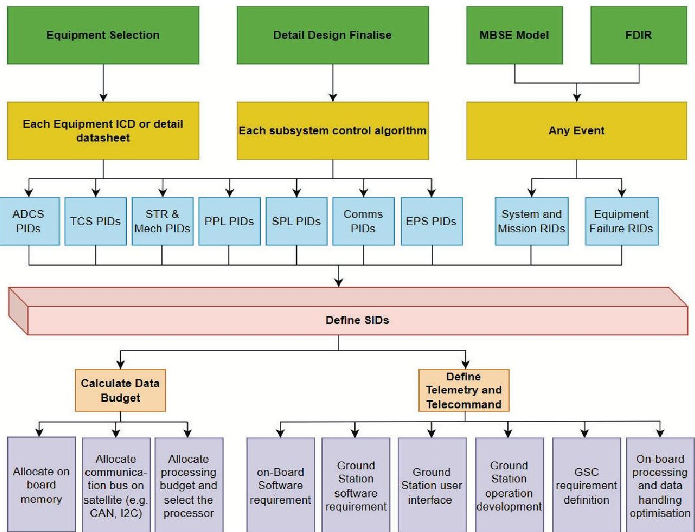

<!-- PDF_PAGE: 1 -->

IAC-25-D1-6-3-98469

# A Systems Engineering Approach to Satellite Data Budgeting

Ehsan Zabihian $ ^{ \mathrm{ID}} $ $ ^{a} $ , Farboud Foroughi $ ^{a} $ , Maria Nepheli Kardassi $ ^{a} $ , Christie Maddock $ ^{ \mathrm{ID}} $ $ ^{a} $ , Massimiliano Vasile $ ^{ \mathrm{ID}} $ $ ^{a} $ *

a Aerospace Centre of Excellence, Department of Mechanical & Aerospace Engineering University of Strathclyde, Glasgow UK E-mail: massimiliano.vasile@strath.ac.uk

* Corresponding author

## Abstract

Data budgeting is a critical consideration in satellite system design, influencing the mission architecture, operational planning, and the selection of components across multiple subsystems, including the on-board computer, power, communication, and ground segment. It directly affects mission architecture by optimising the configuration of orbital parameters, data generation, storage, processing, and transmission (link budget). Despite its significance, data budgeting is often neglected during the early phases of mission design and in academic curricula, leading to costly design iterations and suboptimal satellite operations. This study aims to provide a structured procedure for defining and managing the satellite data budget effectively. The methodology is demonstrated through the case study of the STRATHcube satellite, a research-oriented mission where data integrity and post-mission analysis are key considerations. The process begins with the systematic definition of onboard parameters gathered from subsystems, components, and onboard algorithms, referred to as Parameter Identifiers (PID). In-orbit event parameters are also considered, termed as Reference Identifiers (RID), derived from the Model-Based Systems Engineering model. These parameters are then structured, prioritised, and categorised into telemetry groupings known as Structure Identifiers (SID). Finally, the SIDs and orbital characteristics are used to calculate the data budget, which serves as an input for component selection and link budget calculations. Additionally, the study presents a framework for optimising data rates and storage duration to maximise mission success within a defined data budget. The implementation of the ECSS Packet Utilisation Standard is emphasised to improve telemetry quality and minimise unnecessary data transmission, fostering a resource-efficient approach to satellite data management. The study highlights the necessity of integrating data budgeting considerations early in the satellite design process. By using the outlined methodology, satellite designers can reduce design iterations and optimise mission architecture. This leads to improved system performance, efficient data management, and well-defined software requirements for both onboard and ground systems. The results demonstrate that prioritising data budgeting from the outset can significantly reduce inefficiencies throughout the satellite design phase. Furthermore, the methodology can be scaled to future satellite missions, providing a comprehensive framework for better data management and more resource-efficient satellite operations.

Keywords: Data Budgeting, Systems Engineering, CubeSat, ECSS, PUS, STRATHcube

## 1. Introduction

The proliferation of nano satellites, particularly CubeSats, has fundamentally altered the landscape of space exploration and utilisation. Initially conceived for educational purposes, these platforms are now tasked with increasingly complex scientific and commercial missions, equipped with sophisticated, data-intensive payloads such as hyperspectral imagers and synthetic aperture radars. This surge in capability has given rise to a significant engineering challenge: managing the data deluge generated on

board. For CubeSats operating in Low Earth Orbit (LEO), the volume of data produced by advanced sensors often far exceeds the capacity of the communication subsystem to transmit it to the ground. This disparity creates a critical bottleneck, where the value of a mission is constrained not by its ability to collect data, but by its ability to return that data to Earth.

Consequently, data budgeting can no longer be treated as a simple accounting exercise performed late in the design cycle. It has evolved into a primary mission design

<!-- PDF_PAGE: 2 -->

driver that profoundly influences decisions across the entire system architecture. The data budget dictates the required size of on-board memory, informs the selection of the on-board computer OBC based on processing needs for compression, and drives the design of the communications subsystem, which is often one of the important power consumers on a satellite. Neglecting a rigorous data budgeting process in the early design phases can lead to costly rework, suboptimal component selection, and, in the worst case, an inability to achieve mission objectives due to data loss.

A review of current literature reveals that while data and link budgeting are acknowledged as important, existing methodologies often lack a systematic, integrated framework suitable for the dynamic nature of modern satellite missions. Traditional link budget analyses, for instance, frequently rely on static best-case and worst-case scenarios for signal strength. This approach, while useful for establishing boundary conditions, fails to capture the continuous variation in path length and elevation angle inherent to LEO operations, offering little insight into the probable or expected data throughput over the mission's lifetime.

The intrinsic link between the power budget and the data budget is well-established, as the communication subsystem's power allocation directly impacts achievable data rates and link reliability. Methodologies for power budgeting are often based on defining the satellite's operational modes and the power requirements of active subsystems in each mode. While this modal approach is sound, it is not always systematically extended to data generation. Some advanced concepts propose the use of federated satellite systems or constellations to offload data and share resources, but these solutions are not applicable to the majority of standalone CubeSat missions that must manage their data budget independently.

Existing literature often approaches data budgeting as an accounting exercise, where the total generated data is weighed against the available downlink capacity. For instance, Komatsu et al. [7] and Kerrouche et al. [6] follow this methodology, evaluating the total data volume generated over a specific period to confirm that on-board storage and downlink opportunities are sufficient for the mission. However, a recurring theme is the identification of a significant data bottleneck. Castellvi et al. [2] emphasise that the data rates from modern payloads are often overwhelming when compared to the limited downlink windows available. To address this, Chatar et al. [3] propose on-board processing and machine learning to autonomously classify, compress, and prioritise data, thereby optimising the use of limited downlink bandwidth. This aligns with Arnold et al. [1], who argue that on-board data processing is essential to

reduce the dataset size and subsequent communication requirements. Beyond on-board processing, architectural solutions like federated satellite systems have been proposed, where spacecraft can lease communication resources to offload data to other nodes within the federation. This body of work underscores a shift towards more integrated methods for systems engineering approaches that link the data budget to other subsystem analyses from the earliest design stages, enabling better trade-off studies and ensuring full traceability from mission requirements to implementation.

This review identifies a clear gap in the literature: the need for a formal, systems-level methodology that connects dynamic operational modes to data generation, management, and transmission from the earliest stages of mission design. There is a lack of a standardised process that systematically translates high-level mission requirements into concrete data structures and communication protocols, a challenge this paper aims to address.

This paper introduces a structured, systems engineering methodology for satellite data budgeting that addresses the limitations of current practices. The proposed framework formalises the process of defining, structuring, and prioritising data flow, starting from the most fundamental parameters generated by individual components and culminating in an optimised communication protocol. This approach enables the early identification of data bottlenecks, provides quantitative justification for hardware selection (e.g., on-board memory, processor capabilities), and generates well-defined requirements for both the onboard flight software and the ground segment software. The core contribution is a repeatable and scalable process that integrates data management into the heart of the mission design lifecycle, rather than treating it as a subsequent analysis task.

The efficacy of the proposed methodology is demonstrated through its application to the STRATHcube mission, a 2U CubeSat currently under development at the University of Strathclyde in the UK. STRATHcube's dual-payload design and multi-modal operational concept present a complex data management challenge, making it an ideal case study. This paper is structured as follows. The next section provides a detailed description of the systems engineering methodology. Section 3 introduces the STRATHcube mission architecture, its operational concept, and its communication links. Section 4 presents the quantitative application of the methodology to STRATHcube, including the formulation of the data budget and storage analysis. Section 5 discusses the impact of the methodology on the satellite's design and the broader implications for future missions. Finally, the last section

<!-- PDF_PAGE: 3 -->

offers concluding remarks on the study's findings.

## 2. Systems Engineering Methodology for Data Budgeting

The proposed methodology provides a systematic framework for satellite data management, moving from highlevel mission inputs to detailed implementation requirements. The process, visualised in Figure 1, is founded on established systems engineering principles, integrating key inputs from the outset to ensure the data budget is not developed in isolation. These inputs include the selection of equipment and their corresponding Interface Control Document (ICD), the finalised detailed design of the satellite, models from Model-Based Systems Engineering (MBSE) activities, and the Failure Detection, Isolation, and Recovery (FDIR) strategy. By grounding the process in these fundamental mission artifacts, the resulting data budget is inherently consistent with the overall system architecture and operational plan.

## Layer 1: Systematic Parameter Identification

The foundational layer of the methodology is the systematic identification and cataloguing of every potential piece of data generated on board the satellite. This is achieved by creating two distinct classes of identifiers: Parameter and Report IDs.

Parameter Identifiers A Parameter Identifier (PID) is the most granular unit of data, representing a single, specific parameter generated by a hardware component, a subsystem, or an on-board software algorithm (e.g. Table 1). The creation of a comprehensive PID catalogue is a meticulous process that involves reviewing all available documentation, including component datasheets, ICDs, and software design documents. Each PID is an atomic piece of information, such as the voltage of a specific battery cell, a vector reading from a magnetometer, the calculated attitude quaternion from the Attitude Determination and Control System (ADCS), or the current state of a software module.

Report Identifiers In contrast to the continuous or periodic data represented by PIDs, Report Identifiers (RID) are discrete, event-based parameters. These identifiers are derived from higher-level system analysis, primarily from the MBSE model and the FDIR logic. An RID signifies the occurrence of a specific, predictable event in the satellite's lifecycle (see Table 3). Examples include flags for mission phase transitions (e.g., EOC-Complete), FDIR triggers (e.g., Safe-Mode-Entry Low-Voltage), or the status of a critical one-time deployment (e.g., Antenna-Deployment-Successful). Capturing RIDs is essential for providing operational context to the telemetry stream, allowing ground operators to understand not just the state of the satellite's parameters, but also the sequence of events that led to that state.

## Layer 2: Data Structuring and Prioritisation (SIDs)

Once the complete set of PIDs and RIDs has been identified, the next layer of the methodology addresses their organisation and prioritisation. A raw, flat list of hundreds of parameters is inefficient to manage and transmit. The solution is to group related parameters into logical, structured telemetry packets known as Structure Identifiers (SIDs).

An SID is a predefined collection of PIDs and RIDs that are grouped based on their operational (e.g. Table 2). The design of these SIDs is directly driven by the satellite's operational modes. For a satellite to function effectively, different information is required during different modes. For example, during a power-critical Safe Mode, only the most essential health parameters (e.g., battery state of charge, core temperatures) are needed, and they should be sampled at a low frequency to conserve resources. In contrast, during a high-intensity science observation mode, a rich set of data must be collected and stored together, including high-frequency sensor readings, precise attitude information, and accurate timestamps.

The SID creation process formalises this link between operational requirements and data structures. A SafeMode-Health-SID would be defined to contain only the critical PIDs for that mode. A PPL-Science SID for STRATHcube's primary payload would be defined to include the high-rate signal power data from the Software Defined Radio (SDR), the corresponding attitude quaternion from the ADCS, and a high-precision timestamp. This type of grouping ensures that all data required to interpret a specific event or observation is packaged and transmitted together, preserving context and simplifying ground processing. This step transforms the data budget from a simple summation of rates into an intelligent data management strategy, forming a crucial bridge between the high-level systems engineering concept and the detailed software implementation.

## Layer 3: Tailoring the ECSS Packet Utilisation Standard for Efficiency

The final layer of the methodology connects the structured data to a standardised communication protocol. The European Cooperation for Space Standardisation (ECSS) Packet Utilisation Standard (PUS), specifically ECSS-E-

<!-- PDF_PAGE: 4 -->

International Astronautical Congress, Sydney, Australia, 29 Sept - 3 October 2025. Copyright 2025 by the authors. Published by the IAF, with permission and released to the IAF to publish in all forms.

Fig. 1: Data Budgeting Framework, illustrating the flow from system-level inputs to implementation requirements.

Table 1: Formatting of PIDs

<table border="1"><tr><td>Categories</td><td>PID</td><td>Parameter Name</td><td>Type</td><td>Size(bit)</td><td>Formula</td></tr><tr><td rowspan="2">Charger</td><td>4001</td><td>Charger input current(main)</td><td>UInt</td><td>16</td><td>0.0008X+0.1491</td></tr><tr><td>4002</td><td>Charger output current(main)</td><td>UInt</td><td>16</td><td></td></tr></table>

ST-70-41C, defines a set of application-level services for telemetry and telecommand [4]. Packet Utilisation Standard is designed to promote interoperability and re-use of ground and on-board software by providing standard formats for common operations like housekeeping data reporting, event notification, and memory management[8].

A key feature of PUS is that it is intended to be tailored for each specific mission; implementing the entire standard is often too complex and resource-intensive for smaller missions like CubeSats [10]. The SID framework provides a formal, data-driven basis for this tailoring process. Each defined SID can be directly mapped to a specific PUS service. For example:

- Periodic housekeeping SIDs (e.g., EPS-Health SID) are naturally mapped to PUS Service 3 (Housekeeping).

- Event-based SIDs containing RIDs (e.g., FDIR-Event SID) are mapped to PUS Service 5 (Event Reporting).

- Large blocks of science data, such as those contained in the PPL-Science SID, can be handled by PUS Service 15 (Packet Forwarding Control) or a mission-specific custom service. [8]

This mapping provides a clear and traceable path from mission requirements to protocol implementation.

If the mission analysis determines that only 20 distinct SIDs are required to fulfil all operational and diagnostic needs, then the on-board software only needs to implement the PUS services necessary to transport those 20 SIDs. This contrasts sharply with ad-hoc approaches where services might be implemented without a clear link to a specific data requirement, leading to bloated and inefficient

<!-- PDF_PAGE: 5 -->

Table 2: Formatting of SIDs

<table border="1"><tr><td rowspan="2">SID</td><td rowspan="2">Description</td><td rowspan="2">Sampling Rate (sps)</td><td colspan="8">PIDs of each SID</td><td rowspan="2">Priority to send</td></tr><tr><td>PID1</td><td>PID2</td><td>PID3</td><td>PID4</td><td>PID5</td><td>PID6</td><td>PID7</td><td>PID8</td></tr><tr><td>1000</td><td>Mission Event</td><td>Event Base</td><td>501</td><td>502</td><td></td><td>507</td><td>508</td><td></td><td></td><td></td><td></td><td>High</td></tr><tr><td>1001</td><td>System Event</td><td>Event Base</td><td></td><td></td><td></td><td></td><td></td><td></td><td></td><td></td><td></td><td>High</td></tr><tr><td>1002</td><td>Faiure</td><td>Event Base</td><td>509</td><td>510</td><td>511</td><td></td><td></td><td></td><td></td><td></td><td></td><td>High</td></tr><tr><td>1003</td><td>Faulty</td><td>Event Base</td><td>513</td><td>514</td><td>515</td><td></td><td></td><td></td><td></td><td></td><td></td><td>High</td></tr></table>

Table 3: Formatting of RIDs

<table border="1"><tr><td>Categories</td><td>RID</td><td>Event Name</td><td>Type</td><td>Size(bit)</td><td>Formula to show in GS</td></tr><tr><td></td><td>501</td><td>Phase 1 status(completed/not completed)</td><td>double</td><td>32</td><td></td></tr><tr><td></td><td>502</td><td>Phase 2 status(completed/not completed)</td><td>double</td><td>32</td><td></td></tr></table>

software. By using the SID-to-PUS mapping, the methodology ensures that the communication protocol is perfectly optimised for the mission, fulfilling the goal of improving telemetry quality and fostering a resource-efficient approach to data management.

## 3. Case Study: STRATHcube

The proposed data budgeting methodology is applied to STRATHcube, a 2U CubeSat project led by students at the University of Strathclyde [5]. The mission serves as a compelling case study due to its complex, dual-payload design, which imposes significant data management constraints. The mission objectives are twofold:

Primary Mission To serve as a technology demonstrator for in-orbit space debris detection using a Passive Bistatic Radar (PBR) system. STRATHcube will act as a passive receiver, using signals of opportunity from the Iridium satellite constellation to detect objects with a cross-sectional area of at least 6.72 m2.

Secondary Mission To collect in-situ data during atmospheric re-entry. This experiment will measure the thermal and motion history of the satellite up to the point of solar panel fragmentation, providing valuable data for the validation of satellite demise models, such as the TITAN software developed at the University of Strathclyde [9].

The satellite's architecture is based on a suite of Commercial-Off-The-Shelf (COTS) components integrated into a custom 2U structure. These components include the two On-Board Computers (OBCs) with an integrated GPS module, an Attitude Determination and Control System (ADCS), and a Software Defined Radio (SDR) and an Iridium modem, which are central to the communication subsystem.

The STRATHcube mission has a simulated lifespan of approximately 184 days and is segmented into four distinct operational phases, each with specific objectives and active subsystems. The data budget is dynamic, changing significantly between these phases.

1- Early Operations and Commissioning Phase (duration: 10 days): Following deployment from the International Space Station, this phase involves satellite de-tumbling, deployment of the communications antenna, and establishing initial contact with the ground station. All core platform subsystems are active.

2- Primary Phase (duration: 172 days): This is the main scientific phase of the mission. The satellite alternates between a Nominal Mode (NOM), where it performs housekeeping and downlinks stored data, and a Primary Payload Mode (PPL), where the PBR system is actively collecting science data. The PPL mode is active for a total of approximately 13.7 hours over the course of the mission.

3- Transition Phase (duration: 7 hours): Triggered when the satellite's altitude drops to 170 km, this phase prepares the satellite for re-entry. It involves establishing a link with the Iridium constellation, reorienting to a specific attitude, and deploying the solar panels to achieve Passive Aerodynamic (PAS).

4- Secondary Phase (duration: 15 minutes): Triggered at an altitude of 120 km, this is the final data-gathering

<!-- PDF_PAGE: 6 -->

phase. The secondary payload's sensors record data on the re-entry environment, transmitting it in near real-time via the Iridium link until the satellite's demise.

The operational status of key data-generating components in each mission phase is critical for calculating the data budget, the initial design shows the status of each component and is summarised in Table 4.

STRATHcube's communication architecture is designed with two distinct links to service its two different mission phases and data requirements.

Primary Link A UHF link operating in the 435-440 MHz amateur band is used for primary mission operations. It handles both command uplinks and the downlink of highvolume primary payload data and housekeeping telemetry. The link utilises the DVB-S2 standard with Adaptive Coding and Modulation, allowing the data rate to be adjusted based on link conditions, reaching up to 653.5 kbps in favorable scenarios.

Secondary Link An L-band link (1616-1626.5 MHz) via the Iridium satellite constellation is used exclusively for downlinking secondary payload data during the final reentry phase. This provides global coverage when direct line-of-sight to the primary ground station is not possible. The data rate for this link is a constant 2.4 kbps, utilising Iridium's Short Burst Data service.

The primary ground station is the Spacecraft Tracking and Command Station located at the University of Strathclyde in Glasgow, UK. The access times and characteristics of this ground station are fundamental inputs to the data budget, as they define the total downlink capacity. These parameters are summarised in Table 5.

## 4. Data Budget Formulation and Analysis for STRATHcube

The application of the methodology begins with the creation of a comprehensive PID catalogue. This involves a systematic review of all on-board components to identify every parameter they generate. This catalogue forms the foundational database for the entire data budget. Table 6 presents a representative subset of the PIDs identified for STRATHcube, illustrating the level of detail required.

Not all data that a component can generate is needed at its maximum rate for mission success. The second step of the analysis involves defining the mission-required sampling rate for each PID, which is often significantly lower than the maximum possible rate. This represents a critical, early-stage optimisation of the data budget. For example,

while the battery temperature sensor might be capable of providing updates every second (1 Hz), for thermal monitoring purposes, a sample every 100 seconds (0.01 Hz) is more than sufficient. In contrast, the PBR science data must be sampled at a high rate to meet the Nyquist criterion for the expected Doppler shifts. Table 7 illustrates this differentiation for key parameters.

By combining the required data rates (Table 7), the component operational status per phase (Table 4), the phase durations (Section 3), and the link characteristics (Table 5), a complete data budget can be calculated. This analysis quantifies the total data generated in each phase, the total data that can be downlinked, and the net data that must be stored on board.

The results of this analysis, summarised in Table 8, provide the definitive quantitative justification for the satellite's data handling architecture. The most striking result is for the Primary Phase, where the high data rate of the PBR payload, even when active for only a fraction of the mission, generates an enormous volume of data that overwhelms the downlink capacity. This necessitates a large on-board storage buffer. In contrast, the Secondary Phase generates a small amount of data that can be transmitted in real-time.

The analysis clearly shows that while the total downlink capacity over the mission (10.6 GB) is greater than the total data generated (9.14 GB), the timing mismatch is extreme. The bulk of the data is generated in short, intense bursts during PPL operations, while the downlink opportunities are distributed throughout the mission. This confirms that an on-board storage capacity of at least 8.78 GB is required to buffer the science data until it can be gradually downlinked during the long nominal periods. This finding validates the selection of the OBC with its 32 GB microSD card, providing ample margin.

The final step is to demonstrate how the SID structure translates into an efficient PUS implementation. By defining SIDs based on operational modes and priorities, the mission can create a tailored and optimised set of telemetry packets. Table 9 provides a concrete example of how different types of data and events on STRATHcube are mapped into SIDs and then into standard PUS services.

This mapping provides a clear, traceable path from the system-level need (e.g., "we must monitor power system health") to the specific implementation detail (e.g., "generate a PUS TM[3,x] packet containing these three PIDs every 100 seconds"). This structured approach minimises ambiguity, reduces software development effort, and ensures the communication protocol is lean and fit for purpose.

<!-- PDF_PAGE: 7 -->

Table 4: STRATHcube Component Operational Status per Mission Phase

<table border="1"><tr><td></td><td colspan="7">Mission Modes</td></tr><tr><td>Sub system</td><td>Launch</td><td>Safe</td><td>EOC</td><td>PPL</td><td>TRSN</td><td>SPL</td><td>NOM</td></tr><tr><td>Primary Payload</td><td>OFF</td><td>OFF</td><td>OFF</td><td>ON</td><td>OFF</td><td>OFF</td><td>OFF</td></tr><tr><td>Secondary Payload</td><td>OFF</td><td>OFF</td><td>OFF</td><td>OFF</td><td>ON</td><td>ON</td><td>OFF</td></tr><tr><td>Structures &amp; Mechanisms</td><td>OFF</td><td>OFF</td><td>ON</td><td>OFF</td><td>ON</td><td>OFF</td><td>OFF</td></tr><tr><td>ADCS</td><td>OFF</td><td>DET</td><td>DET</td><td>Zen</td><td>Man</td><td>OFF</td><td>Sun/Nadir</td></tr><tr><td>TTC</td><td>OFF</td><td>ON</td><td>ON</td><td>ON</td><td>ON</td><td>ON</td><td>ON</td></tr><tr><td>Power</td><td>OFF</td><td>ON</td><td>ON</td><td>ON</td><td>ON</td><td>ON</td><td>ON</td></tr><tr><td>Thermal</td><td>OFF</td><td>ON</td><td>ON</td><td>ON</td><td>ON</td><td>ON</td><td>ON</td></tr><tr><td>C&amp;DH</td><td>OFF</td><td>ON</td><td>ON</td><td>ON</td><td>ON</td><td>ON</td><td>ON</td></tr></table>

EOC: Early Operations and Commissioning, PPL: Primary Payload Mode

TRSN: Transition, SPL: Secondary Payload, NOM: Nominal Mode

Table 5: Ground Station Access and Link Characteristics Summary

<table border="1"><tr><td>Parameter</td><td>Value</td></tr><tr><td>Ground Station Location</td><td>Glasgow,UK(55.86°N,4.24°W)</td></tr><tr><td>Primary Downlink Frequency</td><td>437MHz(UHF)</td></tr><tr><td>Primary Downlink Frequency</td><td>437MHz(UHF)</td></tr><tr><td>Secondary Downlink Frequency</td><td>1616-1626.5MHz(L-Band)</td></tr><tr><td>Mean Pass Duration</td><td>3.82min</td></tr><tr><td>Average Daily Contact Time</td><td>18.4min</td></tr><tr><td>Max Primary Downlink Rate(UHF)</td><td>653.5kb/s</td></tr><tr><td>Secondary Downlink Rate(Iridium)</td><td>2.4kb/s</td></tr></table>

## 5. Discussion

The application of this systems engineering approach to data budgeting was not merely an analytical exercise; it actively shaped and validated fundamental design decisions for the STRATHcube mission. The quantitative results from the data volume analysis provided justification for several key architectural choices. The calculated requirement for over 8.78 GB of on-board storage directly validated the selection of an OBC with expandable microSD card capacity. An OBC without this feature would have been incapable of meeting mission requirements, a critical flaw that this methodology identified early in the design process.

Furthermore, the analysis highlighted the necessity of the dual-link communication architecture. The primary mission's high data volume demands a high-rate downlink which the UHF system provides.

A key outcome of this study is the clear demonstration that a simple "store-and-dump" data handling strategy is not viable for data-intensive CubeSat missions. The sheer volume of data generated by the primary payload (up to

2184 kbps) compared to the average downlink rate ( 208 kbps during a pass) creates a deficit of an order of magnitude. This shows that the satellite cannot simply record everything and hope to transmit it later.

The secondary mission, on the other hand, requires a communications link during re-entry, when the primary ground station is inaccessible. As shown in Table 8, the low data-rate but globally available Iridium link is insufficient for downlinking the entire secondary payload dataset, leaving 1.8 MB of data untransmitted by the time of satellite demise. To mitigate the loss of this valuable re-entry data, appropriate data compression algorithms must be applied.

These data bottlenecks validate the need for intelligent on-board software capable of both data compression and prioritisation. The SID framework is the mechanism for implementing this prioritisation. By assigning different priorities to different SIDs, the on-board software can make intelligent decisions about what data to transmit first when a downlink opportunity arises. For example, a high-priority FDIR-Event-SID would be transmitted before a large block of lower-priority PPL-Science-SID data. This ensures that

<!-- PDF_PAGE: 8 -->

Table 6: Representative PID Catalogue for STRATHcube Subsystems

<table border="1"><tr><td>Subsystem</td><td>Component</td><td>Parameter Name(PID)</td><td>Data Type</td><td>Resolution(bits)</td><td>Sampling Rate(Hz)</td></tr><tr><td>EPS</td><td>Battery</td><td>Voltage</td><td>uint16</td><td>16</td><td>1</td></tr><tr><td>EPS</td><td>Battery</td><td>Current</td><td>uint16</td><td>16</td><td>1</td></tr><tr><td>EPS</td><td>Battery</td><td>Temperature</td><td>uint16</td><td>16</td><td>1</td></tr><tr><td>ADCS</td><td>ADCS</td><td>Quaternion</td><td>float</td><td>128</td><td>4</td></tr><tr><td>ADCS</td><td>ADCS</td><td>Angular Velocity</td><td>float</td><td>128</td><td>4</td></tr><tr><td>ADCS</td><td>ADCS</td><td>Magnetometer Vector</td><td>float</td><td>96</td><td>4</td></tr><tr><td>PPL</td><td>SDR</td><td>I/Q Data</td><td>complete x int16</td><td>32</td><td>182,000</td></tr><tr><td>SPL</td><td>Heat Flux sensor</td><td>Heat Flux</td><td>uint16</td><td>12</td><td>1</td></tr><tr><td>SPL</td><td>Temperature Sensor</td><td>Temperature</td><td>uint16</td><td>12</td><td>1</td></tr><tr><td>SPL</td><td>Strain Gauge</td><td>Solar Panel Fragmentation</td><td>uint16</td><td>12</td><td>1</td></tr><tr><td>SPL</td><td>3-axis Accelerometer</td><td>Acceleration</td><td>float</td><td>24</td><td>250</td></tr><tr><td>C&amp;DH</td><td>OBC</td><td>Temperature</td><td>uint16</td><td>16</td><td>1</td></tr><tr><td>C&amp;DH</td><td>OBC</td><td>Time</td><td>uint64</td><td>64</td><td>1</td></tr></table>

Table 7: Required Data Sampling Rates vs. Maximum Generation Rates

<table border="1"><tr><td>PID</td><td>Max Rate(Hz)</td><td>Mission Required Rate(Hz)</td><td>Rationale</td></tr><tr><td>Battery Voltage</td><td>1</td><td>0.1</td><td>Slow-changing parameter, lower frequency is sufficient.</td></tr><tr><td>Quate-rnion</td><td>4</td><td>1</td><td>lower frequency is sufficient</td></tr><tr><td>I/Q Data</td><td>182,000</td><td>182,000</td><td>Must comply with Nyquist criterion; no reduction possible.</td></tr><tr><td>OBC Temperature</td><td>1</td><td>0.01</td><td>Very slow-changing; infrequent monitoring is adequate.</td></tr></table>

the most critical information regarding the satellite's health and safety is received by ground operators promptly. This directly addresses the abstract's claim that the methodology helps to define both on-board and ground software requirements, as both systems must be built to understand and act upon this SID-based priority scheme.

While demonstrated on the STRATHcube 2U CubeSat, the PID-RID-SID methodology is inherently scalable and mission-agnostic. The framework is not dependent on the size of the satellite or the specific nature of its payload. It is a generalised process for decomposing system-level data requirements into manageable, structured, and prioritised packets. For larger, more complex missions with multiple payloads and more intricate operational modes, the number of PIDs and SIDs would increase, but the fundamental process of identification, structuring, and mapping to a communication protocol remains the same. This approach provides a standardised and repeatable method that can reduce design iterations and improve resource efficiency for a wide range of future space missions, from single CubeSats to constellations.

## 6. Conclusions

Data budgeting is a foundational pillar of modern satellite system design, with far-reaching implications for mission architecture, operational feasibility, and overall success. This study has presented a formal systems engineering methodology that elevates data budgeting from a late-stage accounting task to an integrated design driver. By systematically identifying all data sources as PIDs and RIDs, structuring them into operationally relevant SIDs, and using this framework to tailor an efficient ECSS PUS communication protocol, the methodology provides a traceable, data-driven path from mission requirements to implementation.

The application of this framework to the STRATHcube mission served as a powerful validation of its utility. The analysis provided concrete, quantitative justification for key hardware selections, such as the necessity of a high-capacity on-board memory buffer. It unequivocally demonstrated the need for a sophisticated on-board data management strategy, including data prioritisation and compression, to bridge the significant gap between data generation and downlink capacity. Ultimately, the methodology provides satellite designers with a robust tool to man-

<!-- PDF_PAGE: 9 -->

Table 8: Total Data Volume and Storage Budget per Mission Phase

<table border="1"><tr><td>Mission Phase</td><td>Phase Duration</td><td>Data Generated</td><td>Data Downlinked</td><td>Net Data to Store</td></tr><tr><td>EOC</td><td>10 days</td><td>5 MB</td><td>5 MB</td><td>0 GB</td></tr><tr><td>Primary (PPL Active)</td><td>13.7 hours</td><td>8.98 GB*</td><td>0.2 GB</td><td>8.78 GB</td></tr><tr><td>Primary (NOM)</td><td>166 days</td><td>150 MB</td><td>10.4 GB</td><td>-10.25 GB (Surplus)</td></tr><tr><td>Transition</td><td>7 hours</td><td>2 MB</td><td>0 GB</td><td>2 MB</td></tr><tr><td>Secondary</td><td>15 min</td><td>2.1 MB</td><td>0.3 MB</td><td>1.8 MB</td></tr><tr><td>Mission Total</td><td>184 days</td><td>9.14 GB</td><td>10.6 GB</td><td>Requires&gt;8.78 GB Buffer</td></tr></table>

* Assumes moderate compression (8-bit) for PPL data. Without compression, this value would be ~13.46 GB.

Table 9: Example of SID-to-PUS Service Mapping for STRATHcube

<table border="1"><tr><td>SID Name</td><td>Description</td><td>Included PIDs/RIDs</td><td>Generation Trigger</td><td>Mapped PUS Service</td></tr><tr><td>EPS Health</td><td>Periodic report of core power system health.</td><td>Battery Voltage, Battery Current, OBC Temp</td><td>Periodic (every 100s)</td><td>Service 3: Housekeeping</td></tr><tr><td>FDIR Event</td><td>High-priority alert for an anomalous event.</td><td>RID: Safe Mode Entry, PID: Battery Voltage</td><td>Event-based(FDIR trigger)</td><td>Service 5: Event Reporting</td></tr><tr><td>PPL Science</td><td>High-volume science data packet.</td><td>Timestamp,I/Q Data Sample,Attitude Quaternion</td><td>PPL Mode Active</td><td>Service 13: Large Data Transfer</td></tr><tr><td>SPL Re-entry</td><td>Real-time re-entry data.</td><td>Timestamp,Accel Vector,Gyro Vector,Heat Flux</td><td>Periodic(every 83ms)</td><td>Service 3: Housekeeping</td></tr></table>

age complexity, optimise resource allocation, and reduce design risk, thereby increasing the probability of achieving all mission objectives in an increasingly data-rich space environment.

## Acknowledgement

The work presented in this paper was supported the University of Strathclyde Alumni Fund, Institution of Mechanical Engineers, and the Royal Aeronautical Society through funding to the STRATHcube project. Additional support was provided by the Carnegie Trust for the Universities of Scotland and by the European Space Agency under the Fly Your Satellite! Design Booster programme.

## References

[1] S. S. Arnold, R. Nuzzaci, and A. Gordon-Ross. Energy budgeting for cubesats with an integrated fpga. In 2012 IEEE Aerospace Conference, 2012. doi: 10.1109/AERO.2012.6187240.

[2] J. Castellví, A. Camps, J. Corbera, and R. Alamús. 3cat-3/mots nanosatellite mission for optical multi-

spectral and gnss-r earth observation: Concept and analysis. Sensors (Switzerland), 18(1), 2018. doi: 10.3390/s18010140.

[3] K. Chatar, E. Felding, K. Sano, and K. Kitamura. Data downlink prioritization using image classification onboard a 6u cubesat. In Proceedings of SPIE - Sensors, Systems, and Next-Generation Satellites XXVII, 2023. doi: 10.1117/12.2684047.

[4] ECSS Secretariat. Ecss-e-st-70-41c: Space engineering: Telemetry and telecommand packet utilization. Technical report, ECSS, Noordwijk, Netherlands, 2016.

[5] C. Jenkins, L. Creed, J. Graham, S. Kirk, D. McGarrity, G. Stewart, R. Hope, A. R. Wilson, and M. Vasile. Strathcube: A student cubesat that encourages the sustainable usage of space. In Proceedings of the 72nd International Astronautical Congress, Dubai, UAE, 2021. International Astronautical Federation.

<!-- PDF_PAGE: 10 -->

[6] K. D. E. Kerrouche, L. Wang, A. Seddjar, V. Rastinasab, S. Oukil, Y. M. Ghaffour, and L. Nouar. Applications of nanosatellites in constellation: Overview and feasibility study for a space mission based on internet of space things applications used for ais and fire detection. Sensors, 23(13), 2023. doi: 10.3390/s23136232.

[7] Y. Komatsu, Y. Tsutsui, H. Katsumata, A. Wada, Y. Kakehashi, K. Fujimoto, K. Nakamura, Y. Kaneko, and T. Iwata. Raise-3 for agile on-orbit demonstration of innovative satellite technologies: Mission definition and conceptual design, 2021.

[8] M. Merri, B. Melton, S. Valera, and A. Parkes. The ecss packet utilization standard and its support tool. In SpaceOps 2002 Conference, 2002. doi: 10.2514/ 6.2002-T5-06.

[9] S. A. Peddakotla, F. Morgado, D. Thillaithevan, D. O'Driscoll, M. Santer, C. Maddock, M. Vasile, and M. Fossati. Multi-fidelity and multidisciplinary approach for the accurate simulation of atmospheric re-entry. In Proceedings of the 73rd International Astronautical Congress, Paris, France, 2022. International Astronautical Federation.

[10] M. Prochazka and P. Skrzypek. Packet utilization standard and its use in esa missions. Technical report, ESA, Noordwijk, Netherlands, 2018.