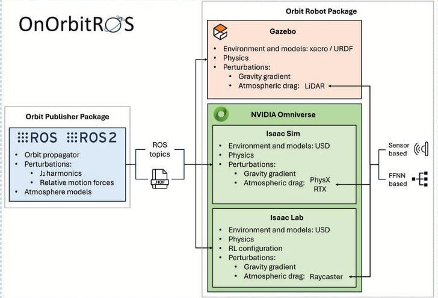
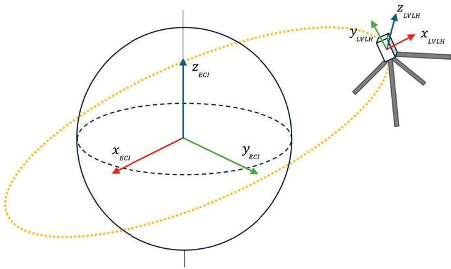
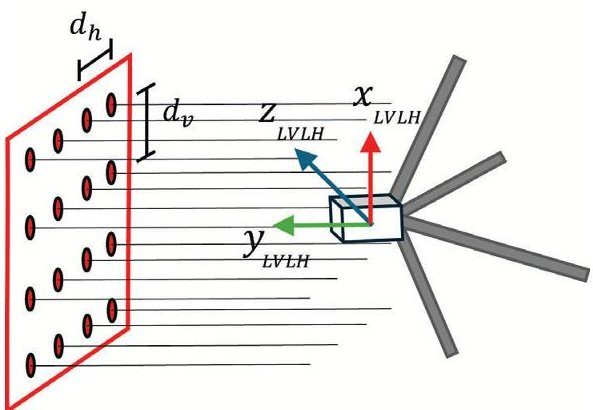
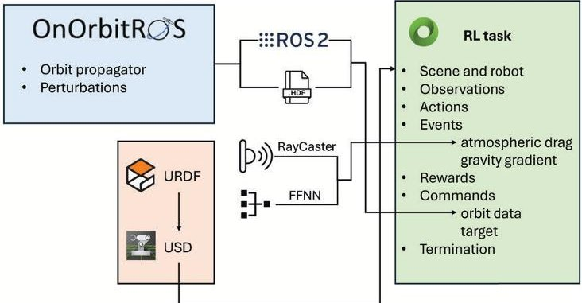
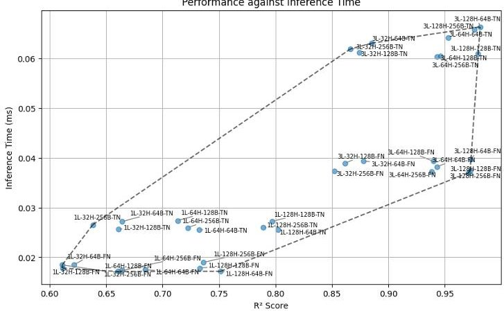

<!-- PDF_PAGE: 1 -->

IAC-25,D1,5,4,x96396

# An Advanced Simulation Framework for Sail-Driven Spacecraft Dynamics and Control

Celia Redondo-Verdú $ ^{a} $ $ ^{*} $ , Álvaro Belmonte-Baeza $ ^{a} $ , José L. Ramón $ ^{a} $ , Cristina Cachero $ ^{b} $ , Jorge Pomares $ ^{a} $

$ ^{a} $ Department of Physics, Systems Engineering and Signal Theory, University of Alicante, San Vicente del Raspeig, Alicante 03690, Spain

$ ^{b} $ Department of Software and Computing Systems, University of Alicante, San Vicente del Raspeig, Alicante 03690, Spain

* Corresponding author

## Abstract

The development of spacecrafts with solar and drag sails has gained significant interest in recent years due to their potential for fuel-free propulsion and extended mission lifetimes. This paper begins with a study of current space missions that utilize sail-driven technology, highlighting their applications, challenges, and technological advancements. Based on this analysis, we emphasize the necessity of an accurate and efficient simulation environment for testing and validating control systems designed for solar and drag sail spacecraft, particularly in Low Earth Orbit (LEO), where atmospheric drag plays a crucial role in the disturbance forces. To address this need, we present the implementation of the Drag Deorbit Device (D3) in a CubeSat platform, a propellant-less deployable and controllable drag sail system. Additionally, we propose an advanced Software-in-the-Loop (SIL) simulation framework that overcomes the limitations of previous simulation tools. The presented approach integrates Isaac Sim and Robot Operating System (ROS), leveraging the advantages of physics-based real-time simulation, high-fidelity rendering, and seamless hardware integration. In addition, enhanced GPU-accelerated physics for precise force and torque modeling, modular extensibility for integrating custom spacecraft dynamics, and real-time visualization for intuitive debugging and system analysis is considered. The presented simulation system incorporates orbital perturbations such as gravity gradient effects, atmospheric drag, gravitational anomalies, and forces from relative motion in an elliptical orbit, providing a more realistic operational environment. Instead of relying on predefined mass distribution, this approach applies drag forces directly on the spacecraft's surface, leveraging the physics engine to naturally resolve the resulting dynamics while maintaining accuracy and enabling seamless adaptation to different spacecraft designs. The proposed SIL architecture follows a digital twin paradigm, ensuring a high-fidelity representation of the spacecraft's dynamics and control systems within the virtual environment. This digital twin enables rapid prototyping, real-time testing, and iterative refinement of control strategies before deployment in space. By bridging the gap between simulation and real-world implementation, the presented system significantly enhances the reliability and robustness of solar sail spacecraft operations. Through this work, we demonstrate the reliability and accuracy of the proposed system using real data, validating its effectiveness for spacecraft simulation and control in LEO.

## Acronyms

Keywords: Drag Sail, Simulation Framework, Atmospheric Drag, Reinforcement Learning, Control, Low Earth Orbit

Argument of Perigee (AoP), Drag Deorbit Device (D3), Earth-Centered Inertial (ECI), European Space Agency (ESA), Feedforward Neural Network (FFNN), Federal Communications Commission (FCC), General Mission Analysis Tool (GMAT), Geostationary Orbit (GEO), HDF5 (Hierarchical Data Format version 5), Inter-Agency Space Debris Coordination Committee (IADC), Local Vertical Local Horizontal (LVLH), Low Earth Orbit (LEO), Markov Decision Process (MDP), Mean Absolute Error

(MAE), Mean Relative Error (MRE), Medium Earth Orbit (MEO), Mean Square Error (MSE), Normalized Root Mean Square Error (NRMSE), On-Orbit Servicing (OOS), Partially Observable Markov Decision Process (POMDP), Right Ascension of the Ascending Node (RAAN), Reinforcement Learning (RL), Robot Operating System (ROS), Root Mean Square Error (RMSE), Software-in-the-Loop (SIL), Semi-Major Axis (SMA), Solar Radiation Pressure (SRP), Standard Triangle Language (STL), Two-Line Element (TLE), True Anomaly (TA), Unified Robot Descrip-

IAC-25,D1,5,4,x96396

<!-- PDF_PAGE: 2 -->

tion Format (URDF), Universal Scene Description (USD), U.S. Standard Atmosphere 1976 (USSA76).

## 1. Introduction

The dynamic environment of Low Earth Orbit (LEO) presents both significant challenges and unique opportunities for spacecraft design and control. Compared to satellites operating in Medium Earth Orbit (MEO) and Geostationary Orbit (GEO), LEO platforms benefit from shorter orbital periods (corresponding to lower altitudes and higher orbital velocities) as well as reduced communication latency and lower signal attenuation, more frequent geometric configuration changes, and decreased launch costs. However, these benefits are counterbalanced by the increased complexity of the dynamical environment. Unlike deep space missions, where gravitational forces dominate and remain relatively uniform, LEO is characterized by persistent non-conservative perturbations, primarily due to atmospheric drag and Earth's non-spherical gravitational field, as demonstrated by recent numerical analysis [1]. The latter includes perturbations from zonal harmonics, particularly the $ J_{2} $ term that represents the influence of the equatorial bulge, which induces secular variations in orbital elements such as the right ascension of the ascending node (RAAN) and the argument of perigee (AoP). Atmospheric drag, on the other hand, results from momentum exchange between the upper atmosphere and the spacecraft, leading to a progressive loss of orbital energy. This interaction causes a gradual circularization of eccentric orbits and a continuous reduction in the semi-major axis, ultimately resulting in re-entry if no corrective action is taken. For satellites operating in this region, especially those with extended structures, these forces can substantially influence both translational and rotational dynamics, affecting mission longevity, stability, and operational predictability [2]. While these environmental forces have traditionally been treated as disturbances to be mitigated, there is a growing recognition that they can be harnessed for passive actuation, enabling propulsion, stabilization, or controlled deorbiting without the need for onboard propellant.

At the same time, the technological advancements and the ongoing miniaturization of spacecraft have enabled more affordable and accessible space missions, resulting in rapid growth in satellite deployments, particularly in LEO. According to Euroconsult [3], between 2024 and 2033, the number of satellites to be launched is projected to more than triple compared to the previous decade, with megaconstellations dominating the count. The proliferation of small satellites, such as CubeSats, and large-scale commercial constellations has raised serious concerns about

orbital congestion, collision risk, and the long-term sustainability of LEO. The accumulation of active satellites and space debris increases the probability of cascading collision events, known as the Kessler Syndrome [4,5], where each impact generates further debris and amplifies future collision risks. As a result, debris mitigation and post-mission disposal have become urgent priorities for agencies and operators aiming to preserve the near-Earth orbital environment.

To address this challenge, the Inter-Agency Space Debris Coordination Committee (IADC) introduced internationally recognized guidelines recommending that spacecraft vacate protected orbital regions within 25 years of mission end, either through atmospheric reentry or transfer to a graveyard orbit [6]. While these guidelines have been endorsed by the United Nations and adopted into international standards, they remain non-binding and insufficient given the scale of current and projected satellite deployments [7]. As a result, regulatory bodies such as the European Space Agency (ESA) and the U.S. Federal Communications Commission (FCC) have implemented stricter measures, including a reduction of the post-mission disposal timeline in LEO to just 5 years [8,9]. In parallel, there are other initiatives to tackle this problem, such as ESA's Space Safety Programme, which promotes collision avoidance and active debris removal, and ESA's Zero Debris Approach, aiming to eliminate debris generation from its missions by 2030 [9]. However, small satellites often face size and mass constraints that limit the integration of active propulsion systems, increasing interest in passive deorbiting techniques such as drag sails, which offer fuel-free and cost-effective solution for end-of-life disposal.

Drag sails are lightweight, passively actuated devices designed to increase a satellite's cross-sectional area, thereby enhancing atmospheric drag that can be exploited to control the spacecraft's orbit or its altitude. Architecturally and mechanically, drag sails share many features with solar sails, as both rely on deployable structures to increase the area-to-mass ratio optimized to interact with environmental forces, whether atmospheric drag or solar radiation pressure (SRP). As a result, drag sail development has benefited from technological advances and expertise in solar sailing. These passive actuation systems offer fuel-free, low-cost, and scalable solutions that have been primarily implemented for end-of-life disposal to ensure mission success, regulatory compliance, and the reduction of space debris, particularly with limited volume and mass budgets [7,10-12]. Recent on-orbit demonstrations have validated their feasibility on real missions such as [13-15], and ongoing research explores their potential

<!-- PDF_PAGE: 3 -->

for broader applications, including controlled attitude, deborbit and reentry [11,16-20], formation flying [21], and even rendezvous maneuvers [21,22].

In this context, high-fidelity, physics-based simulation frameworks have become critical for the design, verification, and operational readiness of advanced autonomous systems. Accurate modeling of coupled orbital and attitude dynamics is particularly essential for spacecraft operating in perturbation-rich environments, as is the case with sail-driven platforms in LEO. Due to the difficulty of replicating space conditions on Earth, early development of spacecraft control systems relies heavily on simulation [23], as ground-based testbeds like air-bearing platforms and robotic manipulators [24-26] are unable to reproduce key orbital effects. While tools such as GMAT [27] and STK [28] provide high-fidelity orbital propagation, they lack real-time compatibility for closed-loop control and learning-based system development. On the other hand, robotics-focused simulators, such as Gazebo, MuJoCo, Webots, PyBullet, and Isaac Sim, offer control-loop integration and support for learning-based strategies, but typically lack native support for orbital dynamics. Unified frameworks like OnOrbitROS [29] address this limitation by integrating orbital perturbation models and multibody simulation into the ROS/Gazebo stack, with validation against real flight data. In parallel, SpaceROS [30], a safety-critical fork of ROS 2 developed by NASA and Blue Origin, introduces deterministic execution and realtime guarantees for space robotics applications but requires external coupling for physics-based and orbital dynamics. Recent work with NVIDIA's Isaac Sim further demonstrates its potential for spacecraft control and GPUaccelerated RL training [31,32], despite current limitations in modeling orbital perturbations. Among the different applications developed with this software are contact-rich manipulation with a free-flying multi-arm robot in microgravity [31], and large-scale RL-based navigation with thrust control in 3- and 6-DoF [32]. Nonetheless, the application of RL in space systems continues to face challenges in sample efficiency, interpretability, and integration with flight software. These limitations underscore the growing need for high-fidelity simulation environments, robust training pipelines, and formal verification tools to support the safe deployment of learning-based control in space missions [33].

To address these challenges, this work presents a highfidelity, modular simulation framework tailored for spacecraft operating in perturbation-rich environments such as LEO. The proposed system integrates NVIDIA simulation tools, Isaac Sim and Isaac Lab, with the Robot Operating System (ROS), leveraging GPU-accelerated multibody physics, real-time force modeling, and modular extensibility to support the development and closed-loop testing of advanced control strategies. Unlike traditional tools, this architecture allows direct application of environmental forces on spacecraft geometries, enabling accurate simulation of coupled orbital and attitude dynamics under realistic perturbations such as atmospheric drag, gravity gradients, and $ J_{2} $ effects. Designed to support both classical and learning-based controllers, the framework follows a digital twin paradigm and facilitates rapid prototyping, RL training, and Software-in-the-Loop (SIL) validation. While demonstrated using sail-actuated spacecraft, the platform is broadly applicable to autonomous systems requiring high-fidelity simulation for control design, policy verification, and performance evaluation in complex orbital conditions. The system designed for the evaluation of the framework is based on [22] and consists of a 2U CubeSat equipped with a Drag Deorbit Device (D3), a standard module consisting of four extendable and individually controlled booms of 3.7m length inclined $ 20^{\circ} $ and spaced $ 90^{\circ} $ apart in the anti-ram face. This device allows the modulation of the cross-sectional area purely through mechanical extension/retraction of the booms, allowing passive actuation that can be exploited for controlled deorbit re-entry [16,20], rendezvous [22], attitude control, etc.

The remaining sections of this work are organized as follows. Section 2 presents the simulation framework, detailing the integration of OnOrbitROS with Gazebo and NVIDIA's Isaac Sim/Lab, as well as the extensions implemented for orbital dynamics, perturbation modeling, and spacecraft definition. Control strategies based on RL within this framework are discussed in Section 3, focusing on the formulation of the problem and the training pipeline. Lastly, Section 4 reports the experimental validation and comparative results of the proposed methods, while Section 5 summarizes the main findings and outlines directions for future work.

## 2. Simulation Framework

This work addresses the challenge of adapting and unifying existing simulation frameworks and tools to develop a system capable of combining realistic space conditions with automatic control. The solution presented integrates two main components: orbital dynamics modeling and high-fidelity simulation environments, compatible with different tools for spacecraft dynamics and control strategies, including RL-based.

For this, OnOrbitROS [29] is used as the foundational

<!-- PDF_PAGE: 4 -->

platform, meant for the study and development of On-Orbit Servicing (OOS) applications, and unlike general-purpose robotic simulations, it is specifically designed to simulate the complex environmental conditions encountered in these kinds of scenarios. The framework builds upon the Robot Operating System (ROS/ROS 2), an open-source middleware that provides a modular, distributed node architecture for communication and control [34, 35], and couples it with the Gazebo physics engine for 3D simulation. This integration enables detailed modeling of spacecraft through URDF/SDF descriptions, defining geometry, mass, sensors, actuators, and kinematics. The tight integration with ROS allows real-time feedback and control using the same nodes and topics as in deployment, and this modularity is extended via Gazebo plugins, which enable custom physics, sensor models, and interfaces with multiple physics engines (such as ODE, Bullet, DART).

OnOrbitROS leverages the ROS/Gazebo stack, utilizing existing packages and controllers, but also exploiting the customization of additional behaviours. Its architecture is divided into an Orbit Publisher Package, which is an inbuilt ROS orbit propagator, and the Orbit Robot Package, a custom Gazebo plugin that calculates and applies the different perturbations and physics behaviors to provide a realistic simulation.

The presented work extends the functionality of the original framework with additional information, a novel approach to calculate and apply the atmospheric drag perturbation, and compatibility with newer and more powerful simulation engines from NVIDIA's Omniverse family, a modular development platform of APIs and microservices for building 3D applications and services [36]. Isaac Sim is a high-fidelity robotics simulation environment built on top of Omniverse. It is designed to support advanced robotics workflows by integrating GPU-accelerated physics, sensor simulation, and artificial intelligence, though optimized integrations with hardware and other robotic frameworks like ROS [37]. Similarly, built on top of Isaac Sim is Isaac Lab, a lightweight RL open-source research framework that provides standardized tools and abstractions to design, train, and evaluate learning-based control policies in simulated environments [38]. Therefore, while the Orbit Publisher Package remains common for all three simulation environments through ROS/ROS 2 bridge, the Orbit Robot Package is custom and adapted to each tool. The architecture of the new OnOrbitROS framework with its main components is depicted in Fig. 1.

Fig. 1: Architecture of the new OnOrbitROS framework.

## 2.1 Orbit Publisher Package

The main function of this module is to generate the orbital trajectories of the bodies that compose the simulation, implemented as a ROS publisher node. The orbits or trajectories can be defined in different formats, being the default option being Keplerian orbits (defining the Local Vertical Local Horizontal (LVLH) parameters referenced to the Earth-Centered Inertial (ECI) frame, using the TwoLine Element (TLE) units, as denoted in Fig. 2). Then they are propagated in real-time, synchronized with the physics engine, or in standalone propagation independent of the simulation. Each step, the orbit state is calculated and published, comprising the orbit pose (LVLH), orbit velocity, atmosphere angular velocity, altitude, and current air density at that point. Other extended orbital information is calculated if enabled from the State Vector (position and velocity) and published: Eccentricity, Inclination, Orbit Period, RAAN, Semi-Major Axis (SMA), and True Anomaly (TA). These metrics were not included in the original version of OnOrbitROS and were implemented based on the classical orbital mechanics formulations presented in [39] to enhance the real-time orbital information available, which also serves as a way of ensuring consistent and correct propagation of the orbit throughout the simulation.

Atmospheric density, a key driver of drag force, was not included in the original framework; its accurate prediction remains challenging and is typically approached through models ranging from empirical profiles to physicsbased formulations. OnOrbitROS now supports both the U.S. Standard Atmosphere 1976 (USSA76) model, a static altitude-dependent model, as well as the NRLMSISE-00 model. While the former is computationally efficient as

<!-- PDF_PAGE: 5 -->

Fig. 2: Coordinate frames.

it provides a simple approximation of atmospheric density based solely on altitude [39], the latter is a more sophisticated empirical model that accounts for temporal, spatial and geomagnetic variations, offering improved fidelity for simulations sensitive to environmental variability. The NRLMSISE-00 model is integrated through the open-source library by [40], requiring spacecraft geodetic coordinates, day-of-year, and time, along with space weather inputs (F10.7 solar flux and 3-hourly Ap indices, calculated following standards) from GFZ and CelesTrak datasets [41,42].

## 2.2 Orbit Robot Package

The modeling of orbital perturbations in the simulation framework relies on the Orbit Robot Package, which provides the environmental context required for realistic space conditions; from simple elimination of effects like gravity, wind, and magnetism to the complex perturbations [29]. Its implementation is dependent on the underlying simulator: in Gazebo, perturbations are introduced through a dedicated plugin; in Isaac Sim, they are managed via a behavior component integrated into the articulation; and in Isaac Lab, they are coded within the environment configuration as event and command terms. This modular adaptation ensures consistency across platforms while maintaining compatibility with the simulator's native interfaces for dynamics and control.

The relative significance of orbital perturbations in LEO depends strongly on satellite altitude, structural design, and the prediction horizon [1]. In this framework, the modeled effects include Earth's non-spherical gravity field, gravitygradient torques arising from spatial variations in Earth's gravity across an extended rigid body, relative motion forces associated with orbital angular velocity in elliptical

orbits (particularly relevant in rendezvous scenarios) and atmospheric drag. Collectively, these perturbations represent the dominant non-conservative forces and torques acting on satellites, comprising altitude and orbit-dependent effects as well as those critical to OOS operations. They are applied at each simulation step to consistently influence both translational and rotational dynamics.

A novel aspect introduced in this work concerns the treatment of atmospheric drag. The drag force is caused by collisions with residual atmospheric particles, and therefore is proportional to the ballistic coefficient B of the spacecraft, dependent on the cross-sectional area A of the satellite according to (1), where $ C_{D} $ is the drag coefficient (dimensionless) and m is the mass of the satellite.

$$
B = \frac {C _ {D} A}{m}
$$

As stated by [39], the atmospheric drag force acts opposite to the spacecraft's velocity relative to the surrounding atmosphere. Under the hyperthermal flow assumption, the relative velocity between the spacecraft and atmospheric particles is dominated by the orbital motion of the spacecraft [43]. If the inertial velocity of the satellite is denoted by $ \vec{\nu} $ and the local atmospheric velocity by $ \vec{\nu}_{\mathrm{atm}} $ , the relative velocity can be expressed as:

$$
\vec {v} _ {r e l} = \vec {v} - \vec {v} _ {a t m}
$$

Assuming the atmosphere co-rotates with the Earth, the atmospheric velocity can be modeled as:

$$
\vec {v} _ {\mathrm {a t m}} = \vec {\omega} _ {E} \times \vec {r}
$$

where $ \vec{\omega}_{E} $ is Earth's angular velocity vector and $ \vec{r} $ is the position vector of the satellite in the geocentric equatorial frame. Thus, the relative velocity becomes:

$$
\vec {v} _ {\mathrm {r e l}} = \vec {v} - \vec {\omega} _ {E} \times \vec {r}
$$

The drag force vector D opposes the relative velocity vector and has magnitude:

$$
D = \frac {1}{2} \rho v _ {\mathrm {r e l}} ^ {2} C _ {D} A
$$

where $ \rho $ is the atmospheric density, $ C_{D} $ is the drag coefficient (dimensionless), and A is the reference area (typically the projected cross-sectional area normal to $ \vec{\nu}_{\mathrm{rel}} $).

Therefore, the perturbing acceleration due to drag is denoted as, where $ \hat{\nu}_{\mathrm{rel}} $ is the unit vector in the direction of $ \vec{\nu}_{\mathrm{rel}} $ :

$$
\vec {a} _ {d r a g} = \frac {\vec {D}}{m} = - \frac {1}{2} \rho v _ {r e l} ^ {2} \left(\frac {C _ {D} A}{m}\right) \hat {v} _ {r e l}
$$

<!-- PDF_PAGE: 6 -->

The proposed solution is a model-agnostic approach to estimate drag forces using an external virtual sensor system. Instead of approximating drag analytically or with low-resolution models, the method developed employs a LiDAR-like raycasting approach to estimate the exposed cross-sectional area to then combine with the orbital information and calculate the corresponding drag force using Eq. (5). Rays are cast along the velocity direction to determine the effective surface geometry, and local drag forces are then applied at the corresponding contact points. This enables the physics engine to resolve the resulting torques naturally, providing a more faithful coupling between spacecraft attitude, sail deployment state, and drag dynamics. This technique bypasses the need for explicit modeling specific spacecraft's drag profile on each possible orientation and orbital state, while providing results that closely align with analytical predictions, as demonstrated in Section 4.2.

The implementation consists of a matrix nxm of single rays, evenly spaced forming a planar sensor grid, as depicted in Fig. 3. This arrangement guarantees consistent spatial resolution on both the horizontal and vertical axes, and avoids occlusion as all rays are cast perpendicular to the direction of motion, which may be compromised when using the default LiDAR conic shape. The underlying principle of this method is the 2D projection of the spacecraft's exposed area to the drag, analogous to the image plane of a camera. However, unlike camera-based approaches, which cannot unambiguously identify the intersected body parts, the LiDAR grid provides both the collision coordinates and the IDs of the impacted links. This information allows each contact point, originally expressed in the sensor frame, to be transformed into the spacecraft's body frame and used to apply forces at the correct physical locations. The effective area associated with each ray is then computed as the product of the horizontal spacing $ \left(d_{h}\right) $ and vertical spacing $ \left(d_{\nu}\right) $ of the grid, enabling a consistent and scalable force distribution across the spacecraft geometry, independently of its state.

Each simulation framework employs a different implementation of this package. In Gazebo, the method is realized through a custom LiDAR plugin attached to an auxiliary floating link of the spacecraft model. This plugin publishes the raycasting data each step, which is then processed by a dedicated module that incorporates the remaining perturbations and physical properties. In Isaac Sim, the same concept is implemented as a behavior component attached to the spacecraft articulation, compatible with two sensor modalities: (i) PhysX LiDAR, which performs raycasts against collision meshes using the PhysX SDK, similar

Fig. 3: Ray casting grid sensor.

to Gazebo, and (ii) RTX LiDAR, which leverages GPU hardware rendering to cast rays against the visual meshes, bypassing the need for collision meshes. In Isaac Lab, the system is embedded directly into the RL environment as a Raycaster sensor with a grid pattern. By exploiting RTX-based rendering, this design enables efficient GPU-side execution and parallel evaluation across multiple environments, ensuring both physical fidelity and scalability for training and validation. Nevertheless, the Raycaster sensor is inherently limited, as Warp requires pre-loading mesh data onto the GPU and restricts usage to a single static mesh. To enable realistic drag estimation without requiring modifications to the spacecraft model, the library was extended to support multiple dynamic meshes, with optimized initialization, raycasting, and collision handling. These modifications ensure that the sensor can update in real time with both the spacecraft's position and the LVLH frame orientation, overcoming its baseline limitations.

## 2.3 Spacecraft modeling

Across all simulators, the spacecraft is represented with a consistent topology and inertial description, adapted at the asset-physics interface. In Gazebo, the model is defined in URDF/xacro with per-link geometry, masses, inertias, and joints. Meshes can be either primitives or CADderived Standard Triangle Language (STL) files, allowing precise placement of link frames for multi-segment structures. In NVIDIA's simulators, the same URDF can be imported into Universal Scene Description (USD) or the spacecraft can be modeled directly within the Omniverse interface. To support render-based sensing, such as RTX LiDAR in Isaac Sim or the Raycaster in Isaac Lab, visual meshes are retained for accurate ray casting, while collision meshes can be simplified for GPU performance. In all cases, joint friction and damping are set to zero

<!-- PDF_PAGE: 7 -->

to avoid spurious torques under microgravity. This unified modeling approach ensures consistent behavior across Gazebo and Isaac Sim/Lab, while preserving modularity and reusability of the spacecraft model, and enabling RTX accelerated sensing and RL integration.

The reference spacecraft is modeled as a solid 2U CubeSat equipped with a D3. The real hardware follows a tape measure principle, where each boom is a flexible, coiled strip that extends continuously [16]. To approximate this behavior in simulation while avoiding self-intersections, specially when modeling in URDF, each of the four booms is discretized into a serial chain of prismatic segments, providing realistic surface exposure for drag estimation and a consistent mass distribution for dynamics. Considering the $ 2 0^{\circ} $ inclination, the maximum segment length that fits inside the CubeSat body of $ 0. 2 \times0. 1 \times0. 1 m $ can be calculated as

$$
\ell_ {s} = \frac {0 . 1}{\cos \left(2 0 ^ {\circ}\right)} \approx 0. 1 0 6 \mathrm {m}.
$$

For a total boom length of 3.7 m, this yields $ \sim 3 4. 7 7 $ segments. To simplify, 34 segments were chosen, reducing the number of joints from 140 to 136 considering the resulting 2 mm difference negligible for drag computation. Let each boom $ b \in \{1, \dots, 4\} $ be represented by N segments of maximum stroke $ \ell_{s} $ . A commanded extension $ L_{b}^{\star}\in[0,N\ell_{s}]$ maps into joint coordinates $ \{q_{b,1},\dots,q_{b,N}\} $ as

$$
n _ {b} = \left\lfloor \frac {L _ {b} ^ {\star}}{\ell_ {s}} \right\rfloor , \quad q _ {b, i} = \left\{ \begin{array}{l l} \ell_ {s}, & i \leq n _ {b}, \\ L _ {b} ^ {\star} - n _ {b} \ell_ {s}, & i = n _ {b} + 1, \\ 0, & i > n _ {b} + 1, \end{array} \right.
$$

ensuring the first $ n_{b} $ segments are fully extended, the next partially, and the rest retracted. This formulation captures the continuous kinematics of tape-measure deployment while avoiding geometric conflicts, allowing highlevel extension commands to be translated consistently into joint-level actuation.

The D3 documentation specifies a total mass below 1.33 kg [16], of which 30% was attributed to housing (added to the CubeSat body) and 70% evenly distributed across the booms. Table 1 summarizes the adopted specifications while inertial properties were computed assuming rectangular prisms. Dynamic properties such as mass distribution, center of mass, and inertia are continuously updated as a function of boom extension, ensuring that the simulated CubeSat exhibits realistic coupled dynamics during

deployment and interaction with environmental perturbations.

Table 1: Specifications of the CubeSat and D3 components.

<table border="1"><tr><td>Component</td><td>Dimensions(m)</td><td>Mass(kg)</td></tr><tr><td>CubeSat Body</td><td>0.20×0.10×0.10</td><td>1.0690</td></tr><tr><td>Single Boom($L_{b}$)</td><td>3.70</td><td>0.2329</td></tr><tr><td>Boom Segment($\ell_{s}$)</td><td>0.1088</td><td>0.0069</td></tr></table>

## 2.4 Atmospheric Drag Perturbation Model

The external virtual sensor system enables the calculation and application of atmospheric drag forces directly on the spacecraft geometry, yielding high-fidelity force and torque estimates. However, this approach is computationally expensive, particularly during RL training with thousands of parallel rollouts. To alleviate this bottleneck, a surrogate model based on feed-forward neural networks (FFNN) is introduced. FFNNs were selected as universal approximators capable of capturing the nonlinear mapping between orbital-attitude states and aerodynamic response while ensuring minimal inference latency, which is critical for real-time training loops.

The surrogate model for the reference task was trained on data generated by the RayCaster method, ensuring fidelity by reproducing its outputs while significantly reducing computational cost. The network inputs correspond to the variables involved in the analytical drag force calculation (see Eq.5), including spacecraft attitude, boom extension states, orbital parameters, and atmospheric density, while the outputs are the net aerodynamic force and torque. In contrast to the RayCaster, which aggregates per-link contributions across the spacecraft geometry, the surrogate directly predicts the global wrench at the CubeSat's root body. Predictions are expressed in the inertial frame, which is naturally aligned with orbital dynamics and independent of spacecraft orientation. During runtime, these outputs are transformed into the body frame through quaternion operations before being applied in simulation. The selected input and output features are summarized in Table2.

As in any supervised learning task, the quality and diversity of the dataset are critical to the performance of the FFNN. A total of 115200 samples were generated in Isaac Lab by systematically varying orbital windows, spacecraft attitudes, and boom configurations. The orbital trajectories covered 60 hours of operation, consistent with the reference mission duration for this system [22], and were

<!-- PDF_PAGE: 8 -->

Table 2: Input and output feature dimensions for the surrogate drag model.

<table border="1"><tr><td>Category</td><td>Feature</td><td>Dim.</td></tr><tr><td rowspan="2">Spacecraft</td><td>Orientation(quaternion)</td><td>4</td></tr><tr><td>Boom-extension states</td><td>4</td></tr><tr><td rowspan="5">Orbital</td><td>LVLH position</td><td>3</td></tr><tr><td>LVLH orientation(quaternion)</td><td>4</td></tr><tr><td>Inertial velocity</td><td>3</td></tr><tr><td>Atmospheric angular velocity</td><td>3</td></tr><tr><td>Air density</td><td>1</td></tr><tr><td rowspan="2">Outputs</td><td>Net drag force</td><td>3</td></tr><tr><td>Net drag torque</td><td>3</td></tr></table>

segmented into 30 minute windows to capture environmental variability, yielding three windows per orbit given the 91 minute orbital period. Each window combined deterministic spacecraft orientations with randomized attitudes and diverse boom extension patterns, as detailed in Table 3, ensuring the dataset captured both nominal behavior and off-nominal conditions such as disturbances or tumbling. After each configuration was applied, the simulation was allowed to settle before recording the drag response. In case of invalid samples these are discarded, and feature scaling is applied to address the large differences in magnitude between variables (e.g., air density on the order of $ 1 0^{-1 7} $ compared to kilometer-scale positions). Then the final dataset was stratified by orbital window and divided into training, validation, and test splits with an 80/10/10 ratio, ensuring that all orbital conditions were represented across subsets.

The surrogate was implemented in PyTorch as a regression network, with both shallow (one hidden layer) and deeper (three hidden layers) FFNNs evaluated. Hyperparameters were tuned through an exhaustive grid search with 36 configurations, summarized in Table 4, to balance predictive accuracy with inference latency. Layer

normalization was adopted for evaluation instead of batch normalization, as it guarantees deterministic outputs under the small and variable batch sizes characteristic of RL rollouts. Model performance was assessed using multiple metrics, with the coefficient of determination $ ( R^{2} ) $ serving as the primary indicator, and the best-performing configuration consisted of three hidden layers with 128 units each, trained with a batch size of 128 using the Adam optimizer $ ( 1 0^{-3} $ learning rate, $ 1 0^{-5} $ weight decay). Layer normalization was adopted instead of batch normalization, as it guarantees deterministic outputs under the small and variable batch sizes characteristic of RL rollouts.

Table 4: Hyperparameter settings of surrogate models.

<table border="1"><tr><td>Hyperparameter</td><td>Values</td></tr><tr><td>Number of hidden layers</td><td>1,3</td></tr><tr><td>Hidden units per layer</td><td>32,64,128</td></tr><tr><td>Batch size</td><td>64,128,256</td></tr><tr><td>Layer normalization</td><td>True,False</td></tr><tr><td>Learning rate(Adam)</td><td>10-3</td></tr><tr><td>Weight decay(Adam)</td><td>10-5</td></tr><tr><td>Early stopping patience</td><td>10 epochs</td></tr></table>

During inference, the best-performing surrogate model replaces the RayCaster in Isaac Lab environments. During each perturbation event, the 22-dimensional feature vector is assembled, rescaled, and passed to the trained FFNN to predict the net aerodynamic wrench. The resulting forces and torques are then applied to the simulator in a single batched call, together with other perturbations such as gravity-gradient torques, thereby preserving the physical fidelity of drag dynamics while enabling efficient execution in large-scale RL experiments. For validation or analysis phases, the surrogate can be seamlessly substituted by the sensor system to recover the highest-fidelity estimates.

Table 3: Sampling strategy for dataset generation.

<table border="1"><tr><td>Category</td><td>Configurations</td><td>Cases</td></tr><tr><td>Orbital windows</td><td>60h trajectory segmented into30minwindows(three per orbit,orbital period91min)</td><td>120episodes</td></tr><tr><td>Spacecraft attitude</td><td>Target orientation,origin orientation;small deviations(±10°,±25°per axis);large deviations(90°per axis);and random rotationswithin±90°</td><td>30per episode</td></tr><tr><td>Boom configuration</td><td>Symmetric extensionsat0%,25%,50%,75%,100%;single-boom deployments(othersretracted);opposingpairs(full/none,half/none,andfull/half);asymmetricpatterns(gradients,mixedhalf/full);andrandomextensionswithinlimits</td><td>32per attitude</td></tr></table>

IAC-25,D1,5,4,x96396

<!-- PDF_PAGE: 9 -->

## 3. Control Strategies using Reinforcement Learning

RL provides a data-driven framework for deriving control strategies in dynamical systems where explicit modeling is difficult or infeasible. In RL, the problem is formulated as a Markov Decision Process (MDP), defined by the tuple $ ( \mathcal{S}, \mathcal{A}, \mathcal{P}, \mathcal{R}, \gamma) $ , where $ \mathcal{S} $ represents the state space, $ \mathcal{A} $ the action space, $ \mathcal{P} $ the transition probabilities, $ \mathcal{R} $ the reward function, and $ \gamma $ the discount factor. An agent interacts with the environment by observing states $ s_{t} \in \mathcal{S} $ , selecting actions $ a_{t} \in \mathcal{A} $ , and receiving scalar rewards $ r_{t} \in \mathcal{R} $ as a result of those decisions, with the objective of maximizing the expected cumulative return. In many real-world applications, however, the agent does not have access to the full state vector, since measurements are constrained by onboard sensors, delays, or noise. This setting is better described as a Partially Observable MDP (POMDP), defined by the tuple $ ( \mathcal{S}, \mathcal{A}, \mathcal{O}, \mathcal{P}, \mathcal{R}, \gamma) $ , where the agent receives an observation $ o_{t} \in \mathcal{O} $ rather than the true state $ s_{t} \in \mathcal{S} $ and must act according to a stochastic policy $ \pi_{\theta} \left( a_{t} \mid o_{t} \right) $ . The objective remains to maximize the expected discounted return,

$$
\pi_ {\theta} ^ {*} = \arg \max _ {\theta} \mathbb {E} \tau \sim \pi_ {\theta} \left[ \sum_ {t = 0} ^ {\infty} \gamma^ {t} r _ {t} \right]
$$

with trajectories $ \tau $ now defined over observations and actions. Under partial observability, the agent must infer latent information about the hidden state, often by constructing internal belief states or by leveraging deep learning methods such as recurrent networks or memory-based architectures to extract history-dependent features from noisy sensor data. In the context of spacecraft control, this paradigm enables the design of policies that adapt to perturbation-rich environments without requiring explicit analytical control laws.

Within Isaac Lab, the RL pipeline presented in this work is implemented using a manager-based structure, where each environment instance encapsulates the spacecraft dynamics, orbital propagation, and perturbation models. The environment is initialized through a scene configuration that specifies the spacecraft model, initial orbital parameters, and active physics modules, including the atmospheric drag system (either sensor-based or surrogate FFNN). Commands and events are used to reset the environment, update scene dynamics, and activate perturbations such as atmospheric drag, gravity-gradient torques, or sensor noise. To decouple RL training from ROS dependencies, complete orbital trajectories can be pre-propagated and stored in HDF5 format, which are then accessed at runtime as command inputs along with the target spacecraft pose. Actions correspond to the available control inputs, such

as boom extensions, while observations provide the agent with state information, including orbital parameters, spacecraft state, and current boom deployment. This mapping of physical dynamics into the RL formalism enables the spacecraft to be represented as a fully defined environment for policy training, where the agent interacts with realistic orbital conditions through observation-action-reward cycles.

Fig. 4: Pipeline of the framework for Isaac Lab.

Isaac Lab is also compatible with widely used RL libraries and algorithms, providing flexibility in the selection of training strategies. Its modular design supports precise scenario definition and reproducibility of experiments, and, with the framework presented here, enables seamless integration of orbital dynamics with learning-based controllers. Moreover, trained policies can be readily exported and adapted to other platforms or missions, underscoring the framework's value as a versatile tool for developing and validating control strategies for spacecraft operating in perturbation-rich environments.

## 4. Results and Discussion

This section presents the evaluation of the proposed simulation and control framework. Given the modular structure and the complexity of the overall system, each component was validated independently prior to full integration. The analysis begins with the orbit propagation module, comparing results against high-fidelity references to assess accuracy in both circular and eccentric trajectories. The atmospheric drag perturbation models are then evaluated, first through the sensor-based approach to verify the physical consistency of the distributed force application, and then through the surrogate FFNN model to quantify the trade-off between computational efficiency and fidelity. Together, these results demonstrate the validity of the framework and its suitability for advanced simulations and control experimentation in realistic orbital conditions.

<!-- PDF_PAGE: 10 -->

## 4.1 Orbit Propagation

The orbit propagator integrated in OnOrbitROS builds upon prior validation reported in [29]. Nonetheless, the ROS2 version implemented in this work was further assessed against the General Mission Analysis Tool (GMAT), using its high-accuracy Runge-Kutta89 integrator as reference. The evaluation considered both circular (zero eccentricity) and elliptical trajectories, based on the orbital parameters, collected in Table 5, of CubeSat XI-V, also known as OSCAR-58, a Japanese mission launched in 2005 [44].

Table 5: CubeSat XI-V orbit.

<table border="1"><tr><td>Parameter</td><td>Value</td></tr><tr><td>Eccentricity</td><td>0.0015992</td></tr><tr><td>Semi-major axis(km)</td><td>7047.5</td></tr><tr><td>Inclination(deg)</td><td>98.1916</td></tr><tr><td>Rate of Right Ascension(deg/day)</td><td>244.1444</td></tr><tr><td>Right Ascension at Epoch(deg)</td><td>244.1444</td></tr><tr><td>Argument of Perigee(deg)</td><td>185.6352</td></tr><tr><td>Rate of Argument of Perigee(deg/day)</td><td>185.6352</td></tr><tr><td>Mean Anomaly at Epoch(deg)</td><td>174.4674</td></tr></table>

The validation analyses confirmed that the OnOrbitROS propagator closely matches GMAT results for both circular and elliptical orbits, with position and altitude errors remaining below 2% , as presented in Table 6. Additionally, round-trip conversions between state vectors and Keplerian elements showed minimal numerical error. These results provide strong confidence in the accuracy and reliability of the propagator for long-duration orbital simulations.

Table 6: Comparison of OnOrbitROS and GMAT orbit propagation after 15,000 s. Units in km.

<table border="1"><tr><td>Case</td><td>X</td><td>Y</td><td>Z</td><td>Mean Alt.</td></tr><tr><td colspan="5">Circular orbit</td></tr><tr><td>OnOrbitROS</td><td>3193</td><td>6323</td><td>6975</td><td>670</td></tr><tr><td>GMAT</td><td>3195</td><td>6352</td><td>6966</td><td>674</td></tr><tr><td>Rel. Error(%)</td><td>0.06</td><td>0.46</td><td>0.13</td><td>0.59</td></tr><tr><td colspan="5">Elliptical orbit</td></tr><tr><td>OnOrbitROS</td><td>3173</td><td>6323</td><td>6948</td><td>670</td></tr><tr><td>GMAT</td><td>3226</td><td>6416</td><td>6967</td><td>665</td></tr><tr><td>Rel. Error(%)</td><td>1.64</td><td>1.45</td><td>0.27</td><td>0.75</td></tr></table>

## 4.2 Atmospheric Drag Perturbation model experimentation and results

IAC-25,D1,5,4,x96396

The atmospheric drag perturbation model proposed in this work represents, to the best of the authors' knowledge, a novel contribution to spacecraft simulation frameworks. To assess its performance, a series of experiments were conducted to evaluate both the accuracy of the sensorbased implementation and the efficiency of the surrogate learning-based approximation. The following subsections present the validation results of each approach, focusing on their ability to capture realistic drag-induced dynamics under representative orbital and attitude conditions.

## 4.2.1 Sensor-based approach

The ray-projection method was validated against two references: (i) analytical solutions for canonical geometries with constant projected area and (ii) cross-simulator runs using identical spacecraft models and poses. In all simulators, the virtual sensor was configured as a grid aligned with the velocity vector, with coverage and resolution adapted to ensure complete spacecraft exposure and adequate geometric detail. This parametrization enables the method to be applied to models of arbitrary geometry. While increasing the number of rays enhances surface sampling fidelity, particularly relevant for fine-grained structures, it also raises computational cost, as each ray requires coordinate transformations and per-link force application. Consequently, a trade-off arises between resolution, through higher grid density, and real-time performance, which must be balanced according to the simulation requirements.

To benchmark the sensor-based method, a canonical validation case was conducted using a sphere of 1 m diameter, modeled in each simulator and exposed to the LiDARbased raycasting setup (Fig. 3). For this geometry, the theoretical projected area is $ A_{\mathrm{theo}}=\pi r^{2}=0.785 \mathrm{~m}^{2} $ which provides a direct reference for evaluating the reconstructed area from ray collisions. Because of its symmetry, the sphere should yield a net aerodynamic force aligned with the velocity direction (LVLH y-axis) and negligible torque, allowing a straightforward comparison between analytical drag and sensor-based estimation. The orbital parameters were held constant through the verified propagator, and air density was computed using the NRLMSISE-00 model, ensuring that differences were attributable exclusively to area reconstruction. Various tests were performed varying the grid spacing, with directly results in the amount of rays colliding with the sphere and so having high resolution area approximations.

Table 7 summarizes the results obtained with grid-based sensors across Gazebo, Isaac Sim (PhysX and RTX Li-

<!-- PDF_PAGE: 11 -->

DAR), and Isaac Lab's Raycaster at different grid resolutions. Increasing resolution proportionally increased the number of detected collisions, thereby reducing the area reconstruction error. At coarse grids, underestimation of the projected area led to drag forces several percent below the analytical reference, whereas finer grids consistently converged toward the theoretical value. In all simulators, torques remained negligible, confirming correct handling of geometric symmetry. Implementation differences were primarily linked to the collision back-end: PhysX LiDAR occasionally missed peripheral rays at medium density, while RTX-based sensors achieved near-exact coverage but at substantially higher runtime cost and limited functionality in headless mode, since they rely on rendering. Overall, grid-raycasting was shown to deliver accurate drag estimates when appropriately configured, but with slight computational overhead, highlighting the motivation for surrogate modeling for large-scale training.

## 4.2.2 Machine Learning approach

To alleviate the computational overhead of highresolution raycasting during RL training, a surrogate FFNN was designed and trained to preserve the fidelity of drag perturbation estimates but accelerate the operations. Stable convergence was achieved, with training and validation losses decreasing smoothly and without signs of overfitting, supported by Adam optimization, a Reduce-on-Plateau scheduler, and early stopping. Model performance was primarily assessed using the coefficient of determination $ ( R^{2} ) $ , which quantifies the proportion of variance explained by the network, complemented by error-based measures

including Root Mean Square Error (RMSE), Mean Absolute Error (MAE), maximum absolute error, Normalized RMSE, and Mean Relative Error (MRE) to quantify both average and worst-case accuracy.

Across the 36 architectures explored in the grid search, deeper networks consistently outperformed shallower ones. Three-layer FFNNs were the only models to achieve $ R^{2} > $ 0.9, with MAE dropping below 0.03 and maximum errors converging to under 1.0. Width scaling (32, 64, 128 hidden units) further improved variance capture, while layer normalization showed no significant accuracy benefit compared to increased inference time. This was highlighted by the Pareto analysis of accuracy versus latency highlighted three-layer models with 64-128 units per layer, without normalization, as the most efficient, as depicted in Fig. 5.

Fig. 5: Performance against inference time of the atmospheric drag surrogate model.

Table 7: Validation of drag estimation on a 1m diameter sphere across simulators. Expected area of $ 0.785(\mathrm{m}^{2}) $

<table border="1"><tr><td>Simulator(sensor)</td><td>Resolution(m)</td><td>Collisions</td><td>Proj.Area(m2)</td><td>Deviation Error(%)</td></tr><tr><td rowspan="3">Gazebo(LiDAR)</td><td>0.06×0.06</td><td>216</td><td>0.778</td><td>0.99</td></tr><tr><td>0.08×0.08</td><td>120</td><td>0.768</td><td>2.22</td></tr><tr><td>0.10×0.10</td><td>80</td><td>0.800</td><td>1.86</td></tr><tr><td rowspan="3">Isaac Sim(PhysX)</td><td>0.06×0.06</td><td>216</td><td>0.778</td><td>0.99</td></tr><tr><td>0.08×0.08</td><td>120</td><td>0.768</td><td>2.22</td></tr><tr><td>0.10×0.10</td><td>76</td><td>0.760</td><td>3.23</td></tr><tr><td rowspan="3">Isaac Sim(RTX)</td><td>0.06×0.06</td><td>211</td><td>0.755</td><td>3.93</td></tr><tr><td>0.08×0.08</td><td>118</td><td>0.755</td><td>3.89</td></tr><tr><td>0.10×0.10</td><td>75</td><td>0.750</td><td>4.51</td></tr><tr><td rowspan="3">Isaac Lab(Raycaster)</td><td>0.06×0.06</td><td>218</td><td>0.785</td><td>0.08</td></tr><tr><td>0.08×0.08</td><td>125</td><td>0.800</td><td>1.86</td></tr><tr><td>0.10×0.10</td><td>80</td><td>0.800</td><td>1.86</td></tr></table>

IAC-25,D1,5,4,x96396

<!-- PDF_PAGE: 12 -->

With this analysis, the selected surrogate achieved $ R^{2}=0.982 $ on the test set with an average inference time of 0.039 ms per sample, demonstrating suitability for large-scale RL rollouts. Further validation against the highfidelity RayCaster confirmed that the surrogate accurately reproduced the overall magnitude of net forces and torques. Although small deviations appeared in individual components, the dominant drag force remained aligned with the negative LVLH-frame velocity vector in all cases, thereby preserving the expected physical behavior.

Furthermore, a RL training loop with 100 environments over 1000 iterations was executed on an NVIDIA GeForce RTX 3090 to compare the computational overhead of different atmospheric drag implementations (Table 8). Results showed that the surrogate model was approximately only 4.5 times slower than the baseline without perturbations, and it remained nearly 30 times more efficient than the sensor-based approach, making it a practical compromise between fidelity and computational performance.

Table 8: Execution time of RL training loop (100 envs, 1000 iterations) with different drag implementations.

<table border="1"><tr><td>Approach</td><td>Total Time(s)</td></tr><tr><td>No perturbations</td><td>1277.8</td></tr><tr><td>Sensor-based</td><td>167394.4</td></tr><tr><td>FFNN-based</td><td>5699.4</td></tr></table>

## 5. Conclusions

This work presented a high-fidelity, modular simulation framework compatible with sail-driven spacecraft dynamics and control, integrating orbital propagation, perturbation modeling, and spacecraft representation into Gazebo, Isaac Sim, and Isaac Lab. A novel sensor-based method for atmospheric drag estimation was introduced, alongside a surrogate FFNN model to alleviate computational overhead during large-scale RL training, demonstrating accurate force-torque prediction with significant efficiency gains. The framework was validated through orbit propagation comparisons with GMAT, analytical drag references, and cross-simulator experiments, confirming both fidelity and robustness. By embedding orbital dynamics into a digital twin architecture compatible with reinforcement learning, the proposed system provides a versatile and scalable tool for evaluating and developing control strategies in perturbation-rich environments such as LEO.

stabilization will be investigated, supported by systematic reward-shaping studies to efficiently exploit passive sailbased actuation. Beyond these fundamental tasks, applications can be extended to more complex scenarios such as controlled deorbit maneuvers, rendezvous operations, and formation coordination under perturbation-rich conditions. Furthermore, combining the surrogate model with advanced RL algorithms beyond PPO could enhance both sample efficiency and policy robustness, paving the way for autonomous, learning-based control strategies in future drag-sail and solar-sail missions.

Future research will focus on extending the RL control applications enabled by this framework. In particular, policies for adaptive drag-sail deployment and attitude

## Acknowledgements

This research was supported by the project PID2024-160373OB-C22 funded by MICIU /AEI /10.13039/501100011033/FEDER, UE.

## References

[1] H. Yuan, S. He, C. Peng, Y. Xu, D. Xian, R. Li, G. Yang, and H. Yuan. Numerical Analysis of the Influence of Typical Perturbation Forces on LEO Satellites Orbit Prediction at Different Altitudes, 2024.

[2] D. Mostaza, B. Graziano, and P. Roberts. Spacecraft drag modelling. Progress in Aerospace Sciences, 64:56-65, 2014.

[3] Novaspace Euroconsult Group and SpaceTec Partners. Satellites to be built and launched 2024. 27th edition.

[4] D. J. Kessler and B. G. Cour-Palais. Collision frequency of artificial satellites: The creation of a debris belt. Journal of Geophysical Research: Space Physics, 83(A6):2637-2646, 1978.

[5] D. Kessler, N. Johnson, J. C. Liou, and M. Matney. The kessler syndrome: Implications to future space operations. Advances in the Astronautical Sciences, 137, 2010.

[6] United Nations Office for Outer Space Affairs (UNOOSA). IADC Space Debris Mitigation Guidelines, 2025.

[7] L. Niccolai and G. Mengali. Performance Estimate of a Spin-Stabilized Drag Sail for Spacecraft Deorbiting. Applied Sciences, 14(2):612, 2024.

[8] Federal Communications Commission (FCC). FCC Orbital Debris Mitigation (ODM) Checklist, 2024.

[9] European Space Agency (ESA). ESA Space Debris Mitigation Requirements, 2023.

<!-- PDF_PAGE: 13 -->

[10] A. Shukla and P. Sawant. Plug-and-Play Drag Sail Module for LEO Satellites: Implementation and Early Testing of AirDragMod (ADM). arXiv, 2024. arXiv:2408.13562.

[11] N. Miguel and C. Colombo. Deorbiting spacecraft with passively stabilised attitude using a simplified quasi-rhombic-pyramid sail. Advances in Space Research, 67(9):2561-2576, 2021.

[12] M. Bassetto, G. Mengali, and A. A. Quarta. Drag sail attitude tracking via nonlinear control. Acta Astronautica, 225:845-856, 2024.

[13] Z. Serfontein, J. Kingston, S. Hobbs, I. E. Holbrough, and J. C. Beck. Drag augmentation systems for space debris mitigation. Acta Astronautica, 188:278-288, 2021.

[14] C. Underwood, A. Viquerat, M. Schenk, B. Taylor, C. Massimiani, R. Duke, B. Stewart, S. Fellowes, C. Bridges, G. Aglietti, B. Sanders, D. Masutti, and A. Denis. Inflatesail de-orbit flight demonstration results and follow-on drag-sail applications. Acta Astronautica, 162:344-358, 2019.

[15] G. Vulpetti, L. Johnson, and G. L. Matloff. The NanoSAIL-D2 NASA Mission, pages 173-178. Springer New York, 2015.

[16] D. Guglielmo, S. Omar, R. Bevilacqua, L. Fineberg, J. Treptow, B. Poffenberger, and Y. Johnson. Drag deorbit device: A new standard reentry actuator for cubesats. Journal of Spacecraft and Rockets, 56:1- 17, 2018.

[17] Q. Qu, M. Xu, and T. Luo. Design concept for InDrag Sail with individually controllable elements. Aerospace Science and Technology, 89:382-391, 2019.

[18] R. Fortezza, R. Savino, and G. Russo. Mistral (air-launcheable micro-satellite with reentry capability) a small spacecraft to carry out several missions in leo. Proceedings of the International Astronautical Congress, IAC, 1:524-534, 2013.

[19] A. Fedele, S. Omar, S. Cantoni, R. Savino, and R. Bevilacqua. Precise re-entry and landing of propellantless spacecraft. Advances in Space Research, 68(11):4336-4358, 2021.

[20] A. Nocerino, I. Notaro, G. Morani, M. Poderico, E. D'Amato, L. Blasi, A. Fedele, R. Fortezza, M. Grassi, and M. Mattei. Trajectory control algorithms for the de-orbiting and re-entry of the mistral satellite. Acta Astronautica, 203:392-406, 2023.

[21] D. Pérez and R. Bevilacqua. Differential drag spacecraft rendezvous using an adaptive lyapunov control strategy. Acta Astronautica, 83:196-207, 2013.

[22] C. Riano-Rios, R. Bevilacqua, and W. E. Dixon. Adaptive control for differential drag-based rendezvous maneuvers with an unknown target. Acta Astronautica, 181:733-740, 2021.

[23] F. Rems, H. Frei, E. A. Risse, and M. Burri. 10-year anniversary of the european proximity operations simulator 2.0 looking back at test campaigns, rendezvous research and facility improvements. Aerospace, 8:235, 2021.

[24] M. Romano, D. Friedman, and T. Shay. Laboratory experimentation of autonomous spacecraft approach and docking to a collaborative target. Journal of Spacecraft and Rockets, 44:164-173, 2007.

[25] M. Wilde, B. Kaplinger, T. Go, H. Gutierrez, and D. Kirk. Orion: A simulation environment for spacecraft formation flight, capture, and orbital robotics. In 2016 IEEE Aerospace Conference, pages 1-14, 2016.

[26] M Wilde, C. Clark, and M. Romano. Historical survey of kinematic and dynamic spacecraft simulators for laboratory experimentation of on-orbit proximity maneuvers. Progress in Aerospace Sciences, 110:100552, 2019.

[27] NASA. General mission analysis tool (gmat).

[28] Ansys Government Initiatives. Ansys stk software for digital mission engineering and systems analysis.

[29] J. L. Ramón, J. Pomares, and L. Felicetti. Task space control for on-orbit space robotics using a new ros-based framework. Simulation Modelling Practice and Theory, 127:102790, 2023.

[30] BlueOrigin and NASA. SpaceROS.

[31] A. Belmonte-Baeza, C. Redondo-Verdú, J. L. Ramón, M. Cazorla, and J. Pomares. Trajectory Optimization with Reinforcement Learning-driven Control of Multi-Arm Robots in On-Orbit Servicing Operations. In Proceedings of SPAICE2024: The First Joint European Space Agency / IAA Conference on AI in and for Space, pages 537-542, 2024.

[32] M. El-Hariry, A. Richard, and M. Olivares-Mendez. Rans: Highly-parallelised simulator for reinforcement learning based autonomous navigating spacecrafts, 2023.

[33] M. Tipaldi, R. Iervolino, and P. R. Massenio. Reinforcement learning in spacecraft control applications:

<!-- PDF_PAGE: 14 -->

Advances, prospects, and challenges. Annual Reviews in Control, 54:1-23, 2022.

[34] M. Quigley, K. Conley, B. Gerkey, J. Faust, T. Foote, J. Leibs, R. Wheeler, and A. Ng. Ros: an open-source robot operating system. volume 3, 2009.

[35] D. Thomas. Changes between ros 1 and ros 2, 2017.

[36] NVIDIA. Nvidia omniverse.

[37] NVIDIA Developer. Nvidia isaac sim.

[38] NVIDIA Developer. Nvidia isaac lab.

[39] H. D. Curtis. Orbital Mechanics for Engineering Students (4th edition). Butterworth-Heinemann, 2014.

[40] A. Morselli. Nrlmsise-00 atmosphere model, 2019.

[41] J. Matzka, C. Stolle, Y. Yamazaki, O. Bronkalla, and A. Morschhauser. The geomagnetic kp index and derived indices of geomagnetic activity. Space Weather, 19(5):e2020SW002641, 2021.

[42] Celestrak: Space weather data documentation.

[43] J. A. Storch. Aerodynamic disturbances on spacecraft in free-molecular flow. Technical Report ADA410696; The Aerospace Corporation: El Segundo, page 70, 2002.

[44] XI-V Spacecraft. Nanosats Database.