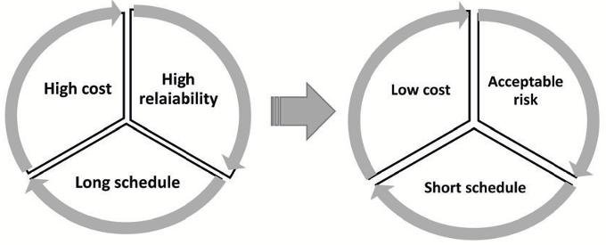
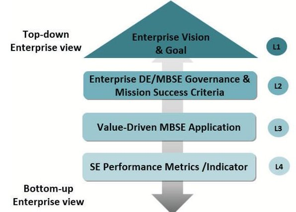
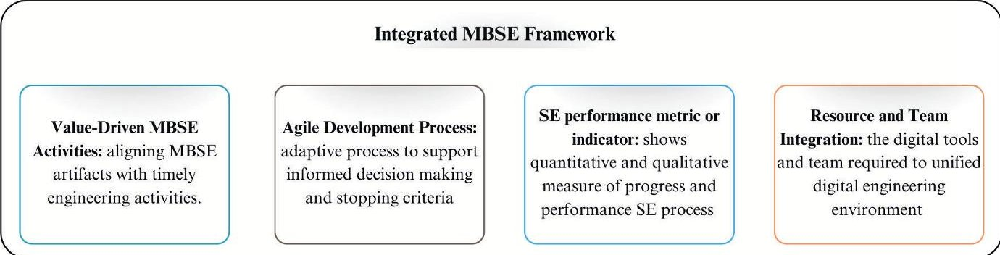

<!-- PDF_PAGE: 1 -->

IAC-25-IAC-25,B4,IP,41,x95462

# Assessment of the Realization of Value and Benefits of Implementing Agile MBSE for Enterprises in the NewSpace Industry

Rehobot Bekele $ ^{a *} $ , Sara Himmiche $ ^{b} $ , Yeshurun Alemayehu $ ^{c} $ , Bertrand Rose $ ^{d} $

$ ^{a} $ University of Strasbourg, ICube, Strasbourg, France, <u>bekeleburuso</u>@etu.unistra.fr

$ ^{b} $ Univ. Savoie Mont Blanc, SYMME, Annecy, France, <u>sara.himmiche@univ-smb.fr</u>

$ ^{c} $ Ethiopian Space Science and Technology Institute (ESSTi), Addis Ababa, Ethiopia, yeshuruna@essti.gov.et

$ ^{d} $ University of Strasbourg,ICube, Strasbourg,France, bertrand.rose@unistra.fr

* Corresponding author

## Abstract

In the fast-paced NewSpace industry, innovation and rapid delivery must be balanced with reliability, resource optimization, and risk reduction to enhance the maturity of technology and product development. While established agencies have achieved MBSE maturity through decades of customized practices, applying MBSE in small satellite missions and CubeSats remains challenging due to resource constraints and the need for a justifiable return on investment. In this context, MBSE must be implemented in a targeted, flexible, and measurable manner, supported by adaptive digital engineering practices. This study proposes an enterprise view comprised of enterprise strategies and goal, systems engineering (SE) processes empowered by performance indicators and lightweight governance criteria aligned with measurable engineering outcomes to support small teams and emerging enterprises. This value-driven approach aligns SE activities with lifecycle stages and core MBSE processes. The approach establishes measurable indicators across MBSE phases such as requirements management, model development, simulation and analysis, configuration management, and collaboration, linking artifacts to decision-making milestones and mission success criteria. The assessment identifies three enterprise groups (Group A, Group B and Group C) that is relevant to social CubeSat developers based on risk posture, mission lifetime, testing strategies, and resource levels. The discussion summarizes two aspects of MBSE value realization: the SE dimension assessing Systems of Interest metrics realized across the lifecycle, including reduced rework, improved traceability, early defect detection and so on, contributing to achievement of mission objective. The other dimension shows cumulative value realized across enterprise layer through a digital thread that connects MBSE artifacts into quantifiable steps, supporting project delivery speed, quality assurance, parts procurement, and production teams coordination. The assessment concludes that Agile MBSE, when integrated into enterprise strategies, provides a practical path to realizing measurable value. It strengthens the alignment between technical outcomes and organizational goals, supporting decision-making, collaboration, and mission assurance. Ultimately, this contribution advances MBSE adoption from anecdotal value claims toward evidence-based evaluation. Keywords:Value and Benefits, Agile MBSE, Small Satellite Development, Assessment of the Realization, NewSpace

Keywords:Value and Benefits, Agile MBSE, Small Satellite Development, Assessment of the Realization, NewSpace Industry

## 1. Introduction

Model-Based Systems engineering (MBSE) has emerged as a key enabler of digital transformation in acerospace, offering improved requirements traceability, design integration, verification and validation (V& V), and lifecycle management. Literature shows that MBSE adoption had led to benefits such as reduced defects, higher design reuse, and improved collaboration across geographically distributed teams [1, 2]. MBSE application has demonstrated its capability to support simple to complex mission either reducing complexity, improving system understanding, or speed up fast prototype and shorten development cycle conception to fabrication enabling early failure detection, and enhancing collaboration. Despite this advantages, the measurements of success and value in MBSE adoption remains a persistent challenge. Henderson et al. [3] argued that the benefits and value of MBSE remain inconclusive, with only two published studies providing measured evidence. The aggregate assessment in their study indicates that most claims about MBSE's benefits are still based on expectations rather than empirical validation.

Rogers et al. [4] provided one of the few long-term quantitative studies, reporting over ten years of transformation from document centric systems engineering (DCSE) to MBSE in the Submarine Warfare Federated Tactical Systems (SWFTS) program. Their work described the accomplishments and observations, defined the metrics

<!-- PDF_PAGE: 2 -->

collected, and quantified a positive return on investment (ROI). More recently, Henderson et al.[5] proposed a mechanism for developing metrics to evaluate Digital Engineering (DE), namely designing a performance measurement system (PMS) and selecting measures aligned with organizational goals such as reduced cost or improved quality.

Brisacter-Porchon et al.[6] extended this discussion by applying a quality-cost-delay architecture framework for defense program optimization. Their study established a bridge between program management and systems engineering by connecting program management models with MBSE representations through a seamless workflow. Similarly, the integration of product lifecycle management (PLM) and MBSE has been discussed in literature, showing potential benefits in decision support, implementation, and risk analysis.

However, among established space agencies, MBSE maturity has been achieved through decades of customized and integrated practices, leveraging multiple tools and synchronized techniques. These conventional MBSE adoption strategies designated complex systems, demanding high effort and resource-intensive missions, may not fully align with the agile, risk-tolerant, and fast-paced nature of NewSpace enterprises. Therefore, MBSE practices are capable introducing agility to facility the needs of this industrial trend and also support responsive digital engineering practice. Agile system engineering frequently employed in small enterprises and research groups has shown flexibility and adaptability, offering complementary capabilities [7,8]. Integrating Agile principles into MBSE has been proposed as a way to balance rigor with flexibility, enabling iterative development, quick decision-making, and stakeholder involvement. Thus, balancing agility and comprehensiveness can also aid in defining suitable stopping criteria for Agile SE, achieving competences, consistency, and traceability at the right level of maturity[9].

This paper studies an approach to assessing the realization of value and benefits of Agile MBSE at the enterprise level. The discussion focuses on technical outcomes such as design quality, reliability, and mission success, but also on organizational and governance dimensions including collaboration, scalability, and the design of performance measurement systems. This approach explores how establish value-driven practices based on the need of small team, providing roadmap toward justifiable adoption of MBSE, assessing the artifacts utilization, enabled change management, performance evaluation, and enterprise decision-making in the context of Agile environment.

## 1.1 Realization of Value and Benefits of Implementing MBSE

The successful MBSE implementation in an enterprise approach considers the entire ecosystem to ensure comprehensive adoption so that MBSE serves as the digital centerpiece bridging between the stakeholders and all other engineering disciplines throughout development lifecycle[10]. These benefits can be analyzed across multiple layers of enterprise implementation such as technical value generated during development the system of interest(SoI), project management, product-line efficiency, enterprise decision-making, and organizational collaboration.

- Technical value earned over SoI: several literature highlight improved requirements traceability, consistency across models, early defect detection, and design reuse and other benefits that directly affect development performance and process [11, 12]. For space systems, this translates into higher mission assurance and reduced integration and design mission architecture.

- Project Management: MBSE has been applied in support of planning, monitoring, and coordination of missions, providing a single source of truth, which reduces rework, improves schedule adherence, and enhances risk management[13].

- Product Lifecycle Management: MBSE supports PLM introducing model reuse and modular architectures, this enables efficient management of multiple missions or satellite variants, lowering cost and improving scalability[14].

- Enterprise DE Management: studies have reported MBSE's role in small and medium enterprise(SME) in facilitating alignment of engineering outcomes with strategic objectives, supporting governance, providing informed decision-making in terms of cost, schedule and other fundamental performance drivers [15,16].

- Organizational Collaboration: as systems involve multiple stakeholders, MBSE supports modelsharing platforms, concurrent engineering, and cross-disciplinary integration. This is critical for NewSpace consortia and partnerships where distributed teams must work under tight schedules.

## 1.2 Agile feature for NewSpace

NewSpace is the art of cutting corners but discipline of value-driven approach[17]. This paradigm shift require traditional SE practices toward methods that are faster,

<!-- PDF_PAGE: 3 -->

leaner, and more adaptive as shown in Fig.1. In previous studies the alignment of Agile and MBSE has been discussed as effective for small mission development due to their ability to facilitate short iterative cycles for early feedback, incremental delivery of subsystem capabilities to engage stakeholders, and continuous verification and validation to maintain system integrity under rapid development[9]. This demonstrates alignment Agile MBSE support adaptability to requirement volatility, stakeholders engagement and foster collaboration across team and diverse partners. In this way the balance between flexibility of agile, and comprehensiveness of MBSE is essential for introduce mission success criteria and lightweight governance structures that reduce process while retaining traceability.

Fig.1. Agile feature of NewSpace

However, the computation and realization value of MBSE is not easy endeavor; it is influenced by multiple factors such as enterprise maturity, governance structure, tool interoperability, and availability of metrics[18]. This paper emphasizes that MBSE's benefits should be assessed and aligned with enterprise-level goals, moving beyond anecdotal success to measurable outcomes like cycle time reduction, cost avoidance, risk reduction, and mission success criteria.

## 2. Methodology

Assessing the value and benefits of MBSE possesses a broad scope as an important subset of the digital transformation in the engineering approach. This study recognizes multiple aspects of value in small satellite developers in Newspace industry, ranging from complex mission developers and fast-growing companies to small startups and university teams. This application of MBSE has analyzed three dimensions of MBSE from ISO/IEC/IEEE 24641:2023(E) ANNEX E: logical, systems and knowledge management across the enterprise. This work proposes how to assess the success of Agile MBSE process and its benefits tailored to SMEs, through linking enterprise strategy, DE evaluation, and SE metrics. However, one of the key challenges in designing a performance measurement system is selecting which measures and track,

as these metrics may or may not deliver potential benefits [5]. This approach emphasizes process setup in an agile environment within fewer personnel, cost constraints, and faster design cycles, while integrating direct MBSE application toward quality, performance, schedule and cost objectives. The underlying focus is on attaining value-driven SE performance metrics such as requirements validation, design maturity index, behavior model coverage, and architecture completeness, collected across the development lifecycle as quantifiable evidence of value.

Fig. 2. Enterprise MBSE Implementation perspectives

## 2.1 Enterprise Approach for MBSE Realization

This assessment proposes the enterprise view of MBSE requires synchronizing between the value-driven application of SE to bridging them with enterprise objectives and defined engineering outcomes. This enterprise approach analyzes the traceability of MBSE artifacts at lower layers can be linked to performance or progress indicators such as development time, number of design iterations, system complexity, early defect detection, and reduction in rework cycles. These indicators provide tangible evidence of engineering efficiency gains and cost savings. It also emphasizes adaptability, digital engineering integration and practical applicability across the lifecycles of small satellite development. The methodology is structured across the following enterprise layers as illustrated in Figure 2:

- Enterprise Vision and Strategy (Layer 1): primary step is to define long-term mission, and bridge organizations business or operational goal with strategies of SE in terms of fundamental driver of performance such as cost, time-to-market, and reliability.

- Enterprise DE/MBSE adoption strategy and governance (Layer 2): this layer establishes rules, standards, and usage for MBSE implementation tailoring

<!-- PDF_PAGE: 4 -->

the scope the need based on available resource, budget, risk tolerance, complexity, and review gates.

- Value-Driven SE Application (Layer 3): this layer organized to translates SE activities such as requirements modeling, architecture, verification, and simulation, toward mission-driven-outcomes rather than process formalism.

- SE Performance Metrics/Indicators (Layer 4): this layer provides traceable evidence of MBSE value through measurable indicators such as requirement volatility, design reuse, design allocation, and simulation validation score.

The enterprise layered approach guides SE practices by defining the flow process. While a top-down approach establishes governance criteria, and ensures that standards propagate flow downward to refine engineering behavior. On the other hand, the bottom-up perspective describes how performance data flow upward from interdisciplinary teams to improve process and business engineering strategies thereby ensuring adaptability.

## 2.2 Enterprise Metrics Categorization Framework

For the first step, establishing long term goals of DE require a consideration multiple layers of intra-disciplinary collaboration and integration across an engineering business enterprise. This layer is built on the contribution of Mcdermott and Henderson et al.[5,19], they proposed enterprise five top-level metrics for DE or MBSE by mapping causal relationships within performance measurement system and selecting metrics that capture the targeted fundamental drivers of enterprise. These categorize of metrics are:

- Quality metrics which asses newly introduced value that improved performance and reduced error

- Adoption metric which measure ease of adoption and enterprise process effectiveness

- User Experience which analyze breadth of usability, and manage complexity

- Velocity/Agility metrics which measure productivity flexibility, speed indicators.

- Knowledge transfer metric evaluate new generated value through communication, sharing information and management.

This top-level metric framework assesses MBSE activities against mission success criteria establishing a performance measurement system that collectively leads to the evaluation of project objectives and ROI metrics.

## 3. Enterprise DE/MBSE adoption strategy and governance

The next step developing enterprise goal and strategies to be aligned bottom-up engineering practices tailoring scope of DE application to avoid overly formal processes and ensure modeling efforts to match the usability and mission needs. In 2019, the NASA Mission Success Handbook for CubeSat Missions outlined parameters such as risk classification, mission lifetime, testing hours and depth, and part selection, the mission success criteria identify measurement systems as essential elements for evaluating engineering processes. Once adoption strategy and governance are built on these five metrics, the mission success criteria determine the extent to which MBSE can be scaled and adjusted [2]. This directly impacts the strategy, timeline, and scope of MBSE implementation and resource are critical for setting up an agile environment. Mission success criteria are high level technical measure also governing guidelines that influence engineering practices, program management decisions, and stakeholder expectations. Therefore, governance criteria should incorporate mission-level success factors, ensuring that MBSE artifacts usability and associated performance indicators are used as reference points for measurement.

## 3.1 Tailoring MBSE for Social Group Developer

The adoption of MBSE strategy for a SoI varies widely across the diverse landscape of the small satellite industry particularly between single-mission development efforts and modular production environments[20, 21]. The growing demand of small satellite span a wide spectrum of stakeholders from educational group, hobbyist, commercial start-up to legacy space programs. With increasing modularization and standardization of CubeSat design for mass production the expectation on SE have evolved to address mission needs while ensuring efficiency, reusability and scalability across multiple missions. Therefore, classifying developers based on mission success criteria offers a structured way to align MBSE evaluation with mission objectives, development context and resource constraints. The following mission success parameters are used to classified CubeSat developers into three social categories:

- Risk Classification: defines the acceptable level of technical and programmatic risk, often levels range from Do No Harm through Class A-D missions, with CubeSat used for short term lifetime typically falling in high-risk tolerance categories.

- Cost-Risk Ratio: this ratio takes into consideration the balances between the available budget and the acceptable risk exposure, enabling trade-offs between mission assurance and resource allocation.

<!-- PDF_PAGE: 5 -->

- Risk-Resource Ratio: identifies resource availability including testing facilities, testing duration expected, and launch opportunities which affects mission risk posture.

- Expected Lifetime: defining targeted mission duration that impact reliability and TRL level of component or parts used to system design, spanning from short-term mission such as technology demonstrations (approx. 6 months) to long-duration scientific and operational missions (approx. 5 years).

Once these parameters clarify social group CubeSat developer and scope implementation expected, enterprises can evaluate strategies not only on technical rigor but also on their ability to achieve mission success within the constraints of cost, schedule, and acceptable risk.

## 3.2 Mapping of MBSE phases over Development LifeCycle

The third layer connects CubeSat project deliverables directly to core MBSE activities, allowing model artifacts to serve as inputs to major reviews such as PRR, PDR, CDR, and FRR. This alignment enables the early integration of systems thinking and supports model-centric traceability across phases from concept to launch. These decision gates govern the SE strategy to conducts performance assessments at each review milestone and introduce feedback checkpoints that serve as entry and exit of lifecycle phases. In addition, SE indicators enable the capability to evaluate progress project and restructuring priorities, assess the effectiveness of SE process, track completion and trigger timely decision making. The flow of MBSE phases maintains modeling objectives across the lifecycle, identifying when and how each artifact contributes to system evolution. This mapping reinforces a comprehensive MBSE approach that supports lifecycle transitions while minimizing rework and ensuring each modeling effort is purposeful, validated, and synchronized with project objectives. In summary, Integrated MBSE represents an approach that centralizes MBSE as the digital centerpiece of the engineering process helping to avoid skipping critical elements and prevent late-stage design changes and eliminate distributed effort as shown in Fig 3.

## 3.3 Value-driven SE activities

This final layer connects systems engineering activities with enterprise-level criteria by linking each MBSE phase toward the to value-driven outcomes. This value-driven approach is utilizing digital artifact by collecting them either in real-time or at lifecycle milestones to extract useful information and demonstrate benefits across development stages. It also facilitates

decision making and enhances the measurability of targeted activities, supporting intended engineering task and generate knowledge that leads better management and optimized development process.

In the Requirements Management phase, activities such as elicitation of requirements, performance analysis, and validation against operational or regulatory constraints ensure traceability and stakeholder satisfaction. The expected value is realized through automated validation, stakeholder-level traceability of system requirements, and alignment of requirements with mission objectives. Model Development supports architecture definition, decomposition, and feasibility analysis, enabling flexible trade studies and optimal design choices before physical build. Thus, the value parameters expected at this phase include completion of requirement validation, architectural solution, reduced complexity, completion of preliminary analysis and reduces prototyping costs, lower hardware failure rates, and improves management of complex system interactions.

Simulation and Analysis support during the preliminary design and detail design stages,trade studies and optimization, as well as with requirements for V&V activities. It also generates executable models to perform risk and failure mode analysis (FMECA, FTA), optimize subsystem behavior, and validate performance through cosimulation. These activities expected to provide a value such as reduce late-stage defects, predict system behavior more accurately, and enable iterative risk assessment and mitigation. In Configuration Management, governance mechanisms such as version control, milestone reviews, and resource tracking maintain design consistency and ensure error reduction across subsystems. This phase contributes to improved decision-making, risk mitigation, and life-cycle efficiency.

Finally, Collaboration and Communication activities are conducted throughout mission via collaborative platform or tool web-based and modeling tools, supporting review meetings, and monitors team interaction frequency. The value of this phase can be assessed through transparency SE introduced, cross-team alignment, efficient knowledge sharing, and effective record-keeping throughout the life cycle, which collectively advance stakeholder engagement and mission assurance.

This alignment of system engineering activities with enterprise criteria such as quality, agility, adoption, and knowledge transfer, the framework creates a continuous loop of value realization. Each phase contributes measurable improvements in cost, schedule, risk, and performance, thereby linking engineering practice directly to enterprise success.

<!-- PDF_PAGE: 6 -->

Table 1. Social Group of CubeSat developer by Mission success tier

<table border="1"><tr><td>Social Group</td><td>Lifetime/Category</td><td>Testing Hours</td><td>Part Screening Level</td><td>Levels&amp;Risk/Resource Ratios</td><td>Testing Strategy</td><td>Example Mission Type</td></tr><tr><td>Group A</td><td>&lt;3 Months</td><td>≥100 hrs</td><td>COTS acceptance only</td><td>1A:Low tech risk,minimal resources1B:Low resources,higher tech risk</td><td>Basic testing(TVAC,Vibe,EMI)</td><td>Tech demo,Student CubeSat</td></tr><tr><td>Group B</td><td>3-12 Months</td><td>≥200 hrs</td><td>Selective screening and environmental testing</td><td>2A:Medium tech risk,low resources2B:Medium risk and resources</td><td>Protoflight testingFull middle-level assurance approach</td><td>Constellation of weather/data CubeSats with acceptable loss</td></tr><tr><td>Group C</td><td>1-5 Years&gt;5 Years</td><td>≥500 hrs≥1000 hrs</td><td>Thorough screening and environmental testingFull testing</td><td>3A:High tech risk,low resources3B:High risk,high resources</td><td>Advanced testing for risky techfull assurance,qualification,and testing</td><td>Science CubeSat supporting NASA data collection for climate</td></tr></table>

## 4. Discussion

For small satellite projects, the development strategy must account for the classification of the CubeSat developer, as it directly influences risk tolerance, cost constraints, and timeline expectations. As summarized in Table 1, CubeSat developers can be grouped into three broad social categories based on mission lifetime, testing strategy, and part selection. These categories define the degree of rigor applied to engineering processes and, consequently, the extent to which MBSE can be scaled and tailored.

Group A developers, typically short-lifetime missions such as student CubeSats or hosted technology demonstrations, operate with minimal resources and high acceptance of risk. For this group, the benefit of MBSE lies in supporting rapid iterations, improving traceability, and minimizing integration errors even when formal testing is limited. This is agile-enabled MBSE practices enable lightweight and controlled scope modeling including simple architecture diagrams and requirement modeling also use-case validation, that can provide value without imposing prohibitive overhead.

Group B developers, with moderate lifetimes and resource levels, often employ proto flight testing and selective part screening. Here, MBSE provides greater benefit by managing requirement traceability across iterations, enabling reuse of subsystem models, and reducing schedule risk through early defect detection. The balance of agility and rigor becomes critical, as these missions must sustain higher assurance levels while maintaining cost-effectiveness. As this developers or enterprise operate over existing product lines MBSE governance focuses on modular modeling, process improvement and traceability to key mission requirements.

Group C developers, representing long-duration or highervalue missions, demand the most through testing, qualification, and assurance processes. For these missions, MBSE delivers maximum value by ensuring lifecycle consistency, supporting risk analysis through simulation, and

providing governance structures for change management. Advanced modeling practices, digital twins, and configuration management become essential to reduce rework and maintain mission assurance. The emphasis on high-reliability outcomes necessitate comprehensive MBSE that integrate full V&V and configuration management to ensure mission assurance standards.

Thus, the assessment of MBSE benefit can be benchmarked across developer groups, with qualities such as reliability, traceability, and cost savings evaluated against the boundaries set by mission lifetime, testing hours, and resource allocation. Identifying the developer group is therefore critical in defining the appropriate level of agility achievable and aligning MBSE implementation with mission success criteria as outlined by NASA[2]. In summary, this study discussed theoretical approach that introduces relevant metrics for DE and MBSE adoption, categorized to align enterprise-level evaluation with SE performance indicators. Reference [22] conducted an assessment of MBSE capability and maturity using the INCOSE Model-Based Capability Matrix for digital transformation support at NASA, which revealed how successful metrics contributed to business value and realization of MBSE, and this approach will be explored for further investigation.

Table 2 summarize these SE performance metrics resulted from MBSE phases categorized under top-level enterprise metric

## 5. Conclusions

This study assessed the realization of value and benefits of implementing Agile MBSE in enterprises in the NewSpace industry, focusing on how measurable frameworks can align engineering activities with enterprise vision, governance criteria, objective-driven MBSE phases, and performance indicators, creating a closed-loop system that connects technical execution to both mission and organizational success. The findings highlight that the realization of MBSE benefits must consider the broader en-

<!-- PDF_PAGE: 7 -->

Fig. 3. Integrated MBSE Framework

Table 2. Linking SE Performance Indicators under Enterprise Metrics Categorization

<table border="1"><tr><td>Enterprise DE Metric category</td><td>SE Performance Indicators</td></tr><tr><td>Quality</td><td>Requirement closure rate; traceability completeness; number of defects detected early; error escape rate between phases; cost of rework avoided.</td></tr><tr><td>Velocity/agility</td><td>Cycle time per design iteration; schedule adherence; frequency of design/simulation updates; reuse percentage of models/artifacts; responsiveness to requirement changes</td></tr><tr><td>User experience</td><td>Model accessibility; stakeholder review turnaround time; automation rate(test cases, simulations); reduction of complexity in system representation; usability feedback from engineering teams.</td></tr><tr><td>Adoption</td><td>Number of projects applying MBSE; percentage of process integrated with models; tool usage rate; training completion rate; governance compliance levels.</td></tr><tr><td>Knowledge transfer</td><td>Number of cross-team reviews; collaboration platform usage; issue resolution rate; percentage of reused knowledge/ artifacts; frequency of feedback loops.</td></tr></table>

terprise ecosystem, comprising targeted and value-driven SE activities, tailoring MBSE utility for mission developer groups, and success criteria that align with enterprise strategies. In addition, benchmarking developers against risk tolerance, mission lifetime, testing strategy, and resource levels demonstrated how MBSE value can be scaled and assessed across different enterprise contexts. In general, the value of MBSE can be analyzed across two key dimensions of application: the Systems Engineering dimension, which emphasizes system-level metrics over the lifecycle, and the Enterprise dimension, which focuses on business process alignment, governance, and knowledge integration. This contribution advances a pathway to balance rigor with flexibility of Agile MBSE to assess value and benefits in cost, schedule, quality, and risk management offering enterprises a structured approach to realize and demonstrate the true value of MBSE in the NewSpace domain.

## Acknowledgments

The authors of this study would like to express their sincere gratitude to the research funding sources, namely the Ministry for Europe and Foreign Affairs of France and the Schlumberger Foundation Faculty for the Future. Their invaluable support in financing and facilitating the research has been key to the success of this study.

## References

[1] D. Kaslow, P. T. Cahill, and B. Ayres, "Development and application of the cubesat system reference model," in 2020 IEEE Aerospace Conference, IEEE, 2020, pp. 1-15.

[2] NASA Goddard Space Flight Center, "Mission success handbook for cubesat missions," in Proceedings of the NASA CubeSat Standards and Mission Assurance Workshop, GSFC-HDBK-8007,

<!-- PDF_PAGE: 8 -->

Approved: Dec. 16, 2019, Revalidation: Dec. 16, 2024, 2019.

[3] K. Henderson and A. Salado, "Value and benefits of model-based systems engineering (mbse): Evidence from the literature," Systems Engineering, vol. 24, no. 1, pp. 51-66, 2021.

[4] E. B. Rogers III and S. W. Mitchell, "Mbse delivers significant return on investment in evolutionary development of complex sos," Systems Engineering, vol. 24, no. 6, pp. 385-408, 2021.

[5] K. Henderson, T. McDermott, E. Van Aken, and A. Salado, "Towards developing metrics to evaluate digital engineering," Systems Engineering, vol. 26, no. 1, pp. 3-31, 2023.

[6] L. Brisacier-Porchon and O. Hammami, "Defense program quality-cost-delay optimization: Architecture framework, a bridge between program management and system engineering," Systems Engineering, vol. 27, no. 2, pp. 284-301, 2024.

[7] E. Honoré-Livermore, R. Lyells, J. L. Garrett, R. Angier, and B. Epps, "An agile systems engineering analysis of a university cubesat project organization," in INCOSE International Symposium, Wiley Online Library, vol. 31, 2021, pp. 1334-1348.

[8] S. Plazanet and J. Navas, "Model-based systems engineering as an enabler of agility," INSIGHT, vol. 26, no. 2, pp. 26-30, 2023.

[9] R. B. Buruso, S. Himmiche, T. R. Tejumola, Y. Adde, and B. Rose, "Evaluation of agility in mbse methods development life cycle phases of small satellites," in Proceedings of the 75th International Astronautical Congress (IAC 2024), IAF Space Systems Symposium, International Astronautical Federation (IAF), 2024, pp. 834-842.

[10] B. L. Papke, G. Wang, R. Kratzke, and C. Schreiber, "Implementing mbse-an enterprise approach to an enterprise problem," in INCOSE International Symposium, Wiley Online Library, vol. 30, 2020, pp. 1550-1567.

[11] D. J. Knoll and C. Fortin, "Digital engineering information exchange model for space missions architecture: A case study of a cubesat mission," in 71st International Astronautical Congress (IAC), 2020.

[12] S. Friedenthal, A. Moore, and R. Steiner, A Practical Guide to SysML: The Systems Modeling Language, 3rd. Morgan Kaufmann, 2015, ISBN: 9780128002025.

[13] E. Honoré-Livermore, "Integrating agile systems engineering and project management in small satellites development," 2022.

[14] H. Kindem, "Small satellite extracurricular projects-implementing a context-driven syseng engine for improved adaptability and student agency," in INCOSE International Symposium, Wiley Online Library, vol. 33, 2023, pp. 1600- 1611.

[15] D. Revell, D. C. Gross, G. Zhou, and A. Hernandez, "Applying a mbse methodology in small scale technology development," in 2023 IEEE International Systems Conference (SysCon), IEEE, 2023, pp. 1-6.

[16] J. G. Nanfuka and R. Oosthuizen, "Mbse-lite: Implementing model-based systems engineering on small enterprise projects," 2022.

[17] I. Chechile, NewSpace Systems Engineering. Springer, 2021.

[18] "Better products — the value of systems architecting," in Model-Based System Architecture. John Wiley & Sons, Ltd, 2015, ch. 3, pp. 9-18, ISBN: 9781119051930. doi: https://doi.org/10. 1002/9781119051930.ch3. eprint: https:// onlinelibrary.wiley.com/doi/pdf/10. 1002/9781119051930.ch3. [Online]. Available: https://onlinelibrary.wiley.com/doi/ abs/10.1002/9781119051930.ch3.

[19] T. McDermott, "A framework to categorize the benefits and value of digital engineering," 2021.

[20] E. E. Areda, M. Hirokazu, and M. Cho, "Improving efficiency in cubesat mass production: A modular and standardized approach," Acta Astronautica, vol. 232, pp. 51-67, 2025, ISSN: 0094-5765. DOI: https://doi.org/10.1016/j.actaastro. 2025.02.017. [Online]. Available: https://www. sciencedirect.com/science/article/pii/ S0094576525000888.

[21] T. Villela, C. A. Costa, A. M. Brandao, F. T. Bueno, and R. Leonardi, "Towards the thousandth cubesat: A statistical overview," International Journal of Aerospace Engineering, vol. 2019, no. 1, p. 5063145, 2019.

[22] G. J. Pierce, P. E. Nicoli, T. R. Hill, and S. L. Cornford, "How the incose model-based capability matrix has steered model-based systems engineering transformation at nasa," in INCOSE International Symposium, Wiley Online Library, vol. 34, 2024, pp. 830-848.